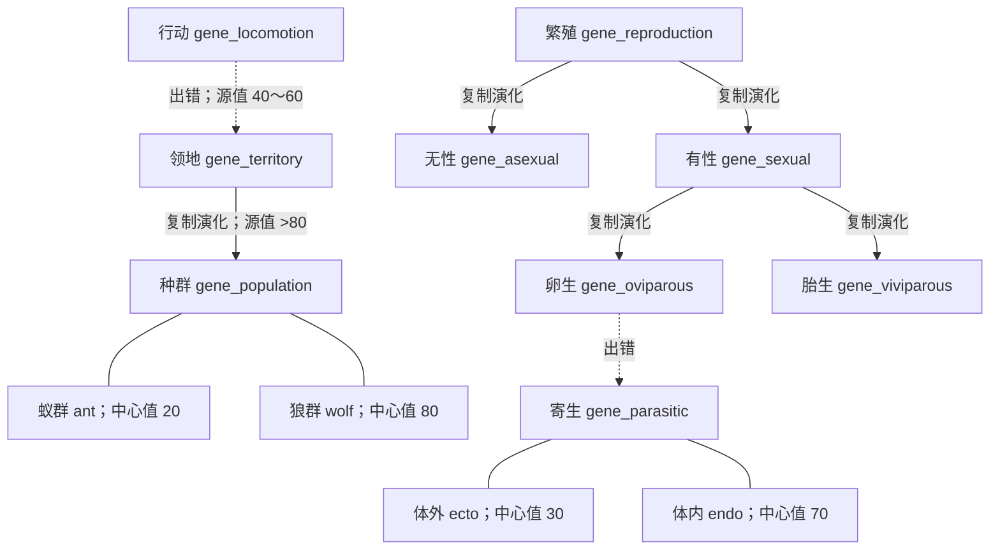

# 《达尔文乐园》基因树扩展与生态演化开发文档

文档版本：v1.2 · 更新日期：2026-10-27
目标模块：Genetics / Entities / Entity AI / UI / World Save

本文件将扩展基因库设计与当前工程接口对齐，区分可运行实现与后续设计。所有参数以实际 JSON 配置为准，不把现实动物行为直接当成已完成的游戏功能。

## 1. 本轮实现范围

本轮新增 `gene_territory`、`gene_population`、`gene_parasitic`，并补齐 `gene_asexual`、`gene_sexual`、`gene_oviparous`、`gene_viviparous` 四个繁殖前置/分支定义。原有七个基础定义继续保留。

- 行动基因在数值 40～60 的出错变异中可转为领地基因。
- 领地基因值严格大于 80，复制变异可产生种群基因；原领地实例保留。
- 寄生基因只能由卵生基因的出错变异产生，不能通过普通复制演化或其他源基因得到。
- 种群支持蚁群/狼群、首成员领袖、属性决斗、领袖死亡递补，以及捕猎/采集/集结/守卫命令。
- 卵生后代在外部孵化；寄生体支持体外/体内附着、营养转移和宿主死亡脱离。
- 上述运行状态纳入世界存档。

这些路径不改变全局默认的 90% 出错、5% 复制、5% 缺失类型权重。满足路径条件后，仍先经过原来的生命阶段变异抽签和基因选择。

## 2. 已接入的基因树



`parentGeneId` 用于谱系展示，实际迁移由 `default_tree.json` 的 `evolution` / `error` 边决定。`expansion_rules.json` 对特殊目标的来源、变异类型及源值范围再次校验，防止编辑器错误连线绕过约束。`isBaseGene`、`category`、文件名和 `id` 必须完整且一致。

## 3. 领地行为

### 定居与巡逻

首次激活时记录实体所在位置为领地中心。中心保存为星球本地坐标，星球旋转后不会漂到另一块大陆。活动距离用球面弧长计算，半径来自 `territory_radius` 属性曲线（当前 20～60 米）。

实体在范围内选择地表巡逻点，越界时回到中心。巡逻/警戒仍是基因表达倾向；基因另以 `entityStateTags` 标签授予独立实体状态。默认规则是饱食度 >5 且感知范围内无行动基因捕猎分支实体时巡逻，发现捕猎者或饱食度 ≤5 时切换为实体捕猎。阈值、感知条件和迁移见独立注册表，详见[实体状态注册表开发说明](实体状态注册表开发说明.md)。

### 受击与驱逐

攻击通过 `EntityCombat.Receive(attacker, damage)` 传递攻击者，触发撤离。环境、饥饿等普通扣血不会误判为敌人驱逐。

撤离优先于群体命令，不受原领地边界限制。每次真实攻击刷新安全等待时间；连续 10 个模拟秒未受攻击后，在当前安全位置建立新中心，避免回到原攻击者身边反复受击。该规则采用用户要求的“被驱逐后离开固定范围”，不采用“10 秒后无条件回旧领地”的初稿行为。

`defend_bonus` 只在未撤离且位于领地内时提供减伤，计算方式为 `原始伤害 / (1 + 防御值 / 100)`，不把防御误当作额外攻击力。

## 4. 种群与领袖

### 群体归属

种群基因按状态中心值分为 `ant` 和 `wolf`。新成员加入附近同状态的群体；找不到群体时创建新群体并成为首领。当前版本按“相近且同模式”聚群，尚未引入独立物种 ID、亲缘判定或跨群外交。

每个群体有稳定 `groupId`，每个成员保存稳定实体 ID 与加入顺序。同模式的其他群体不会收到命令，同群成员不作为自主 AI 猎物。

### 领袖产生与决斗

首个成员成为首领；领袖死亡、停用或基因失效后，由仍存活且最早加入的有效成员接任。加载时保留原领袖标记，不因生成顺序重新选举。

决斗采用当前版本的属性裁决：

```text
评分 = 当前有效攻击力 + 当前生命值 × duelHealthWeight
挑战成功：挑战者评分 > 领袖评分 × duelAdvantage
```

挑战者和原领袖必须在配置范围内，并同时进入 30 个模拟秒冷却。更强成员近距离相遇时可自动挑战；玩家也可从实体信息面板主动发起。它不是完整的逐招战斗动画，不会以同帧无限互击决定结果。

### 命令

| 命令 | 行为 | 入口 |
| --- | --- | --- |
| 捕猎 | 追击指定非同群存活目标，接近时攻击；远处成员从不同侧面靠近 | 狼群领袖自动搜索；信息面板选择最近合法猎物 |
| 采集 | 前往扫描到的矿脉；蚁群到达后按实际矿量开采并进食 | 蚁群自动扫描；领袖面板 |
| 集结 | 前往领地中心 | 无猎物/矿脉时自动；领袖面板 |
| 守卫 | 返回指定中心并驻守 | 领袖面板 |

成员没有下令权限。手动命令默认保留 12 个模拟秒，期间不被自动扫描覆盖。目标死亡或命令到期后取消追击，重新决策；暂停与加载期间不扣命令时间。

### 蚁群与狼群差异

蚁群个体移动/攻击倍率较低，领袖光环按 `coordination` 提升移动效率，矿物采食也受协同效率影响；光环内还乘以 `1 + antGatherBonus`（当前为 3 倍）。当前不降低生命值上限，避免改变旧存档的生命容量语义。

狼群在领袖光环内按附近同群成员数叠加协同攻击，贡献人数有配置上限，独狼没有凭空的群攻奖励。击杀奖励按配置比例分给范围内的同群成员，其余归击杀者；总奖励守恒，不为每个成员重复生成一整份食物。采矿同样以 `ConsumeOre` 返回的实际开采量结算。

## 5. 卵生与寄生

### 卵生前置

有性特化可复制演化为卵生或胎生。多个繁殖基因共存时，只有最高阶有效实例推进孕育，避免重复倒计时或一帧生多次。

卵生后代出生为可攻击、保留碰撞体的独立卵，孵化时长由 `incubationSeconds / hatchSpeed` 决定；外壳使用 `eggDefense` 减伤。孵化前不觅食、不推进普通成长、不提前进行出生阶段变异；孵化时才初始化幼年。胎生沿用母体孕育，`gestationEfficiency` 调整耗时，但仍遵循 7～30 游戏日边界。

卵生与胎生同时有效时，当前版本由卵生表达决定后代进入外部孵化；孕育计时仍只由一个繁殖实例推进，避免重复生产。

### 寄生状态

| 状态 | 中心值 | 表现 |
| --- | --- | --- |
| `ecto` 体外寄生 | 30 | 跟随宿主表面偏移位置，模型可见 |
| `endo` 体内寄生 | 70 | 跟随宿主中心，暂时隐藏自身渲染；碰撞体仍存在 |

寄生基因抑制普通移动和自养收益；无宿主时以配置的低速度寻找更大且存活的实体，足够靠近才能附着。默认宿主体型至少为寄生体的 1.5 倍，同时拒绝宿主环和自寄生。

`host_drain_rate` 控制每个模拟秒抽取的营养：先扣宿主饱食度，不足时扣储存营养，实际扣除量才转移给寄生体；营养不凭空产生。`hide_from_host` 缩小其他自主猎食 AI 对附着寄生体的发现范围；宿主自身按模拟周期以 `1 - hide_from_host` 概率发现，并缓存该周期结果，避免每帧重抽导致实际必然发现。发现结果与剩余周期也会保存。宿主死亡后寄生体脱离，恢复原物理状态并寻找其他宿主，没有营养来源时沿用饥饿死亡。

**实现调整**：不直接设置寄生体的 Transform 父节点。Unity 会连同父物体销毁子物体，因此这里使用独立跟随组件、宿主本地偏移和仅宿主—寄生体间的碰撞忽略对。脱离时成对恢复碰撞与渲染，不关闭 Collider，也不因 Unity 已销毁对象的“假 null”漏掉刚体恢复。

## 6. 配置与代码入口

| 路径 | 用途 |
| --- | --- |
| `Assets/Resources/Genes/gene_*.json` | 基因定义、状态、属性曲线和抑制关系 |
| `Assets/Resources/Genetics/default_tree.json` | 初始节点布局与演化/出错边 |
| `Assets/Resources/Genetics/expansion_rules.json` | 特殊演化条件 |
| `Assets/Resources/Entities/social_ecology.json` | 巡逻、驱逐、聚群、指令、决斗、寄生和孵化参数 |
| `Genetics/GeneEvolutionRules.cs` | 变异路径约束 |
| `Entities/Logic/*GeneLogic.cs` | 基因行为适配与注册 |
| `Entities/Ecology/` | 领地、群体、战斗、寄生、孵化、稳定标识和生态存档 |
| `UI/PopulationCommandPanel.cs` | 实体信息面板中的命令与决斗按钮 |

种群压制方向为 **种群 → 独立领地表达**，并由统一行动优先级避免游荡抢占命令。不会使用初稿“领地抑制种群”的反向规则。`suppressionRules` 作用于基因表达，不能直接填某个属性名期待它单独关闭。

### 演化条件示例

```json
{
  "source": "gene_locomotion",
  "target": "gene_territory",
  "kind": "error",
  "minValue": 40,
  "maxValue": 60,
  "requiredGenes": []
}
```

完整定义请直接使用工程中的 JSON；初稿缺少的 `category`、`isBaseGene`、`attributeLinkages` 等字段均已补齐。

## 7. 存档、兼容与生命周期

新增 `EntitySaveState.ecology`，保存实体稳定 ID、领地中心、威胁位置、撤离计时、群体归属、加入顺序、领袖、命令及其目标和剩余时间、决斗冷却、宿主 ID/偏移/原刚体模式，以及卵的孵化计时。

读取分两遍：先恢复所有实体本体和稳定 ID，再解析命令目标与宿主引用。丢失目标取消命令，丢失宿主维持游离状态。旧存档没有生态字段时按原行为读取；Unity 反序列化产生的完全空生态对象也按缺字段处理，有实际内容却缺失有效标识的记录仍会被拒绝。旧世界仍保留其原有基因配置快照，不会静默注入新定义。体验新谱系建议创建新世界。

已有 `mods/Default/tree.json` 会继续覆盖内置树；如有旧自定义树，应在工具中加入新节点/正确关系，或自行备份后使用内置初始树。新增配置不会自动覆盖用户文件。

实体信息面板中的“添加基因”是开发调试入口，可以直接添加新定义验证行为；这不代表自然变异允许绕过谱系条件。

事件由真实 MonoBehaviour 在启用/禁用时注册和解绑；纯 C# `IGeneLogic` 不假定自己有 Unity `OnDisable`。基因失效或出错换类型时，旧逻辑重新校验并释放，防止继续执行过期行为。

## 8. 附件扩展库与后续路线

下面保留附件的完整扩展方向，**本轮未将这些条目伪装成已运行的基因**。后续每项须先接入实际属性消费方，再添加 JSON、演化条件、交互展示及回归。

| 谱系 | 待扩展基因 | 设计方向与依赖 |
| --- | --- | --- |
| 行动 | 疾行 `gene_speed` | 爆发/耐力；移动、代谢和跳跃联动 |
| 行动 | 游泳 `gene_swim`、两栖 `gene_amphibious` | 水下推进、氧气效率；不能只解除现有陆地水中移动限制 |
| 行动 | 飞行 `gene_fly`、滑翔 `gene_glide` | 飞行高度、升力、耗能及地表安全约束的控制权切换 |
| 防御 | 隐蔽 `gene_stealth` | 保护色/迷彩，统一接入发现距离 |
| 防御 | 毒液 `gene_venom`、甲壳 `gene_armor` | 附毒/反伤、物理减伤及速度代价 |
| 营养 | 草食 `gene_herbivore`、肉食 `gene_carnivore`、食腐 `gene_scavenger` | 饮食目标过滤与消化收益；食腐需要尸体资源系统 |
| 营养 | 反刍 `gene_ruminant`、杂食 `gene_omnivore` | 低营养食物提取、草肉融合条件；需要新变异类型时单独设计 |
| 营养 | 顶级掠食 `gene_apex` | 恐惧光环、攻击吸血及收益守恒 |
| 繁殖 | 出芽 `gene_budding`、K策略 `gene_k_selection` | 后代数量、质量、成熟速度与出生位置 |
| 生存 | 免疫 `gene_immunity` | 毒抗/病抗；疾病与辐射事件尚需系统支撑 |
| 生存 | 休眠 `gene_torpor` | 低温低食物触发，代谢降低而非无限无代价免伤 |
| 生存 | 超速再生 `gene_regeneration` | 营养耗费与恢复；断肢再生需要身体部件系统 |

该路线不改变本轮三个核心新基因已经可运行的要求。后续不得仅添加没有逻辑消费者的属性并宣称完成相应生态机制。

## 9. 验收清单

1. 检查文件名、基因 ID、脚本注册和全部依赖一致；工具能展示正确出错边与父子关系。
2. 强制出错/复制抽样，验证 40～60、严格 >80、卵生唯一来源及 Tier 更新；90/5/5 类型概率保持原配置。
3. 领地巡逻不越界，真实受击撤离，安全后重新定居；暂停不扣计时，环境伤害不误触发。
4. 同模式聚群、首成员领袖、命令权限、决斗胜负/冷却、领袖死亡递补、群体隔离与同群猎物排除。
5. 蚁群矿量与营养守恒；狼群击杀分享不复制收益。
6. 卵孵化前不出生变异，读档后仍能正常孵化；寄生来源、体型条件、营养转移、循环宿主拒绝、宿主销毁后脱离及碰撞恢复。
7. 对领地、群体、寄生、孵化状态执行存档往返，使用实体逆序加载验证跨实体引用。
8. 编译与回归结果记录在本地 `Artifacts/SocialEcologyReview`。从尚未加载世界的启动菜单执行 `Tools → Darwin Park → Validate Social Ecology`，不在现有世界中重置基因配置。

本轮已执行 49 项生态检查，并同时通过原有基因树、第一人称战斗和生命周期/繁殖回归。执行范围与限制见[2026-10-27 验证记录](../验证记录/修复验证-2026-10-27.md)。
