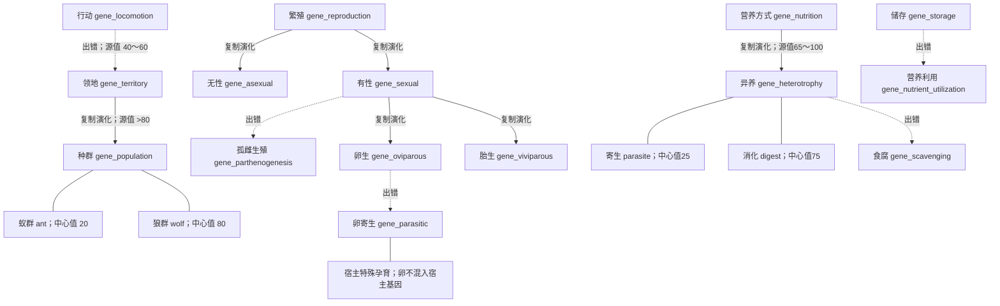

# 基因与生态

[返回文档目录](../README.md)

按主题汇编原有资料。各章节保留原记录日期与验证范围；历史结论不代表当前版本已重新验证。后续请直接维护相关章节。

## 章节目录

- [Genetics_Tree](#doc-0b05b0a235a6)
- [实体状态注册表开发说明](#doc-59989eca11b6)
- [生态平衡与体型判定](#doc-c441bd735c39)
- [种群比例调节与时间单位](#doc-08e0de4aff82)

---

<a id="doc-0b05b0a235a6"></a>

## Genetics_Tree

原文档：`Docs/开发设计/Genetics_Tree.md`

<a id="doc-0b05b0a235a6-达尔文乐园基因树扩展与生态演化开发文档"></a>

### 《达尔文乐园》基因树扩展与生态演化开发文档

文档版本：v1.4 · 更新日期：2026-11-05
目标模块：Genetics / Entities / Entity AI / UI / World Save

本文件将扩展基因库设计与当前工程接口对齐，区分可运行实现与后续设计。所有参数以实际 JSON 配置为准，不把现实动物行为直接当成已完成的游戏功能。

<a id="doc-0b05b0a235a6-1-本轮实现范围"></a>

#### 1. 本轮实现范围

当前谱系包含领地、种群、繁殖特化、异养、食腐和营养利用。营养方式下新增 `gene_heterotrophy`，其出错分支为 `gene_scavenging`；原 `gene_parasitic` 保留ID并改名为卵寄生。

- 行动基因在数值 40～60 的出错变异中可转为领地基因。
- 领地基因值严格大于 80，复制变异可产生种群基因；原领地实例保留。
- 卵寄生基因只能由卵生基因的出错变异产生，向宿主放入具有亲本后代基因的外来卵。
- 有性繁殖特化 `gene_sexual` 的出错分支为孤雌生殖 `gene_parthenogenesis`：成年连续无合适配偶达到配置时长后，以单亲方式孕育；有配偶时优先正常有性繁殖。
- 营养方式基因值65～100可复制演化出异养基因，原实例保留；异养数值出错可转为食腐。
- 种群支持蚁群/狼群、首成员领袖、属性决斗、领袖死亡递补，以及捕猎/采集/集结/守卫命令。
- 异养的寄生状态在幼年隐藏自身、跟随宿主并吸取饱食度；成年脱离并独立消化取食。食腐只吸收尸体余量。
- 上述运行状态纳入世界存档。

这些路径不改变全局默认的 90% 出错、5% 复制、5% 缺失类型权重。满足路径条件后，仍先经过原来的生命阶段变异抽签和基因选择。

<a id="doc-0b05b0a235a6-2-已接入的基因树"></a>

#### 2. 已接入的基因树



`parentGeneId` 用于谱系展示，实际迁移由 `default_tree.json` 的 `evolution` / `error` 边决定。`expansion_rules.json` 对特殊目标的来源、变异类型及源值范围再次校验，防止编辑器错误连线绕过约束。`isBaseGene`、`category`、文件名和 `id` 必须完整且一致。

<a id="doc-0b05b0a235a6-3-领地行为"></a>

#### 3. 领地行为

<a id="doc-0b05b0a235a6-定居与巡逻"></a>

##### 定居与巡逻

首次激活时记录实体所在位置为领地中心。中心保存为星球本地坐标，星球旋转后不会漂到另一块大陆。活动距离用球面弧长计算，半径来自 `territory_radius` 属性曲线（当前 20～60 米）。

实体在范围内选择地表巡逻点，越界时回到中心。巡逻/警戒仍是基因表达倾向；基因另以 `entityStateTags` 标签授予独立实体状态。默认规则是饱食度 >5 且感知范围内无行动基因捕猎分支实体时巡逻，发现捕猎者或饱食度 ≤5 时切换为实体捕猎。阈值、感知条件和迁移见独立注册表，详见[实体状态注册表开发说明](基因与生态.md#doc-59989eca11b6)。

<a id="doc-0b05b0a235a6-受击与驱逐"></a>

##### 受击与驱逐

攻击通过 `EntityCombat.Receive(attacker, damage)` 传递攻击者，触发撤离。环境、饥饿等普通扣血不会误判为敌人驱逐。

撤离优先于群体命令，不受原领地边界限制。每次真实攻击刷新安全等待时间；连续 10 个模拟秒未受攻击后，在当前安全位置建立新中心，避免回到原攻击者身边反复受击。该规则采用用户要求的“被驱逐后离开固定范围”，不采用“10 秒后无条件回旧领地”的初稿行为。

`defend_bonus` 只在未撤离且位于领地内时提供减伤，计算方式为 `原始伤害 / (1 + 防御值 / 100)`，不把防御误当作额外攻击力。

<a id="doc-0b05b0a235a6-4-种群与领袖"></a>

#### 4. 种群与领袖

<a id="doc-0b05b0a235a6-群体归属"></a>

##### 群体归属

种群基因按状态中心值分为 `ant` 和 `wolf`。新成员加入附近同状态的群体；找不到群体时创建新群体并成为首领。当前版本按“相近且同模式”聚群，尚未引入独立物种 ID、亲缘判定或跨群外交。

每个群体有稳定 `groupId`，每个成员保存稳定实体 ID 与加入顺序。同模式的其他群体不会收到命令，同群成员不作为自主 AI 猎物。

<a id="doc-0b05b0a235a6-领袖产生与决斗"></a>

##### 领袖产生与决斗

首个成员成为首领；领袖死亡、停用或基因失效后，由仍存活且最早加入的有效成员接任。加载时保留原领袖标记，不因生成顺序重新选举。

决斗采用当前版本的属性裁决：

```text
评分 = 当前有效攻击力 + 当前生命值 × duelHealthWeight
挑战成功：挑战者评分 > 领袖评分 × duelAdvantage
```

挑战者和原领袖必须在配置范围内，并同时进入 30 个模拟秒冷却。更强成员近距离相遇时可自动挑战；玩家也可从实体信息面板主动发起。它不是完整的逐招战斗动画，不会以同帧无限互击决定结果。

<a id="doc-0b05b0a235a6-命令"></a>

##### 命令

| 命令 | 行为 | 入口 |
| --- | --- | --- |
| 捕猎 | 追击指定非同群存活目标，接近时攻击；远处成员从不同侧面靠近 | 狼群领袖自动搜索；信息面板选择最近合法猎物 |
| 采集 | 前往扫描到的矿脉；蚁群到达后按实际矿量开采并进食 | 蚁群自动扫描；领袖面板 |
| 集结 | 前往领地中心 | 无猎物/矿脉时自动；领袖面板 |
| 守卫 | 返回指定中心并驻守 | 领袖面板 |

成员没有下令权限。手动命令默认保留 12 个模拟秒，期间不被自动扫描覆盖。目标死亡或命令到期后取消追击，重新决策；暂停与加载期间不扣命令时间。

<a id="doc-0b05b0a235a6-蚁群与狼群差异"></a>

##### 蚁群与狼群差异

蚁群个体移动/攻击倍率较低，领袖光环按 `coordination` 提升移动效率，矿物采食也受协同效率影响；光环内还乘以 `1 + antGatherBonus`（当前为 3 倍）。当前不降低生命值上限，避免改变旧存档的生命容量语义。

狼群在领袖光环内按附近同群成员数叠加协同攻击，贡献人数有配置上限，独狼没有凭空的群攻奖励。击杀奖励按配置比例分给范围内的同群成员，其余归击杀者；总奖励守恒，不为每个成员重复生成一整份食物。采矿同样以 `ConsumeOre` 返回的实际开采量结算。

<a id="doc-0b05b0a235a6-5-卵生与寄生"></a>

#### 5. 卵生与寄生

<a id="doc-0b05b0a235a6-卵生前置"></a>

##### 卵生前置

孤雌生殖分支默认等待5个游戏日（当前50模拟秒），由外部 `config/gameplay.json` 的 `parthenogenesisWaitDays` 调整。计时只在成年、分支有效且没有合适配偶时累计；配偶出现、离开成年、孕育和产后冷却会清零等待。超时保留正常的储粮消耗、数量上限、孕育和冷却规则，缺粮或满额时保留超时资格等待条件恢复；后代复制单亲基因。卵生等有效分支继续通过同一出生入口生效，重复繁殖基因只有一个行为写入者。

蚁群中仅王后可以运行该机制；带孤雌分支的王后等待真实配偶，不自动复制一个专用配偶规避等待。其他分工继续禁止自主繁殖。普通实体及王后的等待时长和孕育类型随存档/联机快照保存。旧基因树和定义库通过 `parthenogenesisVersion` 增量补齐一次，迁移后保留用户编辑。Unity内联序列化恢复出的空配偶基因组视为无配偶，避免把单亲后代误判为混合遗传。

有性特化可复制演化为卵生或胎生。多个繁殖基因共存时，只有最高阶有效实例推进孕育，避免重复倒计时或一帧生多次。

卵生后代出生为可攻击、保留碰撞体的独立卵，孵化时长由 `incubationSeconds / hatchSpeed` 决定；外壳使用 `eggDefense` 减伤。孵化前不觅食、不推进普通成长、不提前进行出生阶段变异；孵化时才初始化幼年。胎生沿用母体孕育，`gestationEfficiency` 调整耗时，但仍遵循 7～30 游戏日边界。

卵生与胎生同时有效时，当前版本由卵生表达决定后代进入外部孵化；孕育计时仍只由一个繁殖实例推进，避免重复生产。

<a id="doc-0b05b0a235a6-卵寄生与宿主孕育"></a>

##### 卵寄生与宿主孕育

`gene_parasitic` 现为卵寄生，仍属于繁殖谱系。亲本按原繁殖流程构造后代基因组，放入附近非同群宿主的独立 `EggHostPregnancy` 载荷。宿主显示“（卵寄生孕育 数量）”，不修改其 `IsGestating`、自身繁殖计时或基因。卵由亲本后代基因组深拷贝而来，与宿主无关；亲本死亡不取消已存放的卵。宿主死亡则其体内未孵化的卵随宿主结束。达到世界实体上限时，成熟卵保留并等待空位。

<a id="doc-0b05b0a235a6-异养行动与食腐"></a>

##### 异养、行动与食腐

| 状态 | 中心值 | 表现 |
| --- | --- | --- |
| `parasite` 营养寄生 | 25 | 幼年附着更大存活宿主，隐藏模型和碰撞，只随宿主移动；成年脱离，按消化方式取食 |
| `digest` 消化 | 75 | 击败活体后按消化效率和剩余容量吸收营养，未吸收部分留为尸体 |
| `scavenge` 食腐 | 50 | 只吸收尸体余量，不因攻击伤害获得营养，不抢食已被工匠独占的尸体 |

行动基因提供移动、攻击和感知。食草倾向的消化实体只自动选择静止活体，捕猎倾向可选择移动活体；两种倾向均需有效消化食性。寄生幼体优先靠近宿主，食腐优先靠近尸体。没有行动能力时不会凭空产生移动速度，只能附着/吸收接触范围内的食物。反击、玩家主动攻击、手动群体命令和士兵工作仍使用原战斗权限与体型限制，攻击本身不产生营养。

`host_drain_rate` 按实际可接收容量转移宿主饱食度，保留配置的安全口粮（默认4），不直接扣血，也不扣宿主储存。默认宿主体型至少为寄生体1.2倍；同群、卵、正在被搬运实体和其他寄生幼体不能作为宿主。宿主显示“（被寄生）”。成年、食性失效、宿主死亡或实体停用时恢复渲染、碰撞和原刚体模式。宿主仍会正常代谢、受环境和战斗伤害。

寄生体保持独立对象，避免宿主销毁连带销毁幼体。附着期间关闭其渲染和碰撞，移动、攻击、跳跃属性为0。有效异养/食腐表达接管营养方式，父营养基因不再同时自养产粮；有效食腐分支优先于复制残留的普通异养表达。

所有寿终、饥饿、环境和战斗死亡共用一次结算。尸体营养为生前体型生物量、饱食度和储存的合计（沿用可配置最低生物量）。消化只发生于致死攻击，非致死伤害不产粮；满仓时全部留下，完全吸收时没有空尸体。清场、读档替换和工匠整株转化不属于死亡。工匠可独占领取中立尸体、本群尸体及灭绝群遗留尸体，运达后按余量转化能量块。

<a id="doc-0b05b0a235a6-6-配置与代码入口"></a>

#### 6. 配置与代码入口

| 路径 | 用途 |
| --- | --- |
| `Assets/Resources/Genes/gene_*.json` | 基因定义、状态、属性曲线和抑制关系 |
| `Assets/Resources/Genetics/default_tree.json` | 初始节点布局与演化/出错边 |
| `Assets/Resources/Genetics/expansion_rules.json` | 特殊演化条件 |
| `Assets/Resources/Genetics/nutrition_ecology.json` | 营养寄生、安全口粮、消化/食腐属性及外来卵容量和孕育参数 |
| `Assets/Resources/Entities/social_ecology.json` | 巡逻、驱逐、聚群、指令、决斗、寄生和孵化参数 |
| `Genetics/GeneEvolutionRules.cs` | 变异路径约束 |
| `Entities/Logic/*GeneLogic.cs` | 基因行为适配与注册 |
| `Entities/Ecology/` | 领地、群体、战斗、寄生、孵化、稳定标识和生态存档 |
| `UI/PopulationCommandPanel.cs` | 实体信息面板中的命令与决斗按钮 |

种群压制方向为 **种群 → 独立领地表达**，并由统一行动优先级避免游荡抢占命令。不会使用初稿“领地抑制种群”的反向规则。`suppressionRules` 作用于基因表达，不能直接填某个属性名期待它单独关闭。

<a id="doc-0b05b0a235a6-演化条件示例"></a>

##### 演化条件示例

```json
{
  "source": "gene_locomotion",
  "target": "gene_territory",
  "kind": "error",
  "minValue": 40,
  "maxValue": 60,
  "requiredGenes": []
}
```

完整定义请直接使用工程中的 JSON；初稿缺少的 `category`、`isBaseGene`、`attributeLinkages` 等字段均已补齐。

<a id="doc-0b05b0a235a6-7-存档兼容与生命周期"></a>

#### 7. 存档、兼容与生命周期

新增 `EntitySaveState.ecology`，保存实体稳定 ID、领地中心、威胁位置、撤离计时、群体归属、加入顺序、领袖、命令及其目标和剩余时间、决斗冷却、宿主 ID/偏移/原刚体模式，以及卵的孵化计时。

读取分两遍：先恢复所有实体本体和稳定 ID，再解析命令目标与宿主引用。丢失目标取消命令，丢失宿主维持游离状态。旧存档没有生态字段时按原行为读取；Unity 反序列化产生的完全空生态对象也按缺字段处理，有实际内容却缺失有效标识的记录仍会被拒绝。营养寄生分别保存宿主ID与原物理模式，外来卵保存亲本ID、独立后代基因组和剩余计时。

旧树通过 `nutritionVersion` 一次性补齐营养分支，基因库已存在新定义时仍补树；迁移后主动编辑的关系继续保留。旧寄生定义按旧逻辑标识升级为卵寄生，ID不变，不将旧实体误认成营养寄生幼体。增量定义与树随正常存档成对写回；不会直接覆盖用户mods文件。

实体信息面板中的“添加基因”是开发调试入口，可以直接添加新定义验证行为；这不代表自然变异允许绕过谱系条件。

事件由真实 MonoBehaviour 在启用/禁用时注册和解绑；纯 C# `IGeneLogic` 不假定自己有 Unity `OnDisable`。基因失效或出错换类型时，旧逻辑重新校验并释放，防止继续执行过期行为。

<a id="doc-0b05b0a235a6-8-附件扩展库与后续路线"></a>

#### 8. 附件扩展库与后续路线

下面保留附件的完整扩展方向，**本轮未将这些条目伪装成已运行的基因**。后续每项须先接入实际属性消费方，再添加 JSON、演化条件、交互展示及回归。

| 谱系 | 待扩展基因 | 设计方向与依赖 |
| --- | --- | --- |
| 行动 | 疾行 `gene_speed` | 爆发/耐力；移动、代谢和跳跃联动 |
| 行动 | 游泳 `gene_swim`、两栖 `gene_amphibious` | 水下推进、氧气效率；不能只解除现有陆地水中移动限制 |
| 行动 | 飞行 `gene_fly`、滑翔 `gene_glide` | 飞行高度、升力、耗能及地表安全约束的控制权切换 |
| 防御 | 隐蔽 `gene_stealth` | 保护色/迷彩，统一接入发现距离 |
| 防御 | 毒液 `gene_venom`、甲壳 `gene_armor` | 附毒/反伤、物理减伤及速度代价 |
| 营养 | 草食 `gene_herbivore`、肉食 `gene_carnivore` | 可进一步细分饮食目标；当前食腐已由 `gene_scavenging` 实现 |
| 营养 | 反刍 `gene_ruminant`、杂食 `gene_omnivore` | 低营养食物提取、草肉融合条件；需要新变异类型时单独设计 |
| 营养 | 顶级掠食 `gene_apex` | 恐惧光环、攻击吸血及收益守恒 |
| 繁殖 | 出芽 `gene_budding`、K策略 `gene_k_selection` | 后代数量、质量、成熟速度与出生位置 |
| 生存 | 免疫 `gene_immunity` | 毒抗/病抗；疾病与辐射事件尚需系统支撑 |
| 生存 | 休眠 `gene_torpor` | 低温低食物触发，代谢降低而非无限无代价免伤 |
| 生存 | 超速再生 `gene_regeneration` | 营养耗费与恢复；断肢再生需要身体部件系统 |

该路线不改变本轮三个核心新基因已经可运行的要求。后续不得仅添加没有逻辑消费者的属性并宣称完成相应生态机制。

<a id="doc-0b05b0a235a6-9-验收清单"></a>

#### 9. 验收清单

1. 检查文件名、基因 ID、脚本注册和全部依赖一致；工具能展示正确出错边与父子关系。
2. 强制出错/复制抽样，验证 40～60、严格 >80、卵生唯一来源及 Tier 更新；90/5/5 类型概率保持原配置。
3. 领地巡逻不越界，真实受击撤离，安全后重新定居；暂停不扣计时，环境伤害不误触发。
4. 同模式聚群、首成员领袖、命令权限、决斗胜负/冷却、领袖死亡递补、群体隔离与同群猎物排除。
5. 蚁群矿量与营养守恒；狼群击杀分享不复制收益。
6. 卵孵化前不出生变异，读档后仍能正常孵化；寄生来源、体型条件、营养转移、循环宿主拒绝、宿主销毁后脱离及碰撞恢复。
7. 对领地、群体、寄生、孵化状态执行存档往返，使用实体逆序加载验证跨实体引用。
8. 编译与回归结果记录在本地 `Artifacts/SocialEcologyReview`。从尚未加载世界的启动菜单执行 `Tools → Darwin Park → Validate Social Ecology`，不在现有世界中重置基因配置。

本轮已执行 49 项生态检查，并同时通过原有基因树、第一人称战斗和生命周期/繁殖回归。执行范围与限制见[2026-10-27 验证记录](../验证记录/功能回归汇编.md#doc-e2b60a7f176e)。


<a id="doc-0b05b0a235a6-观察基因与全局变异轮次2026-11-08"></a>

#### 观察基因与全局变异轮次（2026-11-08）

新增独立根`gene_observation`，视野范围/注意力两状态，分别偏广域信息和已知目标实时追踪；已有完整树一次增量补定义与节点，个体和模板DNA保持原内容。自主行动接收视野内坐标信息，旧实体没有观察基因时沿用原感知范围。

自然变异改由全局定时轮次按总活体比例抽取，默认10%、30模拟秒，出生/成年/老年不再另抽。默认90/5/5变异类型、锁定角色保护继续生效。入口及持久化见[架构与计算优化对照](性能与坐标.md#doc-6b01724fe63a)。

---

<a id="doc-59989eca11b6"></a>

## 实体状态注册表开发说明

原文档：`Docs/开发设计/实体状态注册表开发说明.md`

<a id="doc-59989eca11b6-基因实体状态标签与状态注册表"></a>

### 基因实体状态标签与状态注册表

更新日期：2026-10-27。

<a id="doc-59989eca11b6-基因状态与实体状态"></a>

#### 基因状态与实体状态

保留领地基因原有 `patrol`（巡逻倾向）和 `defend`（警戒倾向）分支。新增独立的实体状态：基因的标签授予可用能力，实体根据环境和饱食度选择当前活动。切换实体状态不会修改基因值、食性或基因分支。

领地基因配置增加：

```json
{
  "entityStateTagVersion": 1,
  "entityStateTags": ["patrol"]
}
```

这段字段合并到原基因 JSON 中，原有其他字段继续保留。当前领地基因的标签授予巡逻能力，其迁移关系同时开放捕猎状态。其他基因也可以使用相同字段引用注册表中的状态 ID。

空标签 `[]` 代表不授予额外实体状态。必须同时保留版本 `1`，以区别旧格式缺字段。

<a id="doc-59989eca11b6-注册表位置与字段"></a>

#### 注册表位置与字段

- 内置注册表：[Assets/Resources/Genetics/entity_states.json](../../Assets/Resources/Genetics/entity_states.json)。
- 本地自定义覆盖：`mods/Default/entity_states.json`。
- 基因树“保存并应用”将注册表、`tree.json` 和 `Genes` 文件夹一起导出。基因 JSON 导入目录选择 `Genes`；自定义注册表放在 `Default` 根目录。
- 自定义文件不存在时读取内置表；文件存在但格式错误时明确报错，不静默忽略。

| 字段 | 用途 |
| --- | --- |
| `defaultStateId` | 没有额外能力或没有匹配条件时的默认状态 |
| `states[].id` | 稳定状态 ID，标签与存档均引用它 |
| `displayName` | 面板和工具显示名称 |
| `behavior` | 已实现的行为类型：`None`、`TerritoryPatrol`、`Hunt` |
| `priority` | 首次选状态或原状态失效时，多个可进入状态之间的优先级 |
| `entryAny` | 任一条件组成立即可进入；空数组表示无条件 |
| `transitions[].to` | 切换目标 ID；目标必须已注册 |
| `transitions[].any` | 迁移条件，任一组成立且目标进入条件满足时切换 |
| `targetRangeAttributeId` | `Hunt` 行为选择猎物时使用的感知属性 |

每个条件组的 `all` 内全部条件必须成立。当前支持：

```json
{
  "kind": "stat",
  "attributeId": "nutrient",
  "comparison": "gt",
  "value": 5
}
```

`stat` 支持 `gt`（严格大于）与 `lte`（小于或等于）。

```json
{
  "kind": "nearby_gene_state",
  "geneId": "gene_locomotion",
  "geneStateId": "hunt",
  "rangeAttributeId": "senseRange",
  "comparison": "present"
}
```

`nearby_gene_state` 支持 `present` 和 `absent`。只检查其他存活实体、有效基因及其当前基因分支；范围来自当前实体的指定属性。自己、死亡实体、失效基因、范围外实体不计入。这里检测的是行动基因的捕猎分支，并非要求对方此刻正在造成攻击伤害。

<a id="doc-59989eca11b6-当前巡逻与捕猎规则"></a>

#### 当前巡逻与捕猎规则

| 情况 | 实体状态 |
| --- | --- |
| 有巡逻标签，饱食度严格大于 5，感知范围内没有行动基因处于捕猎分支的实体 | 巡逻 |
| 巡逻时发现上述捕猎者 | 捕猎 |
| 饱食度小于或等于 5 | 捕猎、搜索食物 |
| 捕猎后饱食度恢复到大于 5，且周围不再有上述捕猎者 | 巡逻 |
| 标签来源基因被删除、禁用或抑制到失效 | 撤销该来源的状态能力；没有其他来源时回到默认状态 |

感知到的捕猎者在可攻击时优先作为目标；其余捕猎沿用领地边界、同群排除、隐蔽感知和存活目标约束。找不到猎物时沿用原搜索漫游。

行动优先级保持为：受击撤离 → 群体指令 → 返回领地边界 → 实体状态意图。手动操控继续由玩家输入接管。巡逻不再无条件占用行动器；移动、攻击冷却和营养结算沿用原实现。

<a id="doc-59989eca11b6-扩展方式"></a>

#### 扩展方式

1. 在注册表中添加新的唯一 ID、名称和已支持的行为类型。
2. 配置进入条件和迁移，给基因添加对应状态标签。
3. 状态机会开放该标签及其迁移可达状态，重复基因不会重复授予同一状态。
4. 基因树属性区会自动列出已注册状态，无需再写固定选项。

新增状态名称、ID、条件组合、阈值和迁移不需要改代码。全新的行为类型或条件运算需要新增独立执行器并注册接口；不能只在 JSON 写一个不存在的行为名。

<a id="doc-59989eca11b6-存档与旧格式"></a>

#### 存档与旧格式

- 每个世界保存自身 `entityStateRegistry` 规则快照。
- 每个实体保存 `ecology.entityStateId`；感知目标按恢复后的环境重新选择。
- 规则快照在基因加载前应用。旧世界没有该字段时使用当前配置。
- 旧基因没有标签版本时，从同 ID 内置基因补标签；原有属性曲线、基因值和分支保持不变。带版本的显式空标签不自动补回。
- 未注册标签、重复 ID、悬空迁移、无效行为、条件类型或比较方式会在加载或保存前拒绝，并显示原因。

<a id="doc-59989eca11b6-实现与验证入口"></a>

#### 实现与验证入口

注册与迁移数据由 `EntityStateRegistry` 解释，标签兼容由 `GeneEntityStateTags` 处理。`EntityStateController` 是随有效标签动态安装的独立实体组件，`EntityStateMotion` 仅向原行动器提供意图。旧脚本只增加字段映射、接口调用或修复无条件巡逻的错误。

Unity 菜单：**Tools → Darwin Park → Validate Entity States**（Ctrl+Alt+F11）。从尚未加载世界的启动菜单执行。结果写入 `Artifacts/EntityStateReview/result.txt`，测试 JSON 写入同一目录，不覆盖玩家世界或用户 mods。

---

<a id="doc-c441bd735c39"></a>

## 生态平衡与体型判定

原文档：`Docs/开发设计/生态平衡与体型判定.md`

<a id="doc-c441bd735c39-生态平衡与体型判定"></a>

### 生态平衡与体型判定

更新日期：2026-10-28。

<a id="doc-c441bd735c39-配置入口"></a>

#### 配置入口

生态预算由 `Assets/Resources/Entities/ecology_balance.json` 定义，可在游戏目录的 `mods/Default/ecology_balance.json` 覆盖。新世界保存配置快照，读档恢复该世界的规则，避免调整全局配置后悄悄改变已有世界。

基因间促进、抑制仍通过各基因 JSON 的 `suppressionRules` 配置。正系数抑制，负系数促进，不修改后代遗传原值。

<a id="doc-c441bd735c39-繁殖与生产"></a>

#### 繁殖与生产

原有繁殖计时读取原始生长值，绕过有效表达；营养基因与生命组件重复生产营养，营养溢出又可能被丢弃，无法正确积累繁殖预算。

本次将生产统一到营养基因，饱食度满后转入储存。没有营养生产能力的实体必须依靠真实进食获取营养。植物生产受周边植物竞争影响，拥挤时单株收益下降，繁殖预算积累变慢；不使用刷出实体或数量保底代替生态循环。

默认关系：生长基因抑制繁殖（150），营养基因促进繁殖（-250），孕育中的繁殖基因抑制生长（600）。有效孵化速度用于实际计时：

```text
孕育日数 = 基础日数 × 参照孵化速度 / 有效孵化速度 × 实际体型 / 孕育效率 × 食物竞争系数
孕育秒数 = 限制在 7～30 日后的日数 × 每日秒数
```

没有有效孕育效率属性时不除以该属性。植物和消费者的基础日数、冷却、孕育消耗、生产率均由生态配置提供。产后休养不再超过常见成年阶段。

`lifecycle_settings.json` 中旧的 `baseGestationDays`、`cooldownDays`、`gestationNutrientDrain` 字段保留用于旧格式兼容，当前预算改读 `ecology_balance.json`。日长、孕育日数上下限、基础繁殖营养成本和配偶范围仍取生命周期配置。

植物的食物竞争系数为 1；消费者在开始孕育时统计半径内存活消费者和体型允许捕食的生产者，系数为 `1 + max(0, 消费者数 / (max(1, 可食生产者数) × 目标比例) - 1) × 压力强度`。这会在食物紧张时减少后代补充，缓解储粮充足仍持续繁殖造成的数量过冲；不直接杀死实体，也不设置数量保底。

旧默认抑制矩阵按 `ecologyBalanceVersion` 升级；自定义抑制矩阵和属性曲线保留。工具导出也保留版本字段。

旧世界没有生态配置快照时，在全体实体及引用恢复后执行一次计时迁移：超过新周期的剩余孕育、休养时间收纳到新周期内；已经更短的剩余时间不延长，不重复扣除营养。运行实体与内存世界快照同步更新，再登记规则快照，后续加载不重复迁移。磁盘仍通过正常存档链路写入。

<a id="doc-c441bd735c39-行动消耗"></a>

#### 行动消耗

```text
每模拟秒开销 = Inspector 基础代谢 × 基础倍率
              + Inspector 行动代谢 × 行动倍率 × 实际切向模拟速度
```

物理速度先除以模拟倍率，防止 16 倍速度额外重复收费。站立不收行动费，基础代谢仍然存在。配置中的生产、基础代谢和繁殖额外消耗一起构成营养预算。

觅食同时考虑繁殖储备。低于普通饥饿阈值时寻找食物；有有效繁殖逻辑、尚未老年且储存不足一个繁殖预算时，可提前觅食。储备达标后停止额外捕食，避免一边储满营养、一边耗尽植物。

| 默认配置 | 数值 / 含义 |
| --- | --- |
| 基础代谢倍率 | 0.08；Inspector 基础值 1 时，每模拟秒消耗 0.08 |
| 行动代谢倍率 | 0.1；Inspector 行动值 0.06、速度 10 时额外消耗 0.06/秒 |
| 光合作用生产率 | 有效吸收效率 × 0.12 / 竞争系数，每模拟秒结算 |
| 植物竞争 | 半径 12，每个其他植物使分母增加 0.35 |
| 植物基础孕育 | 8 日，再按有效孵化速度等属性调节 |
| 消费者基础孕育 | 15 日，再按有效孵化速度等属性调节 |
| 产后休养 | 0.5 日（默认日长 10 秒，因此为 5 秒） |
| 孕育额外消耗 / 生产消耗 | 0.025/秒；每次生产额外扣饱食度 2 |
| 普通饥饿 / 提前储粮阈值 | 饱食度 <4；储备不足且饱食度 <9 |
| 食物竞争范围 / 目标比例 / 强度 | 半径 40；每个生产者对应 0.2 个消费者；强度 1 |
| 无目标漫游速度 | 行动速度 ×0.12；觅食追击仍使用完整行动速度 |
| 繁殖储备 | 沿用生命周期配置的基础消耗 20 × max(0.5, 实际体型) |

植物与消费者是按表达出的营养状态、移动能力判断的生态角色，不以实体显示名字判定。出生和孕育仍有真实营养成本，未达预算不会繁殖。

<a id="doc-c441bd735c39-明确的捕食体型比较"></a>

#### 明确的捕食体型比较

从实体属性 `size` 读取实际数值，与画面缩放、基因原值和年龄名称无关：

```text
猎物 size <= 捕食者 size × maximumPreySizeRatio
```

默认比例为 `1`，严格比较，不增加模糊容差；缺失、非有限值或小于配置最小体型的数值拒绝捕食。

| 捕食者体型 | 猎物体型 | 是否允许 |
| --- | --- | --- |
| 0.9 | 1 | 否 |
| 1 | 1 | 是 |
| 1 | 1.0001 | 否 |
| 1.2 | 1 | 是 |

自主目标筛选、种群指令及实际咬合共用限制。领袖能捕食不代表较小的成员也能捕食；缓存目标后来长大，也会在咬合时重新检查。寄生附着是独立机制，不属于咬合捕食。

<a id="doc-c441bd735c39-验证方法"></a>

#### 验证方法

Unity 菜单 **Tools → Darwin Park → Validate Ecology Balance** 从未加载世界的主菜单运行。测试创建独立实验实体，输出到 `Artifacts/EcologyBalanceReview`，不读取或覆盖玩家存档。

验证包括体型边界、手动攻击拦截、基因调节繁殖时间、营养溢出和复制基因单次结算、不同倍率相同代谢、默认迁移及自定义配置保留。多代实验使用真实基因、觅食、生产、孕育、出生、衰老和死亡逻辑，运动采用球面切向积分，关闭环境伤害和突变以隔离收支问题。实际结果见验证记录；不能将隔离实验解释为任意气候、投放比例和突变组合的永久稳定保证。

---

<a id="doc-08e0de4aff82"></a>

## 种群比例调节与时间单位

原文档：`Docs/开发设计/种群比例调节与时间单位.md`

<a id="doc-08e0de4aff82-种群比例调节与规则时间单位"></a>

### 种群比例调节与规则时间单位

比例目标和规则总开关分开管理。目标、来源、单条启停仍保存在各世界的 `maintenance` 中；本机 `GameplayTuning.populationRatioControlEnabled` 默认 `false`，由房主在第一页规则列表中更改。

总开关关闭时，`PopulationMaintenance.BreedingScale` 立即返回1，不为繁殖调节扫描所有实体。开启时，只有已启用且匹配的类别超额才延长下一次孕育的等待。比例为目标r、当前份额s且s>r时，速率系数为r/s；多条规则取最严格的一条。普通生命周期、配偶、储粮和冷却条件继续执行，已开始的孕育不取消。0%目标阻止该类别新的孕育；100%目标合法，不会因为旧补员分母问题被拒绝。

旧的自动补员轮询已移除，旧内部自动请求拒绝执行；即使旧存档保留 `minimumCount` 或旧配置包含自动补员字段，也不会直接生成。缺额通过自然繁殖逐步恢复，或由玩家显式点击手动随机生成。比例机制不能保证已经灭绝的类别自动恢复。

`PopulationRatioRulePage`负责独立页的草稿与展示，`PopulationRatioRuleEdits`负责只改对应配置字段并校验；原规则卡仅做注册、同步、保存的接口适配。卡片仍为260×164，不添加底部设置按钮。联机副本/只读成员沿用现有保存权限门控。

周期界面按游戏天输入，`SimulationTimeHelp`提供悬浮换算和同单位错误说明。默认1游戏天=10模拟秒，365天=1年；1倍速、机器正常交付模拟时，10模拟秒约10现实秒，暂停不推进，过载可能更慢。内部和外部JSON的Seconds字段继续保存模拟秒，避免改变旧规则周期。清尸与变异分页分别保留草稿，未编辑字段在保存时从最新文件读取。

原自动生成相关数据结构保留兼容，不再作为运行时补员服务。生产者与移动者的生态分类分母仍是两类合计，普通来源规则仍以全部存活实体为分母。后续若移除旧结构，应先迁移存档和联机快照。

入口与维护定位：

- `UI/PopulationRatioRulePage.cs`：规则页开关及策略说明。
- `Core/PopulationRatioRuleEdits.cs`：配置字段编辑。
- `Entities/PopulationMaintenance.cs`：比例抑制和世界目标。
- `UI/RandomPlanetSpawner.cs`：仅处理显式生成，保留分帧预算。
- `UI/SimulationTimeHelp.cs`：游戏天与模拟秒的换算。
- `Editor/PopulationRatioRuleChecks.cs`：真实规则、磁盘、模拟及单位回归。

[操作说明](../操作指南/生态与种群.md#doc-3f7f0ae64c5a) · [规则控制与时间说明](../操作指南/配置与诊断.md#doc-4ecb017bf956)


## 2026-11-17 多基因部件系统（内容纪元 2）

本轮按已确认方案落地：太阳可见球体为红色，照明颜色独立；添加基因面板按八种职责分类；生殖类基因均不申请器官。行动仅有游泳、两栖两种离散模式，数值强度不会切换模式。探测沿用原 ID，中枢选择目标，行动负责执行，食性与异养分别控制偏好及口部摄食。

### 数据与装配

- `Assets/Resources/Genes/*.json` 的 `partBindings` 申请部件，`partModifiers` 共同修改尺寸；两者支持 `requireGene` / `forbidGene`，绑定还支持 `stateId`。`requiresGenes` 控制能力前置，`bodyColorWeight` 控制身体底色贡献。
- `Assets/Resources/Morphology/registry.json` 注册 14 种部件和基础形体。部件 JSON 包含共享模型资源或基础几何、尺寸范围及效率颜色；`Bodies/organism_basic.json` 定义 22 个潜在槽位、父子关系及连接位置。
- 实例 `Genome.BodyOverrides` 保存部位缩放，头部可变成扁椭球；表面连接用父部件椭球表面与法线定位眼睛。重复基因复用同一槽位。
- 阳光部件按有效吸收效率加深绿色，储存属性参与其尺寸；行动有效时叶片收紧，行动失效或移除时恢复展开。身体成长使用实体统一比例。
- 世界保存一份形体注册快照，每个实体只保存形体标识和个体参数；模板同样保留模式和参数。服务端保留纯数据表达，不加载显示模型。

### 基因与部位对照

|基因|职责分类|申请的槽位|
|---|---|---|
|水下呼吸基因|环境适应|gill_left、gill_right|
|无性繁殖基因|生殖|不新增模型部件|
|环境适应基因|环境适应|cover|
|食性偏好基因|营养|不新增模型部件|
|生长基因|生长与修复|不新增模型部件|
|异养基因|营养|mouth|
|行动基因|行动|tail、fin_left（swimming）、fin_right（swimming）、leg_fl（amphibious）、leg_fr（amphibious）、leg_bl（amphibious）、leg_br（amphibious）|
|矿石自养基因|营养|root_left（无 gene_locomotion）、root_right（无 gene_locomotion）、exchange（需 gene_locomotion）|
|多胎基因|生殖|不新增模型部件|
|中枢基因|中枢|不新增模型部件|
|营养寄生基因|营养|parasite|
|营养利用基因|营养|exchange|
|营养方式基因|营养|不新增模型部件|
|探测基因|探测|eye_left、eye_right|
|卵生基因|生殖|不新增模型部件|
|卵寄生基因|生殖|不新增模型部件|
|孤雌生殖基因|生殖|不新增模型部件|
|阳光自养基因|营养|leaf_left、leaf_right|
|种群基因|社会|不新增模型部件|
|修复基因|生长与修复|不新增模型部件|
|繁殖基因|生殖|不新增模型部件|
|食腐基因|营养|不新增模型部件|
|有性繁殖基因|生殖|不新增模型部件|
|储存基因|营养|storage|
|领地基因|社会|不新增模型部件|
|胎生基因|生殖|不新增模型部件|

基础头部由眼、口等部件的父槽位依赖补齐，不附送其他基因。内部中枢、消化、修复等能力只作为逻辑及参数，无需单独绘制内部模型；全部八种生殖基因也不生成模型。食腐与食性复用已有口部。

### 变异与版本

`Genetics/joint_mutations.json` 配置五组联合变异。它们属于普通数值出错分支，保持原单基因复制、缺失权重；准备整组数值和状态候选后统一提交，缺少成员或状态非法则整组取消。必要基础基因最后副本仍受保护。

本轮没有旧数据迁移入口。内容纪元、世界及模板格式采用第二版，旧世界和模板明确拒绝，原文件保留；新自定义配置使用 `mods/BodyPartsV2`，不会读取旧默认模组目录。不要把旧世界文件直接改版本号以强行加载。

### 显示预算与边界

每个活体共享基础低模形状，合并为一个 Renderer；不为每个部件创建脚本、碰撞体或刚体。表达事件进入全局有时间预算的队列，签名未变化不重建网格；远处切换共享简化模型。该实现是参数化基础几何，不含专门制作的生物美术模型或骨骼动画。实际吞吐量和千实体帧率尚未专项测量，不能据此声称解决大规模卡顿。


## 2026-11-18 行动方向、大脑与个体编辑

本节修正上一版把游泳方向解释为能力门槛的做法。行动基因的“游泳／两栖”是演化方向和部件形态倾向，分别装配鳍或四肢；陆地速度、游泳速度及跳跃由实际属性独立决定。方向不再直接将陆地速度或跳跃清零。水下呼吸仍为独立能力，游得快不能免疫溺水。

中枢是动物大脑，负责自主行为选择与协调。默认非行动实体及生产者模板均不附带中枢；光合、矿石获取、生长和繁殖不依赖中枢。动物模板补齐异养、食性等功能声明的前置基因。基础营养方式恢复矿石自养、阳光自养、异养三种方向和底色，资源获取由下级基因负责，基础基因不重复生产或新增器官。

实体编辑弹窗保留生命阶段和三项数值编辑，在下方增加“实体部位／任务列表”标签：

- 部位：左右切换已表达部位，编辑三轴形状倍率、身体坐标偏移和旋转；应用后刷新模型，或恢复该部位的基因形态。个体参数保存在 `Genome.BodyOverrides`，模板完整复制缩放、位置、朝向。父部位变形及移动后子部位随装配结构更新。
- 任务：添加补给、捕猎、运输、休息，调整顺序、删除、清空草稿，再统一应用。支持关闭列表恢复自动行为。补给达饱食条件后继续下一项；捕猎从感知中筛选合法目标；运输需要成年工匠并完成实际交付；休息按模拟时间计时。没有能力时显示原因，不赠送器官、基因或伤害。
- 列表和执行进度随世界的生态状态保存，网络成员读取权威端计划。补给和运输继续使用真实资源结算，重排任务保留正在搬运的独占货物。暂停不消耗休息时间；显式个体任务不能共享其他实体的执行进度。

部位与任务均通过同一权威编辑命令校验，只读成员不能修改，非法参数不部分写入。数值编辑改为直接比较真实上限，避免小数饱食度下恰好填写上限被浮点尾差误拒绝。

### 已有世界的配置

世界保存自己的基因定义快照。本轮不添加自动迁移，也不强制改写已有实体的基因。需要在已有世界使用新版营养方向时，可进入基因树工具，点“读取内置定义到草稿（需保存并应用）”，检查后“保存并应用”；保存前可放弃草稿。该操作会用内置定义替换同 ID 的自定义定义，应先确认自己的定制配置。新世界直接使用新版内置定义及修正后的默认模板。
