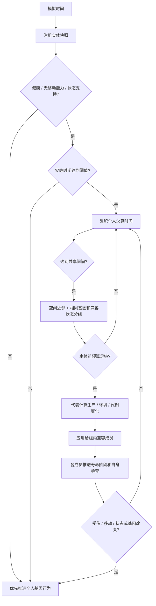

# 实体任务与近邻合并计算

## 任务计划与补给

`EntityTaskPlan` 接管蚁群补给决策；原有分工继续负责采集、运输、巡逻、捕猎和孕育的具体执行。建群途中先到定居点；定居后补给优先于运输和巡逻。孵化中的卵不自行进食。

补给采用两个阈值：沿 `ant_colony.json` 中原有饥饿线开始，默认吃到饱食度 **9.5** 才结束；王后还需恢复繁殖储备并留 **10** 点缓冲。恢复线不会超过实体实际容量。任务保存目标资源 ID，其他能量块更近也不抢占；目标耗尽、被移走导致失效或归属不可用时才重选。暂停补给不释放工匠货物和原运输状态。`AntColonyMember.Activity` 和实际目的地使用同一计划。

`AntColonyMemberSave.plan` 与已有运输、巡逻快照一起保存。旧档无计划时按当下状态建立；失效资源 ID 不阻止加载，下次决策重新寻找。

## 全局调度

`GameBootstrap.Start` 在游戏根节点安装 `EntityWorkScheduler`，执行顺序在种群更新之后、普通实体更新之前。调度器先推进手动控制者，再推进受伤者及其他活跃实体，最后处理静止组。实体原来的 Update 检查当帧调度标记，避免重复执行。

## 分组边界

- 空间哈希查询相邻 27 个格子，只收代表半径内的成员；默认半径 **6**、每组最多 **32**，远处相同基因不会合组。
- 遗传签名比较基因顺序、定义、数值、阶数、启用、复制强度及缺失状态。独立实例 ID 不参与相等判断，也不会被合并。
- 成长阶段、孕育标记、实体状态、体型、营养容量一致；饱食和储备处在各自兼容区间内。默认区间宽 **0.25 / 2**，允许近似代表结算。
- 已受伤、饥饿、承受环境压力、被搬运、寄生、处于卵阶段、有移动能力或手动控制者不进入共享组。
- 当前只共享光合营养及被动/繁殖基因的安全组合。矿物开采、吞食能量块、食腐和其他有有限外部来源的行为继续逐体计算，避免重复领取同一份资源。

`StationaryCohortKernel` 只共享健康/饱食/储备的**变化量**及共同成长速度，按各成员容量夹取；不会复制生命进度、孕育倒计时、伙伴基因或实体身份。每个成员独立过生命阶段、死亡留尸、支付繁殖费用、生成独立后代。受伤和基因重算使成员退出；组内状态变化后，剩余小步改用原个体路径。

这是有边界的近似优化，不能据此宣称不同环境和数值的所有个体都逐位等价。完全一致的健康光合近邻已有逐体数值对照；特殊状态始终走个人路径。

## 部分冻结与时间守恒

静止组默认每 **0.5 模拟秒**结算一次，内部仍采用不超过 **0.1 秒**的小步。冻结个体重复的感知、状态扫描和无效被动回调；生产、代谢、环境、成长、寿命与繁殖保留。预算按最长欠算时间排序，每帧默认处理 **128** 组。

`EntityGeneController.PendingSimulationTime` 随 `EntitySaveState.pendingSimulationTime` 保存，预算不足、拆组、关闭调度或读档不会凭空丢失时间。关闭合并后原 Update 补清欠账；暂停和副本不推进。

## 全局变异

`GlobalMutationManager` 仍只接受出生、成年和老年首次阶段事件；普通帧不额外变异。先处理活跃高优先级实体，再按近邻组序号保留代表和部分成员，默认约 **1/8**；每帧最多 **16** 次抽签。被筛掉的阶段也记录已检查，不在下一帧重抽。变异结果只属于中签个体，不复制给邻居；重算后重新建立遗传签名。

可调项位于 `config/gameplay.json`。全局限额与比例会改变自然变异密度，应与生态数量一起调节。手工编辑基因不受自然阶段抽签预算替代。

## 多胎与能量等级

`MultipleBirthEvolutionUpgrade` 给旧树一次性补充“繁殖基因 → 出错 → 多胎基因”，迁移后尊重用户主动编辑。多胎沿用有性/无性状态，默认有效强度决定 **2～5** 胎；基础单胎保持原逻辑。定义使用 `suppressionOnlyWhileGestating`，不会在未成年时常驻压制成长。

`MultipleBirthPolicy` 在受孕时固定胎数并支付对应预算。普通实体、王后、卵生与卵寄生仍逐后代调用真实出生入口。数量满、宿主或空间不足时保留待出生数量；已经交付的孩子不重生。总数和剩余数随普通繁殖/王后快照保存，坏胎数在清场前拒绝。Unity 把缺省内联对象还原成全零时按旧单胎兼容。

能量块等级由 `EnergyBlockGrades` 根据真实剩余能量派生，`EnergyBlockGradeVisual` 通过逐物体属性块变色。合并库存能升级、吸收后能降级；尸体不套等级，不因颜色补能。阈值可外部编辑 `config/energy_levels.json`，重启生效。

## 小种群繁衍优先

启用原有建群保障时，首批工匠到位、成员达到 `colonySuccessorPopulation`（默认3）后，优先出生繁殖个体，成年后迁出建立新群。后台比例补充和普通繁殖会给王后留 `colonyBirthReservedSlots`（默认2）个真实空位；不突破世界上限，不删除实体，也不限制玩家手动投放。没有成年王后时不保留名额，配置设0可关闭保留。旧世界若关闭建群保障，保留原有分工策略。

预算延期后轮到该组会补算累计时间；`mergeMaximumCatchupSeconds` 默认5秒，限制单次补算工作量，余量继续保存。欠算时间处在不同区间的实体分开调度，避免大量组在高倍率下永久落后。
