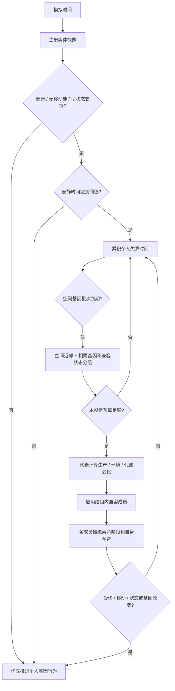
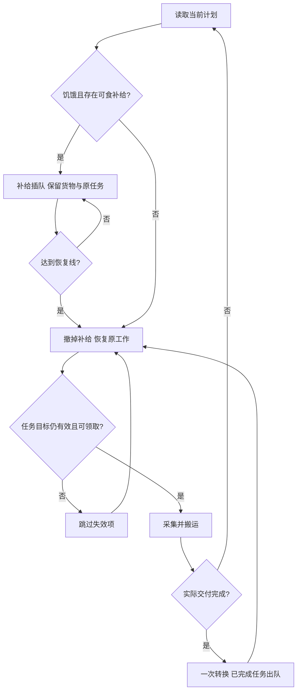

# 性能与坐标

[返回文档目录](../README.md)

按主题汇编原有资料。各章节保留原记录日期与验证范围；历史结论不代表当前版本已重新验证。后续请直接维护相关章节。

## 章节目录

- [世界卡顿优化优先级](#doc-1bbd00cf7ea9)
- [地形升级与性能归属](#doc-16751c7218c5)
- [基因轮次变异与观察坐标优化](#doc-6b01724fe63a)
- [完整场景性能诊断与实体详情](#doc-d6f480e7584e)
- [完整存档卡顿热点修复-2026-11-11](#doc-ead5c6ece425)
- [完整生态热点与活跃回退](#doc-0db240abcbf7)
- [实体任务与近邻合并计算](#doc-b005bf979546)
- [无行动实体渲染与生态规模优化](#doc-70b95d2d8152)
- [活跃实体执行计划与规则列表](#doc-ed052202c36f)
- [矿物上传补给缓存与自然水系](#doc-2302deeb7079)
- [规则模式清尸与天气渲染优化](#doc-e6267b51df27)
- [重力接地共享查询优化](#doc-01af2344bc18)
- [顺序任务与坐标计算优化](#doc-e6da2da7811f)
- [GlobalCoordinateSystem-2026-11-12](#doc-e1c6ddca4210)

---

## 世界卡顿优化优先级

原文档：`Docs/开发设计/世界卡顿优化优先级.md`

> 2026-11-12：新增可归属脚本/方法的自身耗时排行。完整近千活体可见发布版约71.9ms/帧，重力、基因推进、尸体批次、生命结算仍是主要已覆盖范围；未解决全部卡顿，详见[本轮真实采样](../验证记录/性能验证汇编.md#doc-1f84b5fa96c9)。以下历史数据不能与这轮不同负载直接比较。

> 2026-11-10完整负载复查：已细分出维持比例规则约6.5ms/帧，修复后约3.5ms。未稳定复现用户描述的新旧性能倒退，整体仍约38～39ms，见[当前证据与限制](../验证记录/性能验证汇编.md#doc-0807d3bbc9cc)。此前74.3→57.5ms仅为隔离负载。

> 2026-11-09活跃计算补充：已实现执行计划及批内组件复用，四轮交错开关对照平均74.3→57.5ms，基因22.2→16.0ms；仍未稳定60FPS。见[本轮设计](性能与坐标.md#doc-ed052202c36f)与[证据](../验证记录/性能验证汇编.md#doc-b018cd62557c)。

> 2026-11-09重力接地补充：已实施真实三角形共享查询、有效休眠及旋转/速度写入去重。受控场景重力脚本约6.00→3.04ms；见[本轮设计](性能与坐标.md#doc-01af2344bc18)和[验收记录](../验证记录/性能验证汇编.md#doc-4e9124476720)。实际动态物理仍按原频率执行。

> 2026-11-09补充：已取得同存档远近景真实GPU计时，并修复云/大气复制高精度地形代理的问题。暂停远景33.66→17.60ms，运行中的CPU瓶颈仍在；见[本轮渲染与规则验证](../验证记录/功能回归汇编.md#doc-6afe22568f16)。下列旧世界数据仍仅作历史基线。

> 后续顺序任务与计算优化已实施，完整场景顺序对照平均128.7→54.8ms，P95 160.4→73.8ms。见[本轮实施](性能与坐标.md#doc-e6da2da7811f)与[实测和边界](../验证记录/性能验证汇编.md#doc-ca229a2b6380)。下文保留此前基线，不能作为最新耗时。

### 世界卡顿优化优先级

#### 当前结论

本页计时表保留此前`ced98e2`阶段的现场基线。全局变异/观察坐标改造后的当前方案与后续步骤已汇总至[基因轮次变异与观察坐标优化](性能与坐标.md#doc-6b01724fe63a)；观察目标搜索已接入收件箱与粗格，连续行动和物理仍需优化。

当前瓶颈主要是CPU模拟，而非底栏刷新或补给搜索。应优先处理活体的重复行为计算与每物理步的重力/接地检测。上一轮错峰结算缓解了非移动实体的周期峰值，但没有解决混合世界的持续高开销。

输入为2026-11-08 14:36:03（本地时间）保存的世界副本：525活体、2,433资源，其中2,397尸体、32育幼块、4成年补给点；只剩1名有蚁群分工的王后。完整320细分地形，Unity 6000.3.14f1、DX11编辑器、1倍模拟、不锁帧，预热3秒后测10秒。最终复测采样期间517→482活体、2504资源，保留战斗/自然死亡及有限出生空位，因此这是实际现场定位，不是固定数量跑分。

最终复测平均帧耗时126.8ms、P95为155.3ms。此前两轮同存档短测分别为139.8/194.4ms和138.4/168.0ms，和更早不同存档的75ms也不可直接混为同一公平基线。编辑器、后台负载、数量变化和物理补步都会影响绝对数字。本次补给修复未解决整体卡顿。

#### 按优先级安排

|优先级|部分|平均/帧 ms|P95 ms|所属方法与具体动作|
|---|---|---:|---:|---|
|P0|活体基因推进总计|61.198|82.395|`EntityGeneController.AdvanceSimulation`。把决策/搜索与连续时间结算分开；慢帧补算时避免在相同物理位置重复做完整行动决策。保留成长、孕育、营养实际交付时间。|
|P0|其中：行动|27.226|39.128|`LocomotionGeneLogic.OnUpdate / FindTarget / Chase`。优先给目标搜索独立周期，利用现有空间邻域替代逐实体全表候选；同一帧的子步复用只读决策，移动连续推进。需要继续细分搜索/转向/指令，不能断言27ms全来自某一个子方法。|
|P0|重力与接地脚本|24.279|40.700|`PlanetGravity.FixedUpdate / IsUnderWater`、`StationaryBodyRest.TryRest / RemainsAsleep`。核对静止刚体真实休眠比例，缓存生命周期内组件/地形碰撞体，减少重复MeshCollider.Raycast和摩擦/旋转写入。保持落地、击退、搬运、地形变化的唤醒与碰撞。|
|P1|营养生产|10.440|17.851|`NutritionGeneLogic.OnUpdate`、`EcologyEnergyBudget.Produce / IsProducer`。按表达版本缓存生产者资格，批次复用可共享的环境与竞争条件；有限矿产仍按实际来源扣除。|
|P1|邻域快照重建|7.154|14.647|`EntityNeighborhood.Ensure / Refresh / Changed / Competition`。目前按帧重建全局桶，帧内变化又可能触发失效。优先增量更新位置与表达变化，复用静止成员的角色分类；验证出生、死亡、搬运和半径边界。|
|P1|繁殖|4.039|7.938|`ReproductionGeneLogic.OnUpdate / FindMate`、`AntColonyReproduction.Advance`。下一步细分配偶查询、孕育和出生重算；配偶查询可降频，孕育计时与出生仍保持个人身份和预算。|
|P2|真实物理模拟|3.079|4.464|引擎物理。先减少脚本层重复射线与唤醒，再评估碰撞层、静止刚体与碰撞检测模式；不能直接削弱实体接地和攻击判定。|
|P2|垃圾回收|1.084|8.463|检查分配调用栈后再消除热路径临时集合、LINQ、字符串与快照。该轮引擎记录约14.7MB/帧分配，包含编辑器与引擎，不能全部归因于某个游戏方法。|
|P3|种群/分工|0.047|0.089|`AntColonyMember.Advance`。当前只有1名成员，低耗时不能代表大型密集种群；另建100成员场景验证扫描、搬运和队形。|
|P3|补给搜索|0.072|0.146|`ColonyFeeding.Find`、`ColonyFoodSources.Nearest`。本次修复已改为能量块索引，尸体不进入候选。当前现场不是主要CPU耗时，后续验证资源与成员数量乘积。|
|P3|底栏刷新|0.031|0.042|当前实测低，优先保留UI功能与点击正确性；不把数十毫秒的活体负载转嫁为布局重写。|

**上述计时存在包含关系，不能直接相加。** `Scheduler`（平均68.0ms）包含基因推进，`Genes`包含行动/营养/繁殖，邻域重建可能发生在这些调用内部。`Gravity`与`Physics.Simulate`分别代表游戏脚本和引擎模拟，也不可把引擎的`FixedBehaviourUpdate`再加一遍。

#### 慢帧的放大链路

`SimulationClock`交付累计模拟时间，`EntityGeneController.AdvanceSimulation`按约0.1秒拆步。帧变慢后，活跃实体一帧要执行多个完整基因子步；Unity同帧还会补多个FixedUpdate。更多子步又加重下一帧，形成持续低帧率。静止实体的“合并”只覆盖合格的基因结算，不会自动暂停所有刚体或取消移动实体的重复搜索。

采样期间重力约每帧执行数千次，下一步应记录静止/移动/休眠刚体数和每帧物理步数，确认是活跃物体、地形接触还是外部写入导致不能休眠。没有这些计数前，不应把全部成本归因于休眠算法错误。

#### 尸体与绘制

当次约4,500次Draw Call、约800万提交三角形（渲染管线计数，包含额外Pass，不代表单一地形源网格面数）。尸体主体和叉号标记都有独立Renderer，数量大时应评估合批/实例化与距离细节；能量块点光源也应按可见范围控制。保留拾取、生前信息与剩余营养，分别验证显示和交互。

之前独立开关资源Renderer的对照显示约2.7～5.1ms平均收益，说明绘制有成本。当前没有有效GPU耗时证据，不能仅凭Draw Call断言GPU满载；应在真实Windows Player中再次区分CPU、渲染线程与GPU。

#### 后续改动怎样验收

1. 固定同一份只读世界输入、相机、地形、倍率与锁帧档位；数量固定对照与正常生态长跑分开。
2. 每次只改变一个子系统，记录平均、P95、最大帧、调用次数、分配量和实际数量；注明计时包含关系。
3. 优先检查0.0167秒与0.25秒两种交付步长，避免只在高帧率微测量中有效。
4. 验证完整时间守恒、饥饿/繁殖/死亡、碰撞唤醒和UI真实输入；最终必须运行独立Windows Player，编辑器结果只作定位。
5. 通过设置中的性能采样重新导出报告；新增`Locomotion / Neighborhood / Feeding / Formation`子项已接入现有报告，无需改变UI布局。

[本次修复与回归证据](../验证记录/性能验证汇编.md#doc-411012e7c176) · [上一轮尸体/合并对照](../验证记录/性能验证汇编.md#doc-f27ba3061580)

---

## 地形升级与性能归属

原文档：`Docs/开发设计/地形升级与性能归属.md`

### 地形升级、实际网格避海与性能归属

#### 界面生命周期

筛选按钮在附加组件的Awake同步创建，不等另一个Start。筛选只有一个显隐状态，宽屏和窄屏都浮在实体统计上方；排除了旧双布局分支覆盖点击结果的情况。卡片初始收起，按钮58×26。筛选在统计之后布局，规则再在其后布局：规则左边跟随统计右边+10，保持260×164，填补原筛选横向占位。窄屏保留规则入口与浮卡。

#### 可选择的地貌升级

新世界使用LandformSettings.version=2。version=1继续使用原盆地表达、水位和湖面，缺少landforms节点的旧档继续关闭新增地貌。不能在读档或修改温湿度时悄悄提升版本。第二版使用可调的宽盆地遮罩，减小旧平方遮罩让盆地几乎不下切的问题；同水位洼地延展到浅岸，湖面细分并按最终地形裁切，不直接显示方格水面。

显式启用/升级会先SaveNow捕获旧世界完整状态，再复制到该世界backups/terrain-*.json，备份成功后才后台生成。备份含原地形、日期、实体身份、资源和规则；文件夹不会被当成新存档列出。任何备份失败都会阻止本次重建。正式存档在成功应用后写回。该操作会改变岸线，不代表一键恢复原几何；恢复方法见操作指南。

#### 全局坐标与陆地导航

实体候选由EntityCoordinateGrid的全局坐标快照投递。营养寄生和旧寄生寻宿主也复用该路由，并检查陆地连通性。全局LandNavigationGraph在最终网格焊接完成后建立，直接复用RadialTerrainSurface.TrySampleLocal查询真实三角形。A*数组、队列、每帧节点和耗时预算共享，实体只保留路点和游标。

直线路段检查同时考虑海面、河湖水位、坡度和水面宽度采样精度。实际位置与下一缓存路点再次验证；碰撞位移不能将旧路径变成跨湖捷径。惯性与避让后的最终切向速度检查岸线，普通行动额外检查身体两侧。缺少导航数据时AI停止推进，手动控制保持自身输入链路。外力、玩家瞬移和地形重建仍可将实体放入水域，这些不是AI主动选择陆路。

#### 主动性能采样

PerformanceTimings.Measure利用编译器CallerFilePath/CallerMemberName常量，空闲时不创建计时字典/栈或读盘。采样时维护固定深度栈，以同线程真实嵌套范围扣除已计时子调用，得到自身耗时；同时保留原有Area包含耗时兼容旧报告工具。每项记录脚本路径、方法、算法范围、次数、自身/包含平均ms每帧、P95自身、最大自身帧和最大单次调用。脚本排行按同文件各范围自身时间汇总。

报告version=2保留metrics并添加hotspots/scripts；游戏设置页和同目录.md从同一JSON模型显示数据。增加导航队列、路点跟随、岸边检查、宿主搜索、档案聚合、范围图层和存档链路范围。

只有已覆盖主线程范围可归属脚本。没有使用Deep Profile全量追踪所有函数，不把未覆盖代码当成0耗时。引擎、绘制、GPU、等待等保留独立指标；平台无有效计数时显示未提供。包含时间不可直接相加，也不能把父调度和子算法相加宣称CPU总成本。采样本身有开销，不凭排行功能宣称FPS已经修好。

---

## 基因轮次变异与观察坐标优化

原文档：`Docs/开发设计/基因轮次变异与观察坐标优化.md`

### 基因轮次变异与观察坐标优化

#### 本次已实现

##### 全局变异

`GameBootstrap.Start`和实际世界加载确保安装唯一`MutationRoundController`。`GlobalMutationManager`为统一推进入口；原生命阶段入口只保留存档阶段标记，不再额外变异，也消除阶段回调内外的重复重算。

每轮先记录活体总数、计算向上取整名额，再对可变异候选做部分Fisher–Yates抽样，生成唯一身份队列。每帧限额只决定队列分摊，不丢弃超过预算的成员；开始下一轮前先完成当前队列。选中者继续走`GeneMutator`及重算/唤醒，环境偏置不改变总抽样人数。冻结角色与孵化卵保护仍有效。队列记录持久化ID，不持有已死亡对象。

`WorldSaveData.mutationRounds`保存计时、轮次、尝试/成功计数、名额及剩余名单。加载前校验版本、有限时间、计数与重复身份；实体身份恢复后才恢复队列。旧档缺字段视为新计时。世界之间不继承队列；暂停、关闭开关、加载及联机副本不自行推进。

全局配置是`mutationRoundsEnabled`、`mutationPopulationFraction`（默认0.1）、`mutationRoundSeconds`（默认30），每帧预算沿用`mutationAttemptsPerFrame`（16）。规则卡与外部文件共用校验；规则写盘只编辑三个字段，按原字符位置保留注释，临时文件校验后原子替换。

##### 坐标与信息路由

`EntityNeighborhood`继续持有唯一的活体坐标记录。原来的营养竞争小格不适合大视野：常见大视野会因空格数量而退回全记录距离扫描。因此新建`EntityCoordinateGrid`，复用同一份坐标快照，用默认64单位的粗格路由视野信息。坐标、存活和成员版本独立于表型/营养竞争版本；没有坐标变化时跨帧复用粗格，常规视野只查询附近粗格。超过4096格的极大视野才改扫紧凑坐标记录，避免空格枚举失控。

`EntityPerceptionHub`为每个实际查询者维护复用的收件箱，按观察基因范围和周期接收坐标。每次基因子步不再扫描全体Transform或重新分配候选列表；同帧重复查询共用收件箱。范围状态追踪上次采样坐标，注意状态对已知目标读最新共享坐标；即时资格检查仍阻止死亡、隐藏寄生、出视野目标。受击事件可以单独通知可见攻击者，不等待下一次整片视野搜索。

接入范围为行动猎食、士兵巡猎、自动群猎、状态感知/捕猎、自动警戒和反击。近战真正命中仍使用实际碰撞体距离。明确玩家指令保留原语义；配偶查询、工匠采集和尸体资源搜索仍沿各自现有规则，不能据此宣称所有搜索都已改造。

视野按既有三维距离和隐藏资格判定，未增加逐目标地形遮挡射线。旧实体缺观察基因时沿用原感知；新基因存在但禁用时范围为0。观察基因是独立根，纯被动逻辑仍可进入静止合并核。树迁移只补缺失定义/节点，不重写已有个体DNA或冻结快照。

本表保留上一轮规划；后续实施状态见[顺序任务与坐标计算优化](性能与坐标.md#doc-e6da2da7811f)。

#### 其他计算：当前方案与具体下一步

下面“待实现”是建议，不代表这次已经改动。计时项含嵌套关系，不能相加。

|部分|当前实现|本次状态|具体优化步骤|必须验证|
|---|---|---|---|---|
|行动决策与连续移动|基因按约0.1秒小步推进，指令/追击转向仍每子步执行|已替换全表实体搜索；决策节奏保留|将搜索/决策设独立0.1～0.5秒节奏，物理步只执行缓存方向；受击、目标失效和命令变化立即打断。不要在同一物理位置重复多次完整决策|低帧和高倍率下位置、攻击冷却、补给优先与实际交付时间|
|坐标刷新与生产者分类|共享邻域每帧核对全体位置并读取生产者资格；粗格仅坐标版本变化重建|坐标路由已实现；基础快照保留|下一步将静止位置/生产者分类按逻辑版本缓存，移动/搬运/生命变化更新脏集合；位置版本和表型版本继续分开|出生、死亡、传送、搬运、寄生、孵化与同帧查询无幽灵对象|
|基因表达重算|每次有效变异、阶段、孕育、角色/环境变化会重算个体|阶段重复重算已减少|缓存纯表达计算：键含完整基因值/重数/缺失状态、阶段/孕育、环境与角色抑制；个体属性和可变逻辑实例独立。合并同帧重复失效请求，必须即时生效的攻击/角色变更优先|完全相同输入结果一致，受伤/孕育/角色不同不能串用，实例ID与存档独立|
|静止实体合并|同空间、相同基因与兼容状态才共享；孤立组按错峰降频补算|保留前次修复|用真实共享次数识别单成员组；单成员采用安全的低频基础结算，按行为副作用划分共享核，而非放宽遗传签名掩盖差异|寿命+欠账守恒、容量阈值、繁殖费用、阶段拆组、受伤唤醒|
|重力/接地|动态刚体每FixedUpdate施力、修改摩擦/旋转并检测地形；合格静止体可休眠|待实现，仍是优先项|先采集静止/移动/休眠数和每帧物理步；缓存组件与地形碰撞体，已确认接地的静止体停止重复射线/写速度，事件唤醒。分别测试降低非移动检测频率|出生落地、山坡、击退、地形重建、星球移动、获得行动、搬运恢复|
|营养生产与竞争|每生产小步查主表达/生产资格，竞争半径查询共享邻域|未改变收支语义|按表达版本缓存生产资格；局部成员/位置变化只失效相关竞争格；同一安全组复用竞争系数，有限矿产仍逐来源扣除|密集/稀疏、边界移动、死亡/变异后密度、源能量与实际吸收守恒|
|配偶查询与繁殖|孕育逐个保留，找伴侣仍走范围碰撞查询|待实现|配偶候选可接入坐标网格，按性别/状态/同群/营养建立轻量资格；独立查询间隔，伙伴失效立即撤销；先明确配偶是否受观察视野限制|基因混合、伙伴死亡、孤雌等待、多胎余量、数量上限和读档|
|工匠采集/尸体/补给|补给已有独立能量块索引；运输仍按活动圆和配置感知扫描资源/活植株|保留已修复补给|为资源另建空间索引，按世界变更更新；采集先查附近格，再执行活动圆/归属/领取检查，复用活动圆快照。生物采集是否用观察基因需独立规则|不抢活群/独占资源，不遗失货物，球面资格和原距离排序，高度差/边界|
|种群与队形|组身份索引已缓存，部分队形/命令仍重复枚举并排序同群成员|待实现|按组版本缓存稳定站位序号、领袖、光环与活动圆；邻域变化只更新局部避让；命令广播一次、成员读版本|王后更替、迁居、死亡/加入、同群免伤与补给抢占|
|感知失效与订阅|注销时清理相关收件箱；范围状态使用定时信息缓存|基础失效已实现|高密度再加“目标→观察者”反向订阅，仅通知真正订阅者；为大视野设可调信息/查询预算并记录丢弃统计|死亡/隐藏/脱离视野及时撤销，不能永久持有上局对象；关注信息预算对行为的影响|
|临时分配与回收|持续记录引擎分配和GC，部分LINQ/字符串/评估集合仍存在|待实现|用分配调用栈确认来源；优先复用候选、排序和表达缓冲，规则/统计文本按变化刷新；区分编辑器分配与Player|跨世界缓存释放，重算不修改正在遍历的集合，长期内存与P95|
|尸体/实体绘制与灯光|大量独立Renderer，尸体与叉号分开；能量块可有点光源|待实现|按网格/材质/显示等级实例化或分块批次，按距离控制细节与灯光，逻辑身份和拾取独立；先采真实GPU/渲染线程|颜色、半透明种群层、阴影、拾取/尸体档案与营养保存|
|统计与UI|原统计约0.5秒刷新，底栏主体不是主要CPU耗时|已增加同尺寸规则卡|继续按数据版本更新文本，稳定Rect不重复标脏；大型列表分页/复用行，保留原布局和输入恢复|窄屏、第一页/第二页、只读、输入焦点、实际射线点击和读档回调|

#### 优化顺序与测量

先改行动决策/重力，接着营养分类与表达重算，再做配偶/运输/队形、分配与渲染。每次固定同一只读输入、相机、地形和倍率，并对比平均、P95、调用次数、候选访问与实际数量。随机变异会改变基因与生态，性能对照时关闭轮次以隔离其他因素；变异本身单独开启验证。

新增`Perception`和`MutationRounds`计时，配合`Locomotion`、`Neighborhood`区分实际信息刷新、网格与行为成本。没有测量不能将“改成管理器”当成提帧证据。完整场景采样及原生回归见[验证记录](../验证记录/功能回归汇编.md#doc-f1804d76eedf)。

---

## 完整场景性能诊断与实体详情

原文档：`Docs/开发设计/完整场景性能诊断与实体详情.md`

### 完整场景性能诊断与实体详情

#### 性能定位边界

本次使用2026年11月8日02:55保存的独立副本：385个存活实体、1922个资源，保留原320细分地形、镜头与2560×1496测试分辨率。此前208个实体的旧副本不能解释最新现场。本地单人仍由主线程顺序执行脚本，长任务会拖延后续输入处理；这里实际发现的主要长任务是工匠/临时采集王后的资源搜索。

`AntColonyWorker.Advance`旧谓词对每具候选尸体调用`ColonyActivityRange.Contains(population, position)`，后者每次再次遍历全部资源生成王后/补给圆。资源约1900时，嵌套扫描达到平方级，生成重复圆和ID字符串。最新现场中仅3名生效种群成员便让任务耗时平均约38.5 ms、P95约194.5 ms；物理模拟不是本次主瓶颈。

修复在每次同步搜索开始时生成一次活动圆列表；候选先按原球面搜索距离排除，再使用此列表判定。保留原本按位置平方距离挑最近目标的顺序、归属、领取独占和供给点含义。没有跨帧缓存活动范围，资源耗尽、王后移动或新补给会在下一次查询使用当前数据。不能用带高度差的弦长代替原球面资格，因此另有不同高度尸体用例。

#### 可复用分项采样

`PerformanceTimings`仅在主动采样时启动Stopwatch，普通运行不写逐帧日志。`PerformanceSampleSession`预分配缓冲，采样结束再排序和序列化；记录调度、基因、营养、繁殖、种群任务、地表约束、重力、底栏等实际入口，附带引擎物理、绘制、GC和主线程计数。游戏计时属于包含关系，不能把父子指标相加。引擎指标不可用时明确标记available=false；编辑器主线程和GC计数可能包含编辑器工作，不能当成纯Player成本。

设置中的请求在返回世界后执行，输出至日志目录下performance文件夹并保留最近5份。暂停、锁帧等待、分辨率、活体与资源数量都应连同报告理解；需要GPU归因时仍应使用相应图形工具，不能把GPU未知值记作零成本。

#### 帧率设置

`frame_pacing.json`配置默认60和可选档位。`FramePacingSettings`在画质恢复之后应用，修改即时生效，保存写入PlayerPrefs，下一次启动恢复。桌面端VSync会优先于targetFrameRate，所以锁帧入口统一关闭VSync；不限制档用-1传给引擎。锁帧是上限，不能补足性能不足的帧，也不修改SimulationClock倍率或直接丢弃模拟时间。[Unity帧率控制说明](https://docs.unity.com/en-us/engine/6000.0/script-reference/unityengine/qualitysettings/vsynccount)

#### 基因和实体详情

`GeneValueResolver`只额外记录环境/角色抑制数值，不改变生效阈值和属性公式。`GeneFailureReasons`按实际有效值解释禁用、原始值不足、环境、分工、基因间抑制及缺失状态。被禁用的基因只在检查列表中补只读表达条目，运行求值和逻辑挂载仍沿原路径。

活体摘要标题的空白区域提供独立编辑弹窗，原GenePanel尺寸、摘要列、基因行和ScrollRect保持原样。阶段编辑使用真实生命周期进度，不额外抽变异、不重置孕育或身份；退回幼年先释放运输货物及领取。生命、饱食度、储存营养走白名单和容量校验；生命归零走原死亡结算。联机请求复用LanEditActions/服务端权限检查，普通成员只能查看。

尸体通过GeneInspectorUI.Corpse适配同一个GenePanel。新死亡记录只保存展示需要的基因、阶段、数值及抑制来源，不复制伙伴、宿主或整套繁殖状态，不创建隐藏的模拟实体。旧档缺少生前信息时明确显示“旧存档未记录”。CorpseEntityRecord使用版本标记区分旧档全零内联对象与损坏的新档案；校验发生在清场前。

---

## 完整存档卡顿热点修复-2026-11-11

原文档：`Docs/开发设计/完整存档卡顿热点修复-2026-11-11.md`

### 完整存档卡顿热点修复

#### 输入与定位

本轮以玩家 2026-11-11 09:32:33 的性能报告和随后同一世界的快照复现。快照包含 996 个存活实体和 6877 个资源，其中 6249 具尸体；复测预热后通常为 998 个实体、约 6890 个资源。保留自然繁殖、营养、死亡、变异和真实物理，以 DX12、2560×1385、1 倍速、原报告镜头采样 8 秒。性能小项是包含关系，禁止相加作为总帧耗时。

主要问题不是一次全局变异。该现场报告中全局变异平均约 0.0005ms，自动投放为 0；CPU 明显高于 GPU。实际热点为重力/接地在卡顿后的多轮物理补算、活体行动和种群补给，以及数千具尸体的逐对象绘制。出生还存在整世界平方身份查找和大型地形射线尖峰。

#### 改动与边界

| 链路 | 原实现问题 | 本轮实现 | 正确性约束 |
| --- | --- | --- | --- |
| 新生身份 | 每胎复制旧注册表，再逐项 Contains，形成平方查找 | `EntitySpawnCapture` 同步注册事件直接捕获，finally 解除订阅 | 沿用原生成委托、工厂和出生顺序；异常不能泄漏订阅 |
| 出生/生态落点 | 大型碰撞网格径向射线 | 已支持的生成地形直接定位真实三角形；其他地形继续射线 | 不使用近似噪声高度，不跳过真实出生位置约束 |
| 接地 | 配置 0.2 秒，但实际上仅同一个 FixedUpdate 命中缓存 | `GroundSurfacePatch` 缓存真实三角形平面，重投影当前径向点 | 跨三角形、位移/竖直速度过大、星球/网格/水位/碰撞体变化立即失效 |
| 重力资格 | 每轮物理步重复完整移动属性修饰 | 同帧、同表达版本复用移动资格；零基础值提前结束乘法链 | 只用于物理移动资格；真实 AI 速度仍走原属性入口 |
| 补给决策 | 多个入口重复饥饿判断和任务插队 | 同帧属性/表达/角色/卵/计划版本缓存 | 真正吃饱、改容量、变更基因或计划立即重算；不缓存实际扣粮量 |
| 食物候选 | 每人检查所有群的专用食物 | 同群 + 通用块 + 附近无主块的坐标索引 | 保留育幼/成年用途、王后保留量、共享开关、近食优先及可达性 |
| 资源距离 | 对每个候选重复读星球 Transform、归一化两个向量；大量空桶查询 | 单次查询共用球心/方向；桶数量超过该类别资源数时直接扫描该小类别 | 与原三维距离/球面弧距逐对象对照；无穷半径明确全类扫描 |
| 自转索引 | 世界矩阵发生刚性姿态变化时会整体重建资源桶；正式场景没有启用 PlanetRotator，本现场不能把自转列为主因 | 桶保存随星球旋转的刚性坐标；姿态版本只刷新世界位置读出 | 搬运/归属更新单资源，缩放/形变/半径/格尺寸变化整体重建；活动圆和食物分组读最新姿态 |
| 尸体显示 | 球体、叉号逐 Renderer 提交，MPB 阻碍自动批处理 | `CorpseInstanceRenderer` 按网格/色板/空间格使用 RenderMeshInstanced；局部矩阵常驻，移动只更新自身实例槽/跨格交换槽，仅提交可见格 | 原对象、营养、身份、点选、运输、存档保留；关闭或不支持实例化时恢复原 Renderer |
| 编辑器分配 | 正常缺失的 GetComponent 高频产生诊断字符串 | 即时 TryGetComponent 的 OptionalComponent 包装 | 不跨帧缓存“不存在”，安装/移除仍实时可见 |
| 代谢 | 重复字典读取；静止个体也走完整刚体/移动链；满血查询修复属性 | 属性修改一次读取旧值和上限；零基础行动/满血修复提前判定 | 不改变扣粮/修复步长、阈值和营养守恒 |

尸体批次保留每种颜色的独立共享色板，不改原材质。内置 Lit/Unlit 材质保留实例化变体，避免编辑器可见而发布版被裁剪。每批默认 256 个、最大 511 个；这考虑到实例化同时上传对象和逆矩阵的容量限制，见 [Unity 6000.3 官方 API](https://docs.unity.com/en-us/engine/6000.3/script-reference/unityengine/graphics/rendermeshinstanced)。绘制前保守检查空间格的视锥和星球遮挡，绝不按单对象可见性删除真实资源。

尸体批次还修复了早期实现的全量脏标记：一具尸体被搬运时不再遍历重写全部实例，只更新该对象及交换删除涉及的槽，空间格包围盒保守扩展。

#### 诊断可见性

报告新增 GroundQuery、FoodCandidates、FeedDecision、CorpseBatches，并把 Vitals 计时放到所有普通/共享代谢的实际入口，修正原先普通 Update 代谢漏报。context 增加食物命中/搜索次数、真实三角形重取/跨物理步复用次数、资源索引整体重建次数、实际实例槽写入次数和尸体实例/批次数。

计数代表不同工作，不能把 Gravity 调用次数误作射线次数，也不能把尸体逻辑实例总数误作镜头实际可见数量。尸体注册及实例数仍包含背面/镜头外资源，显示提交按镜头裁剪。

#### 配置与未改规则

新增/使用的配置见[操作指南](../操作指南/配置与诊断.md#doc-a8f6f718d89b)。本轮没有清除玩家尸体、减少人口上限、停用自然生态或缩减变异抽样来换帧率；保留用户选择的 10% 抽样和当前周期。基准存档没有写回玩家 Saves。

仍需用实测评价剩余的活跃行为、代谢、物理轮次和正常实体渲染；任何数倍改善都不等同于已达到稳定 60FPS。最终实测与兼容结果见[验证记录](../验证记录/性能验证汇编.md#doc-ce4e418702a1)。

---

## 完整生态热点与活跃回退

原文档：`Docs/开发设计/完整生态热点与活跃回退.md`

### 完整生态热点与活跃回退

#### 本次纠偏

上轮只用关闭生命、环境、维持规则和出生的隔离场景判断收益，不足以覆盖真实运行。新增LiveSimulationAudit用只读世界、正常生态、实际模拟时间与起止实体数复测，并支持日志里记录的DX12和视口尺寸。结果与用户现场未完全吻合，应明确承认未稳定复现，不能沿用隔离跑分作现场保证。

#### 热路径修复

ActiveSimulationBatch.Read先按普通引用检查是否属于当前批；批次外直接原生查询，不再增加计数或读取优化配置。ComponentReads现在只表示实际进入复用检查的查询，不能与此前包含批次外查询的分母直接相比。

EntityGeneController仅在组件复用开启时建立对应批次。双开关关闭时直接遍历原逻辑快照，ActiveSimulationPlan.Run的公共入口同样绕过Prepare，不能让关闭功能仍支付建表成本。保持生命、状态、攻击和孕育结算顺序。

比例规则复用ProducerClassification，缓存只保存遗传/表达资格；版本、评估引用和配置引用变化都撤销缓存，孵化与动态移动条件仍实时判断。注销时无论是否进入EntityNeighborhood快照都清理分类，避免提前查询留下强引用。新EcologyMobility仅省略基础值零的乘法修饰链，不冻结有实际行动能力的个体。

EntityStats停用时不启动受击协程，避免同帧死亡后剩余扣血写入错误日志；不取消实际伤害。

#### 如何继续现场对照

安装目录`config/simulation_optimization.json`支持约2秒热载入。activeExecutionPlan、activeComponentReuse均设false为关闭本轮活跃优化；保存后执行顺序与维护成本都回到直接路径。只关闭组件复用可分别定位；默认保留true，因为本次正常DX12对照单独关闭略慢。不要以改营养、暂停世界或减少实体数量掩盖卡顿。

若仍出现骤降，用设置→日志与诊断→采样游戏性能，在最卡的操作下完成采样，并保留当时是正常运行、操控/拉近还是加载/切窗。新增细分项可区分比例维护、配偶搜索、坐标路由与实际出生。

[完整对照与限制](../验证记录/性能验证汇编.md#doc-0807d3bbc9cc)

---

## 实体任务与近邻合并计算

原文档：`Docs/开发设计/实体任务与近邻合并计算.md`

### 实体任务与近邻合并计算

#### 任务计划与补给

`EntityTaskPlan` 接管蚁群补给决策；原有分工继续负责采集、运输、巡逻、捕猎和孕育的具体执行。建群途中先到定居点；定居后补给优先于运输和巡逻。孵化中的卵不自行进食。

补给采用两个阈值：沿 `ant_colony.json` 中原有饥饿线开始，默认吃到饱食度 **9.5** 才结束；王后还需恢复繁殖储备并留 **10** 点缓冲。恢复线不会超过实体实际容量。任务保存目标资源 ID，其他能量块更近也不抢占；目标耗尽、被移走导致失效或归属不可用时才重选。暂停补给不释放工匠货物和原运输状态。`AntColonyMember.Activity` 和实际目的地使用同一计划。

`AntColonyMemberSave.plan` 与已有运输、巡逻快照一起保存。旧档无计划时按当下状态建立；失效资源 ID 不阻止加载，下次决策重新寻找。

#### 全局调度

`GameBootstrap.Start` 在游戏根节点安装 `EntityWorkScheduler`，执行顺序在种群更新之后、普通实体更新之前。调度器先推进手动控制者，再推进受伤者及其他活跃实体，最后处理静止组。实体原来的 Update 检查当帧调度标记，避免重复执行。

#### 分组边界

- 空间哈希查询相邻 27 个格子，只收代表半径内的成员；默认半径 **6**、每组最多 **32**，远处相同基因不会合组。
- 遗传签名比较基因顺序、定义、数值、阶数、启用、复制强度及缺失状态。独立实例 ID 不参与相等判断，也不会被合并。
- 成长阶段、孕育标记、实体状态、体型、营养容量一致；饱食和储备处在各自兼容区间内。默认区间宽 **0.25 / 2**，允许近似代表结算。
- 已受伤、饥饿、承受环境压力、被搬运、寄生、处于卵阶段、有移动能力或手动控制者不进入共享组。
- 当前只共享光合营养及被动/繁殖基因的安全组合。矿物开采、吞食能量块、食腐和其他有有限外部来源的行为继续逐体计算，避免重复领取同一份资源。

`StationaryCohortKernel` 只共享健康/饱食/储备的**变化量**及共同成长速度，按各成员容量夹取；不会复制生命进度、孕育倒计时、伙伴基因或实体身份。每个成员独立过生命阶段、死亡留尸、支付繁殖费用、生成独立后代。受伤和基因重算使成员退出；组内状态变化后，剩余小步改用原个体路径。

这是有边界的近似优化，不能据此宣称不同环境和数值的所有个体都逐位等价。完全一致的健康光合近邻已有逐体数值对照；特殊状态始终走个人路径。

#### 部分冻结与时间守恒

静止组默认每 **0.5 模拟秒**结算一次，内部采用约 **0.1 秒**的小步。小于1微秒的浮点尾差并入最后一步，不额外遍历全部行为，也不丢弃时间。冻结个体重复的感知、状态扫描和无效被动回调；生产、代谢、环境、成长、寿命与繁殖保留。预算按最长欠算时间排序，每帧默认处理 **128** 组。

`EntityGeneController.PendingSimulationTime` 随 `EntitySaveState.pendingSimulationTime` 保存，预算不足、拆组、关闭调度或读档不会凭空丢失时间。关闭合并后原 Update 补清欠账；暂停和副本不推进。

#### 全局变异

自然变异已改为统一定时轮次，默认每30模拟秒按全部活体10%抽取无重复身份，分帧完成并保存剩余名单。出生、成年和老年继续登记阶段并更新属性，阶段本身不再额外抽签；旧近邻序号比例仅保留配置兼容。工匠等锁定角色和孵化卵排除，候选不足时减少本轮实际数量。每个实体的变异独立，不复制给邻居。

第一页“规则控制”卡可修改开关、比例和周期。细节及其他计算的当前/优化方案见[基因轮次变异与观察坐标优化](性能与坐标.md#doc-6b01724fe63a)。

#### 多胎与能量等级

`MultipleBirthEvolutionUpgrade` 给旧树一次性补充“繁殖基因 → 出错 → 多胎基因”，迁移后尊重用户主动编辑。多胎沿用有性/无性状态，默认有效强度决定 **2～5** 胎；基础单胎保持原逻辑。定义使用 `suppressionOnlyWhileGestating`，不会在未成年时常驻压制成长。

`MultipleBirthPolicy` 在受孕时固定胎数并支付对应预算。普通实体、王后、卵生与卵寄生仍逐后代调用真实出生入口。数量满、宿主或空间不足时保留待出生数量；已经交付的孩子不重生。总数和剩余数随普通繁殖/王后快照保存，坏胎数在清场前拒绝。Unity 把缺省内联对象还原成全零时按旧单胎兼容。

能量块等级由 `EnergyBlockGrades` 根据真实剩余能量派生，`EnergyBlockGradeVisual` 通过逐物体属性块变色。合并库存能升级、吸收后能降级；尸体不套等级，不因颜色补能。阈值可外部编辑 `config/energy_levels.json`，重启生效。

#### 小种群繁衍优先

启用原有建群保障时，首批工匠到位、成员达到 `colonySuccessorPopulation`（默认3）后，优先出生繁殖个体，成年后迁出建立新群。后台比例补充和普通繁殖会给王后留 `colonyBirthReservedSlots`（默认2）个真实空位；不突破世界上限，不删除实体，也不限制玩家手动投放。没有成年王后时不保留名额，配置设0可关闭保留。旧世界若关闭建群保障，保留原有分工策略。

预算延期后轮到该组会补算累计时间；`mergeMaximumCatchupSeconds` 默认5秒，限制单次补算工作量，余量继续保存。欠算时间处在不同区间的实体分开调度，避免大量组在高倍率下永久落后。

#### 错峰与真实共享审计（2026-11-08）

`DormantMembers`只表示进入静止降频的实体数量。只有`RepresentativeSteps`和`SharedMemberSteps`增加才表示实际共享了基础计算。不同遗传数值、阶段、孕育、容量或空间位置仍会产生孤立组；不能把所有非移动实体的总数当作共享成功数。尸体属于`ColonyResource`，不在活体基因调度表中，也不参与此合并算法。

默认`mergeStaggerBatches=true`、`mergePhaseBuckets=16`。`CohortDeadline`对空间格与签名确定间隔内的相位；同格同基因保留同时结算机会，其他批次错开。跨格近邻可能在不同帧到期，因此实际共享量仍必须实测。每批照旧按最长欠账优先、受组预算和单次补算上限约束。只有实际执行的批次才推进截止时间，超预算者继续到期等待。第一批可以只结算部分间隔，后续维持正常间隔；总模拟时间以各实体已结算量加保存欠账为准。

相位时钟只累计实际交付的模拟时间，暂停和联机副本不推进。截止时间是可重建的调度数据，不改变存档格式；营养、生命周期和`pendingSimulationTime`仍分别保存。热更间隔、半径、批次数或开关后重建截止时间，已有欠账保留。关闭合并继续走完整补算路径。

[实测对照及验证边界](../验证记录/性能验证汇编.md#doc-f27ba3061580)。

#### 有粮不吃与能量块索引（2026-11-08）

补给优先级为120，高于迁居110。`AntColonyMember.Destination`先检查补给，再恢复持久化建群点；`Advance`在迁居分支也保持一致。吃饱不会丢失建群坐标或运输货物。

`ColonyFeeding.Find`先使用有效且已在进食半径内的锁定源；否则查身边可吃的块，再保留非危急的远处锁定计划；饱食低于`colonyEmergencyFeedThreshold`（默认3）时可以改选最近可吃块。选择新的远处来源以距离优先，同一进食范围内保留专用类别优先。附近实际能吃的资源不能被旧远目标的早退挡住。`ColonyFoodSources`只索引育幼、成年与通用能量块，尸体不进入候选。Create、OnEnable、OnDisable和ClearWorld成对维护索引，读档仍通过统一Create恢复。

`colonyShareBackupFood`默认true。专用类别保留优先级，通用块同等可用；没有专用源或身边已有备用源时允许跨类别进食。`ColonyResourceOwnership`继续保护存活外群，实际吸收时才领取废弃块；借用育幼块的成年成员与幼体一样，给饥饿王后保留最低口粮。关闭全局开关可恢复严格类别。无需营养基因处于生产状态即可沿既有群体补给入口进食，但这不赋予普通非蚁群实体新的吸收基因。

进食容量直接查询饱食/储备空位，不再构造整份存档属性列表。新增性能子项覆盖行动、邻域实际重建、补给和队形；它们有包含关系，解释方法见[世界卡顿优化优先级](性能与坐标.md#doc-1bbd00cf7ea9)。

---

## 无行动实体渲染与生态规模优化

原文档：`Docs/开发设计/无行动实体渲染与生态规模优化.md`

### 无行动实体渲染与生态规模优化方案

日期：2026-11-01。对应 Unity 6000.3.14f1 / URP 项目。

当前已接入正式游戏：帧共享空间索引/生产者资格缓存、主行为缓存、繁殖失败日志汇总、未受击实体共享材质、移除闲置泳光、接触地表后的安全休眠，以及保留待算时间的单帧补算上限。统计卡片现位于第一页，管理卡260×164逻辑单位、成员只读高度136。分级网格/GPU实例化、逻辑数据仓库和统一批处理调度仍是后续设计；2000～10000规模与60 FPS是验收目标，尚未达成。

当前实现与实测见[静止实体性能优化验证](../验证记录/性能验证汇编.md#doc-77fc8f2ad65f)。

#### 1. 问题定位

优化前无行动实体走完整实体链路，下表保留原定位依据：

| 代码位置 | 当前开销 | 处理方向 |
| --- | --- | --- |
| `EcologyEnergyBudget.Competition` | 每个生产者遍历整个 `EntityRegistry`，反复查询邻居属性 | 空间分区、生产者信息缓存、邻域结果按事件失效 |
| `EcologyReproductionTiming.FoodPressure`、捕猎/配偶搜索 | 局部问题通过全体扫描解决 | 共用分层邻域查询 |
| `EntityGeneController.AdvanceSimulation` | 每个实体逐帧执行，16× 或长帧会拆出更多小步 | 统一调度、分帧预算、稳定条件下批量推进 |
| `PlanetGravity` / `EntitySurfaceAnchor` | 静止实体仍持有刚体、逐物理帧检查地表 | 落地锚定、按需物理代理 |
| `EntityStats.Start` | 读取 `Renderer.material/materials` 创建独立材质实例 | 共享材质、实例属性保存颜色及受伤闪烁 |
| `PlanetGravity.Start` | 每个实体创建独立物理材质和默认关闭的水中点光源 | 物理材质共享、灯光按需池化 |
| `ReproductionGeneLogic` | 每实体每 5 个模拟秒打印繁殖失败日志 | 默认关闭逐个调试输出，按原因汇总；保留错误与主动诊断 |
| `LanWorldSnapshot.Frame` | 联机时每 0.25 秒捕获全部实体与基因 | 静态实体增量同步、移动实体高频同步 |

材质和灯光组件数量只能说明资源结构问题，不等同于已经证明 GPU 是主瓶颈；默认关闭的灯光并不会全部参与照明。联机全量快照也不是单人卡顿的直接原因。

##### 隔离实测

对现有默认四基因无行动实体，比较一轮“为全体计算资源竞争”的耗时。诊断时暂停生态、关闭夹具碰撞与显示，排除其他模块干扰；先预热原路径，计时一次完整轮次。原型缓存静止位置/生产者资格，用半径对应的三维网格查邻域，并逐实体对比原结果。

| 实体数量 / 分布 | 原查询 ms | 原型建索引 ms | 原型查询 ms | 建立及查询合计 ms |
| --- | ---: | ---: | ---: | ---: |
| 200 / 球面分散 | 7.005 | 2.632 | 0.285 | 2.917 |
| 400 / 球面分散 | 31.593 | 1.801 | 0.337 | 2.138 |
| 800 / 球面分散 | 164.308 | 3.742 | 0.675 | 4.417 |
| 1600 / 球面分散 | 667.059 | 7.138 | 1.450 | 8.588 |
| 200 / 密集 | 111.723 | 0.566 | 0.630 | 1.196 |
| 400 / 密集 | 475.610 | 1.136 | 2.306 | 3.442 |

全部竞争结果一致。每档检查到每实体一个独立材质实例、一个水中灯光组件，当前球体模型每个 768 个三角形。

这些是本机编辑器中的查询路径单次诊断，不是整局 FPS、GPU 测试或正式版性能保证。分区与缓存共同产生收益；密集场景仅靠网格仍会退化，应继续缓存局部竞争计数。原始 CSV、原型源码及结果位于 `Artifacts/StationaryEcologyReview`。

#### 2. 实体数据、生态与显示分离

每个实体始终保存独立 ID、基因、年龄、营养、生命、孕育/冷却、所属群和锚点。渲染层根据可见程度选择外观；镜头外实体继续参与生态。

先为稳定扎根的普通生产者走低开销路径。资格依据有效表达和实际行动能力，包含继承而来的行动能力，不能只检查基因名称是否为 `gene_locomotion`。王后、幼卵、玩家操控、搬运、寄生、击退/下落等特殊状态先保留现有路径；暂时被抑制的移动实体设置稳定期和切换滞后。

第一阶段保留 `DarwinEntity` 及现有 ID 接口，只把显示、物理和更新入口拆开，降低对捕猎、工匠运输、面板和存档的影响。用明确的“调度所有权”避免原 `Update` 和新调度器重复结算，不能直接停用整个对象而让它从注册表消失。

第二阶段再建立数据仓库与 `EntityHandle`，远处个体保留紧凑数据，附近按需借出对象池代理。统计、捕猎、运输、RTS、联机和存档统一按逻辑 ID 访问数据，数量由逻辑仓库统计。

#### 3. 无行动实体的渲染规则

分级以屏幕投影尺寸为主，兼顾交互距离；阈值进入配置文件，可在实测后调整。

| 等级 | 初始触发参考 | 显示方式 | 交互与物理 |
| --- | --- | --- | --- |
| 近景 | 投影直径 ≥20 px，或被选中/操控/交互 | 低面数完整外观、基因颜色、必要的受伤反馈 | 按需创建真实碰撞代理 |
| 中景 | 约4～20 px | 共享网格与材质，GPU 实例化；简化叶簇/球体外观 | 从空间索引查询目标，靠近交互时提升代理 |
| 远景 | 约1～4 px | 极低面数实例或不透明/裁剪式公告板，关闭远处阴影和额外灯光 | 保留数据与生态，无常驻动态刚体 |
| 超远/背面 | 小于1 px或被星球遮住 | 不提交逐个网格；整球观察可用独立植被密度图层 | 照常模拟，筛选与全地图数量包含这些实体 |

附加规则：

- 先做视锥剔除，再做保守的球面背面剔除；地平线保留山体高度余量，防止提前消失。
- 按“空间块 + 网格 + 材质 + LOD”分批。每批初始容量256，使用持久缓冲，数据变更时才更新对应区间，避免每帧创建矩阵数组或遍历所有对象上传。
- 使用专用 URP 实例化着色器保存每实例颜色/生命阶段/受伤参数；材质不通过 `.material` getter 复制。既有移动实体及星球继续使用自身合适的渲染路径。
- 保留项目全局 SRP Batcher，静止层显式采用 `Graphics.RenderMeshInstanced`；是否更快由 Frame Debugger / Profiler 验证。[Unity 6000.3 的建议](https://docs.unity.com/en-us/engine/6000.3/manual/analysis/graphics-performance-profiling/in-urp/reduce-draw-calls-urp/srpbatcher/srpbatcher-incompatible)。
- 不把1023当作所有布局都能达到的批容量：Unity文档说明实例数据影响限制，默认含两套变换矩阵时为511；均匀缩放的着色器选项也要验证实际形体适用性。[RenderMeshInstanced API](https://docs.unity.com/en-us/engine/6000.3/script-reference/unityengine/graphics/rendermeshinstanced)。
- 每个空间块独立提供世界包围盒，避免整球一个巨大包围盒使剔除失效。保留发布版需要的 Shader 与实例化变体。
- 植物使用星球本地锚点；地形重建时分批重采样。旧档从原世界位置反算锚点，读档瞬间位置保持一致。
- 营养类型决定外观类别：光合、化能及其他静止生物可使用不同配色/形态；无行动不等于都属于绿色植物。

渲染选择不改变繁殖率、饱食度或死亡条件。阶段变化、基因获得行动能力、运输/寄生或玩家交互时，在继续相关逻辑前完成代理提升，保持原 ID 与生命进度。

#### 4. 模拟与物理优化

##### 第一优先：移除全体重复搜索

新增共享 `EcologySpatialIndex`，以星球本地坐标建立三维哈希网格，避免球面经度接缝问题。细网格尺寸从竞争半径读取，粗网格从食物/感知尺度读取；查询最后仍做真实距离、生命、有效基因、体型及同群规则检查。

缓存生产者资格与稳定位置。出生完成、死亡、基因表达/阶段改变、搬运、跨格及读档时更新索引。竞争邻居数在相关事件后按受影响区域失效；批量出生合并更新，避免每出生一个就重建全世界。

当前 `OnEvaluationChanged` 在新基因逻辑挂载前触发，迁移判定应在重算完成后进行，不能读取半初始化逻辑。注册也要等实体初始化完整；移除与同帧查询须立即一致。

##### 第二优先：扎根物理休眠

稳定落地后，生产者保存地表锚点，停止常驻重力、地表射线与动态刚体求解；交互附近按需建立运动学碰撞代理，远处通过空间索引和边界球拾取。

被选中、被搬运、寄生、击退、获得行动能力、地形修改或坠落时恢复对应能力。水位和环境伤害仍读取真实锚点，不用物理休眠豁免溺水与冷热伤害。共享物理材质；水中灯光仅在实际需要且可见时借用。

##### 第三优先：统一生态调度

普通生产者将生命周期、生产、代谢、环境与繁殖放入统一调度器，初始以0.1个模拟秒为小步上限，分批处理；稳定区段再实现可验证的解析推进和出生/阶段/死亡事件队列。环境及竞争结果缓存按事件或配置间隔刷新。

以营养守恒及现有小步顺序为依据，处理饱食上限、储存转移、孕育扣款等边界，避免大步结算改变生态。暂停停止生态时间，FPS继续更新；单帧预算保留未完成的模拟债务，日期以实际完成的时间推进，负载过高时显示有效倍率，不静默丢弃16×的时间。

逐实体繁殖失败日志改为配置开关和按原因汇总。以400个幼体为例，每实体每5模拟秒记录一次，在16×目标速度下约1280条/真实秒，后台文件写入并不能消除 Unity 主线程生成日志与堆栈的代价。

#### 5. 生态密度与联机

按半径300、陆地50%的平滑球面粗估，陆地约56.5万平方米。200个生产者均摊的面积特征间距约53米，400个约38米；这不是平均最近邻距离，但能说明20米交配/局部捕食范围在稀疏分布下容易断开。增加数量应结合可食生物量、生产率、局部密度和迁移通道。

建议先验证 **2000个固定生产者 + 100个移动实体**，再推进 **5000～10000个逻辑生产者**。初始分布使用多个生态斑块及过渡带，按气候和资源放置；生产者在面积与生物量上占主导，消费者按可用食物逐步加入。过密区域保持原竞争抑制，不能通过无限产粮或定时凭空补生物来掩盖循环问题。

联机时只在房主运行生态。静止实体首次加入分块发送，之后同步出生、死亡、基因/生命阶段及必要数值增量；移动/战斗对象维持较高更新频率。显示代理不参与管理员权限判定，筛选统计来自全体逻辑数据。存档保存所有个体及待处理事件，重进/加入不能触发第二次出生变异或重复扣粮。

#### 6. 实施顺序与验收

| 阶段 | 交付范围 | 通过后再推进 |
| --- | --- | --- |
| P0 | 统计栏缩短；空间索引、静态资格缓存、调试日志汇总 | 原/新邻域结果一致；出生/死亡/基因改变同帧一致；400/800/1600规模比较 |
| P1 | 共享实例化显示、扎根休眠与交互代理，保留现有实体接口 | 2000生产者+100移动者；缩放/选中/被吃/搬运/变异唤醒无失真 |
| P2 | 数据仓库、统一调度、对象池与联机增量 | 5000～10000逻辑个体、长期多代循环、16×与两客户端 |

建议验收在 Windows 正式版、固定1920×1080、相同种子和相同相机下完成：200/400/800/1600旧结构基线，之后2000/5000/10000新结构；覆盖分散、密集、近景、整球、背面及1×/16×。每档采集至少60秒，记录主线程、物理、脚本、渲染、GC、批次数及p95/p99帧时间。

初步性能门槛：2000生产者+100移动者的1×场景争取60 FPS，p95帧时间≤20ms、p99≤33ms，核心稳定循环无每帧分配；具体指标以目标设备实测修订。验收需要多代生产、捕食与繁殖持续，不能只展示暂停场景或关掉生态后的帧率。

必须回归：相同初始状态下能量收支、年龄边界、变异次数、繁殖扣款及后代数；受击/死亡后及时移除；工匠运输途中升降级；旧档与新档往返；客户端只读权限；镜头切换不改变生态结算；全地图统计包含不可见个体。

#### 7. 建议模块与改动边界

新增模块建议为 `StationaryEligibility`、`EcologySpatialIndex`、`StationarySimulationScheduler`、`StationaryInstanceRenderer`、`EntityProxyPool`，参数放入独立资源配置。第一阶段重点适配 `EcologyEnergyBudget`、`EcologyReproductionTiming`、`EntityGeneController`、`EntityStats` 与地表/重力组件；第二阶段再适配 `EntityRegistry`/逻辑仓库、目标引用、存档及联机快照。

正式生态已使用`EntityNeighborhood`与`GeneAuthorityCache`，并通过`StationaryBodyRest`在真实接触地面后休眠，保持动态刚体、碰撞与行动唤醒。时间预算由`SimulationStepBudget`管理，正常帧保持所选倍率，过载时每帧默认最多推进0.5模拟秒；恢复时以所选倍率的最多1.5倍渐进补算。日历、代谢和行动读取实际交付时间；读档恢复实际完成的游戏进度，不补算加载或离线时间。剩余分级渲染与调度工作按表中后续阶段推进，不能把查询路径提升解读为整场游戏达到万实体目标。

---

## 活跃实体执行计划与规则列表

原文档：`Docs/开发设计/活跃实体执行计划与规则列表.md`

### 活跃实体执行计划、规则列表与控制天空

#### 活跃计算的改动边界

`ActiveSimulationPlan`随`EntityGeneController.LogicRevision`构建执行位表。生长、修复、储存、环境适应、观察、异养、食腐、旧寄生的**精确内置类型**已有空OnUpdate，省去这些入口。营养生产、能量块吸收和行动只保留原`GeneBehaviorAuthority`选出的主表达。自定义类型/派生类型仍按原顺序执行，不按名字猜测为空。

繁殖实例全部保留：非主表达入口也会推进配偶缓存和清零等待时间，不能仅因不生产后代而过滤。生命阶段、战斗意图、状态机与所有行为保持原先先后顺序；0.1秒小步的成长、孕育、营养、攻击、矿产消耗继续真实结算。未把活体冻结或合并身份。

回调中的重算不修改正在遍历的逻辑快照。若表达版本在批内改变，该快照剩余项恢复逐项运行，下个小步重新取快照与执行计划。这样刚成为主表达的后续行为仍有机会执行。

#### 组件与生产资格复用

`ActiveSimulationBatch`只缓存当前实体的一次同步AdvanceSimulation调用里的组件引用，包括缺失的可选组件，不缓存生命/饱食、位置、速度或目标状态。它用于行动、运动修饰、繁殖、状态判断、生产与消耗中的自身组件查询；其他目标仍直接查询。

开始新批清空组件表。重算、显式新增手动控制/RTS组件会使其失效；已经销毁的Unity对象重新查询。嵌套其他实体时栈式恢复父批次；finally成对释放。计划包含未知扩展行为时关闭整批组件复用，避免扩展增加组件后使用旧空值。扩展自行在批内安装组件时应调用Invalidate，或保留未知扩展回退。

`ActiveNutritionContext`仅缓存异养/食腐是否阻止自养生产，键为实体、表达版本、评估引用与营养配置引用。生产效率、实际饱食容量、竞争与矿石来源仍实时求值，有限资源不会被批量近似。实体引用使用弱表随个体释放。

已经出生的生命周期跳过反复检查孵化组件；未出生的卵仍检查孵化门控。

#### 外部调节与对照

外部`config/simulation_optimization.json`继续约2秒热加载；资源内同名JSON提供默认值，旧文件缺项保持默认兼容。

|参数|默认|含义|
|---|---:|---|
|activeExecutionPlan|true|启用空行为/重复主表达过滤；false逐项执行原快照|
|activeComponentReuse|true|启用同步批内组件复用及生产资格缓存；false回到原查询|
|entitySkyDensityMultiplier|8|实体视角无遮挡天空的散射倍率，合法1～32；1回退原密度|

性能计数Executed、Skipped、Builds、ComponentReads、ComponentHits可用于对照。开关关闭仍经过同一轻量入口和采样计数，因此本轮是最终源码中的开关对照，不等同于旧提交完整代码跑分。

#### 列表与悬浮提示

`SimulationRuleList.Register`使用稳定ID登记标签和选择回调，默认“变异规则”“定时清尸”。新增规则编辑器可独立登记新入口，不再挤标题按钮。规则卡仍为260×164；21高标题专门缩小文字上下内边距，避免DefaultControls的30高默认边距把文字裁空。列表复用现有主题及RuntimeDropdownDismissal的初始化/关闭保护。切换只选择编辑页，各页草稿及原部分保存、权限、原子写盘路径保持。

`GeneHoverSurface`覆盖整张卡，悬浮读取当前表达的原因，尸体使用真实生前档案。数值输入、双击基因树与滚轮保留；提示所有Graphic都不拦截射线。原摘要按钮仅为“编辑”，编辑窗不再集中重复展示原因；尸体编辑入口禁用，原因仍可悬浮查看。

#### 第一人称大气

原大气对象在控制模式未关闭；高地相机可能高于海面密度层，使散射不明显。气壳现在至少覆盖最高地形再加既有厚度。实体视角只增强完整穿过气壳的天空射线；地形/实体深度在前时沿原散射强度积分，避免近景洗白。退出控制恢复倍率1；夜晚保留原日照衰减。不增加光线步数、天气绘制层或代理三角形数。近地隐藏体积云的既有性能策略继续生效。

[实测与回归](../验证记录/性能验证汇编.md#doc-b018cd62557c)

---

## 矿物上传补给缓存与自然水系

原文档：`Docs/开发设计/矿物上传补给缓存与自然水系.md`

### 矿物上传、补给缓存与自然水系

#### 真实热点与本轮处理

用户现场报告 `performance-20261110-142415-154.json`：951活体、6881资源，1倍速、DX12、1237×1382。帧平均482.430ms，营养201.179ms，移动81.226ms，补给73.529ms，重力51.872ms；GPU约3.2ms。主要瓶颈在CPU模拟，不能只靠降低繁殖或锁帧解决。

矿物吸收原来每次 `ConsumeOre` 都调用整张纹理 `SetPixels/Apply`。现在CPU矿量仍即时扣除，`OreTextureUploadBatch` 在LateUpdate合并一次上传；世界切换/矿图恢复取消旧待上传引用，禁用时冲刷。没有推迟真实营养转移。

`ColonyFoodQueryCache` 只复用同一帧的同条件食物选择；资源增删、营养增加、群体变化、角色/饥饿状态、王后保留量和共享配置变化使结果失效。胜出资源消费前重新检查存活、距离和能量。搜索中的王后保护量/用途优先级移出候选循环，避免重复组件查询；正常缺失的卵组件改用TryGet缓存入口，避免编辑器诊断字符串分配。

#### 固定存档比较

从同一份955实体、6884资源存档开始，匹配现场镜头和分辨率、1倍速，不打开深度采样，也不自动补员。活动期间仍有自然出生死亡，故各段初始实体952～955，不能解释为完全一致的逐帧状态。短段样本5～15帧，结果只用于热点方向判断。

|版本|帧平均ms|主线程ms|营养ms|补给ms|移动ms|
|---|---:|---:|---:|---:|---:|
|矿物合并前|680.130|564.411|253.180|115.750|120.178|
|矿物合并后|349.643|306.434|3.401|80.236|80.442|
|补给热路径处理后|224.379|208.618|2.445|27.398|25.472|
|完整候选版本|212.756|198.924|2.224|24.475|26.187|

报告在本地 `Artifacts/WorldEvolutionReview/BeforeOre`、`AfterOre`、`AfterFoodHotPath`、`AfterComplete`。重叠计时不能相加：Feeding可能属于Locomotion，ColonyTasks包含在Population内。

完整版本仍未流畅，212.756ms约4.7FPS，不能宣称500+性能问题全部解决。仍有约34.5ms种群/任务、36.7ms重力，调度总计60.9ms，以及固定物理、渲染和每帧约4.28MB分配。存档包含6212个尸体，也不能把955活体误当成全部渲染对象。

|剩余部分|目前方案|后续具体优化|
|---|---|---|
|蚁群/任务|食物坐标索引、同帧缓存、个体任务计划|按群体缓存成年工匠/王后统计；给索引添加变化版本，资源领取变更时局部更新。|
|重力/固定物理|已有集中接地、静止休眠和近处移动检查|分离无接触静止对象与真正动力学对象；逐场景对照地表采样、碰撞检测和FixedUpdate补步。|
|大量尸体渲染|每个尸体有独立模型与属性块|按网格/材质/等级分组实例化、视锥裁剪；保留身份和近处点选代理，验证颜色/营养/存档不串。|
|分配/生命周期|部分可选组件查询已缓存|真实层级采样定位剩余调用栈，再替换高频LINQ与临时集合，避免凭猜测全局改写。|
|繁殖峰值|多年自然代际、旧孕育不重置、实体上限|进一步分摊出生安装与角色重算；人口曲线变化不替代同数量对照。|

#### 新功能隔离

自然节奏集中在 `NaturalPopulationPace`，个体与静止合并结算共用 `LifeSpeed`。新孕育经 `EcologyReproductionTiming` 限制15～360天；旧孕育剩余值原样恢复。新世界一次性种源独立于已退役的自动补员，旧档/灭绝不重新生成。

新地貌仅新世界默认开启；缺字段旧档明确关闭。地形编辑通过原后台更新流程，额外保存和恢复非运输资源的地表高度、身份与营养，避免河床重建后资源浮空或埋地。

水系采用海洋种子优先洪泛，唯一父节点形成无环出流图，再按反向出队顺序累积汇水。深洼形成湖泊，河道按相邻下游线段侵刻。河湖组合成单个静态水面网格，不添加逐河流Update、光源或碰撞体。参照[Priority-Flood原始论文](https://richard.science/sci/2014_depressions.pdf)的排水思路，属于游戏简化模型。

气候以温湿连续场为基础叠加大气环流带近似，保留沿海、水汽风程、地形雨影；参考[NOAA全球大气环流](https://www.noaa.gov/jetstream/global/global-atmospheric-circulations)。不是完整月度气候或柯本分类。

陆地导航在地形就绪时建立采样图和连通区。`LandPathScheduler` 共用A*数组、节点展开/真实时间双预算及路线缓存；个体只持路线游标。远食/尸体/猎物先检查连通性，实际速度在岸边复查。固定网格可能漏掉狭窄通道，采用保守停步，而非跨水直行。

---

## 规则模式清尸与天气渲染优化

原文档：`Docs/开发设计/规则模式清尸与天气渲染优化.md`

### 规则模式、定时清尸与天气渲染优化

#### 变异调度

`GameplayTuning.mutationMode` 为0时使用已有 `MutationRoundController`，为1时使用 `StageMutationPolicy`。`mutationRoundsEnabled` 是两者共用的总开关。两个入口互斥，阶段模式不会消耗定时名单。阶段位在 `EntityGeneController.TryStageMutation` 先去重，再调用阶段策略；基因重算仍由原生命周期统一执行，避免阶段属性重复重算。原快照中的阶段位和轮次数据继续兼容。

`stageMutationProbability` 默认0.3，`stageEnvironmentBoost` 默认0.25；阶段实际概率保留原环境压力加成公式。旧 `mutationChance` 为兼容字段，不再覆盖全局阶段概率。阶段模式仍经过真实 GeneMutator，保护工匠、卵、副本与加载过程。阶段注册即使在关闭/定时模式也继续，切换不回放历史事件。

#### 尸体清理

`CorpseCleanupController` 在游戏根节点运行，单一模拟时钟驱动，不向尸体添加Update。周期到达后快照当时未被有效领取的尸体ID，后续每帧按预算删除。实际删除前再次核验类型和领取者；因此运输中尸体、已转换能量块、已消失对象不会误删。扫描与删除分离，不在资源集合枚举中更改集合。

清理默认关闭；周期300模拟秒，预算每帧64。暂停、未就绪、加载中、联机副本均不推进。存档DTO版本1保存elapsed/cycles/removed/pending；恢复前检查有限非负计时、有效且不重复的ID。旧档无此字段恢复为空进度；清场后再恢复新世界队列，返回菜单清空旧队列。

这是周期批量清尸，并非寿命TTL。周期快照之后才被领取的对象会在实际删除时跳过；已保护对象释放后等待下一周期。打开功能会永久删除满足条件的尸体及其剩余营养，这是该规则本身的效果。

#### 同尺寸规则卡

`RuleCardExtensions` 负责原260×164卡的两个分页、模式及草稿，原 `SimulationRulesPanel` 仅保留布局和权限入口。旧Fraction/Seconds/ApplyRules路径保持兼容；阶段页显示出生/成年/老年提示，清尸页使用周期输入。`RuleSelectionEdits` 只修改对应JSON键，保留注释、其他参数及未知字段，原子替换并留备份；未编辑页不会覆盖外部新值。

#### 天气网格修复

原 `PlanetWeatherVisuals.CreateShell` 对海洋、云层和大气都复制整份高精度地形顶点/索引。云和大气Shader已经沿视线解析球面并以场景深度截断，高精度代理没有增加实际体积细节，却造成大量小三角形、顶点处理与像素组开销。

`WeatherShellGeometry` 为云和大气生成立方球代理，默认每面16细分，每层3072三角形。每个代理面朝外，并按所有面的最小平面距离统一外扩，保证整个解析球位于代理内部，避免轮廓和穿壳镜头裁切。Shader、体积采样步数、真实半径、海面深度颜色和地形碰撞均沿用原逻辑。海面继续使用原高精度顶点，避免海岸线精度退化。

外部 `config/simulation_optimization.json`：`weatherProxyMeshes=true`，`weatherProxySubdivisions=16`（范围4～128）。仅世界重载/天气重建时应用。设为false可用原网格作对照，不影响世界保存数据。

#### 性能定位边界

固定同一只读存档，分别测暂停远近景、运行远近景、实际轨道聚焦过渡，以及临时关闭天气、资源Renderer、点光源、实体Renderer、替换地表和降低分辨率。记录真实FrameTiming GPU耗时，不能只凭Draw Call判断GPU是否满载。活动模拟的各项具有包含关系，不可把Scheduler和Genes再次相加。

天气代理是已实施的渲染修复。资源批量绘制、地形分块LOD、种群圆圈空间分桶仍是后续方案，不能把单纯打开材质enableInstancing描述成已完成批量提交；本次未改资源材质外观。近距离降至4FPS若未在固定样本中复现，必须如实保留限制并通过玩家场景的性能采样继续定位。

[操作说明](../操作指南/配置与诊断.md#doc-4ecb017bf956) · [实测与回归](../验证记录/功能回归汇编.md#doc-6afe22568f16)

---

## 重力接地共享查询优化

原文档：`Docs/开发设计/重力接地共享查询优化.md`

### 重力与接地共享查询优化

#### 本轮完成的剩余项目

重力、地表安全网和操控穿地修正共享同一实体在同一物理步的地形样本。生成星球按Cube-Sphere面/格直接定位两个实际三角形，不再为活跃实体反复查询整个PhysX地形，也不再由安全网重复做双线性高度采样。基本运动能力为零的实体跳过角色/光环移动修饰；实际速度在每物理步至多解析一次并交给休眠判断。

旋转通过Rigidbody.MoveRotation提交，已在目标法线阈值内则不再写入；不变的线速度不再重复写入。暂停要求的归零保持精确。已经验证接触的静止体继续休眠，表达变更、外力、传送、地形与星球变化会唤醒。真实重力、接触求解和移动实体的必要物理步保持原频率，不以停止动态物理换帧率。

#### 真实三角形查询与边界

`RadialTerrainSurface`只接受当前`PlanetTerrainMeshBuilder.GeneratedMesh`和配套`PlanetTerrainData`。用球心方向确定六个面之一及网格单元，然后直接与该单元的两个焊接三角形求交。读取实际顶点和索引，保持与碰撞网格一致；不是球体近似或插值高度。地形数据与网格必须通过`ApplyGeneratedData`成对更新，不支持绕开该入口单独修改顶点缓冲。

位置与法线支持星球移动、旋转、正均匀缩放。非均匀/负缩放、自定义碰撞网格或无法定位的情况自动回到真实MeshCollider射线，不把不确定结果当作已接地。`EntityGroundProbe`按物理步、刚体位置、星球矩阵、数据/网格引用、半径/高度/水位、碰撞开关及配置开关核验复用；同一步传送或重建也会失效。引用由实体组件持有，静止接触字典随实体注销和世界清理释放。

#### 休眠、斜坡与安全网

旧休眠验证把径向落点到实体的距离当作实际接触间隙，斜坡上可能永远无法进入休眠。`VerifiedGroundRest`先检查原接触点，必要时沿真实法线探测星球表面，确认真实Collider接触后才允许休眠；其他实体不能当作地面。高速或仍在下落的实体先被速度条件排除，不执行无效的ClosestPoint。

接触快照加入星球完整矩阵、网格、碰撞开关与表达版本。基础速度为零且表达未变时，乘法角色修饰不能凭空产生移动能力，休眠检查可直接返回；基础速度不为零的特殊角色仍实时核对。获得行动基因后不能沿用旧静止资格。

`SurfaceAnchorPhysics`沿用水下豁免、穿地推回、超高拉回和救援计时，地面来源改为共享真实三角形。`ManualGroundPhysics`沿用操控实体的实际碰撞包围盒间隙、接触偏移和向下速度修正。`EntityJumpMotor.TryJump`仍要求真实星球接地并遵守基因/体型能力，未改为空中跳跃或海底跳跃。

#### 外部参数

`config/simulation_optimization.json`支持约2秒热载入：

|参数|默认|说明|
|---|---:|---|
|directGroundQueries|true|生成星球的直接三角形查询；false回退真实物理射线|
|groundNormalAngleDegrees|0.15|已接近目标法线时省略旋转写入，范围大于0且不超过1度|
|groundVelocityEpsilon|0.0001|省略相近速度写入的差值阈值，大于0且不超过0.01；目标为零时保持精确归零|

旧`GravityProbeCache`接口及`groundProbeSeconds/groundProbeMoveTolerance/groundProbeVerticalSpeed`保留兼容；默认物理入口改为上述直接查询，不能再用旧缓存周期解释当前默认查询频率。

#### 验证与测量

专项逐点比较实际PhysX射线，包含小网格120个随机方向、六面接缝/角、12个变换后方向及完整320细分网格120个方向，以及真实物理模拟下的落地、休眠、击退、基因唤醒、暂停、高空、穿地、操控、水下和地形重建。旧操控套件中的暂停门控断言已改为真实暂停菜单，防止遗留门控自动恢复机制正确工作时被误判。

性能使用同一只读完整320细分世界、固定实体数量和镜头，分别测保留行为的受控世界与固定切向移动物理。夹具仅在Editor中关闭变异、补充/出生及攻击、生命损耗，以避免数量变化；不修改正式游戏收支和死亡。实际原生FixedUpdate继续运行，预热2秒、每项测8秒。必要的物理碰撞开销与重力脚本分别记录，不相加重复的引擎包含项。

[本轮实测与回归证据](../验证记录/性能验证汇编.md#doc-4e9124476720)

---

## 顺序任务与坐标计算优化

原文档：`Docs/开发设计/顺序任务与坐标计算优化.md`

### 顺序任务与坐标计算优化

本次实现延续全局轮次变异和观察坐标方案。工匠任务变为可持久化顺序队列，尸体/能量块检索统一走全局资源坐标。实体身份、实际营养、繁殖、货物、拾取与存档保持逐对象记录。

#### 任务的完成、插队与恢复

工匠一次扫描在活动范围内按距离规划尸体，随后规划不可自主移动的外群活实体，默认最多12项。坐标来自全局索引；只领取当前任务，未来目标不预占。任务经历采集→交付，实际交付并完成一次能量转换后才出队，下一次推进立即激活下一项，不等待旧扫描计时。失效、越出活动区或已被别人领取的目标跳过。

饱食低于分工开始线时补给插到第一位，原任务与后续计划顺延。跨过开始线仍保持补给，达到恢复线才撤掉补给；默认成员开始7、恢复9.5。运输中的实体/尸体随工匠继续携带，不丢货、不重复转换。没有可吃补给时允许继续采集和交付以建立真实补给，补给需求继续保留。王后最低口粮与活群资源归属保护仍生效。

士兵巡逻→休息→巡逻及临时捕猎等任务记录在相同计划中，沿用原计时完成条件。王后孕育、迁居、幼体/配偶跟随也记录各自当前任务。普通实体按自身营养利用/食腐能力分别排队能量块和尸体：当前目标耗尽后接续后续目标，身边可吃块可临时插队，原远处目标顺延；期间原领地/状态意图保留。没有运输能力的动物不获得工匠搬运分工。

普通资源队列、扫描剩余时间保存在`EcologySaveState.resourcePlan`，与工匠一样真实写盘/恢复；旧空快照会清理此前的普通队列。资源完成/失效通过计划令牌立即打断行动缓存。工匠队列保存在`AntColonyMemberSave.plan.tasks`，与原`feeding/supply`一同存盘。旧档空队列按已有当前目标迁入；Unity将缺省null读成空串时使用非空判断选择真实目标。明确下达新采集命令时新目标插入当前位，避免继续执行旧计划；退出分工、取消或工匠死亡时释放实际货物与领取。普通饥饿不会调用释放。

#### 统一资源坐标

`ResourceCoordinates`在资源创建、启停、搬运、移除和清场时更新。三维格服务真实3D食腐半径，球面投影格服务沿星球表面的采集/补给距离。投影不使用高度差粗筛，因此同一方向的山顶资源不被错误排除。星球矩阵/参考半径变化会重建；资源通常静止，不每次查询访问全部资源Transform。

尸体与能量块分桶。食腐只查尸体桶；种群补给和普通营养利用只查能量桶；工匠尸体任务从同一索引接收候选。跨地图寻找补给仍需要遍历紧凑的能量坐标列表，但不遍历尸体、场景碰撞体或所有活实体。实际吸收/命中/领取时再次读取真实资格和实际距离。资源存档全量枚举是保存工作，不属于运行搜索。

`ResourceGroups`按补给版本建立同群坐标索引，活动圆按领袖位置、半径、补给版本缓存；不为每具尸体重建圆。不存在剩余能量的空补给点不会产生范围。

#### 按上一轮清单实施的优化

|部分|此前|本轮落实|保留边界/后续测量|
|---|---|---|---|
|行动决策|每基因小步完整选意图/目标|独立默认0.25模拟秒决策；饥饿、任务、命令、受击、表达和状态变化打断|冷却/攻击逐小步，移动在本批末小步用累计时间写一次；不是每次决策都延迟攻击|
|位置/生产者|每帧全部重建营养空间桶并读取完整生产表达|保留桶，移动跨格才更新；生产遗传资格按表达版本缓存|每帧仍核对全体活体坐标/存活，保证外部传送；尚未完全变成纯事件驱动|
|表达重算|相同DNA仍重复纯求值|有界纯表达缓存，完整基因值、顺序、重数/CopyStrength、缺失状态、环境、孕育和角色抑制为键|返回独立GeneInstance绑定/属性字典；阶段/体型处理和行为实例仍逐体；不延迟必须即时生效的重算|
|孤立静止组|即使单成员也运行所有空被动行为|单成员用静止核保留生命、生产、环境、代谢和独立繁殖；状态改变回退普通路径|不放宽遗传签名；阶段/受伤/欠账仍独立，不把多个个体合成一个身份|
|重力接地|每物理步射线并改写相同摩擦|缓存组件和近似不动时的接地结果，默认0.2真实秒；只在摩擦变化时写材质|位移、起跳下落、地形/星球变化失效；实际重力施力与高空救援保留，原验证休眠继续生效|
|营养竞争|任一邻域变化令所有生产者缓存失效|仅使改变的生产者附近格失效；静止远处生产者复用竞争结果|矿量仍按实际源扣减，不共享有限营养扣款|
|配偶|每次寻找都OverlapSphere并分配碰撞数组|共享活体坐标候选，默认0.5模拟秒寻找；缓存配偶每次先实时复查|沿用原配偶搜索半径与性别/成年/储粮/孕育规则，不额外加视野限制|
|运输/尸体/补给|工匠遍历世界资源/活实体|全局分类坐标格、顺序队列、只领取当前项；活体用共享活体网格|保留活动圆、同群保护、寄生隐藏、真实交付与货物恢复|
|种群/队形|已有成员/站位索引，活动圆和补给反复枚举|活动圆和同群资源按版本复用；同帧重复转向的队形避让合并|既有单次命令广播/稳定站位保持，移动领袖或补给耗尽更新|
|感知失效|注销目标遍历所有收件箱|目标→观察者反向订阅，只清理真正订阅者|仍保留新出生/注册版本使候选可见；未施加可能丢目标的信息丢弃预算|
|分配/回收|小步状态排序、复制进食属性、运输查询闭包|状态顺序缓存、直接查询营养容量、复用坐标列表/资源Entry，工匠无逐次捕获闭包|缓存有上限/生命周期清理；进一步按Player分配栈定位剩余GC|
|资源绘制/灯光|每块LateUpdate、全距点光源|统一外观调度，默认0.25真实秒刷新；远处关闭点光源；共享资源/标记材质启用实例化|没有实测GPU证据前不声称固定DrawCall或FPS收益；远处块仍可见可拾取，未替换实体渲染架构|
|统计UI|每次刷新复制/拼接整个基因目录|按定义重载缓存基因目录/签名；既有稳定布局防标脏保留|不修改原布局；活体统计仍按约0.5秒刷新|

#### 外部参数和衡量

`config/simulation_optimization.json`保留中文注释，唯一菜单入口约2秒检测修改；无效文件保留上次有效配置并告警。任务长度、决策周期、配偶寻找周期、接地探测周期、资源格大小、缓存容量、静止核、局部竞争、外观频率与点光距离均可调整。实例化材质开关在材质新建时应用。

性能必须以同一冻结存档、相机、地形和模拟倍率进行平均/P95对照，同时记录实际活体/资源数量。统一管理器、候选数减少或编译成功都不能单独当成整世界提帧证据。真实结果见本轮验证记录。

新增`ResourceSearch`与`SingletonSettlement`细分计时。原`Genes`项降低可能包含工作移入静止核的统计归属变化，必须同时比较总帧与新项，不能直接宣称同等幅度提速。

---

## GlobalCoordinateSystem-2026-11-12

原文档：`Docs/验证记录/GlobalCoordinateSystem-2026-11-12.md`

### 全局坐标系统与增量查询 — 2026-11-12

#### 实现范围

全体 DarwinEntity 共用 EntityCoordinateGrid。EntityNeighborhood 保留兼容入口与生产者/存活等语义缓存，不再维护第二套空间桶。资源仍沿用现有 ResourceCoordinates 的类型分层索引，避免尸体进入所有生物视野查询的候选集。

共享记录包含实体引用、世界坐标、星球局部坐标和位置版本。稳定存档标识沿用 EcologyIdentity；空间缓存不写进存档，不新增需要迁移的保存字段。

地理信息通过 PlanetCoordinate 绑定局部坐标，包含经纬度、实际三角面高度、当地水面、水深、浸没距离及导航网格单元/区域。导航区域值是网格单元的标记；精确可达性仍通过 LandNavigationGraph.Closest/Connected 判断。

#### 更新与复杂度

- 登记、注销、死亡和复活更新对应记录。
- 同一格内移动只更新记录和查询版本，跨格才修改桶成员。
- 原有 PhysX、传送和编辑器脚本可能直接写 Transform，因此保留每帧至多一次的统一位置采集。这仍是 O(N) 采集，不声称已经完全取消所有实体遍历。
- 每个观察者和邻居查询不再复制全局位置或重建分桶。
- 星球刚性旋转不会触发索引全量重建；记录按实际局部位置同步。格子大小或星球对象更换时才重建桶。
- 空格版本缓存有容量上限；清理时通过单调版本基线让旧查询失效。
- 初始化早于 EntityStats 安装的实体进入待初始化集合，仅补采这些实体，避免每次出生都重扫整个世界。

外部脚本若需要同一帧立刻可见，应在直接改位置后调用 EntityNeighborhood.ObservePosition(genes)；属性或生命周期变更调用 EntityNeighborhood.Changed(genes)。未通知的外部位移会在下一次帧级采集中同步。

#### 查询接口

| 接口 | 用途 |
| --- | --- |
| EntityCoordinateGrid.Query | 查询附近实体坐标快照 |
| EntityCoordinateGrid.TryGet | 查询已登记存活实体的共享坐标 |
| EntityCoordinateGrid.QueryRevision | 获取局部范围变化版本 |
| EntityGeography.TryRead | 按需缓存实体所在地理信息 |
| EntityPerceptionHub.Read / TryLocate | 读取经过观察者视野筛选的当前快照 |
| EntityPerceptionHub.TryRecall | 读取有时效的最后已知位置 |
| EntityPerceptionHub.Notice | 投递当前可见目标的定向观察事件 |
| LandRoutePlan.Resolve | 在共享通行图上申请/跟随陆路 |

#### 感知与信息隔离

共享实际坐标不等于全图信息。观察者分别维护视距、隐蔽过滤、球体遮挡后的快照。注意力状态保留较短采样周期，但不再绕过预算逐帧读取目标真实坐标。

快照保存局部位置，星球旋转后最后已知位置仍对应原来的地理位置。目标离开视野后，通过单独的记忆接口获得最后已知位置；AI可前往搜索，不能利用记忆直接更新目标位置。记忆过期后停止跟随旧信息。

扫描请求使用可移除的 FIFO 队列，共享每帧次数和耗时预算。单次扫描不可中断，因此毫秒预算是软预算；极端密集且超大视野下，一次扫描仍可能超时，不能据此承诺稳定帧率。这里只实现现有观察/受伤通知链路，没有新增未经设计的跨群体全图通信规则。

记忆采用有限 LRU，并复用链表节点；稠密视野不会为每个新目标线性扫描全部记忆。注销观察者会立即移除排队请求和订阅；注销目标会清理相关观察者的当前记录和记忆。

可调参数位于 Assets/Resources/Entities/observation.json：

| 参数 | 默认值 |
| --- | --- |
| coordinateCellSize | 64 |
| coordinateRevisionCellLimit | 65536 |
| perceptionScansPerFrame | 64 |
| perceptionBudgetMilliseconds | 1.5 |
| minimumRealRefreshSeconds | 0.05 |
| memorySeconds | 5（模拟秒） |
| maximumRememberedTargets | 256 |

#### 寻路与环境

实际地表、水位与寻路使用统一的坐标采样。不会游泳的实体沿陆路绕水；海上目标不能被强行吸附到陆路。群体避让、手动输入和最终物理速度保留短距离海岸检查。

已验证的长路段在同一大圆走廊内复用。航点、地形、路线变化或实体被推离时重新验证；局部推进受阻会使路线失效并进入重试。routeDeviationTolerance 由导航设置配置。原有全局 A* 队列和同起终点路线缓存继续复用。

溺水按当地地理水深和碰撞体靠近球心的实际表面计算，覆盖身体入水但中心仍在水面上的情况。空中飞越水域不因下方有水而受伤。入水实体不与陆地安全代表共享环境结算，自然修复也不应抵消溺水。具体 PhysX 行为仍待原生验证。

球体遮挡使用解析计算；山丘之间的精细地形视线遮挡未在此版本实现。普通实体仍使用现有 Rigidbody 模式，本次没有进行物理表示切换。

#### 验证记录与边界

- 全方案程序集编译：0 错误、0 警告。
- 独立托管宿主直接链接生产代码：109 项算法断言通过。适配器仅替代 Unity 对象、数学和时间接口。
- 覆盖登记早于 Stats、同帧/跨格移动、死亡复活、视野快照、通知、记忆、订阅清理、FIFO、扫描预算、球体遮挡、旋转、经线接缝、地理采样、绕水 A*、偏离路线与分离大陆。
- 1000 实体同格移动：全量重建 0，桶成员调整 0；稀疏局部查询访问 1 个候选。
- 宿主耗时只代表算法测试，不代表 Unity 毫秒数或游戏 FPS。
- 已提供 Unity 原生回归菜单：Tools > Darwin Park > Validate Geography and Navigation。
- 本轮 Unity 验证进程未能完成许可证初始化，独立原生客户端也未进入测试入口。因此真实碰撞体浸没扣血、整场景帧率、GPU成本及原生读档回归尚未完成，不能标为通过。
- 本次创建的验证进程已结束；未关闭用户原有 Unity 实例。

#### 验收后续

在用户当前世界分别采样静止、分散移动、密集聚集、集体绕海，并对比相同实体数、镜头和模拟倍速下的帧时间、物理耗时、候选访问数、寻路等待与分配量。屏幕外营养、伤害和繁殖不会因为感知降频而暂停。
# 2026-11-17：第三版河流与盆地湖泊

参考 [Barnes 等 Priority-Flood 论文](https://arxiv.org/abs/1511.04463) 的洼地溢流处理，以及 [Landlab 的 D8 汇流](https://landlab.readthedocs.io/en/latest/generated/api/landlab.components.flow_accum.flow_accumulator.html) 思路。项目自行实现球面版本，不依赖这些软件库。

优先洪泛确定溢流水位和可排水拓扑；第三版再按高度落差除以球面弦距选最陡邻格。等高区仍使用洪泛父节点，因此没有等高环流。经纬格按纬度余弦加权汇水，支流合入主干后不丢失流量。河道半宽按汇水量幂律增加，并设最大值；局部中心线平滑与三次曲线受原始河谷高度限制，不为平滑横穿山脊。渲染、河床雕刻、水位查询与湿度取样共用曲线；水面在汇流节点共享断面，减少旧矩形河段的转角缺口。

在满足离海高度与局部起伏条件的内陆生成盆地候选，控制数量、间隔、长轴、深度和岸线扰动。先雕刻真实地形，再参与同一次汇流计算。湖面使用最低溢出口水位，不用统一海平面冒充内陆湖面；深水核心向同水位浅岸扩展并裁切到实际地形。湖内不额外绘制河道条纹。这是静态地形与水系生成，不包含实时降雨、蒸发和季节性湖面演算。

新增配置位于 `LandformSettings`，随世界的 `terrainParameters.landforms` 保存：`riverWidthExponent`、`riverMaximumWidth`（最大半宽）、`channelSmoothing`、`riverCurveSegments`、`riverCurveStrength`、`basinCount`、`basinCandidates`、`basinRadius`、`basinLakeDepth`、`basinMaximumRelief`、`basinSeparation`、`basinAspectRatio`、`basinIrregularity`。距离单位为世界米，预算和形状参数都有存档校验。

新世界默认地貌版本 3；版本 1/2 的已有世界继续使用其原生成路径。只有点击世界面板中的“一键升级高原 / 河流 / 盆地（先备份）”才进入第三版，沿用升级前完整备份、保留实体与日期的既有流程。第三版字段只在显式升级时补齐。

## 2026-11-18 部件版本的性能回归与观察镜头

本轮排查针对用户反馈的低实体数量帧时波动，不把单次最低 FPS 当作完整性能结论。

- 营养职责拆分后，静止批结算白名单遗漏 `AutotrophyGeneLogic`，导致新植物全部退回逐个模拟。现在允许阳光自养进入共享结算，代表取样及孤立结算都真正执行光合生产；有限矿产、受伤、环境压力和个体任务仍按原资格隔离。没有行动表达的空中枢不会阻断静止结算，但植物模板本身不再附带中枢。
- 装配结果相同的实体共用合并网格；编辑个体改用自己的条目，使用引用计数释放。缓存核对部件参数及注册表实例，避免哈希碰撞或切换世界后串用旧模型。签名缓冲复用，不再为每个部件生成临时浮点数组。部件着色器支持实例参数及 GPU 实例绘制。
- 原球形导航每 0.1 秒在 CPU 投影约两万个像素并上传纹理，层级采样观察到约 5 ms 尖峰。现在只在地表数据改变时上传经纬底图，UI 着色器投影导航圆，转动只更新矩阵；镜头及星球姿态未变则不提交重复矩阵。
- 修复部件材质没有 `_Color` 时旧生命组件读取该属性的报错；单材质状态着色共用同一个属性块，避免材质槽副本遮盖远景颜色和简化状态。

### Alt＋右键观察

在世界画面先按住 Alt，再按住右键拖动，可在原位置改变观察方向。已有轨道拖动继续改变位置。缩放至地表之上指定高度后逐渐恢复朝向星球的轨道观察；归正高度及速度可在 `OrbitCamera` 调整。暂停时同样可观察，覆盖式面板和 UI 输入门控仍生效；Alt＋右键不会同时触发实体右键拾取或 RTS 命令。聚焦、小地图定向和退出实体操控重置临时观察方向；读档按保存位置恢复轨道基础，保留观察偏转。

### 测量边界

真实 1080p 编辑器视口完成 23 实体暂停/运行及 1000 植物压力采样。千植物对照保持同一批实体、镜头与画质，仅切换静止批处理；测试副本固定运动学身体、关闭环境压力及新增出生以保持规模，因此不等价于混合生态长期运行，也不能直接和旧版“1000 实体约 40 FPS”跨场景比较。

编辑器样本包含明显的画面呈现等待，不能将 CPU 模拟下降直接等同于发布版 FPS 恢复。原始报告、平均与慢帧数据及本轮限制见 [功能回归汇编](../验证记录/功能回归汇编.md#2026-11-18-实体优化部位任务与基因修正)。本轮未更改项目默认图形接口或降低画质。
