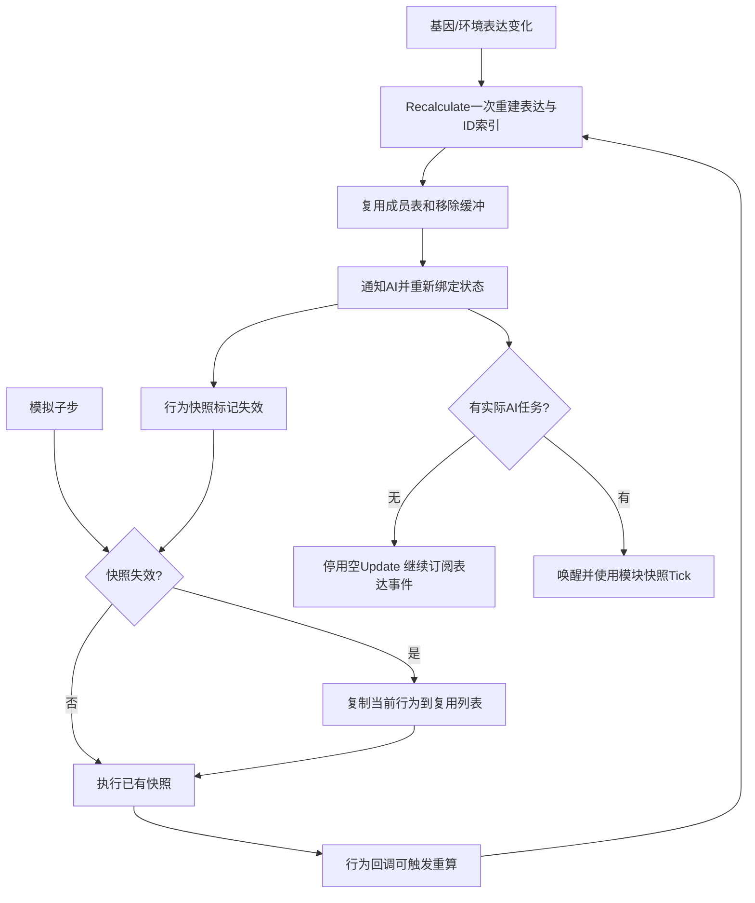

# 项目精简与优化

本轮以已整理的流程图和文件职责为依据，删除确认未接入运行的代码，集中重复入口，并减少高频查询/空回调。保持原玩法数值、基因定义、世界存档字段与联机协议不变。

## 文件和运行入口

|处理|文件/目录|依据与维护方式|
|---|---|---|
|删除|EntityStatsGeneBridge|唯一代码调用是实体工厂；回调为空，没有属性计算。工厂继续安装原属性与生命组件。|
|删除|MutationInsertion、GeneInteractionSpace|没有调用入口；当前GeneMutator只使用出错/复制/缺失路径。保留MutationType、MutationResult和存档中的InteractionPosition等字段。|
|删除|PlanetTerrainConfigDatabase|没有调用和资源挂载；当前地形由PlanetTerrainMeshBuilder/WorldSessionManager管理。保留PlanetTerrainConfig和环境数据库。|
|删除|Assets/TutorialInfo、Assets/Readme.asset|Unity欢迎页与示例编辑器，没有外部资源引用。移除解算方案中遗留的空Assembly-CSharp-Editor项目。|
|合并|GeneAIDecisionService → GeneAIModuleRegistry.cs|保留公开类和DecideActiveModules接口；控制器使用复用缓冲区的Collect。|
|合并|FlightAIModule、AutotrophAIModule → Modules/BuiltinAIModules.cs|保留原命名空间、类型和ai_flight/ai_autotroph ID。实际行动和自养由基因逻辑承担，旧占位模块声明为无需Tick。|
|迁移|OreGenerator、OreNode → Planet/Legacy|保留原.meta GUID；两份本地恢复场景仍引用旧生成器。正式SampleScene移除原来已禁用的旧生成器，当前使用PlanetOreSystem。|

不按“文件名看起来旧”删除资源。下一轮删除仍需同时核对源码调用、Resources/配置字符串、场景与预制体GUID和恢复场景。`.meta`跟随资源迁移；不得把可重建Library目录的体积当成本轮代码优化收益。

## 高频运行路径

- **表达索引**：`EntityGeneController.GetEvaluation`按实例ID查找。重复ID和null ID保留旧`Find`的首项语义；基因禁用、表达抑制、增删或编辑后必须按现有约定调用`Recalculate`。依赖引用身份的生产查询保持原实现。
- **模拟快照**：每次重算标记失效，下一子步才重建。回调中重算不直接改写正在遍历的列表，避免枚举器失效。`LogicSnapshotBuilds`用于验证，不改变模拟步长。
- **命名词库**：Resources内置词库每个播放会话只解析一次，仍按原顺序调用两次Unity随机数。关闭域重载的播放也会重置缓存；名称词库不是外部热加载配置。
- **比例维持**：基因条件匹配使用显式循环，禁用/被抑制仍算携带。停用或零目标规则不做补充扫描；没有启用规则时繁殖倍率直接为1。注册表成员版本覆盖同帧删除再新增但总数相同的情况。
- **AI**：唯一工厂是`GeneAIModuleRegistry`。扩展模块默认有Tick；只有实现`IPassiveGeneAIModule`的明确无任务模块可休眠。控制器继续接收表达事件恢复自身休眠，保留外部主动禁用的状态。Tick遍历快照并核对模块身份；新模块下一帧开始执行。销毁成对退订/释放，联机副本不独立推进。
- **异常恢复**：重算锁在`finally`释放。异常仍向上报告，修正订阅者/配置后下一次重算可以恢复，不吞掉错误。

## 维护与验证

新增本轮回归入口：`DarwinPark.EditorTools.ProjectOptimizationRegression.RunBatch`。在独立工程副本中检查查询等价、固定种子命名、500组基因条件、1000子步快照、表达事件异常恢复、同帧等量替换、AI休眠/唤醒/暂停/副本/销毁和正式场景缺失脚本。

耗时对照预热后取5次中位数；分配采用Unity主线程GC.Alloc事件计数（不是字节数），使用旧路径阳性对照，并与耗时采样分开。它衡量局部代码，不代表整场景FPS、峰值内存或Player运行性能。具体结果见[本轮验证记录](../验证记录/项目精简优化验证-2026-11-06.md)。

流程图和文件职责需在最终源码确定后重新生成：`Tools/FlowDocs/Generate.ps1`。新文件职责同步维护`Tools/file_catalog_roles.json`，旧脚本分图由生成器自动移除。
