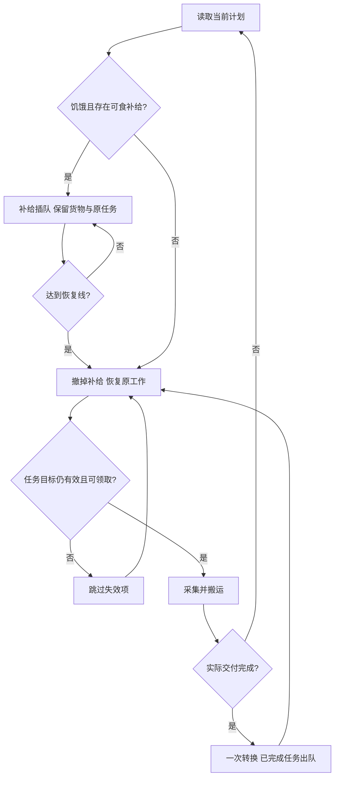

# 顺序任务与坐标计算优化

本次实现延续全局轮次变异和观察坐标方案。工匠任务变为可持久化顺序队列，尸体/能量块检索统一走全局资源坐标。实体身份、实际营养、繁殖、货物、拾取与存档保持逐对象记录。

## 任务的完成、插队与恢复

工匠一次扫描在活动范围内按距离规划尸体，随后规划不可自主移动的外群活实体，默认最多12项。坐标来自全局索引；只领取当前任务，未来目标不预占。任务经历采集→交付，实际交付并完成一次能量转换后才出队，下一次推进立即激活下一项，不等待旧扫描计时。失效、越出活动区或已被别人领取的目标跳过。

饱食低于分工开始线时补给插到第一位，原任务与后续计划顺延。跨过开始线仍保持补给，达到恢复线才撤掉补给；默认成员开始7、恢复9.5。运输中的实体/尸体随工匠继续携带，不丢货、不重复转换。没有可吃补给时允许继续采集和交付以建立真实补给，补给需求继续保留。王后最低口粮与活群资源归属保护仍生效。

士兵巡逻→休息→巡逻及临时捕猎等任务记录在相同计划中，沿用原计时完成条件。王后孕育、迁居、幼体/配偶跟随也记录各自当前任务。普通实体按自身营养利用/食腐能力分别排队能量块和尸体：当前目标耗尽后接续后续目标，身边可吃块可临时插队，原远处目标顺延；期间原领地/状态意图保留。没有运输能力的动物不获得工匠搬运分工。

普通资源队列、扫描剩余时间保存在`EcologySaveState.resourcePlan`，与工匠一样真实写盘/恢复；旧空快照会清理此前的普通队列。资源完成/失效通过计划令牌立即打断行动缓存。工匠队列保存在`AntColonyMemberSave.plan.tasks`，与原`feeding/supply`一同存盘。旧档空队列按已有当前目标迁入；Unity将缺省null读成空串时使用非空判断选择真实目标。明确下达新采集命令时新目标插入当前位，避免继续执行旧计划；退出分工、取消或工匠死亡时释放实际货物与领取。普通饥饿不会调用释放。

## 统一资源坐标

`ResourceCoordinates`在资源创建、启停、搬运、移除和清场时更新。三维格服务真实3D食腐半径，球面投影格服务沿星球表面的采集/补给距离。投影不使用高度差粗筛，因此同一方向的山顶资源不被错误排除。星球矩阵/参考半径变化会重建；资源通常静止，不每次查询访问全部资源Transform。

尸体与能量块分桶。食腐只查尸体桶；种群补给和普通营养利用只查能量桶；工匠尸体任务从同一索引接收候选。跨地图寻找补给仍需要遍历紧凑的能量坐标列表，但不遍历尸体、场景碰撞体或所有活实体。实际吸收/命中/领取时再次读取真实资格和实际距离。资源存档全量枚举是保存工作，不属于运行搜索。

`ResourceGroups`按补给版本建立同群坐标索引，活动圆按领袖位置、半径、补给版本缓存；不为每具尸体重建圆。不存在剩余能量的空补给点不会产生范围。

## 按上一轮清单实施的优化

|部分|此前|本轮落实|保留边界/后续测量|
|---|---|---|---|
|行动决策|每基因小步完整选意图/目标|独立默认0.25模拟秒决策；饥饿、任务、命令、受击、表达和状态变化打断|冷却/攻击逐小步，移动在本批末小步用累计时间写一次；不是每次决策都延迟攻击|
|位置/生产者|每帧全部重建营养空间桶并读取完整生产表达|保留桶，移动跨格才更新；生产遗传资格按表达版本缓存|每帧仍核对全体活体坐标/存活，保证外部传送；尚未完全变成纯事件驱动|
|表达重算|相同DNA仍重复纯求值|有界纯表达缓存，完整基因值、顺序、重数/CopyStrength、缺失状态、环境、孕育和角色抑制为键|返回独立GeneInstance绑定/属性字典；阶段/体型处理和行为实例仍逐体；不延迟必须即时生效的重算|
|孤立静止组|即使单成员也运行所有空被动行为|单成员用静止核保留生命、生产、环境、代谢和独立繁殖；状态改变回退普通路径|不放宽遗传签名；阶段/受伤/欠账仍独立，不把多个个体合成一个身份|
|重力接地|每物理步射线并改写相同摩擦|缓存组件和近似不动时的接地结果，默认0.2真实秒；只在摩擦变化时写材质|位移、起跳下落、地形/星球变化失效；实际重力施力与高空救援保留，原验证休眠继续生效|
|营养竞争|任一邻域变化令所有生产者缓存失效|仅使改变的生产者附近格失效；静止远处生产者复用竞争结果|矿量仍按实际源扣减，不共享有限营养扣款|
|配偶|每次寻找都OverlapSphere并分配碰撞数组|共享活体坐标候选，默认0.5模拟秒寻找；缓存配偶每次先实时复查|沿用原配偶搜索半径与性别/成年/储粮/孕育规则，不额外加视野限制|
|运输/尸体/补给|工匠遍历世界资源/活实体|全局分类坐标格、顺序队列、只领取当前项；活体用共享活体网格|保留活动圆、同群保护、寄生隐藏、真实交付与货物恢复|
|种群/队形|已有成员/站位索引，活动圆和补给反复枚举|活动圆和同群资源按版本复用；同帧重复转向的队形避让合并|既有单次命令广播/稳定站位保持，移动领袖或补给耗尽更新|
|感知失效|注销目标遍历所有收件箱|目标→观察者反向订阅，只清理真正订阅者|仍保留新出生/注册版本使候选可见；未施加可能丢目标的信息丢弃预算|
|分配/回收|小步状态排序、复制进食属性、运输查询闭包|状态顺序缓存、直接查询营养容量、复用坐标列表/资源Entry，工匠无逐次捕获闭包|缓存有上限/生命周期清理；进一步按Player分配栈定位剩余GC|
|资源绘制/灯光|每块LateUpdate、全距点光源|统一外观调度，默认0.25真实秒刷新；远处关闭点光源；共享资源/标记材质启用实例化|没有实测GPU证据前不声称固定DrawCall或FPS收益；远处块仍可见可拾取，未替换实体渲染架构|
|统计UI|每次刷新复制/拼接整个基因目录|按定义重载缓存基因目录/签名；既有稳定布局防标脏保留|不修改原布局；活体统计仍按约0.5秒刷新|

## 外部参数和衡量

`config/simulation_optimization.json`保留中文注释，唯一菜单入口约2秒检测修改；无效文件保留上次有效配置并告警。任务长度、决策周期、配偶寻找周期、接地探测周期、资源格大小、缓存容量、静止核、局部竞争、外观频率与点光距离均可调整。实例化材质开关在材质新建时应用。

性能必须以同一冻结存档、相机、地形和模拟倍率进行平均/P95对照，同时记录实际活体/资源数量。统一管理器、候选数减少或编译成功都不能单独当成整世界提帧证据。真实结果见本轮验证记录。

新增`ResourceSearch`与`SingletonSettlement`细分计时。原`Genes`项降低可能包含工作移入静止核的统计归属变化，必须同时比较总帧与新项，不能直接宣称同等幅度提速。
