# 游戏业务主流程

[返回总索引](README.md) · [离线可交互版本](index.html)

这些图用于跨模块业务导航；虚线表示回调、异步传输或数据依赖，不把它们伪装成直接调用。精确的分支/循环/返回和真实调用目标请打开方法分图。

## 01 · 启动、服务与界面

初始化入口、时钟、生成委托、基因库和UI根节点。

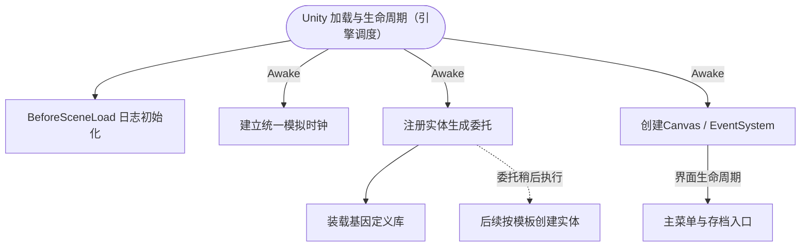

- [RuntimeFileLog.Initialize · L17](脚本/8080b38a7e1c5585.md#m91f8e0905f759109)
- [SimulationClock.Awake · L33](脚本/a8f444aec9614b0a.md#m0c6d9c663fea16e1)
- [GameBootstrap.Awake · L14](脚本/b97bb0ddbd6571c6.md#m4fa1d594860c65b1)
- [GeneDatabase.EnsureLoaded · L12](脚本/ec0a03483435a863.md#mc3e6357b9ca440f5)
- [UIRoot.Awake · L17](脚本/9c1421378791f0e0.md#m0859faeb8e52aa7c)
- [GameMainMenu.Start · L52](脚本/a1f1791f9e7a8035.md#md8e75d0bde7a835d)
- [EntityFactory.CreateFromTemplate · L22](脚本/54fcd89ef79d04f6.md#mbe8d73397453244c)

不规定不同组件Awake的全部先后顺序；图中同时包含服务依赖与注册后的后续触发。

## 02 · 创建或读取世界

暂停模拟后生成地形和气候，恢复资源、实体及世界状态。

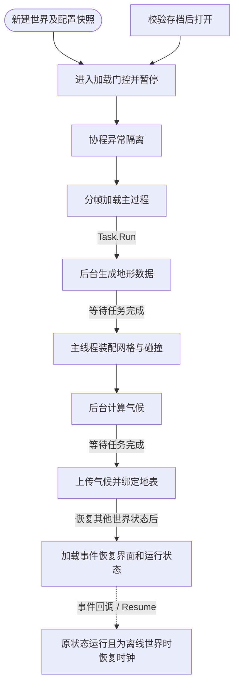

- [WorldSessionManager.Create · L41](脚本/08741c7b7b9d9344.md#m6aadfeee8b90aacd)
- [WorldSessionManager.Open · L58](脚本/08741c7b7b9d9344.md#m0a8e69a8a4fbc512)
- [WorldSessionManager.Begin · L59](脚本/08741c7b7b9d9344.md#m5f5f2266a2aed605)
- [WorldSessionManager.SafeLoad · L67](脚本/08741c7b7b9d9344.md#md9a50726b707810d)
- [WorldSessionManager.Load · L77](脚本/08741c7b7b9d9344.md#m366f9d85869f5903)
- [PlanetTerrainGenerator.Generate · L20](脚本/cde9e7b164fab46e.md#m7c6d74a69a660a78)
- [PlanetTerrainMeshBuilder.ApplyGeneratedData · L160](脚本/415285cf043354a9.md#m3e899cb84c9a0081)
- [PlanetClimateModel.Generate · L59](脚本/0249d34bf86f4fa3.md#m49a6e534a85dc57e)
- [PlanetClimateMap.ApplyGeneratedClimate · L114](脚本/b4e9726c1bcf4c37.md#m20ba66ec7eca94e5)
- [GameMainMenu.OnWorldLoaded · L114](脚本/a1f1791f9e7a8035.md#mbda8fdeb3559be83)
- [GameMainMenu.Resume · L100](脚本/a1f1791f9e7a8035.md#m61e63ba022a33302)

## 03 · 每帧模拟与基因行为

模拟时间预算、实体子步、生命周期、意图和基因调度。

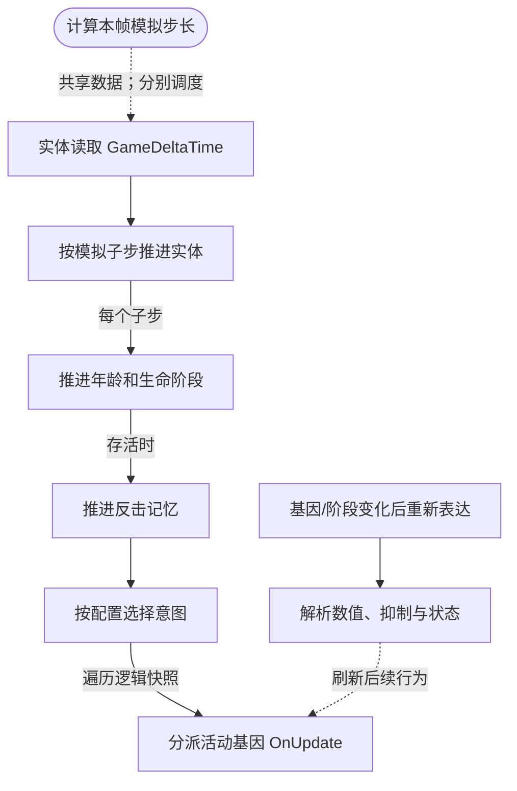

- [SimulationClock.Update · L51](脚本/a8f444aec9614b0a.md#m42a4cfef431ba20e)
- [EntityGeneController.Update · L59](脚本/7494d53178552f0e.md#m32cbcad988452772)
- [EntityGeneController.AdvanceSimulation · L66](脚本/7494d53178552f0e.md#m477fb905eeed3e79)
- [EntityLifeCycle.Advance · L25](脚本/9f4138bfbae654b7.md#m804ba580f54f09f3)
- [CombatIntent.Advance · L19](脚本/34193b994b2c0894.md#m2065729a2988f50f)
- [EntityStateController.Advance · L41](脚本/0f8869eb7018091e.md#mffbdbb199029dbf3)
- [IGeneLogic.OnUpdate · L9](脚本/5304fdad773967f8.md#m829188d65276f8e5)
- [EntityGeneController.Recalculate · L97](脚本/7494d53178552f0e.md#m65ea735c1e0e37a1)
- [GeneValueResolver.Resolve · L30](脚本/837eb9ce6eba3cc6.md#md4b9129afb709ddb)

IGeneLogic.OnUpdate的接口候选见“调用与被调用”。不把所有基因排成固定的跨实体执行顺序。

## 04 · 攻击、消化、死亡与尸体

查找真实伤害结算、单次死亡与剩余营养的去向。

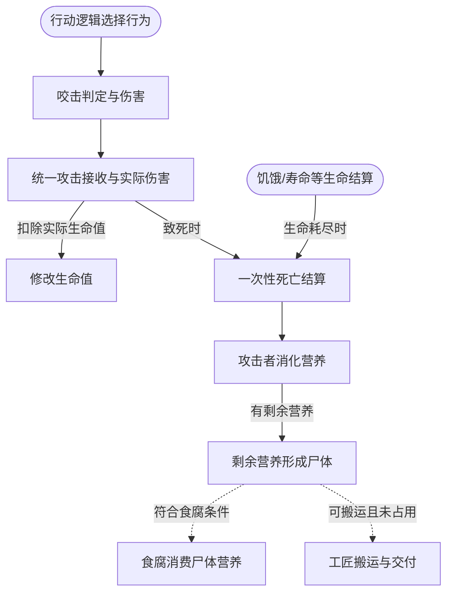

- [LocomotionGeneLogic.OnUpdate · L27](脚本/50c563bf540685c7.md#m80931f91d1e68e4f)
- [LocomotionGeneLogic.TryBite · L90](脚本/50c563bf540685c7.md#m41644e25fa34f940)
- [EntityCombat.Receive · L12](脚本/a5b5b46ac6c197ae.md#mcdb8fa72b26b29f2)
- [EntityStats.Modify · L104](脚本/75aa86a368efdf24.md#m858c2a75d852ecc1)
- [EntityDeathSettlement.Die · L11](脚本/07fa6bdaadf50796.md#m700276963777d0a6)
- [NutritionTransfer.Digest · L37](脚本/081d3b8ff683e442.md#m0dfb9913d52ce02b)
- [ColonyResource.LeaveCorpse · L35](脚本/293dbaecfff4b585.md#m4c4f8f3dd2ed1198)
- [CorpseFeeding.Advance · L16](脚本/0494eed2004cafc6.md#mf6e53f77f4b102f3)
- [AntColonyWorker.Advance · L39](脚本/8a0cca2020271b6f.md#md5046cdbf7c74508)
- [EntityVitals.AdvanceVitals · L42](脚本/7f68ee05c2ac84bc.md#mf5035ac75b5525f0)

清场/读档销毁不等于生物死亡。守恒与判定的精确分支见方法内部流程。

## 05 · 普通繁殖与孤雌生殖

配偶、成年等待、储粮、孕育和统一出生入口。

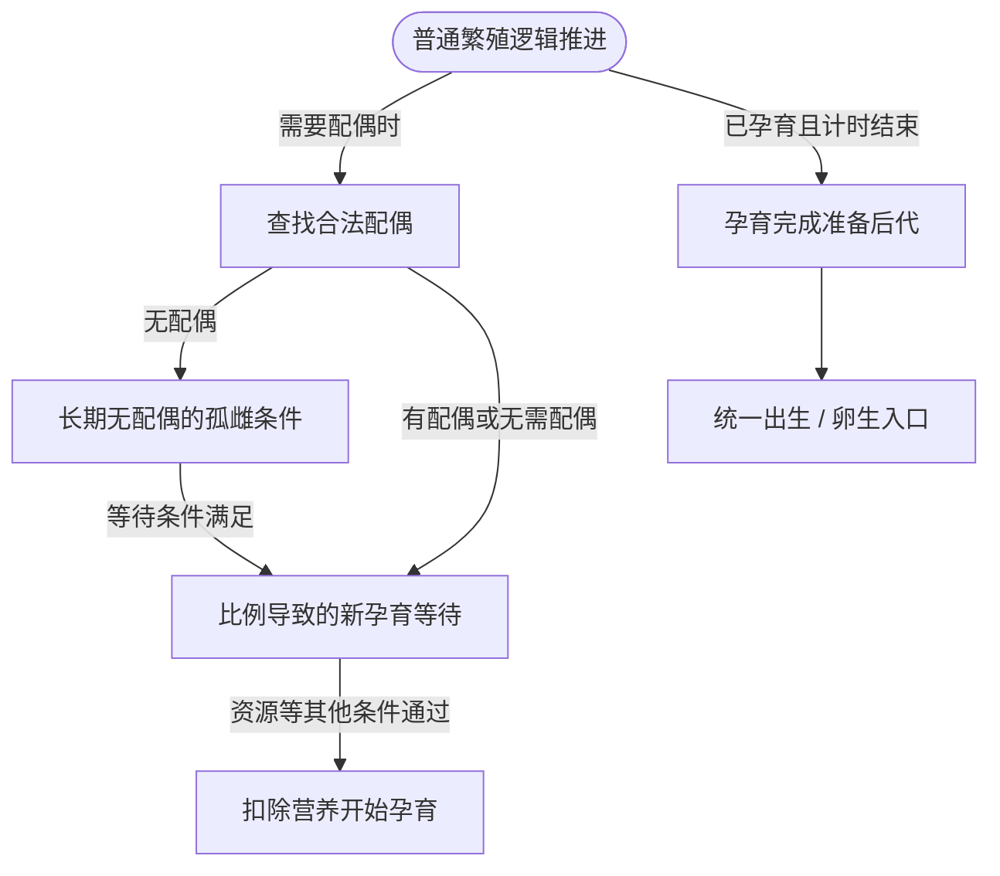

- [ReproductionGeneLogic.OnUpdate · L36](脚本/ac319ea70bd8b723.md#mf050ec0ba2694604)
- [ReproductionGeneLogic.FindMate · L156](脚本/ac319ea70bd8b723.md#m4ec186963d1a2ab6)
- [ParthenogenesisCondition.Advance · L241](脚本/ac319ea70bd8b723.md#m9459f12c1abb4ab0)
- [PopulationMaintenance.BreedingReady · L119](脚本/923ccc4e86c4786c.md#mdecd55c22dabf7b3)
- [ReproductionGeneLogic.StartGestation · L134](脚本/ac319ea70bd8b723.md#m38a8d176e49e1020)
- [ReproductionGeneLogic.SpawnOffspring · L187](脚本/ac319ea70bd8b723.md#m0acaa25125fcd465)
- [EcologyReproduction.Spawn · L9](脚本/eaaa574d7ae50e29.md#mc64a3524363ab773)

已孕育后代不会因维持比例超量被取消；蚁群王后走专用分工流程。

## 06 · 蚁群、工匠、补给与站位

分工、运输、真实进食半径、空位出生与移动避让。

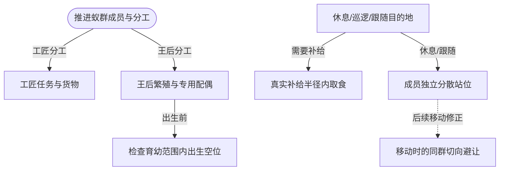

- [AntColonyMember.Advance · L77](脚本/baebd85c05598377.md#m29cff578dd85ff16)
- [AntColonyWorker.Advance · L39](脚本/8a0cca2020271b6f.md#md5046cdbf7c74508)
- [AntColonyReproduction.Advance · L25](脚本/c22084eac4e522ed.md#mf3336413ca12a59b)
- [ColonyFormation.TryBirthPosition · L58](脚本/c65dce2d54e43480.md#mca6d307a76eab2fd)
- [AntColonyMember.Destination · L134](脚本/baebd85c05598377.md#m8fbd14b933818c86)
- [ColonyFeeding.Destination · L41](脚本/2cb56c08d08ff8ec.md#m9eaa68b3dda17a5d)
- [ColonyFormation.Home · L36](脚本/c65dce2d54e43480.md#m79ad3420baeaf49d)
- [ColonyFormation.Avoid · L43](脚本/c65dce2d54e43480.md#me7d09f85ef3637a0)

没有空位时保留孕育。目标与避让不是瞬移；没有真实能量的补给点不产生活动圈。

## 07 · 随机生成与维持比例

两种来源、独立JSON条件、分帧补充和繁殖调节。

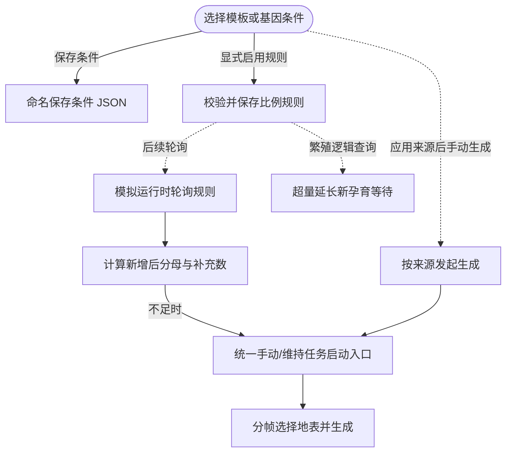

- [RandomSpawnWorkbench.Open · L29](脚本/0763b7475b3c75db.md#m0c118b57d249ff5d)
- [RandomSpawnWorkbench.SaveCondition · L87](脚本/0763b7475b3c75db.md#m210b8cd3854376be)
- [RandomSpawnWorkbench.SaveRule · L74](脚本/0763b7475b3c75db.md#m42aecb344c8280a4)
- [RandomPlanetSpawner.Update · L79](脚本/1c13222a547b265c.md#mdeb679ecc61476b7)
- [PopulationMaintenance.Needed · L94](脚本/923ccc4e86c4786c.md#mbdbbc144d70f3c38)
- [RandomPlanetSpawner.StartRecipe · L28](脚本/1c13222a547b265c.md#md37fb84c58dea354)
- [RandomPlanetSpawner.Generate · L45](脚本/1c13222a547b265c.md#m6e3cb29e2dc359c8)
- [PopulationMaintenance.BreedingReady · L119](脚本/923ccc4e86c4786c.md#mdecd55c22dabf7b3)
- [RandomPlanetSpawner.StartInternal · L29](脚本/1c13222a547b265c.md#m1a9a2369d4a84090)

不自动删除超量实体；条件库跨世界复用，运行规则保留世界内快照。暂停、权限和数量上限仍生效。

## 08 · 操控、输入与UI门控

区分视角、物理、攻击目标和覆盖窗口的输入归属。

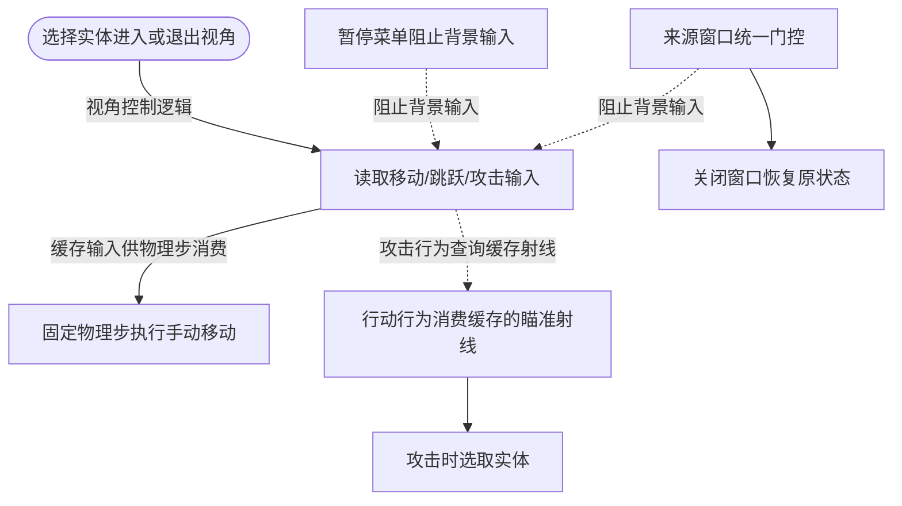

- [EntityViewController.Update · L38](脚本/0ad0345f83229ef0.md#m726306405756dd64)
- [EntityPossessionInput.Tick · L55](脚本/4c12d3ae76941d37.md#m82cccdeb60a8e9bd)
- [EntityManualControl.FixedUpdate · L47](脚本/a6969896da35e1f0.md#me9a1ea48b00d8050)
- [EntityAttackAim.Pick · L10](脚本/2e9dde897281c303.md#m6a55b6280b6e3053)
- [GameMainMenu.ShowPause · L89](脚本/a1f1791f9e7a8035.md#m953d85f379a39458)
- [RandomSpawnWorkbench.Open · L29](脚本/0763b7475b3c75db.md#m0c118b57d249ff5d)
- [RandomSpawnWorkbench.Close · L42](脚本/0763b7475b3c75db.md#mb3132a8d58c9ba62)
- [EntityManualControl.GetAttackTarget · L28](脚本/a6969896da35e1f0.md#mb046508bf5d61cb1)

镜头、物理和界面按各自生命周期调度。输入框消费的按键不能穿透成为游戏动作。

## 09 · 存档、重载与种群档案

世界快照、磁盘读写、校验和历史恢复。

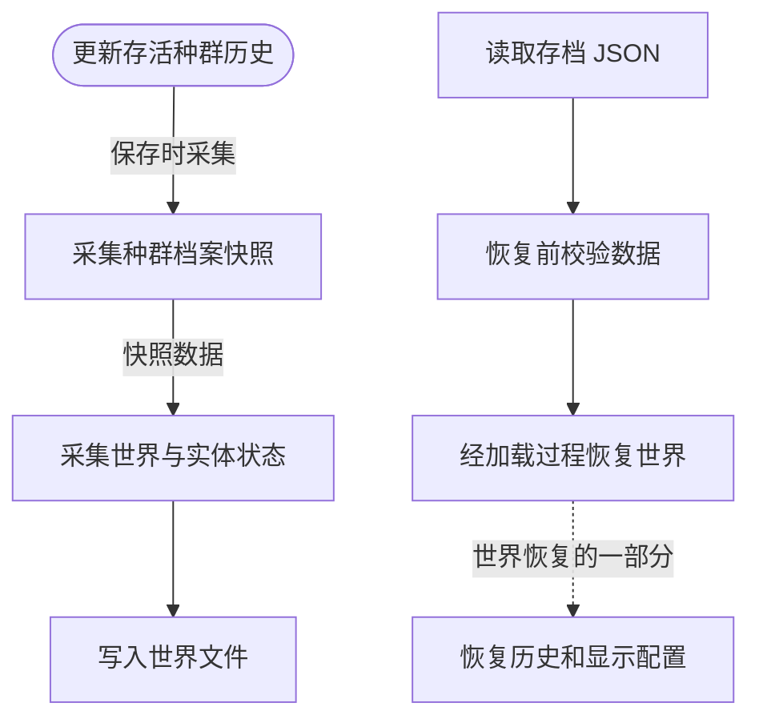

- [PopulationArchive.Observe · L68](脚本/084e119b69cdd751.md#m6afd6ec6b661dad6)
- [PopulationArchive.Capture · L110](脚本/084e119b69cdd751.md#m2b63358c5191143d)
- [WorldSessionManager.SaveNow · L157](脚本/08741c7b7b9d9344.md#mbecd8b5c222ba46b)
- [WorldSaveStore.Write · L117](脚本/d67a35e5e3814c15.md#m793b97a7ba7d2029)
- [WorldSaveStore.Read · L72](脚本/d67a35e5e3814c15.md#mca362c7675a5800c)
- [WorldSaveStore.Validate · L73](脚本/d67a35e5e3814c15.md#mb2f88d55be126f07)
- [WorldSessionManager.Open · L58](脚本/08741c7b7b9d9344.md#m0a8e69a8a4fbc512)
- [PopulationArchive.Restore · L123](脚本/084e119b69cdd751.md#ma1030dfe5b5f2565)

精确采集顺序见SaveNow与Load；不可把采集关系误读为独立的固定调度顺序。

## 10 · 局域网权限、命令与副本

房主判权执行，副本收快照，不独立推进生态。

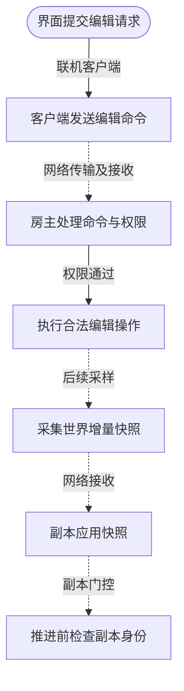

- [LanEditActions.Submit · L16](脚本/2816321496f6360e.md#m5411c4b97ac4c898)
- [LanSession.SubmitEdit · L92](脚本/9fb633eebffe669c.md#mf20f22f787288df0)
- [LanSession.ProcessCommand · L142](脚本/9fb633eebffe669c.md#m22019411e81c9ecb)
- [LanEditExecutor.Apply · L27](脚本/2816321496f6360e.md#m1f827c7e486ff073)
- [LanWorldSnapshot.Frame · L32](脚本/02a722701106da02.md#m85d6595c09ac428c)
- [LanSession.ApplyFrame · L260](脚本/9fb633eebffe669c.md#m271cf3f3a4ebbffd)
- [EntityGeneController.AdvanceSimulation · L66](脚本/7494d53178552f0e.md#m477fb905eeed3e79)

虚线包括异步传输/数据依赖，不表示跨进程直接调用；离线直接执行见Submit。

## 11 · 地形、气候、矿脉与GPU

CPU生成数据，到网格、纹理和GPU渲染的关系。

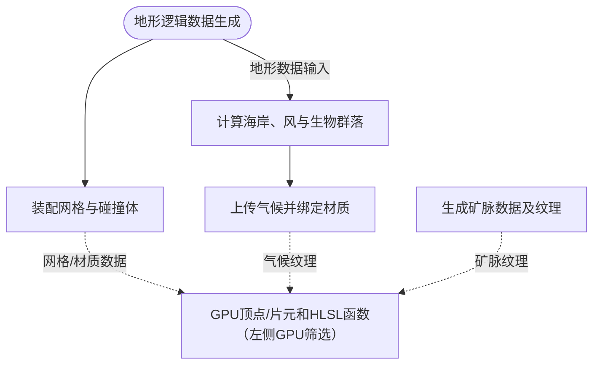

- [PlanetTerrainGenerator.Generate · L20](脚本/cde9e7b164fab46e.md#m7c6d74a69a660a78)
- [PlanetTerrainMeshBuilder.ApplyGeneratedData · L160](脚本/415285cf043354a9.md#m3e899cb84c9a0081)
- [PlanetClimateModel.Generate · L59](脚本/0249d34bf86f4fa3.md#m49a6e534a85dc57e)
- [PlanetClimateMap.ApplyGeneratedClimate · L114](脚本/b4e9726c1bcf4c37.md#m20ba66ec7eca94e5)
- [PlanetOreSystem.GenerateOreMap · L40](脚本/86b3fbb4d9436121.md#m0449775dd894020c)

GPU使用兼容语法控制结构。宏、URP外部include和着色器阶段仍以渲染管线为准。

## 12 · 日志、崩溃诊断与导出

日志事件、异步持久化、心跳与导出的入口关系。

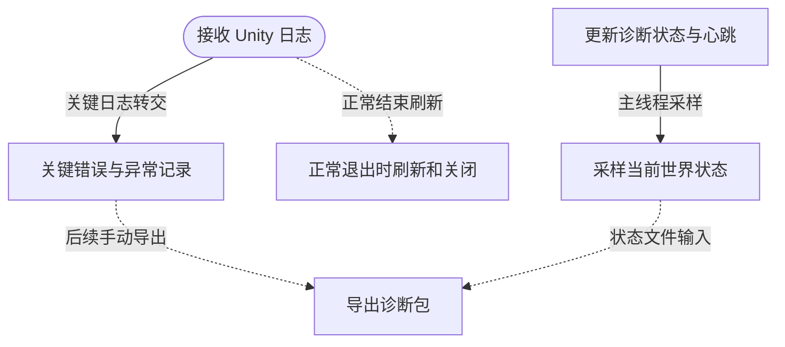

- [RuntimeFileLog.Receive · L43](脚本/8080b38a7e1c5585.md#mde9756dd697906ee)
- [RuntimeCrashDiagnostics.Receive · L57](脚本/b7eea720e09afd0b.md#mb8486cb668865dcf)
- [RuntimeCrashDiagnostics.Tick · L59](脚本/b7eea720e09afd0b.md#mc5afab299d0c34ce)
- [RuntimeDiagnosticWorldState.Sample · L13](脚本/7bd14a39565df6a0.md#ma23f0499040a58d5)
- [RuntimeCrashDiagnostics.ExportAsync · L86](脚本/b7eea720e09afd0b.md#m136ba9b12f0b873f)
- [RuntimeFileLog.Shutdown · L49](脚本/8080b38a7e1c5585.md#m817cce367fb66edc)

后台线程、主线程采样与未处理异常分别查看具体方法；异常退出不伪装为正常关闭。
