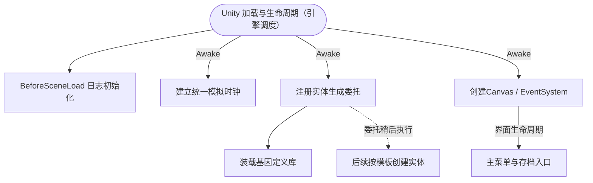
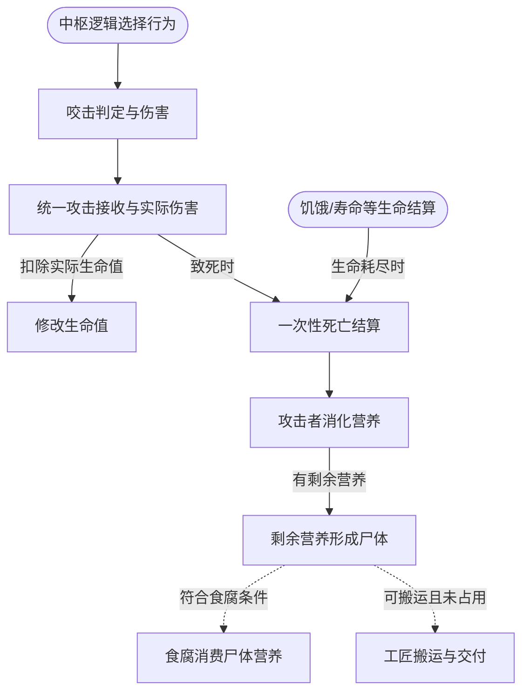
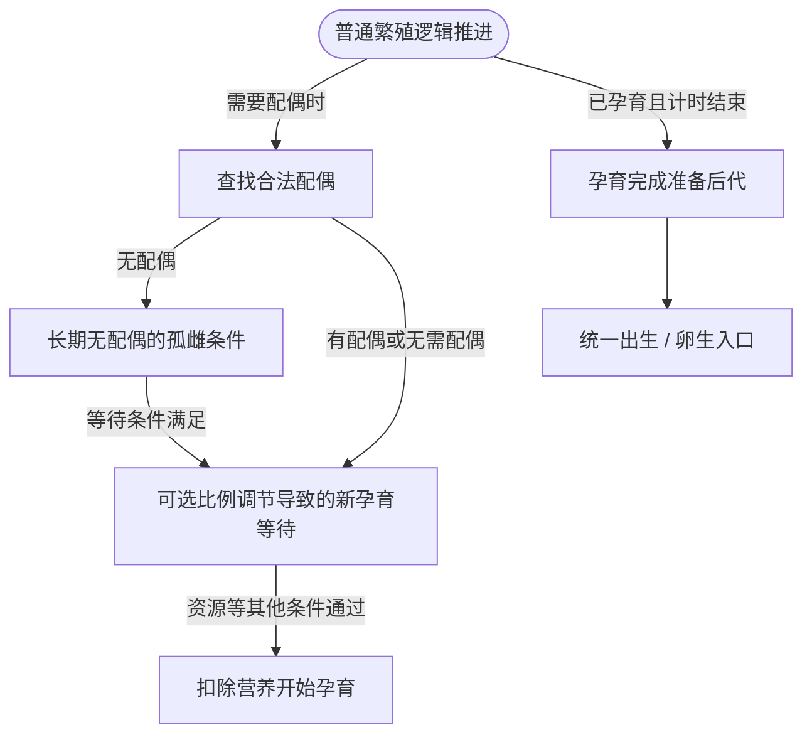
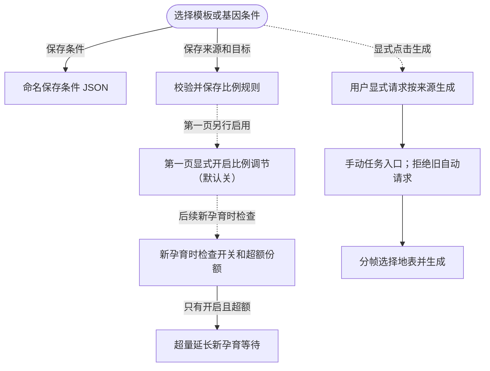
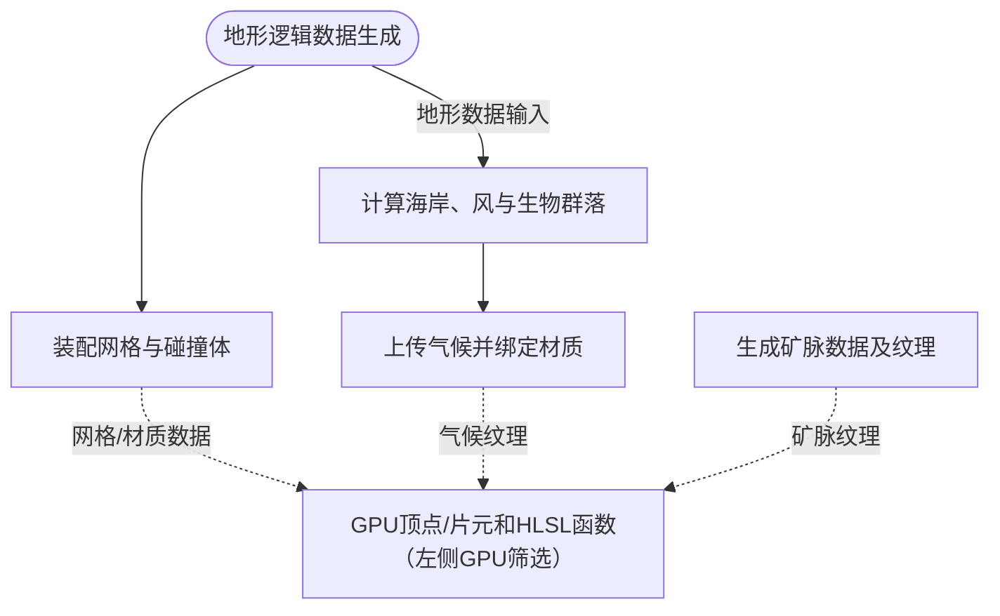

# 游戏业务主流程

[返回总索引](README.md) · [离线可交互版本](index.html)

这些图用于跨模块业务导航；虚线表示回调、异步传输或数据依赖，不把它们伪装成直接调用。精确的分支/循环/返回和真实调用目标请打开方法分图。

## 01 · 启动、服务与界面

初始化入口、时钟、生成委托、基因库和UI根节点。

- [RuntimeFileLog.Initialize · L17](模块/Core.md#m91f8e0905f759109)
- [SimulationClock.Awake · L33](模块/Core.md#m0c6d9c663fea16e1)
- [GameBootstrap.Awake · L14](模块/GameRoot.md#m4fa1d594860c65b1)
- [GeneDatabase.EnsureLoaded · L12](模块/Genetics.md#mc3e6357b9ca440f5)
- [UIRoot.Awake · L17](模块/Core.md#m0859faeb8e52aa7c)
- [GameMainMenu.Start · L67](模块/UI.md#m96eead578c3a47a3)
- [EntityFactory.CreateFromTemplate · L22](模块/GameRoot.md#mbe8d73397453244c)

不规定不同组件Awake的全部先后顺序；图中同时包含服务依赖与注册后的后续触发。

## 02 · 创建或读取世界

暂停模拟后生成地形和气候，恢复资源、实体及世界状态。

- [WorldSessionManager.Create · L43](模块/Gameplay.md#m622e74f5005e5fda)
- [WorldSessionManager.Open · L62](模块/Gameplay.md#m2810b58b13a0b127)
- [WorldSessionManager.Begin · L63](模块/Gameplay.md#mf6aedede6eab74fb)
- [WorldSessionManager.SafeLoad · L71](模块/Gameplay.md#m3ac769f4655daf6e)
- [WorldSessionManager.Load · L81](模块/Gameplay.md#mb71091943c6d5f7a)
- [PlanetTerrainGenerator.Generate · L20](模块/Planet.md#m7c6d74a69a660a78)
- [PlanetTerrainMeshBuilder.ApplyGeneratedData · L184](模块/Planet.md#m8ddf1f3f6df035da)
- [PlanetClimateModel.Generate · L35](模块/Planet.md#mf105e37be68fe0f5)
- [PlanetClimateMap.ApplyGeneratedClimate · L115](模块/Planet.md#md18223be9e33b823)
- [GameMainMenu.OnWorldLoaded · L136](模块/UI.md#m70ac509be7c450b4)
- [GameMainMenu.Resume · L120](模块/UI.md#m3368d3c7a0a2e56f)

## 03 · 全局优先级、近邻合并与实体行为

统一模拟时间驱动全局轮次变异、优先调度与视野坐标投递；个体身份、寿命、孕育和欠账分别保存。

- [SimulationClock.Update · L51](模块/Core.md#m42a4cfef431ba20e)
- [EntityGeneController.Update · L66](模块/Entities.md#m9b387c7c7f72e7ed)
- [EntityGeneController.AdvanceSimulation · L75](模块/Entities.md#m6e94486f8bf79c01)
- [EntityLifeCycle.Advance · L29](模块/Entities.md#m1fd9eac22c334c51)
- [CombatIntent.Advance · L20](模块/Entities.md#m58aa83f6d2b7f919)
- [EntityStateController.Advance · L43](模块/Entities.md#mfaff58408788d0ab)
- [IGeneLogic.OnUpdate · L9](模块/Entities.md#m829188d65276f8e5)
- [EntityGeneController.Recalculate · L122](模块/Entities.md#m0c8090b8014eb248)
- [GeneValueResolver.Resolve · L34](模块/Genetics.md#m03c53eac5d3439da)
- [EntityWorkScheduler.Update · L60](模块/Entities.md#m92fc833914beb958)
- [EntityWorkScheduler.Advance · L61](模块/Entities.md#m7ff72746b1afcb8a)
- [StationaryCohortKernel.Sample · L34](模块/Entities.md#m859147e15bb04ba6)
- [StationaryCohortKernel.Apply · L54](模块/Entities.md#me35eb807f31e8c5f)
- [EntityLifeCycle.AdvanceShared · L31](模块/Entities.md#mb1df321a3be857d0)
- [StationaryCohortKernel.Reproduce · L62](模块/Entities.md#mac3a3fb469e92679)
- [MutationRoundController.Advance · L33](模块/Entities.md#m4bb6ac2885317579)
- [MutationRoundController.Update · L31](模块/Entities.md#m25fef3482388a653)
- [EntityNeighborhood.CopyPositions · L117](模块/Entities.md#mbe381a73e82e5ad6)
- [EntityCoordinateGrid.Query · L123](模块/Entities.md#mcf59fb9c1bb0a8e4)
- [EntityPerceptionHub.Read · L136](模块/Entities.md#mf75a7b93e2e6d13c)
- [PerceivedTargets.Nearest · L11](模块/Entities.md#ma7949d5819dc10d6)
- [EntityPerceptionHub.TryLocate · L143](模块/Entities.md#m55442aebb7ae866b)
- [GeneExpressionCache.Resolve · L17](模块/Genetics.md#m48929ae1b64813e6)
- [SingletonSettlement.Advance · L24](模块/Entities.md#mc24b9e92bda549c2)
- [ActionDecisionCadence.Due · L17](模块/Entities.md#m1c08f24ca1a22110)
- [ActionMotionBatch.Consume · L11](模块/Entities.md#m184f7ab096673914)
- [MateCoordinates.Find · L21](模块/Entities.md#m1929025f2180b77c)
- [GravityProbeCache.Probe · L15](模块/Entities.md#m87964189a0f02fea)

业务导航区分独立Unity入口。全局变异按模拟周期抽样并保存剩余名单；阶段只更新属性。感知复用坐标和粗格，注意追踪更新已知目标、范围状态保留采样点。实际资格、子步与事件以方法图为准。

## 04 · 攻击、消化、死亡与尸体

查找真实伤害结算、单次死亡与剩余营养的去向。

- [CentralGeneLogic.OnUpdate · L30](模块/Entities.md#md49b13884b86b397)
- [CentralGeneLogic.TryBite · L111](模块/Entities.md#m7695f7c11210c05c)
- [EntityCombat.Receive · L13](模块/Entities.md#ma763706a48b8843a)
- [EntityStats.Modify · L113](模块/Entities.md#mecbdebe1a74acc34)
- [EntityDeathSettlement.Die · L12](模块/Entities.md#m9a912ca8df50ff6f)
- [NutritionTransfer.Digest · L39](模块/Entities.md#m680a93d63f9387f0)
- [ColonyResource.LeaveCorpse · L38](模块/Entities.md#mfaa9011c226a6bcb)
- [CorpseFeeding.Advance · L17](模块/Entities.md#m799528483716842b)
- [AntColonyWorker.Advance · L38](模块/Entities.md#mb832fdf53bf9f2ec)
- [EntityVitals.AdvanceVitals · L59](模块/Entities.md#m3ba147cedc9bd525)

清场/读档销毁不等于生物死亡。守恒与判定的精确分支见方法内部流程。

## 05 · 普通繁殖与孤雌生殖

配偶、成年等待、储粮、孕育和统一出生入口。

- [ReproductionGeneLogic.OnUpdate · L40](模块/Entities.md#m7cb6727410b8cffa)
- [ReproductionGeneLogic.FindMate · L164](模块/Entities.md#m02abf14ba03c58ff)
- [ParthenogenesisCondition.Advance · L211](模块/Entities.md#m105f0e797d2ece41)
- [PopulationMaintenance.BreedingReady · L131](模块/Entities.md#md1977da4fc65ce94)
- [ReproductionGeneLogic.StartGestation · L141](模块/Entities.md#m8cd56aa4c138ad73)
- [ReproductionGeneLogic.SpawnOffspring · L170](模块/Entities.md#mddf92cd0d1b4b5b9)
- [EcologyReproduction.Spawn · L10](模块/Entities.md#m80cc35c4a2829f3d)

已孕育后代不会因维持比例超量被取消；蚁群王后走专用分工流程。

## 06 · 蚁群、工匠、补给与站位

工匠按坐标生成顺序任务，补给插队保留货物与后续计划，实际完成后接续；活动圆和资源索引复用。

- [AntColonyMember.Advance · L91](模块/Entities.md#m790b5145678d0ed5)
- [AntColonyWorker.Advance · L38](模块/Entities.md#mb832fdf53bf9f2ec)
- [AntColonyReproduction.Advance · L24](模块/Entities.md#mc90b716e6ac59ee1)
- [ColonyFormation.TryBirthPosition · L60](模块/Entities.md#me7b708986f2564ee)
- [AntColonyMember.Destination · L152](模块/Entities.md#m6fa0cddd05a67690)
- [ColonyFeeding.Destination · L37](模块/Entities.md#mae2885d7d6ea7035)
- [ColonyFormation.Home · L36](模块/Entities.md#m79ad3420baeaf49d)
- [ColonyFormation.Avoid · L43](模块/Entities.md#me7d09f85ef3637a0)
- [WorkerTaskQueue.Select · L27](模块/Entities.md#mf7061cdad05e5c0f)
- [WorkerTaskQueue.Feeding · L17](模块/Entities.md#mb78e6fc083b136b4)
- [WorkerTaskQueue.Complete · L23](模块/Entities.md#ma1450397c6869690)
- [ResourceCoordinates.Query · L69](模块/Entities.md#mf169cf6ba025c1ca)
- [ResourceGroups.Read · L9](模块/Entities.md#m155d5ab724041bf7)
- [EntityResourcePlan.FindEnergy · L28](模块/Entities.md#m946240d33e353e81)
- [EntityResourcePlan.FindCorpse · L45](模块/Entities.md#mbe33d1f94c0c03df)

没有空位时保留孕育。目标与避让不是瞬移；没有真实能量的补给点不产生活动圈。

## 07 · 随机生成与维持比例

两种手动生成来源、独立JSON条件，以及默认关闭的比例繁殖调节。

- [RandomSpawnWorkbench.Open · L29](模块/UI.md#m0c118b57d249ff5d)
- [RandomSpawnWorkbench.SaveCondition · L88](模块/UI.md#m6679a36abf355aa1)
- [RandomSpawnWorkbench.SaveRule · L74](模块/UI.md#m7bc9dd10a8456a7b)
- [PopulationRatioRulePage.Toggle · L19](模块/UI.md#m1f466ddaaed369dc)
- [PopulationMaintenance.BreedingScale · L121](模块/Entities.md#m791c153c53c076d4)
- [RandomPlanetSpawner.StartRecipe · L30](模块/Gameplay.md#m9f0dd5a7aa5fd335)
- [RandomPlanetSpawner.Generate · L50](模块/Gameplay.md#m21159671a1a9825a)
- [PopulationMaintenance.BreedingReady · L131](模块/Entities.md#md1977da4fc65ce94)
- [RandomPlanetSpawner.StartInternal · L31](模块/Gameplay.md#m480bdd85837c383c)

开启或关闭都不直接补员；关闭不调节比例，开启仅延缓超额类别新孕育。已开始的孕育继续，手动生成仍受权限、地表和数量上限限制。

## 08 · 操控、输入与UI门控

区分视角、物理、攻击目标和覆盖窗口的输入归属。

- [EntityViewController.Update · L38](模块/UI.md#m726306405756dd64)
- [EntityPossessionInput.Tick · L57](模块/UI.md#mf2931021a06661e1)
- [EntityManualControl.FixedUpdate · L47](模块/Entities.md#md28a908b673cf64d)
- [EntityAttackAim.Pick · L10](模块/Entities.md#m6a55b6280b6e3053)
- [GameMainMenu.ShowPause · L109](模块/UI.md#m583a2c73ff0edec4)
- [RandomSpawnWorkbench.Open · L29](模块/UI.md#m0c118b57d249ff5d)
- [RandomSpawnWorkbench.Close · L42](模块/UI.md#mb3132a8d58c9ba62)
- [EntityManualControl.GetAttackTarget · L28](模块/Entities.md#mb046508bf5d61cb1)

镜头、物理和界面按各自生命周期调度。输入框消费的按键不能穿透成为游戏动作。

## 09 · 存档、重载与种群档案

世界快照、磁盘读写、校验和历史恢复。

- [PopulationArchive.Observe · L69](模块/Entities.md#m39adee1a1db96b4e)
- [PopulationArchive.Capture · L113](模块/Entities.md#m4bbe3a09897d04ab)
- [WorldSessionManager.SaveNow · L173](模块/Gameplay.md#ma6331256b4d51423)
- [WorldSaveStore.Write · L138](模块/Gameplay.md#md2ef9805f1d38753)
- [WorldSaveStore.Read · L78](模块/Gameplay.md#m929e1e4385af43eb)
- [WorldSaveStore.Validate · L79](模块/Gameplay.md#m6f82d4a7eca35b1f)
- [WorldSessionManager.Open · L62](模块/Gameplay.md#m2810b58b13a0b127)
- [PopulationArchive.Restore · L126](模块/Entities.md#m7b637fee38d306f2)

精确采集顺序见SaveNow与Load；不可把采集关系误读为独立的固定调度顺序。

## 10 · 局域网权限、命令与副本

房主判权执行，副本收快照，不独立推进生态。

- [LanEditActions.Submit · L16](模块/Gameplay.md#mdf4fa2d9e955869b)
- [LanSession.SubmitEdit · L90](模块/Gameplay.md#m6a49c530b5301a11)
- [LanServerRuntime.ProcessCommand · L77](模块/ServerUnity.md#m595706cc3f8ac2c3)
- [LanEditExecutor.Apply · L16](模块/ServerUnity.md#ma7b8740cc353a594)
- [LanWorldSnapshot.Frame · L32](模块/ServerUnity.md#m5c70f28a1109436b)
- [LanClientRuntime.ApplyFrame · L51](模块/UI.md#mc2fcb4c0bc1a14c4)
- [EntityGeneController.AdvanceSimulation · L75](模块/Entities.md#m6e94486f8bf79c01)

虚线包括异步传输/数据依赖，不表示跨进程直接调用；离线直接执行见Submit。

## 11 · 地形、气候、矿脉与GPU

CPU生成数据，到网格、纹理和GPU渲染的关系。

- [PlanetTerrainGenerator.Generate · L20](模块/Planet.md#m7c6d74a69a660a78)
- [PlanetTerrainMeshBuilder.ApplyGeneratedData · L184](模块/Planet.md#m8ddf1f3f6df035da)
- [PlanetClimateModel.Generate · L35](模块/Planet.md#mf105e37be68fe0f5)
- [PlanetClimateMap.ApplyGeneratedClimate · L115](模块/Planet.md#md18223be9e33b823)
- [PlanetOreSystem.GenerateOreMap · L41](模块/Planet.md#m60d687de7210bf42)

GPU使用兼容语法控制结构。宏、URP外部include和着色器阶段仍以渲染管线为准。

## 12 · 日志、崩溃诊断与导出

日志事件、异步持久化、心跳与导出的入口关系。

- [RuntimeFileLog.Receive · L43](模块/Core.md#mde9756dd697906ee)
- [RuntimeCrashDiagnostics.Receive · L57](模块/Core.md#mb8486cb668865dcf)
- [RuntimeCrashDiagnostics.Tick · L59](模块/Core.md#mc5afab299d0c34ce)
- [RuntimeDiagnosticWorldState.Sample · L13](模块/UI.md#ma23f0499040a58d5)
- [RuntimeCrashDiagnostics.ExportAsync · L86](模块/Core.md#m136ba9b12f0b873f)
- [RuntimeFileLog.Shutdown · L49](模块/Core.md#m817cce367fb66edc)

后台线程、主线程采样与未处理异常分别查看具体方法；异常退出不伪装为正常关闭。
