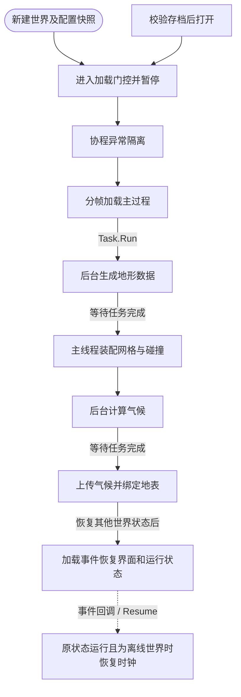
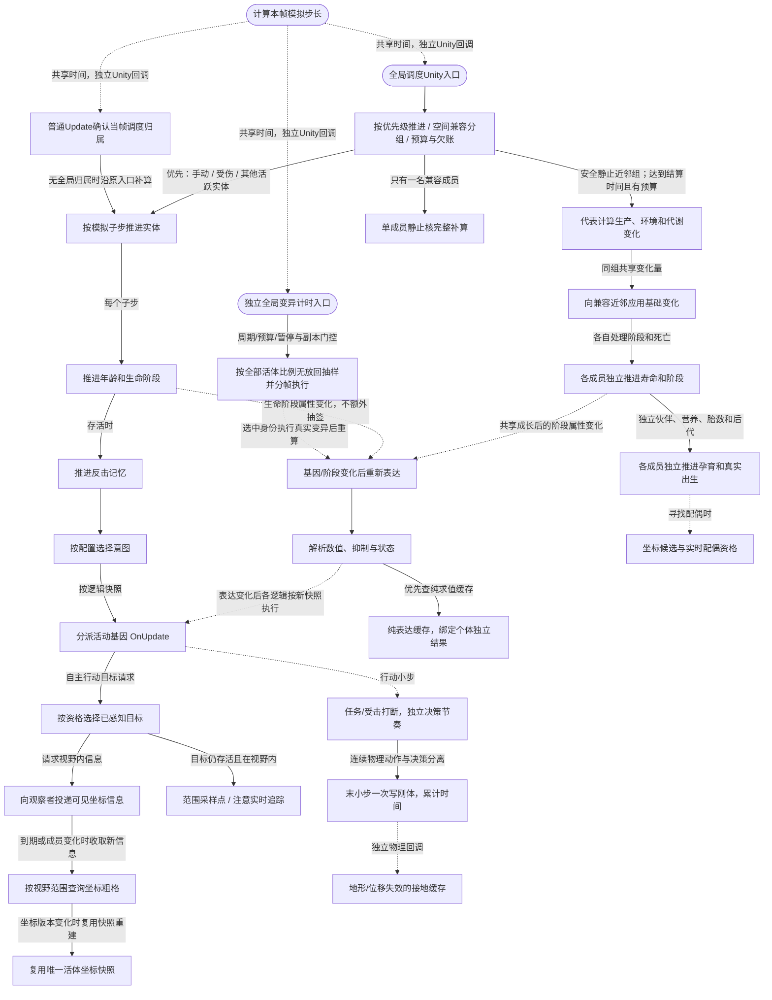
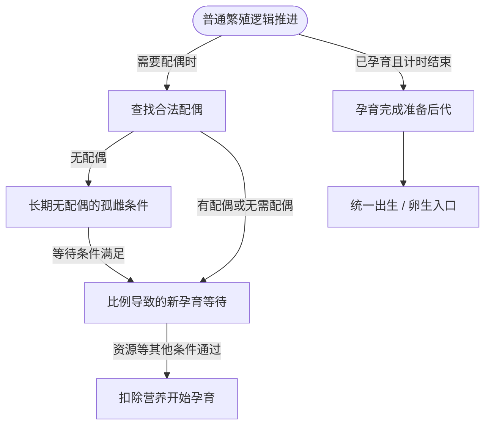
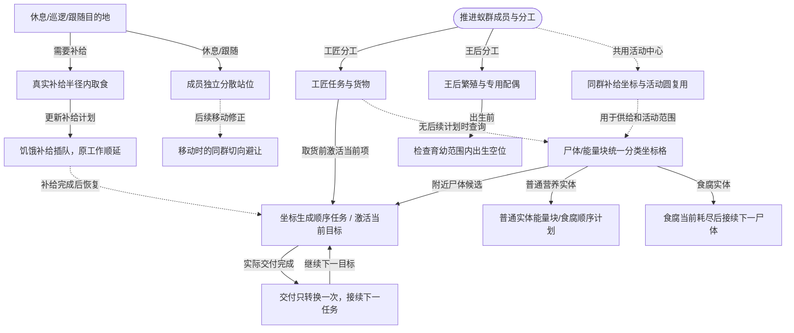
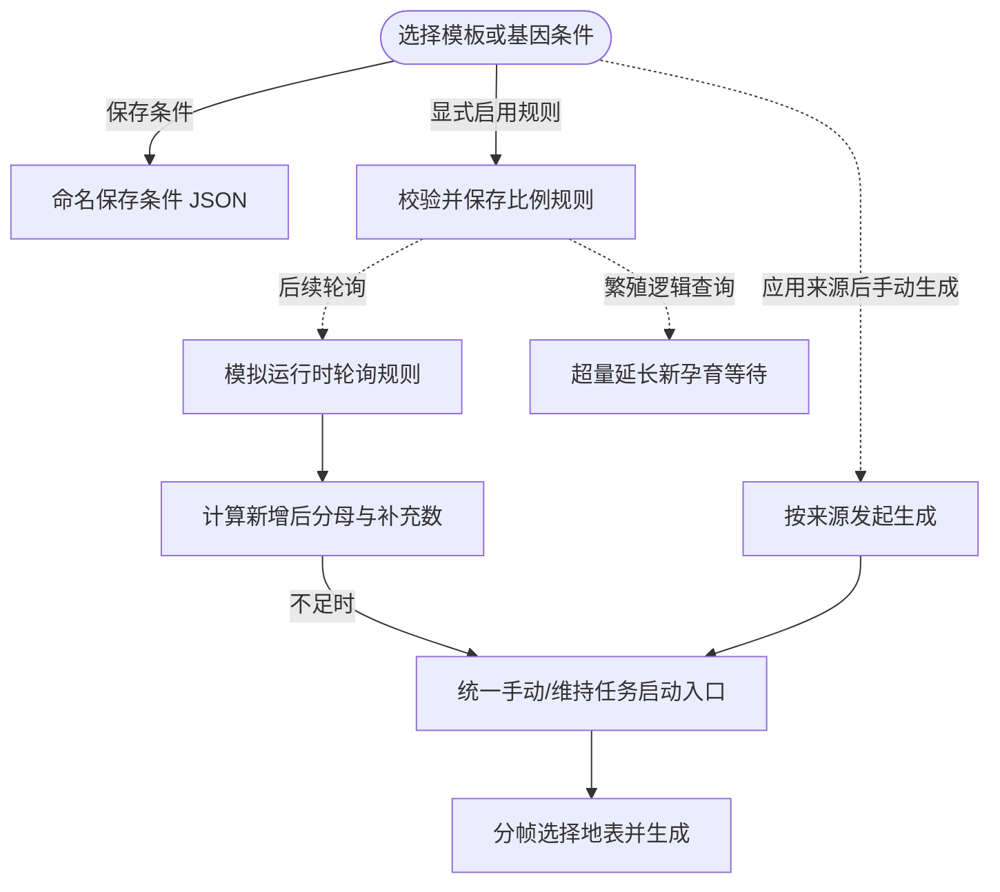
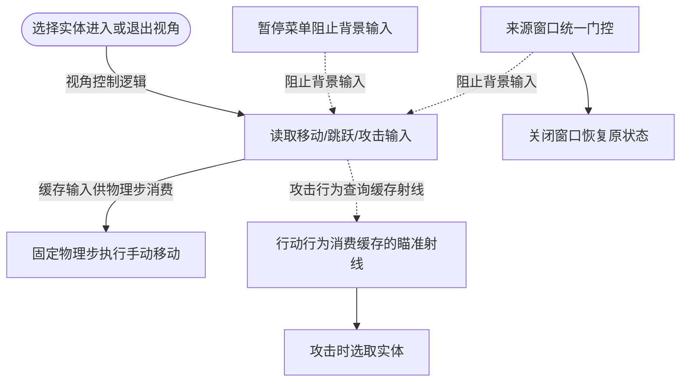
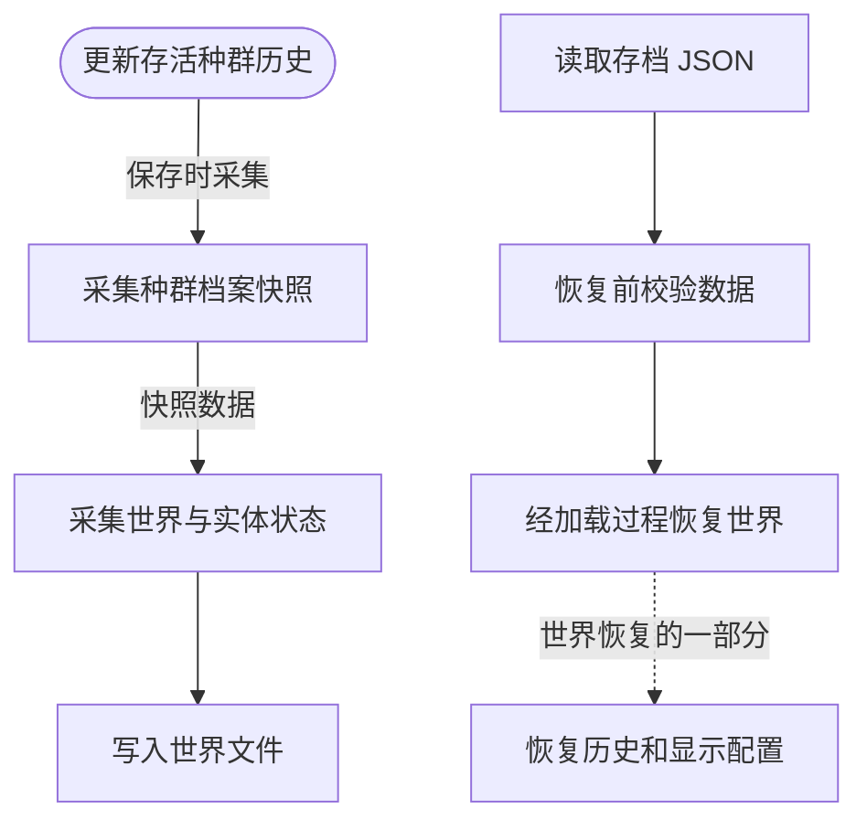
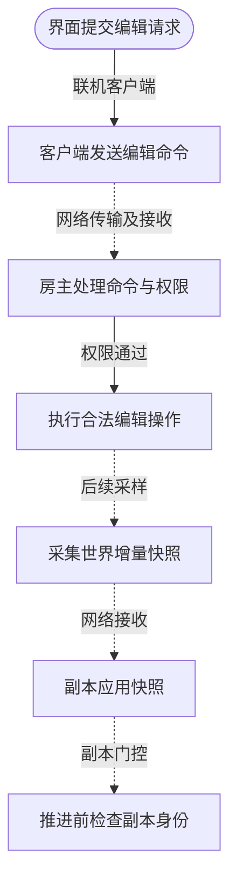
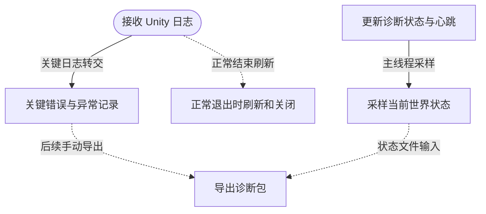

# 游戏业务主流程

[返回总索引](README.md) · [离线可交互版本](index.html)

这些图用于跨模块业务导航；虚线表示回调、异步传输或数据依赖，不把它们伪装成直接调用。精确的分支/循环/返回和真实调用目标请打开方法分图。

## 01 · 启动、服务与界面

初始化入口、时钟、生成委托、基因库和UI根节点。

- [RuntimeFileLog.Initialize · L17](脚本/8080b38a7e1c5585.md#m91f8e0905f759109)
- [SimulationClock.Awake · L33](脚本/a8f444aec9614b0a.md#m0c6d9c663fea16e1)
- [GameBootstrap.Awake · L14](脚本/b97bb0ddbd6571c6.md#m4fa1d594860c65b1)
- [GeneDatabase.EnsureLoaded · L12](脚本/ec0a03483435a863.md#mc3e6357b9ca440f5)
- [UIRoot.Awake · L17](脚本/9c1421378791f0e0.md#m0859faeb8e52aa7c)
- [GameMainMenu.Start · L64](脚本/a1f1791f9e7a8035.md#md2d6c43426ac08a3)
- [EntityFactory.CreateFromTemplate · L22](脚本/54fcd89ef79d04f6.md#mbe8d73397453244c)

不规定不同组件Awake的全部先后顺序；图中同时包含服务依赖与注册后的后续触发。

## 02 · 创建或读取世界

暂停模拟后生成地形和气候，恢复资源、实体及世界状态。

- [WorldSessionManager.Create · L41](脚本/08741c7b7b9d9344.md#m6aadfeee8b90aacd)
- [WorldSessionManager.Open · L60](脚本/08741c7b7b9d9344.md#m7bd56ef45131b4e5)
- [WorldSessionManager.Begin · L61](脚本/08741c7b7b9d9344.md#m4418b712b0e48c1b)
- [WorldSessionManager.SafeLoad · L69](脚本/08741c7b7b9d9344.md#m4b385a6f7ab58232)
- [WorldSessionManager.Load · L79](脚本/08741c7b7b9d9344.md#m24e50378a3d09d49)
- [PlanetTerrainGenerator.Generate · L20](脚本/cde9e7b164fab46e.md#m7c6d74a69a660a78)
- [PlanetTerrainMeshBuilder.ApplyGeneratedData · L160](脚本/415285cf043354a9.md#m3e899cb84c9a0081)
- [PlanetClimateModel.Generate · L59](脚本/0249d34bf86f4fa3.md#m49a6e534a85dc57e)
- [PlanetClimateMap.ApplyGeneratedClimate · L114](脚本/b4e9726c1bcf4c37.md#m20ba66ec7eca94e5)
- [GameMainMenu.OnWorldLoaded · L130](脚本/a1f1791f9e7a8035.md#m37a9b871e02230b3)
- [GameMainMenu.Resume · L114](脚本/a1f1791f9e7a8035.md#m9e12c1e0061b7874)

## 03 · 全局优先级、近邻合并与实体行为

统一模拟时间驱动全局轮次变异、优先调度与视野坐标投递；个体身份、寿命、孕育和欠账分别保存。

- [SimulationClock.Update · L51](脚本/a8f444aec9614b0a.md#m42a4cfef431ba20e)
- [EntityGeneController.Update · L62](脚本/7494d53178552f0e.md#m95c7003cca6fa7fc)
- [EntityGeneController.AdvanceSimulation · L71](脚本/7494d53178552f0e.md#m1fed1096c5150ade)
- [EntityLifeCycle.Advance · L25](脚本/9f4138bfbae654b7.md#m804ba580f54f09f3)
- [CombatIntent.Advance · L19](脚本/34193b994b2c0894.md#mcfb3109714c0797f)
- [EntityStateController.Advance · L42](脚本/0f8869eb7018091e.md#m6c706bafaee00fc7)
- [IGeneLogic.OnUpdate · L9](脚本/5304fdad773967f8.md#m829188d65276f8e5)
- [EntityGeneController.Recalculate · L111](脚本/7494d53178552f0e.md#mf588f8c1148316c6)
- [GeneValueResolver.Resolve · L32](脚本/837eb9ce6eba3cc6.md#m063abac8252cd4e8)
- [EntityWorkScheduler.Update · L90](脚本/465ccdbb260bcac2.md#m0f3d4ce373d341cb)
- [EntityWorkScheduler.Advance · L91](脚本/465ccdbb260bcac2.md#m3c6be95c9f3f99a5)
- [StationaryCohortKernel.Sample · L30](脚本/9d3f50e550ab5beb.md#mfdc83210552bef41)
- [StationaryCohortKernel.Apply · L50](脚本/9d3f50e550ab5beb.md#mdae765c40ec2fc75)
- [EntityLifeCycle.AdvanceShared · L27](脚本/9f4138bfbae654b7.md#m70423c7e99affa42)
- [StationaryCohortKernel.Reproduce · L58](脚本/9d3f50e550ab5beb.md#m4e4edb1f4fa56179)
- [MutationRoundController.Advance · L32](脚本/3a238ee75b15c52c.md#m61c3dd5509c871bf)
- [MutationRoundController.Update · L30](脚本/3a238ee75b15c52c.md#m8ba74a904d42e125)
- [EntityNeighborhood.CopyPositions · L98](脚本/e5e24c4aff0395b1.md#m1cb80fe106f6524f)
- [EntityCoordinateGrid.Query · L26](脚本/f6d0404a662a5d5c.md#mb223b609771bd310)
- [EntityPerceptionHub.Read · L42](脚本/aeecc36cb2c3cc24.md#mbe2216b46b71081b)
- [PerceivedTargets.Nearest · L11](脚本/b78759d0d0a172e4.md#mb5f59684e2d33e59)
- [EntityPerceptionHub.TryLocate · L57](脚本/aeecc36cb2c3cc24.md#m2cd96337ffd40bb4)
- [GeneExpressionCache.Resolve · L17](脚本/769f6842770bce00.md#m98052da9abf4cfad)
- [SingletonSettlement.Advance · L22](脚本/aa60fc9f4553ae15.md#m354a8ce1a94cb2a0)
- [ActionDecisionCadence.Due · L14](脚本/9f8bb5c506593a21.md#m18f88b0a7f3b9c90)
- [ActionMotionBatch.Consume · L11](脚本/e54155ca229c2706.md#m184f7ab096673914)
- [MateCoordinates.Find · L21](脚本/c0c58c738d12bfd2.md#m1929025f2180b77c)
- [GravityProbeCache.Probe · L15](脚本/901cef6b99719cf7.md#m87964189a0f02fea)

业务导航区分独立Unity入口。全局变异按模拟周期抽样并保存剩余名单；阶段只更新属性。感知复用坐标和粗格，注意追踪更新已知目标、范围状态保留采样点。实际资格、子步与事件以方法图为准。

## 04 · 攻击、消化、死亡与尸体

查找真实伤害结算、单次死亡与剩余营养的去向。

- [LocomotionGeneLogic.OnUpdate · L29](脚本/50c563bf540685c7.md#m4aa5cb51c26fdf34)
- [LocomotionGeneLogic.TryBite · L101](脚本/50c563bf540685c7.md#me705889fcdfd24cc)
- [EntityCombat.Receive · L12](脚本/a5b5b46ac6c197ae.md#mcdb8fa72b26b29f2)
- [EntityStats.Modify · L104](脚本/75aa86a368efdf24.md#m858c2a75d852ecc1)
- [EntityDeathSettlement.Die · L11](脚本/07fa6bdaadf50796.md#m700276963777d0a6)
- [NutritionTransfer.Digest · L38](脚本/081d3b8ff683e442.md#m5cc524e5acfbb3c7)
- [ColonyResource.LeaveCorpse · L38](脚本/293dbaecfff4b585.md#m3f450c44999b892d)
- [CorpseFeeding.Advance · L17](脚本/0494eed2004cafc6.md#m799528483716842b)
- [AntColonyWorker.Advance · L38](脚本/8a0cca2020271b6f.md#m50cbc0299445ba6b)
- [EntityVitals.AdvanceVitals · L49](脚本/7f68ee05c2ac84bc.md#mc04c7ebfa71c5680)

清场/读档销毁不等于生物死亡。守恒与判定的精确分支见方法内部流程。

## 05 · 普通繁殖与孤雌生殖

配偶、成年等待、储粮、孕育和统一出生入口。

- [ReproductionGeneLogic.OnUpdate · L39](脚本/ac319ea70bd8b723.md#mf655ffa9d27689fe)
- [ReproductionGeneLogic.FindMate · L163](脚本/ac319ea70bd8b723.md#m3aa9f8c194b01c36)
- [ParthenogenesisCondition.Advance · L223](脚本/ac319ea70bd8b723.md#mff5a4ccefcd56a6a)
- [PopulationMaintenance.BreedingReady · L127](脚本/923ccc4e86c4786c.md#m95bfae883556f0d8)
- [ReproductionGeneLogic.StartGestation · L140](脚本/ac319ea70bd8b723.md#mb093e2416b76084d)
- [ReproductionGeneLogic.SpawnOffspring · L169](脚本/ac319ea70bd8b723.md#md301cce6bd129ba6)
- [EcologyReproduction.Spawn · L9](脚本/eaaa574d7ae50e29.md#mc64a3524363ab773)

已孕育后代不会因维持比例超量被取消；蚁群王后走专用分工流程。

## 06 · 蚁群、工匠、补给与站位

工匠按坐标生成顺序任务，补给插队保留货物与后续计划，实际完成后接续；活动圆和资源索引复用。

- [AntColonyMember.Advance · L89](脚本/baebd85c05598377.md#md2a4dbccd9bd3897)
- [AntColonyWorker.Advance · L38](脚本/8a0cca2020271b6f.md#m50cbc0299445ba6b)
- [AntColonyReproduction.Advance · L25](脚本/c22084eac4e522ed.md#mf3336413ca12a59b)
- [ColonyFormation.TryBirthPosition · L60](脚本/c65dce2d54e43480.md#m831083c364c87901)
- [AntColonyMember.Destination · L148](脚本/baebd85c05598377.md#m030342cf009df4b1)
- [ColonyFeeding.Destination · L37](脚本/2cb56c08d08ff8ec.md#mae2885d7d6ea7035)
- [ColonyFormation.Home · L36](脚本/c65dce2d54e43480.md#m79ad3420baeaf49d)
- [ColonyFormation.Avoid · L43](脚本/c65dce2d54e43480.md#me7d09f85ef3637a0)
- [WorkerTaskQueue.Select · L27](脚本/dc0692495776be10.md#mf7061cdad05e5c0f)
- [WorkerTaskQueue.Feeding · L17](脚本/dc0692495776be10.md#mb78e6fc083b136b4)
- [WorkerTaskQueue.Complete · L23](脚本/dc0692495776be10.md#ma1450397c6869690)
- [ResourceCoordinates.Query · L58](脚本/93d731ac01e3af48.md#md13e92bc2b759c8f)
- [ResourceGroups.Read · L9](脚本/97a3c8522367343a.md#mffa234cc9b41040c)
- [EntityResourcePlan.FindEnergy · L28](脚本/569e8e31d0634370.md#m571f35e553bb40a8)
- [EntityResourcePlan.FindCorpse · L45](脚本/569e8e31d0634370.md#ma9c59688ac9ef989)

没有空位时保留孕育。目标与避让不是瞬移；没有真实能量的补给点不产生活动圈。

## 07 · 随机生成与维持比例

两种来源、独立JSON条件、分帧补充和繁殖调节。

- [RandomSpawnWorkbench.Open · L29](脚本/0763b7475b3c75db.md#m0c118b57d249ff5d)
- [RandomSpawnWorkbench.SaveCondition · L88](脚本/0763b7475b3c75db.md#ma218a6a158513b82)
- [RandomSpawnWorkbench.SaveRule · L74](脚本/0763b7475b3c75db.md#m42aecb344c8280a4)
- [RandomPlanetSpawner.Update · L86](脚本/1c13222a547b265c.md#ma34d7509b5f0cc9a)
- [PopulationMaintenance.Needed · L100](脚本/923ccc4e86c4786c.md#m9218b875eb51a5d3)
- [RandomPlanetSpawner.StartRecipe · L29](脚本/1c13222a547b265c.md#md0bfc3f365655a4d)
- [RandomPlanetSpawner.Generate · L48](脚本/1c13222a547b265c.md#mf871782b05cca5bf)
- [PopulationMaintenance.BreedingReady · L127](脚本/923ccc4e86c4786c.md#m95bfae883556f0d8)
- [RandomPlanetSpawner.StartInternal · L30](脚本/1c13222a547b265c.md#mabe47d337f439af8)

不自动删除超量实体；条件库跨世界复用，运行规则保留世界内快照。暂停、权限和数量上限仍生效。

## 08 · 操控、输入与UI门控

区分视角、物理、攻击目标和覆盖窗口的输入归属。

- [EntityViewController.Update · L38](脚本/0ad0345f83229ef0.md#m726306405756dd64)
- [EntityPossessionInput.Tick · L55](脚本/4c12d3ae76941d37.md#m82cccdeb60a8e9bd)
- [EntityManualControl.FixedUpdate · L47](脚本/a6969896da35e1f0.md#me9a1ea48b00d8050)
- [EntityAttackAim.Pick · L10](脚本/2e9dde897281c303.md#m6a55b6280b6e3053)
- [GameMainMenu.ShowPause · L103](脚本/a1f1791f9e7a8035.md#m057a6734b45decd8)
- [RandomSpawnWorkbench.Open · L29](脚本/0763b7475b3c75db.md#m0c118b57d249ff5d)
- [RandomSpawnWorkbench.Close · L42](脚本/0763b7475b3c75db.md#mb3132a8d58c9ba62)
- [EntityManualControl.GetAttackTarget · L28](脚本/a6969896da35e1f0.md#mb046508bf5d61cb1)

镜头、物理和界面按各自生命周期调度。输入框消费的按键不能穿透成为游戏动作。

## 09 · 存档、重载与种群档案

世界快照、磁盘读写、校验和历史恢复。

- [PopulationArchive.Observe · L68](脚本/084e119b69cdd751.md#m6afd6ec6b661dad6)
- [PopulationArchive.Capture · L110](脚本/084e119b69cdd751.md#m2b63358c5191143d)
- [WorldSessionManager.SaveNow · L165](脚本/08741c7b7b9d9344.md#m18bba4a94d6c04ef)
- [WorldSaveStore.Write · L127](脚本/d67a35e5e3814c15.md#m80ba103a33c1e31e)
- [WorldSaveStore.Read · L73](脚本/d67a35e5e3814c15.md#ma5ea70603e428e29)
- [WorldSaveStore.Validate · L74](脚本/d67a35e5e3814c15.md#m279d4b5dbcd2cfcc)
- [WorldSessionManager.Open · L60](脚本/08741c7b7b9d9344.md#m7bd56ef45131b4e5)
- [PopulationArchive.Restore · L123](脚本/084e119b69cdd751.md#ma1030dfe5b5f2565)

精确采集顺序见SaveNow与Load；不可把采集关系误读为独立的固定调度顺序。

## 10 · 局域网权限、命令与副本

房主判权执行，副本收快照，不独立推进生态。

- [LanEditActions.Submit · L16](脚本/2816321496f6360e.md#m5411c4b97ac4c898)
- [LanSession.SubmitEdit · L92](脚本/9fb633eebffe669c.md#mf20f22f787288df0)
- [LanSession.ProcessCommand · L142](脚本/9fb633eebffe669c.md#m22019411e81c9ecb)
- [LanEditExecutor.Apply · L27](脚本/2816321496f6360e.md#m1f827c7e486ff073)
- [LanWorldSnapshot.Frame · L32](脚本/02a722701106da02.md#m85d6595c09ac428c)
- [LanSession.ApplyFrame · L260](脚本/9fb633eebffe669c.md#m271cf3f3a4ebbffd)
- [EntityGeneController.AdvanceSimulation · L71](脚本/7494d53178552f0e.md#m1fed1096c5150ade)

虚线包括异步传输/数据依赖，不表示跨进程直接调用；离线直接执行见Submit。

## 11 · 地形、气候、矿脉与GPU

CPU生成数据，到网格、纹理和GPU渲染的关系。

- [PlanetTerrainGenerator.Generate · L20](脚本/cde9e7b164fab46e.md#m7c6d74a69a660a78)
- [PlanetTerrainMeshBuilder.ApplyGeneratedData · L160](脚本/415285cf043354a9.md#m3e899cb84c9a0081)
- [PlanetClimateModel.Generate · L59](脚本/0249d34bf86f4fa3.md#m49a6e534a85dc57e)
- [PlanetClimateMap.ApplyGeneratedClimate · L114](脚本/b4e9726c1bcf4c37.md#m20ba66ec7eca94e5)
- [PlanetOreSystem.GenerateOreMap · L40](脚本/86b3fbb4d9436121.md#m0449775dd894020c)

GPU使用兼容语法控制结构。宏、URP外部include和着色器阶段仍以渲染管线为准。

## 12 · 日志、崩溃诊断与导出

日志事件、异步持久化、心跳与导出的入口关系。

- [RuntimeFileLog.Receive · L43](脚本/8080b38a7e1c5585.md#mde9756dd697906ee)
- [RuntimeCrashDiagnostics.Receive · L57](脚本/b7eea720e09afd0b.md#mb8486cb668865dcf)
- [RuntimeCrashDiagnostics.Tick · L59](脚本/b7eea720e09afd0b.md#mc5afab299d0c34ce)
- [RuntimeDiagnosticWorldState.Sample · L13](脚本/7bd14a39565df6a0.md#ma23f0499040a58d5)
- [RuntimeCrashDiagnostics.ExportAsync · L86](脚本/b7eea720e09afd0b.md#m136ba9b12f0b873f)
- [RuntimeFileLog.Shutdown · L49](脚本/8080b38a7e1c5585.md#m817cce367fb66edc)

后台线程、主线程采样与未处理异常分别查看具体方法；异常退出不伪装为正常关闭。
