# AI 模块流程

[返回总索引](../README.md) · [离线交互手册](../index.html)

## 脚本目录

- [Assets/DarwinPark/AI/EntityAIContext.cs](#s99b6d9053b41a538)（0个方法/回调）
- [Assets/DarwinPark/AI/EntityAIController.cs](#sca7f038c139e16a4)（5个方法/回调）
- [Assets/DarwinPark/AI/GeneAIModuleRegistry.cs](#s58bd7c2d48df02e1)（6个方法/回调）
- [Assets/DarwinPark/AI/IGeneAIModule.cs](#s1d1cab401bb81820)（4个方法/回调）
- [Assets/DarwinPark/AI/Modules/BuiltinAIModules.cs](#sb5ed539c7f743461)（8个方法/回调）

---

<a id="s99b6d9053b41a538"></a>

## EntityAIContext.cs

`Runtime` · `Assets/DarwinPark/AI/EntityAIContext.cs`

[源文件](../../../Assets/DarwinPark/AI/EntityAIContext.cs) · 源码校验：`92d967a05e7105ef74969539790efa6b069f531296e09d7894b44fbb030cf23b`

方法按源文件位置排列。事件/回调引用不表示立即执行；完整源码与关系图请打开离线手册。

本文件没有显式方法体，属于数据/枚举/标记声明；字段与类型定义请在离线源码视图查看。


---

<a id="sca7f038c139e16a4"></a>

## EntityAIController.cs

`Runtime` · `Assets/DarwinPark/AI/EntityAIController.cs`

[源文件](../../../Assets/DarwinPark/AI/EntityAIController.cs) · 源码校验：`fc86ad0efd65d1138a8049308c339bb172fedb9785f83204f6a4beae37f5571b`

方法按源文件位置排列。事件/回调引用不表示立即执行；完整源码与关系图请打开离线手册。

<a id="madfd035a7a600128"></a>

### Awake · L20

`private void Awake()`


#### Editor / Player · Roslyn编译器控制流

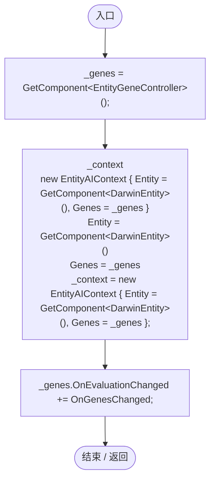

项目内调用/回调引用：

- [EntityAIController.OnGenesChanged · L28](AI.md#m6fb2b40bd1a36f95)（方法）

<a id="ma452e87ac884af81"></a>

### Start · L26

`private void Start()`


#### Editor / Player · Roslyn编译器控制流

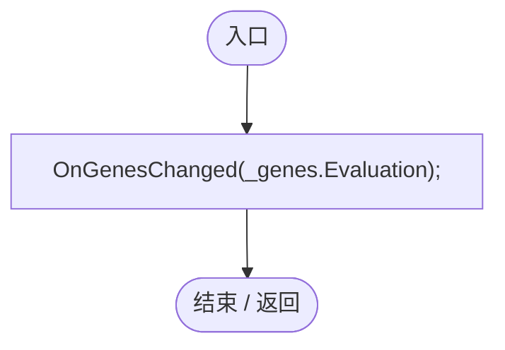

项目内调用/回调引用：

- [EntityAIController.OnGenesChanged · L28](AI.md#m6fb2b40bd1a36f95)（方法）
- [EntityGeneController.Evaluation.get · L20](Entities.md#mf275f100ea21601a)（访问器）

<a id="m6fb2b40bd1a36f95"></a>

### OnGenesChanged · L28

`private void OnGenesChanged(GenomeEvaluation evaluation)`


#### Editor / Player · Roslyn编译器控制流

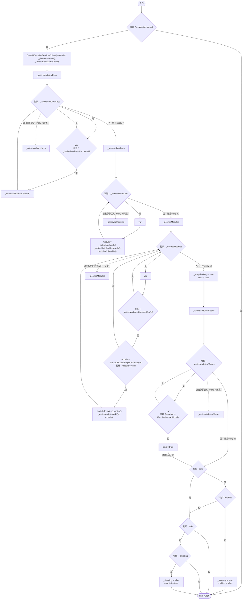

项目内调用/回调引用：

- [GeneAIDecisionService.Collect · L26](AI.md#m4adc27b5d1ec883e)（方法）
- [IGeneAIModule.OnDisable · L11](AI.md#m86b9146578be701b)（方法）
- [GeneAIModuleRegistry.Create · L17](AI.md#me23b2681b42c7371)（方法）
- [IGeneAIModule.Initialize · L9](AI.md#m870ffaac0a27d013)（方法）

<a id="m6ee480c0a857cdef"></a>

### Update · L53

`private void Update()`


#### Editor / Player · Roslyn编译器控制流

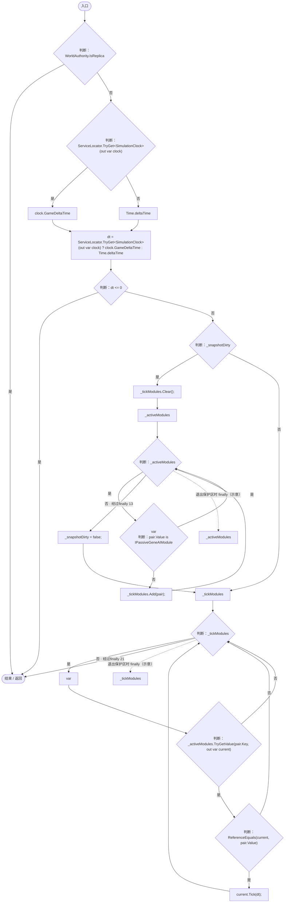

项目内调用/回调引用：

- [ServiceLocator.TryGet · L26](Core.md#m143b24e6d58471b0)（方法）
- [SimulationClock.GameDeltaTime.get · L26](Core.md#me7f11abae18a4f2d)（访问器）
- [IGeneAIModule.Tick · L10](AI.md#mf9c0b116b922ed11)（方法）

<a id="ma43bb43bf49bca3b"></a>

### OnDestroy · L69

`private void OnDestroy()`


#### Editor / Player · Roslyn编译器控制流

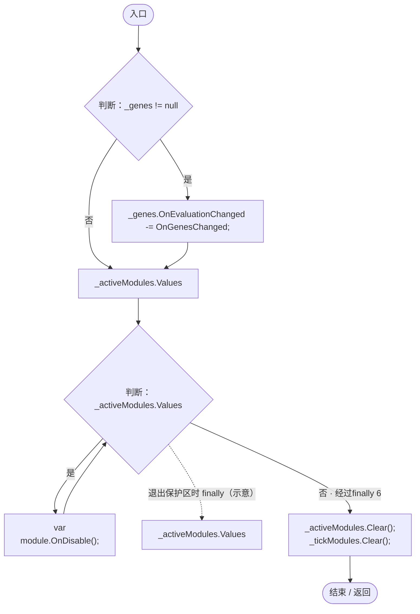

项目内调用/回调引用：

- [IGeneAIModule.OnDisable · L11](AI.md#m86b9146578be701b)（方法）
- [EntityAIController.OnGenesChanged · L28](AI.md#m6fb2b40bd1a36f95)（方法）


---

<a id="s58bd7c2d48df02e1"></a>

## GeneAIModuleRegistry.cs

`Runtime` · `Assets/DarwinPark/AI/GeneAIModuleRegistry.cs`

[源文件](../../../Assets/DarwinPark/AI/GeneAIModuleRegistry.cs) · 源码校验：`c97361a535baeb0e7808b7f9d449eb72e73c8a14c80f5333632b9655273bb8ee`

方法按源文件位置排列。事件/回调引用不表示立即执行；完整源码与关系图请打开离线手册。

<a id="m3d487202d25dffa3"></a>

### 回调@12 · L12

`( … => 回调`


#### Editor / Player · 语法控制结构 / 声明（非CFG）

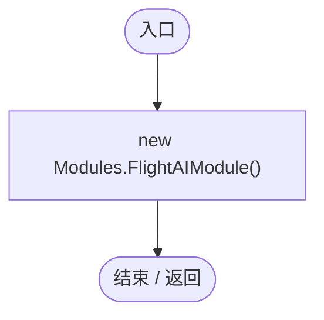

<a id="m40762356dba3abef"></a>

### 回调@13 · L13

`( … => 回调`


#### Editor / Player · 语法控制结构 / 声明（非CFG）

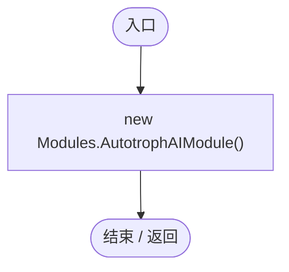

<a id="m57270d33d3f557a6"></a>

### Register · L15

`public static void Register(string moduleId, Func<IGeneAIModule> factory)`


#### Editor / Player · Roslyn编译器控制流

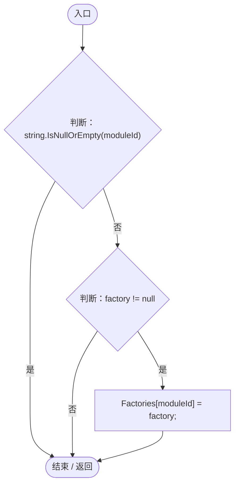

<a id="me23b2681b42c7371"></a>

### Create · L17

`public static IGeneAIModule Create(string moduleId)`


#### Editor / Player · Roslyn编译器控制流

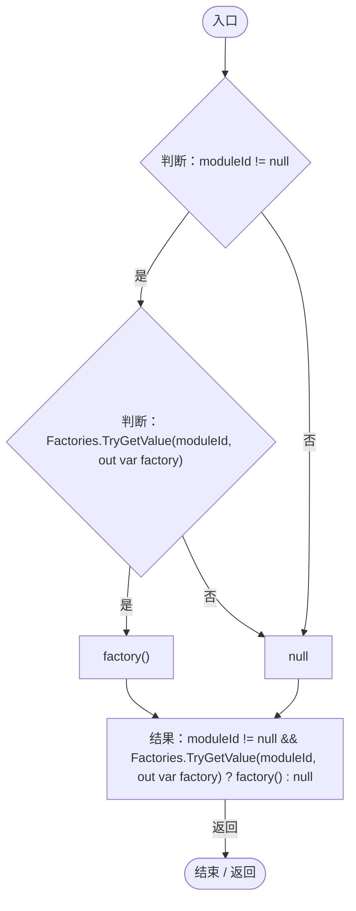

<a id="mc80721b2ab051be4"></a>

### DecideActiveModules · L24

`public static HashSet<string> DecideActiveModules(GenomeEvaluation evaluation)`


#### Editor / Player · Roslyn编译器控制流

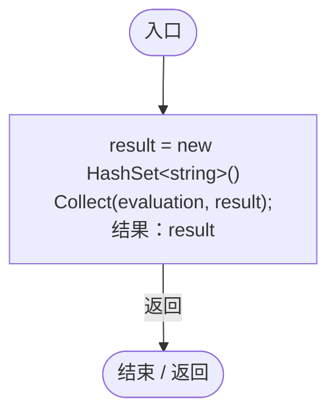

项目内调用/回调引用：

- [GeneAIDecisionService.Collect · L26](AI.md#m4adc27b5d1ec883e)（方法）

<a id="m4adc27b5d1ec883e"></a>

### Collect · L26

`public static void Collect(GenomeEvaluation evaluation, HashSet<string> result)`


#### Editor / Player · Roslyn编译器控制流

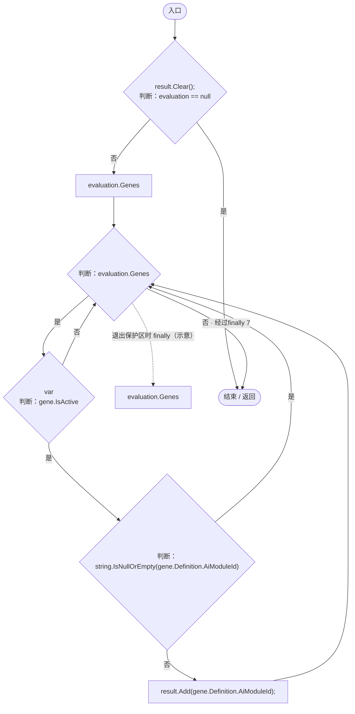


---

<a id="s1d1cab401bb81820"></a>

## IGeneAIModule.cs

`Runtime` · `Assets/DarwinPark/AI/IGeneAIModule.cs`

[源文件](../../../Assets/DarwinPark/AI/IGeneAIModule.cs) · 源码校验：`6cb7360521c46b72da299855966b04b4b9dfd2246855559deca21b0e6c6b4036`

方法按源文件位置排列。事件/回调引用不表示立即执行；完整源码与关系图请打开离线手册。

<a id="mf605b4cf109e56fe"></a>

### ModuleId.get · L8

`get`


#### Editor / Player · 语法控制结构 / 声明（非CFG）

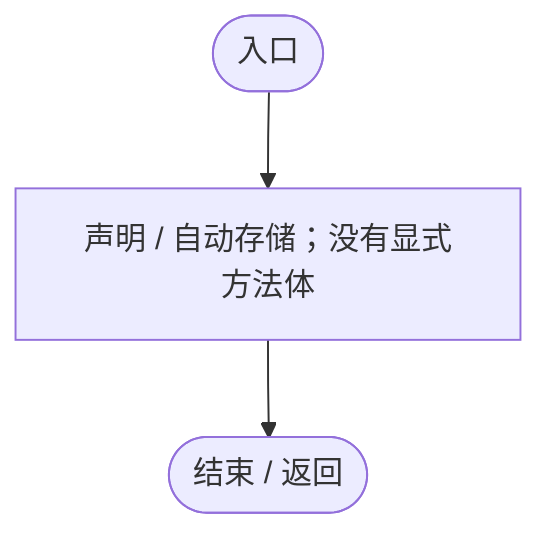

<a id="m870ffaac0a27d013"></a>

### Initialize · L9

`void Initialize(EntityAIContext context)`


#### Editor / Player · 语法控制结构 / 声明（非CFG）


<a id="mf9c0b116b922ed11"></a>

### Tick · L10

`void Tick(float deltaTime)`


#### Editor / Player · 语法控制结构 / 声明（非CFG）


<a id="m86b9146578be701b"></a>

### OnDisable · L11

`void OnDisable()`


#### Editor / Player · 语法控制结构 / 声明（非CFG）


---

<a id="sb5ed539c7f743461"></a>

## BuiltinAIModules.cs

`Runtime` · `Assets/DarwinPark/AI/Modules/BuiltinAIModules.cs`

[源文件](../../../Assets/DarwinPark/AI/Modules/BuiltinAIModules.cs) · 源码校验：`54b2dfe5e85fd90e015847d35679c6801d1333ac5965df016cecca3977d27a15`

方法按源文件位置排列。事件/回调引用不表示立即执行；完整源码与关系图请打开离线手册。

<a id="m95e7e5d4ddc4d991"></a>

### ModuleId.get · L6

`public string ModuleId`


#### Editor / Player · 语法控制结构 / 声明（非CFG）

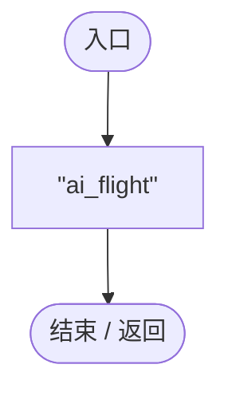

<a id="ma10b2716f80bbaed"></a>

### Initialize · L7

`public void Initialize(EntityAIContext context)`


#### Editor / Player · Roslyn编译器控制流


<a id="m1e0ab50d7fcfc95c"></a>

### Tick · L8

`public void Tick(float deltaTime)`


#### Editor / Player · Roslyn编译器控制流


<a id="ma66db427f28ee87b"></a>

### OnDisable · L9

`public void OnDisable()`


#### Editor / Player · Roslyn编译器控制流

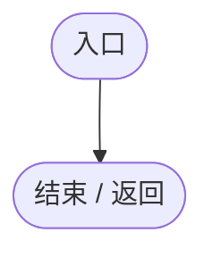

<a id="m633b6ba6bf971b21"></a>

### ModuleId.get · L13

`public string ModuleId`


#### Editor / Player · 语法控制结构 / 声明（非CFG）

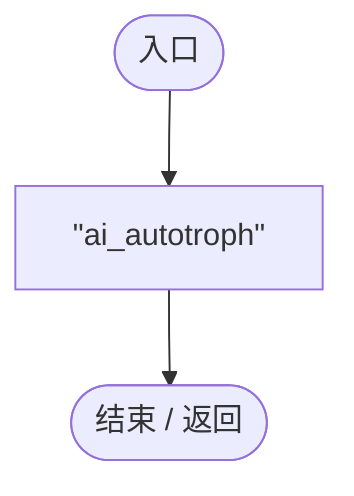

<a id="m321d2ce70cb3b960"></a>

### Initialize · L14

`public void Initialize(EntityAIContext context)`


#### Editor / Player · Roslyn编译器控制流

```mermaid
flowchart TD
  b0(["入口"])
  b1(["结束 / 返回"])
  b0 --> b1

```

<a id="m38f24202d898f22e"></a>

### Tick · L15

`public void Tick(float deltaTime)`


#### Editor / Player · Roslyn编译器控制流

```mermaid
flowchart TD
  b0(["入口"])
  b1(["结束 / 返回"])
  b0 --> b1

```

<a id="m07fe534f0e209580"></a>

### OnDisable · L16

`public void OnDisable()`


#### Editor / Player · Roslyn编译器控制流

```mermaid
flowchart TD
  b0(["入口"])
  b1(["结束 / 返回"])
  b0 --> b1

```
