# Core 模块流程

[返回总索引](../README.md) · [离线交互手册](../index.html)

## 脚本目录

- [Assets/DarwinPark/Core/ClimateDataHub.cs](#s57e90e22b25ae013)（0个方法/回调）
- [Assets/DarwinPark/Core/CommentedJson.cs](#sf72593057d514ce3)（1个方法/回调）
- [Assets/DarwinPark/Core/ControlBindings.cs](#sb6735f8f133ee3f4)（13个方法/回调）
- [Assets/DarwinPark/Core/Data/JsonResourceDatabase.cs](#s55a3ec07ee308cf8)（10个方法/回调）
- [Assets/DarwinPark/Core/DedicatedServerMode.cs](#s1e553b6d995f6e82)（3个方法/回调）
- [Assets/DarwinPark/Core/GameInputGate.cs](#s52955daae7e592ab)（4个方法/回调）
- [Assets/DarwinPark/Core/GamePaths.cs](#s26c9919989227f6e)（4个方法/回调）
- [Assets/DarwinPark/Core/GameplayTuning.cs](#sdb546e5713b32d53)（6个方法/回调）
- [Assets/DarwinPark/Core/GpuPerformanceSample.cs](#sdf1a6456e756b7d5)（5个方法/回调）
- [Assets/DarwinPark/Core/Logging/DiagnosticFiles.cs](#sd8a018f478416f7b)（12个方法/回调）
- [Assets/DarwinPark/Core/Logging/DiagnosticMemory.cs](#sda5a4e8a86332124)（3个方法/回调）
- [Assets/DarwinPark/Core/Logging/Log.cs](#s735e5abf0df2bddc)（4个方法/回调）
- [Assets/DarwinPark/Core/Logging/RuntimeCrashDiagnostics.cs](#sb7eea720e09afd0b)（12个方法/回调）
- [Assets/DarwinPark/Core/Logging/RuntimeDiagnosticSession.cs](#scdf29a3aa679d2b9)（11个方法/回调）
- [Assets/DarwinPark/Core/Logging/RuntimeDiagnosticSettings.cs](#se1f8672949291bee)（2个方法/回调）
- [Assets/DarwinPark/Core/Logging/RuntimeFileLog.cs](#s8080b38a7e1c5585)（12个方法/回调）
- [Assets/DarwinPark/Core/Logging/RuntimeLogLifecycle.cs](#s108cc41be732ad0e)（5个方法/回调）
- [Assets/DarwinPark/Core/Logging/RuntimeLogSettings.cs](#sade1290a5194a825)（2个方法/回调）
- [Assets/DarwinPark/Core/Logging/SessionLogWriter.cs](#s40cf249053355538)（12个方法/回调）
- [Assets/DarwinPark/Core/MutationRuleEdits.cs](#s063e584187dad139)（3个方法/回调）
- [Assets/DarwinPark/Core/OptionalComponent.cs](#s806c46b42ced4d36)（2个方法/回调）
- [Assets/DarwinPark/Core/OrbitCamera.cs](#s42eb429559b42bcb)（18个方法/回调）
- [Assets/DarwinPark/Core/PopulationRatioRuleEdits.cs](#s9580649cce6b5f38)（1个方法/回调）
- [Assets/DarwinPark/Core/RuleSelectionEdits.cs](#sf1d4e0eb3e10983c)（4个方法/回调）
- [Assets/DarwinPark/Core/RuntimeCostBreakdown.cs](#s98eb455b20a05753)（15个方法/回调）
- [Assets/DarwinPark/Core/RuntimePerformance.cs](#sa8403a4c7503726d)（17个方法/回调）
- [Assets/DarwinPark/Core/Services/ServiceLocator.cs](#sf2fdbe9f9ccd93cb)（5个方法/回调）
- [Assets/DarwinPark/Core/SimulationOptimization.cs](#s11c9091e70893352)（6个方法/回调）
- [Assets/DarwinPark/Core/SimulationSubsteps.cs](#s44755274b83df7ba)（2个方法/回调）
- [Assets/DarwinPark/Core/Time/SimulationClock.cs](#sa8f444aec9614b0a)（21个方法/回调）
- [Assets/DarwinPark/Core/Time/SimulationPauseHotkey.cs](#scc79d402ad5d8117)（6个方法/回调）
- [Assets/DarwinPark/Core/Time/SimulationStepBudget.cs](#s0ec4b354aeb329c1)（4个方法/回调）
- [Assets/DarwinPark/Core/UI/UIFactory.cs](#sdd1096a6995423db)（11个方法/回调）
- [Assets/DarwinPark/Core/UI/UIIconRegistry.cs](#s5e97f4545b48cac2)（3个方法/回调）
- [Assets/DarwinPark/Core/UI/UIRoot.cs](#s9c1421378791f0e0)（9个方法/回调）
- [Assets/DarwinPark/Core/UI/UIVisualTheme.cs](#sca525a798a08f966)（16个方法/回调）
- [Assets/DarwinPark/Core/WorldAuthority.cs](#s2361e41ab2baa157)（2个方法/回调）

---

<a id="s57e90e22b25ae013"></a>

## ClimateDataHub.cs

`Runtime` · `Assets/DarwinPark/Core/ClimateDataHub.cs`

[源文件](../../../Assets/DarwinPark/Core/ClimateDataHub.cs) · 源码校验：`2b680dca15e5fd02bbbf60645a317ecc96a6f8128e805d39d3a7ae9a9c11e2cd`

方法按源文件位置排列。事件/回调引用不表示立即执行；完整源码与关系图请打开离线手册。

本文件没有显式方法体，属于数据/枚举/标记声明；字段与类型定义请在离线源码视图查看。


---

<a id="sf72593057d514ce3"></a>

## CommentedJson.cs

`Runtime` · `Assets/DarwinPark/Core/CommentedJson.cs`

[源文件](../../../Assets/DarwinPark/Core/CommentedJson.cs) · 源码校验：`fd25efee8da37e243eea6ca1ba655b2c265c862fecbb518eb49075a108617692`

方法按源文件位置排列。事件/回调引用不表示立即执行；完整源码与关系图请打开离线手册。

<a id="mc9c02edd5a7f0a4d"></a>

### Strip · L9

`public static string Strip(string text)`


#### Editor / Player · Roslyn编译器控制流

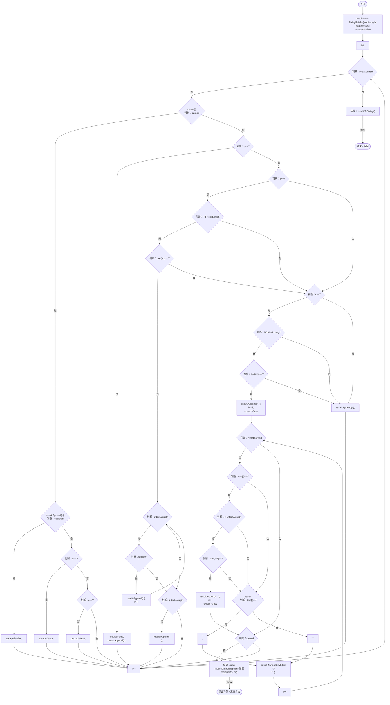


---

<a id="sb6735f8f133ee3f4"></a>

## ControlBindings.cs

`Runtime` · `Assets/DarwinPark/Core/ControlBindings.cs`

[源文件](../../../Assets/DarwinPark/Core/ControlBindings.cs) · 源码校验：`eabcac286cbc163b82cd256c87c6f9691e38ca0f398c317c8f3ecbcea73436fa`

方法按源文件位置排列。事件/回调引用不表示立即执行；完整源码与关系图请打开离线手册。

<a id="mde9cff359920e6da"></a>

### Defaults · L16

`private static Dictionary<ControlAction,KeyCode> Defaults()`


#### Editor / Player · Roslyn编译器控制流

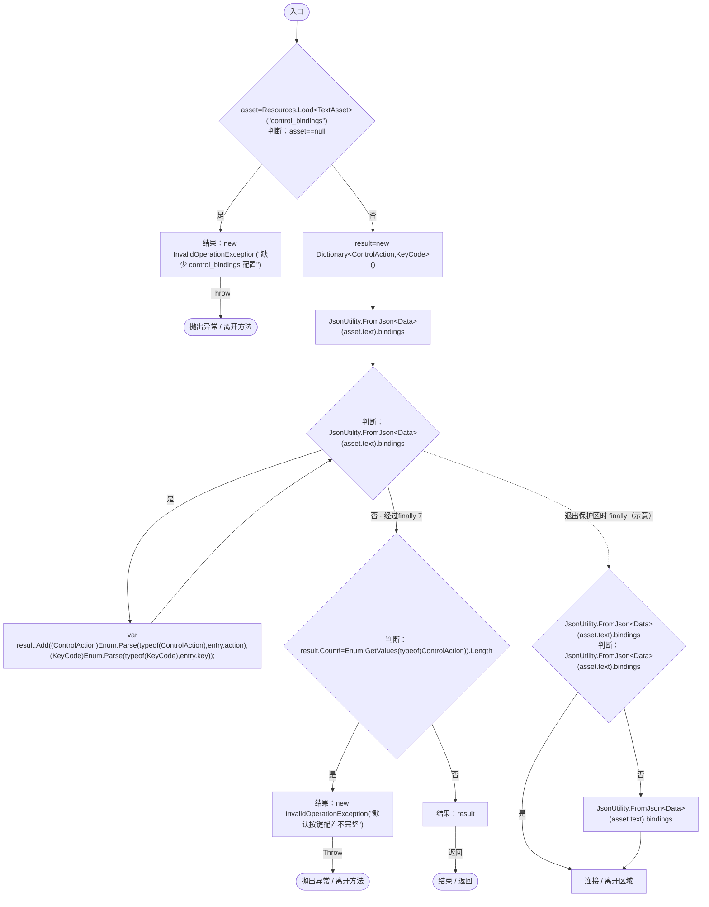

<a id="me8fe96de4e871833"></a>

### Ensure · L26

`private static void Ensure()`


#### Editor / Player · Roslyn编译器控制流

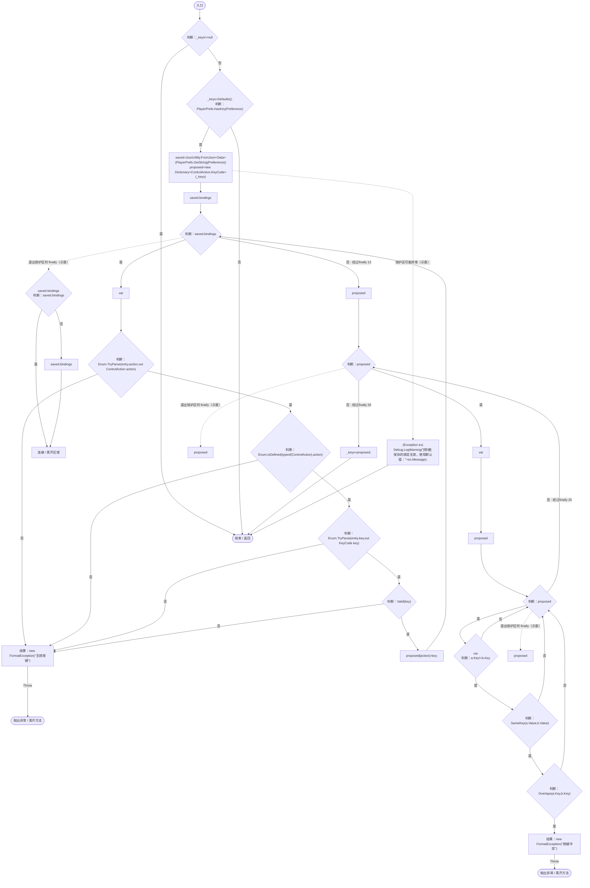

项目内调用/回调引用：

- [ControlBindings.Defaults · L16](Core.md#mde9cff359920e6da)（方法）
- [ControlBindings.Valid · L54](Core.md#m31d44dcc7e341ab0)（方法）
- [ControlBindings.SameKey · L53](Core.md#mb080f2a12cfb9826)（方法）
- [ControlBindings.Overlaps · L52](Core.md#m7742410f0f298220)（方法）

<a id="mb5707e6e63a56689"></a>

### Get · L45

`public static KeyCode Get(ControlAction action)`


#### Editor / Player · Roslyn编译器控制流

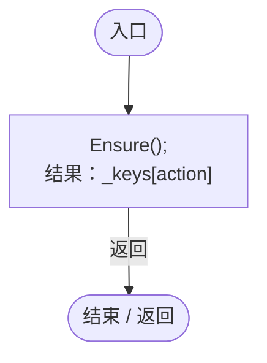

项目内调用/回调引用：

- [ControlBindings.Ensure · L26](Core.md#me8fe96de4e871833)（方法）

<a id="md4244ab88aa8af27"></a>

### Held · L46

`public static bool Held(ControlAction action)`


#### Editor / Player · Roslyn编译器控制流

```mermaid
flowchart TD
  b0(["入口"])
  b1["key=Get(action)"]
  b2{"判断：Input.GetKey(key)"}
  b3{"判断：key==KeyCode.LeftAlt"}
  b4["Input.GetKey(KeyCode.RightAlt)"]
  b5["key==KeyCode.LeftAlt"]
  b6["Input.GetKey(key)"]
  b7["结果：Input.GetKey(key)&#124;&#124;key==KeyCode.LeftAlt&amp;&amp;Input.GetKey(KeyCode.RightAlt)"]
  b8(["结束 / 返回"])
  b0 --> b1
  b1 --> b2
  b2 -->|"否"| b3
  b2 -->|"是"| b6
  b3 -->|"是"| b4
  b3 -->|"否"| b5
  b4 --> b7
  b5 --> b7
  b6 --> b7
  b7 -->|"返回"| b8

```

项目内调用/回调引用：

- [ControlBindings.Get · L45](Core.md#mb5707e6e63a56689)（方法）

<a id="mdf834c82033aa362"></a>

### Down · L50

`public static bool Down(ControlAction action)`


#### Editor / Player · Roslyn编译器控制流

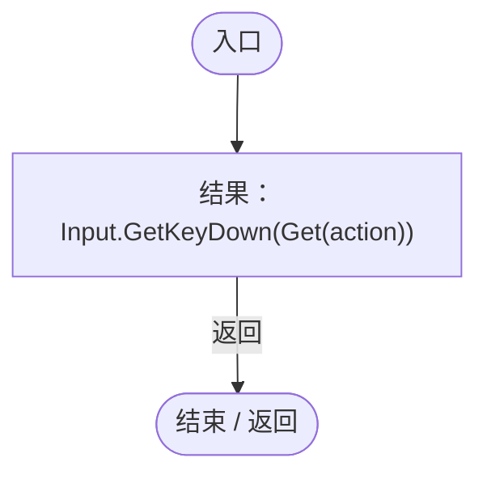

项目内调用/回调引用：

- [ControlBindings.Get · L45](Core.md#mb5707e6e63a56689)（方法）

<a id="m7742410f0f298220"></a>

### Overlaps · L52

`private static bool Overlaps(ControlAction a,ControlAction b)`

空格可分别承担星球暂停和实体跳跃；其他同时生效的操作不能绑定同一个键。

#### Editor / Player · Roslyn编译器控制流

```mermaid
flowchart TD
  b0(["入口"])
  b1{"判断：a!=ControlAction.WorldPause"}
  b2{"判断：b!=ControlAction.WorldPause"}
  b3{"判断：a&gt;=ControlAction.Rts"}
  b4{"判断：b&gt;=ControlAction.Rts"}
  b5{"判断：a==ControlAction.Pause"}
  b6["b==ControlAction.Pause"]
  b7["a!=ControlAction.WorldPause&amp;&amp;b!=ControlAction.WorldPause&#124;&#124;a&gt;=ControlAction.Rts&#124;&#124;b&gt;=ControlAction.Rts&#124;&#124;a==ControlAction.Pause&#124;&#124;b==ControlAction.Pause"]
  b8["结果：a!=ControlAction.WorldPause&amp;&amp;b!=ControlAction.WorldPause&#124;&#124;a&gt;=ControlAction.Rts&#124;&#124;b&gt;=ControlAction.Rts&#124;&#124;a==ControlAction.Pause&#124;&#124;b==ControlAction.Pause"]
  b9(["结束 / 返回"])
  b0 --> b1
  b1 -->|"是"| b2
  b1 -->|"否"| b3
  b2 -->|"否"| b3
  b2 -->|"是"| b7
  b3 -->|"否"| b4
  b3 -->|"是"| b7
  b4 -->|"否"| b5
  b4 -->|"是"| b7
  b5 -->|"否"| b6
  b5 -->|"是"| b7
  b6 --> b8
  b7 --> b8
  b8 -->|"返回"| b9

```

<a id="mb080f2a12cfb9826"></a>

### SameKey · L53

`private static bool SameKey(KeyCode a,KeyCode b)`


#### Editor / Player · Roslyn编译器控制流

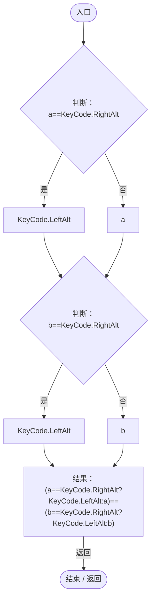

<a id="m31d44dcc7e341ab0"></a>

### Valid · L54

`private static bool Valid(KeyCode key)`


#### Editor / Player · Roslyn编译器控制流

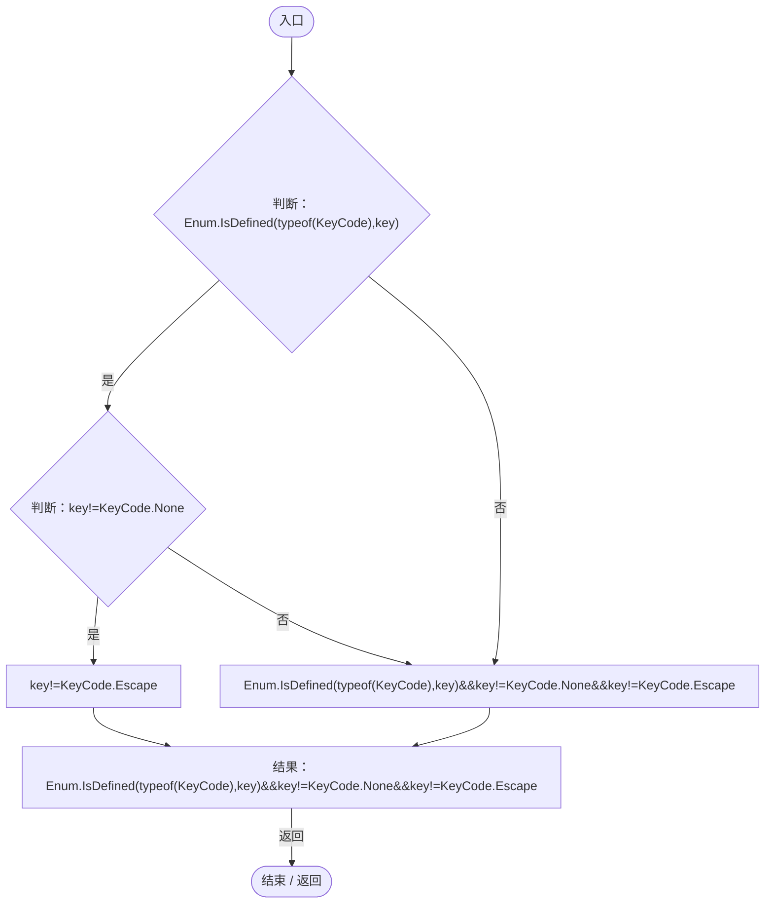

<a id="m2724f096eee115f2"></a>

### TryBind · L55

`public static bool TryBind(ControlAction action,KeyCode key,out string message)`


#### Editor / Player · Roslyn编译器控制流

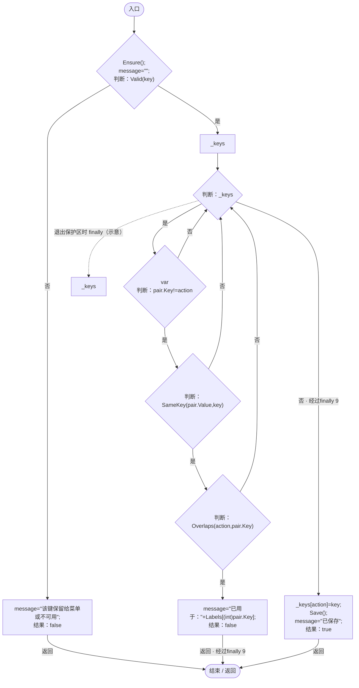

项目内调用/回调引用：

- [ControlBindings.Ensure · L26](Core.md#me8fe96de4e871833)（方法）
- [ControlBindings.Valid · L54](Core.md#m31d44dcc7e341ab0)（方法）
- [ControlBindings.SameKey · L53](Core.md#mb080f2a12cfb9826)（方法）
- [ControlBindings.Overlaps · L52](Core.md#m7742410f0f298220)（方法）
- [ControlBindings.Save · L62](Core.md#me3ddbbf0d2471961)（方法）

<a id="me3ddbbf0d2471961"></a>

### Save · L62

`public static void Save()`


#### Editor / Player · Roslyn编译器控制流

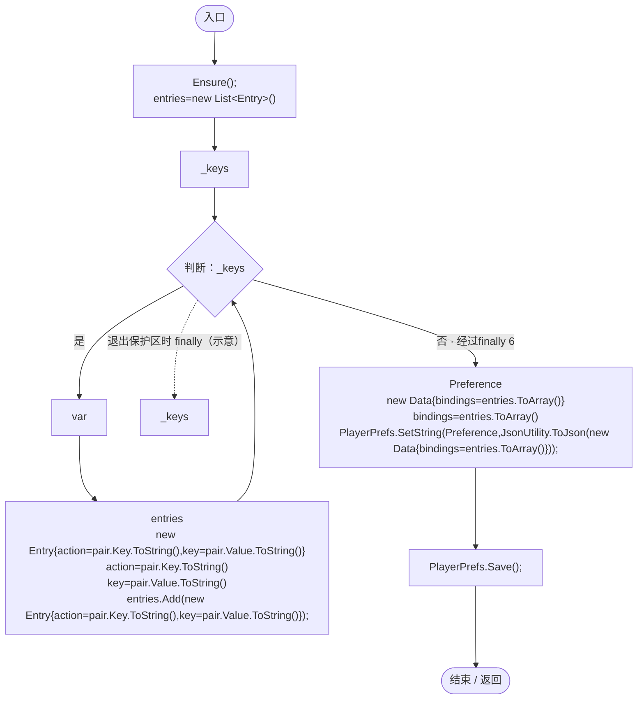

项目内调用/回调引用：

- [ControlBindings.Ensure · L26](Core.md#me8fe96de4e871833)（方法）

<a id="m479d8e9c3bd1b890"></a>

### RestoreDefaults · L67

`public static void RestoreDefaults()`


#### Editor / Player · Roslyn编译器控制流

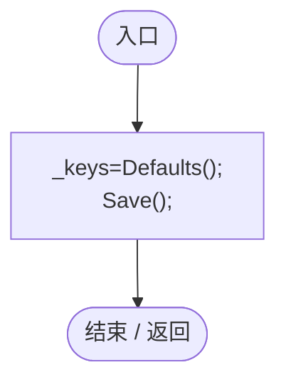

项目内调用/回调引用：

- [ControlBindings.Defaults · L16](Core.md#mde9cff359920e6da)（方法）
- [ControlBindings.Save · L62](Core.md#me3ddbbf0d2471961)（方法）

<a id="m9bd4296160207463"></a>

### Display · L68

`public static string Display(ControlAction action)`


#### Editor / Player · Roslyn编译器控制流

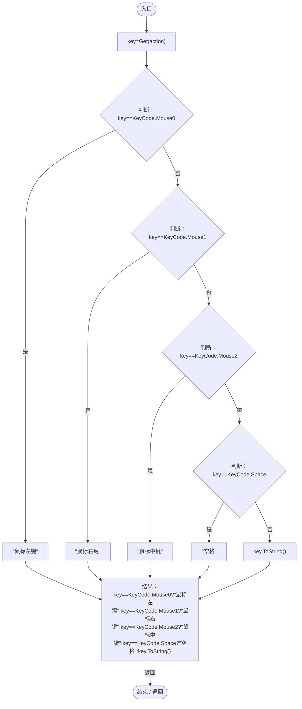

项目内调用/回调引用：

- [ControlBindings.Get · L45](Core.md#mb5707e6e63a56689)（方法）

<a id="me028e7c0de17a4bd"></a>

### ClearCache · L72

`[RuntimeInitializeOnLoadMethod(RuntimeInitializeLoadType.SubsystemRegistration)] public static void ClearCache()`


#### Editor / Player · Roslyn编译器控制流

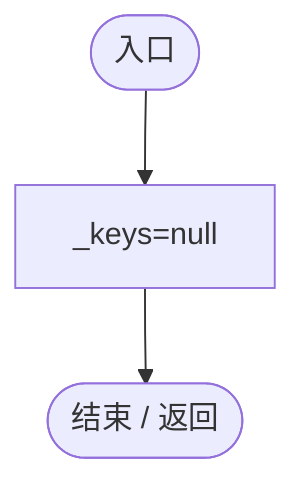


---

<a id="s55a3ec07ee308cf8"></a>

## JsonResourceDatabase.cs

`Runtime` · `Assets/DarwinPark/Core/Data/JsonResourceDatabase.cs`

[源文件](../../../Assets/DarwinPark/Core/Data/JsonResourceDatabase.cs) · 源码校验：`a7fe1abaf0a3d166ac1002f559b6958d7e5cf5ad51bc80a25b633b06e679c4a7`

方法按源文件位置排列。事件/回调引用不表示立即执行；完整源码与关系图请打开离线手册。

<a id="m8faa5713647c7cfe"></a>

### JsonResourceDatabase.ctor · L17

`protected JsonResourceDatabase(Log.Tag tag)`


#### Editor / Player · Roslyn编译器控制流

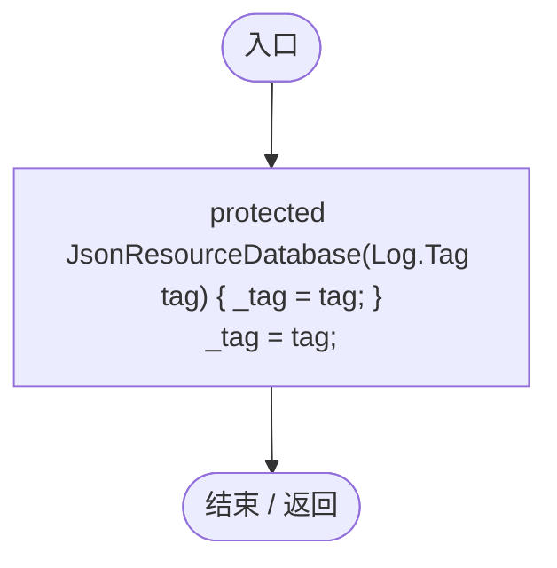

<a id="ma3baf7f4ebd91f07"></a>

### ResourceFolder.get · L19

`get`


#### Editor / Player · 语法控制结构 / 声明（非CFG）

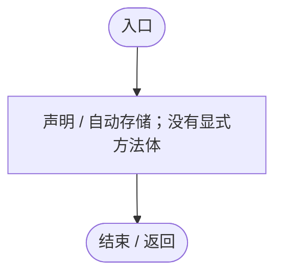

<a id="m1c90341630a020c8"></a>

### GetId · L20

`protected abstract string GetId(T item)`


#### Editor / Player · 语法控制结构 / 声明（非CFG）


<a id="mb556c7a5dd7d8ea1"></a>

### ConvertFromJson · L21

`protected abstract T ConvertFromJson(string jsonText, string assetName)`


#### Editor / Player · 语法控制结构 / 声明（非CFG）


<a id="m7c16e1e10c907b04"></a>

### OnPostLoad · L22

`protected virtual void OnPostLoad(IReadOnlyDictionary<string, T> all)`


#### Editor / Player · Roslyn编译器控制流

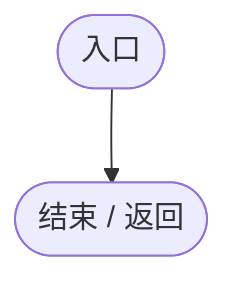

<a id="m34d10da4f0c7dd13"></a>

### EnsureLoaded · L24

`public void EnsureLoaded()`


#### Editor / Player · Roslyn编译器控制流

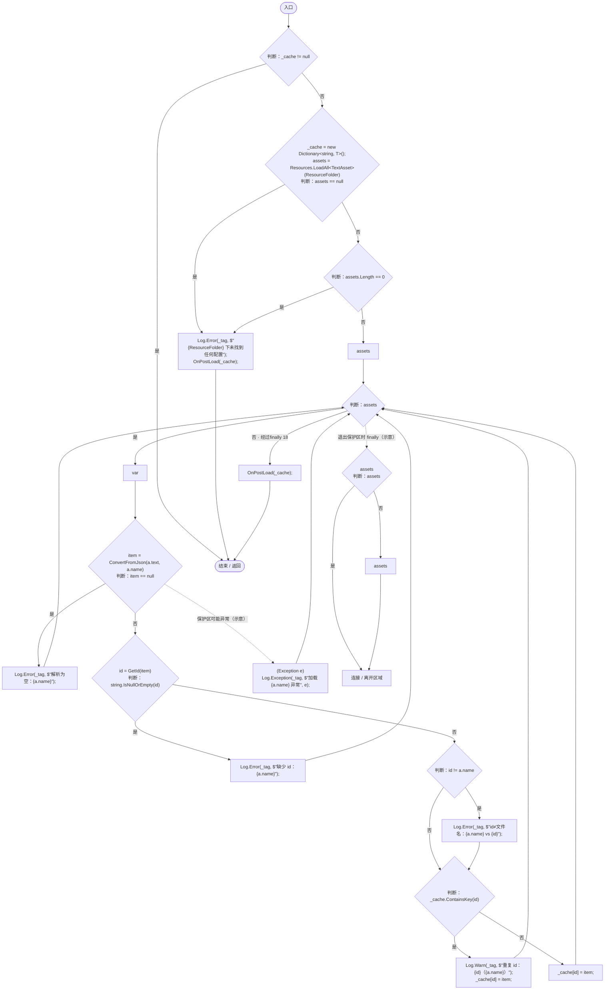

项目内调用/回调引用：

- [JsonResourceDatabase.ResourceFolder.get · L19](Core.md#ma3baf7f4ebd91f07)（访问器）
- [Log.Error · L43](Core.md#m2addd5e1d74b000d)（方法）
- [JsonResourceDatabase.OnPostLoad · L22](Core.md#m7c16e1e10c907b04)（方法）
- [JsonResourceDatabase.ConvertFromJson · L21](Core.md#mb556c7a5dd7d8ea1)（方法）
- [JsonResourceDatabase.GetId · L20](Core.md#m1c90341630a020c8)（方法）
- [Log.Warn · L37](Core.md#m25a5d11252901de1)（方法）
- [Log.Exception · L48](Core.md#m523652bd455f6a6f)（方法）

<a id="m20bbd84a76422a9e"></a>

### Get · L69

`public T Get(string id)`


#### Editor / Player · Roslyn编译器控制流

```mermaid
flowchart TD
  b0(["入口"])
  b1{"EnsureLoaded();<br/>判断：string.IsNullOrEmpty(id)"}
  b2["Log.Error(_tag, &quot;Get(null)&quot;);<br/>结果：null"]
  b3{"判断：_cache.TryGetValue(id, out var v)"}
  b4["结果：v"]
  b5["Log.Warn(_tag, $&quot;未找到定义：{id}&quot;);<br/>结果：null"]
  b6(["结束 / 返回"])
  b0 --> b1
  b1 -->|"是"| b2
  b1 -->|"否"| b3
  b2 -->|"返回"| b6
  b3 -->|"是"| b4
  b3 -->|"否"| b5
  b4 -->|"返回"| b6
  b5 -->|"返回"| b6

```

项目内调用/回调引用：

- [JsonResourceDatabase.EnsureLoaded · L24](Core.md#m34d10da4f0c7dd13)（方法）
- [Log.Error · L43](Core.md#m2addd5e1d74b000d)（方法）
- [Log.Warn · L37](Core.md#m25a5d11252901de1)（方法）

<a id="mb7ebfd22fbe3c231"></a>

### All.get · L78

`get`


#### Editor / Player · Roslyn编译器控制流

```mermaid
flowchart TD
  b0(["入口"])
  b1["EnsureLoaded();<br/>结果：_cache.Values"]
  b2(["结束 / 返回"])
  b0 --> b1
  b1 -->|"返回"| b2

```

项目内调用/回调引用：

- [JsonResourceDatabase.EnsureLoaded · L24](Core.md#m34d10da4f0c7dd13)（方法）

<a id="m955376ce22207d3e"></a>

### Reload · L80

`public void Reload()`


#### Editor / Player · Roslyn编译器控制流

```mermaid
flowchart TD
  b0(["入口"])
  b1["_cache = null"]
  b2(["结束 / 返回"])
  b0 --> b1
  b1 --> b2

```

<a id="mbd1c8e75a1bc6028"></a>

### Seed · L82

`public void Seed(T item)`


#### Editor / Player · Roslyn编译器控制流

```mermaid
flowchart TD
  b0(["入口"])
  b1{"EnsureLoaded();<br/>id = GetId(item)<br/>判断：string.IsNullOrEmpty(id)"}
  b2["_cache[id] = item;"]
  b3(["结束 / 返回"])
  b0 --> b1
  b1 -->|"否"| b2
  b1 -->|"是"| b3
  b2 --> b3

```

项目内调用/回调引用：

- [JsonResourceDatabase.EnsureLoaded · L24](Core.md#m34d10da4f0c7dd13)（方法）
- [JsonResourceDatabase.GetId · L20](Core.md#m1c90341630a020c8)（方法）


---

<a id="s1e553b6d995f6e82"></a>

## DedicatedServerMode.cs

`Runtime` · `Assets/DarwinPark/Core/DedicatedServerMode.cs`

[源文件](../../../Assets/DarwinPark/Core/DedicatedServerMode.cs) · 源码校验：`b005285067b9e31ce9ae7b70a9301f58e5669025d29c290832a2f3de5a94944c`

方法按源文件位置排列。事件/回调引用不表示立即执行；完整源码与关系图请打开离线手册。

<a id="mbc77f72f83f4ad28"></a>

### Enabled.get · L11

`get`


#### Editor / Player · Roslyn编译器控制流

```mermaid
flowchart TD
  b0(["入口"])
  b1["结果：false"]
  b2(["结束 / 返回"])
  b0 --> b1
  b1 -->|"返回"| b2

```

<a id="m61adefccc181dfa8"></a>

### Argument · L20

`public static string Argument(string key)`


#### Editor / Player · Roslyn编译器控制流

```mermaid
flowchart TD
  b0(["入口"])
  b1["args=System.Environment.GetCommandLineArgs()"]
  b2["i=0"]
  b3{"判断：i&lt;args.Length"}
  b4{"判断：args[i]==key"}
  b5{"判断：i+1==args.Length"}
  b6{"判断：args[i+1].StartsWith(&quot;-&quot;,StringComparison.Ordinal)"}
  b7["结果：new ArgumentException(&quot;Missing value for &quot;+key)"]
  x7(["抛出异常 / 离开方法"])
  b8["结果：args[i+1]"]
  b9["i++"]
  b10["结果：null"]
  b11(["结束 / 返回"])
  b0 --> b1
  b1 --> b2
  b2 --> b3
  b3 -->|"是"| b4
  b3 -->|"否"| b10
  b4 -->|"是"| b5
  b4 -->|"否"| b9
  b5 -->|"否"| b6
  b5 -->|"是"| b7
  b6 -->|"是"| b7
  b6 -->|"否"| b8
  b7 -->|"Throw"| x7
  b8 -->|"返回"| b11
  b9 --> b3
  b10 -->|"返回"| b11

```

<a id="m8038e52a9403f94c"></a>

### DataRoot · L30

`public static string DataRoot(string fallback)`


#### Editor / Player · Roslyn编译器控制流

```mermaid
flowchart TD
  b0(["入口"])
  b1{"判断：Enabled"}
  b2["Argument(&quot;-server-data&quot;)"]
  b3["null"]
  b4["path=Enabled?Argument(&quot;-server-data&quot;):null"]
  b5{"path<br/>判断：path"}
  b6["path"]
  b7["fallback"]
  b8["结果：Path.GetFullPath(path??fallback)"]
  b9(["结束 / 返回"])
  b0 --> b1
  b1 -->|"是"| b2
  b1 -->|"否"| b3
  b2 --> b4
  b3 --> b4
  b4 --> b5
  b5 -->|"否"| b6
  b5 -->|"是"| b7
  b6 --> b8
  b7 --> b8
  b8 -->|"返回"| b9

```

项目内调用/回调引用：

- [DedicatedServerMode.Enabled.get · L11](Core.md#mbc77f72f83f4ad28)（访问器）
- [DedicatedServerMode.Argument · L20](Core.md#m61adefccc181dfa8)（方法）


---

<a id="s52955daae7e592ab"></a>

## GameInputGate.cs

`Runtime` · `Assets/DarwinPark/Core/GameInputGate.cs`

[源文件](../../../Assets/DarwinPark/Core/GameInputGate.cs) · 源码校验：`a53778ddc995bdb3ddcd9c2e1ae69b11709616be042e07e14139a82eeed6276f`

方法按源文件位置排列。事件/回调引用不表示立即执行；完整源码与关系图请打开离线手册。

<a id="m765763b665829633"></a>

### Blocked.get · L8

`get`


#### Editor / Player · Roslyn编译器控制流

```mermaid
flowchart TD
  b0(["入口"])
  b1{"判断：_blocked"}
  b2["_escapeFrame==UnityEngine.Time.frameCount"]
  b3["_blocked"]
  b4["结果：_blocked &#124;&#124; _escapeFrame==UnityEngine.Time.frameCount"]
  b5(["结束 / 返回"])
  b0 --> b1
  b1 -->|"否"| b2
  b1 -->|"是"| b3
  b2 --> b4
  b3 --> b4
  b4 -->|"返回"| b5

```

<a id="m578697f6379686f4"></a>

### Blocked.set · L8

`set`


#### Editor / Player · Roslyn编译器控制流

```mermaid
flowchart TD
  b0(["入口"])
  b1["_blocked=value"]
  b2(["结束 / 返回"])
  b0 --> b1
  b1 --> b2

```

<a id="m5b050ac6f014de67"></a>

### ConsumeEscape · L9

`public static void ConsumeEscape()`


#### Editor / Player · Roslyn编译器控制流

```mermaid
flowchart TD
  b0(["入口"])
  b1["_escapeFrame=UnityEngine.Time.frameCount"]
  b2(["结束 / 返回"])
  b0 --> b1
  b1 --> b2

```

<a id="m1e9679dfbe887a6c"></a>

### Reset · L10

`[UnityEngine.RuntimeInitializeOnLoadMethod(UnityEngine.RuntimeInitializeLoadType.SubsystemRegistration)] private static void Reset()`


#### Editor / Player · Roslyn编译器控制流

```mermaid
flowchart TD
  b0(["入口"])
  b1["_blocked=false;<br/>_escapeFrame=-1;"]
  b2(["结束 / 返回"])
  b0 --> b1
  b1 --> b2

```


---

<a id="s26c9919989227f6e"></a>

## GamePaths.cs

`Runtime` · `Assets/DarwinPark/Core/GamePaths.cs`

[源文件](../../../Assets/DarwinPark/Core/GamePaths.cs) · 源码校验：`6b5072a2269ffba9b3bcb37a2a1357ca1c54cf09b04d60a16e6fe5a0c3aa4a2e`

方法按源文件位置排列。事件/回调引用不表示立即执行；完整源码与关系图请打开离线手册。

<a id="m5f215aa46c9265af"></a>

### Root.get · L8

`public static string Root`


#### Editor / Player · 语法控制结构 / 声明（非CFG）

```mermaid
flowchart TD
  n2(["入口"])
  n1["DedicatedServerMode.DataRoot(Path.Combine(Application.dataPath,&quot;..&quot;))"]
  n0(["结束 / 返回"])
  n1 --> n0
  n2 --> n1

```

项目内调用/回调引用：

- [DedicatedServerMode.DataRoot · L30](Core.md#m8038e52a9403f94c)（方法）

<a id="m6b4a21fb53fcb7c3"></a>

### Saves.get · L9

`public static string Saves`


#### Editor / Player · 语法控制结构 / 声明（非CFG）

```mermaid
flowchart TD
  n2(["入口"])
  n1["Path.Combine(Root,&quot;save&quot;)"]
  n0(["结束 / 返回"])
  n1 --> n0
  n2 --> n1

```

<a id="m087b5d693ac14073"></a>

### Mods.get · L10

`public static string Mods`


#### Editor / Player · 语法控制结构 / 声明（非CFG）

```mermaid
flowchart TD
  n2(["入口"])
  n1["Path.Combine(Root,&quot;mods&quot;)"]
  n0(["结束 / 返回"])
  n1 --> n0
  n2 --> n1

```

<a id="mbced79dc7d9e4e27"></a>

### Reset · L15

`[RuntimeInitializeOnLoadMethod(RuntimeInitializeLoadType.SubsystemRegistration)] private static void Reset()`


#### Editor / Player · Roslyn编译器控制流

```mermaid
flowchart TD
  b0(["入口"])
  b1["Managed=Ready=Loading=Recording=false;"]
  b2(["结束 / 返回"])
  b0 --> b1
  b1 --> b2

```


---

<a id="sdb546e5713b32d53"></a>

## GameplayTuning.cs

`Runtime` · `Assets/DarwinPark/Core/GameplayTuning.cs`

[源文件](../../../Assets/DarwinPark/Core/GameplayTuning.cs) · 源码校验：`85e0abb80f14cbfc046e0a41bfa0651161ba1b7741aa711bcddc4eeccdffe503`

方法按源文件位置排列。事件/回调引用不表示立即执行；完整源码与关系图请打开离线手册。

<a id="mf7fec33e6f647c76"></a>

### FilePath.get · L45

`public static string FilePath`


#### Editor / Player · 语法控制结构 / 声明（非CFG）

```mermaid
flowchart TD
  n2(["入口"])
  n1["Path.Combine(GamePaths.Root,&quot;config&quot;,&quot;gameplay.json&quot;)"]
  n0(["结束 / 返回"])
  n1 --> n0
  n2 --> n1

```

<a id="m4fa691bd8a3b9618"></a>

### Current.get · L46

`get`


#### Editor / Player · Roslyn编译器控制流

```mermaid
flowchart TD
  b0(["入口"])
  b1{"判断：_current==null"}
  b2["Reload();"]
  b3["结果：_current"]
  b4(["结束 / 返回"])
  b0 --> b1
  b1 -->|"是"| b2
  b1 -->|"否"| b3
  b2 --> b3
  b3 -->|"返回"| b4

```

项目内调用/回调引用：

- [GameplayTuning.Reload · L61](Core.md#ma781fa66f3a16705)（方法）

<a id="ma257d3ec126af87c"></a>

### Parse · L47

`public static GameplayTuning Parse(string json)`


#### Editor / Player · Roslyn编译器控制流

```mermaid
flowchart TD
  b0(["入口"])
  b1{"value=JsonUtility.FromJson&lt;GameplayTuning&gt;(CommentedJson.Strip(json))<br/>判断：value==null"}
  b2{"判断：value.version!=1"}
  b3["结果：new InvalidDataException(&quot;游戏数值配置版本无效&quot;)"]
  x3(["抛出异常 / 离开方法"])
  b4{"判断：value.mutationMode&lt;0"}
  b5{"判断：value.mutationMode&gt;1"}
  b6{"判断：value.stageMutationProbability&gt;1"}
  b7{"判断：value.stageEnvironmentBoost&gt;1"}
  b8{"判断：value.corpseCleanupSeconds&lt;1"}
  b9{"判断：value.corpseCleanupSeconds&gt;86400"}
  b10{"判断：value.corpseCleanupPerFrame&lt;1"}
  b11{"判断：value.corpseCleanupPerFrame&gt;4096"}
  b12["结果：new InvalidDataException(&quot;变异模式、阶段概率或尸体清理周期/预算无效&quot;)"]
  x12(["抛出异常 / 离开方法"])
  b13{"判断：value.mergePhaseBuckets&lt;1"}
  b14{"判断：value.mergePhaseBuckets&gt;256"}
  b15["结果：new InvalidDataException(&quot;合并错峰批次数必须为1到256&quot;)"]
  x15(["抛出异常 / 离开方法"])
  b16{"判断：value.colonyEmergencyFeedThreshold&gt;10"}
  b17["结果：new InvalidDataException(&quot;紧急补给饱食线必须为0到10&quot;)"]
  x17(["抛出异常 / 离开方法"])
  b18{"判断：value.mutationPopulationFraction&gt;1"}
  b19{"判断：value.mutationRoundSeconds&lt;1"}
  b20{"判断：value.mutationRoundSeconds&gt;86400"}
  b21["结果：new InvalidDataException(&quot;全局变异比例须为0到1，轮次周期须为1到86400模拟秒&quot;)"]
  x21(["抛出异常 / 离开方法"])
  b22["typeof(GameplayTuning).GetFields()"]
  b23{"判断：typeof(GameplayTuning).GetFields()"}
  b24{"var<br/>判断：field.FieldType==typeof(float)"}
  b25{"n=(float)field.GetValue(value)<br/>判断：float.IsNaN(n)"}
  b26{"判断：float.IsInfinity(n)"}
  b27{"判断：n&lt;0"}
  b28["结果：new InvalidDataException(&quot;数值必须为非负有限数：&quot;+field.Name)"]
  x28(["抛出异常 / 离开方法"])
  b29{"typeof(GameplayTuning).GetFields()<br/>判断：typeof(GameplayTuning).GetFields()"}
  b30["typeof(GameplayTuning).GetFields()"]
  b31["连接 / 离开区域"]
  b32{"判断：value.manualHitboxScale&lt;1"}
  b33{"判断：value.supplyActivityRadiusRatio&lt;=0"}
  b34{"判断：value.colonyActivityRadiusMultiplier&lt;=0"}
  b35{"判断：value.populationFillOpacity&gt;1"}
  b36["结果：new InvalidDataException(&quot;判定框倍率至少为1，活动半径倍率必须大于0，透明度须在0到1之间&quot;)"]
  x36(["抛出异常 / 离开方法"])
  b37{"判断：value.mergeMaximumCatchupSeconds&lt;value.mergeInterval"}
  b38{"判断：value.mergeMaximumCatchupSeconds&gt;30"}
  b39{"判断：value.colonyBirthReservedSlots&gt;32"}
  b40{"判断：value.colonySuccessorPopulation&lt;1"}
  b41{"判断：value.colonySuccessorPopulation&gt;100000"}
  b42{"判断：value.mergeFoodTolerance&lt;.001f"}
  b43{"判断：value.mergeFoodTolerance&gt;10"}
  b44{"判断：value.mergeReserveTolerance&lt;.001f"}
  b45{"判断：value.mergeWakeDistance&lt;=0"}
  b46{"判断：value.memberFeedResume&gt;10"}
  b47{"判断：value.mergeRadius&lt;=0"}
  b48{"判断：value.mergeInterval&lt;.1f"}
  b49{"判断：value.mergeInterval&gt;2"}
  b50{"判断：value.mergeMaximumMembers&lt;1"}
  b51{"判断：value.mergeMaximumMembers&gt;128"}
  b52{"判断：value.mergeGroupsPerFrame&lt;1"}
  b53{"判断：value.mergeGroupsPerFrame&gt;100000"}
  b54{"判断：value.mutationAttemptsPerFrame&lt;1"}
  b55{"判断：value.mutationAttemptsPerFrame&gt;100000"}
  b56{"判断：value.mergedMutationFraction&gt;1"}
  b57{"判断：value.multipleBirthMaximum&lt;1"}
  b58{"判断：value.multipleBirthMaximum&gt;16"}
  b59["结果：new InvalidDataException(&quot;任务或合并计算数值超出有效范围&quot;)"]
  x59(["抛出异常 / 离开方法"])
  b60["结果：value"]
  b61(["结束 / 返回"])
  b0 --> b1
  b1 -->|"否"| b2
  b1 -->|"是"| b3
  b2 -->|"是"| b3
  b2 -->|"否"| b4
  b3 -->|"Throw"| x3
  b4 -->|"否"| b5
  b4 -->|"是"| b12
  b5 -->|"否"| b6
  b5 -->|"是"| b12
  b6 -->|"否"| b7
  b6 -->|"是"| b12
  b7 -->|"否"| b8
  b7 -->|"是"| b12
  b8 -->|"否"| b9
  b8 -->|"是"| b12
  b9 -->|"否"| b10
  b9 -->|"是"| b12
  b10 -->|"否"| b11
  b10 -->|"是"| b12
  b11 -->|"是"| b12
  b11 -->|"否"| b13
  b12 -->|"Throw"| x12
  b13 -->|"否"| b14
  b13 -->|"是"| b15
  b14 -->|"是"| b15
  b14 -->|"否"| b16
  b15 -->|"Throw"| x15
  b16 -->|"是"| b17
  b16 -->|"否"| b18
  b17 -->|"Throw"| x17
  b18 -->|"否"| b19
  b18 -->|"是"| b21
  b19 -->|"否"| b20
  b19 -->|"是"| b21
  b20 -->|"是"| b21
  b20 -->|"否"| b22
  b21 -->|"Throw"| x21
  b22 --> b23
  b23 -->|"是"| b24
  b23 -->|"否 · 经过finally 29"| b32
  b24 -->|"是"| b25
  b24 -->|"否"| b23
  b25 -->|"否"| b26
  b25 -->|"是"| b28
  b26 -->|"否"| b27
  b26 -->|"是"| b28
  b27 -->|"是"| b28
  b27 -->|"否"| b23
  b28 -->|"Throw"| x28
  b29 -->|"否"| b30
  b29 -->|"是"| b31
  b30 --> b31
  b32 -->|"否"| b33
  b32 -->|"是"| b36
  b33 -->|"否"| b34
  b33 -->|"是"| b36
  b34 -->|"否"| b35
  b34 -->|"是"| b36
  b35 -->|"是"| b36
  b35 -->|"否"| b37
  b36 -->|"Throw"| x36
  b37 -->|"否"| b38
  b37 -->|"是"| b59
  b38 -->|"否"| b39
  b38 -->|"是"| b59
  b39 -->|"否"| b40
  b39 -->|"是"| b59
  b40 -->|"否"| b41
  b40 -->|"是"| b59
  b41 -->|"否"| b42
  b41 -->|"是"| b59
  b42 -->|"否"| b43
  b42 -->|"是"| b59
  b43 -->|"否"| b44
  b43 -->|"是"| b59
  b44 -->|"否"| b45
  b44 -->|"是"| b59
  b45 -->|"否"| b46
  b45 -->|"是"| b59
  b46 -->|"否"| b47
  b46 -->|"是"| b59
  b47 -->|"否"| b48
  b47 -->|"是"| b59
  b48 -->|"否"| b49
  b48 -->|"是"| b59
  b49 -->|"否"| b50
  b49 -->|"是"| b59
  b50 -->|"否"| b51
  b50 -->|"是"| b59
  b51 -->|"否"| b52
  b51 -->|"是"| b59
  b52 -->|"否"| b53
  b52 -->|"是"| b59
  b53 -->|"否"| b54
  b53 -->|"是"| b59
  b54 -->|"否"| b55
  b54 -->|"是"| b59
  b55 -->|"否"| b56
  b55 -->|"是"| b59
  b56 -->|"否"| b57
  b56 -->|"是"| b59
  b57 -->|"否"| b58
  b57 -->|"是"| b59
  b58 -->|"是"| b59
  b58 -->|"否"| b60
  b59 -->|"Throw"| x59
  b60 -->|"返回"| b61
  b23 -. "退出保护区时 finally（示意）" .-> b29

```

项目内调用/回调引用：

- [CommentedJson.Strip · L9](Core.md#mc9c02edd5a7f0a4d)（方法）

<a id="ma781fa66f3a16705"></a>

### Reload · L61

`public static void Reload()`


#### Editor / Player · Roslyn编译器控制流

```mermaid
flowchart TD
  b0(["入口"])
  b1{"asset=Resources.Load&lt;TextAsset&gt;(&quot;gameplay_tuning&quot;)<br/>判断：asset==null"}
  b2["结果：new InvalidDataException(&quot;缺少 gameplay_tuning 默认配置&quot;)"]
  x2(["抛出异常 / 离开方法"])
  b3["fallback=Parse(asset.text)"]
  b4{"判断：File.Exists(FilePath)"}
  b5["Directory.CreateDirectory(Path.GetDirectoryName(FilePath));<br/>File.WriteAllText(FilePath,asset.text,new System.Text.UTF8Encoding(false));"]
  b6["_current=Parse(File.ReadAllText(FilePath));<br/>_stamp=File.GetLastWriteTimeUtc(FilePath).Ticks;"]
  b7{"(Exception ex)<br/>判断：_current==null"}
  b8["_current=fallback;"]
  b9["Debug.LogWarning(&quot;[游戏数值] &quot;+FilePath+&quot; 无法读取，保留上次有效配置：&quot;+ex.Message);"]
  b10(["结束 / 返回"])
  b0 --> b1
  b1 -->|"是"| b2
  b1 -->|"否"| b3
  b2 -->|"Throw"| x2
  b3 --> b4
  b4 -->|"否"| b5
  b4 -->|"是"| b6
  b5 --> b6
  b6 --> b10
  b7 -->|"是"| b8
  b7 -->|"否"| b9
  b8 --> b9
  b9 --> b10
  b4 -. "保护区可能异常（示意）" .-> b7

```

项目内调用/回调引用：

- [GameplayTuning.Parse · L47](Core.md#ma257d3ec126af87c)（方法）

<a id="m2db3fc8942b066ec"></a>

### Poll · L73

`public static void Poll()`


#### Editor / Player · Roslyn编译器控制流

```mermaid
flowchart TD
  b0(["入口"])
  b1{"判断：Time.unscaledTime&lt;_nextPoll"}
  b2["_nextPoll=Time.unscaledTime+2;"]
  b3{"stamp=File.GetLastWriteTimeUtc(FilePath).Ticks<br/>判断：stamp!=_stamp"}
  b4["_stamp=stamp;<br/>Reload();"]
  b5{"(Exception ex)<br/>判断：ex is IOException"}
  b6{"判断：ex is UnauthorizedAccessException"}
  b7["Debug.LogWarning(&quot;[游戏数值] 检查外部配置失败：&quot;+ex.Message);"]
  b8(["结束 / 返回"])
  b0 --> b1
  b1 -->|"是"| b8
  b1 -->|"否"| b2
  b2 --> b3
  b3 -->|"是"| b4
  b3 -->|"否"| b8
  b4 --> b8
  b5 -->|"否"| b6
  b5 -->|"是"| b7
  b6 -->|"是"| b7
  b7 --> b8

```

项目内调用/回调引用：

- [GameplayTuning.Reload · L61](Core.md#ma781fa66f3a16705)（方法）

<a id="mc700f18301e4d673"></a>

### Reset · L79

`[RuntimeInitializeOnLoadMethod(RuntimeInitializeLoadType.SubsystemRegistration)] private static void Reset()`


#### Editor / Player · Roslyn编译器控制流

```mermaid
flowchart TD
  b0(["入口"])
  b1["_current=null;<br/>_stamp=0;<br/>_nextPoll=0;"]
  b2(["结束 / 返回"])
  b0 --> b1
  b1 --> b2

```


---

<a id="sdf1a6456e756b7d5"></a>

## GpuPerformanceSample.cs

`Runtime` · `Assets/DarwinPark/Core/GpuPerformanceSample.cs`

[源文件](../../../Assets/DarwinPark/Core/GpuPerformanceSample.cs) · 源码校验：`ae6c38f5bd3d0a89570bd1b07bdb62d65581c322147978f6d99bce4ed541cffd`

方法按源文件位置排列。事件/回调引用不表示立即执行；完整源码与关系图请打开离线手册。

<a id="m99a00b4fcfa38c49"></a>

### Enabled.get · L10

`get`


#### Editor / Player · 语法控制结构 / 声明（非CFG）

```mermaid
flowchart TD
  n2(["入口"])
  n1["声明 / 自动存储；没有显式方法体"]
  n0(["结束 / 返回"])
  n1 --> n0
  n2 --> n1

```

<a id="m96c3f9b938cdfc2f"></a>

### GpuPerformanceSample.ctor · L11

`public GpuPerformanceSample(int capacity)`


#### Editor / Player · Roslyn编译器控制流

```mermaid
flowchart TD
  b0(["入口"])
  b1["public GpuPerformanceSample(int capacity){_values=new double[capacity];}<br/>_values=new double[capacity];"]
  b2(["结束 / 返回"])
  b0 --> b1
  b1 --> b2

```

<a id="mfd9474a5d4e3b78c"></a>

### Record · L12

`public void Record()`


#### Editor / Player · Roslyn编译器控制流

```mermaid
flowchart TD
  b0(["入口"])
  b1{"判断：Enabled"}
  b2{"判断：_count&gt;=_values.Length"}
  b3{"FrameTimingManager.CaptureFrameTimings();<br/>判断：FrameTimingManager.GetLatestTimings(1,_latest)==0"}
  b4{"frame=_latest[0]<br/>判断：frame.frameStartTimestamp!=0"}
  b5{"判断：frame.frameStartTimestamp==_last"}
  b6{"_last=frame.frameStartTimestamp;<br/>time=frame.gpuFrameTime<br/>判断：double.IsFinite(time)"}
  b7{"判断：time&lt;=0"}
  b8["_values[_count++]=time;"]
  b9(["结束 / 返回"])
  b0 --> b1
  b1 -->|"是"| b2
  b1 -->|"否"| b9
  b2 -->|"是"| b9
  b2 -->|"否"| b3
  b3 -->|"是"| b9
  b3 -->|"否"| b4
  b4 -->|"是"| b5
  b4 -->|"否"| b6
  b5 -->|"是"| b9
  b5 -->|"否"| b6
  b6 -->|"是"| b7
  b6 -->|"否"| b9
  b7 -->|"是"| b9
  b7 -->|"否"| b8
  b8 --> b9

```

项目内调用/回调引用：

- [GpuPerformanceSample.Enabled.get · L10](Core.md#m99a00b4fcfa38c49)（访问器）

<a id="m4318f5e5195e9920"></a>

### Finish · L17

`public PerformanceMetric Finish()`


#### Editor / Player · Roslyn编译器控制流

```mermaid
flowchart TD
  b0(["入口"])
  b1["new PerformanceMetric{name=&quot;GPU Frame Time&quot;,unit=&quot;ms&quot;,source=Enabled?&quot;FrameTimingManager&quot;:&quot;FrameTimingManager disabled/unsupported&quot;,available=_count&gt;0,samples=_count}<br/>name=&quot;GPU Frame Time&quot;<br/>unit=&quot;ms&quot;"]
  b2{"判断：Enabled"}
  b3["&quot;FrameTimingManager&quot;"]
  b4["&quot;FrameTimingManager disabled/unsupported&quot;"]
  b5["source=Enabled?&quot;FrameTimingManager&quot;:&quot;FrameTimingManager disabled/unsupported&quot;"]
  b6["available=_count&gt;0<br/>samples=_count<br/>metric=new PerformanceMetric{name=&quot;GPU Frame Time&quot;,unit=&quot;ms&quot;,source=Enabled?&quot;FrameTimingManager&quot;:&quot;FrameTimingManager disabled/unsupported&quot;,available=_count&gt;0,samples=_count}"]
  b7{"判断：_count==0"}
  b8["结果：metric"]
  b9["Array.Sort(_values,0,_count);<br/>sum=0"]
  b10["i=0"]
  b11{"判断：i&lt;_count"}
  b12["sum+=_values[i];<br/>i++"]
  b13["metric.mean=sum/_count;<br/>metric.p95=_values[Math.Min(_count-1,(int)(_count*.95))];<br/>metric.maximum=_values[_count-1];<br/>结果：metric"]
  b14(["结束 / 返回"])
  b0 --> b1
  b1 --> b2
  b2 -->|"是"| b3
  b2 -->|"否"| b4
  b3 --> b5
  b4 --> b5
  b5 --> b6
  b6 --> b7
  b7 -->|"是"| b8
  b7 -->|"否"| b9
  b8 -->|"返回"| b14
  b9 --> b10
  b10 --> b11
  b11 -->|"是"| b12
  b11 -->|"否"| b13
  b12 --> b11
  b13 -->|"返回"| b14

```

项目内调用/回调引用：

- [GpuPerformanceSample.Enabled.get · L10](Core.md#m99a00b4fcfa38c49)（访问器）

<a id="mda83ae658a436a96"></a>

### Capture · L27

`public static PerformanceViewState Capture()`


#### Editor / Player · Roslyn编译器控制流

```mermaid
flowchart TD
  b0(["入口"])
  b1{"camera=Camera.main<br/>value=new PerformanceViewState()<br/>判断：camera==null"}
  b2["结果：value"]
  b3["value.valid=true;"]
  b4["value.entityView"]
  b5{"camera.GetComponent&lt;OrbitCamera&gt;()<br/>判断：camera.GetComponent&lt;OrbitCamera&gt;()"}
  b6[".EntityViewActive"]
  b7["camera.GetComponent&lt;OrbitCamera&gt;()"]
  b8["value.entityView=camera.GetComponent&lt;OrbitCamera&gt;()?.EntityViewActive==true;"]
  b9["value.position=camera.transform.position;<br/>value.rotation=camera.transform.rotation;<br/>value.nearClip=camera.nearClipPlane;<br/>value.farClip=camera.farClipPlane;<br/>value.fieldOfView=camera.fieldOfView;<br/>value.width=camera.pixelWidth;<br/>value.height…"]
  b10{"pipeline<br/>判断：pipeline"}
  b11[".GetType().GetProperty(&quot;renderScale&quot;)"]
  b12["pipeline"]
  b13["scale=pipeline?.GetType().GetProperty(&quot;renderScale&quot;)"]
  b14{"scale<br/>判断：scale"}
  b15[".GetValue(pipeline)"]
  b16["scale"]
  b17{"判断：scale?.GetValue(pipeline) is float renderScale"}
  b18["value.renderScale=renderScale;"]
  b19{"判断：ServiceLocator.TryGet&lt;SimulationClock&gt;(out var clock)"}
  b20["value.configuredSpeed=clock.ConfiguredTimeScale;<br/>value.deliveredSpeed=clock.MotionTimeScale;<br/>value.pendingGameTime=clock.PendingGameTime;<br/>value.deliveredGameDelta=clock.GameDeltaTime;"]
  b21["结果：value"]
  b22(["结束 / 返回"])
  b0 --> b1
  b1 -->|"是"| b2
  b1 -->|"否"| b3
  b2 -->|"返回"| b22
  b3 --> b4
  b4 --> b5
  b5 -->|"否"| b6
  b5 -->|"是"| b7
  b6 --> b8
  b7 --> b8
  b8 --> b9
  b9 --> b10
  b10 -->|"否"| b11
  b10 -->|"是"| b12
  b11 --> b13
  b12 --> b13
  b13 --> b14
  b14 -->|"否"| b15
  b14 -->|"是"| b16
  b15 --> b17
  b16 --> b17
  b17 -->|"是"| b18
  b17 -->|"否"| b19
  b18 --> b19
  b19 -->|"是"| b20
  b19 -->|"否"| b21
  b20 --> b21
  b21 -->|"返回"| b22

```

项目内调用/回调引用：

- [OrbitCamera.EntityViewActive.get · L45](Core.md#m2cf55ed95d873598)（访问器）
- [ServiceLocator.TryGet · L26](Core.md#m143b24e6d58471b0)（方法）
- [SimulationClock.GameDeltaTime.get · L26](Core.md#me7f11abae18a4f2d)（访问器）


---

<a id="sd8a018f478416f7b"></a>

## DiagnosticFiles.cs

`Runtime` · `Assets/DarwinPark/Core/Logging/DiagnosticFiles.cs`

[源文件](../../../Assets/DarwinPark/Core/Logging/DiagnosticFiles.cs) · 源码校验：`1385a79f8c34fbd4365d35af290f929ca4fa46c08280443fa2903c739144c342`

方法按源文件位置排列。事件/回调引用不表示立即执行；完整源码与关系图请打开离线手册。

<a id="m8cc20036c6217eca"></a>

### AtomicText · L13

`public static void AtomicText(string file,string text)`


#### Editor / Player · Roslyn编译器控制流

```mermaid
flowchart TD
  b0(["入口"])
  b1["temp=file+&quot;.tmp&quot;"]
  b2["stream=new FileStream(temp,FileMode.Create,FileAccess.Write,FileShare.Read)"]
  b3["Utf8"]
  b4{"text<br/>判断：text"}
  b5["text"]
  b6["&quot;&quot;"]
  b7["bytes=Utf8.GetBytes(text??&quot;&quot;)"]
  b8["stream.Write(bytes,0,bytes.Length);<br/>stream.Flush(true);"]
  b9{"判断：stream=new FileStream(temp,FileMode.Create,FileAccess.Write,FileShare.Read)"}
  b10["stream=new FileStream(temp,FileMode.Create,FileAccess.Write,FileShare.Read)"]
  b11["连接 / 离开区域"]
  b12{"判断：File.Exists(file)"}
  b13["File.Replace(temp,file,null);"]
  b14["File.Move(temp,file);"]
  b15(["结束 / 返回"])
  b0 --> b1
  b1 --> b2
  b2 --> b3
  b3 --> b4
  b4 -->|"否"| b5
  b4 -->|"是"| b6
  b5 --> b7
  b6 --> b7
  b7 --> b8
  b8 -->|"经过finally 9"| b12
  b9 -->|"否"| b10
  b9 -->|"是"| b11
  b10 --> b11
  b12 -->|"是"| b13
  b12 -->|"否"| b14
  b13 --> b15
  b14 --> b15
  b3 -. "退出保护区时 finally（示意）" .-> b9

```

<a id="m5474ad6077e3293c"></a>

### Tail · L20

`public static byte[] Tail(string file,int maximum)`


#### Editor / Player · Roslyn编译器控制流

```mermaid
flowchart TD
  b0(["入口"])
  b1["stream=new FileStream(file,FileMode.Open,FileAccess.Read,FileShare.ReadWrite&#124;FileShare.Delete)"]
  b2["count=(int)Math.Min(stream.Length,maximum)<br/>trimmed=stream.Length&gt;count<br/>stream.Seek(-count,SeekOrigin.End);<br/>bytes=new byte[count]<br/>read=0"]
  b3{"判断：read&lt;count"}
  b4{"判断：(n=stream.Read(bytes,read,count-read))&gt;0"}
  b5["read+=n;"]
  b6{"判断：trimmed"}
  b7["Array.IndexOf(bytes,(byte)'\n',0,read)+1"]
  b8["0"]
  b9["start=trimmed?Array.IndexOf(bytes,(byte)'\n',0,read)+1:0"]
  b10["结果：bytes.Skip(start).Take(read-start).ToArray()"]
  b11{"判断：stream=new FileStream(file,FileMode.Open,FileAccess.Read,FileShare.ReadWrite&#124;FileShare.Delete)"}
  b12["stream=new FileStream(file,FileMode.Open,FileAccess.Read,FileShare.ReadWrite&#124;FileShare.Delete)"]
  b13["连接 / 离开区域"]
  b14(["结束 / 返回"])
  b0 --> b1
  b1 --> b2
  b2 --> b3
  b3 -->|"是"| b4
  b3 -->|"否"| b6
  b4 -->|"是"| b5
  b4 -->|"否"| b6
  b5 --> b3
  b6 -->|"是"| b7
  b6 -->|"否"| b8
  b7 --> b9
  b8 --> b9
  b9 --> b10
  b10 -->|"返回 · 经过finally 11"| b14
  b11 -->|"否"| b12
  b11 -->|"是"| b13
  b12 --> b13
  b2 -. "退出保护区时 finally（示意）" .-> b11

```

<a id="ma508f8fe3a1d6ed2"></a>

### IsOwnedRun · L31

`public static bool IsOwnedRun(string directory)`


#### Editor / Player · Roslyn编译器控制流

```mermaid
flowchart TD
  b0(["入口"])
  b1{"判断：Path.GetFileName(directory).StartsWith(&quot;run-&quot;,StringComparison.Ordinal)"}
  b2{"判断：Guid.TryParseExact(Path.GetFileName(directory).Substring(4),&quot;N&quot;,out _)"}
  b3["File.Exists(Path.Combine(directory,&quot;session.txt&quot;))"]
  b4["Path.GetFileName(directory).StartsWith(&quot;run-&quot;,StringComparison.Ordinal)&amp;&amp; Guid.TryParseExact(Path.GetFileName(directory).Substring(4),&quot;N&quot;,out _)&amp;&amp;File.Exists(Path.Combine(directory,&quot;session.txt&quot;))"]
  b5["结果：Path.GetFileName(directory).StartsWith(&quot;run-&quot;,StringComparison.Ordinal)&amp;&amp; Guid.TryParseExact(Path.GetFileName(directory).Substring(4),&quot;N&quot;,out _)&amp;&amp;File.Exists(Path.Combine(directory,&quot;session.txt&quot;))"]
  b6(["结束 / 返回"])
  b0 --> b1
  b1 -->|"是"| b2
  b1 -->|"否"| b4
  b2 -->|"是"| b3
  b2 -->|"否"| b4
  b3 --> b5
  b4 --> b5
  b5 -->|"返回"| b6

```

<a id="ma71f0b50f516e79b"></a>

### IsInactive · L33

`public static bool IsInactive(string directory)`


#### Editor / Player · Roslyn编译器控制流

```mermaid
flowchart TD
  b0(["入口"])
  b1["new FileStream(Path.Combine(directory,&quot;active.lock&quot;),FileMode.OpenOrCreate,FileAccess.ReadWrite,FileShare.None)"]
  b2["结果：true"]
  b3{"判断：new FileStream(Path.Combine(directory,&quot;active.lock&quot;),FileMode.OpenOrCreate,FileAccess.ReadWrite,FileShare.None)"}
  b4["new FileStream(Path.Combine(directory,&quot;active.lock&quot;),FileMode.OpenOrCreate,FileAccess.ReadWrite,FileShare.None)"]
  b5["连接 / 离开区域"]
  b6["结果：false"]
  b7["结果：false"]
  b8(["结束 / 返回"])
  b0 --> b1
  b1 --> b2
  b2 -->|"返回 · 经过finally 3"| b8
  b3 -->|"否"| b4
  b3 -->|"是"| b5
  b4 --> b5
  b6 -->|"返回"| b8
  b7 -->|"返回"| b8
  b2 -. "退出保护区时 finally（示意）" .-> b3
  b1 -. "保护区可能异常（示意）" .-> b6
  b1 -. "保护区可能异常（示意）" .-> b7

```

<a id="m60809bf5627f2c91"></a>

### Runs · L38

`public static string[] Runs(string root)`


#### Editor / Player · Roslyn编译器控制流

```mermaid
flowchart TD
  b0(["入口"])
  b1{"判断：Directory.Exists(root)"}
  b2["Directory.GetDirectories(root,&quot;run-*&quot;) .Where(d=&gt;(File.GetAttributes(d)&amp;FileAttributes.ReparsePoint)==0&amp;&amp;IsOwnedRun(d)).OrderByDescending(Directory.GetCreationTimeUtc).ToArray()"]
  b3["Array.Empty&lt;string&gt;()"]
  b4["结果：Directory.Exists(root)?Directory.GetDirectories(root,&quot;run-*&quot;) .Where(d=&gt;(File.GetAttributes(d)&amp;FileAttributes.ReparsePoint)==0&amp;&amp;IsOwnedRun(d)).OrderByDescending(Directory.GetCreationTimeUtc).ToArray():Array.Empty&lt;string&gt;()"]
  b5(["结束 / 返回"])
  b0 --> b1
  b1 -->|"是"| b2
  b1 -->|"否"| b3
  b2 --> b4
  b3 --> b4
  b4 -->|"返回"| b5

```

项目内调用/回调引用：

- [DiagnosticFiles.回调@39 · L39](Core.md#m3dcf0df80d205fef)（回调/委托）

<a id="m3dcf0df80d205fef"></a>

### 回调@39 · L39

`d … => 回调`


#### Editor / Player · Roslyn编译器控制流

```mermaid
flowchart TD
  b0(["入口"])
  b1{"判断：(File.GetAttributes(d)&amp;FileAttributes.ReparsePoint)==0"}
  b2["IsOwnedRun(d)"]
  b3["(File.GetAttributes(d)&amp;FileAttributes.ReparsePoint)==0"]
  b4["结果：(File.GetAttributes(d)&amp;FileAttributes.ReparsePoint)==0&amp;&amp;IsOwnedRun(d)"]
  b5(["结束 / 返回"])
  b0 --> b1
  b1 -->|"是"| b2
  b1 -->|"否"| b3
  b2 --> b4
  b3 --> b4
  b4 -->|"返回"| b5

```

项目内调用/回调引用：

- [DiagnosticFiles.IsOwnedRun · L31](Core.md#ma508f8fe3a1d6ed2)（方法）

<a id="mb9cc7fb15bafacf2"></a>

### RetainRuns · L40

`public static void RetainRuns(string root,int retained)`


#### Editor / Player · Roslyn编译器控制流

```mermaid
flowchart TD
  b0(["入口"])
  b1["Runs(root).Skip(retained)"]
  b2{"判断：Runs(root).Skip(retained)"}
  b3{"string<br/>判断：IsInactive(old)"}
  b4["Directory.Delete(old,true);"]
  b5["连接 / 离开区域"]
  b6["连接 / 离开区域"]
  b7{"判断：Runs(root).Skip(retained)"}
  b8["Runs(root).Skip(retained)"]
  b9["连接 / 离开区域"]
  b10(["结束 / 返回"])
  b0 --> b1
  b1 --> b2
  b2 -->|"是"| b3
  b2 -->|"否 · 经过finally 7"| b10
  b3 -->|"是"| b4
  b3 -->|"否"| b2
  b4 --> b2
  b5 --> b2
  b6 --> b2
  b7 -->|"否"| b8
  b7 -->|"是"| b9
  b8 --> b9
  b4 -. "保护区可能异常（示意）" .-> b5
  b4 -. "保护区可能异常（示意）" .-> b6
  b2 -. "退出保护区时 finally（示意）" .-> b7

```

项目内调用/回调引用：

- [DiagnosticFiles.Runs · L38](Core.md#m60809bf5627f2c91)（方法）
- [DiagnosticFiles.IsInactive · L33](Core.md#ma71f0b50f516e79b)（方法）

<a id="m18f8fc11749c1aab"></a>

### Export · L45

`public static string Export(string root,string nativeDirectory,RuntimeDiagnosticSettings settings)`


#### Editor / Player · Roslyn编译器控制流

```mermaid
flowchart TD
  b0(["入口"])
  b1["exportRoot=Path.Combine(root,&quot;exports&quot;)<br/>Directory.CreateDirectory(exportRoot);<br/>output=Path.Combine(exportRoot,&quot;diagnostics-&quot;+DateTime.Now.ToString(&quot;yyyyMMdd-HHmmss&quot;)+&quot;-&quot;+Guid.NewGuid().ToString(&quot;N&quot;)+&quot;.zip&quot;)<br/>temporary=output+&quot;.tmp&quot;<br/>remain…"]
  b2["zip=ZipFile.Open(temporary,ZipArchiveMode.Create)"]
  b3["Runs(root).Take(settings.retainedSessions)"]
  b4{"判断：Runs(root).Take(settings.retainedSessions)"}
  b5["string"]
  b6["new[]{&quot;session.txt&quot;,&quot;state.json&quot;,&quot;health.txt&quot;,&quot;critical.log&quot;,&quot;critical-previous.log&quot;,&quot;events-tail.log&quot;,&quot;player-tail.log&quot;,&quot;completed.txt&quot;,&quot;abnormal-exit.txt&quot;}"]
  b7{"判断：new[]{&quot;session.txt&quot;,&quot;state.json&quot;,&quot;health.txt&quot;,&quot;critical.log&quot;,&quot;critical-previous.log&quot;,&quot;events-tail.log&quot;,&quot;player-tail.log&quot;,&quot;completed.txt&quot;,&quot;abnormal-exit.txt&quot;}"}
  b8["string<br/>Add(zip,Path.Combine(run,name),Path.GetFileName(run)+&quot;/&quot;+name,ref remaining,notes);"]
  b9{"new[]{&quot;session.txt&quot;,&quot;state.json&quot;,&quot;health.txt&quot;,&quot;critical.log&quot;,&quot;critical-previous.log&quot;,&quot;events-tail.log&quot;,&quot;player-tail.log&quot;,&quot;completed.txt&quot;,&quot;abnormal-exit.txt&quot;}<br/>判断：new[]{&quot;session.txt&quot;,&quot;state.json&quot;,&quot;health.txt&quot;,&quot;critical.log&quot;,&quot;critical-previ…"}
  b10["new[]{&quot;session.txt&quot;,&quot;state.json&quot;,&quot;health.txt&quot;,&quot;critical.log&quot;,&quot;critical-previous.log&quot;,&quot;events-tail.log&quot;,&quot;player-tail.log&quot;,&quot;completed.txt&quot;,&quot;abnormal-exit.txt&quot;}"]
  b11["连接 / 离开区域"]
  b12{"判断：Runs(root).Take(settings.retainedSessions)"}
  b13["Runs(root).Take(settings.retainedSessions)"]
  b14["连接 / 离开区域"]
  b15{"判断：string.IsNullOrEmpty(nativeDirectory)"}
  b16{"判断：Directory.Exists(nativeDirectory)"}
  b17["candidates=NativeFiles(nativeDirectory,settings.nativeSearchDepth).Where(f=&gt;File.GetLastWriteTimeUtc(f)&gt;=DateTime.UtcNow.AddHours(-settings.nativeLookbackHours)) .OrderByDescending(File.GetLastWriteTimeUtc).Take(settings.nativeMaximumFiles)"]
  b18["candidates"]
  b19{"判断：candidates"}
  b20["string<br/>Add(zip,file,&quot;native-candidates/&quot;+Path.GetRelativePath(nativeDirectory,file).Replace('\\','/'),ref remaining,notes);"]
  b21{"判断：candidates"}
  b22["candidates"]
  b23["连接 / 离开区域"]
  b24["(IOException ex)<br/>notes.AppendLine(&quot;原生报告目录读取失败：&quot;+ex.Message);"]
  b25["(UnauthorizedAccessException ex)<br/>notes.AppendLine(&quot;原生报告目录读取失败：&quot;+ex.Message);"]
  b26["entry=zip.CreateEntry(&quot;README.txt&quot;)"]
  b27["writer=new StreamWriter(entry.Open(),Utf8)"]
  b28["writer.Write( &quot;诊断包：请同时提供复现步骤、发生时间和游戏版本。\nabnormal-exit 只表示未完成正常关闭，也可能是强制结束或断电，不代表已确定崩溃原因。\n&quot;+ &quot;state 为最近主线程采样，health 为后台心跳。卡死时两者时间差有助定位。critical 为独立刷盘的错误/异常；events 为最近游戏日志；player 为发布版Unity原始日志尾部。\n&quot;+ &quot;native-candidates 如存在，是最近&quot;+settings.…"]
  b29{"判断：writer=new StreamWriter(entry.Open(),Utf8)"}
  b30["writer=new StreamWriter(entry.Open(),Utf8)"]
  b31["连接 / 离开区域"]
  b32{"判断：zip=ZipFile.Open(temporary,ZipArchiveMode.Create)"}
  b33["zip=ZipFile.Open(temporary,ZipArchiveMode.Create)"]
  b34["连接 / 离开区域"]
  b35["File.Move(temporary,output);"]
  b36["new DirectoryInfo(exportRoot).GetFiles(&quot;diagnostics-*.zip&quot;).OrderByDescending(f=&gt;f.CreationTimeUtc).Skip(settings.retainedExports)"]
  b37{"判断：new DirectoryInfo(exportRoot).GetFiles(&quot;diagnostics-*.zip&quot;).OrderByDescending(f=&gt;f.CreationTimeUtc).Skip(settings.retainedExports)"}
  b38["var"]
  b39["old.Delete();"]
  b40["连接 / 离开区域"]
  b41["连接 / 离开区域"]
  b42{"判断：new DirectoryInfo(exportRoot).GetFiles(&quot;diagnostics-*.zip&quot;).OrderByDescending(f=&gt;f.CreationTimeUtc).Skip(settings.retainedExports)"}
  b43["new DirectoryInfo(exportRoot).GetFiles(&quot;diagnostics-*.zip&quot;).OrderByDescending(f=&gt;f.CreationTimeUtc).Skip(settings.retainedExports)"]
  b44["连接 / 离开区域"]
  b45["结果：output"]
  b46["File.Delete(temporary);"]
  b47["连接 / 离开区域"]
  b48["连接 / 离开区域"]
  x48(["重新抛出异常"])
  b49(["结束 / 返回"])
  b0 --> b1
  b1 --> b2
  b2 --> b3
  b3 --> b4
  b4 -->|"是"| b5
  b4 -->|"否 · 经过finally 12"| b15
  b5 --> b6
  b6 --> b7
  b7 -->|"是"| b8
  b7 -->|"否 · 经过finally 9"| b4
  b8 --> b7
  b9 -->|"否"| b10
  b9 -->|"是"| b11
  b10 --> b11
  b12 -->|"否"| b13
  b12 -->|"是"| b14
  b13 --> b14
  b15 -->|"否"| b16
  b15 -->|"是"| b26
  b16 -->|"是"| b17
  b16 -->|"否"| b26
  b17 --> b18
  b18 --> b19
  b19 -->|"是"| b20
  b19 -->|"否 · 经过finally 21"| b26
  b20 --> b19
  b21 -->|"否"| b22
  b21 -->|"是"| b23
  b22 --> b23
  b24 --> b26
  b25 --> b26
  b26 --> b27
  b27 --> b28
  b28 -->|"经过finally 29,32"| b35
  b29 -->|"否"| b30
  b29 -->|"是"| b31
  b30 --> b31
  b32 -->|"否"| b33
  b32 -->|"是"| b34
  b33 --> b34
  b35 --> b36
  b36 --> b37
  b37 -->|"是"| b38
  b37 -->|"否 · 经过finally 42"| b45
  b38 --> b39
  b39 --> b37
  b40 --> b37
  b41 --> b37
  b42 -->|"否"| b43
  b42 -->|"是"| b44
  b43 --> b44
  b45 -->|"返回"| b49
  b46 --> b48
  b47 --> b48
  b48 -->|"Rethrow"| x48
  b7 -. "退出保护区时 finally（示意）" .-> b9
  b4 -. "退出保护区时 finally（示意）" .-> b12
  b19 -. "退出保护区时 finally（示意）" .-> b21
  b15 -. "保护区可能异常（示意）" .-> b24
  b15 -. "保护区可能异常（示意）" .-> b25
  b28 -. "退出保护区时 finally（示意）" .-> b29
  b3 -. "退出保护区时 finally（示意）" .-> b32
  b39 -. "保护区可能异常（示意）" .-> b40
  b39 -. "保护区可能异常（示意）" .-> b41
  b37 -. "退出保护区时 finally（示意）" .-> b42
  b2 -. "保护区可能异常（示意）" .-> b46
  b46 -. "保护区可能异常（示意）" .-> b47

```

项目内调用/回调引用：

- [DiagnosticFiles.Runs · L38](Core.md#m60809bf5627f2c91)（方法）
- [DiagnosticFiles.Add · L92](Core.md#m2a7b6bf095590e13)（方法）
- [DiagnosticFiles.NativeFiles · L85](Core.md#m7812906ef62b62be)（方法）
- [DiagnosticFiles.回调@65 · L65](Core.md#m900b2027e005abfa)（回调/委托）
- [DiagnosticFiles.回调@79 · L79](Core.md#ma2f0315bd39d6238)（回调/委托）

<a id="m900b2027e005abfa"></a>

### 回调@65 · L65

`f … => 回调`


#### Editor / Player · Roslyn编译器控制流

```mermaid
flowchart TD
  b0(["入口"])
  b1["结果：File.GetLastWriteTimeUtc(f)&gt;=DateTime.UtcNow.AddHours(-settings.nativeLookbackHours)"]
  b2(["结束 / 返回"])
  b0 --> b1
  b1 -->|"返回"| b2

```

<a id="ma2f0315bd39d6238"></a>

### 回调@79 · L79

`f … => 回调`


#### Editor / Player · Roslyn编译器控制流

```mermaid
flowchart TD
  b0(["入口"])
  b1["结果：f.CreationTimeUtc"]
  b2(["结束 / 返回"])
  b0 --> b1
  b1 -->|"返回"| b2

```

<a id="m7812906ef62b62be"></a>

### NativeFiles · L85

`private static System.Collections.Generic.IEnumerable<string> NativeFiles(string root,int depth)`


#### Editor / Player · Roslyn编译器控制流

```mermaid
flowchart TD
  b0(["入口"])
  b1{"判断：(File.GetAttributes(root)&amp;FileAttributes.ReparsePoint)!=0"}
  b2["Directory.GetFiles(root)"]
  b3{"判断：Directory.GetFiles(root)"}
  b4{"string<br/>判断：(File.GetAttributes(file)&amp;FileAttributes.ReparsePoint)==0"}
  b5{"判断：Path.GetExtension(file).Equals(&quot;.dmp&quot;,StringComparison.OrdinalIgnoreCase)"}
  b6{"判断：Path.GetExtension(file).Equals(&quot;.log&quot;,StringComparison.OrdinalIgnoreCase)"}
  b7{"判断：Path.GetFileName(file)==&quot;error.txt&quot;"}
  b8["yield return file;"]
  b9{"Directory.GetFiles(root)<br/>判断：Directory.GetFiles(root)"}
  b10["Directory.GetFiles(root)"]
  b11["连接 / 离开区域"]
  b12{"判断：depth&gt;0"}
  b13["Directory.GetDirectories(root)"]
  b14{"判断：Directory.GetDirectories(root)"}
  b15["string"]
  b16["NativeFiles(child,depth-1)"]
  b17{"判断：NativeFiles(child,depth-1)"}
  b18["string<br/>yield return file;"]
  b19{"判断：NativeFiles(child,depth-1)"}
  b20["NativeFiles(child,depth-1)"]
  b21["连接 / 离开区域"]
  b22{"Directory.GetDirectories(root)<br/>判断：Directory.GetDirectories(root)"}
  b23["Directory.GetDirectories(root)"]
  b24["连接 / 离开区域"]
  b25(["结束 / 返回"])
  b0 --> b1
  b1 -->|"是"| b25
  b1 -->|"否"| b2
  b2 --> b3
  b3 -->|"是"| b4
  b3 -->|"否 · 经过finally 9"| b12
  b4 -->|"是"| b5
  b4 -->|"否"| b3
  b5 -->|"否"| b6
  b5 -->|"是"| b8
  b6 -->|"否"| b7
  b6 -->|"是"| b8
  b7 -->|"是"| b8
  b7 -->|"否"| b3
  b8 --> b3
  b9 -->|"否"| b10
  b9 -->|"是"| b11
  b10 --> b11
  b12 -->|"是"| b13
  b12 -->|"否"| b25
  b13 --> b14
  b14 -->|"是"| b15
  b14 -->|"否 · 经过finally 22"| b25
  b15 --> b16
  b16 --> b17
  b17 -->|"是"| b18
  b17 -->|"否 · 经过finally 19"| b14
  b18 --> b17
  b19 -->|"否"| b20
  b19 -->|"是"| b21
  b20 --> b21
  b22 -->|"否"| b23
  b22 -->|"是"| b24
  b23 --> b24
  b3 -. "退出保护区时 finally（示意）" .-> b9
  b17 -. "退出保护区时 finally（示意）" .-> b19
  b14 -. "退出保护区时 finally（示意）" .-> b22

```

项目内调用/回调引用：

- [DiagnosticFiles.NativeFiles · L85](Core.md#m7812906ef62b62be)（方法）

<a id="m2a7b6bf095590e13"></a>

### Add · L92

`private static void Add(ZipArchive zip,string file,string name,ref long remaining,StringBuilder notes)`


#### Editor / Player · Roslyn编译器控制流

```mermaid
flowchart TD
  b0(["入口"])
  b1{"判断：File.Exists(file)"}
  b2["input=new FileStream(file,FileMode.Open,FileAccess.Read,FileShare.ReadWrite&#124;FileShare.Delete)"]
  b3{"length=input.Length<br/>判断：length&gt;remaining"}
  b4["notes.AppendLine(&quot;预算不足，未包含：&quot;+name+&quot; (&quot;+length+&quot; bytes)&quot;);"]
  b5["output=zip.CreateEntry(name,CompressionLevel.Fastest).Open()"]
  b6["buffer=new byte[8192]<br/>left=length"]
  b7{"判断：left&gt;0"}
  b8{"n=input.Read(buffer,0,(int)Math.Min(buffer.Length,left))<br/>判断：n==0"}
  b9["output.Write(buffer,0,n);<br/>left-=n;"]
  b10{"判断：output=zip.CreateEntry(name,CompressionLevel.Fastest).Open()"}
  b11["output=zip.CreateEntry(name,CompressionLevel.Fastest).Open()"]
  b12["连接 / 离开区域"]
  b13["remaining-=length;"]
  b14{"判断：input=new FileStream(file,FileMode.Open,FileAccess.Read,FileShare.ReadWrite&#124;FileShare.Delete)"}
  b15["input=new FileStream(file,FileMode.Open,FileAccess.Read,FileShare.ReadWrite&#124;FileShare.Delete)"]
  b16["连接 / 离开区域"]
  b17["(IOException ex)<br/>notes.AppendLine(&quot;读取失败：&quot;+name+&quot;：&quot;+ex.Message);"]
  b18["(UnauthorizedAccessException ex)<br/>notes.AppendLine(&quot;读取失败：&quot;+name+&quot;：&quot;+ex.Message);"]
  b19(["结束 / 返回"])
  b0 --> b1
  b1 -->|"否"| b19
  b1 -->|"是"| b2
  b2 --> b3
  b3 -->|"是"| b4
  b3 -->|"否"| b5
  b4 -->|"经过finally 14"| b19
  b5 --> b6
  b6 --> b7
  b7 -->|"是"| b8
  b7 -->|"否 · 经过finally 10"| b13
  b8 -->|"是 · 经过finally 10"| b13
  b8 -->|"否"| b9
  b9 --> b7
  b10 -->|"否"| b11
  b10 -->|"是"| b12
  b11 --> b12
  b13 -->|"经过finally 14"| b19
  b14 -->|"否"| b15
  b14 -->|"是"| b16
  b15 --> b16
  b17 --> b19
  b18 --> b19
  b6 -. "退出保护区时 finally（示意）" .-> b10
  b3 -. "退出保护区时 finally（示意）" .-> b14
  b2 -. "保护区可能异常（示意）" .-> b17
  b2 -. "保护区可能异常（示意）" .-> b18

```


---

<a id="sda5a4e8a86332124"></a>

## DiagnosticMemory.cs

`Runtime` · `Assets/DarwinPark/Core/Logging/DiagnosticMemory.cs`

[源文件](../../../Assets/DarwinPark/Core/Logging/DiagnosticMemory.cs) · 源码校验：`dd32f044582affb586f9e6e2ef8161877fddb04d4f79916ce0bc18cfb43eabf4`

方法按源文件位置排列。事件/回调引用不表示立即执行；完整源码与关系图请打开离线手册。

<a id="m844f481798133dc7"></a>

### GetCurrentProcess · L16

`[DllImport("kernel32.dll")] private static extern IntPtr GetCurrentProcess()`


#### Editor / Player · 语法控制结构 / 声明（非CFG）

```mermaid
flowchart TD
  n2(["入口"])
  n1["声明 / 自动存储；没有显式方法体"]
  n0(["结束 / 返回"])
  n1 --> n0
  n2 --> n1

```

<a id="m5f2f99f66c141851"></a>

### GetProcessMemoryInfo · L17

`[DllImport("psapi.dll",SetLastError=true)] [return:MarshalAs(UnmanagedType.Bool)] private static extern bool GetProcessMemoryInfo(IntPtr process,ref Counters counters,uint size)`


#### Editor / Player · 语法控制结构 / 声明（非CFG）

```mermaid
flowchart TD
  n2(["入口"])
  n1["声明 / 自动存储；没有显式方法体"]
  n0(["结束 / 返回"])
  n1 --> n0
  n2 --> n1

```

<a id="m87f3b765ab85a4c9"></a>

### WorkingSetBytes · L20

`public static string WorkingSetBytes()`


#### Editor / Player · Roslyn编译器控制流

```mermaid
flowchart TD
  b0(["入口"])
  b1["new Counters{size=(uint)Marshal.SizeOf(typeof(Counters))}<br/>size=(uint)Marshal.SizeOf(typeof(Counters))<br/>counters=new Counters{size=(uint)Marshal.SizeOf(typeof(Counters))}"]
  b2{"判断：GetProcessMemoryInfo(GetCurrentProcess(),ref counters,counters.size)"}
  b3{"判断：counters.workingSet.ToUInt64()&gt;0"}
  b4["结果：counters.workingSet.ToUInt64().ToString()"]
  b5["process=Process.GetCurrentProcess()"]
  b6["process.Refresh();"]
  b7{"判断：process.WorkingSet64&gt;0"}
  b8["process.WorkingSet64.ToString()"]
  b9["&quot;不可用&quot;"]
  b10["结果：process.WorkingSet64&gt;0?process.WorkingSet64.ToString():&quot;不可用&quot;"]
  b11{"判断：process=Process.GetCurrentProcess()"}
  b12["process=Process.GetCurrentProcess()"]
  b13["连接 / 离开区域"]
  b14["(Exception ex)<br/>结果：&quot;不可用：&quot;+ex.GetType().Name"]
  b15(["结束 / 返回"])
  b0 --> b1
  b1 --> b2
  b2 -->|"是"| b3
  b2 -->|"否"| b5
  b3 -->|"是"| b4
  b3 -->|"否"| b5
  b4 -->|"返回"| b15
  b5 --> b6
  b6 --> b7
  b7 -->|"是"| b8
  b7 -->|"否"| b9
  b8 --> b10
  b9 --> b10
  b10 -->|"返回 · 经过finally 11"| b15
  b11 -->|"否"| b12
  b11 -->|"是"| b13
  b12 --> b13
  b14 -->|"返回"| b15
  b6 -. "退出保护区时 finally（示意）" .-> b11
  b1 -. "保护区可能异常（示意）" .-> b14

```

项目内调用/回调引用：

- [DiagnosticMemory.GetProcessMemoryInfo · L17](Core.md#m5f2f99f66c141851)（方法）
- [DiagnosticMemory.GetCurrentProcess · L16](Core.md#m844f481798133dc7)（方法）


---

<a id="s735e5abf0df2bddc"></a>

## Log.cs

`Runtime` · `Assets/DarwinPark/Core/Logging/Log.cs`

[源文件](../../../Assets/DarwinPark/Core/Logging/Log.cs) · 源码校验：`6941a6a2077baeef3e240f787158f21bbb47e040b8bbd67779730f3202afe8d1`

方法按源文件位置排列。事件/回调引用不表示立即执行；完整源码与关系图请打开离线手册。

<a id="md1fe08215a3ce4d3"></a>

### Info · L31

`public static void Info(Tag tag, string msg)`


#### Editor / Player · Roslyn编译器控制流

```mermaid
flowchart TD
  b0(["入口"])
  b1{"判断：Mask != Tag.None"}
  b2{"判断：(Mask &amp; tag) == 0"}
  b3["Debug.Log($&quot;[{tag}] {msg}&quot;);"]
  b4(["结束 / 返回"])
  b0 --> b1
  b1 -->|"是"| b2
  b1 -->|"否"| b3
  b2 -->|"是"| b4
  b2 -->|"否"| b3
  b3 --> b4

```

<a id="m25a5d11252901de1"></a>

### Warn · L37

`public static void Warn(Tag tag, string msg)`


#### Editor / Player · Roslyn编译器控制流

```mermaid
flowchart TD
  b0(["入口"])
  b1{"判断：Mask != Tag.None"}
  b2{"判断：(Mask &amp; tag) == 0"}
  b3["Debug.LogWarning($&quot;[{tag}] {msg}&quot;);"]
  b4(["结束 / 返回"])
  b0 --> b1
  b1 -->|"是"| b2
  b1 -->|"否"| b3
  b2 -->|"是"| b4
  b2 -->|"否"| b3
  b3 --> b4

```

<a id="m2addd5e1d74b000d"></a>

### Error · L43

`public static void Error(Tag tag, string msg)`


#### Editor / Player · Roslyn编译器控制流

```mermaid
flowchart TD
  b0(["入口"])
  b1["Debug.LogError($&quot;[{tag}] {msg}&quot;);"]
  b2(["结束 / 返回"])
  b0 --> b1
  b1 --> b2

```

<a id="m523652bd455f6a6f"></a>

### Exception · L48

`public static void Exception(Tag tag, string msg, System.Exception e)`


#### Editor / Player · Roslyn编译器控制流

```mermaid
flowchart TD
  b0(["入口"])
  b1["Debug.LogError($&quot;[{tag}] {msg}：{e}&quot;);"]
  b2(["结束 / 返回"])
  b0 --> b1
  b1 --> b2

```


---

<a id="sb7eea720e09afd0b"></a>

## RuntimeCrashDiagnostics.cs

`Runtime` · `Assets/DarwinPark/Core/Logging/RuntimeCrashDiagnostics.cs`

[源文件](../../../Assets/DarwinPark/Core/Logging/RuntimeCrashDiagnostics.cs) · 源码校验：`21eacaa897348c39ef9d0554ed5e83731831148f4dd0034a7b588a61810af64c`

方法按源文件位置排列。事件/回调引用不表示立即执行；完整源码与关系图请打开离线手册。

<a id="m0f2cd0ef48e7aff4"></a>

### DirectoryPath.get · L19

`public static string DirectoryPath`


#### Editor / Player · 语法控制结构 / 声明（非CFG）

```mermaid
flowchart TD
  n2(["入口"])
  n1["_session?.DirectoryPath??&quot;&quot;"]
  n0(["结束 / 返回"])
  n1 --> n0
  n2 --> n1

```

项目内调用/回调引用：

- [RuntimeDiagnosticSession.DirectoryPath.get · L23](Core.md#m508bb212a239179f)（访问器）

<a id="m63c5b7c0a702eb1b"></a>

### Failure.get · L20

`public static string Failure`


#### Editor / Player · 语法控制结构 / 声明（非CFG）

```mermaid
flowchart TD
  n2(["入口"])
  n1["_session?.Failure??_startupFailure"]
  n0(["结束 / 返回"])
  n1 --> n0
  n2 --> n1

```

<a id="m67a51719a95cb314"></a>

### PreviousAbnormalSessions.get · L21

`public static int PreviousAbnormalSessions`


#### Editor / Player · 语法控制结构 / 声明（非CFG）

```mermaid
flowchart TD
  n2(["入口"])
  n1["_session?.RecoveredSessions??0"]
  n0(["结束 / 返回"])
  n1 --> n0
  n2 --> n1

```

项目内调用/回调引用：

- [RuntimeDiagnosticSession.RecoveredSessions.get · L25](Core.md#mbe77d8a7bf1f913f)（访问器）

<a id="m1ad77d29c65c9dff"></a>

### Start · L31

`public static void Start(Func<string> logFile=null)`


#### Editor · Roslyn编译器控制流

```mermaid
flowchart TD
  b0(["入口"])
  b1["Stop(&quot;重置诊断会话&quot;);<br/>_startupFailure=&quot;&quot;;"]
  b2{"_settings=RuntimeDiagnosticSettings.Load();<br/>判断：_settings.enabled"}
  b3["new[]{LogType.Error,LogType.Exception,LogType.Assert}"]
  b4{"判断：new[]{LogType.Error,LogType.Exception,LogType.Assert}"}
  b5["var<br/>Application.SetStackTraceLogType(type,StackTraceLogType.ScriptOnly);"]
  b6{"new[]{LogType.Error,LogType.Exception,LogType.Assert}<br/>判断：new[]{LogType.Error,LogType.Exception,LogType.Assert}"}
  b7["new[]{LogType.Error,LogType.Exception,LogType.Assert}"]
  b8["连接 / 离开区域"]
  b9["_root=Path.Combine(RuntimeFileLog.DirectoryPath,&quot;diagnostics&quot;);<br/>_nativeFolder=&quot;&quot;;<br/>header=&quot;游戏=&quot;+Application.productName+&quot;\n版本=&quot;+Application.version+&quot;\n构建GUID=&quot;+Application.buildGUID+&quot;\nUnity=&quot;+Application.unityVersion+&quot;\n编辑器=&quot;+Application…"]
  b10["_session<br/>_root<br/>_settings<br/>header"]
  b11{"logFile<br/>判断：logFile"}
  b12["logFile"]
  b13["()=&gt;initialLog"]
  b14{"判断：Application.isEditor"}
  b15["null"]
  b16["Application.consoleLogPath"]
  b17["_session=new RuntimeDiagnosticSession(_root,_settings,header,logFile??(()=&gt;initialLog),Application.isEditor?null:Application.consoleLogPath);"]
  b18{"_sampleAt=0;<br/>_worstFrame=0;<br/>AppDomain.CurrentDomain.UnhandledException+=Unhandled;<br/>TaskScheduler.UnobservedTaskException+=Unobserved;<br/>Tick();<br/>Debug.Log(&quot;[诊断] 崩溃前状态与独立错误记录：&quot;+DirectoryPath);<br/>判断：PreviousAbnormalSessions&gt;0"}
  b19["Debug.LogWarning(&quot;[诊断] 发现 &quot;+PreviousAbnormalSessions+&quot; 次未正常结束的会话，已标记abnormal-exit.txt；请导出诊断包排查，标记本身不代表已确定原因。&quot;);"]
  b20["(Exception ex)<br/>_startupFailure=ex.ToString();<br/>Debug.LogError(&quot;[诊断] 启动失败：&quot;+ex.Message);"]
  b21(["结束 / 返回"])
  b0 --> b1
  b1 --> b2
  b2 -->|"否"| b21
  b2 -->|"是"| b3
  b3 --> b4
  b4 -->|"是"| b5
  b4 -->|"否 · 经过finally 6"| b9
  b5 --> b4
  b6 -->|"否"| b7
  b6 -->|"是"| b8
  b7 --> b8
  b9 --> b10
  b10 --> b11
  b11 -->|"否"| b12
  b11 -->|"是"| b13
  b12 --> b14
  b13 --> b14
  b14 -->|"是"| b15
  b14 -->|"否"| b16
  b15 --> b17
  b16 --> b17
  b17 --> b18
  b18 -->|"是"| b19
  b18 -->|"否"| b21
  b19 --> b21
  b20 --> b21
  b4 -. "退出保护区时 finally（示意）" .-> b6
  b2 -. "保护区可能异常（示意）" .-> b20

```

#### Player · Roslyn编译器控制流

```mermaid
flowchart TD
  b0(["入口"])
  b1["Stop(&quot;重置诊断会话&quot;);<br/>_startupFailure=&quot;&quot;;"]
  b2{"_settings=RuntimeDiagnosticSettings.Load();<br/>判断：_settings.enabled"}
  b3["new[]{LogType.Error,LogType.Exception,LogType.Assert}"]
  b4{"判断：new[]{LogType.Error,LogType.Exception,LogType.Assert}"}
  b5["var<br/>Application.SetStackTraceLogType(type,StackTraceLogType.ScriptOnly);"]
  b6{"new[]{LogType.Error,LogType.Exception,LogType.Assert}<br/>判断：new[]{LogType.Error,LogType.Exception,LogType.Assert}"}
  b7["new[]{LogType.Error,LogType.Exception,LogType.Assert}"]
  b8["连接 / 离开区域"]
  b9["_root=Path.Combine(RuntimeFileLog.DirectoryPath,&quot;diagnostics&quot;);<br/>_nativeFolder=&quot;&quot;;<br/>_nativeFolder=UnityEngine.Windows.CrashReporting.crashReportFolder;<br/>header=&quot;游戏=&quot;+Application.productName+&quot;\n版本=&quot;+Application.version+&quot;\n构建GUID=&quot;+Applicatio…"]
  b10["_session<br/>_root<br/>_settings<br/>header"]
  b11{"logFile<br/>判断：logFile"}
  b12["logFile"]
  b13["()=&gt;initialLog"]
  b14{"判断：Application.isEditor"}
  b15["null"]
  b16["Application.consoleLogPath"]
  b17["_session=new RuntimeDiagnosticSession(_root,_settings,header,logFile??(()=&gt;initialLog),Application.isEditor?null:Application.consoleLogPath);"]
  b18{"_sampleAt=0;<br/>_worstFrame=0;<br/>AppDomain.CurrentDomain.UnhandledException+=Unhandled;<br/>TaskScheduler.UnobservedTaskException+=Unobserved;<br/>Tick();<br/>Debug.Log(&quot;[诊断] 崩溃前状态与独立错误记录：&quot;+DirectoryPath);<br/>判断：PreviousAbnormalSessions&gt;0"}
  b19["Debug.LogWarning(&quot;[诊断] 发现 &quot;+PreviousAbnormalSessions+&quot; 次未正常结束的会话，已标记abnormal-exit.txt；请导出诊断包排查，标记本身不代表已确定原因。&quot;);"]
  b20["(Exception ex)<br/>_startupFailure=ex.ToString();<br/>Debug.LogError(&quot;[诊断] 启动失败：&quot;+ex.Message);"]
  b21(["结束 / 返回"])
  b0 --> b1
  b1 --> b2
  b2 -->|"否"| b21
  b2 -->|"是"| b3
  b3 --> b4
  b4 -->|"是"| b5
  b4 -->|"否 · 经过finally 6"| b9
  b5 --> b4
  b6 -->|"否"| b7
  b6 -->|"是"| b8
  b7 --> b8
  b9 --> b10
  b10 --> b11
  b11 -->|"否"| b12
  b11 -->|"是"| b13
  b12 --> b14
  b13 --> b14
  b14 -->|"是"| b15
  b14 -->|"否"| b16
  b15 --> b17
  b16 --> b17
  b17 --> b18
  b18 -->|"是"| b19
  b18 -->|"否"| b21
  b19 --> b21
  b20 --> b21
  b4 -. "退出保护区时 finally（示意）" .-> b6
  b2 -. "保护区可能异常（示意）" .-> b20

```

项目内调用/回调引用：

- [RuntimeCrashDiagnostics.Stop · L92](Core.md#m48cf06f118b9c8f2)（方法）
- [RuntimeDiagnosticSettings.Load · L23](Core.md#md976fd935d55dddb)（方法）
- [RuntimeDiagnosticSession.RuntimeDiagnosticSession.ctor · L26](Core.md#m43040cbe148dc332)（构造函数）
- [RuntimeCrashDiagnostics.Tick · L59](Core.md#mc5afab299d0c34ce)（方法）
- [RuntimeCrashDiagnostics.回调@48 · L48](Core.md#m8a1d877b3e1589f9)（回调/委托）
- [RuntimeCrashDiagnostics.Unhandled · L76](Core.md#m0ea6c9f2b8efa2cc)（方法）
- [RuntimeCrashDiagnostics.Unobserved · L81](Core.md#m9256f674fdbd9d9d)（方法）

<a id="m8a1d877b3e1589f9"></a>

### 回调@48 · L48

`( … => 回调`


#### Editor / Player · Roslyn编译器控制流

```mermaid
flowchart TD
  b0(["入口"])
  b1["结果：initialLog"]
  b2(["结束 / 返回"])
  b0 --> b1
  b1 -->|"返回"| b2

```

<a id="mb8486cb668865dcf"></a>

### Receive · L57

`public static void Receive(string message,string stack,LogType type)`


#### Editor / Player · Roslyn编译器控制流

```mermaid
flowchart TD
  b0(["入口"])
  b1{"判断：type==LogType.Error"}
  b2{"判断：type==LogType.Exception"}
  b3{"判断：type==LogType.Assert"}
  b4{"_session<br/>判断：_session"}
  b5["_session?.RecordCritical(&quot;[&quot;+type+&quot;] &quot;+message,stack);"]
  b6(["结束 / 返回"])
  b0 --> b1
  b1 -->|"否"| b2
  b1 -->|"是"| b4
  b2 -->|"否"| b3
  b2 -->|"是"| b4
  b3 -->|"是"| b4
  b3 -->|"否"| b6
  b4 -->|"否"| b5
  b4 -->|"是"| b6
  b5 --> b6

```

项目内调用/回调引用：

- [RuntimeDiagnosticSession.RecordCritical · L51](Core.md#m1afdc9615cb1482b)（方法）

<a id="mc5afab299d0c34ce"></a>

### Tick · L59

`public static void Tick()`


#### Editor / Player · Roslyn编译器控制流

```mermaid
flowchart TD
  b0(["入口"])
  b1{"session=_session<br/>判断：session==null"}
  b2{"session.Pulse();<br/>_worstFrame=Mathf.Max(_worstFrame,Time.unscaledDeltaTime*1000);<br/>now=Time.realtimeSinceStartupAsDouble<br/>判断：now&lt;_sampleAt"}
  b3["_sampleAt=now+_settings.sampleMilliseconds/1000.0;<br/>ServiceLocator.TryGet&lt;SimulationClock&gt;(out var clock);"]
  b4{"SampleState<br/>判断：SampleState"}
  b5[".Invoke()"]
  b6["SampleState"]
  b7{"判断：SampleState?.Invoke()"}
  b8["SampleState?.Invoke()"]
  b9["new Snapshot()"]
  b10["state=SampleState?.Invoke()??new Snapshot()"]
  b11["state.utc=DateTime.UtcNow.ToString(&quot;O&quot;);<br/>state.scene=SceneManager.GetActiveScene().name;<br/>state.frame=Time.frameCount;<br/>state.fileLogFailure=RuntimeFileLog.Failure;<br/>state.ready=WorldRuntimeGate.Ready;<br/>state.loading&#124;=WorldRuntimeGate.Loading;"]
  b12{"state.running<br/>判断：clock!=null"}
  b13["clock.IsRunning"]
  b14["clock!=null"]
  b15["state.running=clock!=null&amp;&amp;clock.IsRunning;"]
  b16["state.focused=Application.isFocused;<br/>state.lastFrameMilliseconds=Time.unscaledDeltaTime*1000;<br/>state.worstFrameMilliseconds=_worstFrame;"]
  b17["state.configuredSpeed"]
  b18{"clock<br/>判断：clock"}
  b19[".ConfiguredTimeScale"]
  b20["clock"]
  b21{"判断：clock?.ConfiguredTimeScale"}
  b22["clock?.ConfiguredTimeScale"]
  b23["0"]
  b24["state.configuredSpeed=clock?.ConfiguredTimeScale??0;"]
  b25["state.actualSpeed"]
  b26{"clock<br/>判断：clock"}
  b27[".MotionTimeScale"]
  b28["clock"]
  b29{"判断：clock?.MotionTimeScale"}
  b30["clock?.MotionTimeScale"]
  b31["0"]
  b32["state.actualSpeed=clock?.MotionTimeScale??0;"]
  b33["state.gameTime"]
  b34{"clock<br/>判断：clock"}
  b35[".GameTime"]
  b36["clock"]
  b37{"判断：clock?.GameTime"}
  b38["clock?.GameTime"]
  b39["0"]
  b40["state.gameTime=clock?.GameTime??0;"]
  b41["state.pendingSimulationSeconds"]
  b42{"clock<br/>判断：clock"}
  b43[".PendingGameTime"]
  b44["clock"]
  b45{"判断：clock?.PendingGameTime"}
  b46["clock?.PendingGameTime"]
  b47["0"]
  b48["state.pendingSimulationSeconds=clock?.PendingGameTime??0;"]
  b49["state.unityAllocatedBytes=UnityEngine.Profiling.Profiler.GetTotalAllocatedMemoryLong();<br/>state.unityReservedBytes=UnityEngine.Profiling.Profiler.GetTotalReservedMemoryLong();<br/>session.Pulse(JsonUtility.ToJson(state,true));<br/>_worstFrame=0;"]
  b50(["结束 / 返回"])
  b0 --> b1
  b1 -->|"是"| b50
  b1 -->|"否"| b2
  b2 -->|"是"| b50
  b2 -->|"否"| b3
  b3 --> b4
  b4 -->|"否"| b5
  b4 -->|"是"| b6
  b5 --> b7
  b6 --> b7
  b7 -->|"否"| b8
  b7 -->|"是"| b9
  b8 --> b10
  b9 --> b10
  b10 --> b11
  b11 --> b12
  b12 -->|"是"| b13
  b12 -->|"否"| b14
  b13 --> b15
  b14 --> b15
  b15 --> b16
  b16 --> b17
  b17 --> b18
  b18 -->|"否"| b19
  b18 -->|"是"| b20
  b19 --> b21
  b20 --> b21
  b21 -->|"否"| b22
  b21 -->|"是"| b23
  b22 --> b24
  b23 --> b24
  b24 --> b25
  b25 --> b26
  b26 -->|"否"| b27
  b26 -->|"是"| b28
  b27 --> b29
  b28 --> b29
  b29 -->|"否"| b30
  b29 -->|"是"| b31
  b30 --> b32
  b31 --> b32
  b32 --> b33
  b33 --> b34
  b34 -->|"否"| b35
  b34 -->|"是"| b36
  b35 --> b37
  b36 --> b37
  b37 -->|"否"| b38
  b37 -->|"是"| b39
  b38 --> b40
  b39 --> b40
  b40 --> b41
  b41 --> b42
  b42 -->|"否"| b43
  b42 -->|"是"| b44
  b43 --> b45
  b44 --> b45
  b45 -->|"否"| b46
  b45 -->|"是"| b47
  b46 --> b48
  b47 --> b48
  b48 --> b49
  b49 --> b50

```

项目内调用/回调引用：

- [RuntimeDiagnosticSession.Pulse · L46](Core.md#mdfcc32a6347856c8)（方法）
- [ServiceLocator.TryGet · L26](Core.md#m143b24e6d58471b0)（方法）
- [SimulationClock.IsRunning.get · L22](Core.md#m10f4fe307faca0f0)（访问器）
- [SimulationClock.GameTime.get · L23](Core.md#m74adfa39a896652f)（访问器）

<a id="m0ea6c9f2b8efa2cc"></a>

### Unhandled · L76

`private static void Unhandled(object sender,UnhandledExceptionEventArgs args)`


#### Editor / Player · Roslyn编译器控制流

```mermaid
flowchart TD
  b0(["入口"])
  b1{"_session<br/>判断：_session"}
  b2["&quot;[未处理异常] terminating=&quot;+args.IsTerminating"]
  b3{"args.ExceptionObject<br/>判断：args.ExceptionObject"}
  b4[".ToString()"]
  b5["args.ExceptionObject"]
  b6["_session?.RecordCritical(&quot;[未处理异常] terminating=&quot;+args.IsTerminating,args.ExceptionObject?.ToString(),args.IsTerminating);"]
  b7["RuntimeFileLog.Flush();"]
  b8(["结束 / 返回"])
  b0 --> b1
  b1 -->|"否"| b2
  b1 -->|"是"| b7
  b2 --> b3
  b3 -->|"否"| b4
  b3 -->|"是"| b5
  b4 --> b6
  b5 --> b6
  b6 --> b7
  b7 --> b8

```

项目内调用/回调引用：

- [RuntimeDiagnosticSession.RecordCritical · L51](Core.md#m1afdc9615cb1482b)（方法）
- [RuntimeFileLog.Flush · L48](Core.md#mf8cac7c8613ec3d6)（方法）

<a id="m9256f674fdbd9d9d"></a>

### Unobserved · L81

`private static void Unobserved(object sender,UnobservedTaskExceptionEventArgs args)`


#### Editor / Player · Roslyn编译器控制流

```mermaid
flowchart TD
  b0(["入口"])
  b1{"_session<br/>判断：_session"}
  b2["_session?.RecordCritical(&quot;[未观察的Task异常]&quot;,args.Exception.ToString());"]
  b3(["结束 / 返回"])
  b0 --> b1
  b1 -->|"否"| b2
  b1 -->|"是"| b3
  b2 --> b3

```

项目内调用/回调引用：

- [RuntimeDiagnosticSession.RecordCritical · L51](Core.md#m1afdc9615cb1482b)（方法）

<a id="m136ba9b12f0b873f"></a>

### ExportAsync · L86

`public static Task<string> ExportAsync()`


#### Editor / Player · Roslyn编译器控制流

```mermaid
flowchart TD
  b0(["入口"])
  b1{"判断：_session==null"}
  b2["结果：Task.FromException&lt;string&gt;(new InvalidOperationException(&quot;诊断系统未启用：&quot;+Failure))"]
  b3["session=_session<br/>settings=_settings<br/>root=_root<br/>native=_nativeFolder<br/>结果：Task.Run(()=&gt;{RuntimeFileLog.Flush();session.Checkpoint();return DiagnosticFiles.Export(root,native,settings);})"]
  b4(["结束 / 返回"])
  b0 --> b1
  b1 -->|"是"| b2
  b1 -->|"否"| b3
  b2 -->|"返回"| b4
  b3 -->|"返回"| b4

```

项目内调用/回调引用：

- [RuntimeCrashDiagnostics.回调@90 · L90](Core.md#m8cc8065e44065f42)（回调/委托）

<a id="m8cc8065e44065f42"></a>

### 回调@90 · L90

`( … => 回调`


#### Editor / Player · Roslyn编译器控制流

```mermaid
flowchart TD
  b0(["入口"])
  b1["RuntimeFileLog.Flush();<br/>session.Checkpoint();<br/>结果：DiagnosticFiles.Export(root,native,settings)"]
  b2(["结束 / 返回"])
  b0 --> b1
  b1 -->|"返回"| b2

```

项目内调用/回调引用：

- [RuntimeFileLog.Flush · L48](Core.md#mf8cac7c8613ec3d6)（方法）
- [RuntimeDiagnosticSession.Checkpoint · L75](Core.md#m5da3345844dd040e)（方法）
- [DiagnosticFiles.Export · L45](Core.md#m18f8fc11749c1aab)（方法）

<a id="m48cf06f118b9c8f2"></a>

### Stop · L92

`public static void Stop(string reason)`


#### Editor / Player · Roslyn编译器控制流

```mermaid
flowchart TD
  b0(["入口"])
  b1["AppDomain.CurrentDomain.UnhandledException-=Unhandled;<br/>TaskScheduler.UnobservedTaskException-=Unobserved;<br/>session=_session<br/>_session=null;"]
  b2{"session<br/>判断：session"}
  b3["session?.Close(true,reason);"]
  b4(["结束 / 返回"])
  b0 --> b1
  b1 --> b2
  b2 -->|"否"| b3
  b2 -->|"是"| b4
  b3 --> b4

```

项目内调用/回调引用：

- [RuntimeDiagnosticSession.Close · L108](Core.md#m7bdcb9aef7062799)（方法）
- [RuntimeCrashDiagnostics.Unhandled · L76](Core.md#m0ea6c9f2b8efa2cc)（方法）
- [RuntimeCrashDiagnostics.Unobserved · L81](Core.md#m9256f674fdbd9d9d)（方法）


---

<a id="scdf29a3aa679d2b9"></a>

## RuntimeDiagnosticSession.cs

`Runtime` · `Assets/DarwinPark/Core/Logging/RuntimeDiagnosticSession.cs`

[源文件](../../../Assets/DarwinPark/Core/Logging/RuntimeDiagnosticSession.cs) · 源码校验：`dd25438046b19174b81a6f38c88637643d1f9eac63cd51c667ea3304a1527b57`

方法按源文件位置排列。事件/回调引用不表示立即执行；完整源码与关系图请打开离线手册。

<a id="m508bb212a239179f"></a>

### DirectoryPath.get · L23

`get`


#### Editor / Player · 语法控制结构 / 声明（非CFG）

```mermaid
flowchart TD
  n2(["入口"])
  n1["声明 / 自动存储；没有显式方法体"]
  n0(["结束 / 返回"])
  n1 --> n0
  n2 --> n1

```

<a id="m211e0b6d0edffe12"></a>

### Failure.get · L24

`public string Failure`


#### Editor / Player · 语法控制结构 / 声明（非CFG）

```mermaid
flowchart TD
  n2(["入口"])
  n1["Volatile.Read(ref _failure)"]
  n0(["结束 / 返回"])
  n1 --> n0
  n2 --> n1

```

<a id="mbe77d8a7bf1f913f"></a>

### RecoveredSessions.get · L25

`get`


#### Editor / Player · 语法控制结构 / 声明（非CFG）

```mermaid
flowchart TD
  n2(["入口"])
  n1["声明 / 自动存储；没有显式方法体"]
  n0(["结束 / 返回"])
  n1 --> n0
  n2 --> n1

```

<a id="m43040cbe148dc332"></a>

### RuntimeDiagnosticSession.ctor · L26

`public RuntimeDiagnosticSession(string root,RuntimeDiagnosticSettings settings,string header,Func<string> logFile,string nativeLog)`


#### Editor / Player · Roslyn编译器控制流

```mermaid
flowchart TD
  b0(["入口"])
  b1["public RuntimeDiagnosticSession(string root,RuntimeDiagnosticSettings settings,string header,Func&lt;string&gt; logFile,string nativeLog) { settings.Validate();_settings=settings;_logFile=logFile;_nativeLog=nativeLog;Directory.CreateDirectory(…"]
  b2["DiagnosticFiles.Runs(root)"]
  b3{"判断：DiagnosticFiles.Runs(root)"}
  b4{"string<br/>判断：File.Exists(Path.Combine(old,&quot;completed.txt&quot;))"}
  b5{"判断：File.Exists(Path.Combine(old,&quot;abnormal-exit.txt&quot;))"}
  b6{"判断：DiagnosticFiles.IsInactive(old)"}
  b7["DiagnosticFiles.AtomicText(Path.Combine(old,&quot;abnormal-exit.txt&quot;),&quot;发现时间 UTC=&quot;+DateTime.UtcNow.ToString(&quot;O&quot;)+ &quot;\n上次会话没有正常关闭标记。可能为崩溃、强制结束、断电或日志自身故障；此标记不确定原因。请查看critical、health、state以及Unity原生崩溃报告。\n&quot;);<br/>RecoveredSessions++;"]
  b8{"DiagnosticFiles.Runs(root)<br/>判断：DiagnosticFiles.Runs(root)"}
  b9["DiagnosticFiles.Runs(root)"]
  b10["连接 / 离开区域"]
  b11["DirectoryPath=Path.Combine(root,&quot;run-&quot;+Guid.NewGuid().ToString(&quot;N&quot;));<br/>Directory.CreateDirectory(DirectoryPath);<br/>_active=new FileStream(Path.Combine(DirectoryPath,&quot;active.lock&quot;),FileMode.CreateNew,FileAccess.ReadWrite,FileShare.None);"]
  b12["DiagnosticFiles.AtomicText(Path.Combine(DirectoryPath,&quot;session.txt&quot;),&quot;格式=1\n开始UTC=&quot;+DateTime.UtcNow.ToString(&quot;O&quot;)+&quot;\n进程=&quot;+Process.GetCurrentProcess().Id+&quot;\n&quot;+header);<br/>DiagnosticFiles.RetainRuns(root,settings.retainedSessions);<br/>Checkpoint();"]
  b13["_worker<br/>new Thread(Loop){IsBackground=true,Name=&quot;DarwinPark.Diagnostics&quot;}<br/>IsBackground=true<br/>Name=&quot;DarwinPark.Diagnostics&quot;<br/>_worker=new Thread(Loop){IsBackground=true,Name=&quot;DarwinPark.Diagnostics&quot;};"]
  b14["_worker.Start();"]
  b15["_active.Dispose();"]
  x15(["重新抛出异常"])
  b16(["结束 / 返回"])
  b0 --> b1
  b1 --> b2
  b2 --> b3
  b3 -->|"是"| b4
  b3 -->|"否 · 经过finally 8"| b11
  b4 -->|"否"| b5
  b4 -->|"是"| b3
  b5 -->|"否"| b6
  b5 -->|"是"| b3
  b6 -->|"否"| b3
  b6 -->|"是"| b7
  b7 --> b3
  b8 -->|"否"| b9
  b8 -->|"是"| b10
  b9 --> b10
  b11 --> b12
  b12 --> b13
  b13 --> b14
  b14 --> b16
  b15 -->|"Rethrow"| x15
  b3 -. "退出保护区时 finally（示意）" .-> b8
  b12 -. "保护区可能异常（示意）" .-> b15

```

项目内调用/回调引用：

- [RuntimeDiagnosticSettings.Validate · L17](Core.md#mc96db0457c0367e1)（方法）
- [DiagnosticFiles.Runs · L38](Core.md#m60809bf5627f2c91)（方法）
- [DiagnosticFiles.IsInactive · L33](Core.md#ma71f0b50f516e79b)（方法）
- [DiagnosticFiles.AtomicText · L13](Core.md#m8cc20036c6217eca)（方法）
- [RuntimeDiagnosticSession.RecoveredSessions.get · L25](Core.md#mbe77d8a7bf1f913f)（访问器）
- [RuntimeDiagnosticSession.DirectoryPath.get · L23](Core.md#m508bb212a239179f)（访问器）
- [DiagnosticFiles.RetainRuns · L40](Core.md#mb9cc7fb15bafacf2)（方法）
- [RuntimeDiagnosticSession.Checkpoint · L75](Core.md#m5da3345844dd040e)（方法）
- [RuntimeDiagnosticSession.Loop · L95](Core.md#mc846e16ad73db506)（方法）

<a id="mdfcc32a6347856c8"></a>

### Pulse · L46

`public void Pulse(string state=null)`


#### Editor / Player · Roslyn编译器控制流

```mermaid
flowchart TD
  b0(["入口"])
  b1{"Interlocked.Exchange(ref _heartbeat,Stopwatch.GetTimestamp());<br/>判断：state!=null"}
  b2["Volatile.Write(ref _state,state);"]
  b3(["结束 / 返回"])
  b0 --> b1
  b1 -->|"是"| b2
  b1 -->|"否"| b3
  b2 --> b3

```

<a id="m1afdc9615cb1482b"></a>

### RecordCritical · L51

`public void RecordCritical(string message,string stack,bool fatal=false)`


#### Editor / Player · Roslyn编译器控制流

```mermaid
flowchart TD
  b0(["入口"])
  b1{"判断：Volatile.Read(ref _closed)!=0"}
  b2{"判断：fatal"}
  b3["Interlocked.Exchange(ref _fatal,1);"]
  b4["_critical"]
  b5["_critical"]
  b6{"window=Stopwatch.GetTimestamp()/Stopwatch.Frequency<br/>判断：window!=_window"}
  b7["_window=window;<br/>_windowCount=0;"]
  b8{"判断：++_windowCount&gt;_settings.criticalPerSecond"}
  b9{"判断：fatal"}
  b10["Interlocked.Increment(ref _suppressed);"]
  b11{"message<br/>判断：message"}
  b12["message"]
  b13["&quot;&quot;"]
  b14["(message??&quot;&quot;)+&quot;\n&quot;"]
  b15{"stack<br/>判断：stack"}
  b16["stack"]
  b17["&quot;&quot;"]
  b18["detail=(message??&quot;&quot;)+&quot;\n&quot;+(stack??&quot;&quot;)"]
  b19{"limit=_settings.criticalBytes/4<br/>判断：detail.Length&gt;limit"}
  b20["detail=detail.Substring(0,limit)+&quot;…[已截断]&quot;;"]
  b21{"_lastError=DateTimeOffset.Now.ToString(&quot;O&quot;)+&quot; [线程 &quot;+Thread.CurrentThread.ManagedThreadId+&quot;] &quot;+detail;<br/>file=Path.Combine(DirectoryPath,&quot;critical.log&quot;)<br/>判断：File.Exists(file)"}
  b22{"判断：new FileInfo(file).Length+Encoding.UTF8.GetByteCount(_lastError)+2&gt;_settings.criticalBytes"}
  b23{"previous=Path.Combine(DirectoryPath,&quot;critical-previous.log&quot;)<br/>判断：File.Exists(previous)"}
  b24["File.Delete(previous);"]
  b25["File.Move(file,previous);"]
  b26["stream=new FileStream(file,FileMode.Append,FileAccess.Write,FileShare.Read)"]
  b27["bytes=DiagnosticFiles.Utf8.GetBytes(_lastError+&quot;\n&quot;)<br/>stream.Write(bytes,0,bytes.Length);<br/>stream.Flush(true);"]
  b28{"判断：stream=new FileStream(file,FileMode.Append,FileAccess.Write,FileShare.Read)"}
  b29["stream=new FileStream(file,FileMode.Append,FileAccess.Write,FileShare.Read)"]
  b30["连接 / 离开区域"]
  b31{"判断：_critical"}
  b32["_critical"]
  b33["连接 / 离开区域"]
  b34["(Exception ex)<br/>Volatile.Write(ref _failure,&quot;紧急日志：&quot;+ex.Message);"]
  b35(["结束 / 返回"])
  b0 --> b1
  b1 -->|"是"| b35
  b1 -->|"否"| b2
  b2 -->|"是"| b3
  b2 -->|"否"| b4
  b3 --> b4
  b4 --> b5
  b5 --> b6
  b6 -->|"是"| b7
  b6 -->|"否"| b8
  b7 --> b8
  b8 -->|"是"| b9
  b8 -->|"否"| b11
  b9 -->|"否"| b10
  b9 -->|"是"| b11
  b10 -->|"经过finally 31"| b35
  b11 -->|"否"| b12
  b11 -->|"是"| b13
  b12 --> b14
  b13 --> b14
  b14 --> b15
  b15 -->|"否"| b16
  b15 -->|"是"| b17
  b16 --> b18
  b17 --> b18
  b18 --> b19
  b19 -->|"是"| b20
  b19 -->|"否"| b21
  b20 --> b21
  b21 -->|"是"| b22
  b21 -->|"否"| b26
  b22 -->|"是"| b23
  b22 -->|"否"| b26
  b23 -->|"是"| b24
  b23 -->|"否"| b25
  b24 --> b25
  b25 --> b26
  b26 --> b27
  b27 -->|"经过finally 28,31"| b35
  b28 -->|"否"| b29
  b28 -->|"是"| b30
  b29 --> b30
  b31 -->|"是"| b32
  b31 -->|"否"| b33
  b32 --> b33
  b34 --> b35
  b27 -. "退出保护区时 finally（示意）" .-> b28
  b5 -. "退出保护区时 finally（示意）" .-> b31
  b4 -. "保护区可能异常（示意）" .-> b34

```

项目内调用/回调引用：

- [RuntimeDiagnosticSession.DirectoryPath.get · L23](Core.md#m508bb212a239179f)（访问器）

<a id="m5da3345844dd040e"></a>

### Checkpoint · L75

`public void Checkpoint()`


#### Editor / Player · Roslyn编译器控制流

```mermaid
flowchart TD
  b0(["入口"])
  b1["_disk"]
  b2["_disk"]
  b3["DiagnosticFiles.AtomicText(Path.Combine(DirectoryPath,&quot;state.json&quot;),Volatile.Read(ref _state));<br/>age=(Stopwatch.GetTimestamp()-Interlocked.Read(ref _heartbeat))*1000.0/Stopwatch.Frequency<br/>DiagnosticFiles.AtomicText(Path.Combine(DirectoryP…"]
  b4["CopyTail"]
  b5{"_logFile<br/>判断：_logFile"}
  b6[".Invoke()"]
  b7["_logFile"]
  b8["CopyTail(_logFile?.Invoke(),&quot;events-tail.log&quot;);"]
  b9["CopyTail(_nativeLog,&quot;player-tail.log&quot;);"]
  b10{"判断：_disk"}
  b11["_disk"]
  b12["连接 / 离开区域"]
  b13(["结束 / 返回"])
  b0 --> b1
  b1 --> b2
  b2 --> b3
  b3 --> b4
  b4 --> b5
  b5 -->|"否"| b6
  b5 -->|"是"| b7
  b6 --> b8
  b7 --> b8
  b8 --> b9
  b9 -->|"经过finally 10"| b13
  b10 -->|"是"| b11
  b10 -->|"否"| b12
  b11 --> b12
  b2 -. "退出保护区时 finally（示意）" .-> b10

```

项目内调用/回调引用：

- [DiagnosticFiles.AtomicText · L13](Core.md#m8cc20036c6217eca)（方法）
- [RuntimeDiagnosticSession.DirectoryPath.get · L23](Core.md#m508bb212a239179f)（访问器）
- [DiagnosticMemory.WorkingSetBytes · L20](Core.md#m87f3b765ab85a4c9)（方法）
- [RuntimeDiagnosticSession.CopyTail · L89](Core.md#mfd58fc7c5c73a34c)（方法）

<a id="mfd58fc7c5c73a34c"></a>

### CopyTail · L89

`private void CopyTail(string source,string name)`


#### Editor / Player · Roslyn编译器控制流

```mermaid
flowchart TD
  b0(["入口"])
  b1{"判断：string.IsNullOrEmpty(source)"}
  b2{"判断：File.Exists(source)"}
  b3["DiagnosticFiles.AtomicText(Path.Combine(DirectoryPath,name),DiagnosticFiles.Utf8.GetString(DiagnosticFiles.Tail(source,_settings.tailBytes)));"]
  b4["(IOException ex)<br/>Volatile.Write(ref _failure,&quot;日志尾部：&quot;+ex.Message);"]
  b5["(UnauthorizedAccessException ex)<br/>Volatile.Write(ref _failure,&quot;日志尾部：&quot;+ex.Message);"]
  b6(["结束 / 返回"])
  b0 --> b1
  b1 -->|"否"| b2
  b1 -->|"是"| b6
  b2 -->|"否"| b6
  b2 -->|"是"| b3
  b3 --> b6
  b4 --> b6
  b5 --> b6
  b3 -. "保护区可能异常（示意）" .-> b4
  b3 -. "保护区可能异常（示意）" .-> b5

```

项目内调用/回调引用：

- [DiagnosticFiles.AtomicText · L13](Core.md#m8cc20036c6217eca)（方法）
- [RuntimeDiagnosticSession.DirectoryPath.get · L23](Core.md#m508bb212a239179f)（访问器）
- [DiagnosticFiles.Tail · L20](Core.md#m5474ad6077e3293c)（方法）

<a id="mc846e16ad73db506"></a>

### Loop · L95

`private void Loop()`


#### Editor / Player · Roslyn编译器控制流

```mermaid
flowchart TD
  b0(["入口"])
  b1{"判断：_stop.Wait(_settings.snapshotMilliseconds)"}
  b2["Checkpoint();"]
  b3["(Exception ex)<br/>Volatile.Write(ref _failure,&quot;诊断快照：&quot;+ex.Message);"]
  b4{"Checkpoint();<br/>判断：_clean"}
  b5{"判断：Volatile.Read(ref _fatal)==0"}
  b6{"判断：Failure==null"}
  b7["DiagnosticFiles.AtomicText(Path.Combine(DirectoryPath,&quot;completed.txt&quot;),DateTime.UtcNow.ToString(&quot;O&quot;)+&quot;\n&quot;+_reason);"]
  b8["(Exception ex)<br/>Volatile.Write(ref _failure,&quot;诊断结束：&quot;+ex.Message);"]
  b9["_active.Dispose();"]
  b10(["结束 / 返回"])
  b0 --> b1
  b1 -->|"否"| b2
  b1 -->|"是"| b4
  b2 --> b1
  b3 --> b1
  b4 -->|"是"| b5
  b4 -->|"否 · 经过finally 9"| b10
  b5 -->|"是"| b6
  b5 -->|"否 · 经过finally 9"| b10
  b6 -->|"是"| b7
  b6 -->|"否 · 经过finally 9"| b10
  b7 -->|"经过finally 9"| b10
  b8 -->|"经过finally 9"| b10
  b2 -. "保护区可能异常（示意）" .-> b3
  b1 -. "保护区可能异常（示意）" .-> b8
  b1 -. "退出保护区时 finally（示意）" .-> b9

```

项目内调用/回调引用：

- [RuntimeDiagnosticSession.Checkpoint · L75](Core.md#m5da3345844dd040e)（方法）
- [DiagnosticFiles.AtomicText · L13](Core.md#m8cc20036c6217eca)（方法）
- [RuntimeDiagnosticSession.DirectoryPath.get · L23](Core.md#m508bb212a239179f)（访问器）

<a id="m7bdcb9aef7062799"></a>

### Close · L108

`public void Close(bool clean,string reason)`


#### Editor / Player · Roslyn编译器控制流

```mermaid
flowchart TD
  b0(["入口"])
  b1{"判断：Interlocked.Exchange(ref _closed,1)!=0"}
  b2{"_clean=clean;<br/>_reason=reason;<br/>_stop.Set();<br/>判断：_worker.Join(_settings.shutdownMilliseconds)"}
  b3["Volatile.Write(ref _failure,&quot;诊断写盘结束等待超时&quot;);"]
  b4(["结束 / 返回"])
  b0 --> b1
  b1 -->|"是"| b4
  b1 -->|"否"| b2
  b2 -->|"否"| b3
  b2 -->|"是"| b4
  b3 --> b4

```

<a id="mda60e59dea4b2dc7"></a>

### Dispose · L114

`public void Dispose()`


#### Editor / Player · Roslyn编译器控制流

```mermaid
flowchart TD
  b0(["入口"])
  b1["Close(true,&quot;日志系统正常关闭&quot;)"]
  b2(["结束 / 返回"])
  b0 --> b1
  b1 --> b2

```

项目内调用/回调引用：

- [RuntimeDiagnosticSession.Close · L108](Core.md#m7bdcb9aef7062799)（方法）


---

<a id="se1f8672949291bee"></a>

## RuntimeDiagnosticSettings.cs

`Runtime` · `Assets/DarwinPark/Core/Logging/RuntimeDiagnosticSettings.cs`

[源文件](../../../Assets/DarwinPark/Core/Logging/RuntimeDiagnosticSettings.cs) · 源码校验：`3b2f102d9a6b3aef8fd7f4d88b65834b0b1690e210cb9220c691d081913fcb42`

方法按源文件位置排列。事件/回调引用不表示立即执行；完整源码与关系图请打开离线手册。

<a id="mc96db0457c0367e1"></a>

### Validate · L17

`public void Validate()`


#### Editor / Player · Roslyn编译器控制流

```mermaid
flowchart TD
  b0(["入口"])
  b1{"判断：version!=1"}
  b2{"判断：snapshotMilliseconds&lt;100"}
  b3{"判断：sampleMilliseconds&lt;100"}
  b4{"判断：shutdownMilliseconds&lt;100"}
  b5{"判断：stallMilliseconds&lt;snapshotMilliseconds*2L"}
  b6{"判断：retainedSessions&lt;2"}
  b7{"判断：criticalBytes&lt;4096"}
  b8{"判断：criticalPerSecond&lt;1"}
  b9{"判断：tailBytes&lt;1024"}
  b10{"判断：retainedExports&lt;1"}
  b11{"判断：exportMaximumBytes&lt;tailBytes*4L"}
  b12{"判断：nativeMaximumFiles&lt;1"}
  b13{"判断：nativeLookbackHours&lt;1"}
  b14{"判断：nativeLookbackHours&gt;8760"}
  b15{"判断：nativeSearchDepth&lt;0"}
  b16{"判断：nativeSearchDepth&gt;8"}
  b17["结果：new InvalidDataException(&quot;崩溃诊断配置无效&quot;)"]
  x17(["抛出异常 / 离开方法"])
  b18(["结束 / 返回"])
  b0 --> b1
  b1 -->|"否"| b2
  b1 -->|"是"| b17
  b2 -->|"否"| b3
  b2 -->|"是"| b17
  b3 -->|"否"| b4
  b3 -->|"是"| b17
  b4 -->|"否"| b5
  b4 -->|"是"| b17
  b5 -->|"否"| b6
  b5 -->|"是"| b17
  b6 -->|"否"| b7
  b6 -->|"是"| b17
  b7 -->|"否"| b8
  b7 -->|"是"| b17
  b8 -->|"否"| b9
  b8 -->|"是"| b17
  b9 -->|"否"| b10
  b9 -->|"是"| b17
  b10 -->|"否"| b11
  b10 -->|"是"| b17
  b11 -->|"否"| b12
  b11 -->|"是"| b17
  b12 -->|"否"| b13
  b12 -->|"是"| b17
  b13 -->|"否"| b14
  b13 -->|"是"| b17
  b14 -->|"否"| b15
  b14 -->|"是"| b17
  b15 -->|"否"| b16
  b15 -->|"是"| b17
  b16 -->|"是"| b17
  b16 -->|"否"| b18
  b17 -->|"Throw"| x17

```

<a id="md976fd935d55dddb"></a>

### Load · L23

`public static RuntimeDiagnosticSettings Load()`


#### Editor / Player · Roslyn编译器控制流

```mermaid
flowchart TD
  b0(["入口"])
  b1{"asset=Resources.Load&lt;TextAsset&gt;(&quot;runtime_diagnostics&quot;)<br/>判断：asset==null"}
  b2["结果：new InvalidDataException(&quot;缺少 Resources/runtime_diagnostics.json&quot;)"]
  x2(["抛出异常 / 离开方法"])
  b3{"settings=JsonUtility.FromJson&lt;RuntimeDiagnosticSettings&gt;(asset.text)<br/>判断：settings==null"}
  b4["结果：new InvalidDataException(&quot;崩溃诊断配置为空&quot;)"]
  x4(["抛出异常 / 离开方法"])
  b5["settings.Validate();<br/>结果：settings"]
  b6(["结束 / 返回"])
  b0 --> b1
  b1 -->|"是"| b2
  b1 -->|"否"| b3
  b2 -->|"Throw"| x2
  b3 -->|"是"| b4
  b3 -->|"否"| b5
  b4 -->|"Throw"| x4
  b5 -->|"返回"| b6

```

项目内调用/回调引用：

- [RuntimeDiagnosticSettings.Validate · L17](Core.md#mc96db0457c0367e1)（方法）


---

<a id="s8080b38a7e1c5585"></a>

## RuntimeFileLog.cs

`Runtime` · `Assets/DarwinPark/Core/Logging/RuntimeFileLog.cs`

[源文件](../../../Assets/DarwinPark/Core/Logging/RuntimeFileLog.cs) · 源码校验：`6ee5bf0788ecd540430794a20bd09ecf337c6ce7d4cb0f25b9df682276014e92`

方法按源文件位置排列。事件/回调引用不表示立即执行；完整源码与关系图请打开离线手册。

<a id="m2ba14315d8766cc6"></a>

### DirectoryPath.get · L12

`public static string DirectoryPath`


#### Editor / Player · 语法控制结构 / 声明（非CFG）

```mermaid
flowchart TD
  n2(["入口"])
  n1["_writer?.DirectoryPath??&quot;&quot;"]
  n0(["结束 / 返回"])
  n1 --> n0
  n2 --> n1

```

项目内调用/回调引用：

- [SessionLogWriter.DirectoryPath.get · L22](Core.md#m87f743b3f976472b)（访问器）

<a id="m6186a2ccc8938b47"></a>

### CurrentFilePath.get · L13

`public static string CurrentFilePath`


#### Editor / Player · 语法控制结构 / 声明（非CFG）

```mermaid
flowchart TD
  n2(["入口"])
  n1["_writer?.CurrentFilePath??&quot;&quot;"]
  n0(["结束 / 返回"])
  n1 --> n0
  n2 --> n1

```

<a id="ma6d993df78e687b8"></a>

### Failure.get · L14

`public static string Failure`


#### Editor / Player · 语法控制结构 / 声明（非CFG）

```mermaid
flowchart TD
  n2(["入口"])
  n1["_writer?.Failure??_startupFailure"]
  n0(["结束 / 返回"])
  n1 --> n0
  n2 --> n1

```

<a id="m8d09394199056280"></a>

### Reset · L15

`[RuntimeInitializeOnLoadMethod(RuntimeInitializeLoadType.SubsystemRegistration)] private static void Reset()`


#### Editor / Player · Roslyn编译器控制流

```mermaid
flowchart TD
  b0(["入口"])
  b1["Shutdown(&quot;重置运行会话&quot;)"]
  b2(["结束 / 返回"])
  b0 --> b1
  b1 --> b2

```

项目内调用/回调引用：

- [RuntimeFileLog.Shutdown · L49](Core.md#m817cce367fb66edc)（方法）

<a id="m91f8e0905f759109"></a>

### Initialize · L17

`[RuntimeInitializeOnLoadMethod(RuntimeInitializeLoadType.BeforeSceneLoad)] public static void Initialize()`


#### Editor / Player · Roslyn编译器控制流

```mermaid
flowchart TD
  b0(["入口"])
  b1{"settings=RuntimeLogSettings.Load()<br/>StartSession(settings,Path.Combine(GamePaths.Root,settings.directoryName),Path.Combine(Application.persistentDataPath,settings.directoryName));<br/>判断：_writer==null"}
  b2{"activeWriter=_writer<br/>RuntimeCrashDiagnostics.Start(()=&gt;activeWriter.CurrentFilePath);<br/>Debug.Log(&quot;[日志] 文件：&quot;+CurrentFilePath);<br/>Debug.Log(&quot;[运行] 游戏=&quot;+Application.productName+&quot;，版本=&quot;+Application.version+&quot;，Unity=&quot;+Application.unityVersion+&quot;，平台=…"}
  b3["host=new GameObject(&quot;RuntimeFileLog&quot;)<br/>UnityEngine.Object.DontDestroyOnLoad(host);<br/>host.AddComponent&lt;RuntimeLogLifecycle&gt;().Bind(_writer);"]
  b4["(Exception ex)<br/>_startupFailure=ex.ToString();<br/>Debug.LogError(&quot;[日志] 文件日志未能启用：&quot;+ex.Message);"]
  b5(["结束 / 返回"])
  b0 --> b1
  b1 -->|"是"| b5
  b1 -->|"否"| b2
  b2 -->|"是"| b3
  b2 -->|"否"| b5
  b3 --> b5
  b4 --> b5
  b1 -. "保护区可能异常（示意）" .-> b4

```

项目内调用/回调引用：

- [RuntimeLogSettings.Load · L20](Core.md#m0f3085aaf1b46923)（方法）
- [RuntimeFileLog.StartSession · L35](Core.md#mf0de887184e18c16)（方法）
- [RuntimeCrashDiagnostics.Start · L31](Core.md#m1ad77d29c65c9dff)（方法）
- [RuntimeLogLifecycle.Bind · L9](Core.md#m0e3159b579903567)（方法）
- [RuntimeFileLog.回调@26 · L26](Core.md#m6cd5b7310ad92954)（回调/委托）

<a id="m6cd5b7310ad92954"></a>

### 回调@26 · L26

`( … => 回调`


#### Editor / Player · Roslyn编译器控制流

```mermaid
flowchart TD
  b0(["入口"])
  b1["结果：activeWriter.CurrentFilePath"]
  b2(["结束 / 返回"])
  b0 --> b1
  b1 -->|"返回"| b2

```

<a id="mf0de887184e18c16"></a>

### StartSession · L35

`public static void StartSession(RuntimeLogSettings settings,string preferredDirectory,string fallbackDirectory)`


#### Editor / Player · Roslyn编译器控制流

```mermaid
flowchart TD
  b0(["入口"])
  b1{"Shutdown(&quot;切换日志会话&quot;);<br/>_startupFailure=null;<br/>判断：settings.enabled"}
  b2{"_writer=new SessionLogWriter(settings,preferredDirectory,fallbackDirectory);<br/>Application.logMessageReceivedThreaded+=Receive;<br/>判断：_writer.FallbackReason!=null"}
  b3["Debug.LogWarning(&quot;[日志] 游戏目录不可写，已保存到 &quot;+DirectoryPath+&quot;；原因：&quot;+_writer.FallbackReason);"]
  b4["Debug.Log(&quot;[日志] 会话开始&quot;);"]
  b5(["结束 / 返回"])
  b0 --> b1
  b1 -->|"否"| b5
  b1 -->|"是"| b2
  b2 -->|"是"| b3
  b2 -->|"否"| b4
  b3 --> b4
  b4 --> b5

```

项目内调用/回调引用：

- [RuntimeFileLog.Shutdown · L49](Core.md#m817cce367fb66edc)（方法）
- [SessionLogWriter.SessionLogWriter.ctor · L26](Core.md#m31807e1034b4251e)（构造函数）
- [SessionLogWriter.FallbackReason.get · L25](Core.md#mf8ceee2abfb5c3f5)（访问器）
- [RuntimeFileLog.Receive · L43](Core.md#mde9756dd697906ee)（方法）

<a id="mde9756dd697906ee"></a>

### Receive · L43

`private static void Receive(string message,string stack,LogType type)`


#### Editor / Player · Roslyn编译器控制流

```mermaid
flowchart TD
  b0(["入口"])
  b1{"_writer<br/>判断：_writer"}
  b2["_writer?.Write(message,stack,type);"]
  b3["RuntimeCrashDiagnostics.Receive(message,stack,type);"]
  b4(["结束 / 返回"])
  b0 --> b1
  b1 -->|"否"| b2
  b1 -->|"是"| b3
  b2 --> b3
  b3 --> b4

```

项目内调用/回调引用：

- [SessionLogWriter.Write · L40](Core.md#m158b7ff150120b71)（方法）
- [RuntimeCrashDiagnostics.Receive · L57](Core.md#mb8486cb668865dcf)（方法）

<a id="mf8cac7c8613ec3d6"></a>

### Flush · L48

`public static bool Flush()`


#### Editor / Player · Roslyn编译器控制流

```mermaid
flowchart TD
  b0(["入口"])
  b1{"_writer<br/>判断：_writer"}
  b2[".Flush()"]
  b3["_writer"]
  b4{"判断：_writer?.Flush()"}
  b5["_writer?.Flush()"]
  b6["false"]
  b7["结果：_writer?.Flush()??false"]
  b8(["结束 / 返回"])
  b0 --> b1
  b1 -->|"否"| b2
  b1 -->|"是"| b3
  b2 --> b4
  b3 --> b4
  b4 -->|"否"| b5
  b4 -->|"是"| b6
  b5 --> b7
  b6 --> b7
  b7 -->|"返回"| b8

```

项目内调用/回调引用：

- [SessionLogWriter.Flush · L49](Core.md#m4c75140dcf6a8af2)（方法）

<a id="m817cce367fb66edc"></a>

### Shutdown · L49

`public static void Shutdown(string reason="正常关闭")`


#### Editor / Player · Roslyn编译器控制流

```mermaid
flowchart TD
  b0(["入口"])
  b1{"Application.logMessageReceivedThreaded-=Receive;<br/>writer=_writer<br/>_writer=null;<br/>判断：writer==null"}
  b2["RuntimeCrashDiagnostics.Stop(reason);"]
  b3["writer.Write(&quot;[日志] 会话结束：&quot;+reason,&quot;&quot;,LogType.Log);<br/>writer.Dispose();<br/>RuntimeCrashDiagnostics.Stop(reason);"]
  b4(["结束 / 返回"])
  b0 --> b1
  b1 -->|"是"| b2
  b1 -->|"否"| b3
  b2 --> b4
  b3 --> b4

```

项目内调用/回调引用：

- [RuntimeCrashDiagnostics.Stop · L92](Core.md#m48cf06f118b9c8f2)（方法）
- [SessionLogWriter.Write · L40](Core.md#m158b7ff150120b71)（方法）
- [SessionLogWriter.Dispose · L105](Core.md#m484710d086f46a75)（方法）
- [RuntimeFileLog.Receive · L43](Core.md#mde9756dd697906ee)（方法）

<a id="m479d9c7b3eae8ad0"></a>

### ShutdownIfCurrent · L57

`internal static void ShutdownIfCurrent(SessionLogWriter writer)`


#### Editor / Player · Roslyn编译器控制流

```mermaid
flowchart TD
  b0(["入口"])
  b1{"判断：ReferenceEquals(_writer,writer)"}
  b2["Shutdown();"]
  b3(["结束 / 返回"])
  b0 --> b1
  b1 -->|"是"| b2
  b1 -->|"否"| b3
  b2 --> b3

```

项目内调用/回调引用：

- [RuntimeFileLog.Shutdown · L49](Core.md#m817cce367fb66edc)（方法）

<a id="mc6222e29ecbb388e"></a>

### OpenDirectory · L58

`public static void OpenDirectory()`


#### Editor / Player · Roslyn编译器控制流

```mermaid
flowchart TD
  b0(["入口"])
  b1{"判断：string.IsNullOrEmpty(DirectoryPath)"}
  b2["Application.OpenURL(new Uri(DirectoryPath+Path.DirectorySeparatorChar).AbsoluteUri);"]
  b3["(Exception ex)<br/>Debug.LogWarning(&quot;[日志] 打开日志目录失败：&quot;+ex.Message);"]
  b4(["结束 / 返回"])
  b0 --> b1
  b1 -->|"是"| b4
  b1 -->|"否"| b2
  b2 --> b4
  b3 --> b4
  b2 -. "保护区可能异常（示意）" .-> b3

```


---

<a id="s108cc41be732ad0e"></a>

## RuntimeLogLifecycle.cs

`Runtime` · `Assets/DarwinPark/Core/Logging/RuntimeLogLifecycle.cs`

[源文件](../../../Assets/DarwinPark/Core/Logging/RuntimeLogLifecycle.cs) · 源码校验：`226d75df481d22ef28419c0e1cbb260af93118701aa66f52bcb0b1e3155d8f89`

方法按源文件位置排列。事件/回调引用不表示立即执行；完整源码与关系图请打开离线手册。

<a id="m0e3159b579903567"></a>

### Bind · L9

`public void Bind(SessionLogWriter writer)`


#### Editor / Player · Roslyn编译器控制流

```mermaid
flowchart TD
  b0(["入口"])
  b1["_writer=writer"]
  b2(["结束 / 返回"])
  b0 --> b1
  b1 --> b2

```

<a id="mec8b14e010bd6d45"></a>

### Update · L10

`private void Update()`


#### Editor / Player · Roslyn编译器控制流

```mermaid
flowchart TD
  b0(["入口"])
  b1{"RuntimeCrashDiagnostics.Tick();<br/>判断：_reported"}
  b2{"_writer<br/>判断：_writer"}
  b3[".Failure"]
  b4["_writer"]
  b5{"判断：_writer?.Failure!=null"}
  b6["_reported=true;<br/>Debug.LogWarning(&quot;[日志] 文件写入已停止：&quot;+_writer.Failure+&quot;；Unity原始日志仍可使用。&quot;);"]
  b7{"判断：_diagnosticsReported"}
  b8{"判断：string.IsNullOrEmpty(RuntimeCrashDiagnostics.Failure)"}
  b9["_diagnosticsReported=true;<br/>Debug.LogWarning(&quot;[诊断] 写入异常：&quot;+RuntimeCrashDiagnostics.Failure);"]
  b10(["结束 / 返回"])
  b0 --> b1
  b1 -->|"否"| b2
  b1 -->|"是"| b7
  b2 -->|"否"| b3
  b2 -->|"是"| b4
  b3 --> b5
  b4 --> b5
  b5 -->|"是"| b6
  b5 -->|"否"| b7
  b6 --> b7
  b7 -->|"否"| b8
  b7 -->|"是"| b10
  b8 -->|"否"| b9
  b8 -->|"是"| b10
  b9 --> b10

```

项目内调用/回调引用：

- [RuntimeCrashDiagnostics.Tick · L59](Core.md#mc5afab299d0c34ce)（方法）

<a id="mdb7fc67c8079b131"></a>

### OnApplicationPause · L18

`private void OnApplicationPause(bool paused)`


#### Editor / Player · Roslyn编译器控制流

```mermaid
flowchart TD
  b0(["入口"])
  b1{"判断：paused"}
  b2["Debug.Log(&quot;[运行] 应用转入后台&quot;);<br/>RuntimeFileLog.Flush();"]
  b3(["结束 / 返回"])
  b0 --> b1
  b1 -->|"是"| b2
  b1 -->|"否"| b3
  b2 --> b3

```

项目内调用/回调引用：

- [RuntimeFileLog.Flush · L48](Core.md#mf8cac7c8613ec3d6)（方法）

<a id="mfe39a68303e2b08a"></a>

### OnApplicationQuit · L19

`private void OnApplicationQuit()`


#### Editor / Player · Roslyn编译器控制流

```mermaid
flowchart TD
  b0(["入口"])
  b1["Debug.Log(&quot;[运行] 正常退出&quot;);<br/>RuntimeFileLog.Shutdown(&quot;收到正常退出事件&quot;);"]
  b2(["结束 / 返回"])
  b0 --> b1
  b1 --> b2

```

项目内调用/回调引用：

- [RuntimeFileLog.Shutdown · L49](Core.md#m817cce367fb66edc)（方法）

<a id="m8b50c51de1afdbd0"></a>

### OnDestroy · L20

`private void OnDestroy()`


#### Editor / Player · Roslyn编译器控制流

```mermaid
flowchart TD
  b0(["入口"])
  b1["RuntimeFileLog.ShutdownIfCurrent(_writer)"]
  b2(["结束 / 返回"])
  b0 --> b1
  b1 --> b2

```

项目内调用/回调引用：

- [RuntimeFileLog.ShutdownIfCurrent · L57](Core.md#m479d9c7b3eae8ad0)（方法）


---

<a id="sade1290a5194a825"></a>

## RuntimeLogSettings.cs

`Runtime` · `Assets/DarwinPark/Core/Logging/RuntimeLogSettings.cs`

[源文件](../../../Assets/DarwinPark/Core/Logging/RuntimeLogSettings.cs) · 源码校验：`dc355dec503b0503dfae94b36e960fd271089708d8b72ca235bbb01cbd209ce8`

方法按源文件位置排列。事件/回调引用不表示立即执行；完整源码与关系图请打开离线手册。

<a id="m362aa19b15ccb5ce"></a>

### Validate · L14

`public void Validate()`


#### Editor / Player · Roslyn编译器控制流

```mermaid
flowchart TD
  b0(["入口"])
  b1{"判断：version!=1"}
  b2{"判断：string.IsNullOrWhiteSpace(directoryName)"}
  b3{"判断：directoryName!=Path.GetFileName(directoryName)"}
  b4{"判断：directoryName==&quot;.&quot;"}
  b5{"判断：directoryName==&quot;..&quot;"}
  b6{"判断：maximumEntryCharacters&lt;64"}
  b7{"判断：maximumFileBytes&lt;(long)maximumEntryCharacters*4+256"}
  b8{"判断：retainedFiles&lt;2"}
  b9{"判断：queuedEntries&lt;8"}
  b10{"判断：flushIntervalMilliseconds&lt;10"}
  b11{"判断：shutdownTimeoutMilliseconds&lt;100"}
  b12["结果：new InvalidDataException(&quot;运行日志配置无效&quot;)"]
  x12(["抛出异常 / 离开方法"])
  b13(["结束 / 返回"])
  b0 --> b1
  b1 -->|"否"| b2
  b1 -->|"是"| b12
  b2 -->|"否"| b3
  b2 -->|"是"| b12
  b3 -->|"否"| b4
  b3 -->|"是"| b12
  b4 -->|"否"| b5
  b4 -->|"是"| b12
  b5 -->|"否"| b6
  b5 -->|"是"| b12
  b6 -->|"否"| b7
  b6 -->|"是"| b12
  b7 -->|"否"| b8
  b7 -->|"是"| b12
  b8 -->|"否"| b9
  b8 -->|"是"| b12
  b9 -->|"否"| b10
  b9 -->|"是"| b12
  b10 -->|"否"| b11
  b10 -->|"是"| b12
  b11 -->|"是"| b12
  b11 -->|"否"| b13
  b12 -->|"Throw"| x12

```

<a id="m0f3085aaf1b46923"></a>

### Load · L20

`public static RuntimeLogSettings Load()`


#### Editor / Player · Roslyn编译器控制流

```mermaid
flowchart TD
  b0(["入口"])
  b1{"asset=Resources.Load&lt;TextAsset&gt;(&quot;runtime_logging&quot;)<br/>判断：asset==null"}
  b2["结果：new InvalidDataException(&quot;缺少 Resources/runtime_logging.json，无法启用文件日志&quot;)"]
  x2(["抛出异常 / 离开方法"])
  b3{"settings=JsonUtility.FromJson&lt;RuntimeLogSettings&gt;(asset.text)<br/>判断：settings==null"}
  b4["结果：new InvalidDataException(&quot;运行日志配置为空&quot;)"]
  x4(["抛出异常 / 离开方法"])
  b5["settings.Validate();<br/>结果：settings"]
  b6(["结束 / 返回"])
  b0 --> b1
  b1 -->|"是"| b2
  b1 -->|"否"| b3
  b2 -->|"Throw"| x2
  b3 -->|"是"| b4
  b3 -->|"否"| b5
  b4 -->|"Throw"| x4
  b5 -->|"返回"| b6

```

项目内调用/回调引用：

- [RuntimeLogSettings.Validate · L14](Core.md#m362aa19b15ccb5ce)（方法）


---

<a id="s40cf249053355538"></a>

## SessionLogWriter.cs

`Runtime` · `Assets/DarwinPark/Core/Logging/SessionLogWriter.cs`

[源文件](../../../Assets/DarwinPark/Core/Logging/SessionLogWriter.cs) · 源码校验：`c26a5df1c5200ab7c937aadf3720e4a795e45d57105a0e2ad88ac16cca23e467`

方法按源文件位置排列。事件/回调引用不表示立即执行；完整源码与关系图请打开离线手册。

<a id="m87f743b3f976472b"></a>

### DirectoryPath.get · L22

`get`


#### Editor / Player · 语法控制结构 / 声明（非CFG）

```mermaid
flowchart TD
  n2(["入口"])
  n1["声明 / 自动存储；没有显式方法体"]
  n0(["结束 / 返回"])
  n1 --> n0
  n2 --> n1

```

<a id="m189f621b81612105"></a>

### CurrentFilePath.get · L23

`public string CurrentFilePath`


#### Editor / Player · 语法控制结构 / 声明（非CFG）

```mermaid
flowchart TD
  n2(["入口"])
  n1["Volatile.Read(ref _file)"]
  n0(["结束 / 返回"])
  n1 --> n0
  n2 --> n1

```

<a id="m730cb944aa82f1bd"></a>

### Failure.get · L24

`public string Failure`


#### Editor / Player · 语法控制结构 / 声明（非CFG）

```mermaid
flowchart TD
  n2(["入口"])
  n1["Volatile.Read(ref _failure)"]
  n0(["结束 / 返回"])
  n1 --> n0
  n2 --> n1

```

<a id="mf8ceee2abfb5c3f5"></a>

### FallbackReason.get · L25

`get`


#### Editor / Player · 语法控制结构 / 声明（非CFG）

```mermaid
flowchart TD
  n2(["入口"])
  n1["声明 / 自动存储；没有显式方法体"]
  n0(["结束 / 返回"])
  n1 --> n0
  n2 --> n1

```

<a id="m31807e1034b4251e"></a>

### SessionLogWriter.ctor · L26

`public SessionLogWriter(RuntimeLogSettings settings,string preferredDirectory,string fallbackDirectory)`


#### Editor / Player · Roslyn编译器控制流

```mermaid
flowchart TD
  b0(["入口"])
  b1["public SessionLogWriter(RuntimeLogSettings settings,string preferredDirectory,string fallbackDirectory) { settings.Validate();_settings=settings; _session=&quot;session-&quot;+DateTime.Now.ToString(&quot;yyyyMMdd-HHmmss-fff&quot;)+&quot;-&quot;+System.Diagnostics.Pro…"]
  b2["OpenPart();"]
  b3{"(Exception ex)<br/>判断：ex is IOException"}
  b4{"判断：ex is UnauthorizedAccessException"}
  b5["FallbackReason=ex.Message;<br/>DirectoryPath=Path.GetFullPath(fallbackDirectory);<br/>OpenPart();"]
  b6["_queue=new BlockingCollection&lt;Entry&gt;(settings.queuedEntries);"]
  b7["_thread<br/>new Thread(WriteLoop){IsBackground=true,Name=&quot;DarwinPark.FileLog&quot;}<br/>IsBackground=true<br/>Name=&quot;DarwinPark.FileLog&quot;<br/>_thread=new Thread(WriteLoop){IsBackground=true,Name=&quot;DarwinPark.FileLog&quot;};"]
  b8["_thread.Start();"]
  b9(["结束 / 返回"])
  b0 --> b1
  b1 --> b2
  b2 --> b6
  b3 -->|"否"| b4
  b3 -->|"是"| b5
  b4 -->|"是"| b5
  b5 --> b6
  b6 --> b7
  b7 --> b8
  b8 --> b9

```

项目内调用/回调引用：

- [RuntimeLogSettings.Validate · L14](Core.md#m362aa19b15ccb5ce)（方法）
- [SessionLogWriter.OpenPart · L92](Core.md#m12aa53cd46750adb)（方法）
- [SessionLogWriter.WriteLoop · L57](Core.md#m896eb7bc22394aaf)（方法）

<a id="m158b7ff150120b71"></a>

### Write · L40

`public void Write(string message,string stack,LogType type)`


#### Editor / Player · Roslyn编译器控制流

```mermaid
flowchart TD
  b0(["入口"])
  b1{"判断：Volatile.Read(ref _stopped)!=0"}
  b2{"判断：Failure!=null"}
  b3{"message<br/>判断：message"}
  b4["message"]
  b5["&quot;&quot;"]
  b6["detail=message??&quot;&quot;"]
  b7{"判断：type!=LogType.Log"}
  b8{"判断：string.IsNullOrWhiteSpace(stack)"}
  b9["detail+=&quot;\n&quot;+stack;"]
  b10{"判断：detail.Length&gt;_settings.maximumEntryCharacters"}
  b11["detail=detail.Substring(0,_settings.maximumEntryCharacters)+&quot;…[已截断]&quot;;"]
  b12["new Entry{text=DateTimeOffset.Now.ToString(&quot;O&quot;)+&quot; [&quot;+type+&quot;] [线程 &quot;+Thread.CurrentThread.ManagedThreadId+&quot;] &quot;+detail,important=type==LogType.Error&#124;&#124;type==LogType.Exception&#124;&#124;type==LogType.Assert}<br/>text=DateTimeOffset.Now.ToString(&quot;O&quot;)+&quot; [&quot;+…"]
  b13{"判断：type==LogType.Error"}
  b14{"判断：type==LogType.Exception"}
  b15["type==LogType.Assert"]
  b16["type==LogType.Error&#124;&#124;type==LogType.Exception&#124;&#124;type==LogType.Assert"]
  b17["important=type==LogType.Error&#124;&#124;type==LogType.Exception&#124;&#124;type==LogType.Assert"]
  b18["entry=new Entry{text=DateTimeOffset.Now.ToString(&quot;O&quot;)+&quot; [&quot;+type+&quot;] [线程 &quot;+Thread.CurrentThread.ManagedThreadId+&quot;] &quot;+detail,important=type==LogType.Error&#124;&#124;type==LogType.Exception&#124;&#124;type==LogType.Assert}"]
  b19{"判断：_queue.TryAdd(entry)"}
  b20["Interlocked.Increment(ref _dropped);"]
  b21["连接 / 离开区域"]
  b22(["结束 / 返回"])
  b0 --> b1
  b1 -->|"否"| b2
  b1 -->|"是"| b22
  b2 -->|"是"| b22
  b2 -->|"否"| b3
  b3 -->|"否"| b4
  b3 -->|"是"| b5
  b4 --> b6
  b5 --> b6
  b6 --> b7
  b7 -->|"是"| b8
  b7 -->|"否"| b10
  b8 -->|"否"| b9
  b8 -->|"是"| b10
  b9 --> b10
  b10 -->|"是"| b11
  b10 -->|"否"| b12
  b11 --> b12
  b12 --> b13
  b13 -->|"否"| b14
  b13 -->|"是"| b16
  b14 -->|"否"| b15
  b14 -->|"是"| b16
  b15 --> b17
  b16 --> b17
  b17 --> b18
  b18 --> b19
  b19 -->|"否"| b20
  b19 -->|"是"| b22
  b20 --> b22
  b21 --> b22
  b19 -. "保护区可能异常（示意）" .-> b21

```

<a id="m4c75140dcf6a8af2"></a>

### Flush · L49

`public bool Flush()`


#### Editor / Player · Roslyn编译器控制流

```mermaid
flowchart TD
  b0(["入口"])
  b1{"判断：Volatile.Read(ref _stopped)!=0"}
  b2["结果：Failure==null"]
  b3["signal=new ManualResetEventSlim()"]
  b4{"_queue<br/>new Entry{barrier=signal}<br/>barrier=signal<br/>判断：_queue.TryAdd(new Entry{barrier=signal},_settings.shutdownTimeoutMilliseconds)"}
  b5{"判断：signal.Wait(_settings.shutdownTimeoutMilliseconds)"}
  b6["Failure==null"]
  b7["_queue.TryAdd(new Entry{barrier=signal},_settings.shutdownTimeoutMilliseconds)&amp;&amp;signal.Wait(_settings.shutdownTimeoutMilliseconds)&amp;&amp;Failure==null"]
  b8["结果：_queue.TryAdd(new Entry{barrier=signal},_settings.shutdownTimeoutMilliseconds)&amp;&amp;signal.Wait(_settings.shutdownTimeoutMilliseconds)&amp;&amp;Failure==null"]
  b9["结果：false"]
  b10(["结束 / 返回"])
  b0 --> b1
  b1 -->|"是"| b2
  b1 -->|"否"| b3
  b2 -->|"返回"| b10
  b3 --> b4
  b4 -->|"是"| b5
  b4 -->|"否"| b7
  b5 -->|"是"| b6
  b5 -->|"否"| b7
  b6 --> b8
  b7 --> b8
  b8 -->|"返回"| b10
  b9 -->|"返回"| b10
  b4 -. "保护区可能异常（示意）" .-> b9

```

<a id="m896eb7bc22394aaf"></a>

### WriteLoop · L57

`private void WriteLoop()`


#### Editor / Player · Roslyn编译器控制流

```mermaid
flowchart TD
  b0(["入口"])
  b1["timer=System.Diagnostics.Stopwatch.StartNew()"]
  b2{"判断：_queue.IsCompleted"}
  b3{"判断：_queue.TryTake(out var entry,_settings.flushIntervalMilliseconds)"}
  b4{"判断：entry.barrier!=null"}
  b5["_stream.Flush();<br/>entry.barrier.Set();"]
  b6{"Append(entry.text);<br/>判断：entry.important"}
  b7["_stream.Flush();"]
  b8{"dropped=Interlocked.Exchange(ref _dropped,0)<br/>判断：dropped&gt;0"}
  b9["Append(DateTimeOffset.Now.ToString(&quot;O&quot;)+&quot; [Warning] [日志] 队列已满，省略 &quot;+dropped+&quot; 条消息&quot;);"]
  b10{"判断：timer.ElapsedMilliseconds&gt;=_settings.flushIntervalMilliseconds"}
  b11["_stream.Flush();<br/>timer.Restart();"]
  b12["_stream.Flush();"]
  b13["(Exception ex)<br/>Volatile.Write(ref _failure,ex.Message);"]
  b14{"_stream<br/>判断：_stream"}
  b15["_stream?.Dispose();"]
  b16["(Exception ex)<br/>Volatile.Write(ref _failure,ex.Message);"]
  b17["连接 / 离开区域"]
  b18{"判断：_queue.TryTake(out var remaining)"}
  b19{"remaining.barrier<br/>判断：remaining.barrier"}
  b20["remaining.barrier?.Set();"]
  b21["连接 / 离开区域"]
  b22(["结束 / 返回"])
  b0 --> b1
  b1 --> b2
  b2 -->|"否"| b3
  b2 -->|"是"| b12
  b3 -->|"是"| b4
  b3 -->|"否"| b8
  b4 -->|"是"| b5
  b4 -->|"否"| b6
  b5 --> b8
  b6 -->|"是"| b7
  b6 -->|"否"| b8
  b7 --> b8
  b8 -->|"是"| b9
  b8 -->|"否"| b10
  b9 --> b10
  b10 -->|"是"| b11
  b10 -->|"否"| b2
  b11 --> b2
  b12 -->|"经过finally 14"| b22
  b13 -->|"经过finally 14"| b22
  b14 -->|"否"| b15
  b14 -->|"是"| b17
  b15 --> b17
  b16 --> b17
  b17 --> b18
  b18 -->|"是"| b19
  b18 -->|"否"| b21
  b19 -->|"否"| b20
  b19 -->|"是"| b17
  b20 --> b17
  b2 -. "保护区可能异常（示意）" .-> b13
  b2 -. "退出保护区时 finally（示意）" .-> b14
  b14 -. "保护区可能异常（示意）" .-> b16

```

项目内调用/回调引用：

- [SessionLogWriter.Append · L86](Core.md#md911c8294589968c)（方法）

<a id="md911c8294589968c"></a>

### Append · L86

`private void Append(string text)`


#### Editor / Player · Roslyn编译器控制流

```mermaid
flowchart TD
  b0(["入口"])
  b1{"size=Encoding.UTF8.GetByteCount(text)+Encoding.UTF8.GetByteCount(Environment.NewLine)<br/>判断：_bytes+size&gt;_settings.maximumFileBytes"}
  b2{"判断：_bytes&gt;0"}
  b3["_stream.Dispose();<br/>_part++;<br/>OpenPart();"]
  b4["_stream.WriteLine(text);<br/>_bytes+=size;"]
  b5(["结束 / 返回"])
  b0 --> b1
  b1 -->|"是"| b2
  b1 -->|"否"| b4
  b2 -->|"是"| b3
  b2 -->|"否"| b4
  b3 --> b4
  b4 --> b5

```

项目内调用/回调引用：

- [SessionLogWriter.OpenPart · L92](Core.md#m12aa53cd46750adb)（方法）

<a id="m12aa53cd46750adb"></a>

### OpenPart · L92

`private void OpenPart()`


#### Editor / Player · Roslyn编译器控制流

```mermaid
flowchart TD
  b0(["入口"])
  b1["Directory.CreateDirectory(DirectoryPath);<br/>file=Path.Combine(DirectoryPath,_session+&quot;-&quot;+_part.ToString(&quot;D3&quot;)+&quot;.log&quot;)<br/>_stream=new StreamWriter(new FileStream(file,FileMode.CreateNew,FileAccess.Write,FileShare.Read),new UTF8Encoding(false))…"]
  b2["new DirectoryInfo(DirectoryPath).GetFiles(&quot;session-*.log&quot;).OrderByDescending(f=&gt;f.LastWriteTimeUtc).Skip(_settings.retainedFiles)"]
  b3{"判断：new DirectoryInfo(DirectoryPath).GetFiles(&quot;session-*.log&quot;).OrderByDescending(f=&gt;f.LastWriteTimeUtc).Skip(_settings.retainedFiles)"}
  b4{"var<br/>判断：old.FullName!=file"}
  b5["old.Delete();"]
  b6["连接 / 离开区域"]
  b7["连接 / 离开区域"]
  b8{"判断：new DirectoryInfo(DirectoryPath).GetFiles(&quot;session-*.log&quot;).OrderByDescending(f=&gt;f.LastWriteTimeUtc).Skip(_settings.retainedFiles)"}
  b9["new DirectoryInfo(DirectoryPath).GetFiles(&quot;session-*.log&quot;).OrderByDescending(f=&gt;f.LastWriteTimeUtc).Skip(_settings.retainedFiles)"]
  b10["连接 / 离开区域"]
  b11["连接 / 离开区域"]
  b12["连接 / 离开区域"]
  b13["File.WriteAllText(Path.Combine(DirectoryPath,&quot;latest-log.txt&quot;),file,new UTF8Encoding(false));"]
  b14["连接 / 离开区域"]
  b15["连接 / 离开区域"]
  b16(["结束 / 返回"])
  b0 --> b1
  b1 --> b2
  b2 --> b3
  b3 -->|"是"| b4
  b3 -->|"否 · 经过finally 8"| b13
  b4 -->|"是"| b5
  b4 -->|"否"| b3
  b5 --> b3
  b6 --> b3
  b7 --> b3
  b8 -->|"否"| b9
  b8 -->|"是"| b10
  b9 --> b10
  b11 --> b13
  b12 --> b13
  b13 --> b16
  b14 --> b16
  b15 --> b16
  b5 -. "保护区可能异常（示意）" .-> b6
  b5 -. "保护区可能异常（示意）" .-> b7
  b3 -. "退出保护区时 finally（示意）" .-> b8
  b2 -. "保护区可能异常（示意）" .-> b11
  b2 -. "保护区可能异常（示意）" .-> b12
  b13 -. "保护区可能异常（示意）" .-> b14
  b13 -. "保护区可能异常（示意）" .-> b15

```

项目内调用/回调引用：

- [SessionLogWriter.DirectoryPath.get · L22](Core.md#m87f743b3f976472b)（访问器）
- [SessionLogWriter.回调@99 · L99](Core.md#m4abaebe93770372a)（回调/委托）

<a id="m4abaebe93770372a"></a>

### 回调@99 · L99

`f … => 回调`


#### Editor / Player · Roslyn编译器控制流

```mermaid
flowchart TD
  b0(["入口"])
  b1["结果：f.LastWriteTimeUtc"]
  b2(["结束 / 返回"])
  b0 --> b1
  b1 -->|"返回"| b2

```

<a id="m484710d086f46a75"></a>

### Dispose · L105

`public void Dispose()`


#### Editor / Player · Roslyn编译器控制流

```mermaid
flowchart TD
  b0(["入口"])
  b1{"判断：Interlocked.Exchange(ref _stopped,1)!=0"}
  b2{"_queue.CompleteAdding();<br/>判断：_thread.Join(_settings.shutdownTimeoutMilliseconds)"}
  b3["Volatile.Write(ref _failure,&quot;等待日志写盘超时&quot;);"]
  b4(["结束 / 返回"])
  b0 --> b1
  b1 -->|"是"| b4
  b1 -->|"否"| b2
  b2 -->|"否"| b3
  b2 -->|"是"| b4
  b3 --> b4

```


---

<a id="s063e584187dad139"></a>

## MutationRuleEdits.cs

`Runtime` · `Assets/DarwinPark/Core/MutationRuleEdits.cs`

[源文件](../../../Assets/DarwinPark/Core/MutationRuleEdits.cs) · 源码校验：`6fb54bb067bd8a60b2b74ade040660a5e8102b25273883d069489bce3bc70245`

方法按源文件位置排列。事件/回调引用不表示立即执行；完整源码与关系图请打开离线手册。

<a id="m207efabda03701cb"></a>

### Edit · L12

`public static string Edit(string original,bool enabled,float fraction,float seconds)`


#### Editor / Player · Roslyn编译器控制流

```mermaid
flowchart TD
  b0(["入口"])
  b1{"判断：float.IsFinite(fraction)"}
  b2{"判断：float.IsFinite(seconds)"}
  b3{"判断：fraction&lt;0"}
  b4{"判断：fraction&gt;1"}
  b5{"判断：seconds&lt;1"}
  b6{"判断：seconds&gt;86400"}
  b7["结果：new InvalidDataException(&quot;比例须为0到100%，周期须为1到86400模拟秒&quot;)"]
  x7(["抛出异常 / 离开方法"])
  b8{"original<br/>&quot;mutationRoundsEnabled&quot;<br/>判断：enabled"}
  b9["&quot;true&quot;"]
  b10["&quot;false&quot;"]
  b11["text=Set(original,&quot;mutationRoundsEnabled&quot;,enabled?&quot;true&quot;:&quot;false&quot;)"]
  b12["text=Set(text,&quot;mutationPopulationFraction&quot;,fraction.ToString(&quot;R&quot;,CultureInfo.InvariantCulture));<br/>text=Set(text,&quot;mutationRoundSeconds&quot;,seconds.ToString(&quot;R&quot;,CultureInfo.InvariantCulture));<br/>GameplayTuning.Parse(text);<br/>结果：text"]
  b13(["结束 / 返回"])
  b0 --> b1
  b1 -->|"是"| b2
  b1 -->|"否"| b7
  b2 -->|"是"| b3
  b2 -->|"否"| b7
  b3 -->|"否"| b4
  b3 -->|"是"| b7
  b4 -->|"否"| b5
  b4 -->|"是"| b7
  b5 -->|"否"| b6
  b5 -->|"是"| b7
  b6 -->|"是"| b7
  b6 -->|"否"| b8
  b7 -->|"Throw"| x7
  b8 -->|"是"| b9
  b8 -->|"否"| b10
  b9 --> b11
  b10 --> b11
  b11 --> b12
  b12 -->|"返回"| b13

```

项目内调用/回调引用：

- [MutationRuleEdits.Set · L17](Core.md#mb57ff937cff59680)（方法）
- [GameplayTuning.Parse · L47](Core.md#ma257d3ec126af87c)（方法）

<a id="mb57ff937cff59680"></a>

### Set · L17

`internal static string Set(string text,string key,string literal)`


#### Editor / Player · Roslyn编译器控制流

```mermaid
flowchart TD
  b0(["入口"])
  b1{"clean=CommentedJson.Strip(text)<br/>match=Regex.Match(clean,&quot;\\\&quot;&quot;+Regex.Escape(key)+&quot;\\\&quot;\\s*:\\s*(?&lt;value&gt;true&#124;false&#124;-?[0-9]+(?:\\.[0-9]+)?(?:[eE][+-]?[0-9]+)?)&quot;)<br/>判断：match.Success"}
  b2["value=match.Groups[&quot;value&quot;]<br/>结果：text.Substring(0,value.Index)+literal+text.Substring(value.Index+value.Length)"]
  b3{"close=clean.LastIndexOf('}')<br/>判断：close&lt;0"}
  b4["结果：new InvalidDataException(&quot;数值配置缺少结束符&quot;)"]
  x4(["抛出异常 / 离开方法"])
  b5["last=close-1"]
  b6{"判断：last&gt;=0"}
  b7{"判断：char.IsWhiteSpace(clean[last])"}
  b8["last--;"]
  b9{"判断：last&lt;0"}
  b10["结果：new InvalidDataException(&quot;数值配置为空&quot;)"]
  x10(["抛出异常 / 离开方法"])
  b11{"判断：clean[last]!='{'"}
  b12["text=text.Insert(last+1,&quot;,&quot;);<br/>close++;"]
  b13["结果：text.Insert(close,&quot;\n \&quot;&quot;+key+&quot;\&quot;: &quot;+literal+&quot;\n&quot;)"]
  b14(["结束 / 返回"])
  b0 --> b1
  b1 -->|"是"| b2
  b1 -->|"否"| b3
  b2 -->|"返回"| b14
  b3 -->|"是"| b4
  b3 -->|"否"| b5
  b4 -->|"Throw"| x4
  b5 --> b6
  b6 -->|"是"| b7
  b6 -->|"否"| b9
  b7 -->|"是"| b8
  b7 -->|"否"| b9
  b8 --> b6
  b9 -->|"是"| b10
  b9 -->|"否"| b11
  b10 -->|"Throw"| x10
  b11 -->|"是"| b12
  b11 -->|"否"| b13
  b12 --> b13
  b13 -->|"返回"| b14

```

项目内调用/回调引用：

- [CommentedJson.Strip · L9](Core.md#mc9c02edd5a7f0a4d)（方法）

<a id="me93e1cb551e381e8"></a>

### Save · L25

`public static void Save(bool enabled,float fraction,float seconds)`


#### Editor / Player · Roslyn编译器控制流

```mermaid
flowchart TD
  b0(["入口"])
  b1["_=GameplayTuning.Current;<br/>path=GameplayTuning.FilePath<br/>text=Edit(File.ReadAllText(path),enabled,fraction,seconds)<br/>temporary=path+&quot;.rules.tmp&quot;"]
  b2["File.WriteAllText(temporary,text,new UTF8Encoding(false));<br/>File.Replace(temporary,path,path+&quot;.bak&quot;,true);<br/>GameplayTuning.Reload();"]
  b3{"判断：File.Exists(temporary)"}
  b4["File.Delete(temporary);"]
  b5["连接 / 离开区域"]
  b6(["结束 / 返回"])
  b0 --> b1
  b1 --> b2
  b2 -->|"经过finally 3"| b6
  b3 -->|"是"| b4
  b3 -->|"否"| b5
  b4 --> b5
  b2 -. "退出保护区时 finally（示意）" .-> b3

```

项目内调用/回调引用：

- [GameplayTuning.Current.get · L46](Core.md#m4fa691bd8a3b9618)（访问器）
- [MutationRuleEdits.Edit · L12](Core.md#m207efabda03701cb)（方法）
- [GameplayTuning.Reload · L61](Core.md#ma781fa66f3a16705)（方法）


---

<a id="s806c46b42ced4d36"></a>

## OptionalComponent.cs

`Runtime` · `Assets/DarwinPark/Core/OptionalComponent.cs`

[源文件](../../../Assets/DarwinPark/Core/OptionalComponent.cs) · 源码校验：`026b2da7d357261c7e11a82efad117e84176f3069ebbcee18cadff4cb5719dfa`

方法按源文件位置排列。事件/回调引用不表示立即执行；完整源码与关系图请打开离线手册。

<a id="m69622a4dee165c5a"></a>

### Read · L7

`public static T Read<T>(Component owner)where T:Component`


#### Editor / Player · Roslyn编译器控制流

```mermaid
flowchart TD
  b0(["入口"])
  b1{"判断：owner!=null"}
  b2{"判断：owner.TryGetComponent&lt;T&gt;(out var result)"}
  b3["result"]
  b4["null"]
  b5["结果：owner!=null&amp;&amp;owner.TryGetComponent&lt;T&gt;(out var result)?result:null"]
  b6(["结束 / 返回"])
  b0 --> b1
  b1 -->|"是"| b2
  b1 -->|"否"| b4
  b2 -->|"是"| b3
  b2 -->|"否"| b4
  b3 --> b5
  b4 --> b5
  b5 -->|"返回"| b6

```

<a id="mb7ce1447c8fe50f7"></a>

### Read · L10

`public static T Read<T>(GameObject owner)where T:Component`

★ 新增：GameObject安装入口也用即时TryGet，避免正常缺失生成编辑器诊断字符串。

#### Editor / Player · Roslyn编译器控制流

```mermaid
flowchart TD
  b0(["入口"])
  b1{"判断：owner!=null"}
  b2{"判断：owner.TryGetComponent&lt;T&gt;(out var result)"}
  b3["result"]
  b4["null"]
  b5["结果：owner!=null&amp;&amp;owner.TryGetComponent&lt;T&gt;(out var result)?result:null"]
  b6(["结束 / 返回"])
  b0 --> b1
  b1 -->|"是"| b2
  b1 -->|"否"| b4
  b2 -->|"是"| b3
  b2 -->|"否"| b4
  b3 --> b5
  b4 --> b5
  b5 -->|"返回"| b6

```


---

<a id="s42eb429559b42bcb"></a>

## OrbitCamera.cs

`Runtime` · `Assets/DarwinPark/Core/OrbitCamera.cs`

[源文件](../../../Assets/DarwinPark/Core/OrbitCamera.cs) · 源码校验：`5f642320b80986ed99c5c028b303c74f89287c0ba4403ed7c1c7873c678e8953`

方法按源文件位置排列。事件/回调引用不表示立即执行；完整源码与关系图请打开离线手册。

<a id="md5a2132a0278dd7c"></a>

### HasLookOffset.get · L34

`public bool HasLookOffset`


#### Editor / Player · 语法控制结构 / 声明（非CFG）

```mermaid
flowchart TD
  n2(["入口"])
  n1["_lookAdjusted"]
  n0(["结束 / 返回"])
  n1 --> n0
  n2 --> n1

```

<a id="m2cf55ed95d873598"></a>

### EntityViewActive.get · L45

`get`


#### Editor / Player · 语法控制结构 / 声明（非CFG）

```mermaid
flowchart TD
  n2(["入口"])
  n1["声明 / 自动存储；没有显式方法体"]
  n0(["结束 / 返回"])
  n1 --> n0
  n2 --> n1

```

<a id="m490c5076c1402118"></a>

### EntityViewActive.set · L45

`set`


#### Editor / Player · 语法控制结构 / 声明（非CFG）

```mermaid
flowchart TD
  n2(["入口"])
  n1["声明 / 自动存储；没有显式方法体"]
  n0(["结束 / 返回"])
  n1 --> n0
  n2 --> n1

```

<a id="m39e9b1cf9bfe3575"></a>

### SetOrbitDirection · L48

`public bool SetOrbitDirection(Vector3 outward)`

★ 新增：小地图直接改变轨道朝向并同步缓存，保留缩放距离，下一帧不会跳回拖动前的位置。

#### Editor / Player · Roslyn编译器控制流

```mermaid
flowchart TD
  b0(["入口"])
  b1{"判断：target==null"}
  b2{"判断：EntityViewActive"}
  b3{"判断：outward.sqrMagnitude&lt;1e-8f"}
  b4{"判断：float.IsFinite(outward.x)"}
  b5{"判断：float.IsFinite(outward.y)"}
  b6{"判断：float.IsFinite(outward.z)"}
  b7["结果：false"]
  b8{"forward=-outward.normalized<br/>up=Vector3.ProjectOnPlane(transform.up,forward)<br/>判断：up.sqrMagnitude&lt;1e-8f"}
  b9["up=Vector3.ProjectOnPlane(transform.right,forward);"]
  b10["结果：SetOrbitRotation(Quaternion.LookRotation(forward,up))"]
  b11(["结束 / 返回"])
  b0 --> b1
  b1 -->|"否"| b2
  b1 -->|"是"| b7
  b2 -->|"否"| b3
  b2 -->|"是"| b7
  b3 -->|"否"| b4
  b3 -->|"是"| b7
  b4 -->|"是"| b5
  b4 -->|"否"| b7
  b5 -->|"是"| b6
  b5 -->|"否"| b7
  b6 -->|"否"| b7
  b6 -->|"是"| b8
  b7 -->|"返回"| b11
  b8 -->|"是"| b9
  b8 -->|"否"| b10
  b9 --> b10
  b10 -->|"返回"| b11

```

项目内调用/回调引用：

- [OrbitCamera.EntityViewActive.get · L45](Core.md#m2cf55ed95d873598)（访问器）
- [OrbitCamera.SetOrbitRotation · L56](Core.md#m859dadb7db47d559)（方法）

<a id="m859dadb7db47d559"></a>

### SetOrbitRotation · L56

`public bool SetOrbitRotation(Quaternion rotation)`


#### Editor / Player · Roslyn编译器控制流

```mermaid
flowchart TD
  b0(["入口"])
  b1{"norm=Quaternion.Dot(rotation,rotation)<br/>判断：target==null"}
  b2{"判断：EntityViewActive"}
  b3{"判断：float.IsFinite(norm)"}
  b4{"判断：norm&lt;1e-8f"}
  b5["结果：false"]
  b6["ClearLook();<br/>transform.rotation=rotation.normalized;<br/>SyncAngles();<br/>distance=targetDistance=Mathf.Max(Vector3.Distance(transform.position,target.position),minDistance);<br/>_isFocusing=false;<br/>_leftDragStarted=false;<br/>UpdateCameraPos(true);<br/>Kee…"]
  b7(["结束 / 返回"])
  b0 --> b1
  b1 -->|"否"| b2
  b1 -->|"是"| b5
  b2 -->|"否"| b3
  b2 -->|"是"| b5
  b3 -->|"是"| b4
  b3 -->|"否"| b5
  b4 -->|"是"| b5
  b4 -->|"否"| b6
  b5 -->|"返回"| b7
  b6 -->|"返回"| b7

```

项目内调用/回调引用：

- [OrbitCamera.EntityViewActive.get · L45](Core.md#m2cf55ed95d873598)（访问器）
- [OrbitCamera.ClearLook · L84](Core.md#m78ec0f1655a55c90)（方法）
- [OrbitCamera.SyncAngles · L74](Core.md#mf751c4a8c200877b)（方法）
- [OrbitCamera.UpdateCameraPos · L210](Core.md#m94f9a8dbce69ff18)（方法）
- [OrbitCamera.KeepAboveSurface · L185](Core.md#mf2e87c727c77f848)（方法）

<a id="m2c6fb0f020b1554d"></a>

### RotateOrbit · L65

`public bool RotateOrbit(float yawDegrees,float pitchDegrees)`

★ 修复（防Bug回归）：以当前镜头局部轴连续旋转，不把俯仰夹在±85度；到达南北极后仍能继续或反向拖动。

#### Editor / Player · Roslyn编译器控制流

```mermaid
flowchart TD
  b0(["入口"])
  b1{"判断：target==null"}
  b2{"判断：EntityViewActive"}
  b3{"判断：float.IsFinite(yawDegrees)"}
  b4{"判断：float.IsFinite(pitchDegrees)"}
  b5["结果：false"]
  b6{"_isFocusing=false;<br/>判断：_lookAdjusted"}
  b7["_orbitRotation=(_orbitRotation*Quaternion.Euler(pitchDegrees,yawDegrees,0)).normalized;<br/>transform.rotation=_orbitRotation*_lookOffset;"]
  b8["transform.rotation=(transform.rotation*Quaternion.Euler(pitchDegrees,yawDegrees,0)).normalized;"]
  b9["SyncAngles();<br/>UpdateCameraPos(true);<br/>KeepAboveSurface();<br/>结果：true"]
  b10(["结束 / 返回"])
  b0 --> b1
  b1 -->|"否"| b2
  b1 -->|"是"| b5
  b2 -->|"否"| b3
  b2 -->|"是"| b5
  b3 -->|"是"| b4
  b3 -->|"否"| b5
  b4 -->|"否"| b5
  b4 -->|"是"| b6
  b5 -->|"返回"| b10
  b6 -->|"是"| b7
  b6 -->|"否"| b8
  b7 --> b9
  b8 --> b9
  b9 -->|"返回"| b10

```

项目内调用/回调引用：

- [OrbitCamera.EntityViewActive.get · L45](Core.md#m2cf55ed95d873598)（访问器）
- [OrbitCamera.SyncAngles · L74](Core.md#mf751c4a8c200877b)（方法）
- [OrbitCamera.UpdateCameraPos · L210](Core.md#m94f9a8dbce69ff18)（方法）
- [OrbitCamera.KeepAboveSurface · L185](Core.md#mf2e87c727c77f848)（方法）

<a id="mf751c4a8c200877b"></a>

### SyncAngles · L74

`private void SyncAngles()`


#### Editor / Player · Roslyn编译器控制流

```mermaid
flowchart TD
  b0(["入口"])
  b1["x=transform.rotation.eulerAngles.y;<br/>y=Mathf.DeltaAngle(0,transform.rotation.eulerAngles.x);"]
  b2(["结束 / 返回"])
  b0 --> b1
  b1 --> b2

```

<a id="m85b6772194055e6b"></a>

### RestoreView · L77

`public void RestoreView(Vector3 position,Quaternion rotation,float savedDistance)`

★ 适配：读档同步轨道缓存，恢复位置后不会在下一帧跳回旧镜头。

#### Editor / Player · Roslyn编译器控制流

```mermaid
flowchart TD
  b0(["入口"])
  b1{"ClearLook();<br/>transform.SetPositionAndRotation(position,rotation);<br/>distance=targetDistance=savedDistance;<br/>x=rotation.eulerAngles.y;<br/>y=Mathf.DeltaAngle(0,rotation.eulerAngles.x);<br/>_isFocusing=false;<br/>判断：target!=null"}
  b2{"判断：(position-target.position).sqrMagnitude&gt;1e-8f"}
  b3{"forward=(target.position-position).normalized<br/>up=Vector3.ProjectOnPlane(rotation*Vector3.up,forward)<br/>判断：up.sqrMagnitude&lt;1e-8f"}
  b4["up=Vector3.ProjectOnPlane(rotation*Vector3.right,forward);"]
  b5["_orbitRotation=Quaternion.LookRotation(forward,up);<br/>_lookOffset=Quaternion.Inverse(_orbitRotation)*rotation;<br/>_lookAdjusted=Quaternion.Angle(_lookOffset,Quaternion.identity)&gt;.05f;"]
  b6(["结束 / 返回"])
  b0 --> b1
  b1 -->|"是"| b2
  b1 -->|"否"| b6
  b2 -->|"是"| b3
  b2 -->|"否"| b6
  b3 -->|"是"| b4
  b3 -->|"否"| b5
  b4 --> b5
  b5 --> b6

```

项目内调用/回调引用：

- [OrbitCamera.ClearLook · L84](Core.md#m78ec0f1655a55c90)（方法）

<a id="m78ec0f1655a55c90"></a>

### ClearLook · L84

`private void ClearLook()`


#### Editor / Player · Roslyn编译器控制流

```mermaid
flowchart TD
  b0(["入口"])
  b1["_looking=_lookAdjusted=false;<br/>_lookOffset=Quaternion.identity;"]
  b2(["结束 / 返回"])
  b0 --> b1
  b1 --> b2

```

<a id="m45066409335d999a"></a>

### RotateLook · L85

`public bool RotateLook(float yawDegrees,float pitchDegrees)`


#### Editor / Player · Roslyn编译器控制流

```mermaid
flowchart TD
  b0(["入口"])
  b1{"判断：target==null"}
  b2{"判断：EntityViewActive"}
  b3{"判断：float.IsFinite(yawDegrees)"}
  b4{"判断：float.IsFinite(pitchDegrees)"}
  b5["结果：false"]
  b6{"判断：_lookAdjusted"}
  b7["_orbitRotation=transform.rotation;<br/>_lookAdjusted=true;"]
  b8["_isFocusing=false;<br/>_lookOffset=(_lookOffset*Quaternion.Euler(pitchDegrees,yawDegrees,0)).normalized;<br/>transform.rotation=_orbitRotation*_lookOffset;<br/>结果：true"]
  b9(["结束 / 返回"])
  b0 --> b1
  b1 -->|"否"| b2
  b1 -->|"是"| b5
  b2 -->|"否"| b3
  b2 -->|"是"| b5
  b3 -->|"是"| b4
  b3 -->|"否"| b5
  b4 -->|"否"| b5
  b4 -->|"是"| b6
  b5 -->|"返回"| b9
  b6 -->|"否"| b7
  b6 -->|"是"| b8
  b7 --> b8
  b8 -->|"返回"| b9

```

项目内调用/回调引用：

- [OrbitCamera.EntityViewActive.get · L45](Core.md#m2cf55ed95d873598)（访问器）

<a id="m5d0fc40448cc0c57"></a>

### StraightenLook · L91

`public void StraightenLook(float deltaTime)`


#### Editor / Player · Roslyn编译器控制流

```mermaid
flowchart TD
  b0(["入口"])
  b1{"判断：_lookAdjusted"}
  b2{"_lookOffset=Quaternion.Slerp(_lookOffset,Quaternion.identity,1-Mathf.Exp(-straightenSpeed*Mathf.Max(0,deltaTime)));<br/>transform.rotation=_orbitRotation*_lookOffset;<br/>判断：Quaternion.Angle(_lookOffset,Quaternion.identity)&lt;.1f"}
  b3["transform.rotation=_orbitRotation;<br/>ClearLook();"]
  b4(["结束 / 返回"])
  b0 --> b1
  b1 -->|"否"| b4
  b1 -->|"是"| b2
  b2 -->|"是"| b3
  b2 -->|"否"| b4
  b3 --> b4

```

项目内调用/回调引用：

- [OrbitCamera.ClearLook · L84](Core.md#m78ec0f1655a55c90)（方法）

<a id="m1a6143be0af4aada"></a>

### Start · L98

`void Start()`


#### Editor / Player · Roslyn编译器控制流

```mermaid
flowchart TD
  b0(["入口"])
  b1{"判断：target == null"}
  b2["target"]
  b3{"GameObject.Find(&quot;Planet&quot;)<br/>判断：GameObject.Find(&quot;Planet&quot;)"}
  b4[".transform"]
  b5["GameObject.Find(&quot;Planet&quot;)"]
  b6["target = GameObject.Find(&quot;Planet&quot;)?.transform;"]
  b7{"判断：targetDistance&lt;=0"}
  b8["transform.rotation=Quaternion.Euler(y,x,0);"]
  b9{"targetDistance = distance;<br/>UpdateCameraPos(true);<br/>cam = GetComponent&lt;Camera&gt;()<br/>判断：cam != null"}
  b10["cam.farClipPlane = 10000f;"]
  b11(["结束 / 返回"])
  b0 --> b1
  b1 -->|"是"| b2
  b1 -->|"否"| b7
  b2 --> b3
  b3 -->|"否"| b4
  b3 -->|"是"| b5
  b4 --> b6
  b5 --> b6
  b6 --> b7
  b7 -->|"是"| b8
  b7 -->|"否"| b9
  b8 --> b9
  b9 -->|"是"| b10
  b9 -->|"否"| b11
  b10 --> b11

```

项目内调用/回调引用：

- [OrbitCamera.UpdateCameraPos · L210](Core.md#m94f9a8dbce69ff18)（方法）

<a id="mc0090adf92090b8e"></a>

### LateUpdate · L113

`void LateUpdate()`


#### Editor / Player · Roslyn编译器控制流

```mermaid
flowchart TD
  b0(["入口"])
  b1{"判断：DarwinPark.Core.GameInputGate.Blocked"}
  b2{"判断：EntityViewActive"}
  b3["_looking=_leftDragStarted=false;"]
  b4{"判断：target == null"}
  b5{"判断：EventSystem.current != null"}
  b6["EventSystem.current.IsPointerOverGameObject()"]
  b7["EventSystem.current != null"]
  b8["pointerOverUI = EventSystem.current != null &amp;&amp; EventSystem.current.IsPointerOverGameObject()"]
  b9{"判断：Input.GetKey(KeyCode.LeftAlt)"}
  b10["Input.GetKey(KeyCode.RightAlt)"]
  b11["Input.GetKey(KeyCode.LeftAlt)"]
  b12["alt=Input.GetKey(KeyCode.LeftAlt)&#124;&#124;Input.GetKey(KeyCode.RightAlt)"]
  b13{"判断：Input.GetMouseButtonDown(1)"}
  b14{"判断：alt"}
  b15{"判断：pointerOverUI"}
  b16{"判断：IsDraggingUI"}
  b17["_looking=true;<br/>_lookPointer=Input.mousePosition;<br/>_leftDragStarted=false;"]
  b18{"判断：alt"}
  b19{"判断：Input.GetMouseButton(1)"}
  b20{"判断：IsDraggingUI"}
  b21["_looking=false;"]
  b22{"判断：_looking"}
  b23{"判断：pointerOverUI"}
  b24["pointer=Input.mousePosition<br/>delta=pointer-_lookPointer<br/>_lookPointer=pointer;<br/>RotateLook(delta.x*lookDegreesPerPixel,-delta.y*lookDegreesPerPixel);"]
  b25{"判断：WorldAuthority.RtsMode"}
  b26["2"]
  b27["0"]
  b28["dragButton=WorldAuthority.RtsMode?2:0"]
  b29{"判断：Input.GetMouseButtonDown(dragButton)"}
  b30{"_leftDragStarted<br/>判断：IsDraggingUI"}
  b31["!pointerOverUI"]
  b32["!IsDraggingUI"]
  b33["_leftDragStarted=!IsDraggingUI &amp;&amp; !pointerOverUI;"]
  b34["_leftDragOrigin=Input.mousePosition;"]
  b35{"判断：Input.GetMouseButtonUp(dragButton)"}
  b36{"判断：IsDraggingUI"}
  b37["_leftDragStarted=false;"]
  b38{"判断：_looking"}
  b39{"判断：_leftDragStarted"}
  b40{"判断：pointerOverUI"}
  b41{"判断：Input.GetMouseButton(dragButton)"}
  b42{"判断：Vector2.Distance(_leftDragOrigin,(Vector2)Input.mousePosition)&gt;dragThresholdPixels"}
  b43["_isFocusing = false;<br/>distRatio = Mathf.InverseLerp(minDistance, maxDistance, distance)<br/>sensitivity = Mathf.Lerp(0.05f, 1.0f, distRatio)"]
  b44{"dragSpeedMultiplier<br/>判断：Input.GetKey(KeyCode.LeftShift)"}
  b45{"判断：Input.GetKey(KeyCode.RightShift)"}
  b46["shiftDragMultiplier"]
  b47["1"]
  b48["multiplier=dragSpeedMultiplier*((Input.GetKey(KeyCode.LeftShift)&#124;&#124;Input.GetKey(KeyCode.RightShift))?shiftDragMultiplier:1)"]
  b49["RotateOrbit(Input.GetAxis(&quot;Mouse X&quot;)*baseRotateSpeed*sensitivity*.02f*multiplier, -Input.GetAxis(&quot;Mouse Y&quot;)*baseRotateSpeed*sensitivity*.02f*multiplier);"]
  b50{"scroll = Input.GetAxis(&quot;Mouse ScrollWheel&quot;)<br/>判断：IsDraggingUI"}
  b51{"判断：pointerOverUI"}
  b52{"判断：Mathf.Abs(scroll) &gt; 0.001f"}
  b53["_isFocusing = false;<br/>targetDistance -= scroll * zoomSpeed;<br/>targetDistance = Mathf.Clamp(targetDistance, minDistance, maxDistance);"]
  b54{"判断：_isFocusing"}
  b55["transform.rotation = Quaternion.Slerp(transform.rotation, targetRotation, Time.deltaTime * 5f);<br/>focusRadius = Mathf.Lerp(Vector3.Distance(transform.position,target.position), Vector3.Distance(targetPosition,target.position),Time.deltaTim…"]
  b56{"y<br/>判断：euler.x &gt; 180"}
  b57["euler.x - 360"]
  b58["euler.x"]
  b59["y = euler.x &gt; 180 ? euler.x - 360 : euler.x;"]
  b60{"distance = Vector3.Distance(transform.position, target.position);<br/>targetDistance = distance;<br/>判断：Vector3.Distance(transform.position, targetPosition) &lt; 0.5f"}
  b61["_isFocusing = false;"]
  b62{"distance = Mathf.Lerp(distance, targetDistance, Time.deltaTime * 8f);<br/>判断：_looking"}
  b63{"判断：distance&gt;=Mathf.Max(minDistance,minimumSurfaceRadius)+autoStraightenAltitude"}
  b64["StraightenLook(Time.unscaledDeltaTime);"]
  b65["UpdateCameraPos(false);"]
  b66["KeepAboveSurface();"]
  b67(["结束 / 返回"])
  b0 --> b1
  b1 -->|"否"| b2
  b1 -->|"是"| b3
  b2 -->|"是"| b3
  b2 -->|"否"| b4
  b3 --> b67
  b4 -->|"是"| b67
  b4 -->|"否"| b5
  b5 -->|"是"| b6
  b5 -->|"否"| b7
  b6 --> b8
  b7 --> b8
  b8 --> b9
  b9 -->|"否"| b10
  b9 -->|"是"| b11
  b10 --> b12
  b11 --> b12
  b12 --> b13
  b13 -->|"是"| b14
  b13 -->|"否"| b18
  b14 -->|"是"| b15
  b14 -->|"否"| b18
  b15 -->|"否"| b16
  b15 -->|"是"| b18
  b16 -->|"否"| b17
  b16 -->|"是"| b18
  b17 --> b18
  b18 -->|"是"| b19
  b18 -->|"否"| b21
  b19 -->|"是"| b20
  b19 -->|"否"| b21
  b20 -->|"是"| b21
  b20 -->|"否"| b22
  b21 --> b22
  b22 -->|"是"| b23
  b22 -->|"否"| b25
  b23 -->|"否"| b24
  b23 -->|"是"| b25
  b24 --> b25
  b25 -->|"是"| b26
  b25 -->|"否"| b27
  b26 --> b28
  b27 --> b28
  b28 --> b29
  b29 -->|"是"| b30
  b29 -->|"否"| b35
  b30 -->|"否"| b31
  b30 -->|"是"| b32
  b31 --> b33
  b32 --> b33
  b33 --> b34
  b34 --> b35
  b35 -->|"否"| b36
  b35 -->|"是"| b37
  b36 -->|"是"| b37
  b36 -->|"否"| b38
  b37 --> b38
  b38 -->|"否"| b39
  b38 -->|"是"| b50
  b39 -->|"是"| b40
  b39 -->|"否"| b50
  b40 -->|"否"| b41
  b40 -->|"是"| b50
  b41 -->|"是"| b42
  b41 -->|"否"| b50
  b42 -->|"是"| b43
  b42 -->|"否"| b50
  b43 --> b44
  b44 -->|"否"| b45
  b44 -->|"是"| b46
  b45 -->|"是"| b46
  b45 -->|"否"| b47
  b46 --> b48
  b47 --> b48
  b48 --> b49
  b49 --> b50
  b50 -->|"否"| b51
  b50 -->|"是"| b54
  b51 -->|"否"| b52
  b51 -->|"是"| b54
  b52 -->|"是"| b53
  b52 -->|"否"| b54
  b53 --> b54
  b54 -->|"是"| b55
  b54 -->|"否"| b62
  b55 --> b56
  b56 -->|"是"| b57
  b56 -->|"否"| b58
  b57 --> b59
  b58 --> b59
  b59 --> b60
  b60 -->|"是"| b61
  b60 -->|"否"| b66
  b61 --> b66
  b62 -->|"否"| b63
  b62 -->|"是"| b65
  b63 -->|"是"| b64
  b63 -->|"否"| b65
  b64 --> b65
  b65 --> b66
  b66 --> b67

```

项目内调用/回调引用：

- [GameInputGate.Blocked.get · L8](Core.md#m765763b665829633)（访问器）
- [OrbitCamera.EntityViewActive.get · L45](Core.md#m2cf55ed95d873598)（访问器）
- [OrbitCamera.RotateLook · L85](Core.md#m45066409335d999a)（方法）
- [OrbitCamera.RotateOrbit · L65](Core.md#m2c6fb0f020b1554d)（方法）
- [OrbitCamera.StraightenLook · L91](Core.md#m5d0fc40448cc0c57)（方法）
- [OrbitCamera.UpdateCameraPos · L210](Core.md#m94f9a8dbce69ff18)（方法）
- [OrbitCamera.KeepAboveSurface · L185](Core.md#mf2e87c727c77f848)（方法）

<a id="mf2e87c727c77f848"></a>

### KeepAboveSurface · L185

`private void KeepAboveSurface()`


#### Editor / Player · Roslyn编译器控制流

```mermaid
flowchart TD
  b0(["入口"])
  b1["performance=PerformanceTimings.Measure(PerformanceTimings.Area.CameraGround)"]
  b2{"判断：target == null"}
  b3{"collider = target.GetComponent&lt;MeshCollider&gt;()<br/>direction = (transform.position - target.position).normalized<br/>判断：direction.sqrMagnitude&lt;.5f"}
  b4["direction=-(transform.forward);"]
  b5{"safe = Mathf.Max(minDistance,minimumSurfaceRadius+surfaceClearance)<br/>判断：collider != null"}
  b6{"outsideRadius=Mathf.Max(maxDistance,collider.bounds.extents.magnitude+surfaceClearance)<br/>outside=target.position+direction*outsideRadius<br/>判断：collider.Raycast(new Ray(outside,-direction),out var hit,outsideRadius)"}
  b7["safe=Mathf.Max(safe,Vector3.Distance(hit.point,target.position)+surfaceClearance);"]
  b8{"actual=Vector3.Distance(transform.position,target.position)<br/>判断：Mathf.Abs(actual-distance)&gt;Mathf.Max(1,distance)*1e-6f"}
  b9["distance=actual;"]
  b10["distance=Mathf.Max(distance,safe);<br/>targetDistance=Mathf.Max(targetDistance,safe);<br/>transform.position=target.position+direction*distance;"]
  b11["performance=PerformanceTimings.Measure(PerformanceTimings.Area.CameraGround)"]
  b12(["结束 / 返回"])
  b0 --> b1
  b1 --> b2
  b2 -->|"是 · 经过finally 11"| b12
  b2 -->|"否"| b3
  b3 -->|"是"| b4
  b3 -->|"否"| b5
  b4 --> b5
  b5 -->|"是"| b6
  b5 -->|"否"| b8
  b6 -->|"是"| b7
  b6 -->|"否"| b8
  b7 --> b8
  b8 -->|"是"| b9
  b8 -->|"否"| b10
  b9 --> b10
  b10 -->|"经过finally 11"| b12
  b2 -. "退出保护区时 finally（示意）" .-> b11

```

项目内调用/回调引用：

- [PerformanceTimings.Measure · L25](Core.md#m36fde3c234084192)（方法）

<a id="m94f9a8dbce69ff18"></a>

### UpdateCameraPos · L210

`private void UpdateCameraPos(bool immediate)`


#### Editor / Player · Roslyn编译器控制流

```mermaid
flowchart TD
  b0(["入口"])
  b1{"判断：target == null"}
  b2{"判断：_lookAdjusted"}
  b3["_orbitRotation"]
  b4["transform.rotation"]
  b5["rotation = _lookAdjusted?_orbitRotation:transform.rotation"]
  b6["position = rotation * new Vector3(0.0f, 0.0f, -distance) + target.position"]
  b7{"transform.rotation<br/>判断：_lookAdjusted"}
  b8["rotation*_lookOffset"]
  b9["rotation"]
  b10["transform.rotation = _lookAdjusted?rotation*_lookOffset:rotation;"]
  b11["transform.position = position;"]
  b12(["结束 / 返回"])
  b0 --> b1
  b1 -->|"是"| b12
  b1 -->|"否"| b2
  b2 -->|"是"| b3
  b2 -->|"否"| b4
  b3 --> b5
  b4 --> b5
  b5 --> b6
  b6 --> b7
  b7 -->|"是"| b8
  b7 -->|"否"| b9
  b8 --> b10
  b9 --> b10
  b10 --> b11
  b11 --> b12

```

<a id="m98d312a378e22a7a"></a>

### ReturnToEntity · L222

`public void ReturnToEntity(Vector3 worldPosition)`

★ 修复（防Bug回归）：退出操控需要同步轨道角度和距离，否则下一帧会被旧轨道状态拉回原处。

#### Editor / Player · Roslyn编译器控制流

```mermaid
flowchart TD
  b0(["入口"])
  b1{"FocusOn(worldPosition);<br/>判断：target == null"}
  b2["transform.SetPositionAndRotation(targetPosition,targetRotation);<br/>euler=targetRotation.eulerAngles<br/>x=euler.y;"]
  b3{"y<br/>判断：euler.x&gt;180"}
  b4["euler.x-360"]
  b5["euler.x"]
  b6["y=euler.x&gt;180?euler.x-360:euler.x;"]
  b7["distance=targetDistance=Vector3.Distance(targetPosition,target.position);<br/>_isFocusing=false;<br/>KeepAboveSurface();"]
  b8(["结束 / 返回"])
  b0 --> b1
  b1 -->|"是"| b8
  b1 -->|"否"| b2
  b2 --> b3
  b3 -->|"是"| b4
  b3 -->|"否"| b5
  b4 --> b6
  b5 --> b6
  b6 --> b7
  b7 --> b8

```

项目内调用/回调引用：

- [OrbitCamera.FocusOn · L235](Core.md#m457f6a7060f144fc)（方法）
- [OrbitCamera.KeepAboveSurface · L185](Core.md#mf2e87c727c77f848)（方法）

<a id="m457f6a7060f144fc"></a>

### FocusOn · L235

`public void FocusOn(Vector3 targetWorldPos)`

平滑聚焦到目标实体

#### Editor / Player · Roslyn编译器控制流

```mermaid
flowchart TD
  b0(["入口"])
  b1{"ClearLook();<br/>判断：target == null"}
  b2["target"]
  b3{"GameObject.Find(&quot;Planet&quot;)<br/>判断：GameObject.Find(&quot;Planet&quot;)"}
  b4[".transform"]
  b5["GameObject.Find(&quot;Planet&quot;)"]
  b6["target = GameObject.Find(&quot;Planet&quot;)?.transform;"]
  b7{"判断：target == null"}
  b8{"center = target.position<br/>dirFromCenter = (targetWorldPos - center)<br/>判断：dirFromCenter.sqrMagnitude &lt; 1e-6f"}
  b9["dirFromCenter.Normalize();"]
  b10{"判断：Mathf.Abs(Vector3.Dot(dirFromCenter, Vector3.up)) &gt; 0.99f"}
  b11["Vector3.right"]
  b12["Vector3.up"]
  b13["up = Mathf.Abs(Vector3.Dot(dirFromCenter, Vector3.up)) &gt; 0.99f ? Vector3.right : Vector3.up"]
  b14["surfaceRadius = Vector3.Distance(targetWorldPos, center)<br/>targetDist = Mathf.Clamp(surfaceRadius + focusAltitude, minDistance, maxDistance)<br/>targetRotation = Quaternion.LookRotation(-dirFromCenter, up);<br/>targetPosition = center + dirFromCen…"]
  b15(["结束 / 返回"])
  b0 --> b1
  b1 -->|"是"| b2
  b1 -->|"否"| b7
  b2 --> b3
  b3 -->|"否"| b4
  b3 -->|"是"| b5
  b4 --> b6
  b5 --> b6
  b6 --> b7
  b7 -->|"是"| b15
  b7 -->|"否"| b8
  b8 -->|"是"| b15
  b8 -->|"否"| b9
  b9 --> b10
  b10 -->|"是"| b11
  b10 -->|"否"| b12
  b11 --> b13
  b12 --> b13
  b13 --> b14
  b14 --> b15

```

项目内调用/回调引用：

- [OrbitCamera.ClearLook · L84](Core.md#m78ec0f1655a55c90)（方法）

<a id="mbbd51d108a0b941e"></a>

### OnApplicationFocus · L262

`private void OnApplicationFocus(bool focused)`


#### Editor / Player · Roslyn编译器控制流

```mermaid
flowchart TD
  b0(["入口"])
  b1{"判断：focused"}
  b2["_looking=_leftDragStarted=false;"]
  b3(["结束 / 返回"])
  b0 --> b1
  b1 -->|"否"| b2
  b1 -->|"是"| b3
  b2 --> b3

```


---

<a id="s9580649cce6b5f38"></a>

## PopulationRatioRuleEdits.cs

`Runtime` · `Assets/DarwinPark/Core/PopulationRatioRuleEdits.cs`

[源文件](../../../Assets/DarwinPark/Core/PopulationRatioRuleEdits.cs) · 源码校验：`f15acd4b303d03e896bd9f359c870855d141cae587430b59fd89eece930ef806`

方法按源文件位置排列。事件/回调引用不表示立即执行；完整源码与关系图请打开离线手册。

<a id="mc36029fa9961e2df"></a>

### Edit · L6

`public static string Edit(string text,bool enabled)`


#### Editor / Player · Roslyn编译器控制流

```mermaid
flowchart TD
  b0(["入口"])
  b1{"text<br/>&quot;populationRatioControlEnabled&quot;<br/>判断：enabled"}
  b2["&quot;true&quot;"]
  b3["&quot;false&quot;"]
  b4["text=MutationRuleEdits.Set(text,&quot;populationRatioControlEnabled&quot;,enabled?&quot;true&quot;:&quot;false&quot;);"]
  b5["GameplayTuning.Parse(text);<br/>结果：text"]
  b6(["结束 / 返回"])
  b0 --> b1
  b1 -->|"是"| b2
  b1 -->|"否"| b3
  b2 --> b4
  b3 --> b4
  b4 --> b5
  b5 -->|"返回"| b6

```

项目内调用/回调引用：

- [MutationRuleEdits.Set · L17](Core.md#mb57ff937cff59680)（方法）
- [GameplayTuning.Parse · L47](Core.md#ma257d3ec126af87c)（方法）


---

<a id="sf1d4e0eb3e10983c"></a>

## RuleSelectionEdits.cs

`Runtime` · `Assets/DarwinPark/Core/RuleSelectionEdits.cs`

[源文件](../../../Assets/DarwinPark/Core/RuleSelectionEdits.cs) · 源码校验：`2990bc49efac907a027062f44ee7e6b801082c19b7b9a96e56a24c5461ba9eb4`

方法按源文件位置排列。事件/回调引用不表示立即执行；完整源码与关系图请打开离线手册。

<a id="m13b44db10ebf55a2"></a>

### Mutation · L10

`public static string Mutation(string text,bool enabled,int mode,float probability,float seconds)`


#### Editor / Player · Roslyn编译器控制流

```mermaid
flowchart TD
  b0(["入口"])
  b1{"text<br/>&quot;mutationRoundsEnabled&quot;<br/>判断：enabled"}
  b2["&quot;true&quot;"]
  b3["&quot;false&quot;"]
  b4["text=MutationRuleEdits.Set(text,&quot;mutationRoundsEnabled&quot;,enabled?&quot;true&quot;:&quot;false&quot;);"]
  b5["text=MutationRuleEdits.Set(text,&quot;mutationMode&quot;,mode.ToString(CultureInfo.InvariantCulture));"]
  b6{"text<br/>判断：mode==0"}
  b7["&quot;mutationPopulationFraction&quot;"]
  b8["&quot;stageMutationProbability&quot;"]
  b9["text=MutationRuleEdits.Set(text,mode==0?&quot;mutationPopulationFraction&quot;:&quot;stageMutationProbability&quot;,probability.ToString(&quot;R&quot;,CultureInfo.InvariantCulture));"]
  b10{"判断：mode==0"}
  b11["text=MutationRuleEdits.Set(text,&quot;mutationRoundSeconds&quot;,seconds.ToString(&quot;R&quot;,CultureInfo.InvariantCulture));"]
  b12["GameplayTuning.Parse(text);<br/>结果：text"]
  b13(["结束 / 返回"])
  b0 --> b1
  b1 -->|"是"| b2
  b1 -->|"否"| b3
  b2 --> b4
  b3 --> b4
  b4 --> b5
  b5 --> b6
  b6 -->|"是"| b7
  b6 -->|"否"| b8
  b7 --> b9
  b8 --> b9
  b9 --> b10
  b10 -->|"是"| b11
  b10 -->|"否"| b12
  b11 --> b12
  b12 -->|"返回"| b13

```

项目内调用/回调引用：

- [MutationRuleEdits.Set · L17](Core.md#mb57ff937cff59680)（方法）
- [GameplayTuning.Parse · L47](Core.md#ma257d3ec126af87c)（方法）

<a id="mb9a5c888d24675d2"></a>

### Cleanup · L16

`public static string Cleanup(string text,bool enabled,float seconds)`


#### Editor / Player · Roslyn编译器控制流

```mermaid
flowchart TD
  b0(["入口"])
  b1{"text<br/>&quot;corpseCleanupEnabled&quot;<br/>判断：enabled"}
  b2["&quot;true&quot;"]
  b3["&quot;false&quot;"]
  b4["text=MutationRuleEdits.Set(text,&quot;corpseCleanupEnabled&quot;,enabled?&quot;true&quot;:&quot;false&quot;);"]
  b5["text=MutationRuleEdits.Set(text,&quot;corpseCleanupSeconds&quot;,seconds.ToString(&quot;R&quot;,CultureInfo.InvariantCulture));<br/>GameplayTuning.Parse(text);<br/>结果：text"]
  b6(["结束 / 返回"])
  b0 --> b1
  b1 -->|"是"| b2
  b1 -->|"否"| b3
  b2 --> b4
  b3 --> b4
  b4 --> b5
  b5 -->|"返回"| b6

```

项目内调用/回调引用：

- [MutationRuleEdits.Set · L17](Core.md#mb57ff937cff59680)（方法）
- [GameplayTuning.Parse · L47](Core.md#ma257d3ec126af87c)（方法）

<a id="m0dbded335bcfafc6"></a>

### MutationModes · L18

`public static string MutationModes(string text,bool mutationEnabled,int mode,float fraction,float stageProbability,float seconds)`


#### Editor / Player · Roslyn编译器控制流

```mermaid
flowchart TD
  b0(["入口"])
  b1{"text<br/>mutationEnabled<br/>mode<br/>判断：mode==0"}
  b2["fraction"]
  b3["stageProbability"]
  b4["text=Mutation(text,mutationEnabled,mode,mode==0?fraction:stageProbability,seconds);"]
  b5{"text<br/>判断：mode==0"}
  b6["&quot;stageMutationProbability&quot;"]
  b7["&quot;mutationPopulationFraction&quot;"]
  b8{"判断：mode==0"}
  b9["stageProbability"]
  b10["fraction"]
  b11["text=MutationRuleEdits.Set(text,mode==0?&quot;stageMutationProbability&quot;:&quot;mutationPopulationFraction&quot;,(mode==0?stageProbability:fraction).ToString(&quot;R&quot;,CultureInfo.InvariantCulture));"]
  b12["text=MutationRuleEdits.Set(text,&quot;mutationRoundSeconds&quot;,seconds.ToString(&quot;R&quot;,CultureInfo.InvariantCulture));<br/>GameplayTuning.Parse(text);<br/>结果：text"]
  b13(["结束 / 返回"])
  b0 --> b1
  b1 -->|"是"| b2
  b1 -->|"否"| b3
  b2 --> b4
  b3 --> b4
  b4 --> b5
  b5 -->|"是"| b6
  b5 -->|"否"| b7
  b6 --> b8
  b7 --> b8
  b8 -->|"是"| b9
  b8 -->|"否"| b10
  b9 --> b11
  b10 --> b11
  b11 --> b12
  b12 -->|"返回"| b13

```

项目内调用/回调引用：

- [RuleSelectionEdits.Mutation · L10](Core.md#m13b44db10ebf55a2)（方法）
- [MutationRuleEdits.Set · L17](Core.md#mb57ff937cff59680)（方法）
- [GameplayTuning.Parse · L47](Core.md#ma257d3ec126af87c)（方法）

<a id="m11eabf1af4cc88d5"></a>

### Save · L24

`public static void Save(Func<string,string> edit)`


#### Editor / Player · Roslyn编译器控制流

```mermaid
flowchart TD
  b0(["入口"])
  b1["_=GameplayTuning.Current;<br/>path=GameplayTuning.FilePath<br/>temporary=path+&quot;.rules.tmp&quot;<br/>text=edit(File.ReadAllText(path))"]
  b2["File.WriteAllText(temporary,text,new UTF8Encoding(false));<br/>File.Replace(temporary,path,path+&quot;.bak&quot;,true);<br/>GameplayTuning.Reload();"]
  b3{"判断：File.Exists(temporary)"}
  b4["File.Delete(temporary);"]
  b5["连接 / 离开区域"]
  b6(["结束 / 返回"])
  b0 --> b1
  b1 --> b2
  b2 -->|"经过finally 3"| b6
  b3 -->|"是"| b4
  b3 -->|"否"| b5
  b4 --> b5
  b2 -. "退出保护区时 finally（示意）" .-> b3

```

项目内调用/回调引用：

- [GameplayTuning.Current.get · L46](Core.md#m4fa691bd8a3b9618)（访问器）
- [GameplayTuning.Reload · L61](Core.md#ma781fa66f3a16705)（方法）


---

<a id="s98eb455b20a05753"></a>

## RuntimeCostBreakdown.cs

`Runtime` · `Assets/DarwinPark/Core/RuntimeCostBreakdown.cs`

[源文件](../../../Assets/DarwinPark/Core/RuntimeCostBreakdown.cs) · 源码校验：`5926d83b147f365bc870bf988f57155b0f54d01fcb67a324b7c67df0a80273b7`

方法按源文件位置排列。事件/回调引用不表示立即执行；完整源码与关系图请打开离线手册。

<a id="m46dc92a183f14978"></a>

### Key.ctor · L17

`public Key(PerformanceTimings.Area a,string f,string m)`


#### Editor / Player · Roslyn编译器控制流

```mermaid
flowchart TD
  b0(["入口"])
  b1["area=a;<br/>file=f;<br/>method=m;"]
  b2(["结束 / 返回"])
  b0 --> b1
  b1 --> b2

```

<a id="mfc195aef9e0f9de3"></a>

### Equals · L19

`public bool Equals(Key a,Key b)`


#### Editor / Player · Roslyn编译器控制流

```mermaid
flowchart TD
  b0(["入口"])
  b1{"判断：a.area==b.area"}
  b2{"判断：ReferenceEquals(a.file,b.file)"}
  b3["ReferenceEquals(a.method,b.method)"]
  b4["a.area==b.area&amp;&amp;ReferenceEquals(a.file,b.file)&amp;&amp;ReferenceEquals(a.method,b.method)"]
  b5["结果：a.area==b.area&amp;&amp;ReferenceEquals(a.file,b.file)&amp;&amp;ReferenceEquals(a.method,b.method)"]
  b6(["结束 / 返回"])
  b0 --> b1
  b1 -->|"是"| b2
  b1 -->|"否"| b4
  b2 -->|"是"| b3
  b2 -->|"否"| b4
  b3 --> b5
  b4 --> b5
  b5 -->|"返回"| b6

```

<a id="m6cb614c2eac367ed"></a>

### GetHashCode · L19

`public int GetHashCode(Key k)`


#### Editor / Player · Roslyn编译器控制流

```mermaid
flowchart TD
  b0(["入口"])
  b1["结果：HashCode.Combine((int)k.area,RuntimeHelpers.GetHashCode(k.file),RuntimeHelpers.GetHashCode(k.method))"]
  b2(["结束 / 返回"])
  b0 --> b1
  b1 -->|"返回"| b2

```

<a id="me6b24aba5aeac3c6"></a>

### DroppedScopes.get · L24

`get`


#### Editor / Player · 语法控制结构 / 声明（非CFG）

```mermaid
flowchart TD
  n2(["入口"])
  n1["声明 / 自动存储；没有显式方法体"]
  n0(["结束 / 返回"])
  n1 --> n0
  n2 --> n1

```

<a id="me5b8c1d76b731876"></a>

### DroppedScopes.set · L24

`private set`


#### Editor / Player · 语法控制结构 / 声明（非CFG）

```mermaid
flowchart TD
  n2(["入口"])
  n1["声明 / 自动存储；没有显式方法体"]
  n0(["结束 / 返回"])
  n1 --> n0
  n2 --> n1

```

<a id="m26f7b5788d6170c1"></a>

### Begin · L25

`internal static void Begin(int capacity)`


#### Editor / Player · Roslyn编译器控制流

```mermaid
flowchart TD
  b0(["入口"])
  b1["Entries.Clear();<br/>Array.Clear(Stack,0,Stack.Length);<br/>_depth=_frames=0;<br/>_capacity=capacity;<br/>DroppedScopes=0;<br/>_thread=System.Threading.Thread.CurrentThread.ManagedThreadId;"]
  b2(["结束 / 返回"])
  b0 --> b1
  b1 --> b2

```

项目内调用/回调引用：

- [RuntimeCostBreakdown.DroppedScopes.set · L24](Core.md#me5b8c1d76b731876)（访问器）

<a id="m2baa7d35de8352ec"></a>

### Enter · L26

`internal static int Enter(PerformanceTimings.Area area,string file,string method)`


#### Editor / Player · Roslyn编译器控制流

```mermaid
flowchart TD
  b0(["入口"])
  b1{"判断：System.Threading.Thread.CurrentThread.ManagedThreadId!=_thread"}
  b2["结果：-1"]
  b3{"判断：_depth==Stack.Length"}
  b4["DroppedScopes++;<br/>结果：-1"]
  b5{"key=new Key(area,file,method)<br/>判断：Entries.TryGetValue(key,out var entry)"}
  b6{"path=file.Replace('\\','/')<br/>assets=path.IndexOf(&quot;Assets/&quot;,StringComparison.Ordinal)<br/>判断：assets&gt;=0"}
  b7["path=path.Substring(assets);"]
  b8["entry<br/>new Entry{path=path,method=method,algorithm=area.ToString(),selfFrames=new long[_capacity]}<br/>path=path<br/>method=method<br/>algorithm=area.ToString()<br/>selfFrames=new long[_capacity]<br/>entry=new Entry{path=path,method=method,algorithm=area.ToS…"]
  b9["Entries.Add(key,entry);"]
  b10["token=_depth++"]
  b11["Stack[token]<br/>new Frame{entry=entry}<br/>entry=entry<br/>Stack[token]=new Frame{entry=entry};"]
  b12["结果：token"]
  b13(["结束 / 返回"])
  b0 --> b1
  b1 -->|"是"| b2
  b1 -->|"否"| b3
  b2 -->|"返回"| b13
  b3 -->|"是"| b4
  b3 -->|"否"| b5
  b4 -->|"返回"| b13
  b5 -->|"否"| b6
  b5 -->|"是"| b10
  b6 -->|"是"| b7
  b6 -->|"否"| b8
  b7 --> b8
  b8 --> b9
  b9 --> b10
  b10 --> b11
  b11 --> b12
  b12 -->|"返回"| b13

```

项目内调用/回调引用：

- [RuntimeCostBreakdown.DroppedScopes.set · L24](Core.md#me5b8c1d76b731876)（访问器）
- [RuntimeCostBreakdown.DroppedScopes.get · L24](Core.md#me6b24aba5aeac3c6)（访问器）
- [RuntimeCostBreakdown.Key.Key.ctor · L17](Core.md#m46dc92a183f14978)（构造函数）

<a id="mc7ab59cfef7b51ae"></a>

### Leave · L34

`internal static void Leave(int token,long ticks)`


#### Editor / Player · Roslyn编译器控制流

```mermaid
flowchart TD
  b0(["入口"])
  b1{"判断：token&lt;0"}
  b2{"判断：token!=_depth-1"}
  b3["DroppedScopes++;"]
  b4{"frame=Stack[token]<br/>Stack[token]=default;<br/>_depth--;<br/>entry=frame.entry<br/>self=Math.Max(0,ticks-frame.children)<br/>entry.calls++;<br/>entry.total+=ticks;<br/>entry.self+=self;<br/>entry.frameTotal+=ticks;<br/>entry.frameSelf+=self;<br/>entry.maximumCall=Math.Max(en…"}
  b5["Stack[_depth-1].children+=ticks;"]
  b6(["结束 / 返回"])
  b0 --> b1
  b1 -->|"是"| b6
  b1 -->|"否"| b2
  b2 -->|"是"| b3
  b2 -->|"否"| b4
  b3 --> b6
  b4 -->|"是"| b5
  b4 -->|"否"| b6
  b5 --> b6

```

项目内调用/回调引用：

- [RuntimeCostBreakdown.DroppedScopes.set · L24](Core.md#me5b8c1d76b731876)（访问器）
- [RuntimeCostBreakdown.DroppedScopes.get · L24](Core.md#me6b24aba5aeac3c6)（访问器）

<a id="mfade85499ac937fc"></a>

### RecordFrame · L40

`internal static void RecordFrame()`


#### Editor / Player · Roslyn编译器控制流

```mermaid
flowchart TD
  b0(["入口"])
  b1["Entries.Values"]
  b2{"判断：Entries.Values"}
  b3{"var<br/>判断：_frames&lt;_capacity"}
  b4["entry.selfFrames[_frames]=entry.frameSelf;"]
  b5["entry.frameSelf=entry.frameTotal=0;"]
  b6["Entries.Values"]
  b7["_frames++;"]
  b8(["结束 / 返回"])
  b0 --> b1
  b1 --> b2
  b2 -->|"是"| b3
  b2 -->|"否 · 经过finally 6"| b7
  b3 -->|"是"| b4
  b3 -->|"否"| b5
  b4 --> b5
  b5 --> b2
  b7 --> b8
  b2 -. "退出保护区时 finally（示意）" .-> b6

```

<a id="mfed2c88da8368bed"></a>

### Ms · L41

`private static double Ms(long ticks)`


#### Editor / Player · Roslyn编译器控制流

```mermaid
flowchart TD
  b0(["入口"])
  b1["结果：ticks*1000d/Stopwatch.Frequency"]
  b2(["结束 / 返回"])
  b0 --> b1
  b1 -->|"返回"| b2

```

<a id="m6cc74e4e20613633"></a>

### Percentile · L42

`private static double Percentile(long[] values,int used)`


#### Editor / Player · Roslyn编译器控制流

```mermaid
flowchart TD
  b0(["入口"])
  b1["copy=new long[used]<br/>Array.Copy(values,copy,used);<br/>Array.Sort(copy);"]
  b2{"判断：used==0"}
  b3["0"]
  b4["Ms(copy[Math.Min(used-1,(int)(used*.95))])"]
  b5["结果：used==0?0:Ms(copy[Math.Min(used-1,(int)(used*.95))])"]
  b6(["结束 / 返回"])
  b0 --> b1
  b1 --> b2
  b2 -->|"是"| b3
  b2 -->|"否"| b4
  b3 --> b5
  b4 --> b5
  b5 -->|"返回"| b6

```

项目内调用/回调引用：

- [RuntimeCostBreakdown.Ms · L41](Core.md#mfed2c88da8368bed)（方法）

<a id="ma38113eca56d5b38"></a>

### Finish · L43

`internal static void Finish(PerformanceReport report,double frameMean)`


#### Editor / Player · Roslyn编译器控制流

```mermaid
flowchart TD
  b0(["入口"])
  b1["frames=Math.Max(1,_frames)<br/>used=Math.Min(_frames,_capacity)<br/>scripts=new Dictionary&lt;string,(long calls,long total,long[] frames)&gt;()"]
  b2["Entries.Values"]
  b3{"判断：Entries.Values"}
  b4["var"]
  b5["self=Ms(entry.self)/frames"]
  b6["report.hotspots<br/>new PerformanceHotspot{script=System.IO.Path.GetFileName(entry.path),path=entry.path,method=entry.method,algorithm=entry.algorithm,calls=entry.calls,inclusivePerFrame=Ms(entry.total)/frames,selfPerFrame=self,p95Self=Perce…"]
  b7{"判断：used==0"}
  b8["0"]
  b9["Ms(entry.selfFrames.Take(used).Max())"]
  b10["maximumSelfFrame=used==0?0:Ms(entry.selfFrames.Take(used).Max())"]
  b11["maximumCall=Ms(entry.maximumCall)"]
  b12{"判断：frameMean&gt;0"}
  b13["self/frameMean*100"]
  b14["0"]
  b15["framePercent=frameMean&gt;0?self/frameMean*100:0"]
  b16["report.hotspots.Add(new PerformanceHotspot{script=System.IO.Path.GetFileName(entry.path),path=entry.path,method=entry.method,algorithm=entry.algorithm,calls=entry.calls,inclusivePerFrame=Ms(entry.total)/frames,selfPerFrame=self,p95Self=P…"]
  b17{"判断：scripts.TryGetValue(entry.path,out var script)"}
  b18["script=(0,0,new long[used]);"]
  b19["script.calls+=entry.calls;<br/>script.total+=entry.self;"]
  b20["i=0"]
  b21{"判断：i&lt;used"}
  b22["script.frames[i]+=entry.selfFrames[i];<br/>i++"]
  b23["scripts[entry.path]=script;"]
  b24["Entries.Values"]
  b25["report.hotspots.Sort((a,b)=&gt;b.selfPerFrame.CompareTo(a.selfPerFrame));"]
  b26["scripts"]
  b27{"判断：scripts"}
  b28["var"]
  b29["self=Ms(pair.Value.total)/frames"]
  b30["report.scripts<br/>new PerformanceScriptCost{script=System.IO.Path.GetFileName(pair.Key),path=pair.Key,measuredCalls=pair.Value.calls,selfPerFrame=self,p95Self=Percentile(pair.Value.frames,used),maximumSelfFrame=used==0?0:Ms(pair.Value.frame…"]
  b31{"判断：used==0"}
  b32["0"]
  b33["Ms(pair.Value.frames.Max())"]
  b34["maximumSelfFrame=used==0?0:Ms(pair.Value.frames.Max())"]
  b35{"判断：frameMean&gt;0"}
  b36["self/frameMean*100"]
  b37["0"]
  b38["framePercent=frameMean&gt;0?self/frameMean*100:0"]
  b39["report.scripts.Add(new PerformanceScriptCost{script=System.IO.Path.GetFileName(pair.Key),path=pair.Key,measuredCalls=pair.Value.calls,selfPerFrame=self,p95Self=Percentile(pair.Value.frames,used),maximumSelfFrame=used==0?0:Ms(pair.Value.f…"]
  b40["scripts"]
  b41["report.scripts.Sort((a,b)=&gt;b.selfPerFrame.CompareTo(a.selfPerFrame));<br/>report.droppedDetailScopes=DroppedScopes;<br/>report.coverageNote=&quot;脚本/方法排行只统计已覆盖的主线程计时范围。自身耗时扣除已计时子调用；包含耗时不能相加。未覆盖脚本、引擎、等待及采样本身仍计入实际帧耗时。&quot;;"]
  b42(["结束 / 返回"])
  b0 --> b1
  b1 --> b2
  b2 --> b3
  b3 -->|"是"| b4
  b3 -->|"否 · 经过finally 24"| b25
  b4 --> b5
  b5 --> b6
  b6 --> b7
  b7 -->|"是"| b8
  b7 -->|"否"| b9
  b8 --> b10
  b9 --> b10
  b10 --> b11
  b11 --> b12
  b12 -->|"是"| b13
  b12 -->|"否"| b14
  b13 --> b15
  b14 --> b15
  b15 --> b16
  b16 --> b17
  b17 -->|"否"| b18
  b17 -->|"是"| b19
  b18 --> b19
  b19 --> b20
  b20 --> b21
  b21 -->|"是"| b22
  b21 -->|"否"| b23
  b22 --> b21
  b23 --> b3
  b25 --> b26
  b26 --> b27
  b27 -->|"是"| b28
  b27 -->|"否 · 经过finally 40"| b41
  b28 --> b29
  b29 --> b30
  b30 --> b31
  b31 -->|"是"| b32
  b31 -->|"否"| b33
  b32 --> b34
  b33 --> b34
  b34 --> b35
  b35 -->|"是"| b36
  b35 -->|"否"| b37
  b36 --> b38
  b37 --> b38
  b38 --> b39
  b39 --> b27
  b41 --> b42
  b3 -. "退出保护区时 finally（示意）" .-> b24
  b27 -. "退出保护区时 finally（示意）" .-> b40

```

项目内调用/回调引用：

- [RuntimeCostBreakdown.Ms · L41](Core.md#mfed2c88da8368bed)（方法）
- [RuntimeCostBreakdown.Percentile · L42](Core.md#m6cc74e4e20613633)（方法）
- [RuntimeCostBreakdown.DroppedScopes.get · L24](Core.md#me6b24aba5aeac3c6)（访问器）
- [RuntimeCostBreakdown.回调@51 · L51](Core.md#m7455d5ed5f7fd22f)（回调/委托）
- [RuntimeCostBreakdown.回调@53 · L53](Core.md#m644d8312431423d6)（回调/委托）

<a id="m7455d5ed5f7fd22f"></a>

### 回调@51 · L51

`( … => 回调`


#### Editor / Player · Roslyn编译器控制流

```mermaid
flowchart TD
  b0(["入口"])
  b1["结果：b.selfPerFrame.CompareTo(a.selfPerFrame)"]
  b2(["结束 / 返回"])
  b0 --> b1
  b1 -->|"返回"| b2

```

<a id="m644d8312431423d6"></a>

### 回调@53 · L53

`( … => 回调`


#### Editor / Player · Roslyn编译器控制流

```mermaid
flowchart TD
  b0(["入口"])
  b1["结果：b.selfPerFrame.CompareTo(a.selfPerFrame)"]
  b2(["结束 / 返回"])
  b0 --> b1
  b1 -->|"返回"| b2

```

<a id="m025ca498aef10378"></a>

### Clear · L56

`internal static void Clear()`


#### Editor / Player · Roslyn编译器控制流

```mermaid
flowchart TD
  b0(["入口"])
  b1["Entries.Clear();<br/>Array.Clear(Stack,0,Stack.Length);<br/>_depth=0;"]
  b2(["结束 / 返回"])
  b0 --> b1
  b1 --> b2

```


---

<a id="sa8403a4c7503726d"></a>

## RuntimePerformance.cs

`Runtime` · `Assets/DarwinPark/Core/RuntimePerformance.cs`

[源文件](../../../Assets/DarwinPark/Core/RuntimePerformance.cs) · 源码校验：`45278cec8021b27a6134ca2e6c987f36dc663db22d205800ec8363fc2ea45cb5`

方法按源文件位置排列。事件/回调引用不表示立即执行；完整源码与关系图请打开离线手册。

<a id="mffd3c86fa4f83f30"></a>

### Capturing.get · L17

`get`


#### Editor / Player · 语法控制结构 / 声明（非CFG）

```mermaid
flowchart TD
  n2(["入口"])
  n1["声明 / 自动存储；没有显式方法体"]
  n0(["结束 / 返回"])
  n1 --> n0
  n2 --> n1

```

<a id="mab22c045093cf70f"></a>

### Capturing.set · L17

`private set`


#### Editor / Player · 语法控制结构 / 声明（非CFG）

```mermaid
flowchart TD
  n2(["入口"])
  n1["声明 / 自动存储；没有显式方法体"]
  n0(["结束 / 返回"])
  n1 --> n0
  n2 --> n1

```

<a id="mbe443eb3fbac44a6"></a>

### Scope.ctor · L21

`internal Scope(Area area,string file,string method)`


#### Editor / Player · Roslyn编译器控制流

```mermaid
flowchart TD
  b0(["入口"])
  b1["_area=area;"]
  b2{"_detail<br/>判断：Capturing"}
  b3["RuntimeCostBreakdown.Enter(area,file,method)"]
  b4["-1"]
  b5["_detail=Capturing?RuntimeCostBreakdown.Enter(area,file,method):-1;"]
  b6{"_start<br/>判断：Capturing"}
  b7["Stopwatch.GetTimestamp()"]
  b8["0"]
  b9["_start=Capturing?Stopwatch.GetTimestamp():0;"]
  b10(["结束 / 返回"])
  b0 --> b1
  b1 --> b2
  b2 -->|"是"| b3
  b2 -->|"否"| b4
  b3 --> b5
  b4 --> b5
  b5 --> b6
  b6 -->|"是"| b7
  b6 -->|"否"| b8
  b7 --> b9
  b8 --> b9
  b9 --> b10

```

项目内调用/回调引用：

- [PerformanceTimings.Capturing.get · L17](Core.md#mffd3c86fa4f83f30)（访问器）
- [RuntimeCostBreakdown.Enter · L26](Core.md#m2baa7d35de8352ec)（方法）

<a id="maf0c65e0867fb638"></a>

### Dispose · L22

`public void Dispose()`


#### Editor / Player · Roslyn编译器控制流

```mermaid
flowchart TD
  b0(["入口"])
  b1{"判断：_start!=0"}
  b2{"判断：Capturing"}
  b3["elapsed=Stopwatch.GetTimestamp()-_start<br/>Ticks[(int)_area]+=elapsed;<br/>Calls[(int)_area]++;<br/>RuntimeCostBreakdown.Leave(_detail,elapsed);"]
  b4(["结束 / 返回"])
  b0 --> b1
  b1 -->|"是"| b2
  b1 -->|"否"| b4
  b2 -->|"是"| b3
  b2 -->|"否"| b4
  b3 --> b4

```

项目内调用/回调引用：

- [PerformanceTimings.Capturing.get · L17](Core.md#mffd3c86fa4f83f30)（访问器）
- [RuntimeCostBreakdown.Leave · L34](Core.md#mc7ab59cfef7b51ae)（方法）

<a id="m36fde3c234084192"></a>

### Measure · L25

`public static Scope Measure(Area area,[System.Runtime.CompilerServices.CallerFilePath]string file="",[System.Runtime.CompilerServices.CallerMemberName]string method="")`

★ 适配：调用位置由编译器注入常量；空闲时不创建字典/调用栈或访问文件系统。

#### Editor / Player · Roslyn编译器控制流

```mermaid
flowchart TD
  b0(["入口"])
  b1["结果：new Scope(area,file,method)"]
  b2(["结束 / 返回"])
  b0 --> b1
  b1 -->|"返回"| b2

```

项目内调用/回调引用：

- [PerformanceTimings.Scope.Scope.ctor · L21](Core.md#mbe443eb3fbac44a6)（构造函数）

<a id="mfa81316806cdb6d1"></a>

### Begin · L26

`internal static void Begin()`


#### Editor / Player · Roslyn编译器控制流

```mermaid
flowchart TD
  b0(["入口"])
  b1{"判断：Capturing"}
  b2["结果：new InvalidOperationException(&quot;已有性能采样正在执行&quot;)"]
  x2(["抛出异常 / 离开方法"])
  b3["Array.Clear(Ticks,0,Ticks.Length);<br/>Array.Clear(Calls,0,Calls.Length);<br/>Capturing=true;"]
  b4(["结束 / 返回"])
  b0 --> b1
  b1 -->|"是"| b2
  b1 -->|"否"| b3
  b2 -->|"Throw"| x2
  b3 --> b4

```

项目内调用/回调引用：

- [PerformanceTimings.Capturing.get · L17](Core.md#mffd3c86fa4f83f30)（访问器）
- [PerformanceTimings.Capturing.set · L17](Core.md#mab22c045093cf70f)（访问器）

<a id="m262e8feb66348afd"></a>

### End · L27

`internal static void End()`


#### Editor / Player · Roslyn编译器控制流

```mermaid
flowchart TD
  b0(["入口"])
  b1["Capturing=false;"]
  b2(["结束 / 返回"])
  b0 --> b1
  b1 --> b2

```

项目内调用/回调引用：

- [PerformanceTimings.Capturing.set · L17](Core.md#mab22c045093cf70f)（访问器）

<a id="m7d5c39090d1b62ba"></a>

### Take · L28

`internal static double Take(int area,out long calls)`


#### Editor / Player · Roslyn编译器控制流

```mermaid
flowchart TD
  b0(["入口"])
  b1["ticks=Ticks[area]<br/>calls=Calls[area];<br/>Ticks[area]=Calls[area]=0;<br/>结果：ticks*1000d/Stopwatch.Frequency"]
  b2(["结束 / 返回"])
  b0 --> b1
  b1 -->|"返回"| b2

```

<a id="m2758c27188556b69"></a>

### Reset · L29

`[RuntimeInitializeOnLoadMethod(RuntimeInitializeLoadType.SubsystemRegistration)]private static void Reset()`


#### Editor / Player · Roslyn编译器控制流

```mermaid
flowchart TD
  b0(["入口"])
  b1["Capturing=false;<br/>Array.Clear(Ticks,0,Ticks.Length);<br/>Array.Clear(Calls,0,Calls.Length);"]
  b2(["结束 / 返回"])
  b0 --> b1
  b1 --> b2

```

项目内调用/回调引用：

- [PerformanceTimings.Capturing.set · L17](Core.md#mab22c045093cf70f)（访问器）

<a id="me5d389942b484c2b"></a>

### PerformanceSampleSession.ctor · L43

`public PerformanceSampleSession(int capacity=8192)`


#### Editor / Player · Roslyn编译器控制流

```mermaid
flowchart TD
  b0(["入口"])
  b1["public PerformanceSampleSession(int capacity=8192) { _gpu=new GpuPerformanceSample(capacity);_viewStart=PerformanceViewState.Capture(); _frames=new double[capacity];int count=(int)PerformanceTimings.Area.Count;_areas=new double[count][];…"]
  b2["_gpu=new GpuPerformanceSample(capacity);<br/>_viewStart=PerformanceViewState.Capture();<br/>_frames=new double[capacity];<br/>count=(int)PerformanceTimings.Area.Count<br/>_areas=new double[count][];<br/>_calls=new long[count];"]
  b3["i=0"]
  b4{"判断：i&lt;count"}
  b5["_areas[i]=new double[capacity];<br/>i++"]
  b6["PerformanceTimings.Begin();<br/>RuntimeCostBreakdown.Begin(capacity);"]
  b7["available=new List&lt;ProfilerRecorderHandle&gt;()<br/>ProfilerRecorderHandle.GetAvailable(available);<br/>names=new HashSet&lt;string&gt;(EngineNames)"]
  b8["available"]
  b9{"判断：available"}
  b10["var"]
  b11{"description=ProfilerRecorderHandle.GetDescription(handle)<br/>判断：names.Remove(description.Name)"}
  b12["_engine.Add((description.Name,ProfilerRecorder.StartNew(description.Category,description.Name,capacity,ProfilerRecorderOptions.Default)));"]
  b13["available"]
  b14["Dispose();"]
  x14(["重新抛出异常"])
  b15(["结束 / 返回"])
  b0 --> b1
  b1 --> b2
  b2 --> b3
  b3 --> b4
  b4 -->|"是"| b5
  b4 -->|"否"| b6
  b5 --> b4
  b6 --> b7
  b7 --> b8
  b8 --> b9
  b9 -->|"是"| b10
  b9 -->|"否 · 经过finally 13"| b15
  b10 --> b11
  b11 -->|"是"| b12
  b11 -->|"否"| b9
  b12 --> b9
  b14 -->|"Rethrow"| x14
  b9 -. "退出保护区时 finally（示意）" .-> b13
  b7 -. "保护区可能异常（示意）" .-> b14

```

项目内调用/回调引用：

- [GpuPerformanceSample.GpuPerformanceSample.ctor · L11](Core.md#m96c3f9b938cdfc2f)（构造函数）
- [PerformanceViewState.Capture · L27](Core.md#mda83ae658a436a96)（方法）
- [PerformanceTimings.Begin · L26](Core.md#mfa81316806cdb6d1)（方法）
- [RuntimeCostBreakdown.Begin · L25](Core.md#m26f7b5788d6170c1)（方法）
- [PerformanceSampleSession.Dispose · L66](Core.md#m21c6ebc8351edbcf)（方法）

<a id="me7cce52503c9c701"></a>

### RecordFrame · L51

`public void RecordFrame(double milliseconds)`


#### Editor / Player · Roslyn编译器控制流

```mermaid
flowchart TD
  b0(["入口"])
  b1{"判断：_closed"}
  b2{"_gpu.Record();<br/>判断：milliseconds&gt;_worst"}
  b3["_worst=milliseconds;<br/>_viewWorst=PerformanceViewState.Capture();"]
  b4["i=0"]
  b5{"判断：i&lt;_areas.Length"}
  b6{"value=PerformanceTimings.Take(i,out long calls)<br/>_calls[i]+=calls;<br/>判断：_count&lt;_frames.Length"}
  b7["_areas[i][_count]=value;"]
  b8["i++"]
  b9{"判断：_count&lt;_frames.Length"}
  b10["_frames[_count]=milliseconds;"]
  b11["RuntimeCostBreakdown.RecordFrame();<br/>_count++;"]
  b12(["结束 / 返回"])
  b0 --> b1
  b1 -->|"是"| b12
  b1 -->|"否"| b2
  b2 -->|"是"| b3
  b2 -->|"否"| b4
  b3 --> b4
  b4 --> b5
  b5 -->|"是"| b6
  b5 -->|"否"| b9
  b6 -->|"是"| b7
  b6 -->|"否"| b8
  b7 --> b8
  b8 --> b5
  b9 -->|"是"| b10
  b9 -->|"否"| b11
  b10 --> b11
  b11 --> b12

```

项目内调用/回调引用：

- [GpuPerformanceSample.Record · L12](Core.md#mfd9474a5d4e3b78c)（方法）
- [PerformanceViewState.Capture · L27](Core.md#mda83ae658a436a96)（方法）
- [PerformanceTimings.Take · L28](Core.md#m7d5c39090d1b62ba)（方法）
- [RuntimeCostBreakdown.RecordFrame · L40](Core.md#mfade85499ac937fc)（方法）

<a id="m58b806b9deceb7a4"></a>

### Metric · L53

`private static PerformanceMetric Metric(string name,string unit,string source,double[] values,int frames,long calls=0)`


#### Editor / Player · Roslyn编译器控制流

```mermaid
flowchart TD
  b0(["入口"])
  b1["Array.Sort(values);"]
  b2["new PerformanceMetric{name=name,unit=unit,source=source,available=true,samples=values.Length,calls=calls,mean=values.Sum()/Math.Max(1,frames),p95=values.Length&gt;0?values[Math.Min(values.Length-1,(int)(values.Length*.95))]:0,maximum=values…"]
  b3{"判断：values.Length&gt;0"}
  b4["values[Math.Min(values.Length-1,(int)(values.Length*.95))]"]
  b5["0"]
  b6["p95=values.Length&gt;0?values[Math.Min(values.Length-1,(int)(values.Length*.95))]:0"]
  b7{"判断：values.Length&gt;0"}
  b8["values[values.Length-1]"]
  b9["0"]
  b10["maximum=values.Length&gt;0?values[values.Length-1]:0"]
  b11["结果：new PerformanceMetric{name=name,unit=unit,source=source,available=true,samples=values.Length,calls=calls,mean=values.Sum()/Math.Max(1,frames),p95=values.Length&gt;0?values[Math.Min(values.Length-1,(int)(values.Length*.95))]:0,maximum=val…"]
  b12(["结束 / 返回"])
  b0 --> b1
  b1 --> b2
  b2 --> b3
  b3 -->|"是"| b4
  b3 -->|"否"| b5
  b4 --> b6
  b5 --> b6
  b6 --> b7
  b7 -->|"是"| b8
  b7 -->|"否"| b9
  b8 --> b10
  b9 --> b10
  b10 --> b11
  b11 -->|"返回"| b12

```

<a id="m9dc62c92dc25c06a"></a>

### Finish · L55

`public PerformanceReport Finish(string context)`


#### Editor / Player · Roslyn编译器控制流

```mermaid
flowchart TD
  b0(["入口"])
  b1{"判断：_closed"}
  b2["结果：new ObjectDisposedException(nameof(PerformanceSampleSession))"]
  x2(["抛出异常 / 离开方法"])
  b3["new PerformanceReport{frames=_count,context=context,truncated=_count&gt;_frames.Length,viewStart=_viewStart,viewEnd=PerformanceViewState.Capture(),viewWorst=_viewWorst,gpuTimingEnabled=_gpu.Enabled}<br/>frames=_count<br/>context=context<br/>truncated=_…"]
  b4["used=Math.Min(_count,_frames.Length)<br/>report.metrics.Add(_gpu.Finish());<br/>report.metrics.Add(Metric(&quot;Frame elapsed&quot;,&quot;ms&quot;,&quot;wall&quot;,_frames.Take(used).ToArray(),used));"]
  b5["i=0"]
  b6{"判断：i&lt;_areas.Length"}
  b7["report.metrics.Add(Metric(((PerformanceTimings.Area)i).ToString(),&quot;ms&quot;,&quot;game inclusive&quot;,_areas[i].Take(used).ToArray(),used,_calls[i]));<br/>i++"]
  b8["_engine"]
  b9{"判断：_engine"}
  b10["var"]
  b11["recorder=entry.recorder<br/>recorder.Stop();<br/>time=recorder.UnitType==ProfilerMarkerDataUnit.TimeNanoseconds<br/>samples=recorder.ToArray()<br/>values=samples.Select(s=&gt;s.Value*(time?1e-6:1)).ToArray()"]
  b12{"entry.name<br/>判断：time"}
  b13["&quot;ms&quot;"]
  b14["recorder.UnitType.ToString()"]
  b15["metric=Metric(entry.name,time?&quot;ms&quot;:recorder.UnitType.ToString(),&quot;engine&quot;,values,Math.Max(1,values.Length))"]
  b16{"metric.available<br/>判断：recorder.Valid"}
  b17["values.Length&gt;0"]
  b18["recorder.Valid"]
  b19["metric.available=recorder.Valid&amp;&amp;values.Length&gt;0;"]
  b20{"report.metrics.Add(metric);<br/>判断：recorder.WrappedAround"}
  b21["report.truncated=true;"]
  b22["_engine"]
  b23["EngineNames"]
  b24{"判断：EngineNames"}
  b25{"var<br/>判断：report.metrics.Exists(m=&gt;m.name==name)"}
  b26["report.metrics<br/>new PerformanceMetric{name=name,source=&quot;engine&quot;,available=false}<br/>name=name<br/>source=&quot;engine&quot;<br/>available=false<br/>report.metrics.Add(new PerformanceMetric{name=name,source=&quot;engine&quot;,available=false});"]
  b27{"EngineNames<br/>判断：EngineNames"}
  b28["EngineNames"]
  b29["连接 / 离开区域"]
  b30["RuntimeCostBreakdown.Finish(report,report.metrics.First(m=&gt;m.name==&quot;Frame elapsed&quot;).mean);<br/>Dispose();<br/>结果：report"]
  b31(["结束 / 返回"])
  b0 --> b1
  b1 -->|"是"| b2
  b1 -->|"否"| b3
  b2 -->|"Throw"| x2
  b3 --> b4
  b4 --> b5
  b5 --> b6
  b6 -->|"是"| b7
  b6 -->|"否"| b8
  b7 --> b6
  b8 --> b9
  b9 -->|"是"| b10
  b9 -->|"否 · 经过finally 22"| b23
  b10 --> b11
  b11 --> b12
  b12 -->|"是"| b13
  b12 -->|"否"| b14
  b13 --> b15
  b14 --> b15
  b15 --> b16
  b16 -->|"是"| b17
  b16 -->|"否"| b18
  b17 --> b19
  b18 --> b19
  b19 --> b20
  b20 -->|"是"| b21
  b20 -->|"否"| b9
  b21 --> b9
  b23 --> b24
  b24 -->|"是"| b25
  b24 -->|"否 · 经过finally 27"| b30
  b25 -->|"否"| b26
  b25 -->|"是"| b24
  b26 --> b24
  b27 -->|"否"| b28
  b27 -->|"是"| b29
  b28 --> b29
  b30 -->|"返回"| b31
  b9 -. "退出保护区时 finally（示意）" .-> b22
  b24 -. "退出保护区时 finally（示意）" .-> b27

```

项目内调用/回调引用：

- [PerformanceViewState.Capture · L27](Core.md#mda83ae658a436a96)（方法）
- [GpuPerformanceSample.Enabled.get · L10](Core.md#m99a00b4fcfa38c49)（访问器）
- [GpuPerformanceSample.Finish · L17](Core.md#m4318f5e5195e9920)（方法）
- [PerformanceSampleSession.Metric · L53](Core.md#m58b806b9deceb7a4)（方法）
- [RuntimeCostBreakdown.Finish · L43](Core.md#ma38113eca56d5b38)（方法）
- [PerformanceSampleSession.Dispose · L66](Core.md#m21c6ebc8351edbcf)（方法）
- [PerformanceSampleSession.回调@62 · L62](Core.md#m868d4438b8d8ae67)（回调/委托）
- [PerformanceSampleSession.回调@63 · L63](Core.md#m48fd8b3d72f74622)（回调/委托）
- [PerformanceSampleSession.回调@64 · L64](Core.md#m8df8a4ad8cdd29f8)（回调/委托）

<a id="m868d4438b8d8ae67"></a>

### 回调@62 · L62

`s … => 回调`


#### Editor / Player · Roslyn编译器控制流

```mermaid
flowchart TD
  b0(["入口"])
  b1{"s.Value<br/>判断：time"}
  b2["1e-6"]
  b3["1"]
  b4["结果：s.Value*(time?1e-6:1)"]
  b5(["结束 / 返回"])
  b0 --> b1
  b1 -->|"是"| b2
  b1 -->|"否"| b3
  b2 --> b4
  b3 --> b4
  b4 -->|"返回"| b5

```

<a id="m48fd8b3d72f74622"></a>

### 回调@63 · L63

`m … => 回调`


#### Editor / Player · Roslyn编译器控制流

```mermaid
flowchart TD
  b0(["入口"])
  b1["结果：m.name==name"]
  b2(["结束 / 返回"])
  b0 --> b1
  b1 -->|"返回"| b2

```

<a id="m8df8a4ad8cdd29f8"></a>

### 回调@64 · L64

`m … => 回调`


#### Editor / Player · Roslyn编译器控制流

```mermaid
flowchart TD
  b0(["入口"])
  b1["结果：m.name==&quot;Frame elapsed&quot;"]
  b2(["结束 / 返回"])
  b0 --> b1
  b1 -->|"返回"| b2

```

<a id="m21c6ebc8351edbcf"></a>

### Dispose · L66

`public void Dispose()`


#### Editor / Player · Roslyn编译器控制流

```mermaid
flowchart TD
  b0(["入口"])
  b1{"判断：_closed"}
  b2["_closed=true;"]
  b3["_engine"]
  b4{"判断：_engine"}
  b5["var<br/>entry.recorder.Dispose();"]
  b6["_engine"]
  b7["PerformanceTimings.End();<br/>RuntimeCostBreakdown.Clear();"]
  b8(["结束 / 返回"])
  b0 --> b1
  b1 -->|"是"| b8
  b1 -->|"否"| b2
  b2 --> b3
  b3 --> b4
  b4 -->|"是"| b5
  b4 -->|"否 · 经过finally 6"| b7
  b5 --> b4
  b7 --> b8
  b4 -. "退出保护区时 finally（示意）" .-> b6

```

项目内调用/回调引用：

- [PerformanceTimings.End · L27](Core.md#m262e8feb66348afd)（方法）
- [RuntimeCostBreakdown.Clear · L56](Core.md#m025ca498aef10378)（方法）


---

<a id="sf2fdbe9f9ccd93cb"></a>

## ServiceLocator.cs

`Runtime` · `Assets/DarwinPark/Core/Services/ServiceLocator.cs`

[源文件](../../../Assets/DarwinPark/Core/Services/ServiceLocator.cs) · 源码校验：`087a0ed7a14b7c9cd9fadf79388f3e0f7eef9913aaf5aaecf6538f76b9d43131`

方法按源文件位置排列。事件/回调引用不表示立即执行；完整源码与关系图请打开离线手册。

<a id="m26753aeca74b231e"></a>

### Register · L16

`public static void Register<T>(T service) where T : class`


#### Editor / Player · Roslyn编译器控制流

```mermaid
flowchart TD
  b0(["入口"])
  b1{"判断：service == null"}
  b2["Log.Error(Log.Tag.Bootstrap, $&quot;注册 null 服务：{typeof(T).Name}&quot;);"]
  b3{"判断：_services.ContainsKey(typeof(T))"}
  b4["Log.Warn(Log.Tag.Bootstrap, $&quot;重复注册服务：{typeof(T).Name}（覆盖）&quot;);"]
  b5["_services[typeof(T)] = service;"]
  b6(["结束 / 返回"])
  b0 --> b1
  b1 -->|"是"| b2
  b1 -->|"否"| b3
  b2 --> b6
  b3 -->|"是"| b4
  b3 -->|"否"| b5
  b4 --> b5
  b5 --> b6

```

项目内调用/回调引用：

- [Log.Error · L43](Core.md#m2addd5e1d74b000d)（方法）
- [Log.Warn · L37](Core.md#m25a5d11252901de1)（方法）

<a id="m24b4fe5c1600b5cf"></a>

### Unregister · L24

`public static void Unregister<T>() where T : class`


#### Editor / Player · Roslyn编译器控制流

```mermaid
flowchart TD
  b0(["入口"])
  b1["_services.Remove(typeof(T))"]
  b2(["结束 / 返回"])
  b0 --> b1
  b1 --> b2

```

<a id="m143b24e6d58471b0"></a>

### TryGet · L26

`public static bool TryGet<T>(out T service) where T : class`


#### Editor / Player · Roslyn编译器控制流

```mermaid
flowchart TD
  b0(["入口"])
  b1{"判断：_services.TryGetValue(typeof(T), out var o)"}
  b2["service = o as T;<br/>结果：service != null"]
  b3["service = null;<br/>结果：false"]
  b4(["结束 / 返回"])
  b0 --> b1
  b1 -->|"是"| b2
  b1 -->|"否"| b3
  b2 -->|"返回"| b4
  b3 -->|"返回"| b4

```

<a id="m2ae625299520c56d"></a>

### Get · L33

`public static T Get<T>(string reason = null) where T : class`


#### Editor / Player · Roslyn编译器控制流

```mermaid
flowchart TD
  b0(["入口"])
  b1{"判断：TryGet&lt;T&gt;(out var s)"}
  b2["结果：s"]
  b3{"Log.Tag.Bootstrap<br/>$&quot;服务缺失：{typeof(T).Name}&quot;<br/>判断：string.IsNullOrEmpty(reason)"}
  b4["&quot;&quot;"]
  b5["$&quot;（{reason}）&quot;"]
  b6["Log.Error(Log.Tag.Bootstrap, $&quot;服务缺失：{typeof(T).Name}&quot; + (string.IsNullOrEmpty(reason) ? &quot;&quot; : $&quot;（{reason}）&quot;));"]
  b7["结果：null"]
  b8(["结束 / 返回"])
  b0 --> b1
  b1 -->|"是"| b2
  b1 -->|"否"| b3
  b2 -->|"返回"| b8
  b3 -->|"是"| b4
  b3 -->|"否"| b5
  b4 --> b6
  b5 --> b6
  b6 --> b7
  b7 -->|"返回"| b8

```

项目内调用/回调引用：

- [ServiceLocator.TryGet · L26](Core.md#m143b24e6d58471b0)（方法）
- [Log.Error · L43](Core.md#m2addd5e1d74b000d)（方法）

<a id="mc1c97e0c05315803"></a>

### Clear · L41

`public static void Clear()`


#### Editor / Player · Roslyn编译器控制流

```mermaid
flowchart TD
  b0(["入口"])
  b1["_services.Clear()"]
  b2(["结束 / 返回"])
  b0 --> b1
  b1 --> b2

```


---

<a id="s11c9091e70893352"></a>

## SimulationOptimization.cs

`Runtime` · `Assets/DarwinPark/Core/SimulationOptimization.cs`

[源文件](../../../Assets/DarwinPark/Core/SimulationOptimization.cs) · 源码校验：`a8c782c6811fe2fd8e48eafe8016b470cbed22217acfb97312816a7a5d28322e`

方法按源文件位置排列。事件/回调引用不表示立即执行；完整源码与关系图请打开离线手册。

<a id="m92008dcb4359a76a"></a>

### FilePath.get · L32

`public static string FilePath`


#### Editor / Player · 语法控制结构 / 声明（非CFG）

```mermaid
flowchart TD
  n2(["入口"])
  n1["Path.Combine(GamePaths.Root,&quot;config&quot;,&quot;simulation_optimization.json&quot;)"]
  n0(["结束 / 返回"])
  n1 --> n0
  n2 --> n1

```

<a id="ma4d76456c2404208"></a>

### Current.get · L33

`get`


#### Editor / Player · Roslyn编译器控制流

```mermaid
flowchart TD
  b0(["入口"])
  b1{"判断：_current==null"}
  b2["Reload();"]
  b3["结果：_current"]
  b4(["结束 / 返回"])
  b0 --> b1
  b1 -->|"是"| b2
  b1 -->|"否"| b3
  b2 --> b3
  b3 -->|"返回"| b4

```

项目内调用/回调引用：

- [SimulationOptimization.Reload · L46](Core.md#m323167990b3e7fca)（方法）

<a id="m295f501d749c1de8"></a>

### Parse · L34

`public static SimulationOptimization Parse(string text)`


#### Editor / Player · Roslyn编译器控制流

```mermaid
flowchart TD
  b0(["入口"])
  b1{"value=JsonUtility.FromJson&lt;SimulationOptimization&gt;(CommentedJson.Strip(text))<br/>判断：value!=null"}
  b2{"判断：value.weatherProxySubdivisions&lt;4"}
  b3{"判断：value.weatherProxySubdivisions&gt;128"}
  b4["结果：new InvalidDataException(&quot;天气代理细分必须为4～128&quot;)"]
  x4(["抛出异常 / 离开方法"])
  b5{"判断：value!=null"}
  b6{"判断：value.groundNormalAngleDegrees&gt;1"}
  b7{"判断：value.groundVelocityEpsilon&gt;.01f"}
  b8["结果：new InvalidDataException(&quot;接地写入阈值超出有效范围&quot;)"]
  x8(["抛出异常 / 离开方法"])
  b9{"判断：value!=null"}
  b10{"判断：value.entitySkyDensityMultiplier&lt;1"}
  b11{"判断：value.entitySkyDensityMultiplier&gt;32"}
  b12["结果：new InvalidDataException(&quot;实体视角天空散射倍率必须为1～32&quot;)"]
  x12(["抛出异常 / 离开方法"])
  b13{"判断：value==null"}
  b14{"判断：value.version!=1"}
  b15{"判断：value.localPlacementFailureLimit&lt;1"}
  b16{"判断：value.localPlacementFailureLimit&gt;1024"}
  b17{"判断：value.workerQueueLimit&lt;1"}
  b18{"判断：value.workerQueueLimit&gt;128"}
  b19{"判断：value.expressionCacheLimit&lt;1"}
  b20{"判断：value.expressionCacheLimit&gt;4096"}
  b21{"判断：value.maximumResourceCells&lt;1"}
  b22{"判断：value.maximumResourceCells&gt;1000000"}
  b23{"判断：value.corpseBatchSize&lt;1"}
  b24{"判断：value.corpseBatchSize&gt;511"}
  b25["结果：new InvalidDataException(&quot;计算优化配置版本或数量无效&quot;)"]
  x25(["抛出异常 / 离开方法"])
  b26{"判断：value.decisionFrameBuckets&lt;1"}
  b27{"判断：value.decisionFrameBuckets&gt;8"}
  b28{"判断：value.farBodyScreenPixels&gt;128"}
  b29["结果：new InvalidDataException(&quot;错峰批数或远景像素阈值无效&quot;)"]
  x29(["抛出异常 / 离开方法"])
  b30["typeof(SimulationOptimization).GetFields()"]
  b31{"判断：typeof(SimulationOptimization).GetFields()"}
  b32{"var<br/>判断：field.FieldType==typeof(float)"}
  b33{"n=(float)field.GetValue(value)<br/>判断：float.IsFinite(n)"}
  b34{"判断：n&lt;=0"}
  b35["结果：new InvalidDataException(&quot;计算优化参数必须为正有限数：&quot;+field.Name)"]
  x35(["抛出异常 / 离开方法"])
  b36{"typeof(SimulationOptimization).GetFields()<br/>判断：typeof(SimulationOptimization).GetFields()"}
  b37["typeof(SimulationOptimization).GetFields()"]
  b38["连接 / 离开区域"]
  b39["结果：value"]
  b40(["结束 / 返回"])
  b0 --> b1
  b1 -->|"是"| b2
  b1 -->|"否"| b5
  b2 -->|"否"| b3
  b2 -->|"是"| b4
  b3 -->|"是"| b4
  b3 -->|"否"| b5
  b4 -->|"Throw"| x4
  b5 -->|"是"| b6
  b5 -->|"否"| b9
  b6 -->|"否"| b7
  b6 -->|"是"| b8
  b7 -->|"是"| b8
  b7 -->|"否"| b9
  b8 -->|"Throw"| x8
  b9 -->|"是"| b10
  b9 -->|"否"| b13
  b10 -->|"否"| b11
  b10 -->|"是"| b12
  b11 -->|"是"| b12
  b11 -->|"否"| b13
  b12 -->|"Throw"| x12
  b13 -->|"否"| b14
  b13 -->|"是"| b25
  b14 -->|"否"| b15
  b14 -->|"是"| b25
  b15 -->|"否"| b16
  b15 -->|"是"| b25
  b16 -->|"否"| b17
  b16 -->|"是"| b25
  b17 -->|"否"| b18
  b17 -->|"是"| b25
  b18 -->|"否"| b19
  b18 -->|"是"| b25
  b19 -->|"否"| b20
  b19 -->|"是"| b25
  b20 -->|"否"| b21
  b20 -->|"是"| b25
  b21 -->|"否"| b22
  b21 -->|"是"| b25
  b22 -->|"否"| b23
  b22 -->|"是"| b25
  b23 -->|"否"| b24
  b23 -->|"是"| b25
  b24 -->|"是"| b25
  b24 -->|"否"| b26
  b25 -->|"Throw"| x25
  b26 -->|"否"| b27
  b26 -->|"是"| b29
  b27 -->|"否"| b28
  b27 -->|"是"| b29
  b28 -->|"是"| b29
  b28 -->|"否"| b30
  b29 -->|"Throw"| x29
  b30 --> b31
  b31 -->|"是"| b32
  b31 -->|"否 · 经过finally 36"| b39
  b32 -->|"是"| b33
  b32 -->|"否"| b31
  b33 -->|"是"| b34
  b33 -->|"否"| b35
  b34 -->|"是"| b35
  b34 -->|"否"| b31
  b35 -->|"Throw"| x35
  b36 -->|"否"| b37
  b36 -->|"是"| b38
  b37 --> b38
  b39 -->|"返回"| b40
  b31 -. "退出保护区时 finally（示意）" .-> b36

```

项目内调用/回调引用：

- [CommentedJson.Strip · L9](Core.md#mc9c02edd5a7f0a4d)（方法）

<a id="m323167990b3e7fca"></a>

### Reload · L46

`public static void Reload()`


#### Editor / Player · Roslyn编译器控制流

```mermaid
flowchart TD
  b0(["入口"])
  b1{"asset=Resources.Load&lt;TextAsset&gt;(&quot;simulation_optimization&quot;)<br/>判断：asset==null"}
  b2["结果：new InvalidDataException(&quot;缺少 simulation_optimization&quot;)"]
  x2(["抛出异常 / 离开方法"])
  b3["fallback=Parse(asset.text)"]
  b4{"判断：File.Exists(FilePath)"}
  b5["Directory.CreateDirectory(Path.GetDirectoryName(FilePath));<br/>File.WriteAllText(FilePath,asset.text,new System.Text.UTF8Encoding(false));"]
  b6["_current=Parse(File.ReadAllText(FilePath));<br/>_stamp=File.GetLastWriteTimeUtc(FilePath).Ticks;"]
  b7{"(Exception ex)<br/>判断：ex is IOException"}
  b8{"判断：ex is UnauthorizedAccessException"}
  b9{"判断：ex is ArgumentException"}
  b10{"判断：_current==null"}
  b11["_current=fallback;"]
  b12["Debug.LogWarning(&quot;[计算优化] 保留有效配置：&quot;+ex.Message);"]
  b13(["结束 / 返回"])
  b0 --> b1
  b1 -->|"是"| b2
  b1 -->|"否"| b3
  b2 -->|"Throw"| x2
  b3 --> b4
  b4 -->|"否"| b5
  b4 -->|"是"| b6
  b5 --> b6
  b6 --> b13
  b7 -->|"否"| b8
  b7 -->|"是"| b10
  b8 -->|"否"| b9
  b8 -->|"是"| b10
  b9 -->|"是"| b10
  b10 -->|"是"| b11
  b10 -->|"否"| b12
  b11 --> b12
  b12 --> b13

```

项目内调用/回调引用：

- [SimulationOptimization.Parse · L34](Core.md#m295f501d749c1de8)（方法）

<a id="mbb7e6dd6c588b439"></a>

### Poll · L54

`public static void Poll()`

★ 新增：全局菜单已有的单一轮询入口调用，不能让每名实体访问磁盘。

#### Editor / Player · Roslyn编译器控制流

```mermaid
flowchart TD
  b0(["入口"])
  b1{"判断：Time.unscaledTime&lt;_poll"}
  b2{"_poll=Time.unscaledTime+2;<br/>判断：_current==null"}
  b3["Reload();"]
  b4{"stamp=File.GetLastWriteTimeUtc(FilePath).Ticks<br/>判断：stamp!=_stamp"}
  b5["_stamp=stamp;<br/>Reload();"]
  b6{"(Exception ex)<br/>判断：ex is IOException"}
  b7{"判断：ex is UnauthorizedAccessException"}
  b8["Debug.LogWarning(&quot;[计算优化] 检查配置失败：&quot;+ex.Message);"]
  b9(["结束 / 返回"])
  b0 --> b1
  b1 -->|"是"| b9
  b1 -->|"否"| b2
  b2 -->|"是"| b3
  b2 -->|"否"| b4
  b3 --> b9
  b4 -->|"是"| b5
  b4 -->|"否"| b9
  b5 --> b9
  b6 -->|"否"| b7
  b6 -->|"是"| b8
  b7 -->|"是"| b8
  b8 --> b9

```

项目内调用/回调引用：

- [SimulationOptimization.Reload · L46](Core.md#m323167990b3e7fca)（方法）

<a id="mf31cee1de6907d54"></a>

### Reset · L60

`[RuntimeInitializeOnLoadMethod(RuntimeInitializeLoadType.SubsystemRegistration)]private static void Reset()`


#### Editor / Player · Roslyn编译器控制流

```mermaid
flowchart TD
  b0(["入口"])
  b1["_current=null;<br/>_stamp=0;<br/>_poll=0;"]
  b2(["结束 / 返回"])
  b0 --> b1
  b1 --> b2

```


---

<a id="s44755274b83df7ba"></a>

## SimulationSubsteps.cs

`Runtime` · `Assets/DarwinPark/Core/SimulationSubsteps.cs`

[源文件](../../../Assets/DarwinPark/Core/SimulationSubsteps.cs) · 源码校验：`527be5f06f1dc41b696520ee8f5d1e99aecc330b32a1059863e12748975236c6`

方法按源文件位置排列。事件/回调引用不表示立即执行；完整源码与关系图请打开离线手册。

<a id="m9b3c9def7f9642d1"></a>

### Count · L10

`public static int Count(float elapsed)`


#### Editor / Player · Roslyn编译器控制流

```mermaid
flowchart TD
  b0(["入口"])
  b1{"判断：elapsed&lt;=0"}
  b2["0"]
  b3["Mathf.Max(1,Mathf.CeilToInt((elapsed-RoundingTolerance)/MaximumStep))"]
  b4["结果：elapsed&lt;=0?0:Mathf.Max(1,Mathf.CeilToInt((elapsed-RoundingTolerance)/MaximumStep))"]
  b5(["结束 / 返回"])
  b0 --> b1
  b1 -->|"是"| b2
  b1 -->|"否"| b3
  b2 --> b4
  b3 --> b4
  b4 -->|"返回"| b5

```

<a id="ma075f8159da64c99"></a>

### Slice · L11

`public static float Slice(float elapsed,int index,int count)`


#### Editor / Player · Roslyn编译器控制流

```mermaid
flowchart TD
  b0(["入口"])
  b1{"判断：index==count-1"}
  b2["elapsed-index*MaximumStep"]
  b3["MaximumStep"]
  b4["结果：index==count-1?elapsed-index*MaximumStep:MaximumStep"]
  b5(["结束 / 返回"])
  b0 --> b1
  b1 -->|"是"| b2
  b1 -->|"否"| b3
  b2 --> b4
  b3 --> b4
  b4 -->|"返回"| b5

```


---

<a id="sa8f444aec9614b0a"></a>

## SimulationClock.cs

`Runtime` · `Assets/DarwinPark/Core/Time/SimulationClock.cs`

[源文件](../../../Assets/DarwinPark/Core/Time/SimulationClock.cs) · 源码校验：`5e16487decc995ccf3f0ca5fb03d20a8d237588fe80079071ec6491e0dab3816`

方法按源文件位置排列。事件/回调引用不表示立即执行；完整源码与关系图请打开离线手册。

<a id="m747e2a1454fa30a9"></a>

### PendingGameTime.get · L18

`public double PendingGameTime`


#### Editor / Player · 语法控制结构 / 声明（非CFG）

```mermaid
flowchart TD
  n2(["入口"])
  n1["_budget.Pending"]
  n0(["结束 / 返回"])
  n1 --> n0
  n2 --> n1

```

项目内调用/回调引用：

- [SimulationStepBudget.Pending.get · L8](Core.md#mbafae1240ee9766b)（访问器）

<a id="m45e51a0a28c12970"></a>

### MotionTimeScale.get · L20

`public float MotionTimeScale`

★ 适配：过载帧的物理行动也按实际交付时间缩放，避免日历限速而实体仍全速移动。

#### Editor / Player · 语法控制结构 / 声明（非CFG）

```mermaid
flowchart TD
  n2(["入口"])
  n1["!IsRunning?0:WorldAuthority.IsReplica&#124;&#124;!_budgetedFrame?_timeScale:GameDeltaTime/Mathf.Max(.0001f,Time.unscaledDeltaTime)"]
  n0(["结束 / 返回"])
  n1 --> n0
  n2 --> n1

```

项目内调用/回调引用：

- [SimulationClock.IsRunning.get · L22](Core.md#m10f4fe307faca0f0)（访问器）
- [SimulationClock.GameDeltaTime.get · L26](Core.md#me7f11abae18a4f2d)（访问器）

<a id="m10f4fe307faca0f0"></a>

### IsRunning.get · L22

`get`


#### Editor / Player · 语法控制结构 / 声明（非CFG）

```mermaid
flowchart TD
  n2(["入口"])
  n1["声明 / 自动存储；没有显式方法体"]
  n0(["结束 / 返回"])
  n1 --> n0
  n2 --> n1

```

<a id="m8b3d4b75faf1271d"></a>

### IsRunning.set · L22

`private set`


#### Editor / Player · 语法控制结构 / 声明（非CFG）

```mermaid
flowchart TD
  n2(["入口"])
  n1["声明 / 自动存储；没有显式方法体"]
  n0(["结束 / 返回"])
  n1 --> n0
  n2 --> n1

```

<a id="m74adfa39a896652f"></a>

### GameTime.get · L23

`get`


#### Editor / Player · 语法控制结构 / 声明（非CFG）

```mermaid
flowchart TD
  n2(["入口"])
  n1["声明 / 自动存储；没有显式方法体"]
  n0(["结束 / 返回"])
  n1 --> n0
  n2 --> n1

```

<a id="med946ddd67629dc6"></a>

### GameTime.set · L23

`private set`


#### Editor / Player · 语法控制结构 / 声明（非CFG）

```mermaid
flowchart TD
  n2(["入口"])
  n1["声明 / 自动存储；没有显式方法体"]
  n0(["结束 / 返回"])
  n1 --> n0
  n2 --> n1

```

<a id="me7f11abae18a4f2d"></a>

### GameDeltaTime.get · L26

`get`


#### Editor / Player · 语法控制结构 / 声明（非CFG）

```mermaid
flowchart TD
  n2(["入口"])
  n1["声明 / 自动存储；没有显式方法体"]
  n0(["结束 / 返回"])
  n1 --> n0
  n2 --> n1

```

<a id="mb66b5773a7b44c8f"></a>

### GameDeltaTime.set · L26

`private set`


#### Editor / Player · 语法控制结构 / 声明（非CFG）

```mermaid
flowchart TD
  n2(["入口"])
  n1["声明 / 自动存储；没有显式方法体"]
  n0(["结束 / 返回"])
  n1 --> n0
  n2 --> n1

```

<a id="mee60f4f9aa306a1b"></a>

### TimeScale.get · L27

`public float TimeScale`


#### Editor / Player · 语法控制结构 / 声明（非CFG）

```mermaid
flowchart TD
  n2(["入口"])
  n1["IsRunning ? _timeScale : 0f"]
  n0(["结束 / 返回"])
  n1 --> n0
  n2 --> n1

```

项目内调用/回调引用：

- [SimulationClock.IsRunning.get · L22](Core.md#m10f4fe307faca0f0)（访问器）

<a id="m1760262d3a24905c"></a>

### ConfiguredTimeScale.get · L28

`public float ConfiguredTimeScale`


#### Editor / Player · 语法控制结构 / 声明（非CFG）

```mermaid
flowchart TD
  n2(["入口"])
  n1["_timeScale"]
  n0(["结束 / 返回"])
  n1 --> n0
  n2 --> n1

```

<a id="m0c6d9c663fea16e1"></a>

### Awake · L33

`private void Awake()`


#### Editor / Player · Roslyn编译器控制流

```mermaid
flowchart TD
  b0(["入口"])
  b1{"判断：ServiceLocator.TryGet&lt;SimulationClock&gt;(out _)"}
  b2["Destroy(this);"]
  b3["ServiceLocator.Register(this);<br/>IsRunning = _startRunning;<br/>GameTime = 0f;"]
  b4(["结束 / 返回"])
  b0 --> b1
  b1 -->|"是"| b2
  b1 -->|"否"| b3
  b2 --> b4
  b3 --> b4

```

项目内调用/回调引用：

- [ServiceLocator.TryGet · L26](Core.md#m143b24e6d58471b0)（方法）
- [ServiceLocator.Register · L16](Core.md#m26753aeca74b231e)（方法）
- [SimulationClock.IsRunning.set · L22](Core.md#m8b3d4b75faf1271d)（访问器）
- [SimulationClock.GameTime.set · L23](Core.md#med946ddd67629dc6)（访问器）

<a id="mc8171e05c0b32629"></a>

### Start · L45

`private void Start()`


#### Editor / Player · Roslyn编译器控制流

```mermaid
flowchart TD
  b0(["入口"])
  b1["ApplyTimeScale();"]
  b2{"OnRunningChanged<br/>判断：OnRunningChanged"}
  b3["OnRunningChanged?.Invoke(IsRunning);"]
  b4(["结束 / 返回"])
  b0 --> b1
  b1 --> b2
  b2 -->|"否"| b3
  b2 -->|"是"| b4
  b3 --> b4

```

项目内调用/回调引用：

- [SimulationClock.ApplyTimeScale · L83](Core.md#m895847b83de7397f)（方法）
- [SimulationClock.IsRunning.get · L22](Core.md#m10f4fe307faca0f0)（访问器）

<a id="m42a4cfef431ba20e"></a>

### Update · L51

`private void Update()`


#### Editor / Player · Roslyn编译器控制流

```mermaid
flowchart TD
  b0(["入口"])
  b1{"判断：WorldAuthority.IsReplica"}
  b2["GameDeltaTime=0;"]
  b3{"判断：IsRunning"}
  b4{"判断：Time.frameCount&gt;_resumeFrame"}
  b5{"判断：WorldRuntimeGate.Managed"}
  b6{"判断：WorldRuntimeGate.Ready"}
  b7["incoming=Time.unscaledDeltaTime*_timeScale<br/>limit=Mathf.Min(Mathf.Max(.1f,maximumGameDelta),incoming*Mathf.Max(1,maximumCatchUpMultiplier))"]
  b8{"GameDeltaTime<br/>判断：incoming&gt;0"}
  b9["_budget.Consume(Time.unscaledDeltaTime,_timeScale,limit)"]
  b10["0"]
  b11["GameDeltaTime = incoming&gt;0?_budget.Consume(Time.unscaledDeltaTime,_timeScale,limit):0;"]
  b12["_budgetedFrame=true;<br/>GameTime += GameDeltaTime;"]
  b13["GameDeltaTime = 0f;"]
  b14(["结束 / 返回"])
  b0 --> b1
  b1 -->|"是"| b2
  b1 -->|"否"| b3
  b2 --> b14
  b3 -->|"是"| b4
  b3 -->|"否"| b13
  b4 -->|"是"| b5
  b4 -->|"否"| b13
  b5 -->|"是"| b6
  b5 -->|"否"| b7
  b6 -->|"是"| b7
  b6 -->|"否"| b13
  b7 --> b8
  b8 -->|"是"| b9
  b8 -->|"否"| b10
  b9 --> b11
  b10 --> b11
  b11 --> b12
  b12 --> b14
  b13 --> b14

```

项目内调用/回调引用：

- [SimulationClock.GameDeltaTime.set · L26](Core.md#mb66b5773a7b44c8f)（访问器）
- [SimulationClock.IsRunning.get · L22](Core.md#m10f4fe307faca0f0)（访问器）
- [SimulationStepBudget.Consume · L9](Core.md#me5418cddb06e3e3b)（方法）
- [SimulationClock.GameTime.set · L23](Core.md#med946ddd67629dc6)（访问器）
- [SimulationClock.GameTime.get · L23](Core.md#m74adfa39a896652f)（访问器）
- [SimulationClock.GameDeltaTime.get · L26](Core.md#me7f11abae18a4f2d)（访问器）

<a id="m8f617e95e1282846"></a>

### RestoreState · L74

`public void RestoreState(float time,float scale)`

★ 适配：存档恢复总时间和倍率，加载过程始终保持暂停。

#### Editor / Player · Roslyn编译器控制流

```mermaid
flowchart TD
  b0(["入口"])
  b1["_budget.Clear();<br/>_budgetedFrame=false;<br/>GameTime=Mathf.Max(0,time);<br/>_timeScale=Mathf.Max(0,scale);<br/>IsRunning=false;<br/>GameDeltaTime=0;<br/>ApplyTimeScale();"]
  b2{"OnRunningChanged<br/>判断：OnRunningChanged"}
  b3["OnRunningChanged?.Invoke(false);"]
  b4(["结束 / 返回"])
  b0 --> b1
  b1 --> b2
  b2 -->|"否"| b3
  b2 -->|"是"| b4
  b3 --> b4

```

项目内调用/回调引用：

- [SimulationStepBudget.Clear · L16](Core.md#m16ff6b64c0b744d1)（方法）
- [SimulationClock.GameTime.set · L23](Core.md#med946ddd67629dc6)（访问器）
- [SimulationClock.IsRunning.set · L22](Core.md#m8b3d4b75faf1271d)（访问器）
- [SimulationClock.GameDeltaTime.set · L26](Core.md#mb66b5773a7b44c8f)（访问器）
- [SimulationClock.ApplyTimeScale · L83](Core.md#m895847b83de7397f)（方法）

<a id="m2a1c12e8c6ba769d"></a>

### ApplyRemoteState · L76

`public void ApplyRemoteState(float time,float scale,bool running)`

★ 适配：只读网络时钟不经本地启停请求，避免收到同步时再次向服务端发包。

#### Editor / Player · Roslyn编译器控制流

```mermaid
flowchart TD
  b0(["入口"])
  b1{"GameTime=time;<br/>_timeScale=scale;<br/>GameDeltaTime=0;<br/>changed=IsRunning!=running<br/>IsRunning=running;<br/>判断：changed"}
  b2{"OnRunningChanged<br/>判断：OnRunningChanged"}
  b3["OnRunningChanged?.Invoke(running);"]
  b4(["结束 / 返回"])
  b0 --> b1
  b1 -->|"是"| b2
  b1 -->|"否"| b4
  b2 -->|"否"| b3
  b2 -->|"是"| b4
  b3 --> b4

```

项目内调用/回调引用：

- [SimulationClock.GameTime.set · L23](Core.md#med946ddd67629dc6)（访问器）
- [SimulationClock.GameDeltaTime.set · L26](Core.md#mb66b5773a7b44c8f)（访问器）
- [SimulationClock.IsRunning.get · L22](Core.md#m10f4fe307faca0f0)（访问器）
- [SimulationClock.IsRunning.set · L22](Core.md#m8b3d4b75faf1271d)（访问器）

<a id="m7aa9e64b7de60ed0"></a>

### Play · L78

`public void Play()`

★ 修复（防Bug回归）：加载结束的当前帧 delta 仍包含磁盘/上传等待，下一帧才开始玩家时间。

#### Editor / Player · Roslyn编译器控制流

```mermaid
flowchart TD
  b0(["入口"])
  b1{"判断：WorldAuthority.InterceptTime(true,_timeScale)"}
  b2{"判断：IsRunning"}
  b3["_resumeFrame=Time.frameCount;<br/>_budgetedFrame=false;"]
  b4["IsRunning = true;<br/>ApplyTimeScale();"]
  b5{"OnRunningChanged<br/>判断：OnRunningChanged"}
  b6["OnRunningChanged?.Invoke(true);"]
  b7(["结束 / 返回"])
  b0 --> b1
  b1 -->|"是"| b7
  b1 -->|"否"| b2
  b2 -->|"否"| b3
  b2 -->|"是"| b4
  b3 --> b4
  b4 --> b5
  b5 -->|"否"| b6
  b5 -->|"是"| b7
  b6 --> b7

```

项目内调用/回调引用：

- [WorldAuthority.InterceptTime · L12](Core.md#m16eb90e6dc9a6c6e)（方法）
- [SimulationClock.IsRunning.get · L22](Core.md#m10f4fe307faca0f0)（访问器）
- [SimulationClock.IsRunning.set · L22](Core.md#m8b3d4b75faf1271d)（访问器）
- [SimulationClock.ApplyTimeScale · L83](Core.md#m895847b83de7397f)（方法）

<a id="m30929d45a885d0f1"></a>

### Pause · L79

`public void Pause()`


#### Editor / Player · Roslyn编译器控制流

```mermaid
flowchart TD
  b0(["入口"])
  b1{"判断：WorldAuthority.InterceptTime(false,_timeScale)"}
  b2["IsRunning = false;<br/>GameDeltaTime = 0f;<br/>ApplyTimeScale();"]
  b3{"OnRunningChanged<br/>判断：OnRunningChanged"}
  b4["OnRunningChanged?.Invoke(false);"]
  b5(["结束 / 返回"])
  b0 --> b1
  b1 -->|"是"| b5
  b1 -->|"否"| b2
  b2 --> b3
  b3 -->|"否"| b4
  b3 -->|"是"| b5
  b4 --> b5

```

项目内调用/回调引用：

- [WorldAuthority.InterceptTime · L12](Core.md#m16eb90e6dc9a6c6e)（方法）
- [SimulationClock.IsRunning.set · L22](Core.md#m8b3d4b75faf1271d)（访问器）
- [SimulationClock.GameDeltaTime.set · L26](Core.md#mb66b5773a7b44c8f)（访问器）
- [SimulationClock.ApplyTimeScale · L83](Core.md#m895847b83de7397f)（方法）

<a id="m2d6d7d27573d58b8"></a>

### Toggle · L80

`public void Toggle()`


#### Editor / Player · Roslyn编译器控制流

```mermaid
flowchart TD
  b0(["入口"])
  b1{"判断：IsRunning"}
  b2["Pause();"]
  b3["Play();"]
  b4(["结束 / 返回"])
  b0 --> b1
  b1 -->|"是"| b2
  b1 -->|"否"| b3
  b2 --> b4
  b3 --> b4

```

项目内调用/回调引用：

- [SimulationClock.IsRunning.get · L22](Core.md#m10f4fe307faca0f0)（访问器）
- [SimulationClock.Pause · L79](Core.md#m30929d45a885d0f1)（方法）
- [SimulationClock.Play · L78](Core.md#m7aa9e64b7de60ed0)（方法）

<a id="mecaa463a0561aca3"></a>

### SetTimeScale · L81

`public void SetTimeScale(float s)`


#### Editor / Player · Roslyn编译器控制流

```mermaid
flowchart TD
  b0(["入口"])
  b1{"判断：WorldAuthority.InterceptTime(IsRunning,s)"}
  b2["_timeScale=Mathf.Max(0,s);<br/>_budgetedFrame=false;"]
  b3(["结束 / 返回"])
  b0 --> b1
  b1 -->|"是"| b3
  b1 -->|"否"| b2
  b2 --> b3

```

项目内调用/回调引用：

- [WorldAuthority.InterceptTime · L12](Core.md#m16eb90e6dc9a6c6e)（方法）
- [SimulationClock.IsRunning.get · L22](Core.md#m10f4fe307faca0f0)（访问器）

<a id="m895847b83de7397f"></a>

### ApplyTimeScale · L83

`private void ApplyTimeScale()`


#### Editor / Player · Roslyn编译器控制流

```mermaid
flowchart TD
  b0(["入口"])
  b1(["结束 / 返回"])
  b0 --> b1

```

<a id="mc9abd7a17906339a"></a>

### OnDisable · L89

`private void OnDisable()`


#### Editor / Player · Roslyn编译器控制流

```mermaid
flowchart TD
  b0(["入口"])
  b1["ServiceLocator.Unregister&lt;SimulationClock&gt;()"]
  b2(["结束 / 返回"])
  b0 --> b1
  b1 --> b2

```

项目内调用/回调引用：

- [ServiceLocator.Unregister · L24](Core.md#m24b4fe5c1600b5cf)（方法）


---

<a id="scc79d402ad5d8117"></a>

## SimulationPauseHotkey.cs

`Runtime` · `Assets/DarwinPark/Core/Time/SimulationPauseHotkey.cs`

[源文件](../../../Assets/DarwinPark/Core/Time/SimulationPauseHotkey.cs) · 源码校验：`4d43c0d097873056d4347eddad0dfd54ffcfa1f53d0f21f28a8c5310fba8ef09`

方法按源文件位置排列。事件/回调引用不表示立即执行；完整源码与关系图请打开离线手册。

<a id="ma00836af2413b525"></a>

### pauseKey.get · L14

`[Header("热键")] // ★ 适配：世界暂停与通用暂停分开绑定，实体跳跃不会同时暂停。 public KeyCode pauseKey`


#### Editor / Player · 语法控制结构 / 声明（非CFG）

```mermaid
flowchart TD
  n2(["入口"])
  n1["ControlBindings.Get(ControlAction.WorldPause)"]
  n0(["结束 / 返回"])
  n1 --> n0
  n2 --> n1

```

项目内调用/回调引用：

- [ControlBindings.Get · L45](Core.md#mb5707e6e63a56689)（方法）

<a id="mf2f8d5c8ea0d3429"></a>

### viewPauseKey.get · L17

`public KeyCode viewPauseKey`


#### Editor / Player · 语法控制结构 / 声明（非CFG）

```mermaid
flowchart TD
  n2(["入口"])
  n1["ControlBindings.Get(ControlAction.Pause)"]
  n0(["结束 / 返回"])
  n1 --> n0
  n2 --> n1

```

项目内调用/回调引用：

- [ControlBindings.Get · L45](Core.md#mb5707e6e63a56689)（方法）

<a id="me992ecb7efe8c8ba"></a>

### Start · L21

`private void Start()`


#### Editor / Player · Roslyn编译器控制流

```mermaid
flowchart TD
  b0(["入口"])
  b1["_clock = ServiceLocator.Get&lt;SimulationClock&gt;(&quot;SimulationPauseHotkey 需要 SimulationClock&quot;);"]
  b2(["结束 / 返回"])
  b0 --> b1
  b1 --> b2

```

项目内调用/回调引用：

- [ServiceLocator.Get · L33](Core.md#m2ae625299520c56d)（方法）

<a id="m57f515f34b2a8b06"></a>

### Update · L26

`private void Update()`


#### Editor / Player · Roslyn编译器控制流

```mermaid
flowchart TD
  b0(["入口"])
  b1{"判断：DarwinPark.Core.GameInputGate.Blocked"}
  b2{"判断：_clock == null"}
  b3{"判断：Camera.main!=null"}
  b4{"判断：Camera.main.GetComponent&lt;OrbitCamera&gt;() is OrbitCamera orbit"}
  b5["orbit.EntityViewActive"]
  b6["Camera.main!=null&amp;&amp;Camera.main.GetComponent&lt;OrbitCamera&gt;() is OrbitCamera orbit&amp;&amp;orbit.EntityViewActive"]
  b7["view=Camera.main!=null&amp;&amp;Camera.main.GetComponent&lt;OrbitCamera&gt;() is OrbitCamera orbit&amp;&amp;orbit.EntityViewActive"]
  b8{"判断：Input.GetKeyDown(viewPauseKey)"}
  b9["HandlePauseKey(viewPauseKey,view,IsTypingInInputField());"]
  b10{"判断：Input.GetKeyDown(pauseKey)"}
  b11["HandlePauseKey(pauseKey,view,IsTypingInInputField());"]
  b12(["结束 / 返回"])
  b0 --> b1
  b1 -->|"是"| b12
  b1 -->|"否"| b2
  b2 -->|"是"| b12
  b2 -->|"否"| b3
  b3 -->|"是"| b4
  b3 -->|"否"| b6
  b4 -->|"是"| b5
  b4 -->|"否"| b6
  b5 --> b7
  b6 --> b7
  b7 --> b8
  b8 -->|"是"| b9
  b8 -->|"否"| b10
  b9 --> b12
  b10 -->|"是"| b11
  b10 -->|"否"| b12
  b11 --> b12

```

项目内调用/回调引用：

- [GameInputGate.Blocked.get · L8](Core.md#m765763b665829633)（访问器）
- [OrbitCamera.EntityViewActive.get · L45](Core.md#m2cf55ed95d873598)（访问器）
- [SimulationPauseHotkey.HandlePauseKey · L37](Core.md#m55d4ba3aff20b57d)（方法）
- [SimulationPauseHotkey.IsTypingInInputField · L44](Core.md#mca9f434bbd215ef4)（方法）

<a id="m55d4ba3aff20b57d"></a>

### HandlePauseKey · L37

`public bool HandlePauseKey(KeyCode key,bool entityView,bool typing)`


#### Editor / Player · Roslyn编译器控制流

```mermaid
flowchart TD
  b0(["入口"])
  b1{"判断：GameInputGate.Blocked"}
  b2{"判断：WorldAuthority.CanEdit"}
  b3{"判断：typing"}
  b4{"判断：key!=viewPauseKey"}
  b5{"判断：entityView"}
  b6{"判断：key!=pauseKey"}
  b7["结果：false"]
  b8{"判断：_clock==null"}
  b9{"判断：ServiceLocator.TryGet&lt;SimulationClock&gt;(out _clock)"}
  b10["结果：false"]
  b11["_clock.Toggle();<br/>结果：true"]
  b12(["结束 / 返回"])
  b0 --> b1
  b1 -->|"否"| b2
  b1 -->|"是"| b7
  b2 -->|"是"| b3
  b2 -->|"否"| b7
  b3 -->|"否"| b4
  b3 -->|"是"| b7
  b4 -->|"是"| b5
  b4 -->|"否"| b8
  b5 -->|"否"| b6
  b5 -->|"是"| b7
  b6 -->|"是"| b7
  b6 -->|"否"| b8
  b7 -->|"返回"| b12
  b8 -->|"是"| b9
  b8 -->|"否"| b11
  b9 -->|"否"| b10
  b9 -->|"是"| b11
  b10 -->|"返回"| b12
  b11 -->|"返回"| b12

```

项目内调用/回调引用：

- [GameInputGate.Blocked.get · L8](Core.md#m765763b665829633)（访问器）
- [ServiceLocator.TryGet · L26](Core.md#m143b24e6d58471b0)（方法）
- [SimulationClock.Toggle · L80](Core.md#m2d6d7d27573d58b8)（方法）

<a id="mca9f434bbd215ef4"></a>

### IsTypingInInputField · L44

`private bool IsTypingInInputField()`


#### Editor / Player · Roslyn编译器控制流

```mermaid
flowchart TD
  b0(["入口"])
  b1{"eventSystem = EventSystem.current<br/>判断：eventSystem == null"}
  b2["结果：false"]
  b3{"selected = eventSystem.currentSelectedGameObject<br/>判断：selected == null"}
  b4["结果：false"]
  b5["input = selected.GetComponentInParent&lt;InputField&gt;()"]
  b6{"判断：input != null"}
  b7["input.isFocused"]
  b8["input != null"]
  b9["结果：input != null &amp;&amp; input.isFocused"]
  b10(["结束 / 返回"])
  b0 --> b1
  b1 -->|"是"| b2
  b1 -->|"否"| b3
  b2 -->|"返回"| b10
  b3 -->|"是"| b4
  b3 -->|"否"| b5
  b4 -->|"返回"| b10
  b5 --> b6
  b6 -->|"是"| b7
  b6 -->|"否"| b8
  b7 --> b9
  b8 --> b9
  b9 -->|"返回"| b10

```


---

<a id="s0ec4b354aeb329c1"></a>

## SimulationStepBudget.cs

`Runtime` · `Assets/DarwinPark/Core/Time/SimulationStepBudget.cs`

[源文件](../../../Assets/DarwinPark/Core/Time/SimulationStepBudget.cs) · 源码校验：`2855abe8afdca683cab72971fff5062f6214e8c22b05980fa203aa5c8dc73162`

方法按源文件位置排列。事件/回调引用不表示立即执行；完整源码与关系图请打开离线手册。

<a id="mbafae1240ee9766b"></a>

### Pending.get · L8

`get`


#### Editor / Player · 语法控制结构 / 声明（非CFG）

```mermaid
flowchart TD
  n2(["入口"])
  n1["声明 / 自动存储；没有显式方法体"]
  n0(["结束 / 返回"])
  n1 --> n0
  n2 --> n1

```

<a id="m1067098f11115252"></a>

### Pending.set · L8

`private set`


#### Editor / Player · 语法控制结构 / 声明（非CFG）

```mermaid
flowchart TD
  n2(["入口"])
  n1["声明 / 自动存储；没有显式方法体"]
  n0(["结束 / 返回"])
  n1 --> n0
  n2 --> n1

```

<a id="me5418cddb06e3e3b"></a>

### Consume · L9

`public float Consume(float elapsed,float scale,float maximumStep)`


#### Editor / Player · Roslyn编译器控制流

```mermaid
flowchart TD
  b0(["入口"])
  b1{"判断：float.IsNaN(elapsed)"}
  b2{"判断：float.IsInfinity(elapsed)"}
  b3{"判断：elapsed&lt;0"}
  b4{"判断：float.IsNaN(scale)"}
  b5{"判断：float.IsInfinity(scale)"}
  b6{"判断：scale&lt;0"}
  b7{"判断：float.IsNaN(maximumStep)"}
  b8{"判断：float.IsInfinity(maximumStep)"}
  b9{"判断：maximumStep&lt;=0"}
  b10["结果：new ArgumentOutOfRangeException(nameof(maximumStep),&quot;时间与倍率须有限且非负，单帧预算须大于零&quot;)"]
  x10(["抛出异常 / 离开方法"])
  b11["Pending+=(double)elapsed*scale;<br/>delivered=(float)Math.Min(Pending,maximumStep)<br/>Pending=Math.Max(0,Pending-delivered);<br/>结果：delivered"]
  b12(["结束 / 返回"])
  b0 --> b1
  b1 -->|"否"| b2
  b1 -->|"是"| b10
  b2 -->|"否"| b3
  b2 -->|"是"| b10
  b3 -->|"否"| b4
  b3 -->|"是"| b10
  b4 -->|"否"| b5
  b4 -->|"是"| b10
  b5 -->|"否"| b6
  b5 -->|"是"| b10
  b6 -->|"否"| b7
  b6 -->|"是"| b10
  b7 -->|"否"| b8
  b7 -->|"是"| b10
  b8 -->|"否"| b9
  b8 -->|"是"| b10
  b9 -->|"是"| b10
  b9 -->|"否"| b11
  b10 -->|"Throw"| x10
  b11 -->|"返回"| b12

```

项目内调用/回调引用：

- [SimulationStepBudget.Pending.set · L8](Core.md#m1067098f11115252)（访问器）
- [SimulationStepBudget.Pending.get · L8](Core.md#mbafae1240ee9766b)（访问器）

<a id="m16ff6b64c0b744d1"></a>

### Clear · L16

`public void Clear()`


#### Editor / Player · Roslyn编译器控制流

```mermaid
flowchart TD
  b0(["入口"])
  b1["Pending=0"]
  b2(["结束 / 返回"])
  b0 --> b1
  b1 --> b2

```

项目内调用/回调引用：

- [SimulationStepBudget.Pending.set · L8](Core.md#m1067098f11115252)（访问器）


---

<a id="sdd1096a6995423db"></a>

## UIFactory.cs

`Runtime` · `Assets/DarwinPark/Core/UI/UIFactory.cs`

[源文件](../../../Assets/DarwinPark/Core/UI/UIFactory.cs) · 源码校验：`eb553ab6ae80b5ce008cb50d67dee53d9b733b26b408ec2870c72d3eb72305ee`

方法按源文件位置排列。事件/回调引用不表示立即执行；完整源码与关系图请打开离线手册。

<a id="m89af6843ae7629d3"></a>

### DefaultFont.get · L17

`get`


#### Editor / Player · Roslyn编译器控制流

```mermaid
flowchart TD
  b0(["入口"])
  b1{"判断：_font != null"}
  b2["结果：_font"]
  b3["installed=Font.GetOSInstalledFontNames()"]
  b4["UIVisualTheme.Data.fontNames"]
  b5{"判断：UIVisualTheme.Data.fontNames"}
  b6{"var<br/>判断：Array.Exists(installed,f=&gt;string.Equals(f,name,StringComparison.OrdinalIgnoreCase))"}
  b7["_font=Font.CreateDynamicFontFromOSFont(name,16);"]
  b8{"UIVisualTheme.Data.fontNames<br/>判断：UIVisualTheme.Data.fontNames"}
  b9["UIVisualTheme.Data.fontNames"]
  b10["连接 / 离开区域"]
  b11{"判断：_font != null"}
  b12["结果：_font"]
  b13{"_font = Resources.GetBuiltinResource&lt;Font&gt;(&quot;LegacyRuntime.ttf&quot;);<br/>判断：_font == null"}
  b14["_font = Resources.GetBuiltinResource&lt;Font&gt;(&quot;Arial.ttf&quot;);"]
  b15{"判断：_font == null"}
  b16["Log.Error(Log.Tag.UI, &quot;找不到内置字体，UI 文本将不可见&quot;);"]
  b17["结果：_font"]
  b18(["结束 / 返回"])
  b0 --> b1
  b1 -->|"是"| b2
  b1 -->|"否"| b3
  b2 -->|"返回"| b18
  b3 --> b4
  b4 --> b5
  b5 -->|"是"| b6
  b5 -->|"否 · 经过finally 8"| b11
  b6 -->|"是"| b7
  b6 -->|"否"| b5
  b7 -->|"经过finally 8"| b11
  b8 -->|"否"| b9
  b8 -->|"是"| b10
  b9 --> b10
  b11 -->|"是"| b12
  b11 -->|"否"| b13
  b12 -->|"返回"| b18
  b13 -->|"是"| b14
  b13 -->|"否"| b15
  b14 --> b15
  b15 -->|"是"| b16
  b15 -->|"否"| b17
  b16 --> b17
  b17 -->|"返回"| b18
  b5 -. "退出保护区时 finally（示意）" .-> b8

```

项目内调用/回调引用：

- [UIVisualTheme.Data.get · L26](Core.md#m6c42bdb45a1d9916)（访问器）
- [Log.Error · L43](Core.md#m2addd5e1d74b000d)（方法）
- [UIFactory.回调@23 · L23](Core.md#m659ee3632bb5ea8d)（回调/委托）

<a id="m659ee3632bb5ea8d"></a>

### 回调@23 · L23

`f … => 回调`


#### Editor / Player · Roslyn编译器控制流

```mermaid
flowchart TD
  b0(["入口"])
  b1["结果：string.Equals(f,name,StringComparison.OrdinalIgnoreCase)"]
  b2(["结束 / 返回"])
  b0 --> b1
  b1 -->|"返回"| b2

```

<a id="ma34ff57938f20a0c"></a>

### CreateDivider · L34

`public static void CreateDivider(Transform parent, float xOffset)`

★ 适配：生成栏与控制栏共用分隔线布局。

#### Editor / Player · Roslyn编译器控制流

```mermaid
flowchart TD
  b0(["入口"])
  b1["div = NewRect(&quot;Divider&quot;, parent, typeof(Image))<br/>rt = div.GetComponent&lt;RectTransform&gt;()<br/>rt.anchorMin = new Vector2(0, 0.1f);<br/>rt.anchorMax = new Vector2(0, 0.9f);<br/>rt.pivot = new Vector2(0, 0.5f);<br/>rt.offsetMin = new Vector2(xOffset, 0);<br/>rt.…"]
  b2(["结束 / 返回"])
  b0 --> b1
  b1 --> b2

```

项目内调用/回调引用：

- [UIFactory.NewRect · L46](Core.md#m7a97ba29f58ef04b)（方法）

<a id="m7a97ba29f58ef04b"></a>

### NewRect · L46

`public static GameObject NewRect(string name, Transform parent, params Type[] extra)`


#### Editor / Player · Roslyn编译器控制流

```mermaid
flowchart TD
  b0(["入口"])
  b1{"go = new GameObject(name, typeof(RectTransform))<br/>判断：extra != null"}
  b2{"判断：extra.Length &gt; 0"}
  b3["all = new Type[1 + extra.Length]<br/>all[0] = typeof(RectTransform);<br/>Array.Copy(extra, 0, all, 1, extra.Length);<br/>DestroySafely(go);<br/>go = new GameObject(name, all);"]
  b4{"go.transform.SetParent(parent, false);<br/>判断：go.TryGetComponent&lt;Button&gt;(out var button)"}
  b5["UIVisualTheme.StyleButton(button);"]
  b6{"判断：go.GetComponent&lt;InputField&gt;()!=null"}
  b7["UIVisualTheme.Paint(go.GetComponent&lt;Image&gt;(),&quot;field&quot;);"]
  b8["结果：go"]
  b9(["结束 / 返回"])
  b0 --> b1
  b1 -->|"是"| b2
  b1 -->|"否"| b4
  b2 -->|"是"| b3
  b2 -->|"否"| b4
  b3 --> b4
  b4 -->|"是"| b5
  b4 -->|"否"| b6
  b5 --> b8
  b6 -->|"是"| b7
  b6 -->|"否"| b8
  b7 --> b8
  b8 -->|"返回"| b9

```

项目内调用/回调引用：

- [UIFactory.DestroySafely · L64](Core.md#md13f96d2550d4d0a)（方法）
- [UIVisualTheme.StyleButton · L67](Core.md#mf2e64598de5115f3)（方法）
- [UIVisualTheme.Paint · L58](Core.md#m2d61a6b26ab24980)（方法）

<a id="md13f96d2550d4d0a"></a>

### DestroySafely · L64

`private static void DestroySafely(GameObject go)`


#### Editor / Player · Roslyn编译器控制流

```mermaid
flowchart TD
  b0(["入口"])
  b1{"判断：Application.isPlaying"}
  b2["UnityEngine.Object.Destroy(go);"]
  b3["UnityEngine.Object.DestroyImmediate(go);"]
  b4(["结束 / 返回"])
  b0 --> b1
  b1 -->|"是"| b2
  b1 -->|"否"| b3
  b2 --> b4
  b3 --> b4

```

<a id="m03289d3c8c48fc9e"></a>

### NewText · L70

`public static Text NewText(string name, Transform parent, string content, int fontSize = 16, TextAnchor align = TextAnchor.MiddleLeft)`


#### Editor / Player · Roslyn编译器控制流

```mermaid
flowchart TD
  b0(["入口"])
  b1["go = NewRect(name, parent, typeof(Text))<br/>t = go.GetComponent&lt;Text&gt;()<br/>t.font = DefaultFont;<br/>t.fontSize = fontSize;<br/>t.text = content;<br/>t.alignment = align;<br/>t.color = UIVisualTheme.Text;<br/>t.raycastTarget = false;<br/>t.horizontalOverflow = Horizo…"]
  b2(["结束 / 返回"])
  b0 --> b1
  b1 -->|"返回"| b2

```

项目内调用/回调引用：

- [UIFactory.NewRect · L46](Core.md#m7a97ba29f58ef04b)（方法）
- [UIFactory.DefaultFont.get · L17](Core.md#m89af6843ae7629d3)（访问器）

<a id="mf776dba08914dd46"></a>

### NewButton · L86

`public static Button NewButton(string name, Transform parent, string label, Action onClick, Vector2 size)`


#### Editor / Player · Roslyn编译器控制流

```mermaid
flowchart TD
  b0(["入口"])
  b1{"go = NewRect(name, parent, typeof(Image), typeof(Button))<br/>rt = go.GetComponent&lt;RectTransform&gt;()<br/>rt.sizeDelta = size;<br/>btn = go.GetComponent&lt;Button&gt;()<br/>判断：onClick != null"}
  b2["btn.onClick.AddListener(() =&gt; onClick());"]
  b3{"判断：string.IsNullOrEmpty(label)"}
  b4["txt = NewText(&quot;Label&quot;, go.transform, label, 18, TextAnchor.MiddleCenter)<br/>Stretch(txt.rectTransform);"]
  b5["UIVisualTheme.StyleButton(btn);<br/>结果：btn"]
  b6(["结束 / 返回"])
  b0 --> b1
  b1 -->|"是"| b2
  b1 -->|"否"| b3
  b2 --> b3
  b3 -->|"否"| b4
  b3 -->|"是"| b5
  b4 --> b5
  b5 -->|"返回"| b6

```

项目内调用/回调引用：

- [UIFactory.NewRect · L46](Core.md#m7a97ba29f58ef04b)（方法）
- [UIFactory.NewText · L70](Core.md#m03289d3c8c48fc9e)（方法）
- [UIFactory.Stretch · L163](Core.md#md12aa800823df467)（方法）
- [UIVisualTheme.StyleButton · L67](Core.md#mf2e64598de5115f3)（方法）
- [UIFactory.回调@94 · L94](Core.md#m29bed02e3ccd6132)（回调/委托）

<a id="m29bed02e3ccd6132"></a>

### 回调@94 · L94

`( … => 回调`


#### Editor / Player · Roslyn编译器控制流

```mermaid
flowchart TD
  b0(["入口"])
  b1["onClick()"]
  b2(["结束 / 返回"])
  b0 --> b1
  b1 --> b2

```

<a id="m9a3a6b465aad38b7"></a>

### NewSlider · L105

`public static Slider NewSlider(string name, Transform parent, string label, float min, float max, float value, float width, out Text labelText)`


#### Editor / Player · Roslyn编译器控制流

```mermaid
flowchart TD
  b0(["入口"])
  b1["row = NewRect(name + &quot;Row&quot;, parent)<br/>rrt = row.GetComponent&lt;RectTransform&gt;()<br/>rrt.sizeDelta = new Vector2(width, 32);<br/>labelText = NewText(name + &quot;Label&quot;, row.transform, label, 14);<br/>lrt = labelText.rectTransform<br/>lrt.anchorMin = new Vector2(…"]
  b2(["结束 / 返回"])
  b0 --> b1
  b1 -->|"返回"| b2

```

项目内调用/回调引用：

- [UIFactory.NewRect · L46](Core.md#m7a97ba29f58ef04b)（方法）
- [UIFactory.NewText · L70](Core.md#m03289d3c8c48fc9e)（方法）
- [UIFactory.BuildSliderVisuals · L136](Core.md#md52bac00ccc66838)（方法）

<a id="md52bac00ccc66838"></a>

### BuildSliderVisuals · L136

`private static void BuildSliderVisuals(Transform parent, Slider slider)`


#### Editor / Player · Roslyn编译器控制流

```mermaid
flowchart TD
  b0(["入口"])
  b1["bg = NewRect(&quot;Background&quot;, parent, typeof(Image))<br/>bgRect=bg.GetComponent&lt;RectTransform&gt;()<br/>bgRect.anchorMin=new Vector2(0,.5f);<br/>bgRect.anchorMax=new Vector2(1,.5f);<br/>bgRect.sizeDelta=new Vector2(0,8);<br/>UIVisualTheme.Paint(bg.GetComponent&lt;Im…"]
  b2(["结束 / 返回"])
  b0 --> b1
  b1 --> b2

```

项目内调用/回调引用：

- [UIFactory.NewRect · L46](Core.md#m7a97ba29f58ef04b)（方法）
- [UIVisualTheme.Paint · L58](Core.md#m2d61a6b26ab24980)（方法）
- [UIFactory.Stretch · L163](Core.md#md12aa800823df467)（方法）

<a id="md12aa800823df467"></a>

### Stretch · L163

`public static void Stretch(RectTransform rt, float padX = 0, float padY = 0)`


#### Editor / Player · Roslyn编译器控制流

```mermaid
flowchart TD
  b0(["入口"])
  b1["rt.anchorMin = Vector2.zero;<br/>rt.anchorMax = Vector2.one;<br/>rt.pivot = new Vector2(0.5f, 0.5f);<br/>rt.offsetMin = new Vector2(padX, padY);<br/>rt.offsetMax = new Vector2(-padX, -padY);"]
  b2(["结束 / 返回"])
  b0 --> b1
  b1 --> b2

```


---

<a id="s5e97f4545b48cac2"></a>

## UIIconRegistry.cs

`Runtime` · `Assets/DarwinPark/Core/UI/UIIconRegistry.cs`

[源文件](../../../Assets/DarwinPark/Core/UI/UIIconRegistry.cs) · 源码校验：`5ecae9d6b83e22f75476407580b230e55bfbc9f8d26676ac0e4f56ba59d36de4`

方法按源文件位置排列。事件/回调引用不表示立即执行；完整源码与关系图请打开离线手册。

<a id="m33e915a901d1da63"></a>

### Init · L16

`public static void Init()`


#### Editor / Player · Roslyn编译器控制流

```mermaid
flowchart TD
  b0(["入口"])
  b1{"判断：_initialized"}
  b2["_icons = new Dictionary&lt;string, Sprite&gt;();<br/>sprites = Resources.LoadAll&lt;Sprite&gt;(&quot;UI/Icons&quot;)"]
  b3["sprites"]
  b4{"判断：sprites"}
  b5{"var<br/>判断：_icons.ContainsKey(sprite.name)"}
  b6["_icons.Add(sprite.name, sprite);"]
  b7["Debug.LogWarning($&quot;[UIIconRegistry] 发现重复图标 ID: {sprite.name}&quot;);"]
  b8{"sprites<br/>判断：sprites"}
  b9["sprites"]
  b10["连接 / 离开区域"]
  b11["_initialized = true;"]
  b12(["结束 / 返回"])
  b0 --> b1
  b1 -->|"是"| b12
  b1 -->|"否"| b2
  b2 --> b3
  b3 --> b4
  b4 -->|"是"| b5
  b4 -->|"否 · 经过finally 8"| b11
  b5 -->|"否"| b6
  b5 -->|"是"| b7
  b6 --> b4
  b7 --> b4
  b8 -->|"否"| b9
  b8 -->|"是"| b10
  b9 --> b10
  b11 --> b12
  b4 -. "退出保护区时 finally（示意）" .-> b8

```

<a id="m95da89c0db2bbab9"></a>

### Get · L38

`public static Sprite Get(string id)`


#### Editor / Player · Roslyn编译器控制流

```mermaid
flowchart TD
  b0(["入口"])
  b1{"判断：_initialized"}
  b2["Init();"]
  b3{"判断：string.IsNullOrEmpty(id)"}
  b4["结果：null"]
  b5{"判断：_icons.TryGetValue(id, out var sprite)"}
  b6["结果：sprite"]
  b7["结果：null"]
  b8(["结束 / 返回"])
  b0 --> b1
  b1 -->|"否"| b2
  b1 -->|"是"| b3
  b2 --> b3
  b3 -->|"是"| b4
  b3 -->|"否"| b5
  b4 -->|"返回"| b8
  b5 -->|"是"| b6
  b5 -->|"否"| b7
  b6 -->|"返回"| b8
  b7 -->|"返回"| b8

```

项目内调用/回调引用：

- [UIIconRegistry.Init · L16](Core.md#m33e915a901d1da63)（方法）

<a id="m6c2e914006f06f0d"></a>

### GetAllIds · L52

`public static IEnumerable<string> GetAllIds()`


#### Editor / Player · Roslyn编译器控制流

```mermaid
flowchart TD
  b0(["入口"])
  b1{"判断：_initialized"}
  b2["Init();"]
  b3["结果：_icons.Keys"]
  b4(["结束 / 返回"])
  b0 --> b1
  b1 -->|"否"| b2
  b1 -->|"是"| b3
  b2 --> b3
  b3 -->|"返回"| b4

```

项目内调用/回调引用：

- [UIIconRegistry.Init · L16](Core.md#m33e915a901d1da63)（方法）


---

<a id="s9c1421378791f0e0"></a>

## UIRoot.cs

`Runtime` · `Assets/DarwinPark/Core/UI/UIRoot.cs`

[源文件](../../../Assets/DarwinPark/Core/UI/UIRoot.cs) · 源码校验：`efa433a332ba2e183cee73f486e00494ca0e0d324943f6e8d0c0c4ac6e6af1c3`

方法按源文件位置排列。事件/回调引用不表示立即执行；完整源码与关系图请打开离线手册。

<a id="maa2cc9baf1248477"></a>

### MainCanvas.get · L14

`get`


#### Editor / Player · 语法控制结构 / 声明（非CFG）

```mermaid
flowchart TD
  n2(["入口"])
  n1["声明 / 自动存储；没有显式方法体"]
  n0(["结束 / 返回"])
  n1 --> n0
  n2 --> n1

```

<a id="m83397e63d7f90cc3"></a>

### MainCanvas.set · L14

`private set`


#### Editor / Player · 语法控制结构 / 声明（非CFG）

```mermaid
flowchart TD
  n2(["入口"])
  n1["声明 / 自动存储；没有显式方法体"]
  n0(["结束 / 返回"])
  n1 --> n0
  n2 --> n1

```

<a id="mf389c1a94092ec8a"></a>

### WorldCanvas.get · L15

`get`


#### Editor / Player · 语法控制结构 / 声明（非CFG）

```mermaid
flowchart TD
  n2(["入口"])
  n1["声明 / 自动存储；没有显式方法体"]
  n0(["结束 / 返回"])
  n1 --> n0
  n2 --> n1

```

<a id="mf39266fd7034eb03"></a>

### WorldCanvas.set · L15

`private set`


#### Editor / Player · 语法控制结构 / 声明（非CFG）

```mermaid
flowchart TD
  n2(["入口"])
  n1["声明 / 自动存储；没有显式方法体"]
  n0(["结束 / 返回"])
  n1 --> n0
  n2 --> n1

```

<a id="m0859faeb8e52aa7c"></a>

### Awake · L17

`private void Awake()`


#### Editor / Player · Roslyn编译器控制流

```mermaid
flowchart TD
  b0(["入口"])
  b1{"判断：ServiceLocator.TryGet&lt;UIRoot&gt;(out _)"}
  b2["Log.Warn(Log.Tag.UI, &quot;重复 UIRoot，销毁多余实例&quot;);<br/>Destroy(this);"]
  b3["ServiceLocator.Register(this);<br/>MainCanvas = EnsureCanvas(&quot;MainCanvas&quot;, RenderMode.ScreenSpaceOverlay);<br/>WorldCanvas = EnsureCanvas(&quot;WorldCanvas&quot;, RenderMode.ScreenSpaceCamera);<br/>WorldCanvas.sortingOrder = 10;<br/>EnsureEventSystem();"]
  b4(["结束 / 返回"])
  b0 --> b1
  b1 -->|"是"| b2
  b1 -->|"否"| b3
  b2 --> b4
  b3 --> b4

```

项目内调用/回调引用：

- [ServiceLocator.TryGet · L26](Core.md#m143b24e6d58471b0)（方法）
- [Log.Warn · L37](Core.md#m25a5d11252901de1)（方法）
- [ServiceLocator.Register · L16](Core.md#m26753aeca74b231e)（方法）
- [UIRoot.MainCanvas.set · L14](Core.md#m83397e63d7f90cc3)（访问器）
- [UIRoot.EnsureCanvas · L34](Core.md#m60a9eb444e5f1c06)（方法）
- [UIRoot.WorldCanvas.set · L15](Core.md#mf39266fd7034eb03)（访问器）
- [UIRoot.WorldCanvas.get · L15](Core.md#mf389c1a94092ec8a)（访问器）
- [UIRoot.EnsureEventSystem · L65](Core.md#m7ebe3dad44e34e04)（方法）

<a id="m60a9eb444e5f1c06"></a>

### EnsureCanvas · L34

`private Canvas EnsureCanvas(string name, RenderMode mode)`


#### Editor / Player · Roslyn编译器控制流

```mermaid
flowchart TD
  b0(["入口"])
  b1{"child = transform.Find(name)<br/>判断：child == null"}
  b2["go = new GameObject(name, typeof(Canvas), typeof(GraphicRaycaster), typeof(CanvasScaler))<br/>go.transform.SetParent(transform, false);<br/>child = go.transform;"]
  b3{"child.GetComponent&lt;Canvas&gt;()<br/>判断：child.GetComponent&lt;Canvas&gt;()"}
  b4["child.GetComponent&lt;Canvas&gt;()"]
  b5["child.gameObject.AddComponent&lt;Canvas&gt;()"]
  b6["canvas = child.GetComponent&lt;Canvas&gt;() ?? child.gameObject.AddComponent&lt;Canvas&gt;()"]
  b7{"判断：child.GetComponent&lt;CanvasScaler&gt;() == null"}
  b8["child.gameObject.AddComponent&lt;CanvasScaler&gt;();"]
  b9{"canvas.renderMode = mode;<br/>判断：canvas.GetComponent&lt;GraphicRaycaster&gt;() == null"}
  b10["canvas.gameObject.AddComponent&lt;GraphicRaycaster&gt;();"]
  b11{"判断：mode == RenderMode.ScreenSpaceOverlay"}
  b12["canvas.sortingOrder = 200;<br/>scaler = canvas.GetComponent&lt;CanvasScaler&gt;()<br/>scaler.uiScaleMode = CanvasScaler.ScaleMode.ScaleWithScreenSize;<br/>scaler.referenceResolution = new Vector2(1920, 1080);<br/>scaler.screenMatchMode = CanvasScaler.ScreenMa…"]
  b13["结果：canvas"]
  b14(["结束 / 返回"])
  b0 --> b1
  b1 -->|"是"| b2
  b1 -->|"否"| b3
  b2 --> b3
  b3 -->|"否"| b4
  b3 -->|"是"| b5
  b4 --> b6
  b5 --> b6
  b6 --> b7
  b7 -->|"是"| b8
  b7 -->|"否"| b9
  b8 --> b9
  b9 -->|"是"| b10
  b9 -->|"否"| b11
  b10 --> b11
  b11 -->|"是"| b12
  b11 -->|"否"| b13
  b12 --> b13
  b13 -->|"返回"| b14

```

<a id="m7ebe3dad44e34e04"></a>

### EnsureEventSystem · L65

`private void EnsureEventSystem()`


#### Editor / Player · Roslyn编译器控制流

```mermaid
flowchart TD
  b0(["入口"])
  b1{"判断：FindFirstObjectByType&lt;EventSystem&gt;() != null"}
  b2["go = new GameObject(&quot;EventSystem&quot;, typeof(EventSystem), typeof(StandaloneInputModule))<br/>go.transform.SetParent(transform, false);<br/>Log.Info(Log.Tag.UI, &quot;UIRoot 自动补建 EventSystem&quot;);"]
  b3(["结束 / 返回"])
  b0 --> b1
  b1 -->|"是"| b3
  b1 -->|"否"| b2
  b2 --> b3

```

项目内调用/回调引用：

- [Log.Info · L31](Core.md#md1fe08215a3ce4d3)（方法）

<a id="m636a0fbf65f1230d"></a>

### OnEnable · L74

`private void OnEnable()`

★ 修复（防Bug回归）：禁用再启用必须重新注册；重复根节点销毁时不能注销真正的根。

#### Editor / Player · Roslyn编译器控制流

```mermaid
flowchart TD
  b0(["入口"])
  b1{"判断：MainCanvas != null"}
  b2{"判断：ServiceLocator.TryGet&lt;UIRoot&gt;(out var root)"}
  b3{"判断：root != this"}
  b4["ServiceLocator.Register(this);"]
  b5(["结束 / 返回"])
  b0 --> b1
  b1 -->|"是"| b2
  b1 -->|"否"| b5
  b2 -->|"是"| b3
  b2 -->|"否"| b4
  b3 -->|"是"| b4
  b3 -->|"否"| b5
  b4 --> b5

```

项目内调用/回调引用：

- [UIRoot.MainCanvas.get · L14](Core.md#maa2cc9baf1248477)（访问器）
- [ServiceLocator.TryGet · L26](Core.md#m143b24e6d58471b0)（方法）
- [ServiceLocator.Register · L16](Core.md#m26753aeca74b231e)（方法）

<a id="m4de00a0c25cb0db8"></a>

### OnDisable · L80

`private void OnDisable()`


#### Editor / Player · Roslyn编译器控制流

```mermaid
flowchart TD
  b0(["入口"])
  b1{"判断：ServiceLocator.TryGet&lt;UIRoot&gt;(out var root)"}
  b2{"判断：root == this"}
  b3["ServiceLocator.Unregister&lt;UIRoot&gt;();"]
  b4(["结束 / 返回"])
  b0 --> b1
  b1 -->|"是"| b2
  b1 -->|"否"| b4
  b2 -->|"是"| b3
  b2 -->|"否"| b4
  b3 --> b4

```

项目内调用/回调引用：

- [ServiceLocator.TryGet · L26](Core.md#m143b24e6d58471b0)（方法）
- [ServiceLocator.Unregister · L24](Core.md#m24b4fe5c1600b5cf)（方法）


---

<a id="sca525a798a08f966"></a>

## UIVisualTheme.cs

`Runtime` · `Assets/DarwinPark/Core/UI/UIVisualTheme.cs`

[源文件](../../../Assets/DarwinPark/Core/UI/UIVisualTheme.cs) · 源码校验：`b0569575661486114103e45d76b65204305cf85e4a7a44fd354c186bf4eb2c24`

方法按源文件位置排列。事件/回调引用不表示立即执行；完整源码与关系图请打开离线手册。

<a id="m6c42bdb45a1d9916"></a>

### Data.get · L26

`get`


#### Editor / Player · Roslyn编译器控制流

```mermaid
flowchart TD
  b0(["入口"])
  b1{"判断：_data != null"}
  b2["结果：_data"]
  b3{"asset = Resources.Load&lt;TextAsset&gt;(&quot;UI/theme&quot;)<br/>判断：asset == null"}
  b4["结果：new InvalidOperationException(&quot;缺少 UI/theme.json 主题配置&quot;)"]
  x4(["抛出异常 / 离开方法"])
  b5["_data = JsonUtility.FromJson&lt;ThemeData&gt;(asset.text);<br/>结果：_data"]
  b6(["结束 / 返回"])
  b0 --> b1
  b1 -->|"是"| b2
  b1 -->|"否"| b3
  b2 -->|"返回"| b6
  b3 -->|"是"| b4
  b3 -->|"否"| b5
  b4 -->|"Throw"| x4
  b5 -->|"返回"| b6

```

<a id="m05013ecd62a9817c"></a>

### Parse · L35

`private static Color Parse(string hex)`


#### Editor / Player · Roslyn编译器控制流

```mermaid
flowchart TD
  b0(["入口"])
  b1{"判断：ColorUtility.TryParseHtmlString(hex, out var c)"}
  b2["c"]
  b3["Color.white"]
  b4["结果：ColorUtility.TryParseHtmlString(hex, out var c) ? c : Color.white"]
  b5(["结束 / 返回"])
  b0 --> b1
  b1 -->|"是"| b2
  b1 -->|"否"| b3
  b2 --> b4
  b3 --> b4
  b4 -->|"返回"| b5

```

<a id="m4b14c1a72219674f"></a>

### Accent.get · L36

`public static Color Accent`


#### Editor / Player · 语法控制结构 / 声明（非CFG）

```mermaid
flowchart TD
  n2(["入口"])
  n1["Parse(Data.accent)"]
  n0(["结束 / 返回"])
  n1 --> n0
  n2 --> n1

```

项目内调用/回调引用：

- [UIVisualTheme.Parse · L35](Core.md#m05013ecd62a9817c)（方法）
- [UIVisualTheme.Data.get · L26](Core.md#m6c42bdb45a1d9916)（访问器）

<a id="m496ea763a25d333d"></a>

### Text.get · L37

`public static Color Text`


#### Editor / Player · 语法控制结构 / 声明（非CFG）

```mermaid
flowchart TD
  n2(["入口"])
  n1["Parse(Data.text)"]
  n0(["结束 / 返回"])
  n1 --> n0
  n2 --> n1

```

项目内调用/回调引用：

- [UIVisualTheme.Parse · L35](Core.md#m05013ecd62a9817c)（方法）
- [UIVisualTheme.Data.get · L26](Core.md#m6c42bdb45a1d9916)（访问器）

<a id="m76b4ddd8881fa343"></a>

### Muted.get · L38

`public static Color Muted`


#### Editor / Player · 语法控制结构 / 声明（非CFG）

```mermaid
flowchart TD
  n2(["入口"])
  n1["Parse(Data.muted)"]
  n0(["结束 / 返回"])
  n1 --> n0
  n2 --> n1

```

项目内调用/回调引用：

- [UIVisualTheme.Parse · L35](Core.md#m05013ecd62a9817c)（方法）
- [UIVisualTheme.Data.get · L26](Core.md#m6c42bdb45a1d9916)（访问器）

<a id="m9d46dfc16d4865ae"></a>

### Ink.get · L39

`public static Color Ink`


#### Editor / Player · 语法控制结构 / 声明（非CFG）

```mermaid
flowchart TD
  n2(["入口"])
  n1["Parse(Data.ink)"]
  n0(["结束 / 返回"])
  n1 --> n0
  n2 --> n1

```

项目内调用/回调引用：

- [UIVisualTheme.Parse · L35](Core.md#m05013ecd62a9817c)（方法）
- [UIVisualTheme.Data.get · L26](Core.md#m6c42bdb45a1d9916)（访问器）

<a id="m3b76abf90fe554d5"></a>

### Border.get · L40

`public static Color Border`


#### Editor / Player · 语法控制结构 / 声明（非CFG）

```mermaid
flowchart TD
  n2(["入口"])
  n1["Parse(Data.border)"]
  n0(["结束 / 返回"])
  n1 --> n0
  n2 --> n1

```

项目内调用/回调引用：

- [UIVisualTheme.Parse · L35](Core.md#m05013ecd62a9817c)（方法）
- [UIVisualTheme.Data.get · L26](Core.md#m6c42bdb45a1d9916)（访问器）

<a id="m78155016183b814f"></a>

### Panel.get · L41

`public static Color Panel`


#### Editor / Player · 语法控制结构 / 声明（非CFG）

```mermaid
flowchart TD
  n2(["入口"])
  n1["Parse(Data.panel)"]
  n0(["结束 / 返回"])
  n1 --> n0
  n2 --> n1

```

项目内调用/回调引用：

- [UIVisualTheme.Parse · L35](Core.md#m05013ecd62a9817c)（方法）
- [UIVisualTheme.Data.get · L26](Core.md#m6c42bdb45a1d9916)（访问器）

<a id="m8eb3065b31c58bfd"></a>

### Surface.get · L42

`public static Color Surface`


#### Editor / Player · 语法控制结构 / 声明（非CFG）

```mermaid
flowchart TD
  n2(["入口"])
  n1["Parse(Data.surface)"]
  n0(["结束 / 返回"])
  n1 --> n0
  n2 --> n1

```

项目内调用/回调引用：

- [UIVisualTheme.Parse · L35](Core.md#m05013ecd62a9817c)（方法）
- [UIVisualTheme.Data.get · L26](Core.md#m6c42bdb45a1d9916)（访问器）

<a id="mb14b62a5d85acd76"></a>

### Danger.get · L43

`public static Color Danger`


#### Editor / Player · 语法控制结构 / 声明（非CFG）

```mermaid
flowchart TD
  n2(["入口"])
  n1["Parse(Data.danger)"]
  n0(["结束 / 返回"])
  n1 --> n0
  n2 --> n1

```

项目内调用/回调引用：

- [UIVisualTheme.Parse · L35](Core.md#m05013ecd62a9817c)（方法）
- [UIVisualTheme.Data.get · L26](Core.md#m6c42bdb45a1d9916)（访问器）

<a id="m1483611d3d6df2b8"></a>

### Favorite.get · L44

`public static Color Favorite`


#### Editor / Player · 语法控制结构 / 声明（非CFG）

```mermaid
flowchart TD
  n2(["入口"])
  n1["Parse(Data.favorite)"]
  n0(["结束 / 返回"])
  n1 --> n0
  n2 --> n1

```

项目内调用/回调引用：

- [UIVisualTheme.Parse · L35](Core.md#m05013ecd62a9817c)（方法）
- [UIVisualTheme.Data.get · L26](Core.md#m6c42bdb45a1d9916)（访问器）

<a id="md3ae1d7fd207ae2f"></a>

### SurfaceSprite · L45

`public static Sprite SurfaceSprite(string name)`


#### Editor / Player · Roslyn编译器控制流

```mermaid
flowchart TD
  b0(["入口"])
  b1{"判断：Surfaces.TryGetValue(name, out var sprite)"}
  b2["结果：sprite"]
  b3{"sprite = Resources.Load&lt;Sprite&gt;(&quot;UI/Surfaces/&quot; + name);<br/>判断：sprite == null"}
  b4["Debug.LogWarning(&quot;[UI主题] 缺少表面资源：&quot; + name);"]
  b5["Surfaces[name] = sprite;<br/>结果：sprite"]
  b6(["结束 / 返回"])
  b0 --> b1
  b1 -->|"是"| b2
  b1 -->|"否"| b3
  b2 -->|"返回"| b6
  b3 -->|"是"| b4
  b3 -->|"否"| b5
  b4 --> b5
  b5 -->|"返回"| b6

```

<a id="m3219debd95233e85"></a>

### GeneIcon · L53

`public static string GeneIcon(string id)`


#### Editor / Player · Roslyn编译器控制流

```mermaid
flowchart TD
  b0(["入口"])
  b1["Data.geneIcons"]
  b2{"判断：Data.geneIcons"}
  b3{"var<br/>判断：entry.id == id"}
  b4["结果：entry.icon"]
  b5{"Data.geneIcons<br/>判断：Data.geneIcons"}
  b6["Data.geneIcons"]
  b7["连接 / 离开区域"]
  b8["结果：&quot;dna&quot;"]
  b9(["结束 / 返回"])
  b0 --> b1
  b1 --> b2
  b2 -->|"是"| b3
  b2 -->|"否 · 经过finally 5"| b8
  b3 -->|"是"| b4
  b3 -->|"否"| b2
  b4 -->|"返回 · 经过finally 5"| b9
  b5 -->|"否"| b6
  b5 -->|"是"| b7
  b6 --> b7
  b8 -->|"返回"| b9
  b2 -. "退出保护区时 finally（示意）" .-> b5

```

项目内调用/回调引用：

- [UIVisualTheme.Data.get · L26](Core.md#m6c42bdb45a1d9916)（访问器）

<a id="m2d61a6b26ab24980"></a>

### Paint · L58

`public static void Paint(Image image, string surface = "panel")`


#### Editor / Player · Roslyn编译器控制流

```mermaid
flowchart TD
  b0(["入口"])
  b1{"判断：image == null"}
  b2["image.sprite = SurfaceSprite(surface);<br/>image.type = Image.Type.Sliced;<br/>image.color = Color.white;<br/>image.pixelsPerUnitMultiplier = 1;"]
  b3(["结束 / 返回"])
  b0 --> b1
  b1 -->|"是"| b3
  b1 -->|"否"| b2
  b2 --> b3

```

项目内调用/回调引用：

- [UIVisualTheme.SurfaceSprite · L45](Core.md#md3ae1d7fd207ae2f)（方法）

<a id="mf2e64598de5115f3"></a>

### StyleButton · L67

`public static void StyleButton(Button button, bool primary = false)`


#### Editor / Player · Roslyn编译器控制流

```mermaid
flowchart TD
  b0(["入口"])
  b1{"button.image<br/>判断：primary"}
  b2["&quot;primary&quot;"]
  b3["&quot;button&quot;"]
  b4["Paint(button.image, primary ? &quot;primary&quot; : &quot;button&quot;);"]
  b5["button.transition = Selectable.Transition.SpriteSwap;<br/>states = button.spriteState"]
  b6{"states.highlightedSprite<br/>判断：primary"}
  b7["&quot;primary_hover&quot;"]
  b8["&quot;hover&quot;"]
  b9["states.highlightedSprite = SurfaceSprite(primary ? &quot;primary_hover&quot; : &quot;hover&quot;);"]
  b10{"states.pressedSprite<br/>判断：primary"}
  b11["&quot;primary_pressed&quot;"]
  b12["&quot;pressed&quot;"]
  b13["states.pressedSprite = SurfaceSprite(primary ? &quot;primary_pressed&quot; : &quot;pressed&quot;);"]
  b14["states.selectedSprite = states.highlightedSprite;<br/>states.disabledSprite = SurfaceSprite(&quot;button&quot;);<br/>button.spriteState = states;"]
  b15["button.GetComponentsInChildren&lt;Text&gt;(true)"]
  b16{"判断：button.GetComponentsInChildren&lt;Text&gt;(true)"}
  b17["var"]
  b18{"label.color<br/>判断：primary"}
  b19["Ink"]
  b20["Text"]
  b21["label.color = primary ? Ink : Text;"]
  b22{"button.GetComponentsInChildren&lt;Text&gt;(true)<br/>判断：button.GetComponentsInChildren&lt;Text&gt;(true)"}
  b23["button.GetComponentsInChildren&lt;Text&gt;(true)"]
  b24["连接 / 离开区域"]
  b25(["结束 / 返回"])
  b0 --> b1
  b1 -->|"是"| b2
  b1 -->|"否"| b3
  b2 --> b4
  b3 --> b4
  b4 --> b5
  b5 --> b6
  b6 -->|"是"| b7
  b6 -->|"否"| b8
  b7 --> b9
  b8 --> b9
  b9 --> b10
  b10 -->|"是"| b11
  b10 -->|"否"| b12
  b11 --> b13
  b12 --> b13
  b13 --> b14
  b14 --> b15
  b15 --> b16
  b16 -->|"是"| b17
  b16 -->|"否 · 经过finally 22"| b25
  b17 --> b18
  b18 -->|"是"| b19
  b18 -->|"否"| b20
  b19 --> b21
  b20 --> b21
  b21 --> b16
  b22 -->|"否"| b23
  b22 -->|"是"| b24
  b23 --> b24
  b16 -. "退出保护区时 finally（示意）" .-> b22

```

项目内调用/回调引用：

- [UIVisualTheme.Paint · L58](Core.md#m2d61a6b26ab24980)（方法）
- [UIVisualTheme.SurfaceSprite · L45](Core.md#md3ae1d7fd207ae2f)（方法）

<a id="mcae965e84a38acc6"></a>

### AddIcon · L79

`public static Image AddIcon(Transform parent, string id, Vector2 size, Vector2 position, Vector2 anchor)`


#### Editor / Player · Roslyn编译器控制流

```mermaid
flowchart TD
  b0(["入口"])
  b1["go = UIFactory.NewRect(&quot;ThemeIcon&quot;, parent, typeof(Image), typeof(LayoutElement))<br/>go.GetComponent&lt;LayoutElement&gt;().ignoreLayout = true;<br/>rt = go.GetComponent&lt;RectTransform&gt;()<br/>rt.anchorMin = rt.anchorMax = anchor;<br/>rt.sizeDelta = size;<br/>rt.a…"]
  b2(["结束 / 返回"])
  b0 --> b1
  b1 -->|"返回"| b2

```

项目内调用/回调引用：

- [UIFactory.NewRect · L46](Core.md#m7a97ba29f58ef04b)（方法）
- [UIIconRegistry.Get · L38](Core.md#m95da89c0db2bbab9)（方法）


---

<a id="s2361e41ab2baa157"></a>

## WorldAuthority.cs

`Runtime` · `Assets/DarwinPark/Core/WorldAuthority.cs`

[源文件](../../../Assets/DarwinPark/Core/WorldAuthority.cs) · 源码校验：`df62c2be1397ad8313485ee01fa29536d38715351c2a10406b3406580fb8fbf4`

方法按源文件位置排列。事件/回调引用不表示立即执行；完整源码与关系图请打开离线手册。

<a id="m16eb90e6dc9a6c6e"></a>

### InterceptTime · L12

`public static bool InterceptTime(bool running,float scale)`


#### Editor / Player · Roslyn编译器控制流

```mermaid
flowchart TD
  b0(["入口"])
  b1{"判断：Online"}
  b2["结果：false"]
  b3{"判断：CanEdit"}
  b4["结果：true"]
  b5{"判断：IsReplica"}
  b6{"RequestTime<br/>判断：RequestTime"}
  b7["RequestTime?.Invoke(running,scale);"]
  b8["结果：true"]
  b9["结果：false"]
  b10(["结束 / 返回"])
  b0 --> b1
  b1 -->|"否"| b2
  b1 -->|"是"| b3
  b2 -->|"返回"| b10
  b3 -->|"否"| b4
  b3 -->|"是"| b5
  b4 -->|"返回"| b10
  b5 -->|"是"| b6
  b5 -->|"否"| b9
  b6 -->|"否"| b7
  b6 -->|"是"| b8
  b7 --> b8
  b8 -->|"返回"| b10
  b9 -->|"返回"| b10

```

<a id="m85b42b819afac5cb"></a>

### Reset · L18

`[RuntimeInitializeOnLoadMethod(RuntimeInitializeLoadType.SubsystemRegistration)] public static void Reset()`


#### Editor / Player · Roslyn编译器控制流

```mermaid
flowchart TD
  b0(["入口"])
  b1["Online=IsReplica=RtsMode=RemoteCommand=false;<br/>CanEdit=true;<br/>RequestTime=null;"]
  b2(["结束 / 返回"])
  b0 --> b1
  b1 --> b2

```
