# Editor 模块流程

[返回总索引](../README.md) · [离线交互手册](../index.html)

## 脚本目录

- [Assets/DarwinPark/Editor/ActiveControlsRegression.cs](#s2eab88692e68527d)（29个方法/回调）
- [Assets/DarwinPark/Editor/ActiveSimulationBenchmark.cs](#s7532f6e210474791)（13个方法/回调）
- [Assets/DarwinPark/Editor/AntColonyRegression.cs](#s1314e8c23331e578)（39个方法/回调）
- [Assets/DarwinPark/Editor/ColonyContinuityRegression.cs](#s9386360ce717a3bf)（51个方法/回调）
- [Assets/DarwinPark/Editor/ColonyFeedingAuditRegression.cs](#se4d7714ee72a340e)（9个方法/回调）
- [Assets/DarwinPark/Editor/ColonyFeedingLiveRegression.cs](#sf0f27807f77705fe)（15个方法/回调）
- [Assets/DarwinPark/Editor/ColonyFeedingTemplateRegression.cs](#se3a5269cbeb35cff)（14个方法/回调）
- [Assets/DarwinPark/Editor/ColonyFoodSafetyRegression.cs](#s15da375185c991ea)（15个方法/回调）
- [Assets/DarwinPark/Editor/ColonyTaskStressAudit.cs](#sb670f82196406694)（11个方法/回调）
- [Assets/DarwinPark/Editor/ControlAtmosphereAudit.cs](#sb9c6afb844d2af68)（11个方法/回调）
- [Assets/DarwinPark/Editor/ControlsActivityRegression.cs](#sc94d401ef13df84d)（11个方法/回调）
- [Assets/DarwinPark/Editor/CorpseInspectionRegression.cs](#sa1829d88f72dd1fb)（16个方法/回调）
- [Assets/DarwinPark/Editor/DedicatedServerBuild.cs](#s67af811e6ababfba)（15个方法/回调）
- [Assets/DarwinPark/Editor/EcologyBalanceRegression.cs](#s81fff3fefa111617)（30个方法/回调）
- [Assets/DarwinPark/Editor/EcologyCompatibilityBatch.cs](#sf06a5e7cb329977c)（6个方法/回调）
- [Assets/DarwinPark/Editor/EntityControlRegression.cs](#sb536fa681c9ba1d5)（10个方法/回调）
- [Assets/DarwinPark/Editor/EntityGeneFilterRegression.cs](#s809edd2bc8d1c735)（16个方法/回调）
- [Assets/DarwinPark/Editor/EntityInspectionFramePacingRegression.cs](#s01132a1f55d36dec)（31个方法/回调）
- [Assets/DarwinPark/Editor/EntityOptimizationRegression.cs](#s54415f13e4f36d54)（16个方法/回调）
- [Assets/DarwinPark/Editor/EntityPanelMotionRegression.cs](#sc42720484a16e881)（22个方法/回调）
- [Assets/DarwinPark/Editor/EntityPlanningMergeRegression.cs](#s763da58492f54d4c)（48个方法/回调）
- [Assets/DarwinPark/Editor/EntityStateRegression.cs](#scbb314f2877cdcfa)（25个方法/回调）
- [Assets/DarwinPark/Editor/EntityUIRegression.cs](#sdff4959d34187962)（10个方法/回调）
- [Assets/DarwinPark/Editor/EntityViewPreview.cs](#s7ed4c5d34534a614)（5个方法/回调）
- [Assets/DarwinPark/Editor/FullScenePerformanceRegression.cs](#sa67300715e60cb81)（16个方法/回调）
- [Assets/DarwinPark/Editor/GameplayHudRegression.cs](#sb9dfefd1ee0945a8)（12个方法/回调）
- [Assets/DarwinPark/Editor/GeneRiverRegression.cs](#s83f920315488f63c)（30个方法/回调）
- [Assets/DarwinPark/Editor/GeneTreeWorkbenchRegression.cs](#sb594bef24a5dce2b)（3个方法/回调）
- [Assets/DarwinPark/Editor/GeographyNavigationRegression.cs](#scca972cd8a7cb8a2)（9个方法/回调）
- [Assets/DarwinPark/Editor/GlobalCoordinateRegression.cs](#s3da1653e5666480e)（9个方法/回调）
- [Assets/DarwinPark/Editor/GroundPhysicsBenchmark.cs](#s047e34d05752f3cb)（14个方法/回调）
- [Assets/DarwinPark/Editor/GroundPhysicsRegression.cs](#sa1c4cb548c26ab52)（16个方法/回调）
- [Assets/DarwinPark/Editor/HudInputRegression.cs](#s795f355c3f14dbd5)（27个方法/回调）
- [Assets/DarwinPark/Editor/HudNavigationRegression.cs](#s96d65fcc133e94e0)（19个方法/回调）
- [Assets/DarwinPark/Editor/HydrologyRegression.cs](#s5a3fe2734a1e82aa)（15个方法/回调）
- [Assets/DarwinPark/Editor/InteractionUXRegression.cs](#s7bb23131e3b3865d)（14个方法/回调）
- [Assets/DarwinPark/Editor/LanMultiplayerRegression.cs](#s140d316a72ec89d5)（64个方法/回调）
- [Assets/DarwinPark/Editor/LayersSettingsRegression.cs](#s74c9e2e7a7587584)（15个方法/回调）
- [Assets/DarwinPark/Editor/LayoutRandomSpawnRegression.cs](#s8995681fbd6854d1)（23个方法/回调）
- [Assets/DarwinPark/Editor/LifeCycleCombatRegression.cs](#s92ed3746ce41b5f8)（14个方法/回调）
- [Assets/DarwinPark/Editor/LiveSimulationAudit.cs](#se6e68fc03d2d6235)（14个方法/回调）
- [Assets/DarwinPark/Editor/MainMenuBackgroundRecorder.cs](#sba405663a24f549a)（4个方法/回调）
- [Assets/DarwinPark/Editor/MenuPoleRegression.cs](#scf571d00a6419151)（18个方法/回调）
- [Assets/DarwinPark/Editor/MenuUpgradeRegression.cs](#sf55a1b1542251c77)（17个方法/回调）
- [Assets/DarwinPark/Editor/MergeAlgorithmAuditRegression.cs](#sa8573e4637b62b8c)（14个方法/回调）
- [Assets/DarwinPark/Editor/MorphologyRegression.Editing.cs](#s20693a7d687c7c22)（9个方法/回调）
- [Assets/DarwinPark/Editor/MorphologyRegression.cs](#s103be66f632667dd)（64个方法/回调）
- [Assets/DarwinPark/Editor/MutationMovementRegression.cs](#s87a54a0fece0fe21)（29个方法/回调）
- [Assets/DarwinPark/Editor/NearViewPerformanceAudit.cs](#sf44d9a167c505ecf)（26个方法/回调）
- [Assets/DarwinPark/Editor/NutrientUtilizationRegression.cs](#s5280b7c1dd3cc658)（11个方法/回调）
- [Assets/DarwinPark/Editor/NutritionEcologyRegression.cs](#s6ba59357fc88cff0)（46个方法/回调）
- [Assets/DarwinPark/Editor/ObservationMutationRegression.cs](#s4acb930dd1eb9363)（23个方法/回调）
- [Assets/DarwinPark/Editor/ObserverDayNightRegression.cs](#s008f728e0ed75a12)（15个方法/回调）
- [Assets/DarwinPark/Editor/ParthenogenesisRegression.cs](#s8a0c679de35169a0)（28个方法/回调）
- [Assets/DarwinPark/Editor/PlanetVisualRegression.cs](#s7d9aaa69423885f8)（4个方法/回调）
- [Assets/DarwinPark/Editor/PlayerBuildLogRegression.cs](#sba708b485a4c1e25)（17个方法/回调）
- [Assets/DarwinPark/Editor/PopulationArchiveRegression.cs](#s17091ce4f3e6bbb1)（34个方法/回调）
- [Assets/DarwinPark/Editor/PopulationMaintenanceRegression.cs](#sfda63d99884ef0fb)（66个方法/回调）
- [Assets/DarwinPark/Editor/PopulationPerformanceRegression.cs](#s9157b2281b645f60)（19个方法/回调）
- [Assets/DarwinPark/Editor/PopulationRatioRuleChecks.cs](#s8a1ed94562678893)（5个方法/回调）
- [Assets/DarwinPark/Editor/ProducerPlacementChecks.cs](#s639f07f7d384b725)（3个方法/回调）
- [Assets/DarwinPark/Editor/ProjectOptimizationRegression.cs](#sf5351f9e1fa97815)（41个方法/回调）
- [Assets/DarwinPark/Editor/RenderDistanceAuditRegression.cs](#sd5422be5a065ae18)（16个方法/回调）
- [Assets/DarwinPark/Editor/RuleModesCleanupRegression.cs](#s0c519783f10a24d8)（15个方法/回调）
- [Assets/DarwinPark/Editor/RuntimeDiagnosticsRegression.cs](#s8065f8a70f2edae9)（21个方法/回调）
- [Assets/DarwinPark/Editor/SaveDetailsRegression.cs](#s90fd73a0888033b3)（8个方法/回调）
- [Assets/DarwinPark/Editor/SchedulerPerformanceRegression.cs](#s0a17f5e2b9d73a74)（14个方法/回调）
- [Assets/DarwinPark/Editor/ServerCorePackaging.cs](#s9b438a94960e53de)（6个方法/回调）
- [Assets/DarwinPark/Editor/SimulationBehaviorRegression.cs](#s845c11bed26d879e)（4个方法/回调）
- [Assets/DarwinPark/Editor/SocialEcologyRegression.cs](#s217494895b1b18ec)（25个方法/回调）
- [Assets/DarwinPark/Editor/SpawnBudgetChecks.cs](#sf53ba9f0d0261dd8)（3个方法/回调）
- [Assets/DarwinPark/Editor/StationaryPerformanceRegression.cs](#sc740ddb4a4340bed)（26个方法/回调）
- [Assets/DarwinPark/Editor/StutterRepairRegression.cs](#s5193d52284c85dc4)（29个方法/回调）
- [Assets/DarwinPark/Editor/SurfaceInteractionRegression.cs](#s3229e96fb60a3e5b)（5个方法/回调）
- [Assets/DarwinPark/Editor/TaskCoordinateOptimizationRegression.cs](#s274ce3a54a3e2b5f)（19个方法/回调）
- [Assets/DarwinPark/Editor/TerrainVideoSettingsRegression.cs](#s0c1be03c62f93352)（13个方法/回调）
- [Assets/DarwinPark/Editor/UIStyleRegression.cs](#s07acc7eed21a3625)（21个方法/回调）
- [Assets/DarwinPark/Editor/UserFrameHierarchyAudit.cs](#s778dd6bf439321fc)（4个方法/回调）
- [Assets/DarwinPark/Editor/WaterAndExitRegression.cs](#s3fa9502d023c4aca)（6个方法/回调）
- [Assets/DarwinPark/Editor/WorldControlsRegression.cs](#sdf3cc9cf0a2f6e97)（18个方法/回调）
- [Assets/DarwinPark/Editor/WorldEvolutionRegression.cs](#sa5c430d5c2fdb5ce)（36个方法/回调）
- [Assets/DarwinPark/Editor/WorldFlowRegression.cs](#s27d8b89659be5bc3)（6个方法/回调）
- [Assets/DarwinPark/Editor/WorldStorageRegression.cs](#sdcb1d8b8ec27dc16)（21个方法/回调）
- [Assets/DarwinPark/Editor/WorldVisualRegression.cs](#s12b8a7dc270372ee)（16个方法/回调）

---

<a id="s2eab88692e68527d"></a>

## ActiveControlsRegression.cs

`Editor` · `Assets/DarwinPark/Editor/ActiveControlsRegression.cs`

[源文件](../../../Assets/DarwinPark/Editor/ActiveControlsRegression.cs) · 源码校验：`834fcbc0d53d576b85ea802a55521ebe0b2cf87374ef07c84280028e43384eef`

方法按源文件位置排列。事件/回调引用不表示立即执行；完整源码与关系图请打开离线手册。

<a id="m9c9ee318734887a7"></a>

### Folder.get · L27

`private static string Folder`


#### Editor · 语法控制结构 / 声明（非CFG）

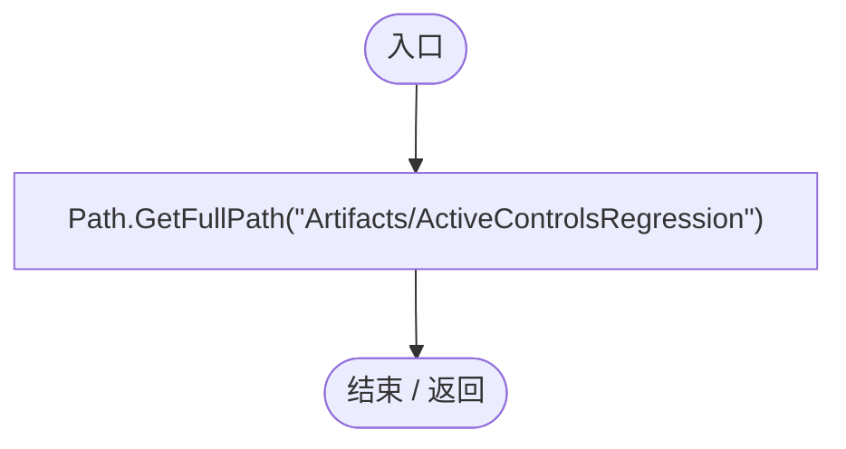

<a id="m82b111dfdc9fcc4e"></a>

### ActiveControlsRegression.ctor · L28

`static ActiveControlsRegression()`


#### Editor · Roslyn编译器控制流

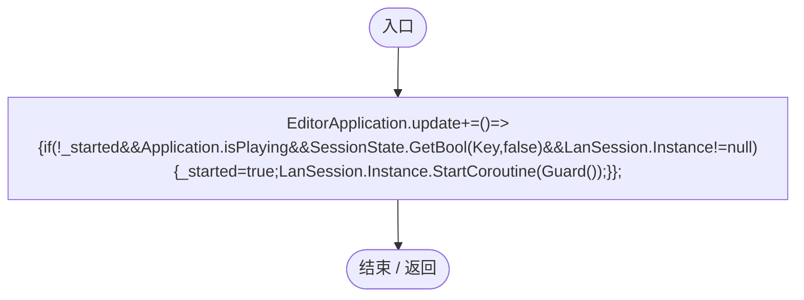

项目内调用/回调引用：

- [ActiveControlsRegression.回调@28 · L28](Editor.md#m2ca3096a06f238a5)（回调/委托）

<a id="m2ca3096a06f238a5"></a>

### 回调@28 · L28

`( … => 回调`


#### Editor · Roslyn编译器控制流

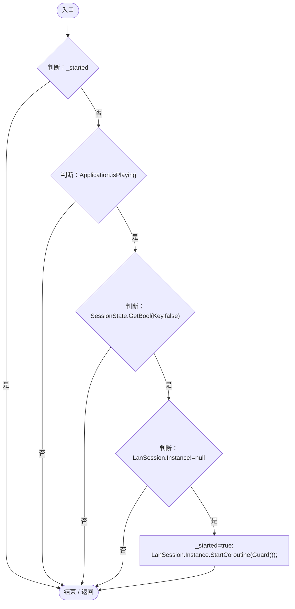

项目内调用/回调引用：

- [LanSession.Instance.get · L22](Gameplay.md#m7dfdbb06da9ac3a5)（访问器）
- [ActiveControlsRegression.Guard · L31](Editor.md#m0537b1bd3dff52b6)（方法）

<a id="mc4cd482bd2296126"></a>

### RunBatch · L29

`public static void RunBatch()`


#### Editor · Roslyn编译器控制流

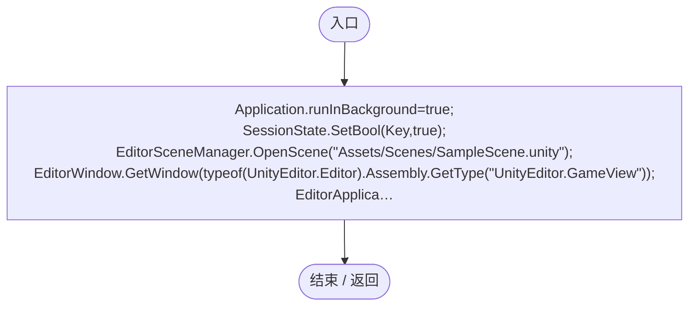

<a id="mfab68ce2a6caed55"></a>

### Check · L30

`private static void Check(bool pass,string message)`


#### Editor · Roslyn编译器控制流

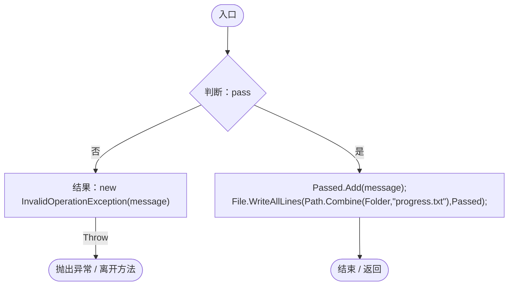

<a id="m0537b1bd3dff52b6"></a>

### Guard · L31

`private static IEnumerator Guard()`


#### Editor · Roslyn编译器控制流

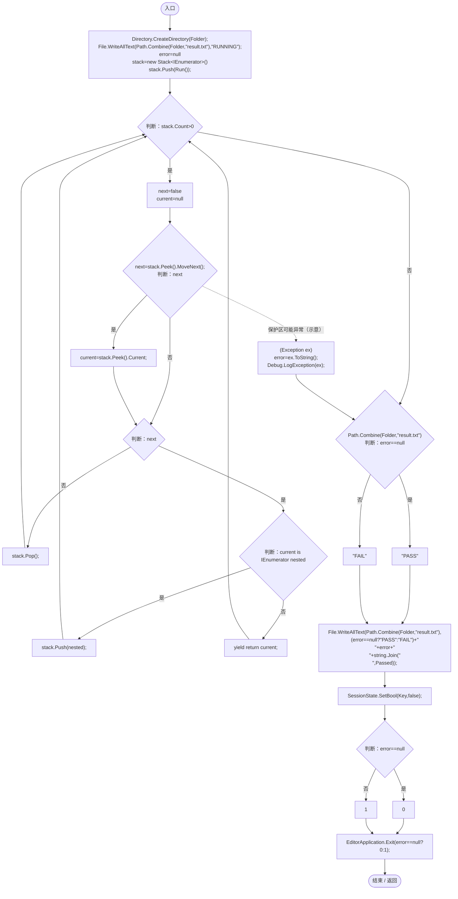

项目内调用/回调引用：

- [ActiveControlsRegression.Run · L45](Editor.md#m417f550541519bb1)（方法）

<a id="m7f3b7f45f16e73c7"></a>

### Spawn · L37

`private static DarwinEntity Spawn(params (string,float)[] values)`


#### Editor · Roslyn编译器控制流

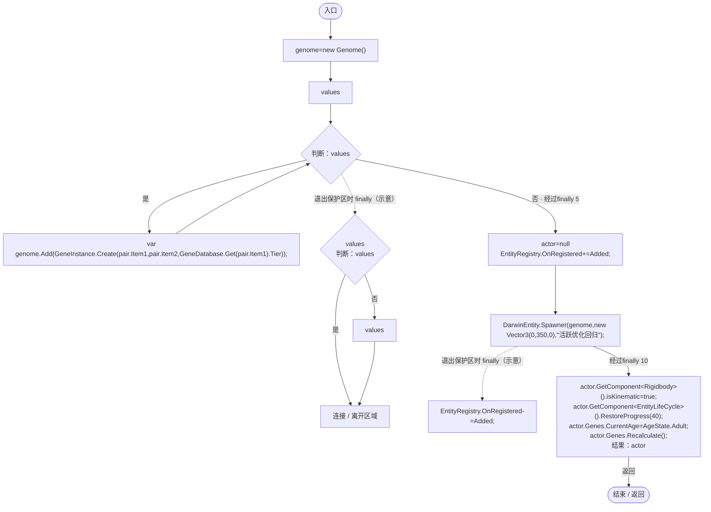

项目内调用/回调引用：

- [Genome.Add · L40](Genetics.md#m09a2a70d3adcbc14)（方法）
- [GeneInstance.Create · L22](Genetics.md#mdb15a75920d735a5)（方法）
- [GeneDatabase.Get · L140](Genetics.md#me2c5590ce9e38ef7)（方法）
- [EntityLifeCycle.RestoreProgress · L53](Entities.md#m9ac5190ce2d7c425)（方法）
- [EntityGeneController.CurrentAge.set · L39](Entities.md#me4193b89bf90aa38)（访问器）
- [DarwinEntity.Genes.get · L14](Entities.md#m622eb1adf401d431)（访问器）
- [EntityGeneController.Recalculate · L122](Entities.md#m0c8090b8014eb248)（方法）
- [ActiveControlsRegression.Added · L39](Editor.md#m8ed7ae9cd73438cd)（局部函数）

<a id="m8ed7ae9cd73438cd"></a>

### Added · L39

`void Added(DarwinEntity value)`


#### Editor · Roslyn编译器控制流

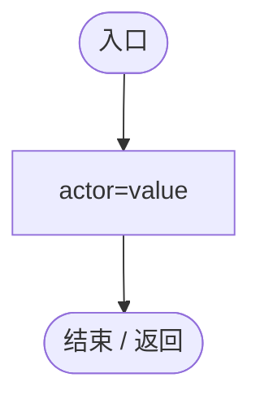

<a id="mdfa6f2de9d1b813d"></a>

### Initialize · L42

`public void Initialize(EntityGeneController owner,GeneInstance gene)`


#### Editor · Roslyn编译器控制流

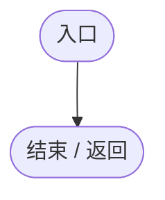

<a id="m28bae2bb8dab3975"></a>

### OnUpdate · L42

`public void OnUpdate(float dt)`


#### Editor · Roslyn编译器控制流

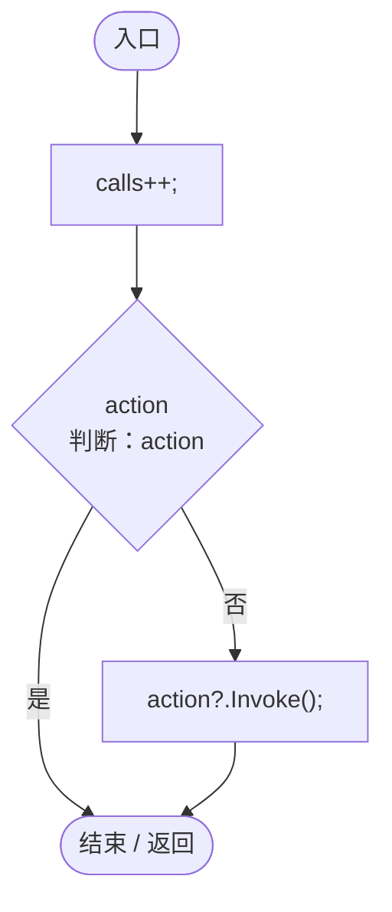

<a id="m050954591e6cc028"></a>

### GetTooltipInfo · L42

`public string GetTooltipInfo()`


#### Editor · Roslyn编译器控制流

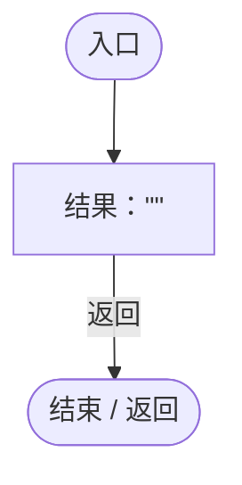

<a id="m38bdf7c672a1b7ca"></a>

### Logics · L43

`private static List<IGeneLogic> Logics(EntityGeneController owner)`


#### Editor · Roslyn编译器控制流

```mermaid
flowchart TD
  b0(["入口"])
  b1["结果：((Dictionary&lt;GeneInstance,IGeneLogic&gt;)typeof(EntityGeneController).GetField(&quot;_activeLogics&quot;,BindingFlags.NonPublic&#124;BindingFlags.Instance).GetValue(owner)).Values.ToList()"]
  b2(["结束 / 返回"])
  b0 --> b1
  b1 -->|"返回"| b2

```

<a id="m09c132699f0c061e"></a>

### Field · L44

`private static T Field<T>(object instance,string name)`


#### Editor · Roslyn编译器控制流

```mermaid
flowchart TD
  b0(["入口"])
  b1["结果：(T)instance.GetType().GetField(name,BindingFlags.NonPublic&#124;BindingFlags.Instance).GetValue(instance)"]
  b2(["结束 / 返回"])
  b0 --> b1
  b1 -->|"返回"| b2

```

<a id="m417f550541519bb1"></a>

### Run · L45

`private static IEnumerator Run()`


#### Editor · Roslyn编译器控制流

```mermaid
flowchart TD
  b0(["入口"])
  b1["session=Object.FindFirstObjectByType&lt;WorldSessionManager&gt;()<br/>session.autoSaveInterval=36000;<br/>planet=Object.FindFirstObjectByType&lt;PlanetTerrainMeshBuilder&gt;()<br/>planet.subdivisions=16;<br/>typeof(WorldSessionManager).GetField(&quot;_initialTerrain&quot;,Bi…"]
  b2{"判断：session.Busy"}
  b3["yield return null;"]
  b4["clock=ServiceLocator.Get&lt;SimulationClock&gt;()<br/>clock.Pause();<br/>Object.FindFirstObjectByType&lt;RandomPlanetSpawner&gt;().enabled=false;<br/>PopulationMaintenance.Restore(null);<br/>GameplayTuning.Current.mutationRoundsEnabled=false;"]
  b5["EntityRegistry.All.ToArray()"]
  b6{"判断：EntityRegistry.All.ToArray()"}
  b7["var<br/>Object.DestroyImmediate(actor.gameObject);"]
  b8{"EntityRegistry.All.ToArray()<br/>判断：EntityRegistry.All.ToArray()"}
  b9["EntityRegistry.All.ToArray()"]
  b10["连接 / 离开区域"]
  b11["ColonyResource.ClearWorld();<br/>entity=Spawn((&quot;gene_growth&quot;,50),(&quot;gene_repair&quot;,50),(&quot;gene_storage&quot;,50),(&quot;gene_nutrition&quot;,50),(&quot;gene_nutrition&quot;,45),(&quot;gene_reproduction&quot;,45))<br/>yield return null;<br/>genes=entity.Genes<br/>optimization=SimulationOptimi…"]
  b12["i=0"]
  b13{"判断：i&lt;5"}
  b14["genes.AdvanceSimulation(.5f);<br/>i++"]
  b15["expected=stats.CaptureValues()"]
  b16["new ReproductionList{values=EntitySaveState.Capture(entity).reproduction}<br/>values=EntitySaveState.Capture(entity).reproduction<br/>expectedReproduction=JsonUtility.ToJson(new ReproductionList{values=EntitySaveState.Capture(entity).reproduction})"]
  b17["progress=entity.GetComponent&lt;EntityLifeCycle&gt;().Progress<br/>initial.Restore(entity);<br/>stats.RestoreValues(depleted);<br/>genes.CurrentAge=oldStage;<br/>optimization.activeExecutionPlan=true;<br/>optimization.activeComponentReuse=true;<br/>skipped=ActiveSimu…"]
  b18["i=0"]
  b19{"判断：i&lt;5"}
  b20["genes.AdvanceSimulation(.5f);<br/>i++"]
  b21["new StatList{values=stats.CaptureValues()}<br/>values=stats.CaptureValues()<br/>JsonUtility.ToJson(new StatList{values=stats.CaptureValues()})"]
  b22["new StatList{values=expected}<br/>values=expected<br/>Check(JsonUtility.ToJson(new StatList{values=stats.CaptureValues()})==JsonUtility.ToJson(new StatList{values=expected}),&quot;优化开关前后生命、营养、储存及所有属性逐值一致&quot;);"]
  b23["new ReproductionList{values=EntitySaveState.Capture(entity).reproduction}<br/>values=EntitySaveState.Capture(entity).reproduction<br/>Check(JsonUtility.ToJson(new ReproductionList{values=EntitySaveState.Capture(entity).reproduction})==expectedRe…"]
  b24["Check(expected.First(v=&gt;v.id==&quot;nutrient&quot;).value&gt;depleted.First(v=&gt;v.id==&quot;nutrient&quot;).value,&quot;等价样本确实产生了营养收入&quot;);<br/>Check(Mathf.Abs(entity.GetComponent&lt;EntityLifeCycle&gt;().Progress-progress)&lt;.00001f,&quot;成长时间逐小步等价&quot;);<br/>Check(ActiveSimulationPlan.Skippe…"]
  b25{"判断：ActiveSimulationBatch.Read&lt;EntityStats&gt;(genes)==stats"}
  b26["ActiveSimulationPlan.ComponentReads==reads"]
  b27["ActiveSimulationBatch.Read&lt;EntityStats&gt;(genes)==stats"]
  b28["Check(ActiveSimulationBatch.Read&lt;EntityStats&gt;(genes)==stats&amp;&amp;ActiveSimulationPlan.ComponentReads==reads,&quot;批次外原生查询不增加优化计数&quot;);"]
  b29["optimization.activeExecutionPlan=true;<br/>optimization.activeComponentReuse=true;"]
  b30["new[]{new[]{(&quot;gene_nutrition&quot;,50f)},new[]{(&quot;gene_nutrition&quot;,20f)},new[]{(&quot;gene_nutrition&quot;,80f)},new[]{(&quot;gene_nutrition&quot;,50f),(&quot;gene_locomotion&quot;,70f)},new[]{(&quot;gene_nutrition&quot;,50f),(&quot;gene_heterotrophy&quot;,75f)},new[]{(&quot;gene_nutrition&quot;,50f),(&quot;…"]
  b31{"判断：new[]{new[]{(&quot;gene_nutrition&quot;,50f)},new[]{(&quot;gene_nutrition&quot;,20f)},new[]{(&quot;gene_nutrition&quot;,80f)},new[]{(&quot;gene_nutrition&quot;,50f),(&quot;gene_locomotion&quot;,70f)},new[]{(&quot;gene_nutrition&quot;,50f),(&quot;gene_heterotrophy&quot;,75f)},new[]{(&quot;gene_nutrition&quot;,50f)…"}
  b32["var"]
  b33["classified=Spawn(recipe)<br/>Check(EcologyEnergyBudget.IsProducer(classified.Genes)==OriginalProducer(classified.Genes),&quot;生产资格与完整规则等价：&quot;+string.Join(&quot;/&quot;,recipe.Select(x=&gt;x.Item1+&quot;:&quot;+x.Item2)));<br/>Check(EcologyMobility.CanMove(classified.Genes)==…"]
  b34["classified.GetComponent&lt;EntityStats&gt;().Modify(&quot;health&quot;,-1);"]
  b35["Application.logMessageReceived-=Error;"]
  b36["Check(!flashError,&quot;同帧停用实体扣血不启动闪烁协程&quot;);<br/>Object.DestroyImmediate(classified.gameObject);"]
  b37{"new[]{new[]{(&quot;gene_nutrition&quot;,50f)},new[]{(&quot;gene_nutrition&quot;,20f)},new[]{(&quot;gene_nutrition&quot;,80f)},new[]{(&quot;gene_nutrition&quot;,50f),(&quot;gene_locomotion&quot;,70f)},new[]{(&quot;gene_nutrition&quot;,50f),(&quot;gene_heterotrophy&quot;,75f)},new[]{(&quot;gene_nutrition&quot;,50f),(&quot;…"}
  b38["new[]{new[]{(&quot;gene_nutrition&quot;,50f)},new[]{(&quot;gene_nutrition&quot;,20f)},new[]{(&quot;gene_nutrition&quot;,80f)},new[]{(&quot;gene_nutrition&quot;,50f),(&quot;gene_locomotion&quot;,70f)},new[]{(&quot;gene_nutrition&quot;,50f),(&quot;gene_heterotrophy&quot;,75f)},new[]{(&quot;gene_nutrition&quot;,50f),(&quot;…"]
  b39["连接 / 离开区域"]
  b40["plan=new ActiveSimulationPlan()<br/>plan.Prepare(genes,Logics(genes));<br/>Check(plan.KnownOnly,&quot;内置行为计划允许批内复用&quot;);<br/>ActiveSimulationBatch.Begin(genes,plan);"]
  b41["count=ActiveSimulationPlan.ComponentHits"]
  b42{"判断：ActiveSimulationBatch.Read&lt;EntityStats&gt;(genes)==stats"}
  b43{"判断：ActiveSimulationBatch.Read&lt;EntityStats&gt;(genes)==stats"}
  b44["ActiveSimulationPlan.ComponentHits==count+1"]
  b45["ActiveSimulationBatch.Read&lt;EntityStats&gt;(genes)==stats&amp;&amp;ActiveSimulationBatch.Read&lt;EntityStats&gt;(genes)==stats&amp;&amp;ActiveSimulationPlan.ComponentHits==count+1"]
  b46["Check(ActiveSimulationBatch.Read&lt;EntityStats&gt;(genes)==stats&amp;&amp;ActiveSimulationBatch.Read&lt;EntityStats&gt;(genes)==stats&amp;&amp;ActiveSimulationPlan.ComponentHits==count+1,&quot;同批组件仅首次真实查询&quot;);"]
  b47["Check(ActiveSimulationBatch.Read&lt;EntityManualControl&gt;(genes)==null,&quot;不存在的可选组件可查询&quot;);<br/>manual=entity.gameObject.AddComponent&lt;EntityManualControl&gt;()<br/>ActiveSimulationBatch.Invalidate(genes);<br/>Check(ActiveSimulationBatch.Read&lt;EntityManualControl…"]
  b48["ActiveSimulationBatch.End(genes);"]
  b49["other=Spawn((&quot;gene_storage&quot;,50))<br/>otherPlan=new ActiveSimulationPlan()<br/>otherPlan.Prepare(other.Genes,Logics(other.Genes));<br/>ActiveSimulationBatch.Begin(genes,plan);"]
  b50["ActiveSimulationBatch.Read&lt;EntityStats&gt;(genes);<br/>ActiveSimulationBatch.Begin(other.Genes,otherPlan);"]
  b51["Check(ActiveSimulationBatch.Read&lt;EntityStats&gt;(other.Genes)==other.GetComponent&lt;EntityStats&gt;(),&quot;嵌套其他实体读取自身组件&quot;);"]
  b52["ActiveSimulationBatch.End(other.Genes);"]
  b53["count=ActiveSimulationPlan.ComponentHits<br/>ActiveSimulationBatch.Read&lt;EntityStats&gt;(genes);<br/>Check(ActiveSimulationPlan.ComponentHits==count+1,&quot;嵌套批次结束恢复父缓存&quot;);"]
  b54["ActiveSimulationBatch.End(genes);"]
  b55["callback=new Callback()<br/>unknownPlan=new ActiveSimulationPlan()"]
  b56["new List&lt;IGeneLogic&gt;{callback}<br/>callback<br/>unknown=new List&lt;IGeneLogic&gt;{callback}"]
  b57["unknownPlan.Run(genes,unknown,.1f);"]
  b58{"判断：callback.calls==1"}
  b59["!unknownPlan.KnownOnly"]
  b60["callback.calls==1"]
  b61["Check(callback.calls==1&amp;&amp;!unknownPlan.KnownOnly,&quot;未知扩展始终执行并回退原组件查询&quot;);"]
  b62["passive=new GrowthGeneLogic()<br/>passive.Initialize(genes,genes.Genome.Genes.First(g=&gt;g.DefinitionId==&quot;gene_growth&quot;));<br/>tail=new Callback()<br/>callback.action=()=&gt;genes.Recalculate();"]
  b63["new List&lt;IGeneLogic&gt;{callback,passive,tail}<br/>callback<br/>passive<br/>tail<br/>changed=new List&lt;IGeneLogic&gt;{callback,passive,tail}"]
  b64["unknownPlan.Invalidate();<br/>unknownPlan.Run(genes,changed,.1f);<br/>Check(tail.calls==1,&quot;回调重算后继续原快照剩余行为，下一步重建计划&quot;);<br/>blocked=ActiveNutritionContext.Blocked(genes)<br/>optimization.activeComponentReuse=false;<br/>Check(blocked==ActiveNutritionContext.Blo…"]
  b65{"ActiveNutritionContext.Blocked(genes)<br/>判断：EcologyQueries.Active(genes,NutritionEcologySettings.Current.heterotrophyGene)!=null"}
  b66["EcologyQueries.Active(genes,NutritionEcologySettings.Current.scavengerGene)!=null"]
  b67["EcologyQueries.Active(genes,NutritionEcologySettings.Current.heterotrophyGene)!=null"]
  b68["Check(ActiveNutritionContext.Blocked(genes)==(EcologyQueries.Active(genes,NutritionEcologySettings.Current.heterotrophyGene)!=null&#124;&#124;EcologyQueries.Active(genes,NutritionEcologySettings.Current.scavengerGene)!=null),&quot;表达重算后生产资格重新解析&quot;);"]
  b69["panel=Object.FindFirstObjectByType&lt;SimulationRulesPanel&gt;()"]
  b70{"panel<br/>判断：panel"}
  b71[".Card"]
  b72["panel"]
  b73{"判断：panel?.Card==null"}
  b74["yield return null;<br/>panel=Object.FindFirstObjectByType&lt;SimulationRulesPanel&gt;();"]
  b75{"extension=panel.GetComponent&lt;RuleCardExtensions&gt;()<br/>判断：extension==null"}
  b76["extension=panel.Card.GetComponent&lt;RuleCardExtensions&gt;();"]
  b77["dropdown=panel.Card.Find(&quot;RuleList&quot;).GetComponent&lt;Dropdown&gt;()"]
  b78{"判断：panel.Card.Find(&quot;CleanupTab&quot;)==null"}
  b79{"判断：dropdown.options.Count==3"}
  b80["panel.Card.sizeDelta==new Vector2(260,164)"]
  b81["panel.Card.Find(&quot;CleanupTab&quot;)==null&amp;&amp;dropdown.options.Count==3&amp;&amp;panel.Card.sizeDelta==new Vector2(260,164)"]
  b82["Check(panel.Card.Find(&quot;CleanupTab&quot;)==null&amp;&amp;dropdown.options.Count==3&amp;&amp;panel.Card.sizeDelta==new Vector2(260,164),&quot;同尺寸规则卡使用列表，不保留旧页签按钮&quot;);"]
  b83{"panel.Card.Find(&quot;Fraction&quot;).GetComponent&lt;InputField&gt;().text=&quot;23&quot;;<br/>dropdown.value=1;<br/>panel.Card.Find(&quot;Fraction&quot;).GetComponent&lt;InputField&gt;().text=&quot;67&quot;;<br/>dropdown.value=0;<br/>Check(panel.Card.Find(&quot;Fraction&quot;).GetComponent&lt;InputField&gt;().text==&quot;2…"}
  b84["panel.GetComponentsInChildren&lt;Button&gt;(true).Single(b=&gt;b.name==&quot;OpenRules&quot;).onClick.Invoke();"]
  b85["yield return null;"]
  b86{"判断：dropdown.captionText.text.Length&gt;0"}
  b87["dropdown.captionText.rectTransform.rect.height&gt;=dropdown.captionText.preferredHeight"]
  b88["dropdown.captionText.text.Length&gt;0"]
  b89["Check(dropdown.captionText.text.Length&gt;0&amp;&amp;dropdown.captionText.rectTransform.rect.height&gt;=dropdown.captionText.preferredHeight,&quot;紧凑列表标题文字有足够空间，不被默认内边距裁空&quot;);"]
  b90["dropdown.Show();<br/>yield return null;<br/>Check(dropdown.transform.Find(&quot;Dropdown List&quot;)!=null,&quot;规则列表真实展开&quot;);<br/>dropdown.Hide();<br/>yield return new WaitForSecondsRealtime(.3f);<br/>Check(dropdown.transform.Find(&quot;Dropdown List&quot;)==null,&quot;规则列表关闭不残留遮罩&quot;);<br/>thi…"]
  b91{"判断：extension.Rules.Select(&quot;audit&quot;)"}
  b92{"判断：third"}
  b93["dropdown.options.Count==4"]
  b94["extension.Rules.Select(&quot;audit&quot;)&amp;&amp;third&amp;&amp;dropdown.options.Count==4"]
  b95["Check(extension.Rules.Select(&quot;audit&quot;)&amp;&amp;third&amp;&amp;dropdown.options.Count==4,&quot;追加规则可登记并选择，无需扩展标题按钮&quot;);"]
  b96["extension.Rules.Select(&quot;mutation&quot;);<br/>inspector=Object.FindFirstObjectByType&lt;GeneInspectorUI&gt;()<br/>inspector.ShowEntityInfo(entity);<br/>yield return null;<br/>inspectorPanel=Field&lt;GameObject&gt;(inspector,&quot;_panel&quot;)<br/>size=inspectorPanel.GetComponent&lt;Rect…"]
  b97{"判断：entry!=null"}
  b98["entry.GetComponentInChildren&lt;Text&gt;().text==&quot;编辑&quot;"]
  b99["entry!=null"]
  b100["Check(entry!=null&amp;&amp;entry.GetComponentInChildren&lt;Text&gt;().text==&quot;编辑&quot;,&quot;原位置入口仅显示编辑&quot;);"]
  b101["hover=inspectorPanel.GetComponentsInChildren&lt;GeneHoverSurface&gt;().First(s=&gt;s.name.StartsWith(&quot;Block_gene_nutrition_&quot;))<br/>pointer=new PointerEventData(EventSystem.current)<br/>ExecuteEvents.Execute(hover.gameObject,pointer,ExecuteEvents.pointerE…"]
  b102{"判断：tooltip.activeSelf"}
  b103["Field&lt;Text&gt;(inspector,&quot;_tooltipText&quot;).text.Contains(&quot;禁用&quot;)"]
  b104["tooltip.activeSelf"]
  b105["Check(tooltip.activeSelf&amp;&amp;Field&lt;Text&gt;(inspector,&quot;_tooltipText&quot;).text.Contains(&quot;禁用&quot;),&quot;整张基因卡悬浮显示实际失效原因&quot;);"]
  b106["Check(tooltip.GetComponentsInChildren&lt;Graphic&gt;().All(g=&gt;!g.raycastTarget),&quot;提示不拦截下方数值框或按钮&quot;);<br/>ExecuteEvents.Execute(hover.gameObject,pointer,ExecuteEvents.pointerExitHandler);<br/>Check(!tooltip.activeSelf,&quot;离开基因卡关闭原因提示&quot;);<br/>entry.GetComponent&lt;Bu…"]
  b107{"判断：EntityEditPopup.Instance.Visible"}
  b108["inspectorPanel.GetComponent&lt;RectTransform&gt;().sizeDelta==size"]
  b109["EntityEditPopup.Instance.Visible"]
  b110["Check(EntityEditPopup.Instance.Visible&amp;&amp;inspectorPanel.GetComponent&lt;RectTransform&gt;().sizeDelta==size,&quot;编辑入口有效且原检查面板大小不变&quot;);"]
  b111["EntityEditPopup.Instance.Close();<br/>Check(!GameInputGate.Blocked,&quot;关闭编辑恢复游戏输入&quot;);<br/>Check(AtmosphereViewPolicy.OuterRadius(planet.Data,1,20)&gt;=planet.Data.Vertices.Max(v=&gt;v.magnitude)+19.99f,&quot;大气外壳覆盖最高地形并保留厚度&quot;);<br/>atmosphere=planet.transform.Find(…"]
  b112(["结束 / 返回"])
  b0 --> b1
  b1 --> b2
  b2 -->|"是"| b3
  b2 -->|"否"| b4
  b3 --> b2
  b4 --> b5
  b5 --> b6
  b6 -->|"是"| b7
  b6 -->|"否 · 经过finally 8"| b11
  b7 --> b6
  b8 -->|"否"| b9
  b8 -->|"是"| b10
  b9 --> b10
  b11 --> b12
  b12 --> b13
  b13 -->|"是"| b14
  b13 -->|"否"| b15
  b14 --> b13
  b15 --> b16
  b16 --> b17
  b17 --> b18
  b18 --> b19
  b19 -->|"是"| b20
  b19 -->|"否"| b21
  b20 --> b19
  b21 --> b22
  b22 --> b23
  b23 --> b24
  b24 --> b25
  b25 -->|"是"| b26
  b25 -->|"否"| b27
  b26 --> b28
  b27 --> b28
  b28 --> b29
  b29 --> b30
  b30 --> b31
  b31 -->|"是"| b32
  b31 -->|"否 · 经过finally 37"| b40
  b32 --> b33
  b33 --> b34
  b34 -->|"经过finally 35"| b36
  b36 --> b31
  b37 -->|"否"| b38
  b37 -->|"是"| b39
  b38 --> b39
  b40 --> b41
  b41 --> b42
  b42 -->|"是"| b43
  b42 -->|"否"| b45
  b43 -->|"是"| b44
  b43 -->|"否"| b45
  b44 --> b46
  b45 --> b46
  b46 --> b47
  b47 -->|"经过finally 48"| b49
  b49 --> b50
  b50 --> b51
  b51 -->|"经过finally 52"| b53
  b53 -->|"经过finally 54"| b55
  b55 --> b56
  b56 --> b57
  b57 --> b58
  b58 -->|"是"| b59
  b58 -->|"否"| b60
  b59 --> b61
  b60 --> b61
  b61 --> b62
  b62 --> b63
  b63 --> b64
  b64 --> b65
  b65 -->|"否"| b66
  b65 -->|"是"| b67
  b66 --> b68
  b67 --> b68
  b68 --> b69
  b69 --> b70
  b70 -->|"否"| b71
  b70 -->|"是"| b72
  b71 --> b73
  b72 --> b73
  b73 -->|"是"| b74
  b73 -->|"否"| b75
  b74 --> b70
  b75 -->|"是"| b76
  b75 -->|"否"| b77
  b76 --> b77
  b77 --> b78
  b78 -->|"是"| b79
  b78 -->|"否"| b81
  b79 -->|"是"| b80
  b79 -->|"否"| b81
  b80 --> b82
  b81 --> b82
  b82 --> b83
  b83 -->|"否"| b84
  b83 -->|"是"| b85
  b84 --> b85
  b85 --> b86
  b86 -->|"是"| b87
  b86 -->|"否"| b88
  b87 --> b89
  b88 --> b89
  b89 --> b90
  b90 --> b91
  b91 -->|"是"| b92
  b91 -->|"否"| b94
  b92 -->|"是"| b93
  b92 -->|"否"| b94
  b93 --> b95
  b94 --> b95
  b95 --> b96
  b96 --> b97
  b97 -->|"是"| b98
  b97 -->|"否"| b99
  b98 --> b100
  b99 --> b100
  b100 --> b101
  b101 --> b102
  b102 -->|"是"| b103
  b102 -->|"否"| b104
  b103 --> b105
  b104 --> b105
  b105 --> b106
  b106 --> b107
  b107 -->|"是"| b108
  b107 -->|"否"| b109
  b108 --> b110
  b109 --> b110
  b110 --> b111
  b111 --> b112
  b6 -. "退出保护区时 finally（示意）" .-> b8
  b34 -. "退出保护区时 finally（示意）" .-> b35
  b31 -. "退出保护区时 finally（示意）" .-> b37
  b41 -. "退出保护区时 finally（示意）" .-> b48
  b51 -. "退出保护区时 finally（示意）" .-> b52
  b50 -. "退出保护区时 finally（示意）" .-> b54

```

项目内调用/回调引用：

- [PlanetClimateMap.Instance.get · L16](Planet.md#m3add54a419aeef9f)（访问器）
- [PlanetOreSystem.Instance.get · L8](Planet.md#m53f6a6af4b6dc252)（访问器）
- [WorldSessionManager.Create · L43](Gameplay.md#m622e74f5005e5fda)（方法）
- [WorldSessionManager.Busy.get · L25](Gameplay.md#mcc5801b0afa73345)（访问器）
- [ServiceLocator.Get · L33](Core.md#m2ae625299520c56d)（方法）
- [SimulationClock.Pause · L79](Core.md#m30929d45a885d0f1)（方法）
- [PopulationMaintenance.Restore · L162](Entities.md#m23ae054ef57d2624)（方法）
- [GameplayTuning.Current.get · L46](Core.md#m4fa691bd8a3b9618)（访问器）
- [ColonyResource.ClearWorld · L109](Entities.md#m0aae51a30765b159)（方法）
- [ActiveControlsRegression.Spawn · L37](Editor.md#m7f3b7f45f16e73c7)（方法）
- [DarwinEntity.Genes.get · L14](Entities.md#m622eb1adf401d431)（访问器）
- [SimulationOptimization.Current.get · L33](Core.md#ma4d76456c2404208)（访问器）
- [EntitySaveState.Capture · L22](Entities.md#md994065ded6697b7)（方法）
- [EntityStats.Modify · L120](Entities.md#m751999dc3c54487e)（方法）
- [EntityStats.CaptureValues · L94](Entities.md#me26692826abc01c8)（方法）
- [EntityGeneController.CurrentAge.get · L39](Entities.md#m977f52932bb90600)（访问器）
- [EntityGeneController.AdvanceSimulation · L75](Entities.md#m6e94486f8bf79c01)（方法）
- [EntityLifeCycle.Progress.get · L12](Entities.md#md607c90b6934f95f)（访问器）
- [EntitySaveState.Restore · L32](Entities.md#md1cca8b8dd3628a4)（方法）
- [EntityStats.RestoreValues · L96](Entities.md#m8a2fa2271a18a5c8)（方法）
- [EntityGeneController.CurrentAge.set · L39](Entities.md#me4193b89bf90aa38)（访问器）
- [ActiveControlsRegression.Check · L30](Editor.md#mfab68ce2a6caed55)（方法）
- [EntityGeneController.Recalculate · L122](Entities.md#m0c8090b8014eb248)（方法）
- [ActiveSimulationBatch.Read · L57](Entities.md#m8738064dce99f86c)（方法）
- [EcologyEnergyBudget.IsProducer · L27](Entities.md#m279dbd0722e3b8e3)（方法）
- [ActiveControlsRegression.OriginalProducer · L78](Editor.md#m7ea3afc5a451fae4)（方法）
- [EcologyMobility.CanMove · L6](Entities.md#m9806988ade82d499)（方法）
- [EntityGeneController.GetAttribute · L290](Entities.md#m7bba19b32d600451)（方法）
- [EcologyBalanceSettings.Current.get · L29](Entities.md#md33d4c4b8f82540b)（访问器）
- [EntityStats.Modify · L113](Entities.md#mecbdebe1a74acc34)（方法）
- [ActiveSimulationPlan.Prepare · L18](Entities.md#m928ad3bfb525370d)（方法）
- [ActiveControlsRegression.Logics · L43](Editor.md#m38bdf7c672a1b7ca)（方法）
- [ActiveSimulationPlan.KnownOnly.get · L13](Entities.md#m1ed86b674f03aacf)（访问器）
- [ActiveSimulationBatch.Begin · L54](Entities.md#m69b20d0b5239a1db)（方法）
- [ActiveSimulationBatch.Invalidate · L56](Entities.md#m7062797e85f9353e)（方法）
- [ActiveSimulationBatch.End · L55](Entities.md#m3ca08aea615ddc7f)（方法）
- [ActiveSimulationPlan.Run · L35](Entities.md#m0b704fac1456bb7c)（方法）
- [GrowthGeneLogic.Initialize · L10](Entities.md#mc66cf44d40afbe23)（方法）
- [ActiveSimulationPlan.Invalidate · L15](Entities.md#m2a303a152f180f6a)（方法）
- [ActiveNutritionContext.Blocked · L15](Entities.md#m41c43e35cb837ab8)（方法）
- [EcologyQueries.Active · L29](Entities.md#m200839bb9db5ec55)（方法）
- [NutritionEcologySettings.Current.get · L20](Genetics.md#m91e840e1725f09bb)（访问器）
- [SimulationRuleList.Register · L23](UI.md#m3753c727dbdbe6be)（方法）
- [RuleCardExtensions.Rules.get · L15](UI.md#m82cd86458c20264f)（访问器）
- [SimulationRuleList.Select · L25](UI.md#m93e0ddaa26b331e3)（方法）
- [GeneInspectorUI.ShowEntityInfo · L222](UI.md#m31bb42c012f068b0)（方法）
- [ActiveControlsRegression.Field · L44](Editor.md#m09c132699f0c061e)（方法）
- [EntityEditPopup.Instance.get · L13](UI.md#m5b397a5db5163777)（访问器）
- [EntityEditPopup.Close · L35](UI.md#m2a60c1c8ef86fe92)（方法）
- [GameInputGate.Blocked.get · L8](Core.md#m765763b665829633)（访问器）
- [AtmosphereViewPolicy.OuterRadius · L8](Planet.md#m40521f3c999c1a8b)（方法）
- [PlanetTerrainMeshBuilder.Data.get · L81](Planet.md#m1a65abfe0f34c5d8)（访问器）
- [AtmosphereViewPolicy.Apply · L10](Planet.md#m214bc119bec45f2d)（方法）
- [PopulationRatioRuleChecks.Capture · L45](Editor.md#m466400a34da14018)（方法）
- [ActiveControlsRegression.回调@53 · L53](Editor.md#mbdd1c32f1a91e4c9)（回调/委托）
- [ActiveControlsRegression.回调@53 · L53](Editor.md#m721917d0bd0155c8)（回调/委托）
- [ActiveControlsRegression.回调@57 · L57](Editor.md#mf58d49c68ecd4542)（回调/委托）
- [ActiveControlsRegression.回调@57 · L57](Editor.md#maf00cfdf2562a5f3)（回调/委托）
- [ActiveControlsRegression.回调@58 · L58](Editor.md#m38b0c37385d86f6a)（回调/委托）
- [ActiveControlsRegression.Error · L59](Editor.md#md83a034f7d3194e5)（局部函数）
- [ActiveControlsRegression.回调@64 · L64](Editor.md#m505837fd15deb841)（回调/委托）
- [ActiveControlsRegression.回调@64 · L64](Editor.md#m873fbc1282466bd1)（回调/委托）
- [ActiveControlsRegression.回调@65 · L65](Editor.md#me9ca645fdf2950b4)（回调/委托）
- [ActiveControlsRegression.回调@69 · L69](Editor.md#mafc5ab6d619f4d27)（回调/委托）
- [ActiveControlsRegression.回调@71 · L71](Editor.md#m844e43c57ba88e50)（回调/委托）
- [ActiveControlsRegression.回调@72 · L72](Editor.md#me74505b7332ec33d)（回调/委托）
- [ActiveControlsRegression.回调@72 · L72](Editor.md#m918b2dbcf3de3e93)（回调/委托）
- [ActiveControlsRegression.回调@74 · L74](Editor.md#mb0882150ce45ab67)（回调/委托）

<a id="mbdd1c32f1a91e4c9"></a>

### 回调@53 · L53

`v … => 回调`


#### Editor · Roslyn编译器控制流


<a id="m721917d0bd0155c8"></a>

### 回调@53 · L53

`v … => 回调`


#### Editor · Roslyn编译器控制流

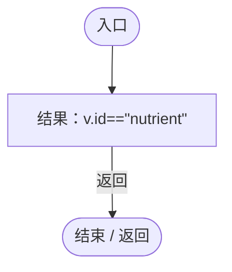

<a id="mf58d49c68ecd4542"></a>

### 回调@57 · L57

`x … => 回调`


#### Editor · Roslyn编译器控制流

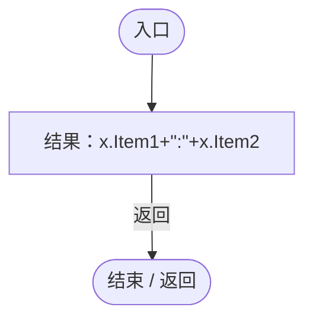

<a id="maf00cfdf2562a5f3"></a>

### 回调@57 · L57

`x … => 回调`


#### Editor · Roslyn编译器控制流

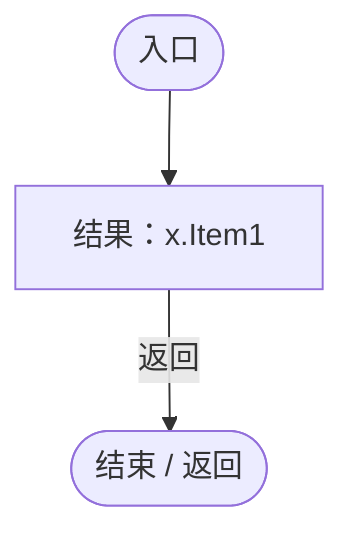

<a id="m38b0c37385d86f6a"></a>

### 回调@58 · L58

`_ … => 回调`


#### Editor · Roslyn编译器控制流

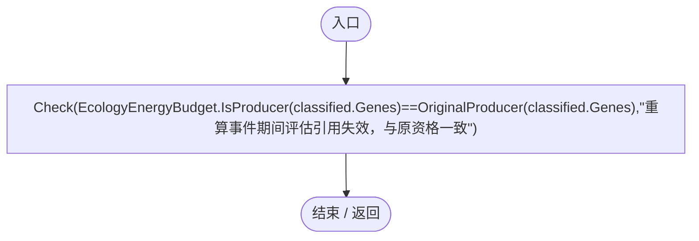

项目内调用/回调引用：

- [ActiveControlsRegression.Check · L30](Editor.md#mfab68ce2a6caed55)（方法）
- [EcologyEnergyBudget.IsProducer · L27](Entities.md#m279dbd0722e3b8e3)（方法）
- [DarwinEntity.Genes.get · L14](Entities.md#m622eb1adf401d431)（访问器）
- [ActiveControlsRegression.OriginalProducer · L78](Editor.md#m7ea3afc5a451fae4)（方法）

<a id="md83a034f7d3194e5"></a>

### Error · L59

`void Error(string text,string stack,LogType type)`


#### Editor · Roslyn编译器控制流

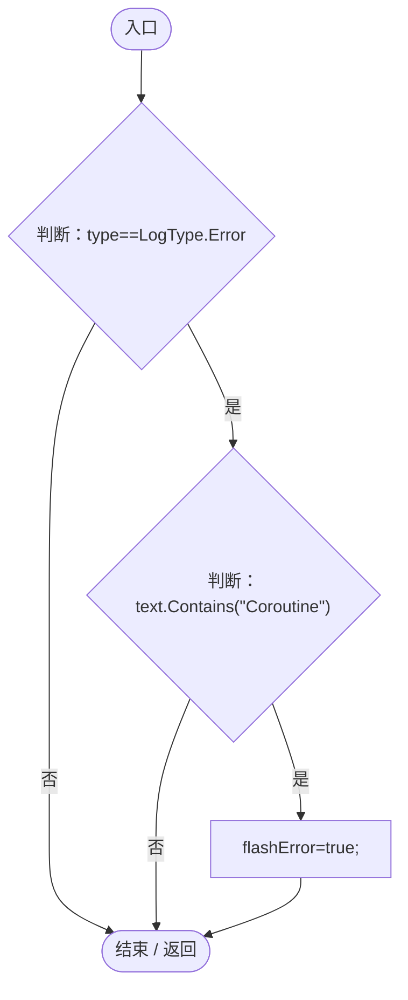

<a id="m505837fd15deb841"></a>

### 回调@64 · L64

`g … => 回调`


#### Editor · Roslyn编译器控制流

```mermaid
flowchart TD
  b0(["入口"])
  b1["结果：g.DefinitionId==&quot;gene_growth&quot;"]
  b2(["结束 / 返回"])
  b0 --> b1
  b1 -->|"返回"| b2

```

<a id="m873fbc1282466bd1"></a>

### 回调@64 · L64

`( … => 回调`


#### Editor · Roslyn编译器控制流

```mermaid
flowchart TD
  b0(["入口"])
  b1["genes.Recalculate()"]
  b2(["结束 / 返回"])
  b0 --> b1
  b1 --> b2

```

项目内调用/回调引用：

- [EntityGeneController.Recalculate · L122](Entities.md#m0c8090b8014eb248)（方法）

<a id="me9ca645fdf2950b4"></a>

### 回调@65 · L65

`g … => 回调`


#### Editor · Roslyn编译器控制流

```mermaid
flowchart TD
  b0(["入口"])
  b1["结果：g.DefinitionId==&quot;gene_nutrition&quot;"]
  b2(["结束 / 返回"])
  b0 --> b1
  b1 -->|"返回"| b2

```

<a id="mafc5ab6d619f4d27"></a>

### 回调@69 · L69

`b … => 回调`


#### Editor · Roslyn编译器控制流

```mermaid
flowchart TD
  b0(["入口"])
  b1["结果：b.name==&quot;OpenRules&quot;"]
  b2(["结束 / 返回"])
  b0 --> b1
  b1 -->|"返回"| b2

```

<a id="m844e43c57ba88e50"></a>

### 回调@71 · L71

`( … => 回调`


#### Editor · Roslyn编译器控制流

```mermaid
flowchart TD
  b0(["入口"])
  b1["third=true"]
  b2(["结束 / 返回"])
  b0 --> b1
  b1 --> b2

```

<a id="me74505b7332ec33d"></a>

### 回调@72 · L72

`s … => 回调`


#### Editor · Roslyn编译器控制流

```mermaid
flowchart TD
  b0(["入口"])
  b1["结果：s.name.StartsWith(&quot;Block_gene_nutrition_&quot;)"]
  b2(["结束 / 返回"])
  b0 --> b1
  b1 -->|"返回"| b2

```

<a id="m918b2dbcf3de3e93"></a>

### 回调@72 · L72

`g … => 回调`


#### Editor · Roslyn编译器控制流

```mermaid
flowchart TD
  b0(["入口"])
  b1["结果：!g.raycastTarget"]
  b2(["结束 / 返回"])
  b0 --> b1
  b1 -->|"返回"| b2

```

<a id="mb0882150ce45ab67"></a>

### 回调@74 · L74

`v … => 回调`


#### Editor · Roslyn编译器控制流

```mermaid
flowchart TD
  b0(["入口"])
  b1["结果：v.magnitude"]
  b2(["结束 / 返回"])
  b0 --> b1
  b1 -->|"返回"| b2

```

<a id="m7ea3afc5a451fae4"></a>

### OriginalProducer · L78

`private static bool OriginalProducer(EntityGeneController genes)`


#### Editor · Roslyn编译器控制流

```mermaid
flowchart TD
  b0(["入口"])
  b1{"settings=EcologyBalanceSettings.Current<br/>判断：genes==null"}
  b2{"genes.GetComponent&lt;EggIncubation&gt;()<br/>判断：genes.GetComponent&lt;EggIncubation&gt;()"}
  b3[".Incubating"]
  b4["genes.GetComponent&lt;EggIncubation&gt;()"]
  b5{"判断：genes.GetComponent&lt;EggIncubation&gt;()?.Incubating==true"}
  b6["结果：false"]
  b7{"判断：EcologyQueries.Active(genes,NutritionEcologySettings.Current.heterotrophyGene)!=null"}
  b8{"判断：EcologyQueries.Active(genes,NutritionEcologySettings.Current.scavengerGene)!=null"}
  b9["结果：false"]
  b10["selected=null"]
  b11["genes.Evaluation.Genes"]
  b12{"判断：genes.Evaluation.Genes"}
  b13{"var<br/>判断：gene.IsActive"}
  b14{"判断：gene.Definition.Id==settings.nutritionGene"}
  b15{"判断：selected==null"}
  b16{"判断：gene.EffectiveStrength&gt;selected.EffectiveStrength"}
  b17["selected=gene;"]
  b18["genes.Evaluation.Genes"]
  b19{"selected<br/>判断：selected"}
  b20[".State"]
  b21["selected"]
  b22{"判断：selected?.State!=null"}
  b23{"判断：Array.IndexOf(settings.producerStates,selected.State.StateId)&gt;=0"}
  b24["genes.GetAttribute(settings.movementAttribute)&lt;=0"]
  b25["selected?.State!=null&amp;&amp;Array.IndexOf(settings.producerStates,selected.State.StateId)&gt;=0&amp;&amp;genes.GetAttribute(settings.movementAttribute)&lt;=0"]
  b26["结果：selected?.State!=null&amp;&amp;Array.IndexOf(settings.producerStates,selected.State.StateId)&gt;=0&amp;&amp;genes.GetAttribute(settings.movementAttribute)&lt;=0"]
  b27(["结束 / 返回"])
  b0 --> b1
  b1 -->|"否"| b2
  b1 -->|"是"| b6
  b2 -->|"否"| b3
  b2 -->|"是"| b4
  b3 --> b5
  b4 --> b5
  b5 -->|"是"| b6
  b5 -->|"否"| b7
  b6 -->|"返回"| b27
  b7 -->|"否"| b8
  b7 -->|"是"| b9
  b8 -->|"是"| b9
  b8 -->|"否"| b10
  b9 -->|"返回"| b27
  b10 --> b11
  b11 --> b12
  b12 -->|"是"| b13
  b12 -->|"否 · 经过finally 18"| b19
  b13 -->|"是"| b14
  b13 -->|"否"| b12
  b14 -->|"是"| b15
  b14 -->|"否"| b12
  b15 -->|"否"| b16
  b15 -->|"是"| b17
  b16 -->|"是"| b17
  b16 -->|"否"| b12
  b17 --> b12
  b19 -->|"否"| b20
  b19 -->|"是"| b21
  b20 --> b22
  b21 --> b22
  b22 -->|"是"| b23
  b22 -->|"否"| b25
  b23 -->|"是"| b24
  b23 -->|"否"| b25
  b24 --> b26
  b25 --> b26
  b26 -->|"返回"| b27
  b12 -. "退出保护区时 finally（示意）" .-> b18

```

项目内调用/回调引用：

- [EcologyBalanceSettings.Current.get · L29](Entities.md#md33d4c4b8f82540b)（访问器）
- [EcologyQueries.Active · L29](Entities.md#m200839bb9db5ec55)（方法）
- [NutritionEcologySettings.Current.get · L20](Genetics.md#m91e840e1725f09bb)（访问器）
- [EntityGeneController.Evaluation.get · L20](Entities.md#mf275f100ea21601a)（访问器）
- [EntityGeneController.GetAttribute · L290](Entities.md#m7bba19b32d600451)（方法）


---

<a id="s7532f6e210474791"></a>

## ActiveSimulationBenchmark.cs

`Editor` · `Assets/DarwinPark/Editor/ActiveSimulationBenchmark.cs`

[源文件](../../../Assets/DarwinPark/Editor/ActiveSimulationBenchmark.cs) · 源码校验：`a9fed9c95f8f50573190b0ecde8b92ac780b7cb8f1805e1c9a7c4ad96ad8235f`

方法按源文件位置排列。事件/回调引用不表示立即执行；完整源码与关系图请打开离线手册。

<a id="m3d411297942029b4"></a>

### Folder.get · L24

`private static string Folder`


#### Editor · 语法控制结构 / 声明（非CFG）

```mermaid
flowchart TD
  n2(["入口"])
  n1["Path.GetFullPath(&quot;Artifacts/ActiveControlsBenchmark&quot;)"]
  n0(["结束 / 返回"])
  n1 --> n0
  n2 --> n1

```

<a id="me77552f2e16e1ed8"></a>

### ActiveSimulationBenchmark.ctor · L25

`static ActiveSimulationBenchmark()`


#### Editor · Roslyn编译器控制流

```mermaid
flowchart TD
  b0(["入口"])
  b1["EditorApplication.update+=()=&gt;{if(!_started&amp;&amp;Application.isPlaying&amp;&amp;SessionState.GetBool(Key,false)&amp;&amp;LanSession.Instance!=null){_started=true;LanSession.Instance.StartCoroutine(Guard());}};"]
  b2(["结束 / 返回"])
  b0 --> b1
  b1 --> b2

```

项目内调用/回调引用：

- [ActiveSimulationBenchmark.回调@25 · L25](Editor.md#m5a34d101c574d371)（回调/委托）

<a id="m5a34d101c574d371"></a>

### 回调@25 · L25

`( … => 回调`


#### Editor · Roslyn编译器控制流

```mermaid
flowchart TD
  b0(["入口"])
  b1{"判断：_started"}
  b2{"判断：Application.isPlaying"}
  b3{"判断：SessionState.GetBool(Key,false)"}
  b4{"判断：LanSession.Instance!=null"}
  b5["_started=true;<br/>LanSession.Instance.StartCoroutine(Guard());"]
  b6(["结束 / 返回"])
  b0 --> b1
  b1 -->|"否"| b2
  b1 -->|"是"| b6
  b2 -->|"是"| b3
  b2 -->|"否"| b6
  b3 -->|"是"| b4
  b3 -->|"否"| b6
  b4 -->|"是"| b5
  b4 -->|"否"| b6
  b5 --> b6

```

项目内调用/回调引用：

- [LanSession.Instance.get · L22](Gameplay.md#m7dfdbb06da9ac3a5)（访问器）
- [ActiveSimulationBenchmark.Guard · L27](Editor.md#m98f362202b7464e0)（方法）

<a id="m59dc3f699b4ca161"></a>

### RunBatch · L26

`public static void RunBatch()`


#### Editor · Roslyn编译器控制流

```mermaid
flowchart TD
  b0(["入口"])
  b1["Application.runInBackground=true;<br/>SessionState.SetBool(Key,true);<br/>EditorSceneManager.OpenScene(&quot;Assets/Scenes/SampleScene.unity&quot;);<br/>EditorWindow.GetWindow(typeof(UnityEditor.Editor).Assembly.GetType(&quot;UnityEditor.GameView&quot;));<br/>EditorApplica…"]
  b2(["结束 / 返回"])
  b0 --> b1
  b1 --> b2

```

<a id="m98f362202b7464e0"></a>

### Guard · L27

`private static IEnumerator Guard()`


#### Editor · Roslyn编译器控制流

```mermaid
flowchart TD
  b0(["入口"])
  b1["Directory.CreateDirectory(Folder);<br/>File.WriteAllText(Path.Combine(Folder,&quot;result.txt&quot;),&quot;RUNNING&quot;);<br/>error=null<br/>stack=new Stack&lt;IEnumerator&gt;()<br/>stack.Push(Run());"]
  b2{"判断：stack.Count&gt;0"}
  b3["next=false<br/>current=null"]
  b4{"next=stack.Peek().MoveNext();<br/>判断：next"}
  b5["current=stack.Peek().Current;"]
  b6["(Exception ex)<br/>error=ex.ToString();<br/>Debug.LogException(ex);"]
  b7{"判断：next"}
  b8["stack.Pop();"]
  b9{"判断：current is IEnumerator nested"}
  b10["stack.Push(nested);"]
  b11["yield return current;"]
  b12{"Path.Combine(Folder,&quot;result.txt&quot;)<br/>判断：error==null"}
  b13["&quot;PASS&quot;"]
  b14["&quot;FAIL&quot;"]
  b15["File.WriteAllText(Path.Combine(Folder,&quot;result.txt&quot;),(error==null?&quot;PASS&quot;:&quot;FAIL&quot;)+&quot;\n&quot;+error);"]
  b16["SessionState.SetBool(Key,false);"]
  b17{"判断：error==null"}
  b18["0"]
  b19["1"]
  b20["EditorApplication.Exit(error==null?0:1);"]
  b21(["结束 / 返回"])
  b0 --> b1
  b1 --> b2
  b2 -->|"是"| b3
  b2 -->|"否"| b12
  b3 --> b4
  b4 -->|"是"| b5
  b4 -->|"否"| b7
  b5 --> b7
  b6 --> b12
  b7 -->|"否"| b8
  b7 -->|"是"| b9
  b8 --> b2
  b9 -->|"是"| b10
  b9 -->|"否"| b11
  b10 --> b2
  b11 --> b2
  b12 -->|"是"| b13
  b12 -->|"否"| b14
  b13 --> b15
  b14 --> b15
  b15 --> b16
  b16 --> b17
  b17 -->|"是"| b18
  b17 -->|"否"| b19
  b18 --> b20
  b19 --> b20
  b20 --> b21
  b4 -. "保护区可能异常（示意）" .-> b6

```

项目内调用/回调引用：

- [ActiveSimulationBenchmark.Run · L42](Editor.md#m1f18c32d76611030)（方法）

<a id="m801cec8529716927"></a>

### Counters · L33

`private static Dictionary<string,long> Counters()`


#### Editor · Roslyn编译器控制流

```mermaid
flowchart TD
  b0(["入口"])
  b1{"values=new Dictionary&lt;string,long&gt;()<br/>type=typeof(ActiveSimulationPlan)<br/>判断：type!=null"}
  b2["type.GetFields(BindingFlags.Public&#124;BindingFlags.Static)"]
  b3{"判断：type.GetFields(BindingFlags.Public&#124;BindingFlags.Static)"}
  b4{"var<br/>判断：f.FieldType==typeof(long)"}
  b5["values[f.Name]=(long)f.GetValue(null);"]
  b6{"type.GetFields(BindingFlags.Public&#124;BindingFlags.Static)<br/>判断：type.GetFields(BindingFlags.Public&#124;BindingFlags.Static)"}
  b7["type.GetFields(BindingFlags.Public&#124;BindingFlags.Static)"]
  b8["连接 / 离开区域"]
  b9["结果：values"]
  b10(["结束 / 返回"])
  b0 --> b1
  b1 -->|"是"| b2
  b1 -->|"否"| b9
  b2 --> b3
  b3 -->|"是"| b4
  b3 -->|"否 · 经过finally 6"| b9
  b4 -->|"是"| b5
  b4 -->|"否"| b3
  b5 --> b3
  b6 -->|"否"| b7
  b6 -->|"是"| b8
  b7 --> b8
  b9 -->|"返回"| b10
  b3 -. "退出保护区时 finally（示意）" .-> b6

```

<a id="m81eb294370b74425"></a>

### Sample · L35

`private static IEnumerator Sample(string name)`


#### Editor · Roslyn编译器控制流

```mermaid
flowchart TD
  b0(["入口"])
  b1["yield return new WaitForSecondsRealtime(2);<br/>population=EntityRegistry.All.Count<br/>before=Counters()<br/>began=EditorApplication.timeSinceStartup<br/>previous=began<br/>sample=new PerformanceSampleSession()"]
  b2{"判断：EditorApplication.timeSinceStartup-began&lt;8"}
  b3["yield return null;<br/>now=EditorApplication.timeSinceStartup<br/>sample.RecordFrame((now-previous)*1000);<br/>previous=now;"]
  b4{"report=sample.Finish(name+&quot; population=&quot;+population+&quot;-&gt;&quot;+EntityRegistry.All.Count+&quot; api=&quot;+SystemInfo.graphicsDeviceType+&quot; resolution=&quot;+Screen.width+&quot;x&quot;+Screen.height+&quot; terrain=320 cap=0&quot;)<br/>File.WriteAllText(Path.Combine(Folder,name+&quot;.json…"}
  b5["结果：new InvalidOperationException(&quot;固定数量性能样本发生出生/死亡&quot;)"]
  x5(["抛出异常 / 离开方法"])
  b6{"判断：sample=new PerformanceSampleSession()"}
  b7["sample=new PerformanceSampleSession()"]
  b8["连接 / 离开区域"]
  b9(["结束 / 返回"])
  b0 --> b1
  b1 --> b2
  b2 -->|"是"| b3
  b2 -->|"否"| b4
  b3 --> b2
  b4 -->|"是"| b5
  b4 -->|"否 · 经过finally 6"| b9
  b5 -->|"Throw"| x5
  b6 -->|"否"| b7
  b6 -->|"是"| b8
  b7 --> b8
  b2 -. "退出保护区时 finally（示意）" .-> b6

```

项目内调用/回调引用：

- [ActiveSimulationBenchmark.Counters · L33](Editor.md#m801cec8529716927)（方法）
- [PerformanceSampleSession.PerformanceSampleSession.ctor · L43](Core.md#me5d389942b484c2b)（构造函数）
- [PerformanceSampleSession.RecordFrame · L51](Core.md#me7cce52503c9c701)（方法）
- [PerformanceSampleSession.Finish · L55](Core.md#m9dc62c92dc25c06a)（方法）
- [ActiveSimulationBenchmark.回调@40 · L40](Editor.md#ma546e124aa3a2aa2)（回调/委托）
- [ActiveSimulationBenchmark.回调@40 · L40](Editor.md#mad2a12793e32f147)（回调/委托）
- [ActiveSimulationBenchmark.回调@40 · L40](Editor.md#m1dc1e3dd4581f729)（回调/委托）
- [ActiveSimulationBenchmark.回调@40 · L40](Editor.md#mf6af1de42a13eaf8)（回调/委托）
- [ActiveSimulationBenchmark.回调@40 · L40](Editor.md#mea06c6f1bd2b2538)（回调/委托）

<a id="ma546e124aa3a2aa2"></a>

### 回调@40 · L40

`p … => 回调`


#### Editor · Roslyn编译器控制流

```mermaid
flowchart TD
  b0(["入口"])
  b1{"p.Key+&quot;=&quot;<br/>p.Value<br/>判断：before.TryGetValue(p.Key,out long value)"}
  b2["value"]
  b3["0"]
  b4["结果：p.Key+&quot;=&quot;+(p.Value-(before.TryGetValue(p.Key,out long value)?value:0))"]
  b5(["结束 / 返回"])
  b0 --> b1
  b1 -->|"是"| b2
  b1 -->|"否"| b3
  b2 --> b4
  b3 --> b4
  b4 -->|"返回"| b5

```

<a id="mad2a12793e32f147"></a>

### 回调@40 · L40

`e … => 回调`


#### Editor · Roslyn编译器控制流

```mermaid
flowchart TD
  b0(["入口"])
  b1["结果：e.GetComponent&lt;Rigidbody&gt;()"]
  b2(["结束 / 返回"])
  b0 --> b1
  b1 -->|"返回"| b2

```

<a id="m1dc1e3dd4581f729"></a>

### 回调@40 · L40

`b … => 回调`


#### Editor · Roslyn编译器控制流

```mermaid
flowchart TD
  b0(["入口"])
  b1["结果：b!=null"]
  b2(["结束 / 返回"])
  b0 --> b1
  b1 -->|"返回"| b2

```

<a id="mf6af1de42a13eaf8"></a>

### 回调@40 · L40

`b … => 回调`


#### Editor · Roslyn编译器控制流

```mermaid
flowchart TD
  b0(["入口"])
  b1["结果：b.IsSleeping()"]
  b2(["结束 / 返回"])
  b0 --> b1
  b1 -->|"返回"| b2

```

<a id="mea06c6f1bd2b2538"></a>

### 回调@40 · L40

`b … => 回调`


#### Editor · Roslyn编译器控制流

```mermaid
flowchart TD
  b0(["入口"])
  b1["结果：b.isKinematic"]
  b2(["结束 / 返回"])
  b0 --> b1
  b1 -->|"返回"| b2

```

<a id="m1f18c32d76611030"></a>

### Run · L42

`private static IEnumerator Run()`


#### Editor · Roslyn编译器控制流

```mermaid
flowchart TD
  b0(["入口"])
  b1["world=WorldSaveStore.Read(Path.Combine(Folder,&quot;input/world.json&quot;))<br/>session=Object.FindFirstObjectByType&lt;WorldSessionManager&gt;()<br/>session.autoSaveInterval=36000;<br/>session.Open(world);<br/>started=EditorApplication.timeSinceStartup"]
  b2{"判断：session.Busy"}
  b3{"判断：EditorApplication.timeSinceStartup-started&gt;300"}
  b4["结果：new TimeoutException(&quot;load&quot;)"]
  x4(["抛出异常 / 离开方法"])
  b5["yield return null;"]
  b6["clock=ServiceLocator.Get&lt;SimulationClock&gt;()<br/>clock.Pause();<br/>PopulationMaintenance.Restore(null);<br/>Object.FindFirstObjectByType&lt;RandomPlanetSpawner&gt;().enabled=false;<br/>GameplayTuning.Current.mutationRoundsEnabled=false;<br/>GameplayTuning.Current…"]
  b7["new WorldGameSettings{entityLimit=EntityRegistry.All.Count}<br/>entityLimit=EntityRegistry.All.Count<br/>EntityPopulationLimit.UseSnapshot(new WorldGameSettings{entityLimit=EntityRegistry.All.Count});"]
  b8["EntityRegistry.All"]
  b9{"判断：EntityRegistry.All"}
  b10["var<br/>actor.Genes.Evaluation.Attributes[&quot;attack&quot;]=0;<br/>actor.GetComponent&lt;EntityLifeCycle&gt;().RestoreProgress(Mathf.Min(actor.GetComponent&lt;EntityLifeCycle&gt;().Progress,LifeCycleSettings.Load().deathProgress-30));<br/>actor.GetComponent&lt;EntityVital…"]
  b11{"判断：EntityRegistry.All"}
  b12["EntityRegistry.All"]
  b13["连接 / 离开区域"]
  b14["arguments=System.Environment.GetCommandLineArgs()<br/>enabled=Array.IndexOf(arguments,&quot;-activeOff&quot;)&lt;0<br/>SimulationOptimization.Current.activeExecutionPlan=enabled;<br/>SimulationOptimization.Current.activeComponentReuse=enabled;<br/>UnityEngine.Random…"]
  b15{"判断：enabled"}
  b16["&quot;active-on&quot;"]
  b17["&quot;active-off&quot;"]
  b18["yield return Sample(enabled?&quot;active-on&quot;:&quot;active-off&quot;);"]
  b19["clock.Pause();"]
  b20(["结束 / 返回"])
  b0 --> b1
  b1 --> b2
  b2 -->|"是"| b3
  b2 -->|"否"| b6
  b3 -->|"是"| b4
  b3 -->|"否"| b5
  b4 -->|"Throw"| x4
  b5 --> b2
  b6 --> b7
  b7 --> b8
  b8 --> b9
  b9 -->|"是"| b10
  b9 -->|"否 · 经过finally 11"| b14
  b10 --> b9
  b11 -->|"否"| b12
  b11 -->|"是"| b13
  b12 --> b13
  b14 --> b15
  b15 -->|"是"| b16
  b15 -->|"否"| b17
  b16 --> b18
  b17 --> b18
  b18 --> b19
  b19 --> b20
  b9 -. "退出保护区时 finally（示意）" .-> b11

```

项目内调用/回调引用：

- [WorldSaveStore.Read · L78](Gameplay.md#m929e1e4385af43eb)（方法）
- [WorldSessionManager.Open · L62](Gameplay.md#m2810b58b13a0b127)（方法）
- [WorldSessionManager.Busy.get · L25](Gameplay.md#mcc5801b0afa73345)（访问器）
- [ServiceLocator.Get · L33](Core.md#m2ae625299520c56d)（方法）
- [SimulationClock.Pause · L79](Core.md#m30929d45a885d0f1)（方法）
- [PopulationMaintenance.Restore · L162](Entities.md#m23ae054ef57d2624)（方法）
- [GameplayTuning.Current.get · L46](Core.md#m4fa691bd8a3b9618)（访问器）
- [FramePacingSettings.SetLimit · L19](UI.md#mff17d0cc654b6a7f)（方法）
- [EntityPopulationLimit.UseSnapshot · L30](Entities.md#m735185cedc969868)（方法）
- [EntityGeneController.Evaluation.get · L20](Entities.md#mf275f100ea21601a)（访问器）
- [DarwinEntity.Genes.get · L14](Entities.md#m622eb1adf401d431)（访问器）
- [EntityLifeCycle.RestoreProgress · L53](Entities.md#m9ac5190ce2d7c425)（方法）
- [EntityLifeCycle.Progress.get · L12](Entities.md#md607c90b6934f95f)（访问器）
- [LifeCycleSettings.Load · L16](Entities.md#m6fe263852e5a8989)（方法）
- [SimulationOptimization.Current.get · L33](Core.md#ma4d76456c2404208)（访问器）
- [SimulationClock.Play · L78](Core.md#m7aa9e64b7de60ed0)（方法）
- [ActiveSimulationBenchmark.Sample · L35](Editor.md#m81eb294370b74425)（方法）


---

<a id="s1314e8c23331e578"></a>

## AntColonyRegression.cs

`Editor` · `Assets/DarwinPark/Editor/AntColonyRegression.cs`

[源文件](../../../Assets/DarwinPark/Editor/AntColonyRegression.cs) · 源码校验：`96687b0c3d9ff23466828a3e60d9e7c37124f477348e1f8aa62f1d9a8033aaa4`

方法按源文件位置排列。事件/回调引用不表示立即执行；完整源码与关系图请打开离线手册。

<a id="m0750c22cf767806d"></a>

### Folder.get · L30

`private static string Folder`


#### Editor · 语法控制结构 / 声明（非CFG）

```mermaid
flowchart TD
  n2(["入口"])
  n1["Path.GetFullPath(&quot;Artifacts/AntColonyReview&quot;)"]
  n0(["结束 / 返回"])
  n1 --> n0
  n2 --> n1

```

<a id="md5ebc25177244b0c"></a>

### AntColonyRegression.ctor · L34

`static AntColonyRegression()`

★ 修复（防Bug回归）：Unity搜索索引异常会打断delayCall，update幂等等待启动就绪后再跑实际回归。

#### Editor · Roslyn编译器控制流

```mermaid
flowchart TD
  b0(["入口"])
  b1["EditorApplication.update+=()=&gt;{if(!_started&amp;&amp;Application.isPlaying&amp;&amp;SessionState.GetBool(Key,false)&amp;&amp;Object.FindFirstObjectByType&lt;WorldSessionManager&gt;()!=null){_started=true;Validate();}};"]
  b2(["结束 / 返回"])
  b0 --> b1
  b1 --> b2

```

项目内调用/回调引用：

- [AntColonyRegression.回调@34 · L34](Editor.md#m7d9d2c31d119df8b)（回调/委托）

<a id="m7d9d2c31d119df8b"></a>

### 回调@34 · L34

`( … => 回调`


#### Editor · Roslyn编译器控制流

```mermaid
flowchart TD
  b0(["入口"])
  b1{"判断：_started"}
  b2{"判断：Application.isPlaying"}
  b3{"判断：SessionState.GetBool(Key,false)"}
  b4{"判断：Object.FindFirstObjectByType&lt;WorldSessionManager&gt;()!=null"}
  b5["_started=true;<br/>Validate();"]
  b6(["结束 / 返回"])
  b0 --> b1
  b1 -->|"否"| b2
  b1 -->|"是"| b6
  b2 -->|"是"| b3
  b2 -->|"否"| b6
  b3 -->|"是"| b4
  b3 -->|"否"| b6
  b4 -->|"是"| b5
  b4 -->|"否"| b6
  b5 --> b6

```

项目内调用/回调引用：

- [AntColonyRegression.Validate · L36](Editor.md#mae71bea88765ff0b)（方法）

<a id="m4026693f39a52dbb"></a>

### RunBatch · L35

`public static void RunBatch()`


#### Editor · Roslyn编译器控制流

```mermaid
flowchart TD
  b0(["入口"])
  b1["Application.runInBackground=true;<br/>SessionState.SetBool(Key,true);<br/>EditorSceneManager.OpenScene(&quot;Assets/Scenes/SampleScene.unity&quot;);<br/>EditorApplication.EnterPlaymode();"]
  b2(["结束 / 返回"])
  b0 --> b1
  b1 --> b2

```

<a id="mae71bea88765ff0b"></a>

### Validate · L36

`[MenuItem("Tools/Darwin Park/Validate Ant Colony")] public static void Validate()`


#### Editor · Roslyn编译器控制流

```mermaid
flowchart TD
  b0(["入口"])
  b1{"session=Object.FindFirstObjectByType&lt;WorldSessionManager&gt;()<br/>判断：Application.isPlaying"}
  b2{"判断：session==null"}
  b3{"判断：session.Current!=null"}
  b4["结果：new InvalidOperationException(&quot;请从启动菜单运行&quot;)"]
  x4(["抛出异常 / 离开方法"])
  b5["Directory.CreateDirectory(Folder);<br/>Passed.Clear();<br/>File.WriteAllText(Path.Combine(Folder,&quot;result.txt&quot;),&quot;RUNNING&quot;);<br/>session.StartCoroutine(Guard(Run()));"]
  b6(["结束 / 返回"])
  b0 --> b1
  b1 -->|"是"| b2
  b1 -->|"否"| b4
  b2 -->|"否"| b3
  b2 -->|"是"| b4
  b3 -->|"是"| b4
  b3 -->|"否"| b5
  b4 -->|"Throw"| x4
  b5 --> b6

```

项目内调用/回调引用：

- [WorldSessionManager.Current.get · L22](Gameplay.md#m6b2be994a0f48af8)（访问器）
- [AntColonyRegression.Guard · L43](Editor.md#m48236b5750caea61)（方法）
- [AntColonyRegression.Run · L89](Editor.md#m511de6733aa9a9ba)（方法）

<a id="m6f5f1ec273c13816"></a>

### Check · L42

`private static void Check(bool condition,string message)`


#### Editor · Roslyn编译器控制流

```mermaid
flowchart TD
  b0(["入口"])
  b1{"判断：condition"}
  b2["结果：new InvalidOperationException(message)"]
  x2(["抛出异常 / 离开方法"])
  b3["Passed.Add(message);"]
  b4(["结束 / 返回"])
  b0 --> b1
  b1 -->|"否"| b2
  b1 -->|"是"| b3
  b2 -->|"Throw"| x2
  b3 --> b4

```

<a id="m48236b5750caea61"></a>

### Guard · L43

`private static IEnumerator Guard(IEnumerator run)`


#### Editor · Roslyn编译器控制流

```mermaid
flowchart TD
  b0(["入口"])
  b1{"判断：true"}
  b2["value=null"]
  b3{"next=run.MoveNext();<br/>判断：next"}
  b4["value=run.Current;"]
  b5["(Exception ex)<br/>Debug.LogException(ex);<br/>Finish(false,ex.ToString());"]
  b6{"判断：next"}
  b7["yield return value;"]
  b8["Finish(true,&quot;&quot;);"]
  b9(["结束 / 返回"])
  b0 --> b1
  b1 -->|"是"| b2
  b1 -->|"否"| b8
  b2 --> b3
  b3 -->|"是"| b4
  b3 -->|"否"| b6
  b4 --> b6
  b5 --> b9
  b6 -->|"否"| b8
  b6 -->|"是"| b7
  b7 --> b1
  b8 --> b9
  b3 -. "保护区可能异常（示意）" .-> b5

```

项目内调用/回调引用：

- [AntColonyRegression.Finish · L52](Editor.md#m76c04b45f355ab80)（方法）

<a id="m76c04b45f355ab80"></a>

### Finish · L52

`private static void Finish(bool passed,string error)`


#### Editor · Roslyn编译器控制流

```mermaid
flowchart TD
  b0(["入口"])
  b1{"Path.Combine(Folder,&quot;result.txt&quot;)<br/>判断：passed"}
  b2["&quot;PASS&quot;"]
  b3["&quot;FAIL&quot;"]
  b4["File.WriteAllText(Path.Combine(Folder,&quot;result.txt&quot;),(passed?&quot;PASS&quot;:&quot;FAIL&quot;)+&quot;\n&quot;+error+&quot;\n&quot;+string.Join(&quot;\n&quot;,Passed));"]
  b5{"判断：string.IsNullOrEmpty(_owned)"}
  b6{"判断：_owned.StartsWith(Path.GetFullPath(GamePaths.Saves)+Path.DirectorySeparatorChar,StringComparison.OrdinalIgnoreCase)"}
  b7{"判断：Guid.TryParseExact(Path.GetFileName(_owned),&quot;N&quot;,out _)"}
  b8["new[]{&quot;world.json&quot;,&quot;world.json.bak&quot;}"]
  b9{"判断：new[]{&quot;world.json&quot;,&quot;world.json.bak&quot;}"}
  b10["string"]
  b11{"path=Path.Combine(_owned,file)<br/>判断：File.Exists(path)"}
  b12["File.Delete(path);"]
  b13{"new[]{&quot;world.json&quot;,&quot;world.json.bak&quot;}<br/>判断：new[]{&quot;world.json&quot;,&quot;world.json.bak&quot;}"}
  b14["new[]{&quot;world.json&quot;,&quot;world.json.bak&quot;}"]
  b15["连接 / 离开区域"]
  b16{"判断：Directory.Exists(_owned)"}
  b17{"判断：Directory.EnumerateFileSystemEntries(_owned).Any()"}
  b18["Directory.Delete(_owned);"]
  b19{"&quot;[AntColonyReview] &quot;<br/>判断：passed"}
  b20["&quot;PASS&quot;"]
  b21["&quot;FAIL&quot;"]
  b22["Debug.Log(&quot;[AntColonyReview] &quot;+(passed?&quot;PASS&quot;:&quot;FAIL&quot;)+&quot;: &quot;+Passed.Count+&quot; checks&quot;);"]
  b23{"判断：SessionState.GetBool(Key,false)"}
  b24["SessionState.SetBool(Key,false);"]
  b25{"判断：passed"}
  b26["0"]
  b27["1"]
  b28["EditorApplication.Exit(passed?0:1);"]
  b29(["结束 / 返回"])
  b0 --> b1
  b1 -->|"是"| b2
  b1 -->|"否"| b3
  b2 --> b4
  b3 --> b4
  b4 --> b5
  b5 -->|"否"| b6
  b5 -->|"是"| b19
  b6 -->|"是"| b7
  b6 -->|"否"| b19
  b7 -->|"是"| b8
  b7 -->|"否"| b19
  b8 --> b9
  b9 -->|"是"| b10
  b9 -->|"否 · 经过finally 13"| b16
  b10 --> b11
  b11 -->|"是"| b12
  b11 -->|"否"| b9
  b12 --> b9
  b13 -->|"否"| b14
  b13 -->|"是"| b15
  b14 --> b15
  b16 -->|"是"| b17
  b16 -->|"否"| b19
  b17 -->|"否"| b18
  b17 -->|"是"| b19
  b18 --> b19
  b19 -->|"是"| b20
  b19 -->|"否"| b21
  b20 --> b22
  b21 --> b22
  b22 --> b23
  b23 -->|"是"| b24
  b23 -->|"否"| b29
  b24 --> b25
  b25 -->|"是"| b26
  b25 -->|"否"| b27
  b26 --> b28
  b27 --> b28
  b28 --> b29
  b9 -. "退出保护区时 finally（示意）" .-> b13

```

<a id="md127706ed124d4b5"></a>

### At · L64

`private static Vector3 At(float x,float z=0)`


#### Editor · Roslyn编译器控制流

```mermaid
flowchart TD
  b0(["入口"])
  b1{"up=EcologyQueries.Up(_home)<br/>axis=Vector3.Cross(up,Vector3.forward).normalized<br/>判断：axis.sqrMagnitude&lt;.1f"}
  b2["axis=Vector3.Cross(up,Vector3.right).normalized;"]
  b3["结果：EcologyQueries.Surface(_home+axis*x+Vector3.Cross(up,axis)*z)"]
  b4(["结束 / 返回"])
  b0 --> b1
  b1 -->|"是"| b2
  b1 -->|"否"| b3
  b2 --> b3
  b3 -->|"返回"| b4

```

项目内调用/回调引用：

- [EcologyQueries.Up · L42](Entities.md#ma73e6bbbc726282f)（方法）
- [EcologyQueries.Surface · L48](Entities.md#m40ee3e975d7f5137)（方法）

<a id="m56ce189af7bd11fb"></a>

### Spawn · L66

`private static DarwinEntity Spawn(Vector3 point,params (string,float)[] definitions)`


#### Editor · Roslyn编译器控制流

```mermaid
flowchart TD
  b0(["入口"])
  b1["genome=new Genome()"]
  b2["definitions"]
  b3{"判断：definitions"}
  b4["var<br/>genome.Add(GeneInstance.Create(def.Item1,def.Item2,GeneDatabase.Get(def.Item1).Tier));"]
  b5{"definitions<br/>判断：definitions"}
  b6["definitions"]
  b7["连接 / 离开区域"]
  b8["before=EntityRegistry.All.ToArray()<br/>DarwinEntity.Spawner(genome,point,&quot;蚁群回归&quot;);<br/>entity=EntityRegistry.All.Single(e=&gt;!before.Contains(e))<br/>entity.Genes.mutationChance=0;<br/>entity.GetComponent&lt;EntityLifeCycle&gt;().RestoreProgress(LifeCycleSettin…"]
  b9["entity.GetComponents&lt;MonoBehaviour&gt;()"]
  b10{"判断：entity.GetComponents&lt;MonoBehaviour&gt;()"}
  b11{"var<br/>判断：component is EntityGeneController"}
  b12{"判断：component is DarwinPark.Entities.Vitals.EntityVitals"}
  b13{"判断：component is DarwinPark.Entities.Vitals.EntityEnvironmentHazard"}
  b14{"判断：component is PlanetGravity"}
  b15{"判断：component is EntitySurfaceAnchor"}
  b16{"判断：component is PopulationBehavior"}
  b17{"判断：component is TerritoryBehavior"}
  b18{"判断：component.GetType().Name==&quot;EntityAIController&quot;"}
  b19["component.enabled=false;"]
  b20{"entity.GetComponents&lt;MonoBehaviour&gt;()<br/>判断：entity.GetComponents&lt;MonoBehaviour&gt;()"}
  b21["entity.GetComponents&lt;MonoBehaviour&gt;()"]
  b22["连接 / 离开区域"]
  b23["entity.GetComponent&lt;Rigidbody&gt;().isKinematic=true;<br/>结果：entity"]
  b24(["结束 / 返回"])
  b0 --> b1
  b1 --> b2
  b2 --> b3
  b3 -->|"是"| b4
  b3 -->|"否 · 经过finally 5"| b8
  b4 --> b3
  b5 -->|"否"| b6
  b5 -->|"是"| b7
  b6 --> b7
  b8 --> b9
  b9 --> b10
  b10 -->|"是"| b11
  b10 -->|"否 · 经过finally 20"| b23
  b11 -->|"否"| b12
  b11 -->|"是"| b19
  b12 -->|"否"| b13
  b12 -->|"是"| b19
  b13 -->|"否"| b14
  b13 -->|"是"| b19
  b14 -->|"否"| b15
  b14 -->|"是"| b19
  b15 -->|"否"| b16
  b15 -->|"是"| b19
  b16 -->|"否"| b17
  b16 -->|"是"| b19
  b17 -->|"否"| b18
  b17 -->|"是"| b19
  b18 -->|"是"| b19
  b18 -->|"否"| b10
  b19 --> b10
  b20 -->|"否"| b21
  b20 -->|"是"| b22
  b21 --> b22
  b23 -->|"返回"| b24
  b3 -. "退出保护区时 finally（示意）" .-> b5
  b10 -. "退出保护区时 finally（示意）" .-> b20

```

项目内调用/回调引用：

- [Genome.Add · L40](Genetics.md#m09a2a70d3adcbc14)（方法）
- [GeneInstance.Create · L22](Genetics.md#mdb15a75920d735a5)（方法）
- [GeneDatabase.Get · L140](Genetics.md#me2c5590ce9e38ef7)（方法）
- [DarwinEntity.Genes.get · L14](Entities.md#m622eb1adf401d431)（访问器）
- [EntityLifeCycle.RestoreProgress · L53](Entities.md#m9ac5190ce2d7c425)（方法）
- [LifeCycleSettings.Load · L16](Entities.md#m6fe263852e5a8989)（方法）
- [EntityGeneController.RestoreStageState · L58](Entities.md#m89a02f44ce209b2f)（方法）
- [EntityGeneController.Recalculate · L122](Entities.md#m0c8090b8014eb248)（方法）
- [AntColonyRegression.回调@69 · L69](Editor.md#mdfd79d4e4b6998b5)（回调/委托）

<a id="mdfd79d4e4b6998b5"></a>

### 回调@69 · L69

`e … => 回调`


#### Editor · Roslyn编译器控制流

```mermaid
flowchart TD
  b0(["入口"])
  b1["结果：!before.Contains(e)"]
  b2(["结束 / 返回"])
  b0 --> b1
  b1 -->|"返回"| b2

```

<a id="ma3e5ff5edb02cf1c"></a>

### Member · L75

`private static AntColonyMember Member(AntRole role,string group,Vector3 point,bool sexual=false)`


#### Editor · Roslyn编译器控制流

```mermaid
flowchart TD
  b0(["入口"])
  b1{"point<br/>Spawn(point,(&quot;gene_growth&quot;,50),(&quot;gene_reproduction&quot;,sexual?100:20),(&quot;gene_nutrition&quot;,50),(&quot;gene_population&quot;,20))<br/>(&quot;gene_growth&quot;,50)<br/>&quot;gene_reproduction&quot;<br/>判断：sexual"}
  b2["100"]
  b3["20"]
  b4["entity=Spawn(point,(&quot;gene_growth&quot;,50),(&quot;gene_reproduction&quot;,sexual?100:20),(&quot;gene_nutrition&quot;,50),(&quot;gene_population&quot;,20))"]
  b5["member=entity.GetComponent&lt;AntColonyMember&gt;()<br/>member.Assign(role,group);<br/>entity.DisplayName=AntColonySettings.Current.Rule(role).label;<br/>结果：member"]
  b6(["结束 / 返回"])
  b0 --> b1
  b1 -->|"是"| b2
  b1 -->|"否"| b3
  b2 --> b4
  b3 --> b4
  b4 --> b5
  b5 -->|"返回"| b6

```

项目内调用/回调引用：

- [AntColonyRegression.Spawn · L66](Editor.md#m56ce189af7bd11fb)（方法）
- [AntColonyMember.Assign · L64](Entities.md#m27a8ec4fadc8e70b)（方法）
- [AntColonySettings.Rule · L56](Entities.md#m46f80f7628c118a8)（方法）
- [AntColonySettings.Current.get · L31](Entities.md#mcd121159f407ccdf)（访问器）

<a id="m7c58d93f1359ef76"></a>

### Food · L80

`private static float Food(DarwinEntity entity)`


#### Editor · Roslyn编译器控制流

```mermaid
flowchart TD
  b0(["入口"])
  b1["stats=entity.GetComponent&lt;EntityStats&gt;()<br/>stats.TryGet(&quot;nutrient&quot;,out var food);<br/>stats.TryGet(&quot;storedNutrient&quot;,out var reserve);<br/>结果：food+reserve"]
  b2(["结束 / 返回"])
  b0 --> b1
  b1 -->|"返回"| b2

```

项目内调用/回调引用：

- [EntityStats.TryGet · L98](Entities.md#m5037131730bc5166)（方法）

<a id="md9c23acf45b3c241"></a>

### Fill · L81

`private static void Fill(DarwinEntity entity,float food,float reserve=0)`


#### Editor · Roslyn编译器控制流

```mermaid
flowchart TD
  b0(["入口"])
  b1["stats=entity.GetComponent&lt;EntityStats&gt;()<br/>stats.TryGet(&quot;nutrient&quot;,out var a);<br/>stats.TryGet(&quot;storedNutrient&quot;,out var b);<br/>stats.Modify(&quot;nutrient&quot;,food-a,false);<br/>stats.Modify(&quot;storedNutrient&quot;,reserve-b,false);"]
  b2(["结束 / 返回"])
  b0 --> b1
  b1 --> b2

```

项目内调用/回调引用：

- [EntityStats.TryGet · L98](Entities.md#m5037131730bc5166)（方法）
- [EntityStats.Modify · L120](Entities.md#m751999dc3c54487e)（方法）

<a id="m19718a3372c0b507"></a>

### Bite · L83

`private static void Bite(AntColonyMember soldier,DarwinEntity target)`


#### Editor · Roslyn编译器控制流

```mermaid
flowchart TD
  b0(["入口"])
  b1["gene=soldier.Genes.Genome.Genes.First(g=&gt;soldier.Genes.GetLogic(g) is LocomotionGeneLogic&amp;&amp;GeneBehaviorAuthority.IsPrimary&lt;LocomotionGeneLogic&gt;(soldier.Genes,g))<br/>logic=soldier.Genes.GetLogic(gene)<br/>typeof(LocomotionGeneLogic).GetField(&quot;_t…"]
  b2(["结束 / 返回"])
  b0 --> b1
  b1 --> b2

```

项目内调用/回调引用：

- [AntColonyMember.Genes.get · L35](Entities.md#m32357842031ebe8d)（访问器）
- [EntityGeneController.GetLogic · L244](Entities.md#mecc7e6f5f5a1ad9a)（方法）
- [AntColonyRegression.回调@85 · L85](Editor.md#m74fac9750c4a87ac)（回调/委托）

<a id="m74fac9750c4a87ac"></a>

### 回调@85 · L85

`g … => 回调`


#### Editor · Roslyn编译器控制流

```mermaid
flowchart TD
  b0(["入口"])
  b1{"判断：soldier.Genes.GetLogic(g) is LocomotionGeneLogic"}
  b2["GeneBehaviorAuthority.IsPrimary&lt;LocomotionGeneLogic&gt;(soldier.Genes,g)"]
  b3["soldier.Genes.GetLogic(g) is LocomotionGeneLogic"]
  b4["结果：soldier.Genes.GetLogic(g) is LocomotionGeneLogic&amp;&amp;GeneBehaviorAuthority.IsPrimary&lt;LocomotionGeneLogic&gt;(soldier.Genes,g)"]
  b5(["结束 / 返回"])
  b0 --> b1
  b1 -->|"是"| b2
  b1 -->|"否"| b3
  b2 --> b4
  b3 --> b4
  b4 -->|"返回"| b5

```

项目内调用/回调引用：

- [EntityGeneController.GetLogic · L244](Entities.md#mecc7e6f5f5a1ad9a)（方法）
- [AntColonyMember.Genes.get · L35](Entities.md#m32357842031ebe8d)（访问器）
- [GeneBehaviorAuthority.IsPrimary · L13](Entities.md#me9c75f8894efc877)（方法）

<a id="m511de6733aa9a9ba"></a>

### Run · L89

`private static IEnumerator Run()`


#### Editor · Roslyn编译器控制流

```mermaid
flowchart TD
  b0(["入口"])
  b1["yield return null;<br/>session=Object.FindFirstObjectByType&lt;WorldSessionManager&gt;()<br/>builder=Object.FindFirstObjectByType&lt;PlanetTerrainMeshBuilder&gt;()<br/>clock=ServiceLocator.Get&lt;SimulationClock&gt;()<br/>builder.subdivisions=32;<br/>typeof(WorldSessionManag…"]
  b2{"判断：session.Busy"}
  b3{"判断：EditorApplication.timeSinceStartup-start&gt;100"}
  b4["结果：new TimeoutException(&quot;生成世界超时&quot;)"]
  x4(["抛出异常 / 离开方法"])
  b5["yield return null;"]
  b6["Check(session.Current!=null,&quot;真实测试世界生成成功&quot;);<br/>_owned=Path.GetDirectoryName(WorldSaveStore.FileFor(session.Current.id));<br/>clock.Pause();<br/>_home=EcologyQueries.Surface(builder.transform.position+Vector3.up*(builder.radius+builder.heightScale));"]
  b7["i=0"]
  b8{"判断：i&lt;192"}
  b9{"y=1-2*(i+.5f)/192<br/>angle=i*2.399963f<br/>dir=new Vector3(Mathf.Sqrt(1-y*y)*Mathf.Cos(angle),y,Mathf.Sqrt(1-y*y)*Mathf.Sin(angle))<br/>point=EcologyQueries.Surface(builder.transform.position+dir*(builder.radius+builder.heightScale))<br/>判断：(point-buil…"}
  b10["_home=point;"]
  b11["i++"]
  b12["Check(AntColonySettings.Current.roles.Length==5,&quot;五种蚁群分工从配置加载&quot;);<br/>normal=Spawn(At(-110),(&quot;gene_territory&quot;,50))<br/>territory=normal.GetComponent&lt;TerritoryBehavior&gt;()<br/>territory.Advance(.1f);<br/>rhythm=PatrolRhythm.Ensure(normal.gameObject)"]
  b13["rhythm<br/>new PatrolRhythmSave{active=2}<br/>active=2<br/>rhythm.Restore(new PatrolRhythmSave{active=2});"]
  b14["state=normal.GetComponent&lt;EntityStateController&gt;()<br/>state.Advance(.1f);<br/>Check(state.Current.Behavior==EntityStateBehavior.TerritoryPatrol,&quot;巡逻窗口内产生巡逻状态&quot;);<br/>territory.Advance(3);"]
  b15{"判断：rhythm.Patrolling"}
  b16["state.Current.Behavior!=EntityStateBehavior.TerritoryPatrol"]
  b17["!rhythm.Patrolling"]
  b18["Check(!rhythm.Patrolling&amp;&amp;state.Current.Behavior!=EntityStateBehavior.TerritoryPatrol,&quot;巡逻结束进入休息，不能永久刷新巡逻&quot;);"]
  b19["enemy=Spawn(normal.transform.position+Vector3.right,(&quot;gene_locomotion&quot;,75))<br/>state.Advance(.1f);"]
  b20{"判断：state.Current.Behavior!=EntityStateBehavior.Hunt"}
  b21{"判断：EcologyMotion.Directive(normal.Genes,out _,out var unsolicited,out _)"}
  b22["unsolicited==null"]
  b23["state.Current.Behavior!=EntityStateBehavior.Hunt&amp;&amp;EcologyMotion.Directive(normal.Genes,out _,out var unsolicited,out _)&amp;&amp;unsolicited==null"]
  b24["Check(state.Current.Behavior!=EntityStateBehavior.Hunt&amp;&amp;EcologyMotion.Directive(normal.Genes,out _,out var unsolicited,out _)&amp;&amp;unsolicited==null,&quot;普通巡逻发现捕猎者不会主动攻击&quot;);"]
  b25["Fill(normal,0);<br/>state.Advance(.1f);"]
  b26{"判断：EcologyMotion.Directive(normal.Genes,out _,out unsolicited,out _)"}
  b27["unsolicited==null"]
  b28["EcologyMotion.Directive(normal.Genes,out _,out unsolicited,out _)"]
  b29["Check(EcologyMotion.Directive(normal.Genes,out _,out unsolicited,out _)&amp;&amp;unsolicited==null,&quot;普通巡逻饥饿时也不绕过受击策略主动攻击&quot;);"]
  b30["EntityCombat.Ensure(normal.gameObject).Receive(enemy,1);"]
  b31{"判断：CombatIntent.Destination(normal.Genes,out _,out var retaliate)"}
  b32{"判断：retaliate==enemy"}
  b33["territory.EvictionRemaining==0"]
  b34["CombatIntent.Destination(normal.Genes,out _,out var retaliate)&amp;&amp;retaliate==enemy&amp;&amp;territory.EvictionRemaining==0"]
  b35["Check(CombatIntent.Destination(normal.Genes,out _,out var retaliate)&amp;&amp;retaliate==enemy&amp;&amp;territory.EvictionRemaining==0,&quot;受击反击符合捕猎条件的攻击者&quot;);"]
  b36["normal.GetComponent&lt;CombatIntent&gt;().Advance(AntColonySettings.Current.retaliationSeconds+1);<br/>Check(!CombatIntent.Destination(normal.Genes,out _,out _),&quot;反击记忆按模拟时间过期&quot;);<br/>normal.gameObject.SetActive(false);<br/>enemy.gameObject.SetActive(false);…"]
  b37{"判断：queen.Population.IsLeader"}
  b38["queen.Population.SameGroup(worker.Entity)"]
  b39["queen.Population.IsLeader"]
  b40["Check(queen.Population.IsLeader&amp;&amp;queen.Population.SameGroup(worker.Entity),&quot;王后与成员使用同一持久种群标记&quot;);"]
  b41{"判断：queen.Genes.GetAttribute(&quot;attack&quot;)==0"}
  b42{"判断：worker.Genes.GetAttribute(&quot;attack&quot;)==0"}
  b43["queen.Genes.GetAttribute(&quot;moveSpeed&quot;)&lt;worker.Genes.GetAttribute(&quot;moveSpeed&quot;)"]
  b44["queen.Genes.GetAttribute(&quot;attack&quot;)==0&amp;&amp;worker.Genes.GetAttribute(&quot;attack&quot;)==0&amp;&amp;queen.Genes.GetAttribute(&quot;moveSpeed&quot;)&lt;worker.Genes.GetAttribute(&quot;moveSpeed&quot;)"]
  b45["Check(queen.Genes.GetAttribute(&quot;attack&quot;)==0&amp;&amp;worker.Genes.GetAttribute(&quot;attack&quot;)==0&amp;&amp;queen.Genes.GetAttribute(&quot;moveSpeed&quot;)&lt;worker.Genes.GetAttribute(&quot;moveSpeed&quot;),&quot;王后无攻击且减速，工匠战斗属性被抑制&quot;);"]
  b46["new[]{worker,soldier}"]
  b47{"判断：new[]{worker,soldier}"}
  b48["var"]
  b49["Check(member.Genes.Evaluation.Genes.Where(g=&gt;g.Definition.LogicScriptId.Contains(&quot;Reproduction&quot;)).All(g=&gt;!g.IsActive),member.Role+&quot; 繁殖表达被抑制&quot;);<br/>frozen=JsonUtility.ToJson(member.Genes.Genome)<br/>member.Genes.Genome.Genes[0].Value=1;<br/>member.Ge…"]
  b50{"new[]{worker,soldier}<br/>判断：new[]{worker,soldier}"}
  b51["new[]{worker,soldier}"]
  b52["连接 / 离开区域"]
  b53["Check(soldier.Genes.Evaluation.Genes.Where(g=&gt;g.Definition.Id==&quot;gene_nutrition&quot;).All(g=&gt;!g.IsActive),&quot;士兵营养基因被抑制&quot;);<br/>Check(EntityCombat.Ensure(queen.gameObject).Receive(soldier.Entity,20)==0,&quot;最终伤害入口拒绝同群误伤&quot;);<br/>victim=Spawn(soldier.transform.…"]
  b54{"判断：acquired==victim"}
  b55["soldier.Activity==ColonyActivity.Hunt"]
  b56["acquired==victim"]
  b57["Check(acquired==victim&amp;&amp;soldier.Activity==ColonyActivity.Hunt,&quot;士兵自主扫描并追击外群猎物&quot;);"]
  b58["beforeFood=Food(soldier.Entity)<br/>Bite(soldier,victim);<br/>corpse=ColonyResource.All.Single(r=&gt;r.State.kind==ColonyResourceKind.Corpse)"]
  b59{"判断：Food(soldier.Entity)==beforeFood"}
  b60["corpse.State.energy&gt;0"]
  b61["Food(soldier.Entity)==beforeFood"]
  b62["Check(Food(soldier.Entity)==beforeFood&amp;&amp;corpse.State.energy&gt;0,&quot;真实击杀留下尸体且士兵没有进食奖励&quot;);"]
  b63["Check(soldier.State.patrolRemaining&gt;0,&quot;击杀后启动围绕王后的圆周巡逻&quot;);<br/>energy=corpse.State.energy<br/>worker.transform.position=corpse.transform.position;<br/>worker.Advance(.1f);"]
  b64{"判断：worker.State.carriedResource==corpse.State.id"}
  b65["corpse.State.claim==worker.Id"]
  b66["worker.State.carriedResource==corpse.State.id"]
  b67["Check(worker.State.carriedResource==corpse.State.id&amp;&amp;corpse.State.claim==worker.Id,&quot;工匠独占并拾取真实尸体&quot;);"]
  b68["other=Member(AntRole.Worker,group,worker.transform.position)<br/>Check(!corpse.Claim(other),&quot;其他工匠不能重复领取同一尸体&quot;);<br/>worker.transform.position=EcologyQueries.ToWorld(worker.State.deliveryPoint);<br/>worker.Advance(.1f);<br/>nursery=ColonyResource.All.Sing…"]
  b69{"判断：ColonyResource.All.Any(r=&gt;r.State.kind==ColonyResourceKind.Corpse)"}
  b70["Mathf.Abs(nursery.State.energy-energy)&lt;.001f"]
  b71["!ColonyResource.All.Any(r=&gt;r.State.kind==ColonyResourceKind.Corpse)"]
  b72["Check(!ColonyResource.All.Any(r=&gt;r.State.kind==ColonyResourceKind.Corpse)&amp;&amp;Mathf.Abs(nursery.State.energy-energy)&lt;.001f,&quot;运达王后区后尸体只转换一次且能量守恒&quot;);"]
  b73{"判断：nursery.GetComponent&lt;Light&gt;()!=null"}
  b74["nursery.GetComponent&lt;Renderer&gt;()!=null"]
  b75["nursery.GetComponent&lt;Light&gt;()!=null"]
  b76["Check(nursery.GetComponent&lt;Light&gt;()!=null&amp;&amp;nursery.GetComponent&lt;Renderer&gt;()!=null,&quot;王后能量块有黄色发光外观&quot;);"]
  b77["Fill(soldier.Entity,1);<br/>ColonyResource.Feed(soldier,1);<br/>Check(Food(soldier.Entity)&gt;1,&quot;成年士兵缺少普通补给时可借用育幼能量块&quot;);<br/>Fill(queen.Entity,0);<br/>ColonyResource.Feed(queen,1);<br/>Check(Food(queen.Entity)&gt;0,&quot;饥饿王后自动吸收附近能量块&quot;);<br/>young=Member(AntRole.Soldier,gr…"]
  b78{"判断：worker.State.carriedLiving==EcologyIdentity.Of(plant)"}
  b79["!plant.GetComponent&lt;Rigidbody&gt;().detectCollisions"]
  b80["worker.State.carriedLiving==EcologyIdentity.Of(plant)"]
  b81["Check(worker.State.carriedLiving==EcologyIdentity.Of(plant)&amp;&amp;!plant.GetComponent&lt;Rigidbody&gt;().detectCollisions,&quot;工匠可搬运无法移动的外群活实体&quot;);"]
  b82["worker.State.deliveryNursery=false;<br/>worker.State.deliveryPoint=EcologyQueries.ToLocal(At(10));<br/>worker.transform.position=EcologyQueries.ToWorld(worker.State.deliveryPoint);<br/>worker.Advance(.1f);<br/>supply=ColonyResource.All.Single(r=&gt;r.State…"]
  b83{"判断：feedingTarget==null"}
  b84{"判断：chosenFood!=null"}
  b85{"判断：EcologyQueries.Distance(feedingPoint,chosenFood.transform.position)&lt;=AntColonySettings.Current.feedRadius"}
  b86["soldier.Activity==ColonyActivity.Feed"]
  b87["feedingTarget==null&amp;&amp;chosenFood!=null&amp;&amp;EcologyQueries.Distance(feedingPoint,chosenFood.transform.position)&lt;=AntColonySettings.Current.feedRadius&amp;&amp;soldier.Activity==ColonyActivity.Feed"]
  b88["Check(feedingTarget==null&amp;&amp;chosenFood!=null&amp;&amp;EcologyQueries.Distance(feedingPoint,chosenFood.transform.position)&lt;=AntColonySettings.Current.feedRadius&amp;&amp;soldier.Activity==ColonyActivity.Feed,&quot;饥饿士兵会实际前往可用能量块，身边备用块优先于远处专用点&quot;);"]
  b89["soldier.transform.position=supply.transform.position;<br/>Fill(soldier.Entity,0);<br/>ColonyResource.Feed(soldier,1);<br/>Check(Food(soldier.Entity)&gt;0,&quot;普通成年成员可吸收群内补给&quot;);<br/>ColonyFeedingTemplateRegression.Verify(queen,worker,soldier,young,nursery,supply…"]
  b90{"判断：cargo.GetComponent&lt;Rigidbody&gt;().detectCollisions"}
  b91["string.IsNullOrEmpty(worker.State.carriedLiving)"]
  b92["cargo.GetComponent&lt;Rigidbody&gt;().detectCollisions"]
  b93["Check(cargo.GetComponent&lt;Rigidbody&gt;().detectCollisions&amp;&amp;string.IsNullOrEmpty(worker.State.carriedLiving),&quot;搬运中断恢复活体碰撞并释放任务&quot;);"]
  b94["cargo.gameObject.SetActive(false);<br/>successor=Member(AntRole.Reproductive,group,At(2))<br/>successor.Advance(.1f);"]
  b95{"判断：successor.Role==AntRole.Queen"}
  b96{"判断：successor.GroupId!=group"}
  b97["successor.State.founding"]
  b98["successor.Role==AntRole.Queen&amp;&amp;successor.GroupId!=group&amp;&amp;successor.State.founding"]
  b99["Check(successor.Role==AntRole.Queen&amp;&amp;successor.GroupId!=group&amp;&amp;successor.State.founding,&quot;繁殖个体成年后成为独立种群王后&quot;);"]
  b100["Check(EcologyQueries.Distance(queen.transform.position,EcologyQueries.ToWorld(successor.State.foundingPoint))&gt;queen.Radius,&quot;新王后离开原种群范围建群&quot;);<br/>successor.transform.position=EcologyQueries.ToWorld(successor.State.foundingPoint);<br/>successor.Adv…"]
  b101{"判断：successor.State.founding"}
  b102["successor.State.supplyPoints.Count==0"]
  b103["!successor.State.founding"]
  b104["Check(!successor.State.founding&amp;&amp;successor.State.supplyPoints.Count==0,&quot;新王后无剩余能量时不预建空补给点&quot;);"]
  b105["i=0"]
  b106{"判断：i&lt;AntColonySettings.Current.maximumReproductives"}
  b107["reproductive=Member(AntRole.Reproductive,group,At(3+i))<br/>reproductive.Genes.CurrentAge=AgeState.Infant;"]
  b108["i++"]
  b109["Check(Enumerable.Range(0,100).All(_=&gt;queen.ChooseBirthRole()!=AntRole.Reproductive),&quot;繁殖个体达到配置上限后不再随机增加&quot;);<br/>Fill(queen.Entity,10,100);<br/>AntColonyReproduction.Advance(queen,.1f);"]
  b110{"判断：queen.Genes.IsGestating"}
  b111["queen.State.reproductionTimer&gt;0"]
  b112["queen.Genes.IsGestating"]
  b113["Check(queen.Genes.IsGestating&amp;&amp;queen.State.reproductionTimer&gt;0,&quot;王后有营养时开始持续繁殖流程&quot;);"]
  b114["beforeBirth=EntityRegistry.All.Count<br/>AntColonyReproduction.Advance(queen,queen.State.reproductionTimer+1);<br/>Check(EntityRegistry.All.Count==beforeBirth+1,&quot;王后实际生产后代&quot;);<br/>child=EntityRegistry.All.Last()"]
  b115{"child.GetComponent&lt;AntColonyMember&gt;()<br/>判断：child.GetComponent&lt;AntColonyMember&gt;()"}
  b116[".Role"]
  b117["child.GetComponent&lt;AntColonyMember&gt;()"]
  b118{"判断：child.GetComponent&lt;AntColonyMember&gt;()?.Role!=AntRole.None"}
  b119["child.GetComponent&lt;PopulationBehavior&gt;().GroupId==group"]
  b120["child.GetComponent&lt;AntColonyMember&gt;()?.Role!=AntRole.None"]
  b121["Check(child.GetComponent&lt;AntColonyMember&gt;()?.Role!=AntRole.None&amp;&amp;child.GetComponent&lt;PopulationBehavior&gt;().GroupId==group,&quot;新生后代立即获得固定分工和同群标记&quot;);"]
  b122["AntColonyReproduction.Advance(queen,AntColonySettings.Current.queenCooldownSeconds+1);<br/>queen.State.reproductionCooldown=0;<br/>AntColonyReproduction.Advance(queen,.1f);<br/>Check(queen.Genes.IsGestating,&quot;王后生产后自动进入下一轮孕育&quot;);<br/>sexual=Member(AntRole.Q…"]
  b123{"判断：mates[0].Genes.Evaluation.Genes.Where(g=&gt;g.Definition.LogicScriptId.Contains(&quot;Reproduction&quot;)).All(g=&gt;!g.IsActive)"}
  b124{"判断：sexual.Genes.IsGestating"}
  b125["sexual.State.partnerGenome!=null"]
  b126["mates[0].Genes.Evaluation.Genes.Where(g=&gt;g.Definition.LogicScriptId.Contains(&quot;Reproduction&quot;)).All(g=&gt;!g.IsActive)&amp;&amp;sexual.Genes.IsGestating&amp;&amp;sexual.State.partnerGenome!=null"]
  b127["Check(mates[0].Genes.Evaluation.Genes.Where(g=&gt;g.Definition.LogicScriptId.Contains(&quot;Reproduction&quot;)).All(g=&gt;!g.IsActive)&amp;&amp;sexual.Genes.IsGestating&amp;&amp;sexual.State.partnerGenome!=null,&quot;配偶无法自主繁殖，王后保存有性孕育的配偶遗传快照&quot;);"]
  b128["eggMember=Member(AntRole.Worker,group,queen.transform.position)<br/>eggMember.Genes.CurrentAge=AgeState.Infant;<br/>eggMember.gameObject.AddComponent&lt;EggIncubation&gt;().Begin(30);<br/>eggMember.Population.Advance(1);"]
  b129{"判断：eggMember.GroupId==group"}
  b130{"判断：queen.Population.SameGroup(eggMember.Entity)"}
  b131["!AntColonyCombat.CanAttack(soldier.Entity,eggMember.Entity)"]
  b132["eggMember.GroupId==group&amp;&amp;queen.Population.SameGroup(eggMember.Entity)&amp;&amp;!AntColonyCombat.CanAttack(soldier.Entity,eggMember.Entity)"]
  b133["Check(eggMember.GroupId==group&amp;&amp;queen.Population.SameGroup(eggMember.Entity)&amp;&amp;!AntColonyCombat.CanAttack(soldier.Entity,eggMember.Entity),&quot;孵化期保留固定分工和同群免伤身份&quot;);"]
  b134["new ColonyResourceSave{id=Guid.NewGuid().ToString(&quot;N&quot;),group=group,kind=ColonyResourceKind.Corpse,energy=13,local=EcologyQueries.ToLocal(At(12)),scale=Vector3.one}<br/>id=Guid.NewGuid().ToString(&quot;N&quot;)<br/>group=group<br/>kind=ColonyResourceKind.Corps…"]
  b135["worker.State.resourceTarget=pending.State.id;<br/>worker.State.scan=1;<br/>worker.transform.position=pending.transform.position;<br/>worker.Advance(.1f);<br/>Check(worker.State.carriedResource==pending.State.id,&quot;读档前保持正在搬运的任务&quot;);<br/>workerId=worker.Id<br/>queenI…"]
  b136{"判断：data.colony.resources.Any(r=&gt;r.id==resourceId)"}
  b137["data.entities.Single(e=&gt;e.ecology.id==workerId).ecology.ant.carriedResource==resourceId"]
  b138["data.colony.resources.Any(r=&gt;r.id==resourceId)"]
  b139["Check(data.colony.resources.Any(r=&gt;r.id==resourceId)&amp;&amp;data.entities.Single(e=&gt;e.ecology.id==workerId).ecology.ant.carriedResource==resourceId,&quot;世界存档实际写入资源、分工与运输关系&quot;);"]
  b140["invalid=JsonUtility.FromJson&lt;WorldSaveData&gt;(JsonUtility.ToJson(data))<br/>invalid.colony.resources[0].energy=float.NaN;<br/>rejected=false"]
  b141["WorldSaveStore.Validate(invalid);"]
  b142["rejected=true;"]
  b143["Check(rejected,&quot;非法能量快照在清场前拒绝&quot;);<br/>data.entities.Reverse();<br/>session.Open(data);<br/>start=EditorApplication.timeSinceStartup;"]
  b144{"判断：session.Busy"}
  b145{"判断：EditorApplication.timeSinceStartup-start&gt;100"}
  b146["结果：new TimeoutException(&quot;蚁群读档超时&quot;)"]
  x146(["抛出异常 / 离开方法"])
  b147["yield return null;"]
  b148["clock.Pause();<br/>loadedWorker=AntColonyMember.All.Single(m=&gt;m.Id==workerId)<br/>loadedQueen=AntColonyMember.All.Single(m=&gt;m.Id==queenId)<br/>loadedResource=ColonyResource.Find(resourceId)"]
  b149{"判断：loadedWorker.Role==AntRole.Worker"}
  b150{"判断：loadedWorker.State.carriedResource==resourceId"}
  b151["loadedResource.State.claim==workerId"]
  b152["loadedWorker.Role==AntRole.Worker&amp;&amp;loadedWorker.State.carriedResource==resourceId&amp;&amp;loadedResource.State.claim==workerId"]
  b153["Check(loadedWorker.Role==AntRole.Worker&amp;&amp;loadedWorker.State.carriedResource==resourceId&amp;&amp;loadedResource.State.claim==workerId,&quot;逆序读档恢复固定分工及尸体独占运输&quot;);"]
  b154{"判断：loadedWorker.Queen==loadedQueen"}
  b155{"判断：Mathf.Abs(loadedQueen.State.reproductionTimer-timer)&lt;.001f"}
  b156["loadedQueen.Genes.IsGestating"]
  b157["loadedWorker.Queen==loadedQueen&amp;&amp;Mathf.Abs(loadedQueen.State.reproductionTimer-timer)&lt;.001f&amp;&amp;loadedQueen.Genes.IsGestating"]
  b158["Check(loadedWorker.Queen==loadedQueen&amp;&amp;Mathf.Abs(loadedQueen.State.reproductionTimer-timer)&lt;.001f&amp;&amp;loadedQueen.Genes.IsGestating,&quot;逆序读档保留王后关系和孕育计时&quot;);"]
  b159["Check(loadedWorker.Genes.Evaluation.Genes.Where(g=&gt;g.Definition.LogicScriptId.Contains(&quot;Reproduction&quot;)).All(g=&gt;!g.IsActive),&quot;读档后工匠仍不可繁殖&quot;);<br/>Check(ColonyFoodSources.Count==data.colony.resources.Count(r=&gt;r.kind!=ColonyResourceKind.Corpse),&quot;…"]
  b160{"判断：feedingSource!=null"}
  b161["feedingSource.State.energy"]
  b162["0"]
  b163["foodEnergy=feedingSource!=null?feedingSource.State.energy:0"]
  b164["ColonyResource.Feed(loadedWorker,.1f);"]
  b165{"判断：feedingSource!=null"}
  b166{"判断：Food(loadedWorker.Entity)&gt;0"}
  b167{"判断：feedingSource.State.energy&lt;foodEnergy"}
  b168["loadedWorker.State.carriedResource==resourceId"]
  b169["feedingSource!=null&amp;&amp;Food(loadedWorker.Entity)&gt;0&amp;&amp;feedingSource.State.energy&lt;foodEnergy&amp;&amp;loadedWorker.State.carriedResource==resourceId"]
  b170["Check(feedingSource!=null&amp;&amp;Food(loadedWorker.Entity)&gt;0&amp;&amp;feedingSource.State.energy&lt;foodEnergy&amp;&amp;loadedWorker.State.carriedResource==resourceId,&quot;读档后工匠实际吃到能量块且保留原运输货物&quot;);"]
  b171["loadedCarrier=AntColonyMember.All.Single(m=&gt;m.Id==carrierId)<br/>loadedCargo=EcologyIdentity.Find(liveCargoId)"]
  b172{"判断：loadedCargo!=null"}
  b173{"判断：AntColonyWorker.IsCarried(loadedCargo)"}
  b174{"判断：loadedCargo.GetComponent&lt;Rigidbody&gt;().isKinematic"}
  b175["!loadedCargo.GetComponent&lt;Rigidbody&gt;().detectCollisions"]
  b176["loadedCargo!=null&amp;&amp;AntColonyWorker.IsCarried(loadedCargo)&amp;&amp;loadedCargo.GetComponent&lt;Rigidbody&gt;().isKinematic&amp;&amp;!loadedCargo.GetComponent&lt;Rigidbody&gt;().detectCollisions"]
  b177["Check(loadedCargo!=null&amp;&amp;AntColonyWorker.IsCarried(loadedCargo)&amp;&amp;loadedCargo.GetComponent&lt;Rigidbody&gt;().isKinematic&amp;&amp;!loadedCargo.GetComponent&lt;Rigidbody&gt;().detectCollisions,&quot;逆序读档重建活体运输索引与物理关系&quot;);"]
  b178["AntColonyWorker.Release(loadedCarrier);"]
  b179{"判断：AntColonyWorker.IsCarried(loadedCargo)"}
  b180["loadedCargo.GetComponent&lt;Rigidbody&gt;().detectCollisions"]
  b181["!AntColonyWorker.IsCarried(loadedCargo)"]
  b182["Check(!AntColonyWorker.IsCarried(loadedCargo)&amp;&amp;loadedCargo.GetComponent&lt;Rigidbody&gt;().detectCollisions,&quot;读档后的活体运输可正常释放并清理索引&quot;);"]
  b183["bottom=ServiceLocator.Get&lt;UIRoot&gt;().MainCanvas.transform.Find(&quot;BottomPanel/ContentArea/Page1/LayerSec&quot;)<br/>button=bottom.Find(&quot;layer_population&quot;).GetComponent&lt;Button&gt;()<br/>button.onClick.Invoke();<br/>yield return null;"]
  b184{"判断：PopulationRangeLayer.Visible"}
  b185["PopulationRangeLayer.ActiveCircleCount&gt;=2"]
  b186["PopulationRangeLayer.Visible"]
  b187["Check(PopulationRangeLayer.Visible&amp;&amp;PopulationRangeLayer.ActiveCircleCount&gt;=2,&quot;实际图层按钮显示不同种群的活动区&quot;);"]
  b188["block=new MaterialPropertyBlock()<br/>builder.GetComponent&lt;MeshRenderer&gt;().GetPropertyBlock(block);<br/>rangeData=block.GetTexture(&quot;_PopulationData&quot;) as Texture2D"]
  b189{"判断：rangeData!=null"}
  b190["rangeData.GetPixels().Any(c=&gt;Vector3.Distance(new Vector3(c.r,c.g,c.b),(Vector3)(Vector4)ColonyAppearance.ColorFor(group))&lt;.001f)"]
  b191["rangeData!=null"]
  b192["Check(rangeData!=null&amp;&amp;rangeData.GetPixels().Any(c=&gt;Vector3.Distance(new Vector3(c.r,c.g,c.b),(Vector3)(Vector4)ColonyAppearance.ColorFor(group))&lt;.001f),&quot;范围颜色实际写入地表合并数据&quot;);"]
  b193["orbit=Camera.main.GetComponent&lt;OrbitCamera&gt;()<br/>focus=loadedQueen.transform.position<br/>cameraPoint=focus+EcologyQueries.Up(focus)*160<br/>orbit.RestoreView(cameraPoint,Quaternion.LookRotation(focus-cameraPoint,Vector3.Cross(EcologyQueries.Up(foc…"]
  b194{"判断：session.Current==null"}
  b195{"判断：ColonyResource.All.Any()"}
  b196["!PopulationRangeLayer.Visible"]
  b197["session.Current==null&amp;&amp;!ColonyResource.All.Any()&amp;&amp;!PopulationRangeLayer.Visible"]
  b198["Check(session.Current==null&amp;&amp;!ColonyResource.All.Any()&amp;&amp;!PopulationRangeLayer.Visible,&quot;返回主界面清理种群资源与图层&quot;);"]
  b199(["结束 / 返回"])
  b0 --> b1
  b1 --> b2
  b2 -->|"是"| b3
  b2 -->|"否"| b6
  b3 -->|"是"| b4
  b3 -->|"否"| b5
  b4 -->|"Throw"| x4
  b5 --> b2
  b6 --> b7
  b7 --> b8
  b8 -->|"是"| b9
  b8 -->|"否"| b12
  b9 -->|"是"| b10
  b9 -->|"否"| b11
  b10 --> b12
  b11 --> b8
  b12 --> b13
  b13 --> b14
  b14 --> b15
  b15 -->|"否"| b16
  b15 -->|"是"| b17
  b16 --> b18
  b17 --> b18
  b18 --> b19
  b19 --> b20
  b20 -->|"是"| b21
  b20 -->|"否"| b23
  b21 -->|"是"| b22
  b21 -->|"否"| b23
  b22 --> b24
  b23 --> b24
  b24 --> b25
  b25 --> b26
  b26 -->|"是"| b27
  b26 -->|"否"| b28
  b27 --> b29
  b28 --> b29
  b29 --> b30
  b30 --> b31
  b31 -->|"是"| b32
  b31 -->|"否"| b34
  b32 -->|"是"| b33
  b32 -->|"否"| b34
  b33 --> b35
  b34 --> b35
  b35 --> b36
  b36 --> b37
  b37 -->|"是"| b38
  b37 -->|"否"| b39
  b38 --> b40
  b39 --> b40
  b40 --> b41
  b41 -->|"是"| b42
  b41 -->|"否"| b44
  b42 -->|"是"| b43
  b42 -->|"否"| b44
  b43 --> b45
  b44 --> b45
  b45 --> b46
  b46 --> b47
  b47 -->|"是"| b48
  b47 -->|"否 · 经过finally 50"| b53
  b48 --> b49
  b49 --> b47
  b50 -->|"否"| b51
  b50 -->|"是"| b52
  b51 --> b52
  b53 --> b54
  b54 -->|"是"| b55
  b54 -->|"否"| b56
  b55 --> b57
  b56 --> b57
  b57 --> b58
  b58 --> b59
  b59 -->|"是"| b60
  b59 -->|"否"| b61
  b60 --> b62
  b61 --> b62
  b62 --> b63
  b63 --> b64
  b64 -->|"是"| b65
  b64 -->|"否"| b66
  b65 --> b67
  b66 --> b67
  b67 --> b68
  b68 --> b69
  b69 -->|"否"| b70
  b69 -->|"是"| b71
  b70 --> b72
  b71 --> b72
  b72 --> b73
  b73 -->|"是"| b74
  b73 -->|"否"| b75
  b74 --> b76
  b75 --> b76
  b76 --> b77
  b77 --> b78
  b78 -->|"是"| b79
  b78 -->|"否"| b80
  b79 --> b81
  b80 --> b81
  b81 --> b82
  b82 --> b83
  b83 -->|"是"| b84
  b83 -->|"否"| b87
  b84 -->|"是"| b85
  b84 -->|"否"| b87
  b85 -->|"是"| b86
  b85 -->|"否"| b87
  b86 --> b88
  b87 --> b88
  b88 --> b89
  b89 --> b90
  b90 -->|"是"| b91
  b90 -->|"否"| b92
  b91 --> b93
  b92 --> b93
  b93 --> b94
  b94 --> b95
  b95 -->|"是"| b96
  b95 -->|"否"| b98
  b96 -->|"是"| b97
  b96 -->|"否"| b98
  b97 --> b99
  b98 --> b99
  b99 --> b100
  b100 --> b101
  b101 -->|"否"| b102
  b101 -->|"是"| b103
  b102 --> b104
  b103 --> b104
  b104 --> b105
  b105 --> b106
  b106 -->|"是"| b107
  b106 -->|"否"| b109
  b107 --> b108
  b108 --> b106
  b109 --> b110
  b110 -->|"是"| b111
  b110 -->|"否"| b112
  b111 --> b113
  b112 --> b113
  b113 --> b114
  b114 --> b115
  b115 -->|"否"| b116
  b115 -->|"是"| b117
  b116 --> b118
  b117 --> b118
  b118 -->|"是"| b119
  b118 -->|"否"| b120
  b119 --> b121
  b120 --> b121
  b121 --> b122
  b122 --> b123
  b123 -->|"是"| b124
  b123 -->|"否"| b126
  b124 -->|"是"| b125
  b124 -->|"否"| b126
  b125 --> b127
  b126 --> b127
  b127 --> b128
  b128 --> b129
  b129 -->|"是"| b130
  b129 -->|"否"| b132
  b130 -->|"是"| b131
  b130 -->|"否"| b132
  b131 --> b133
  b132 --> b133
  b133 --> b134
  b134 --> b135
  b135 --> b136
  b136 -->|"是"| b137
  b136 -->|"否"| b138
  b137 --> b139
  b138 --> b139
  b139 --> b140
  b140 --> b141
  b141 --> b143
  b142 --> b143
  b143 --> b144
  b144 -->|"是"| b145
  b144 -->|"否"| b148
  b145 -->|"是"| b146
  b145 -->|"否"| b147
  b146 -->|"Throw"| x146
  b147 --> b144
  b148 --> b149
  b149 -->|"是"| b150
  b149 -->|"否"| b152
  b150 -->|"是"| b151
  b150 -->|"否"| b152
  b151 --> b153
  b152 --> b153
  b153 --> b154
  b154 -->|"是"| b155
  b154 -->|"否"| b157
  b155 -->|"是"| b156
  b155 -->|"否"| b157
  b156 --> b158
  b157 --> b158
  b158 --> b159
  b159 --> b160
  b160 -->|"是"| b161
  b160 -->|"否"| b162
  b161 --> b163
  b162 --> b163
  b163 --> b164
  b164 --> b165
  b165 -->|"是"| b166
  b165 -->|"否"| b169
  b166 -->|"是"| b167
  b166 -->|"否"| b169
  b167 -->|"是"| b168
  b167 -->|"否"| b169
  b168 --> b170
  b169 --> b170
  b170 --> b171
  b171 --> b172
  b172 -->|"是"| b173
  b172 -->|"否"| b176
  b173 -->|"是"| b174
  b173 -->|"否"| b176
  b174 -->|"是"| b175
  b174 -->|"否"| b176
  b175 --> b177
  b176 --> b177
  b177 --> b178
  b178 --> b179
  b179 -->|"否"| b180
  b179 -->|"是"| b181
  b180 --> b182
  b181 --> b182
  b182 --> b183
  b183 --> b184
  b184 -->|"是"| b185
  b184 -->|"否"| b186
  b185 --> b187
  b186 --> b187
  b187 --> b188
  b188 --> b189
  b189 -->|"是"| b190
  b189 -->|"否"| b191
  b190 --> b192
  b191 --> b192
  b192 --> b193
  b193 --> b194
  b194 -->|"是"| b195
  b194 -->|"否"| b197
  b195 -->|"否"| b196
  b195 -->|"是"| b197
  b196 --> b198
  b197 --> b198
  b198 --> b199
  b47 -. "退出保护区时 finally（示意）" .-> b50
  b141 -. "保护区可能异常（示意）" .-> b142

```

项目内调用/回调引用：

- [ServiceLocator.Get · L33](Core.md#m2ae625299520c56d)（方法）
- [PlanetClimateMap.Instance.get · L16](Planet.md#m3add54a419aeef9f)（访问器）
- [PlanetOreSystem.Instance.get · L8](Planet.md#m53f6a6af4b6dc252)（访问器）
- [WorldSessionManager.Create · L43](Gameplay.md#m622e74f5005e5fda)（方法）
- [WorldSessionManager.Busy.get · L25](Gameplay.md#mcc5801b0afa73345)（访问器）
- [AntColonyRegression.Check · L42](Editor.md#m6f5f1ec273c13816)（方法）
- [WorldSessionManager.Current.get · L22](Gameplay.md#m6b2be994a0f48af8)（访问器）
- [WorldSaveStore.FileFor · L54](Gameplay.md#ma1dd451e3efc92e1)（方法）
- [SimulationClock.Pause · L79](Core.md#m30929d45a885d0f1)（方法）
- [EcologyQueries.Surface · L48](Entities.md#m40ee3e975d7f5137)（方法）
- [PlanetTerrainMeshBuilder.WaterRadius.get · L99](Planet.md#m76719c213b06ba56)（访问器）
- [AntColonySettings.Current.get · L31](Entities.md#mcd121159f407ccdf)（访问器）
- [AntColonyRegression.Spawn · L66](Editor.md#m56ce189af7bd11fb)（方法）
- [AntColonyRegression.At · L64](Editor.md#md127706ed124d4b5)（方法）
- [TerritoryBehavior.Advance · L24](Entities.md#m08bf00c6d2c8c51a)（方法）
- [PatrolRhythm.Ensure · L14](Entities.md#mfe51a369852bf3eb)（方法）
- [PatrolRhythm.Restore · L36](Entities.md#m66eb6fa23f369cda)（方法）
- [EntityStateController.Advance · L43](Entities.md#mfaff58408788d0ab)（方法）
- [EcologyMotion.Directive · L12](Entities.md#m9d6872b8c4a43080)（方法）
- [DarwinEntity.Genes.get · L14](Entities.md#m622eb1adf401d431)（访问器）
- [AntColonyRegression.Fill · L81](Editor.md#md9c23acf45b3c241)（方法）
- [EntityCombat.Receive · L13](Entities.md#ma763706a48b8843a)（方法）
- [EntityCombat.Ensure · L12](Entities.md#me21fe8f31497e62f)（方法）
- [CombatIntent.Destination · L21](Entities.md#m1a83c0f1b775b970)（方法）
- [TerritoryBehavior.EvictionRemaining.get · L12](Entities.md#m737a47b8e966cdb5)（访问器）
- [CombatIntent.Advance · L20](Entities.md#m58aa83f6d2b7f919)（方法）
- [AntColonyRegression.Member · L75](Editor.md#ma3e5ff5edb02cf1c)（方法）
- [AntColonyMember.Population.get · L37](Entities.md#m8a87d3d378490df9)（访问器）
- [PopulationBehavior.SameGroup · L135](Entities.md#mef6e38ec1794256f)（方法）
- [AntColonyMember.Entity.get · L36](Entities.md#m9b719fef2d946b65)（访问器）
- [EntityGeneController.GetAttribute · L290](Entities.md#m7bba19b32d600451)（方法）
- [AntColonyMember.Genes.get · L35](Entities.md#m32357842031ebe8d)（访问器）
- [EntityGeneController.Evaluation.get · L20](Entities.md#mf275f100ea21601a)（访问器）
- [AntColonyMember.Role.get · L40](Entities.md#m382545c3d4092bf1)（访问器）
- [EntityGeneController.Recalculate · L122](Entities.md#m0c8090b8014eb248)（方法）
- [EntityGeneController.TryStageMutation · L296](Entities.md#m3e68c504ce5d0660)（方法）
- [EcologyQueries.Up · L42](Entities.md#ma73e6bbbc726282f)（方法）
- [EntityStats.Modify · L120](Entities.md#m751999dc3c54487e)（方法）
- [AntColonyMember.Advance · L91](Entities.md#m790b5145678d0ed5)（方法）
- [AntColonyMember.Destination · L152](Entities.md#m6fa0cddd05a67690)（方法）
- [AntColonyMember.Activity.get · L52](Entities.md#m6ca2bd3b1acca44a)（访问器）
- [AntColonyRegression.Food · L80](Editor.md#m7c58d93f1359ef76)（方法）
- [AntColonyRegression.Bite · L83](Editor.md#m19718a3372c0b507)（方法）
- [ColonyResource.State.get · L24](Entities.md#m41824f1a0e160aa5)（访问器）
- [AntColonyMember.State.get · L34](Entities.md#m64745194ab46f363)（访问器）
- [ColonyResource.Claim · L73](Entities.md#m367d2436206a4618)（方法）
- [EcologyQueries.ToWorld · L41](Entities.md#mc67423f4877c3534)（方法）
- [ColonyResource.Feed · L94](Entities.md#md183207c0c9fb737)（方法）
- [EntityGeneController.CurrentAge.set · L39](Entities.md#me4193b89bf90aa38)（访问器）
- [ColonyResource.Biomass · L33](Entities.md#mac6f0b77996f44ab)（方法）
- [EcologyIdentity.Of · L22](Entities.md#mb23020fe763aafd3)（方法）
- [EcologyQueries.ToLocal · L40](Entities.md#mfa1ace432c73012a)（方法）
- [ColonyFeeding.Find · L11](Entities.md#mfea041f7d0713775)（方法）
- [EcologyQueries.Distance · L43](Entities.md#m6e395dce655ebcac)（方法）
- [ColonyFeedingTemplateRegression.Verify · L27](Editor.md#medb93c2f9a9a0576)（方法）
- [ColonyFoodSafetyRegression.Verify · L23](Editor.md#m4d7ffa5fa734f652)（方法）
- [AntColonyMember.Suspend · L210](Entities.md#mb1b8c923cc7f35a9)（方法）
- [AntColonyReproduction.Advance · L24](Entities.md#mc90b716e6ac59ee1)（方法）
- [PopulationBehavior.GroupId.get · L23](Entities.md#ma9e57e12d0585573)（访问器）
- [EggIncubation.Begin · L9](Entities.md#md45ae9ffbcf543e9)（方法）
- [PopulationBehavior.Advance · L88](Entities.md#m871adab6a39a7dce)（方法）
- [AntColonyCombat.CanAttack · L9](Entities.md#mf20367836d4406a5)（方法）
- [ColonyResource.Create · L45](Entities.md#m6768b4f531fe91dd)（方法）
- [AntColonyWorker.IsCarried · L132](Entities.md#m0ec4e12a23e5a9fa)（方法）
- [WorldSessionManager.SaveNow · L173](Gameplay.md#ma6331256b4d51423)（方法）
- [WorldSaveStore.Read · L78](Gameplay.md#m929e1e4385af43eb)（方法）
- [WorldSaveStore.Validate · L79](Gameplay.md#m6f82d4a7eca35b1f)（方法）
- [WorldSessionManager.Open · L62](Gameplay.md#m2810b58b13a0b127)（方法）
- [ColonyResource.Find · L28](Entities.md#m1324285ab40ac6f4)（方法）
- [EcologyIdentity.Find · L21](Entities.md#mb670b64dc2baff58)（方法）
- [AntColonyWorker.Release · L115](Entities.md#ma690c0beb4883222)（方法）
- [UIRoot.MainCanvas.get · L14](Core.md#maa2cc9baf1248477)（访问器）
- [PopulationRangeLayer.ActiveCircleCount.get · L17](UI.md#mdf5ce69158592d87)（访问器）
- [OrbitCamera.RestoreView · L77](Core.md#m85b6772194055e6b)（方法）
- [UIIconRegistry.Get · L38](Core.md#m95da89c0db2bbab9)（方法）
- [GameMainMenu.ShowPause · L109](UI.md#m583a2c73ff0edec4)（方法）
- [GameMainMenu.ReturnToMainMenu · L325](UI.md#m81f75c4fe130f4ec)（方法）
- [AntColonyRegression.回调@116 · L116](Editor.md#me8e5ba13397ba3a2)（回调/委托）
- [AntColonyRegression.回调@116 · L116](Editor.md#md759989a76e72fa1)（回调/委托）
- [AntColonyRegression.回调@120 · L120](Editor.md#maaf4975d7d554276)（回调/委托）
- [AntColonyRegression.回调@120 · L120](Editor.md#m86a756cdf39bd3c6)（回调/委托）
- [AntColonyRegression.回调@126 · L126](Editor.md#m28158ef7c12bdd6f)（回调/委托）
- [AntColonyRegression.回调@132 · L132](Editor.md#m9e57fcff825defe9)（回调/委托）
- [AntColonyRegression.回调@133 · L133](Editor.md#m5f1ecf230e9f45e8)（回调/委托）
- [AntColonyRegression.回调@142 · L142](Editor.md#m1f473c208d0c7a26)（回调/委托）
- [AntColonyRegression.回调@158 · L158](Editor.md#m54329ba89dc37ddd)（回调/委托）
- [AntColonyRegression.回调@164 · L164](Editor.md#mcc1c6a3de112b7e2)（回调/委托）
- [AntColonyRegression.回调@165 · L165](Editor.md#mceda4ac16f7ec528)（回调/委托）
- [AntColonyRegression.回调@165 · L165](Editor.md#m0cb89bb72acb2d4d)（回调/委托）
- [AntColonyRegression.回调@178 · L178](Editor.md#mf992b49b786e6904)（回调/委托）
- [AntColonyRegression.回调@178 · L178](Editor.md#mb0650e9ff4dd2b2d)（回调/委托）
- [AntColonyRegression.回调@181 · L181](Editor.md#mfca519d7ec87a870)（回调/委托）
- [AntColonyRegression.回调@181 · L181](Editor.md#m85bd4c095f31e200)（回调/委托）
- [AntColonyRegression.回调@184 · L184](Editor.md#m6c9eb3e9aeb6c1b6)（回调/委托）
- [AntColonyRegression.回调@184 · L184](Editor.md#md4c1cca4636950f7)（回调/委托）
- [AntColonyRegression.回调@186 · L186](Editor.md#m320afcf6f8db0ee0)（回调/委托）
- [AntColonyRegression.回调@187 · L187](Editor.md#m2c2a875bec91206b)（回调/委托）
- [AntColonyRegression.回调@192 · L192](Editor.md#md0eb2da2df6c223d)（回调/委托）
- [AntColonyRegression.回调@198 · L198](Editor.md#m94e04794634c64c4)（回调/委托）

<a id="me8e5ba13397ba3a2"></a>

### 回调@116 · L116

`g … => 回调`


#### Editor · Roslyn编译器控制流

```mermaid
flowchart TD
  b0(["入口"])
  b1["结果：g.Definition.LogicScriptId.Contains(&quot;Reproduction&quot;)"]
  b2(["结束 / 返回"])
  b0 --> b1
  b1 -->|"返回"| b2

```

<a id="md759989a76e72fa1"></a>

### 回调@116 · L116

`g … => 回调`


#### Editor · Roslyn编译器控制流

```mermaid
flowchart TD
  b0(["入口"])
  b1["结果：!g.IsActive"]
  b2(["结束 / 返回"])
  b0 --> b1
  b1 -->|"返回"| b2

```

<a id="maaf4975d7d554276"></a>

### 回调@120 · L120

`g … => 回调`


#### Editor · Roslyn编译器控制流

```mermaid
flowchart TD
  b0(["入口"])
  b1["结果：g.Definition.Id==&quot;gene_nutrition&quot;"]
  b2(["结束 / 返回"])
  b0 --> b1
  b1 -->|"返回"| b2

```

<a id="m86a756cdf39bd3c6"></a>

### 回调@120 · L120

`g … => 回调`


#### Editor · Roslyn编译器控制流

```mermaid
flowchart TD
  b0(["入口"])
  b1["结果：!g.IsActive"]
  b2(["结束 / 返回"])
  b0 --> b1
  b1 -->|"返回"| b2

```

<a id="m28158ef7c12bdd6f"></a>

### 回调@126 · L126

`r … => 回调`


#### Editor · Roslyn编译器控制流

```mermaid
flowchart TD
  b0(["入口"])
  b1["结果：r.State.kind==ColonyResourceKind.Corpse"]
  b2(["结束 / 返回"])
  b0 --> b1
  b1 -->|"返回"| b2

```

项目内调用/回调引用：

- [ColonyResource.State.get · L24](Entities.md#m41824f1a0e160aa5)（访问器）

<a id="m9e57fcff825defe9"></a>

### 回调@132 · L132

`r … => 回调`


#### Editor · Roslyn编译器控制流

```mermaid
flowchart TD
  b0(["入口"])
  b1["结果：r.State.kind==ColonyResourceKind.Nursery"]
  b2(["结束 / 返回"])
  b0 --> b1
  b1 -->|"返回"| b2

```

项目内调用/回调引用：

- [ColonyResource.State.get · L24](Entities.md#m41824f1a0e160aa5)（访问器）

<a id="m5f1ecf230e9f45e8"></a>

### 回调@133 · L133

`r … => 回调`


#### Editor · Roslyn编译器控制流

```mermaid
flowchart TD
  b0(["入口"])
  b1["结果：r.State.kind==ColonyResourceKind.Corpse"]
  b2(["结束 / 返回"])
  b0 --> b1
  b1 -->|"返回"| b2

```

项目内调用/回调引用：

- [ColonyResource.State.get · L24](Entities.md#m41824f1a0e160aa5)（访问器）

<a id="m1f473c208d0c7a26"></a>

### 回调@142 · L142

`r … => 回调`


#### Editor · Roslyn编译器控制流

```mermaid
flowchart TD
  b0(["入口"])
  b1["结果：r.State.kind==ColonyResourceKind.Supply"]
  b2(["结束 / 返回"])
  b0 --> b1
  b1 -->|"返回"| b2

```

项目内调用/回调引用：

- [ColonyResource.State.get · L24](Entities.md#m41824f1a0e160aa5)（访问器）

<a id="m54329ba89dc37ddd"></a>

### 回调@158 · L158

`_ … => 回调`


#### Editor · Roslyn编译器控制流

```mermaid
flowchart TD
  b0(["入口"])
  b1["结果：queen.ChooseBirthRole()!=AntRole.Reproductive"]
  b2(["结束 / 返回"])
  b0 --> b1
  b1 -->|"返回"| b2

```

项目内调用/回调引用：

- [AntColonyMember.ChooseBirthRole · L79](Entities.md#m584d1b2e641b4343)（方法）

<a id="mcc1c6a3de112b7e2"></a>

### 回调@164 · L164

`m … => 回调`


#### Editor · Roslyn编译器控制流

```mermaid
flowchart TD
  b0(["入口"])
  b1["结果：m.Role==AntRole.Mate"]
  b2(["结束 / 返回"])
  b0 --> b1
  b1 -->|"返回"| b2

```

项目内调用/回调引用：

- [AntColonyMember.Role.get · L40](Entities.md#m382545c3d4092bf1)（访问器）

<a id="mceda4ac16f7ec528"></a>

### 回调@165 · L165

`g … => 回调`


#### Editor · Roslyn编译器控制流

```mermaid
flowchart TD
  b0(["入口"])
  b1["结果：g.Definition.LogicScriptId.Contains(&quot;Reproduction&quot;)"]
  b2(["结束 / 返回"])
  b0 --> b1
  b1 -->|"返回"| b2

```

<a id="m0cb89bb72acb2d4d"></a>

### 回调@165 · L165

`g … => 回调`


#### Editor · Roslyn编译器控制流

```mermaid
flowchart TD
  b0(["入口"])
  b1["结果：!g.IsActive"]
  b2(["结束 / 返回"])
  b0 --> b1
  b1 -->|"返回"| b2

```

<a id="mf992b49b786e6904"></a>

### 回调@178 · L178

`r … => 回调`


#### Editor · Roslyn编译器控制流

```mermaid
flowchart TD
  b0(["入口"])
  b1["结果：r.id==resourceId"]
  b2(["结束 / 返回"])
  b0 --> b1
  b1 -->|"返回"| b2

```

<a id="mb0650e9ff4dd2b2d"></a>

### 回调@178 · L178

`e … => 回调`


#### Editor · Roslyn编译器控制流

```mermaid
flowchart TD
  b0(["入口"])
  b1["结果：e.ecology.id==workerId"]
  b2(["结束 / 返回"])
  b0 --> b1
  b1 -->|"返回"| b2

```

<a id="mfca519d7ec87a870"></a>

### 回调@181 · L181

`m … => 回调`


#### Editor · Roslyn编译器控制流

```mermaid
flowchart TD
  b0(["入口"])
  b1["结果：m.Id==workerId"]
  b2(["结束 / 返回"])
  b0 --> b1
  b1 -->|"返回"| b2

```

<a id="m85bd4c095f31e200"></a>

### 回调@181 · L181

`m … => 回调`


#### Editor · Roslyn编译器控制流

```mermaid
flowchart TD
  b0(["入口"])
  b1["结果：m.Id==queenId"]
  b2(["结束 / 返回"])
  b0 --> b1
  b1 -->|"返回"| b2

```

<a id="m6c9eb3e9aeb6c1b6"></a>

### 回调@184 · L184

`g … => 回调`


#### Editor · Roslyn编译器控制流

```mermaid
flowchart TD
  b0(["入口"])
  b1["结果：g.Definition.LogicScriptId.Contains(&quot;Reproduction&quot;)"]
  b2(["结束 / 返回"])
  b0 --> b1
  b1 -->|"返回"| b2

```

<a id="md4c1cca4636950f7"></a>

### 回调@184 · L184

`g … => 回调`


#### Editor · Roslyn编译器控制流

```mermaid
flowchart TD
  b0(["入口"])
  b1["结果：!g.IsActive"]
  b2(["结束 / 返回"])
  b0 --> b1
  b1 -->|"返回"| b2

```

<a id="m320afcf6f8db0ee0"></a>

### 回调@186 · L186

`r … => 回调`


#### Editor · Roslyn编译器控制流

```mermaid
flowchart TD
  b0(["入口"])
  b1["结果：r.kind!=ColonyResourceKind.Corpse"]
  b2(["结束 / 返回"])
  b0 --> b1
  b1 -->|"返回"| b2

```

<a id="m2c2a875bec91206b"></a>

### 回调@187 · L187

`r … => 回调`


#### Editor · Roslyn编译器控制流

```mermaid
flowchart TD
  b0(["入口"])
  b1{"判断：r.State.kind!=ColonyResourceKind.Corpse"}
  b2{"判断：ColonyResourceOwnership.Available(r,loadedWorker)"}
  b3["ColonyFeeding.AvailableEnergy(r,loadedWorker)&gt;0"]
  b4["r.State.kind!=ColonyResourceKind.Corpse&amp;&amp;ColonyResourceOwnership.Available(r,loadedWorker)&amp;&amp;ColonyFeeding.AvailableEnergy(r,loadedWorker)&gt;0"]
  b5["结果：r.State.kind!=ColonyResourceKind.Corpse&amp;&amp;ColonyResourceOwnership.Available(r,loadedWorker)&amp;&amp;ColonyFeeding.AvailableEnergy(r,loadedWorker)&gt;0"]
  b6(["结束 / 返回"])
  b0 --> b1
  b1 -->|"是"| b2
  b1 -->|"否"| b4
  b2 -->|"是"| b3
  b2 -->|"否"| b4
  b3 --> b5
  b4 --> b5
  b5 -->|"返回"| b6

```

项目内调用/回调引用：

- [ColonyResource.State.get · L24](Entities.md#m41824f1a0e160aa5)（访问器）
- [ColonyResourceOwnership.Available · L23](Entities.md#ma3b7caf13a1f8423)（方法）
- [ColonyFeeding.AvailableEnergy · L29](Entities.md#m39bf48fc3c592882)（方法）

<a id="md0eb2da2df6c223d"></a>

### 回调@192 · L192

`m … => 回调`


#### Editor · Roslyn编译器控制流

```mermaid
flowchart TD
  b0(["入口"])
  b1["结果：m.Id==carrierId"]
  b2(["结束 / 返回"])
  b0 --> b1
  b1 -->|"返回"| b2

```

<a id="m94e04794634c64c4"></a>

### 回调@198 · L198

`c … => 回调`


#### Editor · Roslyn编译器控制流

```mermaid
flowchart TD
  b0(["入口"])
  b1["结果：Vector3.Distance(new Vector3(c.r,c.g,c.b),(Vector3)(Vector4)ColonyAppearance.ColorFor(group))&lt;.001f"]
  b2(["结束 / 返回"])
  b0 --> b1
  b1 -->|"返回"| b2

```

项目内调用/回调引用：

- [ColonyAppearance.ColorFor · L9](Entities.md#m0ea090c43edf8334)（方法）


---

<a id="s9386360ce717a3bf"></a>

## ColonyContinuityRegression.cs

`Editor` · `Assets/DarwinPark/Editor/ColonyContinuityRegression.cs`

[源文件](../../../Assets/DarwinPark/Editor/ColonyContinuityRegression.cs) · 源码校验：`8e579da7fd7f99479fc655a393a058bf3316d448a348aaa5822a625949bebec8`

方法按源文件位置排列。事件/回调引用不表示立即执行；完整源码与关系图请打开离线手册。

<a id="mafd8988bb93106fb"></a>

### Folder.get · L28

`private static string Folder`


#### Editor · 语法控制结构 / 声明（非CFG）

```mermaid
flowchart TD
  n2(["入口"])
  n1["Path.GetFullPath(&quot;Artifacts/ColonyContinuityReview&quot;)"]
  n0(["结束 / 返回"])
  n1 --> n0
  n2 --> n1

```

<a id="mfd1a1e333f42bfd7"></a>

### ColonyContinuityRegression.ctor · L30

`static ColonyContinuityRegression()`


#### Editor · Roslyn编译器控制流

```mermaid
flowchart TD
  b0(["入口"])
  b1["EditorApplication.update+=()=&gt;{if(!_started&amp;&amp;Application.isPlaying&amp;&amp;SessionState.GetBool(Key,false)&amp;&amp;LanSession.Instance!=null){_started=true;LanSession.Instance.StartCoroutine(Guard());}};"]
  b2(["结束 / 返回"])
  b0 --> b1
  b1 --> b2

```

项目内调用/回调引用：

- [ColonyContinuityRegression.回调@30 · L30](Editor.md#mda983977e026081d)（回调/委托）

<a id="mda983977e026081d"></a>

### 回调@30 · L30

`( … => 回调`


#### Editor · Roslyn编译器控制流

```mermaid
flowchart TD
  b0(["入口"])
  b1{"判断：_started"}
  b2{"判断：Application.isPlaying"}
  b3{"判断：SessionState.GetBool(Key,false)"}
  b4{"判断：LanSession.Instance!=null"}
  b5["_started=true;<br/>LanSession.Instance.StartCoroutine(Guard());"]
  b6(["结束 / 返回"])
  b0 --> b1
  b1 -->|"否"| b2
  b1 -->|"是"| b6
  b2 -->|"是"| b3
  b2 -->|"否"| b6
  b3 -->|"是"| b4
  b3 -->|"否"| b6
  b4 -->|"是"| b5
  b4 -->|"否"| b6
  b5 --> b6

```

项目内调用/回调引用：

- [LanSession.Instance.get · L22](Gameplay.md#m7dfdbb06da9ac3a5)（访问器）
- [ColonyContinuityRegression.Guard · L33](Editor.md#m1851b0e088ad75a1)（方法）

<a id="m7d60c78e39fdcef4"></a>

### RunBatch · L31

`public static void RunBatch()`


#### Editor · Roslyn编译器控制流

```mermaid
flowchart TD
  b0(["入口"])
  b1["Application.runInBackground=true;<br/>SessionState.SetBool(Key,true);<br/>EditorSceneManager.OpenScene(&quot;Assets/Scenes/SampleScene.unity&quot;);<br/>EditorApplication.EnterPlaymode();"]
  b2(["结束 / 返回"])
  b0 --> b1
  b1 --> b2

```

<a id="m7676e6130bf46932"></a>

### Check · L32

`private static void Check(bool value,string text)`


#### Editor · Roslyn编译器控制流

```mermaid
flowchart TD
  b0(["入口"])
  b1{"判断：value"}
  b2["结果：new InvalidOperationException(text)"]
  x2(["抛出异常 / 离开方法"])
  b3["Passed.Add(&quot;PASS: &quot;+text);<br/>File.WriteAllLines(Path.Combine(Folder,&quot;progress.txt&quot;),Passed);"]
  b4(["结束 / 返回"])
  b0 --> b1
  b1 -->|"否"| b2
  b1 -->|"是"| b3
  b2 -->|"Throw"| x2
  b3 --> b4

```

<a id="m1851b0e088ad75a1"></a>

### Guard · L33

`private static IEnumerator Guard()`


#### Editor · Roslyn编译器控制流

```mermaid
flowchart TD
  b0(["入口"])
  b1["Directory.CreateDirectory(Folder);<br/>Passed.Clear();<br/>File.WriteAllText(Path.Combine(Folder,&quot;result.txt&quot;),&quot;RUNNING&quot;);<br/>error=null<br/>stack=new Stack&lt;IEnumerator&gt;()<br/>stack.Push(Run());"]
  b2{"判断：stack.Count&gt;0"}
  b3["next=false<br/>current=null"]
  b4{"next=stack.Peek().MoveNext();<br/>判断：next"}
  b5["current=stack.Peek().Current;"]
  b6["(Exception ex)<br/>error=ex.ToString();<br/>Debug.LogException(ex);"]
  b7{"判断：next"}
  b8["stack.Pop();"]
  b9{"判断：current is IEnumerator nested"}
  b10["stack.Push(nested);"]
  b11["yield return current;"]
  b12{"判断：_externalExisted"}
  b13["File.WriteAllText(EcologyDefaults.ConfigurationPath,_externalBackup);"]
  b14{"判断：File.Exists(EcologyDefaults.ConfigurationPath)"}
  b15["File.Delete(EcologyDefaults.ConfigurationPath);"]
  b16["ColonyTaskStressAudit.Finish();"]
  b17{"Path.Combine(Folder,&quot;result.txt&quot;)<br/>判断：error==null"}
  b18["&quot;PASS&quot;"]
  b19["&quot;FAIL&quot;"]
  b20["File.WriteAllText(Path.Combine(Folder,&quot;result.txt&quot;),(error==null?&quot;PASS&quot;:&quot;FAIL&quot;)+&quot;\n&quot;+error+&quot;\n&quot;+string.Join(&quot;\n&quot;,Passed));"]
  b21["SessionState.SetBool(Key,false);"]
  b22{"判断：error==null"}
  b23["0"]
  b24["1"]
  b25["EditorApplication.Exit(error==null?0:1);"]
  b26(["结束 / 返回"])
  b0 --> b1
  b1 --> b2
  b2 -->|"是"| b3
  b2 -->|"否"| b12
  b3 --> b4
  b4 -->|"是"| b5
  b4 -->|"否"| b7
  b5 --> b7
  b6 --> b12
  b7 -->|"否"| b8
  b7 -->|"是"| b9
  b8 --> b2
  b9 -->|"是"| b10
  b9 -->|"否"| b11
  b10 --> b2
  b11 --> b2
  b12 -->|"是"| b13
  b12 -->|"否"| b14
  b13 --> b16
  b14 -->|"是"| b15
  b14 -->|"否"| b16
  b15 --> b16
  b16 --> b17
  b17 -->|"是"| b18
  b17 -->|"否"| b19
  b18 --> b20
  b19 --> b20
  b20 --> b21
  b21 --> b22
  b22 -->|"是"| b23
  b22 -->|"否"| b24
  b23 --> b25
  b24 --> b25
  b25 --> b26
  b4 -. "保护区可能异常（示意）" .-> b6

```

项目内调用/回调引用：

- [ColonyContinuityRegression.Run · L57](Editor.md#m4fa386410055b26b)（方法）
- [ColonyTaskStressAudit.Finish · L49](Editor.md#mcfc4656656d3be77)（方法）

<a id="mcc0fb7824ca5c607"></a>

### RunShortBatch · L41

`public static void RunShortBatch()`


#### Editor · Roslyn编译器控制流

```mermaid
flowchart TD
  b0(["入口"])
  b1["SessionState.SetBool(Key+&quot;.Short&quot;,true);<br/>RunBatch();"]
  b2(["结束 / 返回"])
  b0 --> b1
  b1 --> b2

```

项目内调用/回调引用：

- [ColonyContinuityRegression.RunBatch · L31](Editor.md#m7d60c78e39fdcef4)（方法）

<a id="mc9aee2e6d4099c8b"></a>

### Wait · L42

`private static IEnumerator Wait(Func<bool> done,string name,float timeout=45)`


#### Editor · Roslyn编译器控制流

```mermaid
flowchart TD
  b0(["入口"])
  b1["start=EditorApplication.timeSinceStartup"]
  b2{"判断：done()"}
  b3{"判断：EditorApplication.timeSinceStartup-start&gt;timeout"}
  b4["结果：new TimeoutException(name)"]
  x4(["抛出异常 / 离开方法"])
  b5["yield return null;"]
  b6(["结束 / 返回"])
  b0 --> b1
  b1 --> b2
  b2 -->|"否"| b3
  b2 -->|"是"| b6
  b3 -->|"是"| b4
  b3 -->|"否"| b5
  b4 -->|"Throw"| x4
  b5 --> b2

```

<a id="md3ad3f1ab7b30a30"></a>

### Clear · L44

`private static void Clear()`


#### Editor · Roslyn编译器控制流

```mermaid
flowchart TD
  b0(["入口"])
  b1["EntityRegistry.All.ToArray()"]
  b2{"判断：EntityRegistry.All.ToArray()"}
  b3["var<br/>Object.DestroyImmediate(entity.gameObject);"]
  b4{"EntityRegistry.All.ToArray()<br/>判断：EntityRegistry.All.ToArray()"}
  b5["EntityRegistry.All.ToArray()"]
  b6["连接 / 离开区域"]
  b7["ColonyResource.ClearWorld();"]
  b8(["结束 / 返回"])
  b0 --> b1
  b1 --> b2
  b2 -->|"是"| b3
  b2 -->|"否 · 经过finally 4"| b7
  b3 --> b2
  b4 -->|"否"| b5
  b4 -->|"是"| b6
  b5 --> b6
  b7 --> b8
  b2 -. "退出保护区时 finally（示意）" .-> b4

```

项目内调用/回调引用：

- [ColonyResource.ClearWorld · L109](Entities.md#m0aae51a30765b159)（方法）

<a id="md0f02246d455fb46"></a>

### Spawn · L45

`private static DarwinEntity Spawn(RandomSpawnRecipe source,Vector3 position,bool adult=true)`


#### Editor · Roslyn编译器控制流

```mermaid
flowchart TD
  b0(["入口"])
  b1["created=null<br/>EntityRegistry.OnRegistered+=Capture;"]
  b2["DarwinEntity.Spawner(source.CreateGenome(),position,source.name);"]
  b3["EntityRegistry.OnRegistered-=Capture;"]
  b4{"判断：created==null"}
  b5["结果：new InvalidOperationException(&quot;测试实体未生成&quot;)"]
  x5(["抛出异常 / 离开方法"])
  b6["created.Genes.mutationChance=0;"]
  b7{"created.GetComponent&lt;EntityLifeCycle&gt;()<br/>判断：adult"}
  b8["LifeCycleSettings.Load().adultProgress"]
  b9["0"]
  b10["created.GetComponent&lt;EntityLifeCycle&gt;().RestoreProgress(adult?LifeCycleSettings.Load().adultProgress:0);"]
  b11{"created.Genes<br/>判断：adult"}
  b12["AgeState.Adult"]
  b13["AgeState.Infant"]
  b14{"判断：adult"}
  b15["3"]
  b16["1"]
  b17{"判断：adult"}
  b18["2"]
  b19["1"]
  b20["created.Genes.RestoreStageState(adult?AgeState.Adult:AgeState.Infant,adult?3:1,adult?2:1);"]
  b21["created.Genes.Recalculate();<br/>结果：created"]
  b22(["结束 / 返回"])
  b0 --> b1
  b1 --> b2
  b2 -->|"经过finally 3"| b4
  b4 -->|"是"| b5
  b4 -->|"否"| b6
  b5 -->|"Throw"| x5
  b6 --> b7
  b7 -->|"是"| b8
  b7 -->|"否"| b9
  b8 --> b10
  b9 --> b10
  b10 --> b11
  b11 -->|"是"| b12
  b11 -->|"否"| b13
  b12 --> b14
  b13 --> b14
  b14 -->|"是"| b15
  b14 -->|"否"| b16
  b15 --> b17
  b16 --> b17
  b17 -->|"是"| b18
  b17 -->|"否"| b19
  b18 --> b20
  b19 --> b20
  b20 --> b21
  b21 -->|"返回"| b22
  b2 -. "退出保护区时 finally（示意）" .-> b3

```

项目内调用/回调引用：

- [RandomSpawnRecipe.CreateGenome · L25](Entities.md#m2612c79fe3848e08)（方法）
- [DarwinEntity.Genes.get · L14](Entities.md#m622eb1adf401d431)（访问器）
- [EntityLifeCycle.RestoreProgress · L53](Entities.md#m9ac5190ce2d7c425)（方法）
- [LifeCycleSettings.Load · L16](Entities.md#m6fe263852e5a8989)（方法）
- [EntityGeneController.RestoreStageState · L58](Entities.md#m89a02f44ce209b2f)（方法）
- [EntityGeneController.Recalculate · L122](Entities.md#m0c8090b8014eb248)（方法）
- [ColonyContinuityRegression.Capture · L47](Editor.md#m8099f5f129743dde)（局部函数）

<a id="m8099f5f129743dde"></a>

### Capture · L47

`void Capture(DarwinEntity entity)`


#### Editor · Roslyn编译器控制流

```mermaid
flowchart TD
  b0(["入口"])
  b1["created=entity"]
  b2(["结束 / 返回"])
  b0 --> b1
  b1 --> b2

```

<a id="m19bdb6d5d3835483"></a>

### Home · L52

`private static Vector3 Home(PlanetTerrainMeshBuilder planet)`


#### Editor · Roslyn编译器控制流

```mermaid
flowchart TD
  b0(["入口"])
  b1["i=0"]
  b2{"判断：i&lt;512"}
  b3{"y=1-2*(i+.5f)/512<br/>angle=i*2.399963f<br/>direction=new Vector3(Mathf.Sqrt(1-y*y)*Mathf.Cos(angle),y,Mathf.Sqrt(1-y*y)*Mathf.Sin(angle))<br/>point=EcologyQueries.Surface(planet.transform.position+direction*(planet.radius+planet.heightScale))<br/>判断：(p…"}
  b4["结果：point"]
  b5["i++"]
  b6["结果：new InvalidOperationException(&quot;测试世界没有合适陆地&quot;)"]
  x6(["抛出异常 / 离开方法"])
  b7(["结束 / 返回"])
  b0 --> b1
  b1 --> b2
  b2 -->|"是"| b3
  b2 -->|"否"| b6
  b3 -->|"是"| b4
  b3 -->|"否"| b5
  b4 -->|"返回"| b7
  b5 --> b2
  b6 -->|"Throw"| x6

```

项目内调用/回调引用：

- [EcologyQueries.Surface · L48](Entities.md#m40ee3e975d7f5137)（方法）
- [PlanetTerrainMeshBuilder.WaterRadius.get · L99](Planet.md#m76719c213b06ba56)（访问器）

<a id="m0bd1ef73ca13fe4b"></a>

### Capture · L56

`private static IEnumerator Capture(string name)`


#### Editor · Roslyn编译器控制流

```mermaid
flowchart TD
  b0(["入口"])
  b1["yield return new WaitForSecondsRealtime(.3f);<br/>Canvas.ForceUpdateCanvases();<br/>yield return null;<br/>yield return new WaitForEndOfFrame();<br/>ScreenCapture.CaptureScreenshot(Path.Combine(Folder,name+&quot;.png&quot;));"]
  b2(["结束 / 返回"])
  b0 --> b1
  b1 --> b2

```

<a id="m4fa386410055b26b"></a>

### Run · L57

`private static IEnumerator Run()`


#### Editor · Roslyn编译器控制流

```mermaid
flowchart TD
  b0(["入口"])
  b1{"GameplayTuning.Current.populationRatioControlEnabled=true;<br/>_externalExisted=File.Exists(EcologyDefaults.ConfigurationPath);<br/>判断：_externalExisted"}
  b2["_externalBackup=File.ReadAllText(EcologyDefaults.ConfigurationPath);"]
  b3["defaults=Resources.Load&lt;TextAsset&gt;(&quot;Entities/ecology_defaults&quot;).text<br/>Directory.CreateDirectory(Path.GetDirectoryName(EcologyDefaults.ConfigurationPath));<br/>File.WriteAllText(EcologyDefaults.ConfigurationPath,defaults);<br/>EcologyDefaults.UseS…"]
  b4{"判断：config.producerRatio==.7f"}
  b5{"判断：config.mobileRatio==.3f"}
  b6["config.minimumPopulation==10"]
  b7["config.producerRatio==.7f&amp;&amp;config.mobileRatio==.3f&amp;&amp;config.minimumPopulation==10"]
  b8["Check(config.producerRatio==.7f&amp;&amp;config.mobileRatio==.3f&amp;&amp;config.minimumPopulation==10,&quot;默认70/30和10个体参考基数来自可外调JSON&quot;);"]
  b9["session=Object.FindFirstObjectByType&lt;WorldSessionManager&gt;()<br/>session.autoSaveInterval=36000;<br/>planet=Object.FindFirstObjectByType&lt;PlanetTerrainMeshBuilder&gt;()<br/>planet.subdivisions=24;<br/>typeof(WorldSessionManager).GetField(&quot;_initialTerrain&quot;,Pr…"]
  b10{"判断：session.Current!=null"}
  b11{"判断：PopulationMaintenance.Rules.Count==2"}
  b12["PopulationMaintenance.Rules.All(r=&gt;r.enabled)"]
  b13["session.Current!=null&amp;&amp;PopulationMaintenance.Rules.Count==2&amp;&amp;PopulationMaintenance.Rules.All(r=&gt;r.enabled)"]
  b14["Check(session.Current!=null&amp;&amp;PopulationMaintenance.Rules.Count==2&amp;&amp;PopulationMaintenance.Rules.All(r=&gt;r.enabled),&quot;新世界自动启用两条生态规则&quot;);"]
  b15["producer=PopulationMaintenance.Rules.Single(r=&gt;r.category==PopulationRuleCategory.Producers)<br/>mobile=PopulationMaintenance.Rules.Single(r=&gt;r.category==PopulationRuleCategory.Mobile)<br/>manualSpawner=Object.FindFirstObjectByType&lt;RandomPlanetS…"]
  b16{"判断：PopulationMaintenance.Count(producer)==70"}
  b17["PopulationMaintenance.Count(mobile)==30"]
  b18["PopulationMaintenance.Count(producer)==70"]
  b19["Check(PopulationMaintenance.Count(producer)==70&amp;&amp;PopulationMaintenance.Count(mobile)==30,&quot;手动请求生成70个静止自养生产者和30个移动消化者&quot;);"]
  b20["altered=EntityRegistry.All.First(e=&gt;EcologyEnergyBudget.IsProducer(e.Genes))<br/>altered.Genes.Genome.Genes.First(g=&gt;g.DefinitionId==&quot;gene_repair&quot;).Value=61;<br/>altered.Genes.Recalculate();<br/>yield return null;"]
  b21{"判断：producer.source.Matches(altered.Genes.Genome)"}
  b22["PopulationMaintenance.Count(producer)==70"]
  b23["!producer.source.Matches(altered.Genes.Genome)"]
  b24["Check(!producer.source.Matches(altered.Genes.Genome)&amp;&amp;PopulationMaintenance.Count(producer)==70,&quot;变异后的生产者仍计入实际能力比例，不依赖精确模板&quot;);"]
  b25["home=Home(planet)"]
  b26["new RandomSpawnRecipe{template=new Genome()}<br/>template=new Genome()<br/>inert=new RandomSpawnRecipe{template=new Genome()}"]
  b27["inert.template.Add(GeneInstance.Create(&quot;gene_growth&quot;,20,0));<br/>outside=Spawn(inert,home+Vector3.up*2)<br/>yield return null;"]
  b28{"判断：PopulationMaintenance.Denominator(producer)==100"}
  b29{"判断：PopulationMaintenance.Total==101"}
  b30{"判断：PopulationMaintenance.RequiresRefill(producer)"}
  b31["!PopulationMaintenance.RequiresRefill(mobile)"]
  b32["PopulationMaintenance.Denominator(producer)==100&amp;&amp;PopulationMaintenance.Total==101&amp;&amp;!PopulationMaintenance.RequiresRefill(producer)&amp;&amp;!PopulationMaintenance.RequiresRefill(mobile)"]
  b33["Check(PopulationMaintenance.Denominator(producer)==100&amp;&amp;PopulationMaintenance.Total==101&amp;&amp;!PopulationMaintenance.RequiresRefill(producer)&amp;&amp;!PopulationMaintenance.RequiresRefill(mobile),&quot;分区外静止个体不造成70/30无解或无限增生&quot;);"]
  b34["Object.DestroyImmediate(outside.gameObject);<br/>controlled=EntityRegistry.All.First(e=&gt;e.Genes.GetAttribute(&quot;moveSpeed&quot;)&gt;0)<br/>view=EntityViewController.Instance<br/>Check(view.EnterView(controlled),&quot;可进入实际实体操控用于补充回归&quot;);<br/>Object.DestroyImmediate(Enti…"]
  b35{"判断：view.Target==controlled"}
  b36["controlled.GetComponent&lt;EntityManualControl&gt;().IsControlled"]
  b37["view.Target==controlled"]
  b38["Check(view.Target==controlled&amp;&amp;controlled.GetComponent&lt;EntityManualControl&gt;().IsControlled,&quot;比例调节不干扰实体操控&quot;);"]
  b39["view.ExitView();<br/>placement=EntityPlacementTool.Instance<br/>placement.BeginPlacement(Object.FindFirstObjectByType&lt;SimulationControlPanel&gt;().EntityPrefab,null);<br/>Check(placement.IsPlacing,&quot;可进入真实放置预览用于补充回归&quot;);<br/>Object.DestroyImmediate(EntityRegis…"]
  b40{"判断：work.MaintenanceSources().Any(s=&gt;s.name.Contains(&quot;创始王后&quot;))"}
  b41["work.MaintenanceSources().Any(s=&gt;s.name.Contains(&quot;清道夫&quot;))"]
  b42["work.MaintenanceSources().Any(s=&gt;s.name.Contains(&quot;创始王后&quot;))"]
  b43["Check(work.MaintenanceSources().Any(s=&gt;s.name.Contains(&quot;创始王后&quot;))&amp;&amp;work.MaintenanceSources().Any(s=&gt;s.name.Contains(&quot;清道夫&quot;)),&quot;可繁衍的生产者、移动者、王后和食腐模板自动列出&quot;);"]
  b44["new PopulationMaintenanceRule{id=Guid.NewGuid().ToString(&quot;N&quot;),ratio=.1f,source=new RandomSpawnRecipe{method=RandomSpawnMethod.Genes,name=&quot;保留自定义&quot;,included=new(){&quot;gene_growth&quot;}}}<br/>id=Guid.NewGuid().ToString(&quot;N&quot;)<br/>ratio=.1f"]
  b45["new RandomSpawnRecipe{method=RandomSpawnMethod.Genes,name=&quot;保留自定义&quot;,included=new(){&quot;gene_growth&quot;}}<br/>method=RandomSpawnMethod.Genes<br/>name=&quot;保留自定义&quot;"]
  b46["new(){&quot;gene_growth&quot;}<br/>&quot;gene_growth&quot;<br/>included=new(){&quot;gene_growth&quot;}"]
  b47["source=new RandomSpawnRecipe{method=RandomSpawnMethod.Genes,name=&quot;保留自定义&quot;,included=new(){&quot;gene_growth&quot;}}"]
  b48["extra=new PopulationMaintenanceRule{id=Guid.NewGuid().ToString(&quot;N&quot;),ratio=.1f,source=new RandomSpawnRecipe{method=RandomSpawnMethod.Genes,name=&quot;保留自定义&quot;,included=new(){&quot;gene_growth&quot;}}}"]
  b49["Check(PopulationMaintenance.Set(extra),&quot;可保留自定义重叠规则&quot;);<br/>root.GetComponentsInChildren&lt;Button&gt;().Single(b=&gt;b.name==&quot;EcologyDefaults&quot;).onClick.Invoke();<br/>yield return null;"]
  b50{"判断：PopulationMaintenance.Rules.Count==3"}
  b51["PopulationMaintenance.Rules.Any(r=&gt;r.id==extra.id)"]
  b52["PopulationMaintenance.Rules.Count==3"]
  b53["Check(PopulationMaintenance.Rules.Count==3&amp;&amp;PopulationMaintenance.Rules.Any(r=&gt;r.id==extra.id),&quot;实际按钮原子应用默认项且保留自定义规则，不重复添加默认行&quot;);"]
  b54["yield return Capture(&quot;default-maintenance&quot;);<br/>work.Close();<br/>session.SaveNow(false);<br/>disk=WorldSaveStore.Read(WorldSaveStore.FileFor(session.Current.id))"]
  b55{"判断：disk.maintenance.rules.Single(r=&gt;r.id==EcologyDefaults.ProducerRuleId).minimumCount==Mathf.RoundToInt(config.minimumPopulation*config.producerRatio)"}
  b56["!string.IsNullOrEmpty(disk.colony.ecologyDefaults)"]
  b57["disk.maintenance.rules.Single(r=&gt;r.id==EcologyDefaults.ProducerRuleId).minimumCount==Mathf.RoundToInt(config.minimumPopulation*config.producerRatio)"]
  b58["Check(disk.maintenance.rules.Single(r=&gt;r.id==EcologyDefaults.ProducerRuleId).minimumCount==Mathf.RoundToInt(config.minimumPopulation*config.producerRatio)&amp;&amp;!string.IsNullOrEmpty(disk.colony.ecologyDefaults),&quot;比例分类、保底和生态配置实际写盘&quot;);"]
  b59["Check(LanWorldSnapshot.Frame(1).maintenance.rules.Any(r=&gt;r.category==PopulationRuleCategory.Mobile),&quot;联机帧携带生态分类规则&quot;);<br/>legacy=JsonUtility.FromJson&lt;WorldSaveData&gt;(JsonUtility.ToJson(disk))<br/>legacy.entities.Clear();<br/>legacy.maintenance=null;<br/>le…"]
  b60{"判断：PopulationMaintenance.Rules.Count==0"}
  b61["EntityRegistry.All.Count==0"]
  b62["PopulationMaintenance.Rules.Count==0"]
  b63["Check(PopulationMaintenance.Rules.Count==0&amp;&amp;EntityRegistry.All.Count==0,&quot;旧世界没有规则时不偷偷覆盖或启动默认生成&quot;);"]
  b64["EcologyDefaults.UseSnapshot(defaults);<br/>PopulationMaintenance.Restore(EcologyDefaults.CreateRules());<br/>Clear();<br/>founder=Spawn(EcologyDefaults.Template(&quot;ant_founder&quot;),home)<br/>queen=AntColonyMember.Ensure(founder.GetComponent&lt;PopulationBehavio…"]
  b65{"queen.State.startup<br/>判断：queen.State.startup"}
  b66[".version"]
  b67["queen.State.startup"]
  b68{"判断：queen.State.startup?.version==1"}
  b69{"判断：queen.State.startup.foodIssued==config.foundingFood"}
  b70["ColonyResource.All.Sum(r=&gt;r.State.energy)==config.foundingFood"]
  b71["queen.State.startup?.version==1&amp;&amp;queen.State.startup.foodIssued==config.foundingFood&amp;&amp;ColonyResource.All.Sum(r=&gt;r.State.energy)==config.foundingFood"]
  b72["Check(queen.State.startup?.version==1&amp;&amp;queen.State.startup.foodIssued==config.foundingFood&amp;&amp;ColonyResource.All.Sum(r=&gt;r.State.energy)==config.foundingFood,&quot;只有一只王后的新群可领一次有限育幼储粮&quot;);"]
  b73["i=0"]
  b74{"判断：i&lt;200"}
  b75{"判断：founder.Genes.IsGestating"}
  b76["queen.Advance(.1f);<br/>i++"]
  b77{"判断：founder.Genes.IsGestating"}
  b78["queen.State.reproductionTimer&gt;0"]
  b79["founder.Genes.IsGestating"]
  b80["Check(founder.Genes.IsGestating&amp;&amp;queen.State.reproductionTimer&gt;0,&quot;创业储粮实际进入储备并支付首次孕育费用&quot;);"]
  b81["Check(queen.ChooseBirthRole()==AntRole.Worker,&quot;首胎强制补齐工匠而非随机士兵&quot;);<br/>id=EcologyIdentity.Of(founder)<br/>session.SaveNow(false);<br/>disk=WorldSaveStore.Read(WorldSaveStore.FileFor(session.Current.id));<br/>savedResource=disk.colony.resources.Sum(r=&gt;r.en…"]
  b82{"判断：EcologyDefaults.Current.foundingFood==64"}
  b83{"判断：queen.State.startup.foodIssued==64"}
  b84["ColonyResource.All.Sum(r=&gt;r.State.energy)&lt;=savedResource"]
  b85["EcologyDefaults.Current.foundingFood==64&amp;&amp;queen.State.startup.foodIssued==64&amp;&amp;ColonyResource.All.Sum(r=&gt;r.State.energy)&lt;=savedResource"]
  b86["Check(EcologyDefaults.Current.foundingFood==64&amp;&amp;queen.State.startup.foodIssued==64&amp;&amp;ColonyResource.All.Sum(r=&gt;r.State.energy)&lt;=savedResource,&quot;读档保留世界配置和已领标志，外部修改不重复发粮&quot;);"]
  b87["bad=JsonUtility.FromJson&lt;WorldSaveData&gt;(JsonUtility.ToJson(disk))<br/>bad.entities[0].ecology.ant.startup.version=99;<br/>rejected=false"]
  b88["WorldSaveStore.Validate(bad);"]
  b89["rejected=true;"]
  b90{"判断：rejected"}
  b91["EcologyQueries.Alive(queen.Entity)"]
  b92["rejected"]
  b93["Check(rejected&amp;&amp;EcologyQueries.Alive(queen.Entity),&quot;错误创业状态在清场前拒绝&quot;);"]
  b94{"WorldAuthority.IsReplica=true;<br/>before=queen.State.reproductionTimer<br/>queen.Advance(1);<br/>WorldAuthority.IsReplica=false;<br/>Check(queen.State.reproductionTimer==before,&quot;联机副本不独立领取创业补给或繁殖&quot;);<br/>Check(LanWorldSnapshot.Frame(2,true).ecologyDefaults==…"}
  b95["yield return Sustain(queen,clock,planet);"]
  b96["SessionState.SetBool(Key+&quot;.Short&quot;,false);"]
  b97(["结束 / 返回"])
  b0 --> b1
  b1 -->|"是"| b2
  b1 -->|"否"| b3
  b2 --> b3
  b3 --> b4
  b4 -->|"是"| b5
  b4 -->|"否"| b7
  b5 -->|"是"| b6
  b5 -->|"否"| b7
  b6 --> b8
  b7 --> b8
  b8 --> b9
  b9 --> b10
  b10 -->|"是"| b11
  b10 -->|"否"| b13
  b11 -->|"是"| b12
  b11 -->|"否"| b13
  b12 --> b14
  b13 --> b14
  b14 --> b15
  b15 --> b16
  b16 -->|"是"| b17
  b16 -->|"否"| b18
  b17 --> b19
  b18 --> b19
  b19 --> b20
  b20 --> b21
  b21 -->|"否"| b22
  b21 -->|"是"| b23
  b22 --> b24
  b23 --> b24
  b24 --> b25
  b25 --> b26
  b26 --> b27
  b27 --> b28
  b28 -->|"是"| b29
  b28 -->|"否"| b32
  b29 -->|"是"| b30
  b29 -->|"否"| b32
  b30 -->|"否"| b31
  b30 -->|"是"| b32
  b31 --> b33
  b32 --> b33
  b33 --> b34
  b34 --> b35
  b35 -->|"是"| b36
  b35 -->|"否"| b37
  b36 --> b38
  b37 --> b38
  b38 --> b39
  b39 --> b40
  b40 -->|"是"| b41
  b40 -->|"否"| b42
  b41 --> b43
  b42 --> b43
  b43 --> b44
  b44 --> b45
  b45 --> b46
  b46 --> b47
  b47 --> b48
  b48 --> b49
  b49 --> b50
  b50 -->|"是"| b51
  b50 -->|"否"| b52
  b51 --> b53
  b52 --> b53
  b53 --> b54
  b54 --> b55
  b55 -->|"是"| b56
  b55 -->|"否"| b57
  b56 --> b58
  b57 --> b58
  b58 --> b59
  b59 --> b60
  b60 -->|"是"| b61
  b60 -->|"否"| b62
  b61 --> b63
  b62 --> b63
  b63 --> b64
  b64 --> b65
  b65 -->|"否"| b66
  b65 -->|"是"| b67
  b66 --> b68
  b67 --> b68
  b68 -->|"是"| b69
  b68 -->|"否"| b71
  b69 -->|"是"| b70
  b69 -->|"否"| b71
  b70 --> b72
  b71 --> b72
  b72 --> b73
  b73 --> b74
  b74 -->|"是"| b75
  b74 -->|"否"| b77
  b75 -->|"否"| b76
  b75 -->|"是"| b77
  b76 --> b74
  b77 -->|"是"| b78
  b77 -->|"否"| b79
  b78 --> b80
  b79 --> b80
  b80 --> b81
  b81 --> b82
  b82 -->|"是"| b83
  b82 -->|"否"| b85
  b83 -->|"是"| b84
  b83 -->|"否"| b85
  b84 --> b86
  b85 --> b86
  b86 --> b87
  b87 --> b88
  b88 --> b90
  b89 --> b90
  b90 -->|"是"| b91
  b90 -->|"否"| b92
  b91 --> b93
  b92 --> b93
  b93 --> b94
  b94 -->|"否"| b95
  b94 -->|"是"| b96
  b95 --> b96
  b96 --> b97
  b88 -. "保护区可能异常（示意）" .-> b89

```

项目内调用/回调引用：

- [GameplayTuning.Current.get · L46](Core.md#m4fa691bd8a3b9618)（访问器）
- [EcologyDefaults.UseSnapshot · L74](Entities.md#m641d7a73bb4008e6)（方法）
- [EcologyDefaults.Current.get · L42](Entities.md#m68973cc24b73a92c)（访问器）
- [ColonyContinuityRegression.Check · L32](Editor.md#m7676e6130bf46932)（方法）
- [PlanetClimateMap.Instance.get · L16](Planet.md#m3add54a419aeef9f)（访问器）
- [PlanetOreSystem.Instance.get · L8](Planet.md#m53f6a6af4b6dc252)（访问器）
- [WorldSessionManager.Create · L43](Gameplay.md#m622e74f5005e5fda)（方法）
- [ColonyContinuityRegression.Wait · L42](Editor.md#mc9aee2e6d4099c8b)（方法）
- [ServiceLocator.Get · L33](Core.md#m2ae625299520c56d)（方法）
- [SimulationClock.Pause · L79](Core.md#m30929d45a885d0f1)（方法）
- [GameInputGate.Blocked.set · L8](Core.md#m578697f6379686f4)（访问器）
- [WorldSessionManager.Current.get · L22](Gameplay.md#m6b2be994a0f48af8)（访问器）
- [RandomPlanetSpawner.StartRecipe · L30](Gameplay.md#m9f0dd5a7aa5fd335)（方法）
- [PopulationMaintenance.Count · L97](Entities.md#m1b9e3165487281fd)（方法）
- [DarwinEntity.Genes.get · L14](Entities.md#m622eb1adf401d431)（访问器）
- [EntityGeneController.Recalculate · L122](Entities.md#m0c8090b8014eb248)（方法）
- [RandomSpawnRecipe.Matches · L34](Entities.md#mb2348b1f360c1cce)（方法）
- [ColonyContinuityRegression.Home · L52](Editor.md#m19bdb6d5d3835483)（方法）
- [Genome.Add · L40](Genetics.md#m09a2a70d3adcbc14)（方法）
- [GeneInstance.Create · L22](Genetics.md#mdb15a75920d735a5)（方法）
- [ColonyContinuityRegression.Spawn · L45](Editor.md#md0f02246d455fb46)（方法）
- [PopulationMaintenance.Denominator · L99](Entities.md#mfde2875c5f4f5059)（方法）
- [PopulationMaintenance.Total.get · L88](Entities.md#mb7c2990eaaca2bd3)（访问器）
- [PopulationMaintenance.RequiresRefill · L115](Entities.md#m7088ebee6d9c19af)（方法）
- [EntityViewController.Instance.get · L15](UI.md#mb3b8144b56e80842)（访问器）
- [EntityViewController.EnterView · L72](UI.md#m2fa5fde143df106f)（方法）
- [SimulationClock.Play · L78](Core.md#m7aa9e64b7de60ed0)（方法）
- [SimulationClock.GameTime.get · L23](Core.md#m74adfa39a896652f)（访问器）
- [EntityViewController.Target.get · L16](UI.md#m87ca090092a884ab)（访问器）
- [EntityManualControl.IsControlled.get · L12](Entities.md#m125d8f7da7ab33bf)（访问器）
- [EntityViewController.ExitView · L104](UI.md#m0cf818c4da48bfca)（方法）
- [EntityPlacementTool.Instance.get · L13](UI.md#mafb26991c0dfcb86)（访问器）
- [EntityPlacementTool.BeginPlacement · L27](UI.md#m6e111ed92099dcf2)（方法）
- [EntityPlacementTool.IsPlacing.get · L14](UI.md#ma73d17b3db4aa719)（访问器）
- [EntityPlacementTool.CancelPlacement · L81](UI.md#m5a9374d2c71f0a2d)（方法）
- [RandomSpawnWorkbench.Ensure · L27](UI.md#m52d26640eca61349)（方法）
- [RandomSpawnWorkbench.Open · L29](UI.md#m0c118b57d249ff5d)（方法）
- [UIRoot.MainCanvas.get · L14](Core.md#maa2cc9baf1248477)（访问器）
- [RandomSpawnWorkbench.MaintenanceSources · L195](UI.md#m9a5ae74dba4b0845)（方法）
- [PopulationMaintenance.Set · L139](Entities.md#m6800c4aec7cf8971)（方法）
- [ColonyContinuityRegression.Capture · L56](Editor.md#m0bd1ef73ca13fe4b)（方法）
- [RandomSpawnWorkbench.Close · L42](UI.md#mb3132a8d58c9ba62)（方法）
- [WorldSessionManager.SaveNow · L173](Gameplay.md#ma6331256b4d51423)（方法）
- [WorldSaveStore.Read · L78](Gameplay.md#m929e1e4385af43eb)（方法）
- [WorldSaveStore.FileFor · L54](Gameplay.md#ma1dd451e3efc92e1)（方法）
- [LanWorldSnapshot.Frame · L32](ServerUnity.md#m5c70f28a1109436b)（方法）
- [WorldSessionManager.Open · L62](Gameplay.md#m2810b58b13a0b127)（方法）
- [PopulationMaintenance.Restore · L162](Entities.md#m23ae054ef57d2624)（方法）
- [EcologyDefaults.CreateRules · L76](Entities.md#maa97fc4377f7f3fc)（方法）
- [ColonyContinuityRegression.Clear · L44](Editor.md#md3ad3f1ab7b30a30)（方法）
- [EcologyDefaults.Template · L75](Entities.md#m1e37c8ac132ec9ea)（方法）
- [AntColonyMember.Ensure · L61](Entities.md#m4e1194d3f46affcd)（方法）
- [AntColonyMember.Assign · L64](Entities.md#m27a8ec4fadc8e70b)（方法）
- [EntityStats.TryGet · L98](Entities.md#m5037131730bc5166)（方法）
- [EntityStats.Modify · L120](Entities.md#m751999dc3c54487e)（方法）
- [AntColonyMember.Advance · L91](Entities.md#m790b5145678d0ed5)（方法）
- [AntColonyMember.State.get · L34](Entities.md#m64745194ab46f363)（访问器）
- [AntColonyMember.ChooseBirthRole · L79](Entities.md#m584d1b2e641b4343)（方法）
- [EcologyIdentity.Of · L22](Entities.md#mb23020fe763aafd3)（方法）
- [EcologyIdentity.Find · L21](Entities.md#mb670b64dc2baff58)（方法）
- [WorldSaveStore.Validate · L79](Gameplay.md#m6f82d4a7eca35b1f)（方法）
- [EcologyQueries.Alive · L39](Entities.md#m8352bfacbe2996a8)（方法）
- [AntColonyMember.Entity.get · L36](Entities.md#m9b719fef2d946b65)（访问器）
- [EcologyDefaults.CurrentJson.get · L43](Entities.md#mcdaac7da9c60d5d3)（访问器）
- [ColonyContinuityRegression.Sustain · L113](Editor.md#m6dff20cba62ee9b3)（方法）
- [ColonyContinuityRegression.回调@65 · L65](Editor.md#ma9426c61a91113de)（回调/委托）
- [ColonyContinuityRegression.回调@66 · L66](Editor.md#m0d1405cad2ff2b2d)（回调/委托）
- [ColonyContinuityRegression.回调@67 · L67](Editor.md#me92ee6b1abe59d31)（回调/委托）
- [ColonyContinuityRegression.回调@67 · L67](Editor.md#m1806af43ce5e2c5d)（回调/委托）
- [ColonyContinuityRegression.回调@68 · L68](Editor.md#mf085d07d473b7983)（回调/委托）
- [ColonyContinuityRegression.回调@68 · L68](Editor.md#m04e24929b01648d5)（回调/委托）
- [ColonyContinuityRegression.回调@70 · L70](Editor.md#m155803faac1605f6)（回调/委托）
- [ColonyContinuityRegression.回调@70 · L70](Editor.md#m194c50813ce40689)（回调/委托）
- [ColonyContinuityRegression.回调@75 · L75](Editor.md#ma846eaa698dbb2dd)（回调/委托）
- [ColonyContinuityRegression.回调@76 · L76](Editor.md#m995335df92baf108)（回调/委托）
- [ColonyContinuityRegression.回调@77 · L77](Editor.md#m07307414f72f9bbf)（回调/委托）
- [ColonyContinuityRegression.回调@80 · L80](Editor.md#m854e435d862b6f10)（回调/委托）
- [ColonyContinuityRegression.回调@81 · L81](Editor.md#m63aa7c08408f6b71)（回调/委托）
- [ColonyContinuityRegression.回调@84 · L84](Editor.md#m9eed6cbdca1ec752)（回调/委托）
- [ColonyContinuityRegression.回调@84 · L84](Editor.md#m52ff448b50ba34e5)（回调/委托）
- [ColonyContinuityRegression.回调@86 · L86](Editor.md#m8f754c485f579e7e)（回调/委托）
- [ColonyContinuityRegression.回调@87 · L87](Editor.md#m56aaae3a5891f31e)（回调/委托）
- [ColonyContinuityRegression.回调@88 · L88](Editor.md#ma3cb949d87acb37c)（回调/委托）
- [ColonyContinuityRegression.回调@88 · L88](Editor.md#m95ecf475f2507016)（回调/委托）
- [ColonyContinuityRegression.回调@89 · L89](Editor.md#mfc60e3e62d3f8986)（回调/委托）
- [ColonyContinuityRegression.回调@92 · L92](Editor.md#m6eb45a49cc215747)（回调/委托）
- [ColonyContinuityRegression.回调@95 · L95](Editor.md#m4de643abb0d6b1f7)（回调/委托）
- [ColonyContinuityRegression.回调@96 · L96](Editor.md#m373e27eb511963e0)（回调/委托）
- [ColonyContinuityRegression.回调@97 · L97](Editor.md#m6274173cbbd49d96)（回调/委托）

<a id="ma9426c61a91113de"></a>

### 回调@65 · L65

`( … => 回调`


#### Editor · Roslyn编译器控制流

```mermaid
flowchart TD
  b0(["入口"])
  b1["结果：!session.Busy"]
  b2(["结束 / 返回"])
  b0 --> b1
  b1 -->|"返回"| b2

```

项目内调用/回调引用：

- [WorldSessionManager.Busy.get · L25](Gameplay.md#mcc5801b0afa73345)（访问器）

<a id="m0d1405cad2ff2b2d"></a>

### 回调@66 · L66

`r … => 回调`


#### Editor · Roslyn编译器控制流

```mermaid
flowchart TD
  b0(["入口"])
  b1["结果：r.enabled"]
  b2(["结束 / 返回"])
  b0 --> b1
  b1 -->|"返回"| b2

```

<a id="me92ee6b1abe59d31"></a>

### 回调@67 · L67

`r … => 回调`


#### Editor · Roslyn编译器控制流

```mermaid
flowchart TD
  b0(["入口"])
  b1["结果：r.category==PopulationRuleCategory.Producers"]
  b2(["结束 / 返回"])
  b0 --> b1
  b1 -->|"返回"| b2

```

<a id="m1806af43ce5e2c5d"></a>

### 回调@67 · L67

`r … => 回调`


#### Editor · Roslyn编译器控制流

```mermaid
flowchart TD
  b0(["入口"])
  b1["结果：r.category==PopulationRuleCategory.Mobile"]
  b2(["结束 / 返回"])
  b0 --> b1
  b1 -->|"返回"| b2

```

<a id="mf085d07d473b7983"></a>

### 回调@68 · L68

`( … => 回调`


#### Editor · Roslyn编译器控制流

```mermaid
flowchart TD
  b0(["入口"])
  b1["结果：!manualSpawner.IsBusy"]
  b2(["结束 / 返回"])
  b0 --> b1
  b1 -->|"返回"| b2

```

项目内调用/回调引用：

- [RandomPlanetSpawner.IsBusy.get · L19](Gameplay.md#m195b283a08efb99a)（访问器）

<a id="m04e24929b01648d5"></a>

### 回调@68 · L68

`( … => 回调`


#### Editor · Roslyn编译器控制流

```mermaid
flowchart TD
  b0(["入口"])
  b1["结果：!manualSpawner.IsBusy"]
  b2(["结束 / 返回"])
  b0 --> b1
  b1 -->|"返回"| b2

```

项目内调用/回调引用：

- [RandomPlanetSpawner.IsBusy.get · L19](Gameplay.md#m195b283a08efb99a)（访问器）

<a id="m155803faac1605f6"></a>

### 回调@70 · L70

`e … => 回调`


#### Editor · Roslyn编译器控制流

```mermaid
flowchart TD
  b0(["入口"])
  b1["结果：EcologyEnergyBudget.IsProducer(e.Genes)"]
  b2(["结束 / 返回"])
  b0 --> b1
  b1 -->|"返回"| b2

```

项目内调用/回调引用：

- [EcologyEnergyBudget.IsProducer · L27](Entities.md#m279dbd0722e3b8e3)（方法）
- [DarwinEntity.Genes.get · L14](Entities.md#m622eb1adf401d431)（访问器）

<a id="m194c50813ce40689"></a>

### 回调@70 · L70

`g … => 回调`


#### Editor · Roslyn编译器控制流

```mermaid
flowchart TD
  b0(["入口"])
  b1["结果：g.DefinitionId==&quot;gene_repair&quot;"]
  b2(["结束 / 返回"])
  b0 --> b1
  b1 -->|"返回"| b2

```

<a id="ma846eaa698dbb2dd"></a>

### 回调@75 · L75

`e … => 回调`


#### Editor · Roslyn编译器控制流

```mermaid
flowchart TD
  b0(["入口"])
  b1["结果：e.Genes.GetAttribute(&quot;moveSpeed&quot;)&gt;0"]
  b2(["结束 / 返回"])
  b0 --> b1
  b1 -->|"返回"| b2

```

项目内调用/回调引用：

- [EntityGeneController.GetAttribute · L290](Entities.md#m7bba19b32d600451)（方法）
- [DarwinEntity.Genes.get · L14](Entities.md#m622eb1adf401d431)（访问器）

<a id="m995335df92baf108"></a>

### 回调@76 · L76

`e … => 回调`


#### Editor · Roslyn编译器控制流

```mermaid
flowchart TD
  b0(["入口"])
  b1["结果：EcologyEnergyBudget.IsProducer(e.Genes)"]
  b2(["结束 / 返回"])
  b0 --> b1
  b1 -->|"返回"| b2

```

项目内调用/回调引用：

- [EcologyEnergyBudget.IsProducer · L27](Entities.md#m279dbd0722e3b8e3)（方法）
- [DarwinEntity.Genes.get · L14](Entities.md#m622eb1adf401d431)（访问器）

<a id="m07307414f72f9bbf"></a>

### 回调@77 · L77

`( … => 回调`


#### Editor · Roslyn编译器控制流

```mermaid
flowchart TD
  b0(["入口"])
  b1["结果：clock.GameTime&gt;controlTime+1"]
  b2(["结束 / 返回"])
  b0 --> b1
  b1 -->|"返回"| b2

```

项目内调用/回调引用：

- [SimulationClock.GameTime.get · L23](Core.md#m74adfa39a896652f)（访问器）

<a id="m854e435d862b6f10"></a>

### 回调@80 · L80

`e … => 回调`


#### Editor · Roslyn编译器控制流

```mermaid
flowchart TD
  b0(["入口"])
  b1["结果：EcologyEnergyBudget.IsProducer(e.Genes)"]
  b2(["结束 / 返回"])
  b0 --> b1
  b1 -->|"返回"| b2

```

项目内调用/回调引用：

- [EcologyEnergyBudget.IsProducer · L27](Entities.md#m279dbd0722e3b8e3)（方法）
- [DarwinEntity.Genes.get · L14](Entities.md#m622eb1adf401d431)（访问器）

<a id="m63aa7c08408f6b71"></a>

### 回调@81 · L81

`( … => 回调`


#### Editor · Roslyn编译器控制流

```mermaid
flowchart TD
  b0(["入口"])
  b1["结果：clock.GameTime&gt;placementTime+1"]
  b2(["结束 / 返回"])
  b0 --> b1
  b1 -->|"返回"| b2

```

项目内调用/回调引用：

- [SimulationClock.GameTime.get · L23](Core.md#m74adfa39a896652f)（访问器）

<a id="m9eed6cbdca1ec752"></a>

### 回调@84 · L84

`s … => 回调`


#### Editor · Roslyn编译器控制流

```mermaid
flowchart TD
  b0(["入口"])
  b1["结果：s.name.Contains(&quot;创始王后&quot;)"]
  b2(["结束 / 返回"])
  b0 --> b1
  b1 -->|"返回"| b2

```

<a id="m52ff448b50ba34e5"></a>

### 回调@84 · L84

`s … => 回调`


#### Editor · Roslyn编译器控制流

```mermaid
flowchart TD
  b0(["入口"])
  b1["结果：s.name.Contains(&quot;清道夫&quot;)"]
  b2(["结束 / 返回"])
  b0 --> b1
  b1 -->|"返回"| b2

```

<a id="m8f754c485f579e7e"></a>

### 回调@86 · L86

`b … => 回调`


#### Editor · Roslyn编译器控制流

```mermaid
flowchart TD
  b0(["入口"])
  b1["结果：b.name==&quot;EcologyDefaults&quot;"]
  b2(["结束 / 返回"])
  b0 --> b1
  b1 -->|"返回"| b2

```

<a id="m56aaae3a5891f31e"></a>

### 回调@87 · L87

`r … => 回调`


#### Editor · Roslyn编译器控制流

```mermaid
flowchart TD
  b0(["入口"])
  b1["结果：r.id==extra.id"]
  b2(["结束 / 返回"])
  b0 --> b1
  b1 -->|"返回"| b2

```

<a id="ma3cb949d87acb37c"></a>

### 回调@88 · L88

`r … => 回调`


#### Editor · Roslyn编译器控制流

```mermaid
flowchart TD
  b0(["入口"])
  b1["结果：r.id==EcologyDefaults.ProducerRuleId"]
  b2(["结束 / 返回"])
  b0 --> b1
  b1 -->|"返回"| b2

```

<a id="m95ecf475f2507016"></a>

### 回调@88 · L88

`r … => 回调`


#### Editor · Roslyn编译器控制流

```mermaid
flowchart TD
  b0(["入口"])
  b1["结果：r.category==PopulationRuleCategory.Mobile"]
  b2(["结束 / 返回"])
  b0 --> b1
  b1 -->|"返回"| b2

```

<a id="mfc60e3e62d3f8986"></a>

### 回调@89 · L89

`( … => 回调`


#### Editor · Roslyn编译器控制流

```mermaid
flowchart TD
  b0(["入口"])
  b1["结果：!session.Busy"]
  b2(["结束 / 返回"])
  b0 --> b1
  b1 -->|"返回"| b2

```

项目内调用/回调引用：

- [WorldSessionManager.Busy.get · L25](Gameplay.md#mcc5801b0afa73345)（访问器）

<a id="m6eb45a49cc215747"></a>

### 回调@92 · L92

`r … => 回调`


#### Editor · Roslyn编译器控制流

```mermaid
flowchart TD
  b0(["入口"])
  b1["结果：r.State.energy"]
  b2(["结束 / 返回"])
  b0 --> b1
  b1 -->|"返回"| b2

```

项目内调用/回调引用：

- [ColonyResource.State.get · L24](Entities.md#m41824f1a0e160aa5)（访问器）

<a id="m4de643abb0d6b1f7"></a>

### 回调@95 · L95

`r … => 回调`


#### Editor · Roslyn编译器控制流

```mermaid
flowchart TD
  b0(["入口"])
  b1["结果：r.energy"]
  b2(["结束 / 返回"])
  b0 --> b1
  b1 -->|"返回"| b2

```

<a id="m373e27eb511963e0"></a>

### 回调@96 · L96

`( … => 回调`


#### Editor · Roslyn编译器控制流

```mermaid
flowchart TD
  b0(["入口"])
  b1["结果：!session.Busy"]
  b2(["结束 / 返回"])
  b0 --> b1
  b1 -->|"返回"| b2

```

项目内调用/回调引用：

- [WorldSessionManager.Busy.get · L25](Gameplay.md#mcc5801b0afa73345)（访问器）

<a id="m6274173cbbd49d96"></a>

### 回调@97 · L97

`r … => 回调`


#### Editor · Roslyn编译器控制流

```mermaid
flowchart TD
  b0(["入口"])
  b1["结果：r.State.energy"]
  b2(["结束 / 返回"])
  b0 --> b1
  b1 -->|"返回"| b2

```

项目内调用/回调引用：

- [ColonyResource.State.get · L24](Entities.md#m41824f1a0e160aa5)（访问器）

<a id="mf48e654b40448a1b"></a>

### Freeze · L104

`private static void Freeze(DarwinEntity entity)`


#### Editor · Roslyn编译器控制流

```mermaid
flowchart TD
  b0(["入口"])
  b1{"entity.Genes.mutationChance=0;<br/>entity.Genes.enabled=false;<br/>entity.GetComponent&lt;EntityVitals&gt;().enabled=false;<br/>entity.GetComponent&lt;EntityEnvironmentHazard&gt;().enabled=false;<br/>entity.GetComponent&lt;PlanetGravity&gt;().enabled=false;<br/>entity.GetCom…"}
  b2["pop.enabled=false;<br/>pop.EnsureMembership();"]
  b3["entity.GetComponent&lt;Rigidbody&gt;().interpolation=RigidbodyInterpolation.None;"]
  b4(["结束 / 返回"])
  b0 --> b1
  b1 -->|"是"| b2
  b1 -->|"否"| b3
  b2 --> b3
  b3 --> b4

```

项目内调用/回调引用：

- [DarwinEntity.Genes.get · L14](Entities.md#m622eb1adf401d431)（访问器）
- [EntityLifeCycle.InitializeBirth · L19](Entities.md#m80c12af9a9987d8a)（方法）
- [PopulationBehavior.EnsureMembership · L119](Entities.md#m19ead3b250034234)（方法）

<a id="m76dd5fec7ab5b1dc"></a>

### StationaryValues · L111

`private static string StationaryValues(AntColonyMember member)`

★ 适配：长期验证记录真实生命/粮食/任务，区分被捕食、断粮与上限等待。

#### Editor · Roslyn编译器控制流

```mermaid
flowchart TD
  b0(["入口"])
  b1["stats=member.GetComponent&lt;EntityStats&gt;()<br/>stats.TryGet(&quot;health&quot;,out var hp);<br/>stats.TryGet(&quot;nutrient&quot;,out var food);<br/>stats.TryGet(&quot;storedNutrient&quot;,out var reserve);<br/>结果：&quot;hp=&quot;+hp+&quot;,food=&quot;+food+&quot;,reserve=&quot;+reserve+&quot;,task=&quot;+member.Activity"]
  b2(["结束 / 返回"])
  b0 --> b1
  b1 -->|"返回"| b2

```

项目内调用/回调引用：

- [EntityStats.TryGet · L98](Entities.md#m5037131730bc5166)（方法）
- [AntColonyMember.Activity.get · L52](Entities.md#m6ca2bd3b1acca44a)（访问器）

<a id="m6dff20cba62ee9b3"></a>

### Sustain · L113

`private static IEnumerator Sustain(AntColonyMember queen,SimulationClock clock,PlanetTerrainMeshBuilder planet)`


#### Editor · Roslyn编译器控制流

```mermaid
flowchart TD
  b0(["入口"])
  b1["dt=.05f<br/>steps=14000<br/>prepared=new HashSet&lt;DarwinEntity&gt;()"]
  b2["new HashSet&lt;string&gt;{queen.Id}<br/>queen.Id<br/>seenAnts=new HashSet&lt;string&gt;{queen.Id}"]
  b3["firstRoles=new List&lt;AntRole&gt;()<br/>trace=new List&lt;string&gt;()<br/>queenCollected=false<br/>workerCollected=false<br/>peak=1<br/>spawner=Object.FindFirstObjectByType&lt;RandomPlanetSpawner&gt;()<br/>spawner.enabled=false;<br/>clock.enabled=false;<br/>ServiceLocator.Register(clo…"]
  b4["new WorldGameSettings{entityLimit=180}<br/>entityLimit=180<br/>EntityPopulationLimit.UseSnapshot(new WorldGameSettings{entityLimit=180});"]
  b5["simulation=Physics.simulationMode<br/>Physics.simulationMode=SimulationMode.Script;<br/>gameTime=typeof(SimulationClock).GetField(&quot;&lt;GameTime&gt;k__BackingField&quot;,Private)<br/>delta=typeof(SimulationClock).GetField(&quot;&lt;GameDeltaTime&gt;k__BackingField&quot;,Privat…"]
  b6["step=0"]
  b7{"判断：step&lt;steps"}
  b8["time=step*dt<br/>gameTime.SetValue(clock,startTime+time);<br/>delta.SetValue(clock,dt);<br/>budget.SetValue(clock,false);"]
  b9["EntityRegistry.All.ToArray()"]
  b10{"判断：EntityRegistry.All.ToArray()"}
  b11{"var<br/>判断：EcologyQueries.Alive(entity)"}
  b12{"判断：prepared.Add(entity)"}
  b13["Freeze(entity);"]
  b14{"EntityRegistry.All.ToArray()<br/>判断：EntityRegistry.All.ToArray()"}
  b15["EntityRegistry.All.ToArray()"]
  b16["连接 / 离开区域"]
  b17["EntityRegistry.All.ToArray()"]
  b18{"判断：EntityRegistry.All.ToArray()"}
  b19{"var<br/>判断：EcologyQueries.Alive(entity)"}
  b20["ColonyTaskStressAudit.BeforeTick(entity,time);"]
  b21{"entity.GetComponent&lt;PopulationBehavior&gt;()<br/>判断：entity.GetComponent&lt;PopulationBehavior&gt;()"}
  b22["entity.GetComponent&lt;PopulationBehavior&gt;()?.Advance(dt);"]
  b23{"entity.Genes.AdvanceSimulation(dt);<br/>判断：EcologyQueries.Alive(entity)"}
  b24["vitals.Invoke(entity.GetComponent&lt;EntityVitals&gt;(),new object[]{dt});"]
  b25{"判断：EcologyQueries.Alive(entity)"}
  b26["gravity.Invoke(entity.GetComponent&lt;PlanetGravity&gt;(),null);"]
  b27{"EntityRegistry.All.ToArray()<br/>判断：EntityRegistry.All.ToArray()"}
  b28["EntityRegistry.All.ToArray()"]
  b29["连接 / 离开区域"]
  b30["AntColonyMember.All.ToArray()"]
  b31{"判断：AntColonyMember.All.ToArray()"}
  b32{"var<br/>判断：seenAnts.Add(member.Id)"}
  b33["firstRoles.Add(member.Role);"]
  b34{"判断：string.IsNullOrEmpty(member.State.carriedLiving)"}
  b35{"判断：string.IsNullOrEmpty(member.State.carriedResource)"}
  b36{"判断：member.Role==AntRole.Queen"}
  b37["queenCollected=true;"]
  b38{"判断：member.Role==AntRole.Worker"}
  b39["workerCollected=true;"]
  b40{"AntColonyMember.All.ToArray()<br/>判断：AntColonyMember.All.ToArray()"}
  b41["AntColonyMember.All.ToArray()"]
  b42["连接 / 离开区域"]
  b43{"peak=Mathf.Max(peak,AntColonyMember.All.Count());<br/>Physics.SyncTransforms();<br/>Physics.Simulate(dt);<br/>判断：ColonyTaskStressAudit.StopRequested()"}
  b44{"判断：step%20==0"}
  b45["yield return null;"]
  b46{"判断：step%1000==0"}
  b47["trace.Add(&quot;t=&quot;+time+&quot; alive=&quot;+EntityRegistry.All.Count+&quot; ants=&quot;+AntColonyMember.All.Count()+&quot; workers=&quot;+AntColonyMember.All.Count(m=&gt;m.Role==AntRole.Worker&amp;&amp;!m.Young)+&quot; resources=&quot;+ColonyResource.All.Sum(r=&gt;r.State.energy)+&quot; queenCollect…"]
  b48["step++"]
  b49["clock.Pause();"]
  b50{"判断：firstRoles.Count&gt;=2"}
  b51["firstRoles.Take(2).All(role=&gt;role==AntRole.Worker)"]
  b52["firstRoles.Count&gt;=2"]
  b53["Check(firstRoles.Count&gt;=2&amp;&amp;firstRoles.Take(2).All(role=&gt;role==AntRole.Worker),&quot;实际前两胎均为工匠，未靠预生成成年工匠跳过成长&quot;);"]
  b54["Check(queenCollected,&quot;实际物理步中缺工匠王后完成过采集取货&quot;);<br/>Check(workerCollected,&quot;工匠成年后实际接手采集取货&quot;);"]
  b55{"判断：peak&gt;=6"}
  b56["AntColonyMember.All.Any(m=&gt;m.Role==AntRole.Queen)"]
  b57["peak&gt;=6"]
  b58["Check(peak&gt;=6&amp;&amp;AntColonyMember.All.Any(m=&gt;m.Role==AntRole.Queen),&quot;700模拟秒后仍有王后与存活蚁群，超过首批王后的常规寿命窗口&quot;);"]
  b59["Check(AntColonyMember.All.Where(m=&gt;m.Role==AntRole.Queen).All(m=&gt;m.State.startup==null&#124;&#124;m.State.startup.foodIssued&lt;=EcologyDefaults.Current.foundingFood),&quot;长期模拟没有单只王后重复发放创业储粮&quot;);<br/>session=Object.FindFirstObjectByType&lt;WorldSessionManager&gt;()<br/>…"]
  b60["clock.Pause();<br/>clock.enabled=true;<br/>Physics.simulationMode=simulation;"]
  b61(["结束 / 返回"])
  b0 --> b1
  b1 --> b2
  b2 --> b3
  b3 --> b4
  b4 --> b5
  b5 --> b6
  b6 --> b7
  b7 -->|"是"| b8
  b7 -->|"否"| b49
  b8 --> b9
  b9 --> b10
  b10 -->|"是"| b11
  b10 -->|"否 · 经过finally 14"| b17
  b11 -->|"是"| b12
  b11 -->|"否"| b10
  b12 -->|"是"| b13
  b12 -->|"否"| b10
  b13 --> b10
  b14 -->|"否"| b15
  b14 -->|"是"| b16
  b15 --> b16
  b17 --> b18
  b18 -->|"是"| b19
  b18 -->|"否 · 经过finally 27"| b30
  b19 -->|"是"| b20
  b19 -->|"否"| b18
  b20 --> b21
  b21 -->|"否"| b22
  b21 -->|"是"| b23
  b22 --> b23
  b23 -->|"是"| b24
  b23 -->|"否"| b25
  b24 --> b25
  b25 -->|"是"| b26
  b25 -->|"否"| b18
  b26 --> b18
  b27 -->|"否"| b28
  b27 -->|"是"| b29
  b28 --> b29
  b30 --> b31
  b31 -->|"是"| b32
  b31 -->|"否 · 经过finally 40"| b43
  b32 -->|"是"| b33
  b32 -->|"否"| b34
  b33 --> b34
  b34 -->|"是"| b35
  b34 -->|"否"| b36
  b35 -->|"否"| b36
  b35 -->|"是"| b31
  b36 -->|"是"| b37
  b36 -->|"否"| b38
  b37 --> b38
  b38 -->|"是"| b39
  b38 -->|"否"| b31
  b39 --> b31
  b40 -->|"否"| b41
  b40 -->|"是"| b42
  b41 --> b42
  b43 -->|"是 · 经过finally 60"| b61
  b43 -->|"否"| b44
  b44 -->|"是"| b45
  b44 -->|"否"| b46
  b45 --> b46
  b46 -->|"是"| b47
  b46 -->|"否"| b48
  b47 --> b48
  b48 --> b7
  b49 --> b50
  b50 -->|"是"| b51
  b50 -->|"否"| b52
  b51 --> b53
  b52 --> b53
  b53 --> b54
  b54 --> b55
  b55 -->|"是"| b56
  b55 -->|"否"| b57
  b56 --> b58
  b57 --> b58
  b58 --> b59
  b59 -->|"经过finally 60"| b61
  b10 -. "退出保护区时 finally（示意）" .-> b14
  b18 -. "退出保护区时 finally（示意）" .-> b27
  b31 -. "退出保护区时 finally（示意）" .-> b40
  b6 -. "退出保护区时 finally（示意）" .-> b60

```

项目内调用/回调引用：

- [ServiceLocator.Register · L16](Core.md#m26753aeca74b231e)（方法）
- [SimulationClock.GameTime.get · L23](Core.md#m74adfa39a896652f)（访问器）
- [SimulationClock.RestoreState · L74](Core.md#m8f617e95e1282846)（方法）
- [SimulationClock.Play · L78](Core.md#m7aa9e64b7de60ed0)（方法）
- [GameInputGate.Blocked.set · L8](Core.md#m578697f6379686f4)（访问器）
- [EntityPopulationLimit.UseSnapshot · L30](Entities.md#m735185cedc969868)（方法）
- [EcologyQueries.Alive · L39](Entities.md#m8352bfacbe2996a8)（方法）
- [ColonyContinuityRegression.Freeze · L104](Editor.md#mf48e654b40448a1b)（方法）
- [ColonyTaskStressAudit.BeforeTick · L25](Editor.md#m7baf792402276530)（方法）
- [PopulationBehavior.Advance · L88](Entities.md#m871adab6a39a7dce)（方法）
- [EntityGeneController.AdvanceSimulation · L75](Entities.md#m6e94486f8bf79c01)（方法）
- [DarwinEntity.Genes.get · L14](Entities.md#m622eb1adf401d431)（访问器）
- [AntColonyMember.Role.get · L40](Entities.md#m382545c3d4092bf1)（访问器）
- [AntColonyMember.State.get · L34](Entities.md#m64745194ab46f363)（访问器）
- [ColonyTaskStressAudit.StopRequested · L44](Editor.md#m461c10cc213705f1)（方法）
- [SimulationClock.Pause · L79](Core.md#m30929d45a885d0f1)（方法）
- [ColonyContinuityRegression.Check · L32](Editor.md#m7676e6130bf46932)（方法）
- [WorldSessionManager.SaveNow · L173](Gameplay.md#ma6331256b4d51423)（方法）
- [WorldSaveStore.Read · L78](Gameplay.md#m929e1e4385af43eb)（方法）
- [WorldSaveStore.FileFor · L54](Gameplay.md#ma1dd451e3efc92e1)（方法）
- [WorldSessionManager.Current.get · L22](Gameplay.md#m6b2be994a0f48af8)（访问器）
- [OrbitCamera.FocusOn · L235](Core.md#m457f6a7060f144fc)（方法）
- [ColonyContinuityRegression.Capture · L56](Editor.md#m0bd1ef73ca13fe4b)（方法）
- [ColonyContinuityRegression.回调@135 · L135](Editor.md#mc0d574c25e85455d)（回调/委托）
- [ColonyContinuityRegression.回调@135 · L135](Editor.md#m42c7a0b5cd8a74ee)（回调/委托）
- [ColonyContinuityRegression.回调@135 · L135](Editor.md#mf8c12c4ed3f40493)（回调/委托）
- [ColonyContinuityRegression.回调@135 · L135](Editor.md#m6450926a8ca33e42)（回调/委托）
- [ColonyContinuityRegression.回调@138 · L138](Editor.md#m58a4c2dbbabb2b8b)（回调/委托）
- [ColonyContinuityRegression.回调@140 · L140](Editor.md#m344837c274a903d0)（回调/委托）
- [ColonyContinuityRegression.回调@141 · L141](Editor.md#mf931710a281af2d1)（回调/委托）
- [ColonyContinuityRegression.回调@141 · L141](Editor.md#mf481bf233a0b0a0e)（回调/委托）
- [ColonyContinuityRegression.回调@142 · L142](Editor.md#m705a5ed940e7c84d)（回调/委托）
- [ColonyContinuityRegression.回调@143 · L143](Editor.md#m3dcea9db9e725322)（回调/委托）

<a id="mc0d574c25e85455d"></a>

### 回调@135 · L135

`m … => 回调`


#### Editor · Roslyn编译器控制流

```mermaid
flowchart TD
  b0(["入口"])
  b1{"判断：m.Role==AntRole.Worker"}
  b2["!m.Young"]
  b3["m.Role==AntRole.Worker"]
  b4["结果：m.Role==AntRole.Worker&amp;&amp;!m.Young"]
  b5(["结束 / 返回"])
  b0 --> b1
  b1 -->|"是"| b2
  b1 -->|"否"| b3
  b2 --> b4
  b3 --> b4
  b4 -->|"返回"| b5

```

项目内调用/回调引用：

- [AntColonyMember.Role.get · L40](Entities.md#m382545c3d4092bf1)（访问器）

<a id="m42c7a0b5cd8a74ee"></a>

### 回调@135 · L135

`r … => 回调`


#### Editor · Roslyn编译器控制流

```mermaid
flowchart TD
  b0(["入口"])
  b1["结果：r.State.energy"]
  b2(["结束 / 返回"])
  b0 --> b1
  b1 -->|"返回"| b2

```

项目内调用/回调引用：

- [ColonyResource.State.get · L24](Entities.md#m41824f1a0e160aa5)（访问器）

<a id="mf8c12c4ed3f40493"></a>

### 回调@135 · L135

`m … => 回调`


#### Editor · Roslyn编译器控制流

```mermaid
flowchart TD
  b0(["入口"])
  b1["结果：m.Role==AntRole.Queen"]
  b2(["结束 / 返回"])
  b0 --> b1
  b1 -->|"返回"| b2

```

项目内调用/回调引用：

- [AntColonyMember.Role.get · L40](Entities.md#m382545c3d4092bf1)（访问器）

<a id="m6450926a8ca33e42"></a>

### 回调@135 · L135

`m … => 回调`


#### Editor · Roslyn编译器控制流

```mermaid
flowchart TD
  b0(["入口"])
  b1["结果：m.Id.Substring(0,4)+&quot;/&quot;+m.Genes.IsGestating+&quot;/&quot;+m.State.reproductionTimer+&quot;/&quot;+m.GetComponent&lt;EntityLifeCycle&gt;().Progress+&quot;/&quot;+StationaryValues(m)"]
  b2(["结束 / 返回"])
  b0 --> b1
  b1 -->|"返回"| b2

```

项目内调用/回调引用：

- [AntColonyMember.Genes.get · L35](Entities.md#m32357842031ebe8d)（访问器）
- [AntColonyMember.State.get · L34](Entities.md#m64745194ab46f363)（访问器）
- [EntityLifeCycle.Progress.get · L12](Entities.md#md607c90b6934f95f)（访问器）
- [ColonyContinuityRegression.StationaryValues · L111](Editor.md#m76dd5fec7ab5b1dc)（方法）

<a id="m58a4c2dbbabb2b8b"></a>

### 回调@138 · L138

`role … => 回调`


#### Editor · Roslyn编译器控制流

```mermaid
flowchart TD
  b0(["入口"])
  b1["结果：role==AntRole.Worker"]
  b2(["结束 / 返回"])
  b0 --> b1
  b1 -->|"返回"| b2

```

<a id="m344837c274a903d0"></a>

### 回调@140 · L140

`m … => 回调`


#### Editor · Roslyn编译器控制流

```mermaid
flowchart TD
  b0(["入口"])
  b1["结果：m.Role==AntRole.Queen"]
  b2(["结束 / 返回"])
  b0 --> b1
  b1 -->|"返回"| b2

```

项目内调用/回调引用：

- [AntColonyMember.Role.get · L40](Entities.md#m382545c3d4092bf1)（访问器）

<a id="mf931710a281af2d1"></a>

### 回调@141 · L141

`m … => 回调`


#### Editor · Roslyn编译器控制流

```mermaid
flowchart TD
  b0(["入口"])
  b1["结果：m.Role==AntRole.Queen"]
  b2(["结束 / 返回"])
  b0 --> b1
  b1 -->|"返回"| b2

```

项目内调用/回调引用：

- [AntColonyMember.Role.get · L40](Entities.md#m382545c3d4092bf1)（访问器）

<a id="mf481bf233a0b0a0e"></a>

### 回调@141 · L141

`m … => 回调`


#### Editor · Roslyn编译器控制流

```mermaid
flowchart TD
  b0(["入口"])
  b1{"判断：m.State.startup==null"}
  b2["m.State.startup.foodIssued&lt;=EcologyDefaults.Current.foundingFood"]
  b3["m.State.startup==null"]
  b4["结果：m.State.startup==null&#124;&#124;m.State.startup.foodIssued&lt;=EcologyDefaults.Current.foundingFood"]
  b5(["结束 / 返回"])
  b0 --> b1
  b1 -->|"否"| b2
  b1 -->|"是"| b3
  b2 --> b4
  b3 --> b4
  b4 -->|"返回"| b5

```

项目内调用/回调引用：

- [AntColonyMember.State.get · L34](Entities.md#m64745194ab46f363)（访问器）
- [EcologyDefaults.Current.get · L42](Entities.md#m68973cc24b73a92c)（访问器）

<a id="m705a5ed940e7c84d"></a>

### 回调@142 · L142

`e … => 回调`


#### Editor · Roslyn编译器控制流

```mermaid
flowchart TD
  b0(["入口"])
  b1{"e.ecology<br/>判断：e.ecology"}
  b2[".ant"]
  b3{"判断：.ant"}
  b4[".role"]
  b5["e.ecology?.ant?.role"]
  b6["结果：e.ecology?.ant?.role==AntRole.Queen.ToString()"]
  b7(["结束 / 返回"])
  b0 --> b1
  b1 -->|"否"| b2
  b1 -->|"是"| b5
  b2 --> b3
  b3 -->|"否"| b4
  b3 -->|"是"| b5
  b4 --> b6
  b5 --> b6
  b6 -->|"返回"| b7

```

<a id="m3dcea9db9e725322"></a>

### 回调@143 · L143

`m … => 回调`


#### Editor · Roslyn编译器控制流

```mermaid
flowchart TD
  b0(["入口"])
  b1["结果：m.Role==AntRole.Queen"]
  b2(["结束 / 返回"])
  b0 --> b1
  b1 -->|"返回"| b2

```

项目内调用/回调引用：

- [AntColonyMember.Role.get · L40](Entities.md#m382545c3d4092bf1)（访问器）


---

<a id="se4d7714ee72a340e"></a>

## ColonyFeedingAuditRegression.cs

`Editor` · `Assets/DarwinPark/Editor/ColonyFeedingAuditRegression.cs`

[源文件](../../../Assets/DarwinPark/Editor/ColonyFeedingAuditRegression.cs) · 源码校验：`618b1074f45df98d042795069e9b47c4db4fb30e8d041a1a8fa9aa3b5dee7f6e`

方法按源文件位置排列。事件/回调引用不表示立即执行；完整源码与关系图请打开离线手册。

<a id="m96067cc20be1f1ef"></a>

### Folder.get · L23

`private static string Folder`


#### Editor · 语法控制结构 / 声明（非CFG）

```mermaid
flowchart TD
  n2(["入口"])
  n1["Path.GetFullPath(&quot;Artifacts/ColonyFeedingReview&quot;)"]
  n0(["结束 / 返回"])
  n1 --> n0
  n2 --> n1

```

<a id="me66dc29545e84efe"></a>

### ColonyFeedingAuditRegression.ctor · L24

`static ColonyFeedingAuditRegression()`


#### Editor · Roslyn编译器控制流

```mermaid
flowchart TD
  b0(["入口"])
  b1["EditorApplication.update+=()=&gt;{if(!_started&amp;&amp;Application.isPlaying&amp;&amp;SessionState.GetBool(Key,false)&amp;&amp;LanSession.Instance!=null){_started=true;LanSession.Instance.StartCoroutine(Guard());}};"]
  b2(["结束 / 返回"])
  b0 --> b1
  b1 --> b2

```

项目内调用/回调引用：

- [ColonyFeedingAuditRegression.回调@24 · L24](Editor.md#m91a19807906c7b96)（回调/委托）

<a id="m91a19807906c7b96"></a>

### 回调@24 · L24

`( … => 回调`


#### Editor · Roslyn编译器控制流

```mermaid
flowchart TD
  b0(["入口"])
  b1{"判断：_started"}
  b2{"判断：Application.isPlaying"}
  b3{"判断：SessionState.GetBool(Key,false)"}
  b4{"判断：LanSession.Instance!=null"}
  b5["_started=true;<br/>LanSession.Instance.StartCoroutine(Guard());"]
  b6(["结束 / 返回"])
  b0 --> b1
  b1 -->|"否"| b2
  b1 -->|"是"| b6
  b2 -->|"是"| b3
  b2 -->|"否"| b6
  b3 -->|"是"| b4
  b3 -->|"否"| b6
  b4 -->|"是"| b5
  b4 -->|"否"| b6
  b5 --> b6

```

项目内调用/回调引用：

- [LanSession.Instance.get · L22](Gameplay.md#m7dfdbb06da9ac3a5)（访问器）
- [ColonyFeedingAuditRegression.Guard · L26](Editor.md#m3da62349cbfe2027)（方法）

<a id="mbdff5582aea751ae"></a>

### RunBatch · L25

`public static void RunBatch()`


#### Editor · Roslyn编译器控制流

```mermaid
flowchart TD
  b0(["入口"])
  b1["Application.runInBackground=true;<br/>SessionState.SetBool(Key,true);<br/>EditorSceneManager.OpenScene(&quot;Assets/Scenes/SampleScene.unity&quot;);<br/>EditorApplication.EnterPlaymode();"]
  b2(["结束 / 返回"])
  b0 --> b1
  b1 --> b2

```

<a id="m3da62349cbfe2027"></a>

### Guard · L26

`private static IEnumerator Guard()`


#### Editor · Roslyn编译器控制流

```mermaid
flowchart TD
  b0(["入口"])
  b1["Directory.CreateDirectory(Folder);<br/>File.WriteAllText(Path.Combine(Folder,&quot;result.txt&quot;),&quot;RUNNING&quot;);<br/>error=null<br/>stack=new Stack&lt;IEnumerator&gt;()<br/>stack.Push(Run());"]
  b2{"判断：stack.Count&gt;0"}
  b3["next=false<br/>current=null"]
  b4{"next=stack.Peek().MoveNext();<br/>判断：next"}
  b5["current=stack.Peek().Current;"]
  b6["(Exception ex)<br/>error=ex.ToString();<br/>Debug.LogException(ex);"]
  b7{"判断：next"}
  b8["stack.Pop();"]
  b9{"判断：current is IEnumerator nested"}
  b10["stack.Push(nested);"]
  b11["yield return current;"]
  b12{"Path.Combine(Folder,&quot;result.txt&quot;)<br/>判断：error==null"}
  b13["&quot;PASS&quot;"]
  b14["&quot;FAIL&quot;"]
  b15["File.WriteAllText(Path.Combine(Folder,&quot;result.txt&quot;),(error==null?&quot;PASS&quot;:&quot;FAIL&quot;)+&quot;\n&quot;+error);"]
  b16["SessionState.SetBool(Key,false);"]
  b17{"判断：error==null"}
  b18["0"]
  b19["1"]
  b20["EditorApplication.Exit(error==null?0:1);"]
  b21(["结束 / 返回"])
  b0 --> b1
  b1 --> b2
  b2 -->|"是"| b3
  b2 -->|"否"| b12
  b3 --> b4
  b4 -->|"是"| b5
  b4 -->|"否"| b7
  b5 --> b7
  b6 --> b12
  b7 -->|"否"| b8
  b7 -->|"是"| b9
  b8 --> b2
  b9 -->|"是"| b10
  b9 -->|"否"| b11
  b10 --> b2
  b11 --> b2
  b12 -->|"是"| b13
  b12 -->|"否"| b14
  b13 --> b15
  b14 --> b15
  b15 --> b16
  b16 --> b17
  b17 -->|"是"| b18
  b17 -->|"否"| b19
  b18 --> b20
  b19 --> b20
  b20 --> b21
  b4 -. "保护区可能异常（示意）" .-> b6

```

项目内调用/回调引用：

- [ColonyFeedingAuditRegression.Run · L46](Editor.md#m9e380e418333f0a3)（方法）

<a id="mf4fb4b14cbacc537"></a>

### Describe · L32

`private static void Describe(string file)`


#### Editor · Roslyn编译器控制流

```mermaid
flowchart TD
  b0(["入口"])
  b1["lines=new List&lt;string&gt;()"]
  b2["AntColonyMember.All"]
  b3{"判断：AntColonyMember.All"}
  b4["var"]
  b5["stats=member.GetComponent&lt;EntityStats&gt;()<br/>stats.TryGet(&quot;nutrient&quot;,out float food);<br/>stats.TryGet(&quot;storedNutrient&quot;,out float reserve);<br/>stats.TryGet(&quot;health&quot;,out float hp);<br/>target=ColonyFeeding.Find(member,false)<br/>nearby=ColonyFeeding.Find(me…"]
  b6["lines<br/>member.Id<br/>member.Role<br/>member.Genes.CurrentAge<br/>member.Active<br/>hp<br/>food<br/>reserve<br/>member.Genes.GetAttribute(&quot;moveSpeed&quot;)<br/>member.transform.position<br/>body.linearVelocity<br/>body.isKinematic<br/>hazard.IsSubmerged<br/>hazard.StressLevel<br/>ColonyFeeding.W…"]
  b7{"target<br/>判断：target"}
  b8[".State.id"]
  b9["target"]
  b10{"target<br/>判断：target"}
  b11[".State.kind"]
  b12["target"]
  b13{"target<br/>判断：target"}
  b14[".State.energy"]
  b15["target"]
  b16{"判断：target!=null"}
  b17["EcologyQueries.Distance(member.transform.position,target.transform.position)"]
  b18["-1"]
  b19{"nearby<br/>判断：nearby"}
  b20[".State.id"]
  b21["nearby"]
  b22["lines.Add($&quot;id={member.Id} role={member.Role} age={member.Genes.CurrentAge} active={member.Active} hp={hp} food={food} reserve={reserve} move={member.Genes.GetAttribute(&quot;moveSpeed&quot;)} position={member.transform.position} velocity={body.li…"]
  b23["ColonyResource.All.Where(r=&gt;r.State.kind!=ColonyResourceKind.Corpse).OrderBy(r=&gt;(r.transform.position-member.transform.position).sqrMagnitude).Take(5)"]
  b24{"判断：ColonyResource.All.Where(r=&gt;r.State.kind!=ColonyResourceKind.Corpse).OrderBy(r=&gt;(r.transform.position-member.transform.position).sqrMagnitude).Take(5)"}
  b25["var<br/>lines.Add($&quot; resource={resource.State.id} kind={resource.State.kind} energy={resource.State.energy} sameGroup={resource.State.group==member.GroupId} available={ColonyResourceOwnership.Available(resource,member)} distance={EcologyQuer…"]
  b26{"判断：ColonyResource.All.Where(r=&gt;r.State.kind!=ColonyResourceKind.Corpse).OrderBy(r=&gt;(r.transform.position-member.transform.position).sqrMagnitude).Take(5)"}
  b27["ColonyResource.All.Where(r=&gt;r.State.kind!=ColonyResourceKind.Corpse).OrderBy(r=&gt;(r.transform.position-member.transform.position).sqrMagnitude).Take(5)"]
  b28["连接 / 离开区域"]
  b29["member.Genes.Evaluation.Genes"]
  b30{"判断：member.Genes.Evaluation.Genes"}
  b31["var"]
  b32["lines<br/>evaluation.Definition.Id<br/>evaluation.EffectiveStrength"]
  b33{"evaluation.State<br/>判断：evaluation.State"}
  b34[".StateId"]
  b35["evaluation.State"]
  b36["lines.Add($&quot; gene={evaluation.Definition.Id} strength={evaluation.EffectiveStrength} state={evaluation.State?.StateId}&quot;);"]
  b37["member.Genes.Evaluation.Genes"]
  b38{"判断：AntColonyMember.All"}
  b39["AntColonyMember.All"]
  b40["连接 / 离开区域"]
  b41["File.WriteAllLines(Path.Combine(Folder,file),lines);"]
  b42(["结束 / 返回"])
  b0 --> b1
  b1 --> b2
  b2 --> b3
  b3 -->|"是"| b4
  b3 -->|"否 · 经过finally 38"| b41
  b4 --> b5
  b5 --> b6
  b6 --> b7
  b7 -->|"否"| b8
  b7 -->|"是"| b9
  b8 --> b10
  b9 --> b10
  b10 -->|"否"| b11
  b10 -->|"是"| b12
  b11 --> b13
  b12 --> b13
  b13 -->|"否"| b14
  b13 -->|"是"| b15
  b14 --> b16
  b15 --> b16
  b16 -->|"是"| b17
  b16 -->|"否"| b18
  b17 --> b19
  b18 --> b19
  b19 -->|"否"| b20
  b19 -->|"是"| b21
  b20 --> b22
  b21 --> b22
  b22 --> b23
  b23 --> b24
  b24 -->|"是"| b25
  b24 -->|"否 · 经过finally 26"| b29
  b25 --> b24
  b26 -->|"否"| b27
  b26 -->|"是"| b28
  b27 --> b28
  b29 --> b30
  b30 -->|"是"| b31
  b30 -->|"否 · 经过finally 37"| b3
  b31 --> b32
  b32 --> b33
  b33 -->|"否"| b34
  b33 -->|"是"| b35
  b34 --> b36
  b35 --> b36
  b36 --> b30
  b38 -->|"否"| b39
  b38 -->|"是"| b40
  b39 --> b40
  b41 --> b42
  b24 -. "退出保护区时 finally（示意）" .-> b26
  b30 -. "退出保护区时 finally（示意）" .-> b37
  b3 -. "退出保护区时 finally（示意）" .-> b38

```

项目内调用/回调引用：

- [EntityStats.TryGet · L98](Entities.md#m5037131730bc5166)（方法）
- [ColonyFeeding.Find · L11](Entities.md#mfea041f7d0713775)（方法）
- [AntColonyMember.Role.get · L40](Entities.md#m382545c3d4092bf1)（访问器）
- [EntityGeneController.CurrentAge.get · L39](Entities.md#m977f52932bb90600)（访问器）
- [AntColonyMember.Genes.get · L35](Entities.md#m32357842031ebe8d)（访问器）
- [EntityGeneController.GetAttribute · L290](Entities.md#m7bba19b32d600451)（方法）
- [EntityEnvironmentHazard.IsSubmerged.get · L32](Entities.md#maf946f50a290ce83)（访问器）
- [EntityEnvironmentHazard.StressLevel.get · L35](Entities.md#m0253cfc4169e8de4)（访问器）
- [ColonyFeeding.WantsFood · L10](Entities.md#m56d2edeb3860f143)（方法）
- [AntColonyMember.State.get · L34](Entities.md#m64745194ab46f363)（访问器）
- [ColonyResource.State.get · L24](Entities.md#m41824f1a0e160aa5)（访问器）
- [EcologyQueries.Distance · L43](Entities.md#m6e395dce655ebcac)（方法）
- [ColonyResourceOwnership.Available · L23](Entities.md#ma3b7caf13a1f8423)（方法）
- [EntityGeneController.Evaluation.get · L20](Entities.md#mf275f100ea21601a)（访问器）
- [ColonyFeedingAuditRegression.回调@40 · L40](Editor.md#m5cea5f506f4478f0)（回调/委托）
- [ColonyFeedingAuditRegression.回调@40 · L40](Editor.md#m7f040d30022a027c)（回调/委托）

<a id="m5cea5f506f4478f0"></a>

### 回调@40 · L40

`r … => 回调`


#### Editor · Roslyn编译器控制流

```mermaid
flowchart TD
  b0(["入口"])
  b1["结果：r.State.kind!=ColonyResourceKind.Corpse"]
  b2(["结束 / 返回"])
  b0 --> b1
  b1 -->|"返回"| b2

```

项目内调用/回调引用：

- [ColonyResource.State.get · L24](Entities.md#m41824f1a0e160aa5)（访问器）

<a id="m7f040d30022a027c"></a>

### 回调@40 · L40

`r … => 回调`


#### Editor · Roslyn编译器控制流

```mermaid
flowchart TD
  b0(["入口"])
  b1["结果：(r.transform.position-member.transform.position).sqrMagnitude"]
  b2(["结束 / 返回"])
  b0 --> b1
  b1 -->|"返回"| b2

```

<a id="m9e380e418333f0a3"></a>

### Run · L46

`private static IEnumerator Run()`


#### Editor · Roslyn编译器控制流

```mermaid
flowchart TD
  b0(["入口"])
  b1["world=JsonUtility.FromJson&lt;WorldSaveData&gt;(File.ReadAllText(Path.Combine(Folder,&quot;input/world.json&quot;)))<br/>session=Object.FindFirstObjectByType&lt;WorldSessionManager&gt;()<br/>session.autoSaveInterval=36000;<br/>session.Open(world);<br/>start=EditorApplication…"]
  b2{"判断：session.Busy"}
  b3{"判断：EditorApplication.timeSinceStartup-start&gt;300"}
  b4["结果：new TimeoutException(&quot;load&quot;)"]
  x4(["抛出异常 / 离开方法"])
  b5["yield return null;"]
  b6["clock=ServiceLocator.Get&lt;SimulationClock&gt;()<br/>clock.Pause();<br/>Object.FindFirstObjectByType&lt;RandomPlanetSpawner&gt;().enabled=false;<br/>PopulationMaintenance.Restore(null);<br/>FramePacingSettings.SetLimit(0);"]
  b7["new WorldGameSettings{entityLimit=EntityRegistry.All.Count}<br/>entityLimit=EntityRegistry.All.Count<br/>EntityPopulationLimit.UseSnapshot(new WorldGameSettings{entityLimit=EntityRegistry.All.Count});"]
  b8["EntityRegistry.All"]
  b9{"判断：EntityRegistry.All"}
  b10["var<br/>entity.Genes.mutationChance=0;"]
  b11{"判断：EntityRegistry.All"}
  b12["EntityRegistry.All"]
  b13["连接 / 离开区域"]
  b14["Describe(&quot;members-before.txt&quot;);<br/>clock.RestoreState(world.gameTime,1);<br/>clock.Play();<br/>yield return new WaitForSecondsRealtime(3);<br/>start=EditorApplication.timeSinceStartup;<br/>previous=start<br/>count=EntityRegistry.All.Count<br/>sample=new Performanc…"]
  b15{"判断：EditorApplication.timeSinceStartup-start&lt;10"}
  b16["yield return null;<br/>now=EditorApplication.timeSinceStartup<br/>sample.RecordFrame((now-previous)*1000);<br/>previous=now;"]
  b17["report=sample.Finish($&quot;latest saved={world.savedUtc} entities={count}-&gt;{EntityRegistry.All.Count} resources={ColonyResource.All.Count()} members={AntColonyMember.All.Count()}&quot;)<br/>clock.Pause();<br/>Describe(&quot;members-after.txt&quot;);<br/>File.WriteAllT…"]
  b18{"判断：sample=new PerformanceSampleSession()"}
  b19["sample=new PerformanceSampleSession()"]
  b20["连接 / 离开区域"]
  b21(["结束 / 返回"])
  b0 --> b1
  b1 --> b2
  b2 -->|"是"| b3
  b2 -->|"否"| b6
  b3 -->|"是"| b4
  b3 -->|"否"| b5
  b4 -->|"Throw"| x4
  b5 --> b2
  b6 --> b7
  b7 --> b8
  b8 --> b9
  b9 -->|"是"| b10
  b9 -->|"否 · 经过finally 11"| b14
  b10 --> b9
  b11 -->|"否"| b12
  b11 -->|"是"| b13
  b12 --> b13
  b14 --> b15
  b15 -->|"是"| b16
  b15 -->|"否"| b17
  b16 --> b15
  b17 -->|"经过finally 18"| b21
  b18 -->|"否"| b19
  b18 -->|"是"| b20
  b19 --> b20
  b9 -. "退出保护区时 finally（示意）" .-> b11
  b15 -. "退出保护区时 finally（示意）" .-> b18

```

项目内调用/回调引用：

- [WorldSessionManager.Open · L62](Gameplay.md#m2810b58b13a0b127)（方法）
- [WorldSessionManager.Busy.get · L25](Gameplay.md#mcc5801b0afa73345)（访问器）
- [ServiceLocator.Get · L33](Core.md#m2ae625299520c56d)（方法）
- [SimulationClock.Pause · L79](Core.md#m30929d45a885d0f1)（方法）
- [PopulationMaintenance.Restore · L162](Entities.md#m23ae054ef57d2624)（方法）
- [FramePacingSettings.SetLimit · L19](UI.md#mff17d0cc654b6a7f)（方法）
- [EntityPopulationLimit.UseSnapshot · L30](Entities.md#m735185cedc969868)（方法）
- [DarwinEntity.Genes.get · L14](Entities.md#m622eb1adf401d431)（访问器）
- [ColonyFeedingAuditRegression.Describe · L32](Editor.md#mf4fb4b14cbacc537)（方法）
- [SimulationClock.RestoreState · L74](Core.md#m8f617e95e1282846)（方法）
- [SimulationClock.Play · L78](Core.md#m7aa9e64b7de60ed0)（方法）
- [PerformanceSampleSession.PerformanceSampleSession.ctor · L43](Core.md#me5d389942b484c2b)（构造函数）
- [PerformanceSampleSession.RecordFrame · L51](Core.md#me7cce52503c9c701)（方法）
- [PerformanceSampleSession.Finish · L55](Core.md#m9dc62c92dc25c06a)（方法）


---

<a id="sf0f27807f77705fe"></a>

## ColonyFeedingLiveRegression.cs

`Editor` · `Assets/DarwinPark/Editor/ColonyFeedingLiveRegression.cs`

[源文件](../../../Assets/DarwinPark/Editor/ColonyFeedingLiveRegression.cs) · 源码校验：`afcd837bde1600991258b21e2f4656a5c54f24a4a4083d7ca47cef2d66c07b0e`

方法按源文件位置排列。事件/回调引用不表示立即执行；完整源码与关系图请打开离线手册。

<a id="m1defdffb133830aa"></a>

### Folder.get · L25

`private static string Folder`


#### Editor · 语法控制结构 / 声明（非CFG）

```mermaid
flowchart TD
  n2(["入口"])
  n1["Path.GetFullPath(&quot;Artifacts/ColonyFeedingLiveReview&quot;)"]
  n0(["结束 / 返回"])
  n1 --> n0
  n2 --> n1

```

<a id="m0484d10c8cb0993f"></a>

### ColonyFeedingLiveRegression.ctor · L26

`static ColonyFeedingLiveRegression()`


#### Editor · Roslyn编译器控制流

```mermaid
flowchart TD
  b0(["入口"])
  b1["EditorApplication.update+=()=&gt;{if(!_started&amp;&amp;Application.isPlaying&amp;&amp;SessionState.GetBool(Key,false)&amp;&amp;Object.FindFirstObjectByType&lt;WorldSessionManager&gt;()!=null){_started=true;Object.FindFirstObjectByType&lt;WorldSessionManager&gt;().StartCorout…"]
  b2(["结束 / 返回"])
  b0 --> b1
  b1 --> b2

```

项目内调用/回调引用：

- [ColonyFeedingLiveRegression.回调@26 · L26](Editor.md#m303f44f9e667381a)（回调/委托）

<a id="m303f44f9e667381a"></a>

### 回调@26 · L26

`( … => 回调`


#### Editor · Roslyn编译器控制流

```mermaid
flowchart TD
  b0(["入口"])
  b1{"判断：_started"}
  b2{"判断：Application.isPlaying"}
  b3{"判断：SessionState.GetBool(Key,false)"}
  b4{"判断：Object.FindFirstObjectByType&lt;WorldSessionManager&gt;()!=null"}
  b5["_started=true;<br/>Object.FindFirstObjectByType&lt;WorldSessionManager&gt;().StartCoroutine(Guard());"]
  b6(["结束 / 返回"])
  b0 --> b1
  b1 -->|"否"| b2
  b1 -->|"是"| b6
  b2 -->|"是"| b3
  b2 -->|"否"| b6
  b3 -->|"是"| b4
  b3 -->|"否"| b6
  b4 -->|"是"| b5
  b4 -->|"否"| b6
  b5 --> b6

```

项目内调用/回调引用：

- [ColonyFeedingLiveRegression.Guard · L35](Editor.md#mf27e60cf0fb4fd2a)（方法）

<a id="me65a9d8b7b929284"></a>

### RunBatch · L27

`public static void RunBatch()`


#### Editor · Roslyn编译器控制流

```mermaid
flowchart TD
  b0(["入口"])
  b1["Application.runInBackground=true;<br/>EditorApplication.isPaused=false;<br/>SessionState.SetBool(Key,true);<br/>EditorSceneManager.OpenScene(&quot;Assets/Scenes/SampleScene.unity&quot;);<br/>view=EditorWindow.GetWindow(typeof(UnityEditor.Editor).Assembly.GetType(…"]
  b2(["结束 / 返回"])
  b0 --> b1
  b1 --> b2

```

<a id="m6f9f4df179c4982c"></a>

### Check · L33

`private static void Check(bool condition,string message)`


#### Editor · Roslyn编译器控制流

```mermaid
flowchart TD
  b0(["入口"])
  b1{"判断：condition"}
  b2["结果：new InvalidOperationException(message)"]
  x2(["抛出异常 / 离开方法"])
  b3["Passed.Add(message);<br/>File.WriteAllText(Path.Combine(Folder,&quot;progress.txt&quot;),string.Join(&quot;\n&quot;,Passed));"]
  b4(["结束 / 返回"])
  b0 --> b1
  b1 -->|"否"| b2
  b1 -->|"是"| b3
  b2 -->|"Throw"| x2
  b3 --> b4

```

<a id="m6cc54f79b15c43fe"></a>

### Food · L34

`private static float Food(AntColonyMember member)`


#### Editor · Roslyn编译器控制流

```mermaid
flowchart TD
  b0(["入口"])
  b1["stats=member.GetComponent&lt;EntityStats&gt;()<br/>stats.TryGet(&quot;nutrient&quot;,out float food);<br/>stats.TryGet(&quot;storedNutrient&quot;,out float reserve);<br/>结果：food+reserve"]
  b2(["结束 / 返回"])
  b0 --> b1
  b1 -->|"返回"| b2

```

项目内调用/回调引用：

- [EntityStats.TryGet · L98](Entities.md#m5037131730bc5166)（方法）

<a id="mf27e60cf0fb4fd2a"></a>

### Guard · L35

`private static IEnumerator Guard()`


#### Editor · Roslyn编译器控制流

```mermaid
flowchart TD
  b0(["入口"])
  b1["Application.runInBackground=true;<br/>yield return null;<br/>Directory.CreateDirectory(Folder);<br/>Passed.Clear();<br/>File.WriteAllText(Path.Combine(Folder,&quot;result.txt&quot;),&quot;RUNNING&quot;);<br/>error=null<br/>run=Run()"]
  b2{"判断：true"}
  b3["next=false<br/>value=null"]
  b4{"next=run.MoveNext();<br/>判断：next"}
  b5["value=run.Current;"]
  b6["(Exception ex)<br/>error=ex.ToString();<br/>Debug.LogException(ex);"]
  b7{"判断：error!=null"}
  b8{"判断：next"}
  b9["yield return value;"]
  b10{"Path.Combine(Folder,&quot;result.txt&quot;)<br/>判断：error==null"}
  b11["&quot;PASS&quot;"]
  b12["&quot;FAIL&quot;"]
  b13["File.WriteAllText(Path.Combine(Folder,&quot;result.txt&quot;),(error==null?&quot;PASS&quot;:&quot;FAIL&quot;)+&quot;\n&quot;+error+&quot;\n&quot;+string.Join(&quot;\n&quot;,Passed));"]
  b14["SessionState.SetBool(Key,false);"]
  b15{"&quot;[ColonyFeedingLiveReview] &quot;<br/>判断：error==null"}
  b16["&quot;PASS&quot;"]
  b17["&quot;FAIL&quot;"]
  b18["Debug.Log(&quot;[ColonyFeedingLiveReview] &quot;+(error==null?&quot;PASS&quot;:&quot;FAIL&quot;));"]
  b19{"判断：error==null"}
  b20["0"]
  b21["1"]
  b22["EditorApplication.Exit(error==null?0:1);"]
  b23(["结束 / 返回"])
  b0 --> b1
  b1 --> b2
  b2 -->|"是"| b3
  b2 -->|"否"| b10
  b3 --> b4
  b4 -->|"是"| b5
  b4 -->|"否"| b7
  b5 --> b7
  b6 --> b7
  b7 -->|"否"| b8
  b7 -->|"是"| b10
  b8 -->|"否"| b10
  b8 -->|"是"| b9
  b9 --> b2
  b10 -->|"是"| b11
  b10 -->|"否"| b12
  b11 --> b13
  b12 --> b13
  b13 --> b14
  b14 --> b15
  b15 -->|"是"| b16
  b15 -->|"否"| b17
  b16 --> b18
  b17 --> b18
  b18 --> b19
  b19 -->|"是"| b20
  b19 -->|"否"| b21
  b20 --> b22
  b21 --> b22
  b22 --> b23
  b4 -. "保护区可能异常（示意）" .-> b6

```

项目内调用/回调引用：

- [ColonyFeedingLiveRegression.Run · L43](Editor.md#m5294f76a487724bc)（方法）

<a id="m5294f76a487724bc"></a>

### Run · L43

`private static IEnumerator Run()`


#### Editor · Roslyn编译器控制流

```mermaid
flowchart TD
  b0(["入口"])
  b1["session=Object.FindFirstObjectByType&lt;WorldSessionManager&gt;()<br/>clock=ServiceLocator.Get&lt;SimulationClock&gt;()<br/>data=WorldSaveStore.Read(Path.Combine(Folder,&quot;repro-world.json&quot;))<br/>data.id=Guid.NewGuid().ToString(&quot;N&quot;);<br/>data.name=&quot;废弃补给与操控独立验证&quot;;<br/>data…"]
  b2{"判断：session.Busy"}
  b3{"判断：EditorApplication.timeSinceStartup-start&gt;180"}
  b4["结果：new TimeoutException(session.Status)"]
  x4(["抛出异常 / 离开方法"])
  b5["yield return null;"]
  b6["Check(session.Current!=null,&quot;真实存档完整地形与实体加载成功&quot;);<br/>clock.Pause();<br/>queen=AntColonyMember.All.Single(m=&gt;m.Role==AntRole.Queen)<br/>child=queen.Group.Single(m=&gt;m.Young)"]
  b7["EntityRegistry.All"]
  b8{"判断：EntityRegistry.All"}
  b9["var<br/>entity.Genes.mutationChance=0;"]
  b10{"判断：EntityRegistry.All"}
  b11["EntityRegistry.All"]
  b12["连接 / 离开区域"]
  b13["queenId=queen.Id<br/>childId=child.Id<br/>original=queen.transform.position"]
  b14{"判断：Food(queen)==0"}
  b15["Food(child)==0"]
  b16["Food(queen)==0"]
  b17["Check(Food(queen)==0&amp;&amp;Food(child)==0,&quot;复现王后和幼体均无营养的存档状态&quot;);"]
  b18["abandoned=ColonyFeeding.Find(queen,false)"]
  b19{"判断：abandoned!=null"}
  b20{"判断：abandoned.State.group!=queen.GroupId"}
  b21["!ColonyResourceOwnership.HasOwner(abandoned.State.group)"]
  b22["abandoned!=null&amp;&amp;abandoned.State.group!=queen.GroupId&amp;&amp;!ColonyResourceOwnership.HasOwner(abandoned.State.group)"]
  b23["Check(abandoned!=null&amp;&amp;abandoned.State.group!=queen.GroupId&amp;&amp;!ColonyResourceOwnership.HasOwner(abandoned.State.group),&quot;复现旧群灭绝、能量仍锁在旧群的归属问题&quot;);"]
  b24["queen.Destination(out var destination,out var target,out _);"]
  b25{"判断：target==null"}
  b26["EcologyQueries.Distance(destination,abandoned.transform.position)&lt;=AntColonySettings.Current.feedRadius"]
  b27["target==null"]
  b28["Check(target==null&amp;&amp;EcologyQueries.Distance(destination,abandoned.transform.position)&lt;=AntColonySettings.Current.feedRadius,&quot;饥饿王后的实际目的地指向废弃育幼块&quot;);"]
  b29["resourceState=abandoned.State<br/>resourcePoint=abandoned.transform.position<br/>beforeEnergy=resourceState.energy<br/>clock.SetTimeScale(4);<br/>clock.Play();<br/>before=clock.GameTime<br/>start=EditorApplication.timeSinceStartup;<br/>report=0"]
  b30{"判断：queen!=null"}
  b31{"判断：child!=null"}
  b32{"判断：Food(queen)&lt;=0"}
  b33{"判断：Food(child)&lt;=0"}
  b34{"判断：resourceState.group!=queen.GroupId"}
  b35{"判断：resourceState.energy&gt;=beforeEnergy"}
  b36{"判断：clock.GameTime-before&gt;=report"}
  b37["report+=5;<br/>Debug.Log(&quot;[LiveFeeding] t=&quot;+(clock.GameTime-before)+&quot; food=&quot;+Food(queen)+&quot; child=&quot;+Food(child)+&quot; distance=&quot;+EcologyQueries.Distance(queen.transform.position,resourcePoint)+&quot; speed=&quot;+queen.Genes.GetAttribute(&quot;moveSpeed&quot;)+&quot; act…"]
  b38{"判断：clock.GameTime-before&gt;100"}
  b39{"判断：EditorApplication.timeSinceStartup-start&gt;50"}
  b40{"&quot;实际进食未完成：queen=&quot;<br/>判断：queen!=null"}
  b41["Food(queen)"]
  b42["-1"]
  b43["&quot;实际进食未完成：queen=&quot;+(queen!=null?Food(queen):-1)+&quot; child=&quot;"]
  b44{"判断：child!=null"}
  b45["Food(child)"]
  b46["-1"]
  b47["&quot;实际进食未完成：queen=&quot;+(queen!=null?Food(queen):-1)+&quot; child=&quot;+(child!=null?Food(child):-1)+&quot; distance=&quot;"]
  b48{"判断：queen!=null"}
  b49["EcologyQueries.Distance(queen.transform.position,resourcePoint)"]
  b50["-1"]
  b51["&quot;实际进食未完成：queen=&quot;+(queen!=null?Food(queen):-1)+&quot; child=&quot;+(child!=null?Food(child):-1)+&quot; distance=&quot;+(queen!=null?EcologyQueries.Distance(queen.transform.position,resourcePoint):-1)+&quot; speed=&quot;"]
  b52{"判断：queen!=null"}
  b53["queen.Genes.GetAttribute(&quot;moveSpeed&quot;)"]
  b54["-1"]
  b55["结果：new TimeoutException(&quot;实际进食未完成：queen=&quot;+(queen!=null?Food(queen):-1)+&quot; child=&quot;+(child!=null?Food(child):-1)+&quot; distance=&quot;+(queen!=null?EcologyQueries.Distance(queen.transform.position,resourcePoint):-1)+&quot; speed=&quot;+(queen!=null?queen.Genes…"]
  x55(["抛出异常 / 离开方法"])
  b56["yield return null;"]
  b57["clock.Pause();"]
  b58{"判断：queen!=null"}
  b59{"判断：child!=null"}
  b60{"判断：Food(queen)&gt;0"}
  b61["Food(child)&gt;0"]
  b62["queen!=null&amp;&amp;child!=null&amp;&amp;Food(queen)&gt;0&amp;&amp;Food(child)&gt;0"]
  b63["Check(queen!=null&amp;&amp;child!=null&amp;&amp;Food(queen)&gt;0&amp;&amp;Food(child)&gt;0,&quot;完整更新和物理步中王后与幼体自主进食且存活&quot;);"]
  b64{"判断：EcologyQueries.Distance(original,queen.transform.position)&gt;.2f"}
  b65["resourceState.energy&lt;beforeEnergy"]
  b66["EcologyQueries.Distance(original,queen.transform.position)&gt;.2f"]
  b67["Check(EcologyQueries.Distance(original,queen.transform.position)&gt;.2f&amp;&amp;resourceState.energy&lt;beforeEnergy,&quot;王后实际移动接近能量块且能量被扣除&quot;);"]
  b68["Check(resourceState.group==queen.GroupId,&quot;废弃块在实际进食后归入新群&quot;);<br/>view=EntityViewController.Instance<br/>Check(view.EnterView(queen.Entity),&quot;双击操控的实际入口可进入王后视角&quot;);<br/>yield return null;<br/>input=view.GetComponent&lt;EntityPossessionInput&gt;()<br/>hotkey=Object.FindF…"]
  b69{"判断：hotkey.HandlePauseKey(KeyCode.P,true,false)"}
  b70["clock.IsRunning"]
  b71["hotkey.HandlePauseKey(KeyCode.P,true,false)"]
  b72["Check(hotkey.HandlePauseKey(KeyCode.P,true,false)&amp;&amp;clock.IsRunning,&quot;操控中P可启动&quot;);"]
  b73{"判断：hotkey.HandlePauseKey(KeyCode.Space,true,false)"}
  b74["clock.IsRunning"]
  b75["!hotkey.HandlePauseKey(KeyCode.Space,true,false)"]
  b76["Check(!hotkey.HandlePauseKey(KeyCode.Space,true,false)&amp;&amp;clock.IsRunning,&quot;操控中空格只保留跳跃不切换暂停&quot;);"]
  b77{"判断：hotkey.HandlePauseKey(KeyCode.P,true,false)"}
  b78["!clock.IsRunning"]
  b79["hotkey.HandlePauseKey(KeyCode.P,true,false)"]
  b80["Check(hotkey.HandlePauseKey(KeyCode.P,true,false)&amp;&amp;!clock.IsRunning,&quot;操控中P可暂停&quot;);"]
  b81["yield return null;<br/>Check(view.Target==queen.Entity,&quot;P暂停保留操控目标&quot;);"]
  b82{"判断：hotkey.HandlePauseKey(KeyCode.P,true,true)"}
  b83["!clock.IsRunning"]
  b84["!hotkey.HandlePauseKey(KeyCode.P,true,true)"]
  b85["Check(!hotkey.HandlePauseKey(KeyCode.P,true,true)&amp;&amp;!clock.IsRunning,&quot;输入框输入P不会启动模拟&quot;);"]
  b86["utilization=NutrientUtilizationRegression.Verify(Check)"]
  b87{"判断：utilization.MoveNext()"}
  b88["yield return utilization.Current;"]
  b89["input.Suspend();<br/>Canvas.ForceUpdateCanvases();<br/>yield return new WaitForEndOfFrame();<br/>ScreenCapture.CaptureScreenshot(Path.Combine(Folder,&quot;possession-controls.png&quot;));<br/>yield return null;<br/>view.ExitView();<br/>session.SaveNow(false);<br/>saved=World…"]
  b90{"判断：session.Busy"}
  b91{"判断：EditorApplication.timeSinceStartup-start&gt;180"}
  b92["结果：new TimeoutException(session.Status)"]
  x92(["抛出异常 / 离开方法"])
  b93["yield return null;"]
  b94["clock.Pause();<br/>queen=AntColonyMember.All.Single(m=&gt;m.Id==queenId);<br/>child=AntColonyMember.All.Single(m=&gt;m.Id==childId);"]
  b95{"判断：Mathf.Abs(ColonyResource.All.Sum(r=&gt;r.State.energy)-savedEnergy)&lt;.01f"}
  b96{"判断：Food(queen)&gt;0"}
  b97["Food(child)&gt;0"]
  b98["Mathf.Abs(ColonyResource.All.Sum(r=&gt;r.State.energy)-savedEnergy)&lt;.01f&amp;&amp;Food(queen)&gt;0&amp;&amp;Food(child)&gt;0"]
  b99["Check(Mathf.Abs(ColonyResource.All.Sum(r=&gt;r.State.energy)-savedEnergy)&lt;.01f&amp;&amp;Food(queen)&gt;0&amp;&amp;Food(child)&gt;0,&quot;重新读档保留回收归属、新增能量和已进食状态&quot;);"]
  b100["restored=EcologyIdentity.Find(NutrientUtilizationRegression.ActorId)"]
  b101{"判断：restored!=null"}
  b102{"restored.GetComponent&lt;EnergyBlockMetabolism&gt;()<br/>判断：restored.GetComponent&lt;EnergyBlockMetabolism&gt;()"}
  b103[".Active"]
  b104["restored.GetComponent&lt;EnergyBlockMetabolism&gt;()"]
  b105{"判断：restored.GetComponent&lt;EnergyBlockMetabolism&gt;()?.Active==true"}
  b106["ColonyResource.All.Any(r=&gt;r.State.kind==ColonyResourceKind.Energy)"]
  b107["restored!=null&amp;&amp;restored.GetComponent&lt;EnergyBlockMetabolism&gt;()?.Active==true&amp;&amp;ColonyResource.All.Any(r=&gt;r.State.kind==ColonyResourceKind.Energy)"]
  b108["Check(restored!=null&amp;&amp;restored.GetComponent&lt;EnergyBlockMetabolism&gt;()?.Active==true&amp;&amp;ColonyResource.All.Any(r=&gt;r.State.kind==ColonyResourceKind.Energy),&quot;独立营养利用基因与Q吐出的通用能量块均可读档恢复&quot;);"]
  b109["menu=Object.FindFirstObjectByType&lt;GameMainMenu&gt;()<br/>menu.ShowPause();<br/>menu.ReturnToMainMenu();<br/>yield return null;"]
  b110(["结束 / 返回"])
  b0 --> b1
  b1 --> b2
  b2 -->|"是"| b3
  b2 -->|"否"| b6
  b3 -->|"是"| b4
  b3 -->|"否"| b5
  b4 -->|"Throw"| x4
  b5 --> b2
  b6 --> b7
  b7 --> b8
  b8 -->|"是"| b9
  b8 -->|"否 · 经过finally 10"| b13
  b9 --> b8
  b10 -->|"否"| b11
  b10 -->|"是"| b12
  b11 --> b12
  b13 --> b14
  b14 -->|"是"| b15
  b14 -->|"否"| b16
  b15 --> b17
  b16 --> b17
  b17 --> b18
  b18 --> b19
  b19 -->|"是"| b20
  b19 -->|"否"| b22
  b20 -->|"是"| b21
  b20 -->|"否"| b22
  b21 --> b23
  b22 --> b23
  b23 --> b24
  b24 --> b25
  b25 -->|"是"| b26
  b25 -->|"否"| b27
  b26 --> b28
  b27 --> b28
  b28 --> b29
  b29 --> b30
  b30 -->|"是"| b31
  b30 -->|"否"| b57
  b31 -->|"是"| b32
  b31 -->|"否"| b57
  b32 -->|"否"| b33
  b32 -->|"是"| b36
  b33 -->|"否"| b34
  b33 -->|"是"| b36
  b34 -->|"否"| b35
  b34 -->|"是"| b36
  b35 -->|"是"| b36
  b35 -->|"否"| b57
  b36 -->|"是"| b37
  b36 -->|"否"| b38
  b37 --> b38
  b38 -->|"否"| b39
  b38 -->|"是"| b40
  b39 -->|"是"| b40
  b39 -->|"否"| b56
  b40 -->|"是"| b41
  b40 -->|"否"| b42
  b41 --> b43
  b42 --> b43
  b43 --> b44
  b44 -->|"是"| b45
  b44 -->|"否"| b46
  b45 --> b47
  b46 --> b47
  b47 --> b48
  b48 -->|"是"| b49
  b48 -->|"否"| b50
  b49 --> b51
  b50 --> b51
  b51 --> b52
  b52 -->|"是"| b53
  b52 -->|"否"| b54
  b53 --> b55
  b54 --> b55
  b55 -->|"Throw"| x55
  b56 --> b30
  b57 --> b58
  b58 -->|"是"| b59
  b58 -->|"否"| b62
  b59 -->|"是"| b60
  b59 -->|"否"| b62
  b60 -->|"是"| b61
  b60 -->|"否"| b62
  b61 --> b63
  b62 --> b63
  b63 --> b64
  b64 -->|"是"| b65
  b64 -->|"否"| b66
  b65 --> b67
  b66 --> b67
  b67 --> b68
  b68 --> b69
  b69 -->|"是"| b70
  b69 -->|"否"| b71
  b70 --> b72
  b71 --> b72
  b72 --> b73
  b73 -->|"否"| b74
  b73 -->|"是"| b75
  b74 --> b76
  b75 --> b76
  b76 --> b77
  b77 -->|"是"| b78
  b77 -->|"否"| b79
  b78 --> b80
  b79 --> b80
  b80 --> b81
  b81 --> b82
  b82 -->|"否"| b83
  b82 -->|"是"| b84
  b83 --> b85
  b84 --> b85
  b85 --> b86
  b86 --> b87
  b87 -->|"是"| b88
  b87 -->|"否"| b89
  b88 --> b87
  b89 --> b90
  b90 -->|"是"| b91
  b90 -->|"否"| b94
  b91 -->|"是"| b92
  b91 -->|"否"| b93
  b92 -->|"Throw"| x92
  b93 --> b90
  b94 --> b95
  b95 -->|"是"| b96
  b95 -->|"否"| b98
  b96 -->|"是"| b97
  b96 -->|"否"| b98
  b97 --> b99
  b98 --> b99
  b99 --> b100
  b100 --> b101
  b101 -->|"是"| b102
  b101 -->|"否"| b107
  b102 -->|"否"| b103
  b102 -->|"是"| b104
  b103 --> b105
  b104 --> b105
  b105 -->|"是"| b106
  b105 -->|"否"| b107
  b106 --> b108
  b107 --> b108
  b108 --> b109
  b109 --> b110
  b8 -. "退出保护区时 finally（示意）" .-> b10

```

项目内调用/回调引用：

- [ServiceLocator.Get · L33](Core.md#m2ae625299520c56d)（方法）
- [WorldSaveStore.Read · L78](Gameplay.md#m929e1e4385af43eb)（方法）
- [WorldSessionManager.Open · L62](Gameplay.md#m2810b58b13a0b127)（方法）
- [WorldSessionManager.Busy.get · L25](Gameplay.md#mcc5801b0afa73345)（访问器）
- [WorldSessionManager.Status.get · L24](Gameplay.md#m4799922038930e78)（访问器）
- [ColonyFeedingLiveRegression.Check · L33](Editor.md#m6f9f4df179c4982c)（方法）
- [WorldSessionManager.Current.get · L22](Gameplay.md#m6b2be994a0f48af8)（访问器）
- [SimulationClock.Pause · L79](Core.md#m30929d45a885d0f1)（方法）
- [DarwinEntity.Genes.get · L14](Entities.md#m622eb1adf401d431)（访问器）
- [ColonyFeedingLiveRegression.Food · L34](Editor.md#m6cc54f79b15c43fe)（方法）
- [ColonyFeeding.Find · L11](Entities.md#mfea041f7d0713775)（方法）
- [ColonyResource.State.get · L24](Entities.md#m41824f1a0e160aa5)（访问器）
- [ColonyResourceOwnership.HasOwner · L14](Entities.md#mc9fb9c75e5ef3aa5)（方法）
- [AntColonyMember.Destination · L152](Entities.md#m6fa0cddd05a67690)（方法）
- [EcologyQueries.Distance · L43](Entities.md#m6e395dce655ebcac)（方法）
- [AntColonySettings.Current.get · L31](Entities.md#mcd121159f407ccdf)（访问器）
- [SimulationClock.SetTimeScale · L81](Core.md#mecaa463a0561aca3)（方法）
- [SimulationClock.Play · L78](Core.md#m7aa9e64b7de60ed0)（方法）
- [SimulationClock.GameTime.get · L23](Core.md#m74adfa39a896652f)（访问器）
- [EntityGeneController.GetAttribute · L290](Entities.md#m7bba19b32d600451)（方法）
- [AntColonyMember.Genes.get · L35](Entities.md#m32357842031ebe8d)（访问器）
- [AntColonyMember.Activity.get · L52](Entities.md#m6ca2bd3b1acca44a)（访问器）
- [EntityViewController.Instance.get · L15](UI.md#mb3b8144b56e80842)（访问器）
- [EntityViewController.EnterView · L72](UI.md#m2fa5fde143df106f)（方法）
- [AntColonyMember.Entity.get · L36](Entities.md#m9b719fef2d946b65)（访问器）
- [SimulationPauseHotkey.HandlePauseKey · L37](Core.md#m55d4ba3aff20b57d)（方法）
- [SimulationClock.IsRunning.get · L22](Core.md#m10f4fe307faca0f0)（访问器）
- [EntityViewController.Target.get · L16](UI.md#m87ca090092a884ab)（访问器）
- [NutrientUtilizationRegression.Verify · L25](Editor.md#ma331dd9fa9e34e73)（方法）
- [EntityPossessionInput.Suspend · L103](UI.md#mfa08d9428fcf0982)（方法）
- [EntityViewController.ExitView · L104](UI.md#m0cf818c4da48bfca)（方法）
- [WorldSessionManager.SaveNow · L173](Gameplay.md#ma6331256b4d51423)（方法）
- [WorldSaveStore.FileFor · L54](Gameplay.md#ma1dd451e3efc92e1)（方法）
- [EcologyIdentity.Find · L21](Entities.md#mb670b64dc2baff58)（方法）
- [NutrientUtilizationRegression.ActorId.get · L20](Editor.md#m4374692ed48b51c7)（访问器）
- [GameMainMenu.ShowPause · L109](UI.md#m583a2c73ff0edec4)（方法）
- [GameMainMenu.ReturnToMainMenu · L325](UI.md#m81f75c4fe130f4ec)（方法）
- [ColonyFeedingLiveRegression.回调@50 · L50](Editor.md#meffd69874d5ae598)（回调/委托）
- [ColonyFeedingLiveRegression.回调@50 · L50](Editor.md#mbf4c087ff07a9991)（回调/委托）
- [ColonyFeedingLiveRegression.回调@81 · L81](Editor.md#m749aff4ee17a86f5)（回调/委托）
- [ColonyFeedingLiveRegression.回调@83 · L83](Editor.md#mb4d5a3deeec1044f)（回调/委托）
- [ColonyFeedingLiveRegression.回调@83 · L83](Editor.md#m3296123af4205e19)（回调/委托）
- [ColonyFeedingLiveRegression.回调@84 · L84](Editor.md#me55190913793ec5a)（回调/委托）
- [ColonyFeedingLiveRegression.回调@86 · L86](Editor.md#me622499c72b731d0)（回调/委托）

<a id="meffd69874d5ae598"></a>

### 回调@50 · L50

`m … => 回调`


#### Editor · Roslyn编译器控制流

```mermaid
flowchart TD
  b0(["入口"])
  b1["结果：m.Role==AntRole.Queen"]
  b2(["结束 / 返回"])
  b0 --> b1
  b1 -->|"返回"| b2

```

项目内调用/回调引用：

- [AntColonyMember.Role.get · L40](Entities.md#m382545c3d4092bf1)（访问器）

<a id="mbf4c087ff07a9991"></a>

### 回调@50 · L50

`m … => 回调`


#### Editor · Roslyn编译器控制流

```mermaid
flowchart TD
  b0(["入口"])
  b1["结果：m.Young"]
  b2(["结束 / 返回"])
  b0 --> b1
  b1 -->|"返回"| b2

```

<a id="m749aff4ee17a86f5"></a>

### 回调@81 · L81

`r … => 回调`


#### Editor · Roslyn编译器控制流

```mermaid
flowchart TD
  b0(["入口"])
  b1["结果：r.energy"]
  b2(["结束 / 返回"])
  b0 --> b1
  b1 -->|"返回"| b2

```

<a id="mb4d5a3deeec1044f"></a>

### 回调@83 · L83

`m … => 回调`


#### Editor · Roslyn编译器控制流

```mermaid
flowchart TD
  b0(["入口"])
  b1["结果：m.Id==queenId"]
  b2(["结束 / 返回"])
  b0 --> b1
  b1 -->|"返回"| b2

```

<a id="m3296123af4205e19"></a>

### 回调@83 · L83

`m … => 回调`


#### Editor · Roslyn编译器控制流

```mermaid
flowchart TD
  b0(["入口"])
  b1["结果：m.Id==childId"]
  b2(["结束 / 返回"])
  b0 --> b1
  b1 -->|"返回"| b2

```

<a id="me55190913793ec5a"></a>

### 回调@84 · L84

`r … => 回调`


#### Editor · Roslyn编译器控制流

```mermaid
flowchart TD
  b0(["入口"])
  b1["结果：r.State.energy"]
  b2(["结束 / 返回"])
  b0 --> b1
  b1 -->|"返回"| b2

```

项目内调用/回调引用：

- [ColonyResource.State.get · L24](Entities.md#m41824f1a0e160aa5)（访问器）

<a id="me622499c72b731d0"></a>

### 回调@86 · L86

`r … => 回调`


#### Editor · Roslyn编译器控制流

```mermaid
flowchart TD
  b0(["入口"])
  b1["结果：r.State.kind==ColonyResourceKind.Energy"]
  b2(["结束 / 返回"])
  b0 --> b1
  b1 -->|"返回"| b2

```

项目内调用/回调引用：

- [ColonyResource.State.get · L24](Entities.md#m41824f1a0e160aa5)（访问器）


---

<a id="se3a5269cbeb35cff"></a>

## ColonyFeedingTemplateRegression.cs

`Editor` · `Assets/DarwinPark/Editor/ColonyFeedingTemplateRegression.cs`

[源文件](../../../Assets/DarwinPark/Editor/ColonyFeedingTemplateRegression.cs) · 源码校验：`6bc92cc160887f0f6c7a2bdd141a73b4afdc56bea90f68f4a1843493adc2c70c`

方法按源文件位置排列。事件/回调引用不表示立即执行；完整源码与关系图请打开离线手册。

<a id="ma8103a186ffd4b2c"></a>

### Folder.get · L20

`private static string Folder`


#### Editor · 语法控制结构 / 声明（非CFG）

```mermaid
flowchart TD
  n2(["入口"])
  n1["Path.GetFullPath(&quot;Artifacts/ColonyFeedingTemplateReview&quot;)"]
  n0(["结束 / 返回"])
  n1 --> n0
  n2 --> n1

```

<a id="m34b9c42c0fe6e75b"></a>

### Check · L22

`private static void Check(bool condition,string message)`


#### Editor · Roslyn编译器控制流

```mermaid
flowchart TD
  b0(["入口"])
  b1{"判断：condition"}
  b2["结果：new InvalidOperationException(message)"]
  x2(["抛出异常 / 离开方法"])
  b3["Passed.Add(message);"]
  b4(["结束 / 返回"])
  b0 --> b1
  b1 -->|"否"| b2
  b1 -->|"是"| b3
  b2 -->|"Throw"| x2
  b3 --> b4

```

<a id="m74b4dc2173d9759d"></a>

### Food · L23

`private static float Food(AntColonyMember member)`


#### Editor · Roslyn编译器控制流

```mermaid
flowchart TD
  b0(["入口"])
  b1["stats=member.GetComponent&lt;EntityStats&gt;()<br/>stats.TryGet(&quot;nutrient&quot;,out float food);<br/>stats.TryGet(&quot;storedNutrient&quot;,out float reserve);<br/>结果：food+reserve"]
  b2(["结束 / 返回"])
  b0 --> b1
  b1 -->|"返回"| b2

```

项目内调用/回调引用：

- [EntityStats.TryGet · L98](Entities.md#m5037131730bc5166)（方法）

<a id="m671c46cff06fdbf7"></a>

### Fill · L25

`private static void Fill(AntColonyMember member,float value)`


#### Editor · Roslyn编译器控制流

```mermaid
flowchart TD
  b0(["入口"])
  b1["stats=member.GetComponent&lt;EntityStats&gt;()<br/>stats.TryGet(&quot;nutrient&quot;,out float old);<br/>stats.Modify(&quot;nutrient&quot;,value-old,false);<br/>stats.TryGet(&quot;storedNutrient&quot;,out old);<br/>stats.Modify(&quot;storedNutrient&quot;,-old,false);"]
  b2(["结束 / 返回"])
  b0 --> b1
  b1 --> b2

```

项目内调用/回调引用：

- [EntityStats.TryGet · L98](Entities.md#m5037131730bc5166)（方法）
- [EntityStats.Modify · L120](Entities.md#m751999dc3c54487e)（方法）

<a id="medb93c2f9a9a0576"></a>

### Verify · L27

`public static void Verify(AntColonyMember queen,AntColonyMember worker,AntColonyMember soldier,AntColonyMember young,ColonyResource nursery,ColonyResource supply)`


#### Editor · Roslyn编译器控制流

```mermaid
flowchart TD
  b0(["入口"])
  b1["Directory.CreateDirectory(Folder);<br/>Passed.Clear();<br/>members=new[]{queen,worker,soldier,young}<br/>positions=members.Select(m=&gt;m.transform.position).ToArray()<br/>stats=members.Select(m=&gt;m.GetComponent&lt;EntityStats&gt;().CaptureValues()).ToArray()<br/>sta…"]
  b2["new[]{queen,young}"]
  b3{"判断：new[]{queen,young}"}
  b4["var"]
  b5["Fill(member,0);<br/>member.transform.position=supply.transform.position;<br/>member.Destination(out var point,out var target,out _);<br/>edible=ColonyFeeding.Find(member,false)"]
  b6{"判断：target==null"}
  b7{"判断：edible!=null"}
  b8["EcologyQueries.Distance(point,edible.transform.position)&lt;=AntColonySettings.Current.feedRadius"]
  b9["target==null&amp;&amp;edible!=null&amp;&amp;EcologyQueries.Distance(point,edible.transform.position)&lt;=AntColonySettings.Current.feedRadius"]
  b10["Check(target==null&amp;&amp;edible!=null&amp;&amp;EcologyQueries.Distance(point,edible.transform.position)&lt;=AntColonySettings.Current.feedRadius,&quot;饥饿&quot;+member.Role+&quot;主动走向可实际进食的能量块&quot;);"]
  b11["member.transform.position=nursery.transform.position;<br/>energy=nursery.State.energy<br/>member.Advance(.1f);"]
  b12{"判断：Food(member)&gt;0"}
  b13["Mathf.Abs(energy-nursery.State.energy-Food(member))&lt;.001f"]
  b14["Food(member)&gt;0"]
  b15["Check(Food(member)&gt;0&amp;&amp;Mathf.Abs(energy-nursery.State.energy-Food(member))&lt;.001f,&quot;育幼能量经实际分工更新进入&quot;+member.Role+&quot;且守恒&quot;);"]
  b16{"new[]{queen,young}<br/>判断：new[]{queen,young}"}
  b17["new[]{queen,young}"]
  b18["连接 / 离开区域"]
  b19["Fill(queen,0);<br/>Fill(young,0);<br/>young.transform.position=nursery.transform.position;<br/>nursery.State.energy=AntColonySettings.Current.queenFeedThreshold+AntColonySettings.Current.memberFeedThreshold;<br/>ColonyResource.Feed(young,1);"]
  b20{"判断：Food(young)&gt;0"}
  b21["nursery.State.energy&gt;=AntColonySettings.Current.queenFeedThreshold"]
  b22["Food(young)&gt;0"]
  b23["Check(Food(young)&gt;0&amp;&amp;nursery.State.energy&gt;=AntColonySettings.Current.queenFeedThreshold,&quot;幼体先抵达时保留饥饿王后的最低口粮&quot;);"]
  b24["queen.transform.position=nursery.transform.position;<br/>ColonyResource.Feed(queen,.1f);<br/>Check(Food(queen)&gt;0,&quot;王后抵达后可领取预留口粮&quot;);<br/>nursery.State.energy=1000;<br/>Fill(soldier,0);<br/>typeof(AntColonyMember).GetField(&quot;HuntTarget&quot;,BindingFlags.NonPublic&#124;Bi…"]
  b25{"判断：feedingTarget==null"}
  b26["EcologyQueries.Distance(feedingPoint,supply.transform.position)&lt;=AntColonySettings.Current.feedRadius"]
  b27["feedingTarget==null"]
  b28["Check(feedingTarget==null&amp;&amp;EcologyQueries.Distance(feedingPoint,supply.transform.position)&lt;=AntColonySettings.Current.feedRadius,&quot;已有追猎目标时士兵先前往补给&quot;);"]
  b29["typeof(AntColonyMember).GetField(&quot;HuntTarget&quot;,BindingFlags.NonPublic&#124;BindingFlags.Instance).SetValue(soldier,null);"]
  b30["new ColonyResourceSave{id=Guid.NewGuid().ToString(&quot;N&quot;),group=worker.GroupId,kind=ColonyResourceKind.Corpse,energy=12,local=EcologyQueries.ToLocal(worker.transform.position),scale=Vector3.one}<br/>id=Guid.NewGuid().ToString(&quot;N&quot;)<br/>group=worker.…"]
  b31["Fill(worker,10);<br/>worker.State.resourceTarget=corpse.State.id;<br/>worker.State.scan=10;<br/>worker.Advance(.1f);<br/>Check(worker.State.carriedResource==corpse.State.id,&quot;补给测试建立真实尸体运输&quot;);<br/>worker.State.deliveryPoint=EcologyQueries.ToLocal(nursery.trans…"]
  b32{"判断：worker.Activity==ColonyActivity.Feed"}
  b33{"判断：EcologyQueries.Distance(feedingPoint,supply.transform.position)&lt;=AntColonySettings.Current.feedRadius"}
  b34{"判断：worker.State.carriedResource==corpse.State.id"}
  b35["corpse.State.claim==worker.Id"]
  b36["worker.Activity==ColonyActivity.Feed&amp;&amp;EcologyQueries.Distance(feedingPoint,supply.transform.position)&lt;=AntColonySettings.Current.feedRadius&amp;&amp;worker.State.carriedResource==corpse.State.id&amp;&amp;corpse.State.claim==worker.Id"]
  b37["Check(worker.Activity==ColonyActivity.Feed&amp;&amp;EcologyQueries.Distance(feedingPoint,supply.transform.position)&lt;=AntColonySettings.Current.feedRadius&amp;&amp;worker.State.carriedResource==corpse.State.id&amp;&amp;corpse.State.claim==worker.Id,&quot;饥饿工匠暂停运输去补给并…"]
  b38["worker.transform.position=supply.transform.position;"]
  b39["i=0"]
  b40{"判断：i&lt;100"}
  b41{"判断：ColonyFeeding.WantsFood(worker)"}
  b42["worker.Advance(.1f);<br/>i++"]
  b43["Check(Food(worker)&gt;AntColonySettings.Current.memberFeedThreshold,&quot;繁忙工匠通过实际分工更新吃饱&quot;);<br/>worker.Destination(out var delivery,out _,out _);<br/>Check(delivery==EcologyQueries.ToWorld(worker.State.deliveryPoint),&quot;工匠吃饱后自动恢复原运输目的地&quot;);<br/>worker.transform…"]
  b44{"判断：ColonyResource.Find(corpse.State.id)==null"}
  b45["string.IsNullOrEmpty(worker.State.carriedResource)"]
  b46["ColonyResource.Find(corpse.State.id)==null"]
  b47["Check(ColonyResource.Find(corpse.State.id)==null&amp;&amp;string.IsNullOrEmpty(worker.State.carriedResource),&quot;补给后运输完成且尸体仅转换一次&quot;);"]
  b48["Fill(soldier,0);<br/>soldier.transform.position=supply.transform.position;<br/>vitals=soldier.GetComponent&lt;DarwinPark.Entities.Vitals.EntityVitals&gt;()<br/>advance=typeof(DarwinPark.Entities.Vitals.EntityVitals).GetMethod(&quot;AdvanceVitals&quot;,BindingFlags.…"]
  b49["i=0"]
  b50{"判断：i&lt;1200"}
  b51["soldier.Advance(.1f);<br/>advance.Invoke(vitals,new object[]{.1f});<br/>i++"]
  b52["soldier.GetComponent&lt;EntityStats&gt;().TryGet(&quot;health&quot;,out float afterHealth);"]
  b53{"判断：Food(soldier)&gt;0"}
  b54["afterHealth&gt;=health"]
  b55["Food(soldier)&gt;0"]
  b56["Check(Food(soldier)&gt;0&amp;&amp;afterHealth&gt;=health,&quot;士兵营养基因受抑仍连续120秒吸收补给且不因饥饿掉血&quot;);"]
  b57["Fill(soldier,0);<br/>queenGroup=queen.GroupId<br/>foreignGroup=Guid.NewGuid().ToString(&quot;N&quot;)<br/>queen.Population.JoinColony(foreignGroup,true);<br/>supply.State.group=foreignGroup;<br/>foreignEnergy=supply.State.energy<br/>ColonyResource.Feed(soldier,1);<br/>Check(…"]
  b58{"判断：File.Exists(EntityTemplateStore.FilePath)"}
  b59["EntityTemplateManager.Templates.Count(t=&gt;t.templateName==name)==1"]
  b60["File.Exists(EntityTemplateStore.FilePath)"]
  b61["Check(File.Exists(EntityTemplateStore.FilePath)&amp;&amp;EntityTemplateManager.Templates.Count(t=&gt;t.templateName==name)==1,&quot;模板实际落盘且同名保存不重复&quot;);"]
  b62["File.WriteAllText(Path.Combine(Folder,&quot;fixture.json&quot;),JsonUtility.ToJson(EntityTemplateManager.Templates.Single(t=&gt;t.templateName==name)));<br/>File.WriteAllText(Path.Combine(Folder,&quot;template-world-id.txt&quot;),EntityTemplateManager.WorldId);<br/>Ve…"]
  b63["i=0"]
  b64{"判断：i&lt;members.Length"}
  b65["members[i].transform.position=positions[i];<br/>members[i].GetComponent&lt;EntityStats&gt;().RestoreValues(stats[i]);<br/>members[i].Restore(states[i]);<br/>i++"]
  b66["nursery.State.energy=nurseryEnergy;<br/>supply.State.energy=supplyEnergy;"]
  b67(["结束 / 返回"])
  b0 --> b1
  b1 --> b2
  b2 --> b3
  b3 -->|"是"| b4
  b3 -->|"否 · 经过finally 16"| b19
  b4 --> b5
  b5 --> b6
  b6 -->|"是"| b7
  b6 -->|"否"| b9
  b7 -->|"是"| b8
  b7 -->|"否"| b9
  b8 --> b10
  b9 --> b10
  b10 --> b11
  b11 --> b12
  b12 -->|"是"| b13
  b12 -->|"否"| b14
  b13 --> b15
  b14 --> b15
  b15 --> b3
  b16 -->|"否"| b17
  b16 -->|"是"| b18
  b17 --> b18
  b19 --> b20
  b20 -->|"是"| b21
  b20 -->|"否"| b22
  b21 --> b23
  b22 --> b23
  b23 --> b24
  b24 --> b25
  b25 -->|"是"| b26
  b25 -->|"否"| b27
  b26 --> b28
  b27 --> b28
  b28 --> b29
  b29 --> b30
  b30 --> b31
  b31 --> b32
  b32 -->|"是"| b33
  b32 -->|"否"| b36
  b33 -->|"是"| b34
  b33 -->|"否"| b36
  b34 -->|"是"| b35
  b34 -->|"否"| b36
  b35 --> b37
  b36 --> b37
  b37 --> b38
  b38 --> b39
  b39 --> b40
  b40 -->|"是"| b41
  b40 -->|"否"| b43
  b41 -->|"是"| b42
  b41 -->|"否"| b43
  b42 --> b40
  b43 --> b44
  b44 -->|"是"| b45
  b44 -->|"否"| b46
  b45 --> b47
  b46 --> b47
  b47 --> b48
  b48 --> b49
  b49 --> b50
  b50 -->|"是"| b51
  b50 -->|"否"| b52
  b51 --> b50
  b52 --> b53
  b53 -->|"是"| b54
  b53 -->|"否"| b55
  b54 --> b56
  b55 --> b56
  b56 --> b57
  b57 --> b58
  b58 -->|"是"| b59
  b58 -->|"否"| b60
  b59 --> b61
  b60 --> b61
  b61 --> b62
  b62 -->|"经过finally 63"| b67
  b63 --> b64
  b64 -->|"是"| b65
  b64 -->|"否"| b66
  b65 --> b64
  b3 -. "退出保护区时 finally（示意）" .-> b16
  b2 -. "退出保护区时 finally（示意）" .-> b63

```

项目内调用/回调引用：

- [ColonyResource.State.get · L24](Entities.md#m41824f1a0e160aa5)（访问器）
- [ColonyFeedingTemplateRegression.Fill · L25](Editor.md#m671c46cff06fdbf7)（方法）
- [AntColonyMember.Destination · L152](Entities.md#m6fa0cddd05a67690)（方法）
- [ColonyFeeding.Find · L11](Entities.md#mfea041f7d0713775)（方法）
- [ColonyFeedingTemplateRegression.Check · L22](Editor.md#m34b9c42c0fe6e75b)（方法）
- [EcologyQueries.Distance · L43](Entities.md#m6e395dce655ebcac)（方法）
- [AntColonySettings.Current.get · L31](Entities.md#mcd121159f407ccdf)（访问器）
- [AntColonyMember.Role.get · L40](Entities.md#m382545c3d4092bf1)（访问器）
- [AntColonyMember.Advance · L91](Entities.md#m790b5145678d0ed5)（方法）
- [ColonyFeedingTemplateRegression.Food · L23](Editor.md#m74b4dc2173d9759d)（方法）
- [ColonyResource.Feed · L94](Entities.md#md183207c0c9fb737)（方法）
- [AntColonyMember.Entity.get · L36](Entities.md#m9b719fef2d946b65)（访问器）
- [ColonyResource.Create · L45](Entities.md#m6768b4f531fe91dd)（方法）
- [EcologyQueries.ToLocal · L40](Entities.md#mfa1ace432c73012a)（方法）
- [AntColonyMember.State.get · L34](Entities.md#m64745194ab46f363)（访问器）
- [AntColonyMember.Activity.get · L52](Entities.md#m6ca2bd3b1acca44a)（访问器）
- [ColonyFeeding.WantsFood · L10](Entities.md#m56d2edeb3860f143)（方法）
- [EcologyQueries.ToWorld · L41](Entities.md#mc67423f4877c3534)（方法）
- [ColonyResource.Find · L28](Entities.md#m1324285ab40ac6f4)（方法）
- [EntityStats.TryGet · L98](Entities.md#m5037131730bc5166)（方法）
- [PopulationBehavior.JoinColony · L133](Entities.md#ma61a59d0bc1e7cc9)（方法）
- [AntColonyMember.Population.get · L37](Entities.md#m8a87d3d378490df9)（访问器）
- [EntityTemplateManager.SaveTemplate · L51](Gameplay.md#me0f5aca5cf117aca)（方法）
- [EntityTemplateManager.Templates.get · L34](Gameplay.md#me69c5a26ddfd2533)（访问器）
- [EntityTemplateManager.WorldId.get · L25](Gameplay.md#mfbf14a7aaef7a398)（访问器）
- [ColonyFeedingTemplateRegression.VerifyStoreRecovery · L96](Editor.md#m4488747e24a7e4e3)（方法）
- [EntityStats.RestoreValues · L96](Entities.md#m8a2fa2271a18a5c8)（方法）
- [AntColonyMember.Restore · L211](Entities.md#m0dc544744a5b954c)（方法）
- [ColonyFeedingTemplateRegression.回调@30 · L30](Editor.md#med102d65212e2c31)（回调/委托）
- [ColonyFeedingTemplateRegression.回调@31 · L31](Editor.md#maf89cf4f4b0885cf)（回调/委托）
- [ColonyFeedingTemplateRegression.回调@32 · L32](Editor.md#mc4b8445a52b3cc47)（回调/委托）
- [ColonyFeedingTemplateRegression.回调@83 · L83](Editor.md#m12c9f96fa4f68616)（回调/委托）
- [ColonyFeedingTemplateRegression.回调@84 · L84](Editor.md#m4a88778226363bf6)（回调/委托）

<a id="med102d65212e2c31"></a>

### 回调@30 · L30

`m … => 回调`


#### Editor · Roslyn编译器控制流

```mermaid
flowchart TD
  b0(["入口"])
  b1["结果：m.transform.position"]
  b2(["结束 / 返回"])
  b0 --> b1
  b1 -->|"返回"| b2

```

<a id="maf89cf4f4b0885cf"></a>

### 回调@31 · L31

`m … => 回调`


#### Editor · Roslyn编译器控制流

```mermaid
flowchart TD
  b0(["入口"])
  b1["结果：m.GetComponent&lt;EntityStats&gt;().CaptureValues()"]
  b2(["结束 / 返回"])
  b0 --> b1
  b1 -->|"返回"| b2

```

项目内调用/回调引用：

- [EntityStats.CaptureValues · L94](Entities.md#me26692826abc01c8)（方法）

<a id="mc4b8445a52b3cc47"></a>

### 回调@32 · L32

`m … => 回调`


#### Editor · Roslyn编译器控制流

```mermaid
flowchart TD
  b0(["入口"])
  b1["结果：m.Capture()"]
  b2(["结束 / 返回"])
  b0 --> b1
  b1 -->|"返回"| b2

```

项目内调用/回调引用：

- [AntColonyMember.Capture · L209](Entities.md#m731ab9e91bc2ade8)（方法）

<a id="m12c9f96fa4f68616"></a>

### 回调@83 · L83

`t … => 回调`


#### Editor · Roslyn编译器控制流

```mermaid
flowchart TD
  b0(["入口"])
  b1["结果：t.templateName==name"]
  b2(["结束 / 返回"])
  b0 --> b1
  b1 -->|"返回"| b2

```

<a id="m4a88778226363bf6"></a>

### 回调@84 · L84

`t … => 回调`


#### Editor · Roslyn编译器控制流

```mermaid
flowchart TD
  b0(["入口"])
  b1["结果：t.templateName==name"]
  b2(["结束 / 返回"])
  b0 --> b1
  b1 -->|"返回"| b2

```

<a id="m4488747e24a7e4e3"></a>

### VerifyStoreRecovery · L96

`private static void VerifyStoreRecovery()`


#### Editor · Roslyn编译器控制流

```mermaid
flowchart TD
  b0(["入口"])
  b1["path=Path.Combine(Folder,&quot;store-recovery.json&quot;)"]
  b2["new[]{&quot;&quot;,&quot;.bak&quot;,&quot;.tmp&quot;}"]
  b3{"判断：new[]{&quot;&quot;,&quot;.bak&quot;,&quot;.tmp&quot;}"}
  b4{"string<br/>判断：File.Exists(path+suffix)"}
  b5["File.Delete(path+suffix);"]
  b6{"new[]{&quot;&quot;,&quot;.bak&quot;,&quot;.tmp&quot;}<br/>判断：new[]{&quot;&quot;,&quot;.bak&quot;,&quot;.tmp&quot;}"}
  b7["new[]{&quot;&quot;,&quot;.bak&quot;,&quot;.tmp&quot;}"]
  b8["连接 / 离开区域"]
  b9["new EntityTemplateData{templateName=&quot;备份验证&quot;,genes=new List&lt;GeneInstanceData&gt;{new GeneInstanceData{definitionId=&quot;gene_population&quot;,value=20,tier=1}}}<br/>templateName=&quot;备份验证&quot;"]
  b10["new List&lt;GeneInstanceData&gt;{new GeneInstanceData{definitionId=&quot;gene_population&quot;,value=20,tier=1}}"]
  b11["new GeneInstanceData{definitionId=&quot;gene_population&quot;,value=20,tier=1}<br/>definitionId=&quot;gene_population&quot;<br/>value=20<br/>tier=1"]
  b12["genes=new List&lt;GeneInstanceData&gt;{new GeneInstanceData{definitionId=&quot;gene_population&quot;,value=20,tier=1}}"]
  b13["item=new EntityTemplateData{templateName=&quot;备份验证&quot;,genes=new List&lt;GeneInstanceData&gt;{new GeneInstanceData{definitionId=&quot;gene_population&quot;,value=20,tier=1}}}"]
  b14["new List&lt;EntityTemplateData&gt;{item}<br/>item<br/>EntityTemplateStore.Save(new List&lt;EntityTemplateData&gt;{item},path);"]
  b15["item.genes[0].value=21;"]
  b16["new List&lt;EntityTemplateData&gt;{item}<br/>item<br/>EntityTemplateStore.Save(new List&lt;EntityTemplateData&gt;{item},path);"]
  b17["File.WriteAllText(path,&quot;{invalid&quot;);<br/>Check(EntityTemplateStore.Load(path).Single().genes[0].value==20,&quot;主模板文件损坏可读取有效备份&quot;);<br/>EntityTemplateStore.Save(EntityTemplateStore.Load(path),path);"]
  b18{"判断：EntityTemplateStore.Load(path).Count==1"}
  b19["EntityTemplateStore.Load(path+&quot;.bak&quot;).Count==1"]
  b20["EntityTemplateStore.Load(path).Count==1"]
  b21["Check(EntityTemplateStore.Load(path).Count==1&amp;&amp;EntityTemplateStore.Load(path+&quot;.bak&quot;).Count==1,&quot;备份恢复后再次保存保留有效备份&quot;);"]
  b22(["结束 / 返回"])
  b0 --> b1
  b1 --> b2
  b2 --> b3
  b3 -->|"是"| b4
  b3 -->|"否 · 经过finally 6"| b9
  b4 -->|"是"| b5
  b4 -->|"否"| b3
  b5 --> b3
  b6 -->|"否"| b7
  b6 -->|"是"| b8
  b7 --> b8
  b9 --> b10
  b10 --> b11
  b11 --> b12
  b12 --> b13
  b13 --> b14
  b14 --> b15
  b15 --> b16
  b16 --> b17
  b17 --> b18
  b18 -->|"是"| b19
  b18 -->|"否"| b20
  b19 --> b21
  b20 --> b21
  b21 --> b22
  b3 -. "退出保护区时 finally（示意）" .-> b6

```

项目内调用/回调引用：

- [EntityTemplateStore.Save · L148](Gameplay.md#mc6d49c4f2fb2ca09)（方法）
- [ColonyFeedingTemplateRegression.Check · L22](Editor.md#m34b9c42c0fe6e75b)（方法）
- [EntityTemplateStore.Load · L130](Gameplay.md#mb10cdd52825f9bb1)（方法）

<a id="m5648a23ce43b7040"></a>

### VerifyAfterRestart · L104

`public static void VerifyAfterRestart()`


#### Editor · Roslyn编译器控制流

```mermaid
flowchart TD
  b0(["入口"])
  b1{"expected=JsonUtility.FromJson&lt;EntityTemplateData&gt;(File.ReadAllText(Path.Combine(Folder,&quot;fixture.json&quot;)))<br/>EntityTemplateManager.UseWorld(File.ReadAllText(Path.Combine(Folder,&quot;template-world-id.txt&quot;)));<br/>actual=EntityTemplateManager.Templat…"}
  b2["结果：new InvalidOperationException(&quot;重启后模板基因或名称变化&quot;)"]
  x2(["抛出异常 / 离开方法"])
  b3["File.WriteAllText(Path.Combine(Folder,&quot;restart.txt&quot;),&quot;PASS: 独立Unity进程从默认模板路径恢复名称、图标及全部基因数值/层级&quot;);<br/>EntityTemplateStore.Save(EntityTemplateManager.Templates.Where(t=&gt;t.templateName!=expected.templateName).ToList());<br/>Debug.Log(&quot;[TemplateRest…"]
  b4["(Exception ex)<br/>File.WriteAllText(Path.Combine(Folder,&quot;restart.txt&quot;),&quot;FAIL\n&quot;+ex);<br/>Debug.LogException(ex);<br/>EditorApplication.Exit(1);"]
  b5(["结束 / 返回"])
  b0 --> b1
  b1 -->|"是"| b2
  b1 -->|"否"| b3
  b2 -->|"Throw"| x2
  b3 --> b5
  b4 --> b5
  b1 -. "保护区可能异常（示意）" .-> b4

```

项目内调用/回调引用：

- [EntityTemplateManager.UseWorld · L28](Gameplay.md#m925f6c71a3eb92a2)（方法）
- [EntityTemplateManager.Templates.get · L34](Gameplay.md#me69c5a26ddfd2533)（访问器）
- [EntityTemplateStore.Save · L148](Gameplay.md#mc6d49c4f2fb2ca09)（方法）
- [ColonyFeedingTemplateRegression.回调@110 · L110](Editor.md#m1583c7bcf19e83b0)（回调/委托）
- [ColonyFeedingTemplateRegression.回调@114 · L114](Editor.md#m21ae21d32dfc5e46)（回调/委托）

<a id="m1583c7bcf19e83b0"></a>

### 回调@110 · L110

`t … => 回调`


#### Editor · Roslyn编译器控制流

```mermaid
flowchart TD
  b0(["入口"])
  b1["结果：t.templateName==expected.templateName"]
  b2(["结束 / 返回"])
  b0 --> b1
  b1 -->|"返回"| b2

```

<a id="m21ae21d32dfc5e46"></a>

### 回调@114 · L114

`t … => 回调`


#### Editor · Roslyn编译器控制流

```mermaid
flowchart TD
  b0(["入口"])
  b1["结果：t.templateName!=expected.templateName"]
  b2(["结束 / 返回"])
  b0 --> b1
  b1 -->|"返回"| b2

```


---

<a id="s15da375185c991ea"></a>

## ColonyFoodSafetyRegression.cs

`Editor` · `Assets/DarwinPark/Editor/ColonyFoodSafetyRegression.cs`

[源文件](../../../Assets/DarwinPark/Editor/ColonyFoodSafetyRegression.cs) · 源码校验：`ac4f968b60d822b5452fee0316f3945e970db1db1184ccdc92b5dc4b6ce61bda`

方法按源文件位置排列。事件/回调引用不表示立即执行；完整源码与关系图请打开离线手册。

<a id="m46ff7b92076784dd"></a>

### Check · L18

`private static void Check(bool value,string text)`


#### Editor · Roslyn编译器控制流

```mermaid
flowchart TD
  b0(["入口"])
  b1{"判断：value"}
  b2["结果：new InvalidOperationException(text)"]
  x2(["抛出异常 / 离开方法"])
  b3["Passed.Add(text);"]
  b4(["结束 / 返回"])
  b0 --> b1
  b1 -->|"否"| b2
  b1 -->|"是"| b3
  b2 -->|"Throw"| x2
  b3 --> b4

```

<a id="m0f5ce87f231a3a32"></a>

### Fill · L19

`private static void Fill(AntColonyMember member,float food,float reserve=0)`


#### Editor · Roslyn编译器控制流

```mermaid
flowchart TD
  b0(["入口"])
  b1["stats=member.GetComponent&lt;EntityStats&gt;()<br/>stats.TryGet(&quot;nutrient&quot;,out var f);<br/>stats.TryGet(&quot;storedNutrient&quot;,out var r);<br/>stats.Modify(&quot;nutrient&quot;,food-f,false);<br/>stats.Modify(&quot;storedNutrient&quot;,reserve-r,false);<br/>member.State.plan=new EntityTas…"]
  b2(["结束 / 返回"])
  b0 --> b1
  b1 --> b2

```

项目内调用/回调引用：

- [EntityStats.TryGet · L98](Entities.md#m5037131730bc5166)（方法）
- [EntityStats.Modify · L120](Entities.md#m751999dc3c54487e)（方法）
- [AntColonyMember.State.get · L34](Entities.md#m64745194ab46f363)（访问器）

<a id="me2cd6fb119bb1b47"></a>

### Food · L21

`private static float Food(AntColonyMember member)`


#### Editor · Roslyn编译器控制流

```mermaid
flowchart TD
  b0(["入口"])
  b1["stats=member.GetComponent&lt;EntityStats&gt;()<br/>stats.TryGet(&quot;nutrient&quot;,out var food);<br/>stats.TryGet(&quot;storedNutrient&quot;,out var reserve);<br/>结果：food+reserve"]
  b2(["结束 / 返回"])
  b0 --> b1
  b1 -->|"返回"| b2

```

项目内调用/回调引用：

- [EntityStats.TryGet · L98](Entities.md#m5037131730bc5166)（方法）

<a id="m4d7ffa5fa734f652"></a>

### Verify · L23

`public static void Verify(AntColonyMember queen,AntColonyMember worker,AntColonyMember soldier,AntColonyMember young)`


#### Editor · Roslyn编译器控制流

```mermaid
flowchart TD
  b0(["入口"])
  b1["Passed.Clear();<br/>tuning=GameplayTuning.Current<br/>backup=tuning.colonyShareBackupFood<br/>members=new[]{queen,worker,soldier,young}<br/>group=queen.GroupId<br/>positions=members.Select(m=&gt;m.transform.position).ToArray()<br/>states=members.Select(m=&gt;m.Captur…"]
  b2["originals"]
  b3{"判断：originals"}
  b4["var<br/>resource.gameObject.SetActive(false);"]
  b5{"originals<br/>判断：originals"}
  b6["originals"]
  b7["连接 / 离开区域"]
  b8["created=new List&lt;ColonyResource&gt;()<br/>here=positions[0]<br/>up=EcologyQueries.Up(here)"]
  b9{"up<br/>判断：Mathf.Abs(up.y)&gt;.9f"}
  b10["Vector3.right"]
  b11["Vector3.up"]
  b12["tangent=Vector3.Cross(up,Mathf.Abs(up.y)&gt;.9f?Vector3.right:Vector3.up).normalized"]
  b13["invalidThreshold=false"]
  b14["GameplayTuning.Parse(&quot;{\&quot;version\&quot;:1,\&quot;colonyEmergencyFeedThreshold\&quot;:11}&quot;);"]
  b15["invalidThreshold=true;"]
  b16["Check(invalidThreshold,&quot;拒绝超过饱食容量的紧急补给线&quot;);<br/>tuning.colonyShareBackupFood=true;"]
  b17["members"]
  b18{"判断：members"}
  b19["var<br/>member.transform.position=here;"]
  b20{"members<br/>判断：members"}
  b21["members"]
  b22["连接 / 离开区域"]
  b23["Fill(queen,10,100);<br/>nursery=Make(ColonyResourceKind.Nursery,100,here)<br/>Fill(soldier,0);<br/>energy=nursery.State.energy<br/>ColonyResource.Feed(soldier,1);"]
  b24{"判断：Food(soldier)&gt;0"}
  b25["Mathf.Abs(energy-nursery.State.energy-Food(soldier))&lt;.001f"]
  b26["Food(soldier)&gt;0"]
  b27["Check(Food(soldier)&gt;0&amp;&amp;Mathf.Abs(energy-nursery.State.energy-Food(soldier))&lt;.001f,&quot;成年士兵只有育幼块时实际吸收且能量守恒&quot;);"]
  b28["Fill(worker,0);<br/>ColonyResource.Feed(worker,1);<br/>Check(Food(worker)&gt;0,&quot;工匠没有成年补给点时可借用育幼块&quot;);<br/>Clear();<br/>supply=Make(ColonyResourceKind.Supply,100,here)<br/>Fill(queen,0);<br/>ColonyResource.Feed(queen,1);<br/>Check(Food(queen)&gt;0,&quot;王后只有成年补给时可以实际进食&quot;);<br/>Fill(y…"]
  b29{"判断：ColonyFeeding.Find(queen,false)==nursery"}
  b30["ColonyFeeding.Find(soldier,false)==supply"]
  b31["ColonyFeeding.Find(queen,false)==nursery"]
  b32["Check(ColonyFeeding.Find(queen,false)==nursery&amp;&amp;ColonyFeeding.Find(soldier,false)==supply,&quot;两类补给均可用时保留各分工的专用点优先&quot;);"]
  b33["Clear();<br/>supply=Make(ColonyResourceKind.Supply,100,At(35));<br/>local=Make(ColonyResourceKind.Supply,100,here)<br/>Fill(soldier,0);"]
  b34["soldier.State.plan<br/>new EntityTaskPlanSave{feeding=true,supply=supply.State.id}<br/>feeding=true<br/>supply=supply.State.id<br/>soldier.State.plan=new EntityTaskPlanSave{feeding=true,supply=supply.State.id};"]
  b35["energy=local.State.energy;<br/>ColonyResource.Feed(soldier,1);"]
  b36{"判断：Food(soldier)&gt;0"}
  b37{"判断：local.State.energy&lt;energy"}
  b38["supply.State.energy==100"]
  b39["Food(soldier)&gt;0&amp;&amp;local.State.energy&lt;energy&amp;&amp;supply.State.energy==100"]
  b40["Check(Food(soldier)&gt;0&amp;&amp;local.State.energy&lt;energy&amp;&amp;supply.State.energy==100,&quot;远处锁定补给不阻止吃身边真实能量块&quot;);"]
  b41["corpses=new List&lt;ColonyResource&gt;()"]
  b42["i=0"]
  b43{"判断：i&lt;300"}
  b44["corpses.Add(Make(ColonyResourceKind.Corpse,10,At(60)));<br/>i++"]
  b45["Check(ColonyFoodSources.Count==2,&quot;300具尸体不进入进食候选索引&quot;);<br/>local.transform.position=At(AntColonySettings.Current.feedRadius+2);<br/>local.State.kind=ColonyResourceKind.Nursery;<br/>Fill(queen,10,100);<br/>Fill(soldier,1);"]
  b46["soldier.State.plan<br/>new EntityTaskPlanSave{feeding=true,supply=supply.State.id}<br/>feeding=true<br/>supply=supply.State.id<br/>soldier.State.plan=new EntityTaskPlanSave{feeding=true,supply=supply.State.id};"]
  b47["Check(ColonyFeeding.Find(soldier,false)==local,&quot;饱食危急时解除远处计划，选择进食半径外更近的备用块&quot;);<br/>Fill(soldier,8);"]
  b48["soldier.State.plan<br/>new EntityTaskPlanSave{feeding=true,supply=supply.State.id}<br/>feeding=true<br/>supply=supply.State.id<br/>soldier.State.plan=new EntityTaskPlanSave{feeding=true,supply=supply.State.id};"]
  b49["Check(ColonyFeeding.Find(soldier,false)==supply,&quot;饱食未危急时保持有效远处计划，不反复抢占目标&quot;);<br/>local.transform.position=here;<br/>local.State.kind=ColonyResourceKind.Supply;<br/>visits=ColonyFoodSources.CandidateVisits<br/>Fill(soldier,0);<br/>ColonyFeeding.Find(soldier,fa…"]
  b50{"判断：nursery.State.energy&gt;=AntColonySettings.Current.queenFeedThreshold"}
  b51["Food(soldier)&gt;0"]
  b52["nursery.State.energy&gt;=AntColonySettings.Current.queenFeedThreshold"]
  b53["Check(nursery.State.energy&gt;=AntColonySettings.Current.queenFeedThreshold&amp;&amp;Food(soldier)&gt;0,&quot;成年成员借用育幼块仍预留饥饿王后的最低口粮&quot;);"]
  b54["ColonyResource.Feed(queen,1);<br/>Check(Food(queen)&gt;0,&quot;王后抵达后可以吃预留口粮&quot;);<br/>Clear();<br/>foreign=Guid.NewGuid().ToString(&quot;N&quot;)<br/>queen.Population.JoinColony(foreign,true);<br/>supply=Make(ColonyResourceKind.Supply,100,here,foreign);<br/>Fill(soldier,0);<br/>ColonyR…"]
  b55{"判断：Food(soldier)==0"}
  b56["supply.State.energy==100"]
  b57["Food(soldier)==0"]
  b58["Check(Food(soldier)==0&amp;&amp;supply.State.energy==100,&quot;备用进食不偷取仍有存活成员的外群补给&quot;);"]
  b59["queen.Population.JoinColony(group,true);<br/>supply.State.group=Guid.NewGuid().ToString(&quot;N&quot;);<br/>ColonyResource.Feed(soldier,1);"]
  b60{"判断：Food(soldier)&gt;0"}
  b61["supply.State.group==group"]
  b62["Food(soldier)&gt;0"]
  b63["Check(Food(soldier)&gt;0&amp;&amp;supply.State.group==group,&quot;废弃补给在真实吸收时领取并恢复归属&quot;);"]
  b64["Clear();<br/>supply=Make(ColonyResourceKind.Supply,100,At(15));<br/>Fill(queen,0);<br/>queen.State.founding=true;<br/>queen.State.foundingPoint=EcologyQueries.ToLocal(At(-45));<br/>queen.Destination(out var destination,out _,out _);"]
  b65{"判断：EcologyQueries.Distance(destination,supply.transform.position)&lt;=AntColonySettings.Current.feedRadius"}
  b66["queen.Activity==ColonyActivity.Feed"]
  b67["EcologyQueries.Distance(destination,supply.transform.position)&lt;=AntColonySettings.Current.feedRadius"]
  b68["Check(EcologyQueries.Distance(destination,supply.transform.position)&lt;=AntColonySettings.Current.feedRadius&amp;&amp;queen.Activity==ColonyActivity.Feed,&quot;迁居中王后先前往可用补给而不是继续饿着赶路&quot;);"]
  b69["Check(EntityTaskPlan.Priority(ColonyActivity.Feed)&gt;EntityTaskPlan.Priority(ColonyActivity.Founding),&quot;补给优先级高于建群迁居&quot;);<br/>founding=queen.State.foundingPoint<br/>Fill(queen,10,100);<br/>queen.Destination(out destination,out _,out _);"]
  b70{"判断：queen.State.founding"}
  b71{"判断：queen.State.foundingPoint==founding"}
  b72["destination==EcologyQueries.ToWorld(founding)"]
  b73["queen.State.founding&amp;&amp;queen.State.foundingPoint==founding&amp;&amp;destination==EcologyQueries.ToWorld(founding)"]
  b74["Check(queen.State.founding&amp;&amp;queen.State.foundingPoint==founding&amp;&amp;destination==EcologyQueries.ToWorld(founding),&quot;吃饱后恢复原建群目标，不丢失迁居计划&quot;);"]
  b75["queen.State.founding=false;<br/>Clear();<br/>supply=Make(ColonyResourceKind.Supply,10000,here);"]
  b76["members"]
  b77{"判断：members"}
  b78["var<br/>member.transform.position=here;<br/>Fill(member,0);<br/>member.State.reproductionCooldown=10000;<br/>member.State.reproductionTimer=10000;"]
  b79{"members<br/>判断：members"}
  b80["members"]
  b81["连接 / 离开区域"]
  b82["health=members.Select(m=&gt;{m.GetComponent&lt;EntityStats&gt;().TryGet(&quot;health&quot;,out var hp);return hp;}).ToArray()"]
  b83["tick=0"]
  b84{"判断：tick&lt;1200"}
  b85["members"]
  b86{"判断：members"}
  b87["var<br/>member.Advance(.1f);<br/>member.GetComponent&lt;EntityVitals&gt;().AdvanceShared(.1f);"]
  b88{"members<br/>判断：members"}
  b89["members"]
  b90["连接 / 离开区域"]
  b91["tick++"]
  b92{"判断：members.All(m=&gt;Food(m)&gt;0)"}
  b93["members.Select((m,i)=&gt;m.GetComponent&lt;EntityStats&gt;().TryGet(&quot;health&quot;,out var hp)&amp;&amp;hp&gt;=health[i]).All(ok=&gt;ok)"]
  b94["members.All(m=&gt;Food(m)&gt;0)"]
  b95["Check(members.All(m=&gt;Food(m)&gt;0)&amp;&amp;members.Select((m,i)=&gt;m.GetComponent&lt;EntityStats&gt;().TryGet(&quot;health&quot;,out var hp)&amp;&amp;hp&gt;=health[i]).All(ok=&gt;ok),&quot;王后幼体工匠士兵连续120秒真实分工和代谢更新均能吃单类补给且不饿死&quot;);"]
  b96{"判断：supply.State.energy&gt;0"}
  b97["supply.State.energy&lt;10000"]
  b98["supply.State.energy&gt;0"]
  b99["Check(supply.State.energy&gt;0&amp;&amp;supply.State.energy&lt;10000,&quot;连续补给实际扣减有限能量，没有凭空恢复饱食度&quot;);"]
  b100["Clear();<br/>Check(ColonyFoodSources.Count==0,&quot;测试资源清场后食物索引不残留&quot;);<br/>folder=Path.GetFullPath(&quot;Artifacts/ColonyFoodSafetyReview&quot;)<br/>Directory.CreateDirectory(folder);<br/>File.WriteAllText(Path.Combine(folder,&quot;result.txt&quot;),&quot;PASS\n&quot;+string.Join(&quot;\n&quot;,Pas…"]
  b101["Clear();<br/>queen.Population.JoinColony(group,true);<br/>tuning.colonyShareBackupFood=backup;"]
  b102["i=0"]
  b103{"判断：i&lt;members.Length"}
  b104["members[i].transform.position=positions[i];<br/>members[i].Genes.CurrentAge=ages[i];<br/>members[i].GetComponent&lt;EntityStats&gt;().RestoreValues(values[i]);<br/>members[i].Restore(states[i]);<br/>i++"]
  b105["originals"]
  b106{"判断：originals"}
  b107{"var<br/>判断：resource!=null"}
  b108["resource.gameObject.SetActive(true);"]
  b109{"originals<br/>判断：originals"}
  b110["originals"]
  b111["连接 / 离开区域"]
  b112["连接 / 离开区域"]
  b113(["结束 / 返回"])
  b0 --> b1
  b1 --> b2
  b2 --> b3
  b3 -->|"是"| b4
  b3 -->|"否 · 经过finally 5"| b8
  b4 --> b3
  b5 -->|"否"| b6
  b5 -->|"是"| b7
  b6 --> b7
  b8 --> b9
  b9 -->|"是"| b10
  b9 -->|"否"| b11
  b10 --> b12
  b11 --> b12
  b12 --> b13
  b13 --> b14
  b14 --> b16
  b15 --> b16
  b16 --> b17
  b17 --> b18
  b18 -->|"是"| b19
  b18 -->|"否 · 经过finally 20"| b23
  b19 --> b18
  b20 -->|"否"| b21
  b20 -->|"是"| b22
  b21 --> b22
  b23 --> b24
  b24 -->|"是"| b25
  b24 -->|"否"| b26
  b25 --> b27
  b26 --> b27
  b27 --> b28
  b28 --> b29
  b29 -->|"是"| b30
  b29 -->|"否"| b31
  b30 --> b32
  b31 --> b32
  b32 --> b33
  b33 --> b34
  b34 --> b35
  b35 --> b36
  b36 -->|"是"| b37
  b36 -->|"否"| b39
  b37 -->|"是"| b38
  b37 -->|"否"| b39
  b38 --> b40
  b39 --> b40
  b40 --> b41
  b41 --> b42
  b42 --> b43
  b43 -->|"是"| b44
  b43 -->|"否"| b45
  b44 --> b43
  b45 --> b46
  b46 --> b47
  b47 --> b48
  b48 --> b49
  b49 --> b50
  b50 -->|"是"| b51
  b50 -->|"否"| b52
  b51 --> b53
  b52 --> b53
  b53 --> b54
  b54 --> b55
  b55 -->|"是"| b56
  b55 -->|"否"| b57
  b56 --> b58
  b57 --> b58
  b58 --> b59
  b59 --> b60
  b60 -->|"是"| b61
  b60 -->|"否"| b62
  b61 --> b63
  b62 --> b63
  b63 --> b64
  b64 --> b65
  b65 -->|"是"| b66
  b65 -->|"否"| b67
  b66 --> b68
  b67 --> b68
  b68 --> b69
  b69 --> b70
  b70 -->|"是"| b71
  b70 -->|"否"| b73
  b71 -->|"是"| b72
  b71 -->|"否"| b73
  b72 --> b74
  b73 --> b74
  b74 --> b75
  b75 --> b76
  b76 --> b77
  b77 -->|"是"| b78
  b77 -->|"否 · 经过finally 79"| b82
  b78 --> b77
  b79 -->|"否"| b80
  b79 -->|"是"| b81
  b80 --> b81
  b82 --> b83
  b83 --> b84
  b84 -->|"是"| b85
  b84 -->|"否"| b92
  b85 --> b86
  b86 -->|"是"| b87
  b86 -->|"否 · 经过finally 88"| b91
  b87 --> b86
  b88 -->|"否"| b89
  b88 -->|"是"| b90
  b89 --> b90
  b91 --> b84
  b92 -->|"是"| b93
  b92 -->|"否"| b94
  b93 --> b95
  b94 --> b95
  b95 --> b96
  b96 -->|"是"| b97
  b96 -->|"否"| b98
  b97 --> b99
  b98 --> b99
  b99 --> b100
  b100 -->|"经过finally 101"| b113
  b101 --> b102
  b102 --> b103
  b103 -->|"是"| b104
  b103 -->|"否"| b105
  b104 --> b103
  b105 --> b106
  b106 -->|"是"| b107
  b106 -->|"否 · 经过finally 109"| b112
  b107 -->|"是"| b108
  b107 -->|"否"| b106
  b108 --> b106
  b109 -->|"否"| b110
  b109 -->|"是"| b111
  b110 --> b111
  b3 -. "退出保护区时 finally（示意）" .-> b5
  b14 -. "保护区可能异常（示意）" .-> b15
  b18 -. "退出保护区时 finally（示意）" .-> b20
  b77 -. "退出保护区时 finally（示意）" .-> b79
  b86 -. "退出保护区时 finally（示意）" .-> b88
  b13 -. "退出保护区时 finally（示意）" .-> b101
  b106 -. "退出保护区时 finally（示意）" .-> b109

```

项目内调用/回调引用：

- [GameplayTuning.Current.get · L46](Core.md#m4fa691bd8a3b9618)（访问器）
- [EcologyQueries.Up · L42](Entities.md#ma73e6bbbc726282f)（方法）
- [GameplayTuning.Parse · L47](Core.md#ma257d3ec126af87c)（方法）
- [ColonyFoodSafetyRegression.Check · L18](Editor.md#m46ff7b92076784dd)（方法）
- [ColonyFoodSafetyRegression.Fill · L19](Editor.md#m0f5ce87f231a3a32)（方法）
- [ColonyFoodSafetyRegression.Make · L28](Editor.md#m98b43cd0c13ad2b2)（局部函数）
- [ColonyResource.State.get · L24](Entities.md#m41824f1a0e160aa5)（访问器）
- [ColonyResource.Feed · L94](Entities.md#md183207c0c9fb737)（方法）
- [ColonyFoodSafetyRegression.Food · L21](Editor.md#me2cd6fb119bb1b47)（方法）
- [ColonyFoodSafetyRegression.Clear · L30](Editor.md#m8a1bf35420c7ca7b)（局部函数）
- [ColonyFeeding.Find · L11](Entities.md#mfea041f7d0713775)（方法）
- [ColonyFoodSafetyRegression.At · L32](Editor.md#m4c7c64e085a60b74)（局部函数）
- [AntColonyMember.State.get · L34](Entities.md#m64745194ab46f363)（访问器）
- [AntColonySettings.Current.get · L31](Entities.md#mcd121159f407ccdf)（访问器）
- [ColonyFoodSources.CandidateVisits.get · L14](Entities.md#m1ba5574cdb12eab4)（访问器）
- [ColonyResource.Remove · L108](Entities.md#m42fd78441247c433)（方法）
- [PopulationBehavior.JoinColony · L133](Entities.md#ma61a59d0bc1e7cc9)（方法）
- [AntColonyMember.Population.get · L37](Entities.md#m8a87d3d378490df9)（访问器）
- [EcologyQueries.ToLocal · L40](Entities.md#mfa1ace432c73012a)（方法）
- [AntColonyMember.Destination · L152](Entities.md#m6fa0cddd05a67690)（方法）
- [EcologyQueries.Distance · L43](Entities.md#m6e395dce655ebcac)（方法）
- [AntColonyMember.Activity.get · L52](Entities.md#m6ca2bd3b1acca44a)（访问器）
- [EntityTaskPlan.Priority · L19](Entities.md#mf4050bd85d0733de)（方法）
- [EcologyQueries.ToWorld · L41](Entities.md#mc67423f4877c3534)（方法）
- [AntColonyMember.Advance · L91](Entities.md#m790b5145678d0ed5)（方法）
- [EntityVitals.AdvanceShared · L41](Entities.md#m3a253c30ce727152)（方法）
- [EntityGeneController.CurrentAge.set · L39](Entities.md#me4193b89bf90aa38)（访问器）
- [AntColonyMember.Genes.get · L35](Entities.md#m32357842031ebe8d)（访问器）
- [EntityStats.RestoreValues · L96](Entities.md#m8a2fa2271a18a5c8)（方法）
- [AntColonyMember.Restore · L211](Entities.md#m0dc544744a5b954c)（方法）
- [ColonyFoodSafetyRegression.回调@26 · L26](Editor.md#maeee606036ff5f4b)（回调/委托）
- [ColonyFoodSafetyRegression.回调@26 · L26](Editor.md#m64b706dec75d55bc)（回调/委托）
- [ColonyFoodSafetyRegression.回调@26 · L26](Editor.md#m2db28a383acd79a8)（回调/委托）
- [ColonyFoodSafetyRegression.回调@26 · L26](Editor.md#m9cb456b29663f485)（回调/委托）
- [ColonyFoodSafetyRegression.回调@70 · L70](Editor.md#mdd600dfc57c99180)（回调/委托）
- [ColonyFoodSafetyRegression.回调@72 · L72](Editor.md#m5aed9b27d47d7106)（回调/委托）
- [ColonyFoodSafetyRegression.回调@72 · L72](Editor.md#m851ac3c4c87b9a58)（回调/委托）
- [ColonyFoodSafetyRegression.回调@72 · L72](Editor.md#mfec1af0715569c35)（回调/委托）

<a id="maeee606036ff5f4b"></a>

### 回调@26 · L26

`m … => 回调`


#### Editor · Roslyn编译器控制流

```mermaid
flowchart TD
  b0(["入口"])
  b1["结果：m.transform.position"]
  b2(["结束 / 返回"])
  b0 --> b1
  b1 -->|"返回"| b2

```

<a id="m64b706dec75d55bc"></a>

### 回调@26 · L26

`m … => 回调`


#### Editor · Roslyn编译器控制流

```mermaid
flowchart TD
  b0(["入口"])
  b1["结果：m.Capture()"]
  b2(["结束 / 返回"])
  b0 --> b1
  b1 -->|"返回"| b2

```

项目内调用/回调引用：

- [AntColonyMember.Capture · L209](Entities.md#m731ab9e91bc2ade8)（方法）

<a id="m2db28a383acd79a8"></a>

### 回调@26 · L26

`m … => 回调`


#### Editor · Roslyn编译器控制流

```mermaid
flowchart TD
  b0(["入口"])
  b1["结果：m.GetComponent&lt;EntityStats&gt;().CaptureValues()"]
  b2(["结束 / 返回"])
  b0 --> b1
  b1 -->|"返回"| b2

```

项目内调用/回调引用：

- [EntityStats.CaptureValues · L94](Entities.md#me26692826abc01c8)（方法）

<a id="m9cb456b29663f485"></a>

### 回调@26 · L26

`m … => 回调`


#### Editor · Roslyn编译器控制流

```mermaid
flowchart TD
  b0(["入口"])
  b1["结果：m.Genes.CurrentAge"]
  b2(["结束 / 返回"])
  b0 --> b1
  b1 -->|"返回"| b2

```

项目内调用/回调引用：

- [EntityGeneController.CurrentAge.get · L39](Entities.md#m977f52932bb90600)（访问器）
- [AntColonyMember.Genes.get · L35](Entities.md#m32357842031ebe8d)（访问器）

<a id="m98b43cd0c13ad2b2"></a>

### Make · L28

`ColonyResource Make(ColonyResourceKind kind,float energy,Vector3 point,string owner=null)`


#### Editor · Roslyn编译器控制流

```mermaid
flowchart TD
  b0(["入口"])
  b1["new ColonyResourceSave{id=Guid.NewGuid().ToString(&quot;N&quot;),group=owner??group,kind=kind,energy=energy,local=EcologyQueries.ToLocal(point),scale=Vector3.one}<br/>id=Guid.NewGuid().ToString(&quot;N&quot;)"]
  b2{"owner<br/>判断：owner"}
  b3["owner"]
  b4["group"]
  b5["group=owner??group"]
  b6["kind=kind<br/>energy=energy<br/>local=EcologyQueries.ToLocal(point)<br/>scale=Vector3.one<br/>resource=ColonyResource.Create(new ColonyResourceSave{id=Guid.NewGuid().ToString(&quot;N&quot;),group=owner??group,kind=kind,energy=energy,local=EcologyQueries.ToLocal(p…"]
  b7["created.Add(resource);<br/>结果：resource"]
  b8(["结束 / 返回"])
  b0 --> b1
  b1 --> b2
  b2 -->|"否"| b3
  b2 -->|"是"| b4
  b3 --> b5
  b4 --> b5
  b5 --> b6
  b6 --> b7
  b7 -->|"返回"| b8

```

项目内调用/回调引用：

- [ColonyResource.Create · L45](Entities.md#m6768b4f531fe91dd)（方法）
- [EcologyQueries.ToLocal · L40](Entities.md#mfa1ace432c73012a)（方法）

<a id="m8a1bf35420c7ca7b"></a>

### Clear · L30

`void Clear()`


#### Editor · Roslyn编译器控制流

```mermaid
flowchart TD
  b0(["入口"])
  b1["created"]
  b2{"判断：created"}
  b3{"var<br/>判断：resource!=null"}
  b4["resource.Remove();"]
  b5["created"]
  b6["created.Clear();"]
  b7["members"]
  b8{"判断：members"}
  b9["var<br/>member.State.plan=new EntityTaskPlanSave();"]
  b10{"members<br/>判断：members"}
  b11["members"]
  b12["连接 / 离开区域"]
  b13(["结束 / 返回"])
  b0 --> b1
  b1 --> b2
  b2 -->|"是"| b3
  b2 -->|"否 · 经过finally 5"| b6
  b3 -->|"是"| b4
  b3 -->|"否"| b2
  b4 --> b2
  b6 --> b7
  b7 --> b8
  b8 -->|"是"| b9
  b8 -->|"否 · 经过finally 10"| b13
  b9 --> b8
  b10 -->|"否"| b11
  b10 -->|"是"| b12
  b11 --> b12
  b2 -. "退出保护区时 finally（示意）" .-> b5
  b8 -. "退出保护区时 finally（示意）" .-> b10

```

项目内调用/回调引用：

- [ColonyResource.Remove · L108](Entities.md#m42fd78441247c433)（方法）
- [AntColonyMember.State.get · L34](Entities.md#m64745194ab46f363)（访问器）

<a id="m4c7c64e085a60b74"></a>

### At · L32

`Vector3 At(float distance)`


#### Editor · Roslyn编译器控制流

```mermaid
flowchart TD
  b0(["入口"])
  b1["结果：EcologyQueries.Surface(here+tangent*distance)"]
  b2(["结束 / 返回"])
  b0 --> b1
  b1 -->|"返回"| b2

```

项目内调用/回调引用：

- [EcologyQueries.Surface · L48](Entities.md#m40ee3e975d7f5137)（方法）

<a id="mdd600dfc57c99180"></a>

### 回调@70 · L70

`m … => 回调`


#### Editor · Roslyn编译器控制流

```mermaid
flowchart TD
  b0(["入口"])
  b1["m.GetComponent&lt;EntityStats&gt;().TryGet(&quot;health&quot;,out var hp);<br/>结果：hp"]
  b2(["结束 / 返回"])
  b0 --> b1
  b1 -->|"返回"| b2

```

项目内调用/回调引用：

- [EntityStats.TryGet · L98](Entities.md#m5037131730bc5166)（方法）

<a id="m5aed9b27d47d7106"></a>

### 回调@72 · L72

`m … => 回调`


#### Editor · Roslyn编译器控制流

```mermaid
flowchart TD
  b0(["入口"])
  b1["结果：Food(m)&gt;0"]
  b2(["结束 / 返回"])
  b0 --> b1
  b1 -->|"返回"| b2

```

项目内调用/回调引用：

- [ColonyFoodSafetyRegression.Food · L21](Editor.md#me2cd6fb119bb1b47)（方法）

<a id="m851ac3c4c87b9a58"></a>

### 回调@72 · L72

`( … => 回调`


#### Editor · Roslyn编译器控制流

```mermaid
flowchart TD
  b0(["入口"])
  b1{"判断：m.GetComponent&lt;EntityStats&gt;().TryGet(&quot;health&quot;,out var hp)"}
  b2["hp&gt;=health[i]"]
  b3["m.GetComponent&lt;EntityStats&gt;().TryGet(&quot;health&quot;,out var hp)"]
  b4["结果：m.GetComponent&lt;EntityStats&gt;().TryGet(&quot;health&quot;,out var hp)&amp;&amp;hp&gt;=health[i]"]
  b5(["结束 / 返回"])
  b0 --> b1
  b1 -->|"是"| b2
  b1 -->|"否"| b3
  b2 --> b4
  b3 --> b4
  b4 -->|"返回"| b5

```

项目内调用/回调引用：

- [EntityStats.TryGet · L98](Entities.md#m5037131730bc5166)（方法）

<a id="mfec1af0715569c35"></a>

### 回调@72 · L72

`ok … => 回调`


#### Editor · Roslyn编译器控制流

```mermaid
flowchart TD
  b0(["入口"])
  b1["结果：ok"]
  b2(["结束 / 返回"])
  b0 --> b1
  b1 -->|"返回"| b2

```


---

<a id="sb670f82196406694"></a>

## ColonyTaskStressAudit.cs

`Editor` · `Assets/DarwinPark/Editor/ColonyTaskStressAudit.cs`

[源文件](../../../Assets/DarwinPark/Editor/ColonyTaskStressAudit.cs) · 源码校验：`340e70753a38e32eacdb98a9ffdc87c1f32a245c6bb40db8044c365c0b530be7`

方法按源文件位置排列。事件/回调引用不表示立即执行；完整源码与关系图请打开离线手册。

<a id="m3328cbf1d518544d"></a>

### Folder.get · L20

`private static string Folder`


#### Editor · 语法控制结构 / 声明（非CFG）

```mermaid
flowchart TD
  n2(["入口"])
  n1["Path.GetFullPath(&quot;Artifacts/ColonyTaskStressReview&quot;)"]
  n0(["结束 / 返回"])
  n1 --> n0
  n2 --> n1

```

<a id="m65f98f516b3910c9"></a>

### RunDiagnosticBatch · L21

`public static void RunDiagnosticBatch()`


#### Editor · Roslyn编译器控制流

```mermaid
flowchart TD
  b0(["入口"])
  b1["SessionState.SetInt(Key,1);<br/>ColonyContinuityRegression.RunBatch();"]
  b2(["结束 / 返回"])
  b0 --> b1
  b1 --> b2

```

项目内调用/回调引用：

- [ColonyContinuityRegression.RunBatch · L31](Editor.md#m7d60c78e39fdcef4)（方法）

<a id="m40ccfc9dc7d2f3e4"></a>

### RunFeedingBatch · L22

`public static void RunFeedingBatch()`


#### Editor · Roslyn编译器控制流

```mermaid
flowchart TD
  b0(["入口"])
  b1["SessionState.SetInt(Key,2);<br/>ColonyContinuityRegression.RunBatch();"]
  b2(["结束 / 返回"])
  b0 --> b1
  b1 --> b2

```

项目内调用/回调引用：

- [ColonyContinuityRegression.RunBatch · L31](Editor.md#m7d60c78e39fdcef4)（方法）

<a id="mca2f85db7e7df66e"></a>

### Write · L23

`private static void Write(string text)`


#### Editor · Roslyn编译器控制流

```mermaid
flowchart TD
  b0(["入口"])
  b1["File.AppendAllText(Path.Combine(Folder,&quot;events.txt&quot;),text+&quot;\n&quot;)"]
  b2(["结束 / 返回"])
  b0 --> b1
  b1 --> b2

```

<a id="m7abc133474ff3c44"></a>

### Values · L24

`private static string Values(DarwinEntity entity)`


#### Editor · Roslyn编译器控制流

```mermaid
flowchart TD
  b0(["入口"])
  b1["stats=entity.GetComponent&lt;EntityStats&gt;()<br/>stats.TryGet(&quot;health&quot;,out var hp);<br/>stats.TryGet(&quot;nutrient&quot;,out var food);<br/>stats.TryGet(&quot;storedNutrient&quot;,out var reserve);"]
  b2["hp<br/>food<br/>reserve"]
  b3{"entity.GetComponent&lt;EntityLifeCycle&gt;()<br/>判断：entity.GetComponent&lt;EntityLifeCycle&gt;()"}
  b4[".Progress"]
  b5["entity.GetComponent&lt;EntityLifeCycle&gt;()"]
  b6["结果：$&quot;hp={hp} food={food} reserve={reserve} life={entity.GetComponent&lt;EntityLifeCycle&gt;()?.Progress}&quot;"]
  b7(["结束 / 返回"])
  b0 --> b1
  b1 --> b2
  b2 --> b3
  b3 -->|"否"| b4
  b3 -->|"是"| b5
  b4 --> b6
  b5 --> b6
  b6 -->|"返回"| b7

```

项目内调用/回调引用：

- [EntityStats.TryGet · L98](Entities.md#m5037131730bc5166)（方法）
- [EntityLifeCycle.Progress.get · L12](Entities.md#md607c90b6934f95f)（访问器）

<a id="m7baf792402276530"></a>

### BeforeTick · L25

`public static void BeforeTick(DarwinEntity entity,float time)`


#### Editor · Roslyn编译器控制流

```mermaid
flowchart TD
  b0(["入口"])
  b1{"mode=SessionState.GetInt(Key,0)<br/>判断：mode==0"}
  b2{"_time=time;<br/>判断：_started"}
  b3["_started=true;<br/>Directory.CreateDirectory(Folder);<br/>File.WriteAllText(Path.Combine(Folder,&quot;events.txt&quot;),&quot;mode=&quot;+mode+&quot;\n&quot;);"]
  b4{"判断：Seen.Add(entity)"}
  b5{"判断：mode==2"}
  b6["entity.Genes.OnEvaluationChanged+=SuppressAttack;"]
  b7{"member=entity.GetComponent&lt;AntColonyMember&gt;()<br/>判断：member!=null"}
  b8{"判断：member.Active"}
  b9{"判断：member.Role==AntRole.Queen"}
  b10["_queenSeen=true;<br/>EntityCombat.Ensure(entity.gameObject).Attacked+=(attacker,damage)=&gt;{_attacks++;Write($&quot;t={_time} queen={entity.DisplayName} attackedBy={attacker?.DisplayName} damage={damage} {Values(entity)}&quot;);};"]
  b11{"判断：mode==2"}
  b12["SuppressAttack(entity.Genes.Evaluation);"]
  b13{"queen=entity.GetComponent&lt;AntColonyMember&gt;()<br/>判断：queen==null"}
  b14{"判断：queen.Active"}
  b15{"判断：queen.Role!=AntRole.Queen"}
  b16{"stats=entity.GetComponent&lt;EntityStats&gt;()<br/>stats.TryGet(&quot;health&quot;,out var hp);<br/>判断：Health.TryGetValue(entity,out var previous)"}
  b17{"判断：hp&lt;previous"}
  b18["Write($&quot;t={time} queenHealthDrop={previous}-&gt;{hp} {Values(entity)}&quot;);"]
  b19["Health[entity]=hp;"]
  b20(["结束 / 返回"])
  b0 --> b1
  b1 -->|"是"| b20
  b1 -->|"否"| b2
  b2 -->|"否"| b3
  b2 -->|"是"| b4
  b3 --> b4
  b4 -->|"是"| b5
  b4 -->|"否"| b11
  b5 -->|"是"| b6
  b5 -->|"否"| b7
  b6 --> b7
  b7 -->|"是"| b8
  b7 -->|"否"| b11
  b8 -->|"是"| b9
  b8 -->|"否"| b11
  b9 -->|"是"| b10
  b9 -->|"否"| b11
  b10 --> b11
  b11 -->|"是"| b12
  b11 -->|"否"| b13
  b12 --> b13
  b13 -->|"否"| b14
  b13 -->|"是"| b20
  b14 -->|"是"| b15
  b14 -->|"否"| b20
  b15 -->|"是"| b20
  b15 -->|"否"| b16
  b16 -->|"是"| b17
  b16 -->|"否"| b19
  b17 -->|"是"| b18
  b17 -->|"否"| b19
  b18 --> b19
  b19 --> b20

```

项目内调用/回调引用：

- [DarwinEntity.Genes.get · L14](Entities.md#m622eb1adf401d431)（访问器）
- [AntColonyMember.Role.get · L40](Entities.md#m382545c3d4092bf1)（访问器）
- [EntityCombat.Ensure · L12](Entities.md#me21fe8f31497e62f)（方法）
- [ColonyTaskStressAudit.SuppressAttack · L43](Editor.md#mf45f1b1050c15def)（方法）
- [EntityGeneController.Evaluation.get · L20](Entities.md#mf275f100ea21601a)（访问器）
- [EntityStats.TryGet · L98](Entities.md#m5037131730bc5166)（方法）
- [ColonyTaskStressAudit.Write · L23](Editor.md#mca2f85db7e7df66e)（方法）
- [ColonyTaskStressAudit.Values · L24](Editor.md#m7abc133474ff3c44)（方法）
- [ColonyTaskStressAudit.回调@35 · L35](Editor.md#m29712f552562cb3a)（回调/委托）

<a id="m29712f552562cb3a"></a>

### 回调@35 · L35

`( … => 回调`


#### Editor · Roslyn编译器控制流

```mermaid
flowchart TD
  b0(["入口"])
  b1["_attacks++;"]
  b2["_time<br/>entity.DisplayName"]
  b3{"attacker<br/>判断：attacker"}
  b4[".DisplayName"]
  b5["attacker"]
  b6["Write($&quot;t={_time} queen={entity.DisplayName} attackedBy={attacker?.DisplayName} damage={damage} {Values(entity)}&quot;);"]
  b7(["结束 / 返回"])
  b0 --> b1
  b1 --> b2
  b2 --> b3
  b3 -->|"否"| b4
  b3 -->|"是"| b5
  b4 --> b6
  b5 --> b6
  b6 --> b7

```

项目内调用/回调引用：

- [ColonyTaskStressAudit.Write · L23](Editor.md#mca2f85db7e7df66e)（方法）
- [ColonyTaskStressAudit.Values · L24](Editor.md#m7abc133474ff3c44)（方法）

<a id="mf45f1b1050c15def"></a>

### SuppressAttack · L43

`private static void SuppressAttack(GenomeEvaluation evaluation)`


#### Editor · Roslyn编译器控制流

```mermaid
flowchart TD
  b0(["入口"])
  b1{"判断：evaluation!=null"}
  b2["evaluation.Attributes[&quot;attack&quot;]=0;"]
  b3(["结束 / 返回"])
  b0 --> b1
  b1 -->|"是"| b2
  b1 -->|"否"| b3
  b2 --> b3

```

<a id="m461c10cc213705f1"></a>

### StopRequested · L44

`public static bool StopRequested()`


#### Editor · Roslyn编译器控制流

```mermaid
flowchart TD
  b0(["入口"])
  b1{"判断：SessionState.GetInt(Key,0)!=1"}
  b2{"判断：_queenSeen"}
  b3{"判断：AntColonyMember.All.Any(m=&gt;m.Role==AntRole.Queen)"}
  b4["结果：false"]
  b5["Write(&quot;DIAGNOSTIC STOP: no queen; recorded attacks=&quot;+_attacks);<br/>结果：true"]
  b6(["结束 / 返回"])
  b0 --> b1
  b1 -->|"否"| b2
  b1 -->|"是"| b4
  b2 -->|"是"| b3
  b2 -->|"否"| b4
  b3 -->|"是"| b4
  b3 -->|"否"| b5
  b4 -->|"返回"| b6
  b5 -->|"返回"| b6

```

项目内调用/回调引用：

- [ColonyTaskStressAudit.Write · L23](Editor.md#mca2f85db7e7df66e)（方法）
- [ColonyTaskStressAudit.回调@46 · L46](Editor.md#m1cda6821d3d6320b)（回调/委托）

<a id="m1cda6821d3d6320b"></a>

### 回调@46 · L46

`m … => 回调`


#### Editor · Roslyn编译器控制流

```mermaid
flowchart TD
  b0(["入口"])
  b1["结果：m.Role==AntRole.Queen"]
  b2(["结束 / 返回"])
  b0 --> b1
  b1 -->|"返回"| b2

```

项目内调用/回调引用：

- [AntColonyMember.Role.get · L40](Entities.md#m382545c3d4092bf1)（访问器）

<a id="mcfc4656656d3be77"></a>

### Finish · L49

`public static void Finish()`


#### Editor · Roslyn编译器控制流

```mermaid
flowchart TD
  b0(["入口"])
  b1{"判断：SessionState.GetInt(Key,0)!=0"}
  b2{"判断：_started"}
  b3["Write(&quot;FINISH mode=&quot;+SessionState.GetInt(Key,0)+&quot; attacks=&quot;+_attacks);"]
  b4["Seen"]
  b5{"判断：Seen"}
  b6{"var<br/>判断：entity!=null"}
  b7{"判断：entity.Genes!=null"}
  b8["entity.Genes.OnEvaluationChanged-=SuppressAttack;"]
  b9["Seen"]
  b10["Seen.Clear();<br/>Health.Clear();<br/>_started=_queenSeen=false;<br/>_attacks=0;<br/>SessionState.SetInt(Key,0);"]
  b11(["结束 / 返回"])
  b0 --> b1
  b1 -->|"是"| b2
  b1 -->|"否"| b4
  b2 -->|"是"| b3
  b2 -->|"否"| b4
  b3 --> b4
  b4 --> b5
  b5 -->|"是"| b6
  b5 -->|"否 · 经过finally 9"| b10
  b6 -->|"是"| b7
  b6 -->|"否"| b5
  b7 -->|"是"| b8
  b7 -->|"否"| b5
  b8 --> b5
  b10 --> b11
  b5 -. "退出保护区时 finally（示意）" .-> b9

```

项目内调用/回调引用：

- [ColonyTaskStressAudit.Write · L23](Editor.md#mca2f85db7e7df66e)（方法）
- [DarwinEntity.Genes.get · L14](Entities.md#m622eb1adf401d431)（访问器）
- [ColonyTaskStressAudit.SuppressAttack · L43](Editor.md#mf45f1b1050c15def)（方法）


---

<a id="sb9c6afb844d2af68"></a>

## ControlAtmosphereAudit.cs

`Editor` · `Assets/DarwinPark/Editor/ControlAtmosphereAudit.cs`

[源文件](../../../Assets/DarwinPark/Editor/ControlAtmosphereAudit.cs) · 源码校验：`1462cc6467ad059553b5931bd1229455d4d5d8e387cb122d65725d9acb0c35d1`

方法按源文件位置排列。事件/回调引用不表示立即执行；完整源码与关系图请打开离线手册。

<a id="medcbeae382fa0e7b"></a>

### Folder.get · L22

`private static string Folder`


#### Editor · 语法控制结构 / 声明（非CFG）

```mermaid
flowchart TD
  n2(["入口"])
  n1["Path.GetFullPath(&quot;Artifacts/ActiveControlsReview&quot;)"]
  n0(["结束 / 返回"])
  n1 --> n0
  n2 --> n1

```

<a id="m8364e842d2fabdcf"></a>

### ControlAtmosphereAudit.ctor · L23

`static ControlAtmosphereAudit()`


#### Editor · Roslyn编译器控制流

```mermaid
flowchart TD
  b0(["入口"])
  b1["EditorApplication.update+=()=&gt;{if(!_started&amp;&amp;Application.isPlaying&amp;&amp;SessionState.GetBool(Key,false)&amp;&amp;LanSession.Instance!=null){_started=true;LanSession.Instance.StartCoroutine(Guard());}};"]
  b2(["结束 / 返回"])
  b0 --> b1
  b1 --> b2

```

项目内调用/回调引用：

- [ControlAtmosphereAudit.回调@23 · L23](Editor.md#m356ca773cacc845e)（回调/委托）

<a id="m356ca773cacc845e"></a>

### 回调@23 · L23

`( … => 回调`


#### Editor · Roslyn编译器控制流

```mermaid
flowchart TD
  b0(["入口"])
  b1{"判断：_started"}
  b2{"判断：Application.isPlaying"}
  b3{"判断：SessionState.GetBool(Key,false)"}
  b4{"判断：LanSession.Instance!=null"}
  b5["_started=true;<br/>LanSession.Instance.StartCoroutine(Guard());"]
  b6(["结束 / 返回"])
  b0 --> b1
  b1 -->|"否"| b2
  b1 -->|"是"| b6
  b2 -->|"是"| b3
  b2 -->|"否"| b6
  b3 -->|"是"| b4
  b3 -->|"否"| b6
  b4 -->|"是"| b5
  b4 -->|"否"| b6
  b5 --> b6

```

项目内调用/回调引用：

- [LanSession.Instance.get · L22](Gameplay.md#m7dfdbb06da9ac3a5)（访问器）
- [ControlAtmosphereAudit.Guard · L25](Editor.md#mdacffcf3099d8b5c)（方法）

<a id="m02510482014f068b"></a>

### RunBatch · L24

`public static void RunBatch()`


#### Editor · Roslyn编译器控制流

```mermaid
flowchart TD
  b0(["入口"])
  b1["Application.runInBackground=true;<br/>SessionState.SetBool(Key,true);<br/>EditorSceneManager.OpenScene(&quot;Assets/Scenes/SampleScene.unity&quot;);<br/>EditorWindow.GetWindow(typeof(UnityEditor.Editor).Assembly.GetType(&quot;UnityEditor.GameView&quot;));<br/>EditorApplica…"]
  b2(["结束 / 返回"])
  b0 --> b1
  b1 --> b2

```

<a id="mdacffcf3099d8b5c"></a>

### Guard · L25

`private static IEnumerator Guard()`


#### Editor · Roslyn编译器控制流

```mermaid
flowchart TD
  b0(["入口"])
  b1["Directory.CreateDirectory(Folder);<br/>File.WriteAllText(Path.Combine(Folder,&quot;result.txt&quot;),&quot;RUNNING&quot;);<br/>error=null<br/>stack=new Stack&lt;IEnumerator&gt;()<br/>stack.Push(Run());"]
  b2{"判断：stack.Count&gt;0"}
  b3["next=false<br/>current=null"]
  b4{"next=stack.Peek().MoveNext();<br/>判断：next"}
  b5["current=stack.Peek().Current;"]
  b6["(Exception ex)<br/>error=ex.ToString();<br/>Debug.LogException(ex);"]
  b7{"判断：next"}
  b8["stack.Pop();"]
  b9{"判断：current is IEnumerator nested"}
  b10["stack.Push(nested);"]
  b11["yield return current;"]
  b12{"Path.Combine(Folder,&quot;result.txt&quot;)<br/>判断：error==null"}
  b13["&quot;PASS&quot;"]
  b14["&quot;FAIL&quot;"]
  b15["File.WriteAllText(Path.Combine(Folder,&quot;result.txt&quot;),(error==null?&quot;PASS&quot;:&quot;FAIL&quot;)+&quot;\n&quot;+error);"]
  b16["SessionState.SetBool(Key,false);"]
  b17{"判断：error==null"}
  b18["0"]
  b19["1"]
  b20["EditorApplication.Exit(error==null?0:1);"]
  b21(["结束 / 返回"])
  b0 --> b1
  b1 --> b2
  b2 -->|"是"| b3
  b2 -->|"否"| b12
  b3 --> b4
  b4 -->|"是"| b5
  b4 -->|"否"| b7
  b5 --> b7
  b6 --> b12
  b7 -->|"否"| b8
  b7 -->|"是"| b9
  b8 --> b2
  b9 -->|"是"| b10
  b9 -->|"否"| b11
  b10 --> b2
  b11 --> b2
  b12 -->|"是"| b13
  b12 -->|"否"| b14
  b13 --> b15
  b14 --> b15
  b15 --> b16
  b16 --> b17
  b17 -->|"是"| b18
  b17 -->|"否"| b19
  b18 --> b20
  b19 --> b20
  b20 --> b21
  b4 -. "保护区可能异常（示意）" .-> b6

```

项目内调用/回调引用：

- [ControlAtmosphereAudit.Run · L31](Editor.md#mc06a9d461fc36562)（方法）

<a id="mc06a9d461fc36562"></a>

### Run · L31

`private static IEnumerator Run()`


#### Editor · Roslyn编译器控制流

```mermaid
flowchart TD
  b0(["入口"])
  b1["session=Object.FindFirstObjectByType&lt;WorldSessionManager&gt;()<br/>session.autoSaveInterval=36000;<br/>planet=Object.FindFirstObjectByType&lt;PlanetTerrainMeshBuilder&gt;()<br/>planet.subdivisions=32;<br/>typeof(WorldSessionManager).GetField(&quot;_initialTerrain&quot;,Bi…"]
  b2{"判断：session.Busy"}
  b3["yield return null;"]
  b4["clock=ServiceLocator.Get&lt;SimulationClock&gt;()<br/>clock.Pause();<br/>Object.FindFirstObjectByType&lt;RandomPlanetSpawner&gt;().enabled=false;<br/>PopulationMaintenance.Restore(null);<br/>GameplayTuning.Current.mutationRoundsEnabled=false;"]
  b5["EntityRegistry.All.ToArray()"]
  b6{"判断：EntityRegistry.All.ToArray()"}
  b7["var<br/>Object.DestroyImmediate(e.gameObject);"]
  b8{"EntityRegistry.All.ToArray()<br/>判断：EntityRegistry.All.ToArray()"}
  b9["EntityRegistry.All.ToArray()"]
  b10["连接 / 离开区域"]
  b11["light=Object.FindFirstObjectByType&lt;SunSystem&gt;().GetComponent&lt;Light&gt;()<br/>direction=-light.transform.forward<br/>land=planet.Data.Vertices.Where(v=&gt;v.magnitude&gt;planet.WaterRadius+3&amp;&amp;Vector3.Dot(v.normalized,direction)&gt;.25f).OrderByDescending(v=&gt;…"]
  b12["DarwinEntity.Spawner(genome,hit.point+up,&quot;控制模式大气验证&quot;);"]
  b13["EntityRegistry.OnRegistered-=Added;"]
  b14{"yield return null;<br/>actor.GetComponent&lt;Rigidbody&gt;().isKinematic=true;<br/>view=Object.FindFirstObjectByType&lt;EntityViewController&gt;()<br/>判断：view.EnterView(actor)"}
  b15["结果：new InvalidOperationException(&quot;cannot enter view&quot;)"]
  x15(["抛出异常 / 离开方法"])
  b16["input=view.GetComponent&lt;EntityPossessionInput&gt;()<br/>typeof(EntityPossessionInput).GetField(&quot;_pitch&quot;,BindingFlags.Instance&#124;BindingFlags.NonPublic).SetValue(input,-25f);<br/>weather=planet.GetComponent&lt;PlanetWeatherVisuals&gt;()<br/>weather.cloudSpeed=0…"]
  b17["y=on.height/2"]
  b18{"判断：y&lt;on.height*9/10"}
  b19["x=on.width/4"]
  b20{"判断：x&lt;on.width*3/4"}
  b21["a=on.GetPixel(x,y)<br/>b=off.GetPixel(x,y)<br/>difference+=Math.Abs(a.r-b.r)+Math.Abs(a.g-b.g)+Math.Abs(a.b-b.b);<br/>count++;"]
  b22["x+=4"]
  b23["y+=4"]
  b24{"File.WriteAllText(Path.Combine(Folder,&quot;atmosphere-pixels.txt&quot;),$&quot;difference={difference/count:R} altitude={Vector3.Distance(Camera.main.transform.position,planet.transform.position)-planet.WaterRadius:R} outer={atmosphere.sharedMaterial.…"}
  b25{"判断：atmosphere.sharedMaterial.GetFloat(&quot;_EntitySkyDensity&quot;)!=SimulationOptimization.Current.entitySkyDensityMultiplier"}
  b26["结果：new InvalidOperationException(&quot;实体天空增强未应用&quot;)"]
  x26(["抛出异常 / 离开方法"])
  b27{"sun=light.GetComponent&lt;SunSystem&gt;()<br/>sun.enabled=false;<br/>light.transform.rotation=Quaternion.LookRotation(-light.transform.forward,light.transform.up);<br/>yield return null;<br/>yield return new WaitForEndOfFrame();<br/>night=ScreenCapture.CaptureScr…"}
  b28["结果：new InvalidOperationException(&quot;夜晚天空应保持比白天暗&quot;)"]
  x28(["抛出异常 / 离开方法"])
  b29{"sun.enabled=true;<br/>typeof(EntityPossessionInput).GetField(&quot;_pitch&quot;,BindingFlags.Instance&#124;BindingFlags.NonPublic).SetValue(input,65f);<br/>yield return null;<br/>yield return new WaitForEndOfFrame();<br/>boosted=ScreenCapture.CaptureScreenshotAsTextur…"}
  b30["结果：new InvalidOperationException(&quot;天空倍率改变了近处地形：&quot;+terrain)"]
  x30(["抛出异常 / 离开方法"])
  b31{"view.ExitView();<br/>yield return null;<br/>yield return new WaitForEndOfFrame();<br/>判断：atmosphere.sharedMaterial.GetFloat(&quot;_EntitySkyDensity&quot;)!=1"}
  b32["结果：new InvalidOperationException(&quot;退出实体视角未恢复原天空&quot;)"]
  x32(["抛出异常 / 离开方法"])
  b33["File.WriteAllText(Path.Combine(Folder,&quot;atmosphere-boundaries.txt&quot;),$&quot;PASS\nday={day:R} night={dark:R} terrainDelta={terrain:R} exitDensity=1&quot;);"]
  b34["view.ExitView();"]
  b35(["结束 / 返回"])
  b0 --> b1
  b1 --> b2
  b2 -->|"是"| b3
  b2 -->|"否"| b4
  b3 --> b2
  b4 --> b5
  b5 --> b6
  b6 -->|"是"| b7
  b6 -->|"否 · 经过finally 8"| b11
  b7 --> b6
  b8 -->|"否"| b9
  b8 -->|"是"| b10
  b9 --> b10
  b11 --> b12
  b12 -->|"经过finally 13"| b14
  b14 -->|"否"| b15
  b14 -->|"是"| b16
  b15 -->|"Throw"| x15
  b16 --> b17
  b17 --> b18
  b18 -->|"是"| b19
  b18 -->|"否"| b24
  b19 --> b20
  b20 -->|"是"| b21
  b20 -->|"否"| b23
  b21 --> b22
  b22 --> b20
  b23 --> b18
  b24 -->|"是"| b25
  b24 -->|"否"| b34
  b25 -->|"是"| b26
  b25 -->|"否"| b27
  b26 -->|"Throw"| x26
  b27 -->|"是"| b28
  b27 -->|"否"| b29
  b28 -->|"Throw"| x28
  b29 -->|"是"| b30
  b29 -->|"否"| b31
  b30 -->|"Throw"| x30
  b31 -->|"是"| b32
  b31 -->|"否"| b33
  b32 -->|"Throw"| x32
  b33 --> b35
  b34 --> b35
  b6 -. "退出保护区时 finally（示意）" .-> b8
  b12 -. "退出保护区时 finally（示意）" .-> b13

```

项目内调用/回调引用：

- [PlanetClimateMap.Instance.get · L16](Planet.md#m3add54a419aeef9f)（访问器）
- [PlanetOreSystem.Instance.get · L8](Planet.md#m53f6a6af4b6dc252)（访问器）
- [WorldSessionManager.Create · L43](Gameplay.md#m622e74f5005e5fda)（方法）
- [WorldSessionManager.Busy.get · L25](Gameplay.md#mcc5801b0afa73345)（访问器）
- [ServiceLocator.Get · L33](Core.md#m2ae625299520c56d)（方法）
- [SimulationClock.Pause · L79](Core.md#m30929d45a885d0f1)（方法）
- [PopulationMaintenance.Restore · L162](Entities.md#m23ae054ef57d2624)（方法）
- [GameplayTuning.Current.get · L46](Core.md#m4fa691bd8a3b9618)（访问器）
- [PlanetTerrainMeshBuilder.Data.get · L81](Planet.md#m1a65abfe0f34c5d8)（访问器）
- [Genome.Add · L40](Genetics.md#m09a2a70d3adcbc14)（方法）
- [GeneInstance.Create · L22](Genetics.md#mdb15a75920d735a5)（方法）
- [EntityViewController.EnterView · L72](UI.md#m2fa5fde143df106f)（方法）
- [PlanetTerrainMeshBuilder.WaterRadius.get · L99](Planet.md#m76719c213b06ba56)（访问器）
- [ControlAtmosphereAudit.Brightness · L55](Editor.md#m87213620e077d9a6)（方法）
- [SimulationOptimization.Current.get · L33](Core.md#ma4d76456c2404208)（访问器）
- [ControlAtmosphereAudit.Difference · L57](Editor.md#mf88ef92948a711c6)（方法）
- [EntityViewController.ExitView · L104](UI.md#m0cf818c4da48bfca)（方法）
- [ControlAtmosphereAudit.回调@35 · L35](Editor.md#md38ad5b53c1422bf)（回调/委托）
- [ControlAtmosphereAudit.回调@35 · L35](Editor.md#m3c2a39625fa03779)（回调/委托）
- [ControlAtmosphereAudit.Added · L36](Editor.md#m3cef7b46e25d578c)（局部函数）

<a id="md38ad5b53c1422bf"></a>

### 回调@35 · L35

`v … => 回调`


#### Editor · Roslyn编译器控制流

```mermaid
flowchart TD
  b0(["入口"])
  b1{"判断：v.magnitude&gt;planet.WaterRadius+3"}
  b2["Vector3.Dot(v.normalized,direction)&gt;.25f"]
  b3["v.magnitude&gt;planet.WaterRadius+3"]
  b4["结果：v.magnitude&gt;planet.WaterRadius+3&amp;&amp;Vector3.Dot(v.normalized,direction)&gt;.25f"]
  b5(["结束 / 返回"])
  b0 --> b1
  b1 -->|"是"| b2
  b1 -->|"否"| b3
  b2 --> b4
  b3 --> b4
  b4 -->|"返回"| b5

```

项目内调用/回调引用：

- [PlanetTerrainMeshBuilder.WaterRadius.get · L99](Planet.md#m76719c213b06ba56)（访问器）

<a id="m3c2a39625fa03779"></a>

### 回调@35 · L35

`v … => 回调`


#### Editor · Roslyn编译器控制流

```mermaid
flowchart TD
  b0(["入口"])
  b1["结果：v.magnitude"]
  b2(["结束 / 返回"])
  b0 --> b1
  b1 -->|"返回"| b2

```

<a id="m3cef7b46e25d578c"></a>

### Added · L36

`void Added(DarwinEntity e)`


#### Editor · Roslyn编译器控制流

```mermaid
flowchart TD
  b0(["入口"])
  b1["actor=e"]
  b2(["结束 / 返回"])
  b0 --> b1
  b1 --> b2

```

<a id="m87213620e077d9a6"></a>

### Brightness · L55

`private static double Brightness(Texture2D image)`


#### Editor · Roslyn编译器控制流

```mermaid
flowchart TD
  b0(["入口"])
  b1["total=0<br/>count=0"]
  b2["y=image.height/2"]
  b3{"判断：y&lt;image.height*9/10"}
  b4["x=image.width/4"]
  b5{"判断：x&lt;image.width*3/4"}
  b6["p=image.GetPixel(x,y)<br/>total+=(p.r+p.g+p.b)/3;<br/>count++;"]
  b7["x+=4"]
  b8["y+=4"]
  b9["结果：total/count"]
  b10(["结束 / 返回"])
  b0 --> b1
  b1 --> b2
  b2 --> b3
  b3 -->|"是"| b4
  b3 -->|"否"| b9
  b4 --> b5
  b5 -->|"是"| b6
  b5 -->|"否"| b8
  b6 --> b7
  b7 --> b5
  b8 --> b3
  b9 -->|"返回"| b10

```

<a id="mf88ef92948a711c6"></a>

### Difference · L57

`private static double Difference(Texture2D a,Texture2D b,float x0,float x1,float y0,float y1)`


#### Editor · Roslyn编译器控制流

```mermaid
flowchart TD
  b0(["入口"])
  b1["total=0<br/>count=0"]
  b2["y=(int)(a.height*y0)"]
  b3{"判断：y&lt;a.height*y1"}
  b4["x=(int)(a.width*x0)"]
  b5{"判断：x&lt;a.width*x1"}
  b6["p=a.GetPixel(x,y)<br/>q=b.GetPixel(x,y)<br/>total+=Math.Abs(p.r-q.r)+Math.Abs(p.g-q.g)+Math.Abs(p.b-q.b);<br/>count++;"]
  b7["x+=4"]
  b8["y+=4"]
  b9["结果：total/count"]
  b10(["结束 / 返回"])
  b0 --> b1
  b1 --> b2
  b2 --> b3
  b3 -->|"是"| b4
  b3 -->|"否"| b9
  b4 --> b5
  b5 -->|"是"| b6
  b5 -->|"否"| b8
  b6 --> b7
  b7 --> b5
  b8 --> b3
  b9 -->|"返回"| b10

```


---

<a id="sc94d401ef13df84d"></a>

## ControlsActivityRegression.cs

`Editor` · `Assets/DarwinPark/Editor/ControlsActivityRegression.cs`

[源文件](../../../Assets/DarwinPark/Editor/ControlsActivityRegression.cs) · 源码校验：`e898cdc6016d23e19ed1e62c70469fab6c1ab5616781ffc122c21e44fa43cb1a`

方法按源文件位置排列。事件/回调引用不表示立即执行；完整源码与关系图请打开离线手册。

<a id="m864f5891c5ad73f2"></a>

### Folder.get · L29

`private static string Folder`


#### Editor · 语法控制结构 / 声明（非CFG）

```mermaid
flowchart TD
  n2(["入口"])
  n1["Path.GetFullPath(&quot;Artifacts/ControlsActivityReview&quot;)"]
  n0(["结束 / 返回"])
  n1 --> n0
  n2 --> n1

```

<a id="m5f6320cbaf5edfd6"></a>

### ControlsActivityRegression.ctor · L30

`static ControlsActivityRegression()`


#### Editor · Roslyn编译器控制流

```mermaid
flowchart TD
  b0(["入口"])
  b1["EditorApplication.update+=()=&gt;{if(!_started&amp;&amp;Application.isPlaying&amp;&amp;SessionState.GetBool(Key,false)&amp;&amp;LanSession.Instance!=null){_started=true;LanSession.Instance.StartCoroutine(Guard());}};"]
  b2(["结束 / 返回"])
  b0 --> b1
  b1 --> b2

```

项目内调用/回调引用：

- [ControlsActivityRegression.回调@30 · L30](Editor.md#m8e91bc81b44a216b)（回调/委托）

<a id="m8e91bc81b44a216b"></a>

### 回调@30 · L30

`( … => 回调`


#### Editor · Roslyn编译器控制流

```mermaid
flowchart TD
  b0(["入口"])
  b1{"判断：_started"}
  b2{"判断：Application.isPlaying"}
  b3{"判断：SessionState.GetBool(Key,false)"}
  b4{"判断：LanSession.Instance!=null"}
  b5["_started=true;<br/>LanSession.Instance.StartCoroutine(Guard());"]
  b6(["结束 / 返回"])
  b0 --> b1
  b1 -->|"否"| b2
  b1 -->|"是"| b6
  b2 -->|"是"| b3
  b2 -->|"否"| b6
  b3 -->|"是"| b4
  b3 -->|"否"| b6
  b4 -->|"是"| b5
  b4 -->|"否"| b6
  b5 --> b6

```

项目内调用/回调引用：

- [LanSession.Instance.get · L22](Gameplay.md#m7dfdbb06da9ac3a5)（访问器）
- [ControlsActivityRegression.Guard · L33](Editor.md#ma72d62c38e0cae5c)（方法）

<a id="mccbed4f76c1e8ead"></a>

### RunBatch · L31

`public static void RunBatch()`


#### Editor · Roslyn编译器控制流

```mermaid
flowchart TD
  b0(["入口"])
  b1["Application.runInBackground=true;<br/>EditorApplication.isPaused=false;<br/>SessionState.SetBool(Key,true);<br/>EditorSceneManager.OpenScene(&quot;Assets/Scenes/SampleScene.unity&quot;);<br/>EditorApplication.EnterPlaymode();"]
  b2(["结束 / 返回"])
  b0 --> b1
  b1 --> b2

```

<a id="mf5a97db6570f5c71"></a>

### Check · L32

`private static void Check(bool value,string message)`


#### Editor · Roslyn编译器控制流

```mermaid
flowchart TD
  b0(["入口"])
  b1{"判断：value"}
  b2["结果：new InvalidOperationException(message)"]
  x2(["抛出异常 / 离开方法"])
  b3["Passed.Add(message);<br/>File.WriteAllText(Path.Combine(Folder,&quot;progress.txt&quot;),string.Join(&quot;\n&quot;,Passed));"]
  b4(["结束 / 返回"])
  b0 --> b1
  b1 -->|"否"| b2
  b1 -->|"是"| b3
  b2 -->|"Throw"| x2
  b3 --> b4

```

<a id="ma72d62c38e0cae5c"></a>

### Guard · L33

`private static IEnumerator Guard()`


#### Editor · Roslyn编译器控制流

```mermaid
flowchart TD
  b0(["入口"])
  b1["Directory.CreateDirectory(Folder);"]
  b2{"_savedPrefs<br/>判断：PlayerPrefs.HasKey(Pref)"}
  b3["PlayerPrefs.GetString(Pref)"]
  b4["null"]
  b5["_savedPrefs=PlayerPrefs.HasKey(Pref)?PlayerPrefs.GetString(Pref):null;"]
  b6{"_savedConfig<br/>判断：File.Exists(GameplayTuning.FilePath)"}
  b7["File.ReadAllText(GameplayTuning.FilePath)"]
  b8["null"]
  b9["_savedConfig=File.Exists(GameplayTuning.FilePath)?File.ReadAllText(GameplayTuning.FilePath):null;"]
  b10["error=null<br/>stack=new Stack&lt;IEnumerator&gt;()<br/>stack.Push(Run());"]
  b11{"判断：stack.Count&gt;0"}
  b12["more=false<br/>current=null"]
  b13{"more=stack.Peek().MoveNext();<br/>判断：more"}
  b14["current=stack.Peek().Current;"]
  b15["(Exception ex)<br/>error=ex.ToString();<br/>Debug.LogException(ex);"]
  b16{"判断：more"}
  b17["stack.Pop();"]
  b18{"判断：current is IEnumerator nested"}
  b19["stack.Push(nested);"]
  b20["yield return current;"]
  b21{"判断：_savedPrefs==null"}
  b22["PlayerPrefs.DeleteKey(Pref);"]
  b23["PlayerPrefs.SetString(Pref,_savedPrefs);"]
  b24{"PlayerPrefs.Save();<br/>ControlBindings.ClearCache();<br/>判断：_savedConfig!=null"}
  b25["File.WriteAllText(GameplayTuning.FilePath,_savedConfig);"]
  b26["GameplayTuning.Reload();"]
  b27{"Path.Combine(Folder,&quot;result.txt&quot;)<br/>判断：error==null"}
  b28["&quot;PASS&quot;"]
  b29["&quot;FAIL&quot;"]
  b30["File.WriteAllText(Path.Combine(Folder,&quot;result.txt&quot;),(error==null?&quot;PASS&quot;:&quot;FAIL&quot;)+&quot;\n&quot;+error+&quot;\n&quot;+string.Join(&quot;\n&quot;,Passed));"]
  b31["SessionState.SetBool(Key,false);"]
  b32{"&quot;[ControlsActivity] &quot;<br/>判断：error==null"}
  b33["&quot;PASS&quot;"]
  b34["&quot;FAIL&quot;"]
  b35["Debug.Log(&quot;[ControlsActivity] &quot;+(error==null?&quot;PASS&quot;:&quot;FAIL&quot;)+&quot; &quot;+Passed.Count);"]
  b36{"判断：error==null"}
  b37["0"]
  b38["1"]
  b39["EditorApplication.Exit(error==null?0:1);"]
  b40(["结束 / 返回"])
  b0 --> b1
  b1 --> b2
  b2 -->|"是"| b3
  b2 -->|"否"| b4
  b3 --> b5
  b4 --> b5
  b5 --> b6
  b6 -->|"是"| b7
  b6 -->|"否"| b8
  b7 --> b9
  b8 --> b9
  b9 --> b10
  b10 --> b11
  b11 -->|"是"| b12
  b11 -->|"否"| b21
  b12 --> b13
  b13 -->|"是"| b14
  b13 -->|"否"| b16
  b14 --> b16
  b15 --> b21
  b16 -->|"否"| b17
  b16 -->|"是"| b18
  b17 --> b11
  b18 -->|"是"| b19
  b18 -->|"否"| b20
  b19 --> b11
  b20 --> b11
  b21 -->|"是"| b22
  b21 -->|"否"| b23
  b22 --> b24
  b23 --> b24
  b24 -->|"是"| b25
  b24 -->|"否"| b26
  b25 --> b26
  b26 --> b27
  b27 -->|"是"| b28
  b27 -->|"否"| b29
  b28 --> b30
  b29 --> b30
  b30 --> b31
  b31 --> b32
  b32 -->|"是"| b33
  b32 -->|"否"| b34
  b33 --> b35
  b34 --> b35
  b35 --> b36
  b36 -->|"是"| b37
  b36 -->|"否"| b38
  b37 --> b39
  b38 --> b39
  b39 --> b40
  b13 -. "保护区可能异常（示意）" .-> b15

```

项目内调用/回调引用：

- [ControlsActivityRegression.Run · L52](Editor.md#m27c020229ae0d0dd)（方法）
- [ControlBindings.ClearCache · L72](Core.md#me028e7c0de17a4bd)（方法）
- [GameplayTuning.Reload · L61](Core.md#ma781fa66f3a16705)（方法）

<a id="m2bd5ed753f7940c0"></a>

### Spawn · L42

`private static DarwinEntity Spawn(Vector3 point,bool colony=false)`


#### Editor · Roslyn编译器控制流

```mermaid
flowchart TD
  b0(["入口"])
  b1["genome=new Genome()"]
  b2["new[]{(&quot;gene_growth&quot;,50f),(&quot;gene_locomotion&quot;,80f)}"]
  b3{"判断：new[]{(&quot;gene_growth&quot;,50f),(&quot;gene_locomotion&quot;,80f)}"}
  b4["var<br/>genome.Add(GeneInstance.Create(def.Item1,def.Item2,GeneDatabase.Get(def.Item1).Tier));"]
  b5{"new[]{(&quot;gene_growth&quot;,50f),(&quot;gene_locomotion&quot;,80f)}<br/>判断：new[]{(&quot;gene_growth&quot;,50f),(&quot;gene_locomotion&quot;,80f)}"}
  b6["new[]{(&quot;gene_growth&quot;,50f),(&quot;gene_locomotion&quot;,80f)}"]
  b7["连接 / 离开区域"]
  b8{"判断：colony"}
  b9["genome.Add(GeneInstance.Create(&quot;gene_population&quot;,20,GeneDatabase.Get(&quot;gene_population&quot;).Tier));"]
  b10["before=EntityRegistry.All.ToArray()<br/>DarwinEntity.Spawner(genome,point,&quot;控制活动回归&quot;);<br/>entity=EntityRegistry.All.Single(e=&gt;!before.Contains(e))<br/>entity.Genes.mutationChance=0;<br/>entity.GetComponent&lt;EntityLifeCycle&gt;().RestoreProgress(LifeCycleSett…"]
  b11["entity.GetComponents&lt;MonoBehaviour&gt;()"]
  b12{"判断：entity.GetComponents&lt;MonoBehaviour&gt;()"}
  b13{"var<br/>判断：component is EntityGeneController"}
  b14{"判断：component is DarwinPark.Entities.Vitals.EntityVitals"}
  b15{"判断：component is DarwinPark.Entities.Vitals.EntityEnvironmentHazard"}
  b16{"判断：component is PlanetGravity"}
  b17{"判断：component is EntitySurfaceAnchor"}
  b18{"判断：component is PopulationBehavior"}
  b19{"判断：component is TerritoryBehavior"}
  b20{"判断：component.GetType().Name==&quot;EntityAIController&quot;"}
  b21["component.enabled=false;"]
  b22{"entity.GetComponents&lt;MonoBehaviour&gt;()<br/>判断：entity.GetComponents&lt;MonoBehaviour&gt;()"}
  b23["entity.GetComponents&lt;MonoBehaviour&gt;()"]
  b24["连接 / 离开区域"]
  b25["entity.GetComponent&lt;Rigidbody&gt;().isKinematic=true;<br/>entity.transform.localScale=Vector3.one;<br/>结果：entity"]
  b26(["结束 / 返回"])
  b0 --> b1
  b1 --> b2
  b2 --> b3
  b3 -->|"是"| b4
  b3 -->|"否 · 经过finally 5"| b8
  b4 --> b3
  b5 -->|"否"| b6
  b5 -->|"是"| b7
  b6 --> b7
  b8 -->|"是"| b9
  b8 -->|"否"| b10
  b9 --> b10
  b10 --> b11
  b11 --> b12
  b12 -->|"是"| b13
  b12 -->|"否 · 经过finally 22"| b25
  b13 -->|"否"| b14
  b13 -->|"是"| b21
  b14 -->|"否"| b15
  b14 -->|"是"| b21
  b15 -->|"否"| b16
  b15 -->|"是"| b21
  b16 -->|"否"| b17
  b16 -->|"是"| b21
  b17 -->|"否"| b18
  b17 -->|"是"| b21
  b18 -->|"否"| b19
  b18 -->|"是"| b21
  b19 -->|"否"| b20
  b19 -->|"是"| b21
  b20 -->|"是"| b21
  b20 -->|"否"| b12
  b21 --> b12
  b22 -->|"否"| b23
  b22 -->|"是"| b24
  b23 --> b24
  b25 -->|"返回"| b26
  b3 -. "退出保护区时 finally（示意）" .-> b5
  b12 -. "退出保护区时 finally（示意）" .-> b22

```

项目内调用/回调引用：

- [Genome.Add · L40](Genetics.md#m09a2a70d3adcbc14)（方法）
- [GeneInstance.Create · L22](Genetics.md#mdb15a75920d735a5)（方法）
- [GeneDatabase.Get · L140](Genetics.md#me2c5590ce9e38ef7)（方法）
- [DarwinEntity.Genes.get · L14](Entities.md#m622eb1adf401d431)（访问器）
- [EntityLifeCycle.RestoreProgress · L53](Entities.md#m9ac5190ce2d7c425)（方法）
- [LifeCycleSettings.Load · L16](Entities.md#m6fe263852e5a8989)（方法）
- [EntityGeneController.RestoreStageState · L58](Entities.md#m89a02f44ce209b2f)（方法）
- [EntityGeneController.Recalculate · L122](Entities.md#m0c8090b8014eb248)（方法）
- [ControlsActivityRegression.回调@46 · L46](Editor.md#mc9abb724203bd1e6)（回调/委托）

<a id="mc9abb724203bd1e6"></a>

### 回调@46 · L46

`e … => 回调`


#### Editor · Roslyn编译器控制流

```mermaid
flowchart TD
  b0(["入口"])
  b1["结果：!before.Contains(e)"]
  b2(["结束 / 返回"])
  b0 --> b1
  b1 -->|"返回"| b2

```

<a id="mf990023ca384377a"></a>

### Capture · L51

`private static IEnumerator Capture(string name)`


#### Editor · Roslyn编译器控制流

```mermaid
flowchart TD
  b0(["入口"])
  b1["yield return null;<br/>yield return new WaitForEndOfFrame();<br/>ScreenCapture.CaptureScreenshot(Path.Combine(Folder,name+&quot;.png&quot;));"]
  b2(["结束 / 返回"])
  b0 --> b1
  b1 --> b2

```

<a id="m27c020229ae0d0dd"></a>

### Run · L52

`private static IEnumerator Run()`


#### Editor · Roslyn编译器控制流

```mermaid
flowchart TD
  b0(["入口"])
  b1["yield return null;<br/>ControlBindings.RestoreDefaults();<br/>page=new ControlSettingsPage()"]
  b2{"判断：ControlBindings.Get(ControlAction.Attack)==KeyCode.Mouse0"}
  b3["ControlBindings.Get(ControlAction.Jump)==KeyCode.Space"]
  b4["ControlBindings.Get(ControlAction.Attack)==KeyCode.Mouse0"]
  b5["Check(ControlBindings.Get(ControlAction.Attack)==KeyCode.Mouse0&amp;&amp;ControlBindings.Get(ControlAction.Jump)==KeyCode.Space,&quot;默认按键与原玩法一致&quot;);"]
  b6["Check(!ControlBindings.TryBind(ControlAction.Forward,KeyCode.S,out _),&quot;拒绝同场景冲突按键&quot;);<br/>Check(!ControlBindings.TryBind(ControlAction.Attack,KeyCode.Escape,out _),&quot;Esc保留给菜单&quot;);<br/>page.Begin(ControlAction.Attack);"]
  b7["page<br/>new Event{type=EventType.KeyDown,keyCode=KeyCode.F}<br/>type=EventType.KeyDown<br/>keyCode=KeyCode.F<br/>page.HandleEvent(new Event{type=EventType.KeyDown,keyCode=KeyCode.F});"]
  b8{"判断：page.Waiting.HasValue"}
  b9["ControlBindings.Get(ControlAction.Attack)==KeyCode.F"]
  b10["!page.Waiting.HasValue"]
  b11["Check(!page.Waiting.HasValue&amp;&amp;ControlBindings.Get(ControlAction.Attack)==KeyCode.F,&quot;设置页捕获键盘攻击键&quot;);"]
  b12["page.Begin(ControlAction.Jump);"]
  b13["page<br/>new Event{type=EventType.KeyDown,keyCode=KeyCode.Escape}<br/>type=EventType.KeyDown<br/>keyCode=KeyCode.Escape<br/>page.HandleEvent(new Event{type=EventType.KeyDown,keyCode=KeyCode.Escape});"]
  b14{"判断：page.Waiting.HasValue"}
  b15["ControlBindings.Get(ControlAction.Jump)==KeyCode.Space"]
  b16["!page.Waiting.HasValue"]
  b17["Check(!page.Waiting.HasValue&amp;&amp;ControlBindings.Get(ControlAction.Jump)==KeyCode.Space,&quot;Esc仅取消改键&quot;);"]
  b18["page.Begin(ControlAction.Attack);"]
  b19["page<br/>new Event{type=EventType.MouseDown,button=1}<br/>type=EventType.MouseDown<br/>button=1<br/>page.HandleEvent(new Event{type=EventType.MouseDown,button=1});"]
  b20["Check(ControlBindings.Get(ControlAction.Attack)==KeyCode.Mouse1,&quot;支持鼠标攻击改键&quot;);<br/>ControlBindings.TryBind(ControlAction.Jump,KeyCode.J,out _);<br/>ControlBindings.TryBind(ControlAction.Pause,KeyCode.O,out _);<br/>ControlBindings.ClearCache();<br/>possess…"]
  b21{"判断：possession.jumpKey==KeyCode.J"}
  b22["possession.attackMouseButton==1"]
  b23["possession.jumpKey==KeyCode.J"]
  b24["Check(possession.jumpKey==KeyCode.J&amp;&amp;possession.attackMouseButton==1,&quot;重载偏好后实际操控输入读取新绑定&quot;);"]
  b25["pause=Object.FindFirstObjectByType&lt;SimulationPauseHotkey&gt;()<br/>clock=ServiceLocator.Get&lt;SimulationClock&gt;()<br/>GameInputGate.Blocked=false;"]
  b26{"判断：pause.HandlePauseKey(KeyCode.O,true,false)"}
  b27["!pause.HandlePauseKey(KeyCode.P,true,false)"]
  b28["pause.HandlePauseKey(KeyCode.O,true,false)"]
  b29["Check(pause.HandlePauseKey(KeyCode.O,true,false)&amp;&amp;!pause.HandlePauseKey(KeyCode.P,true,false),&quot;暂停使用新键且旧键失效&quot;);"]
  b30["GameInputGate.Blocked=true;<br/>ControlBindings.RestoreDefaults();"]
  b31{"判断：possession.jumpKey==KeyCode.Space"}
  b32["possession.attackMouseButton==0"]
  b33["possession.jumpKey==KeyCode.Space"]
  b34["Check(possession.jumpKey==KeyCode.Space&amp;&amp;possession.attackMouseButton==0,&quot;恢复默认立即应用实际输入&quot;);"]
  b35["session=Object.FindFirstObjectByType&lt;WorldSessionManager&gt;()<br/>builder=Object.FindFirstObjectByType&lt;PlanetTerrainMeshBuilder&gt;()<br/>builder.subdivisions=20;<br/>typeof(WorldSessionManager).GetField(&quot;_initialTerrain&quot;,Private).SetValue(session,JsonUt…"]
  b36{"判断：session.Busy"}
  b37{"判断：EditorApplication.timeSinceStartup-start&gt;100"}
  b38["结果：new TimeoutException(&quot;生成超时&quot;)"]
  x38(["抛出异常 / 离开方法"])
  b39["yield return null;"]
  b40["Check(session.Current!=null,&quot;实际世界初始化&quot;);<br/>clock.Pause();"]
  b41["EntityRegistry.All.ToArray()"]
  b42{"判断：EntityRegistry.All.ToArray()"}
  b43["var<br/>Object.DestroyImmediate(e.gameObject);"]
  b44{"EntityRegistry.All.ToArray()<br/>判断：EntityRegistry.All.ToArray()"}
  b45["EntityRegistry.All.ToArray()"]
  b46["连接 / 离开区域"]
  b47["ColonyResource.ClearWorld();<br/>menu=Object.FindFirstObjectByType&lt;GameMainMenu&gt;()<br/>root=ServiceLocator.Get&lt;UIRoot&gt;()<br/>Check(root.MainCanvas.transform.Find(&quot;BottomPanel/TabBar/SettingsShortcut&quot;)==null,&quot;底栏误加按钮已移除&quot;);<br/>menu.ShowPause();<br/>typeof(Gam…"]
  b48{"判断：GameInputGate.Blocked"}
  b49["!clock.IsRunning"]
  b50["GameInputGate.Blocked"]
  b51["Check(GameInputGate.Blocked&amp;&amp;!clock.IsRunning,&quot;改键时暂停并屏蔽底层游戏输入&quot;);"]
  b52["yield return Capture(&quot;controls-settings&quot;);<br/>typeof(GameMainMenu).GetMethod(&quot;ReturnFromSettings&quot;,Private).Invoke(menu,null);<br/>Check((string)typeof(GameMainMenu).GetField(&quot;_page&quot;,Private).GetValue(menu)==&quot;pause&quot;,&quot;设置返回原暂停页&quot;);<br/>typeof(GameMainM…"]
  b53{"判断：EcologyQueries.Distance(home,extended)&gt;queen.Radius"}
  b54["ColonyActivityRange.Contains(soldier.Population,extended)"]
  b55["EcologyQueries.Distance(home,extended)&gt;queen.Radius"]
  b56["Check(EcologyQueries.Distance(home,extended)&gt;queen.Radius&amp;&amp;ColonyActivityRange.Contains(soldier.Population,extended),&quot;补给点活动圆扩展到王后圆外&quot;);"]
  b57["Check(!ColonyActivityRange.Contains(soldier.Population,outside),&quot;所有活动圆外的目标被排除&quot;);<br/>target.transform.position=extended;<br/>Check(EcologyMotion.CanHunt(soldier.Genes,target),&quot;士兵可巡猎补给点活动区&quot;);<br/>target.transform.position=outside;<br/>Check(!EcologyMotio…"]
  b58{"判断：terrain.AllowsTarget(extended)"}
  b59["!terrain.AllowsTarget(outside)"]
  b60["terrain.AllowsTarget(extended)"]
  b61["Check(terrain.AllowsTarget(extended)&amp;&amp;!terrain.AllowsTarget(outside),&quot;个人领地判断使用同一活动圆并集&quot;);"]
  b62["saved=queen.Capture()<br/>queen.State.supplyPoints.Clear();<br/>queen.Restore(saved);<br/>Check(ColonyActivityRange.Contains(soldier.Population,extended),&quot;活动中心随原存档字段往返恢复&quot;);<br/>PopulationRangeLayer.SetVisible(true);<br/>yield return null;<br/>yield return new W…"]
  b63{"判断：Mathf.Approximately(EcologyEnergyBudget.Consumption(self.Genes,0,1),baseCost*2)"}
  b64["baseCost&gt;0"]
  b65["Mathf.Approximately(EcologyEnergyBudget.Consumption(self.Genes,0,1),baseCost*2)"]
  b66["Check(Mathf.Approximately(EcologyEnergyBudget.Consumption(self.Genes,0,1),baseCost*2)&amp;&amp;baseCost&gt;0,&quot;外部配置令实际行动饱食消耗翻倍&quot;);"]
  b67["modified.movementMetabolismMultiplier=0;<br/>File.WriteAllText(GameplayTuning.FilePath,JsonUtility.ToJson(modified));<br/>GameplayTuning.Reload();<br/>Check(EcologyEnergyBudget.Consumption(self.Genes,0,1)==0,&quot;零倍率关闭行动消耗且不影响基础参数&quot;);<br/>rejected=false"]
  b68["GameplayTuning.Parse(&quot;{\&quot;version\&quot;:1,\&quot;movementMetabolismMultiplier\&quot;:-1}&quot;);"]
  b69["rejected=true;"]
  b70["Check(rejected,&quot;负数配置被明确拒绝&quot;);<br/>File.WriteAllText(GameplayTuning.FilePath,config);<br/>GameplayTuning.Reload();<br/>Check(Mathf.Approximately(GameplayTuning.Current.movementMetabolismMultiplier,tuning.movementMetabolismMultiplier),&quot;配置恢复后重新加载生效&quot;);<br/>y…"]
  b71(["结束 / 返回"])
  b0 --> b1
  b1 --> b2
  b2 -->|"是"| b3
  b2 -->|"否"| b4
  b3 --> b5
  b4 --> b5
  b5 --> b6
  b6 --> b7
  b7 --> b8
  b8 -->|"否"| b9
  b8 -->|"是"| b10
  b9 --> b11
  b10 --> b11
  b11 --> b12
  b12 --> b13
  b13 --> b14
  b14 -->|"否"| b15
  b14 -->|"是"| b16
  b15 --> b17
  b16 --> b17
  b17 --> b18
  b18 --> b19
  b19 --> b20
  b20 --> b21
  b21 -->|"是"| b22
  b21 -->|"否"| b23
  b22 --> b24
  b23 --> b24
  b24 --> b25
  b25 --> b26
  b26 -->|"是"| b27
  b26 -->|"否"| b28
  b27 --> b29
  b28 --> b29
  b29 --> b30
  b30 --> b31
  b31 -->|"是"| b32
  b31 -->|"否"| b33
  b32 --> b34
  b33 --> b34
  b34 --> b35
  b35 --> b36
  b36 -->|"是"| b37
  b36 -->|"否"| b40
  b37 -->|"是"| b38
  b37 -->|"否"| b39
  b38 -->|"Throw"| x38
  b39 --> b36
  b40 --> b41
  b41 --> b42
  b42 -->|"是"| b43
  b42 -->|"否 · 经过finally 44"| b47
  b43 --> b42
  b44 -->|"否"| b45
  b44 -->|"是"| b46
  b45 --> b46
  b47 --> b48
  b48 -->|"是"| b49
  b48 -->|"否"| b50
  b49 --> b51
  b50 --> b51
  b51 --> b52
  b52 --> b53
  b53 -->|"是"| b54
  b53 -->|"否"| b55
  b54 --> b56
  b55 --> b56
  b56 --> b57
  b57 --> b58
  b58 -->|"是"| b59
  b58 -->|"否"| b60
  b59 --> b61
  b60 --> b61
  b61 --> b62
  b62 --> b63
  b63 -->|"是"| b64
  b63 -->|"否"| b65
  b64 --> b66
  b65 --> b66
  b66 --> b67
  b67 --> b68
  b68 --> b70
  b69 --> b70
  b70 --> b71
  b42 -. "退出保护区时 finally（示意）" .-> b44
  b68 -. "保护区可能异常（示意）" .-> b69

```

项目内调用/回调引用：

- [ControlBindings.RestoreDefaults · L67](Core.md#m479d8e9c3bd1b890)（方法）
- [ControlsActivityRegression.Check · L32](Editor.md#mf5a97db6570f5c71)（方法）
- [ControlBindings.Get · L45](Core.md#mb5707e6e63a56689)（方法）
- [ControlBindings.TryBind · L55](Core.md#m2724f096eee115f2)（方法）
- [ControlSettingsPage.Begin · L14](UI.md#m62a5c699fcaaadd5)（方法）
- [ControlSettingsPage.HandleEvent · L15](UI.md#m6ee8437eb0993617)（方法）
- [ControlSettingsPage.Waiting.get · L10](UI.md#m2fe9f8e5114b53d5)（访问器）
- [ControlBindings.ClearCache · L72](Core.md#me028e7c0de17a4bd)（方法）
- [ServiceLocator.Get · L33](Core.md#m2ae625299520c56d)（方法）
- [GameInputGate.Blocked.set · L8](Core.md#m578697f6379686f4)（访问器）
- [SimulationPauseHotkey.HandlePauseKey · L37](Core.md#m55d4ba3aff20b57d)（方法）
- [PlanetClimateMap.Instance.get · L16](Planet.md#m3add54a419aeef9f)（访问器）
- [PlanetOreSystem.Instance.get · L8](Planet.md#m53f6a6af4b6dc252)（访问器）
- [WorldSessionManager.Create · L43](Gameplay.md#m622e74f5005e5fda)（方法）
- [WorldSessionManager.Busy.get · L25](Gameplay.md#mcc5801b0afa73345)（访问器）
- [WorldSessionManager.Current.get · L22](Gameplay.md#m6b2be994a0f48af8)（访问器）
- [SimulationClock.Pause · L79](Core.md#m30929d45a885d0f1)（方法）
- [ColonyResource.ClearWorld · L109](Entities.md#m0aae51a30765b159)（方法）
- [UIRoot.MainCanvas.get · L14](Core.md#maa2cc9baf1248477)（访问器）
- [GameMainMenu.ShowPause · L109](UI.md#m583a2c73ff0edec4)（方法）
- [GameInputGate.Blocked.get · L8](Core.md#m765763b665829633)（访问器）
- [SimulationClock.IsRunning.get · L22](Core.md#m10f4fe307faca0f0)（访问器）
- [ControlsActivityRegression.Capture · L51](Editor.md#mf990023ca384377a)（方法）
- [ControlsActivityRegression.Spawn · L42](Editor.md#m2bd5ed753f7940c0)（方法）
- [EntityManualControl.BeginControl · L32](Entities.md#mf0dadf914f9961c7)（方法）
- [EntityManualControl.SetAim · L27](Entities.md#m70f09d0090a1fa41)（方法）
- [EntityAttackAim.Pick · L10](Entities.md#m6a55b6280b6e3053)（方法）
- [DarwinEntity.Genes.get · L14](Entities.md#m622eb1adf401d431)（访问器）
- [EntityGeneController.GetLogic · L244](Entities.md#mecc7e6f5f5a1ad9a)（方法）
- [EntityStats.TryGet · L98](Entities.md#m5037131730bc5166)（方法）
- [EntityManualControl.SetInput · L33](Entities.md#mb1079fe9e2dced13)（方法）
- [IGeneLogic.OnUpdate · L9](Entities.md#m829188d65276f8e5)（方法）
- [EcologyQueries.Surface · L48](Entities.md#m40ee3e975d7f5137)（方法）
- [AntColonyMember.Ensure · L61](Entities.md#m4e1194d3f46affcd)（方法）
- [AntColonyMember.Assign · L64](Entities.md#m27a8ec4fadc8e70b)（方法）
- [ColonyActivityRange.Boundary · L29](Entities.md#m28715bae49a2ac0e)（方法）
- [ActivityCircle.ActivityCircle.ctor · L10](Entities.md#m7ad6684817aa9fd4)（构造函数）
- [AntColonyMember.State.get · L34](Entities.md#m64745194ab46f363)（访问器）
- [EcologyQueries.ToLocal · L40](Entities.md#mfa1ace432c73012a)（方法）
- [ColonyResource.Convert · L86](Entities.md#mf4a0916c3cd78e2e)（方法）
- [EcologyQueries.Distance · L43](Entities.md#m6e395dce655ebcac)（方法）
- [ColonyActivityRange.Contains · L21](Entities.md#m535d817473d6a256)（方法）
- [AntColonyMember.Population.get · L37](Entities.md#m8a87d3d378490df9)（访问器）
- [EcologyMotion.CanHunt · L42](Entities.md#m4f7dcb9782f82330)（方法）
- [AntColonyMember.Genes.get · L35](Entities.md#m32357842031ebe8d)（访问器）
- [TerritoryBehavior.AllowsTarget · L44](Entities.md#me15c2336b446d739)（方法）
- [AntColonyMember.Capture · L209](Entities.md#m731ab9e91bc2ade8)（方法）
- [AntColonyMember.Restore · L211](Entities.md#m0dc544744a5b954c)（方法）
- [PopulationRangeLayer.SetVisible · L18](UI.md#m224360ff57b7a890)（方法）
- [AntColonySettings.Current.get · L31](Entities.md#mcd121159f407ccdf)（访问器）
- [PopulationRangeLayer.ActiveCircleCount.get · L17](UI.md#mdf5ce69158592d87)（访问器）
- [ColonyResource.Remove · L108](Entities.md#m42fd78441247c433)（方法）
- [SimulationClock.Play · L78](Core.md#m7aa9e64b7de60ed0)（方法）
- [GameplayTuning.Current.get · L46](Core.md#m4fa691bd8a3b9618)（访问器）
- [EcologyEnergyBudget.Consumption · L49](Entities.md#ma26cf80b6a162e03)（方法）
- [GameplayTuning.Parse · L47](Core.md#ma257d3ec126af87c)（方法）
- [GameplayTuning.Reload · L61](Core.md#ma781fa66f3a16705)（方法）
- [ControlsActivityRegression.回调@86 · L86](Editor.md#m153c23b0ea996908)（回调/委托）

<a id="m153c23b0ea996908"></a>

### 回调@86 · L86

`g … => 回调`


#### Editor · Roslyn编译器控制流

```mermaid
flowchart TD
  b0(["入口"])
  b1["结果：self.Genes.GetLogic(g) is LocomotionGeneLogic"]
  b2(["结束 / 返回"])
  b0 --> b1
  b1 -->|"返回"| b2

```

项目内调用/回调引用：

- [EntityGeneController.GetLogic · L244](Entities.md#mecc7e6f5f5a1ad9a)（方法）
- [DarwinEntity.Genes.get · L14](Entities.md#m622eb1adf401d431)（访问器）


---

<a id="sa1829d88f72dd1fb"></a>

## CorpseInspectionRegression.cs

`Editor` · `Assets/DarwinPark/Editor/CorpseInspectionRegression.cs`

[源文件](../../../Assets/DarwinPark/Editor/CorpseInspectionRegression.cs) · 源码校验：`2ceb65c8eb51388b477c3c54a443b13ada1bf9107f84da90609b8827c31e83cd`

方法按源文件位置排列。事件/回调引用不表示立即执行；完整源码与关系图请打开离线手册。

<a id="m541c018ee714c08c"></a>

### Folder.get · L25

`private static string Folder`


#### Editor · 语法控制结构 / 声明（非CFG）

```mermaid
flowchart TD
  n2(["入口"])
  n1["Path.GetFullPath(&quot;Artifacts/CorpseInspectionReview&quot;)"]
  n0(["结束 / 返回"])
  n1 --> n0
  n2 --> n1

```

<a id="md08c19d5a6bc7d47"></a>

### CorpseInspectionRegression.ctor · L26

`static CorpseInspectionRegression()`


#### Editor · Roslyn编译器控制流

```mermaid
flowchart TD
  b0(["入口"])
  b1["EditorApplication.update+=()=&gt;{if(!_started&amp;&amp;Application.isPlaying&amp;&amp;SessionState.GetBool(Key,false)&amp;&amp;LanSession.Instance!=null){_started=true;LanSession.Instance.StartCoroutine(Guard());}};"]
  b2(["结束 / 返回"])
  b0 --> b1
  b1 --> b2

```

项目内调用/回调引用：

- [CorpseInspectionRegression.回调@26 · L26](Editor.md#m899f4f3578a66b47)（回调/委托）

<a id="m899f4f3578a66b47"></a>

### 回调@26 · L26

`( … => 回调`


#### Editor · Roslyn编译器控制流

```mermaid
flowchart TD
  b0(["入口"])
  b1{"判断：_started"}
  b2{"判断：Application.isPlaying"}
  b3{"判断：SessionState.GetBool(Key,false)"}
  b4{"判断：LanSession.Instance!=null"}
  b5["_started=true;<br/>LanSession.Instance.StartCoroutine(Guard());"]
  b6(["结束 / 返回"])
  b0 --> b1
  b1 -->|"否"| b2
  b1 -->|"是"| b6
  b2 -->|"是"| b3
  b2 -->|"否"| b6
  b3 -->|"是"| b4
  b3 -->|"否"| b6
  b4 -->|"是"| b5
  b4 -->|"否"| b6
  b5 --> b6

```

项目内调用/回调引用：

- [LanSession.Instance.get · L22](Gameplay.md#m7dfdbb06da9ac3a5)（访问器）
- [CorpseInspectionRegression.Guard · L29](Editor.md#m73ce689be2959e27)（方法）

<a id="m411795920686c095"></a>

### RunBatch · L27

`public static void RunBatch()`


#### Editor · Roslyn编译器控制流

```mermaid
flowchart TD
  b0(["入口"])
  b1["Application.runInBackground=true;<br/>SessionState.SetBool(Key,true);<br/>EditorSceneManager.OpenScene(&quot;Assets/Scenes/SampleScene.unity&quot;);<br/>EditorApplication.EnterPlaymode();"]
  b2(["结束 / 返回"])
  b0 --> b1
  b1 --> b2

```

<a id="m7a444b2482ee0e35"></a>

### Check · L28

`private static void Check(bool value,string text)`


#### Editor · Roslyn编译器控制流

```mermaid
flowchart TD
  b0(["入口"])
  b1{"判断：value"}
  b2["结果：new InvalidOperationException(text)"]
  x2(["抛出异常 / 离开方法"])
  b3["Passed.Add(text);"]
  b4(["结束 / 返回"])
  b0 --> b1
  b1 -->|"否"| b2
  b1 -->|"是"| b3
  b2 -->|"Throw"| x2
  b3 --> b4

```

<a id="m73ce689be2959e27"></a>

### Guard · L29

`private static IEnumerator Guard()`


#### Editor · Roslyn编译器控制流

```mermaid
flowchart TD
  b0(["入口"])
  b1["Directory.CreateDirectory(Folder);<br/>File.WriteAllText(Path.Combine(Folder,&quot;result.txt&quot;),&quot;RUNNING&quot;);<br/>error=null<br/>Passed.Clear();<br/>stack=new Stack&lt;IEnumerator&gt;()<br/>stack.Push(Run());"]
  b2{"判断：stack.Count&gt;0"}
  b3["next=false<br/>value=null"]
  b4{"next=stack.Peek().MoveNext();<br/>判断：next"}
  b5["value=stack.Peek().Current;"]
  b6["(Exception ex)<br/>error=ex.ToString();<br/>Debug.LogException(ex);"]
  b7{"判断：next"}
  b8["stack.Pop();"]
  b9{"判断：value is IEnumerator nested"}
  b10["stack.Push(nested);"]
  b11["yield return value;"]
  b12{"Path.Combine(Folder,&quot;result.txt&quot;)<br/>判断：error==null"}
  b13["&quot;PASS&quot;"]
  b14["&quot;FAIL&quot;"]
  b15["File.WriteAllText(Path.Combine(Folder,&quot;result.txt&quot;),(error==null?&quot;PASS&quot;:&quot;FAIL&quot;)+&quot;\n&quot;+error+&quot;\n&quot;+string.Join(&quot;\n&quot;,Passed));"]
  b16["SessionState.SetBool(Key,false);"]
  b17{"&quot;[CorpseInspection] &quot;<br/>判断：error==null"}
  b18["&quot;PASS&quot;"]
  b19["&quot;FAIL&quot;"]
  b20["Debug.Log(&quot;[CorpseInspection] &quot;+(error==null?&quot;PASS&quot;:&quot;FAIL&quot;)+&quot; &quot;+Passed.Count);"]
  b21{"判断：error==null"}
  b22["0"]
  b23["1"]
  b24["EditorApplication.Exit(error==null?0:1);"]
  b25(["结束 / 返回"])
  b0 --> b1
  b1 --> b2
  b2 -->|"是"| b3
  b2 -->|"否"| b12
  b3 --> b4
  b4 -->|"是"| b5
  b4 -->|"否"| b7
  b5 --> b7
  b6 --> b12
  b7 -->|"否"| b8
  b7 -->|"是"| b9
  b8 --> b2
  b9 -->|"是"| b10
  b9 -->|"否"| b11
  b10 --> b2
  b11 --> b2
  b12 -->|"是"| b13
  b12 -->|"否"| b14
  b13 --> b15
  b14 --> b15
  b15 --> b16
  b16 --> b17
  b17 -->|"是"| b18
  b17 -->|"否"| b19
  b18 --> b20
  b19 --> b20
  b20 --> b21
  b21 -->|"是"| b22
  b21 -->|"否"| b23
  b22 --> b24
  b23 --> b24
  b24 --> b25
  b4 -. "保护区可能异常（示意）" .-> b6

```

项目内调用/回调引用：

- [CorpseInspectionRegression.Run · L40](Editor.md#m19954c4b89463471)（方法）

<a id="m6a5da87c5244a6d6"></a>

### Spawn · L35

`private static DarwinEntity Spawn(Vector3 point,string name)`


#### Editor · Roslyn编译器控制流

```mermaid
flowchart TD
  b0(["入口"])
  b1["genome=new Genome()<br/>genome.Add(GeneInstance.Create(&quot;gene_growth&quot;,50,0));<br/>before=EntityRegistry.All.ToArray()<br/>DarwinEntity.Spawner(genome,point,name);<br/>e=EntityRegistry.All.Single(x=&gt;!before.Contains(x))<br/>e.Genes.mutationChance=0;<br/>e.Genes.e…"]
  b2(["结束 / 返回"])
  b0 --> b1
  b1 -->|"返回"| b2

```

项目内调用/回调引用：

- [Genome.Add · L40](Genetics.md#m09a2a70d3adcbc14)（方法）
- [GeneInstance.Create · L22](Genetics.md#mdb15a75920d735a5)（方法）
- [DarwinEntity.Genes.get · L14](Entities.md#m622eb1adf401d431)（访问器）
- [EntityLifeCycle.RestoreProgress · L53](Entities.md#m9ac5190ce2d7c425)（方法）
- [EntityGeneController.RestoreStageState · L58](Entities.md#m89a02f44ce209b2f)（方法）
- [CorpseInspectionRegression.回调@37 · L37](Editor.md#m3561f82afb54003c)（回调/委托）

<a id="m3561f82afb54003c"></a>

### 回调@37 · L37

`x … => 回调`


#### Editor · Roslyn编译器控制流

```mermaid
flowchart TD
  b0(["入口"])
  b1["结果：!before.Contains(x)"]
  b2(["结束 / 返回"])
  b0 --> b1
  b1 -->|"返回"| b2

```

<a id="m4c7bf7c6abe83cf6"></a>

### Capture · L39

`private static IEnumerator Capture(string name)`


#### Editor · Roslyn编译器控制流

```mermaid
flowchart TD
  b0(["入口"])
  b1["yield return null;<br/>yield return new WaitForEndOfFrame();<br/>ScreenCapture.CaptureScreenshot(Path.Combine(Folder,name+&quot;.png&quot;));"]
  b2(["结束 / 返回"])
  b0 --> b1
  b1 --> b2

```

<a id="m19954c4b89463471"></a>

### Run · L40

`private static IEnumerator Run()`


#### Editor · Roslyn编译器控制流

```mermaid
flowchart TD
  b0(["入口"])
  b1["yield return null;<br/>WorldRuntimeGate.Ready=true;<br/>typeof(GameMainMenu).GetMethod(&quot;Resume&quot;,BindingFlags.NonPublic&#124;BindingFlags.Instance).Invoke(Object.FindFirstObjectByType&lt;GameMainMenu&gt;(),null);<br/>ServiceLocator.Get&lt;SimulationClock&gt;().Pause();"]
  b2["EntityRegistry.All.ToArray()"]
  b3{"判断：EntityRegistry.All.ToArray()"}
  b4["var<br/>Object.DestroyImmediate(e.gameObject);"]
  b5{"EntityRegistry.All.ToArray()<br/>判断：EntityRegistry.All.ToArray()"}
  b6["EntityRegistry.All.ToArray()"]
  b7["连接 / 离开区域"]
  b8["ColonyResource.ClearWorld();<br/>root=ServiceLocator.Get&lt;UIRoot&gt;()<br/>control=Object.FindFirstObjectByType&lt;SimulationControlPanel&gt;()<br/>stats=root.MainCanvas.transform.Find(&quot;BottomPanel/ContentArea/Page1/MapEntityStatistics&quot;).GetComponent&lt;MapEntit…"]
  b9{"判断：corpse.GetComponent&lt;DarwinEntity&gt;()==null"}
  b10["EntityRegistry.All.Count==1"]
  b11["corpse.GetComponent&lt;DarwinEntity&gt;()==null"]
  b12["Check(corpse.GetComponent&lt;DarwinEntity&gt;()==null&amp;&amp;EntityRegistry.All.Count==1,&quot;深色物体确认为尸体资源，不冒充活体或增加实体总数&quot;);"]
  b13{"判断：corpse.GetComponents&lt;Collider&gt;().Length==0"}
  b14["corpse.GetComponents&lt;Rigidbody&gt;().Length==0"]
  b15["corpse.GetComponents&lt;Collider&gt;().Length==0"]
  b16["Check(corpse.GetComponents&lt;Collider&gt;().Length==0&amp;&amp;corpse.GetComponents&lt;Rigidbody&gt;().Length==0,&quot;拾取修复不新增物理碰撞体或刚体&quot;);"]
  b17{"corpse.transform.Find(&quot;CorpseStatusMark&quot;)<br/>判断：corpse.transform.Find(&quot;CorpseStatusMark&quot;)"}
  b18[".GetComponent&lt;MeshRenderer&gt;()"]
  b19["corpse.transform.Find(&quot;CorpseStatusMark&quot;)"]
  b20{"判断：corpse.transform.Find(&quot;CorpseStatusMark&quot;)?.GetComponent&lt;MeshRenderer&gt;()!=null"}
  b21["corpse.GetComponents&lt;Light&gt;().Length==0"]
  b22["corpse.transform.Find(&quot;CorpseStatusMark&quot;)?.GetComponent&lt;MeshRenderer&gt;()!=null"]
  b23["Check(corpse.transform.Find(&quot;CorpseStatusMark&quot;)?.GetComponent&lt;MeshRenderer&gt;()!=null&amp;&amp;corpse.GetComponents&lt;Light&gt;().Length==0,&quot;尸体增加可见叉号，不增加点光源&quot;);"]
  b24["inspector=Object.FindFirstObjectByType&lt;GeneInspectorUI&gt;()<br/>ray=new Ray(origin+Vector3.back*10,Vector3.forward)"]
  b25{"判断：inspector.InspectAt(ray)"}
  b26{"WorldResourceInspector.Instance<br/>判断：WorldResourceInspector.Instance"}
  b27[".Current"]
  b28["WorldResourceInspector.Instance"]
  b29["WorldResourceInspector.Instance?.Current==corpse"]
  b30["inspector.InspectAt(ray)"]
  b31["Check(inspector.InspectAt(ray)&amp;&amp;WorldResourceInspector.Instance?.Current==corpse,&quot;原右键入口可选中没有碰撞体的尸体&quot;);"]
  b32["panel=root.MainCanvas.transform.Find(&quot;GenePanel&quot;)"]
  b33{"判断：panel.gameObject.activeSelf"}
  b34{"判断：panel.GetComponentsInChildren&lt;Text&gt;().Any(t=&gt;t.text.Contains(&quot;已死亡&quot;))"}
  b35{"判断：panel.GetComponentsInChildren&lt;Text&gt;().Any(t=&gt;t.text.Contains(&quot;被士兵击败的实体&quot;))"}
  b36["panel.GetComponentsInChildren&lt;Text&gt;().Any(t=&gt;t.text.Contains(&quot;1.75&quot;))"]
  b37["panel.gameObject.activeSelf&amp;&amp;panel.GetComponentsInChildren&lt;Text&gt;().Any(t=&gt;t.text.Contains(&quot;已死亡&quot;))&amp;&amp;panel.GetComponentsInChildren&lt;Text&gt;().Any(t=&gt;t.text.Contains(&quot;被士兵击败的实体&quot;))&amp;&amp;panel.GetComponentsInChildren&lt;Text&gt;().Any(t=&gt;t.text.Contains(&quot;1…"]
  b38["Check(panel.gameObject.activeSelf&amp;&amp;panel.GetComponentsInChildren&lt;Text&gt;().Any(t=&gt;t.text.Contains(&quot;已死亡&quot;))&amp;&amp;panel.GetComponentsInChildren&lt;Text&gt;().Any(t=&gt;t.text.Contains(&quot;被士兵击败的实体&quot;))&amp;&amp;panel.GetComponentsInChildren&lt;Text&gt;().Any(t=&gt;t.text.Conta…"]
  b39["stats.RefreshNow();"]
  b40{"判断：stats.Total==1"}
  b41["panel.GetComponentsInChildren&lt;InputField&gt;().All(f=&gt;f.readOnly&#124;&#124;!f.interactable)"]
  b42["stats.Total==1"]
  b43["Check(stats.Total==1&amp;&amp;panel.GetComponentsInChildren&lt;InputField&gt;().All(f=&gt;f.readOnly&#124;&#124;!f.interactable),&quot;尸体属性只读，存活统计排除尸体&quot;);"]
  b44["camera=Camera.main<br/>camera.GetComponent&lt;OrbitCamera&gt;().enabled=false;<br/>camera.transform.position=origin+new Vector3(2,3,-8);<br/>camera.transform.LookAt(origin+Vector3.right);<br/>ground=GameObject.CreatePrimitive(PrimitiveType.Cube)<br/>ground.name=&quot;…"]
  b45{"判断：inspector.InspectAt(new Ray(live.transform.position+Vector3.back*10,Vector3.forward))"}
  b46{"判断：inspector.CurrentEntity==live"}
  b47["WorldResourceInspector.Instance.Current==null"]
  b48["inspector.InspectAt(new Ray(live.transform.position+Vector3.back*10,Vector3.forward))&amp;&amp;inspector.CurrentEntity==live&amp;&amp;WorldResourceInspector.Instance.Current==null"]
  b49["Check(inspector.InspectAt(new Ray(live.transform.position+Vector3.back*10,Vector3.forward))&amp;&amp;inspector.CurrentEntity==live&amp;&amp;WorldResourceInspector.Instance.Current==null,&quot;右键活体仍打开原基因属性面板并关闭尸体面板&quot;);"]
  b50["blocker=GameObject.CreatePrimitive(PrimitiveType.Cube)<br/>blocker.transform.position=origin+Vector3.back*3;<br/>blocker.transform.localScale=new Vector3(2,2,.2f);<br/>Physics.SyncTransforms();"]
  b51{"判断：inspector.InspectAt(ray)"}
  b52["WorldResourceInspector.Instance.Current==null"]
  b53["!inspector.InspectAt(ray)"]
  b54["Check(!inspector.InspectAt(ray)&amp;&amp;WorldResourceInspector.Instance.Current==null,&quot;尸体拾取遵守地形及实物遮挡，不透墙&quot;);"]
  b55["Object.DestroyImmediate(blocker);<br/>corpse.transform.localScale=new Vector3(2,1,3);"]
  b56{"判断：WorldInspectablePicker.Pick(ray,100,out _,out var scaled)"}
  b57["scaled==corpse"]
  b58["WorldInspectablePicker.Pick(ray,100,out _,out var scaled)"]
  b59["Check(WorldInspectablePicker.Pick(ray,100,out _,out var scaled)&amp;&amp;scaled==corpse,&quot;非均匀缩放尸体仍可准确拾取&quot;);"]
  b60["new ColonyResourceSave{id=Guid.NewGuid().ToString(&quot;N&quot;),group=group,kind=ColonyResourceKind.Energy,energy=12,scale=Vector3.one,local=EcologyQueries.ToLocal(origin+Vector3.right*6)}<br/>id=Guid.NewGuid().ToString(&quot;N&quot;)<br/>group=group<br/>kind=ColonyRe…"]
  b61["energy.transform.rotation=Quaternion.Euler(20,30,10);"]
  b62{"判断：inspector.InspectAt(new Ray(energy.transform.position+Vector3.back*10,Vector3.forward))"}
  b63["WorldResourceInspector.Instance.Current==energy"]
  b64["inspector.InspectAt(new Ray(energy.transform.position+Vector3.back*10,Vector3.forward))"]
  b65["Check(inspector.InspectAt(new Ray(energy.transform.position+Vector3.back*10,Vector3.forward))&amp;&amp;WorldResourceInspector.Instance.Current==energy,&quot;旋转的能量块也可查看只读能量信息&quot;);"]
  b66["outside=new Ray(energy.transform.TransformPoint(new Vector3(.7f,0,-10)),energy.transform.TransformDirection(Vector3.forward))<br/>WorldInspectablePicker.Pick(outside,100,out _,out var miss);<br/>Check(miss!=energy,&quot;旋转方块外侧射线不因包围盒误命中&quot;);<br/>moved=orig…"]
  b67{"判断：inspector.InspectAt(new Ray(moved+Vector3.back*10,Vector3.forward))"}
  b68["WorldResourceInspector.Instance.Current==corpse"]
  b69["inspector.InspectAt(new Ray(moved+Vector3.back*10,Vector3.forward))"]
  b70["Check(inspector.InspectAt(new Ray(moved+Vector3.back*10,Vector3.forward))&amp;&amp;WorldResourceInspector.Instance.Current==corpse,&quot;搬运后立即按新位置拾取&quot;);"]
  b71["Check(Vector3.Dot(corpse.transform.Find(&quot;CorpseStatusMark&quot;).up,EcologyQueries.Up(moved))&gt;.999f,&quot;搬运后叉号沿星球法线对齐&quot;);<br/>saved=corpse.Capture()<br/>path=Path.Combine(Folder,&quot;corpse.json&quot;)<br/>File.WriteAllText(path,JsonUtility.ToJson(saved));<br/>corpse.Remo…"]
  b72{"判断：WorldResourceInspector.Instance.Current==null"}
  b73["!panel.gameObject.activeSelf"]
  b74["WorldResourceInspector.Instance.Current==null"]
  b75["Check(WorldResourceInspector.Instance.Current==null&amp;&amp;!panel.gameObject.activeSelf,&quot;尸体被运走/移除后属性面板自动关闭&quot;);"]
  b76["restored=ColonyResource.Create(JsonUtility.FromJson&lt;ColonyResourceSave&gt;(File.ReadAllText(path)))"]
  b77{"判断：restored.State.sourceName==&quot;被士兵击败的实体&quot;"}
  b78["Mathf.Abs(restored.State.sourceSize-1.75f)&lt;.0001f"]
  b79["restored.State.sourceName==&quot;被士兵击败的实体&quot;"]
  b80["Check(restored.State.sourceName==&quot;被士兵击败的实体&quot;&amp;&amp;Mathf.Abs(restored.State.sourceSize-1.75f)&lt;.0001f,&quot;尸体来源属性实际写盘读取并恢复&quot;);"]
  b81["new ColonyResourceSave{id=Guid.NewGuid().ToString(&quot;N&quot;),group=group,kind=ColonyResourceKind.Corpse,energy=3,scale=Vector3.one,local=EcologyQueries.ToLocal(origin+Vector3.left*3)}<br/>id=Guid.NewGuid().ToString(&quot;N&quot;)<br/>group=group<br/>kind=ColonyReso…"]
  b82["WorldResourceInspector.Instance.Show(legacy);<br/>Check(panel.GetComponentsInChildren&lt;Text&gt;().Any(t=&gt;t.text.Contains(&quot;旧存档未记录&quot;)),&quot;旧存档尸体可查看，不捏造缺失的生前属性&quot;);<br/>Check(legacy.transform.Find(&quot;CorpseStatusMark&quot;).GetComponent&lt;MeshFilter&gt;().sharedMesh==re…"]
  b83{"判断：panel.gameObject.activeSelf"}
  b84["panel.GetComponentsInChildren&lt;InputField&gt;().All(f=&gt;f.readOnly&#124;&#124;!f.interactable)"]
  b85["panel.gameObject.activeSelf"]
  b86["Check(panel.gameObject.activeSelf&amp;&amp;panel.GetComponentsInChildren&lt;InputField&gt;().All(f=&gt;f.readOnly&#124;&#124;!f.interactable),&quot;普通联机成员同样可读尸体属性&quot;);"]
  b87["WorldAuthority.CanEdit=true;<br/>state=ColonyWorldState.Capture()<br/>state.resources[0].sourceSize=float.NaN;<br/>rejected=false"]
  b88["ColonyWorldState.Validate(state);"]
  b89["rejected=true;"]
  b90["Check(rejected,&quot;损坏来源体型在恢复世界前被拒绝&quot;);<br/>WorldRuntimeGate.Ready=false;<br/>yield return null;"]
  b91{"判断：WorldResourceInspector.Instance.Current==null"}
  b92["!panel.gameObject.activeSelf"]
  b93["WorldResourceInspector.Instance.Current==null"]
  b94["Check(WorldResourceInspector.Instance.Current==null&amp;&amp;!panel.gameObject.activeSelf,&quot;离开世界关闭资源面板并释放选择引用&quot;);"]
  b95(["结束 / 返回"])
  b0 --> b1
  b1 --> b2
  b2 --> b3
  b3 -->|"是"| b4
  b3 -->|"否 · 经过finally 5"| b8
  b4 --> b3
  b5 -->|"否"| b6
  b5 -->|"是"| b7
  b6 --> b7
  b8 --> b9
  b9 -->|"是"| b10
  b9 -->|"否"| b11
  b10 --> b12
  b11 --> b12
  b12 --> b13
  b13 -->|"是"| b14
  b13 -->|"否"| b15
  b14 --> b16
  b15 --> b16
  b16 --> b17
  b17 -->|"否"| b18
  b17 -->|"是"| b19
  b18 --> b20
  b19 --> b20
  b20 -->|"是"| b21
  b20 -->|"否"| b22
  b21 --> b23
  b22 --> b23
  b23 --> b24
  b24 --> b25
  b25 -->|"是"| b26
  b25 -->|"否"| b30
  b26 -->|"否"| b27
  b26 -->|"是"| b28
  b27 --> b29
  b28 --> b29
  b29 --> b31
  b30 --> b31
  b31 --> b32
  b32 --> b33
  b33 -->|"是"| b34
  b33 -->|"否"| b37
  b34 -->|"是"| b35
  b34 -->|"否"| b37
  b35 -->|"是"| b36
  b35 -->|"否"| b37
  b36 --> b38
  b37 --> b38
  b38 --> b39
  b39 --> b40
  b40 -->|"是"| b41
  b40 -->|"否"| b42
  b41 --> b43
  b42 --> b43
  b43 --> b44
  b44 --> b45
  b45 -->|"是"| b46
  b45 -->|"否"| b48
  b46 -->|"是"| b47
  b46 -->|"否"| b48
  b47 --> b49
  b48 --> b49
  b49 --> b50
  b50 --> b51
  b51 -->|"否"| b52
  b51 -->|"是"| b53
  b52 --> b54
  b53 --> b54
  b54 --> b55
  b55 --> b56
  b56 -->|"是"| b57
  b56 -->|"否"| b58
  b57 --> b59
  b58 --> b59
  b59 --> b60
  b60 --> b61
  b61 --> b62
  b62 -->|"是"| b63
  b62 -->|"否"| b64
  b63 --> b65
  b64 --> b65
  b65 --> b66
  b66 --> b67
  b67 -->|"是"| b68
  b67 -->|"否"| b69
  b68 --> b70
  b69 --> b70
  b70 --> b71
  b71 --> b72
  b72 -->|"是"| b73
  b72 -->|"否"| b74
  b73 --> b75
  b74 --> b75
  b75 --> b76
  b76 --> b77
  b77 -->|"是"| b78
  b77 -->|"否"| b79
  b78 --> b80
  b79 --> b80
  b80 --> b81
  b81 --> b82
  b82 --> b83
  b83 -->|"是"| b84
  b83 -->|"否"| b85
  b84 --> b86
  b85 --> b86
  b86 --> b87
  b87 --> b88
  b88 --> b90
  b89 --> b90
  b90 --> b91
  b91 -->|"是"| b92
  b91 -->|"否"| b93
  b92 --> b94
  b93 --> b94
  b94 --> b95
  b3 -. "退出保护区时 finally（示意）" .-> b5
  b88 -. "保护区可能异常（示意）" .-> b89

```

项目内调用/回调引用：

- [SimulationClock.Pause · L79](Core.md#m30929d45a885d0f1)（方法）
- [ServiceLocator.Get · L33](Core.md#m2ae625299520c56d)（方法）
- [ColonyResource.ClearWorld · L109](Entities.md#m0aae51a30765b159)（方法）
- [UIRoot.MainCanvas.get · L14](Core.md#maa2cc9baf1248477)（访问器）
- [CorpseInspectionRegression.Check · L28](Editor.md#m7a444b2482ee0e35)（方法）
- [CorpseInspectionRegression.Spawn · L35](Editor.md#m6a5da87c5244a6d6)（方法）
- [EntityStats.Modify · L120](Entities.md#m751999dc3c54487e)（方法）
- [ColonyResource.LeaveCorpse · L38](Entities.md#mfaa9011c226a6bcb)（方法）
- [GeneInspectorUI.InspectAt · L187](UI.md#m6d14f2e992ffd2a1)（方法）
- [WorldResourceInspector.Instance.get · L12](UI.md#m7d7f466d7959eb79)（访问器）
- [WorldResourceInspector.Current.get · L12](UI.md#mdc035db6f6144659)（访问器）
- [MapEntityStatisticsUI.RefreshNow · L74](UI.md#ma30ab70fe8c10f4f)（方法）
- [MapEntityStatisticsUI.Total.get · L16](UI.md#m2b470c44fd65b06c)（访问器）
- [CorpseInspectionRegression.Capture · L39](Editor.md#m4c7bf7c6abe83cf6)（方法）
- [WorldInspectablePicker.Pick · L10](UI.md#m29ceec2fbb2deaa1)（方法）
- [ColonyResource.Create · L45](Entities.md#m6768b4f531fe91dd)（方法）
- [EcologyQueries.ToLocal · L40](Entities.md#mfa1ace432c73012a)（方法）
- [ColonyResource.CarryTo · L85](Entities.md#md7070757a728b6f5)（方法）
- [EcologyQueries.Up · L42](Entities.md#ma73e6bbbc726282f)（方法）
- [ColonyResource.Capture · L110](Entities.md#m9ca8100b999762fe)（方法）
- [ColonyResource.Remove · L108](Entities.md#m42fd78441247c433)（方法）
- [ColonyResource.State.get · L24](Entities.md#m41824f1a0e160aa5)（访问器）
- [WorldResourceInspector.Show · L19](UI.md#me57c7a1d7701b045)（方法）
- [ColonyWorldState.Capture · L17](Entities.md#me5d65fe517781ed8)（方法）
- [ColonyWorldState.Validate · L18](Entities.md#mfed2400744335199)（方法）
- [CorpseInspectionRegression.回调@52 · L52](Editor.md#me651200cc06adf43)（回调/委托）
- [CorpseInspectionRegression.回调@52 · L52](Editor.md#m218b5b5b388196dd)（回调/委托）
- [CorpseInspectionRegression.回调@52 · L52](Editor.md#m9323d1227c32f972)（回调/委托）
- [CorpseInspectionRegression.回调@53 · L53](Editor.md#m5a78d103fd0c896b)（回调/委托）
- [CorpseInspectionRegression.回调@65 · L65](Editor.md#m5ae113b8e32f3f41)（回调/委托）
- [CorpseInspectionRegression.回调@67 · L67](Editor.md#mb59cdf44f6737f9e)（回调/委托）

<a id="me651200cc06adf43"></a>

### 回调@52 · L52

`t … => 回调`


#### Editor · Roslyn编译器控制流

```mermaid
flowchart TD
  b0(["入口"])
  b1["结果：t.text.Contains(&quot;已死亡&quot;)"]
  b2(["结束 / 返回"])
  b0 --> b1
  b1 -->|"返回"| b2

```

<a id="m218b5b5b388196dd"></a>

### 回调@52 · L52

`t … => 回调`


#### Editor · Roslyn编译器控制流

```mermaid
flowchart TD
  b0(["入口"])
  b1["结果：t.text.Contains(&quot;被士兵击败的实体&quot;)"]
  b2(["结束 / 返回"])
  b0 --> b1
  b1 -->|"返回"| b2

```

<a id="m9323d1227c32f972"></a>

### 回调@52 · L52

`t … => 回调`


#### Editor · Roslyn编译器控制流

```mermaid
flowchart TD
  b0(["入口"])
  b1["结果：t.text.Contains(&quot;1.75&quot;)"]
  b2(["结束 / 返回"])
  b0 --> b1
  b1 -->|"返回"| b2

```

<a id="m5a78d103fd0c896b"></a>

### 回调@53 · L53

`f … => 回调`


#### Editor · Roslyn编译器控制流

```mermaid
flowchart TD
  b0(["入口"])
  b1{"判断：f.readOnly"}
  b2["!f.interactable"]
  b3["f.readOnly"]
  b4["结果：f.readOnly&#124;&#124;!f.interactable"]
  b5(["结束 / 返回"])
  b0 --> b1
  b1 -->|"否"| b2
  b1 -->|"是"| b3
  b2 --> b4
  b3 --> b4
  b4 -->|"返回"| b5

```

<a id="m5ae113b8e32f3f41"></a>

### 回调@65 · L65

`t … => 回调`


#### Editor · Roslyn编译器控制流

```mermaid
flowchart TD
  b0(["入口"])
  b1["结果：t.text.Contains(&quot;旧存档未记录&quot;)"]
  b2(["结束 / 返回"])
  b0 --> b1
  b1 -->|"返回"| b2

```

<a id="mb59cdf44f6737f9e"></a>

### 回调@67 · L67

`f … => 回调`


#### Editor · Roslyn编译器控制流

```mermaid
flowchart TD
  b0(["入口"])
  b1{"判断：f.readOnly"}
  b2["!f.interactable"]
  b3["f.readOnly"]
  b4["结果：f.readOnly&#124;&#124;!f.interactable"]
  b5(["结束 / 返回"])
  b0 --> b1
  b1 -->|"否"| b2
  b1 -->|"是"| b3
  b2 --> b4
  b3 --> b4
  b4 -->|"返回"| b5

```


---

<a id="s67af811e6ababfba"></a>

## DedicatedServerBuild.cs

`Editor` · `Assets/DarwinPark/Editor/DedicatedServerBuild.cs`

[源文件](../../../Assets/DarwinPark/Editor/DedicatedServerBuild.cs) · 源码校验：`95a8e916c35779dc60b1a320176c4c9e7c2a554a3a4272035a8950c51e664d31`

方法按源文件位置排列。事件/回调引用不表示立即执行；完整源码与关系图请打开离线手册。

<a id="maaaf018c1f040ee8"></a>

### callbackOrder.get · L18

`public int callbackOrder`


#### Editor · 语法控制结构 / 声明（非CFG）

```mermaid
flowchart TD
  n2(["入口"])
  n1["10000"]
  n0(["结束 / 返回"])
  n1 --> n0
  n2 --> n1

```

<a id="m2c5777d4bf90eb04"></a>

### OnProcessScene · L19

`public void OnProcessScene(Scene scene,BuildReport report)`


#### Editor · Roslyn编译器控制流

```mermaid
flowchart TD
  b0(["入口"])
  b1{"判断：report==null"}
  b2{"判断：report.summary.platformGroup!=BuildTargetGroup.Standalone"}
  b3{"判断：_headlessBuild"}
  b4{"判断：EditorUserBuildSettings.standaloneBuildSubtarget!=StandaloneBuildSubtarget.Server"}
  b5["scene.GetRootGameObjects()"]
  b6{"判断：scene.GetRootGameObjects()"}
  b7["var"]
  b8["root.GetComponentsInChildren&lt;GameMainMenu&gt;(true)"]
  b9{"判断：root.GetComponentsInChildren&lt;GameMainMenu&gt;(true)"}
  b10["var<br/>UnityEngine.Object.DestroyImmediate(menu);"]
  b11{"root.GetComponentsInChildren&lt;GameMainMenu&gt;(true)<br/>判断：root.GetComponentsInChildren&lt;GameMainMenu&gt;(true)"}
  b12["root.GetComponentsInChildren&lt;GameMainMenu&gt;(true)"]
  b13["连接 / 离开区域"]
  b14{"scene.GetRootGameObjects()<br/>判断：scene.GetRootGameObjects()"}
  b15["scene.GetRootGameObjects()"]
  b16["连接 / 离开区域"]
  b17["scene.GetRootGameObjects()"]
  b18{"判断：scene.GetRootGameObjects()"}
  b19["var"]
  b20["root.GetComponentsInChildren&lt;MonoBehaviour&gt;(true)"]
  b21{"判断：root.GetComponentsInChildren&lt;MonoBehaviour&gt;(true)"}
  b22["var"]
  b23{"判断：component==null"}
  b24["type=component.GetType()<br/>ui=type.Assembly.GetName().Name==&quot;DarwinPark.UI&quot;"]
  b25{"判断：type==typeof(WorldSessionManager)"}
  b26{"判断：type==typeof(LanSession)"}
  b27{"判断：type==typeof(DedicatedServerBootstrap)"}
  b28{"判断：type==typeof(RandomPlanetSpawner)"}
  b29{"判断：type==typeof(WorldParameterUpdate)"}
  b30["type==typeof(NaturalWorldSeeder)"]
  b31["type==typeof(WorldSessionManager)&#124;&#124;type==typeof(LanSession)&#124;&#124;type==typeof(DedicatedServerBootstrap)&#124;&#124;type==typeof(RandomPlanetSpawner)&#124;&#124;type==typeof(WorldParameterUpdate)&#124;&#124;type==typeof(NaturalWorldSeeder)"]
  b32["service=type==typeof(WorldSessionManager)&#124;&#124;type==typeof(LanSession)&#124;&#124;type==typeof(DedicatedServerBootstrap)&#124;&#124;type==typeof(RandomPlanetSpawner)&#124;&#124;type==typeof(WorldParameterUpdate)&#124;&#124;type==typeof(NaturalWorldSeeder)"]
  b33{"判断：ui"}
  b34{"判断：service"}
  b35{"判断：type==typeof(UIRoot)"}
  b36{"判断：type.Name==&quot;OrbitCamera&quot;"}
  b37{"判断：type.Name==&quot;SimulationPauseHotkey&quot;"}
  b38["UnityEngine.Object.DestroyImmediate(component);"]
  b39{"root.GetComponentsInChildren&lt;MonoBehaviour&gt;(true)<br/>判断：root.GetComponentsInChildren&lt;MonoBehaviour&gt;(true)"}
  b40["root.GetComponentsInChildren&lt;MonoBehaviour&gt;(true)"]
  b41["连接 / 离开区域"]
  b42{"scene.GetRootGameObjects()<br/>判断：scene.GetRootGameObjects()"}
  b43["scene.GetRootGameObjects()"]
  b44["连接 / 离开区域"]
  b45["roots=scene.GetRootGameObjects()<br/>presentationObjects=roots.SelectMany(root=&gt;root.GetComponentsInChildren&lt;Canvas&gt;(true).Select(c=&gt;c.gameObject) .Concat(root.GetComponentsInChildren&lt;Camera&gt;(true).Select(c=&gt;c.gameObject)) .Concat(root.GetCo…"]
  b46["roots"]
  b47{"判断：roots"}
  b48["var"]
  b49["root.GetComponentsInChildren&lt;AudioListener&gt;(true)"]
  b50{"判断：root.GetComponentsInChildren&lt;AudioListener&gt;(true)"}
  b51["var<br/>UnityEngine.Object.DestroyImmediate(audio);"]
  b52{"root.GetComponentsInChildren&lt;AudioListener&gt;(true)<br/>判断：root.GetComponentsInChildren&lt;AudioListener&gt;(true)"}
  b53["root.GetComponentsInChildren&lt;AudioListener&gt;(true)"]
  b54["连接 / 离开区域"]
  b55["root.GetComponentsInChildren&lt;UnityEngine.Video.VideoPlayer&gt;(true)"]
  b56{"判断：root.GetComponentsInChildren&lt;UnityEngine.Video.VideoPlayer&gt;(true)"}
  b57["var<br/>UnityEngine.Object.DestroyImmediate(video);"]
  b58{"root.GetComponentsInChildren&lt;UnityEngine.Video.VideoPlayer&gt;(true)<br/>判断：root.GetComponentsInChildren&lt;UnityEngine.Video.VideoPlayer&gt;(true)"}
  b59["root.GetComponentsInChildren&lt;UnityEngine.Video.VideoPlayer&gt;(true)"]
  b60["连接 / 离开区域"]
  b61{"roots<br/>判断：roots"}
  b62["roots"]
  b63["连接 / 离开区域"]
  b64["presentationObjects"]
  b65{"判断：presentationObjects"}
  b66{"var<br/>判断：presentation!=null"}
  b67["UnityEngine.Object.DestroyImmediate(presentation);"]
  b68{"presentationObjects<br/>判断：presentationObjects"}
  b69["presentationObjects"]
  b70["连接 / 离开区域"]
  b71{"world=scene.GetRootGameObjects().SelectMany(g=&gt;g.GetComponentsInChildren&lt;WorldSessionManager&gt;(true)).FirstOrDefault()<br/>判断：world==null"}
  b72["结果：new BuildFailedException(&quot;Server scene requires WorldSessionManager&quot;)"]
  x72(["抛出异常 / 离开方法"])
  b73{"判断：world.GetComponent&lt;DedicatedServerBootstrap&gt;()==null"}
  b74["world.gameObject.AddComponent&lt;DedicatedServerBootstrap&gt;();"]
  b75["Debug.Log(&quot;[ServerBuild] Processed server scene: &quot;+scene.path+&quot; bootstrap=&quot;+world.GetComponent&lt;DedicatedServerBootstrap&gt;().enabled);"]
  b76(["结束 / 返回"])
  b0 --> b1
  b1 -->|"否"| b2
  b1 -->|"是"| b76
  b2 -->|"否"| b3
  b2 -->|"是"| b76
  b3 -->|"否"| b4
  b3 -->|"是"| b5
  b4 -->|"是"| b76
  b4 -->|"否"| b5
  b5 --> b6
  b6 -->|"是"| b7
  b6 -->|"否 · 经过finally 14"| b17
  b7 --> b8
  b8 --> b9
  b9 -->|"是"| b10
  b9 -->|"否 · 经过finally 11"| b6
  b10 --> b9
  b11 -->|"否"| b12
  b11 -->|"是"| b13
  b12 --> b13
  b14 -->|"否"| b15
  b14 -->|"是"| b16
  b15 --> b16
  b17 --> b18
  b18 -->|"是"| b19
  b18 -->|"否 · 经过finally 42"| b45
  b19 --> b20
  b20 --> b21
  b21 -->|"是"| b22
  b21 -->|"否 · 经过finally 39"| b18
  b22 --> b23
  b23 -->|"是"| b21
  b23 -->|"否"| b24
  b24 --> b25
  b25 -->|"否"| b26
  b25 -->|"是"| b31
  b26 -->|"否"| b27
  b26 -->|"是"| b31
  b27 -->|"否"| b28
  b27 -->|"是"| b31
  b28 -->|"否"| b29
  b28 -->|"是"| b31
  b29 -->|"否"| b30
  b29 -->|"是"| b31
  b30 --> b32
  b31 --> b32
  b32 --> b33
  b33 -->|"是"| b34
  b33 -->|"否"| b35
  b34 -->|"是"| b35
  b34 -->|"否"| b38
  b35 -->|"否"| b36
  b35 -->|"是"| b38
  b36 -->|"否"| b37
  b36 -->|"是"| b38
  b37 -->|"是"| b38
  b37 -->|"否"| b21
  b38 --> b21
  b39 -->|"否"| b40
  b39 -->|"是"| b41
  b40 --> b41
  b42 -->|"否"| b43
  b42 -->|"是"| b44
  b43 --> b44
  b45 --> b46
  b46 --> b47
  b47 -->|"是"| b48
  b47 -->|"否 · 经过finally 61"| b64
  b48 --> b49
  b49 --> b50
  b50 -->|"是"| b51
  b50 -->|"否 · 经过finally 52"| b55
  b51 --> b50
  b52 -->|"否"| b53
  b52 -->|"是"| b54
  b53 --> b54
  b55 --> b56
  b56 -->|"是"| b57
  b56 -->|"否 · 经过finally 58"| b47
  b57 --> b56
  b58 -->|"否"| b59
  b58 -->|"是"| b60
  b59 --> b60
  b61 -->|"否"| b62
  b61 -->|"是"| b63
  b62 --> b63
  b64 --> b65
  b65 -->|"是"| b66
  b65 -->|"否 · 经过finally 68"| b71
  b66 -->|"是"| b67
  b66 -->|"否"| b65
  b67 --> b65
  b68 -->|"否"| b69
  b68 -->|"是"| b70
  b69 --> b70
  b71 -->|"是"| b72
  b71 -->|"否"| b73
  b72 -->|"Throw"| x72
  b73 -->|"是"| b74
  b73 -->|"否"| b75
  b74 --> b75
  b75 --> b76
  b9 -. "退出保护区时 finally（示意）" .-> b11
  b6 -. "退出保护区时 finally（示意）" .-> b14
  b21 -. "退出保护区时 finally（示意）" .-> b39
  b18 -. "退出保护区时 finally（示意）" .-> b42
  b50 -. "退出保护区时 finally（示意）" .-> b52
  b56 -. "退出保护区时 finally（示意）" .-> b58
  b47 -. "退出保护区时 finally（示意）" .-> b61
  b65 -. "退出保护区时 finally（示意）" .-> b68

```

项目内调用/回调引用：

- [DedicatedServerBuild.回调@35 · L35](Editor.md#m5355d2af3287e268)（回调/委托）
- [DedicatedServerBuild.回调@44 · L44](Editor.md#m23d39da6eca42c26)（回调/委托）

<a id="m5355d2af3287e268"></a>

### 回调@35 · L35

`root … => 回调`


#### Editor · Roslyn编译器控制流

```mermaid
flowchart TD
  b0(["入口"])
  b1["结果：root.GetComponentsInChildren&lt;Canvas&gt;(true).Select(c=&gt;c.gameObject) .Concat(root.GetComponentsInChildren&lt;Camera&gt;(true).Select(c=&gt;c.gameObject)) .Concat(root.GetComponentsInChildren&lt;UnityEngine.EventSystems.EventSystem&gt;(true).Select(c=&gt;…"]
  b2(["结束 / 返回"])
  b0 --> b1
  b1 -->|"返回"| b2

```

项目内调用/回调引用：

- [DedicatedServerBuild.回调@35 · L35](Editor.md#m0964993c0a40f91a)（回调/委托）
- [DedicatedServerBuild.回调@36 · L36](Editor.md#m520e88d38b96983a)（回调/委托）
- [DedicatedServerBuild.回调@37 · L37](Editor.md#m802f3a9841f641c3)（回调/委托）

<a id="m0964993c0a40f91a"></a>

### 回调@35 · L35

`c … => 回调`


#### Editor · Roslyn编译器控制流

```mermaid
flowchart TD
  b0(["入口"])
  b1["结果：c.gameObject"]
  b2(["结束 / 返回"])
  b0 --> b1
  b1 -->|"返回"| b2

```

<a id="m520e88d38b96983a"></a>

### 回调@36 · L36

`c … => 回调`


#### Editor · Roslyn编译器控制流

```mermaid
flowchart TD
  b0(["入口"])
  b1["结果：c.gameObject"]
  b2(["结束 / 返回"])
  b0 --> b1
  b1 -->|"返回"| b2

```

<a id="m802f3a9841f641c3"></a>

### 回调@37 · L37

`c … => 回调`


#### Editor · Roslyn编译器控制流

```mermaid
flowchart TD
  b0(["入口"])
  b1["结果：c.gameObject"]
  b2(["结束 / 返回"])
  b0 --> b1
  b1 -->|"返回"| b2

```

<a id="m23d39da6eca42c26"></a>

### 回调@44 · L44

`g … => 回调`


#### Editor · Roslyn编译器控制流

```mermaid
flowchart TD
  b0(["入口"])
  b1["结果：g.GetComponentsInChildren&lt;WorldSessionManager&gt;(true)"]
  b2(["结束 / 返回"])
  b0 --> b1
  b1 -->|"返回"| b2

```

<a id="m2987d4aa390b4078"></a>

### BuildWindows · L49

`[MenuItem("DarwinPark/Build/Windows Dedicated Server")] public static void BuildWindows()`


#### Editor · Roslyn编译器控制流

```mermaid
flowchart TD
  b0(["入口"])
  b1["Build(BuildTarget.StandaloneWindows64,&quot;Builds/Server/Windows/DarwinServer.exe&quot;)"]
  b2(["结束 / 返回"])
  b0 --> b1
  b1 --> b2

```

项目内调用/回调引用：

- [DedicatedServerBuild.Build · L71](Editor.md#m874c66f14cc6a574)（方法）

<a id="m414c3d19bcc29b49"></a>

### BuildLinux · L51

`[MenuItem("DarwinPark/Build/Linux Dedicated Server")] public static void BuildLinux()`


#### Editor · Roslyn编译器控制流

```mermaid
flowchart TD
  b0(["入口"])
  b1["Build(BuildTarget.StandaloneLinux64,&quot;Builds/Server/Linux/DarwinServer&quot;)"]
  b2(["结束 / 返回"])
  b0 --> b1
  b1 --> b2

```

项目内调用/回调引用：

- [DedicatedServerBuild.Build · L71](Editor.md#m874c66f14cc6a574)（方法）

<a id="m0dd0e0a93ed4c388"></a>

### BuildWindowsHeadless · L53

`[MenuItem("DarwinPark/Build/Windows Headless Server (no server module)")] public static void BuildWindowsHeadless()`


#### Editor · Roslyn编译器控制流

```mermaid
flowchart TD
  b0(["入口"])
  b1["Build(BuildTarget.StandaloneWindows64,&quot;Builds/Server/Windows/DarwinServer.exe&quot;,true)"]
  b2(["结束 / 返回"])
  b0 --> b1
  b1 --> b2

```

项目内调用/回调引用：

- [DedicatedServerBuild.Build · L71](Editor.md#m874c66f14cc6a574)（方法）

<a id="m7a981621d4d28e5e"></a>

### BuildWindowsCorePackage · L55

`[MenuItem("DarwinPark/Build/Windows Server Core (Core + Start)")] public static void BuildWindowsCorePackage()`


#### Editor · Roslyn编译器控制流

```mermaid
flowchart TD
  b0(["入口"])
  b1["id=DateTime.UtcNow.ToString(&quot;yyyyMMdd-HHmmss&quot;)+&quot;-&quot;+Guid.NewGuid().ToString(&quot;N&quot;).Substring(0,8)<br/>raw=Path.GetFullPath(Path.Combine(&quot;Artifacts&quot;,&quot;ServerCoreBuild&quot;,id,&quot;player&quot;))<br/>Directory.CreateDirectory(raw);<br/>Build(BuildTarget.StandaloneWind…"]
  b2{"DedicatedServerMode.Argument(&quot;-server-package-output&quot;)<br/>判断：DedicatedServerMode.Argument(&quot;-server-package-output&quot;)"}
  b3["DedicatedServerMode.Argument(&quot;-server-package-output&quot;)"]
  b4["Path.Combine(&quot;Builds&quot;,&quot;ServerCore&quot;,&quot;Windows&quot;,id)"]
  b5["destination=DedicatedServerMode.Argument(&quot;-server-package-output&quot;)??Path.Combine(&quot;Builds&quot;,&quot;ServerCore&quot;,&quot;Windows&quot;,id)"]
  b6["ServerCorePackaging.Create(raw,destination);"]
  b7(["结束 / 返回"])
  b0 --> b1
  b1 --> b2
  b2 -->|"否"| b3
  b2 -->|"是"| b4
  b3 --> b5
  b4 --> b5
  b5 --> b6
  b6 --> b7

```

项目内调用/回调引用：

- [DedicatedServerBuild.Build · L71](Editor.md#m874c66f14cc6a574)（方法）
- [DedicatedServerMode.Argument · L20](Core.md#m61adefccc181dfa8)（方法）
- [ServerCorePackaging.Create · L42](Editor.md#medbc37bb408ccf82)（方法）

<a id="m7a1f539fce1d924e"></a>

### PackageExistingWindowsCore · L65

`public static void PackageExistingWindowsCore()`


#### Editor · Roslyn编译器控制流

```mermaid
flowchart TD
  b0(["入口"])
  b1{"DedicatedServerMode.Argument(&quot;-server-package-source&quot;)<br/>判断：DedicatedServerMode.Argument(&quot;-server-package-source&quot;)"}
  b2["DedicatedServerMode.Argument(&quot;-server-package-source&quot;)"]
  b3["&quot;Builds/Server/Windows&quot;"]
  b4["source=DedicatedServerMode.Argument(&quot;-server-package-source&quot;)??&quot;Builds/Server/Windows&quot;"]
  b5{"DedicatedServerMode.Argument(&quot;-server-package-output&quot;)<br/>判断：DedicatedServerMode.Argument(&quot;-server-package-output&quot;)"}
  b6["DedicatedServerMode.Argument(&quot;-server-package-output&quot;)"]
  b7["Path.Combine(&quot;Builds&quot;,&quot;ServerCore&quot;,&quot;Windows&quot;,Guid.NewGuid().ToString(&quot;N&quot;))"]
  b8["destination=DedicatedServerMode.Argument(&quot;-server-package-output&quot;)??Path.Combine(&quot;Builds&quot;,&quot;ServerCore&quot;,&quot;Windows&quot;,Guid.NewGuid().ToString(&quot;N&quot;))"]
  b9["ServerCorePackaging.Create(source,destination);"]
  b10(["结束 / 返回"])
  b0 --> b1
  b1 -->|"否"| b2
  b1 -->|"是"| b3
  b2 --> b4
  b3 --> b4
  b4 --> b5
  b5 -->|"否"| b6
  b5 -->|"是"| b7
  b6 --> b8
  b7 --> b8
  b8 --> b9
  b9 --> b10

```

项目内调用/回调引用：

- [DedicatedServerMode.Argument · L20](Core.md#m61adefccc181dfa8)（方法）
- [ServerCorePackaging.Create · L42](Editor.md#medbc37bb408ccf82)（方法）

<a id="m874c66f14cc6a574"></a>

### Build · L71

`private static void Build(BuildTarget target,string fallback,bool headless=false)`


#### Editor · Roslyn编译器控制流

```mermaid
flowchart TD
  b0(["入口"])
  b1{"DedicatedServerMode.Argument(&quot;-server-output&quot;)<br/>判断：DedicatedServerMode.Argument(&quot;-server-output&quot;)"}
  b2["DedicatedServerMode.Argument(&quot;-server-output&quot;)"]
  b3["fallback"]
  b4["output=DedicatedServerMode.Argument(&quot;-server-output&quot;)??fallback"]
  b5["scenes=EditorBuildSettings.scenes.Where(s=&gt;s.enabled).Select(s=&gt;s.path).ToArray()<br/>_headlessBuild=headless;"]
  b6["report<br/>new BuildPlayerOptions{scenes=scenes,locationPathName=output,target=target,subtarget=(int)(headless?StandaloneBuildSubtarget.Player:StandaloneBuildSubtarget.Server),extraScriptingDefines=headless?new[]{&quot;DARWIN_DEDICATED_SERVER&quot;}:A…"]
  b7{"判断：headless"}
  b8["StandaloneBuildSubtarget.Player"]
  b9["StandaloneBuildSubtarget.Server"]
  b10["subtarget=(int)(headless?StandaloneBuildSubtarget.Player:StandaloneBuildSubtarget.Server)"]
  b11{"判断：headless"}
  b12["new[]{&quot;DARWIN_DEDICATED_SERVER&quot;}"]
  b13["Array.Empty&lt;string&gt;()"]
  b14["extraScriptingDefines=headless?new[]{&quot;DARWIN_DEDICATED_SERVER&quot;}:Array.Empty&lt;string&gt;()"]
  b15["options=BuildOptions.CleanBuildCache<br/>report=BuildPipeline.BuildPlayer(new BuildPlayerOptions{scenes=scenes,locationPathName=output,target=target,subtarget=(int)(headless?StandaloneBuildSubtarget.Player:StandaloneBuildSubtarget.Server),ex…"]
  b16["_headlessBuild=false;"]
  b17{"判断：report.summary.result!=BuildResult.Succeeded"}
  b18["结果：new BuildFailedException(&quot;Dedicated server build failed&quot;)"]
  x18(["抛出异常 / 离开方法"])
  b19["folder=Path.GetDirectoryName(Path.GetFullPath(output))<br/>File.Copy(&quot;Assets/Resources/Entities/server_release.json&quot;,Path.Combine(folder,&quot;release.json&quot;),true);<br/>File.Copy(&quot;Server/server.example.json&quot;,Path.Combine(folder,&quot;server.example.json&quot;)…"]
  b20(["结束 / 返回"])
  b0 --> b1
  b1 -->|"否"| b2
  b1 -->|"是"| b3
  b2 --> b4
  b3 --> b4
  b4 --> b5
  b5 --> b6
  b6 --> b7
  b7 -->|"是"| b8
  b7 -->|"否"| b9
  b8 --> b10
  b9 --> b10
  b10 --> b11
  b11 -->|"是"| b12
  b11 -->|"否"| b13
  b12 --> b14
  b13 --> b14
  b14 --> b15
  b15 -->|"经过finally 16"| b17
  b17 -->|"是"| b18
  b17 -->|"否"| b19
  b18 -->|"Throw"| x18
  b19 --> b20
  b6 -. "退出保护区时 finally（示意）" .-> b16

```

项目内调用/回调引用：

- [DedicatedServerMode.Argument · L20](Core.md#m61adefccc181dfa8)（方法）
- [DedicatedServerBuild.回调@74 · L74](Editor.md#m9167c48907ae22d0)（回调/委托）
- [DedicatedServerBuild.回调@74 · L74](Editor.md#m29a662f2c3b275f9)（回调/委托）

<a id="m9167c48907ae22d0"></a>

### 回调@74 · L74

`s … => 回调`


#### Editor · Roslyn编译器控制流

```mermaid
flowchart TD
  b0(["入口"])
  b1["结果：s.enabled"]
  b2(["结束 / 返回"])
  b0 --> b1
  b1 -->|"返回"| b2

```

<a id="m29a662f2c3b275f9"></a>

### 回调@74 · L74

`s … => 回调`


#### Editor · Roslyn编译器控制流

```mermaid
flowchart TD
  b0(["入口"])
  b1["结果：s.path"]
  b2(["结束 / 返回"])
  b0 --> b1
  b1 -->|"返回"| b2

```


---

<a id="s81fff3fefa111617"></a>

## EcologyBalanceRegression.cs

`Editor` · `Assets/DarwinPark/Editor/EcologyBalanceRegression.cs`

[源文件](../../../Assets/DarwinPark/Editor/EcologyBalanceRegression.cs) · 源码校验：`933ae69e5dc740de7917a4637545d0e75ad1d53f540b505b114e2928203fb5ba`

方法按源文件位置排列。事件/回调引用不表示立即执行；完整源码与关系图请打开离线手册。

<a id="m294a4f58221f802d"></a>

### Folder.get · L33

`private static string Folder`


#### Editor · 语法控制结构 / 声明（非CFG）

```mermaid
flowchart TD
  n2(["入口"])
  n1["Path.GetFullPath(SessionState.GetBool(QuickKey,false)?&quot;Artifacts/EcologyBalanceQuickReview&quot;:&quot;Artifacts/EcologyBalanceReview&quot;)"]
  n0(["结束 / 返回"])
  n1 --> n0
  n2 --> n1

```

<a id="mf8f087e2079d221a"></a>

### EcologyBalanceRegression.ctor · L37

`static EcologyBalanceRegression()`

★ 修复（防Bug回归）：Unity搜索索引异常可能中断启动delayCall，回归入口改用幂等update等待，不能把未执行当通过。

#### Editor · Roslyn编译器控制流

```mermaid
flowchart TD
  b0(["入口"])
  b1["EditorApplication.update+=()=&gt;{if(!_validationStarted&amp;&amp;Application.isPlaying&amp;&amp;SessionState.GetBool(BatchKey,false)&amp;&amp;Object.FindFirstObjectByType&lt;WorldSessionManager&gt;()!=null){_validationStarted=true;Validate();}};"]
  b2(["结束 / 返回"])
  b0 --> b1
  b1 --> b2

```

项目内调用/回调引用：

- [EcologyBalanceRegression.回调@37 · L37](Editor.md#m1b0ec236adb07a26)（回调/委托）

<a id="m1b0ec236adb07a26"></a>

### 回调@37 · L37

`( … => 回调`


#### Editor · Roslyn编译器控制流

```mermaid
flowchart TD
  b0(["入口"])
  b1{"判断：_validationStarted"}
  b2{"判断：Application.isPlaying"}
  b3{"判断：SessionState.GetBool(BatchKey,false)"}
  b4{"判断：Object.FindFirstObjectByType&lt;WorldSessionManager&gt;()!=null"}
  b5["_validationStarted=true;<br/>Validate();"]
  b6(["结束 / 返回"])
  b0 --> b1
  b1 -->|"否"| b2
  b1 -->|"是"| b6
  b2 -->|"是"| b3
  b2 -->|"否"| b6
  b3 -->|"是"| b4
  b3 -->|"否"| b6
  b4 -->|"是"| b5
  b4 -->|"否"| b6
  b5 --> b6

```

项目内调用/回调引用：

- [EcologyBalanceRegression.Validate · L41](Editor.md#m5e9203cb499d49bc)（方法）

<a id="m0d76fdc49a5f8c85"></a>

### RunBatch · L38

`public static void RunBatch()`


#### Editor · Roslyn编译器控制流

```mermaid
flowchart TD
  b0(["入口"])
  b1["SessionState.SetBool(QuickKey,false);<br/>Boot();"]
  b2(["结束 / 返回"])
  b0 --> b1
  b1 --> b2

```

项目内调用/回调引用：

- [EcologyBalanceRegression.Boot · L40](Editor.md#m4ae0804b908febca)（方法）

<a id="md0675769a0f2548f"></a>

### RunQuickBatch · L39

`public static void RunQuickBatch()`


#### Editor · Roslyn编译器控制流

```mermaid
flowchart TD
  b0(["入口"])
  b1["SessionState.SetBool(QuickKey,true);<br/>Boot();"]
  b2(["结束 / 返回"])
  b0 --> b1
  b1 --> b2

```

项目内调用/回调引用：

- [EcologyBalanceRegression.Boot · L40](Editor.md#m4ae0804b908febca)（方法）

<a id="m4ae0804b908febca"></a>

### Boot · L40

`private static void Boot()`


#### Editor · Roslyn编译器控制流

```mermaid
flowchart TD
  b0(["入口"])
  b1["_validationStarted=false;<br/>SessionState.SetBool(BatchKey,true);<br/>EditorSceneManager.OpenScene(&quot;Assets/Scenes/SampleScene.unity&quot;);<br/>EditorApplication.EnterPlaymode();"]
  b2(["结束 / 返回"])
  b0 --> b1
  b1 --> b2

```

<a id="m5e9203cb499d49bc"></a>

### Validate · L41

`[MenuItem("Tools/Darwin Park/Validate Ecology Balance")] public static void Validate()`


#### Editor · Roslyn编译器控制流

```mermaid
flowchart TD
  b0(["入口"])
  b1{"session=Object.FindFirstObjectByType&lt;WorldSessionManager&gt;()<br/>判断：Application.isPlaying"}
  b2{"判断：session==null"}
  b3{"判断：session.Current!=null"}
  b4["结果：new InvalidOperationException(&quot;请从未加载世界的启动菜单执行&quot;)"]
  x4(["抛出异常 / 离开方法"])
  b5["Directory.CreateDirectory(Folder);<br/>File.WriteAllText(Path.Combine(Folder,&quot;result.txt&quot;),&quot;RUNNING&quot;);<br/>Passed.Clear();<br/>session.StartCoroutine(Guard(Run()));"]
  b6(["结束 / 返回"])
  b0 --> b1
  b1 -->|"是"| b2
  b1 -->|"否"| b4
  b2 -->|"否"| b3
  b2 -->|"是"| b4
  b3 -->|"是"| b4
  b3 -->|"否"| b5
  b4 -->|"Throw"| x4
  b5 --> b6

```

项目内调用/回调引用：

- [WorldSessionManager.Current.get · L22](Gameplay.md#m6b2be994a0f48af8)（访问器）
- [EcologyBalanceRegression.Guard · L51](Editor.md#m688391d64f86fa1c)（方法）
- [EcologyBalanceRegression.Run · L91](Editor.md#m007c38a59c6ab7cc)（方法）

<a id="mffc45a7ddd4a6d5c"></a>

### Check · L48

`private static void Check(bool condition,string message)`


#### Editor · Roslyn编译器控制流

```mermaid
flowchart TD
  b0(["入口"])
  b1{"判断：condition"}
  b2["结果：new InvalidOperationException(message)"]
  x2(["抛出异常 / 离开方法"])
  b3["Passed.Add(message);"]
  b4(["结束 / 返回"])
  b0 --> b1
  b1 -->|"否"| b2
  b1 -->|"是"| b3
  b2 -->|"Throw"| x2
  b3 --> b4

```

<a id="mb02f037d8b1b9c3d"></a>

### Cleanup · L49

`private static void Cleanup()`


#### Editor · Roslyn编译器控制流

```mermaid
flowchart TD
  b0(["入口"])
  b1["EntityRegistry.All.ToArray()"]
  b2{"判断：EntityRegistry.All.ToArray()"}
  b3["var<br/>entity.gameObject.SetActive(false);<br/>Object.DestroyImmediate(entity.gameObject);"]
  b4{"EntityRegistry.All.ToArray()<br/>判断：EntityRegistry.All.ToArray()"}
  b5["EntityRegistry.All.ToArray()"]
  b6["连接 / 离开区域"]
  b7(["结束 / 返回"])
  b0 --> b1
  b1 --> b2
  b2 -->|"是"| b3
  b2 -->|"否 · 经过finally 4"| b7
  b3 --> b2
  b4 -->|"否"| b5
  b4 -->|"是"| b6
  b5 --> b6
  b2 -. "退出保护区时 finally（示意）" .-> b4

```

<a id="m688391d64f86fa1c"></a>

### Guard · L51

`private static IEnumerator Guard(IEnumerator run)`


#### Editor · Roslyn编译器控制流

```mermaid
flowchart TD
  b0(["入口"])
  b1["priorSpawner=DarwinEntity.Spawner<br/>logging=Debug.unityLogger.logEnabled<br/>simulation=Physics.simulationMode<br/>captureDelta=Time.captureDeltaTime"]
  b2["Time.captureDeltaTime=.1f;<br/>DarwinEntity.Spawner=(genome,point,name)=&gt;{var before=EntityRegistry.All.ToArray();priorSpawner(genome,point,name);Setup(EntityRegistry.All.Single(e=&gt;!before.Contains(e)));if(_countBirths)_births++;};"]
  b3{"判断：true"}
  b4["value=null"]
  b5{"next=run.MoveNext();<br/>判断：next"}
  b6["value=run.Current;"]
  b7["(Exception ex)<br/>File.WriteAllText(Path.Combine(Folder,&quot;result.txt&quot;),&quot;FAIL: &quot;+ex+&quot;\n&quot;+string.Join(&quot;\n&quot;,Passed));<br/>Debug.unityLogger.logEnabled=true;<br/>Debug.LogException(ex);<br/>Finish(false);"]
  b8{"判断：next"}
  b9["yield return value;"]
  b10["File.WriteAllText(Path.Combine(Folder,&quot;result.txt&quot;),&quot;PASS\n&quot;+string.Join(&quot;\n&quot;,Passed));<br/>Debug.unityLogger.logEnabled=true;<br/>Debug.Log(&quot;[EcologyBalance] PASS: &quot;+Passed.Count+&quot; checks&quot;);<br/>Finish(true);"]
  b11["Cleanup();<br/>DarwinEntity.Spawner=priorSpawner;<br/>Debug.unityLogger.logEnabled=logging;<br/>Physics.simulationMode=simulation;<br/>Time.captureDeltaTime=captureDelta;<br/>Object.FindFirstObjectByType&lt;GameMainMenu&gt;().enabled=true;<br/>ServiceLocator.Get&lt;Simu…"]
  b12(["结束 / 返回"])
  b0 --> b1
  b1 --> b2
  b2 --> b3
  b3 -->|"是"| b4
  b3 -->|"否"| b10
  b4 --> b5
  b5 -->|"是"| b6
  b5 -->|"否"| b8
  b6 --> b8
  b7 -->|"经过finally 11"| b12
  b8 -->|"否"| b10
  b8 -->|"是"| b9
  b9 --> b3
  b10 -->|"经过finally 11"| b12
  b5 -. "保护区可能异常（示意）" .-> b7
  b2 -. "退出保护区时 finally（示意）" .-> b11

```

项目内调用/回调引用：

- [EcologyBalanceRegression.Finish · L74](Editor.md#m7b9960bd7ec908ce)（方法）
- [EcologyBalanceRegression.Cleanup · L49](Editor.md#mb02f037d8b1b9c3d)（方法）
- [SimulationClock.Pause · L79](Core.md#m30929d45a885d0f1)（方法）
- [ServiceLocator.Get · L33](Core.md#m2ae625299520c56d)（方法）
- [GameInputGate.Blocked.set · L8](Core.md#m578697f6379686f4)（访问器）
- [EcologyBalanceRegression.回调@58 · L58](Editor.md#m078dcfc53a06879f)（回调/委托）

<a id="m078dcfc53a06879f"></a>

### 回调@58 · L58

`( … => 回调`


#### Editor · Roslyn编译器控制流

```mermaid
flowchart TD
  b0(["入口"])
  b1{"before=EntityRegistry.All.ToArray()<br/>priorSpawner(genome,point,name);<br/>Setup(EntityRegistry.All.Single(e=&gt;!before.Contains(e)));<br/>判断：_countBirths"}
  b2["_births++;"]
  b3(["结束 / 返回"])
  b0 --> b1
  b1 -->|"是"| b2
  b1 -->|"否"| b3
  b2 --> b3

```

项目内调用/回调引用：

- [EcologyBalanceRegression.Setup · L76](Editor.md#m780d8943664f0472)（方法）
- [EcologyBalanceRegression.回调@58 · L58](Editor.md#mcf3695a579bad155)（回调/委托）

<a id="mcf3695a579bad155"></a>

### 回调@58 · L58

`e … => 回调`


#### Editor · Roslyn编译器控制流

```mermaid
flowchart TD
  b0(["入口"])
  b1["结果：!before.Contains(e)"]
  b2(["结束 / 返回"])
  b0 --> b1
  b1 -->|"返回"| b2

```

<a id="m7b9960bd7ec908ce"></a>

### Finish · L74

`private static void Finish(bool success)`


#### Editor · Roslyn编译器控制流

```mermaid
flowchart TD
  b0(["入口"])
  b1{"判断：SessionState.GetBool(BatchKey,false)"}
  b2["SessionState.SetBool(BatchKey,false);"]
  b3{"判断：success"}
  b4["0"]
  b5["1"]
  b6["EditorApplication.Exit(success?0:1);"]
  b7(["结束 / 返回"])
  b0 --> b1
  b1 -->|"是"| b2
  b1 -->|"否"| b7
  b2 --> b3
  b3 -->|"是"| b4
  b3 -->|"否"| b5
  b4 --> b6
  b5 --> b6
  b6 --> b7

```

<a id="m780d8943664f0472"></a>

### Setup · L76

`private static void Setup(DarwinEntity entity)`


#### Editor · Roslyn编译器控制流

```mermaid
flowchart TD
  b0(["入口"])
  b1["entity.Genes.mutationChance=0;<br/>entity.Genes.enabled=false;"]
  b2["entity.GetComponents&lt;MonoBehaviour&gt;()"]
  b3{"判断：entity.GetComponents&lt;MonoBehaviour&gt;()"}
  b4{"var<br/>判断：script is EntityVitals"}
  b5{"判断：script is EntityEnvironmentHazard"}
  b6{"判断：script is PlanetGravity"}
  b7{"判断：script is EntitySurfaceAnchor"}
  b8{"判断：script.GetType().Name==&quot;EntityAIController&quot;"}
  b9["script.enabled=false;"]
  b10{"entity.GetComponents&lt;MonoBehaviour&gt;()<br/>判断：entity.GetComponents&lt;MonoBehaviour&gt;()"}
  b11["entity.GetComponents&lt;MonoBehaviour&gt;()"]
  b12["连接 / 离开区域"]
  b13["rb=entity.GetComponent&lt;Rigidbody&gt;()<br/>rb.useGravity=false;<br/>rb.linearDamping=0;<br/>rb.interpolation=RigidbodyInterpolation.None;<br/>entity.GetComponent&lt;EntityLifeCycle&gt;().InitializeBirth();"]
  b14(["结束 / 返回"])
  b0 --> b1
  b1 --> b2
  b2 --> b3
  b3 -->|"是"| b4
  b3 -->|"否 · 经过finally 10"| b13
  b4 -->|"否"| b5
  b4 -->|"是"| b9
  b5 -->|"否"| b6
  b5 -->|"是"| b9
  b6 -->|"否"| b7
  b6 -->|"是"| b9
  b7 -->|"否"| b8
  b7 -->|"是"| b9
  b8 -->|"是"| b9
  b8 -->|"否"| b3
  b9 --> b3
  b10 -->|"否"| b11
  b10 -->|"是"| b12
  b11 --> b12
  b13 --> b14
  b3 -. "退出保护区时 finally（示意）" .-> b10

```

项目内调用/回调引用：

- [DarwinEntity.Genes.get · L14](Entities.md#m622eb1adf401d431)（访问器）
- [EntityLifeCycle.InitializeBirth · L19](Entities.md#m80c12af9a9987d8a)（方法）

<a id="md36568de2375783b"></a>

### Spawn · L83

`private static DarwinEntity Spawn(Vector3 position,bool moving=false,bool hunter=false)`


#### Editor · Roslyn编译器控制流

```mermaid
flowchart TD
  b0(["入口"])
  b1["genome=new Genome()"]
  b2{"new[]{(&quot;gene_growth&quot;,50f),(&quot;gene_reproduction&quot;,50f),(&quot;gene_nutrition&quot;,moving?85f:50f)}<br/>(&quot;gene_growth&quot;,50f)<br/>(&quot;gene_reproduction&quot;,50f)<br/>&quot;gene_nutrition&quot;<br/>判断：moving"}
  b3["85f"]
  b4["50f"]
  b5["new[]{(&quot;gene_growth&quot;,50f),(&quot;gene_reproduction&quot;,50f),(&quot;gene_nutrition&quot;,moving?85f:50f)}"]
  b6{"判断：new[]{(&quot;gene_growth&quot;,50f),(&quot;gene_reproduction&quot;,50f),(&quot;gene_nutrition&quot;,moving?85f:50f)}"}
  b7["var<br/>genome.Add(GeneInstance.Create(pair.Item1,pair.Item2,0));"]
  b8{"new[]{(&quot;gene_growth&quot;,50f),(&quot;gene_reproduction&quot;,50f),(&quot;gene_nutrition&quot;,moving?85f:50f)}<br/>判断：new[]{(&quot;gene_growth&quot;,50f),(&quot;gene_reproduction&quot;,50f),(&quot;gene_nutrition&quot;,moving?85f:50f)}"}
  b9["new[]{(&quot;gene_growth&quot;,50f),(&quot;gene_reproduction&quot;,50f),(&quot;gene_nutrition&quot;,moving?85f:50f)}"]
  b10["连接 / 离开区域"]
  b11{"判断：moving"}
  b12{"genome<br/>&quot;gene_locomotion&quot;<br/>判断：hunter"}
  b13["75"]
  b14["25"]
  b15["genome.Add(GeneInstance.Create(&quot;gene_locomotion&quot;,hunter?75:25,0));"]
  b16["before=EntityRegistry.All.ToArray()"]
  b17{"DarwinEntity.Spawner<br/>genome<br/>position<br/>判断：moving"}
  b18{"判断：hunter"}
  b19["&quot;实验捕猎者&quot;"]
  b20["&quot;实验食草者&quot;"]
  b21["&quot;实验植物&quot;"]
  b22["DarwinEntity.Spawner(genome,position,moving?(hunter?&quot;实验捕猎者&quot;:&quot;实验食草者&quot;):&quot;实验植物&quot;);"]
  b23["结果：EntityRegistry.All.Single(e=&gt;!before.Contains(e))"]
  b24(["结束 / 返回"])
  b0 --> b1
  b1 --> b2
  b2 -->|"是"| b3
  b2 -->|"否"| b4
  b3 --> b5
  b4 --> b5
  b5 --> b6
  b6 -->|"是"| b7
  b6 -->|"否 · 经过finally 8"| b11
  b7 --> b6
  b8 -->|"否"| b9
  b8 -->|"是"| b10
  b9 --> b10
  b11 -->|"是"| b12
  b11 -->|"否"| b16
  b12 -->|"是"| b13
  b12 -->|"否"| b14
  b13 --> b15
  b14 --> b15
  b15 --> b16
  b16 --> b17
  b17 -->|"是"| b18
  b17 -->|"否"| b21
  b18 -->|"是"| b19
  b18 -->|"否"| b20
  b19 --> b22
  b20 --> b22
  b21 --> b22
  b22 --> b23
  b23 -->|"返回"| b24
  b6 -. "退出保护区时 finally（示意）" .-> b8

```

项目内调用/回调引用：

- [Genome.Add · L40](Genetics.md#m09a2a70d3adcbc14)（方法）
- [GeneInstance.Create · L22](Genetics.md#mdb15a75920d735a5)（方法）
- [EcologyBalanceRegression.回调@87 · L87](Editor.md#m2504594efe9c0785)（回调/委托）

<a id="m2504594efe9c0785"></a>

### 回调@87 · L87

`e … => 回调`


#### Editor · Roslyn编译器控制流

```mermaid
flowchart TD
  b0(["入口"])
  b1["结果：!before.Contains(e)"]
  b2(["结束 / 返回"])
  b0 --> b1
  b1 -->|"返回"| b2

```

<a id="m1d2256a7af2b6274"></a>

### Adult · L89

`private static void Adult(DarwinEntity entity)`


#### Editor · Roslyn编译器控制流

```mermaid
flowchart TD
  b0(["入口"])
  b1["entity.Genes.CurrentAge=AgeState.Adult;<br/>entity.GetComponent&lt;EntityLifeCycle&gt;().RestoreProgress(LifeCycleSettings.Load().adultProgress);<br/>entity.Genes.Recalculate();"]
  b2(["结束 / 返回"])
  b0 --> b1
  b1 --> b2

```

项目内调用/回调引用：

- [EntityGeneController.CurrentAge.set · L39](Entities.md#me4193b89bf90aa38)（访问器）
- [DarwinEntity.Genes.get · L14](Entities.md#m622eb1adf401d431)（访问器）
- [EntityLifeCycle.RestoreProgress · L53](Entities.md#m9ac5190ce2d7c425)（方法）
- [LifeCycleSettings.Load · L16](Entities.md#m6fe263852e5a8989)（方法）
- [EntityGeneController.Recalculate · L122](Entities.md#m0c8090b8014eb248)（方法）

<a id="m007c38a59c6ab7cc"></a>

### Run · L91

`private static IEnumerator Run()`


#### Editor · Roslyn编译器控制流

```mermaid
flowchart TD
  b0(["入口"])
  b1["yield return null;<br/>ServiceLocator.Get&lt;SimulationClock&gt;().Pause();<br/>GeneRuntimeProfile.Clear();<br/>GeneDatabase.Reload();<br/>GeneDatabase.EnsureLoaded();<br/>settings=EcologyBalanceSettings.Current"]
  b2{"判断：PredationSizePolicy.AllowsValues(.9f,1)"}
  b3{"判断：PredationSizePolicy.AllowsValues(1,1)"}
  b4{"判断：PredationSizePolicy.AllowsValues(1,1.0001f)"}
  b5["PredationSizePolicy.AllowsValues(1.2f,1)"]
  b6["!PredationSizePolicy.AllowsValues(.9f,1)&amp;&amp;PredationSizePolicy.AllowsValues(1,1)&amp;&amp;!PredationSizePolicy.AllowsValues(1,1.0001f)&amp;&amp;PredationSizePolicy.AllowsValues(1.2f,1)"]
  b7["Check(!PredationSizePolicy.AllowsValues(.9f,1)&amp;&amp;PredationSizePolicy.AllowsValues(1,1)&amp;&amp;!PredationSizePolicy.AllowsValues(1,1.0001f)&amp;&amp;PredationSizePolicy.AllowsValues(1.2f,1),&quot;实际数值体型边界：小不能吃大、同型允许、无模糊容差&quot;);"]
  b8{"判断：PredationSizePolicy.AllowsValues(0,1)"}
  b9["!PredationSizePolicy.AllowsValues(float.NaN,1)"]
  b10["!PredationSizePolicy.AllowsValues(0,1)"]
  b11["Check(!PredationSizePolicy.AllowsValues(0,1)&amp;&amp;!PredationSizePolicy.AllowsValues(float.NaN,1),&quot;无效或零体型拒绝捕食&quot;);"]
  b12["plant=Spawn(new Vector3(0,400,0))<br/>Adult(plant);<br/>rep=plant.Genes.Genome.Genes.Single(g=&gt;g.DefinitionId==&quot;gene_reproduction&quot;)<br/>reproduction=(ReproductionGeneLogic)plant.Genes.GetLogic(rep)<br/>original=reproduction.CalculateGestationTime(1)<br/>nut…"]
  b13{"判断：reproduction.CalculateGestationTime(.01f)==70"}
  b14["reproduction.CalculateGestationTime(100)==300"]
  b15["reproduction.CalculateGestationTime(.01f)==70"]
  b16["Check(reproduction.CalculateGestationTime(.01f)==70&amp;&amp;reproduction.CalculateGestationTime(100)==300,&quot;孕育仍遵守 7～30 游戏日边界&quot;);"]
  b17["stats=plant.GetComponent&lt;EntityStats&gt;()<br/>stats.TryGet(&quot;storedNutrient&quot;,out float beforeReserve);<br/>nutritionLogic=plant.Genes.GetLogic(nutrition)<br/>nutritionLogic.OnUpdate(1);<br/>stats.TryGet(&quot;storedNutrient&quot;,out float afterReserve);<br/>Check(after…"]
  b18{"判断：migrated.suppressionRules.Any(r=&gt;r.targetGeneId==&quot;gene_reproduction&quot;)"}
  b19["migrated.attributeCurves[0].maxValue==123"]
  b20["migrated.suppressionRules.Any(r=&gt;r.targetGeneId==&quot;gene_reproduction&quot;)"]
  b21["Check(migrated.suppressionRules.Any(r=&gt;r.targetGeneId==&quot;gene_reproduction&quot;)&amp;&amp;migrated.attributeCurves[0].maxValue==123,&quot;旧默认抑制矩阵迁移且保留自定义曲线&quot;);"]
  b22["legacy.suppressionRules<br/>new GeneSuppressionJson{targetGeneId=&quot;gene_reproduction&quot;,coefficient=321}<br/>targetGeneId=&quot;gene_reproduction&quot;<br/>coefficient=321<br/>legacy.suppressionRules.Add(new GeneSuppressionJson{targetGeneId=&quot;gene_reproduction&quot;,coeff…"]
  b23["Check(JsonUtility.FromJson&lt;GeneDefinitionJson&gt;(EcologyGeneDefaults.Upgrade(JsonUtility.ToJson(legacy))).suppressionRules.Single().coefficient==321,&quot;自定义抑制矩阵不被平衡补丁覆盖&quot;);<br/>priorBalance=EcologyBalanceSettings.CurrentJson<br/>customBalance=EcologyB…"]
  b24["new WorldSaveData{id=Guid.NewGuid().ToString(&quot;N&quot;),name=&quot;生态规则往返实验&quot;,oreResolution=1,ore=new float[1],terrainParameters=JsonUtility.ToJson(Object.FindFirstObjectByType&lt;PlanetTerrainMeshBuilder&gt;()),environmentParameters=JsonUtility.ToJson(Se…"]
  b25["roundtrip=Path.Combine(Folder,&quot;roundtrip.json&quot;)<br/>WorldSaveStore.Write(save,roundtrip);<br/>read=WorldSaveStore.Read(roundtrip)"]
  b26["EcologyBalanceSettings.UseSnapshot(read.ecologyBalanceSettings);<br/>Check(EcologyBalanceSettings.Current.baseMetabolismScale==.123f,&quot;生态规则独立世界写盘、读取并恢复快照&quot;);<br/>customBalance.maximumPreySizeRatio=2;<br/>rejected=false"]
  b27["EcologyBalanceSettings.UseSnapshot(JsonUtility.ToJson(customBalance));"]
  b28["rejected=true;"]
  b29{"判断：rejected"}
  b30["EcologyBalanceSettings.CurrentJson==read.ecologyBalanceSettings"]
  b31["rejected"]
  b32["Check(rejected&amp;&amp;EcologyBalanceSettings.CurrentJson==read.ecologyBalanceSettings,&quot;损坏生态快照被拒绝且现有规则不变&quot;);"]
  b33["EcologyBalanceSettings.UseSnapshot(priorBalance);"]
  b34{"builder=Object.FindFirstObjectByType&lt;PlanetTerrainMeshBuilder&gt;()<br/>weather=Object.FindFirstObjectByType&lt;PlanetWeatherVisuals&gt;()<br/>判断：weather!=null"}
  b35["Object.DestroyImmediate(weather);"]
  b36["builder.subdivisions=32;<br/>builder.Build();<br/>PlanetClimateMap.Instance.CancelInvoke();<br/>PlanetClimateMap.Instance.enabled=false;<br/>direction=Vector3.up<br/>best=float.MinValue"]
  b37["i=0"]
  b38{"判断：i&lt;512"}
  b39{"y=1-2f*(i+.5f)/512<br/>angle=i*2.39996323f<br/>d=new Vector3(Mathf.Sqrt(1-y*y)*Mathf.Cos(angle),y,Mathf.Sqrt(1-y*y)*Mathf.Sin(angle))<br/>height=PlanetTerrainSampler.SampleHeight(builder.Data,d)<br/>判断：height&gt;best"}
  b40["best=height;<br/>direction=d;"]
  b41["i++"]
  b42["center=EcologyQueries.Surface(builder.transform.position+direction*(builder.radius+builder.heightScale))<br/>menu=Object.FindFirstObjectByType&lt;GameMainMenu&gt;()<br/>menu.enabled=false;<br/>WorldRuntimeGate.Ready=true;<br/>GameInputGate.Blocked=false;<br/>cloc…"]
  b43["legacyLogic<br/>new ReproductionSaveState{gene=legacyGene.InstanceId,gestation=272}<br/>gene=legacyGene.InstanceId<br/>gestation=272<br/>legacyLogic.RestoreState(new ReproductionSaveState{gene=legacyGene.InstanceId,gestation=272});"]
  b44["restingParent=Spawn(center+Vector3.right*3)<br/>Adult(restingParent);<br/>restingGene=restingParent.Genes.Genome.Genes.Single(g=&gt;g.DefinitionId==&quot;gene_reproduction&quot;)<br/>restingLogic=(ReproductionGeneLogic)restingParent.Genes.GetLogic(restingGene)"]
  b45["restingLogic<br/>new ReproductionSaveState{gene=restingGene.InstanceId,cooldown=150}<br/>gene=restingGene.InstanceId<br/>cooldown=150<br/>restingLogic.RestoreState(new ReproductionSaveState{gene=restingGene.InstanceId,cooldown=150});"]
  b46["oldWorld=JsonUtility.FromJson&lt;WorldSaveData&gt;(JsonUtility.ToJson(read))<br/>oldWorld.ecologyBalanceSettings=null;"]
  b47["oldWorld.entities<br/>new List&lt;EntitySaveState&gt;{EntitySaveState.Capture(legacyParent),EntitySaveState.Capture(restingParent)}<br/>EntitySaveState.Capture(legacyParent)<br/>EntitySaveState.Capture(restingParent)<br/>oldWorld.entities=new List&lt;EntitySaveS…"]
  b48{"判断：EcologyLegacySaveUpgrade.Apply(oldWorld,EntityRegistry.All)==2"}
  b49{"判断：legacyLogic.CaptureState().gestation&lt;100"}
  b50["restingLogic.CaptureState().cooldown==5"]
  b51["EcologyLegacySaveUpgrade.Apply(oldWorld,EntityRegistry.All)==2&amp;&amp;legacyLogic.CaptureState().gestation&lt;100&amp;&amp;restingLogic.CaptureState().cooldown==5"]
  b52["Check(EcologyLegacySaveUpgrade.Apply(oldWorld,EntityRegistry.All)==2&amp;&amp;legacyLogic.CaptureState().gestation&lt;100&amp;&amp;restingLogic.CaptureState().cooldown==5,&quot;旧孕育/休养收纳到新周期，不重置生命周期或重复扣储备&quot;);"]
  b53["remaining=legacyLogic.CaptureState().gestation<br/>legacyLogic.OnUpdate(1);"]
  b54{"判断：EcologyLegacySaveUpgrade.Apply(oldWorld,EntityRegistry.All)==0"}
  b55["Mathf.Abs(legacyLogic.CaptureState().gestation-(remaining-1))&lt;.001f"]
  b56["EcologyLegacySaveUpgrade.Apply(oldWorld,EntityRegistry.All)==0"]
  b57["Check(EcologyLegacySaveUpgrade.Apply(oldWorld,EntityRegistry.All)==0&amp;&amp;Mathf.Abs(legacyLogic.CaptureState().gestation-(remaining-1))&lt;.001f,&quot;已迁移世界再次检查不重置剩余孕育&quot;);"]
  b58["upgradedFile=Path.Combine(Folder,&quot;legacy-upgraded.json&quot;)<br/>WorldSaveStore.Write(oldWorld,upgradedFile);<br/>upgradedWorld=WorldSaveStore.Read(upgradedFile)"]
  b59{"判断：upgradedWorld.ecologyBalanceSettings==EcologyBalanceSettings.CurrentJson"}
  b60["upgradedWorld.entities[0].reproduction.Single().gestation&lt;100"]
  b61["upgradedWorld.ecologyBalanceSettings==EcologyBalanceSettings.CurrentJson"]
  b62["Check(upgradedWorld.ecologyBalanceSettings==EcologyBalanceSettings.CurrentJson&amp;&amp;upgradedWorld.entities[0].reproduction.Single().gestation&lt;100,&quot;旧计时迁移和规则标记同步写盘读取&quot;);"]
  b63["step=0"]
  b64{"判断：step&lt;1000"}
  b65{"判断：EntityRegistry.All.Count==2"}
  b66["legacyParent.Genes.AdvanceSimulation(.1f);<br/>Vitals.Invoke(legacyParent.GetComponent&lt;EntityVitals&gt;(),new object[]{.1f});<br/>step++"]
  b67{"判断：EcologyQueries.Alive(legacyParent)"}
  b68["EntityRegistry.All.Count&gt;2"]
  b69["EcologyQueries.Alive(legacyParent)"]
  b70["Check(EcologyQueries.Alive(legacyParent)&amp;&amp;EntityRegistry.All.Count&gt;2,&quot;旧长孕育实体在新规则下实际存活并产下后代&quot;);"]
  b71{"Cleanup();<br/>判断：SessionState.GetBool(QuickKey,false)"}
  b72["new[]{17,41,83}"]
  b73{"判断：new[]{17,41,83}"}
  b74["int"]
  b75["Cleanup();<br/>UnityEngine.Random.InitState(seed);<br/>_births=0;<br/>_countBirths=false;<br/>up=EcologyQueries.Up(center)<br/>a=Vector3.Cross(up,Vector3.right).normalized<br/>b=Vector3.Cross(up,a)"]
  b76["i=0"]
  b77{"判断：i&lt;24"}
  b78["point=UnityEngine.Random.insideUnitCircle*22<br/>e=Spawn(EcologyQueries.Surface(center+a*point.x+b*point.y))<br/>Adult(e);"]
  b79["i++"]
  b80["i=0"]
  b81{"判断：i&lt;2"}
  b82["e=Spawn(EcologyQueries.Surface(center+a*(i*3)),true)<br/>Adult(e);"]
  b83["i++"]
  b84["_countBirths=true;<br/>csv=new StringBuilder(&quot;seconds,plants,consumers,births,consumer_details\n&quot;)<br/>minPlants=int.MaxValue<br/>minConsumers=int.MaxValue<br/>maxTotal=0<br/>completedSteps=0"]
  b85["step=0"]
  b86{"判断：step&lt;30000"}
  b87["EntityRegistry.All.ToArray()"]
  b88{"判断：EntityRegistry.All.ToArray()"}
  b89{"var<br/>判断：EcologyQueries.Alive(entity)"}
  b90{"entity.Genes.AdvanceSimulation(.1f);<br/>判断：entity!=null"}
  b91{"判断：entity.isActiveAndEnabled"}
  b92["Vitals.Invoke(entity.GetComponent&lt;EntityVitals&gt;(),new object[]{.1f});"]
  b93{"EntityRegistry.All.ToArray()<br/>判断：EntityRegistry.All.ToArray()"}
  b94["EntityRegistry.All.ToArray()"]
  b95["连接 / 离开区域"]
  b96["EntityRegistry.All.ToArray()"]
  b97{"判断：EntityRegistry.All.ToArray()"}
  b98{"var<br/>判断：EcologyQueries.Alive(entity)"}
  b99["entity.gameObject.SetActive(false);<br/>Object.DestroyImmediate(entity.gameObject);"]
  b100{"判断：entity.Genes.GetAttribute(settings.movementAttribute)&gt;0"}
  b101["body=entity.GetComponent&lt;Rigidbody&gt;()<br/>entity.transform.position=EcologyQueries.Surface(entity.transform.position+body.linearVelocity*.1f);"]
  b102{"EntityRegistry.All.ToArray()<br/>判断：EntityRegistry.All.ToArray()"}
  b103["EntityRegistry.All.ToArray()"]
  b104["连接 / 离开区域"]
  b105{"Physics.SyncTransforms();<br/>completedSteps=step+1;<br/>判断：step%500==0"}
  b106{"判断：step==29999"}
  b107{"plants=EntityRegistry.All.Count(e=&gt;EcologyEnergyBudget.IsProducer(e.Genes))<br/>consumers=EntityRegistry.All.Count-plants<br/>maxTotal=Mathf.Max(maxTotal,EntityRegistry.All.Count);<br/>判断：step&gt;=5000"}
  b108["minPlants=Mathf.Min(minPlants,plants);<br/>minConsumers=Mathf.Min(minConsumers,consumers);"]
  b109{"details=string.Join(&quot;;&quot;,EntityRegistry.All.Where(e=&gt;!EcologyEnergyBudget.IsProducer(e.Genes)).Select(e=&gt;{var values=e.GetComponent&lt;EntityStats&gt;();values.TryGet(&quot;nutrient&quot;,out float food);values.TryGet(&quot;storedNutrient&quot;,out float reserve);…"}
  b110{"判断：plants==0"}
  b111{"判断：consumers==0"}
  b112["yield return null;"]
  b113["step++"]
  b114{"判断：completedSteps==30000"}
  b115{"判断：minPlants&gt;0"}
  b116{"判断：minConsumers&gt;0"}
  b117{"判断：maxTotal&lt;=400"}
  b118["_births&gt;24"]
  b119["completedSteps==30000&amp;&amp;minPlants&gt;0&amp;&amp;minConsumers&gt;0&amp;&amp;maxTotal&lt;=400&amp;&amp;_births&gt;24"]
  b120["Check(completedSteps==30000&amp;&amp;minPlants&gt;0&amp;&amp;minConsumers&gt;0&amp;&amp;maxTotal&lt;=400&amp;&amp;_births&gt;24,&quot;种子 &quot;+seed+&quot;：3000 模拟秒多代生产/捕食/繁殖循环，数量有界；出生=&quot;+_births+&quot;，最高数量=&quot;+maxTotal+&quot;，后期植物/消费者最低=&quot;+minPlants+&quot;/&quot;+minConsumers);"]
  b121["_countBirths=false;"]
  b122{"new[]{17,41,83}<br/>判断：new[]{17,41,83}"}
  b123["new[]{17,41,83}"]
  b124["连接 / 离开区域"]
  b125(["结束 / 返回"])
  b0 --> b1
  b1 --> b2
  b2 -->|"否"| b3
  b2 -->|"是"| b6
  b3 -->|"是"| b4
  b3 -->|"否"| b6
  b4 -->|"否"| b5
  b4 -->|"是"| b6
  b5 --> b7
  b6 --> b7
  b7 --> b8
  b8 -->|"否"| b9
  b8 -->|"是"| b10
  b9 --> b11
  b10 --> b11
  b11 --> b12
  b12 --> b13
  b13 -->|"是"| b14
  b13 -->|"否"| b15
  b14 --> b16
  b15 --> b16
  b16 --> b17
  b17 --> b18
  b18 -->|"是"| b19
  b18 -->|"否"| b20
  b19 --> b21
  b20 --> b21
  b21 --> b22
  b22 --> b23
  b23 --> b24
  b24 --> b25
  b25 --> b26
  b26 --> b27
  b27 --> b29
  b28 --> b29
  b29 -->|"是"| b30
  b29 -->|"否"| b31
  b30 --> b32
  b31 --> b32
  b32 -->|"经过finally 33"| b34
  b34 -->|"是"| b35
  b34 -->|"否"| b36
  b35 --> b36
  b36 --> b37
  b37 --> b38
  b38 -->|"是"| b39
  b38 -->|"否"| b42
  b39 -->|"是"| b40
  b39 -->|"否"| b41
  b40 --> b41
  b41 --> b38
  b42 --> b43
  b43 --> b44
  b44 --> b45
  b45 --> b46
  b46 --> b47
  b47 --> b48
  b48 -->|"是"| b49
  b48 -->|"否"| b51
  b49 -->|"是"| b50
  b49 -->|"否"| b51
  b50 --> b52
  b51 --> b52
  b52 --> b53
  b53 --> b54
  b54 -->|"是"| b55
  b54 -->|"否"| b56
  b55 --> b57
  b56 --> b57
  b57 --> b58
  b58 --> b59
  b59 -->|"是"| b60
  b59 -->|"否"| b61
  b60 --> b62
  b61 --> b62
  b62 --> b63
  b63 --> b64
  b64 -->|"是"| b65
  b64 -->|"否"| b67
  b65 -->|"是"| b66
  b65 -->|"否"| b67
  b66 --> b64
  b67 -->|"是"| b68
  b67 -->|"否"| b69
  b68 --> b70
  b69 --> b70
  b70 --> b71
  b71 -->|"是"| b125
  b71 -->|"否"| b72
  b72 --> b73
  b73 -->|"是"| b74
  b73 -->|"否 · 经过finally 122"| b125
  b74 --> b75
  b75 --> b76
  b76 --> b77
  b77 -->|"是"| b78
  b77 -->|"否"| b80
  b78 --> b79
  b79 --> b77
  b80 --> b81
  b81 -->|"是"| b82
  b81 -->|"否"| b84
  b82 --> b83
  b83 --> b81
  b84 --> b85
  b85 --> b86
  b86 -->|"是"| b87
  b86 -->|"否"| b114
  b87 --> b88
  b88 -->|"是"| b89
  b88 -->|"否 · 经过finally 93"| b96
  b89 -->|"是"| b90
  b89 -->|"否"| b88
  b90 -->|"是"| b91
  b90 -->|"否"| b88
  b91 -->|"是"| b92
  b91 -->|"否"| b88
  b92 --> b88
  b93 -->|"否"| b94
  b93 -->|"是"| b95
  b94 --> b95
  b96 --> b97
  b97 -->|"是"| b98
  b97 -->|"否 · 经过finally 102"| b105
  b98 -->|"否"| b99
  b98 -->|"是"| b100
  b99 --> b97
  b100 -->|"是"| b101
  b100 -->|"否"| b97
  b101 --> b97
  b102 -->|"否"| b103
  b102 -->|"是"| b104
  b103 --> b104
  b105 -->|"否"| b106
  b105 -->|"是"| b107
  b106 -->|"是"| b107
  b106 -->|"否"| b113
  b107 -->|"是"| b108
  b107 -->|"否"| b109
  b108 --> b109
  b109 -->|"否"| b110
  b109 -->|"是"| b114
  b110 -->|"否"| b111
  b110 -->|"是"| b114
  b111 -->|"是"| b114
  b111 -->|"否"| b112
  b112 --> b113
  b113 --> b86
  b114 -->|"是"| b115
  b114 -->|"否"| b119
  b115 -->|"是"| b116
  b115 -->|"否"| b119
  b116 -->|"是"| b117
  b116 -->|"否"| b119
  b117 -->|"是"| b118
  b117 -->|"否"| b119
  b118 --> b120
  b119 --> b120
  b120 --> b121
  b121 --> b73
  b122 -->|"否"| b123
  b122 -->|"是"| b124
  b123 --> b124
  b27 -. "保护区可能异常（示意）" .-> b28
  b26 -. "退出保护区时 finally（示意）" .-> b33
  b88 -. "退出保护区时 finally（示意）" .-> b93
  b97 -. "退出保护区时 finally（示意）" .-> b102
  b73 -. "退出保护区时 finally（示意）" .-> b122

```

项目内调用/回调引用：

- [SimulationClock.Pause · L79](Core.md#m30929d45a885d0f1)（方法）
- [ServiceLocator.Get · L33](Core.md#m2ae625299520c56d)（方法）
- [GeneRuntimeProfile.Clear · L9](Genetics.md#m3e3a434df6550039)（方法）
- [GeneDatabase.Reload · L150](Genetics.md#m8c34c30b80be6588)（方法）
- [GeneDatabase.EnsureLoaded · L12](Genetics.md#mc3e6357b9ca440f5)（方法）
- [EcologyBalanceSettings.Current.get · L29](Entities.md#md33d4c4b8f82540b)（访问器）
- [EcologyBalanceRegression.Check · L48](Editor.md#mffc45a7ddd4a6d5c)（方法）
- [PredationSizePolicy.AllowsValues · L17](Entities.md#mc56a07700ddd4a98)（方法）
- [EcologyBalanceRegression.Spawn · L83](Editor.md#md36568de2375783b)（方法）
- [EcologyBalanceRegression.Adult · L89](Editor.md#m1d2256a7af2b6274)（方法）
- [DarwinEntity.Genes.get · L14](Entities.md#m622eb1adf401d431)（访问器）
- [EntityGeneController.GetLogic · L244](Entities.md#mecc7e6f5f5a1ad9a)（方法）
- [ReproductionGeneLogic.CalculateGestationTime · L158](Entities.md#mbad9322402be1dc1)（方法）
- [EntityGeneController.Recalculate · L122](Entities.md#m0c8090b8014eb248)（方法）
- [EntityStats.TryGet · L98](Entities.md#m5037131730bc5166)（方法）
- [IGeneLogic.OnUpdate · L9](Entities.md#m829188d65276f8e5)（方法）
- [GeneInstance.Create · L22](Genetics.md#mdb15a75920d735a5)（方法）
- [Genome.Add · L40](Genetics.md#m09a2a70d3adcbc14)（方法）
- [EntityStats.Modify · L120](Entities.md#m751999dc3c54487e)（方法）
- [EntityGeneController.GetAttribute · L290](Entities.md#m7bba19b32d600451)（方法）
- [GameplayTuning.Current.get · L46](Core.md#m4fa691bd8a3b9618)（访问器）
- [EcologyBalanceRegression.Cleanup · L49](Editor.md#mb02f037d8b1b9c3d)（方法）
- [EcologyMotion.CanHunt · L42](Entities.md#m4f7dcb9782f82330)（方法）
- [EcologyReproductionTiming.FoodPressure · L25](Entities.md#m33c01d48a5edb8fd)（方法）
- [SimulationClock.Play · L78](Core.md#m7aa9e64b7de60ed0)（方法）
- [EntityManualControl.BeginControl · L32](Entities.md#mf0dadf914f9961c7)（方法）
- [EntityManualControl.SetAim · L27](Entities.md#m70f09d0090a1fa41)（方法）
- [EntityManualControl.QueueAttack · L24](Entities.md#md160ef2315358c16)（方法）
- [EntityManualControl.Release · L37](Entities.md#m40fd112901a759d7)（方法）
- [SimulationClock.SetTimeScale · L81](Core.md#mecaa463a0561aca3)（方法）
- [EcologyEnergyBudget.Consumption · L49](Entities.md#ma26cf80b6a162e03)（方法）
- [EcologyEnergyBudget.WantsFood · L16](Entities.md#m735b7aa45241348f)（方法）
- [LocomotionSettings.Load · L18](Entities.md#ma16eec8a733e8950)（方法）
- [EntityStats.Feed · L104](Entities.md#mfc35bea7edadf5c7)（方法）
- [GeneTreeStorage.ReadCatalog · L32](Genetics.md#m04d9422e75283851)（方法）
- [EcologyGeneDefaults.Upgrade · L14](Genetics.md#m0cb614734c6a2d00)（方法）
- [EcologyBalanceSettings.CurrentJson.get · L30](Entities.md#m4835e7fa2ac9560d)（访问器）
- [EcologyBalanceSettings.Parse · L31](Entities.md#m044d17a39c22d55a)（方法）
- [GeneTreeStorage.Active.get · L31](Genetics.md#m584f0e253d266ec9)（访问器）
- [WorldSaveStore.Write · L138](Gameplay.md#md2ef9805f1d38753)（方法）
- [WorldSaveStore.Read · L78](Gameplay.md#m929e1e4385af43eb)（方法）
- [EcologyBalanceSettings.UseSnapshot · L43](Entities.md#mfb6d2d0cbc1cf33d)（方法）
- [PlanetTerrainMeshBuilder.Build · L182](Planet.md#m1024d9db64ca6f0c)（方法）
- [PlanetClimateMap.Instance.get · L16](Planet.md#m3add54a419aeef9f)（访问器）
- [PlanetTerrainSampler.SampleHeight · L32](Planet.md#m759508f0c5a04b21)（方法）
- [PlanetTerrainMeshBuilder.Data.get · L81](Planet.md#m1a65abfe0f34c5d8)（访问器）
- [EcologyQueries.Surface · L48](Entities.md#m40ee3e975d7f5137)（方法）
- [GameInputGate.Blocked.set · L8](Core.md#m578697f6379686f4)（访问器）
- [ReproductionGeneLogic.RestoreState · L39](Entities.md#m024a77bf70fc78fe)（方法）
- [EntitySaveState.Capture · L22](Entities.md#md994065ded6697b7)（方法）
- [EcologyLegacySaveUpgrade.Apply · L221](Gameplay.md#md0e57b95c47a23dc)（方法）
- [ReproductionGeneLogic.CaptureState · L37](Entities.md#m56d6ec1f1c8b2072)（方法）
- [ReproductionGeneLogic.OnUpdate · L40](Entities.md#m7cb6727410b8cffa)（方法）
- [EntityGeneController.AdvanceSimulation · L75](Entities.md#m6e94486f8bf79c01)（方法）
- [EcologyQueries.Alive · L39](Entities.md#m8352bfacbe2996a8)（方法）
- [EcologyQueries.Up · L42](Entities.md#ma73e6bbbc726282f)（方法）
- [EcologyBalanceRegression.回调@97 · L97](Editor.md#mebfe410eb5125c16)（回调/委托）
- [EcologyBalanceRegression.回调@99 · L99](Editor.md#m386bb639a3e295bb)（回调/委托）
- [EcologyBalanceRegression.回调@115 · L115](Editor.md#me65bbb898a7d8356)（回调/委托）
- [EcologyBalanceRegression.回调@128 · L128](Editor.md#m67c43e6534a38280)（回调/委托）
- [EcologyBalanceRegression.回调@133 · L133](Editor.md#mb9bd6c9e44bb84c3)（回调/委托）
- [EcologyBalanceRegression.回调@151 · L151](Editor.md#m81d10652a8b9e438)（回调/委托）
- [EcologyBalanceRegression.回调@154 · L154](Editor.md#mae7b911fb64076eb)（回调/委托）
- [EcologyBalanceRegression.回调@185 · L185](Editor.md#m919b470aa4a724b9)（回调/委托）
- [EcologyBalanceRegression.回调@187 · L187](Editor.md#m5904b06ab153fe39)（回调/委托）
- [EcologyBalanceRegression.回调@187 · L187](Editor.md#m2daecde2598e4f8e)（回调/委托）

<a id="mebfe410eb5125c16"></a>

### 回调@97 · L97

`g … => 回调`


#### Editor · Roslyn编译器控制流

```mermaid
flowchart TD
  b0(["入口"])
  b1["结果：g.DefinitionId==&quot;gene_reproduction&quot;"]
  b2(["结束 / 返回"])
  b0 --> b1
  b1 -->|"返回"| b2

```

<a id="m386bb639a3e295bb"></a>

### 回调@99 · L99

`g … => 回调`


#### Editor · Roslyn编译器控制流

```mermaid
flowchart TD
  b0(["入口"])
  b1["结果：g.DefinitionId==&quot;gene_nutrition&quot;"]
  b2(["结束 / 返回"])
  b0 --> b1
  b1 -->|"返回"| b2

```

<a id="me65bbb898a7d8356"></a>

### 回调@115 · L115

`g … => 回调`


#### Editor · Roslyn编译器控制流

```mermaid
flowchart TD
  b0(["入口"])
  b1["结果：g.DefinitionId==&quot;gene_locomotion&quot;"]
  b2(["结束 / 返回"])
  b0 --> b1
  b1 -->|"返回"| b2

```

<a id="m67c43e6534a38280"></a>

### 回调@128 · L128

`r … => 回调`


#### Editor · Roslyn编译器控制流

```mermaid
flowchart TD
  b0(["入口"])
  b1["结果：r.targetGeneId==&quot;gene_reproduction&quot;"]
  b2(["结束 / 返回"])
  b0 --> b1
  b1 -->|"返回"| b2

```

<a id="mb9bd6c9e44bb84c3"></a>

### 回调@133 · L133

`p … => 回调`


#### Editor · Roslyn编译器控制流

```mermaid
flowchart TD
  b0(["入口"])
  b1["new SavedGeneDefinition{id=p.Key,json=p.Value}<br/>id=p.Key<br/>json=p.Value<br/>结果：new SavedGeneDefinition{id=p.Key,json=p.Value}"]
  b2(["结束 / 返回"])
  b0 --> b1
  b1 -->|"返回"| b2

```

<a id="m81d10652a8b9e438"></a>

### 回调@151 · L151

`g … => 回调`


#### Editor · Roslyn编译器控制流

```mermaid
flowchart TD
  b0(["入口"])
  b1["结果：g.DefinitionId==&quot;gene_reproduction&quot;"]
  b2(["结束 / 返回"])
  b0 --> b1
  b1 -->|"返回"| b2

```

<a id="mae7b911fb64076eb"></a>

### 回调@154 · L154

`g … => 回调`


#### Editor · Roslyn编译器控制流

```mermaid
flowchart TD
  b0(["入口"])
  b1["结果：g.DefinitionId==&quot;gene_reproduction&quot;"]
  b2(["结束 / 返回"])
  b0 --> b1
  b1 -->|"返回"| b2

```

<a id="m919b470aa4a724b9"></a>

### 回调@185 · L185

`e … => 回调`


#### Editor · Roslyn编译器控制流

```mermaid
flowchart TD
  b0(["入口"])
  b1["结果：EcologyEnergyBudget.IsProducer(e.Genes)"]
  b2(["结束 / 返回"])
  b0 --> b1
  b1 -->|"返回"| b2

```

项目内调用/回调引用：

- [EcologyEnergyBudget.IsProducer · L27](Entities.md#m279dbd0722e3b8e3)（方法）
- [DarwinEntity.Genes.get · L14](Entities.md#m622eb1adf401d431)（访问器）

<a id="m5904b06ab153fe39"></a>

### 回调@187 · L187

`e … => 回调`


#### Editor · Roslyn编译器控制流

```mermaid
flowchart TD
  b0(["入口"])
  b1["结果：!EcologyEnergyBudget.IsProducer(e.Genes)"]
  b2(["结束 / 返回"])
  b0 --> b1
  b1 -->|"返回"| b2

```

项目内调用/回调引用：

- [EcologyEnergyBudget.IsProducer · L27](Entities.md#m279dbd0722e3b8e3)（方法）
- [DarwinEntity.Genes.get · L14](Entities.md#m622eb1adf401d431)（访问器）

<a id="m2daecde2598e4f8e"></a>

### 回调@187 · L187

`e … => 回调`


#### Editor · Roslyn编译器控制流

```mermaid
flowchart TD
  b0(["入口"])
  b1["values=e.GetComponent&lt;EntityStats&gt;()<br/>values.TryGet(&quot;nutrient&quot;,out float food);<br/>values.TryGet(&quot;storedNutrient&quot;,out float reserve);<br/>结果：e.GetComponent&lt;EntityLifeCycle&gt;().Progress.ToString(&quot;F1&quot;)+&quot;/&quot;+food.ToString(&quot;F1&quot;)+&quot;/&quot;+reserve.ToString(&quot;…"]
  b2(["结束 / 返回"])
  b0 --> b1
  b1 -->|"返回"| b2

```

项目内调用/回调引用：

- [EntityStats.TryGet · L98](Entities.md#m5037131730bc5166)（方法）
- [EntityLifeCycle.Progress.get · L12](Entities.md#md607c90b6934f95f)（访问器）
- [DarwinEntity.Genes.get · L14](Entities.md#m622eb1adf401d431)（访问器）
- [EcologyBalanceRegression.回调@187 · L187](Editor.md#mc84dbee9180e670d)（回调/委托）
- [EcologyBalanceRegression.回调@187 · L187](Editor.md#m492fb7b6a7b2e4a2)（回调/委托）

<a id="mc84dbee9180e670d"></a>

### 回调@187 · L187

`p … => 回调`


#### Editor · Roslyn编译器控制流

```mermaid
flowchart TD
  b0(["入口"])
  b1["结果：EcologyEnergyBudget.IsProducer(p.Genes)"]
  b2(["结束 / 返回"])
  b0 --> b1
  b1 -->|"返回"| b2

```

项目内调用/回调引用：

- [EcologyEnergyBudget.IsProducer · L27](Entities.md#m279dbd0722e3b8e3)（方法）
- [DarwinEntity.Genes.get · L14](Entities.md#m622eb1adf401d431)（访问器）

<a id="m492fb7b6a7b2e4a2"></a>

### 回调@187 · L187

`p … => 回调`


#### Editor · Roslyn编译器控制流

```mermaid
flowchart TD
  b0(["入口"])
  b1["结果：Vector3.Distance(p.transform.position,e.transform.position)"]
  b2(["结束 / 返回"])
  b0 --> b1
  b1 -->|"返回"| b2

```


---

<a id="sf06a5e7cb329977c"></a>

## EcologyCompatibilityBatch.cs

`Editor` · `Assets/DarwinPark/Editor/EcologyCompatibilityBatch.cs`

[源文件](../../../Assets/DarwinPark/Editor/EcologyCompatibilityBatch.cs) · 源码校验：`c20437955d1a3f2bab20479aae3313ba449c31236a9afe09e89acecd1f83b01f`

方法按源文件位置排列。事件/回调引用不表示立即执行；完整源码与关系图请打开离线手册。

<a id="m08329d0044bfac49"></a>

### EcologyCompatibilityBatch.ctor · L18

`static EcologyCompatibilityBatch()`


#### Editor · Roslyn编译器控制流

```mermaid
flowchart TD
  b0(["入口"])
  b1["EditorApplication.playModeStateChanged+=state=&gt; { if(state==PlayModeStateChange.EnteredPlayMode&amp;&amp;SessionState.GetBool(Key,false)) EditorApplication.delayCall+=()=&gt;UnityEngine.Object.FindFirstObjectByType&lt;WorldSessionManager&gt;().StartCorou…"]
  b2(["结束 / 返回"])
  b0 --> b1
  b1 --> b2

```

项目内调用/回调引用：

- [EcologyCompatibilityBatch.回调@20 · L20](Editor.md#m7db6122683076ac5)（回调/委托）

<a id="m7db6122683076ac5"></a>

### 回调@20 · L20

`state … => 回调`


#### Editor · Roslyn编译器控制流

```mermaid
flowchart TD
  b0(["入口"])
  b1{"判断：state==PlayModeStateChange.EnteredPlayMode"}
  b2{"判断：SessionState.GetBool(Key,false)"}
  b3["EditorApplication.delayCall+=()=&gt;UnityEngine.Object.FindFirstObjectByType&lt;WorldSessionManager&gt;().StartCoroutine(Run());"]
  b4(["结束 / 返回"])
  b0 --> b1
  b1 -->|"是"| b2
  b1 -->|"否"| b4
  b2 -->|"是"| b3
  b2 -->|"否"| b4
  b3 --> b4

```

项目内调用/回调引用：

- [EcologyCompatibilityBatch.回调@23 · L23](Editor.md#m81772d5924eab9f4)（回调/委托）

<a id="m81772d5924eab9f4"></a>

### 回调@23 · L23

`( … => 回调`


#### Editor · Roslyn编译器控制流

```mermaid
flowchart TD
  b0(["入口"])
  b1["UnityEngine.Object.FindFirstObjectByType&lt;WorldSessionManager&gt;().StartCoroutine(Run())"]
  b2(["结束 / 返回"])
  b0 --> b1
  b1 --> b2

```

项目内调用/回调引用：

- [EcologyCompatibilityBatch.Run · L30](Editor.md#m5f62acc5c452d7a3)（方法）

<a id="m6fe0d83cfcf6a1a4"></a>

### RunBatch · L26

`public static void RunBatch()`


#### Editor · Roslyn编译器控制流

```mermaid
flowchart TD
  b0(["入口"])
  b1["SessionState.SetBool(Key,true);<br/>EditorSceneManager.OpenScene(&quot;Assets/Scenes/SampleScene.unity&quot;);<br/>EditorApplication.EnterPlaymode();"]
  b2(["结束 / 返回"])
  b0 --> b1
  b1 --> b2

```

<a id="m5f62acc5c452d7a3"></a>

### Run · L30

`private static IEnumerator Run()`


#### Editor · Roslyn编译器控制流

```mermaid
flowchart TD
  b0(["入口"])
  b1["results=new List&lt;string&gt;()<br/>folder=Path.GetFullPath(&quot;Artifacts/EcologyCompatibilityReview&quot;)<br/>Directory.CreateDirectory(folder);"]
  b2["new (string path,Action validate)[]{(&quot;Artifacts/EntityStateReview/result.txt&quot;,EntityStateRegression.Validate),(&quot;Artifacts/SocialEcologyReview/result.txt&quot;,SocialEcologyRegression.Validate)}"]
  b3{"判断：new (string path,Action validate)[]{(&quot;Artifacts/EntityStateReview/result.txt&quot;,EntityStateRegression.Validate),(&quot;Artifacts/SocialEcologyReview/result.txt&quot;,SocialEcologyRegression.Validate)}"}
  b4["var"]
  b5["WorldRuntimeGate.Ready=false;<br/>GameInputGate.Blocked=true;<br/>ServiceLocator.Get&lt;SimulationClock&gt;().Pause();<br/>Directory.CreateDirectory(Path.GetDirectoryName(test.path));<br/>File.WriteAllText(test.path,&quot;RUNNING&quot;);<br/>error=null"]
  b6["test.validate();"]
  b7["(Exception ex)<br/>error=ex.ToString();"]
  b8["started=EditorApplication.timeSinceStartup"]
  b9{"判断：error==null"}
  b10{"判断：File.ReadAllText(test.path)==&quot;RUNNING&quot;"}
  b11{"判断：EditorApplication.timeSinceStartup-started&gt;150"}
  b12["error=&quot;回归超时：&quot;+test.path;"]
  b13["yield return null;"]
  b14{"error<br/>判断：error"}
  b15["error"]
  b16["File.ReadAllText(test.path)"]
  b17["result=error??File.ReadAllText(test.path)"]
  b18{"results.Add(test.path+&quot;\n&quot;+result);<br/>判断：error!=null"}
  b19{"判断：result.StartsWith(&quot;PASS&quot;)"}
  b20["Finish(folder,results,false);"]
  b21["yield return null;"]
  b22{"new (string path,Action validate)[]{(&quot;Artifacts/EntityStateReview/result.txt&quot;,EntityStateRegression.Validate),(&quot;Artifacts/SocialEcologyReview/result.txt&quot;,SocialEcologyRegression.Validate)}<br/>判断：new (string path,Action validate)[]{(&quot;Artifac…"}
  b23["new (string path,Action validate)[]{(&quot;Artifacts/EntityStateReview/result.txt&quot;,EntityStateRegression.Validate),(&quot;Artifacts/SocialEcologyReview/result.txt&quot;,SocialEcologyRegression.Validate)}"]
  b24["连接 / 离开区域"]
  b25["Finish(folder,results,true);"]
  b26(["结束 / 返回"])
  b0 --> b1
  b1 --> b2
  b2 --> b3
  b3 -->|"是"| b4
  b3 -->|"否 · 经过finally 22"| b25
  b4 --> b5
  b5 --> b6
  b6 --> b8
  b7 --> b8
  b8 --> b9
  b9 -->|"是"| b10
  b9 -->|"否"| b14
  b10 -->|"是"| b11
  b10 -->|"否"| b14
  b11 -->|"是"| b12
  b11 -->|"否"| b13
  b12 --> b14
  b13 --> b9
  b14 -->|"否"| b15
  b14 -->|"是"| b16
  b15 --> b17
  b16 --> b17
  b17 --> b18
  b18 -->|"否"| b19
  b18 -->|"是"| b20
  b19 -->|"否"| b20
  b19 -->|"是"| b21
  b20 -->|"经过finally 22"| b26
  b21 --> b3
  b22 -->|"否"| b23
  b22 -->|"是"| b24
  b23 --> b24
  b25 --> b26
  b6 -. "保护区可能异常（示意）" .-> b7
  b3 -. "退出保护区时 finally（示意）" .-> b22

```

项目内调用/回调引用：

- [GameInputGate.Blocked.set · L8](Core.md#m578697f6379686f4)（访问器）
- [SimulationClock.Pause · L79](Core.md#m30929d45a885d0f1)（方法）
- [ServiceLocator.Get · L33](Core.md#m2ae625299520c56d)（方法）
- [EcologyCompatibilityBatch.Finish · L50](Editor.md#m24c27792cd932354)（方法）
- [EntityStateRegression.Validate · L51](Editor.md#meb77f0d53bc8b303)（方法）
- [SocialEcologyRegression.Validate · L40](Editor.md#m1d3596c41e5076f1)（方法）

<a id="m24c27792cd932354"></a>

### Finish · L50

`private static void Finish(string folder,List<string> results,bool passed)`


#### Editor · Roslyn编译器控制流

```mermaid
flowchart TD
  b0(["入口"])
  b1{"Path.Combine(folder,&quot;result.txt&quot;)<br/>判断：passed"}
  b2["&quot;PASS&quot;"]
  b3["&quot;FAIL&quot;"]
  b4["File.WriteAllText(Path.Combine(folder,&quot;result.txt&quot;),(passed?&quot;PASS&quot;:&quot;FAIL&quot;)+&quot;\n&quot;+string.Join(&quot;\n\n&quot;,results));"]
  b5["SessionState.SetBool(Key,false);"]
  b6{"判断：passed"}
  b7["0"]
  b8["1"]
  b9["EditorApplication.Exit(passed?0:1);"]
  b10(["结束 / 返回"])
  b0 --> b1
  b1 -->|"是"| b2
  b1 -->|"否"| b3
  b2 --> b4
  b3 --> b4
  b4 --> b5
  b5 --> b6
  b6 -->|"是"| b7
  b6 -->|"否"| b8
  b7 --> b9
  b8 --> b9
  b9 --> b10

```


---

<a id="sb536fa681c9ba1d5"></a>

## EntityControlRegression.cs

`Editor` · `Assets/DarwinPark/Editor/EntityControlRegression.cs`

[源文件](../../../Assets/DarwinPark/Editor/EntityControlRegression.cs) · 源码校验：`d51b39fa9281d4ec797dd197c0bb2611ef0c708b3bfe1ec556a4b263f91f1c72`

方法按源文件位置排列。事件/回调引用不表示立即执行；完整源码与关系图请打开离线手册。

<a id="m78e927ec845e1028"></a>

### Check · L24

`private static void Check(bool value,string message)`


#### Editor · Roslyn编译器控制流

```mermaid
flowchart TD
  b0(["入口"])
  b1{"判断：value"}
  b2["结果：new InvalidOperationException(message)"]
  x2(["抛出异常 / 离开方法"])
  b3(["结束 / 返回"])
  b0 --> b1
  b1 -->|"否"| b2
  b1 -->|"是"| b3
  b2 -->|"Throw"| x2

```

<a id="md747ab9b29fd4885"></a>

### Call · L25

`private static void Call(object o,string method)`


#### Editor · Roslyn编译器控制流

```mermaid
flowchart TD
  b0(["入口"])
  b1["o.GetType().GetMethod(method,Private).Invoke(o,null)"]
  b2(["结束 / 返回"])
  b0 --> b1
  b1 --> b2

```

<a id="m327d3d10708acfd1"></a>

### Validate · L26

`[MenuItem("Tools/Darwin Park/Validate Entity Controls")] public static void Validate()`


#### Editor · Roslyn编译器控制流

```mermaid
flowchart TD
  b0(["入口"])
  b1["Check(Application.isPlaying,&quot;请先进入播放模式并等待星球生成完成&quot;);<br/>Run();"]
  b2(["结束 / 返回"])
  b0 --> b1
  b1 --> b2

```

项目内调用/回调引用：

- [EntityControlRegression.Check · L24](Editor.md#m78e927ec845e1028)（方法）
- [EntityControlRegression.Run · L48](Editor.md#m2f22b36d44961f9c)（方法）

<a id="m9ac7eb9e6a40a6a7"></a>

### Spawn · L33

`private static DarwinEntity Spawn(Vector3 position,bool moving)`


#### Editor · Roslyn编译器控制流

```mermaid
flowchart TD
  b0(["入口"])
  b1{"before=EntityRegistry.All.ToArray()<br/>genome=new Genome()<br/>genome.Add(GeneInstance.Create(&quot;gene_growth&quot;,10,0));<br/>判断：moving"}
  b2["genome.Add(GeneInstance.Create(&quot;gene_locomotion&quot;,75,0));"]
  b3["Check(EntityPlacementUtility.Spawn(genome,position),&quot;生成测试实体失败&quot;);<br/>entity=EntityRegistry.All.First(e=&gt;!before.Contains(e))<br/>entity.GetComponent&lt;EntityGeneController&gt;().mutationChance=0;<br/>entity.GetComponent&lt;EntityGeneController&gt;().enabled=fa…"]
  b4(["结束 / 返回"])
  b0 --> b1
  b1 -->|"是"| b2
  b1 -->|"否"| b3
  b2 --> b3
  b3 -->|"返回"| b4

```

项目内调用/回调引用：

- [Genome.Add · L40](Genetics.md#m09a2a70d3adcbc14)（方法）
- [GeneInstance.Create · L22](Genetics.md#mdb15a75920d735a5)（方法）
- [EntityControlRegression.Check · L24](Editor.md#m78e927ec845e1028)（方法）
- [EntityPlacementUtility.Spawn · L51](UI.md#m6498407bd0a31cb9)（方法）
- [EntityControlRegression.回调@39 · L39](Editor.md#mb3d138f47f28aed5)（回调/委托）

<a id="mb3d138f47f28aed5"></a>

### 回调@39 · L39

`e … => 回调`


#### Editor · Roslyn编译器控制流

```mermaid
flowchart TD
  b0(["入口"])
  b1["结果：!before.Contains(e)"]
  b2(["结束 / 返回"])
  b0 --> b1
  b1 -->|"返回"| b2

```

<a id="ma432117db13a0e3b"></a>

### Nutrition · L44

`private static float Nutrition(DarwinEntity e)`


#### Editor · Roslyn编译器控制流

```mermaid
flowchart TD
  b0(["入口"])
  b1["stats=e.GetComponent&lt;EntityStats&gt;()<br/>stats.TryGet(&quot;nutrient&quot;,out float food);<br/>stats.TryGet(&quot;storedNutrient&quot;,out float stored);<br/>结果：food+stored"]
  b2(["结束 / 返回"])
  b0 --> b1
  b1 -->|"返回"| b2

```

项目内调用/回调引用：

- [EntityStats.TryGet · L98](Entities.md#m5037131730bc5166)（方法）

<a id="m2f22b36d44961f9c"></a>

### Run · L48

`private static void Run()`


#### Editor · Roslyn编译器控制流

```mermaid
flowchart TD
  b0(["入口"])
  b1["report=new StringBuilder()<br/>view=UnityEngine.Object.FindFirstObjectByType&lt;EntityViewController&gt;()<br/>Check(view!=null,&quot;场景未挂载 EntityViewController&quot;);<br/>builder=UnityEngine.Object.FindFirstObjectByType&lt;PlanetTerrainMeshBuilder&gt;()<br/>clock=ServiceLo…"]
  b2["i=0"]
  b3{"判断：i&lt;512"}
  b4{"lat=1-2f*(i+.5f)/512<br/>angle=i*2.39996323f<br/>local=new Vector3(Mathf.Sqrt(1-lat*lat)*Mathf.Cos(angle),lat,Mathf.Sqrt(1-lat*lat)*Mathf.Sin(angle))<br/>判断：builder.radius+PlanetTerrainSampler.SampleHeight(builder.Data,local)*builder.heightScale&gt;bui…"}
  b5["up=builder.transform.TransformDirection(local);"]
  b6["i++"]
  b7["tangent=Vector3.ProjectOnPlane(Vector3.right,up).normalized<br/>hunter=Spawn(builder.transform.position+up*(builder.WaterRadius+25),true)<br/>prey=Spawn(hunter.transform.position+tangent*1.2f,false)<br/>genes=hunter.GetComponent&lt;EntityGeneController…"]
  b8["clock.Play();<br/>clock.SetTimeScale(1);<br/>Physics.SyncTransforms();<br/>stats.Modify(&quot;nutrient&quot;,-10);<br/>stats.Feed(3);<br/>stats.TryGet(&quot;nutrient&quot;,out float fed);<br/>stats.TryGet(&quot;storedNutrient&quot;,out float banked);"]
  b9{"判断：Mathf.Abs(fed-3)&lt;.001f"}
  b10["banked==0"]
  b11["Mathf.Abs(fed-3)&lt;.001f"]
  b12["Check(Mathf.Abs(fed-3)&lt;.001f &amp;&amp; banked==0,&quot;未优先恢复饱食度&quot;);"]
  b13["stats.Feed(9);<br/>stats.TryGet(&quot;nutrient&quot;,out fed);<br/>stats.TryGet(&quot;storedNutrient&quot;,out banked);"]
  b14{"判断：Mathf.Abs(fed-10)&lt;.001f"}
  b15["Mathf.Abs(banked-2)&lt;.001f"]
  b16["Mathf.Abs(fed-10)&lt;.001f"]
  b17["Check(Mathf.Abs(fed-10)&lt;.001f &amp;&amp; Mathf.Abs(banked-2)&lt;.001f,&quot;饱食度填满后的储存顺序错误&quot;);"]
  b18["stats.Modify(&quot;storedNutrient&quot;,-banked);<br/>report.AppendLine(&quot;PASS: feeding fills satiety first (0+3=3, storage 0); 3+9 fills 10 then stores 2&quot;);"]
  b19{"判断：builder.subdivisions&gt;=320"}
  b20["builder.Data.Vertices.Length&gt;600000"]
  b21["builder.subdivisions&gt;=320"]
  b22["Check(builder.subdivisions&gt;=320 &amp;&amp; builder.Data.Vertices.Length&gt;600000,&quot;地表网格密度未提升&quot;);"]
  b23["climate=builder.GetComponent&lt;PlanetClimateMap&gt;()"]
  b24{"判断：climate.IsReady"}
  b25["climate.ClimateTexture.width&gt;=1024"]
  b26["climate.IsReady"]
  b27["Check(climate.IsReady &amp;&amp; climate.ClimateTexture.width&gt;=1024,&quot;气候图未提升到 1024&quot;);"]
  b28["Check(!ShaderUtil.ShaderHasError(builder.TerrainMaterial.shader),&quot;近景细节 Shader 编译失败&quot;);<br/>report.AppendLine(&quot;PASS: 320 face subdivisions, &gt;600k welded vertices; climate 1024; surface shader error-free&quot;);<br/>inspector.ShowEntityInfo(hunter);<br/>pan…"]
  b29{"判断：title.GetComponent&lt;RectTransform&gt;().rect.height&lt;=38"}
  b30["title.Find(&quot;Title&quot;)==null"]
  b31["title.GetComponent&lt;RectTransform&gt;().rect.height&lt;=38"]
  b32["Check(title.GetComponent&lt;RectTransform&gt;().rect.height&lt;=38 &amp;&amp; title.Find(&quot;Title&quot;)==null,&quot;标题没有压缩/仍存在信息标签&quot;);"]
  b33["input.onEndEdit.Invoke(&quot; 测试·捕食者 &quot;);"]
  b34{"判断：hunter.DisplayName==&quot;测试·捕食者&quot;"}
  b35["input.text==hunter.DisplayName"]
  b36["hunter.DisplayName==&quot;测试·捕食者&quot;"]
  b37["Check(hunter.DisplayName==&quot;测试·捕食者&quot; &amp;&amp; input.text==hunter.DisplayName,&quot;名称输入没有提交&quot;);"]
  b38["input.onEndEdit.Invoke(&quot; &quot;);<br/>Check(hunter.DisplayName==&quot;测试·捕食者&quot;,&quot;空名称未回退&quot;);<br/>favorites=EntityFavoritesManager.Instance<br/>favorites.ToggleFavorite(hunter);<br/>favorites.TogglePanel();<br/>input.onEndEdit.Invoke(&quot;测试·改名&quot;);<br/>root=ServiceLocator.Get&lt;UIRo…"]
  b39{"判断：rect.width==400"}
  b40["rect.height==102"]
  b41["rect.width==400"]
  b42["Check(rect.width==400 &amp;&amp; rect.height==102,&quot;参数面板尺寸未压缩&quot;);"]
  b43["Canvas.ForceUpdateCanvases();<br/>fieldRect=RectTransformUtility.CalculateRelativeRectTransformBounds(parameter.transform,parameter.GetComponentInChildren&lt;InputField&gt;().transform)<br/>sliderRect=RectTransformUtility.CalculateRelativeRectTransfor…"]
  b44{"判断：view.Target==hunter"}
  b45["orbit.EntityViewActive"]
  b46["view.Target==hunter"]
  b47["Check(view.Target==hunter &amp;&amp; orbit.EntityViewActive,&quot;同一实体双击未进入视角&quot;);"]
  b48{"判断：Cursor.visible"}
  b49["Cursor.lockState==CursorLockMode.Locked"]
  b50["!Cursor.visible"]
  b51["Check(!Cursor.visible &amp;&amp; Cursor.lockState==CursorLockMode.Locked,&quot;实体视角没有隐藏/锁定鼠标&quot;);"]
  b52["crosshair=root.MainCanvas.transform.Find(&quot;EntityCrosshair&quot;)"]
  b53{"判断：crosshair!=null"}
  b54["crosshair.GetComponentsInChildren&lt;Image&gt;().All(i=&gt;!i.raycastTarget)"]
  b55["crosshair!=null"]
  b56["Check(crosshair!=null &amp;&amp; crosshair.GetComponentsInChildren&lt;Image&gt;().All(i=&gt;!i.raycastTarget),&quot;准星缺失或阻挡射线&quot;);"]
  b57["possession=view.GetComponent&lt;EntityPossessionInput&gt;()"]
  b58{"判断：possession.attackMouseButton==0"}
  b59["possession.jumpKey==KeyCode.Space"]
  b60["possession.attackMouseButton==0"]
  b61["Check(possession.attackMouseButton==0 &amp;&amp; possession.jumpKey==KeyCode.Space,&quot;左键攻击/空格跳跃绑定错误&quot;);"]
  b62["manual=hunter.GetComponent&lt;EntityManualControl&gt;()"]
  b63{"判断：manual.IsControlled"}
  b64["manual.CanMove"]
  b65["manual.IsControlled"]
  b66["Check(manual.IsControlled &amp;&amp; manual.CanMove,&quot;行动基因实体未接管&quot;);"]
  b67["manual.SetInput(tangent,false);<br/>Call(manual,&quot;FixedUpdate&quot;);<br/>body=hunter.GetComponent&lt;Rigidbody&gt;()<br/>Check(Vector3.Dot(body.linearVelocity,tangent)&gt;0,&quot;手动移动无速度&quot;);<br/>velocity=body.linearVelocity<br/>action=genes.Genome.Genes.First(g=&gt;g.DefinitionId…"]
  b68{"判断：Vector3.Dot(body.linearVelocity,up)&gt;0"}
  b69["!jump.TryJump(manual.CanMove)"]
  b70["Vector3.Dot(body.linearVelocity,up)&gt;0"]
  b71["Check(Vector3.Dot(body.linearVelocity,up)&gt;0 &amp;&amp; !jump.TryJump(manual.CanMove),&quot;跳跃上升被截断或可空中连跳&quot;);"]
  b72["body.linearVelocity=-up;<br/>Call(manual,&quot;FixedUpdate&quot;);<br/>body.position+=up*10;<br/>Physics.SyncTransforms();<br/>Check(!jump.TryJump(manual.CanMove),&quot;未接地仍然可以跳跃&quot;);<br/>body.position=originalSpawn;<br/>body.linearVelocity=Vector3.zero;<br/>report.AppendLine(&quot;PASS…"]
  b73{"判断：Vector3.ProjectOnPlane(body.linearVelocity,up).magnitude&lt;.01f"}
  b74["!manual.AttackHeld"]
  b75["Vector3.ProjectOnPlane(body.linearVelocity,up).magnitude&lt;.01f"]
  b76["Check(Vector3.ProjectOnPlane(body.linearVelocity,up).magnitude&lt;.01f &amp;&amp; !manual.AttackHeld,&quot;失效基因仍可移动/攻击&quot;);"]
  b77["action.Enabled=true;<br/>genes.Recalculate();<br/>view.ExitView();"]
  b78{"判断：Cursor.visible"}
  b79{"判断：Cursor.lockState==CursorLockMode.None"}
  b80["!crosshair.gameObject.activeSelf"]
  b81["Cursor.visible &amp;&amp; Cursor.lockState==CursorLockMode.None &amp;&amp; !crosshair.gameObject.activeSelf"]
  b82["Check(Cursor.visible &amp;&amp; Cursor.lockState==CursorLockMode.None &amp;&amp; !crosshair.gameObject.activeSelf,&quot;退出没有恢复鼠标/隐藏准星&quot;);"]
  b83{"判断：manual.IsControlled"}
  b84{"判断：orbit.EntityViewActive"}
  b85["Vector3.Dot(camera.transform.forward,(hunter.transform.position-camera.transform.position).normalized)&gt;.99f"]
  b86["!manual.IsControlled &amp;&amp; !orbit.EntityViewActive &amp;&amp; Vector3.Dot(camera.transform.forward,(hunter.transform.position-camera.transform.position).normalized)&gt;.99f"]
  b87["Check(!manual.IsControlled &amp;&amp; !orbit.EntityViewActive &amp;&amp; Vector3.Dot(camera.transform.forward,(hunter.transform.position-camera.transform.position).normalized)&gt;.99f,&quot;退出没有对准当前实体/释放输入&quot;);"]
  b88["Check(view.EnterView(prey),&quot;不能观察无行动基因实体&quot;);<br/>observer=prey.GetComponent&lt;EntityManualControl&gt;()<br/>Check(!observer.CanMove,&quot;无行动基因实体获得控制&quot;);<br/>view.ExitView();<br/>report.AppendLine(&quot;PASS: same-entity double-click; manual motion; AI yields; gene loss …"]
  b89["i=0"]
  b90{"判断：i&lt;10"}
  b91["typeof(EntityVitals).GetMethod(&quot;AdvanceVitals&quot;,Private).Invoke(vitals,new object[]{.1f});<br/>i++"]
  b92["net=Nutrition(hunter)-beforeNutrition<br/>Check(net&gt;0,&quot;一次正常攻击后的营养收益不足以覆盖 1 秒代谢&quot;);<br/>beforeKill=Nutrition(hunter)<br/>prey.GetComponent&lt;EntityStats&gt;().Modify(&quot;health&quot;,.5f-hp,false);<br/>genes.GetLogic(action).OnUpdate(1.1f);<br/>settings=LocomotionSettings…"]
  b93{"判断：view.Target==null"}
  b94{"判断：orbit.EntityViewActive"}
  b95["!manual.IsControlled"]
  b96["view.Target==null &amp;&amp; !orbit.EntityViewActive &amp;&amp; !manual.IsControlled"]
  b97["Check(view.Target==null &amp;&amp; !orbit.EntityViewActive &amp;&amp; !manual.IsControlled,&quot;实体死亡未退出控制&quot;);"]
  b98["report.AppendLine(&quot;PASS: pause blocks movement; death exits entity view and releases control&quot;);"]
  b99["view.ExitView();<br/>camera.transform.SetPositionAndRotation(oldPosition,oldRotation);<br/>hunter.gameObject.SetActive(false);<br/>prey.gameObject.SetActive(false);<br/>UnityEngine.Object.Destroy(hunter.gameObject);<br/>UnityEngine.Object.Destroy(prey.gameO…"]
  b100{"clock<br/>判断：scale&gt;0"}
  b101["scale"]
  b102["1"]
  b103["clock.SetTimeScale(scale&gt;0?scale:1);"]
  b104{"判断：running"}
  b105["clock.Play();"]
  b106["clock.Pause();"]
  b107["连接 / 离开区域"]
  b108["Directory.CreateDirectory(&quot;Artifacts/EntityControlReview&quot;);<br/>File.WriteAllText(&quot;Artifacts/EntityControlReview/runtime-checks.txt&quot;,report.ToString());<br/>ScreenCapture.CaptureScreenshot(Path.GetFullPath(&quot;Artifacts/EntityControlReview/compact-…"]
  b109(["结束 / 返回"])
  b0 --> b1
  b1 --> b2
  b2 --> b3
  b3 -->|"是"| b4
  b3 -->|"否"| b7
  b4 -->|"是"| b5
  b4 -->|"否"| b6
  b5 --> b7
  b6 --> b3
  b7 --> b8
  b8 --> b9
  b9 -->|"是"| b10
  b9 -->|"否"| b11
  b10 --> b12
  b11 --> b12
  b12 --> b13
  b13 --> b14
  b14 -->|"是"| b15
  b14 -->|"否"| b16
  b15 --> b17
  b16 --> b17
  b17 --> b18
  b18 --> b19
  b19 -->|"是"| b20
  b19 -->|"否"| b21
  b20 --> b22
  b21 --> b22
  b22 --> b23
  b23 --> b24
  b24 -->|"是"| b25
  b24 -->|"否"| b26
  b25 --> b27
  b26 --> b27
  b27 --> b28
  b28 --> b29
  b29 -->|"是"| b30
  b29 -->|"否"| b31
  b30 --> b32
  b31 --> b32
  b32 --> b33
  b33 --> b34
  b34 -->|"是"| b35
  b34 -->|"否"| b36
  b35 --> b37
  b36 --> b37
  b37 --> b38
  b38 --> b39
  b39 -->|"是"| b40
  b39 -->|"否"| b41
  b40 --> b42
  b41 --> b42
  b42 --> b43
  b43 --> b44
  b44 -->|"是"| b45
  b44 -->|"否"| b46
  b45 --> b47
  b46 --> b47
  b47 --> b48
  b48 -->|"否"| b49
  b48 -->|"是"| b50
  b49 --> b51
  b50 --> b51
  b51 --> b52
  b52 --> b53
  b53 -->|"是"| b54
  b53 -->|"否"| b55
  b54 --> b56
  b55 --> b56
  b56 --> b57
  b57 --> b58
  b58 -->|"是"| b59
  b58 -->|"否"| b60
  b59 --> b61
  b60 --> b61
  b61 --> b62
  b62 --> b63
  b63 -->|"是"| b64
  b63 -->|"否"| b65
  b64 --> b66
  b65 --> b66
  b66 --> b67
  b67 --> b68
  b68 -->|"是"| b69
  b68 -->|"否"| b70
  b69 --> b71
  b70 --> b71
  b71 --> b72
  b72 --> b73
  b73 -->|"是"| b74
  b73 -->|"否"| b75
  b74 --> b76
  b75 --> b76
  b76 --> b77
  b77 --> b78
  b78 -->|"是"| b79
  b78 -->|"否"| b81
  b79 -->|"是"| b80
  b79 -->|"否"| b81
  b80 --> b82
  b81 --> b82
  b82 --> b83
  b83 -->|"否"| b84
  b83 -->|"是"| b86
  b84 -->|"否"| b85
  b84 -->|"是"| b86
  b85 --> b87
  b86 --> b87
  b87 --> b88
  b88 --> b89
  b89 --> b90
  b90 -->|"是"| b91
  b90 -->|"否"| b92
  b91 --> b90
  b92 --> b93
  b93 -->|"是"| b94
  b93 -->|"否"| b96
  b94 -->|"否"| b95
  b94 -->|"是"| b96
  b95 --> b97
  b96 --> b97
  b97 --> b98
  b98 -->|"经过finally 99"| b108
  b99 --> b100
  b100 -->|"是"| b101
  b100 -->|"否"| b102
  b101 --> b103
  b102 --> b103
  b103 --> b104
  b104 -->|"是"| b105
  b104 -->|"否"| b106
  b105 --> b107
  b106 --> b107
  b108 --> b109
  b8 -. "退出保护区时 finally（示意）" .-> b99

```

项目内调用/回调引用：

- [EntityControlRegression.Check · L24](Editor.md#m78e927ec845e1028)（方法）
- [ServiceLocator.Get · L33](Core.md#m2ae625299520c56d)（方法）
- [SimulationClock.IsRunning.get · L22](Core.md#m10f4fe307faca0f0)（访问器）
- [PlanetTerrainSampler.SampleHeight · L32](Planet.md#m759508f0c5a04b21)（方法）
- [PlanetTerrainMeshBuilder.Data.get · L81](Planet.md#m1a65abfe0f34c5d8)（访问器）
- [PlanetTerrainMeshBuilder.WaterRadius.get · L99](Planet.md#m76719c213b06ba56)（访问器）
- [EntityControlRegression.Spawn · L33](Editor.md#m9ac7eb9e6a40a6a7)（方法）
- [SimulationClock.Play · L78](Core.md#m7aa9e64b7de60ed0)（方法）
- [SimulationClock.SetTimeScale · L81](Core.md#mecaa463a0561aca3)（方法）
- [EntityStats.Modify · L113](Entities.md#mecbdebe1a74acc34)（方法）
- [EntityStats.Feed · L104](Entities.md#mfc35bea7edadf5c7)（方法）
- [EntityStats.TryGet · L98](Entities.md#m5037131730bc5166)（方法）
- [PlanetClimateMap.IsReady.get · L24](Planet.md#m0ab54e1cef9b13e9)（访问器）
- [PlanetClimateMap.ClimateTexture.get · L23](Planet.md#m4542608e8858e330)（访问器）
- [GeneInspectorUI.ShowEntityInfo · L222](UI.md#m31bb42c012f068b0)（方法）
- [EntityFavoritesManager.Instance.get · L10](UI.md#m0dac2feb106bac97)（访问器）
- [EntityFavoritesManager.ToggleFavorite · L55](UI.md#m20d366a69a0f5fdd)（方法）
- [EntityFavoritesManager.TogglePanel · L36](UI.md#ma95fb9dcce4925e2)（方法）
- [UIRoot.MainCanvas.get · L14](Core.md#maa2cc9baf1248477)（访问器）
- [EntityViewController.RegisterClick · L66](UI.md#m9f9a896b15ec51da)（方法）
- [EntityViewController.Target.get · L16](UI.md#m87ca090092a884ab)（访问器）
- [OrbitCamera.EntityViewActive.get · L45](Core.md#m2cf55ed95d873598)（访问器）
- [EntityManualControl.IsControlled.get · L12](Entities.md#m125d8f7da7ab33bf)（访问器）
- [EntityManualControl.SetInput · L33](Entities.md#mb1079fe9e2dced13)（方法）
- [EntityControlRegression.Call · L25](Editor.md#md747ab9b29fd4885)（方法）
- [IGeneLogic.OnUpdate · L9](Entities.md#m829188d65276f8e5)（方法）
- [EntityGeneController.GetLogic · L244](Entities.md#mecc7e6f5f5a1ad9a)（方法）
- [EntityJumpMotor.ResolveGroundContact · L59](Entities.md#m659d5c175a37d022)（方法）
- [EntityJumpMotor.TryJump · L24](Entities.md#mce353a96ea1e5aac)（方法）
- [EntityGeneController.Recalculate · L122](Entities.md#m0c8090b8014eb248)（方法）
- [EntityManualControl.AttackHeld.get · L13](Entities.md#m39dd2982bac56366)（访问器）
- [EntityViewController.ExitView · L104](UI.md#m0cf818c4da48bfca)（方法）
- [EntityViewController.EnterView · L72](UI.md#m2fa5fde143df106f)（方法）
- [EntityControlRegression.Nutrition · L44](Editor.md#ma432117db13a0e3b)（方法）
- [EntityManualControl.SetAim · L27](Entities.md#m70f09d0090a1fa41)（方法）
- [EntityGeneController.GetAttribute · L290](Entities.md#m7bba19b32d600451)（方法）
- [EntityStats.Modify · L120](Entities.md#m751999dc3c54487e)（方法）
- [LocomotionSettings.Load · L18](Entities.md#ma16eec8a733e8950)（方法）
- [SimulationClock.Pause · L79](Core.md#m30929d45a885d0f1)（方法）
- [EntityControlRegression.回调@95 · L95](Editor.md#m0fe88495f1139a40)（回调/委托）
- [EntityControlRegression.回调@113 · L113](Editor.md#m06b812f409017de5)（回调/委托）
- [EntityControlRegression.回调@119 · L119](Editor.md#m4188f772da47d0ec)（回调/委托）

<a id="m0fe88495f1139a40"></a>

### 回调@95 · L95

`t … => 回调`


#### Editor · Roslyn编译器控制流

```mermaid
flowchart TD
  b0(["入口"])
  b1["结果：t.text.Contains(hunter.DisplayName)"]
  b2(["结束 / 返回"])
  b0 --> b1
  b1 -->|"返回"| b2

```

<a id="m06b812f409017de5"></a>

### 回调@113 · L113

`i … => 回调`


#### Editor · Roslyn编译器控制流

```mermaid
flowchart TD
  b0(["入口"])
  b1["结果：!i.raycastTarget"]
  b2(["结束 / 返回"])
  b0 --> b1
  b1 -->|"返回"| b2

```

<a id="m4188f772da47d0ec"></a>

### 回调@119 · L119

`g … => 回调`


#### Editor · Roslyn编译器控制流

```mermaid
flowchart TD
  b0(["入口"])
  b1["结果：g.DefinitionId==&quot;gene_locomotion&quot;"]
  b2(["结束 / 返回"])
  b0 --> b1
  b1 -->|"返回"| b2

```


---

<a id="s809edd2bc8d1c735"></a>

## EntityGeneFilterRegression.cs

`Editor` · `Assets/DarwinPark/Editor/EntityGeneFilterRegression.cs`

[源文件](../../../Assets/DarwinPark/Editor/EntityGeneFilterRegression.cs) · 源码校验：`b69f818762376ab35bcb86943ac6c838ea42ca6443cb125320ac2aa11a885515`

方法按源文件位置排列。事件/回调引用不表示立即执行；完整源码与关系图请打开离线手册。

<a id="mb1604cc311a5a76b"></a>

### Folder.get · L27

`private static string Folder`


#### Editor · 语法控制结构 / 声明（非CFG）

```mermaid
flowchart TD
  n2(["入口"])
  n1["Path.GetFullPath(&quot;Artifacts/EntityGeneFilterReview&quot;)"]
  n0(["结束 / 返回"])
  n1 --> n0
  n2 --> n1

```

<a id="me237129001624877"></a>

### EntityGeneFilterRegression.ctor · L28

`static EntityGeneFilterRegression()`


#### Editor · Roslyn编译器控制流

```mermaid
flowchart TD
  b0(["入口"])
  b1["EditorApplication.update+=()=&gt;{if(!_started&amp;&amp;Application.isPlaying&amp;&amp;SessionState.GetBool(Key,false)&amp;&amp;LanSession.Instance!=null){_started=true;LanSession.Instance.StartCoroutine(Guard());}};"]
  b2(["结束 / 返回"])
  b0 --> b1
  b1 --> b2

```

项目内调用/回调引用：

- [EntityGeneFilterRegression.回调@28 · L28](Editor.md#m2ad864e5ec99d728)（回调/委托）

<a id="m2ad864e5ec99d728"></a>

### 回调@28 · L28

`( … => 回调`


#### Editor · Roslyn编译器控制流

```mermaid
flowchart TD
  b0(["入口"])
  b1{"判断：_started"}
  b2{"判断：Application.isPlaying"}
  b3{"判断：SessionState.GetBool(Key,false)"}
  b4{"判断：LanSession.Instance!=null"}
  b5["_started=true;<br/>LanSession.Instance.StartCoroutine(Guard());"]
  b6(["结束 / 返回"])
  b0 --> b1
  b1 -->|"否"| b2
  b1 -->|"是"| b6
  b2 -->|"是"| b3
  b2 -->|"否"| b6
  b3 -->|"是"| b4
  b3 -->|"否"| b6
  b4 -->|"是"| b5
  b4 -->|"否"| b6
  b5 --> b6

```

项目内调用/回调引用：

- [LanSession.Instance.get · L22](Gameplay.md#m7dfdbb06da9ac3a5)（访问器）
- [EntityGeneFilterRegression.Guard · L31](Editor.md#md3a2b07703fd20c7)（方法）

<a id="ma45768fa856a57b3"></a>

### RunBatch · L29

`public static void RunBatch()`


#### Editor · Roslyn编译器控制流

```mermaid
flowchart TD
  b0(["入口"])
  b1["Application.runInBackground=true;<br/>SessionState.SetBool(Key,true);<br/>EditorSceneManager.OpenScene(&quot;Assets/Scenes/SampleScene.unity&quot;);<br/>EditorApplication.EnterPlaymode();"]
  b2(["结束 / 返回"])
  b0 --> b1
  b1 --> b2

```

<a id="m5b4428aa1ef2464b"></a>

### Check · L30

`private static void Check(bool condition,string text)`


#### Editor · Roslyn编译器控制流

```mermaid
flowchart TD
  b0(["入口"])
  b1{"判断：condition"}
  b2["结果：new InvalidOperationException(text)"]
  x2(["抛出异常 / 离开方法"])
  b3["Passed.Add(text);"]
  b4(["结束 / 返回"])
  b0 --> b1
  b1 -->|"否"| b2
  b1 -->|"是"| b3
  b2 -->|"Throw"| x2
  b3 --> b4

```

<a id="md3a2b07703fd20c7"></a>

### Guard · L31

`private static IEnumerator Guard()`


#### Editor · Roslyn编译器控制流

```mermaid
flowchart TD
  b0(["入口"])
  b1["Directory.CreateDirectory(Folder);<br/>File.WriteAllText(Path.Combine(Folder,&quot;result.txt&quot;),&quot;RUNNING&quot;);<br/>Passed.Clear();<br/>error=null<br/>stack=new Stack&lt;IEnumerator&gt;()<br/>stack.Push(Run());"]
  b2{"判断：stack.Count&gt;0"}
  b3["next=false<br/>value=null"]
  b4{"next=stack.Peek().MoveNext();<br/>判断：next"}
  b5["value=stack.Peek().Current;"]
  b6["(Exception ex)<br/>error=ex.ToString();<br/>Debug.LogException(ex);"]
  b7{"判断：next"}
  b8["stack.Pop();"]
  b9{"判断：value is IEnumerator nested"}
  b10["stack.Push(nested);"]
  b11["yield return value;"]
  b12{"Path.Combine(Folder,&quot;result.txt&quot;)<br/>判断：error==null"}
  b13["&quot;PASS&quot;"]
  b14["&quot;FAIL&quot;"]
  b15["File.WriteAllText(Path.Combine(Folder,&quot;result.txt&quot;),(error==null?&quot;PASS&quot;:&quot;FAIL&quot;)+&quot;\n&quot;+error+&quot;\n&quot;+string.Join(&quot;\n&quot;,Passed));"]
  b16["SessionState.SetBool(Key,false);"]
  b17{"&quot;[EntityGeneFilterReview] &quot;<br/>判断：error==null"}
  b18["&quot;PASS&quot;"]
  b19["&quot;FAIL&quot;"]
  b20["Debug.Log(&quot;[EntityGeneFilterReview] &quot;+(error==null?&quot;PASS&quot;:&quot;FAIL&quot;)+&quot; &quot;+Passed.Count);"]
  b21{"判断：error==null"}
  b22["0"]
  b23["1"]
  b24["EditorApplication.Exit(error==null?0:1);"]
  b25(["结束 / 返回"])
  b0 --> b1
  b1 --> b2
  b2 -->|"是"| b3
  b2 -->|"否"| b12
  b3 --> b4
  b4 -->|"是"| b5
  b4 -->|"否"| b7
  b5 --> b7
  b6 --> b12
  b7 -->|"否"| b8
  b7 -->|"是"| b9
  b8 --> b2
  b9 -->|"是"| b10
  b9 -->|"否"| b11
  b10 --> b2
  b11 --> b2
  b12 -->|"是"| b13
  b12 -->|"否"| b14
  b13 --> b15
  b14 --> b15
  b15 --> b16
  b16 --> b17
  b17 -->|"是"| b18
  b17 -->|"否"| b19
  b18 --> b20
  b19 --> b20
  b20 --> b21
  b21 -->|"是"| b22
  b21 -->|"否"| b23
  b22 --> b24
  b23 --> b24
  b24 --> b25
  b4 -. "保护区可能异常（示意）" .-> b6

```

项目内调用/回调引用：

- [EntityGeneFilterRegression.Run · L54](Editor.md#m5f2c2e66663b4e6e)（方法）

<a id="m04c1cfe3ba7b5538"></a>

### Spawn · L37

`private static DarwinEntity Spawn(string name,bool movement,bool nutrition,bool disabled=false)`


#### Editor · Roslyn编译器控制流

```mermaid
flowchart TD
  b0(["入口"])
  b1{"genome=new Genome()<br/>genome.Add(GeneInstance.Create(&quot;gene_growth&quot;,50,0));<br/>判断：movement"}
  b2["gene=GeneInstance.Create(&quot;gene_locomotion&quot;,50,0)<br/>gene.Enabled=!disabled;<br/>genome.Add(gene);<br/>copy=GeneInstance.Create(&quot;gene_locomotion&quot;,50,0)<br/>copy.Enabled=!disabled;<br/>genome.Add(copy);"]
  b3{"判断：nutrition"}
  b4["genome.Add(GeneInstance.Create(&quot;gene_nutrition&quot;,50,0));"]
  b5["before=EntityRegistry.All.ToArray()<br/>DarwinEntity.Spawner(genome,new Vector3(0,350,0),name);<br/>entity=EntityRegistry.All.Single(e=&gt;!before.Contains(e))<br/>entity.Genes.mutationChance=0;<br/>entity.Genes.Recalculate();<br/>entity.Genes.enabled=false;<br/>e…"]
  b6(["结束 / 返回"])
  b0 --> b1
  b1 -->|"是"| b2
  b1 -->|"否"| b3
  b2 --> b3
  b3 -->|"是"| b4
  b3 -->|"否"| b5
  b4 --> b5
  b5 -->|"返回"| b6

```

项目内调用/回调引用：

- [Genome.Add · L40](Genetics.md#m09a2a70d3adcbc14)（方法）
- [GeneInstance.Create · L22](Genetics.md#mdb15a75920d735a5)（方法）
- [DarwinEntity.Genes.get · L14](Entities.md#m622eb1adf401d431)（访问器）
- [EntityGeneController.Recalculate · L122](Entities.md#m0c8090b8014eb248)（方法）
- [EntityGeneFilterRegression.回调@42 · L42](Editor.md#me070d305aee7ae5f)（回调/委托）

<a id="me070d305aee7ae5f"></a>

### 回调@42 · L42

`e … => 回调`


#### Editor · Roslyn编译器控制流

```mermaid
flowchart TD
  b0(["入口"])
  b1["结果：!before.Contains(e)"]
  b2(["结束 / 返回"])
  b0 --> b1
  b1 -->|"返回"| b2

```

<a id="m7c19b02a40b52363"></a>

### Capture · L46

`private static IEnumerator Capture(string name)`


#### Editor · Roslyn编译器控制流

```mermaid
flowchart TD
  b0(["入口"])
  b1["yield return null;<br/>yield return new WaitForEndOfFrame();<br/>ScreenCapture.CaptureScreenshot(Path.Combine(Folder,name+&quot;.png&quot;));"]
  b2(["结束 / 返回"])
  b0 --> b1
  b1 --> b2

```

<a id="m49dd3b881d6101ae"></a>

### Center · L48

`private static Vector2 Center(RectTransform rect)`

★ 新增：通过真实GraphicRaycaster和EventSystem派发鼠标事件，验证点击遮罩和列表项目而非只手调Hide。

#### Editor · Roslyn编译器控制流

```mermaid
flowchart TD
  b0(["入口"])
  b1["corners=new Vector3[4]<br/>rect.GetWorldCorners(corners);<br/>结果：RectTransformUtility.WorldToScreenPoint(null,(corners[0]+corners[2])*.5f)"]
  b2(["结束 / 返回"])
  b0 --> b1
  b1 -->|"返回"| b2

```

<a id="mf53768632d8da08d"></a>

### Click · L49

`private static GameObject Click(Vector2 point)`


#### Editor · Roslyn编译器控制流

```mermaid
flowchart TD
  b0(["入口"])
  b1["Canvas.ForceUpdateCanvases();"]
  b2["new PointerEventData(EventSystem.current){position=point,button=PointerEventData.InputButton.Left}<br/>position=point<br/>button=PointerEventData.InputButton.Left<br/>data=new PointerEventData(EventSystem.current){position=point,button=PointerEventD…"]
  b3{"hits=new List&lt;RaycastResult&gt;()<br/>EventSystem.current.RaycastAll(data,hits);<br/>判断：hits.Count==0"}
  b4["结果：new InvalidOperationException(&quot;点击位置没有UI命中&quot;)"]
  x4(["抛出异常 / 离开方法"])
  b5["data.pointerCurrentRaycast=hits[0];<br/>target=hits[0].gameObject<br/>ExecuteEvents.ExecuteHierarchy(target,data,ExecuteEvents.pointerDownHandler);<br/>ExecuteEvents.ExecuteHierarchy(target,data,ExecuteEvents.pointerUpHandler);<br/>ExecuteEvents.Execute…"]
  b6(["结束 / 返回"])
  b0 --> b1
  b1 --> b2
  b2 --> b3
  b3 -->|"是"| b4
  b3 -->|"否"| b5
  b4 -->|"Throw"| x4
  b5 -->|"返回"| b6

```

<a id="m5f2c2e66663b4e6e"></a>

### Run · L54

`private static IEnumerator Run()`


#### Editor · Roslyn编译器控制流

```mermaid
flowchart TD
  b0(["入口"])
  b1["yield return null;<br/>root=ServiceLocator.Get&lt;UIRoot&gt;()<br/>stats=Object.FindFirstObjectByType&lt;MapEntityStatisticsUI&gt;(FindObjectsInactive.Include)<br/>probe=DefaultControls.CreateDropdown(new DefaultControls.Resources())<br/>probe.transform.SetParent(r…"]
  b2["probe.GetComponent&lt;Dropdown&gt;().Show();"]
  b3["(Exception ex)<br/>probeError=ex.ToString();"]
  b4["File.WriteAllText(Path.Combine(Folder,&quot;early-dropdown.txt&quot;),probeError+&quot;\ntemplate=&quot;+probe.GetComponent&lt;Dropdown&gt;().template.gameObject.activeSelf+&quot;\nlist=&quot;+(probe.transform.Find(&quot;Dropdown List&quot;)!=null));"]
  b5{"判断：probeError==&quot;none&quot;"}
  b6{"判断：probe.GetComponent&lt;Dropdown&gt;().template.gameObject.activeSelf"}
  b7{"判断：probe.transform.Find(&quot;Dropdown List&quot;)==null"}
  b8["probe.GetComponent&lt;CanvasGroup&gt;().blocksRaycasts"]
  b9["probeError==&quot;none&quot;&amp;&amp;!probe.GetComponent&lt;Dropdown&gt;().template.gameObject.activeSelf&amp;&amp;probe.transform.Find(&quot;Dropdown List&quot;)==null&amp;&amp;probe.GetComponent&lt;CanvasGroup&gt;().blocksRaycasts"]
  b10["Check(probeError==&quot;none&quot;&amp;&amp;!probe.GetComponent&lt;Dropdown&gt;().template.gameObject.activeSelf&amp;&amp;probe.transform.Find(&quot;Dropdown List&quot;)==null&amp;&amp;probe.GetComponent&lt;CanvasGroup&gt;().blocksRaycasts,&quot;创建当帧展开不会抛淡入异常或留下Option A模板，保持阻止点击穿透&quot;);"]
  b11["probe.GetComponent&lt;Dropdown&gt;().interactable=false;<br/>yield return null;"]
  b12{"判断：probe.GetComponent&lt;Dropdown&gt;().interactable"}
  b13["!probe.GetComponent&lt;Dropdown&gt;().IsInteractable()"]
  b14["!probe.GetComponent&lt;Dropdown&gt;().interactable"]
  b15["Check(!probe.GetComponent&lt;Dropdown&gt;().interactable&amp;&amp;!probe.GetComponent&lt;Dropdown&gt;().IsInteractable(),&quot;初始化保护不覆盖业务禁用与只读权限&quot;);"]
  b16["Object.DestroyImmediate(probe);<br/>filter=stats.GetComponent&lt;MapEntityGeneFilterUI&gt;()"]
  b17{"判断：filter!=null"}
  b18["filter.Card!=null"]
  b19["filter!=null"]
  b20["Check(filter!=null&amp;&amp;filter.Card!=null,&quot;组合筛选组件在真实统计卡启动时挂载&quot;);"]
  b21["clock=ServiceLocator.Get&lt;SimulationClock&gt;()<br/>WorldRuntimeGate.Ready=true;<br/>typeof(GameMainMenu).GetMethod(&quot;Resume&quot;,Private).Invoke(Object.FindFirstObjectByType&lt;GameMainMenu&gt;(),null);<br/>clock.Pause();<br/>control=Object.FindFirstObjectByType&lt;Simu…"]
  b22["EntityRegistry.All.ToArray()"]
  b23{"判断：EntityRegistry.All.ToArray()"}
  b24["var<br/>Object.DestroyImmediate(entity.gameObject);"]
  b25{"EntityRegistry.All.ToArray()<br/>判断：EntityRegistry.All.ToArray()"}
  b26["EntityRegistry.All.ToArray()"]
  b27["连接 / 离开区域"]
  b28["a=Spawn(&quot;包含行动&quot;,true,false)<br/>b=Spawn(&quot;只有营养&quot;,false,true)<br/>c=Spawn(&quot;行动被禁用&quot;,true,false,true)<br/>d=Spawn(&quot;行动与营养&quot;,true,true)<br/>e=Spawn(&quot;仅生长&quot;,false,false)<br/>inactive=Spawn(&quot;停用实体&quot;,true,false)<br/>inactive.gameObject.SetActive(false);<br/>yield return null;<br/>filte…"]
  b29{"判断：filter.Total==5"}
  b30["filter.Matches.Count==5"]
  b31["filter.Total==5"]
  b32["Check(filter.Total==5&amp;&amp;filter.Matches.Count==5,&quot;无条件时显示所有存活实体，排除停用个体&quot;);"]
  b33{"判断：filter.SetGene(&quot;gene_locomotion&quot;,true)"}
  b34["filter.Matches.Count==3"]
  b35["filter.SetGene(&quot;gene_locomotion&quot;,true)"]
  b36["Check(filter.SetGene(&quot;gene_locomotion&quot;,true)&amp;&amp;filter.Matches.Count==3,&quot;包含行动基因，复制基因按实体去重&quot;);"]
  b37["Check(filter.Matches.Contains(c),&quot;禁用或不生效仍算携带基因&quot;);<br/>filter.SetGene(&quot;gene_growth&quot;,true);<br/>Check(filter.Matches.Count==3,&quot;多个必须包含条件按全部满足组合&quot;);<br/>filter.SetGene(&quot;gene_nutrition&quot;,false);"]
  b38{"判断：filter.Matches.Count==2"}
  b39{"判断：filter.Matches.Contains(a)"}
  b40["filter.Matches.Contains(c)"]
  b41["filter.Matches.Count==2&amp;&amp;filter.Matches.Contains(a)&amp;&amp;filter.Matches.Contains(c)"]
  b42["Check(filter.Matches.Count==2&amp;&amp;filter.Matches.Contains(a)&amp;&amp;filter.Matches.Contains(c),&quot;包含与不包含条件同时生效&quot;);"]
  b43["filter.SetGene(&quot;gene_locomotion&quot;,false);"]
  b44{"判断：filter.Criteria.Included.Contains(&quot;gene_locomotion&quot;)"}
  b45{"判断：filter.Matches.Count==1"}
  b46["filter.Matches[0]==e"]
  b47["!filter.Criteria.Included.Contains(&quot;gene_locomotion&quot;)&amp;&amp;filter.Matches.Count==1&amp;&amp;filter.Matches[0]==e"]
  b48["Check(!filter.Criteria.Included.Contains(&quot;gene_locomotion&quot;)&amp;&amp;filter.Matches.Count==1&amp;&amp;filter.Matches[0]==e,&quot;同一基因切换规则互斥，多个排除任一命中即排除&quot;);"]
  b49{"判断：filter.Card.gameObject.activeInHierarchy"}
  b50["filter.ToggleCriteria();"]
  b51["yield return null;<br/>filter.ResetFilter();<br/>include=filter.Card.Find(&quot;IncludeGenes&quot;).GetComponent&lt;Dropdown&gt;()<br/>index=include.options.FindIndex(o=&gt;o.text.Contains(&quot;行动基因&quot;))<br/>Check(index&gt;=2,&quot;实际下拉菜单包含可选行动基因&quot;);<br/>include.Show();<br/>yield return new Wai…"]
  b52{"判断：include.transform.Find(&quot;Dropdown List&quot;)!=null"}
  b53["!include.template.gameObject.activeSelf"]
  b54["include.transform.Find(&quot;Dropdown List&quot;)!=null"]
  b55["Check(include.transform.Find(&quot;Dropdown List&quot;)!=null&amp;&amp;!include.template.gameObject.activeSelf,&quot;初始化后正常展开且隐藏原始模板&quot;);"]
  b56["yield return Capture(&quot;dropdown-open&quot;);<br/>outside=Click(new Vector2(Screen.width*.2f,Screen.height*.7f))<br/>Check(outside.name==&quot;Blocker&quot;,&quot;点击列表外部实际命中关闭遮罩而非底层世界&quot;);<br/>yield return new WaitForSecondsRealtime(.25f);"]
  b57{"判断：include.transform.Find(&quot;Dropdown List&quot;)==null"}
  b58["!include.template.gameObject.activeSelf"]
  b59["include.transform.Find(&quot;Dropdown List&quot;)==null"]
  b60["Check(include.transform.Find(&quot;Dropdown List&quot;)==null&amp;&amp;!include.template.gameObject.activeSelf,&quot;点击外部彻底收起列表和模板&quot;);"]
  b61["include.Show();<br/>yield return new WaitForSecondsRealtime(.25f);<br/>Click(Center(include.GetComponent&lt;RectTransform&gt;()));<br/>Check(include.transform.Find(&quot;Dropdown List&quot;)==null,&quot;再次点击展开按钮可收起菜单&quot;);<br/>picked=include.transform.Find(&quot;Dropdown List&quot;).Get…"]
  b62{"判断：filter.Criteria.Included.Contains(&quot;gene_locomotion&quot;)"}
  b63["include.transform.Find(&quot;Dropdown List&quot;)==null"]
  b64["filter.Criteria.Included.Contains(&quot;gene_locomotion&quot;)"]
  b65["Check(filter.Criteria.Included.Contains(&quot;gene_locomotion&quot;)&amp;&amp;include.transform.Find(&quot;Dropdown List&quot;)==null,&quot;点击真实列表项目应用条件并关闭菜单&quot;);"]
  b66["filter.ResetFilter();<br/>include.Show();<br/>yield return new WaitForSecondsRealtime(.25f);<br/>menu=Object.FindFirstObjectByType&lt;GameMainMenu&gt;()<br/>menuVisible=menu.Visible"]
  b67{"判断：RuntimeDropdownDismissal.CloseOpenPopups()"}
  b68{"判断：menu.Visible==menuVisible"}
  b69["!include.GetComponent&lt;RuntimeDropdownDismissal&gt;().IsOpen"]
  b70["RuntimeDropdownDismissal.CloseOpenPopups()&amp;&amp;menu.Visible==menuVisible&amp;&amp;!include.GetComponent&lt;RuntimeDropdownDismissal&gt;().IsOpen"]
  b71["Check(RuntimeDropdownDismissal.CloseOpenPopups()&amp;&amp;menu.Visible==menuVisible&amp;&amp;!include.GetComponent&lt;RuntimeDropdownDismissal&gt;().IsOpen,&quot;Esc菜单路由优先收起下拉且不打开暂停菜单&quot;);"]
  b72["yield return new WaitForSecondsRealtime(.25f);<br/>include.Show();<br/>ExecuteEvents.Execute(include.gameObject,new BaseEventData(EventSystem.current),ExecuteEvents.cancelHandler);"]
  b73{"判断：include.GetComponent&lt;RuntimeDropdownDismissal&gt;().IsOpen"}
  b74["GameInputGate.Blocked"]
  b75["!include.GetComponent&lt;RuntimeDropdownDismissal&gt;().IsOpen"]
  b76["Check(!include.GetComponent&lt;RuntimeDropdownDismissal&gt;().IsOpen&amp;&amp;GameInputGate.Blocked,&quot;取消事件关闭菜单并消费本帧Esc输入&quot;);"]
  b77["yield return new WaitForSecondsRealtime(.25f);<br/>include.template.gameObject.SetActive(true);<br/>include.GetComponent&lt;RuntimeDropdownDismissal&gt;().ClosePopup();<br/>Check(!include.template.gameObject.activeSelf,&quot;异常残留的原始Option A模板也能关闭&quot;);<br/>include.Sh…"]
  b78{"判断：include.transform.Find(&quot;Dropdown List&quot;)==null"}
  b79{"判断：include.template.gameObject.activeSelf"}
  b80["root.MainCanvas.transform.Find(&quot;Blocker&quot;)==null"]
  b81["include.transform.Find(&quot;Dropdown List&quot;)==null&amp;&amp;!include.template.gameObject.activeSelf&amp;&amp;root.MainCanvas.transform.Find(&quot;Blocker&quot;)==null"]
  b82["Check(include.transform.Find(&quot;Dropdown List&quot;)==null&amp;&amp;!include.template.gameObject.activeSelf&amp;&amp;root.MainCanvas.transform.Find(&quot;Blocker&quot;)==null,&quot;切换页面清理列表模板与遮罩&quot;);"]
  b83["switchPage.Invoke(control,new object[]{0});<br/>yield return null;<br/>include.Show();<br/>yield return new WaitForSecondsRealtime(.25f);<br/>root.MainCanvas.enabled=false;<br/>Check(!include.GetComponent&lt;RuntimeDropdownDismissal&gt;().IsOpen,&quot;隐藏HUD时不残留独立排序的弹出…"]
  b84{"判断：filter.Criteria.Included.Count==0"}
  b85["filter.Matches.Count==5"]
  b86["filter.Criteria.Included.Count==0"]
  b87["Check(filter.Criteria.Included.Count==0&amp;&amp;filter.Matches.Count==5,&quot;清空本组独立于占位项，不会因value为0而失效&quot;);"]
  b88["filter.SetGene(&quot;gene_locomotion&quot;,true);<br/>filter.SetGene(&quot;gene_nutrition&quot;,false);<br/>filter.OpenResults();<br/>yield return null;"]
  b89{"判断：filter.Results.Visible"}
  b90["filter.Results.VisibleRowCount==2"]
  b91["filter.Results.Visible"]
  b92["Check(filter.Results.Visible&amp;&amp;filter.Results.VisibleRowCount==2,&quot;生成筛选后的真实实体列表与数量&quot;);"]
  b93["filter.Results.transform.Find(&quot;EntityRow0&quot;).GetComponent&lt;Button&gt;().onClick.Invoke();"]
  b94{"判断：filter.LocatedEntity!=null"}
  b95["(bool)typeof(OrbitCamera).GetField(&quot;_isFocusing&quot;,Private).GetValue(Camera.main.GetComponent&lt;OrbitCamera&gt;())"]
  b96["filter.LocatedEntity!=null"]
  b97["Check(filter.LocatedEntity!=null&amp;&amp;(bool)typeof(OrbitCamera).GetField(&quot;_isFocusing&quot;,Private).GetValue(Camera.main.GetComponent&lt;OrbitCamera&gt;()),&quot;点击列表条目实际启动相机定位&quot;);"]
  b98["filter.Results.transform.Find(&quot;EntityRow0&quot;).GetComponent&lt;RightClickHandler&gt;()<br/>new PointerEventData(EventSystem.current){button=PointerEventData.InputButton.Right}<br/>button=PointerEventData.InputButton.Right<br/>filter.Results.transform.Find(&quot;E…"]
  b99["Check(Object.FindFirstObjectByType&lt;GeneInspectorUI&gt;().CurrentEntity==filter.LocatedEntity,&quot;右键列表实体可查看原属性面板&quot;);<br/>Object.FindFirstObjectByType&lt;GeneInspectorUI&gt;().HideEntityInfo();<br/>canvasScaler=root.MainCanvas.GetComponent&lt;CanvasScaler&gt;()<br/>orig…"]
  b100{"判断：filter.WideLayout"}
  b101["!filter.Card.gameObject.activeSelf"]
  b102["!filter.WideLayout"]
  b103["Check(!filter.WideLayout&amp;&amp;!filter.Card.gameObject.activeSelf,&quot;宽度不足时收起独立卡，不挤压原统计&quot;);"]
  b104["stats.transform.Find(&quot;OpenEntityFilter&quot;).GetComponent&lt;Button&gt;().onClick.Invoke();<br/>yield return null;<br/>Check(filter.Card.gameObject.activeSelf,&quot;窄屏通过筛选按钮展开条件&quot;);<br/>yield return Capture(&quot;narrow-filter&quot;);<br/>filter.OpenResults();"]
  b105{"判断：filter.Results.Visible"}
  b106["!filter.Card.gameObject.activeSelf"]
  b107["filter.Results.Visible"]
  b108["Check(filter.Results.Visible&amp;&amp;!filter.Card.gameObject.activeSelf,&quot;窄屏切换为列表时收起条件卡&quot;);"]
  b109["filter.minimumWidth=oldMinimum;<br/>canvasScaler.uiScaleMode=originalMode;<br/>canvasScaler.scaleFactor=originalScale;<br/>yield return null;<br/>WorldAuthority.CanEdit=false;<br/>filter.ResetFilter();<br/>filter.SetGene(&quot;gene_locomotion&quot;,true);<br/>filter.OpenResu…"]
  b110{"判断：filter.Matches.Count==3"}
  b111["filter.Results.LocateRow(0)"]
  b112["filter.Matches.Count==3"]
  b113["Check(filter.Matches.Count==3&amp;&amp;filter.Results.LocateRow(0),&quot;普通成员也能只读筛选并定位&quot;);"]
  b114["WorldAuthority.CanEdit=true;<br/>filter.SetGene(&quot;gene_nutrition&quot;,false);<br/>c.Genes.Genome.Genes.RemoveAll(g=&gt;g.DefinitionId==&quot;gene_locomotion&quot;);<br/>c.Genes.Recalculate();<br/>yield return new WaitForSecondsRealtime(.65f);"]
  b115{"判断：filter.Matches.Count==1"}
  b116["filter.Matches[0]==a"]
  b117["filter.Matches.Count==1"]
  b118["Check(filter.Matches.Count==1&amp;&amp;filter.Matches[0]==a,&quot;实际基因移除后匹配数量与列表自动刷新&quot;);"]
  b119["a.GetComponent&lt;EntityStats&gt;().Modify(&quot;health&quot;,-100000);<br/>Check(!filter.Locate(a),&quot;列表中刚死亡的实体不能被继续定位&quot;);<br/>filter.RefreshNow();"]
  b120{"判断：filter.Matches.Count==0"}
  b121["filter.Results.VisibleRowCount==0"]
  b122["filter.Matches.Count==0"]
  b123["Check(filter.Matches.Count==0&amp;&amp;filter.Results.VisibleRowCount==0,&quot;死亡后列表安全变为空结果&quot;);"]
  b124["filter.ResetFilter();"]
  b125["i=0"]
  b126{"判断：i&lt;27"}
  b127["Spawn(&quot;分页实体&quot;+i,false,false);<br/>i++"]
  b128["filter.RefreshNow();<br/>filter.OpenResults();"]
  b129{"判断：filter.Results.PageCount&gt;1"}
  b130["filter.Results.GetComponentsInChildren&lt;Button&gt;(true).Count(button=&gt;button.name.StartsWith(&quot;EntityRow&quot;))==filter.resultsPerPage"]
  b131["filter.Results.PageCount&gt;1"]
  b132["Check(filter.Results.PageCount&gt;1&amp;&amp;filter.Results.GetComponentsInChildren&lt;Button&gt;(true).Count(button=&gt;button.name.StartsWith(&quot;EntityRow&quot;))==filter.resultsPerPage,&quot;大量匹配复用固定行，不按实体总数创建UI&quot;);"]
  b133["filter.Results.ChangePage(1);"]
  b134{"判断：filter.Results.Page==1"}
  b135["filter.Results.LocateRow(0)"]
  b136["filter.Results.Page==1"]
  b137["Check(filter.Results.Page==1&amp;&amp;filter.Results.LocateRow(0),&quot;下一页条目仍正确定位相应实体&quot;);"]
  b138["EntityRegistry.All.ToArray()"]
  b139{"判断：EntityRegistry.All.ToArray()"}
  b140{"var<br/>判断：entity!=b"}
  b141{"判断：entity!=e"}
  b142["Object.DestroyImmediate(entity.gameObject);"]
  b143{"EntityRegistry.All.ToArray()<br/>判断：EntityRegistry.All.ToArray()"}
  b144["EntityRegistry.All.ToArray()"]
  b145["连接 / 离开区域"]
  b146["filter.RefreshNow();"]
  b147{"判断：filter.Results.Page==0"}
  b148["filter.Matches.Count==2"]
  b149["filter.Results.Page==0"]
  b150["Check(filter.Results.Page==0&amp;&amp;filter.Matches.Count==2,&quot;实体减少时页码回退，不越界访问旧列表&quot;);"]
  b151["switchPage.Invoke(control,new object[]{1});<br/>yield return null;"]
  b152{"判断：filter.Results.Visible"}
  b153["!filter.Card.gameObject.activeInHierarchy"]
  b154["!filter.Results.Visible"]
  b155["Check(!filter.Results.Visible&amp;&amp;!filter.Card.gameObject.activeInHierarchy,&quot;切到第二页隐藏筛选和列表&quot;);"]
  b156["switchPage.Invoke(control,new object[]{0});<br/>yield return null;<br/>WorldRuntimeGate.Ready=false;<br/>filter.RefreshNow();"]
  b157{"判断：filter.Matches.Count==0"}
  b158["!filter.Results.Visible"]
  b159["filter.Matches.Count==0"]
  b160["Check(filter.Matches.Count==0&amp;&amp;!filter.Results.Visible,&quot;离开世界清空匹配结果并关闭列表&quot;);"]
  b161(["结束 / 返回"])
  b0 --> b1
  b1 --> b2
  b2 --> b4
  b3 --> b4
  b4 --> b5
  b5 -->|"是"| b6
  b5 -->|"否"| b9
  b6 -->|"否"| b7
  b6 -->|"是"| b9
  b7 -->|"是"| b8
  b7 -->|"否"| b9
  b8 --> b10
  b9 --> b10
  b10 --> b11
  b11 --> b12
  b12 -->|"否"| b13
  b12 -->|"是"| b14
  b13 --> b15
  b14 --> b15
  b15 --> b16
  b16 --> b17
  b17 -->|"是"| b18
  b17 -->|"否"| b19
  b18 --> b20
  b19 --> b20
  b20 --> b21
  b21 --> b22
  b22 --> b23
  b23 -->|"是"| b24
  b23 -->|"否 · 经过finally 25"| b28
  b24 --> b23
  b25 -->|"否"| b26
  b25 -->|"是"| b27
  b26 --> b27
  b28 --> b29
  b29 -->|"是"| b30
  b29 -->|"否"| b31
  b30 --> b32
  b31 --> b32
  b32 --> b33
  b33 -->|"是"| b34
  b33 -->|"否"| b35
  b34 --> b36
  b35 --> b36
  b36 --> b37
  b37 --> b38
  b38 -->|"是"| b39
  b38 -->|"否"| b41
  b39 -->|"是"| b40
  b39 -->|"否"| b41
  b40 --> b42
  b41 --> b42
  b42 --> b43
  b43 --> b44
  b44 -->|"否"| b45
  b44 -->|"是"| b47
  b45 -->|"是"| b46
  b45 -->|"否"| b47
  b46 --> b48
  b47 --> b48
  b48 --> b49
  b49 -->|"否"| b50
  b49 -->|"是"| b51
  b50 --> b51
  b51 --> b52
  b52 -->|"是"| b53
  b52 -->|"否"| b54
  b53 --> b55
  b54 --> b55
  b55 --> b56
  b56 --> b57
  b57 -->|"是"| b58
  b57 -->|"否"| b59
  b58 --> b60
  b59 --> b60
  b60 --> b61
  b61 --> b62
  b62 -->|"是"| b63
  b62 -->|"否"| b64
  b63 --> b65
  b64 --> b65
  b65 --> b66
  b66 --> b67
  b67 -->|"是"| b68
  b67 -->|"否"| b70
  b68 -->|"是"| b69
  b68 -->|"否"| b70
  b69 --> b71
  b70 --> b71
  b71 --> b72
  b72 --> b73
  b73 -->|"否"| b74
  b73 -->|"是"| b75
  b74 --> b76
  b75 --> b76
  b76 --> b77
  b77 --> b78
  b78 -->|"是"| b79
  b78 -->|"否"| b81
  b79 -->|"否"| b80
  b79 -->|"是"| b81
  b80 --> b82
  b81 --> b82
  b82 --> b83
  b83 --> b84
  b84 -->|"是"| b85
  b84 -->|"否"| b86
  b85 --> b87
  b86 --> b87
  b87 --> b88
  b88 --> b89
  b89 -->|"是"| b90
  b89 -->|"否"| b91
  b90 --> b92
  b91 --> b92
  b92 --> b93
  b93 --> b94
  b94 -->|"是"| b95
  b94 -->|"否"| b96
  b95 --> b97
  b96 --> b97
  b97 --> b98
  b98 --> b99
  b99 --> b100
  b100 -->|"否"| b101
  b100 -->|"是"| b102
  b101 --> b103
  b102 --> b103
  b103 --> b104
  b104 --> b105
  b105 -->|"是"| b106
  b105 -->|"否"| b107
  b106 --> b108
  b107 --> b108
  b108 --> b109
  b109 --> b110
  b110 -->|"是"| b111
  b110 -->|"否"| b112
  b111 --> b113
  b112 --> b113
  b113 --> b114
  b114 --> b115
  b115 -->|"是"| b116
  b115 -->|"否"| b117
  b116 --> b118
  b117 --> b118
  b118 --> b119
  b119 --> b120
  b120 -->|"是"| b121
  b120 -->|"否"| b122
  b121 --> b123
  b122 --> b123
  b123 --> b124
  b124 --> b125
  b125 --> b126
  b126 -->|"是"| b127
  b126 -->|"否"| b128
  b127 --> b126
  b128 --> b129
  b129 -->|"是"| b130
  b129 -->|"否"| b131
  b130 --> b132
  b131 --> b132
  b132 --> b133
  b133 --> b134
  b134 -->|"是"| b135
  b134 -->|"否"| b136
  b135 --> b137
  b136 --> b137
  b137 --> b138
  b138 --> b139
  b139 -->|"是"| b140
  b139 -->|"否 · 经过finally 143"| b146
  b140 -->|"是"| b141
  b140 -->|"否"| b139
  b141 -->|"是"| b142
  b141 -->|"否"| b139
  b142 --> b139
  b143 -->|"否"| b144
  b143 -->|"是"| b145
  b144 --> b145
  b146 --> b147
  b147 -->|"是"| b148
  b147 -->|"否"| b149
  b148 --> b150
  b149 --> b150
  b150 --> b151
  b151 --> b152
  b152 -->|"否"| b153
  b152 -->|"是"| b154
  b153 --> b155
  b154 --> b155
  b155 --> b156
  b156 --> b157
  b157 -->|"是"| b158
  b157 -->|"否"| b159
  b158 --> b160
  b159 --> b160
  b160 --> b161
  b2 -. "保护区可能异常（示意）" .-> b3
  b23 -. "退出保护区时 finally（示意）" .-> b25
  b139 -. "退出保护区时 finally（示意）" .-> b143

```

项目内调用/回调引用：

- [ServiceLocator.Get · L33](Core.md#m2ae625299520c56d)（方法）
- [UIRoot.MainCanvas.get · L14](Core.md#maa2cc9baf1248477)（访问器）
- [RuntimeDropdownSkin.Apply · L10](UI.md#m2b589d708f286228)（方法）
- [EntityGeneFilterRegression.Check · L30](Editor.md#m5b4428aa1ef2464b)（方法）
- [SimulationClock.Pause · L79](Core.md#m30929d45a885d0f1)（方法）
- [EntityGeneFilterRegression.Spawn · L37](Editor.md#m04c1cfe3ba7b5538)（方法）
- [MapEntityGeneFilterUI.ResetFilter · L71](UI.md#m467cf0946ef1a167)（方法）
- [MapEntityGeneFilterUI.Total.get · L22](UI.md#m6030ef85f5e666f3)（访问器）
- [MapEntityGeneFilterUI.SetGene · L67](UI.md#maf5b4b89af7dd243)（方法）
- [MapEntityGeneFilterUI.Criteria.get · L20](UI.md#mc9d30e77856d5bbe)（访问器）
- [MapEntityGeneFilterUI.ToggleCriteria · L116](UI.md#m2eac35546853cc8e)（方法）
- [EntityGeneFilterRegression.Capture · L46](Editor.md#m7c19b02a40b52363)（方法）
- [EntityGeneFilterRegression.Click · L49](Editor.md#mf53768632d8da08d)（方法）
- [EntityGeneFilterRegression.Center · L48](Editor.md#m49dd3b881d6101ae)（方法）
- [RuntimeDropdownDismissal.CloseOpenPopups · L39](UI.md#m4e050bc4c4e0bef0)（方法）
- [GameInputGate.Blocked.get · L8](Core.md#m765763b665829633)（访问器）
- [RuntimeDropdownDismissal.ClosePopup · L31](UI.md#m5d5c73530b0131b7)（方法）
- [MapEntityGeneFilterUI.OpenResults · L117](UI.md#m57dc9fbd3337c1d6)（方法）
- [EntityFilterResultsUI.VisibleRowCount.get · L17](UI.md#mba03fbccdafe971d)（访问器）
- [MapEntityGeneFilterUI.LocatedEntity.get · L23](UI.md#m9a27ea7a4096dfb8)（访问器）
- [RightClickHandler.OnPointerClick · L11](UI.md#m70aaaecf784662aa)（方法）
- [GeneInspectorUI.HideEntityInfo · L194](UI.md#m29b8d45c5e2ac3be)（方法）
- [MapEntityStatisticsUI.RefreshNow · L74](UI.md#ma30ab70fe8c10f4f)（方法）
- [EntityPlacementUtility.IsPointerOverUI · L16](UI.md#m126e7f8ff0d0a893)（方法）
- [MapEntityGeneFilterUI.WideLayout.get · L24](UI.md#ma8c402e62800f362)（访问器）
- [EntityFilterResultsUI.LocateRow · L52](UI.md#m8fb9e38900bf1247)（方法）
- [DarwinEntity.Genes.get · L14](Entities.md#m622eb1adf401d431)（访问器）
- [EntityGeneController.Recalculate · L122](Entities.md#m0c8090b8014eb248)（方法）
- [EntityStats.Modify · L113](Entities.md#mecbdebe1a74acc34)（方法）
- [MapEntityGeneFilterUI.Locate · L122](UI.md#m0e8e5b255af71c69)（方法）
- [MapEntityGeneFilterUI.RefreshNow · L86](UI.md#m433b2ad41f6b03ad)（方法）
- [EntityFilterResultsUI.ChangePage · L51](UI.md#m460425c12a49288e)（方法）
- [EntityFilterResultsUI.Page.get · L15](UI.md#m32e9a65166812869)（访问器）
- [EntityGeneFilterRegression.回调@74 · L74](Editor.md#m9a80df12046927eb)（回调/委托）
- [EntityGeneFilterRegression.回调@78 · L78](Editor.md#maddff605e69b4721)（回调/委托）
- [EntityGeneFilterRegression.回调@98 · L98](Editor.md#m894ec8cbf7d2c365)（回调/委托）
- [EntityGeneFilterRegression.回调@100 · L100](Editor.md#mec18ba9d7d1ecaef)（回调/委托）

<a id="m9a80df12046927eb"></a>

### 回调@74 · L74

`o … => 回调`


#### Editor · Roslyn编译器控制流

```mermaid
flowchart TD
  b0(["入口"])
  b1["结果：o.text.Contains(&quot;行动基因&quot;)"]
  b2(["结束 / 返回"])
  b0 --> b1
  b1 -->|"返回"| b2

```

<a id="maddff605e69b4721"></a>

### 回调@78 · L78

`t … => 回调`


#### Editor · Roslyn编译器控制流

```mermaid
flowchart TD
  b0(["入口"])
  b1["结果：t.GetComponentInChildren&lt;Text&gt;().text==include.options[index].text"]
  b2(["结束 / 返回"])
  b0 --> b1
  b1 -->|"返回"| b2

```

<a id="m894ec8cbf7d2c365"></a>

### 回调@98 · L98

`g … => 回调`


#### Editor · Roslyn编译器控制流

```mermaid
flowchart TD
  b0(["入口"])
  b1["结果：g.DefinitionId==&quot;gene_locomotion&quot;"]
  b2(["结束 / 返回"])
  b0 --> b1
  b1 -->|"返回"| b2

```

<a id="mec18ba9d7d1ecaef"></a>

### 回调@100 · L100

`button … => 回调`


#### Editor · Roslyn编译器控制流

```mermaid
flowchart TD
  b0(["入口"])
  b1["结果：button.name.StartsWith(&quot;EntityRow&quot;)"]
  b2(["结束 / 返回"])
  b0 --> b1
  b1 -->|"返回"| b2

```


---

<a id="s01132a1f55d36dec"></a>

## EntityInspectionFramePacingRegression.cs

`Editor` · `Assets/DarwinPark/Editor/EntityInspectionFramePacingRegression.cs`

[源文件](../../../Assets/DarwinPark/Editor/EntityInspectionFramePacingRegression.cs) · 源码校验：`742463c3bccbea54b521e5a36fe566dff4825d5a1e7f71987de6f098dca6544e`

方法按源文件位置排列。事件/回调引用不表示立即执行；完整源码与关系图请打开离线手册。

<a id="mb25bc17ad5a6be5c"></a>

### Folder.get · L26

`private static string Folder`


#### Editor · 语法控制结构 / 声明（非CFG）

```mermaid
flowchart TD
  n2(["入口"])
  n1["Path.GetFullPath(&quot;Artifacts/InspectionFrameReview&quot;)"]
  n0(["结束 / 返回"])
  n1 --> n0
  n2 --> n1

```

<a id="mbdd2509bd282d82c"></a>

### EntityInspectionFramePacingRegression.ctor · L27

`static EntityInspectionFramePacingRegression()`


#### Editor · Roslyn编译器控制流

```mermaid
flowchart TD
  b0(["入口"])
  b1["EditorApplication.update+=()=&gt;{if(!_started&amp;&amp;Application.isPlaying&amp;&amp;SessionState.GetBool(Key,false)&amp;&amp;LanSession.Instance!=null){_started=true;LanSession.Instance.StartCoroutine(Guard());}};"]
  b2(["结束 / 返回"])
  b0 --> b1
  b1 --> b2

```

项目内调用/回调引用：

- [EntityInspectionFramePacingRegression.回调@27 · L27](Editor.md#md59759df5b470235)（回调/委托）

<a id="md59759df5b470235"></a>

### 回调@27 · L27

`( … => 回调`


#### Editor · Roslyn编译器控制流

```mermaid
flowchart TD
  b0(["入口"])
  b1{"判断：_started"}
  b2{"判断：Application.isPlaying"}
  b3{"判断：SessionState.GetBool(Key,false)"}
  b4{"判断：LanSession.Instance!=null"}
  b5["_started=true;<br/>LanSession.Instance.StartCoroutine(Guard());"]
  b6(["结束 / 返回"])
  b0 --> b1
  b1 -->|"否"| b2
  b1 -->|"是"| b6
  b2 -->|"是"| b3
  b2 -->|"否"| b6
  b3 -->|"是"| b4
  b3 -->|"否"| b6
  b4 -->|"是"| b5
  b4 -->|"否"| b6
  b5 --> b6

```

项目内调用/回调引用：

- [LanSession.Instance.get · L22](Gameplay.md#m7dfdbb06da9ac3a5)（访问器）
- [EntityInspectionFramePacingRegression.Guard · L30](Editor.md#m9e2ba5c3a79397f4)（方法）

<a id="mc31e72e576005738"></a>

### RunBatch · L28

`public static void RunBatch()`


#### Editor · Roslyn编译器控制流

```mermaid
flowchart TD
  b0(["入口"])
  b1["Application.runInBackground=true;<br/>SessionState.SetBool(Key,true);<br/>EditorSceneManager.OpenScene(&quot;Assets/Scenes/SampleScene.unity&quot;);<br/>EditorApplication.EnterPlaymode();"]
  b2(["结束 / 返回"])
  b0 --> b1
  b1 --> b2

```

<a id="md220a6130cd3c19d"></a>

### Check · L29

`private static void Check(bool ok,string text)`


#### Editor · Roslyn编译器控制流

```mermaid
flowchart TD
  b0(["入口"])
  b1{"判断：ok"}
  b2["结果：new InvalidOperationException(text)"]
  x2(["抛出异常 / 离开方法"])
  b3["Passed.Add(text);<br/>File.WriteAllLines(Path.Combine(Folder,&quot;progress.txt&quot;),Passed);"]
  b4(["结束 / 返回"])
  b0 --> b1
  b1 -->|"否"| b2
  b1 -->|"是"| b3
  b2 -->|"Throw"| x2
  b3 --> b4

```

<a id="m9e2ba5c3a79397f4"></a>

### Guard · L30

`private static IEnumerator Guard()`


#### Editor · Roslyn编译器控制流

```mermaid
flowchart TD
  b0(["入口"])
  b1["Directory.CreateDirectory(Folder);<br/>File.WriteAllText(Path.Combine(Folder,&quot;result.txt&quot;),&quot;RUNNING&quot;);<br/>error=null<br/>stack=new Stack&lt;IEnumerator&gt;()<br/>stack.Push(Run());"]
  b2{"判断：stack.Count&gt;0"}
  b3["next=false<br/>current=null"]
  b4{"next=stack.Peek().MoveNext();<br/>判断：next"}
  b5["current=stack.Peek().Current;"]
  b6["(Exception ex)<br/>error=ex.ToString();<br/>Debug.LogException(ex);"]
  b7{"判断：next"}
  b8["stack.Pop();"]
  b9{"判断：current is IEnumerator nested"}
  b10["stack.Push(nested);"]
  b11["yield return current;"]
  b12{"判断：_backed"}
  b13{"判断：_hadLimit"}
  b14["PlayerPrefs.SetInt(FramePacingSettings.PreferenceKey,_savedLimit);"]
  b15["PlayerPrefs.DeleteKey(FramePacingSettings.PreferenceKey);"]
  b16["PlayerPrefs.Save();<br/>FramePacingSettings.Reload();<br/>Application.targetFrameRate=_target;<br/>QualitySettings.vSyncCount=_vsync;"]
  b17{"Path.Combine(Folder,&quot;result.txt&quot;)<br/>判断：error==null"}
  b18["&quot;PASS&quot;"]
  b19["&quot;FAIL&quot;"]
  b20["File.WriteAllText(Path.Combine(Folder,&quot;result.txt&quot;),(error==null?&quot;PASS&quot;:&quot;FAIL&quot;)+&quot;\n&quot;+error+&quot;\n&quot;+string.Join(&quot;\n&quot;,Passed));"]
  b21["SessionState.SetBool(Key,false);"]
  b22{"判断：error==null"}
  b23["0"]
  b24["1"]
  b25["EditorApplication.Exit(error==null?0:1);"]
  b26(["结束 / 返回"])
  b0 --> b1
  b1 --> b2
  b2 -->|"是"| b3
  b2 -->|"否"| b12
  b3 --> b4
  b4 -->|"是"| b5
  b4 -->|"否"| b7
  b5 --> b7
  b6 --> b12
  b7 -->|"否"| b8
  b7 -->|"是"| b9
  b8 --> b2
  b9 -->|"是"| b10
  b9 -->|"否"| b11
  b10 --> b2
  b11 --> b2
  b12 -->|"是"| b13
  b12 -->|"否"| b17
  b13 -->|"是"| b14
  b13 -->|"否"| b15
  b14 --> b16
  b15 --> b16
  b16 --> b17
  b17 -->|"是"| b18
  b17 -->|"否"| b19
  b18 --> b20
  b19 --> b20
  b20 --> b21
  b21 --> b22
  b22 -->|"是"| b23
  b22 -->|"否"| b24
  b23 --> b25
  b24 --> b25
  b25 --> b26
  b4 -. "保护区可能异常（示意）" .-> b6

```

项目内调用/回调引用：

- [EntityInspectionFramePacingRegression.Run · L43](Editor.md#mc638ff5d9fdbe104)（方法）
- [FramePacingSettings.Reload · L22](UI.md#m289a78d13817c5e2)（方法）

<a id="mc2b189e59dcb147e"></a>

### Spawn · L37

`private static DarwinEntity Spawn(Genome genome,Vector3 point)`


#### Editor · Roslyn编译器控制流

```mermaid
flowchart TD
  b0(["入口"])
  b1["child=null<br/>EntityRegistry.OnRegistered+=Registered;"]
  b2["DarwinEntity.Spawner(RandomSpawnRecipe.Clone(genome),point,&quot;详情回归&quot;);"]
  b3["EntityRegistry.OnRegistered-=Registered;"]
  b4["child.Genes.mutationChance=0;<br/>child.GetComponent&lt;EntityLifeCycle&gt;().RestoreProgress(40);<br/>child.Genes.RestoreStageState(AgeState.Adult,3,2);<br/>child.Genes.Recalculate();<br/>child.GetComponent&lt;Rigidbody&gt;().isKinematic=true;<br/>结果：child"]
  b5(["结束 / 返回"])
  b0 --> b1
  b1 --> b2
  b2 -->|"经过finally 3"| b4
  b4 -->|"返回"| b5
  b2 -. "退出保护区时 finally（示意）" .-> b3

```

项目内调用/回调引用：

- [RandomSpawnRecipe.Clone · L23](Entities.md#me0949958df9c70e0)（方法）
- [DarwinEntity.Genes.get · L14](Entities.md#m622eb1adf401d431)（访问器）
- [EntityLifeCycle.RestoreProgress · L53](Entities.md#m9ac5190ce2d7c425)（方法）
- [EntityGeneController.RestoreStageState · L58](Entities.md#m89a02f44ce209b2f)（方法）
- [EntityGeneController.Recalculate · L122](Entities.md#m0c8090b8014eb248)（方法）
- [EntityInspectionFramePacingRegression.Registered · L39](Editor.md#mcaada5753d11e468)（局部函数）

<a id="mcaada5753d11e468"></a>

### Registered · L39

`void Registered(DarwinEntity value)`


#### Editor · Roslyn编译器控制流

```mermaid
flowchart TD
  b0(["入口"])
  b1["child=value"]
  b2(["结束 / 返回"])
  b0 --> b1
  b1 --> b2

```

<a id="m845582c6462063e7"></a>

### Capture · L42

`private static IEnumerator Capture(string name)`


#### Editor · Roslyn编译器控制流

```mermaid
flowchart TD
  b0(["入口"])
  b1["yield return new WaitForEndOfFrame();<br/>ScreenCapture.CaptureScreenshot(Path.Combine(Folder,name+&quot;.png&quot;));<br/>yield return null;"]
  b2(["结束 / 返回"])
  b0 --> b1
  b1 --> b2

```

<a id="mc638ff5d9fdbe104"></a>

### Run · L43

`private static IEnumerator Run()`


#### Editor · Roslyn编译器控制流

```mermaid
flowchart TD
  b0(["入口"])
  b1["_hadLimit=PlayerPrefs.HasKey(FramePacingSettings.PreferenceKey);<br/>_savedLimit=PlayerPrefs.GetInt(FramePacingSettings.PreferenceKey);<br/>_target=Application.targetFrameRate;<br/>_vsync=QualitySettings.vSyncCount;<br/>_backed=true;"]
  b2{"判断：FramePacingSettings.Choices.Contains(0)"}
  b3{"判断：FramePacingSettings.Choices.Contains(30)"}
  b4["FramePacingSettings.Choices.Contains(60)"]
  b5["FramePacingSettings.Choices.Contains(0)&amp;&amp;FramePacingSettings.Choices.Contains(30)&amp;&amp;FramePacingSettings.Choices.Contains(60)"]
  b6["Check(FramePacingSettings.Choices.Contains(0)&amp;&amp;FramePacingSettings.Choices.Contains(30)&amp;&amp;FramePacingSettings.Choices.Contains(60),&quot;锁帧选项包含不限制、30和60，来自资源配置&quot;);"]
  b7{"判断：FramePacingSettings.SetLimit(30)"}
  b8{"判断：Application.targetFrameRate==30"}
  b9["QualitySettings.vSyncCount==0"]
  b10["FramePacingSettings.SetLimit(30)&amp;&amp;Application.targetFrameRate==30&amp;&amp;QualitySettings.vSyncCount==0"]
  b11["Check(FramePacingSettings.SetLimit(30)&amp;&amp;Application.targetFrameRate==30&amp;&amp;QualitySettings.vSyncCount==0,&quot;30帧设置实际交给引擎，VSync不覆盖&quot;);"]
  b12["FramePacingSettings.Save();<br/>FramePacingSettings.SetLimit(45);<br/>FramePacingSettings.Reload();"]
  b13{"判断：FramePacingSettings.Limit==30"}
  b14["Application.targetFrameRate==30"]
  b15["FramePacingSettings.Limit==30"]
  b16["Check(FramePacingSettings.Limit==30&amp;&amp;Application.targetFrameRate==30,&quot;保存并重新读取恢复锁帧目标&quot;);"]
  b17["QualitySettings.vSyncCount=1;<br/>FramePacingSettings.Apply();"]
  b18{"判断：QualitySettings.vSyncCount==0"}
  b19["Application.targetFrameRate==30"]
  b20["QualitySettings.vSyncCount==0"]
  b21["Check(QualitySettings.vSyncCount==0&amp;&amp;Application.targetFrameRate==30,&quot;重新应用画质后可恢复锁帧&quot;);"]
  b22{"判断：FramePacingSettings.SetLimit(-2)"}
  b23{"判断：FramePacingSettings.SetLimit(123)"}
  b24["FramePacingSettings.Limit==30"]
  b25["!FramePacingSettings.SetLimit(-2)&amp;&amp;!FramePacingSettings.SetLimit(123)&amp;&amp;FramePacingSettings.Limit==30"]
  b26["Check(!FramePacingSettings.SetLimit(-2)&amp;&amp;!FramePacingSettings.SetLimit(123)&amp;&amp;FramePacingSettings.Limit==30,&quot;无效帧率不破坏有效设置&quot;);"]
  b27["FramePacingSettings.SetLimit(0);"]
  b28{"判断：Application.targetFrameRate==-1"}
  b29["QualitySettings.vSyncCount==0"]
  b30["Application.targetFrameRate==-1"]
  b31["Check(Application.targetFrameRate==-1&amp;&amp;QualitySettings.vSyncCount==0,&quot;不限制模式恢复引擎无限制标记&quot;);"]
  b32["session=Object.FindFirstObjectByType&lt;WorldSessionManager&gt;()<br/>session.autoSaveInterval=36000;<br/>planet=Object.FindFirstObjectByType&lt;PlanetTerrainMeshBuilder&gt;()<br/>planet.subdivisions=24;<br/>typeof(WorldSessionManager).GetField(&quot;_initialTerrain&quot;,Bi…"]
  b33{"判断：session.Busy"}
  b34{"判断：EditorApplication.timeSinceStartup-start&gt;90"}
  b35["结果：new TimeoutException(&quot;创建世界&quot;)"]
  x35(["抛出异常 / 离开方法"])
  b36["yield return null;"]
  b37["clock=ServiceLocator.Get&lt;SimulationClock&gt;()<br/>clock.Pause();<br/>Object.FindFirstObjectByType&lt;RandomPlanetSpawner&gt;().enabled=false;<br/>PopulationMaintenance.Restore(null);"]
  b38["EntityRegistry.All.ToArray()"]
  b39{"判断：EntityRegistry.All.ToArray()"}
  b40["var<br/>Object.DestroyImmediate(e.gameObject);"]
  b41{"EntityRegistry.All.ToArray()<br/>判断：EntityRegistry.All.ToArray()"}
  b42["EntityRegistry.All.ToArray()"]
  b43["连接 / 离开区域"]
  b44["ColonyResource.ClearWorld();<br/>genome=EcologyDefaults.Template(&quot;producer&quot;).CreateGenome()<br/>origin=new Vector3(0,350,0)<br/>entity=Spawn(genome,origin)<br/>inspector=Object.FindFirstObjectByType&lt;GeneInspectorUI&gt;()<br/>inspector.ShowEntityInfo(entity);<br/>y…"]
  b45{"判断：popup.Visible"}
  b46{"判断：GameInputGate.Blocked"}
  b47["!clock.IsRunning"]
  b48["popup.Visible&amp;&amp;GameInputGate.Blocked&amp;&amp;!clock.IsRunning"]
  b49["Check(popup.Visible&amp;&amp;GameInputGate.Blocked&amp;&amp;!clock.IsRunning,&quot;实体弹窗合法门控与暂停不被输入恢复器清除&quot;);"]
  b50["hits=new List&lt;RaycastResult&gt;()"]
  b51["EventSystem.current<br/>new PointerEventData(EventSystem.current){position=new Vector2(Screen.width/2,10)}<br/>position=new Vector2(Screen.width/2,10)<br/>EventSystem.current.RaycastAll(new PointerEventData(EventSystem.current){position=new Vector2(…"]
  b52{"判断：hits.Count&gt;0"}
  b53["hits[0].gameObject.name==&quot;EntityEditOverlay&quot;"]
  b54["hits.Count&gt;0"]
  b55["Check(hits.Count&gt;0&amp;&amp;hits[0].gameObject.name==&quot;EntityEditOverlay&quot;,&quot;弹窗遮罩真正阻止底部栏点击穿透&quot;);"]
  b56["new[]{AgeState.Infant,AgeState.Adult,AgeState.Elder}"]
  b57{"判断：new[]{AgeState.Infant,AgeState.Adult,AgeState.Elder}"}
  b58["var"]
  b59{"判断：popup.ApplyStage(age)"}
  b60["entity.Genes.CurrentAge==age"]
  b61["popup.ApplyStage(age)"]
  b62["Check(popup.ApplyStage(age)&amp;&amp;entity.Genes.CurrentAge==age,&quot;实体阶段实际改为 &quot;+age);"]
  b63{"判断：age==AgeState.Infant"}
  b64["0"]
  b65{"判断：age==AgeState.Adult"}
  b66["LifeCycleSettings.Load().adultProgress"]
  b67["LifeCycleSettings.Load().elderProgress"]
  b68["expected=age==AgeState.Infant?0:age==AgeState.Adult?LifeCycleSettings.Load().adultProgress:LifeCycleSettings.Load().elderProgress"]
  b69["Check(entity.GetComponent&lt;EntityLifeCycle&gt;().Progress==expected,&quot;阶段和生命周期边界一致 &quot;+age);"]
  b70{"new[]{AgeState.Infant,AgeState.Adult,AgeState.Elder}<br/>判断：new[]{AgeState.Infant,AgeState.Adult,AgeState.Elder}"}
  b71["new[]{AgeState.Infant,AgeState.Adult,AgeState.Elder}"]
  b72["连接 / 离开区域"]
  b73{"判断：entity.Genes.StageMutationChecks==mutations"}
  b74["JsonUtility.ToJson(entity.Genes.Genome)==original"]
  b75["entity.Genes.StageMutationChecks==mutations"]
  b76["Check(entity.Genes.StageMutationChecks==mutations&amp;&amp;JsonUtility.ToJson(entity.Genes.Genome)==original,&quot;阶段编辑不额外变异或改写遗传数据&quot;);"]
  b77{"判断：popup.ApplyStat(&quot;health&quot;,65)"}
  b78{"判断：entity.GetComponent&lt;EntityStats&gt;().TryGet(&quot;health&quot;,out var hp)"}
  b79["hp==65"]
  b80["popup.ApplyStat(&quot;health&quot;,65)&amp;&amp;entity.GetComponent&lt;EntityStats&gt;().TryGet(&quot;health&quot;,out var hp)&amp;&amp;hp==65"]
  b81["Check(popup.ApplyStat(&quot;health&quot;,65)&amp;&amp;entity.GetComponent&lt;EntityStats&gt;().TryGet(&quot;health&quot;,out var hp)&amp;&amp;hp==65,&quot;生命值通过同一权威入口应用&quot;);"]
  b82{"判断：popup.ApplyStat(&quot;health&quot;,101)"}
  b83{"判断：popup.ApplyStat(&quot;size&quot;,2)"}
  b84["!popup.ApplyStat(&quot;nutrient&quot;,float.NaN)"]
  b85["!popup.ApplyStat(&quot;health&quot;,101)&amp;&amp;!popup.ApplyStat(&quot;size&quot;,2)&amp;&amp;!popup.ApplyStat(&quot;nutrient&quot;,float.NaN)"]
  b86["Check(!popup.ApplyStat(&quot;health&quot;,101)&amp;&amp;!popup.ApplyStat(&quot;size&quot;,2)&amp;&amp;!popup.ApplyStat(&quot;nutrient&quot;,float.NaN),&quot;数值越界、未开放字段和非有限值被拒绝&quot;);"]
  b87["WorldAuthority.CanEdit=false;"]
  b88{"判断：popup.ApplyStage(AgeState.Infant)"}
  b89["!popup.ApplyStat(&quot;health&quot;,50)"]
  b90["!popup.ApplyStage(AgeState.Infant)"]
  b91["Check(!popup.ApplyStage(AgeState.Infant)&amp;&amp;!popup.ApplyStat(&quot;health&quot;,50),&quot;只读成员不能更改阶段或数值&quot;);"]
  b92["WorldAuthority.CanEdit=true;"]
  b93["new LanCommand{kind=&quot;entityStage&quot;,entity=EcologyIdentity.Of(entity),count=99}<br/>kind=&quot;entityStage&quot;<br/>entity=EcologyIdentity.Of(entity)<br/>count=99<br/>Check(!LanEditActions.Submit(new LanCommand{kind=&quot;entityStage&quot;,entity=EcologyIdentity.Of(entity),…"]
  b94["yield return Capture(&quot;entity-edit&quot;);<br/>popup.Close();<br/>yield return null;"]
  b95{"判断：GameInputGate.Blocked"}
  b96{"判断：panel.sizeDelta==size"}
  b97["panel.anchoredPosition==position"]
  b98["!GameInputGate.Blocked&amp;&amp;panel.sizeDelta==size&amp;&amp;panel.anchoredPosition==position"]
  b99["Check(!GameInputGate.Blocked&amp;&amp;panel.sizeDelta==size&amp;&amp;panel.anchoredPosition==position,&quot;关闭编辑恢复输入且原详情布局不变&quot;);"]
  b100["growth=entity.Genes.Genome.Genes.First(g=&gt;g.DefinitionId==&quot;gene_growth&quot;)<br/>growth.Value=5;<br/>entity.Genes.Recalculate();<br/>Check(GeneFailureReasons.Explain(entity.Genes.Genome,entity.Genes.GetEvaluation(growth)).Any(x=&gt;x.Contains(&quot;阈值&quot;)),&quot;低于阈值的…"]
  b101["entity.Genes.Genome<br/>false<br/>20<br/>new Dictionary&lt;string,float&gt;{{growth.DefinitionId,30}}<br/>{growth.DefinitionId,30}<br/>suppressed=GeneValueResolver.Resolve(entity.Genes.Genome,false,20,additionalSuppression:new Dictionary&lt;string,float&gt;{{growth.Def…"]
  b102["reasons=GeneFailureReasons.Explain(entity.Genes.Genome,suppressed)"]
  b103{"判断：reasons.Any(x=&gt;x.Contains(&quot;环境&quot;))"}
  b104{"判断：reasons.Any(x=&gt;x.Contains(&quot;角色&quot;))"}
  b105["reasons.Any(x=&gt;x.Contains(&quot;有效值&quot;))"]
  b106["reasons.Any(x=&gt;x.Contains(&quot;环境&quot;))&amp;&amp;reasons.Any(x=&gt;x.Contains(&quot;角色&quot;))&amp;&amp;reasons.Any(x=&gt;x.Contains(&quot;有效值&quot;))"]
  b107["Check(reasons.Any(x=&gt;x.Contains(&quot;环境&quot;))&amp;&amp;reasons.Any(x=&gt;x.Contains(&quot;角色&quot;))&amp;&amp;reasons.Any(x=&gt;x.Contains(&quot;有效值&quot;)),&quot;环境、角色和有效值计算分别列出&quot;);"]
  b108["id=EcologyIdentity.Of(entity)<br/>session.SaveNow(false);<br/>saved=WorldSaveStore.Read(WorldSaveStore.FileFor(session.Current.id))"]
  b109{"判断：saved.entities.Single(e=&gt;e.ecology.id==id).age==AgeState.Elder"}
  b110["saved.entities.Single(e=&gt;e.ecology.id==id).lifeProgress==LifeCycleSettings.Load().elderProgress"]
  b111["saved.entities.Single(e=&gt;e.ecology.id==id).age==AgeState.Elder"]
  b112["Check(saved.entities.Single(e=&gt;e.ecology.id==id).age==AgeState.Elder&amp;&amp;saved.entities.Single(e=&gt;e.ecology.id==id).lifeProgress==LifeCycleSettings.Load().elderProgress,&quot;修改阶段真实落盘并通过存档校验&quot;);"]
  b113["living=EntityRegistry.All.Count<br/>Check(EntityStateEditor.SetStat(entity,&quot;health&quot;,0),&quot;生命值归零沿真实死亡结算&quot;);<br/>yield return null;<br/>corpse=ColonyResource.All.First(r=&gt;r.State.kind==ColonyResourceKind.Corpse)"]
  b114{"corpse.State.source<br/>判断：corpse.State.source"}
  b115[".genome.Genes.Count"]
  b116["corpse.State.source"]
  b117{"判断：corpse.State.source?.genome.Genes.Count==genome.Genes.Count"}
  b118["corpse.State.source.age==AgeState.Elder"]
  b119["corpse.State.source?.genome.Genes.Count==genome.Genes.Count"]
  b120["Check(corpse.State.source?.genome.Genes.Count==genome.Genes.Count&amp;&amp;corpse.State.source.age==AgeState.Elder,&quot;新尸体保留真实生前基因和生命阶段&quot;);"]
  b121["WorldResourceInspector.Ensure().Show(corpse);<br/>yield return null;"]
  b122{"判断：inspector.CurrentCorpse==corpse"}
  b123["EntityRegistry.All.Count==living-1"]
  b124["inspector.CurrentCorpse==corpse"]
  b125["Check(inspector.CurrentCorpse==corpse&amp;&amp;EntityRegistry.All.Count==living-1,&quot;尸体使用原检查器且不注册伪活体&quot;);"]
  b126{"判断：panel.sizeDelta==size"}
  b127{"判断：panel.anchoredPosition==position"}
  b128["panel.Find(&quot;ScrollView/Viewport/Content/BaseInfo/Stat_health&quot;)!=null"]
  b129["panel.sizeDelta==size&amp;&amp;panel.anchoredPosition==position&amp;&amp;panel.Find(&quot;ScrollView/Viewport/Content/BaseInfo/Stat_health&quot;)!=null"]
  b130["Check(panel.sizeDelta==size&amp;&amp;panel.anchoredPosition==position&amp;&amp;panel.Find(&quot;ScrollView/Viewport/Content/BaseInfo/Stat_health&quot;)!=null,&quot;尸体与正常实体使用同一面板尺寸、位置及摘要列&quot;);"]
  b131{"判断：panel.GetComponentsInChildren&lt;InputField&gt;().All(f=&gt;f.readOnly&#124;&#124;!f.interactable)"}
  b132["panel.GetComponentsInChildren&lt;Text&gt;().Any(t=&gt;t.text.Contains(&quot;已死亡&quot;))"]
  b133["panel.GetComponentsInChildren&lt;InputField&gt;().All(f=&gt;f.readOnly&#124;&#124;!f.interactable)"]
  b134["Check(panel.GetComponentsInChildren&lt;InputField&gt;().All(f=&gt;f.readOnly&#124;&#124;!f.interactable)&amp;&amp;panel.GetComponentsInChildren&lt;Text&gt;().Any(t=&gt;t.text.Contains(&quot;已死亡&quot;)),&quot;尸体明确已死亡，基因和名称为只读&quot;);"]
  b135["WorldResourceInspector.Instance.Refresh();<br/>Check(inspector.CurrentCorpse==corpse,&quot;原资源公共刷新入口安全委托统一尸体面板&quot;);<br/>WorldResourceInspector.Instance.Hide();"]
  b136{"判断：inspector.CurrentCorpse==null"}
  b137["!panel.gameObject.activeSelf"]
  b138["inspector.CurrentCorpse==null"]
  b139["Check(inspector.CurrentCorpse==null&amp;&amp;!panel.gameObject.activeSelf,&quot;原资源关闭入口同样关闭统一尸体面板&quot;);"]
  b140["WorldResourceInspector.Instance.Show(corpse);<br/>yield return null;<br/>Check(panel.GetComponentsInChildren&lt;Text&gt;().Any(t=&gt;t.text.Contains(&quot;已禁用&quot;)),&quot;尸体也能查看生前禁用基因&quot;);<br/>yield return Capture(&quot;corpse-panel&quot;);<br/>captured=corpse.Capture()<br/>file=Path.Combin…"]
  b141{"判断：read.source.age==AgeState.Elder"}
  b142["read.source.genome.Genes.Any(g=&gt;!g.Enabled)"]
  b143["read.source.age==AgeState.Elder"]
  b144["Check(read.source.age==AgeState.Elder&amp;&amp;read.source.genome.Genes.Any(g=&gt;!g.Enabled),&quot;尸体完整档案实际写盘读取&quot;);"]
  b145["Check(CorpseEntityRecord.Normalize(new CorpseEntityRecord())==null,&quot;旧档全零内联档案按未记录兼容&quot;);<br/>rejected=false"]
  b146["new CorpseEntityRecord{version=1}<br/>version=1<br/>CorpseEntityRecord.Validate(new CorpseEntityRecord{version=1});"]
  b147["rejected=true;"]
  b148["Check(rejected,&quot;损坏的新尸体档案不会被当作旧档静默忽略&quot;);<br/>inspector.HideEntityInfo();<br/>capture=RuntimePerformanceCapture.Instance<br/>Check(capture!=null,&quot;实际菜单安装按需性能采样组件&quot;);<br/>capture.sampleSeconds=.3f;<br/>capture.Request();<br/>start=EditorApplication.timeSinceStartup;"]
  b149{"判断：string.IsNullOrEmpty(capture.ReportPath)"}
  b150{"判断：EditorApplication.timeSinceStartup-start&gt;8"}
  b151["结果：new TimeoutException(capture.Status)"]
  x151(["抛出异常 / 离开方法"])
  b152["yield return null;"]
  b153["report=JsonUtility.FromJson&lt;PerformanceReport&gt;(File.ReadAllText(capture.ReportPath))"]
  b154{"判断：report.frames&gt;0"}
  b155{"判断：report.metrics.Any(m=&gt;m.name==&quot;Scheduler&quot;)"}
  b156["!PerformanceTimings.Capturing"]
  b157["report.frames&gt;0&amp;&amp;report.metrics.Any(m=&gt;m.name==&quot;Scheduler&quot;)&amp;&amp;!PerformanceTimings.Capturing"]
  b158["Check(report.frames&gt;0&amp;&amp;report.metrics.Any(m=&gt;m.name==&quot;Scheduler&quot;)&amp;&amp;!PerformanceTimings.Capturing,&quot;按需采样完成实际报告并释放采样状态&quot;);"]
  b159{"report.viewStart<br/>判断：report.viewStart"}
  b160[".valid"]
  b161["report.viewStart"]
  b162{"判断：report.viewStart?.valid==true"}
  b163{"report.viewWorst<br/>判断：report.viewWorst"}
  b164[".valid"]
  b165["report.viewWorst"]
  b166{"判断：report.viewWorst?.valid==true"}
  b167{"report.viewEnd<br/>判断：report.viewEnd"}
  b168[".valid"]
  b169["report.viewEnd"]
  b170["report.viewEnd?.valid==true"]
  b171["report.viewStart?.valid==true&amp;&amp;report.viewWorst?.valid==true&amp;&amp;report.viewEnd?.valid==true"]
  b172["Check(report.viewStart?.valid==true&amp;&amp;report.viewWorst?.valid==true&amp;&amp;report.viewEnd?.valid==true,&quot;性能报告保留起止和最慢帧镜头位置&quot;);"]
  b173["notice=capture.GetComponent&lt;PerformanceCaptureNotice&gt;()"]
  b174{"判断：notice!=null"}
  b175{"判断：notice.Visible"}
  b176{"判断：notice.Message.Contains(capture.ReportPath)"}
  b177["!Object.FindFirstObjectByType&lt;GameMainMenu&gt;().Visible"]
  b178["notice!=null&amp;&amp;notice.Visible&amp;&amp;notice.Message.Contains(capture.ReportPath)&amp;&amp;!Object.FindFirstObjectByType&lt;GameMainMenu&gt;().Visible"]
  b179["Check(notice!=null&amp;&amp;notice.Visible&amp;&amp;notice.Message.Contains(capture.ReportPath)&amp;&amp;!Object.FindFirstObjectByType&lt;GameMainMenu&gt;().Visible,&quot;采样完成直接在游戏画面提示成功和实际路径&quot;);"]
  b180["yield return Capture(&quot;performance-complete-notice&quot;);<br/>Check(report.metrics.Any(m=&gt;m.name==&quot;AutomaticSpawn&quot;),&quot;报告保留自动补充实体耗时细项&quot;);<br/>gpu=report.metrics.Single(m=&gt;m.name==&quot;GPU Frame Time&quot;)"]
  b181{"判断：gpu.source.StartsWith(&quot;FrameTimingManager&quot;)"}
  b182["gpu.available==(gpu.samples&gt;0)"]
  b183["gpu.source.StartsWith(&quot;FrameTimingManager&quot;)"]
  b184["Check(gpu.source.StartsWith(&quot;FrameTimingManager&quot;)&amp;&amp;gpu.available==(gpu.samples&gt;0),&quot;GPU报告使用真实计时，没有数据时明确不可用&quot;);"]
  b185["founder=EcologyDefaults.Template(&quot;ant_founder&quot;).CreateGenome()<br/>founder.Genes.RemoveAll(g=&gt;g.DefinitionId==&quot;gene_reproduction&quot;);<br/>queenEntity=Spawn(founder,origin)<br/>queen=AntColonyMember.Ensure(queenEntity.GetComponent&lt;PopulationBehavior&gt;()…"]
  b186["i=0"]
  b187{"判断：i&lt;1500"}
  b188["new ColonyResourceSave{id=Guid.NewGuid().ToString(&quot;N&quot;),kind=ColonyResourceKind.Corpse,energy=2,scale=Vector3.one,local=EcologyQueries.ToLocal(origin+Vector3.right*(150+i))}<br/>id=Guid.NewGuid().ToString(&quot;N&quot;)<br/>kind=ColonyResourceKind.Corpse<br/>e…"]
  b189{"判断：i%100==99"}
  b190["yield return null;"]
  b191["i++"]
  b192["new ColonyResourceSave{id=Guid.NewGuid().ToString(&quot;N&quot;),kind=ColonyResourceKind.Corpse,energy=2,scale=Vector3.one,local=EcologyQueries.ToLocal(workerEntity.transform.position+Vector3.forward*.25f)}<br/>id=Guid.NewGuid().ToString(&quot;N&quot;)<br/>kind=Col…"]
  b193["worker.State.scan=0;"]
  b194["new ColonyResourceSave{id=Guid.NewGuid().ToString(&quot;N&quot;),kind=ColonyResourceKind.Corpse,energy=2,scale=Vector3.one,local=EcologyQueries.ToLocal(workerEntity.transform.position+EcologyQueries.Up(workerEntity.transform.position)*AntColonySet…"]
  b195["old=ColonyActivityRange.EnumerationCount<br/>expectedResource=ColonyResource.All.Where(r=&gt;ColonyCorpseAccess.Available(r,worker)&amp;&amp;ColonyActivityRange.Contains(worker.Population,r.transform.position)&amp;&amp;EcologyQueries.Distance(worker.transform.…"]
  b196{"判断：expectedResource==near"}
  b197["worker.State.resourceTarget==near.State.id"]
  b198["expectedResource==near"]
  b199["Check(expectedResource==near&amp;&amp;worker.State.resourceTarget==near.State.id,&quot;1500远处尸体下目标与旧球面资格和最近距离排序一致&quot;);"]
  b200{"判断：oldBuilds&gt;=1500"}
  b201["newBuilds&lt;=2"]
  b202["oldBuilds&gt;=1500"]
  b203["Check(oldBuilds&gt;=1500&amp;&amp;newBuilds&lt;=2,&quot;一次工匠搜索的活动圆构建从逐尸体降为至多两次&quot;);"]
  b204["AntColonyWorker.Release(worker);"]
  b205["ColonyResource.All.ToArray()"]
  b206{"判断：ColonyResource.All.ToArray()"}
  b207{"var<br/>判断：resource!=raised"}
  b208["resource.Remove();"]
  b209{"ColonyResource.All.ToArray()<br/>判断：ColonyResource.All.ToArray()"}
  b210["ColonyResource.All.ToArray()"]
  b211["连接 / 离开区域"]
  b212["worker.State.scan=0;<br/>AntColonyWorker.Advance(worker,.1f);<br/>Check(worker.State.carriedResource==raised.State.id,&quot;仅有不同高度的合法尸体时仍按原球面距离领取，未用弦长误排除&quot;);"]
  b213{"判断：EntityStateEditor.SetStage(workerEntity,AgeState.Infant)"}
  b214{"判断：string.IsNullOrEmpty(worker.State.carriedResource)"}
  b215{"判断：string.IsNullOrEmpty(worker.State.resourceTarget)"}
  b216["!raised.HasLiveClaim"]
  b217["EntityStateEditor.SetStage(workerEntity,AgeState.Infant)&amp;&amp;string.IsNullOrEmpty(worker.State.carriedResource)&amp;&amp;string.IsNullOrEmpty(worker.State.resourceTarget)&amp;&amp;!raised.HasLiveClaim"]
  b218["Check(EntityStateEditor.SetStage(workerEntity,AgeState.Infant)&amp;&amp;string.IsNullOrEmpty(worker.State.carriedResource)&amp;&amp;string.IsNullOrEmpty(worker.State.resourceTarget)&amp;&amp;!raised.HasLiveClaim,&quot;运输成员改回幼年时释放货物和领取，不遗留无法完成的任务&quot;);"]
  b219(["结束 / 返回"])
  b0 --> b1
  b1 --> b2
  b2 -->|"是"| b3
  b2 -->|"否"| b5
  b3 -->|"是"| b4
  b3 -->|"否"| b5
  b4 --> b6
  b5 --> b6
  b6 --> b7
  b7 -->|"是"| b8
  b7 -->|"否"| b10
  b8 -->|"是"| b9
  b8 -->|"否"| b10
  b9 --> b11
  b10 --> b11
  b11 --> b12
  b12 --> b13
  b13 -->|"是"| b14
  b13 -->|"否"| b15
  b14 --> b16
  b15 --> b16
  b16 --> b17
  b17 --> b18
  b18 -->|"是"| b19
  b18 -->|"否"| b20
  b19 --> b21
  b20 --> b21
  b21 --> b22
  b22 -->|"否"| b23
  b22 -->|"是"| b25
  b23 -->|"否"| b24
  b23 -->|"是"| b25
  b24 --> b26
  b25 --> b26
  b26 --> b27
  b27 --> b28
  b28 -->|"是"| b29
  b28 -->|"否"| b30
  b29 --> b31
  b30 --> b31
  b31 --> b32
  b32 --> b33
  b33 -->|"是"| b34
  b33 -->|"否"| b37
  b34 -->|"是"| b35
  b34 -->|"否"| b36
  b35 -->|"Throw"| x35
  b36 --> b33
  b37 --> b38
  b38 --> b39
  b39 -->|"是"| b40
  b39 -->|"否 · 经过finally 41"| b44
  b40 --> b39
  b41 -->|"否"| b42
  b41 -->|"是"| b43
  b42 --> b43
  b44 --> b45
  b45 -->|"是"| b46
  b45 -->|"否"| b48
  b46 -->|"是"| b47
  b46 -->|"否"| b48
  b47 --> b49
  b48 --> b49
  b49 --> b50
  b50 --> b51
  b51 --> b52
  b52 -->|"是"| b53
  b52 -->|"否"| b54
  b53 --> b55
  b54 --> b55
  b55 --> b56
  b56 --> b57
  b57 -->|"是"| b58
  b57 -->|"否 · 经过finally 70"| b73
  b58 --> b59
  b59 -->|"是"| b60
  b59 -->|"否"| b61
  b60 --> b62
  b61 --> b62
  b62 --> b63
  b63 -->|"是"| b64
  b63 -->|"否"| b65
  b64 --> b68
  b65 -->|"是"| b66
  b65 -->|"否"| b67
  b66 --> b68
  b67 --> b68
  b68 --> b69
  b69 --> b57
  b70 -->|"否"| b71
  b70 -->|"是"| b72
  b71 --> b72
  b73 -->|"是"| b74
  b73 -->|"否"| b75
  b74 --> b76
  b75 --> b76
  b76 --> b77
  b77 -->|"是"| b78
  b77 -->|"否"| b80
  b78 -->|"是"| b79
  b78 -->|"否"| b80
  b79 --> b81
  b80 --> b81
  b81 --> b82
  b82 -->|"否"| b83
  b82 -->|"是"| b85
  b83 -->|"否"| b84
  b83 -->|"是"| b85
  b84 --> b86
  b85 --> b86
  b86 --> b87
  b87 --> b88
  b88 -->|"否"| b89
  b88 -->|"是"| b90
  b89 --> b91
  b90 --> b91
  b91 --> b92
  b92 --> b93
  b93 --> b94
  b94 --> b95
  b95 -->|"否"| b96
  b95 -->|"是"| b98
  b96 -->|"是"| b97
  b96 -->|"否"| b98
  b97 --> b99
  b98 --> b99
  b99 --> b100
  b100 --> b101
  b101 --> b102
  b102 --> b103
  b103 -->|"是"| b104
  b103 -->|"否"| b106
  b104 -->|"是"| b105
  b104 -->|"否"| b106
  b105 --> b107
  b106 --> b107
  b107 --> b108
  b108 --> b109
  b109 -->|"是"| b110
  b109 -->|"否"| b111
  b110 --> b112
  b111 --> b112
  b112 --> b113
  b113 --> b114
  b114 -->|"否"| b115
  b114 -->|"是"| b116
  b115 --> b117
  b116 --> b117
  b117 -->|"是"| b118
  b117 -->|"否"| b119
  b118 --> b120
  b119 --> b120
  b120 --> b121
  b121 --> b122
  b122 -->|"是"| b123
  b122 -->|"否"| b124
  b123 --> b125
  b124 --> b125
  b125 --> b126
  b126 -->|"是"| b127
  b126 -->|"否"| b129
  b127 -->|"是"| b128
  b127 -->|"否"| b129
  b128 --> b130
  b129 --> b130
  b130 --> b131
  b131 -->|"是"| b132
  b131 -->|"否"| b133
  b132 --> b134
  b133 --> b134
  b134 --> b135
  b135 --> b136
  b136 -->|"是"| b137
  b136 -->|"否"| b138
  b137 --> b139
  b138 --> b139
  b139 --> b140
  b140 --> b141
  b141 -->|"是"| b142
  b141 -->|"否"| b143
  b142 --> b144
  b143 --> b144
  b144 --> b145
  b145 --> b146
  b146 --> b148
  b147 --> b148
  b148 --> b149
  b149 -->|"是"| b150
  b149 -->|"否"| b153
  b150 -->|"是"| b151
  b150 -->|"否"| b152
  b151 -->|"Throw"| x151
  b152 --> b149
  b153 --> b154
  b154 -->|"是"| b155
  b154 -->|"否"| b157
  b155 -->|"是"| b156
  b155 -->|"否"| b157
  b156 --> b158
  b157 --> b158
  b158 --> b159
  b159 -->|"否"| b160
  b159 -->|"是"| b161
  b160 --> b162
  b161 --> b162
  b162 -->|"是"| b163
  b162 -->|"否"| b171
  b163 -->|"否"| b164
  b163 -->|"是"| b165
  b164 --> b166
  b165 --> b166
  b166 -->|"是"| b167
  b166 -->|"否"| b171
  b167 -->|"否"| b168
  b167 -->|"是"| b169
  b168 --> b170
  b169 --> b170
  b170 --> b172
  b171 --> b172
  b172 --> b173
  b173 --> b174
  b174 -->|"是"| b175
  b174 -->|"否"| b178
  b175 -->|"是"| b176
  b175 -->|"否"| b178
  b176 -->|"是"| b177
  b176 -->|"否"| b178
  b177 --> b179
  b178 --> b179
  b179 --> b180
  b180 --> b181
  b181 -->|"是"| b182
  b181 -->|"否"| b183
  b182 --> b184
  b183 --> b184
  b184 --> b185
  b185 --> b186
  b186 --> b187
  b187 -->|"是"| b188
  b187 -->|"否"| b192
  b188 --> b189
  b189 -->|"是"| b190
  b189 -->|"否"| b191
  b190 --> b191
  b191 --> b187
  b192 --> b193
  b193 --> b194
  b194 --> b195
  b195 --> b196
  b196 -->|"是"| b197
  b196 -->|"否"| b198
  b197 --> b199
  b198 --> b199
  b199 --> b200
  b200 -->|"是"| b201
  b200 -->|"否"| b202
  b201 --> b203
  b202 --> b203
  b203 --> b204
  b204 --> b205
  b205 --> b206
  b206 -->|"是"| b207
  b206 -->|"否 · 经过finally 209"| b212
  b207 -->|"是"| b208
  b207 -->|"否"| b206
  b208 --> b206
  b209 -->|"否"| b210
  b209 -->|"是"| b211
  b210 --> b211
  b212 --> b213
  b213 -->|"是"| b214
  b213 -->|"否"| b217
  b214 -->|"是"| b215
  b214 -->|"否"| b217
  b215 -->|"是"| b216
  b215 -->|"否"| b217
  b216 --> b218
  b217 --> b218
  b218 --> b219
  b39 -. "退出保护区时 finally（示意）" .-> b41
  b57 -. "退出保护区时 finally（示意）" .-> b70
  b146 -. "保护区可能异常（示意）" .-> b147
  b206 -. "退出保护区时 finally（示意）" .-> b209

```

项目内调用/回调引用：

- [EntityInspectionFramePacingRegression.Check · L29](Editor.md#md220a6130cd3c19d)（方法）
- [FramePacingSettings.Choices.get · L12](UI.md#mc262249ac2930487)（访问器）
- [FramePacingSettings.SetLimit · L19](UI.md#mff17d0cc654b6a7f)（方法）
- [FramePacingSettings.Save · L21](UI.md#m194b224c719aed9a)（方法）
- [FramePacingSettings.Reload · L22](UI.md#m289a78d13817c5e2)（方法）
- [FramePacingSettings.Limit.get · L11](UI.md#m30a0a118e57b6343)（访问器）
- [FramePacingSettings.Apply · L18](UI.md#m4848492bff442d46)（方法）
- [PlanetClimateMap.Instance.get · L16](Planet.md#m3add54a419aeef9f)（访问器）
- [PlanetOreSystem.Instance.get · L8](Planet.md#m53f6a6af4b6dc252)（访问器）
- [WorldSessionManager.Create · L43](Gameplay.md#m622e74f5005e5fda)（方法）
- [WorldSessionManager.Busy.get · L25](Gameplay.md#mcc5801b0afa73345)（访问器）
- [ServiceLocator.Get · L33](Core.md#m2ae625299520c56d)（方法）
- [SimulationClock.Pause · L79](Core.md#m30929d45a885d0f1)（方法）
- [PopulationMaintenance.Restore · L162](Entities.md#m23ae054ef57d2624)（方法）
- [ColonyResource.ClearWorld · L109](Entities.md#m0aae51a30765b159)（方法）
- [RandomSpawnRecipe.CreateGenome · L25](Entities.md#m2612c79fe3848e08)（方法）
- [EcologyDefaults.Template · L75](Entities.md#m1e37c8ac132ec9ea)（方法）
- [EntityInspectionFramePacingRegression.Spawn · L37](Editor.md#mc2b189e59dcb147e)（方法）
- [GeneInspectorUI.ShowEntityInfo · L222](UI.md#m31bb42c012f068b0)（方法）
- [UIRoot.MainCanvas.get · L14](Core.md#maa2cc9baf1248477)（访问器）
- [EntityGeneController.StageMutationChecks.get · L55](Entities.md#m9446cee18889c5b7)（访问器）
- [DarwinEntity.Genes.get · L14](Entities.md#m622eb1adf401d431)（访问器）
- [EntityEditPopup.Ensure · L18](UI.md#m31c836789243b58e)（方法）
- [EntityEditPopup.Open · L23](UI.md#m39a3bf9d50fbc739)（方法）
- [WorldHudInputLifecycle.Recover · L38](UI.md#m40e06b669b6b6e31)（方法）
- [GameInputGate.Blocked.get · L8](Core.md#m765763b665829633)（访问器）
- [SimulationClock.IsRunning.get · L22](Core.md#m10f4fe307faca0f0)（访问器）
- [EntityEditPopup.ApplyStage · L31](UI.md#m571841cb4881e842)（方法）
- [EntityGeneController.CurrentAge.get · L39](Entities.md#m977f52932bb90600)（访问器）
- [LifeCycleSettings.Load · L16](Entities.md#m6fe263852e5a8989)（方法）
- [EntityLifeCycle.Progress.get · L12](Entities.md#md607c90b6934f95f)（访问器）
- [EntityEditPopup.ApplyStat · L33](UI.md#maad83532a7cabd32)（方法）
- [EntityStats.TryGet · L98](Entities.md#m5037131730bc5166)（方法）
- [LanEditActions.Submit · L16](Gameplay.md#mdf4fa2d9e955869b)（方法）
- [EcologyIdentity.Of · L22](Entities.md#mb23020fe763aafd3)（方法）
- [EntityInspectionFramePacingRegression.Capture · L42](Editor.md#m845582c6462063e7)（方法）
- [EntityEditPopup.Close · L35](UI.md#m2a60c1c8ef86fe92)（方法）
- [EntityGeneController.Recalculate · L122](Entities.md#m0c8090b8014eb248)（方法）
- [GeneFailureReasons.Explain · L37](Genetics.md#mc4d85ff4c4922512)（方法）
- [EntityGeneController.GetEvaluation · L238](Entities.md#m5ea9e342c2da9340)（方法）
- [GeneValueResolver.Resolve · L34](Genetics.md#m03c53eac5d3439da)（方法）
- [WorldSessionManager.SaveNow · L173](Gameplay.md#ma6331256b4d51423)（方法）
- [WorldSaveStore.Read · L78](Gameplay.md#m929e1e4385af43eb)（方法）
- [WorldSaveStore.FileFor · L54](Gameplay.md#ma1dd451e3efc92e1)（方法）
- [WorldSessionManager.Current.get · L22](Gameplay.md#m6b2be994a0f48af8)（访问器）
- [EntityStateEditor.SetStat · L21](Entities.md#m6f132303f64ec122)（方法）
- [ColonyResource.State.get · L24](Entities.md#m41824f1a0e160aa5)（访问器）
- [WorldResourceInspector.Show · L19](UI.md#me57c7a1d7701b045)（方法）
- [WorldResourceInspector.Ensure · L18](UI.md#meddb7ef47641f159)（方法）
- [WorldResourceInspector.Refresh · L42](UI.md#m02a1e2e2ca591623)（方法）
- [WorldResourceInspector.Instance.get · L12](UI.md#m7d7f466d7959eb79)（访问器）
- [WorldResourceInspector.Hide · L67](UI.md#md02dd83e5021f3a5)（方法）
- [ColonyResource.Capture · L110](Entities.md#m9ca8100b999762fe)（方法）
- [CorpseEntityRecord.Validate · L24](Entities.md#m7f233f866d12f977)（方法）
- [CorpseEntityRecord.Normalize · L23](Entities.md#m649806250b80642a)（方法）
- [GeneInspectorUI.HideEntityInfo · L194](UI.md#m29b8d45c5e2ac3be)（方法）
- [RuntimePerformanceCapture.Instance.get · L13](UI.md#me90ed541f78af673)（访问器）
- [RuntimePerformanceCapture.Request · L22](UI.md#mc9d7871ccd40c51d)（方法）
- [RuntimePerformanceCapture.ReportPath.get · L14](UI.md#m97ef8f0e87bc3653)（访问器）
- [RuntimePerformanceCapture.Status.get · L14](UI.md#mcd3802a7cb34e000)（访问器）
- [PerformanceTimings.Capturing.get · L17](Core.md#mffd3c86fa4f83f30)（访问器）
- [PerformanceCaptureNotice.Message.get · L9](UI.md#mc72d829d8f12a271)（访问器）
- [AntColonyMember.Ensure · L61](Entities.md#m4e1194d3f46affcd)（方法）
- [AntColonyMember.Assign · L64](Entities.md#m27a8ec4fadc8e70b)（方法）
- [EntityStats.Feed · L104](Entities.md#mfc35bea7edadf5c7)（方法）
- [ColonyResource.Create · L45](Entities.md#m6768b4f531fe91dd)（方法）
- [EcologyQueries.ToLocal · L40](Entities.md#mfa1ace432c73012a)（方法）
- [AntColonyMember.State.get · L34](Entities.md#m64745194ab46f363)（访问器）
- [EcologyQueries.Up · L42](Entities.md#ma73e6bbbc726282f)（方法）
- [AntColonySettings.Current.get · L31](Entities.md#mcd121159f407ccdf)（访问器）
- [ColonyActivityRange.EnumerationCount.get · L15](Entities.md#m8f570fb70a02e1cc)（访问器）
- [AntColonyWorker.Advance · L38](Entities.md#mb832fdf53bf9f2ec)（方法）
- [AntColonyWorker.Release · L115](Entities.md#ma690c0beb4883222)（方法）
- [ColonyResource.Remove · L108](Entities.md#m42fd78441247c433)（方法）
- [EntityStateEditor.SetStage · L12](Entities.md#m5de8f77a2f5b1645)（方法）
- [EntityInspectionFramePacingRegression.回调@67 · L67](Editor.md#m62205e5a928f412b)（回调/委托）
- [EntityInspectionFramePacingRegression.回调@67 · L67](Editor.md#m62116e52a51874a9)（回调/委托）
- [EntityInspectionFramePacingRegression.回调@68 · L68](Editor.md#mb8d94ac435e7f709)（回调/委托）
- [EntityInspectionFramePacingRegression.回调@68 · L68](Editor.md#m931c80face2fa053)（回调/委托）
- [EntityInspectionFramePacingRegression.回调@69 · L69](Editor.md#mca9b0db3ec534735)（回调/委托）
- [EntityInspectionFramePacingRegression.回调@69 · L69](Editor.md#mf8caa8c8fe9b25da)（回调/委托）
- [EntityInspectionFramePacingRegression.回调@69 · L69](Editor.md#mc7d772357237d515)（回调/委托）
- [EntityInspectionFramePacingRegression.回调@69 · L69](Editor.md#m416e68cc4026111a)（回调/委托）
- [EntityInspectionFramePacingRegression.回调@70 · L70](Editor.md#mbe90c79cafd140c0)（回调/委托）
- [EntityInspectionFramePacingRegression.回调@70 · L70](Editor.md#m173e6686c5049171)（回调/委托）
- [EntityInspectionFramePacingRegression.回调@71 · L71](Editor.md#m9253e700e1de1a2e)（回调/委托）
- [EntityInspectionFramePacingRegression.回调@74 · L74](Editor.md#mf32b546156281e62)（回调/委托）
- [EntityInspectionFramePacingRegression.回调@74 · L74](Editor.md#m7f514d266fc3e6e2)（回调/委托）
- [EntityInspectionFramePacingRegression.回调@77 · L77](Editor.md#m9885d7c21397335d)（回调/委托）
- [EntityInspectionFramePacingRegression.回调@78 · L78](Editor.md#m0ff1bc168bc8a2bf)（回调/委托）
- [EntityInspectionFramePacingRegression.回调@80 · L80](Editor.md#m25e3810852f0622f)（回调/委托）
- [EntityInspectionFramePacingRegression.回调@81 · L81](Editor.md#m7af3b213ddd21597)（回调/委托）
- [EntityInspectionFramePacingRegression.回调@82 · L82](Editor.md#m305dd01ca48a7fba)（回调/委托）
- [EntityInspectionFramePacingRegression.回调@83 · L83](Editor.md#m4bb76ac583f3ffd9)（回调/委托）
- [EntityInspectionFramePacingRegression.回调@87 · L87](Editor.md#m6d2a3736a335caff)（回调/委托）
- [EntityInspectionFramePacingRegression.回调@87 · L87](Editor.md#m6e4b5da92b27e4f1)（回调/委托）

<a id="m62205e5a928f412b"></a>

### 回调@67 · L67

`g … => 回调`


#### Editor · Roslyn编译器控制流

```mermaid
flowchart TD
  b0(["入口"])
  b1["结果：g.DefinitionId==&quot;gene_growth&quot;"]
  b2(["结束 / 返回"])
  b0 --> b1
  b1 -->|"返回"| b2

```

<a id="m62116e52a51874a9"></a>

### 回调@67 · L67

`x … => 回调`


#### Editor · Roslyn编译器控制流

```mermaid
flowchart TD
  b0(["入口"])
  b1["结果：x.Contains(&quot;阈值&quot;)"]
  b2(["结束 / 返回"])
  b0 --> b1
  b1 -->|"返回"| b2

```

<a id="mb8d94ac435e7f709"></a>

### 回调@68 · L68

`g … => 回调`


#### Editor · Roslyn编译器控制流

```mermaid
flowchart TD
  b0(["入口"])
  b1["结果：g.DefinitionId==&quot;gene_reproduction&quot;"]
  b2(["结束 / 返回"])
  b0 --> b1
  b1 -->|"返回"| b2

```

<a id="m931c80face2fa053"></a>

### 回调@68 · L68

`t … => 回调`


#### Editor · Roslyn编译器控制流

```mermaid
flowchart TD
  b0(["入口"])
  b1["结果：t.text.Contains(&quot;已禁用&quot;)"]
  b2(["结束 / 返回"])
  b0 --> b1
  b1 -->|"返回"| b2

```

<a id="mca9b0db3ec534735"></a>

### 回调@69 · L69

`g … => 回调`


#### Editor · Roslyn编译器控制流

```mermaid
flowchart TD
  b0(["入口"])
  b1["结果：g.Gene==growth"]
  b2(["结束 / 返回"])
  b0 --> b1
  b1 -->|"返回"| b2

```

<a id="mf8caa8c8fe9b25da"></a>

### 回调@69 · L69

`x … => 回调`


#### Editor · Roslyn编译器控制流

```mermaid
flowchart TD
  b0(["入口"])
  b1["结果：x.Contains(&quot;环境&quot;)"]
  b2(["结束 / 返回"])
  b0 --> b1
  b1 -->|"返回"| b2

```

<a id="mc7d772357237d515"></a>

### 回调@69 · L69

`x … => 回调`


#### Editor · Roslyn编译器控制流

```mermaid
flowchart TD
  b0(["入口"])
  b1["结果：x.Contains(&quot;角色&quot;)"]
  b2(["结束 / 返回"])
  b0 --> b1
  b1 -->|"返回"| b2

```

<a id="m416e68cc4026111a"></a>

### 回调@69 · L69

`x … => 回调`


#### Editor · Roslyn编译器控制流

```mermaid
flowchart TD
  b0(["入口"])
  b1["结果：x.Contains(&quot;有效值&quot;)"]
  b2(["结束 / 返回"])
  b0 --> b1
  b1 -->|"返回"| b2

```

<a id="mbe90c79cafd140c0"></a>

### 回调@70 · L70

`e … => 回调`


#### Editor · Roslyn编译器控制流

```mermaid
flowchart TD
  b0(["入口"])
  b1["结果：e.ecology.id==id"]
  b2(["结束 / 返回"])
  b0 --> b1
  b1 -->|"返回"| b2

```

<a id="m173e6686c5049171"></a>

### 回调@70 · L70

`e … => 回调`


#### Editor · Roslyn编译器控制流

```mermaid
flowchart TD
  b0(["入口"])
  b1["结果：e.ecology.id==id"]
  b2(["结束 / 返回"])
  b0 --> b1
  b1 -->|"返回"| b2

```

<a id="m9253e700e1de1a2e"></a>

### 回调@71 · L71

`r … => 回调`


#### Editor · Roslyn编译器控制流

```mermaid
flowchart TD
  b0(["入口"])
  b1["结果：r.State.kind==ColonyResourceKind.Corpse"]
  b2(["结束 / 返回"])
  b0 --> b1
  b1 -->|"返回"| b2

```

项目内调用/回调引用：

- [ColonyResource.State.get · L24](Entities.md#m41824f1a0e160aa5)（访问器）

<a id="mf32b546156281e62"></a>

### 回调@74 · L74

`f … => 回调`


#### Editor · Roslyn编译器控制流

```mermaid
flowchart TD
  b0(["入口"])
  b1{"判断：f.readOnly"}
  b2["!f.interactable"]
  b3["f.readOnly"]
  b4["结果：f.readOnly&#124;&#124;!f.interactable"]
  b5(["结束 / 返回"])
  b0 --> b1
  b1 -->|"否"| b2
  b1 -->|"是"| b3
  b2 --> b4
  b3 --> b4
  b4 -->|"返回"| b5

```

<a id="m7f514d266fc3e6e2"></a>

### 回调@74 · L74

`t … => 回调`


#### Editor · Roslyn编译器控制流

```mermaid
flowchart TD
  b0(["入口"])
  b1["结果：t.text.Contains(&quot;已死亡&quot;)"]
  b2(["结束 / 返回"])
  b0 --> b1
  b1 -->|"返回"| b2

```

<a id="m9885d7c21397335d"></a>

### 回调@77 · L77

`t … => 回调`


#### Editor · Roslyn编译器控制流

```mermaid
flowchart TD
  b0(["入口"])
  b1["结果：t.text.Contains(&quot;已禁用&quot;)"]
  b2(["结束 / 返回"])
  b0 --> b1
  b1 -->|"返回"| b2

```

<a id="m0ff1bc168bc8a2bf"></a>

### 回调@78 · L78

`g … => 回调`


#### Editor · Roslyn编译器控制流

```mermaid
flowchart TD
  b0(["入口"])
  b1["结果：!g.Enabled"]
  b2(["结束 / 返回"])
  b0 --> b1
  b1 -->|"返回"| b2

```

<a id="m25e3810852f0622f"></a>

### 回调@80 · L80

`m … => 回调`


#### Editor · Roslyn编译器控制流

```mermaid
flowchart TD
  b0(["入口"])
  b1["结果：m.name==&quot;Scheduler&quot;"]
  b2(["结束 / 返回"])
  b0 --> b1
  b1 -->|"返回"| b2

```

<a id="m7af3b213ddd21597"></a>

### 回调@81 · L81

`m … => 回调`


#### Editor · Roslyn编译器控制流

```mermaid
flowchart TD
  b0(["入口"])
  b1["结果：m.name==&quot;AutomaticSpawn&quot;"]
  b2(["结束 / 返回"])
  b0 --> b1
  b1 -->|"返回"| b2

```

<a id="m305dd01ca48a7fba"></a>

### 回调@82 · L82

`m … => 回调`


#### Editor · Roslyn编译器控制流

```mermaid
flowchart TD
  b0(["入口"])
  b1["结果：m.name==&quot;GPU Frame Time&quot;"]
  b2(["结束 / 返回"])
  b0 --> b1
  b1 -->|"返回"| b2

```

<a id="m4bb76ac583f3ffd9"></a>

### 回调@83 · L83

`g … => 回调`


#### Editor · Roslyn编译器控制流

```mermaid
flowchart TD
  b0(["入口"])
  b1["结果：g.DefinitionId==&quot;gene_reproduction&quot;"]
  b2(["结束 / 返回"])
  b0 --> b1
  b1 -->|"返回"| b2

```

<a id="m6d2a3736a335caff"></a>

### 回调@87 · L87

`r … => 回调`


#### Editor · Roslyn编译器控制流

```mermaid
flowchart TD
  b0(["入口"])
  b1{"判断：ColonyCorpseAccess.Available(r,worker)"}
  b2{"判断：ColonyActivityRange.Contains(worker.Population,r.transform.position)"}
  b3["EcologyQueries.Distance(worker.transform.position,r.transform.position)&lt;=AntColonySettings.Current.transportSearchRadius"]
  b4["ColonyCorpseAccess.Available(r,worker)&amp;&amp;ColonyActivityRange.Contains(worker.Population,r.transform.position)&amp;&amp;EcologyQueries.Distance(worker.transform.position,r.transform.position)&lt;=AntColonySettings.Current.transportSearchRadius"]
  b5["结果：ColonyCorpseAccess.Available(r,worker)&amp;&amp;ColonyActivityRange.Contains(worker.Population,r.transform.position)&amp;&amp;EcologyQueries.Distance(worker.transform.position,r.transform.position)&lt;=AntColonySettings.Current.transportSearchRadius"]
  b6(["结束 / 返回"])
  b0 --> b1
  b1 -->|"是"| b2
  b1 -->|"否"| b4
  b2 -->|"是"| b3
  b2 -->|"否"| b4
  b3 --> b5
  b4 --> b5
  b5 -->|"返回"| b6

```

项目内调用/回调引用：

- [ColonyCorpseAccess.Available · L6](Entities.md#m8ffa84bc06beaed6)（方法）
- [ColonyActivityRange.Contains · L21](Entities.md#m535d817473d6a256)（方法）
- [AntColonyMember.Population.get · L37](Entities.md#m8a87d3d378490df9)（访问器）
- [EcologyQueries.Distance · L43](Entities.md#m6e395dce655ebcac)（方法）
- [AntColonySettings.Current.get · L31](Entities.md#mcd121159f407ccdf)（访问器）

<a id="m6e4b5da92b27e4f1"></a>

### 回调@87 · L87

`r … => 回调`


#### Editor · Roslyn编译器控制流

```mermaid
flowchart TD
  b0(["入口"])
  b1["结果：(r.transform.position-worker.transform.position).sqrMagnitude"]
  b2(["结束 / 返回"])
  b0 --> b1
  b1 -->|"返回"| b2

```


---

<a id="s54415f13e4f36d54"></a>

## EntityOptimizationRegression.cs

`Editor` · `Assets/DarwinPark/Editor/EntityOptimizationRegression.cs`

[源文件](../../../Assets/DarwinPark/Editor/EntityOptimizationRegression.cs) · 源码校验：`82d98c3caaf117ce67d8cac1afbb3e5b1680cddb5d0119451369da12d7845c19`

方法按源文件位置排列。事件/回调引用不表示立即执行；完整源码与关系图请打开离线手册。

<a id="m7972c2680b429d0b"></a>

### Folder.get · L26

`private static string Folder`


#### Editor · 语法控制结构 / 声明（非CFG）

```mermaid
flowchart TD
  n2(["入口"])
  n1["Path.GetFullPath(&quot;Artifacts/EntityOptimizationReview&quot;)"]
  n0(["结束 / 返回"])
  n1 --> n0
  n2 --> n1

```

<a id="m1877e8c8e2afdd8d"></a>

### EntityOptimizationRegression.ctor · L27

`static EntityOptimizationRegression()`


#### Editor · Roslyn编译器控制流

```mermaid
flowchart TD
  b0(["入口"])
  b1["EditorApplication.update+=()=&gt;{if(!started&amp;&amp;SessionState.GetBool(Key,false)&amp;&amp;Application.isPlaying&amp;&amp;LanSession.Instance!=null){started=true;LanSession.Instance.StartCoroutine(Guard());}};"]
  b2(["结束 / 返回"])
  b0 --> b1
  b1 --> b2

```

项目内调用/回调引用：

- [EntityOptimizationRegression.回调@27 · L27](Editor.md#ma344de9790635840)（回调/委托）

<a id="ma344de9790635840"></a>

### 回调@27 · L27

`( … => 回调`


#### Editor · Roslyn编译器控制流

```mermaid
flowchart TD
  b0(["入口"])
  b1{"判断：started"}
  b2{"判断：SessionState.GetBool(Key,false)"}
  b3{"判断：Application.isPlaying"}
  b4{"判断：LanSession.Instance!=null"}
  b5["started=true;<br/>LanSession.Instance.StartCoroutine(Guard());"]
  b6(["结束 / 返回"])
  b0 --> b1
  b1 -->|"否"| b2
  b1 -->|"是"| b6
  b2 -->|"是"| b3
  b2 -->|"否"| b6
  b3 -->|"是"| b4
  b3 -->|"否"| b6
  b4 -->|"是"| b5
  b4 -->|"否"| b6
  b5 --> b6

```

项目内调用/回调引用：

- [LanSession.Instance.get · L22](Gameplay.md#m7dfdbb06da9ac3a5)（访问器）
- [EntityOptimizationRegression.Guard · L44](Editor.md#m2817a22ea644af0f)（方法）

<a id="m95ce535a2f8b03d4"></a>

### RunBatch · L28

`public static void RunBatch()`


#### Editor · Roslyn编译器控制流

```mermaid
flowchart TD
  b0(["入口"])
  b1{"project=Application.dataPath.Replace('\\','/')<br/>判断：project.Contains(&quot;/Artifacts/StandaloneServerValidation/Project/Assets&quot;)"}
  b2{"判断：project.Contains(&quot;/Artifacts/GeneRiverReview/Project/Assets&quot;)"}
  b3["结果：new InvalidOperationException(&quot;只允许隔离验证项目&quot;)"]
  x3(["抛出异常 / 离开方法"])
  b4["Application.runInBackground=true;<br/>SessionState.SetBool(Key,true);<br/>EditorSceneManager.OpenScene(&quot;Assets/Scenes/SampleScene.unity&quot;);<br/>ConfigureView();<br/>EditorApplication.EnterPlaymode();"]
  b5(["结束 / 返回"])
  b0 --> b1
  b1 -->|"否"| b2
  b1 -->|"是"| b4
  b2 -->|"否"| b3
  b2 -->|"是"| b4
  b3 -->|"Throw"| x3
  b4 --> b5

```

项目内调用/回调引用：

- [EntityOptimizationRegression.ConfigureView · L35](Editor.md#m82d7e99cb63710c4)（方法）

<a id="m82d7e99cb63710c4"></a>

### ConfigureView · L35

`internal static void ConfigureView()`


#### Editor · Roslyn编译器控制流

```mermaid
flowchart TD
  b0(["入口"])
  b1["assembly=typeof(UnityEditor.Editor).Assembly<br/>view=EditorWindow.GetWindow(assembly.GetType(&quot;UnityEditor.GameView&quot;))<br/>sizesType=assembly.GetType(&quot;UnityEditor.GameViewSizes&quot;)<br/>sizes=sizesType.GetProperty(&quot;instance&quot;,BindingFlags.Public&#124;Binding…"]
  b2(["结束 / 返回"])
  b0 --> b1
  b1 --> b2

```

<a id="m2817a22ea644af0f"></a>

### Guard · L44

`private static IEnumerator Guard()`


#### Editor · Roslyn编译器控制流

```mermaid
flowchart TD
  b0(["入口"])
  b1["Directory.CreateDirectory(Folder);<br/>error=null<br/>stack=new Stack&lt;IEnumerator&gt;()<br/>stack.Push(Run());"]
  b2{"判断：stack.Count&gt;0"}
  b3["next=false<br/>value=null"]
  b4{"next=stack.Peek().MoveNext();<br/>判断：next"}
  b5["value=stack.Peek().Current;"]
  b6["(Exception ex)<br/>error=ex.ToString();<br/>Debug.LogException(ex);"]
  b7{"判断：next"}
  b8["stack.Pop();"]
  b9{"判断：value is IEnumerator nested"}
  b10["stack.Push(nested);"]
  b11["yield return value;"]
  b12{"Path.Combine(Folder,&quot;result.txt&quot;)<br/>判断：error==null"}
  b13["&quot;PASS&quot;"]
  b14["&quot;FAIL&quot;"]
  b15["File.WriteAllText(Path.Combine(Folder,&quot;result.txt&quot;),(error==null?&quot;PASS&quot;:&quot;FAIL&quot;)+&quot;\n&quot;+error);"]
  b16["SessionState.SetBool(Key,false);"]
  b17{"判断：error==null"}
  b18["0"]
  b19["1"]
  b20["EditorApplication.Exit(error==null?0:1);"]
  b21(["结束 / 返回"])
  b0 --> b1
  b1 --> b2
  b2 -->|"是"| b3
  b2 -->|"否"| b12
  b3 --> b4
  b4 -->|"是"| b5
  b4 -->|"否"| b7
  b5 --> b7
  b6 --> b12
  b7 -->|"否"| b8
  b7 -->|"是"| b9
  b8 --> b2
  b9 -->|"是"| b10
  b9 -->|"否"| b11
  b10 --> b2
  b11 --> b2
  b12 -->|"是"| b13
  b12 -->|"否"| b14
  b13 --> b15
  b14 --> b15
  b15 --> b16
  b16 --> b17
  b17 -->|"是"| b18
  b17 -->|"否"| b19
  b18 --> b20
  b19 --> b20
  b20 --> b21
  b4 -. "保护区可能异常（示意）" .-> b6

```

项目内调用/回调引用：

- [EntityOptimizationRegression.Run · L57](Editor.md#mb635a32e570880e9)（方法）

<a id="m068637716509fc77"></a>

### Sample · L50

`private static IEnumerator Sample(string name)`


#### Editor · Roslyn编译器控制流

```mermaid
flowchart TD
  b0(["入口"])
  b1["yield return new WaitForSecondsRealtime(1);<br/>began=EditorApplication.timeSinceStartup<br/>previous=began<br/>sample=new PerformanceSampleSession()"]
  b2{"判断：EditorApplication.timeSinceStartup-began&lt;5"}
  b3["yield return null;<br/>now=EditorApplication.timeSinceStartup<br/>sample.RecordFrame((now-previous)*1000);<br/>previous=now;"]
  b4["report=sample.Finish(name+&quot; entities=&quot;+EntityRegistry.All.Count+&quot; screen=&quot;+Screen.width+&quot;x&quot;+Screen.height+&quot; meshBuilds=&quot;+EntityBodyView.MeshBuilds+&quot; meshReuses=&quot;+EntityBodyView.MeshReuses+&quot; dormant=&quot;+Object.FindFirstObjectByType&lt;EntityWo…"]
  b5{"判断：sample=new PerformanceSampleSession()"}
  b6["sample=new PerformanceSampleSession()"]
  b7["连接 / 离开区域"]
  b8(["结束 / 返回"])
  b0 --> b1
  b1 --> b2
  b2 -->|"是"| b3
  b2 -->|"否"| b4
  b3 --> b2
  b4 -->|"经过finally 5"| b8
  b5 -->|"否"| b6
  b5 -->|"是"| b7
  b6 --> b7
  b2 -. "退出保护区时 finally（示意）" .-> b5

```

项目内调用/回调引用：

- [PerformanceSampleSession.PerformanceSampleSession.ctor · L43](Core.md#me5d389942b484c2b)（构造函数）
- [PerformanceSampleSession.RecordFrame · L51](Core.md#me7cce52503c9c701)（方法）
- [PerformanceSampleSession.Finish · L55](Core.md#m9dc62c92dc25c06a)（方法）
- [EntityBodyView.MeshBuilds.get · L18](UI.md#madbf6e489e7573c4)（访问器）
- [EntityBodyView.MeshReuses.get · L18](UI.md#m7cb3079e34b0b6f8)（访问器）
- [EntityWorkScheduler.DormantMembers.get · L33](Entities.md#m11322a2d8f230248)（访问器）
- [PlanetGlobeMinimap.AtlasUploads.get · L19](UI.md#m391d629993a4f65b)（访问器）

<a id="mb635a32e570880e9"></a>

### Run · L57

`private static IEnumerator Run()`


#### Editor · Roslyn编译器控制流

```mermaid
flowchart TD
  b0(["入口"])
  b1["data=WorldSaveStore.Read(Path.Combine(Folder,&quot;input-world.json&quot;))<br/>session=Object.FindFirstObjectByType&lt;WorldSessionManager&gt;()<br/>session.autoSaveInterval=36000;<br/>session.Open(data);"]
  b2{"判断：session.Busy"}
  b3["yield return null;"]
  b4["clock=ServiceLocator.Get&lt;SimulationClock&gt;()<br/>clock.Pause();<br/>FramePacingSettings.SetLimit(0);<br/>camera=Camera.main<br/>camera.GetComponent&lt;OrbitCamera&gt;().RestoreView(data.cameraPosition,data.cameraRotation,data.cameraDistance);"]
  b5{"判断：System.Environment.GetCommandLineArgs().Contains(&quot;-baseline&quot;)"}
  b6["&quot;baseline&quot;"]
  b7["&quot;optimized&quot;"]
  b8["label=System.Environment.GetCommandLineArgs().Contains(&quot;-baseline&quot;)?&quot;baseline&quot;:&quot;optimized&quot;"]
  b9{"判断：System.Environment.GetCommandLineArgs().Contains(&quot;-mobile-stress&quot;)"}
  b10["yield return Sample(label+&quot;-paused&quot;);<br/>UserFrameHierarchyAudit.Start();<br/>yield return new WaitForSecondsRealtime(2);<br/>UserFrameHierarchyAudit.Finish(Folder);<br/>clock.Play();<br/>yield return Sample(label+&quot;-running&quot;);<br/>clock.Pause();"]
  b11{"判断：System.Environment.GetCommandLineArgs().Contains(&quot;-mobile-stress&quot;)"}
  b12["yield return SampleActiveAnimals(camera,clock);"]
  b13{"判断：System.Environment.GetCommandLineArgs().Contains(&quot;-stress&quot;)"}
  b14["Object.FindFirstObjectByType&lt;RandomPlanetSpawner&gt;().enabled=false;<br/>PopulationMaintenance.Restore(null);<br/>GameplayTuning.Current.mutationRoundsEnabled=false;"]
  b15["EntityRegistry.All.ToArray()"]
  b16{"判断：EntityRegistry.All.ToArray()"}
  b17["var<br/>Object.Destroy(actor.gameObject);"]
  b18{"EntityRegistry.All.ToArray()<br/>判断：EntityRegistry.All.ToArray()"}
  b19["EntityRegistry.All.ToArray()"]
  b20["连接 / 离开区域"]
  b21{"yield return null;<br/>planet=Object.FindFirstObjectByType&lt;PlanetTerrainMeshBuilder&gt;()<br/>land=planet.Data.Vertices.Where(p=&gt;p.magnitude&gt;planet.WaterRadius+4).OrderByDescending(p=&gt;Vector3.Dot(p.normalized,SunSystem.LightDirection)).First()<br/>orig…"}
  b22["right=Vector3.right;"]
  b23["forward=Vector3.Cross(right,radial).normalized<br/>source=GeneMutator.CreateBaseGenome()<br/>camera.GetComponent&lt;OrbitCamera&gt;().FocusOn(origin);<br/>camera.GetComponent&lt;OrbitCamera&gt;().enabled=false;<br/>camera.transform.SetPositionAndRotation(origin+rad…"]
  b24["i=0"]
  b25{"判断：i&lt;1000"}
  b26["location=EcologyQueries.Surface(origin+right*((i%32)-16)*1.6f+forward*((i/32)-16)*1.6f)+radial<br/>actor=EntitySpawnCapture.Create(DarwinPark.Genetics.Genome.Copy(source),location,&quot;千实体植物样本&quot;)<br/>actor.GetComponent&lt;Rigidbody&gt;().isKinematic=true;<br/>…"]
  b27["actor.Genes.Genome.Genes"]
  b28{"判断：actor.Genes.Genome.Genes"}
  b29["var"]
  b30{"判断：actor.Genes.GetLogic(gene) is ReproductionGeneLogic logic"}
  b31["typeof(ReproductionGeneLogic).GetField(&quot;_cooldownTimer&quot;,BindingFlags.NonPublic&#124;BindingFlags.Instance).SetValue(logic,100000f);"]
  b32["actor.Genes.Genome.Genes"]
  b33{"判断：i%50==49"}
  b34["yield return null;"]
  b35["i++"]
  b36["merge=GameplayTuning.Current.mergeStationaryEntities<br/>GameplayTuning.Current.mergeStationaryEntities=false;<br/>clock.Play();<br/>yield return Sample(&quot;stress-1000-unmerged&quot;);<br/>GameplayTuning.Current.mergeStationaryEntities=true;<br/>yield return new W…"]
  b37(["结束 / 返回"])
  b0 --> b1
  b1 --> b2
  b2 -->|"是"| b3
  b2 -->|"否"| b4
  b3 --> b2
  b4 --> b5
  b5 -->|"是"| b6
  b5 -->|"否"| b7
  b6 --> b8
  b7 --> b8
  b8 --> b9
  b9 -->|"否"| b10
  b9 -->|"是"| b11
  b10 --> b11
  b11 -->|"是"| b12
  b11 -->|"否"| b13
  b12 --> b37
  b13 -->|"是"| b14
  b13 -->|"否"| b37
  b14 --> b15
  b15 --> b16
  b16 -->|"是"| b17
  b16 -->|"否 · 经过finally 18"| b21
  b17 --> b16
  b18 -->|"否"| b19
  b18 -->|"是"| b20
  b19 --> b20
  b21 -->|"是"| b22
  b21 -->|"否"| b23
  b22 --> b23
  b23 --> b24
  b24 --> b25
  b25 -->|"是"| b26
  b25 -->|"否"| b36
  b26 --> b27
  b27 --> b28
  b28 -->|"是"| b29
  b28 -->|"否 · 经过finally 32"| b33
  b29 --> b30
  b30 -->|"是"| b31
  b30 -->|"否"| b28
  b31 --> b28
  b33 -->|"是"| b34
  b33 -->|"否"| b35
  b34 --> b35
  b35 --> b25
  b36 --> b37
  b16 -. "退出保护区时 finally（示意）" .-> b18
  b28 -. "退出保护区时 finally（示意）" .-> b32

```

项目内调用/回调引用：

- [WorldSaveStore.Read · L78](Gameplay.md#m929e1e4385af43eb)（方法）
- [WorldSessionManager.Open · L62](Gameplay.md#m2810b58b13a0b127)（方法）
- [WorldSessionManager.Busy.get · L25](Gameplay.md#mcc5801b0afa73345)（访问器）
- [ServiceLocator.Get · L33](Core.md#m2ae625299520c56d)（方法）
- [SimulationClock.Pause · L79](Core.md#m30929d45a885d0f1)（方法）
- [FramePacingSettings.SetLimit · L19](UI.md#mff17d0cc654b6a7f)（方法）
- [OrbitCamera.RestoreView · L77](Core.md#m85b6772194055e6b)（方法）
- [EntityOptimizationRegression.Sample · L50](Editor.md#m068637716509fc77)（方法）
- [UserFrameHierarchyAudit.Start · L15](Editor.md#m1518061a892f5d96)（方法）
- [UserFrameHierarchyAudit.Finish · L16](Editor.md#me98fc2ab62d614a6)（方法）
- [SimulationClock.Play · L78](Core.md#m7aa9e64b7de60ed0)（方法）
- [EntityOptimizationRegression.SampleActiveAnimals · L93](Editor.md#m89c880dde6dd4b6c)（方法）
- [PopulationMaintenance.Restore · L162](Entities.md#m23ae054ef57d2624)（方法）
- [GameplayTuning.Current.get · L46](Core.md#m4fa691bd8a3b9618)（访问器）
- [PlanetTerrainMeshBuilder.Data.get · L81](Planet.md#m1a65abfe0f34c5d8)（访问器）
- [GeneMutator.CreateBaseGenome · L8](Genetics.md#md3926965177316e9)（方法）
- [OrbitCamera.FocusOn · L235](Core.md#m457f6a7060f144fc)（方法）
- [EcologyQueries.Surface · L48](Entities.md#m40ee3e975d7f5137)（方法）
- [EntitySpawnCapture.Create · L11](Entities.md#m2adfeb24d77063b5)（方法）
- [Genome.Copy · L14](Genetics.md#m54609fcfa941d1f6)（方法）
- [EntityGeneController.ApplyEnvironmentPressure · L217](Entities.md#mfcc6ec744a7fc29b)（方法）
- [DarwinEntity.Genes.get · L14](Entities.md#m622eb1adf401d431)（访问器）
- [EntityGeneController.GetLogic · L244](Entities.md#mecc7e6f5f5a1ad9a)（方法）
- [EntityOptimizationRegression.回调@78 · L78](Editor.md#m860e9773b69065c9)（回调/委托）
- [EntityOptimizationRegression.回调@78 · L78](Editor.md#mee9489caced6556a)（回调/委托）

<a id="m860e9773b69065c9"></a>

### 回调@78 · L78

`p … => 回调`


#### Editor · Roslyn编译器控制流

```mermaid
flowchart TD
  b0(["入口"])
  b1["结果：p.magnitude&gt;planet.WaterRadius+4"]
  b2(["结束 / 返回"])
  b0 --> b1
  b1 -->|"返回"| b2

```

项目内调用/回调引用：

- [PlanetTerrainMeshBuilder.WaterRadius.get · L99](Planet.md#m76719c213b06ba56)（访问器）

<a id="mee9489caced6556a"></a>

### 回调@78 · L78

`p … => 回调`


#### Editor · Roslyn编译器控制流

```mermaid
flowchart TD
  b0(["入口"])
  b1["结果：Vector3.Dot(p.normalized,SunSystem.LightDirection)"]
  b2(["结束 / 返回"])
  b0 --> b1
  b1 -->|"返回"| b2

```

项目内调用/回调引用：

- [SunSystem.LightDirection.get · L13](Planet.md#ma463124e320e51c1)（访问器）

<a id="m89c880dde6dd4b6c"></a>

### SampleActiveAnimals · L93

`private static IEnumerator SampleActiveAnimals(Camera camera,SimulationClock clock)`

★ 新增：主动移动样本与静止批处理分开，测试实际刚体、寻路、感知和画面开销。

#### Editor · Roslyn编译器控制流

```mermaid
flowchart TD
  b0(["入口"])
  b1["tuning=GameplayTuning.Current<br/>tuning.mutationRoundsEnabled=false;<br/>PopulationMaintenance.Restore(null);<br/>Object.FindFirstObjectByType&lt;RandomPlanetSpawner&gt;().enabled=false;"]
  b2["EntityRegistry.All.ToArray()"]
  b3{"判断：EntityRegistry.All.ToArray()"}
  b4["var<br/>Object.Destroy(actor.gameObject);"]
  b5{"EntityRegistry.All.ToArray()<br/>判断：EntityRegistry.All.ToArray()"}
  b6["EntityRegistry.All.ToArray()"]
  b7["连接 / 离开区域"]
  b8{"yield return null;<br/>planet=Object.FindFirstObjectByType&lt;PlanetTerrainMeshBuilder&gt;()<br/>nav=planet.Data.Navigation<br/>region=nav.Regions.Where(id=&gt;id&gt;0).GroupBy(id=&gt;id).OrderByDescending(group=&gt;group.Count()).First().Key<br/>center=Enumerable.Range(…"}
  b9["right=Vector3.right;"]
  b10["forward=Vector3.Cross(right,radial).normalized<br/>camera.GetComponent&lt;OrbitCamera&gt;().enabled=false;<br/>camera.transform.SetPositionAndRotation(origin+radial*110,Quaternion.LookRotation(-radial,forward));<br/>source=GeneMutator.CreateBaseGenome()"]
  b11["new[]{&quot;gene_locomotion&quot;,&quot;gene_nervous_system&quot;,&quot;gene_observation&quot;}"]
  b12{"判断：new[]{&quot;gene_locomotion&quot;,&quot;gene_nervous_system&quot;,&quot;gene_observation&quot;}"}
  b13{"string<br/>判断：source.HasDefinition(id)"}
  b14["source.Add(DarwinPark.Genetics.GeneInstance.Create(id,65,0));"]
  b15{"new[]{&quot;gene_locomotion&quot;,&quot;gene_nervous_system&quot;,&quot;gene_observation&quot;}<br/>判断：new[]{&quot;gene_locomotion&quot;,&quot;gene_nervous_system&quot;,&quot;gene_observation&quot;}"}
  b16["new[]{&quot;gene_locomotion&quot;,&quot;gene_nervous_system&quot;,&quot;gene_observation&quot;}"]
  b17["连接 / 离开区域"]
  b18["i=0"]
  b19{"判断：i&lt;1000"}
  b20["point=EcologyQueries.Surface(origin+right*((i%32)-16)*2.1f+forward*((i/32)-16)*2.1f)+radial<br/>actor=EntitySpawnCapture.Create(DarwinPark.Genetics.Genome.Copy(source),point,&quot;千实体陆行动物样本&quot;)"]
  b21["actor.Genes.Genome.Genes"]
  b22{"判断：actor.Genes.Genome.Genes"}
  b23["var"]
  b24{"判断：actor.Genes.GetLogic(gene) is ReproductionGeneLogic logic"}
  b25["typeof(ReproductionGeneLogic).GetField(&quot;_cooldownTimer&quot;,BindingFlags.NonPublic&#124;BindingFlags.Instance).SetValue(logic,100000f);"]
  b26["actor.Genes.Genome.Genes"]
  b27{"判断：i%50==49"}
  b28["yield return null;"]
  b29["i++"]
  b30["yield return Sample(&quot;mobile-1000-paused&quot;);<br/>clock.Play();<br/>yield return Sample(&quot;mobile-1000-running&quot;);<br/>UserFrameHierarchyAudit.Start();<br/>yield return new WaitForSecondsRealtime(2);<br/>UserFrameHierarchyAudit.Finish(Folder);<br/>clock.Pause();"]
  b31(["结束 / 返回"])
  b0 --> b1
  b1 --> b2
  b2 --> b3
  b3 -->|"是"| b4
  b3 -->|"否 · 经过finally 5"| b8
  b4 --> b3
  b5 -->|"否"| b6
  b5 -->|"是"| b7
  b6 --> b7
  b8 -->|"是"| b9
  b8 -->|"否"| b10
  b9 --> b10
  b10 --> b11
  b11 --> b12
  b12 -->|"是"| b13
  b12 -->|"否 · 经过finally 15"| b18
  b13 -->|"否"| b14
  b13 -->|"是"| b12
  b14 --> b12
  b15 -->|"否"| b16
  b15 -->|"是"| b17
  b16 --> b17
  b18 --> b19
  b19 -->|"是"| b20
  b19 -->|"否"| b30
  b20 --> b21
  b21 --> b22
  b22 -->|"是"| b23
  b22 -->|"否 · 经过finally 26"| b27
  b23 --> b24
  b24 -->|"是"| b25
  b24 -->|"否"| b22
  b25 --> b22
  b27 -->|"是"| b28
  b27 -->|"否"| b29
  b28 --> b29
  b29 --> b19
  b30 --> b31
  b3 -. "退出保护区时 finally（示意）" .-> b5
  b12 -. "退出保护区时 finally（示意）" .-> b15
  b22 -. "退出保护区时 finally（示意）" .-> b26

```

项目内调用/回调引用：

- [GameplayTuning.Current.get · L46](Core.md#m4fa691bd8a3b9618)（访问器）
- [PopulationMaintenance.Restore · L162](Entities.md#m23ae054ef57d2624)（方法）
- [PlanetTerrainMeshBuilder.Data.get · L81](Planet.md#m1a65abfe0f34c5d8)（访问器）
- [GeneMutator.CreateBaseGenome · L8](Genetics.md#md3926965177316e9)（方法）
- [Genome.HasDefinition · L38](Genetics.md#m1128973299f1fad3)（方法）
- [Genome.Add · L40](Genetics.md#m09a2a70d3adcbc14)（方法）
- [GeneInstance.Create · L22](Genetics.md#mdb15a75920d735a5)（方法）
- [EcologyQueries.Surface · L48](Entities.md#m40ee3e975d7f5137)（方法）
- [EntitySpawnCapture.Create · L11](Entities.md#m2adfeb24d77063b5)（方法）
- [Genome.Copy · L14](Genetics.md#m54609fcfa941d1f6)（方法）
- [DarwinEntity.Genes.get · L14](Entities.md#m622eb1adf401d431)（访问器）
- [EntityGeneController.GetLogic · L244](Entities.md#mecc7e6f5f5a1ad9a)（方法）
- [EntityOptimizationRegression.Sample · L50](Editor.md#m068637716509fc77)（方法）
- [SimulationClock.Play · L78](Core.md#m7aa9e64b7de60ed0)（方法）
- [UserFrameHierarchyAudit.Start · L15](Editor.md#m1518061a892f5d96)（方法）
- [UserFrameHierarchyAudit.Finish · L16](Editor.md#me98fc2ab62d614a6)（方法）
- [SimulationClock.Pause · L79](Core.md#m30929d45a885d0f1)（方法）
- [EntityOptimizationRegression.回调@103 · L103](Editor.md#mabe9b8d960225a04)（回调/委托）
- [EntityOptimizationRegression.回调@103 · L103](Editor.md#m670188a5d9a76f69)（回调/委托）
- [EntityOptimizationRegression.回调@103 · L103](Editor.md#mdb59eca34a789fb3)（回调/委托）
- [EntityOptimizationRegression.回调@104 · L104](Editor.md#mf2ccfbbea0b9b960)（回调/委托）
- [EntityOptimizationRegression.回调@105 · L105](Editor.md#mb4adf01b04552d57)（回调/委托）

<a id="mabe9b8d960225a04"></a>

### 回调@103 · L103

`id … => 回调`


#### Editor · Roslyn编译器控制流

```mermaid
flowchart TD
  b0(["入口"])
  b1["结果：id&gt;0"]
  b2(["结束 / 返回"])
  b0 --> b1
  b1 -->|"返回"| b2

```

<a id="m670188a5d9a76f69"></a>

### 回调@103 · L103

`id … => 回调`


#### Editor · Roslyn编译器控制流

```mermaid
flowchart TD
  b0(["入口"])
  b1["结果：id"]
  b2(["结束 / 返回"])
  b0 --> b1
  b1 -->|"返回"| b2

```

<a id="mdb59eca34a789fb3"></a>

### 回调@103 · L103

`group … => 回调`


#### Editor · Roslyn编译器控制流

```mermaid
flowchart TD
  b0(["入口"])
  b1["结果：group.Count()"]
  b2(["结束 / 返回"])
  b0 --> b1
  b1 -->|"返回"| b2

```

<a id="mf2ccfbbea0b9b960"></a>

### 回调@104 · L104

`i … => 回调`


#### Editor · Roslyn编译器控制流

```mermaid
flowchart TD
  b0(["入口"])
  b1["结果：nav.Regions[i]==region"]
  b2(["结束 / 返回"])
  b0 --> b1
  b1 -->|"返回"| b2

```

<a id="mb4adf01b04552d57"></a>

### 回调@105 · L105

`i … => 回调`


#### Editor · Roslyn编译器控制流

```mermaid
flowchart TD
  b0(["入口"])
  b1["结果：nav.Points[i].magnitude"]
  b2(["结束 / 返回"])
  b0 --> b1
  b1 -->|"返回"| b2

```


---

<a id="sc42720484a16e881"></a>

## EntityPanelMotionRegression.cs

`Editor` · `Assets/DarwinPark/Editor/EntityPanelMotionRegression.cs`

[源文件](../../../Assets/DarwinPark/Editor/EntityPanelMotionRegression.cs) · 源码校验：`c0a2a0445acfd4422fdce078051acf99616e6e36eaad4a390f033f74ba4e55a1`

方法按源文件位置排列。事件/回调引用不表示立即执行；完整源码与关系图请打开离线手册。

<a id="mf82f0301f66a90fd"></a>

### Folder.get · L31

`private static string Folder`


#### Editor · 语法控制结构 / 声明（非CFG）

```mermaid
flowchart TD
  n2(["入口"])
  n1["Path.GetFullPath(&quot;Artifacts/EntityPanelMotionReview&quot;)"]
  n0(["结束 / 返回"])
  n1 --> n0
  n2 --> n1

```

<a id="m49dc755d7e5d6690"></a>

### EntityPanelMotionRegression.ctor · L33

`static EntityPanelMotionRegression()`


#### Editor · Roslyn编译器控制流

```mermaid
flowchart TD
  b0(["入口"])
  b1["EditorApplication.update+=()=&gt; { if(_started&#124;&#124;!Application.isPlaying&#124;&#124;!SessionState.GetBool(Key,false)&#124;&#124;Object.FindFirstObjectByType&lt;WorldSessionManager&gt;()==null)return; _started=true;Validate(); };"]
  b2(["结束 / 返回"])
  b0 --> b1
  b1 --> b2

```

项目内调用/回调引用：

- [EntityPanelMotionRegression.回调@36 · L36](Editor.md#m698eaaa8dbcf748a)（回调/委托）

<a id="m698eaaa8dbcf748a"></a>

### 回调@36 · L36

`( … => 回调`


#### Editor · Roslyn编译器控制流

```mermaid
flowchart TD
  b0(["入口"])
  b1{"判断：_started"}
  b2{"判断：Application.isPlaying"}
  b3{"判断：SessionState.GetBool(Key,false)"}
  b4{"判断：Object.FindFirstObjectByType&lt;WorldSessionManager&gt;()==null"}
  b5["_started=true;<br/>Validate();"]
  b6(["结束 / 返回"])
  b0 --> b1
  b1 -->|"否"| b2
  b1 -->|"是"| b6
  b2 -->|"是"| b3
  b2 -->|"否"| b6
  b3 -->|"是"| b4
  b3 -->|"否"| b6
  b4 -->|"是"| b6
  b4 -->|"否"| b5
  b5 --> b6

```

项目内调用/回调引用：

- [EntityPanelMotionRegression.Validate · L51](Editor.md#m2e1717c237ba2779)（方法）

<a id="m8901ce850f86cbe5"></a>

### RunBatch · L42

`public static void RunBatch()`


#### Editor · Roslyn编译器控制流

```mermaid
flowchart TD
  b0(["入口"])
  b1["Application.runInBackground=true;<br/>SessionState.SetBool(Key,true);<br/>EditorSceneManager.OpenScene(&quot;Assets/Scenes/SampleScene.unity&quot;);<br/>view=EditorWindow.GetWindow(typeof(UnityEditor.Editor).Assembly.GetType(&quot;UnityEditor.GameView&quot;))<br/>view.posi…"]
  b2(["结束 / 返回"])
  b0 --> b1
  b1 --> b2

```

<a id="m64785c89f584de3b"></a>

### RunAllBatch · L49

`public static void RunAllBatch()`


#### Editor · Roslyn编译器控制流

```mermaid
flowchart TD
  b0(["入口"])
  b1["SessionState.SetBool(SuiteKey,true);<br/>RunBatch();"]
  b2(["结束 / 返回"])
  b0 --> b1
  b1 --> b2

```

项目内调用/回调引用：

- [EntityPanelMotionRegression.RunBatch · L42](Editor.md#m8901ce850f86cbe5)（方法）

<a id="m88985bc05dcd96bf"></a>

### ValidateSuite · L50

`public static void ValidateSuite()`


#### Editor · Roslyn编译器控制流

```mermaid
flowchart TD
  b0(["入口"])
  b1["SessionState.SetBool(SuiteKey,true);<br/>Validate();"]
  b2(["结束 / 返回"])
  b0 --> b1
  b1 --> b2

```

项目内调用/回调引用：

- [EntityPanelMotionRegression.Validate · L51](Editor.md#m2e1717c237ba2779)（方法）

<a id="m2e1717c237ba2779"></a>

### Validate · L51

`[MenuItem("Tools/Darwin Park/Validate Entity Panel and Motion")] public static void Validate()`


#### Editor · Roslyn编译器控制流

```mermaid
flowchart TD
  b0(["入口"])
  b1{"session=Object.FindFirstObjectByType&lt;WorldSessionManager&gt;()<br/>判断：Application.isPlaying"}
  b2{"判断：session==null"}
  b3{"判断：session.Current!=null"}
  b4["结果：new InvalidOperationException(&quot;请从未加载世界的启动菜单运行&quot;)"]
  x4(["抛出异常 / 离开方法"])
  b5["Directory.CreateDirectory(Folder);<br/>File.WriteAllText(Path.Combine(Folder,&quot;result.txt&quot;),&quot;RUNNING&quot;);<br/>Passed.Clear();<br/>session.StartCoroutine(Guard(Run()));"]
  b6(["结束 / 返回"])
  b0 --> b1
  b1 -->|"是"| b2
  b1 -->|"否"| b4
  b2 -->|"否"| b3
  b2 -->|"是"| b4
  b3 -->|"是"| b4
  b3 -->|"否"| b5
  b4 -->|"Throw"| x4
  b5 --> b6

```

项目内调用/回调引用：

- [WorldSessionManager.Current.get · L22](Gameplay.md#m6b2be994a0f48af8)（访问器）
- [EntityPanelMotionRegression.Guard · L58](Editor.md#mcfd1eebc425cf9e8)（方法）
- [EntityPanelMotionRegression.Run · L80](Editor.md#mf4b87dd38e20598a)（方法）

<a id="mc92b9e6bcc77908b"></a>

### Check · L57

`private static void Check(bool value,string message)`


#### Editor · Roslyn编译器控制流

```mermaid
flowchart TD
  b0(["入口"])
  b1{"判断：value"}
  b2["结果：new InvalidOperationException(message)"]
  x2(["抛出异常 / 离开方法"])
  b3["Passed.Add(message);"]
  b4(["结束 / 返回"])
  b0 --> b1
  b1 -->|"否"| b2
  b1 -->|"是"| b3
  b2 -->|"Throw"| x2
  b3 --> b4

```

<a id="mcfd1eebc425cf9e8"></a>

### Guard · L58

`private static IEnumerator Guard(IEnumerator run)`


#### Editor · Roslyn编译器控制流

```mermaid
flowchart TD
  b0(["入口"])
  b1["error=null"]
  b2{"判断：true"}
  b3["next=false<br/>value=null"]
  b4{"next=run.MoveNext();<br/>判断：next"}
  b5["value=run.Current;"]
  b6["(Exception ex)<br/>error=ex.ToString();<br/>Debug.LogException(ex);"]
  b7{"判断：error!=null"}
  b8{"判断：next"}
  b9["yield return value;"]
  b10{"Path.Combine(Folder,&quot;result.txt&quot;)<br/>判断：error==null"}
  b11["&quot;PASS&quot;"]
  b12["&quot;FAIL&quot;"]
  b13["File.WriteAllText(Path.Combine(Folder,&quot;result.txt&quot;),(error==null?&quot;PASS&quot;:&quot;FAIL&quot;)+&quot;\n&quot;+error+&quot;\n&quot;+string.Join(&quot;\n&quot;,Passed));"]
  b14{"&quot;[EntityPanelMotionReview] &quot;<br/>判断：error==null"}
  b15["&quot;PASS&quot;"]
  b16["&quot;FAIL&quot;"]
  b17["Debug.Log(&quot;[EntityPanelMotionReview] &quot;+(error==null?&quot;PASS&quot;:&quot;FAIL&quot;)+&quot;: &quot;+Passed.Count+&quot; checks&quot;);"]
  b18{"判断：SessionState.GetBool(Key,false)"}
  b19["SessionState.SetBool(Key,false);"]
  b20{"判断：error==null"}
  b21["0"]
  b22["1"]
  b23["EditorApplication.Exit(error==null?0:1);"]
  b24(["结束 / 返回"])
  b0 --> b1
  b1 --> b2
  b2 -->|"是"| b3
  b2 -->|"否"| b10
  b3 --> b4
  b4 -->|"是"| b5
  b4 -->|"否"| b7
  b5 --> b7
  b6 --> b7
  b7 -->|"否"| b8
  b7 -->|"是"| b10
  b8 -->|"否"| b10
  b8 -->|"是"| b9
  b9 --> b2
  b10 -->|"是"| b11
  b10 -->|"否"| b12
  b11 --> b13
  b12 --> b13
  b13 --> b14
  b14 -->|"是"| b15
  b14 -->|"否"| b16
  b15 --> b17
  b16 --> b17
  b17 --> b18
  b18 -->|"是"| b19
  b18 -->|"否"| b24
  b19 --> b20
  b20 -->|"是"| b21
  b20 -->|"否"| b22
  b21 --> b23
  b22 --> b23
  b23 --> b24
  b4 -. "保护区可能异常（示意）" .-> b6

```

<a id="ma9eff7c811c5929f"></a>

### Spawn · L70

`private static DarwinEntity Spawn(Vector3 point,params (string,float)[] traits)`


#### Editor · Roslyn编译器控制流

```mermaid
flowchart TD
  b0(["入口"])
  b1["genome=new Genome()"]
  b2["traits"]
  b3{"判断：traits"}
  b4["var<br/>genome.Add(GeneInstance.Create(trait.Item1,trait.Item2,GeneDatabase.Get(trait.Item1).Tier));"]
  b5{"traits<br/>判断：traits"}
  b6["traits"]
  b7["连接 / 离开区域"]
  b8["before=EntityRegistry.All.ToArray()<br/>DarwinEntity.Spawner(genome,point,&quot;布局与行动验证&quot;);<br/>entity=EntityRegistry.All.Single(e=&gt;!before.Contains(e))<br/>entity.Genes.mutationChance=0;<br/>entity.GetComponent&lt;EntityLifeCycle&gt;().RestoreProgress(LifeCycleSet…"]
  b9(["结束 / 返回"])
  b0 --> b1
  b1 --> b2
  b2 --> b3
  b3 -->|"是"| b4
  b3 -->|"否 · 经过finally 5"| b8
  b4 --> b3
  b5 -->|"否"| b6
  b5 -->|"是"| b7
  b6 --> b7
  b8 -->|"返回"| b9
  b3 -. "退出保护区时 finally（示意）" .-> b5

```

项目内调用/回调引用：

- [Genome.Add · L40](Genetics.md#m09a2a70d3adcbc14)（方法）
- [GeneInstance.Create · L22](Genetics.md#mdb15a75920d735a5)（方法）
- [GeneDatabase.Get · L140](Genetics.md#me2c5590ce9e38ef7)（方法）
- [DarwinEntity.Genes.get · L14](Entities.md#m622eb1adf401d431)（访问器）
- [EntityLifeCycle.RestoreProgress · L53](Entities.md#m9ac5190ce2d7c425)（方法）
- [LifeCycleSettings.Load · L16](Entities.md#m6fe263852e5a8989)（方法）
- [EntityGeneController.RestoreStageState · L58](Entities.md#m89a02f44ce209b2f)（方法）
- [EntityGeneController.Recalculate · L122](Entities.md#m0c8090b8014eb248)（方法）
- [EntityPanelMotionRegression.回调@73 · L73](Editor.md#mbde680a2ed18b22d)（回调/委托）

<a id="mbde680a2ed18b22d"></a>

### 回调@73 · L73

`e … => 回调`


#### Editor · Roslyn编译器控制流

```mermaid
flowchart TD
  b0(["入口"])
  b1["结果：!before.Contains(e)"]
  b2(["结束 / 返回"])
  b0 --> b1
  b1 -->|"返回"| b2

```

<a id="m2b474feb093be824"></a>

### Size · L76

`private static void Size(DarwinEntity entity,float size)`


#### Editor · Roslyn编译器控制流

```mermaid
flowchart TD
  b0(["入口"])
  b1["stats=entity.GetComponent&lt;EntityStats&gt;()<br/>stats.TryGet(&quot;size&quot;,out var current);<br/>stats.Modify(&quot;size&quot;,size-current,false);<br/>entity.Genes.Recalculate();"]
  b2(["结束 / 返回"])
  b0 --> b1
  b1 --> b2

```

项目内调用/回调引用：

- [EntityStats.TryGet · L98](Entities.md#m5037131730bc5166)（方法）
- [EntityStats.Modify · L120](Entities.md#m751999dc3c54487e)（方法）
- [EntityGeneController.Recalculate · L122](Entities.md#m0c8090b8014eb248)（方法）
- [DarwinEntity.Genes.get · L14](Entities.md#m622eb1adf401d431)（访问器）

<a id="m380ddf8f7b5130f6"></a>

### Capture · L78

`private static IEnumerator Capture(string name)`


#### Editor · Roslyn编译器控制流

```mermaid
flowchart TD
  b0(["入口"])
  b1["yield return new WaitForSecondsRealtime(.25f);<br/>Canvas.ForceUpdateCanvases();<br/>yield return null;<br/>yield return new WaitForEndOfFrame();<br/>ScreenCapture.CaptureScreenshot(Path.Combine(Folder,name+&quot;.png&quot;));"]
  b2(["结束 / 返回"])
  b0 --> b1
  b1 --> b2

```

<a id="mf4b87dd38e20598a"></a>

### Run · L80

`private static IEnumerator Run()`


#### Editor · Roslyn编译器控制流

```mermaid
flowchart TD
  b0(["入口"])
  b1{"yield return null;<br/>判断：SessionState.GetBool(SuiteKey,false)"}
  b2["new (string path,Action run)[]{(&quot;Artifacts/EntityStateReview/result.txt&quot;,EntityStateRegression.Validate),(&quot;Artifacts/SocialEcologyReview/result.txt&quot;,SocialEcologyRegression.Validate)}"]
  b3{"判断：new (string path,Action run)[]{(&quot;Artifacts/EntityStateReview/result.txt&quot;,EntityStateRegression.Validate),(&quot;Artifacts/SocialEcologyReview/result.txt&quot;,SocialEcologyRegression.Validate)}"}
  b4["var"]
  b5["WorldRuntimeGate.Ready=false;<br/>GameInputGate.Blocked=true;<br/>ServiceLocator.Get&lt;SimulationClock&gt;().Pause();<br/>Directory.CreateDirectory(Path.GetDirectoryName(test.path));<br/>File.WriteAllText(test.path,&quot;RUNNING&quot;);<br/>test.run();<br/>began=EditorApplica…"]
  b6{"判断：File.ReadAllText(test.path)==&quot;RUNNING&quot;"}
  b7{"判断：EditorApplication.timeSinceStartup-began&gt;180"}
  b8["结果：new TimeoutException(test.path)"]
  x8(["抛出异常 / 离开方法"])
  b9["yield return null;"]
  b10["result=File.ReadAllText(test.path)<br/>Check(result.StartsWith(&quot;PASS&quot;),&quot;兼容回归：&quot;+test.path+&quot;\n&quot;+result);<br/>yield return null;"]
  b11{"new (string path,Action run)[]{(&quot;Artifacts/EntityStateReview/result.txt&quot;,EntityStateRegression.Validate),(&quot;Artifacts/SocialEcologyReview/result.txt&quot;,SocialEcologyRegression.Validate)}<br/>判断：new (string path,Action run)[]{(&quot;Artifacts/EntityS…"}
  b12["new (string path,Action run)[]{(&quot;Artifacts/EntityStateReview/result.txt&quot;,EntityStateRegression.Validate),(&quot;Artifacts/SocialEcologyReview/result.txt&quot;,SocialEcologyRegression.Validate)}"]
  b13["连接 / 离开区域"]
  b14["session=Object.FindFirstObjectByType&lt;WorldSessionManager&gt;()<br/>planet=Object.FindFirstObjectByType&lt;PlanetTerrainMeshBuilder&gt;()<br/>clock=ServiceLocator.Get&lt;SimulationClock&gt;()<br/>planet.subdivisions=32;<br/>typeof(WorldSessionManager).GetField(&quot;_initia…"]
  b15{"判断：session.Busy"}
  b16{"判断：EditorApplication.timeSinceStartup-start&gt;100"}
  b17["结果：new TimeoutException(session.Status)"]
  x17(["抛出异常 / 离开方法"])
  b18["yield return null;"]
  b19["Check(session.Current!=null,&quot;隔离测试世界生成成功&quot;);<br/>clock.Pause();<br/>home=Vector3.zero"]
  b20["i=0"]
  b21{"判断：i&lt;192"}
  b22{"y=1-2*(i+.5f)/192<br/>angle=i*2.399963f<br/>dir=new Vector3(Mathf.Sqrt(1-y*y)*Mathf.Cos(angle),y,Mathf.Sqrt(1-y*y)*Mathf.Sin(angle))<br/>point=EcologyQueries.Surface(planet.transform.position+dir*(planet.radius+planet.heightScale))<br/>判断：(point-planet.…"}
  b23["home=point;"]
  b24["i++"]
  b25["Check(home!=Vector3.zero,&quot;找到真实陆地上的物理验证位置&quot;);<br/>actor=Spawn(home,(&quot;gene_growth&quot;,50),(&quot;gene_nutrition&quot;,50),(&quot;gene_reproduction&quot;,20),(&quot;gene_locomotion&quot;,50))<br/>actor.GetComponent&lt;DarwinPark.Entities.Vitals.EntityVitals&gt;().enabled=false;<br/>actor.Get…"]
  b26{"判断：smallSpeed&lt;=LocomotionSettings.Load().maximumMoveSpeed"}
  b27["smallJump&lt;=LocomotionSettings.Load().maximumJumpSpeed"]
  b28["smallSpeed&lt;=LocomotionSettings.Load().maximumMoveSpeed"]
  b29["Check(smallSpeed&lt;=LocomotionSettings.Load().maximumMoveSpeed&amp;&amp;smallJump&lt;=LocomotionSettings.Load().maximumJumpSpeed,&quot;小体型移动与跳跃能力受全局上限约束&quot;);"]
  b30["Size(actor,4);"]
  b31{"判断：actor.Genes.GetAttribute(&quot;moveSpeed&quot;)&lt;smallSpeed"}
  b32["actor.Genes.GetAttribute(&quot;jumpAbility&quot;)&lt;smallJump"]
  b33["actor.Genes.GetAttribute(&quot;moveSpeed&quot;)&lt;smallSpeed"]
  b34["Check(actor.Genes.GetAttribute(&quot;moveSpeed&quot;)&lt;smallSpeed&amp;&amp;actor.Genes.GetAttribute(&quot;jumpAbility&quot;)&lt;smallJump,&quot;大体型同时降低移动和跳跃能力&quot;);"]
  b35["Size(actor,1);<br/>baseSpeed=actor.Genes.Evaluation.Attributes[&quot;moveSpeed&quot;]<br/>baseSense=actor.Genes.Evaluation.Attributes[&quot;senseRange&quot;]<br/>actor.Genes.Genome.Add(GeneInstance.Create(&quot;gene_territory&quot;,50,1));<br/>actor.Genes.Recalculate();"]
  b36{"判断：Mathf.Abs(actor.Genes.Evaluation.Attributes[&quot;moveSpeed&quot;]-baseSpeed)&lt;.001f"}
  b37["Mathf.Abs(actor.Genes.Evaluation.Attributes[&quot;senseRange&quot;]-baseSense)&lt;.001f"]
  b38["Mathf.Abs(actor.Genes.Evaluation.Attributes[&quot;moveSpeed&quot;]-baseSpeed)&lt;.001f"]
  b39["Check(Mathf.Abs(actor.Genes.Evaluation.Attributes[&quot;moveSpeed&quot;]-baseSpeed)&lt;.001f&amp;&amp;Mathf.Abs(actor.Genes.Evaluation.Attributes[&quot;senseRange&quot;]-baseSense)&lt;.001f,&quot;行动与领地共存不重复增加移动和感知属性&quot;);"]
  b40{"判断：GeneDatabase.Get(&quot;gene_territory&quot;).AttributeCurves.Any(c=&gt;c.attributeId==&quot;moveSpeed&quot;)"}
  b41["GeneDatabase.Get(&quot;gene_territory&quot;).AttributeCurves.Any(c=&gt;c.attributeId==&quot;territory_radius&quot;)"]
  b42["!GeneDatabase.Get(&quot;gene_territory&quot;).AttributeCurves.Any(c=&gt;c.attributeId==&quot;moveSpeed&quot;)"]
  b43["Check(!GeneDatabase.Get(&quot;gene_territory&quot;).AttributeCurves.Any(c=&gt;c.attributeId==&quot;moveSpeed&quot;)&amp;&amp;GeneDatabase.Get(&quot;gene_territory&quot;).AttributeCurves.Any(c=&gt;c.attributeId==&quot;territory_radius&quot;),&quot;领地仅展示专属属性并继承共有行动能力&quot;);"]
  b44["territoryGene=actor.Genes.Genome.Genes.Single(g=&gt;g.DefinitionId==&quot;gene_territory&quot;)<br/>territoryGene.Value=0;<br/>actor.Genes.Recalculate();<br/>Check(actor.Genes.Evaluation.Genes.Single(g=&gt;g.Gene==territoryGene).AttributeContributions.Count==0,&quot;失效基…"]
  b45{"判断：actor.Genes.GetAttribute(&quot;moveSpeed&quot;)&gt;0"}
  b46["actor.Genes.GetAttribute(&quot;jumpAbility&quot;)&gt;0"]
  b47["actor.Genes.GetAttribute(&quot;moveSpeed&quot;)&gt;0"]
  b48["Check(actor.Genes.GetAttribute(&quot;moveSpeed&quot;)&gt;0&amp;&amp;actor.Genes.GetAttribute(&quot;jumpAbility&quot;)&gt;0,&quot;只有领地基因时仍有继承的移动和跳跃能力&quot;);"]
  b49["manual=actor.gameObject.AddComponent&lt;EntityManualControl&gt;()<br/>jump=actor.gameObject.AddComponent&lt;EntityJumpMotor&gt;()<br/>manual.BeginControl(planet.transform);<br/>jump.Bind(planet.transform);<br/>up=EcologyQueries.Up(home)<br/>ground=planet.GetComponent&lt;M…"]
  b50{"判断：member.Population.ChallengeLeadership(out _)"}
  b51{"判断：member.Population.DuelRemaining==0"}
  b52["queen.GetComponent&lt;PopulationBehavior&gt;().IsLeader"]
  b53["!member.Population.ChallengeLeadership(out _)&amp;&amp;member.Population.DuelRemaining==0&amp;&amp;queen.GetComponent&lt;PopulationBehavior&gt;().IsLeader"]
  b54["Check(!member.Population.ChallengeLeadership(out _)&amp;&amp;member.Population.DuelRemaining==0&amp;&amp;queen.GetComponent&lt;PopulationBehavior&gt;().IsLeader,&quot;直接调用挑战入口也不能挑战王后或消耗决斗冷却&quot;);"]
  b55["Check(EntityStatePresentation.Current(worker).EndsWith(&quot;（工匠）&quot;),&quot;种群分工以括号附属于实际实体状态&quot;);<br/>inspector=Object.FindFirstObjectByType&lt;GeneInspectorUI&gt;()<br/>inspector.ShowEntityInfo(worker);<br/>yield return null;<br/>Canvas.ForceUpdateCanvases();<br/>panel=(GameO…"]
  b56["panel.GetComponentsInChildren&lt;RectTransform&gt;().Where(t=&gt;t.name.StartsWith(&quot;Block_&quot;))"]
  b57{"判断：panel.GetComponentsInChildren&lt;RectTransform&gt;().Where(t=&gt;t.name.StartsWith(&quot;Block_&quot;))"}
  b58["var"]
  b59["icon=block.Find(&quot;Row1/Color&quot;).GetComponent&lt;Image&gt;()"]
  b60{"判断：icon.sprite!=null"}
  b61{"判断：icon.rectTransform.rect.width&gt;=24"}
  b62["block.rect.height&gt;=70"]
  b63["icon.sprite!=null&amp;&amp;icon.rectTransform.rect.width&gt;=24&amp;&amp;block.rect.height&gt;=70"]
  b64["Check(icon.sprite!=null&amp;&amp;icon.rectTransform.rect.width&gt;=24&amp;&amp;block.rect.height&gt;=70,&quot;图标资源及基因行独立高度：&quot;+block.name);"]
  b65{"判断：block.Find(&quot;Row1&quot;).GetComponent&lt;RectTransform&gt;().rect.height&gt;=28"}
  b66["block.Find(&quot;Row2&quot;).GetComponent&lt;RectTransform&gt;().anchoredPosition.y&lt;=-38"]
  b67["block.Find(&quot;Row1&quot;).GetComponent&lt;RectTransform&gt;().rect.height&gt;=28"]
  b68["Check(block.Find(&quot;Row1&quot;).GetComponent&lt;RectTransform&gt;().rect.height&gt;=28&amp;&amp;block.Find(&quot;Row2&quot;).GetComponent&lt;RectTransform&gt;().anchoredPosition.y&lt;=-38,&quot;标题与数值行不重叠：&quot;+block.name);"]
  b69{"判断：panel.GetComponentsInChildren&lt;RectTransform&gt;().Where(t=&gt;t.name.StartsWith(&quot;Block_&quot;))"}
  b70["panel.GetComponentsInChildren&lt;RectTransform&gt;().Where(t=&gt;t.name.StartsWith(&quot;Block_&quot;))"]
  b71["连接 / 离开区域"]
  b72["yield return Capture(&quot;entity-panel&quot;);<br/>inspector.ShowEntityInfo(actor);<br/>yield return null;<br/>Canvas.ForceUpdateCanvases();<br/>evaluation=actor.Genes.Evaluation.Genes.Single(g=&gt;g.Gene==territoryGene)<br/>typeof(GeneInspectorUI).GetMethod(&quot;ShowGeneT…"]
  b73{"判断：randomLayout.MoveNext()"}
  b74["yield return randomLayout.Current;"]
  b75{"session.SaveNow(false);<br/>saved=WorldSaveStore.Read(WorldSaveStore.FileFor(session.Current.id))<br/>Check(saved.entities.Any(e=&gt;e.ecology?.ant?.role==AntRole.Worker.ToString()),&quot;角色和基因状态继续写入世界存档&quot;);<br/>判断：SessionState.GetBool(SuiteKey,false)"}
  b76["menu=Object.FindFirstObjectByType&lt;GameMainMenu&gt;()<br/>menu.ShowPause();<br/>menu.ReturnToMainMenu();<br/>yield return null;"]
  b77["new (string path,Action run)[]{(&quot;Artifacts/AntColonyReview/result.txt&quot;,AntColonyRegression.Validate)}"]
  b78{"判断：new (string path,Action run)[]{(&quot;Artifacts/AntColonyReview/result.txt&quot;,AntColonyRegression.Validate)}"}
  b79["var"]
  b80["Directory.CreateDirectory(Path.GetDirectoryName(test.path));<br/>File.WriteAllText(test.path,&quot;RUNNING&quot;);<br/>test.run();<br/>began=EditorApplication.timeSinceStartup"]
  b81{"判断：File.ReadAllText(test.path)==&quot;RUNNING&quot;"}
  b82{"判断：EditorApplication.timeSinceStartup-began&gt;180"}
  b83["结果：new TimeoutException(test.path)"]
  x83(["抛出异常 / 离开方法"])
  b84["yield return null;"]
  b85["result=File.ReadAllText(test.path)<br/>Check(result.StartsWith(&quot;PASS&quot;),&quot;兼容回归：&quot;+test.path+&quot;\n&quot;+result);<br/>yield return null;"]
  b86{"new (string path,Action run)[]{(&quot;Artifacts/AntColonyReview/result.txt&quot;,AntColonyRegression.Validate)}<br/>判断：new (string path,Action run)[]{(&quot;Artifacts/AntColonyReview/result.txt&quot;,AntColonyRegression.Validate)}"}
  b87["new (string path,Action run)[]{(&quot;Artifacts/AntColonyReview/result.txt&quot;,AntColonyRegression.Validate)}"]
  b88["连接 / 离开区域"]
  b89["SessionState.SetBool(SuiteKey,false);"]
  b90(["结束 / 返回"])
  b0 --> b1
  b1 -->|"是"| b2
  b1 -->|"否"| b14
  b2 --> b3
  b3 -->|"是"| b4
  b3 -->|"否 · 经过finally 11"| b14
  b4 --> b5
  b5 --> b6
  b6 -->|"是"| b7
  b6 -->|"否"| b10
  b7 -->|"是"| b8
  b7 -->|"否"| b9
  b8 -->|"Throw"| x8
  b9 --> b6
  b10 --> b3
  b11 -->|"否"| b12
  b11 -->|"是"| b13
  b12 --> b13
  b14 --> b15
  b15 -->|"是"| b16
  b15 -->|"否"| b19
  b16 -->|"是"| b17
  b16 -->|"否"| b18
  b17 -->|"Throw"| x17
  b18 --> b15
  b19 --> b20
  b20 --> b21
  b21 -->|"是"| b22
  b21 -->|"否"| b25
  b22 -->|"是"| b23
  b22 -->|"否"| b24
  b23 --> b25
  b24 --> b21
  b25 --> b26
  b26 -->|"是"| b27
  b26 -->|"否"| b28
  b27 --> b29
  b28 --> b29
  b29 --> b30
  b30 --> b31
  b31 -->|"是"| b32
  b31 -->|"否"| b33
  b32 --> b34
  b33 --> b34
  b34 --> b35
  b35 --> b36
  b36 -->|"是"| b37
  b36 -->|"否"| b38
  b37 --> b39
  b38 --> b39
  b39 --> b40
  b40 -->|"否"| b41
  b40 -->|"是"| b42
  b41 --> b43
  b42 --> b43
  b43 --> b44
  b44 --> b45
  b45 -->|"是"| b46
  b45 -->|"否"| b47
  b46 --> b48
  b47 --> b48
  b48 --> b49
  b49 --> b50
  b50 -->|"否"| b51
  b50 -->|"是"| b53
  b51 -->|"是"| b52
  b51 -->|"否"| b53
  b52 --> b54
  b53 --> b54
  b54 --> b55
  b55 --> b56
  b56 --> b57
  b57 -->|"是"| b58
  b57 -->|"否 · 经过finally 69"| b72
  b58 --> b59
  b59 --> b60
  b60 -->|"是"| b61
  b60 -->|"否"| b63
  b61 -->|"是"| b62
  b61 -->|"否"| b63
  b62 --> b64
  b63 --> b64
  b64 --> b65
  b65 -->|"是"| b66
  b65 -->|"否"| b67
  b66 --> b68
  b67 --> b68
  b68 --> b57
  b69 -->|"否"| b70
  b69 -->|"是"| b71
  b70 --> b71
  b72 --> b73
  b73 -->|"是"| b74
  b73 -->|"否"| b75
  b74 --> b73
  b75 -->|"是"| b76
  b75 -->|"否"| b90
  b76 --> b77
  b77 --> b78
  b78 -->|"是"| b79
  b78 -->|"否 · 经过finally 86"| b89
  b79 --> b80
  b80 --> b81
  b81 -->|"是"| b82
  b81 -->|"否"| b85
  b82 -->|"是"| b83
  b82 -->|"否"| b84
  b83 -->|"Throw"| x83
  b84 --> b81
  b85 --> b78
  b86 -->|"否"| b87
  b86 -->|"是"| b88
  b87 --> b88
  b89 --> b90
  b3 -. "退出保护区时 finally（示意）" .-> b11
  b57 -. "退出保护区时 finally（示意）" .-> b69
  b78 -. "退出保护区时 finally（示意）" .-> b86

```

项目内调用/回调引用：

- [GameInputGate.Blocked.set · L8](Core.md#m578697f6379686f4)（访问器）
- [SimulationClock.Pause · L79](Core.md#m30929d45a885d0f1)（方法）
- [ServiceLocator.Get · L33](Core.md#m2ae625299520c56d)（方法）
- [EntityPanelMotionRegression.Check · L57](Editor.md#mc92b9e6bcc77908b)（方法）
- [PlanetClimateMap.Instance.get · L16](Planet.md#m3add54a419aeef9f)（访问器）
- [PlanetOreSystem.Instance.get · L8](Planet.md#m53f6a6af4b6dc252)（访问器）
- [WorldSessionManager.Create · L43](Gameplay.md#m622e74f5005e5fda)（方法）
- [WorldSessionManager.Busy.get · L25](Gameplay.md#mcc5801b0afa73345)（访问器）
- [WorldSessionManager.Status.get · L24](Gameplay.md#m4799922038930e78)（访问器）
- [WorldSessionManager.Current.get · L22](Gameplay.md#m6b2be994a0f48af8)（访问器）
- [EcologyQueries.Surface · L48](Entities.md#m40ee3e975d7f5137)（方法）
- [PlanetTerrainMeshBuilder.WaterRadius.get · L99](Planet.md#m76719c213b06ba56)（访问器）
- [EntityPanelMotionRegression.Spawn · L70](Editor.md#ma9eff7c811c5929f)（方法）
- [SimulationClock.SetTimeScale · L81](Core.md#mecaa463a0561aca3)（方法）
- [SimulationClock.Play · L78](Core.md#m7aa9e64b7de60ed0)（方法）
- [EcologyQueries.Distance · L43](Entities.md#m6e395dce655ebcac)（方法）
- [EntityPanelMotionRegression.Size · L76](Editor.md#m2b474feb093be824)（方法）
- [EntityGeneController.GetAttribute · L290](Entities.md#m7bba19b32d600451)（方法）
- [DarwinEntity.Genes.get · L14](Entities.md#m622eb1adf401d431)（访问器）
- [LocomotionSettings.Load · L18](Entities.md#ma16eec8a733e8950)（方法）
- [EntityGeneController.Evaluation.get · L20](Entities.md#mf275f100ea21601a)（访问器）
- [Genome.Add · L40](Genetics.md#m09a2a70d3adcbc14)（方法）
- [GeneInstance.Create · L22](Genetics.md#mdb15a75920d735a5)（方法）
- [EntityGeneController.Recalculate · L122](Entities.md#m0c8090b8014eb248)（方法）
- [GeneDatabase.Get · L140](Genetics.md#me2c5590ce9e38ef7)（方法）
- [EntityManualControl.BeginControl · L32](Entities.md#mf0dadf914f9961c7)（方法）
- [EntityJumpMotor.Bind · L22](Entities.md#mc6171e335b954dd5)（方法）
- [EcologyQueries.Up · L42](Entities.md#ma73e6bbbc726282f)（方法）
- [EntityJumpMotor.TryJump · L24](Entities.md#mce353a96ea1e5aac)（方法）
- [EntityManualControl.Release · L37](Entities.md#m40fd112901a759d7)（方法）
- [PopulationBehavior.Advance · L88](Entities.md#m871adab6a39a7dce)（方法）
- [AntColonyMember.Assign · L64](Entities.md#m27a8ec4fadc8e70b)（方法）
- [PopulationBehavior.GroupId.get · L23](Entities.md#ma9e57e12d0585573)（访问器）
- [AntColonyMember.Advance · L91](Entities.md#m790b5145678d0ed5)（方法）
- [PopulationBehavior.ChallengeLeadership · L137](Entities.md#m598e97daecf42bcf)（方法）
- [AntColonyMember.Population.get · L37](Entities.md#m8a87d3d378490df9)（访问器）
- [EntityStatePresentation.Current · L104](UI.md#m89a8c947e7059d43)（方法）
- [GeneInspectorUI.ShowEntityInfo · L222](UI.md#m31bb42c012f068b0)（方法）
- [EntityPanelMotionRegression.Capture · L78](Editor.md#m380ddf8f7b5130f6)（方法）
- [GeneInspectorUI.HideEntityInfo · L194](UI.md#m29b8d45c5e2ac3be)（方法）
- [LayoutRandomSpawnRegression.Verify · L23](Editor.md#mb67782cca7a6e0e6)（方法）
- [WorldSessionManager.SaveNow · L173](Gameplay.md#ma6331256b4d51423)（方法）
- [WorldSaveStore.Read · L78](Gameplay.md#m929e1e4385af43eb)（方法）
- [WorldSaveStore.FileFor · L54](Gameplay.md#ma1dd451e3efc92e1)（方法）
- [GameMainMenu.ShowPause · L109](UI.md#m583a2c73ff0edec4)（方法）
- [GameMainMenu.ReturnToMainMenu · L325](UI.md#m81f75c4fe130f4ec)（方法）
- [EntityPanelMotionRegression.回调@117 · L117](Editor.md#mfcc0b6b5d4b01b79)（回调/委托）
- [EntityPanelMotionRegression.回调@117 · L117](Editor.md#m5e3d7a3fe4464fef)（回调/委托）
- [EntityPanelMotionRegression.回调@118 · L118](Editor.md#me73822293dfd9280)（回调/委托）
- [EntityPanelMotionRegression.回调@119 · L119](Editor.md#mba1520a19bd711d2)（回调/委托）
- [EntityPanelMotionRegression.回调@120 · L120](Editor.md#m9d700aeac360fb85)（回调/委托）
- [EntityPanelMotionRegression.回调@139 · L139](Editor.md#ma8680af6beb6a751)（回调/委托）
- [EntityPanelMotionRegression.回调@146 · L146](Editor.md#m6afb7bc8aac74589)（回调/委托）
- [EntityPanelMotionRegression.回调@157 · L157](Editor.md#m4749598a3354a2be)（回调/委托）
- [EntityStateRegression.Validate · L51](Editor.md#meb77f0d53bc8b303)（方法）
- [SocialEcologyRegression.Validate · L40](Editor.md#m1d3596c41e5076f1)（方法）
- [AntColonyRegression.Validate · L36](Editor.md#mae71bea88765ff0b)（方法）

<a id="mfcc0b6b5d4b01b79"></a>

### 回调@117 · L117

`c … => 回调`


#### Editor · Roslyn编译器控制流

```mermaid
flowchart TD
  b0(["入口"])
  b1["结果：c.attributeId==&quot;moveSpeed&quot;"]
  b2(["结束 / 返回"])
  b0 --> b1
  b1 -->|"返回"| b2

```

<a id="m5e3d7a3fe4464fef"></a>

### 回调@117 · L117

`c … => 回调`


#### Editor · Roslyn编译器控制流

```mermaid
flowchart TD
  b0(["入口"])
  b1["结果：c.attributeId==&quot;territory_radius&quot;"]
  b2(["结束 / 返回"])
  b0 --> b1
  b1 -->|"返回"| b2

```

<a id="me73822293dfd9280"></a>

### 回调@118 · L118

`g … => 回调`


#### Editor · Roslyn编译器控制流

```mermaid
flowchart TD
  b0(["入口"])
  b1["结果：g.DefinitionId==&quot;gene_territory&quot;"]
  b2(["结束 / 返回"])
  b0 --> b1
  b1 -->|"返回"| b2

```

<a id="mba1520a19bd711d2"></a>

### 回调@119 · L119

`g … => 回调`


#### Editor · Roslyn编译器控制流

```mermaid
flowchart TD
  b0(["入口"])
  b1["结果：g.Gene==territoryGene"]
  b2(["结束 / 返回"])
  b0 --> b1
  b1 -->|"返回"| b2

```

<a id="m9d700aeac360fb85"></a>

### 回调@120 · L120

`g … => 回调`


#### Editor · Roslyn编译器控制流

```mermaid
flowchart TD
  b0(["入口"])
  b1["结果：g.DefinitionId==&quot;gene_locomotion&quot;"]
  b2(["结束 / 返回"])
  b0 --> b1
  b1 -->|"返回"| b2

```

<a id="ma8680af6beb6a751"></a>

### 回调@139 · L139

`t … => 回调`


#### Editor · Roslyn编译器控制流

```mermaid
flowchart TD
  b0(["入口"])
  b1["结果：t.name.StartsWith(&quot;Block_&quot;)"]
  b2(["结束 / 返回"])
  b0 --> b1
  b1 -->|"返回"| b2

```

<a id="m6afb7bc8aac74589"></a>

### 回调@146 · L146

`g … => 回调`


#### Editor · Roslyn编译器控制流

```mermaid
flowchart TD
  b0(["入口"])
  b1["结果：g.Gene==territoryGene"]
  b2(["结束 / 返回"])
  b0 --> b1
  b1 -->|"返回"| b2

```

<a id="m4749598a3354a2be"></a>

### 回调@157 · L157

`e … => 回调`


#### Editor · Roslyn编译器控制流

```mermaid
flowchart TD
  b0(["入口"])
  b1{"e.ecology<br/>判断：e.ecology"}
  b2[".ant"]
  b3{"判断：.ant"}
  b4[".role"]
  b5["e.ecology?.ant?.role"]
  b6["结果：e.ecology?.ant?.role==AntRole.Worker.ToString()"]
  b7(["结束 / 返回"])
  b0 --> b1
  b1 -->|"否"| b2
  b1 -->|"是"| b5
  b2 --> b3
  b3 -->|"否"| b4
  b3 -->|"是"| b5
  b4 --> b6
  b5 --> b6
  b6 -->|"返回"| b7

```


---

<a id="s763da58492f54d4c"></a>

## EntityPlanningMergeRegression.cs

`Editor` · `Assets/DarwinPark/Editor/EntityPlanningMergeRegression.cs`

[源文件](../../../Assets/DarwinPark/Editor/EntityPlanningMergeRegression.cs) · 源码校验：`c7b7a19140f413362a6d176da538c92c838ba7893c9cea411dc26e1a7c0ff57f`

方法按源文件位置排列。事件/回调引用不表示立即执行；完整源码与关系图请打开离线手册。

<a id="m71f0ed2d27646d7e"></a>

### Folder.get · L30

`private static string Folder`


#### Editor · 语法控制结构 / 声明（非CFG）

```mermaid
flowchart TD
  n2(["入口"])
  n1["Path.GetFullPath(&quot;Artifacts/EntityPlanningMergeReview&quot;)"]
  n0(["结束 / 返回"])
  n1 --> n0
  n2 --> n1

```

<a id="m4065dad26d9f737c"></a>

### EntityPlanningMergeRegression.ctor · L31

`static EntityPlanningMergeRegression()`


#### Editor · Roslyn编译器控制流

```mermaid
flowchart TD
  b0(["入口"])
  b1["EditorApplication.update+=()=&gt;{if(!_started&amp;&amp;Application.isPlaying&amp;&amp;SessionState.GetBool(Key,false)&amp;&amp;LanSession.Instance!=null){_started=true;LanSession.Instance.StartCoroutine(Guard());}};"]
  b2(["结束 / 返回"])
  b0 --> b1
  b1 --> b2

```

项目内调用/回调引用：

- [EntityPlanningMergeRegression.回调@31 · L31](Editor.md#mded1870c9c178f68)（回调/委托）

<a id="mded1870c9c178f68"></a>

### 回调@31 · L31

`( … => 回调`


#### Editor · Roslyn编译器控制流

```mermaid
flowchart TD
  b0(["入口"])
  b1{"判断：_started"}
  b2{"判断：Application.isPlaying"}
  b3{"判断：SessionState.GetBool(Key,false)"}
  b4{"判断：LanSession.Instance!=null"}
  b5["_started=true;<br/>LanSession.Instance.StartCoroutine(Guard());"]
  b6(["结束 / 返回"])
  b0 --> b1
  b1 -->|"否"| b2
  b1 -->|"是"| b6
  b2 -->|"是"| b3
  b2 -->|"否"| b6
  b3 -->|"是"| b4
  b3 -->|"否"| b6
  b4 -->|"是"| b5
  b4 -->|"否"| b6
  b5 --> b6

```

项目内调用/回调引用：

- [LanSession.Instance.get · L22](Gameplay.md#m7dfdbb06da9ac3a5)（访问器）
- [EntityPlanningMergeRegression.Guard · L34](Editor.md#m18a99218570352ad)（方法）

<a id="m5a6ed3c2b40b4d73"></a>

### RunBatch · L32

`public static void RunBatch()`


#### Editor · Roslyn编译器控制流

```mermaid
flowchart TD
  b0(["入口"])
  b1["Application.runInBackground=true;<br/>SessionState.SetBool(Key,true);<br/>EditorSceneManager.OpenScene(&quot;Assets/Scenes/SampleScene.unity&quot;);<br/>EditorApplication.EnterPlaymode();"]
  b2(["结束 / 返回"])
  b0 --> b1
  b1 --> b2

```

<a id="m02a9e61a69711542"></a>

### Check · L33

`private static void Check(bool value,string message)`


#### Editor · Roslyn编译器控制流

```mermaid
flowchart TD
  b0(["入口"])
  b1{"判断：value"}
  b2["结果：new InvalidOperationException(message)"]
  x2(["抛出异常 / 离开方法"])
  b3["Passed.Add(message);<br/>File.WriteAllLines(Path.Combine(Folder,&quot;progress.txt&quot;),Passed);"]
  b4(["结束 / 返回"])
  b0 --> b1
  b1 -->|"否"| b2
  b1 -->|"是"| b3
  b2 -->|"Throw"| x2
  b3 --> b4

```

<a id="m18a99218570352ad"></a>

### Guard · L34

`private static IEnumerator Guard()`


#### Editor · Roslyn编译器控制流

```mermaid
flowchart TD
  b0(["入口"])
  b1["Directory.CreateDirectory(Folder);<br/>Passed.Clear();<br/>File.WriteAllText(Path.Combine(Folder,&quot;result.txt&quot;),&quot;RUNNING&quot;);<br/>error=null<br/>stack=new Stack&lt;IEnumerator&gt;()<br/>stack.Push(Run());"]
  b2{"判断：stack.Count&gt;0"}
  b3["next=false<br/>current=null"]
  b4{"next=stack.Peek().MoveNext();<br/>判断：next"}
  b5["current=stack.Peek().Current;"]
  b6["(Exception ex)<br/>error=ex.ToString();<br/>Debug.LogException(ex);"]
  b7{"判断：next"}
  b8["stack.Pop();"]
  b9{"判断：current is IEnumerator nested"}
  b10["stack.Push(nested);"]
  b11["yield return current;"]
  b12{"Path.Combine(Folder,&quot;result.txt&quot;)<br/>判断：error==null"}
  b13["&quot;PASS&quot;"]
  b14["&quot;FAIL&quot;"]
  b15["File.WriteAllText(Path.Combine(Folder,&quot;result.txt&quot;),(error==null?&quot;PASS&quot;:&quot;FAIL&quot;)+&quot;\n&quot;+error+&quot;\n&quot;+string.Join(&quot;\n&quot;,Passed));"]
  b16["SessionState.SetBool(Key,false);"]
  b17{"判断：error==null"}
  b18["0"]
  b19["1"]
  b20["EditorApplication.Exit(error==null?0:1);"]
  b21(["结束 / 返回"])
  b0 --> b1
  b1 --> b2
  b2 -->|"是"| b3
  b2 -->|"否"| b12
  b3 --> b4
  b4 -->|"是"| b5
  b4 -->|"否"| b7
  b5 --> b7
  b6 --> b12
  b7 -->|"否"| b8
  b7 -->|"是"| b9
  b8 --> b2
  b9 -->|"是"| b10
  b9 -->|"否"| b11
  b10 --> b2
  b11 --> b2
  b12 -->|"是"| b13
  b12 -->|"否"| b14
  b13 --> b15
  b14 --> b15
  b15 --> b16
  b16 --> b17
  b17 -->|"是"| b18
  b17 -->|"否"| b19
  b18 --> b20
  b19 --> b20
  b20 --> b21
  b4 -. "保护区可能异常（示意）" .-> b6

```

项目内调用/回调引用：

- [EntityPlanningMergeRegression.Run · L79](Editor.md#mddfe37e9b1b36400)（方法）

<a id="m58b835ed2f639d18"></a>

### Wait · L40

`private static IEnumerator Wait(Func<bool> done,string name)`


#### Editor · Roslyn编译器控制流

```mermaid
flowchart TD
  b0(["入口"])
  b1["start=EditorApplication.timeSinceStartup"]
  b2{"判断：done()"}
  b3{"判断：EditorApplication.timeSinceStartup-start&gt;60"}
  b4["结果：new TimeoutException(name)"]
  x4(["抛出异常 / 离开方法"])
  b5["yield return null;"]
  b6(["结束 / 返回"])
  b0 --> b1
  b1 --> b2
  b2 -->|"否"| b3
  b2 -->|"是"| b6
  b3 -->|"是"| b4
  b3 -->|"否"| b5
  b4 -->|"Throw"| x4
  b5 --> b2

```

<a id="mcb17864e21df5fd9"></a>

### Clear · L42

`private static void Clear()`


#### Editor · Roslyn编译器控制流

```mermaid
flowchart TD
  b0(["入口"])
  b1["EntityRegistry.All.ToArray()"]
  b2{"判断：EntityRegistry.All.ToArray()"}
  b3["var<br/>Object.DestroyImmediate(entity.gameObject);"]
  b4{"EntityRegistry.All.ToArray()<br/>判断：EntityRegistry.All.ToArray()"}
  b5["EntityRegistry.All.ToArray()"]
  b6["连接 / 离开区域"]
  b7["ColonyResource.ClearWorld();"]
  b8(["结束 / 返回"])
  b0 --> b1
  b1 --> b2
  b2 -->|"是"| b3
  b2 -->|"否 · 经过finally 4"| b7
  b3 --> b2
  b4 -->|"否"| b5
  b4 -->|"是"| b6
  b5 --> b6
  b7 --> b8
  b2 -. "退出保护区时 finally（示意）" .-> b4

```

项目内调用/回调引用：

- [ColonyResource.ClearWorld · L109](Entities.md#m0aae51a30765b159)（方法）

<a id="m69a44147f12bec87"></a>

### Spawn · L43

`private static DarwinEntity Spawn(Genome genome,Vector3 point,AgeState age=AgeState.Adult)`


#### Editor · Roslyn编译器控制流

```mermaid
flowchart TD
  b0(["入口"])
  b1["child=null<br/>EntityRegistry.OnRegistered+=Registered;"]
  b2["DarwinEntity.Spawner(RandomSpawnRecipe.Clone(genome),point,&quot;共享回归&quot;);"]
  b3["EntityRegistry.OnRegistered-=Registered;"]
  b4{"判断：child==null"}
  b5["结果：new InvalidOperationException(&quot;实体生成失败&quot;)"]
  x5(["抛出异常 / 离开方法"])
  b6["child.Genes.mutationChance=0;"]
  b7{"child.GetComponent&lt;EntityLifeCycle&gt;()<br/>判断：age==AgeState.Adult"}
  b8["40"]
  b9["0"]
  b10["child.GetComponent&lt;EntityLifeCycle&gt;().RestoreProgress(age==AgeState.Adult?40:0);"]
  b11{"child.Genes<br/>age<br/>判断：age==AgeState.Adult"}
  b12["3"]
  b13["1"]
  b14{"判断：age==AgeState.Adult"}
  b15["2"]
  b16["1"]
  b17["child.Genes.RestoreStageState(age,age==AgeState.Adult?3:1,age==AgeState.Adult?2:1);"]
  b18["child.Genes.Recalculate();"]
  b19["child.GetComponents&lt;MonoBehaviour&gt;()"]
  b20{"判断：child.GetComponents&lt;MonoBehaviour&gt;()"}
  b21{"var<br/>判断：behavior is PlanetGravity"}
  b22{"判断：behavior is EntitySurfaceAnchor"}
  b23{"判断：behavior is PopulationBehavior"}
  b24{"判断：behavior is TerritoryBehavior"}
  b25{"判断：behavior is EntityEnvironmentHazard"}
  b26{"判断：behavior.GetType().Name==&quot;EntityAIController&quot;"}
  b27["behavior.enabled=false;"]
  b28{"child.GetComponents&lt;MonoBehaviour&gt;()<br/>判断：child.GetComponents&lt;MonoBehaviour&gt;()"}
  b29["child.GetComponents&lt;MonoBehaviour&gt;()"]
  b30["连接 / 离开区域"]
  b31["child.GetComponent&lt;Rigidbody&gt;().isKinematic=true;<br/>结果：child"]
  b32(["结束 / 返回"])
  b0 --> b1
  b1 --> b2
  b2 -->|"经过finally 3"| b4
  b4 -->|"是"| b5
  b4 -->|"否"| b6
  b5 -->|"Throw"| x5
  b6 --> b7
  b7 -->|"是"| b8
  b7 -->|"否"| b9
  b8 --> b10
  b9 --> b10
  b10 --> b11
  b11 -->|"是"| b12
  b11 -->|"否"| b13
  b12 --> b14
  b13 --> b14
  b14 -->|"是"| b15
  b14 -->|"否"| b16
  b15 --> b17
  b16 --> b17
  b17 --> b18
  b18 --> b19
  b19 --> b20
  b20 -->|"是"| b21
  b20 -->|"否 · 经过finally 28"| b31
  b21 -->|"否"| b22
  b21 -->|"是"| b27
  b22 -->|"否"| b23
  b22 -->|"是"| b27
  b23 -->|"否"| b24
  b23 -->|"是"| b27
  b24 -->|"否"| b25
  b24 -->|"是"| b27
  b25 -->|"否"| b26
  b25 -->|"是"| b27
  b26 -->|"是"| b27
  b26 -->|"否"| b20
  b27 --> b20
  b28 -->|"否"| b29
  b28 -->|"是"| b30
  b29 --> b30
  b31 -->|"返回"| b32
  b2 -. "退出保护区时 finally（示意）" .-> b3
  b20 -. "退出保护区时 finally（示意）" .-> b28

```

项目内调用/回调引用：

- [RandomSpawnRecipe.Clone · L23](Entities.md#me0949958df9c70e0)（方法）
- [DarwinEntity.Genes.get · L14](Entities.md#m622eb1adf401d431)（访问器）
- [EntityLifeCycle.RestoreProgress · L53](Entities.md#m9ac5190ce2d7c425)（方法）
- [EntityGeneController.RestoreStageState · L58](Entities.md#m89a02f44ce209b2f)（方法）
- [EntityGeneController.Recalculate · L122](Entities.md#m0c8090b8014eb248)（方法）
- [EntityPlanningMergeRegression.Registered · L45](Editor.md#me15f9c5228591e15)（局部函数）

<a id="me15f9c5228591e15"></a>

### Registered · L45

`void Registered(DarwinEntity entity)`


#### Editor · Roslyn编译器控制流

```mermaid
flowchart TD
  b0(["入口"])
  b1["child=entity"]
  b2(["结束 / 返回"])
  b0 --> b1
  b1 --> b2

```

<a id="mbbaef74c958110be"></a>

### Land · L52

`private static Vector3 Land(PlanetTerrainMeshBuilder planet)`


#### Editor · Roslyn编译器控制流

```mermaid
flowchart TD
  b0(["入口"])
  b1["i=0"]
  b2{"判断：i&lt;256"}
  b3{"direction=Quaternion.Euler(0,i*137.5f,0)*new Vector3(1,(i%10-5)*.1f,0).normalized<br/>point=EcologyQueries.Surface(planet.transform.position+direction*(planet.radius+planet.heightScale))<br/>判断：(point-planet.transform.position).magnitude&gt;planet.…"}
  b4["结果：point"]
  b5["i++"]
  b6["结果：new InvalidOperationException(&quot;没有测试陆地&quot;)"]
  x6(["抛出异常 / 离开方法"])
  b7(["结束 / 返回"])
  b0 --> b1
  b1 --> b2
  b2 -->|"是"| b3
  b2 -->|"否"| b6
  b3 -->|"是"| b4
  b3 -->|"否"| b5
  b4 -->|"返回"| b7
  b5 --> b2
  b6 -->|"Throw"| x6

```

项目内调用/回调引用：

- [EcologyQueries.Surface · L48](Entities.md#m40ee3e975d7f5137)（方法）
- [PlanetTerrainMeshBuilder.WaterRadius.get · L99](Planet.md#m76719c213b06ba56)（访问器）

<a id="m217d3b7412dc2b99"></a>

### Reproduction · L56

`private static ReproductionGeneLogic Reproduction(DarwinEntity entity)`


#### Editor · Roslyn编译器控制流

```mermaid
flowchart TD
  b0(["入口"])
  b1["结果：entity.Genes.Genome.Genes.Select(entity.Genes.GetLogic).OfType&lt;ReproductionGeneLogic&gt;().First()"]
  b2(["结束 / 返回"])
  b0 --> b1
  b1 -->|"返回"| b2

```

项目内调用/回调引用：

- [DarwinEntity.Genes.get · L14](Entities.md#m622eb1adf401d431)（访问器）
- [EntityGeneController.GetLogic · L244](Entities.md#mecc7e6f5f5a1ad9a)（方法）

<a id="mbe82a564d68bae3e"></a>

### Food · L57

`private static void Food(DarwinEntity entity,float food,float reserve)`


#### Editor · Roslyn编译器控制流

```mermaid
flowchart TD
  b0(["入口"])
  b1["stats=entity.GetComponent&lt;EntityStats&gt;()<br/>stats.TryGet(&quot;nutrient&quot;,out var f);<br/>stats.TryGet(&quot;storedNutrient&quot;,out var r);<br/>stats.Modify(&quot;nutrient&quot;,food-f,false);<br/>stats.Modify(&quot;storedNutrient&quot;,reserve-r,false);"]
  b2(["结束 / 返回"])
  b0 --> b1
  b1 --> b2

```

项目内调用/回调引用：

- [EntityStats.TryGet · L98](Entities.md#m5037131730bc5166)（方法）
- [EntityStats.Modify · L120](Entities.md#m751999dc3c54487e)（方法）

<a id="mb9d87bd46b6a3c65"></a>

### CheckMultipleBirthReserve · L60

`private static void CheckMultipleBirthReserve(Vector3 home)`

★ 修复（防Bug回归）：单独验证觅食下限，避免受长流程中其他模拟断言影响。

#### Editor · Roslyn编译器控制流

```mermaid
flowchart TD
  b0(["入口"])
  b1["genome = EcologyDefaults.Template(&quot;producer&quot;).CreateGenome()<br/>genome.Genes.RemoveAll(gene =&gt; gene.DefinitionId == &quot;gene_reproduction&quot;);<br/>genome.Add(GeneInstance.Create(MultipleBirthEvolutionUpgrade.GeneId, 100, 1));<br/>parent = Spawn(genome, …"]
  b2(["结束 / 返回"])
  b0 --> b1
  b1 --> b2

```

项目内调用/回调引用：

- [RandomSpawnRecipe.CreateGenome · L25](Entities.md#m2612c79fe3848e08)（方法）
- [EcologyDefaults.Template · L75](Entities.md#m1e37c8ac132ec9ea)（方法）
- [Genome.Add · L40](Genetics.md#m09a2a70d3adcbc14)（方法）
- [GeneInstance.Create · L22](Genetics.md#mdb15a75920d735a5)（方法）
- [EntityPlanningMergeRegression.Spawn · L43](Editor.md#m69a44147f12bec87)（方法）
- [EcologyBalanceSettings.Current.get · L29](Entities.md#md33d4c4b8f82540b)（访问器）
- [EntityStats.TryGet · L98](Entities.md#m5037131730bc5166)（方法）
- [LifeCycleSettings.Load · L16](Entities.md#m6fe263852e5a8989)（方法）
- [MultipleBirthPolicy.Count · L13](Entities.md#m0fef88a7307367ee)（方法）
- [DarwinEntity.Genes.get · L14](Entities.md#m622eb1adf401d431)（访问器）
- [EntityStats.SetMax · L140](Entities.md#me3c303ae6f69577b)（方法）
- [EntityPlanningMergeRegression.Food · L57](Editor.md#mbe82a564d68bae3e)（方法）
- [EntityPlanningMergeRegression.Check · L33](Editor.md#m02a9e61a69711542)（方法）
- [EcologyEnergyBudget.WantsFood · L16](Entities.md#m735b7aa45241348f)（方法）
- [EntityPlanningMergeRegression.回调@63 · L63](Editor.md#meb7d3bf34979cedb)（回调/委托）

<a id="meb7d3bf34979cedb"></a>

### 回调@63 · L63

`gene … => 回调`


#### Editor · Roslyn编译器控制流

```mermaid
flowchart TD
  b0(["入口"])
  b1["结果：gene.DefinitionId == &quot;gene_reproduction&quot;"]
  b2(["结束 / 返回"])
  b0 --> b1
  b1 -->|"返回"| b2

```

<a id="mddfe37e9b1b36400"></a>

### Run · L79

`private static IEnumerator Run()`


#### Editor · Roslyn编译器控制流

```mermaid
flowchart TD
  b0(["入口"])
  b1["session=Object.FindFirstObjectByType&lt;WorldSessionManager&gt;()<br/>session.autoSaveInterval=36000;<br/>planet=Object.FindFirstObjectByType&lt;PlanetTerrainMeshBuilder&gt;()<br/>planet.subdivisions=24;<br/>typeof(WorldSessionManager).GetField(&quot;_initialTerrain&quot;,Pr…"]
  b2{"判断：tuning.baseMetabolismMultiplier==.5f"}
  b3{"判断：tuning.movementMetabolismMultiplier==.5f"}
  b4["tuning.nutritionGainMultiplier==.5f"]
  b5["tuning.baseMetabolismMultiplier==.5f&amp;&amp;tuning.movementMetabolismMultiplier==.5f&amp;&amp;tuning.nutritionGainMultiplier==.5f"]
  b6["Check(tuning.baseMetabolismMultiplier==.5f&amp;&amp;tuning.movementMetabolismMultiplier==.5f&amp;&amp;tuning.nutritionGainMultiplier==.5f,&quot;基础、行动与获取默认同时降至一半&quot;);"]
  b7{"判断：tuning.mergeStaggerBatches"}
  b8["tuning.mergePhaseBuckets==16"]
  b9["tuning.mergeStaggerBatches"]
  b10["Check(tuning.mergeStaggerBatches&amp;&amp;tuning.mergePhaseBuckets==16,&quot;默认启用16批空间基因错峰&quot;);"]
  b11["tuning.mergeStaggerBatches=false;"]
  b12{"判断：SimulationSubsteps.Count(.5000002f)==5"}
  b13{"判断：SimulationSubsteps.Count(.5001f)==6"}
  b14["SimulationSubsteps.Count(0)==0"]
  b15["SimulationSubsteps.Count(.5000002f)==5&amp;&amp;SimulationSubsteps.Count(.5001f)==6&amp;&amp;SimulationSubsteps.Count(0)==0"]
  b16["Check(SimulationSubsteps.Count(.5000002f)==5&amp;&amp;SimulationSubsteps.Count(.5001f)==6&amp;&amp;SimulationSubsteps.Count(0)==0,&quot;微小浮点尾数不增加整轮行为，真实超额仍增加子步&quot;);"]
  b17["sliceSum=0<br/>slices=SimulationSubsteps.Count(.5000002f)"]
  b18["i=0"]
  b19{"判断：i&lt;slices"}
  b20["sliceSum+=SimulationSubsteps.Slice(.5000002f,i,slices);<br/>i++"]
  b21["Check(Mathf.Abs(sliceSum-.5000002f)&lt;.0000001f,&quot;尾数并入最后子步，交付时间完整保留&quot;);<br/>deadlines=new HashSet&lt;double&gt;()"]
  b22["i=0"]
  b23{"判断：i&lt;64"}
  b24["due=CohortDeadline.Next(10,new Vector3(i*12,0,0),1,6,.5f,16)<br/>CheckDeadline(due,10);<br/>deadlines.Add(due);"]
  b25["i++"]
  b26["Check(deadlines.Count&gt;=8,&quot;相同基因分散空间格产生多批截止时间&quot;);<br/>invalidPhase=false"]
  b27["GameplayTuning.Parse(&quot;{\&quot;version\&quot;:1,\&quot;mergePhaseBuckets\&quot;:0}&quot;);"]
  b28["invalidPhase=true;"]
  b29["Check(invalidPhase,&quot;拒绝无效错峰批次数，避免除零&quot;);"]
  b30{"GeneDatabase.Get(MultipleBirthEvolutionUpgrade.GeneId)<br/>判断：GeneDatabase.Get(MultipleBirthEvolutionUpgrade.GeneId)"}
  b31[".LogicScriptId"]
  b32["GeneDatabase.Get(MultipleBirthEvolutionUpgrade.GeneId)"]
  b33{"判断：GeneDatabase.Get(MultipleBirthEvolutionUpgrade.GeneId)?.LogicScriptId==&quot;MultipleBirthGeneLogic&quot;"}
  b34["GeneTreeStorage.Active.edges.Any(e=&gt;e.from==MultipleBirthEvolutionUpgrade.SourceGeneId&amp;&amp;e.to==MultipleBirthEvolutionUpgrade.GeneId&amp;&amp;e.kind==&quot;error&quot;)"]
  b35["GeneDatabase.Get(MultipleBirthEvolutionUpgrade.GeneId)?.LogicScriptId==&quot;MultipleBirthGeneLogic&quot;"]
  b36["Check(GeneDatabase.Get(MultipleBirthEvolutionUpgrade.GeneId)?.LogicScriptId==&quot;MultipleBirthGeneLogic&quot;&amp;&amp;GeneTreeStorage.Active.edges.Any(e=&gt;e.from==MultipleBirthEvolutionUpgrade.SourceGeneId&amp;&amp;e.to==MultipleBirthEvolutionUpgrade.GeneId&amp;&amp;e.…"]
  b37{"判断：System.Environment.GetCommandLineArgs().Contains(&quot;-darwinReserveOnly&quot;)"}
  b38["CheckMultipleBirthReserve(Land(planet));"]
  b39["home=Land(planet)<br/>producer=EcologyDefaults.Template(&quot;producer&quot;).CreateGenome()<br/>producer.Genes.RemoveAll(g=&gt;g.DefinitionId==&quot;gene_reproduction&quot;);<br/>scheduler=Object.FindFirstObjectByType&lt;EntityWorkScheduler&gt;()<br/>Check(scheduler!=null,&quot;游戏根节点实际…"]
  b40["i=0"]
  b41{"判断：i&lt;24"}
  b42["clones.Add(Spawn(producer,home+Vector3.right*((i%6)*.35f)+Vector3.forward*(i/6*.35f)));<br/>i++"]
  b43["far=Spawn(producer,home+Vector3.right*tuning.mergeRadius*4)<br/>changed=RandomSpawnRecipe.Clone(producer)<br/>changed.Genes.First(g=&gt;g.DefinitionId==&quot;gene_repair&quot;).Value=61;<br/>different=Spawn(changed,home+Vector3.forward*2)"]
  b44["EntityRegistry.All"]
  b45{"判断：EntityRegistry.All"}
  b46["var<br/>Food(entity,10,30);"]
  b47{"判断：EntityRegistry.All"}
  b48["EntityRegistry.All"]
  b49["连接 / 离开区域"]
  b50["baseline=clones.Select(EntitySaveState.Capture).ToArray()<br/>beforeLife=clones[0].GetComponent&lt;EntityLifeCycle&gt;().Progress<br/>representatives=scheduler.RepresentativeSteps<br/>shared=scheduler.SharedMemberSteps<br/>scheduler.Advance(.5f);"]
  b51{"判断：scheduler.SharedMemberSteps-shared&gt;=23*5"}
  b52["scheduler.RepresentativeSteps-representatives&lt;=3*5"]
  b53["scheduler.SharedMemberSteps-shared&gt;=23*5"]
  b54["Check(scheduler.SharedMemberSteps-shared&gt;=23*5&amp;&amp;scheduler.RepresentativeSteps-representatives&lt;=3*5,&quot;24个近邻共享代表基础计算，远处或不同基因分组&quot;);"]
  b55{"判断：clones.All(e=&gt;Mathf.Abs(e.GetComponent&lt;EntityLifeCycle&gt;().Progress-clones[0].GetComponent&lt;EntityLifeCycle&gt;().Progress)&lt;.0001f)"}
  b56["clones[0].GetComponent&lt;EntityLifeCycle&gt;().Progress&gt;beforeLife"]
  b57["clones.All(e=&gt;Mathf.Abs(e.GetComponent&lt;EntityLifeCycle&gt;().Progress-clones[0].GetComponent&lt;EntityLifeCycle&gt;().Progress)&lt;.0001f)"]
  b58["Check(clones.All(e=&gt;Mathf.Abs(e.GetComponent&lt;EntityLifeCycle&gt;().Progress-clones[0].GetComponent&lt;EntityLifeCycle&gt;().Progress)&lt;.0001f)&amp;&amp;clones[0].GetComponent&lt;EntityLifeCycle&gt;().Progress&gt;beforeLife,&quot;合并成员各自保留寿命且继续成长&quot;);"]
  b59{"判断：clones.Select(e=&gt;EcologyIdentity.Of(e)).Distinct().Count()==24"}
  b60["clones.Select(e=&gt;e.Genes.Genome.Genes[0].InstanceId).Distinct().Count()==24"]
  b61["clones.Select(e=&gt;EcologyIdentity.Of(e)).Distinct().Count()==24"]
  b62["Check(clones.Select(e=&gt;EcologyIdentity.Of(e)).Distinct().Count()==24&amp;&amp;clones.Select(e=&gt;e.Genes.Genome.Genes[0].InstanceId).Distinct().Count()==24,&quot;合并计算不合并实体或基因实例身份&quot;);"]
  b63["Check(clones.All(e=&gt;(StationaryCohortKernel.Values(e.GetComponent&lt;EntityStats&gt;())-StationaryCohortKernel.Values(clones[0].GetComponent&lt;EntityStats&gt;())).sqrMagnitude&lt;.00001f),&quot;代表营养变化应用给全部兼容近邻&quot;);<br/>merged=StationaryCohortKernel.Values(clones…"]
  b64["index=0"]
  b65{"判断：index&lt;clones.Count"}
  b66["baseline[index].Restore(clones[index]);<br/>index++"]
  b67["step=0"]
  b68{"判断：step&lt;5"}
  b69["clones"]
  b70{"判断：clones"}
  b71["var<br/>entity.Genes.AdvanceSimulation(.1f);<br/>entity.GetComponent&lt;EntityVitals&gt;().AdvanceShared(.1f);"]
  b72["clones"]
  b73["step++"]
  b74{"判断：(merged-StationaryCohortKernel.Values(clones[0].GetComponent&lt;EntityStats&gt;())).sqrMagnitude&lt;.000001f"}
  b75["Mathf.Abs(mergedLife-clones[0].GetComponent&lt;EntityLifeCycle&gt;().Progress)&lt;.00001f"]
  b76["(merged-StationaryCohortKernel.Values(clones[0].GetComponent&lt;EntityStats&gt;())).sqrMagnitude&lt;.000001f"]
  b77["Check((merged-StationaryCohortKernel.Values(clones[0].GetComponent&lt;EntityStats&gt;())).sqrMagnitude&lt;.000001f&amp;&amp;Mathf.Abs(mergedLife-clones[0].GetComponent&lt;EntityLifeCycle&gt;().Progress)&lt;.00001f,&quot;相同状态下共享结算与逐体计算的营养/寿命数值一致&quot;);"]
  b78["clones[1].GetComponent&lt;EntityStats&gt;().Modify(&quot;health&quot;,-5,false);<br/>scheduler.Advance(.1f);"]
  b79{"判断：EntityWorkScheduler.Dormant(clones[1].Genes)"}
  b80["clones.Skip(2).All(e=&gt;e.GetComponent&lt;EntityStats&gt;().CapacityRemaining(&quot;health&quot;)==0)"]
  b81["!EntityWorkScheduler.Dormant(clones[1].Genes)"]
  b82["Check(!EntityWorkScheduler.Dormant(clones[1].Genes)&amp;&amp;clones.Skip(2).All(e=&gt;e.GetComponent&lt;EntityStats&gt;().CapacityRemaining(&quot;health&quot;)==0),&quot;受伤实体立即拆组且伤害不传播给其他成员&quot;);"]
  b83["debt=EntitySaveState.Capture(clones[2])"]
  b84{"判断：debt.pendingSimulationTime&gt;0"}
  b85["JsonUtility.FromJson&lt;EntitySaveState&gt;(JsonUtility.ToJson(debt)).pendingSimulationTime==debt.pendingSimulationTime"]
  b86["debt.pendingSimulationTime&gt;0"]
  b87["Check(debt.pendingSimulationTime&gt;0&amp;&amp;JsonUtility.FromJson&lt;EntitySaveState&gt;(JsonUtility.ToJson(debt)).pendingSimulationTime==debt.pendingSimulationTime,&quot;欠算时间进入序列化快照&quot;);"]
  b88["session.SaveNow(false);<br/>pendingDisk=WorldSaveStore.Read(WorldSaveStore.FileFor(session.Current.id))<br/>Check(pendingDisk.entities.Any(e=&gt;e.pendingSimulationTime&gt;0),&quot;欠算时间实际落盘并通过完整世界校验&quot;);<br/>scheduler.enabled=false;<br/>old=clones[2].GetComponent&lt;En…"]
  b89{"判断：clones[2].Genes.PendingSimulationTime==0"}
  b90["clones[2].GetComponent&lt;EntityLifeCycle&gt;().Progress&gt;old"]
  b91["clones[2].Genes.PendingSimulationTime==0"]
  b92["Check(clones[2].Genes.PendingSimulationTime==0&amp;&amp;clones[2].GetComponent&lt;EntityLifeCycle&gt;().Progress&gt;old,&quot;停用合并后补清欠下时间&quot;);"]
  b93["scheduler.enabled=true;<br/>clones[2].Genes.PendingSimulationTime=12;<br/>EntityWorkScheduler.AdvanceUnscheduled(clones[2].Genes,.1f);<br/>Check(Mathf.Abs(clones[2].Genes.PendingSimulationTime-7)&lt;.0001f,&quot;大额欠算按每次补算上限分段处理，剩余时间继续保留&quot;);<br/>Check(clones[2].G…"]
  b94["clones"]
  b95{"判断：clones"}
  b96["var<br/>entity.GetComponent&lt;EntityLifeCycle&gt;().RestoreProgress(LifeCycleSettings.Load().adultProgress-.001f);<br/>entity.Genes.RestoreStageState(AgeState.Infant,1,1);<br/>entity.Genes.Recalculate();"]
  b97["clones"]
  b98["tuning.mutationAttemptsPerFrame=100;<br/>tuning.mergeQuietSeconds=0;<br/>attempts=MutationRoundController.Attempts<br/>yield return null;<br/>scheduler.Advance(.5f);"]
  b99{"判断：MutationRoundController.Attempts==attempts"}
  b100["clones.All(e=&gt;e.Genes.CurrentAge==AgeState.Adult)"]
  b101["MutationRoundController.Attempts==attempts"]
  b102["Check(MutationRoundController.Attempts==attempts&amp;&amp;clones.All(e=&gt;e.Genes.CurrentAge==AgeState.Adult),&quot;阶段切换不再单独变异，但所有合并成员照常成年&quot;);"]
  b103["Check(clones.All(e=&gt;e.GetComponent&lt;EntityEnvironmentHazard&gt;().CurrentTemperature==0),&quot;共享、拆组和欠账补算尊重被禁用的环境组件&quot;);<br/>tuning.mergeGroupsPerFrame=1;<br/>scheduler.Advance(.5f);<br/>Check(EntityRegistry.All.Any(e=&gt;e.Genes.PendingSimulationTime&gt;=.49f),&quot;全局共…"]
  b104["i=0"]
  b105{"判断：i&lt;3"}
  b106["singleton.Genes.AdvanceSimulation(.5f);<br/>StationaryCohortKernel.AdvanceCore(singleton.Genes,.5f);<br/>i++"]
  b107{"判断：(singleValues-StationaryCohortKernel.Values(singleton.GetComponent&lt;EntityStats&gt;())).sqrMagnitude&lt;.000001f"}
  b108["Mathf.Abs(singleLife-singleton.GetComponent&lt;EntityLifeCycle&gt;().Progress)&lt;.00001f"]
  b109["(singleValues-StationaryCohortKernel.Values(singleton.GetComponent&lt;EntityStats&gt;())).sqrMagnitude&lt;.000001f"]
  b110["Check((singleValues-StationaryCohortKernel.Values(singleton.GetComponent&lt;EntityStats&gt;())).sqrMagnitude&lt;.000001f&amp;&amp;Mathf.Abs(singleLife-singleton.GetComponent&lt;EntityLifeCycle&gt;().Progress)&lt;.00001f,&quot;孤立实体批量补算与原逐体生命/营养结算一致&quot;);"]
  b111["singleton.Genes.Genome.Genes.First(g=&gt;g.DefinitionId==&quot;gene_repair&quot;).Value+=1;<br/>singleton.Genes.Recalculate();<br/>scheduler.Advance(.5f);<br/>Check(scheduler.SignatureCacheSize==1,&quot;基因变化后签名缓存回收旧版本，只保留当前实体引用&quot;);<br/>Clear();<br/>scheduler.Advance(.1f);<br/>Che…"]
  b112["i=0"]
  b113{"判断：i&lt;64"}
  b114["e=Spawn(producer,home+Vector3.right*i*tuning.mergeRadius*2)<br/>Food(e,10,30);<br/>spread.Add(e);"]
  b115["i++"]
  b116["starts=spread.Select(e=&gt;e.GetComponent&lt;EntityLifeCycle&gt;().Progress).ToArray()<br/>speeds=spread.Select(e=&gt;StationaryCohortKernel.LifeSpeed(e.Genes)).ToArray()<br/>peak=0<br/>workingFrames=0"]
  b117["frame=0"]
  b118{"判断：frame&lt;120"}
  b119{"previous=spread.Select(e=&gt;e.Genes.PendingSimulationTime).ToArray()<br/>scheduler.Advance(1f/60);<br/>settled=spread.Where((e,index)=&gt;e.Genes.PendingSimulationTime&lt;previous[index]+1f/60-.00001f).Count()<br/>peak=Math.Max(peak,settled);<br/>判断：settled&gt;0"}
  b120["workingFrames++;"]
  b121["frame++"]
  b122{"判断：workingFrames&gt;=16"}
  b123["peak&lt;64"]
  b124["workingFrames&gt;=16"]
  b125["Check(workingFrames&gt;=16&amp;&amp;peak&lt;64,&quot;64个分散静止实体分批结算，不再全体同时补算&quot;);"]
  b126["Check(spread.Select((e,index)=&gt;Mathf.Abs(e.GetComponent&lt;EntityLifeCycle&gt;().Progress-starts[index]+e.Genes.PendingSimulationTime*speeds[index]-2*speeds[index])).All(error=&gt;error&lt;.0001f),&quot;两秒连续错峰后每个实体已结算寿命与欠账严格守恒&quot;);<br/>tuning.mergeStaggerBatch…"]
  b127["i=0"]
  b128{"判断：i&lt;24"}
  b129["e=Spawn(producer,home)<br/>Food(e,10,30);<br/>dense.Add(e);"]
  b130["i++"]
  b131["denseShared=scheduler.SharedMemberSteps"]
  b132["i=0"]
  b133{"判断：i&lt;60"}
  b134["scheduler.Advance(1f/60);<br/>i++"]
  b135["Check(scheduler.SharedMemberSteps-denseShared&gt;=23,&quot;开启错峰后真实同格近邻仍共享代表计算&quot;);<br/>Check(dense.All(e=&gt;(StationaryCohortKernel.Values(e.GetComponent&lt;EntityStats&gt;())-StationaryCohortKernel.Values(dense[0].GetComponent&lt;EntityStats&gt;())).sqrMagnitude&lt;.…"]
  b136{"判断：EntityRegistry.All.Count==1"}
  b137["!ghost.gameObject.activeInHierarchy"]
  b138["EntityRegistry.All.Count==1"]
  b139["Check(EntityRegistry.All.Count==1&amp;&amp;!ghost.gameObject.activeInHierarchy,&quot;高优先级先处理后，已死亡的后续快照成员不能继续生产后代&quot;);"]
  b140["replicaBefore=StationaryCohortKernel.Values(killer.GetComponent&lt;EntityStats&gt;())<br/>WorldAuthority.IsReplica=true;<br/>clock.Play();<br/>typeof(EntityVitals).GetMethod(&quot;Update&quot;,Private).Invoke(killer.GetComponent&lt;EntityVitals&gt;(),null);<br/>clock.Pause()…"]
  b141{"判断：corpse!=null"}
  b142["Mathf.Abs(accepted.y+accepted.z+corpse.State.energy-biomass)&lt;.001f"]
  b143["corpse!=null"]
  b144["Check(corpse!=null&amp;&amp;Mathf.Abs(accepted.y+accepted.z+corpse.State.energy-biomass)&lt;.001f,&quot;降低捕猎获取后实际吸收加剩余尸体仍严格守恒&quot;);"]
  b145["Clear();<br/>yield return null;<br/>grades=new List&lt;ColonyResource&gt;()"]
  b146["new[]{10f,30,90,270,810}"]
  b147{"判断：new[]{10f,30,90,270,810}"}
  b148["float"]
  b149["grades<br/>new ColonyResourceSave{id=Guid.NewGuid().ToString(&quot;N&quot;),kind=ColonyResourceKind.Energy,group=Guid.NewGuid().ToString(&quot;N&quot;),energy=energy,local=EcologyQueries.ToLocal(home+Vector3.right*grades.Count*2),scale=Vector3.one}<br/>id=Guid.NewG…"]
  b150{"new[]{10f,30,90,270,810}<br/>判断：new[]{10f,30,90,270,810}"}
  b151["new[]{10f,30,90,270,810}"]
  b152["连接 / 离开区域"]
  b153["i=0"]
  b154{"判断：i&lt;5"}
  b155["block=new MaterialPropertyBlock()<br/>grades[i].GetComponent&lt;Renderer&gt;().GetPropertyBlock(block);<br/>ColorUtility.TryParseHtmlString(EnergyBlockGrades.Table.levels[i].color,out var color);"]
  b156{"判断：EnergyBlockGrades.Level(grades[i].State.energy)==i"}
  b157["block.GetColor(&quot;_BaseColor&quot;)==color"]
  b158["EnergyBlockGrades.Level(grades[i].State.energy)==i"]
  b159["Check(EnergyBlockGrades.Level(grades[i].State.energy)==i&amp;&amp;block.GetColor(&quot;_BaseColor&quot;)==color,&quot;五级能量块实际颜色与能量范围 &quot;+(i+1));"]
  b160["i++"]
  b161["screenshotCamera=Camera.main.GetComponent&lt;OrbitCamera&gt;()<br/>screenshotCamera.ReturnToEntity(grades[2].transform.position);<br/>yield return null;<br/>yield return new WaitForEndOfFrame();<br/>ScreenCapture.CaptureScreenshot(Path.Combine(Folder,&quot;energy-…"]
  b162{"判断：grades[4].name.Contains(&quot;Lv.1&quot;)"}
  b163["grades[4].Capture().energy==10"]
  b164["grades[4].name.Contains(&quot;Lv.1&quot;)"]
  b165["Check(grades[4].name.Contains(&quot;Lv.1&quot;)&amp;&amp;grades[4].Capture().energy==10,&quot;能量耗尽降级且存档不凭等级补能量&quot;);"]
  b166["ColonyResource.ClearWorld();<br/>parentGenome=EcologyDefaults.Template(&quot;producer&quot;).CreateGenome()<br/>parentGenome.Genes.RemoveAll(g=&gt;g.DefinitionId==&quot;gene_reproduction&quot;);<br/>parentGenome.Add(GeneInstance.Create(MultipleBirthEvolutionUpgrade.GeneId…"]
  b167{"判断：parent.Genes.IsGestating"}
  b168{"pregnancy.litter<br/>判断：pregnancy.litter"}
  b169[".planned"]
  b170["pregnancy.litter"]
  b171["pregnancy.litter?.planned==5"]
  b172["parent.Genes.IsGestating"]
  b173["Check(parent.Genes.IsGestating&amp;&amp;pregnancy.litter?.planned==5,&quot;真实多胎孕育固定五胎并支付相应预算&quot;);"]
  b174["pregnancy.gestation=0;<br/>reproduction.RestoreState(pregnancy);"]
  b175["new WorldGameSettings{entityLimit=4}<br/>entityLimit=4<br/>EntityPopulationLimit.UseSnapshot(new WorldGameSettings{entityLimit=4});"]
  b176["reproduction.OnUpdate(.1f);<br/>pregnancy=reproduction.CaptureState();"]
  b177{"判断：EntityRegistry.All.Count==4"}
  b178{"判断：parent.Genes.IsGestating"}
  b179["pregnancy.litter.remaining==3"]
  b180["EntityRegistry.All.Count==4&amp;&amp;parent.Genes.IsGestating&amp;&amp;pregnancy.litter.remaining==3"]
  b181["Check(EntityRegistry.All.Count==4&amp;&amp;parent.Genes.IsGestating&amp;&amp;pregnancy.litter.remaining==3,&quot;数量上限只交付两胎并保留剩余三胎&quot;);"]
  b182["session.SaveNow(false);<br/>saved=WorldSaveStore.Read(WorldSaveStore.FileFor(session.Current.id))<br/>parentId=EcologyIdentity.Of(parent)<br/>Check(saved.entities.Single(e=&gt;e.ecology.id==parentId).reproduction.Any(r=&gt;r.litter?.remaining==3),&quot;待出生胎数实际…"]
  b183["WorldSaveStore.Validate(bad);"]
  b184["rejected=true;"]
  b185{"判断：rejected"}
  b186["EcologyQueries.Alive(parent)"]
  b187["rejected"]
  b188["Check(rejected&amp;&amp;EcologyQueries.Alive(parent),&quot;损坏胎数在清场前拒绝&quot;);"]
  b189["session.Open(saved);<br/>yield return Wait(()=&gt;!session.Busy,&quot;读回多胎&quot;);<br/>clock.Pause();<br/>parent=EcologyIdentity.Find(parentId);<br/>reproduction=Reproduction(parent);<br/>Check(reproduction.CaptureState().litter.remaining==3,&quot;读档恢复三胎且不重置到五胎&quot;);"]
  b190["new WorldGameSettings{entityLimit=20}<br/>entityLimit=20<br/>EntityPopulationLimit.UseSnapshot(new WorldGameSettings{entityLimit=20});"]
  b191["i=0"]
  b192{"判断：i&lt;5"}
  b193{"判断：parent.Genes.IsGestating"}
  b194["reproduction.OnUpdate(.1f);<br/>i++"]
  b195{"判断：EntityRegistry.All.Count==7"}
  b196["!parent.Genes.IsGestating"]
  b197["EntityRegistry.All.Count==7"]
  b198["Check(EntityRegistry.All.Count==7&amp;&amp;!parent.Genes.IsGestating,&quot;释放空位后只出生剩余三胎，总共五个后代&quot;);"]
  b199["Clear();<br/>yield return null;<br/>queenGenome=EcologyDefaults.Template(&quot;ant_founder&quot;).CreateGenome()<br/>queenGenome.Genes.RemoveAll(g=&gt;g.DefinitionId==&quot;gene_reproduction&quot;);<br/>queenGenome.Add(GeneInstance.Create(MultipleBirthEvolutionUpgrade.GeneId,…"]
  b200{"判断：queen.Genes.IsGestating"}
  b201{"queen.State.litter<br/>判断：queen.State.litter"}
  b202[".planned"]
  b203["queen.State.litter"]
  b204["queen.State.litter?.planned==5"]
  b205["queen.Genes.IsGestating"]
  b206["Check(queen.Genes.IsGestating&amp;&amp;queen.State.litter?.planned==5,&quot;蚁群王后接入相同多胎策略&quot;);"]
  b207["queen.State.reproductionTimer=0;<br/>queen.Advance(.1f);"]
  b208{"判断：EntityRegistry.All.Count&gt;1"}
  b209{"queen.Capture().litter<br/>判断：queen.Capture().litter"}
  b210[".remaining"]
  b211["queen.Capture().litter"]
  b212["queen.Capture().litter?.remaining&lt;5"]
  b213["EntityRegistry.All.Count&gt;1"]
  b214["Check(EntityRegistry.All.Count&gt;1&amp;&amp;queen.Capture().litter?.remaining&lt;5,&quot;王后实际交付多胎并保留进度&quot;);"]
  b215["workerEntity=Spawn(queenGenome,home+Vector3.right*15)<br/>worker=AntColonyMember.Ensure(workerEntity.GetComponent&lt;PopulationBehavior&gt;())<br/>worker.Assign(AntRole.Worker,queen.GroupId);<br/>worker.Population.EnsureMembership();<br/>Food(workerEntity,6.9…"]
  b216["new WorldGameSettings{entityLimit=EntityRegistry.All.Count+1}<br/>entityLimit=EntityRegistry.All.Count+1<br/>EntityPopulationLimit.UseSnapshot(new WorldGameSettings{entityLimit=EntityRegistry.All.Count+1});"]
  b217{"判断：EntityPopulationLimit.CanSpawn"}
  b218{"判断：ColonyContinuityPriority.CanSpawn(worker.Genes)"}
  b219["ColonyContinuityPriority.CanSpawn(queen.Genes)"]
  b220["EntityPopulationLimit.CanSpawn&amp;&amp;!ColonyContinuityPriority.CanSpawn(worker.Genes)&amp;&amp;ColonyContinuityPriority.CanSpawn(queen.Genes)"]
  b221["Check(EntityPopulationLimit.CanSpawn&amp;&amp;!ColonyContinuityPriority.CanSpawn(worker.Genes)&amp;&amp;ColonyContinuityPriority.CanSpawn(queen.Genes),&quot;接近全局上限时普通繁殖让出真实空位，王后可以使用且不突破上限&quot;);"]
  b222["new WorldGameSettings{entityLimit=capBefore}<br/>entityLimit=capBefore<br/>EntityPopulationLimit.UseSnapshot(new WorldGameSettings{entityLimit=capBefore});"]
  b223["successorEntity=Spawn(queenGenome,home+Vector3.forward*20)<br/>successorQueen=AntColonyMember.Ensure(successorEntity.GetComponent&lt;PopulationBehavior&gt;())<br/>successorQueen.Assign(AntRole.Queen,Guid.NewGuid().ToString(&quot;N&quot;));"]
  b224["i=0"]
  b225{"判断：i&lt;EcologyDefaults.Current.minimumWorkers"}
  b226["helper=Spawn(queenGenome,home+Vector3.forward*(22+i*3))<br/>AntColonyMember.Ensure(helper.GetComponent&lt;PopulationBehavior&gt;()).Assign(AntRole.Worker,successorQueen.GroupId);"]
  b227["i++"]
  b228["Check(successorQueen.ChooseBirthRole()==AntRole.Reproductive,&quot;首批工匠到位的小群优先培养后继繁殖个体&quot;);<br/>supply=ColonyResource.Convert(queen.GroupId,worker.transform.position,100,false)<br/>worker.State.patrolRemaining=20;<br/>ColonyFeeding.Find(worker,false);<br/>lock…"]
  b229{"判断：ColonyFeeding.WantsFood(worker)"}
  b230{"ColonyFeeding.Find(worker,false)<br/>判断：ColonyFeeding.Find(worker,false)"}
  b231[".State.id"]
  b232["ColonyFeeding.Find(worker,false)"]
  b233["ColonyFeeding.Find(worker,false)?.State.id==locked"]
  b234["ColonyFeeding.WantsFood(worker)"]
  b235["Check(ColonyFeeding.WantsFood(worker)&amp;&amp;ColonyFeeding.Find(worker,false)?.State.id==locked,&quot;越过开始补给线后仍保留本次补给和固定目标&quot;);"]
  b236["i=0"]
  b237{"判断：i&lt;30"}
  b238{"判断：ColonyFeeding.WantsFood(worker)"}
  b239["ColonyResource.Feed(worker,.1f);<br/>i++"]
  b240["worker.GetComponent&lt;EntityStats&gt;().TryGet(&quot;nutrient&quot;,out float fed);"]
  b241{"判断：fed&gt;=tuning.memberFeedResume"}
  b242["!ColonyFeeding.WantsFood(worker)"]
  b243["fed&gt;=tuning.memberFeedResume"]
  b244["Check(fed&gt;=tuning.memberFeedResume&amp;&amp;!ColonyFeeding.WantsFood(worker),&quot;吃到恢复线才释放补给任务&quot;);"]
  b245["Food(workerEntity,6,0);<br/>ColonyFeeding.Find(worker,false);<br/>depleted=ColonyResource.Find(worker.State.plan.supply)<br/>depletedId=depleted.State.id<br/>depleted.Remove();"]
  b246{"判断：ColonyFeeding.Find(worker,false)!=null"}
  b247["worker.State.plan.supply!=depletedId"]
  b248["ColonyFeeding.Find(worker,false)!=null"]
  b249["Check(ColonyFeeding.Find(worker,false)!=null&amp;&amp;worker.State.plan.supply!=depletedId,&quot;补给耗尽失效后才选择新资源&quot;);"]
  b250{"判断：worker.Capture().plan!=null"}
  b251["EntityTaskPlan.Priority(ColonyActivity.Feed)&gt;EntityTaskPlan.Priority(ColonyActivity.Transport)"]
  b252["worker.Capture().plan!=null"]
  b253["Check(worker.Capture().plan!=null&amp;&amp;EntityTaskPlan.Priority(ColonyActivity.Feed)&gt;EntityTaskPlan.Priority(ColonyActivity.Transport),&quot;计划成对保存且补给优先于运输/巡逻&quot;);"]
  b254["yield return null;<br/>yield return new WaitForEndOfFrame();<br/>ScreenCapture.CaptureScreenshot(Path.Combine(Folder,&quot;runtime.png&quot;));"]
  b255(["结束 / 返回"])
  b0 --> b1
  b1 --> b2
  b2 -->|"是"| b3
  b2 -->|"否"| b5
  b3 -->|"是"| b4
  b3 -->|"否"| b5
  b4 --> b6
  b5 --> b6
  b6 --> b7
  b7 -->|"是"| b8
  b7 -->|"否"| b9
  b8 --> b10
  b9 --> b10
  b10 --> b11
  b11 --> b12
  b12 -->|"是"| b13
  b12 -->|"否"| b15
  b13 -->|"是"| b14
  b13 -->|"否"| b15
  b14 --> b16
  b15 --> b16
  b16 --> b17
  b17 --> b18
  b18 --> b19
  b19 -->|"是"| b20
  b19 -->|"否"| b21
  b20 --> b19
  b21 --> b22
  b22 --> b23
  b23 -->|"是"| b24
  b23 -->|"否"| b26
  b24 --> b25
  b25 --> b23
  b26 --> b27
  b27 --> b29
  b28 --> b29
  b29 --> b30
  b30 -->|"否"| b31
  b30 -->|"是"| b32
  b31 --> b33
  b32 --> b33
  b33 -->|"是"| b34
  b33 -->|"否"| b35
  b34 --> b36
  b35 --> b36
  b36 --> b37
  b37 -->|"是"| b38
  b37 -->|"否"| b39
  b38 --> b255
  b39 --> b40
  b40 --> b41
  b41 -->|"是"| b42
  b41 -->|"否"| b43
  b42 --> b41
  b43 --> b44
  b44 --> b45
  b45 -->|"是"| b46
  b45 -->|"否 · 经过finally 47"| b50
  b46 --> b45
  b47 -->|"否"| b48
  b47 -->|"是"| b49
  b48 --> b49
  b50 --> b51
  b51 -->|"是"| b52
  b51 -->|"否"| b53
  b52 --> b54
  b53 --> b54
  b54 --> b55
  b55 -->|"是"| b56
  b55 -->|"否"| b57
  b56 --> b58
  b57 --> b58
  b58 --> b59
  b59 -->|"是"| b60
  b59 -->|"否"| b61
  b60 --> b62
  b61 --> b62
  b62 --> b63
  b63 --> b64
  b64 --> b65
  b65 -->|"是"| b66
  b65 -->|"否"| b67
  b66 --> b65
  b67 --> b68
  b68 -->|"是"| b69
  b68 -->|"否"| b74
  b69 --> b70
  b70 -->|"是"| b71
  b70 -->|"否 · 经过finally 72"| b73
  b71 --> b70
  b73 --> b68
  b74 -->|"是"| b75
  b74 -->|"否"| b76
  b75 --> b77
  b76 --> b77
  b77 --> b78
  b78 --> b79
  b79 -->|"否"| b80
  b79 -->|"是"| b81
  b80 --> b82
  b81 --> b82
  b82 --> b83
  b83 --> b84
  b84 -->|"是"| b85
  b84 -->|"否"| b86
  b85 --> b87
  b86 --> b87
  b87 --> b88
  b88 --> b89
  b89 -->|"是"| b90
  b89 -->|"否"| b91
  b90 --> b92
  b91 --> b92
  b92 --> b93
  b93 --> b94
  b94 --> b95
  b95 -->|"是"| b96
  b95 -->|"否 · 经过finally 97"| b98
  b96 --> b95
  b98 --> b99
  b99 -->|"是"| b100
  b99 -->|"否"| b101
  b100 --> b102
  b101 --> b102
  b102 --> b103
  b103 --> b104
  b104 --> b105
  b105 -->|"是"| b106
  b105 -->|"否"| b107
  b106 --> b105
  b107 -->|"是"| b108
  b107 -->|"否"| b109
  b108 --> b110
  b109 --> b110
  b110 --> b111
  b111 --> b112
  b112 --> b113
  b113 -->|"是"| b114
  b113 -->|"否"| b116
  b114 --> b115
  b115 --> b113
  b116 --> b117
  b117 --> b118
  b118 -->|"是"| b119
  b118 -->|"否"| b122
  b119 -->|"是"| b120
  b119 -->|"否"| b121
  b120 --> b121
  b121 --> b118
  b122 -->|"是"| b123
  b122 -->|"否"| b124
  b123 --> b125
  b124 --> b125
  b125 --> b126
  b126 --> b127
  b127 --> b128
  b128 -->|"是"| b129
  b128 -->|"否"| b131
  b129 --> b130
  b130 --> b128
  b131 --> b132
  b132 --> b133
  b133 -->|"是"| b134
  b133 -->|"否"| b135
  b134 --> b133
  b135 --> b136
  b136 -->|"是"| b137
  b136 -->|"否"| b138
  b137 --> b139
  b138 --> b139
  b139 --> b140
  b140 --> b141
  b141 -->|"是"| b142
  b141 -->|"否"| b143
  b142 --> b144
  b143 --> b144
  b144 --> b145
  b145 --> b146
  b146 --> b147
  b147 -->|"是"| b148
  b147 -->|"否 · 经过finally 150"| b153
  b148 --> b149
  b149 --> b147
  b150 -->|"否"| b151
  b150 -->|"是"| b152
  b151 --> b152
  b153 --> b154
  b154 -->|"是"| b155
  b154 -->|"否"| b161
  b155 --> b156
  b156 -->|"是"| b157
  b156 -->|"否"| b158
  b157 --> b159
  b158 --> b159
  b159 --> b160
  b160 --> b154
  b161 --> b162
  b162 -->|"是"| b163
  b162 -->|"否"| b164
  b163 --> b165
  b164 --> b165
  b165 --> b166
  b166 --> b167
  b167 -->|"是"| b168
  b167 -->|"否"| b172
  b168 -->|"否"| b169
  b168 -->|"是"| b170
  b169 --> b171
  b170 --> b171
  b171 --> b173
  b172 --> b173
  b173 --> b174
  b174 --> b175
  b175 --> b176
  b176 --> b177
  b177 -->|"是"| b178
  b177 -->|"否"| b180
  b178 -->|"是"| b179
  b178 -->|"否"| b180
  b179 --> b181
  b180 --> b181
  b181 --> b182
  b182 --> b183
  b183 --> b185
  b184 --> b185
  b185 -->|"是"| b186
  b185 -->|"否"| b187
  b186 --> b188
  b187 --> b188
  b188 --> b189
  b189 --> b190
  b190 --> b191
  b191 --> b192
  b192 -->|"是"| b193
  b192 -->|"否"| b195
  b193 -->|"是"| b194
  b193 -->|"否"| b195
  b194 --> b192
  b195 -->|"是"| b196
  b195 -->|"否"| b197
  b196 --> b198
  b197 --> b198
  b198 --> b199
  b199 --> b200
  b200 -->|"是"| b201
  b200 -->|"否"| b205
  b201 -->|"否"| b202
  b201 -->|"是"| b203
  b202 --> b204
  b203 --> b204
  b204 --> b206
  b205 --> b206
  b206 --> b207
  b207 --> b208
  b208 -->|"是"| b209
  b208 -->|"否"| b213
  b209 -->|"否"| b210
  b209 -->|"是"| b211
  b210 --> b212
  b211 --> b212
  b212 --> b214
  b213 --> b214
  b214 --> b215
  b215 --> b216
  b216 --> b217
  b217 -->|"是"| b218
  b217 -->|"否"| b220
  b218 -->|"否"| b219
  b218 -->|"是"| b220
  b219 --> b221
  b220 --> b221
  b221 --> b222
  b222 --> b223
  b223 --> b224
  b224 --> b225
  b225 -->|"是"| b226
  b225 -->|"否"| b228
  b226 --> b227
  b227 --> b225
  b228 --> b229
  b229 -->|"是"| b230
  b229 -->|"否"| b234
  b230 -->|"否"| b231
  b230 -->|"是"| b232
  b231 --> b233
  b232 --> b233
  b233 --> b235
  b234 --> b235
  b235 --> b236
  b236 --> b237
  b237 -->|"是"| b238
  b237 -->|"否"| b240
  b238 -->|"是"| b239
  b238 -->|"否"| b240
  b239 --> b237
  b240 --> b241
  b241 -->|"是"| b242
  b241 -->|"否"| b243
  b242 --> b244
  b243 --> b244
  b244 --> b245
  b245 --> b246
  b246 -->|"是"| b247
  b246 -->|"否"| b248
  b247 --> b249
  b248 --> b249
  b249 --> b250
  b250 -->|"是"| b251
  b250 -->|"否"| b252
  b251 --> b253
  b252 --> b253
  b253 --> b254
  b254 --> b255
  b27 -. "保护区可能异常（示意）" .-> b28
  b45 -. "退出保护区时 finally（示意）" .-> b47
  b70 -. "退出保护区时 finally（示意）" .-> b72
  b95 -. "退出保护区时 finally（示意）" .-> b97
  b147 -. "退出保护区时 finally（示意）" .-> b150
  b183 -. "保护区可能异常（示意）" .-> b184

```

项目内调用/回调引用：

- [PlanetClimateMap.Instance.get · L16](Planet.md#m3add54a419aeef9f)（访问器）
- [PlanetOreSystem.Instance.get · L8](Planet.md#m53f6a6af4b6dc252)（访问器）
- [WorldSessionManager.Create · L43](Gameplay.md#m622e74f5005e5fda)（方法）
- [EntityPlanningMergeRegression.Wait · L40](Editor.md#m58b835ed2f639d18)（方法）
- [ServiceLocator.Get · L33](Core.md#m2ae625299520c56d)（方法）
- [SimulationClock.Pause · L79](Core.md#m30929d45a885d0f1)（方法）
- [PopulationMaintenance.Restore · L162](Entities.md#m23ae054ef57d2624)（方法）
- [EntityPlanningMergeRegression.Clear · L42](Editor.md#mcb17864e21df5fd9)（方法）
- [GameInputGate.Blocked.set · L8](Core.md#m578697f6379686f4)（访问器）
- [GameplayTuning.Current.get · L46](Core.md#m4fa691bd8a3b9618)（访问器）
- [EntityPlanningMergeRegression.Check · L33](Editor.md#m02a9e61a69711542)（方法）
- [SimulationSubsteps.Count · L10](Core.md#m9b3c9def7f9642d1)（方法）
- [SimulationSubsteps.Slice · L11](Core.md#ma075f8159da64c99)（方法）
- [CohortDeadline.Next · L9](Entities.md#m9e1d17c91ceb218b)（方法）
- [EntityPlanningMergeRegression.CheckDeadline · L201](Editor.md#mdb9280b296e7ff31)（方法）
- [GameplayTuning.Parse · L47](Core.md#ma257d3ec126af87c)（方法）
- [GeneDatabase.Get · L140](Genetics.md#me2c5590ce9e38ef7)（方法）
- [GeneTreeStorage.Active.get · L31](Genetics.md#m584f0e253d266ec9)（访问器）
- [EntityPlanningMergeRegression.CheckMultipleBirthReserve · L60](Editor.md#mb9d87bd46b6a3c65)（方法）
- [EntityPlanningMergeRegression.Land · L52](Editor.md#mbbaef74c958110be)（方法）
- [RandomSpawnRecipe.CreateGenome · L25](Entities.md#m2612c79fe3848e08)（方法）
- [EcologyDefaults.Template · L75](Entities.md#m1e37c8ac132ec9ea)（方法）
- [EntityPlanningMergeRegression.Spawn · L43](Editor.md#m69a44147f12bec87)（方法）
- [RandomSpawnRecipe.Clone · L23](Entities.md#me0949958df9c70e0)（方法）
- [EntityPlanningMergeRegression.Food · L57](Editor.md#mbe82a564d68bae3e)（方法）
- [EntityLifeCycle.Progress.get · L12](Entities.md#md607c90b6934f95f)（访问器）
- [EntityWorkScheduler.RepresentativeSteps.get · L31](Entities.md#ma4d6870dd842e8de)（访问器）
- [EntityWorkScheduler.SharedMemberSteps.get · L32](Entities.md#m719cd2fd377d0214)（访问器）
- [EntityWorkScheduler.Advance · L61](Entities.md#m7ff72746b1afcb8a)（方法）
- [StationaryCohortKernel.Values · L52](Entities.md#mc00d7d35c9d6480f)（方法）
- [EntitySaveState.Restore · L32](Entities.md#md1cca8b8dd3628a4)（方法）
- [EntityGeneController.AdvanceSimulation · L75](Entities.md#m6e94486f8bf79c01)（方法）
- [DarwinEntity.Genes.get · L14](Entities.md#m622eb1adf401d431)（访问器）
- [EntityVitals.AdvanceShared · L41](Entities.md#m3a253c30ce727152)（方法）
- [EntityStats.Modify · L120](Entities.md#m751999dc3c54487e)（方法）
- [EntityWorkScheduler.Dormant · L40](Entities.md#m30c4bc4eebfb95b7)（方法）
- [EntitySaveState.Capture · L22](Entities.md#md994065ded6697b7)（方法）
- [WorldSessionManager.SaveNow · L173](Gameplay.md#ma6331256b4d51423)（方法）
- [WorldSaveStore.Read · L78](Gameplay.md#m929e1e4385af43eb)（方法）
- [WorldSaveStore.FileFor · L54](Gameplay.md#ma1dd451e3efc92e1)（方法）
- [WorldSessionManager.Current.get · L22](Gameplay.md#m6b2be994a0f48af8)（访问器）
- [EntityWorkScheduler.AdvanceUnscheduled · L42](Entities.md#m8d34fbed84205115)（方法）
- [EntityLifeCycle.RestoreProgress · L53](Entities.md#m9ac5190ce2d7c425)（方法）
- [LifeCycleSettings.Load · L16](Entities.md#m6fe263852e5a8989)（方法）
- [EntityGeneController.RestoreStageState · L58](Entities.md#m89a02f44ce209b2f)（方法）
- [EntityGeneController.Recalculate · L122](Entities.md#m0c8090b8014eb248)（方法）
- [StationaryCohortKernel.AdvanceCore · L47](Entities.md#m61efcff1ad634aab)（方法）
- [EntityManualControl.BeginControl · L32](Entities.md#mf0dadf914f9961c7)（方法）
- [ReproductionGeneLogic.CaptureState · L37](Entities.md#m56d6ec1f1c8b2072)（方法）
- [EntityPlanningMergeRegression.Reproduction · L56](Editor.md#m217d3b7412dc2b99)（方法）
- [ReproductionGeneLogic.RestoreState · L39](Entities.md#m024a77bf70fc78fe)（方法）
- [SimulationClock.Play · L78](Core.md#m7aa9e64b7de60ed0)（方法）
- [NutritionTransfer.Digest · L39](Entities.md#m680a93d63f9387f0)（方法）
- [ColonyResource.Biomass · L33](Entities.md#mac6f0b77996f44ab)（方法）
- [EntityDeathSettlement.Die · L12](Entities.md#m9a912ca8df50ff6f)（方法）
- [ColonyResource.State.get · L24](Entities.md#m41824f1a0e160aa5)（访问器）
- [ColonyResource.Create · L45](Entities.md#m6768b4f531fe91dd)（方法）
- [EcologyQueries.ToLocal · L40](Entities.md#mfa1ace432c73012a)（方法）
- [EnergyBlockGrades.Table.get · L16](Entities.md#m5883f4b3fcdf870b)（访问器）
- [EnergyBlockGrades.Level · L50](Entities.md#m7c2ca1d753bc064a)（方法）
- [OrbitCamera.ReturnToEntity · L222](Core.md#m98d312a378e22a7a)（方法）
- [EnergyBlockGradeVisual.Refresh · L15](Entities.md#m8d946724e45820f9)（方法）
- [ColonyResource.Capture · L110](Entities.md#m9ca8100b999762fe)（方法）
- [ColonyResource.ClearWorld · L109](Entities.md#m0aae51a30765b159)（方法）
- [Genome.Add · L40](Genetics.md#m09a2a70d3adcbc14)（方法）
- [GeneInstance.Create · L22](Genetics.md#mdb15a75920d735a5)（方法）
- [EntityGeneController.GetAttribute · L290](Entities.md#m7bba19b32d600451)（方法）
- [ReproductionGeneLogic.OnUpdate · L40](Entities.md#m7cb6727410b8cffa)（方法）
- [EntityPopulationLimit.UseSnapshot · L30](Entities.md#m735185cedc969868)（方法）
- [EcologyIdentity.Of · L22](Entities.md#mb23020fe763aafd3)（方法）
- [WorldSaveStore.Validate · L79](Gameplay.md#m6f82d4a7eca35b1f)（方法）
- [EcologyQueries.Alive · L39](Entities.md#m8352bfacbe2996a8)（方法）
- [WorldSessionManager.Open · L62](Gameplay.md#m2810b58b13a0b127)（方法）
- [EcologyIdentity.Find · L21](Entities.md#mb670b64dc2baff58)（方法）
- [AntColonyMember.Ensure · L61](Entities.md#m4e1194d3f46affcd)（方法）
- [AntColonyMember.Assign · L64](Entities.md#m27a8ec4fadc8e70b)（方法）
- [PopulationBehavior.EnsureMembership · L119](Entities.md#m19ead3b250034234)（方法）
- [AntColonyMember.Population.get · L37](Entities.md#m8a87d3d378490df9)（访问器）
- [AntColonyMember.Advance · L91](Entities.md#m790b5145678d0ed5)（方法）
- [AntColonyMember.Genes.get · L35](Entities.md#m32357842031ebe8d)（访问器）
- [AntColonyMember.State.get · L34](Entities.md#m64745194ab46f363)（访问器）
- [AntColonyMember.Capture · L209](Entities.md#m731ab9e91bc2ade8)（方法）
- [ColonyContinuityPriority.CanSpawn · L18](Entities.md#mc10b0878cf116782)（方法）
- [EcologyDefaults.Current.get · L42](Entities.md#m68973cc24b73a92c)（访问器）
- [AntColonyMember.ChooseBirthRole · L79](Entities.md#m584d1b2e641b4343)（方法）
- [ColonyResource.Convert · L86](Entities.md#mf4a0916c3cd78e2e)（方法）
- [ColonyFeeding.Find · L11](Entities.md#mfea041f7d0713775)（方法）
- [EcologyQueries.Up · L42](Entities.md#ma73e6bbbc726282f)（方法）
- [ColonyFeeding.WantsFood · L10](Entities.md#m56d2edeb3860f143)（方法）
- [ColonyResource.Feed · L94](Entities.md#md183207c0c9fb737)（方法）
- [EntityStats.TryGet · L98](Entities.md#m5037131730bc5166)（方法）
- [ColonyResource.Find · L28](Entities.md#m1324285ab40ac6f4)（方法）
- [ColonyResource.Remove · L108](Entities.md#m42fd78441247c433)（方法）
- [EntityTaskPlan.Priority · L19](Entities.md#mf4050bd85d0733de)（方法）
- [EntityPlanningMergeRegression.回调@82 · L82](Editor.md#m51ad51310d2ddc81)（回调/委托）
- [EntityPlanningMergeRegression.回调@93 · L93](Editor.md#mc2cfe0940f60ef55)（回调/委托）
- [EntityPlanningMergeRegression.回调@99 · L99](Editor.md#m4f20ce19b905925d)（回调/委托）
- [EntityPlanningMergeRegression.回调@102 · L102](Editor.md#m71607de79eebb1ab)（回调/委托）
- [EntityPlanningMergeRegression.回调@108 · L108](Editor.md#mc2c4d321a85dbde0)（回调/委托）
- [EntityPlanningMergeRegression.回调@109 · L109](Editor.md#m33e922ea6275139b)（回调/委托）
- [EntityPlanningMergeRegression.回调@109 · L109](Editor.md#m20c08c18b356f678)（回调/委托）
- [EntityPlanningMergeRegression.回调@110 · L110](Editor.md#mec07a4f8d0f22b33)（回调/委托）
- [EntityPlanningMergeRegression.回调@116 · L116](Editor.md#m64a62a8406da9025)（回调/委托）
- [EntityPlanningMergeRegression.回调@118 · L118](Editor.md#m48b4fd0d14b294fb)（回调/委托）
- [EntityPlanningMergeRegression.回调@126 · L126](Editor.md#m15f0f0f18f5d5fed)（回调/委托）
- [EntityPlanningMergeRegression.回调@127 · L127](Editor.md#m8b96bb72606938e5)（回调/委托）
- [EntityPlanningMergeRegression.回调@129 · L129](Editor.md#m5c7ad41737b3c018)（回调/委托）
- [EntityPlanningMergeRegression.回调@140 · L140](Editor.md#m4dc5676ea9bd2d48)（回调/委托）
- [EntityPlanningMergeRegression.回调@145 · L145](Editor.md#mb9fe761e762db96d)（回调/委托）
- [EntityPlanningMergeRegression.回调@145 · L145](Editor.md#mfc56f56ba1483ac3)（回调/委托）
- [EntityPlanningMergeRegression.回调@148 · L148](Editor.md#m01597d9bfaec5a6a)（回调/委托）
- [EntityPlanningMergeRegression.回调@148 · L148](Editor.md#m83a37ca557462010)（回调/委托）
- [EntityPlanningMergeRegression.回调@151 · L151](Editor.md#m98897ddaac4fd742)（回调/委托）
- [EntityPlanningMergeRegression.回调@151 · L151](Editor.md#m7555b65c2800476e)（回调/委托）
- [EntityPlanningMergeRegression.回调@153 · L153](Editor.md#mb7d9a95ee56691dd)（回调/委托）
- [EntityPlanningMergeRegression.回调@157 · L157](Editor.md#m1092adf0108721ba)（回调/委托）
- [EntityPlanningMergeRegression.回调@161 · L161](Editor.md#m4624547bb8ce86b6)（回调/委托）
- [EntityPlanningMergeRegression.回调@166 · L166](Editor.md#mff15dc4698acb52e)（回调/委托）
- [EntityPlanningMergeRegression.回调@175 · L175](Editor.md#m9ea7d12af2f594c2)（回调/委托）
- [EntityPlanningMergeRegression.回调@179 · L179](Editor.md#m74779d34079b6acf)（回调/委托）
- [EntityPlanningMergeRegression.回调@179 · L179](Editor.md#m5b6ccc0f35eb9ccb)（回调/委托）
- [EntityPlanningMergeRegression.回调@180 · L180](Editor.md#m56584775a4425cc7)（回调/委托）
- [EntityPlanningMergeRegression.回调@180 · L180](Editor.md#m80f8dbce57a92b2f)（回调/委托）
- [EntityPlanningMergeRegression.回调@181 · L181](Editor.md#mf2b7814100eb0afb)（回调/委托）
- [EntityPlanningMergeRegression.回调@184 · L184](Editor.md#md8715c6c960dc4e3)（回调/委托）

<a id="m51ad51310d2ddc81"></a>

### 回调@82 · L82

`( … => 回调`


#### Editor · Roslyn编译器控制流

```mermaid
flowchart TD
  b0(["入口"])
  b1["结果：!session.Busy"]
  b2(["结束 / 返回"])
  b0 --> b1
  b1 -->|"返回"| b2

```

项目内调用/回调引用：

- [WorldSessionManager.Busy.get · L25](Gameplay.md#mcc5801b0afa73345)（访问器）

<a id="mc2cfe0940f60ef55"></a>

### 回调@93 · L93

`e … => 回调`


#### Editor · Roslyn编译器控制流

```mermaid
flowchart TD
  b0(["入口"])
  b1{"判断：e.from==MultipleBirthEvolutionUpgrade.SourceGeneId"}
  b2{"判断：e.to==MultipleBirthEvolutionUpgrade.GeneId"}
  b3["e.kind==&quot;error&quot;"]
  b4["e.from==MultipleBirthEvolutionUpgrade.SourceGeneId&amp;&amp;e.to==MultipleBirthEvolutionUpgrade.GeneId&amp;&amp;e.kind==&quot;error&quot;"]
  b5["结果：e.from==MultipleBirthEvolutionUpgrade.SourceGeneId&amp;&amp;e.to==MultipleBirthEvolutionUpgrade.GeneId&amp;&amp;e.kind==&quot;error&quot;"]
  b6(["结束 / 返回"])
  b0 --> b1
  b1 -->|"是"| b2
  b1 -->|"否"| b4
  b2 -->|"是"| b3
  b2 -->|"否"| b4
  b3 --> b5
  b4 --> b5
  b5 -->|"返回"| b6

```

<a id="m4f20ce19b905925d"></a>

### 回调@99 · L99

`g … => 回调`


#### Editor · Roslyn编译器控制流

```mermaid
flowchart TD
  b0(["入口"])
  b1["结果：g.DefinitionId==&quot;gene_reproduction&quot;"]
  b2(["结束 / 返回"])
  b0 --> b1
  b1 -->|"返回"| b2

```

<a id="m71607de79eebb1ab"></a>

### 回调@102 · L102

`g … => 回调`


#### Editor · Roslyn编译器控制流

```mermaid
flowchart TD
  b0(["入口"])
  b1["结果：g.DefinitionId==&quot;gene_repair&quot;"]
  b2(["结束 / 返回"])
  b0 --> b1
  b1 -->|"返回"| b2

```

<a id="mc2c4d321a85dbde0"></a>

### 回调@108 · L108

`e … => 回调`


#### Editor · Roslyn编译器控制流

```mermaid
flowchart TD
  b0(["入口"])
  b1["结果：Mathf.Abs(e.GetComponent&lt;EntityLifeCycle&gt;().Progress-clones[0].GetComponent&lt;EntityLifeCycle&gt;().Progress)&lt;.0001f"]
  b2(["结束 / 返回"])
  b0 --> b1
  b1 -->|"返回"| b2

```

项目内调用/回调引用：

- [EntityLifeCycle.Progress.get · L12](Entities.md#md607c90b6934f95f)（访问器）

<a id="m33e922ea6275139b"></a>

### 回调@109 · L109

`e … => 回调`


#### Editor · Roslyn编译器控制流

```mermaid
flowchart TD
  b0(["入口"])
  b1["结果：EcologyIdentity.Of(e)"]
  b2(["结束 / 返回"])
  b0 --> b1
  b1 -->|"返回"| b2

```

项目内调用/回调引用：

- [EcologyIdentity.Of · L22](Entities.md#mb23020fe763aafd3)（方法）

<a id="m20c08c18b356f678"></a>

### 回调@109 · L109

`e … => 回调`


#### Editor · Roslyn编译器控制流

```mermaid
flowchart TD
  b0(["入口"])
  b1["结果：e.Genes.Genome.Genes[0].InstanceId"]
  b2(["结束 / 返回"])
  b0 --> b1
  b1 -->|"返回"| b2

```

项目内调用/回调引用：

- [DarwinEntity.Genes.get · L14](Entities.md#m622eb1adf401d431)（访问器）

<a id="mec07a4f8d0f22b33"></a>

### 回调@110 · L110

`e … => 回调`


#### Editor · Roslyn编译器控制流

```mermaid
flowchart TD
  b0(["入口"])
  b1["结果：(StationaryCohortKernel.Values(e.GetComponent&lt;EntityStats&gt;())-StationaryCohortKernel.Values(clones[0].GetComponent&lt;EntityStats&gt;())).sqrMagnitude&lt;.00001f"]
  b2(["结束 / 返回"])
  b0 --> b1
  b1 -->|"返回"| b2

```

项目内调用/回调引用：

- [StationaryCohortKernel.Values · L52](Entities.md#mc00d7d35c9d6480f)（方法）

<a id="m64a62a8406da9025"></a>

### 回调@116 · L116

`e … => 回调`


#### Editor · Roslyn编译器控制流

```mermaid
flowchart TD
  b0(["入口"])
  b1["结果：e.GetComponent&lt;EntityStats&gt;().CapacityRemaining(&quot;health&quot;)==0"]
  b2(["结束 / 返回"])
  b0 --> b1
  b1 -->|"返回"| b2

```

项目内调用/回调引用：

- [EntityStats.CapacityRemaining · L101](Entities.md#m653c6ce9efd4ab0b)（方法）

<a id="m48b4fd0d14b294fb"></a>

### 回调@118 · L118

`e … => 回调`


#### Editor · Roslyn编译器控制流

```mermaid
flowchart TD
  b0(["入口"])
  b1["结果：e.pendingSimulationTime&gt;0"]
  b2(["结束 / 返回"])
  b0 --> b1
  b1 -->|"返回"| b2

```

<a id="m15f0f0f18f5d5fed"></a>

### 回调@126 · L126

`e … => 回调`


#### Editor · Roslyn编译器控制流

```mermaid
flowchart TD
  b0(["入口"])
  b1["结果：e.Genes.CurrentAge==AgeState.Adult"]
  b2(["结束 / 返回"])
  b0 --> b1
  b1 -->|"返回"| b2

```

项目内调用/回调引用：

- [EntityGeneController.CurrentAge.get · L39](Entities.md#m977f52932bb90600)（访问器）
- [DarwinEntity.Genes.get · L14](Entities.md#m622eb1adf401d431)（访问器）

<a id="m8b96bb72606938e5"></a>

### 回调@127 · L127

`e … => 回调`


#### Editor · Roslyn编译器控制流

```mermaid
flowchart TD
  b0(["入口"])
  b1["结果：e.GetComponent&lt;EntityEnvironmentHazard&gt;().CurrentTemperature==0"]
  b2(["结束 / 返回"])
  b0 --> b1
  b1 -->|"返回"| b2

```

项目内调用/回调引用：

- [EntityEnvironmentHazard.CurrentTemperature.get · L26](Entities.md#mc89a4d0089f81b2b)（访问器）

<a id="m5c7ad41737b3c018"></a>

### 回调@129 · L129

`e … => 回调`


#### Editor · Roslyn编译器控制流

```mermaid
flowchart TD
  b0(["入口"])
  b1["结果：e.Genes.PendingSimulationTime&gt;=.49f"]
  b2(["结束 / 返回"])
  b0 --> b1
  b1 -->|"返回"| b2

```

项目内调用/回调引用：

- [DarwinEntity.Genes.get · L14](Entities.md#m622eb1adf401d431)（访问器）

<a id="m4dc5676ea9bd2d48"></a>

### 回调@140 · L140

`g … => 回调`


#### Editor · Roslyn编译器控制流

```mermaid
flowchart TD
  b0(["入口"])
  b1["结果：g.DefinitionId==&quot;gene_repair&quot;"]
  b2(["结束 / 返回"])
  b0 --> b1
  b1 -->|"返回"| b2

```

<a id="mb9fe761e762db96d"></a>

### 回调@145 · L145

`e … => 回调`


#### Editor · Roslyn编译器控制流

```mermaid
flowchart TD
  b0(["入口"])
  b1["结果：e.GetComponent&lt;EntityLifeCycle&gt;().Progress"]
  b2(["结束 / 返回"])
  b0 --> b1
  b1 -->|"返回"| b2

```

项目内调用/回调引用：

- [EntityLifeCycle.Progress.get · L12](Entities.md#md607c90b6934f95f)（访问器）

<a id="mfc56f56ba1483ac3"></a>

### 回调@145 · L145

`e … => 回调`


#### Editor · Roslyn编译器控制流

```mermaid
flowchart TD
  b0(["入口"])
  b1["结果：StationaryCohortKernel.LifeSpeed(e.Genes)"]
  b2(["结束 / 返回"])
  b0 --> b1
  b1 -->|"返回"| b2

```

项目内调用/回调引用：

- [StationaryCohortKernel.LifeSpeed · L30](Entities.md#m6c5898c73ba40b25)（方法）
- [DarwinEntity.Genes.get · L14](Entities.md#m622eb1adf401d431)（访问器）

<a id="m01597d9bfaec5a6a"></a>

### 回调@148 · L148

`e … => 回调`


#### Editor · Roslyn编译器控制流

```mermaid
flowchart TD
  b0(["入口"])
  b1["结果：e.Genes.PendingSimulationTime"]
  b2(["结束 / 返回"])
  b0 --> b1
  b1 -->|"返回"| b2

```

项目内调用/回调引用：

- [DarwinEntity.Genes.get · L14](Entities.md#m622eb1adf401d431)（访问器）

<a id="m83a37ca557462010"></a>

### 回调@148 · L148

`( … => 回调`


#### Editor · Roslyn编译器控制流

```mermaid
flowchart TD
  b0(["入口"])
  b1["结果：e.Genes.PendingSimulationTime&lt;previous[index]+1f/60-.00001f"]
  b2(["结束 / 返回"])
  b0 --> b1
  b1 -->|"返回"| b2

```

项目内调用/回调引用：

- [DarwinEntity.Genes.get · L14](Entities.md#m622eb1adf401d431)（访问器）

<a id="m98897ddaac4fd742"></a>

### 回调@151 · L151

`( … => 回调`


#### Editor · Roslyn编译器控制流

```mermaid
flowchart TD
  b0(["入口"])
  b1["结果：Mathf.Abs(e.GetComponent&lt;EntityLifeCycle&gt;().Progress-starts[index]+e.Genes.PendingSimulationTime*speeds[index]-2*speeds[index])"]
  b2(["结束 / 返回"])
  b0 --> b1
  b1 -->|"返回"| b2

```

项目内调用/回调引用：

- [EntityLifeCycle.Progress.get · L12](Entities.md#md607c90b6934f95f)（访问器）
- [DarwinEntity.Genes.get · L14](Entities.md#m622eb1adf401d431)（访问器）

<a id="m7555b65c2800476e"></a>

### 回调@151 · L151

`error … => 回调`


#### Editor · Roslyn编译器控制流

```mermaid
flowchart TD
  b0(["入口"])
  b1["结果：error&lt;.0001f"]
  b2(["结束 / 返回"])
  b0 --> b1
  b1 -->|"返回"| b2

```

<a id="mb7d9a95ee56691dd"></a>

### 回调@153 · L153

`e … => 回调`


#### Editor · Roslyn编译器控制流

```mermaid
flowchart TD
  b0(["入口"])
  b1["结果：e.Genes.PendingSimulationTime==0"]
  b2(["结束 / 返回"])
  b0 --> b1
  b1 -->|"返回"| b2

```

项目内调用/回调引用：

- [DarwinEntity.Genes.get · L14](Entities.md#m622eb1adf401d431)（访问器）

<a id="m1092adf0108721ba"></a>

### 回调@157 · L157

`e … => 回调`


#### Editor · Roslyn编译器控制流

```mermaid
flowchart TD
  b0(["入口"])
  b1["结果：(StationaryCohortKernel.Values(e.GetComponent&lt;EntityStats&gt;())-StationaryCohortKernel.Values(dense[0].GetComponent&lt;EntityStats&gt;())).sqrMagnitude&lt;.00001f"]
  b2(["结束 / 返回"])
  b0 --> b1
  b1 -->|"返回"| b2

```

项目内调用/回调引用：

- [StationaryCohortKernel.Values · L52](Entities.md#mc00d7d35c9d6480f)（方法）

<a id="m4624547bb8ce86b6"></a>

### 回调@161 · L161

`_ … => 回调`


#### Editor · Roslyn编译器控制流

```mermaid
flowchart TD
  b0(["入口"])
  b1{"判断：EcologyQueries.Alive(ghost)"}
  b2["EntityDeathSettlement.Die(ghost);"]
  b3(["结束 / 返回"])
  b0 --> b1
  b1 -->|"是"| b2
  b1 -->|"否"| b3
  b2 --> b3

```

项目内调用/回调引用：

- [EcologyQueries.Alive · L39](Entities.md#m8352bfacbe2996a8)（方法）
- [EntityDeathSettlement.Die · L12](Entities.md#m9a912ca8df50ff6f)（方法）

<a id="mff15dc4698acb52e"></a>

### 回调@166 · L166

`g … => 回调`


#### Editor · Roslyn编译器控制流

```mermaid
flowchart TD
  b0(["入口"])
  b1["结果：g.DefinitionId==&quot;gene_heterotrophy&quot;"]
  b2(["结束 / 返回"])
  b0 --> b1
  b1 -->|"返回"| b2

```

<a id="m9ea7d12af2f594c2"></a>

### 回调@175 · L175

`g … => 回调`


#### Editor · Roslyn编译器控制流

```mermaid
flowchart TD
  b0(["入口"])
  b1["结果：g.DefinitionId==&quot;gene_reproduction&quot;"]
  b2(["结束 / 返回"])
  b0 --> b1
  b1 -->|"返回"| b2

```

<a id="m74779d34079b6acf"></a>

### 回调@179 · L179

`e … => 回调`


#### Editor · Roslyn编译器控制流

```mermaid
flowchart TD
  b0(["入口"])
  b1["结果：e.ecology.id==parentId"]
  b2(["结束 / 返回"])
  b0 --> b1
  b1 -->|"返回"| b2

```

<a id="m5b6ccc0f35eb9ccb"></a>

### 回调@179 · L179

`r … => 回调`


#### Editor · Roslyn编译器控制流

```mermaid
flowchart TD
  b0(["入口"])
  b1{"r.litter<br/>判断：r.litter"}
  b2[".remaining"]
  b3["r.litter"]
  b4["结果：r.litter?.remaining==3"]
  b5(["结束 / 返回"])
  b0 --> b1
  b1 -->|"否"| b2
  b1 -->|"是"| b3
  b2 --> b4
  b3 --> b4
  b4 -->|"返回"| b5

```

<a id="m56584775a4425cc7"></a>

### 回调@180 · L180

`e … => 回调`


#### Editor · Roslyn编译器控制流

```mermaid
flowchart TD
  b0(["入口"])
  b1["结果：e.ecology.id==parentId"]
  b2(["结束 / 返回"])
  b0 --> b1
  b1 -->|"返回"| b2

```

<a id="m80f8dbce57a92b2f"></a>

### 回调@180 · L180

`r … => 回调`


#### Editor · Roslyn编译器控制流

```mermaid
flowchart TD
  b0(["入口"])
  b1["结果：r.litter!=null"]
  b2(["结束 / 返回"])
  b0 --> b1
  b1 -->|"返回"| b2

```

<a id="mf2b7814100eb0afb"></a>

### 回调@181 · L181

`( … => 回调`


#### Editor · Roslyn编译器控制流

```mermaid
flowchart TD
  b0(["入口"])
  b1["结果：!session.Busy"]
  b2(["结束 / 返回"])
  b0 --> b1
  b1 -->|"返回"| b2

```

项目内调用/回调引用：

- [WorldSessionManager.Busy.get · L25](Gameplay.md#mcc5801b0afa73345)（访问器）

<a id="md8715c6c960dc4e3"></a>

### 回调@184 · L184

`g … => 回调`


#### Editor · Roslyn编译器控制流

```mermaid
flowchart TD
  b0(["入口"])
  b1["结果：g.DefinitionId==&quot;gene_reproduction&quot;"]
  b2(["结束 / 返回"])
  b0 --> b1
  b1 -->|"返回"| b2

```

<a id="mdb9280b296e7ff31"></a>

### CheckDeadline · L201

`private static void CheckDeadline(double due,double after)`


#### Editor · Roslyn编译器控制流

```mermaid
flowchart TD
  b0(["入口"])
  b1{"判断：due&lt;=after"}
  b2{"判断：due&gt;after+.500001"}
  b3["结果：new InvalidOperationException(&quot;错峰截止时间必须处于下一间隔内&quot;)"]
  x3(["抛出异常 / 离开方法"])
  b4(["结束 / 返回"])
  b0 --> b1
  b1 -->|"否"| b2
  b1 -->|"是"| b3
  b2 -->|"是"| b3
  b2 -->|"否"| b4
  b3 -->|"Throw"| x3

```


---

<a id="scbb314f2877cdcfa"></a>

## EntityStateRegression.cs

`Editor` · `Assets/DarwinPark/Editor/EntityStateRegression.cs`

[源文件](../../../Assets/DarwinPark/Editor/EntityStateRegression.cs) · 源码校验：`06ccc9401e9c51fc0808ee431d36d0c56f6ae309ff677b7a0b3eb471a658e20b`

方法按源文件位置排列。事件/回调引用不表示立即执行；完整源码与关系图请打开离线手册。

<a id="m016910d0874e5f5d"></a>

### Folder.get · L27

`private static string Folder`


#### Editor · 语法控制结构 / 声明（非CFG）

```mermaid
flowchart TD
  n2(["入口"])
  n1["Path.GetFullPath(&quot;Artifacts/EntityStateReview&quot;)"]
  n0(["结束 / 返回"])
  n1 --> n0
  n2 --> n1

```

<a id="m4c34e1b500d602d7"></a>

### EntityStateRegression.ctor · L30

`static EntityStateRegression()`

★ 适配：旧回归只提供播放中的菜单入口；自动性能回归必须显式进入播放并等待实际报告，不能把缺少入口当成游戏失败。

#### Editor · Roslyn编译器控制流

```mermaid
flowchart TD
  b0(["入口"])
  b1["EditorApplication.update+=()=&gt;{if(Application.isPlaying&amp;&amp;SessionState.GetBool(BatchKey,false)&amp;&amp;LanSession.Instance!=null){SessionState.SetBool(BatchKey,false);Validate();LanSession.Instance.StartCoroutine(ExitBatch());}};"]
  b2(["结束 / 返回"])
  b0 --> b1
  b1 --> b2

```

项目内调用/回调引用：

- [EntityStateRegression.回调@30 · L30](Editor.md#m5caf787a482a7d56)（回调/委托）

<a id="m5caf787a482a7d56"></a>

### 回调@30 · L30

`( … => 回调`


#### Editor · Roslyn编译器控制流

```mermaid
flowchart TD
  b0(["入口"])
  b1{"判断：Application.isPlaying"}
  b2{"判断：SessionState.GetBool(BatchKey,false)"}
  b3{"判断：LanSession.Instance!=null"}
  b4["SessionState.SetBool(BatchKey,false);<br/>Validate();<br/>LanSession.Instance.StartCoroutine(ExitBatch());"]
  b5(["结束 / 返回"])
  b0 --> b1
  b1 -->|"是"| b2
  b1 -->|"否"| b5
  b2 -->|"是"| b3
  b2 -->|"否"| b5
  b3 -->|"是"| b4
  b3 -->|"否"| b5
  b4 --> b5

```

项目内调用/回调引用：

- [LanSession.Instance.get · L22](Gameplay.md#m7dfdbb06da9ac3a5)（访问器）
- [EntityStateRegression.Validate · L51](Editor.md#meb77f0d53bc8b303)（方法）
- [EntityStateRegression.ExitBatch · L36](Editor.md#m3ec39721ef46887b)（方法）

<a id="m26c74b001a3e3604"></a>

### RunBatch · L31

`public static void RunBatch()`


#### Editor · Roslyn编译器控制流

```mermaid
flowchart TD
  b0(["入口"])
  b1["Directory.CreateDirectory(Folder);<br/>File.WriteAllText(Path.Combine(Folder,&quot;result.txt&quot;),&quot;RUNNING&quot;);<br/>Application.runInBackground=true;<br/>SessionState.SetBool(BatchKey,true);<br/>EditorSceneManager.OpenScene(&quot;Assets/Scenes/SampleScene.unity&quot;);<br/>Ed…"]
  b2(["结束 / 返回"])
  b0 --> b1
  b1 --> b2

```

<a id="m3ec39721ef46887b"></a>

### ExitBatch · L36

`private static IEnumerator ExitBatch()`


#### Editor · Roslyn编译器控制流

```mermaid
flowchart TD
  b0(["入口"])
  b1["began=EditorApplication.timeSinceStartup"]
  b2{"判断：(result=File.ReadAllText(Path.Combine(Folder,&quot;result.txt&quot;))).StartsWith(&quot;RUNNING&quot;)"}
  b3{"判断：EditorApplication.timeSinceStartup-began&gt;90"}
  b4["EditorApplication.Exit(1);"]
  b5["yield return null;"]
  b6{"判断：result.StartsWith(&quot;PASS&quot;)"}
  b7["0"]
  b8["1"]
  b9["EditorApplication.Exit(result.StartsWith(&quot;PASS&quot;)?0:1);"]
  b10(["结束 / 返回"])
  b0 --> b1
  b1 --> b2
  b2 -->|"是"| b3
  b2 -->|"否"| b6
  b3 -->|"是"| b4
  b3 -->|"否"| b5
  b4 --> b10
  b5 --> b2
  b6 -->|"是"| b7
  b6 -->|"否"| b8
  b7 --> b9
  b8 --> b9
  b9 --> b10

```

<a id="md030758e4c599692"></a>

### Check · L43

`private static void Check(bool condition,string message)`


#### Editor · Roslyn编译器控制流

```mermaid
flowchart TD
  b0(["入口"])
  b1{"判断：condition"}
  b2["结果：new InvalidOperationException(message)"]
  x2(["抛出异常 / 离开方法"])
  b3["Passed.Add(message);"]
  b4(["结束 / 返回"])
  b0 --> b1
  b1 -->|"否"| b2
  b1 -->|"是"| b3
  b2 -->|"Throw"| x2
  b3 --> b4

```

<a id="m99a222067f50298e"></a>

### Spawn · L44

`private static DarwinEntity Spawn(Vector3 point,string gene,float value)`


#### Editor · Roslyn编译器控制流

```mermaid
flowchart TD
  b0(["入口"])
  b1["genome=new Genome()<br/>genome.Add(GeneInstance.Create(gene,value,GeneDatabase.Get(gene).Tier));<br/>before=EntityRegistry.All.ToArray()<br/>DarwinEntity.Spawner(genome,point,&quot;状态回归&quot;);<br/>entity=EntityRegistry.All.Single(e=&gt;!before.Contains(e))<br/>entity.G…"]
  b2(["结束 / 返回"])
  b0 --> b1
  b1 -->|"返回"| b2

```

项目内调用/回调引用：

- [Genome.Add · L40](Genetics.md#m09a2a70d3adcbc14)（方法）
- [GeneInstance.Create · L22](Genetics.md#mdb15a75920d735a5)（方法）
- [GeneDatabase.Get · L140](Genetics.md#me2c5590ce9e38ef7)（方法）
- [DarwinEntity.Genes.get · L14](Entities.md#m622eb1adf401d431)（访问器）
- [EntityStateRegression.回调@48 · L48](Editor.md#m90a2ecdb79dcdd9d)（回调/委托）

<a id="m90a2ecdb79dcdd9d"></a>

### 回调@48 · L48

`e … => 回调`


#### Editor · Roslyn编译器控制流

```mermaid
flowchart TD
  b0(["入口"])
  b1["结果：!before.Contains(e)"]
  b2(["结束 / 返回"])
  b0 --> b1
  b1 -->|"返回"| b2

```

<a id="m6035e51d631cd66a"></a>

### Food · L50

`private static void Food(DarwinEntity entity,float value)`


#### Editor · Roslyn编译器控制流

```mermaid
flowchart TD
  b0(["入口"])
  b1["entity.GetComponent&lt;EntityStats&gt;().Modify(&quot;nutrient&quot;,-100,false);<br/>entity.GetComponent&lt;EntityStats&gt;().Modify(&quot;nutrient&quot;,value,false);"]
  b2(["结束 / 返回"])
  b0 --> b1
  b1 --> b2

```

项目内调用/回调引用：

- [EntityStats.Modify · L120](Entities.md#m751999dc3c54487e)（方法）

<a id="meb77f0d53bc8b303"></a>

### Validate · L51

`[MenuItem("Tools/Darwin Park/Validate Entity States %&F11")] public static void Validate()`


#### Editor · Roslyn编译器控制流

```mermaid
flowchart TD
  b0(["入口"])
  b1{"session=Object.FindFirstObjectByType&lt;WorldSessionManager&gt;()<br/>判断：Application.isPlaying"}
  b2{"判断：session==null"}
  b3{"判断：session.Current!=null"}
  b4{"判断：session.Busy"}
  b5["结果：new InvalidOperationException(&quot;请从未加载世界的启动菜单运行&quot;)"]
  x5(["抛出异常 / 离开方法"])
  b6["Directory.CreateDirectory(Folder);<br/>Passed.Clear();<br/>session.StartCoroutine(Guard(Run()));"]
  b7(["结束 / 返回"])
  b0 --> b1
  b1 -->|"是"| b2
  b1 -->|"否"| b5
  b2 -->|"否"| b3
  b2 -->|"是"| b5
  b3 -->|"否"| b4
  b3 -->|"是"| b5
  b4 -->|"是"| b5
  b4 -->|"否"| b6
  b5 -->|"Throw"| x5
  b6 --> b7

```

项目内调用/回调引用：

- [WorldSessionManager.Current.get · L22](Gameplay.md#m6b2be994a0f48af8)（访问器）
- [WorldSessionManager.Busy.get · L25](Gameplay.md#mcc5801b0afa73345)（访问器）
- [EntityStateRegression.Guard · L58](Editor.md#m330191b1e4328445)（方法）
- [EntityStateRegression.Run · L79](Editor.md#m611cf48bde00abc1)（方法）

<a id="m330191b1e4328445"></a>

### Guard · L58

`private static IEnumerator Guard(IEnumerator operation)`


#### Editor · Roslyn编译器控制流

```mermaid
flowchart TD
  b0(["入口"])
  b1{"判断：true"}
  b2["current=null"]
  b3{"next=operation.MoveNext();<br/>判断：next"}
  b4["current=operation.Current;"]
  b5["(Exception ex)<br/>File.WriteAllText(Path.Combine(Folder,&quot;result.txt&quot;),&quot;FAIL: &quot;+ex+&quot;\n&quot;+string.Join(&quot;\n&quot;,Passed));<br/>Debug.LogException(ex);"]
  b6{"判断：next"}
  b7["yield return current;"]
  b8["File.WriteAllText(Path.Combine(Folder,&quot;result.txt&quot;),&quot;PASS\n&quot;+string.Join(&quot;\n&quot;,Passed));<br/>Debug.Log(&quot;[EntityStateReview] PASS: &quot;+Passed.Count+&quot; checks&quot;);"]
  b9["Created"]
  b10{"判断：Created"}
  b11{"var<br/>判断：entity!=null"}
  b12["entity.gameObject.SetActive(false);<br/>Object.DestroyImmediate(entity.gameObject);"]
  b13["Created"]
  b14["Created.Clear();"]
  b15{"Object.FindFirstObjectByType&lt;GeneInspectorUI&gt;()<br/>判断：Object.FindFirstObjectByType&lt;GeneInspectorUI&gt;()"}
  b16["Object.FindFirstObjectByType&lt;GeneInspectorUI&gt;()?.HideEntityInfo();"]
  b17["EntityStateRegistry.Clear();<br/>GeneRuntimeProfile.Clear();<br/>GeneDatabase.Reload();<br/>GeneDatabase.EnsureLoaded();<br/>AntColonySettings.Clear();"]
  b18(["结束 / 返回"])
  b0 --> b1
  b1 -->|"是"| b2
  b1 -->|"否"| b8
  b2 --> b3
  b3 -->|"是"| b4
  b3 -->|"否"| b6
  b4 --> b6
  b5 -->|"经过finally 9"| b18
  b6 -->|"否"| b8
  b6 -->|"是"| b7
  b7 --> b1
  b8 -->|"经过finally 9"| b18
  b9 --> b10
  b10 -->|"是"| b11
  b10 -->|"否 · 经过finally 13"| b14
  b11 -->|"是"| b12
  b11 -->|"否"| b10
  b12 --> b10
  b14 --> b15
  b15 -->|"否"| b16
  b15 -->|"是"| b17
  b16 --> b17
  b3 -. "保护区可能异常（示意）" .-> b5
  b1 -. "退出保护区时 finally（示意）" .-> b9
  b10 -. "退出保护区时 finally（示意）" .-> b13

```

项目内调用/回调引用：

- [GeneInspectorUI.HideEntityInfo · L194](UI.md#m29b8d45c5e2ac3be)（方法）
- [EntityStateRegistry.Clear · L55](Genetics.md#m5fc8abc9b81cad68)（方法）
- [GeneRuntimeProfile.Clear · L9](Genetics.md#m3e3a434df6550039)（方法）
- [GeneDatabase.Reload · L150](Genetics.md#m8c34c30b80be6588)（方法）
- [GeneDatabase.EnsureLoaded · L12](Genetics.md#mc3e6357b9ca440f5)（方法）
- [AntColonySettings.Clear · L63](Entities.md#m3139fd188f0f2c2b)（方法）

<a id="m611cf48bde00abc1"></a>

### Run · L79

`private static IEnumerator Run()`


#### Editor · Roslyn编译器控制流

```mermaid
flowchart TD
  b0(["入口"])
  b1["yield return null;<br/>ServiceLocator.Get&lt;SimulationClock&gt;().Pause();<br/>legacyPolicy=AntColonySettings.Parse(AntColonySettings.CurrentJson)<br/>legacyPolicy.patrolRetaliationOnly=false;<br/>AntColonySettings.UseSnapshot(JsonUtility.ToJson(legacyPolicy…"]
  b2{"判断：registry.Get(registry.defaultStateId)!=null"}
  b3["registry.states.Count&gt;=3"]
  b4["registry.Get(registry.defaultStateId)!=null"]
  b5["Check(registry.Get(registry.defaultStateId)!=null&amp;&amp;registry.states.Count&gt;=3,&quot;默认、巡逻、捕猎状态在注册表中存在&quot;);"]
  b6["actor=Spawn(new Vector3(0,320,0),&quot;gene_territory&quot;,20)<br/>Food(actor,6);<br/>state=actor.GetComponent&lt;EntityStateController&gt;()<br/>territory=actor.GetComponent&lt;TerritoryBehavior&gt;()<br/>territory.Advance(.1f);"]
  b7["PatrolRhythm.Ensure(actor.gameObject)<br/>new PatrolRhythmSave{active=100}<br/>active=100<br/>PatrolRhythm.Ensure(actor.gameObject).Restore(new PatrolRhythmSave{active=100});"]
  b8{"判断：state!=null"}
  b9{"判断：state.Available.Any(s=&gt;s.id==patrol.id)"}
  b10["state.Available.Any(s=&gt;s.id==hunt.id)"]
  b11["state!=null&amp;&amp;state.Available.Any(s=&gt;s.id==patrol.id)&amp;&amp;state.Available.Any(s=&gt;s.id==hunt.id)"]
  b12["Check(state!=null&amp;&amp;state.Available.Any(s=&gt;s.id==patrol.id)&amp;&amp;state.Available.Any(s=&gt;s.id==hunt.id),&quot;有效基因标签安装组件并授予可迁移状态&quot;);"]
  b13["state.Advance(.1f);<br/>Check(state.Current.id==patrol.id,&quot;饱食度 6 且无捕猎者进入巡逻&quot;);"]
  b14{"判断：EcologyMotion.Directive(actor.Genes,out _,out var target,out _)"}
  b15["target==null"]
  b16["EcologyMotion.Directive(actor.Genes,out _,out var target,out _)"]
  b17["Check(EcologyMotion.Directive(actor.Genes,out _,out var target,out _)&amp;&amp;target==null,&quot;巡逻状态产生实际巡逻意图&quot;);"]
  b18["Food(actor,5);<br/>state.Advance(.1f);<br/>Check(state.Current.id==hunt.id,&quot;饱食度等于 5 不满足严格大于条件&quot;);<br/>Food(actor,5.001f);<br/>Check(state.Current.id==patrol.id,&quot;饱食度刚大于 5 恢复巡逻&quot;);<br/>hunter=Spawn(new Vector3(1,320,0),&quot;gene_locomotion&quot;,75)"]
  b19{"判断：state.Current.id==hunt.id"}
  b20["state.DetectedTarget==hunter"]
  b21["state.Current.id==hunt.id"]
  b22["Check(state.Current.id==hunt.id&amp;&amp;state.DetectedTarget==hunter,&quot;巡逻发现行动基因捕猎分支时切到实体捕猎&quot;);"]
  b23{"判断：actor.Genes.Evaluation.Genes.Single().State.StateId==&quot;patrol&quot;"}
  b24["actor.Genes.Genome.Genes.Single().Value==20"]
  b25["actor.Genes.Evaluation.Genes.Single().State.StateId==&quot;patrol&quot;"]
  b26["Check(actor.Genes.Evaluation.Genes.Single().State.StateId==&quot;patrol&quot;&amp;&amp;actor.Genes.Genome.Genes.Single().Value==20,&quot;实体切换不改写领地基因巡逻分支或基因值&quot;);"]
  b27["Check(!NutritionTransfer.CanHuntForFood(actor.Genes),&quot;仅有领地状态不会凭空获得消化取食能力&quot;);<br/>nutrition=NutritionEcologySettings.Current<br/>digestDef=GeneDatabase.Get(nutrition.heterotrophyGene)<br/>digestion=GeneInstance.Create(digestDef.Id,digestDef.States.Sin…"]
  b28{"判断：EcologyMotion.Directive(actor.Genes,out _,out target,out _)"}
  b29["target==hunter"]
  b30["EcologyMotion.Directive(actor.Genes,out _,out target,out _)"]
  b31["Check(EcologyMotion.Directive(actor.Genes,out _,out target,out _)&amp;&amp;target==hunter,&quot;捕猎状态通过实际行动器锁定发现的捕猎者&quot;);"]
  b32["hunter.GetComponent&lt;EntityStats&gt;().TryGet(&quot;health&quot;,out float hp);<br/>actor.Genes.AdvanceSimulation(.1f);<br/>hunter.GetComponent&lt;EntityStats&gt;().TryGet(&quot;health&quot;,out float after);<br/>Check(after&lt;hp,&quot;切换为捕猎后真实近身攻击生效&quot;);<br/>actor.Genes.Genome.Genes.Remove(…"]
  b33{"判断：state.Current.id==registry.defaultStateId"}
  b34["!state.Available.Any(s=&gt;s.id==patrol.id)"]
  b35["state.Current.id==registry.defaultStateId"]
  b36["Check(state.Current.id==registry.defaultStateId&amp;&amp;!state.Available.Any(s=&gt;s.id==patrol.id),&quot;基因禁用后撤销巡逻授权&quot;);"]
  b37["actorGene.Enabled=true;<br/>actor.Genes.Recalculate();<br/>Food(actor,8);<br/>custom=EntityStateRegistry.Parse(originalJson)"]
  b38["custom.states.SelectMany(s=&gt;s.entryAny.Concat(s.transitions.SelectMany(t=&gt;t.any))).SelectMany(r=&gt;r.all).Where(c=&gt;c.kind==&quot;stat&quot;)"]
  b39{"判断：custom.states.SelectMany(s=&gt;s.entryAny.Concat(s.transitions.SelectMany(t=&gt;t.any))).SelectMany(r=&gt;r.all).Where(c=&gt;c.kind==&quot;stat&quot;)"}
  b40["var<br/>condition.value=9;"]
  b41{"判断：custom.states.SelectMany(s=&gt;s.entryAny.Concat(s.transitions.SelectMany(t=&gt;t.any))).SelectMany(r=&gt;r.all).Where(c=&gt;c.kind==&quot;stat&quot;)"}
  b42["custom.states.SelectMany(s=&gt;s.entryAny.Concat(s.transitions.SelectMany(t=&gt;t.any))).SelectMany(r=&gt;r.all).Where(c=&gt;c.kind==&quot;stat&quot;)"]
  b43["连接 / 离开区域"]
  b44["customJson=JsonUtility.ToJson(custom)<br/>EntityStateRegistry.UseSnapshot(customJson);<br/>state.Advance(.1f);<br/>Check(state.Current.Behavior==EntityStateBehavior.Hunt,&quot;只修改 JSON 阈值为 9 即改变行为，运行逻辑没有写死 5&quot;);<br/>form=new GeneValueForm()<br/>form.Load(catalog[…"]
  b45{"判断：upgraded.entityStateTags.Contains(patrol.id)"}
  b46["upgraded.attributeCurves[0].maxValue==123"]
  b47["upgraded.entityStateTags.Contains(patrol.id)"]
  b48["Check(upgraded.entityStateTags.Contains(patrol.id)&amp;&amp;upgraded.attributeCurves[0].maxValue==123,&quot;旧 mods/旧世界只补标签且保留自定义数值&quot;);"]
  b49["legacy.entityStateTagVersion=1;<br/>Check(JsonUtility.FromJson&lt;GeneDefinitionJson&gt;(GeneEntityStateTags.Upgrade(JsonUtility.ToJson(legacy))).entityStateTags.Count==0,&quot;显式空标签不会被旧档迁移重新补回&quot;);<br/>rejected=false<br/>legacy.entityStateTags.Add(&quot;unregistered…"]
  b50["GeneEntityStateTags.Validate(legacy,custom);"]
  b51["rejected=true;"]
  b52["Check(rejected,&quot;未注册标签明确拒绝&quot;);<br/>invalid=EntityStateRegistry.Parse(customJson)<br/>invalid.states[0].behavior=&quot;UnregisteredBehavior&quot;;<br/>rejected=false;"]
  b53["EntityStateRegistry.Parse(JsonUtility.ToJson(invalid));"]
  b54["rejected=true;"]
  b55["Check(rejected,&quot;未注册行为类型明确拒绝&quot;);<br/>inspector=Object.FindFirstObjectByType&lt;GeneInspectorUI&gt;()<br/>inspector.ShowEntityInfo(actor);"]
  b56{"判断：EntityStatePresentation.Current(actor)==hunt.displayName"}
  b57["inspector.GetComponentsInChildren&lt;Text&gt;().Any(t=&gt;t.name==&quot;EntityStateTags&quot;&amp;&amp;t.text.Contains(patrol.displayName))"]
  b58["EntityStatePresentation.Current(actor)==hunt.displayName"]
  b59["Check(EntityStatePresentation.Current(actor)==hunt.displayName&amp;&amp;inspector.GetComponentsInChildren&lt;Text&gt;().Any(t=&gt;t.name==&quot;EntityStateTags&quot;&amp;&amp;t.text.Contains(patrol.displayName)),&quot;实体面板分别展示当前活动与基因实体状态标签&quot;);"]
  b60["new WorldSaveData{id=Guid.NewGuid().ToString(&quot;N&quot;),name=&quot;实体状态回归&quot;,terrainParameters=JsonUtility.ToJson(Object.FindFirstObjectByType&lt;PlanetTerrainMeshBuilder&gt;()),environmentParameters=JsonUtility.ToJson(ServiceLocator.Get&lt;DarwinPark.Environ…"]
  b61["new List&lt;EntitySaveState&gt;{EntitySaveState.Capture(actor)}<br/>EntitySaveState.Capture(actor)<br/>entities=new List&lt;EntitySaveState&gt;{EntitySaveState.Capture(actor)}"]
  b62["data=new WorldSaveData{id=Guid.NewGuid().ToString(&quot;N&quot;),name=&quot;实体状态回归&quot;,terrainParameters=JsonUtility.ToJson(Object.FindFirstObjectByType&lt;PlanetTerrainMeshBuilder&gt;()),environmentParameters=JsonUtility.ToJson(ServiceLocator.Get&lt;DarwinPark.En…"]
  b63["file=Path.Combine(Folder,&quot;roundtrip.json&quot;)<br/>WorldSaveStore.Write(data,file);<br/>read=WorldSaveStore.Read(file)"]
  b64{"判断：read.entityStateRegistry==customJson"}
  b65["read.entities[0].ecology.entityStateId==hunt.id"]
  b66["read.entityStateRegistry==customJson"]
  b67["Check(read.entityStateRegistry==customJson&amp;&amp;read.entities[0].ecology.entityStateId==hunt.id,&quot;世界规则快照与实体活动状态成对写盘读取&quot;);"]
  b68["actor.gameObject.SetActive(false);<br/>restored=Spawn(read.entities[0].position,&quot;gene_territory&quot;,20)<br/>read.entities[0].Restore(restored);<br/>Check(restored.GetComponent&lt;EntityStateController&gt;().Current.id==hunt.id,&quot;实体读档立即保留捕猎状态&quot;);<br/>exported=Path.…"]
  b69{"判断：File.Exists(Path.Combine(exported,&quot;entity_states.json&quot;))"}
  b70["EntityStateRegistry.Parse(File.ReadAllText(Path.Combine(exported,&quot;entity_states.json&quot;))).states.Single(s=&gt;s.id==patrol.id).entryAny[0].all[0].value==9"]
  b71["File.Exists(Path.Combine(exported,&quot;entity_states.json&quot;))"]
  b72["Check(File.Exists(Path.Combine(exported,&quot;entity_states.json&quot;))&amp;&amp;EntityStateRegistry.Parse(File.ReadAllText(Path.Combine(exported,&quot;entity_states.json&quot;))).states.Single(s=&gt;s.id==patrol.id).entryAny[0].all[0].value==9,&quot;工具导出基因和注册表保持相同阈值&quot;);"]
  b73["EntityStateRegistry.UseSnapshot(originalJson);<br/>restored.GetComponent&lt;EntityStateController&gt;().Advance(.1f);<br/>Check(restored.GetComponent&lt;EntityStateController&gt;().Current.id==patrol.id,&quot;阈值恢复后按当前数据重新决策&quot;);<br/>read.entityStateRegistry=null;<br/>read…"]
  b74["extended.states<br/>new EntityStateDefinition{id=&quot;rest_for_test&quot;,displayName=&quot;测试休息&quot;,behavior=&quot;None&quot;,priority=100}<br/>id=&quot;rest_for_test&quot;<br/>displayName=&quot;测试休息&quot;<br/>behavior=&quot;None&quot;<br/>priority=100<br/>extended.states.Add(new EntityStateDefinition{id=&quot;rest_for_t…"]
  b75["EntityStateRegistry.UseSnapshot(JsonUtility.ToJson(extended));<br/>def=restored.Genes.Evaluation.Genes.Single().Definition<br/>tags=new List&lt;string&gt;(def.EntityStateTags)<br/>def.EntityStateTags.Add(&quot;rest_for_test&quot;);<br/>EntityStateController.Rebind(rest…"]
  b76(["结束 / 返回"])
  b0 --> b1
  b1 --> b2
  b2 -->|"是"| b3
  b2 -->|"否"| b4
  b3 --> b5
  b4 --> b5
  b5 --> b6
  b6 --> b7
  b7 --> b8
  b8 -->|"是"| b9
  b8 -->|"否"| b11
  b9 -->|"是"| b10
  b9 -->|"否"| b11
  b10 --> b12
  b11 --> b12
  b12 --> b13
  b13 --> b14
  b14 -->|"是"| b15
  b14 -->|"否"| b16
  b15 --> b17
  b16 --> b17
  b17 --> b18
  b18 --> b19
  b19 -->|"是"| b20
  b19 -->|"否"| b21
  b20 --> b22
  b21 --> b22
  b22 --> b23
  b23 -->|"是"| b24
  b23 -->|"否"| b25
  b24 --> b26
  b25 --> b26
  b26 --> b27
  b27 --> b28
  b28 -->|"是"| b29
  b28 -->|"否"| b30
  b29 --> b31
  b30 --> b31
  b31 --> b32
  b32 --> b33
  b33 -->|"是"| b34
  b33 -->|"否"| b35
  b34 --> b36
  b35 --> b36
  b36 --> b37
  b37 --> b38
  b38 --> b39
  b39 -->|"是"| b40
  b39 -->|"否 · 经过finally 41"| b44
  b40 --> b39
  b41 -->|"否"| b42
  b41 -->|"是"| b43
  b42 --> b43
  b44 --> b45
  b45 -->|"是"| b46
  b45 -->|"否"| b47
  b46 --> b48
  b47 --> b48
  b48 --> b49
  b49 --> b50
  b50 --> b52
  b51 --> b52
  b52 --> b53
  b53 --> b55
  b54 --> b55
  b55 --> b56
  b56 -->|"是"| b57
  b56 -->|"否"| b58
  b57 --> b59
  b58 --> b59
  b59 --> b60
  b60 --> b61
  b61 --> b62
  b62 --> b63
  b63 --> b64
  b64 -->|"是"| b65
  b64 -->|"否"| b66
  b65 --> b67
  b66 --> b67
  b67 --> b68
  b68 --> b69
  b69 -->|"是"| b70
  b69 -->|"否"| b71
  b70 --> b72
  b71 --> b72
  b72 --> b73
  b73 --> b74
  b74 --> b75
  b75 --> b76
  b39 -. "退出保护区时 finally（示意）" .-> b41
  b50 -. "保护区可能异常（示意）" .-> b51
  b53 -. "保护区可能异常（示意）" .-> b54

```

项目内调用/回调引用：

- [SimulationClock.Pause · L79](Core.md#m30929d45a885d0f1)（方法）
- [ServiceLocator.Get · L33](Core.md#m2ae625299520c56d)（方法）
- [AntColonySettings.Parse · L40](Entities.md#mb52d89914d989e58)（方法）
- [AntColonySettings.CurrentJson.get · L32](Entities.md#maa4463e90fdc2684)（访问器）
- [AntColonySettings.UseSnapshot · L62](Entities.md#m50cd0fd034f16b81)（方法）
- [GeneTreeStorage.ReadCatalog · L32](Genetics.md#m04d9422e75283851)（方法）
- [GeneDatabase.Reload · L150](Genetics.md#m8c34c30b80be6588)（方法）
- [GeneDatabase.EnsureLoaded · L12](Genetics.md#mc3e6357b9ca440f5)（方法）
- [EntityStateRegistry.Current.get · L41](Genetics.md#m61b7aa1a54b9a56c)（访问器）
- [EntityStateRegistry.CurrentJson.get · L43](Genetics.md#m32449837062f8705)（访问器）
- [EntityStateRegression.Check · L43](Editor.md#md030758e4c599692)（方法）
- [EntityStateDocument.Get · L32](Genetics.md#m52cb41ccf0c9d3c9)（方法）
- [EntityStateRegression.Spawn · L44](Editor.md#m99a222067f50298e)（方法）
- [EntityStateRegression.Food · L50](Editor.md#m6035e51d631cd66a)（方法）
- [TerritoryBehavior.Advance · L24](Entities.md#m08bf00c6d2c8c51a)（方法）
- [PatrolRhythm.Restore · L36](Entities.md#m66eb6fa23f369cda)（方法）
- [PatrolRhythm.Ensure · L14](Entities.md#mfe51a369852bf3eb)（方法）
- [EntityStateController.Advance · L43](Entities.md#mfaff58408788d0ab)（方法）
- [EcologyMotion.Directive · L12](Entities.md#m9d6872b8c4a43080)（方法）
- [DarwinEntity.Genes.get · L14](Entities.md#m622eb1adf401d431)（访问器）
- [EntityStateController.DetectedTarget.get · L18](Entities.md#m6dbfcf4ac4cb049a)（访问器）
- [EntityGeneController.Evaluation.get · L20](Entities.md#mf275f100ea21601a)（访问器）
- [NutritionTransfer.CanHuntForFood · L28](Entities.md#m2cbdf5db3ea5d5c3)（方法）
- [NutritionEcologySettings.Current.get · L20](Genetics.md#m91e840e1725f09bb)（访问器）
- [GeneDatabase.Get · L140](Genetics.md#me2c5590ce9e38ef7)（方法）
- [GeneInstance.Create · L22](Genetics.md#mdb15a75920d735a5)（方法）
- [Genome.Add · L40](Genetics.md#m09a2a70d3adcbc14)（方法）
- [EntityGeneController.Recalculate · L122](Entities.md#m0c8090b8014eb248)（方法）
- [EntityStats.TryGet · L98](Entities.md#m5037131730bc5166)（方法）
- [EntityGeneController.AdvanceSimulation · L75](Entities.md#m6e94486f8bf79c01)（方法）
- [EntityStats.Modify · L120](Entities.md#m751999dc3c54487e)（方法）
- [EntityStateRegistry.Parse · L57](Genetics.md#m4543a04396bcbc54)（方法）
- [EntityStateRegistry.UseSnapshot · L52](Genetics.md#m6013e583cbf33e79)（方法）
- [GeneValueForm.Load · L16](UI.md#m3e1d8f0799dda5fd)（方法）
- [GeneValueForm.Export · L38](UI.md#m4baf90a21d01f98d)（方法）
- [GeneEntityStateTags.Upgrade · L11](Genetics.md#m2462e83f788e9dea)（方法）
- [GeneEntityStateTags.Validate · L24](Genetics.md#m07abded73ee4a80f)（方法）
- [GeneInspectorUI.ShowEntityInfo · L222](UI.md#m31bb42c012f068b0)（方法）
- [EntityStatePresentation.Current · L104](UI.md#m89a8c947e7059d43)（方法）
- [GeneTreeStorage.Load · L58](Genetics.md#m2d9f4684fdf76e69)（方法）
- [EntitySaveState.Capture · L22](Entities.md#md994065ded6697b7)（方法）
- [WorldSaveStore.Write · L138](Gameplay.md#md2ef9805f1d38753)（方法）
- [WorldSaveStore.Read · L78](Gameplay.md#m929e1e4385af43eb)（方法）
- [EntitySaveState.Restore · L32](Entities.md#md1cca8b8dd3628a4)（方法）
- [GeneTreeStorage.SaveTo · L106](Genetics.md#meaa06ea2eb2fcfe0)（方法）
- [EntityStateController.Rebind · L24](Entities.md#mc9a8aa9d76f7d46e)（方法）
- [EntityStateController.Restore · L107](Entities.md#m7a40a097ad98b909)（方法）
- [EntityStateRegression.回调@86 · L86](Editor.md#me85dbbc3187b5901)（回调/委托）
- [EntityStateRegression.回调@87 · L87](Editor.md#me6c6cc606b278c30)（回调/委托）
- [EntityStateRegression.回调@93 · L93](Editor.md#m1fe512af8d93a6a7)（回调/委托）
- [EntityStateRegression.回调@93 · L93](Editor.md#m0f827902d3604f2e)（回调/委托）
- [EntityStateRegression.回调@104 · L104](Editor.md#mf8781a8371c3a503)（回调/委托）
- [EntityStateRegression.回调@117 · L117](Editor.md#m903b960f89459568)（回调/委托）
- [EntityStateRegression.回调@119 · L119](Editor.md#m5df65a764ebd970c)（回调/委托）
- [EntityStateRegression.回调@119 · L119](Editor.md#m752dbe5c49717ba1)（回调/委托）
- [EntityStateRegression.回调@119 · L119](Editor.md#m0cea104adfeab784)（回调/委托）
- [EntityStateRegression.回调@130 · L130](Editor.md#m38fd4ebfb3fedc97)（回调/委托）
- [EntityStateRegression.回调@132 · L132](Editor.md#m719a5b9e2afcf0cc)（回调/委托）
- [EntityStateRegression.回调@138 · L138](Editor.md#m566853f0fe624219)（回调/委托）

<a id="me85dbbc3187b5901"></a>

### 回调@86 · L86

`s … => 回调`


#### Editor · Roslyn编译器控制流

```mermaid
flowchart TD
  b0(["入口"])
  b1["结果：s.Behavior==EntityStateBehavior.TerritoryPatrol"]
  b2(["结束 / 返回"])
  b0 --> b1
  b1 -->|"返回"| b2

```

<a id="me6c6cc606b278c30"></a>

### 回调@87 · L87

`s … => 回调`


#### Editor · Roslyn编译器控制流

```mermaid
flowchart TD
  b0(["入口"])
  b1["结果：s.Behavior==EntityStateBehavior.Hunt"]
  b2(["结束 / 返回"])
  b0 --> b1
  b1 -->|"返回"| b2

```

<a id="m1fe512af8d93a6a7"></a>

### 回调@93 · L93

`s … => 回调`


#### Editor · Roslyn编译器控制流

```mermaid
flowchart TD
  b0(["入口"])
  b1["结果：s.id==patrol.id"]
  b2(["结束 / 返回"])
  b0 --> b1
  b1 -->|"返回"| b2

```

<a id="m0f827902d3604f2e"></a>

### 回调@93 · L93

`s … => 回调`


#### Editor · Roslyn编译器控制流

```mermaid
flowchart TD
  b0(["入口"])
  b1["结果：s.id==hunt.id"]
  b2(["结束 / 返回"])
  b0 --> b1
  b1 -->|"返回"| b2

```

<a id="mf8781a8371c3a503"></a>

### 回调@104 · L104

`s … => 回调`


#### Editor · Roslyn编译器控制流

```mermaid
flowchart TD
  b0(["入口"])
  b1["结果：s.StateId==nutrition.digestState"]
  b2(["结束 / 返回"])
  b0 --> b1
  b1 -->|"返回"| b2

```

<a id="m903b960f89459568"></a>

### 回调@117 · L117

`s … => 回调`


#### Editor · Roslyn编译器控制流

```mermaid
flowchart TD
  b0(["入口"])
  b1["结果：s.id==patrol.id"]
  b2(["结束 / 返回"])
  b0 --> b1
  b1 -->|"返回"| b2

```

<a id="m5df65a764ebd970c"></a>

### 回调@119 · L119

`s … => 回调`


#### Editor · Roslyn编译器控制流

```mermaid
flowchart TD
  b0(["入口"])
  b1["结果：s.entryAny.Concat(s.transitions.SelectMany(t=&gt;t.any))"]
  b2(["结束 / 返回"])
  b0 --> b1
  b1 -->|"返回"| b2

```

项目内调用/回调引用：

- [EntityStateRegression.回调@119 · L119](Editor.md#m60afb1c6650d9dd5)（回调/委托）

<a id="m60afb1c6650d9dd5"></a>

### 回调@119 · L119

`t … => 回调`


#### Editor · Roslyn编译器控制流

```mermaid
flowchart TD
  b0(["入口"])
  b1["结果：t.any"]
  b2(["结束 / 返回"])
  b0 --> b1
  b1 -->|"返回"| b2

```

<a id="m752dbe5c49717ba1"></a>

### 回调@119 · L119

`r … => 回调`


#### Editor · Roslyn编译器控制流

```mermaid
flowchart TD
  b0(["入口"])
  b1["结果：r.all"]
  b2(["结束 / 返回"])
  b0 --> b1
  b1 -->|"返回"| b2

```

<a id="m0cea104adfeab784"></a>

### 回调@119 · L119

`c … => 回调`


#### Editor · Roslyn编译器控制流

```mermaid
flowchart TD
  b0(["入口"])
  b1["结果：c.kind==&quot;stat&quot;"]
  b2(["结束 / 返回"])
  b0 --> b1
  b1 -->|"返回"| b2

```

<a id="m38fd4ebfb3fedc97"></a>

### 回调@130 · L130

`t … => 回调`


#### Editor · Roslyn编译器控制流

```mermaid
flowchart TD
  b0(["入口"])
  b1{"判断：t.name==&quot;EntityStateTags&quot;"}
  b2["t.text.Contains(patrol.displayName)"]
  b3["t.name==&quot;EntityStateTags&quot;"]
  b4["结果：t.name==&quot;EntityStateTags&quot;&amp;&amp;t.text.Contains(patrol.displayName)"]
  b5(["结束 / 返回"])
  b0 --> b1
  b1 -->|"是"| b2
  b1 -->|"否"| b3
  b2 --> b4
  b3 --> b4
  b4 -->|"返回"| b5

```

<a id="m719a5b9e2afcf0cc"></a>

### 回调@132 · L132

`d … => 回调`


#### Editor · Roslyn编译器控制流

```mermaid
flowchart TD
  b0(["入口"])
  b1["new SavedGeneDefinition{id=d.Key,json=d.Value}<br/>id=d.Key<br/>json=d.Value<br/>结果：new SavedGeneDefinition{id=d.Key,json=d.Value}"]
  b2(["结束 / 返回"])
  b0 --> b1
  b1 -->|"返回"| b2

```

<a id="m566853f0fe624219"></a>

### 回调@138 · L138

`s … => 回调`


#### Editor · Roslyn编译器控制流

```mermaid
flowchart TD
  b0(["入口"])
  b1["结果：s.id==patrol.id"]
  b2(["结束 / 返回"])
  b0 --> b1
  b1 -->|"返回"| b2

```


---

<a id="sdff4959d34187962"></a>

## EntityUIRegression.cs

`Editor` · `Assets/DarwinPark/Editor/EntityUIRegression.cs`

[源文件](../../../Assets/DarwinPark/Editor/EntityUIRegression.cs) · 源码校验：`1c8103a8c0f71e417204e0a94ba7ce9aa143ab6057a3950b34aed22e6c47ce80`

方法按源文件位置排列。事件/回调引用不表示立即执行；完整源码与关系图请打开离线手册。

<a id="md411d2eeb9493756"></a>

### Require · L22

`private static void Require(bool value, string message)`


#### Editor · Roslyn编译器控制流

```mermaid
flowchart TD
  b0(["入口"])
  b1{"判断：value"}
  b2["结果：new InvalidOperationException(message)"]
  x2(["抛出异常 / 离开方法"])
  b3(["结束 / 返回"])
  b0 --> b1
  b1 -->|"否"| b2
  b1 -->|"是"| b3
  b2 -->|"Throw"| x2

```

<a id="m6eac508aa7213320"></a>

### Validate · L23

`[MenuItem("Tools/Darwin Park/Validate Entity UI and Ore")] public static void Validate()`


#### Editor · Roslyn编译器控制流

```mermaid
flowchart TD
  b0(["入口"])
  b1["Require(Application.isPlaying, &quot;请先进入播放模式&quot;);<br/>control = UnityEngine.Object.FindFirstObjectByType&lt;SimulationControlPanel&gt;()<br/>Require(control != null, &quot;控制栏未就绪&quot;);<br/>typeof(SimulationControlPanel).GetMethod(&quot;SwitchPage&quot;, Private).Invoke(control, …"]
  b2(["结束 / 返回"])
  b0 --> b1
  b1 --> b2

```

项目内调用/回调引用：

- [EntityUIRegression.Require · L22](Editor.md#md411d2eeb9493756)（方法）
- [EntityUIRegression.回调@33 · L33](Editor.md#m4b7572e100c98f05)（回调/委托）

<a id="m4b7572e100c98f05"></a>

### 回调@33 · L33

`( … => 回调`


#### Editor · Roslyn编译器控制流

```mermaid
flowchart TD
  b0(["入口"])
  b1{"判断：Application.isPlaying"}
  b2["EditorApplication.update -= waitForPage;"]
  b3{"判断：control != null"}
  b4["control.GetComponentsInChildren&lt;EntitySpawnerUI&gt;().Any(s =&gt; s.CustomGenome == null)"]
  b5["control != null"]
  b6["ready = control != null &amp;&amp; control.GetComponentsInChildren&lt;EntitySpawnerUI&gt;().Any(s =&gt; s.CustomGenome == null)"]
  b7{"判断：ready"}
  b8{"判断：EditorApplication.timeSinceStartup &lt; deadline"}
  b9["EditorApplication.update -= waitForPage;<br/>Require(ready, &quot;实体生成页面初始化超时&quot;);<br/>ValidateReady();"]
  b10(["结束 / 返回"])
  b0 --> b1
  b1 -->|"否"| b2
  b1 -->|"是"| b3
  b2 --> b10
  b3 -->|"是"| b4
  b3 -->|"否"| b5
  b4 --> b6
  b5 --> b6
  b6 --> b7
  b7 -->|"否"| b8
  b7 -->|"是"| b9
  b8 -->|"是"| b10
  b8 -->|"否"| b9
  b9 --> b10

```

项目内调用/回调引用：

- [EntityUIRegression.Require · L22](Editor.md#md411d2eeb9493756)（方法）
- [EntityUIRegression.ValidateReady · L45](Editor.md#me2dba91be98fd978)（方法）
- [EntityUIRegression.回调@36 · L36](Editor.md#mc005b64410bee51d)（回调/委托）

<a id="mc005b64410bee51d"></a>

### 回调@36 · L36

`s … => 回调`


#### Editor · Roslyn编译器控制流

```mermaid
flowchart TD
  b0(["入口"])
  b1["结果：s.CustomGenome == null"]
  b2(["结束 / 返回"])
  b0 --> b1
  b1 -->|"返回"| b2

```

<a id="me2dba91be98fd978"></a>

### ValidateReady · L45

`private static void ValidateReady()`


#### Editor · Roslyn编译器控制流

```mermaid
flowchart TD
  b0(["入口"])
  b1["report = new StringBuilder()<br/>builder = UnityEngine.Object.FindFirstObjectByType&lt;PlanetTerrainMeshBuilder&gt;()<br/>old = builder.GetComponent&lt;OreGenerator&gt;()"]
  b2{"判断：old == null"}
  b3["!old.enabled"]
  b4["old == null"]
  b5["Require(old == null &#124;&#124; !old.enabled, &quot;旧矿石生成器仍启用&quot;);"]
  b6["Require(UnityEngine.Object.FindObjectsByType&lt;OreNode&gt;(FindObjectsSortMode.None).Length == 0, &quot;场景还存在旧方块矿石&quot;);<br/>ore = builder.GetComponent&lt;PlanetOreSystem&gt;()"]
  b7{"判断：ore != null"}
  b8{"判断：ore.enabled"}
  b9{"判断：ore == PlanetOreSystem.Instance"}
  b10["ore.OreMapTexture != null"]
  b11["ore != null &amp;&amp; ore.enabled &amp;&amp; ore == PlanetOreSystem.Instance &amp;&amp; ore.OreMapTexture != null"]
  b12["Require(ore != null &amp;&amp; ore.enabled &amp;&amp; ore == PlanetOreSystem.Instance &amp;&amp; ore.OreMapTexture != null, &quot;矿脉系统未挂载/未就绪&quot;);"]
  b13["report.AppendLine(&quot;PASS: legacy OreGenerator disabled, OreNode count=0, PlanetOreSystem ready&quot;);<br/>available = 0<br/>orePoint = default"]
  b14["i = 0"]
  b15{"判断：i &lt; 128"}
  b16{"判断：available &lt; 1"}
  b17["phi = i * 2.39996323f<br/>y = 1f - 2f * (i + .5f) / 128f<br/>d = new Vector3(Mathf.Sqrt(1-y*y)*Mathf.Cos(phi), y, Mathf.Sqrt(1-y*y)*Mathf.Sin(phi))<br/>orePoint = builder.transform.TransformPoint(d * builder.WaterRadius);<br/>available = ore.GetOreAmoun…"]
  b18["i++"]
  b19["Require(available &gt;= 1, &quot;矿图未产生可采矿量&quot;);<br/>extracted = ore.ConsumeOre(orePoint, .5f)"]
  b20{"判断：extracted &gt; 0"}
  b21["Mathf.Abs(available - extracted - ore.GetOreAmount(orePoint)) &lt; .01f"]
  b22["extracted &gt; 0"]
  b23["Require(extracted &gt; 0 &amp;&amp; Mathf.Abs(available - extracted - ore.GetOreAmount(orePoint)) &lt; .01f, &quot;矿量查询/消耗不一致&quot;);"]
  b24["report.AppendLine(&quot;PASS: mineral query/consumption uses PlanetOreSystem&quot;);<br/>control = UnityEngine.Object.FindFirstObjectByType&lt;SimulationControlPanel&gt;()<br/>typeof(SimulationControlPanel).GetMethod(&quot;SwitchPage&quot;, Private).Invoke(control, new o…"]
  b25{"判断：initialList != null"}
  b26["initialList.gameObject.activeInHierarchy"]
  b27["initialList != null"]
  b28["Require(initialList != null &amp;&amp; initialList.gameObject.activeInHierarchy, &quot;收藏按钮未打开列表&quot;);"]
  b29{"判断：initialList.GetComponentsInChildren&lt;Button&gt;().Length == 0"}
  b30["Require(initialList.Find(&quot;Content/Empty&quot;) != null, &quot;首次空列表没有提示&quot;);"]
  b31["initialFavorites.TogglePanel();<br/>report.AppendLine(&quot;PASS: favorites opens/closes with an explicit empty state&quot;);<br/>before = EntityRegistry.All.Count"]
  b32["slot<br/>new PointerEventData(EventSystem.current) {button=PointerEventData.InputButton.Left}<br/>button=PointerEventData.InputButton.Left<br/>slot.OnPointerClick(new PointerEventData(EventSystem.current) {button=PointerEventData.InputButton.Left});"]
  b33["tool = EntityPlacementTool.Instance"]
  b34{"判断：tool != null"}
  b35{"判断：tool.IsPlacing"}
  b36["EntityRegistry.All.Count == before"]
  b37["tool != null &amp;&amp; tool.IsPlacing &amp;&amp; EntityRegistry.All.Count == before"]
  b38["Require(tool != null &amp;&amp; tool.IsPlacing &amp;&amp; EntityRegistry.All.Count == before, &quot;单击未进入投放或预览错误注册实体&quot;);"]
  b39{"preview = GameObject.Find(&quot;EntityPlacementPreview&quot;)<br/>判断：preview == null"}
  b40["preview = Resources.FindObjectsOfTypeAll&lt;GameObject&gt;().First(g =&gt; g.name == &quot;EntityPlacementPreview&quot; &amp;&amp; g.scene.IsValid());"]
  b41{"判断：preview.GetComponentsInChildren&lt;Collider&gt;(true).Length == 0"}
  b42["preview.GetComponentsInChildren&lt;DarwinEntity&gt;(true).Length == 0"]
  b43["preview.GetComponentsInChildren&lt;Collider&gt;(true).Length == 0"]
  b44["Require(preview.GetComponentsInChildren&lt;Collider&gt;(true).Length == 0 &amp;&amp; preview.GetComponentsInChildren&lt;DarwinEntity&gt;(true).Length == 0, &quot;虚影包含实体/碰撞逻辑&quot;);"]
  b45["tool.CancelPlacement();"]
  b46{"判断：tool.IsPlacing"}
  b47["!OrbitCamera.IsDraggingUI"]
  b48["!tool.IsPlacing"]
  b49["Require(!tool.IsPlacing &amp;&amp; !OrbitCamera.IsDraggingUI, &quot;取消后输入锁未清理&quot;);"]
  b50["report.AppendLine(&quot;PASS: click arms placement; preview has no collider/entity; cancel restores camera input&quot;);<br/>camera = Camera.main<br/>Require(EntityPlacementUtility.TryGetSurface(camera, new Vector2(camera.pixelWidth*.5f, camera.pixelHeigh…"]
  b51{"判断：EntityRegistry.All.Count == before + 1"}
  b52["entity.GetComponent&lt;EntityGeneController&gt;().Genome.Genes.Count &gt; 0"]
  b53["EntityRegistry.All.Count == before + 1"]
  b54["Require(EntityRegistry.All.Count == before + 1 &amp;&amp; entity.GetComponent&lt;EntityGeneController&gt;().Genome.Genes.Count &gt; 0, &quot;默认生成缺少初始基因&quot;);"]
  b55["source = entity.GetComponent&lt;EntityGeneController&gt;().Genome<br/>copy = EntityPlacementUtility.CopyGenome(source)"]
  b56{"判断：copy != source"}
  b57{"判断：copy.Genes[0] != source.Genes[0]"}
  b58["copy.Genes[0].InstanceId != source.Genes[0].InstanceId"]
  b59["copy != source &amp;&amp; copy.Genes[0] != source.Genes[0] &amp;&amp; copy.Genes[0].InstanceId != source.Genes[0].InstanceId"]
  b60["Require(copy != source &amp;&amp; copy.Genes[0] != source.Genes[0] &amp;&amp; copy.Genes[0].InstanceId != source.Genes[0].InstanceId, &quot;模板基因未独立复制&quot;);"]
  b61["report.AppendLine(&quot;PASS: placement spawns exactly one default entity with genes; template genomes are independent&quot;);<br/>beforeDrag = EntityRegistry.All.Count"]
  b62["new PointerEventData(EventSystem.current) { button = PointerEventData.InputButton.Left, position = new Vector2(camera.pixelWidth*.5f, camera.pixelHeight*.5f), pointerId = -999 }<br/>button = PointerEventData.InputButton.Left<br/>position = new V…"]
  b63["slot.OnBeginDrag(drag);<br/>slot.OnDrag(drag);<br/>Require(EntityRegistry.All.Count == beforeDrag, &quot;拖拽预览错误注册真实实体&quot;);<br/>slot.OnEndDrag(drag);"]
  b64{"判断：EntityRegistry.All.Count == beforeDrag + 1"}
  b65["!OrbitCamera.IsDraggingUI"]
  b66["EntityRegistry.All.Count == beforeDrag + 1"]
  b67["Require(EntityRegistry.All.Count == beforeDrag + 1 &amp;&amp; !OrbitCamera.IsDraggingUI, &quot;拖拽松手没有生成唯一实体或输入未恢复&quot;);"]
  b68["report.AppendLine(&quot;PASS: drag preview is visual-only; drop spawns exactly one entity and releases input&quot;);<br/>inspector = UnityEngine.Object.FindFirstObjectByType&lt;GeneInspectorUI&gt;()<br/>inspector.ShowEntityInfo(entity);<br/>panel = (GameObject)type…"]
  b69{"判断：panel.activeInHierarchy"}
  b70["panel.transform.parent == root.MainCanvas.transform"]
  b71["panel.activeInHierarchy"]
  b72["Require(panel.activeInHierarchy &amp;&amp; panel.transform.parent == root.MainCanvas.transform, &quot;基因面板不在屏幕 HUD 上&quot;);"]
  b73["geneRows = panel.GetComponentsInChildren&lt;EventTrigger&gt;()"]
  b74{"判断：geneRows.Length &gt; 0"}
  b75["geneRows.All(row =&gt; row.GetComponent&lt;Image&gt;() != null &amp;&amp; row.GetComponent&lt;Image&gt;().raycastTarget)"]
  b76["geneRows.Length &gt; 0"]
  b77["Require(geneRows.Length &gt; 0 &amp;&amp; geneRows.All(row =&gt; row.GetComponent&lt;Image&gt;() != null &amp;&amp; row.GetComponent&lt;Image&gt;().raycastTarget), &quot;基因行无悬浮/双击命中面&quot;);"]
  b78["((Button)typeof(GeneInspectorUI).GetField(&quot;_favBtn&quot;, Private).GetValue(inspector)).onClick.Invoke();<br/>favorites = EntityFavoritesManager.Instance<br/>Require(favorites.IsFavorite(entity), &quot;基因面板收藏按钮无效&quot;);<br/>favorites.TogglePanel();<br/>list = root.Ma…"]
  b79{"判断：list != null"}
  b80{"判断：list.gameObject.activeInHierarchy"}
  b81["list.GetComponentsInChildren&lt;Button&gt;().Length &gt; 0"]
  b82["list != null &amp;&amp; list.gameObject.activeInHierarchy &amp;&amp; list.GetComponentsInChildren&lt;Button&gt;().Length &gt; 0"]
  b83["Require(list != null &amp;&amp; list.gameObject.activeInHierarchy &amp;&amp; list.GetComponentsInChildren&lt;Button&gt;().Length &gt; 0, &quot;收藏列表未显示条目&quot;);"]
  b84["Canvas.ForceUpdateCanvases();<br/>favoriteRow = list.GetComponentsInChildren&lt;Button&gt;().First()<br/>Require(favoriteRow.GetComponent&lt;RectTransform&gt;().rect.height &gt;= 25f, &quot;收藏条目被布局压成零高度&quot;);<br/>row = geneRows.First()<br/>ExecuteEvents.Execute&lt;IPointerEnterH…"]
  b85{"判断：tooltip.activeInHierarchy"}
  b86["!tooltip.GetComponent&lt;Image&gt;().raycastTarget"]
  b87["tooltip.activeInHierarchy"]
  b88["Require(tooltip.activeInHierarchy &amp;&amp; !tooltip.GetComponent&lt;Image&gt;().raycastTarget, &quot;悬浮提示未显示或拦截自身射线&quot;);"]
  b89["row.gameObject<br/>new PointerEventData(EventSystem.current) {clickCount=2}<br/>clickCount=2<br/>ExecuteEvents.Execute&lt;IPointerClickHandler&gt;(row.gameObject, new PointerEventData(EventSystem.current) {clickCount=2}, ExecuteEvents.pointerClickHandler);"]
  b90["tree = (GameObject)typeof(GeneInspectorUI).GetField(&quot;_treePanel&quot;, Private).GetValue(inspector)"]
  b91{"判断：tree.activeInHierarchy"}
  b92["tree.transform.GetSiblingIndex() &gt; panel.transform.GetSiblingIndex()"]
  b93["tree.activeInHierarchy"]
  b94["Require(tree.activeInHierarchy &amp;&amp; tree.transform.GetSiblingIndex() &gt; panel.transform.GetSiblingIndex(), &quot;双击基因树未显示在主面板上方&quot;);"]
  b95["tree.SetActive(false);<br/>tooltip.SetActive(false);<br/>panel.transform.Find(&quot;TitleBg/SaveTplBtn&quot;).GetComponent&lt;Button&gt;().onClick.Invoke();<br/>Require(EntityTemplateManager.Templates.Any(t =&gt; t.templateName == entity.DisplayName), &quot;保存模板按钮无效&quot;);<br/>rep…"]
  b96(["结束 / 返回"])
  b0 --> b1
  b1 --> b2
  b2 -->|"否"| b3
  b2 -->|"是"| b4
  b3 --> b5
  b4 --> b5
  b5 --> b6
  b6 --> b7
  b7 -->|"是"| b8
  b7 -->|"否"| b11
  b8 -->|"是"| b9
  b8 -->|"否"| b11
  b9 -->|"是"| b10
  b9 -->|"否"| b11
  b10 --> b12
  b11 --> b12
  b12 --> b13
  b13 --> b14
  b14 --> b15
  b15 -->|"是"| b16
  b15 -->|"否"| b19
  b16 -->|"是"| b17
  b16 -->|"否"| b19
  b17 --> b18
  b18 --> b15
  b19 --> b20
  b20 -->|"是"| b21
  b20 -->|"否"| b22
  b21 --> b23
  b22 --> b23
  b23 --> b24
  b24 --> b25
  b25 -->|"是"| b26
  b25 -->|"否"| b27
  b26 --> b28
  b27 --> b28
  b28 --> b29
  b29 -->|"是"| b30
  b29 -->|"否"| b31
  b30 --> b31
  b31 --> b32
  b32 --> b33
  b33 --> b34
  b34 -->|"是"| b35
  b34 -->|"否"| b37
  b35 -->|"是"| b36
  b35 -->|"否"| b37
  b36 --> b38
  b37 --> b38
  b38 --> b39
  b39 -->|"是"| b40
  b39 -->|"否"| b41
  b40 --> b41
  b41 -->|"是"| b42
  b41 -->|"否"| b43
  b42 --> b44
  b43 --> b44
  b44 --> b45
  b45 --> b46
  b46 -->|"否"| b47
  b46 -->|"是"| b48
  b47 --> b49
  b48 --> b49
  b49 --> b50
  b50 --> b51
  b51 -->|"是"| b52
  b51 -->|"否"| b53
  b52 --> b54
  b53 --> b54
  b54 --> b55
  b55 --> b56
  b56 -->|"是"| b57
  b56 -->|"否"| b59
  b57 -->|"是"| b58
  b57 -->|"否"| b59
  b58 --> b60
  b59 --> b60
  b60 --> b61
  b61 --> b62
  b62 --> b63
  b63 --> b64
  b64 -->|"是"| b65
  b64 -->|"否"| b66
  b65 --> b67
  b66 --> b67
  b67 --> b68
  b68 --> b69
  b69 -->|"是"| b70
  b69 -->|"否"| b71
  b70 --> b72
  b71 --> b72
  b72 --> b73
  b73 --> b74
  b74 -->|"是"| b75
  b74 -->|"否"| b76
  b75 --> b77
  b76 --> b77
  b77 --> b78
  b78 --> b79
  b79 -->|"是"| b80
  b79 -->|"否"| b82
  b80 -->|"是"| b81
  b80 -->|"否"| b82
  b81 --> b83
  b82 --> b83
  b83 --> b84
  b84 --> b85
  b85 -->|"是"| b86
  b85 -->|"否"| b87
  b86 --> b88
  b87 --> b88
  b88 --> b89
  b89 --> b90
  b90 --> b91
  b91 -->|"是"| b92
  b91 -->|"否"| b93
  b92 --> b94
  b93 --> b94
  b94 --> b95
  b95 --> b96

```

项目内调用/回调引用：

- [EntityUIRegression.Require · L22](Editor.md#md411d2eeb9493756)（方法）
- [PlanetOreSystem.Instance.get · L8](Planet.md#m53f6a6af4b6dc252)（访问器）
- [PlanetOreSystem.OreMapTexture.get · L17](Planet.md#ma477eb055a23d504)（访问器）
- [PlanetTerrainMeshBuilder.WaterRadius.get · L99](Planet.md#m76719c213b06ba56)（访问器）
- [PlanetOreSystem.GetOreAmount · L134](Planet.md#mc06b6a6f613fc632)（方法）
- [PlanetOreSystem.ConsumeOre · L143](Planet.md#m3ea9baf2479d16a6)（方法）
- [EntityFavoritesManager.Instance.get · L10](UI.md#m0dac2feb106bac97)（访问器）
- [EntityFavoritesManager.TogglePanel · L36](UI.md#ma95fb9dcce4925e2)（方法）
- [ServiceLocator.Get · L33](Core.md#m2ae625299520c56d)（方法）
- [UIRoot.MainCanvas.get · L14](Core.md#maa2cc9baf1248477)（访问器）
- [EntitySpawnerUI.OnPointerClick · L21](UI.md#m9cdab1e33a9c221c)（方法）
- [EntityPlacementTool.Instance.get · L13](UI.md#mafb26991c0dfcb86)（访问器）
- [EntityPlacementTool.IsPlacing.get · L14](UI.md#ma73d17b3db4aa719)（访问器）
- [EntityPlacementTool.CancelPlacement · L81](UI.md#m5a9374d2c71f0a2d)（方法）
- [EntityPlacementUtility.TryGetSurface · L23](UI.md#mcaf74a1c76576237)（方法）
- [SimulationClock.Pause · L79](Core.md#m30929d45a885d0f1)（方法）
- [EntityPlacementUtility.Spawn · L51](UI.md#m6498407bd0a31cb9)（方法）
- [EntityPlacementUtility.CopyGenome · L49](UI.md#m339121408419ab1c)（方法）
- [EntitySpawnerUI.OnBeginDrag · L32](UI.md#md8c10ba2ff1fa137)（方法）
- [EntitySpawnerUI.OnDrag · L45](UI.md#mbb9397eb9785049f)（方法）
- [EntitySpawnerUI.OnEndDrag · L53](UI.md#m0d04c6aed414b91c)（方法）
- [GeneInspectorUI.ShowEntityInfo · L222](UI.md#m31bb42c012f068b0)（方法）
- [EntityFavoritesManager.IsFavorite · L46](UI.md#m441337ce7ee05333)（方法）
- [EntityTemplateManager.Templates.get · L34](Gameplay.md#me69c5a26ddfd2533)（访问器）
- [EntityUIRegression.回调@70 · L70](Editor.md#ma8d4746b7c84f7e4)（回调/委托）
- [EntityUIRegression.回调@86 · L86](Editor.md#m478d72def67f9e07)（回调/委托）
- [EntityUIRegression.回调@96 · L96](Editor.md#m2cdd9066410b8f3d)（回调/委托）
- [EntityUIRegression.回调@117 · L117](Editor.md#mcd68b3f82734cb21)（回调/委托）
- [EntityUIRegression.回调@137 · L137](Editor.md#md677910e76ab4dc8)（回调/委托）

<a id="ma8d4746b7c84f7e4"></a>

### 回调@70 · L70

`s … => 回调`


#### Editor · Roslyn编译器控制流

```mermaid
flowchart TD
  b0(["入口"])
  b1["结果：s.CustomGenome == null"]
  b2(["结束 / 返回"])
  b0 --> b1
  b1 -->|"返回"| b2

```

<a id="m478d72def67f9e07"></a>

### 回调@86 · L86

`g … => 回调`


#### Editor · Roslyn编译器控制流

```mermaid
flowchart TD
  b0(["入口"])
  b1{"判断：g.name == &quot;EntityPlacementPreview&quot;"}
  b2["g.scene.IsValid()"]
  b3["g.name == &quot;EntityPlacementPreview&quot;"]
  b4["结果：g.name == &quot;EntityPlacementPreview&quot; &amp;&amp; g.scene.IsValid()"]
  b5(["结束 / 返回"])
  b0 --> b1
  b1 -->|"是"| b2
  b1 -->|"否"| b3
  b2 --> b4
  b3 --> b4
  b4 -->|"返回"| b5

```

<a id="m2cdd9066410b8f3d"></a>

### 回调@96 · L96

`e … => 回调`


#### Editor · Roslyn编译器控制流

```mermaid
flowchart TD
  b0(["入口"])
  b1{"判断：e != null"}
  b2["Vector3.Distance(e.transform.position, point + normal * slot.spawnHeight) &lt; .1f"]
  b3["e != null"]
  b4["结果：e != null &amp;&amp; Vector3.Distance(e.transform.position, point + normal * slot.spawnHeight) &lt; .1f"]
  b5(["结束 / 返回"])
  b0 --> b1
  b1 -->|"是"| b2
  b1 -->|"否"| b3
  b2 --> b4
  b3 --> b4
  b4 -->|"返回"| b5

```

<a id="mcd68b3f82734cb21"></a>

### 回调@117 · L117

`row … => 回调`


#### Editor · Roslyn编译器控制流

```mermaid
flowchart TD
  b0(["入口"])
  b1{"判断：row.GetComponent&lt;Image&gt;() != null"}
  b2["row.GetComponent&lt;Image&gt;().raycastTarget"]
  b3["row.GetComponent&lt;Image&gt;() != null"]
  b4["结果：row.GetComponent&lt;Image&gt;() != null &amp;&amp; row.GetComponent&lt;Image&gt;().raycastTarget"]
  b5(["结束 / 返回"])
  b0 --> b1
  b1 -->|"是"| b2
  b1 -->|"否"| b3
  b2 --> b4
  b3 --> b4
  b4 -->|"返回"| b5

```

<a id="md677910e76ab4dc8"></a>

### 回调@137 · L137

`t … => 回调`


#### Editor · Roslyn编译器控制流

```mermaid
flowchart TD
  b0(["入口"])
  b1["结果：t.templateName == entity.DisplayName"]
  b2(["结束 / 返回"])
  b0 --> b1
  b1 -->|"返回"| b2

```


---

<a id="s7ed4c5d34534a614"></a>

## EntityViewPreview.cs

`Editor` · `Assets/DarwinPark/Editor/EntityViewPreview.cs`

[源文件](../../../Assets/DarwinPark/Editor/EntityViewPreview.cs) · 源码校验：`d6ffe5814bdaf32e83b396806b17ab8399a994298cb02af0616023e169cbcc14`

方法按源文件位置排列。事件/回调引用不表示立即执行；完整源码与关系图请打开离线手册。

<a id="mff776dbf9165d1c9"></a>

### Preview · L15

`[MenuItem("Tools/Darwin Park/Preview Entity View")] public static void Preview()`


#### Editor · Roslyn编译器控制流

```mermaid
flowchart TD
  b0(["入口"])
  b1{"判断：Application.isPlaying"}
  b2["Debug.LogError(&quot;请先播放并等待星球生成&quot;);"]
  b3{"builder = Object.FindFirstObjectByType&lt;PlanetTerrainMeshBuilder&gt;()<br/>view = Object.FindFirstObjectByType&lt;EntityViewController&gt;()<br/>判断：builder == null"}
  b4{"判断：builder.Data == null"}
  b5{"判断：view == null"}
  b6{"toward = (Camera.main.transform.position-builder.transform.position).normalized<br/>normals = builder.GetComponent&lt;MeshFilter&gt;().sharedMesh.normals<br/>vertex = builder.Data.Vertices.Where((p,i)=&gt;p.magnitude&gt;builder.WaterRadius+2 &amp;&amp; p.magnitude&lt;…"}
  b7["Debug.LogError(&quot;未找到适合预览的陆地&quot;);"]
  b8{"up=builder.transform.TransformDirection(vertex.normalized)<br/>genome=new Genome()<br/>genome.Add(GeneInstance.Create(&quot;gene_growth&quot;,10,0));<br/>genome.Add(GeneInstance.Create(&quot;gene_locomotion&quot;,75,0));<br/>before=EntityRegistry.All.ToArray()<br/>判断：EntityPla…"}
  b9["entity=EntityRegistry.All.First(e=&gt;!before.Contains(e))<br/>entity.DisplayName=&quot;近景操控预览&quot;;<br/>view.EnterView(entity);<br/>captureAt=EditorApplication.timeSinceStartup+1<br/>capture=null<br/>capture=()=&gt;{ if(EditorApplication.timeSinceStartup&lt;captureAt)return…"]
  b10(["结束 / 返回"])
  b0 --> b1
  b1 -->|"否"| b2
  b1 -->|"是"| b3
  b2 --> b10
  b3 -->|"否"| b4
  b3 -->|"是"| b10
  b4 -->|"否"| b5
  b4 -->|"是"| b10
  b5 -->|"是"| b10
  b5 -->|"否"| b6
  b6 -->|"是"| b7
  b6 -->|"否"| b8
  b7 --> b10
  b8 -->|"否"| b10
  b8 -->|"是"| b9
  b9 --> b10

```

项目内调用/回调引用：

- [PlanetTerrainMeshBuilder.Data.get · L81](Planet.md#m1a65abfe0f34c5d8)（访问器）
- [Genome.Add · L40](Genetics.md#m09a2a70d3adcbc14)（方法）
- [GeneInstance.Create · L22](Genetics.md#mdb15a75920d735a5)（方法）
- [EntityPlacementUtility.Spawn · L51](UI.md#m6498407bd0a31cb9)（方法）
- [EntityViewController.EnterView · L72](UI.md#m2fa5fde143df106f)（方法）
- [EntityViewPreview.回调@24 · L24](Editor.md#mf17e9540c87bd66d)（回调/委托）
- [EntityViewPreview.回调@25 · L25](Editor.md#m6eb75dc0e765d95c)（回调/委托）
- [EntityViewPreview.回调@31 · L31](Editor.md#mf8cd5a9266bd4bd2)（回调/委托）
- [EntityViewPreview.回调@35 · L35](Editor.md#m491965ada7630fcb)（回调/委托）

<a id="mf17e9540c87bd66d"></a>

### 回调@24 · L24

`( … => 回调`


#### Editor · Roslyn编译器控制流

```mermaid
flowchart TD
  b0(["入口"])
  b1{"判断：p.magnitude&gt;builder.WaterRadius+2"}
  b2{"判断：p.magnitude&lt;builder.WaterRadius+6"}
  b3["Vector3.Dot(p.normalized,normals[i])&gt;.97f"]
  b4["p.magnitude&gt;builder.WaterRadius+2 &amp;&amp; p.magnitude&lt;builder.WaterRadius+6 &amp;&amp; Vector3.Dot(p.normalized,normals[i])&gt;.97f"]
  b5["结果：p.magnitude&gt;builder.WaterRadius+2 &amp;&amp; p.magnitude&lt;builder.WaterRadius+6 &amp;&amp; Vector3.Dot(p.normalized,normals[i])&gt;.97f"]
  b6(["结束 / 返回"])
  b0 --> b1
  b1 -->|"是"| b2
  b1 -->|"否"| b4
  b2 -->|"是"| b3
  b2 -->|"否"| b4
  b3 --> b5
  b4 --> b5
  b5 -->|"返回"| b6

```

项目内调用/回调引用：

- [PlanetTerrainMeshBuilder.WaterRadius.get · L99](Planet.md#m76719c213b06ba56)（访问器）

<a id="m6eb75dc0e765d95c"></a>

### 回调@25 · L25

`p … => 回调`


#### Editor · Roslyn编译器控制流

```mermaid
flowchart TD
  b0(["入口"])
  b1["结果：Vector3.Dot(builder.transform.TransformDirection(p.normalized),toward)"]
  b2(["结束 / 返回"])
  b0 --> b1
  b1 -->|"返回"| b2

```

<a id="mf8cd5a9266bd4bd2"></a>

### 回调@31 · L31

`e … => 回调`


#### Editor · Roslyn编译器控制流

```mermaid
flowchart TD
  b0(["入口"])
  b1["结果：!before.Contains(e)"]
  b2(["结束 / 返回"])
  b0 --> b1
  b1 -->|"返回"| b2

```

<a id="m491965ada7630fcb"></a>

### 回调@35 · L35

`( … => 回调`


#### Editor · Roslyn编译器控制流

```mermaid
flowchart TD
  b0(["入口"])
  b1{"判断：EditorApplication.timeSinceStartup&lt;captureAt"}
  b2{"EditorApplication.update-=capture;<br/>判断：Application.isPlaying"}
  b3{"判断：view.Target!=entity"}
  b4["Directory.CreateDirectory(&quot;Artifacts/EntityControlReview&quot;);<br/>ScreenCapture.CaptureScreenshot(Path.GetFullPath(&quot;Artifacts/EntityControlReview/near-surface.png&quot;));"]
  b5(["结束 / 返回"])
  b0 --> b1
  b1 -->|"是"| b5
  b1 -->|"否"| b2
  b2 -->|"是"| b3
  b2 -->|"否"| b5
  b3 -->|"是"| b5
  b3 -->|"否"| b4
  b4 --> b5

```

项目内调用/回调引用：

- [EntityViewController.Target.get · L16](UI.md#m87ca090092a884ab)（访问器）


---

<a id="sa67300715e60cb81"></a>

## FullScenePerformanceRegression.cs

`Editor` · `Assets/DarwinPark/Editor/FullScenePerformanceRegression.cs`

[源文件](../../../Assets/DarwinPark/Editor/FullScenePerformanceRegression.cs) · 源码校验：`31d2f89e140e2650f9a707487b4c2cd8a177daa37ce434a631ba1d2daa19118b`

方法按源文件位置排列。事件/回调引用不表示立即执行；完整源码与关系图请打开离线手册。

<a id="mc6bc58af30dfe138"></a>

### Folder.get · L23

`private static string Folder`


#### Editor · 语法控制结构 / 声明（非CFG）

```mermaid
flowchart TD
  n2(["入口"])
  n1["Path.GetFullPath(&quot;Artifacts/FullScenePerformanceReview&quot;)"]
  n0(["结束 / 返回"])
  n1 --> n0
  n2 --> n1

```

<a id="mf5c60276e7f3e121"></a>

### FullScenePerformanceRegression.ctor · L24

`static FullScenePerformanceRegression()`


#### Editor · Roslyn编译器控制流

```mermaid
flowchart TD
  b0(["入口"])
  b1["EditorApplication.update+=()=&gt;{if(!_started&amp;&amp;Application.isPlaying&amp;&amp;SessionState.GetBool(Key,false)&amp;&amp;LanSession.Instance!=null){_started=true;LanSession.Instance.StartCoroutine(Guard());}};"]
  b2(["结束 / 返回"])
  b0 --> b1
  b1 --> b2

```

项目内调用/回调引用：

- [FullScenePerformanceRegression.回调@24 · L24](Editor.md#m369cab54a7c409c1)（回调/委托）

<a id="m369cab54a7c409c1"></a>

### 回调@24 · L24

`( … => 回调`


#### Editor · Roslyn编译器控制流

```mermaid
flowchart TD
  b0(["入口"])
  b1{"判断：_started"}
  b2{"判断：Application.isPlaying"}
  b3{"判断：SessionState.GetBool(Key,false)"}
  b4{"判断：LanSession.Instance!=null"}
  b5["_started=true;<br/>LanSession.Instance.StartCoroutine(Guard());"]
  b6(["结束 / 返回"])
  b0 --> b1
  b1 -->|"否"| b2
  b1 -->|"是"| b6
  b2 -->|"是"| b3
  b2 -->|"否"| b6
  b3 -->|"是"| b4
  b3 -->|"否"| b6
  b4 -->|"是"| b5
  b4 -->|"否"| b6
  b5 --> b6

```

项目内调用/回调引用：

- [LanSession.Instance.get · L22](Gameplay.md#m7dfdbb06da9ac3a5)（访问器）
- [FullScenePerformanceRegression.Guard · L26](Editor.md#m323117cd46ebf49e)（方法）

<a id="m29f838d5ffc2cdd5"></a>

### RunBatch · L25

`public static void RunBatch()`


#### Editor · Roslyn编译器控制流

```mermaid
flowchart TD
  b0(["入口"])
  b1["Application.runInBackground=true;<br/>SessionState.SetBool(Key,true);<br/>EditorSceneManager.OpenScene(&quot;Assets/Scenes/SampleScene.unity&quot;);<br/>EditorApplication.EnterPlaymode();"]
  b2(["结束 / 返回"])
  b0 --> b1
  b1 --> b2

```

<a id="m323117cd46ebf49e"></a>

### Guard · L26

`private static IEnumerator Guard()`


#### Editor · Roslyn编译器控制流

```mermaid
flowchart TD
  b0(["入口"])
  b1["Directory.CreateDirectory(Folder);<br/>File.WriteAllText(Path.Combine(Folder,&quot;result.txt&quot;),&quot;RUNNING&quot;);<br/>error=null<br/>stack=new Stack&lt;IEnumerator&gt;()<br/>stack.Push(Run());"]
  b2{"判断：stack.Count&gt;0"}
  b3["next=false<br/>current=null"]
  b4{"next=stack.Peek().MoveNext();<br/>判断：next"}
  b5["current=stack.Peek().Current;"]
  b6["(Exception ex)<br/>error=ex.ToString();<br/>Debug.LogException(ex);"]
  b7{"判断：next"}
  b8["stack.Pop();"]
  b9{"判断：current is IEnumerator nested"}
  b10["stack.Push(nested);"]
  b11["yield return current;"]
  b12{"Path.Combine(Folder,&quot;result.txt&quot;)<br/>判断：error==null"}
  b13["&quot;PASS&quot;"]
  b14["&quot;FAIL&quot;"]
  b15["File.WriteAllText(Path.Combine(Folder,&quot;result.txt&quot;),(error==null?&quot;PASS&quot;:&quot;FAIL&quot;)+&quot;\n&quot;+error+&quot;\n&quot;+string.Join(&quot;\n&quot;,Results));"]
  b16["SessionState.SetBool(Key,false);"]
  b17{"判断：error==null"}
  b18["0"]
  b19["1"]
  b20["EditorApplication.Exit(error==null?0:1);"]
  b21(["结束 / 返回"])
  b0 --> b1
  b1 --> b2
  b2 -->|"是"| b3
  b2 -->|"否"| b12
  b3 --> b4
  b4 -->|"是"| b5
  b4 -->|"否"| b7
  b5 --> b7
  b6 --> b12
  b7 -->|"否"| b8
  b7 -->|"是"| b9
  b8 --> b2
  b9 -->|"是"| b10
  b9 -->|"否"| b11
  b10 --> b2
  b11 --> b2
  b12 -->|"是"| b13
  b12 -->|"否"| b14
  b13 --> b15
  b14 --> b15
  b15 --> b16
  b16 --> b17
  b17 -->|"是"| b18
  b17 -->|"否"| b19
  b18 --> b20
  b19 --> b20
  b20 --> b21
  b4 -. "保护区可能异常（示意）" .-> b6

```

项目内调用/回调引用：

- [FullScenePerformanceRegression.Run · L46](Editor.md#m4b3bc0ad1fd6aaf8)（方法）

<a id="m0535d97d0364f7b1"></a>

### Sample · L32

`private static IEnumerator Sample(string name)`


#### Editor · Roslyn编译器控制流

```mermaid
flowchart TD
  b0(["入口"])
  b1["yield return new WaitForSecondsRealtime(1);<br/>count=EntityRegistry.All.Count<br/>sample=new PerformanceSampleSession()"]
  b2["began=EditorApplication.timeSinceStartup<br/>previous=began"]
  b3{"判断：EditorApplication.timeSinceStartup-began&lt;5"}
  b4["yield return null;<br/>now=EditorApplication.timeSinceStartup<br/>sample.RecordFrame((now-previous)*1000);<br/>previous=now;"]
  b5{"report=sample.Finish(&quot;entities=&quot;+count+&quot;-&gt;&quot;+EntityRegistry.All.Count+&quot; resources=&quot;+ColonyResource.All.Count()+&quot; resolution=&quot;+Screen.width+&quot;x&quot;+Screen.height+&quot; editor full saved terrain&quot;)<br/>File.WriteAllText(Path.Combine(Folder,name+&quot;.json&quot;)…"}
  b6["结果：new InvalidOperationException(&quot;性能采样实体数量发生改变&quot;)"]
  x6(["抛出异常 / 离开方法"])
  b7{"判断：sample=new PerformanceSampleSession()"}
  b8["sample=new PerformanceSampleSession()"]
  b9["连接 / 离开区域"]
  b10(["结束 / 返回"])
  b0 --> b1
  b1 --> b2
  b2 --> b3
  b3 -->|"是"| b4
  b3 -->|"否"| b5
  b4 --> b3
  b5 -->|"是"| b6
  b5 -->|"否 · 经过finally 7"| b10
  b6 -->|"Throw"| x6
  b7 -->|"否"| b8
  b7 -->|"是"| b9
  b8 --> b9
  b2 -. "退出保护区时 finally（示意）" .-> b7

```

项目内调用/回调引用：

- [PerformanceSampleSession.PerformanceSampleSession.ctor · L43](Core.md#me5d389942b484c2b)（构造函数）
- [PerformanceSampleSession.RecordFrame · L51](Core.md#me7cce52503c9c701)（方法）
- [PerformanceSampleSession.Finish · L55](Core.md#m9dc62c92dc25c06a)（方法）

<a id="m2352b5b9e3abd2bf"></a>

### Allocations · L40

`private static string Allocations(string name,Action action)`


#### Editor · Roslyn编译器控制流

```mermaid
flowchart TD
  b0(["入口"])
  b1["recorder=new ProfilerRecorder(ProfilerCategory.Internal,&quot;GC.Alloc&quot;,65536,ProfilerRecorderOptions.CollectOnlyOnCurrentThread)"]
  b2{"判断：recorder.Valid"}
  b3["结果：name+&quot;: unavailable&quot;"]
  b4["recorder.Start();<br/>action();<br/>recorder.Stop();<br/>bytes=0"]
  b5["i=0"]
  b6{"判断：i&lt;recorder.Count"}
  b7["bytes+=recorder.GetSample(i).Value;<br/>i++"]
  b8["结果：name+&quot;: bytes=&quot;+bytes+&quot; events=&quot;+recorder.Count+&quot; overflow=&quot;+recorder.WrappedAround"]
  b9["recorder=new ProfilerRecorder(ProfilerCategory.Internal,&quot;GC.Alloc&quot;,65536,ProfilerRecorderOptions.CollectOnlyOnCurrentThread)"]
  b10(["结束 / 返回"])
  b0 --> b1
  b1 --> b2
  b2 -->|"否"| b3
  b2 -->|"是"| b4
  b3 -->|"返回 · 经过finally 9"| b10
  b4 --> b5
  b5 --> b6
  b6 -->|"是"| b7
  b6 -->|"否"| b8
  b7 --> b6
  b8 -->|"返回 · 经过finally 9"| b10
  b2 -. "退出保护区时 finally（示意）" .-> b9

```

<a id="m4b3bc0ad1fd6aaf8"></a>

### Run · L46

`private static IEnumerator Run()`


#### Editor · Roslyn编译器控制流

```mermaid
flowchart TD
  b0(["入口"])
  b1["session=Object.FindFirstObjectByType&lt;WorldSessionManager&gt;()<br/>session.autoSaveInterval=36000;<br/>world=WorldSaveStore.Read(Path.Combine(Folder,&quot;input/world.json&quot;))<br/>session.Open(world);<br/>began=EditorApplication.timeSinceStartup"]
  b2{"判断：session.Busy"}
  b3{"判断：EditorApplication.timeSinceStartup-began&gt;300"}
  b4["结果：new TimeoutException(&quot;完整地形加载超时&quot;)"]
  x4(["抛出异常 / 离开方法"])
  b5["yield return null;"]
  b6["clock=ServiceLocator.Get&lt;SimulationClock&gt;()<br/>clock.Pause();<br/>Object.FindFirstObjectByType&lt;RandomPlanetSpawner&gt;().enabled=false;<br/>PopulationMaintenance.Restore(null);"]
  b7["new WorldGameSettings{entityLimit=EntityRegistry.All.Count}<br/>entityLimit=EntityRegistry.All.Count<br/>EntityPopulationLimit.UseSnapshot(new WorldGameSettings{entityLimit=EntityRegistry.All.Count});"]
  b8["FramePacingSettings.SetLimit(0);"]
  b9["EntityRegistry.All"]
  b10{"判断：EntityRegistry.All"}
  b11["var"]
  b12["e.Genes.mutationChance=0;<br/>life=e.GetComponent&lt;EntityLifeCycle&gt;()<br/>life.RestoreProgress(Mathf.Min(life.Progress,LifeCycleSettings.Load().deathProgress-10));"]
  b13{"判断：EntityRegistry.All"}
  b14["EntityRegistry.All"]
  b15["连接 / 离开区域"]
  b16{"entities=EntityRegistry.All.ToArray()<br/>states=entities.Select(EntitySaveState.Capture).ToArray()<br/>resources=ColonyResource.All.SelectMany(r=&gt;r.GetComponentsInChildren&lt;Renderer&gt;()).ToArray()<br/>probes=new List&lt;string&gt;()<br/>scheduler=Object.FindFi…"}
  b17["FramePacingSettings.SetLimit(30);<br/>Restore();<br/>clock.Play();<br/>yield return Sample(&quot;08-lock30&quot;);"]
  b18["clock.Pause();<br/>yield return Sample(&quot;02-paused&quot;);<br/>previous=Physics.simulationMode<br/>Physics.simulationMode=SimulationMode.Script;<br/>yield return Sample(&quot;03-paused-no-physics&quot;);"]
  b19["resources"]
  b20{"判断：resources"}
  b21["var<br/>renderer.enabled=false;"]
  b22{"resources<br/>判断：resources"}
  b23["resources"]
  b24["连接 / 离开区域"]
  b25["yield return Sample(&quot;04-paused-no-resource-render&quot;);<br/>Physics.simulationMode=previous;<br/>Restore();<br/>clock.Play();<br/>yield return Sample(&quot;05-running-no-resource-render&quot;);"]
  b26["resources"]
  b27{"判断：resources"}
  b28["var<br/>renderer.enabled=true;"]
  b29{"resources<br/>判断：resources"}
  b30["resources"]
  b31["连接 / 离开区域"]
  b32["resources"]
  b33{"判断：resources"}
  b34{"var<br/>判断：renderer.gameObject.name==&quot;CorpseStatusMark&quot;"}
  b35["renderer.enabled=false;"]
  b36{"resources<br/>判断：resources"}
  b37["resources"]
  b38["连接 / 离开区域"]
  b39["Restore();<br/>clock.Play();<br/>yield return Sample(&quot;06-running-no-corpse-cross&quot;);<br/>clock.Pause();<br/>cameras=Object.FindObjectsByType&lt;Camera&gt;(FindObjectsSortMode.None).Where(c=&gt;c.enabled).ToArray()"]
  b40["cameras"]
  b41{"判断：cameras"}
  b42["var<br/>camera.enabled=false;"]
  b43{"cameras<br/>判断：cameras"}
  b44["cameras"]
  b45["连接 / 离开区域"]
  b46["yield return Sample(&quot;07-paused-no-camera&quot;);"]
  b47["cameras"]
  b48{"判断：cameras"}
  b49["var<br/>camera.enabled=true;"]
  b50{"cameras<br/>判断：cameras"}
  b51["cameras"]
  b52["连接 / 离开区域"]
  b53(["结束 / 返回"])
  b0 --> b1
  b1 --> b2
  b2 -->|"是"| b3
  b2 -->|"否"| b6
  b3 -->|"是"| b4
  b3 -->|"否"| b5
  b4 -->|"Throw"| x4
  b5 --> b2
  b6 --> b7
  b7 --> b8
  b8 --> b9
  b9 --> b10
  b10 -->|"是"| b11
  b10 -->|"否 · 经过finally 13"| b16
  b11 --> b12
  b12 --> b10
  b13 -->|"否"| b14
  b13 -->|"是"| b15
  b14 --> b15
  b16 -->|"是"| b17
  b16 -->|"否"| b18
  b17 --> b53
  b18 --> b19
  b19 --> b20
  b20 -->|"是"| b21
  b20 -->|"否 · 经过finally 22"| b25
  b21 --> b20
  b22 -->|"否"| b23
  b22 -->|"是"| b24
  b23 --> b24
  b25 --> b26
  b26 --> b27
  b27 -->|"是"| b28
  b27 -->|"否 · 经过finally 29"| b32
  b28 --> b27
  b29 -->|"否"| b30
  b29 -->|"是"| b31
  b30 --> b31
  b32 --> b33
  b33 -->|"是"| b34
  b33 -->|"否 · 经过finally 36"| b39
  b34 -->|"是"| b35
  b34 -->|"否"| b33
  b35 --> b33
  b36 -->|"否"| b37
  b36 -->|"是"| b38
  b37 --> b38
  b39 --> b40
  b40 --> b41
  b41 -->|"是"| b42
  b41 -->|"否 · 经过finally 43"| b46
  b42 --> b41
  b43 -->|"否"| b44
  b43 -->|"是"| b45
  b44 --> b45
  b46 --> b47
  b47 --> b48
  b48 -->|"是"| b49
  b48 -->|"否 · 经过finally 50"| b53
  b49 --> b48
  b50 -->|"否"| b51
  b50 -->|"是"| b52
  b51 --> b52
  b10 -. "退出保护区时 finally（示意）" .-> b13
  b20 -. "退出保护区时 finally（示意）" .-> b22
  b27 -. "退出保护区时 finally（示意）" .-> b29
  b33 -. "退出保护区时 finally（示意）" .-> b36
  b41 -. "退出保护区时 finally（示意）" .-> b43
  b48 -. "退出保护区时 finally（示意）" .-> b50

```

项目内调用/回调引用：

- [WorldSaveStore.Read · L78](Gameplay.md#m929e1e4385af43eb)（方法）
- [WorldSessionManager.Open · L62](Gameplay.md#m2810b58b13a0b127)（方法）
- [WorldSessionManager.Busy.get · L25](Gameplay.md#mcc5801b0afa73345)（访问器）
- [ServiceLocator.Get · L33](Core.md#m2ae625299520c56d)（方法）
- [SimulationClock.Pause · L79](Core.md#m30929d45a885d0f1)（方法）
- [PopulationMaintenance.Restore · L162](Entities.md#m23ae054ef57d2624)（方法）
- [EntityPopulationLimit.UseSnapshot · L30](Entities.md#m735185cedc969868)（方法）
- [FramePacingSettings.SetLimit · L19](UI.md#mff17d0cc654b6a7f)（方法）
- [DarwinEntity.Genes.get · L14](Entities.md#m622eb1adf401d431)（访问器）
- [EntityLifeCycle.RestoreProgress · L53](Entities.md#m9ac5190ce2d7c425)（方法）
- [EntityLifeCycle.Progress.get · L12](Entities.md#md607c90b6934f95f)（访问器）
- [LifeCycleSettings.Load · L16](Entities.md#m6fe263852e5a8989)（方法）
- [FullScenePerformanceRegression.Allocations · L40](Editor.md#m2352b5b9e3abd2bf)（方法）
- [FullScenePerformanceRegression.Restore · L53](Editor.md#m63ce9dc2b1547d2b)（局部函数）
- [SimulationClock.Play · L78](Core.md#m7aa9e64b7de60ed0)（方法）
- [FullScenePerformanceRegression.Sample · L32](Editor.md#m0535d97d0364f7b1)（方法）
- [FullScenePerformanceRegression.回调@52 · L52](Editor.md#ma9bd1d81d523ffd0)（回调/委托）
- [FullScenePerformanceRegression.回调@55 · L55](Editor.md#m3a44608e0b4a10ca)（回调/委托）
- [FullScenePerformanceRegression.回调@56 · L56](Editor.md#mfd5e466ac9ca7a61)（回调/委托）
- [FullScenePerformanceRegression.回调@57 · L57](Editor.md#mf431ee4ba1300232)（回调/委托）
- [FullScenePerformanceRegression.回调@58 · L58](Editor.md#mb18eb49e1a9dbae7)（回调/委托）
- [FullScenePerformanceRegression.回调@60 · L60](Editor.md#mcb087cfc94846394)（回调/委托）
- [FullScenePerformanceRegression.回调@68 · L68](Editor.md#m3ce56feab45982dc)（回调/委托）
- [EntitySaveState.Capture · L22](Entities.md#md994065ded6697b7)（方法）

<a id="ma9bd1d81d523ffd0"></a>

### 回调@52 · L52

`r … => 回调`


#### Editor · Roslyn编译器控制流

```mermaid
flowchart TD
  b0(["入口"])
  b1["结果：r.GetComponentsInChildren&lt;Renderer&gt;()"]
  b2(["结束 / 返回"])
  b0 --> b1
  b1 -->|"返回"| b2

```

<a id="m63ce9dc2b1547d2b"></a>

### Restore · L53

`void Restore()`


#### Editor · Roslyn编译器控制流

```mermaid
flowchart TD
  b0(["入口"])
  b1["clock.Pause();"]
  b2["i=0"]
  b3{"判断：i&lt;entities.Length"}
  b4["states[i].Restore(entities[i]);<br/>i++"]
  b5["clock.RestoreState(world.gameTime,1);"]
  b6(["结束 / 返回"])
  b0 --> b1
  b1 --> b2
  b2 --> b3
  b3 -->|"是"| b4
  b3 -->|"否"| b5
  b4 --> b3
  b5 --> b6

```

项目内调用/回调引用：

- [SimulationClock.Pause · L79](Core.md#m30929d45a885d0f1)（方法）
- [EntitySaveState.Restore · L32](Entities.md#md1cca8b8dd3628a4)（方法）
- [SimulationClock.RestoreState · L74](Core.md#m8f617e95e1282846)（方法）

<a id="m3a44608e0b4a10ca"></a>

### 回调@55 · L55

`( … => 回调`


#### Editor · Roslyn编译器控制流

```mermaid
flowchart TD
  b0(["入口"])
  b1["scheduler.Advance(1f/60)"]
  b2(["结束 / 返回"])
  b0 --> b1
  b1 --> b2

```

项目内调用/回调引用：

- [EntityWorkScheduler.Advance · L61](Entities.md#m7ff72746b1afcb8a)（方法）

<a id="mfd5e466ac9ca7a61"></a>

### 回调@56 · L56

`( … => 回调`


#### Editor · Roslyn编译器控制流

```mermaid
flowchart TD
  b0(["入口"])
  b1["entities"]
  b2{"判断：entities"}
  b3["var<br/>e.Genes.AdvanceSimulation(1f/60);"]
  b4{"entities<br/>判断：entities"}
  b5["entities"]
  b6["连接 / 离开区域"]
  b7(["结束 / 返回"])
  b0 --> b1
  b1 --> b2
  b2 -->|"是"| b3
  b2 -->|"否 · 经过finally 4"| b7
  b3 --> b2
  b4 -->|"否"| b5
  b4 -->|"是"| b6
  b5 --> b6
  b2 -. "退出保护区时 finally（示意）" .-> b4

```

项目内调用/回调引用：

- [EntityGeneController.AdvanceSimulation · L75](Entities.md#m6e94486f8bf79c01)（方法）
- [DarwinEntity.Genes.get · L14](Entities.md#m622eb1adf401d431)（访问器）

<a id="mf431ee4ba1300232"></a>

### 回调@57 · L57

`( … => 回调`


#### Editor · Roslyn编译器控制流

```mermaid
flowchart TD
  b0(["入口"])
  b1["entities"]
  b2{"判断：entities"}
  b3["var"]
  b4["e.Genes.Genome.Genes"]
  b5{"判断：e.Genes.Genome.Genes"}
  b6["var"]
  b7{"判断：e.Genes.GetLogic(gene) is DarwinPark.Entities.Logic.NutritionGeneLogic n"}
  b8["n.OnUpdate(1f/60);"]
  b9["e.Genes.Genome.Genes"]
  b10{"entities<br/>判断：entities"}
  b11["entities"]
  b12["连接 / 离开区域"]
  b13(["结束 / 返回"])
  b0 --> b1
  b1 --> b2
  b2 -->|"是"| b3
  b2 -->|"否 · 经过finally 10"| b13
  b3 --> b4
  b4 --> b5
  b5 -->|"是"| b6
  b5 -->|"否 · 经过finally 9"| b2
  b6 --> b7
  b7 -->|"是"| b8
  b7 -->|"否"| b5
  b8 --> b5
  b10 -->|"否"| b11
  b10 -->|"是"| b12
  b11 --> b12
  b5 -. "退出保护区时 finally（示意）" .-> b9
  b2 -. "退出保护区时 finally（示意）" .-> b10

```

项目内调用/回调引用：

- [DarwinEntity.Genes.get · L14](Entities.md#m622eb1adf401d431)（访问器）
- [EntityGeneController.GetLogic · L244](Entities.md#mecc7e6f5f5a1ad9a)（方法）
- [NutritionGeneLogic.OnUpdate · L17](Entities.md#maa911bbfaeb929c4)（方法）

<a id="mb18eb49e1a9dbae7"></a>

### 回调@58 · L58

`( … => 回调`


#### Editor · Roslyn编译器控制流

```mermaid
flowchart TD
  b0(["入口"])
  b1["entities"]
  b2{"判断：entities"}
  b3["var"]
  b4{"e.GetComponent&lt;PopulationBehavior&gt;()<br/>判断：e.GetComponent&lt;PopulationBehavior&gt;()"}
  b5["e.GetComponent&lt;PopulationBehavior&gt;()?.Advance(1f/60);"]
  b6{"entities<br/>判断：entities"}
  b7["entities"]
  b8["连接 / 离开区域"]
  b9(["结束 / 返回"])
  b0 --> b1
  b1 --> b2
  b2 -->|"是"| b3
  b2 -->|"否 · 经过finally 6"| b9
  b3 --> b4
  b4 -->|"否"| b5
  b4 -->|"是"| b2
  b5 --> b2
  b6 -->|"否"| b7
  b6 -->|"是"| b8
  b7 --> b8
  b2 -. "退出保护区时 finally（示意）" .-> b6

```

项目内调用/回调引用：

- [PopulationBehavior.Advance · L88](Entities.md#m871adab6a39a7dce)（方法）

<a id="mcb087cfc94846394"></a>

### 回调@60 · L60

`( … => 回调`


#### Editor · Roslyn编译器控制流

```mermaid
flowchart TD
  b0(["入口"])
  b1["inspectUpdate.Invoke(inspector,null)"]
  b2(["结束 / 返回"])
  b0 --> b1
  b1 --> b2

```

<a id="m3ce56feab45982dc"></a>

### 回调@68 · L68

`c … => 回调`


#### Editor · Roslyn编译器控制流

```mermaid
flowchart TD
  b0(["入口"])
  b1["结果：c.enabled"]
  b2(["结束 / 返回"])
  b0 --> b1
  b1 -->|"返回"| b2

```


---

<a id="sb9dfefd1ee0945a8"></a>

## GameplayHudRegression.cs

`Editor` · `Assets/DarwinPark/Editor/GameplayHudRegression.cs`

[源文件](../../../Assets/DarwinPark/Editor/GameplayHudRegression.cs) · 源码校验：`44fb1059fa7c2573cc0e6815a5e75ceb19f49becc227997161931213499bc7d0`

方法按源文件位置排列。事件/回调引用不表示立即执行；完整源码与关系图请打开离线手册。

<a id="m32ab22f3d01894ce"></a>

### Folder.get · L26

`private static string Folder`


#### Editor · 语法控制结构 / 声明（非CFG）

```mermaid
flowchart TD
  n2(["入口"])
  n1["Path.GetFullPath(&quot;Artifacts/GameplayHudReview&quot;)"]
  n0(["结束 / 返回"])
  n1 --> n0
  n2 --> n1

```

<a id="m9676f497cad2f007"></a>

### GameplayHudRegression.ctor · L27

`static GameplayHudRegression()`


#### Editor · Roslyn编译器控制流

```mermaid
flowchart TD
  b0(["入口"])
  b1["EditorApplication.update+=()=&gt;{if(!_started&amp;&amp;Application.isPlaying&amp;&amp;SessionState.GetBool(Key,false)&amp;&amp;LanSession.Instance!=null){_started=true;LanSession.Instance.StartCoroutine(Guard());}};"]
  b2(["结束 / 返回"])
  b0 --> b1
  b1 --> b2

```

项目内调用/回调引用：

- [GameplayHudRegression.回调@27 · L27](Editor.md#m26738dd749030d35)（回调/委托）

<a id="m26738dd749030d35"></a>

### 回调@27 · L27

`( … => 回调`


#### Editor · Roslyn编译器控制流

```mermaid
flowchart TD
  b0(["入口"])
  b1{"判断：_started"}
  b2{"判断：Application.isPlaying"}
  b3{"判断：SessionState.GetBool(Key,false)"}
  b4{"判断：LanSession.Instance!=null"}
  b5["_started=true;<br/>LanSession.Instance.StartCoroutine(Guard());"]
  b6(["结束 / 返回"])
  b0 --> b1
  b1 -->|"否"| b2
  b1 -->|"是"| b6
  b2 -->|"是"| b3
  b2 -->|"否"| b6
  b3 -->|"是"| b4
  b3 -->|"否"| b6
  b4 -->|"是"| b5
  b4 -->|"否"| b6
  b5 --> b6

```

项目内调用/回调引用：

- [LanSession.Instance.get · L22](Gameplay.md#m7dfdbb06da9ac3a5)（访问器）
- [GameplayHudRegression.Guard · L30](Editor.md#m14eda56c6c0acc3f)（方法）

<a id="m9044b783d8153c0c"></a>

### RunBatch · L28

`public static void RunBatch()`


#### Editor · Roslyn编译器控制流

```mermaid
flowchart TD
  b0(["入口"])
  b1["Application.runInBackground=true;<br/>SessionState.SetBool(Key,true);<br/>EditorSceneManager.OpenScene(&quot;Assets/Scenes/SampleScene.unity&quot;);<br/>EditorApplication.EnterPlaymode();"]
  b2(["结束 / 返回"])
  b0 --> b1
  b1 --> b2

```

<a id="m10eab5f02a76865e"></a>

### Check · L29

`private static void Check(bool condition,string text)`


#### Editor · Roslyn编译器控制流

```mermaid
flowchart TD
  b0(["入口"])
  b1{"判断：condition"}
  b2["结果：new InvalidOperationException(text)"]
  x2(["抛出异常 / 离开方法"])
  b3["Passed.Add(text);<br/>Debug.Log(&quot;[GameplayHudReview] &quot;+text);"]
  b4(["结束 / 返回"])
  b0 --> b1
  b1 -->|"否"| b2
  b1 -->|"是"| b3
  b2 -->|"Throw"| x2
  b3 --> b4

```

<a id="m14eda56c6c0acc3f"></a>

### Guard · L30

`private static IEnumerator Guard()`


#### Editor · Roslyn编译器控制流

```mermaid
flowchart TD
  b0(["入口"])
  b1["Directory.CreateDirectory(Folder);<br/>File.WriteAllText(Path.Combine(Folder,&quot;result.txt&quot;),&quot;RUNNING&quot;);<br/>Passed.Clear();<br/>error=null<br/>stack=new Stack&lt;IEnumerator&gt;()<br/>stack.Push(Run());"]
  b2{"判断：stack.Count&gt;0"}
  b3["next=false<br/>current=null"]
  b4{"next=stack.Peek().MoveNext();<br/>判断：next"}
  b5["current=stack.Peek().Current;"]
  b6["(Exception ex)<br/>error=ex.ToString();<br/>Debug.LogException(ex);"]
  b7{"判断：next"}
  b8["stack.Pop();"]
  b9{"判断：current is IEnumerator nested"}
  b10["stack.Push(nested);"]
  b11["yield return current;"]
  b12{"Path.Combine(Folder,&quot;result.txt&quot;)<br/>判断：error==null"}
  b13["&quot;PASS&quot;"]
  b14["&quot;FAIL&quot;"]
  b15["File.WriteAllText(Path.Combine(Folder,&quot;result.txt&quot;),(error==null?&quot;PASS&quot;:&quot;FAIL&quot;)+&quot;\n&quot;+error+&quot;\n&quot;+string.Join(&quot;\n&quot;,Passed));"]
  b16["SessionState.SetBool(Key,false);"]
  b17{"&quot;[GameplayHudReview] &quot;<br/>判断：error==null"}
  b18["&quot;PASS&quot;"]
  b19["&quot;FAIL&quot;"]
  b20["Debug.Log(&quot;[GameplayHudReview] &quot;+(error==null?&quot;PASS&quot;:&quot;FAIL&quot;));"]
  b21{"判断：error==null"}
  b22["0"]
  b23["1"]
  b24["EditorApplication.Exit(error==null?0:1);"]
  b25(["结束 / 返回"])
  b0 --> b1
  b1 --> b2
  b2 -->|"是"| b3
  b2 -->|"否"| b12
  b3 --> b4
  b4 -->|"是"| b5
  b4 -->|"否"| b7
  b5 --> b7
  b6 --> b12
  b7 -->|"否"| b8
  b7 -->|"是"| b9
  b8 --> b2
  b9 -->|"是"| b10
  b9 -->|"否"| b11
  b10 --> b2
  b11 --> b2
  b12 -->|"是"| b13
  b12 -->|"否"| b14
  b13 --> b15
  b14 --> b15
  b15 --> b16
  b16 --> b17
  b17 -->|"是"| b18
  b17 -->|"否"| b19
  b18 --> b20
  b19 --> b20
  b20 --> b21
  b21 -->|"是"| b22
  b21 -->|"否"| b23
  b22 --> b24
  b23 --> b24
  b24 --> b25
  b4 -. "保护区可能异常（示意）" .-> b6

```

项目内调用/回调引用：

- [GameplayHudRegression.Run · L51](Editor.md#m5b1c9be2d44a1884)（方法）

<a id="m1235af20834e51a8"></a>

### Spawn · L40

`private static DarwinEntity Spawn(bool movement,bool disabled,AgeState age)`


#### Editor · Roslyn编译器控制流

```mermaid
flowchart TD
  b0(["入口"])
  b1{"genome=new Genome()<br/>genome.Add(GeneInstance.Create(&quot;gene_growth&quot;,50,0));<br/>判断：movement"}
  b2{"gene=GeneInstance.Create(&quot;gene_locomotion&quot;,50,0)<br/>gene.Enabled=!disabled;<br/>genome.Add(gene);<br/>判断：disabled"}
  b3["genome.Add(GeneInstance.Create(&quot;gene_locomotion&quot;,50,0));"]
  b4["before=EntityRegistry.All.ToArray()<br/>DarwinEntity.Spawner(genome,new Vector3(0,350,0),&quot;HUD统计验证&quot;);<br/>entity=EntityRegistry.All.Single(e=&gt;!before.Contains(e))<br/>entity.Genes.mutationChance=0;<br/>life=LifeCycleSettings.Load()"]
  b5{"entity.GetComponent&lt;EntityLifeCycle&gt;()<br/>判断：age==AgeState.Adult"}
  b6["life.adultProgress"]
  b7{"判断：age==AgeState.Elder"}
  b8["life.elderProgress"]
  b9["0"]
  b10["entity.GetComponent&lt;EntityLifeCycle&gt;().RestoreProgress(age==AgeState.Adult?life.adultProgress:age==AgeState.Elder?life.elderProgress:0);"]
  b11["entity.Genes.RestoreStageState(age,7,3);<br/>entity.Genes.Recalculate();<br/>entity.Genes.enabled=false;<br/>entity.GetComponent&lt;Rigidbody&gt;().isKinematic=true;<br/>entity.GetComponent&lt;PlanetGravity&gt;().enabled=false;<br/>entity.GetComponent&lt;DarwinPark.Entiti…"]
  b12(["结束 / 返回"])
  b0 --> b1
  b1 -->|"是"| b2
  b1 -->|"否"| b4
  b2 -->|"否"| b3
  b2 -->|"是"| b4
  b3 --> b4
  b4 --> b5
  b5 -->|"是"| b6
  b5 -->|"否"| b7
  b6 --> b10
  b7 -->|"是"| b8
  b7 -->|"否"| b9
  b8 --> b10
  b9 --> b10
  b10 --> b11
  b11 -->|"返回"| b12

```

项目内调用/回调引用：

- [Genome.Add · L40](Genetics.md#m09a2a70d3adcbc14)（方法）
- [GeneInstance.Create · L22](Genetics.md#mdb15a75920d735a5)（方法）
- [DarwinEntity.Genes.get · L14](Entities.md#m622eb1adf401d431)（访问器）
- [LifeCycleSettings.Load · L16](Entities.md#m6fe263852e5a8989)（方法）
- [EntityLifeCycle.RestoreProgress · L53](Entities.md#m9ac5190ce2d7c425)（方法）
- [EntityGeneController.RestoreStageState · L58](Entities.md#m89a02f44ce209b2f)（方法）
- [EntityGeneController.Recalculate · L122](Entities.md#m0c8090b8014eb248)（方法）
- [GameplayHudRegression.回调@44 · L44](Editor.md#m7c105fb695ba3b55)（回调/委托）

<a id="m7c105fb695ba3b55"></a>

### 回调@44 · L44

`e … => 回调`


#### Editor · Roslyn编译器控制流

```mermaid
flowchart TD
  b0(["入口"])
  b1["结果：!before.Contains(e)"]
  b2(["结束 / 返回"])
  b0 --> b1
  b1 -->|"返回"| b2

```

<a id="me1b81f7f4994ef7e"></a>

### ScreenRect · L49

`private static Rect ScreenRect(RectTransform transform)`


#### Editor · Roslyn编译器控制流

```mermaid
flowchart TD
  b0(["入口"])
  b1["corners=new Vector3[4]<br/>transform.GetWorldCorners(corners);<br/>a=RectTransformUtility.WorldToScreenPoint(null,corners[0])<br/>b=RectTransformUtility.WorldToScreenPoint(null,corners[2])<br/>结果：Rect.MinMaxRect(a.x,a.y,b.x,b.y)"]
  b2(["结束 / 返回"])
  b0 --> b1
  b1 -->|"返回"| b2

```

<a id="m5b1c9be2d44a1884"></a>

### Run · L51

`private static IEnumerator Run()`


#### Editor · Roslyn编译器控制流

```mermaid
flowchart TD
  b0(["入口"])
  b1["Application.runInBackground=true;<br/>yield return null;<br/>root=ServiceLocator.Get&lt;UIRoot&gt;()<br/>control=Object.FindFirstObjectByType&lt;SimulationControlPanel&gt;()<br/>stats=Object.FindFirstObjectByType&lt;MapEntityStatisticsUI&gt;(FindObjectsInactive.Include)<br/>…"]
  b2{"判断：stats!=null"}
  b3{"判断：fps!=null"}
  b4["RtsSelectionInput.Instance!=null"]
  b5["stats!=null&amp;&amp;fps!=null&amp;&amp;RtsSelectionInput.Instance!=null"]
  b6["Check(stats!=null&amp;&amp;fps!=null&amp;&amp;RtsSelectionInput.Instance!=null,&quot;新增统计、FPS和RTS组件真实挂载&quot;);"]
  b7["WorldRuntimeGate.Ready=true;<br/>typeof(GameMainMenu).GetMethod(&quot;Resume&quot;,BindingFlags.NonPublic&#124;BindingFlags.Instance).Invoke(Object.FindFirstObjectByType&lt;GameMainMenu&gt;(),null);<br/>clock.Pause();<br/>typeof(SimulationControlPanel).GetMethod(&quot;Switch…"]
  b8["EntityRegistry.All.ToArray()"]
  b9{"判断：EntityRegistry.All.ToArray()"}
  b10["var<br/>Object.DestroyImmediate(entity.gameObject);"]
  b11{"EntityRegistry.All.ToArray()<br/>判断：EntityRegistry.All.ToArray()"}
  b12["EntityRegistry.All.ToArray()"]
  b13["连接 / 离开区域"]
  b14["adult=Spawn(true,false,AgeState.Adult)<br/>young=Spawn(true,true,AgeState.Infant)<br/>elder=Spawn(false,false,AgeState.Elder)<br/>inactive=Spawn(true,false,AgeState.Adult)<br/>inactive.gameObject.SetActive(false);<br/>yield return null;<br/>stats.RefreshNow();"]
  b15{"判断：stats.Total==3"}
  b16{"判断：stats.Infants==1"}
  b17{"判断：stats.Adults==1"}
  b18["stats.Elders==1"]
  b19["stats.Total==3&amp;&amp;stats.Infants==1&amp;&amp;stats.Adults==1&amp;&amp;stats.Elders==1"]
  b20["Check(stats.Total==3&amp;&amp;stats.Infants==1&amp;&amp;stats.Adults==1&amp;&amp;stats.Elders==1,&quot;统计全地图存活个体和年龄阶段，排除停用实体&quot;);"]
  b21{"判断：stats.SelectGene(&quot;gene_locomotion&quot;)"}
  b22{"判断：stats.Carriers==2"}
  b23["stats.Expressed==1"]
  b24["stats.SelectGene(&quot;gene_locomotion&quot;)&amp;&amp;stats.Carriers==2&amp;&amp;stats.Expressed==1"]
  b25["Check(stats.SelectGene(&quot;gene_locomotion&quot;)&amp;&amp;stats.Carriers==2&amp;&amp;stats.Expressed==1,&quot;筛选基因按实体去重，携带数量与当前生效数量分开&quot;);"]
  b26["inspector=Object.FindFirstObjectByType&lt;GeneInspectorUI&gt;()<br/>inspector.ShowEntityInfo(elder);<br/>stats.RefreshNow();"]
  b27{"判断：stats.Total==3"}
  b28["stats.Carriers==2"]
  b29["stats.Total==3"]
  b30["Check(stats.Total==3&amp;&amp;stats.Carriers==2,&quot;全地图统计不随当前查看实体改变&quot;);"]
  b31["WorldAuthority.CanEdit=false;<br/>stats.SelectGene(&quot;gene_growth&quot;);"]
  b32{"判断：stats.Carriers==3"}
  b33{"判断：stats.Expressed==3"}
  b34["stats.transform.Find(&quot;GeneFilter&quot;).GetComponent&lt;Dropdown&gt;().interactable"]
  b35["stats.Carriers==3&amp;&amp;stats.Expressed==3&amp;&amp;stats.transform.Find(&quot;GeneFilter&quot;).GetComponent&lt;Dropdown&gt;().interactable"]
  b36["Check(stats.Carriers==3&amp;&amp;stats.Expressed==3&amp;&amp;stats.transform.Find(&quot;GeneFilter&quot;).GetComponent&lt;Dropdown&gt;().interactable,&quot;普通成员也能筛选只读地图数据&quot;);"]
  b37["WorldAuthority.CanEdit=true;<br/>page=typeof(SimulationControlPanel).GetMethod(&quot;SwitchPage&quot;,BindingFlags.NonPublic&#124;BindingFlags.Instance)<br/>page.Invoke(control,new object[]{0});<br/>yield return null;"]
  b38{"判断：stats.gameObject.activeInHierarchy"}
  b39["stats.Total==3"]
  b40["stats.gameObject.activeInHierarchy"]
  b41["Check(stats.gameObject.activeInHierarchy&amp;&amp;stats.Total==3,&quot;第一页显示地图统计&quot;);"]
  b42["page.Invoke(control,new object[]{1});<br/>Check(!stats.gameObject.activeInHierarchy,&quot;第二页隐藏地图统计&quot;);<br/>page.Invoke(control,new object[]{0});<br/>elder.GetComponent&lt;EntityStats&gt;().Modify(&quot;health&quot;,-100,false);<br/>stats.RefreshNow();"]
  b43{"判断：stats.Total==2"}
  b44["stats.Elders==0"]
  b45["stats.Total==2"]
  b46["Check(stats.Total==2&amp;&amp;stats.Elders==0,&quot;生命归零的实体不计入存活数量&quot;);"]
  b47["young.gameObject.SetActive(false);<br/>stats.RefreshNow();<br/>Check(stats.Total==1,&quot;成员移除后实时更新数量&quot;);<br/>young.gameObject.SetActive(true);<br/>stats.SelectGene(null);"]
  b48{"判断：stats.FilterGeneId==null"}
  b49["stats.Total==2"]
  b50["stats.FilterGeneId==null"]
  b51["Check(stats.FilterGeneId==null&amp;&amp;stats.Total==2,&quot;全部实体筛选可恢复&quot;);"]
  b52["newborn=Spawn(false,false,AgeState.Infant)<br/>yield return new WaitForSecondsRealtime(.6f);<br/>Check(stats.Total==3,&quot;新实体自动进入统计，无需手动刷新&quot;);<br/>Object.DestroyImmediate(newborn.gameObject);<br/>Check(stats.Total==2,&quot;销毁后自动减少数量&quot;);<br/>stats.SelectGene(&quot;gene_loc…"]
  b53["adult.Genes.Genome.Genes.Where(g=&gt;g.DefinitionId==&quot;gene_locomotion&quot;)"]
  b54{"判断：adult.Genes.Genome.Genes.Where(g=&gt;g.DefinitionId==&quot;gene_locomotion&quot;)"}
  b55["var<br/>gene.Enabled=false;"]
  b56{"判断：adult.Genes.Genome.Genes.Where(g=&gt;g.DefinitionId==&quot;gene_locomotion&quot;)"}
  b57["adult.Genes.Genome.Genes.Where(g=&gt;g.DefinitionId==&quot;gene_locomotion&quot;)"]
  b58["连接 / 离开区域"]
  b59["adult.Genes.Recalculate();<br/>yield return new WaitForSecondsRealtime(.6f);"]
  b60{"判断：stats.Carriers==2"}
  b61["stats.Expressed==0"]
  b62["stats.Carriers==2"]
  b63["Check(stats.Carriers==2&amp;&amp;stats.Expressed==0,&quot;基因禁用自动改变生效数，携带数保持正确&quot;);"]
  b64["adult.Genes.Genome.Genes.Where(g=&gt;g.DefinitionId==&quot;gene_locomotion&quot;)"]
  b65{"判断：adult.Genes.Genome.Genes.Where(g=&gt;g.DefinitionId==&quot;gene_locomotion&quot;)"}
  b66["var<br/>gene.Enabled=true;"]
  b67{"判断：adult.Genes.Genome.Genes.Where(g=&gt;g.DefinitionId==&quot;gene_locomotion&quot;)"}
  b68["adult.Genes.Genome.Genes.Where(g=&gt;g.DefinitionId==&quot;gene_locomotion&quot;)"]
  b69["连接 / 离开区域"]
  b70["adult.Genes.Recalculate();<br/>stats.RefreshNow();<br/>scaler=root.MainCanvas.GetComponent&lt;CanvasScaler&gt;()<br/>mode=scaler.uiScaleMode<br/>original=scaler.scaleFactor<br/>scaler.uiScaleMode=CanvasScaler.ScaleMode.ConstantPixelSize;<br/>LanSession.Instance.SetRt…"]
  b71["new[]{.7f,1f,1.4f}"]
  b72{"判断：new[]{.7f,1f,1.4f}"}
  b73["float"]
  b74["scaler.scaleFactor=scale;<br/>yield return null;<br/>Canvas.ForceUpdateCanvases();<br/>Check(control.TryGetScreenRect(out var bottom),&quot;底栏实际边界可读取 scale=&quot;+scale);<br/>bar=RtsSelectionInput.CommandBarRect<br/>Check(bar.yMax&lt;=Screen.height-bottom.yMax-RtsSelect…"]
  b75{"判断：RtsSelectionInput.IsOverCommandBar(new Vector2(bar.center.x,Screen.height-bar.center.y))"}
  b76["!RtsSelectionInput.IsOverCommandBar(bottom.center)"]
  b77["RtsSelectionInput.IsOverCommandBar(new Vector2(bar.center.x,Screen.height-bar.center.y))"]
  b78["Check(RtsSelectionInput.IsOverCommandBar(new Vector2(bar.center.x,Screen.height-bar.center.y))&amp;&amp;!RtsSelectionInput.IsOverCommandBar(bottom.center),&quot;RTS命中范围跟随位置且不覆盖权能栏 scale=&quot;+scale);"]
  b79["section=root.MainCanvas.transform.Find(&quot;BottomPanel/ContentArea/Page1/ParamSec&quot;) as RectTransform<br/>card=ScreenRect((RectTransform)stats.transform)<br/>parameters=ScreenRect(section)"]
  b80{"判断：card.xMin&gt;parameters.xMax"}
  b81{"判断：card.yMin&gt;=bottom.yMin"}
  b82["card.yMax&lt;=bottom.yMax"]
  b83["card.xMin&gt;parameters.xMax&amp;&amp;card.yMin&gt;=bottom.yMin&amp;&amp;card.yMax&lt;=bottom.yMax"]
  b84["Check(card.xMin&gt;parameters.xMax&amp;&amp;card.yMin&gt;=bottom.yMin&amp;&amp;card.yMax&lt;=bottom.yMax,&quot;地图统计位于指定右侧并留在底栏内 scale=&quot;+scale);"]
  b85["Check(card.width&lt;=stats.preferredWidth*scale+.5f,&quot;统计栏宽度受260逻辑单位限制，不拉伸填满屏幕 scale=&quot;+scale);<br/>Check(card.height&lt;=stats.preferredHeight*scale+.5f,&quot;统计卡片高度受164逻辑单位限制 scale=&quot;+scale);"]
  b86{"new[]{.7f,1f,1.4f}<br/>判断：new[]{.7f,1f,1.4f}"}
  b87["new[]{.7f,1f,1.4f}"]
  b88["连接 / 离开区域"]
  b89["scaler.uiScaleMode=mode;<br/>scaler.scaleFactor=original;<br/>yield return null;<br/>Canvas.ForceUpdateCanvases();<br/>inspector.ShowEntityInfo(adult);<br/>genePanel=root.MainCanvas.transform.Find(&quot;GenePanel&quot;) as RectTransform<br/>Check(Screen.height-ScreenRect…"]
  b90{"判断：fps.SampleCount&gt;samples"}
  b91{"判断：fps.CurrentFps&gt;0"}
  b92["clock.GameTime==time"]
  b93["fps.SampleCount&gt;samples&amp;&amp;fps.CurrentFps&gt;0&amp;&amp;clock.GameTime==time"]
  b94["Check(fps.SampleCount&gt;samples&amp;&amp;fps.CurrentFps&gt;0&amp;&amp;clock.GameTime==time,&quot;暂停模拟仍刷新真实FPS&quot;);"]
  b95["clock.SetTimeScale(16);<br/>clock.Play();<br/>samples=fps.SampleCount;<br/>yield return new WaitForSecondsRealtime(.7f);"]
  b96{"判断：fps.SampleCount&gt;samples"}
  b97["fps.CurrentFps&gt;0"]
  b98["fps.SampleCount&gt;samples"]
  b99["Check(fps.SampleCount&gt;samples&amp;&amp;fps.CurrentFps&gt;0,&quot;16倍模拟仍按真实帧采样&quot;);"]
  b100["clock.Pause();<br/>clock.RestoreState(clock.GameTime,16);<br/>budget=(SimulationStepBudget)typeof(SimulationClock).GetField(&quot;_budget&quot;,BindingFlags.NonPublic&#124;BindingFlags.Instance).GetValue(clock)<br/>budget.Consume(10,16,.5f);<br/>clock.Play();<br/>yield re…"]
  b101{"判断：clock.PendingGameTime&gt;0"}
  b102["fps.DisplayRect.height&gt;=fps.size.y+fps.simulationLineHeight"]
  b103["clock.PendingGameTime&gt;0"]
  b104["Check(clock.PendingGameTime&gt;0&amp;&amp;fps.DisplayRect.height&gt;=fps.size.y+fps.simulationLineHeight,&quot;过载时显示实际模拟倍率和待算时间&quot;);"]
  b105["yield return new WaitForEndOfFrame();<br/>ScreenCapture.CaptureScreenshot(Path.Combine(Folder,&quot;simulation-budget.png&quot;));<br/>yield return null;<br/>clock.Pause();<br/>clock.RestoreState(clock.GameTime,1);<br/>yield return new WaitForSecondsRealtime(.6f);<br/>Ch…"]
  b106{"判断：stats.Total==0"}
  b107["stats.Carriers==0"]
  b108["stats.Total==0"]
  b109["Check(stats.Total==0&amp;&amp;stats.Carriers==0,&quot;离开世界清空地图统计&quot;);"]
  b110(["结束 / 返回"])
  b0 --> b1
  b1 --> b2
  b2 -->|"是"| b3
  b2 -->|"否"| b5
  b3 -->|"是"| b4
  b3 -->|"否"| b5
  b4 --> b6
  b5 --> b6
  b6 --> b7
  b7 --> b8
  b8 --> b9
  b9 -->|"是"| b10
  b9 -->|"否 · 经过finally 11"| b14
  b10 --> b9
  b11 -->|"否"| b12
  b11 -->|"是"| b13
  b12 --> b13
  b14 --> b15
  b15 -->|"是"| b16
  b15 -->|"否"| b19
  b16 -->|"是"| b17
  b16 -->|"否"| b19
  b17 -->|"是"| b18
  b17 -->|"否"| b19
  b18 --> b20
  b19 --> b20
  b20 --> b21
  b21 -->|"是"| b22
  b21 -->|"否"| b24
  b22 -->|"是"| b23
  b22 -->|"否"| b24
  b23 --> b25
  b24 --> b25
  b25 --> b26
  b26 --> b27
  b27 -->|"是"| b28
  b27 -->|"否"| b29
  b28 --> b30
  b29 --> b30
  b30 --> b31
  b31 --> b32
  b32 -->|"是"| b33
  b32 -->|"否"| b35
  b33 -->|"是"| b34
  b33 -->|"否"| b35
  b34 --> b36
  b35 --> b36
  b36 --> b37
  b37 --> b38
  b38 -->|"是"| b39
  b38 -->|"否"| b40
  b39 --> b41
  b40 --> b41
  b41 --> b42
  b42 --> b43
  b43 -->|"是"| b44
  b43 -->|"否"| b45
  b44 --> b46
  b45 --> b46
  b46 --> b47
  b47 --> b48
  b48 -->|"是"| b49
  b48 -->|"否"| b50
  b49 --> b51
  b50 --> b51
  b51 --> b52
  b52 --> b53
  b53 --> b54
  b54 -->|"是"| b55
  b54 -->|"否 · 经过finally 56"| b59
  b55 --> b54
  b56 -->|"否"| b57
  b56 -->|"是"| b58
  b57 --> b58
  b59 --> b60
  b60 -->|"是"| b61
  b60 -->|"否"| b62
  b61 --> b63
  b62 --> b63
  b63 --> b64
  b64 --> b65
  b65 -->|"是"| b66
  b65 -->|"否 · 经过finally 67"| b70
  b66 --> b65
  b67 -->|"否"| b68
  b67 -->|"是"| b69
  b68 --> b69
  b70 --> b71
  b71 --> b72
  b72 -->|"是"| b73
  b72 -->|"否 · 经过finally 86"| b89
  b73 --> b74
  b74 --> b75
  b75 -->|"是"| b76
  b75 -->|"否"| b77
  b76 --> b78
  b77 --> b78
  b78 --> b79
  b79 --> b80
  b80 -->|"是"| b81
  b80 -->|"否"| b83
  b81 -->|"是"| b82
  b81 -->|"否"| b83
  b82 --> b84
  b83 --> b84
  b84 --> b85
  b85 --> b72
  b86 -->|"否"| b87
  b86 -->|"是"| b88
  b87 --> b88
  b89 --> b90
  b90 -->|"是"| b91
  b90 -->|"否"| b93
  b91 -->|"是"| b92
  b91 -->|"否"| b93
  b92 --> b94
  b93 --> b94
  b94 --> b95
  b95 --> b96
  b96 -->|"是"| b97
  b96 -->|"否"| b98
  b97 --> b99
  b98 --> b99
  b99 --> b100
  b100 --> b101
  b101 -->|"是"| b102
  b101 -->|"否"| b103
  b102 --> b104
  b103 --> b104
  b104 --> b105
  b105 --> b106
  b106 -->|"是"| b107
  b106 -->|"否"| b108
  b107 --> b109
  b108 --> b109
  b109 --> b110
  b9 -. "退出保护区时 finally（示意）" .-> b11
  b54 -. "退出保护区时 finally（示意）" .-> b56
  b65 -. "退出保护区时 finally（示意）" .-> b67
  b72 -. "退出保护区时 finally（示意）" .-> b86

```

项目内调用/回调引用：

- [ServiceLocator.Get · L33](Core.md#m2ae625299520c56d)（方法）
- [FrameRateDisplay.Instance.get · L13](UI.md#m7dff03e4b726493b)（访问器）
- [GameplayHudRegression.Check · L29](Editor.md#m10eab5f02a76865e)（方法）
- [RtsSelectionInput.Instance.get · L20](UI.md#m8ea2edabb2816aec)（访问器）
- [SimulationClock.Pause · L79](Core.md#m30929d45a885d0f1)（方法）
- [GameplayHudRegression.Spawn · L40](Editor.md#m1235af20834e51a8)（方法）
- [MapEntityStatisticsUI.RefreshNow · L74](UI.md#ma30ab70fe8c10f4f)（方法）
- [MapEntityStatisticsUI.Total.get · L16](UI.md#m2b470c44fd65b06c)（访问器）
- [MapEntityStatisticsUI.Infants.get · L19](UI.md#mfe12709c5b2225b8)（访问器）
- [MapEntityStatisticsUI.Adults.get · L20](UI.md#md976fc4d6329ac17)（访问器）
- [MapEntityStatisticsUI.Elders.get · L21](UI.md#m8c693bbebb13bd6e)（访问器）
- [MapEntityStatisticsUI.SelectGene · L69](UI.md#me708d870d6cec0dd)（方法）
- [MapEntityStatisticsUI.Carriers.get · L17](UI.md#m3360c926666cd49d)（访问器）
- [MapEntityStatisticsUI.Expressed.get · L18](UI.md#m3a1b8654b32e9613)（访问器）
- [GeneInspectorUI.ShowEntityInfo · L222](UI.md#m31bb42c012f068b0)（方法）
- [EntityStats.Modify · L120](Entities.md#m751999dc3c54487e)（方法）
- [DarwinEntity.Genes.get · L14](Entities.md#m622eb1adf401d431)（访问器）
- [EntityGeneController.Recalculate · L122](Entities.md#m0c8090b8014eb248)（方法）
- [UIRoot.MainCanvas.get · L14](Core.md#maa2cc9baf1248477)（访问器）
- [LanSession.SetRtsMode · L111](Gameplay.md#m76425e08a0956d8a)（方法）
- [LanSession.Instance.get · L22](Gameplay.md#m7dfdbb06da9ac3a5)（访问器）
- [SimulationControlPanel.TryGetScreenRect · L34](UI.md#m04c4019aa2800e19)（方法）
- [RtsSelectionInput.IsOverCommandBar · L35](UI.md#m35be0e064805f3ff)（方法）
- [GameplayHudRegression.ScreenRect · L49](Editor.md#me1b81f7f4994ef7e)（方法）
- [FrameRateDisplay.SampleCount.get · L15](UI.md#m900f6e2616872b85)（访问器）
- [SimulationClock.GameTime.get · L23](Core.md#m74adfa39a896652f)（访问器）
- [FrameRateDisplay.CurrentFps.get · L14](UI.md#mc5ef3bb75f8cc8f8)（访问器）
- [SimulationClock.SetTimeScale · L81](Core.md#mecaa463a0561aca3)（方法）
- [SimulationClock.Play · L78](Core.md#m7aa9e64b7de60ed0)（方法）
- [SimulationClock.RestoreState · L74](Core.md#m8f617e95e1282846)（方法）
- [SimulationStepBudget.Consume · L9](Core.md#me5418cddb06e3e3b)（方法）
- [EntityPlacementUtility.IsPointerOverUI · L16](UI.md#m126e7f8ff0d0a893)（方法）
- [GeneInspectorUI.HideEntityInfo · L194](UI.md#m29b8d45c5e2ac3be)（方法）
- [GameplayHudRegression.回调@70 · L70](Editor.md#m9229cc43566e39ea)（回调/委托）
- [GameplayHudRegression.回调@72 · L72](Editor.md#mf9b8f1b162acb042)（回调/委托）

<a id="m9229cc43566e39ea"></a>

### 回调@70 · L70

`g … => 回调`


#### Editor · Roslyn编译器控制流

```mermaid
flowchart TD
  b0(["入口"])
  b1["结果：g.DefinitionId==&quot;gene_locomotion&quot;"]
  b2(["结束 / 返回"])
  b0 --> b1
  b1 -->|"返回"| b2

```

<a id="mf9b8f1b162acb042"></a>

### 回调@72 · L72

`g … => 回调`


#### Editor · Roslyn编译器控制流

```mermaid
flowchart TD
  b0(["入口"])
  b1["结果：g.DefinitionId==&quot;gene_locomotion&quot;"]
  b2(["结束 / 返回"])
  b0 --> b1
  b1 -->|"返回"| b2

```


---

<a id="s83f920315488f63c"></a>

## GeneRiverRegression.cs

`Editor` · `Assets/DarwinPark/Editor/GeneRiverRegression.cs`

[源文件](../../../Assets/DarwinPark/Editor/GeneRiverRegression.cs) · 源码校验：`1d6f8f1d838a6b9b8f8ac844e11b9656d81c16c154d389d6802392cbf1fb16e9`

方法按源文件位置排列。事件/回调引用不表示立即执行；完整源码与关系图请打开离线手册。

<a id="m501c93e127d05bfe"></a>

### Folder.get · L23

`private static string Folder`


#### Editor · 语法控制结构 / 声明（非CFG）

```mermaid
flowchart TD
  n2(["入口"])
  n1["Path.GetFullPath(&quot;Artifacts/GeneRiverResult&quot;)"]
  n0(["结束 / 返回"])
  n1 --> n0
  n2 --> n1

```

<a id="mc156a844ccf8c437"></a>

### Check · L24

`private static void Check(bool value,string label)`


#### Editor · Roslyn编译器控制流

```mermaid
flowchart TD
  b0(["入口"])
  b1{"判断：value"}
  b2["结果：new InvalidOperationException(label)"]
  x2(["抛出异常 / 离开方法"])
  b3["Passed.Add(label);<br/>Debug.Log(&quot;[GeneRiver] &quot;+label);"]
  b4(["结束 / 返回"])
  b0 --> b1
  b1 -->|"否"| b2
  b1 -->|"是"| b3
  b2 -->|"Throw"| x2
  b3 --> b4

```

<a id="mf77a748492b16703"></a>

### RunBatch · L25

`public static void RunBatch()`


#### Editor · Roslyn编译器控制流

```mermaid
flowchart TD
  b0(["入口"])
  b1{"判断：Application.dataPath.Replace('\\','/').Contains(&quot;/Artifacts/GeneRiverReview/Project/Assets&quot;)"}
  b2["结果：new InvalidOperationException(&quot;需要隔离项目&quot;)"]
  x2(["抛出异常 / 离开方法"])
  b3["Directory.CreateDirectory(Folder);"]
  b4["EditorSceneManager.NewScene(NewSceneSetup.EmptyScene);<br/>Genes();<br/>ExpressionIndex();<br/>Water();<br/>DeepWaterAndCirculation();<br/>ShaderPreview();<br/>File.WriteAllText(Path.Combine(Folder,&quot;result.txt&quot;),&quot;PASS\n&quot;+string.Join(&quot;\n&quot;,Passed));<br/>EditorApplica…"]
  b5["(Exception e)<br/>File.WriteAllText(Path.Combine(Folder,&quot;result.txt&quot;),&quot;FAIL\n&quot;+e+&quot;\n&quot;+string.Join(&quot;\n&quot;,Passed));<br/>Debug.LogException(e);<br/>EditorApplication.Exit(1);"]
  b6(["结束 / 返回"])
  b0 --> b1
  b1 -->|"否"| b2
  b1 -->|"是"| b3
  b2 -->|"Throw"| x2
  b3 --> b4
  b4 --> b6
  b5 --> b6
  b4 -. "保护区可能异常（示意）" .-> b5

```

项目内调用/回调引用：

- [GeneRiverRegression.Genes · L32](Editor.md#m327c0ffd4cf892fe)（方法）
- [GeneRiverRegression.ExpressionIndex · L58](Editor.md#m6d564ae775833028)（方法）
- [GeneRiverRegression.Water · L103](Editor.md#m9130fe9331e07017)（方法）
- [GeneRiverRegression.DeepWaterAndCirculation · L159](Editor.md#m2393ecc4ee813f86)（方法）
- [GeneRiverRegression.ShaderPreview · L211](Editor.md#m4f9b8e19b6c9be69)（方法）

<a id="m327c0ffd4cf892fe"></a>

### Genes · L32

`private static void Genes()`


#### Editor · Roslyn编译器控制流

```mermaid
flowchart TD
  b0(["入口"])
  b1["GeneDatabase.EnsureLoaded();<br/>definition=GeneDatabase.Get(&quot;gene_locomotion&quot;)<br/>Check(!definition.ExplicitState,&quot;内置行动基因恢复数值状态&quot;);<br/>definition.ExplicitState=true;<br/>Check(!definition.ExplicitState,&quot;世界内嵌旧定义也无法重新启用行动模式选择&quot;);<br/>gene=GeneInstance.Create…"]
  b2{"判断：scroll.GetComponentsInChildren&lt;Dropdown&gt;(true).Length==0"}
  b3["scroll.GetComponentsInChildren&lt;Text&gt;(true).Any(t=&gt;t.name==&quot;StateTxt&quot;&amp;&amp;t.text.Contains(&quot;两栖&quot;))"]
  b4["scroll.GetComponentsInChildren&lt;Dropdown&gt;(true).Length==0"]
  b5["Check(scroll.GetComponentsInChildren&lt;Dropdown&gt;(true).Length==0&amp;&amp;scroll.GetComponentsInChildren&lt;Text&gt;(true).Any(t=&gt;t.name==&quot;StateTxt&quot;&amp;&amp;t.text.Contains(&quot;两栖&quot;)),&quot;真实UGUI行动卡显示两栖文字且没有下拉列表&quot;);"]
  b6{"判断：scroll.GetComponentsInChildren&lt;EventTrigger&gt;(true).Length==0"}
  b7["scroll.GetComponentsInChildren&lt;GeneHoverSurface&gt;(true).Length==1"]
  b8["scroll.GetComponentsInChildren&lt;EventTrigger&gt;(true).Length==0"]
  b9["Check(scroll.GetComponentsInChildren&lt;EventTrigger&gt;(true).Length==0&amp;&amp;scroll.GetComponentsInChildren&lt;GeneHoverSurface&gt;(true).Length==1,&quot;每张基因卡只保留一个合并事件组件&quot;);"]
  b10["clicks=0<br/>enters=0<br/>exits=0<br/>card=new GameObject(&quot;Events&quot;,typeof(RectTransform),typeof(Image))<br/>card.transform.SetParent(scroll.transform,false);<br/>GeneHoverSurface.Bind(card,()=&gt;enters++,()=&gt;exits++,()=&gt;clicks++);<br/>surface=card.GetComponent&lt;Ge…"]
  b11["new PointerEventData(events){button=PointerEventData.InputButton.Left,clickCount=2}<br/>button=PointerEventData.InputButton.Left<br/>clickCount=2<br/>pointer=new PointerEventData(events){button=PointerEventData.InputButton.Left,clickCount=2}"]
  b12["surface.OnPointerEnter(pointer);<br/>surface.OnPointerClick(pointer);<br/>surface.OnPointerExit(pointer);"]
  b13{"判断：clicks==1"}
  b14{"判断：enters==1"}
  b15["exits==1"]
  b16["clicks==1&amp;&amp;enters==1&amp;&amp;exits==1"]
  b17["Check(clicks==1&amp;&amp;enters==1&amp;&amp;exits==1,&quot;合并事件组件保留双击及提示进入离开事件&quot;);"]
  b18["Object.DestroyImmediate(canvas);<br/>Object.DestroyImmediate(host);<br/>Object.DestroyImmediate(events.gameObject);"]
  b19(["结束 / 返回"])
  b0 --> b1
  b1 --> b2
  b2 -->|"是"| b3
  b2 -->|"否"| b4
  b3 --> b5
  b4 --> b5
  b5 --> b6
  b6 -->|"是"| b7
  b6 -->|"否"| b8
  b7 --> b9
  b8 --> b9
  b9 --> b10
  b10 --> b11
  b11 --> b12
  b12 --> b13
  b13 -->|"是"| b14
  b13 -->|"否"| b16
  b14 -->|"是"| b15
  b14 -->|"否"| b16
  b15 --> b17
  b16 --> b17
  b17 --> b18
  b18 --> b19

```

项目内调用/回调引用：

- [GeneDatabase.EnsureLoaded · L12](Genetics.md#mc3e6357b9ca440f5)（方法）
- [GeneDatabase.Get · L140](Genetics.md#me2c5590ce9e38ef7)（方法）
- [GeneRiverRegression.Check · L24](Editor.md#mc156a844ccf8c437)（方法）
- [GeneDefinition.ExplicitState.get · L68](Genetics.md#mbadafa853048abf8)（访问器）
- [GeneDefinition.ExplicitState.set · L68](Genetics.md#med6f51800fcdec9f)（访问器）
- [GeneInstance.Create · L22](Genetics.md#mdb15a75920d735a5)（方法）
- [Genome.Add · L40](Genetics.md#m09a2a70d3adcbc14)（方法）
- [GeneValueResolver.Resolve · L34](Genetics.md#m03c53eac5d3439da)（方法）
- [Genome.Remove · L46](Genetics.md#m75d81f5ab08ca8cc)（方法）
- [GeneFailureReasons.InspectGene · L26](Genetics.md#me647134f18ca01fa)（方法）
- [GeneHoverSurface.Bind · L11](UI.md#m37cd4b06567cadb2)（方法）
- [GeneHoverSurface.OnPointerEnter · L13](UI.md#mfa600e53407c2ac3)（方法）
- [GeneHoverSurface.OnPointerClick · L17](UI.md#m1c3afa19e9a583a6)（方法）
- [GeneHoverSurface.OnPointerExit · L14](UI.md#mfb46d4cc65a8462c)（方法）
- [GeneRiverRegression.回调@51 · L51](Editor.md#m5c03482ca70bdba2)（回调/委托）
- [GeneRiverRegression.回调@53 · L53](Editor.md#m6123d42e96bfbf78)（回调/委托）
- [GeneRiverRegression.回调@53 · L53](Editor.md#m4a491ee2ae23f0b5)（回调/委托）
- [GeneRiverRegression.回调@53 · L53](Editor.md#mdbec8c0ec731c818)（回调/委托）

<a id="m5c03482ca70bdba2"></a>

### 回调@51 · L51

`t … => 回调`


#### Editor · Roslyn编译器控制流

```mermaid
flowchart TD
  b0(["入口"])
  b1{"判断：t.name==&quot;StateTxt&quot;"}
  b2["t.text.Contains(&quot;两栖&quot;)"]
  b3["t.name==&quot;StateTxt&quot;"]
  b4["结果：t.name==&quot;StateTxt&quot;&amp;&amp;t.text.Contains(&quot;两栖&quot;)"]
  b5(["结束 / 返回"])
  b0 --> b1
  b1 -->|"是"| b2
  b1 -->|"否"| b3
  b2 --> b4
  b3 --> b4
  b4 -->|"返回"| b5

```

<a id="m6123d42e96bfbf78"></a>

### 回调@53 · L53

`( … => 回调`


#### Editor · Roslyn编译器控制流

```mermaid
flowchart TD
  b0(["入口"])
  b1["enters++"]
  b2(["结束 / 返回"])
  b0 --> b1
  b1 --> b2

```

<a id="m4a491ee2ae23f0b5"></a>

### 回调@53 · L53

`( … => 回调`


#### Editor · Roslyn编译器控制流

```mermaid
flowchart TD
  b0(["入口"])
  b1["exits++"]
  b2(["结束 / 返回"])
  b0 --> b1
  b1 --> b2

```

<a id="mdbec8c0ec731c818"></a>

### 回调@53 · L53

`( … => 回调`


#### Editor · Roslyn编译器控制流

```mermaid
flowchart TD
  b0(["入口"])
  b1["clicks++"]
  b2(["结束 / 返回"])
  b0 --> b1
  b1 --> b2

```

<a id="m6d564ae775833028"></a>

### ExpressionIndex · L58

`private static void ExpressionIndex()`

★ 修复（防Bug回归）：缓存命中后必须绑定当前个体，抑制和前置依赖仍支持多个副本。

#### Editor · Roslyn编译器控制流

```mermaid
flowchart TD
  b0(["入口"])
  b1["action = GeneDatabase.Get(&quot;gene_locomotion&quot;)<br/>environment = GeneDatabase.Get(&quot;gene_environment&quot;)<br/>growth = GeneDatabase.Get(&quot;gene_growth&quot;)<br/>oldActionRequirements = action.RequiresGenes<br/>oldEnvironmentRequirements = environment.RequiresGenes<br/>…"]
  b2["action.RequiresGenes<br/>new List&lt;string&gt; { environment.Id }<br/>environment.Id<br/>action.RequiresGenes = new List&lt;string&gt; { environment.Id };"]
  b3["environment.RequiresGenes<br/>new List&lt;string&gt; { growth.Id }<br/>growth.Id<br/>environment.RequiresGenes = new List&lt;string&gt; { growth.Id };"]
  b4["growth.SuppressionRules<br/>new List&lt;GeneSuppressionRule&gt; { new GeneSuppressionRule { TargetGeneId = action.Id, Coefficient = 100 } }"]
  b5["new GeneSuppressionRule { TargetGeneId = action.Id, Coefficient = 100 }<br/>TargetGeneId = action.Id<br/>Coefficient = 100"]
  b6["growth.SuppressionRules = new List&lt;GeneSuppressionRule&gt; { new GeneSuppressionRule { TargetGeneId = action.Id, Coefficient = 100 } };"]
  b7["GeneExpressionCache.Clear();<br/>genome = new Genome()<br/>genome.Add(GeneInstance.Create(action.Id, 60, 0));<br/>genome.Add(GeneInstance.Create(action.Id, 60, 0)).Enabled = false;<br/>genome.Add(GeneInstance.Create(action.Id, 70, 0));<br/>genome.Add(GeneIn…"]
  b8{"判断：copied.Genes[1].Gene == copy.Genes[2]"}
  b9["copied.Genes[1].Gene != values.Genes[1].Gene"]
  b10["copied.Genes[1].Gene == copy.Genes[2]"]
  b11["Check(copied.Genes[1].Gene == copy.Genes[2] &amp;&amp; copied.Genes[1].Gene != values.Genes[1].Gene, &quot;跳过禁用副本后缓存使用正确的个体实例位置&quot;);"]
  b12["Check(values.Genes.Take(2).All(g =&gt; g.IsActive &amp;&amp; Mathf.Abs(g.SuppressionAmount - 5.5f) &lt; .0001f), &quot;同定义的有效副本收到等量抑制，来源抑制仍按原值叠加&quot;);<br/>source.Enabled = false;<br/>Check(GeneValueResolver.Resolve(genome).Genes.Take(3).All(g =&gt; !g.IsActive &amp;&amp; g.Miss…"]
  b13["action.RequiresGenes = oldActionRequirements;<br/>environment.RequiresGenes = oldEnvironmentRequirements;<br/>growth.SuppressionRules = oldRules;<br/>GeneExpressionCache.Clear();"]
  b14(["结束 / 返回"])
  b0 --> b1
  b1 --> b2
  b2 --> b3
  b3 --> b4
  b4 --> b5
  b5 --> b6
  b6 --> b7
  b7 --> b8
  b8 -->|"是"| b9
  b8 -->|"否"| b10
  b9 --> b11
  b10 --> b11
  b11 --> b12
  b12 -->|"经过finally 13"| b14
  b2 -. "退出保护区时 finally（示意）" .-> b13

```

项目内调用/回调引用：

- [GeneDatabase.Get · L140](Genetics.md#me2c5590ce9e38ef7)（方法）
- [GeneExpressionCache.Clear · L33](Genetics.md#m5f07bf16a6816b2d)（方法）
- [Genome.Add · L40](Genetics.md#m09a2a70d3adcbc14)（方法）
- [GeneInstance.Create · L22](Genetics.md#mdb15a75920d735a5)（方法）
- [GeneValueResolver.Resolve · L34](Genetics.md#m03c53eac5d3439da)（方法）
- [Genome.Copy · L14](Genetics.md#m54609fcfa941d1f6)（方法）
- [GeneRiverRegression.Check · L24](Editor.md#mc156a844ccf8c437)（方法）
- [GeneRiverRegression.回调@88 · L88](Editor.md#ma6e584508f3a580d)（回调/委托）
- [GeneRiverRegression.回调@91 · L91](Editor.md#mc1bc53ef89679aab)（回调/委托）

<a id="ma6e584508f3a580d"></a>

### 回调@88 · L88

`g … => 回调`


#### Editor · Roslyn编译器控制流

```mermaid
flowchart TD
  b0(["入口"])
  b1{"判断：g.IsActive"}
  b2["Mathf.Abs(g.SuppressionAmount - 5.5f) &lt; .0001f"]
  b3["g.IsActive"]
  b4["结果：g.IsActive &amp;&amp; Mathf.Abs(g.SuppressionAmount - 5.5f) &lt; .0001f"]
  b5(["结束 / 返回"])
  b0 --> b1
  b1 -->|"是"| b2
  b1 -->|"否"| b3
  b2 --> b4
  b3 --> b4
  b4 -->|"返回"| b5

```

<a id="mc1bc53ef89679aab"></a>

### 回调@91 · L91

`g … => 回调`


#### Editor · Roslyn编译器控制流

```mermaid
flowchart TD
  b0(["入口"])
  b1{"判断：g.IsActive"}
  b2["g.MissingRequirements"]
  b3["!g.IsActive"]
  b4["结果：!g.IsActive &amp;&amp; g.MissingRequirements"]
  b5(["结束 / 返回"])
  b0 --> b1
  b1 -->|"否"| b2
  b1 -->|"是"| b3
  b2 --> b4
  b3 --> b4
  b4 -->|"返回"| b5

```

<a id="m9130fe9331e07017"></a>

### Water · L103

`private static void Water()`


#### Editor · Roslyn编译器控制流

```mermaid
flowchart TD
  b0(["入口"])
  b1["new PlanetTerrainConfig{subdivisions=128,seed=78031}<br/>subdivisions=128<br/>seed=78031<br/>config=new PlanetTerrainConfig{subdivisions=128,seed=78031}"]
  b2["config.navigation.longitudeCells=32;<br/>config.navigation.latitudeCells=16;<br/>config.landforms.longitudeCells=64;<br/>config.landforms.latitudeCells=32;<br/>config.landforms.riverCatchment=5;<br/>config.landforms.basinCount=2;<br/>config.erosion.hydraulicIte…"]
  b3["i=0"]
  b4{"判断：i&lt;current.Hydrology.River.Length"}
  b5{"判断：current.Hydrology.River[i]"}
  b6{"dir=current.Hydrology.Channel(i)<br/>a=(old.Hydrology.Water(dir)-PlanetTerrainSampler.SampleHeight(old,dir))*old.HeightScale<br/>b=(current.Hydrology.Water(dir)-PlanetTerrainSampler.SampleHeight(current,dir))*current.HeightScale<br/>判断：a&gt;0"}
  b7{"判断：b&gt;0"}
  b8["before.Add(a);<br/>after.Add(b);"]
  b9["i++"]
  b10{"判断：after.Count&gt;0"}
  b11["after.Average()&gt;before.Average()*1.4f"]
  b12["after.Count&gt;0"]
  b13["Check(after.Count&gt;0&amp;&amp;after.Average()&gt;before.Average()*1.4f,&quot;最终地形插值采样的平均河深明显增加&quot;);"]
  b14["File.WriteAllText(Path.Combine(Folder,&quot;depth.txt&quot;),&quot;samples=&quot;+after.Count+&quot; oldMean=&quot;+before.Average()+&quot; newMean=&quot;+after.Average());<br/>VerifyWaterQueryReuse(current);<br/>mesh=FreshWaterSurfaceMesher.Build(current,1,8,.025f)"]
  b15{"判断：mesh.vertexCount&gt;0"}
  b16{"判断：mesh.colors.Length==mesh.vertexCount"}
  b17{"判断：mesh.colors.All(c=&gt;float.IsFinite(c.r)&amp;&amp;c.r&gt;=0)"}
  b18["mesh.colors.Max(c=&gt;c.r)&gt;1"]
  b19["mesh.vertexCount&gt;0&amp;&amp;mesh.colors.Length==mesh.vertexCount&amp;&amp;mesh.colors.All(c=&gt;float.IsFinite(c.r)&amp;&amp;c.r&gt;=0)&amp;&amp;mesh.colors.Max(c=&gt;c.r)&gt;1"]
  b20["Check(mesh.vertexCount&gt;0&amp;&amp;mesh.colors.Length==mesh.vertexCount&amp;&amp;mesh.colors.All(c=&gt;float.IsFinite(c.r)&amp;&amp;c.r&gt;=0)&amp;&amp;mesh.colors.Max(c=&gt;c.r)&gt;1,&quot;河湖网格携带逐顶点真实水深而非岸线裁切掩码&quot;);"]
  b21["Object.DestroyImmediate(mesh);<br/>config.landforms.version=3;<br/>restored=PlanetTerrainGenerator.Generate(config,.5f,.5f)<br/>Check(old.FaceHeights.SelectMany(a=&gt;a).SequenceEqual(restored.FaceHeights.SelectMany(a=&gt;a)),&quot;第四版生成不污染旧版地形结果&quot;);<br/>WorldLandf…"]
  b22{"判断：config.landforms.version==LandformSettings.CurrentVersion"}
  b23["config.landforms.riverDepthMultiplier==3"]
  b24["config.landforms.version==LandformSettings.CurrentVersion"]
  b25["Check(config.landforms.version==LandformSettings.CurrentVersion&amp;&amp;config.landforms.riverDepthMultiplier==3,&quot;现有显式升级入口启用加深倍率&quot;);"]
  b26["LandformSaveCompatibility.Validate(JsonUtility.ToJson(config));<br/>round=JsonUtility.FromJson&lt;PlanetTerrainConfig&gt;(JsonUtility.ToJson(config))<br/>Check(round.landforms.riverDepthMultiplier==3,&quot;新河床倍率随世界配置保存与恢复&quot;);"]
  b27(["结束 / 返回"])
  b0 --> b1
  b1 --> b2
  b2 --> b3
  b3 --> b4
  b4 -->|"是"| b5
  b4 -->|"否"| b10
  b5 -->|"是"| b6
  b5 -->|"否"| b9
  b6 -->|"是"| b7
  b6 -->|"否"| b9
  b7 -->|"是"| b8
  b7 -->|"否"| b9
  b8 --> b9
  b9 --> b4
  b10 -->|"是"| b11
  b10 -->|"否"| b12
  b11 --> b13
  b12 --> b13
  b13 --> b14
  b14 --> b15
  b15 -->|"是"| b16
  b15 -->|"否"| b19
  b16 -->|"是"| b17
  b16 -->|"否"| b19
  b17 -->|"是"| b18
  b17 -->|"否"| b19
  b18 --> b20
  b19 --> b20
  b20 --> b21
  b21 --> b22
  b22 -->|"是"| b23
  b22 -->|"否"| b24
  b23 --> b25
  b24 --> b25
  b25 --> b26
  b26 --> b27

```

项目内调用/回调引用：

- [PlanetTerrainGenerator.Generate · L20](Planet.md#m7c6d74a69a660a78)（方法）
- [GeneRiverRegression.Check · L24](Editor.md#mc156a844ccf8c437)（方法）
- [PlanetHydrology.Channel · L76](Planet.md#mcdb699974b961a2a)（方法）
- [PlanetHydrology.Water · L81](Planet.md#m2fa9dd9a94917647)（方法）
- [PlanetTerrainSampler.SampleHeight · L32](Planet.md#m759508f0c5a04b21)（方法）
- [GeneRiverRegression.VerifyWaterQueryReuse · L118](Editor.md#m8cf20efd51bf9b00)（方法）
- [FreshWaterSurfaceMesher.Build · L17](Planet.md#m30d2acd8b7e162fa)（方法）
- [WorldLandformEdits.Apply · L132](Gameplay.md#m3ba70b4815ae3c3f)（方法）
- [LandformSaveCompatibility.Validate · L10](Planet.md#m5ccf1203a06d1f71)（方法）
- [GeneRiverRegression.回调@113 · L113](Editor.md#m41e6029c243a605c)（回调/委托）
- [GeneRiverRegression.回调@113 · L113](Editor.md#mb4a9c41a920a0cd0)（回调/委托）
- [GeneRiverRegression.回调@114 · L114](Editor.md#m854356121ef12af6)（回调/委托）
- [GeneRiverRegression.回调@114 · L114](Editor.md#mb7a9acfce045c3d8)（回调/委托）

<a id="m41e6029c243a605c"></a>

### 回调@113 · L113

`c … => 回调`


#### Editor · Roslyn编译器控制流

```mermaid
flowchart TD
  b0(["入口"])
  b1{"判断：float.IsFinite(c.r)"}
  b2["c.r&gt;=0"]
  b3["float.IsFinite(c.r)"]
  b4["结果：float.IsFinite(c.r)&amp;&amp;c.r&gt;=0"]
  b5(["结束 / 返回"])
  b0 --> b1
  b1 -->|"是"| b2
  b1 -->|"否"| b3
  b2 --> b4
  b3 --> b4
  b4 -->|"返回"| b5

```

<a id="mb4a9c41a920a0cd0"></a>

### 回调@113 · L113

`c … => 回调`


#### Editor · Roslyn编译器控制流

```mermaid
flowchart TD
  b0(["入口"])
  b1["结果：c.r"]
  b2(["结束 / 返回"])
  b0 --> b1
  b1 -->|"返回"| b2

```

<a id="m854356121ef12af6"></a>

### 回调@114 · L114

`a … => 回调`


#### Editor · Roslyn编译器控制流

```mermaid
flowchart TD
  b0(["入口"])
  b1["结果：a"]
  b2(["结束 / 返回"])
  b0 --> b1
  b1 -->|"返回"| b2

```

<a id="mb7a9acfce045c3d8"></a>

### 回调@114 · L114

`a … => 回调`


#### Editor · Roslyn编译器控制流

```mermaid
flowchart TD
  b0(["入口"])
  b1["结果：a"]
  b2(["结束 / 返回"])
  b0 --> b1
  b1 -->|"返回"| b2

```

<a id="m8cf20efd51bf9b00"></a>

### VerifyWaterQueryReuse · L118

`private static void VerifyWaterQueryReuse(PlanetTerrainData terrain)`

★ 修复（防Bug回归）：排除候选河段的快速路径必须逐点等价；覆盖河边、极区及经线两侧。

#### Editor · Roslyn编译器控制流

```mermaid
flowchart TD
  b0(["入口"])
  b1["hydro=terrain.Hydrology<br/>field=typeof(PlanetHydrology).GetField(&quot;_possibleRiver&quot;,BindingFlags.Instance&#124;BindingFlags.NonPublic)<br/>index=field.GetValue(hydro)<br/>directions=new List&lt;Vector3&gt;()"]
  b2["y=0"]
  b3{"判断：y&lt;=128"}
  b4["x=0"]
  b5{"判断：x&lt;96"}
  b6["directions.Add(PlanetTerrainSampler.DirectionFromUV((x+.43f)/96,y/128f));<br/>x++"]
  b7["y++"]
  b8["hydro.ChannelPaths"]
  b9{"判断：hydro.ChannelPaths"}
  b10{"var<br/>判断：path!=null"}
  b11["directions.AddRange(path);"]
  b12{"hydro.ChannelPaths<br/>判断：hydro.ChannelPaths"}
  b13["hydro.ChannelPaths"]
  b14["连接 / 离开区域"]
  b15["expected=new (float level,float coverage)[directions.Count]<br/>tuning=DarwinPark.Core.SimulationOptimization.Current<br/>previous=tuning.shoreSampleReuse"]
  b16["field.SetValue(hydro,null);"]
  b17["i=0"]
  b18{"判断：i&lt;directions.Count"}
  b19["expected[i]=(hydro.SurfaceWater(directions[i],out float coverage),coverage);"]
  b20["i++"]
  b21["field.SetValue(hydro,index);"]
  b22["i=0"]
  b23{"判断：i&lt;directions.Count"}
  b24{"direction=directions[i]<br/>water=hydro.SurfaceWater(direction,out float coverage)<br/>判断：water!=expected[i].level"}
  b25{"判断：coverage!=expected[i].coverage"}
  b26["结果：new InvalidOperationException(&quot;快速水位与完整水位不一致 &quot;+direction)"]
  x26(["抛出异常 / 离开方法"])
  b27{"tuning.shoreSampleReuse=false;<br/>dry=terrain.Navigation.Dry(direction)<br/>tuning.shoreSampleReuse=true;<br/>判断：terrain.Navigation.Dry(direction)!=dry"}
  b28{"判断：terrain.Navigation.Dry(direction)!=dry"}
  b29["结果：new InvalidOperationException(&quot;岸线缓存改变通行判定 &quot;+direction)"]
  x29(["抛出异常 / 离开方法"])
  b30["i++"]
  b31["Check(true,$&quot;{directions.Count} 个方向的快速水位和缓存通行判定与完整查询一致&quot;);"]
  b32["field.SetValue(hydro,index);<br/>tuning.shoreSampleReuse=previous;"]
  b33(["结束 / 返回"])
  b0 --> b1
  b1 --> b2
  b2 --> b3
  b3 -->|"是"| b4
  b3 -->|"否"| b8
  b4 --> b5
  b5 -->|"是"| b6
  b5 -->|"否"| b7
  b6 --> b5
  b7 --> b3
  b8 --> b9
  b9 -->|"是"| b10
  b9 -->|"否 · 经过finally 12"| b15
  b10 -->|"是"| b11
  b10 -->|"否"| b9
  b11 --> b9
  b12 -->|"否"| b13
  b12 -->|"是"| b14
  b13 --> b14
  b15 --> b16
  b16 --> b17
  b17 --> b18
  b18 -->|"是"| b19
  b18 -->|"否"| b21
  b19 --> b20
  b20 --> b18
  b21 --> b22
  b22 --> b23
  b23 -->|"是"| b24
  b23 -->|"否"| b31
  b24 -->|"否"| b25
  b24 -->|"是"| b26
  b25 -->|"是"| b26
  b25 -->|"否"| b27
  b26 -->|"Throw"| x26
  b27 -->|"否"| b28
  b27 -->|"是"| b29
  b28 -->|"是"| b29
  b28 -->|"否"| b30
  b29 -->|"Throw"| x29
  b30 --> b23
  b31 -->|"经过finally 32"| b33
  b9 -. "退出保护区时 finally（示意）" .-> b12
  b16 -. "退出保护区时 finally（示意）" .-> b32

```

项目内调用/回调引用：

- [PlanetTerrainSampler.DirectionFromUV · L13](Planet.md#mbb90aecec23f2a42)（方法）
- [PlanetHydrology.ChannelPaths.get · L16](Planet.md#mca4a98144a231d71)（访问器）
- [SimulationOptimization.Current.get · L33](Core.md#ma4d76456c2404208)（访问器）
- [PlanetHydrology.SurfaceWater · L84](Planet.md#m4849ac3fdb4220c5)（方法）
- [LandNavigationGraph.Dry · L70](Planet.md#mdb03e5d5c890ba1c)（方法）
- [GeneRiverRegression.Check · L24](Editor.md#mc156a844ccf8c437)（方法）

<a id="m2393ecc4ee813f86"></a>

### DeepWaterAndCirculation · L159

`private static void DeepWaterAndCirculation()`


#### Editor · Roslyn编译器控制流

```mermaid
flowchart TD
  b0(["入口"])
  b1["new PlanetTerrainConfig{subdivisions=96,seed=78031}<br/>subdivisions=96<br/>seed=78031<br/>config = new PlanetTerrainConfig{subdivisions=96,seed=78031}"]
  b2["config.landforms.longitudeCells=64;<br/>config.landforms.latitudeCells=32;<br/>config.landforms.basinCount=8;<br/>config.navigation.longitudeCells=32;<br/>config.navigation.latitudeCells=16;<br/>config.landforms.version=4;<br/>before=PlanetTerrainGenerator.Gene…"]
  b3["i=0"]
  b4{"判断：i&lt;climate.Ocean.Length"}
  b5{"判断：climate.Ocean[i]"}
  b6["uv=new Vector2((i%64+.5f)/64,(i/64+.5f)/64)<br/>direction=PlanetTerrainSampler.DirectionFromUV(uv.x,uv.y)<br/>largestShift=Mathf.Max(largestShift,(circulation.Wind(direction,uv,climateConfig,1)- circulation.Wind(direction,uv,climateConfig,-1)).m…"]
  b7["i++"]
  b8["Check(largestShift&gt;1,&quot;沿海夏冬风向发生明显反转&quot;);"]
  b9(["结束 / 返回"])
  b0 --> b1
  b1 --> b2
  b2 --> b3
  b3 --> b4
  b4 -->|"是"| b5
  b4 -->|"否"| b8
  b5 -->|"是"| b7
  b5 -->|"否"| b6
  b6 --> b7
  b7 --> b4
  b8 --> b9

```

项目内调用/回调引用：

- [PlanetTerrainGenerator.Generate · L20](Planet.md#m7c6d74a69a660a78)（方法）
- [GeneRiverRegression.OceanMean · L168](Editor.md#m484c083266466fb5)（局部函数）
- [GeneRiverRegression.Check · L24](Editor.md#mc156a844ccf8c437)（方法）
- [PlanetClimateModel.Generate · L35](Planet.md#mf105e37be68fe0f5)（方法）
- [PlanetClimateModel.PlanetClimateModel.ctor · L24](Planet.md#m3899df0cb0c86959)（构造函数）
- [ClimateCirculation.SurfaceCurrent · L71](Planet.md#m09eed389a8033c6d)（方法）
- [PlanetTerrainSampler.DirectionFromUV · L13](Planet.md#mbb90aecec23f2a42)（方法）
- [ClimateCirculation.Wind · L72](Planet.md#mb4de370c929900e7)（方法）
- [GeneRiverRegression.LakeDepth · L173](Editor.md#m8faa2799798cfeda)（局部函数）
- [GeneRiverRegression.回调@178 · L178](Editor.md#m17bede19a41223ec)（回调/委托）
- [GeneRiverRegression.回调@180 · L180](Editor.md#m2f959a6d09e4e9e1)（回调/委托）
- [GeneRiverRegression.回调@180 · L180](Editor.md#mfd56a3b6a5021207)（回调/委托）
- [GeneRiverRegression.回调@187 · L187](Editor.md#m50a8fac3c5fe0409)（回调/委托）

<a id="m484c083266466fb5"></a>

### OceanMean · L168

`float OceanMean(PlanetTerrainData data)`


#### Editor · Roslyn编译器控制流

```mermaid
flowchart TD
  b0(["入口"])
  b1["结果：data.Vertices.Where(v=&gt;v.magnitude&lt;data.Radius+data.SeaLevel*data.HeightScale) .Average(v=&gt;data.Radius+data.SeaLevel*data.HeightScale-v.magnitude)"]
  b2(["结束 / 返回"])
  b0 --> b1
  b1 -->|"返回"| b2

```

项目内调用/回调引用：

- [GeneRiverRegression.回调@168 · L168](Editor.md#m61e6bfa1af7dbacc)（回调/委托）
- [GeneRiverRegression.回调@169 · L169](Editor.md#m5a54d66c20d0d629)（回调/委托）

<a id="m61e6bfa1af7dbacc"></a>

### 回调@168 · L168

`v … => 回调`


#### Editor · Roslyn编译器控制流

```mermaid
flowchart TD
  b0(["入口"])
  b1["结果：v.magnitude&lt;data.Radius+data.SeaLevel*data.HeightScale"]
  b2(["结束 / 返回"])
  b0 --> b1
  b1 -->|"返回"| b2

```

<a id="m5a54d66c20d0d629"></a>

### 回调@169 · L169

`v … => 回调`


#### Editor · Roslyn编译器控制流

```mermaid
flowchart TD
  b0(["入口"])
  b1["结果：data.Radius+data.SeaLevel*data.HeightScale-v.magnitude"]
  b2(["结束 / 返回"])
  b0 --> b1
  b1 -->|"返回"| b2

```

<a id="m8faa2799798cfeda"></a>

### LakeDepth · L173

`float LakeDepth(PlanetTerrainData data,int index)`


#### Editor · Roslyn编译器控制流

```mermaid
flowchart TD
  b0(["入口"])
  b1["direction=data.Hydrology.Directions[index]<br/>结果：Mathf.Max(0,(data.Hydrology.LakeWater(direction)-PlanetTerrainSampler.SampleHeight(data,direction))*data.HeightScale)"]
  b2(["结束 / 返回"])
  b0 --> b1
  b1 -->|"返回"| b2

```

项目内调用/回调引用：

- [PlanetHydrology.LakeWater · L106](Planet.md#mae26be2e9d4cf2eb)（方法）
- [PlanetTerrainSampler.SampleHeight · L32](Planet.md#m759508f0c5a04b21)（方法）

<a id="m17bede19a41223ec"></a>

### 回调@178 · L178

`i … => 回调`


#### Editor · Roslyn编译器控制流

```mermaid
flowchart TD
  b0(["入口"])
  b1{"判断：before.Hydrology.Lake[i]"}
  b2["after.Hydrology.Lake[i]"]
  b3["before.Hydrology.Lake[i]"]
  b4["结果：before.Hydrology.Lake[i]&amp;&amp;after.Hydrology.Lake[i]"]
  b5(["结束 / 返回"])
  b0 --> b1
  b1 -->|"是"| b2
  b1 -->|"否"| b3
  b2 --> b4
  b3 --> b4
  b4 -->|"返回"| b5

```

<a id="m2f959a6d09e4e9e1"></a>

### 回调@180 · L180

`i … => 回调`


#### Editor · Roslyn编译器控制流

```mermaid
flowchart TD
  b0(["入口"])
  b1["结果：LakeDepth(before,i)"]
  b2(["结束 / 返回"])
  b0 --> b1
  b1 -->|"返回"| b2

```

项目内调用/回调引用：

- [GeneRiverRegression.LakeDepth · L173](Editor.md#m8faa2799798cfeda)（局部函数）

<a id="mfd56a3b6a5021207"></a>

### 回调@180 · L180

`i … => 回调`


#### Editor · Roslyn编译器控制流

```mermaid
flowchart TD
  b0(["入口"])
  b1["结果：LakeDepth(after,i)"]
  b2(["结束 / 返回"])
  b0 --> b1
  b1 -->|"返回"| b2

```

项目内调用/回调引用：

- [GeneRiverRegression.LakeDepth · L173](Editor.md#m8faa2799798cfeda)（局部函数）

<a id="m50a8fac3c5fe0409"></a>

### 回调@187 · L187

`i … => 回调`


#### Editor · Roslyn编译器控制流

```mermaid
flowchart TD
  b0(["入口"])
  b1{"判断：climate.Ocean[i]"}
  b2["circulation.SurfaceCurrent(new Vector2((i%64+.5f)/64,(i/64+.5f)/64)).sqrMagnitude&gt;.2f"]
  b3["climate.Ocean[i]"]
  b4["结果：climate.Ocean[i]&amp;&amp; circulation.SurfaceCurrent(new Vector2((i%64+.5f)/64,(i/64+.5f)/64)).sqrMagnitude&gt;.2f"]
  b5(["结束 / 返回"])
  b0 --> b1
  b1 -->|"是"| b2
  b1 -->|"否"| b3
  b2 --> b4
  b3 --> b4
  b4 -->|"返回"| b5

```

项目内调用/回调引用：

- [ClimateCirculation.SurfaceCurrent · L71](Planet.md#m09eed389a8033c6d)（方法）

<a id="mfc5a2a5c9f2e4edc"></a>

### Draw · L204

`private static Texture2D Draw(Material material,Mesh mesh,float time,string name)`


#### Editor · Roslyn编译器控制流

```mermaid
flowchart TD
  b0(["入口"])
  b1["target=new RenderTexture(768,432,24)<br/>target.Create();<br/>commands=new CommandBuffer()<br/>commands.SetRenderTarget(target);<br/>commands.ClearRenderTarget(true,true,new Color(.02f,.03f,.04f));<br/>view=Matrix4x4.TRS(new Vector3(0,0,315),Quaternion.Eule…"]
  b2(["结束 / 返回"])
  b0 --> b1
  b1 -->|"返回"| b2

```

<a id="m4f9b8e19b6c9be69"></a>

### ShaderPreview · L211

`private static void ShaderPreview()`


#### Editor · Roslyn编译器控制流

```mermaid
flowchart TD
  b0(["入口"])
  b1["shader=Shader.Find(&quot;DarwinPark/PlanetOcean&quot;)<br/>Check(shader!=null,&quot;共用水面着色器存在&quot;);<br/>material=new Material(shader)<br/>material.SetFloat(&quot;_FreshWater&quot;,1);<br/>material.SetFloat(&quot;_Cull&quot;,0);<br/>material.SetFloat(&quot;_WaveStrength&quot;,.1f);<br/>material.SetFloat(&quot;_She…"]
  b2(["结束 / 返回"])
  b0 --> b1
  b1 --> b2

```

项目内调用/回调引用：

- [GeneRiverRegression.Check · L24](Editor.md#mc156a844ccf8c437)（方法）
- [GeneRiverRegression.Draw · L204](Editor.md#mfc5a2a5c9f2e4edc)（方法）
- [GeneRiverRegression.回调@215 · L215](Editor.md#m257bff497ed1b5b8)（回调/委托）
- [GeneRiverRegression.回调@216 · L216](Editor.md#m85671c02b514737d)（回调/委托）

<a id="m257bff497ed1b5b8"></a>

### 回调@215 · L215

`( … => 回调`


#### Editor · Roslyn编译器控制流

```mermaid
flowchart TD
  b0(["入口"])
  b1["结果：(double)(Mathf.Abs(x.r-y.r)+Mathf.Abs(x.g-y.g)+Mathf.Abs(x.b-y.b))"]
  b2(["结束 / 返回"])
  b0 --> b1
  b1 -->|"返回"| b2

```

<a id="m85671c02b514737d"></a>

### 回调@216 · L216

`c … => 回调`


#### Editor · Roslyn编译器控制流

```mermaid
flowchart TD
  b0(["入口"])
  b1{"判断：c.b&gt;.1f"}
  b2{"判断：c.g&gt;.08f"}
  b3["c.r&lt;.25f"]
  b4["c.b&gt;.1f&amp;&amp;c.g&gt;.08f&amp;&amp;c.r&lt;.25f"]
  b5["结果：c.b&gt;.1f&amp;&amp;c.g&gt;.08f&amp;&amp;c.r&lt;.25f"]
  b6(["结束 / 返回"])
  b0 --> b1
  b1 -->|"是"| b2
  b1 -->|"否"| b4
  b2 -->|"是"| b3
  b2 -->|"否"| b4
  b3 --> b5
  b4 --> b5
  b5 -->|"返回"| b6

```


---

<a id="sb594bef24a5dce2b"></a>

## GeneTreeWorkbenchRegression.cs

`Editor` · `Assets/DarwinPark/Editor/GeneTreeWorkbenchRegression.cs`

[源文件](../../../Assets/DarwinPark/Editor/GeneTreeWorkbenchRegression.cs) · 源码校验：`f7796a122068defc4c84048044b25f33a080ee9f69f268d6ba3b0047f659d1ba`

方法按源文件位置排列。事件/回调引用不表示立即执行；完整源码与关系图请打开离线手册。

<a id="m76fa7ea70c148b6d"></a>

### Check · L16

`private static void Check(bool value,string message)`


#### Editor · Roslyn编译器控制流

```mermaid
flowchart TD
  b0(["入口"])
  b1{"判断：value"}
  b2["结果：new InvalidOperationException(message)"]
  x2(["抛出异常 / 离开方法"])
  b3(["结束 / 返回"])
  b0 --> b1
  b1 -->|"否"| b2
  b1 -->|"是"| b3
  b2 -->|"Throw"| x2

```

<a id="m1a9e0275fe97c78f"></a>

### Validate · L17

`[MenuItem("Tools/Darwin Park/Validate First Person and Gene Tree")] public static void Validate()`


#### Editor · Roslyn编译器控制流

```mermaid
flowchart TD
  b0(["入口"])
  b1["Check(Application.isPlaying,&quot;请先播放并等待星球生成&quot;);<br/>menu=UnityEngine.Object.FindFirstObjectByType&lt;GameMainMenu&gt;()<br/>typeof(GameMainMenu).GetMethod(&quot;Resume&quot;,BindingFlags.Instance&#124;BindingFlags.NonPublic).Invoke(menu,null);<br/>Check(!GameInputGate.Block…"]
  b2{"判断：formExport.id==ids[0]"}
  b3["formExport.attributeCurves.Count==JsonUtility.FromJson&lt;GeneDefinitionJson&gt;(catalog[ids[0]]).attributeCurves.Count"]
  b4["formExport.id==ids[0]"]
  b5["Check(formExport.id==ids[0]&amp;&amp;formExport.attributeCurves.Count==JsonUtility.FromJson&lt;GeneDefinitionJson&gt;(catalog[ids[0]]).attributeCurves.Count,&quot;数值表单丢失基因属性&quot;);"]
  b6["doc=new GeneTreeDocument()"]
  b7["i=0"]
  b8{"判断：i&lt;3"}
  b9["doc.nodes<br/>new GeneTreeNode{id=ids[i],position=new Vector2(i*200,100),error=i==2}<br/>id=ids[i]<br/>position=new Vector2(i*200,100)<br/>error=i==2<br/>doc.nodes.Add(new GeneTreeNode{id=ids[i],position=new Vector2(i*200,100),error=i==2});"]
  b10["i++"]
  b11["doc.edges<br/>new GeneTreeEdge{from=ids[0],to=ids[1],kind=&quot;evolution&quot;,value=10}<br/>from=ids[0]<br/>to=ids[1]<br/>kind=&quot;evolution&quot;<br/>value=10<br/>doc.edges.Add(new GeneTreeEdge{from=ids[0],to=ids[1],kind=&quot;evolution&quot;,value=10});"]
  b12["doc.edges<br/>new GeneTreeEdge{from=ids[0],to=ids[2],kind=&quot;error&quot;,value=20}<br/>from=ids[0]<br/>to=ids[2]<br/>kind=&quot;error&quot;<br/>value=20<br/>doc.edges.Add(new GeneTreeEdge{from=ids[0],to=ids[2],kind=&quot;error&quot;,value=20});"]
  b13["doc.edges<br/>new GeneTreeEdge{from=ids[1],to=ids[2],kind=&quot;suppress&quot;,value=300}<br/>from=ids[1]<br/>to=ids[2]<br/>kind=&quot;suppress&quot;<br/>value=300<br/>doc.edges.Add(new GeneTreeEdge{from=ids[1],to=ids[2],kind=&quot;suppress&quot;,value=300});"]
  b14["doc.edges<br/>new GeneTreeEdge{from=ids[2],to=ids[1],kind=&quot;promote&quot;,value=100}<br/>from=ids[2]<br/>to=ids[1]<br/>kind=&quot;promote&quot;<br/>value=100<br/>doc.edges.Add(new GeneTreeEdge{from=ids[2],to=ids[1],kind=&quot;promote&quot;,value=100});"]
  b15["folder=Path.GetFullPath(&quot;Artifacts/GeneTreeReview/RoundTrip&quot;)<br/>GeneTreeStorage.SaveTo(folder,doc,catalog);<br/>loaded=GeneTreeStorage.LoadFrom(folder)<br/>Check(JsonUtility.ToJson(doc)==JsonUtility.ToJson(loaded),&quot;基因树读写不一致&quot;);<br/>Check(GeneTreeStorag…"]
  b16["doc.edges<br/>new GeneTreeEdge{from=ids[1],to=ids[0],kind=&quot;evolution&quot;}<br/>from=ids[1]<br/>to=ids[0]<br/>kind=&quot;evolution&quot;<br/>doc.edges.Add(new GeneTreeEdge{from=ids[1],to=ids[0],kind=&quot;evolution&quot;});"]
  b17["rejected=false"]
  b18["GeneTreeStorage.Validate(doc,catalog);"]
  b19["rejected=true;"]
  b20["Check(rejected,&quot;未拒绝进化环&quot;);<br/>doc.edges.RemoveAt(doc.edges.Count-1);<br/>active=GeneTreeStorage.Active<br/>old=JsonUtility.ToJson(active)"]
  b21["JsonUtility.FromJsonOverwrite(JsonUtility.ToJson(doc),active);"]
  b22["new GeneDefinition{Id=ids[1]}<br/>Id=ids[1]<br/>def=new GeneDefinition{Id=ids[1]}"]
  b23["GeneTreeStorage.ApplyInfluences(def);<br/>Check(def.SuppressionRules.Single().Coefficient==300,&quot;红线抑制映射失败&quot;);"]
  b24["def<br/>new GeneDefinition{Id=ids[2]}<br/>Id=ids[2]<br/>def=new GeneDefinition{Id=ids[2]};"]
  b25["GeneTreeStorage.ApplyInfluences(def);<br/>Check(def.SuppressionRules.Single().Coefficient==-100,&quot;绿线促进映射失败&quot;);"]
  b26{"判断：GeneTreeStorage.Successor(ids[0],&quot;evolution&quot;)==ids[1]"}
  b27["GeneTreeStorage.Successor(ids[0],&quot;error&quot;)==ids[2]"]
  b28["GeneTreeStorage.Successor(ids[0],&quot;evolution&quot;)==ids[1]"]
  b29["Check(GeneTreeStorage.Successor(ids[0],&quot;evolution&quot;)==ids[1]&amp;&amp;GeneTreeStorage.Successor(ids[0],&quot;error&quot;)==ids[2],&quot;进化/出错目标未读取&quot;);"]
  b30["JsonUtility.FromJsonOverwrite(old,active);"]
  b31["LifeCycleCombatRegression.Validate();<br/>File.WriteAllText(&quot;Artifacts/GeneTreeReview/runtime-checks.txt&quot;,&quot;PASS: graph and JSON folder round trip; all four edge types retained; cycle rejected; red/green coefficients mapped; evolution/error r…"]
  b32(["结束 / 返回"])
  b0 --> b1
  b1 --> b2
  b2 -->|"是"| b3
  b2 -->|"否"| b4
  b3 --> b5
  b4 --> b5
  b5 --> b6
  b6 --> b7
  b7 --> b8
  b8 -->|"是"| b9
  b8 -->|"否"| b11
  b9 --> b10
  b10 --> b8
  b11 --> b12
  b12 --> b13
  b13 --> b14
  b14 --> b15
  b15 --> b16
  b16 --> b17
  b17 --> b18
  b18 --> b20
  b19 --> b20
  b20 --> b21
  b21 --> b22
  b22 --> b23
  b23 --> b24
  b24 --> b25
  b25 --> b26
  b26 -->|"是"| b27
  b26 -->|"否"| b28
  b27 --> b29
  b28 --> b29
  b29 -->|"经过finally 30"| b31
  b31 --> b32
  b18 -. "保护区可能异常（示意）" .-> b19
  b21 -. "退出保护区时 finally（示意）" .-> b30

```

项目内调用/回调引用：

- [GeneTreeWorkbenchRegression.Check · L16](Editor.md#m76fa7ea70c148b6d)（方法）
- [GameInputGate.Blocked.get · L8](Core.md#m765763b665829633)（访问器）
- [GeneTreeStorage.ReadCatalog · L32](Genetics.md#m04d9422e75283851)（方法）
- [GeneValueForm.Load · L16](UI.md#m3e1d8f0799dda5fd)（方法）
- [GeneValueForm.Export · L38](UI.md#m4baf90a21d01f98d)（方法）
- [GeneTreeStorage.SaveTo · L106](Genetics.md#meaa06ea2eb2fcfe0)（方法）
- [GeneTreeStorage.LoadFrom · L59](Genetics.md#mac5fe062f7e7c7b1)（方法）
- [GeneTreeStorage.Validate · L72](Genetics.md#maaa10b68c6b7c94b)（方法）
- [GeneTreeStorage.Active.get · L31](Genetics.md#m584f0e253d266ec9)（访问器）
- [GeneTreeStorage.ApplyInfluences · L127](Genetics.md#m1379a78e2e8fa8e7)（方法）
- [GeneTreeStorage.Successor · L132](Genetics.md#m250e49ece0255ede)（方法）
- [LifeCycleCombatRegression.Validate · L40](Editor.md#m4d72ef5ac3e2247d)（方法）
- [GeneTreeWorkbenchRegression.回调@24 · L24](Editor.md#m06f837fd616a41e6)（回调/委托）

<a id="m06f837fd616a41e6"></a>

### 回调@24 · L24

`x … => 回调`


#### Editor · Roslyn编译器控制流

```mermaid
flowchart TD
  b0(["入口"])
  b1["结果：x"]
  b2(["结束 / 返回"])
  b0 --> b1
  b1 -->|"返回"| b2

```


---

<a id="scca972cd8a7cb8a2"></a>

## GeographyNavigationRegression.cs

`Editor` · `Assets/DarwinPark/Editor/GeographyNavigationRegression.cs`

[源文件](../../../Assets/DarwinPark/Editor/GeographyNavigationRegression.cs) · 源码校验：`87a59cd91bdc47ab7ffca81564ca16a03b34bd3bc402c8c24dc91852850d7462`

方法按源文件位置排列。事件/回调引用不表示立即执行；完整源码与关系图请打开离线手册。

<a id="m38384a4d0bfb5ec8"></a>

### Check · L24

`private static void Check(bool ok, string message)`


#### Editor · Roslyn编译器控制流

```mermaid
flowchart TD
  b0(["入口"])
  b1{"判断：ok"}
  b2["结果：new InvalidOperationException(message)"]
  x2(["抛出异常 / 离开方法"])
  b3["Passed.Add(message);"]
  b4(["结束 / 返回"])
  b0 --> b1
  b1 -->|"否"| b2
  b1 -->|"是"| b3
  b2 -->|"Throw"| x2
  b3 --> b4

```

<a id="m2a3e76610bfb64fc"></a>

### Call · L26

`private static void Call(object target, string method, params object[] args)`


#### Editor · Roslyn编译器控制流

```mermaid
flowchart TD
  b0(["入口"])
  b1["target.GetType().GetMethod(method, Private).Invoke(target, args)"]
  b2(["结束 / 返回"])
  b0 --> b1
  b1 --> b2

```

<a id="mf7438a207eee0b43"></a>

### Terrain · L29

`private static PlanetTerrainData Terrain(Func<Vector3, float> height)`


#### Editor · Roslyn编译器控制流

```mermaid
flowchart TD
  b0(["入口"])
  b1["n = 48"]
  b2["new PlanetTerrainData { Subdivisions = n, Radius = 100, HeightScale = 20, SeaLevel = .5f, FaceHeights = new float[6][] }<br/>Subdivisions = n<br/>Radius = 100<br/>HeightScale = 20<br/>SeaLevel = .5f<br/>FaceHeights = new float[6][]<br/>data = new PlanetTerrainD…"]
  b3["f = 0"]
  b4{"判断：f &lt; 6"}
  b5["data.FaceHeights[f] = new float[(n + 1) * (n + 1)];"]
  b6["y = 0"]
  b7{"判断：y &lt;= n"}
  b8["x = 0"]
  b9{"判断：x &lt;= n"}
  b10["data.FaceHeights[f][y * (n + 1) + x] = height(PlanetSeamContinuity.Direction(f, x, y, n));<br/>x++"]
  b11["y++"]
  b12["f++"]
  b13["typeof(PlanetTerrainGenerator).GetMethod(&quot;BuildMesh&quot;, BindingFlags.Static &#124; BindingFlags.NonPublic).Invoke(null, new object[] { data });"]
  b14["data.Navigation<br/>data<br/>new LandNavigationSettings { longitudeCells = 64, latitudeCells = 32 }<br/>longitudeCells = 64<br/>latitudeCells = 32<br/>data.Navigation = new LandNavigationGraph(data, new LandNavigationSettings { longitudeCells = 64, latitude…"]
  b15["结果：data"]
  b16(["结束 / 返回"])
  b0 --> b1
  b1 --> b2
  b2 --> b3
  b3 --> b4
  b4 -->|"是"| b5
  b4 -->|"否"| b13
  b5 --> b6
  b6 --> b7
  b7 -->|"是"| b8
  b7 -->|"否"| b12
  b8 --> b9
  b9 -->|"是"| b10
  b9 -->|"否"| b11
  b10 --> b9
  b11 --> b7
  b12 --> b4
  b13 --> b14
  b14 --> b15
  b15 -->|"返回"| b16

```

项目内调用/回调引用：

- [PlanetSeamContinuity.Direction · L40](Planet.md#mb2cb3d81d0d467ec)（方法）
- [LandNavigationGraph.LandNavigationGraph.ctor · L24](Planet.md#m794557f03686eee9)（构造函数）

<a id="mec788b7b878496e6"></a>

### RunBatch · L46

`public static void RunBatch()`


#### Editor · Roslyn编译器控制流

```mermaid
flowchart TD
  b0(["入口"])
  b1["Validate();<br/>EditorApplication.Exit(0);"]
  b2["(Exception ex)<br/>Debug.LogException(ex);<br/>EditorApplication.Exit(1);"]
  b3(["结束 / 返回"])
  b0 --> b1
  b1 --> b3
  b2 --> b3
  b1 -. "保护区可能异常（示意）" .-> b2

```

项目内调用/回调引用：

- [GeographyNavigationRegression.Validate · L52](Editor.md#m36f0e1e0ecd001ca)（方法）

<a id="m36f0e1e0ecd001ca"></a>

### Validate · L52

`[MenuItem("Tools/Darwin Park/Validate Geography and Navigation")] #endif public static void Validate()`


#### Editor · Roslyn编译器控制流

```mermaid
flowchart TD
  b0(["入口"])
  b1["Passed.Clear();<br/>owner = new GameObject(&quot;GeographyRegressionPlanet&quot;)<br/>subject = new GameObject(&quot;GeographyRegressionEntity&quot;)<br/>planetField = typeof(EcologyQueries).GetField(&quot;_planet&quot;, BindingFlags.Static &#124; BindingFlags.NonPublic)<br/>previousPlan…"]
  b2["DarwinPark.Core.WorldRuntimeGate.Ready = true;<br/>planet = owner.AddComponent&lt;PlanetTerrainMeshBuilder&gt;()<br/>planet.enabled = false;<br/>planetField.SetValue(null, planet);<br/>data = Terrain(d =&gt; Mathf.Abs(d.x) &lt; .14f &amp;&amp; Mathf.Abs(d.y) &lt; .14f &amp;&amp; d.z …"]
  b3{"判断：graph.Segment(a, b)"}
  b4["graph.Connected(a, b)"]
  b5["!graph.Segment(a, b)"]
  b6["Check(!graph.Segment(a, b) &amp;&amp; graph.Connected(a, b), &quot;Land remains connected around water; a straight crossing is rejected&quot;);"]
  b7["Check(graph.Closest(Vector3.forward) &lt; 0, &quot;A water destination cannot be snapped onto a land route&quot;);<br/>LandPathScheduler.Configure(planet);<br/>route = new LandRoutePlan()<br/>current = a * 114<br/>target = b * 114<br/>scheduler = planet.GetComponent&lt;Lan…"]
  b8["step = 0"]
  b9{"判断：step &lt; 600"}
  b10{"判断：Vector3.Distance(current, target) &gt; 2"}
  b11{"Call(scheduler, &quot;LateUpdate&quot;);<br/>判断：route.Resolve(planet, current, target, out var waypoint)"}
  b12["current = Vector3.RotateTowards(current.normalized, waypoint.normalized, .02f, 0).normalized * 114;<br/>Check(graph.Dry(current.normalized), &quot;Route step stays on dry ground&quot;);"]
  b13["step++"]
  b14["Check(Vector3.Distance(current, target) &lt;= 2, &quot;Budgeted A* reaches the destination around water&quot;);<br/>Check(!route.Resolve(planet, current, Vector3.forward * 110, out _), &quot;An existing dry path cannot accept a wet target&quot;);<br/>shallow = Terrain…"]
  b15{"判断：hazard.IsSubmerged"}
  b16["hazard.IsInWater"]
  b17["!hazard.IsSubmerged"]
  b18["Check(!hazard.IsSubmerged &amp;&amp; hazard.IsInWater, &quot;Body touching water is detected even with its center above the surface&quot;);"]
  b19["stats.TryGet(&quot;health&quot;, out float hp);<br/>Call(hazard, &quot;UpdateDrowning&quot;, 1f);<br/>stats.TryGet(&quot;health&quot;, out float damaged);"]
  b20{"判断：hazard.IsDrowning"}
  b21["hp - damaged &gt;= config.drowningHealthDamagePerSecond * config.minimumDrowningSeverity - .001f"]
  b22["hazard.IsDrowning"]
  b23["Check(hazard.IsDrowning &amp;&amp; hp - damaged &gt;= config.drowningHealthDamagePerSecond * config.minimumDrowningSeverity - .001f, &quot;Contact with water applies configured minimum drowning damage&quot;);"]
  b24["subject.transform.position = Vector3.forward * 120;<br/>Physics.SyncTransforms();<br/>Call(hazard, &quot;UpdateDrowning&quot;, 1f);<br/>stats.TryGet(&quot;health&quot;, out float airborne);"]
  b25{"判断：hazard.IsDrowning"}
  b26["airborne == damaged"]
  b27["!hazard.IsDrowning"]
  b28["Check(!hazard.IsDrowning &amp;&amp; airborne == damaged, &quot;Flying above water does not cause drowning&quot;);"]
  b29["subject.transform.position = a * 114.5f;<br/>Physics.SyncTransforms();<br/>Call(hazard, &quot;UpdateDrowning&quot;, 1f);<br/>stats.TryGet(&quot;health&quot;, out float dry);"]
  b30{"判断：hazard.IsDrowning"}
  b31["dry == damaged"]
  b32["!hazard.IsDrowning"]
  b33["Check(!hazard.IsDrowning &amp;&amp; dry == damaged, &quot;Dry land does not apply drowning damage&quot;);"]
  b34["genes = subject.GetComponent&lt;EntityGeneController&gt;()"]
  b35{"判断：EntityGeography.TryRead(genes, out var before)"}
  b36["!before.IsWater"]
  b37["EntityGeography.TryRead(genes, out var before)"]
  b38["Check(EntityGeography.TryRead(genes, out var before) &amp;&amp; !before.IsWater, &quot;Entity coordinates expose dry geography&quot;);"]
  b39["subject.transform.position = Vector3.forward * 110.5f;"]
  b40{"判断：EntityGeography.TryRead(genes, out var after)"}
  b41["after.IsWater"]
  b42["EntityGeography.TryRead(genes, out var after)"]
  b43["Check(EntityGeography.TryRead(genes, out var after) &amp;&amp; after.IsWater, &quot;Movement invalidates cached geography in the same frame&quot;);"]
  b44["owner.transform.SetPositionAndRotation(new Vector3(30, -20, 15), Quaternion.Euler(15, 67, 12));<br/>owner.transform.localScale = Vector3.one * 2;<br/>subject.transform.position = owner.transform.TransformPoint(Vector3.forward * 109);"]
  b45{"判断：EntityGeography.TryRead(genes, out var transformed)"}
  b46["(transformed.LocalPosition - Vector3.forward * 109).magnitude &lt; .001f"]
  b47["EntityGeography.TryRead(genes, out var transformed)"]
  b48["Check(EntityGeography.TryRead(genes, out var transformed) &amp;&amp; (transformed.LocalPosition - Vector3.forward * 109).magnitude &lt; .001f, &quot;Translated, rotated and scaled planets preserve local coordinates&quot;);"]
  b49{"判断：planet.IsSubmerged(subject.transform.position)"}
  b50["Mathf.Abs(planet.LocalWaterRadius(subject.transform.position) - 220) &lt; .01f"]
  b51["planet.IsSubmerged(subject.transform.position)"]
  b52["Check(planet.IsSubmerged(subject.transform.position) &amp;&amp; Mathf.Abs(planet.LocalWaterRadius(subject.transform.position) - 220) &lt; .01f, &quot;Scaled water and immersion agree&quot;);"]
  b53["typeof(PlanetTerrainMeshBuilder).GetProperty(&quot;Data&quot;).SetValue(planet, Terrain(_ =&gt; .8f));"]
  b54{"判断：EntityGeography.TryRead(genes, out var rebuilt)"}
  b55["!rebuilt.IsWater"]
  b56["EntityGeography.TryRead(genes, out var rebuilt)"]
  b57["Check(EntityGeography.TryRead(genes, out var rebuilt) &amp;&amp; !rebuilt.IsWater, &quot;Terrain replacement invalidates cached geography without movement&quot;);"]
  b58["seamA = PlanetCoordinate.AtLocal(data, PlanetTerrainSampler.DirectionFromUV(.00001f, .5f) * 114)<br/>seamB = PlanetCoordinate.AtLocal(data, PlanetTerrainSampler.DirectionFromUV(.99999f, .5f) * 114)<br/>Check(Mathf.Abs(seamA.WaterDepth - seamB.Wa…"]
  b59["planetField.SetValue(null, previousPlanet);<br/>DarwinPark.Core.WorldRuntimeGate.Ready = previousReady;<br/>Object.DestroyImmediate(subject);<br/>Object.DestroyImmediate(owner);"]
  b60(["结束 / 返回"])
  b0 --> b1
  b1 --> b2
  b2 --> b3
  b3 -->|"否"| b4
  b3 -->|"是"| b5
  b4 --> b6
  b5 --> b6
  b6 --> b7
  b7 --> b8
  b8 --> b9
  b9 -->|"是"| b10
  b9 -->|"否"| b14
  b10 -->|"是"| b11
  b10 -->|"否"| b14
  b11 -->|"否"| b13
  b11 -->|"是"| b12
  b12 --> b13
  b13 --> b9
  b14 --> b15
  b15 -->|"否"| b16
  b15 -->|"是"| b17
  b16 --> b18
  b17 --> b18
  b18 --> b19
  b19 --> b20
  b20 -->|"是"| b21
  b20 -->|"否"| b22
  b21 --> b23
  b22 --> b23
  b23 --> b24
  b24 --> b25
  b25 -->|"否"| b26
  b25 -->|"是"| b27
  b26 --> b28
  b27 --> b28
  b28 --> b29
  b29 --> b30
  b30 -->|"否"| b31
  b30 -->|"是"| b32
  b31 --> b33
  b32 --> b33
  b33 --> b34
  b34 --> b35
  b35 -->|"是"| b36
  b35 -->|"否"| b37
  b36 --> b38
  b37 --> b38
  b38 --> b39
  b39 --> b40
  b40 -->|"是"| b41
  b40 -->|"否"| b42
  b41 --> b43
  b42 --> b43
  b43 --> b44
  b44 --> b45
  b45 -->|"是"| b46
  b45 -->|"否"| b47
  b46 --> b48
  b47 --> b48
  b48 --> b49
  b49 -->|"是"| b50
  b49 -->|"否"| b51
  b50 --> b52
  b51 --> b52
  b52 --> b53
  b53 --> b54
  b54 -->|"是"| b55
  b54 -->|"否"| b56
  b55 --> b57
  b56 --> b57
  b57 --> b58
  b58 -->|"经过finally 59"| b60
  b2 -. "退出保护区时 finally（示意）" .-> b59

```

项目内调用/回调引用：

- [GeographyNavigationRegression.Terrain · L29](Editor.md#mf7438a207eee0b43)（方法）
- [GeographyNavigationRegression.Check · L24](Editor.md#m38384a4d0bfb5ec8)（方法）
- [LandNavigationGraph.Segment · L75](Planet.md#md4d5edc760d8784f)（方法）
- [LandNavigationGraph.Connected · L93](Planet.md#m535e7ecedf8714a3)（方法）
- [LandNavigationGraph.Closest · L91](Planet.md#m37d2a61898a73698)（方法）
- [LandPathScheduler.Configure · L12](Planet.md#mf10aa173bb801c91)（方法）
- [GeographyNavigationRegression.Call · L26](Editor.md#m2a3e76610bfb64fc)（方法）
- [LandRoutePlan.Resolve · L58](Planet.md#me21cc1173b8e7e5e)（方法）
- [LandNavigationGraph.Dry · L70](Planet.md#mdb03e5d5c890ba1c)（方法）
- [LandRoutePlan.SafeVelocity · L73](Planet.md#mef56a5f979380105)（方法）
- [EntityEnvironmentHazard.IsSubmerged.get · L32](Entities.md#maf946f50a290ce83)（访问器）
- [EntityStats.TryGet · L98](Entities.md#m5037131730bc5166)（方法）
- [EntityEnvironmentHazard.IsDrowning.get · L28](Entities.md#m7ae9b3e2d327c3b2)（访问器）
- [EntityGeography.TryRead · L20](Entities.md#m774edce69526ee83)（方法）
- [PlanetTerrainMeshBuilder.IsSubmerged · L107](Planet.md#m77993fefee27a702)（方法）
- [PlanetTerrainMeshBuilder.LocalWaterRadius · L121](Planet.md#m0559db14ca7571d9)（方法）
- [PlanetCoordinate.AtLocal · L32](Planet.md#m86f4bc9cea333796)（方法）
- [PlanetTerrainSampler.DirectionFromUV · L13](Planet.md#mbb90aecec23f2a42)（方法）
- [GlobalCoordinateRegression.Validate · L47](Editor.md#md9f54da2d0c889bb)（方法）
- [GeographyNavigationRegression.回调@67 · L67](Editor.md#m69c41fa0c8803086)（回调/委托）
- [GeographyNavigationRegression.回调@88 · L88](Editor.md#m82679fd06e095905)（回调/委托）
- [GeographyNavigationRegression.回调@92 · L92](Editor.md#m3e14ff7c7d94b8c4)（回调/委托）
- [GeographyNavigationRegression.回调@121 · L121](Editor.md#m319bfdde19475b3d)（回调/委托）

<a id="m69c41fa0c8803086"></a>

### 回调@67 · L67

`d … => 回调`


#### Editor · Roslyn编译器控制流

```mermaid
flowchart TD
  b0(["入口"])
  b1{"判断：Mathf.Abs(d.x) &lt; .14f"}
  b2{"判断：Mathf.Abs(d.y) &lt; .14f"}
  b3{"判断：d.z &gt; .9f"}
  b4[".3f"]
  b5[".7f"]
  b6["结果：Mathf.Abs(d.x) &lt; .14f &amp;&amp; Mathf.Abs(d.y) &lt; .14f &amp;&amp; d.z &gt; .9f ? .3f : .7f"]
  b7(["结束 / 返回"])
  b0 --> b1
  b1 -->|"是"| b2
  b1 -->|"否"| b5
  b2 -->|"是"| b3
  b2 -->|"否"| b5
  b3 -->|"是"| b4
  b3 -->|"否"| b5
  b4 --> b6
  b5 --> b6
  b6 -->|"返回"| b7

```

<a id="m82679fd06e095905"></a>

### 回调@88 · L88

`d … => 回调`


#### Editor · Roslyn编译器控制流

```mermaid
flowchart TD
  b0(["入口"])
  b1{"判断：d.z &gt; .997f"}
  b2[".499f"]
  b3[".7f"]
  b4["结果：d.z &gt; .997f ? .499f : .7f"]
  b5(["结束 / 返回"])
  b0 --> b1
  b1 -->|"是"| b2
  b1 -->|"否"| b3
  b2 --> b4
  b3 --> b4
  b4 -->|"返回"| b5

```

<a id="m3e14ff7c7d94b8c4"></a>

### 回调@92 · L92

`d … => 回调`


#### Editor · Roslyn编译器控制流

```mermaid
flowchart TD
  b0(["入口"])
  b1{"判断：Mathf.Abs(d.y) &lt; .2f"}
  b2[".3f"]
  b3[".7f"]
  b4["结果：Mathf.Abs(d.y) &lt; .2f ? .3f : .7f"]
  b5(["结束 / 返回"])
  b0 --> b1
  b1 -->|"是"| b2
  b1 -->|"否"| b3
  b2 --> b4
  b3 --> b4
  b4 -->|"返回"| b5

```

<a id="m319bfdde19475b3d"></a>

### 回调@121 · L121

`_ … => 回调`


#### Editor · Roslyn编译器控制流

```mermaid
flowchart TD
  b0(["入口"])
  b1["结果：.8f"]
  b2(["结束 / 返回"])
  b0 --> b1
  b1 -->|"返回"| b2

```


---

<a id="s3da1653e5666480e"></a>

## GlobalCoordinateRegression.cs

`Editor` · `Assets/DarwinPark/Editor/GlobalCoordinateRegression.cs`

[源文件](../../../Assets/DarwinPark/Editor/GlobalCoordinateRegression.cs) · 源码校验：`2739545645f11834f7b425e71ead2c526054b301c40f607d675db3fd6187292b`

方法按源文件位置排列。事件/回调引用不表示立即执行；完整源码与关系图请打开离线手册。

<a id="m527343cf59ec1d6c"></a>

### Check · L22

`private static void Check(bool ok,string message)`


#### Editor · Roslyn编译器控制流

```mermaid
flowchart TD
  b0(["入口"])
  b1{"判断：ok"}
  b2["结果：new InvalidOperationException(message)"]
  x2(["抛出异常 / 离开方法"])
  b3["_passed.Add(message);"]
  b4(["结束 / 返回"])
  b0 --> b1
  b1 -->|"否"| b2
  b1 -->|"是"| b3
  b2 -->|"Throw"| x2
  b3 --> b4

```

<a id="mb4e1da181ea58ebf"></a>

### Spawn · L23

`private static DarwinEntity Spawn(Vector3 position)`


#### Editor · Roslyn编译器控制流

```mermaid
flowchart TD
  b0(["入口"])
  b1{"go=new GameObject(&quot;CoordinateFixture&quot;)<br/>Objects.Add(go);<br/>go.transform.position=position;<br/>go.AddComponent&lt;SphereCollider&gt;();<br/>stats=go.AddComponent&lt;EntityStats&gt;()<br/>判断：stats.TryGet(&quot;health&quot;,out _)"}
  b2["typeof(EntityStats).GetMethod(&quot;Awake&quot;,BindingFlags.Instance&#124;BindingFlags.NonPublic).Invoke(stats,null);"]
  b3{"genes=go.AddComponent&lt;EntityGeneController&gt;()<br/>genes.enabled=false;<br/>genes.Genome=new Genome();<br/>genes.Recalculate();<br/>entity=go.AddComponent&lt;DarwinEntity&gt;()<br/>判断：entity.Genes==null"}
  b4["typeof(DarwinEntity).GetMethod(&quot;Awake&quot;,BindingFlags.Instance&#124;BindingFlags.NonPublic).Invoke(entity,null);"]
  b5["EntityRegistry.Register(entity);<br/>EntityNeighborhood.Changed(genes);<br/>结果：entity"]
  b6(["结束 / 返回"])
  b0 --> b1
  b1 -->|"否"| b2
  b1 -->|"是"| b3
  b2 --> b3
  b3 -->|"是"| b4
  b3 -->|"否"| b5
  b4 --> b5
  b5 -->|"返回"| b6

```

项目内调用/回调引用：

- [EntityStats.TryGet · L98](Entities.md#m5037131730bc5166)（方法）
- [EntityGeneController.Recalculate · L122](Entities.md#m0c8090b8014eb248)（方法）
- [DarwinEntity.Genes.get · L14](Entities.md#m622eb1adf401d431)（访问器）
- [EntityRegistry.Register · L20](Entities.md#mfcc150206c18dd34)（方法）
- [EntityNeighborhood.Changed · L90](Entities.md#m1a273dd4fa42acc3)（方法）

<a id="mf1a26315cebb73ff"></a>

### EnableObservation · L33

`private static void EnableObservation(DarwinEntity entity,ObservationSettings settings,float range)`


#### Editor · Roslyn编译器控制流

```mermaid
flowchart TD
  b0(["入口"])
  b1["entity.Genes.Genome.Add(GeneInstance.Create(settings.geneId,75,0));<br/>entity.Genes.Recalculate();<br/>entity.Genes.Evaluation.Attributes[settings.rangeAttribute]=range;"]
  b2(["结束 / 返回"])
  b0 --> b1
  b1 --> b2

```

项目内调用/回调引用：

- [Genome.Add · L40](Genetics.md#m09a2a70d3adcbc14)（方法）
- [DarwinEntity.Genes.get · L14](Entities.md#m622eb1adf401d431)（访问器）
- [GeneInstance.Create · L22](Genetics.md#mdb15a75920d735a5)（方法）
- [EntityGeneController.Recalculate · L122](Entities.md#m0c8090b8014eb248)（方法）
- [EntityGeneController.Evaluation.get · L20](Entities.md#mf275f100ea21601a)（访问器）

<a id="m43ab7f6965f628ba"></a>

### ForceScan · L39

`internal static void ForceScan(EntityGeneController genes)`


#### Editor · Roslyn编译器控制流

```mermaid
flowchart TD
  b0(["入口"])
  b1["inbox=typeof(EntityPerceptionHub).GetMethod(&quot;Get&quot;,Static).Invoke(null,new object[]{genes})<br/>inbox.GetType().GetField(&quot;next&quot;).SetValue(inbox,float.NegativeInfinity);<br/>inbox.GetType().GetField(&quot;lastReal&quot;).SetValue(inbox,float.NegativeInfinit…"]
  b2(["结束 / 返回"])
  b0 --> b1
  b1 --> b2

```

项目内调用/回调引用：

- [EntityPerceptionHub.Read · L136](Entities.md#mf75a7b93e2e6d13c)（方法）

<a id="md9f54da2d0c889bb"></a>

### Validate · L47

`public static void Validate(PlanetTerrainMeshBuilder planet,List<string> passed)`


#### Editor · Roslyn编译器控制流

```mermaid
flowchart TD
  b0(["入口"])
  b1["_passed=passed;<br/>settingsField=typeof(ObservationSettings).GetField(&quot;_current&quot;,Static)<br/>original=ObservationSettings.Current<br/>settings=JsonUtility.FromJson&lt;ObservationSettings&gt;(JsonUtility.ToJson(original))<br/>settings.perceptionBudgetMillisec…"]
  b2["a=Spawn(Vector3.forward*116)<br/>b=Spawn(new Vector3(1,0,116))<br/>query=new List&lt;EntityCoordinate&gt;()<br/>EntityCoordinateGrid.Query(a.transform.position,5,query);"]
  b3{"判断：query.Exists(c=&gt;c.entity==a)"}
  b4["query.Exists(c=&gt;c.entity==b)"]
  b5["query.Exists(c=&gt;c.entity==a)"]
  b6["Check(query.Exists(c=&gt;c.entity==a)&amp;&amp;query.Exists(c=&gt;c.entity==b),&quot;All entities share the same spatial index&quot;);"]
  b7{"late=new GameObject(&quot;LateStatsFixture&quot;)<br/>Objects.Add(late);<br/>late.transform.position=new Vector3(5000,5000,5000);<br/>late.AddComponent&lt;SphereCollider&gt;();<br/>lateGenes=late.AddComponent&lt;EntityGeneController&gt;()<br/>lateGenes.enabled=false;<br/>lateGenes.G…"}
  b8["typeof(DarwinEntity).GetMethod(&quot;Awake&quot;,BindingFlags.Instance&#124;BindingFlags.NonPublic).Invoke(lateEntity,null);"]
  b9{"EntityRegistry.Register(lateEntity);<br/>EntityNeighborhood.Synchronize();<br/>lateStats=late.AddComponent&lt;EntityStats&gt;()<br/>判断：lateStats.TryGet(&quot;health&quot;,out _)"}
  b10["typeof(EntityStats).GetMethod(&quot;Awake&quot;,BindingFlags.Instance&#124;BindingFlags.NonPublic).Invoke(lateStats,null);"]
  b11["EntityCoordinateGrid.Query(late.transform.position,1,query);<br/>Check(query.Exists(c=&gt;c.entity==lateEntity),&quot;Registration before Stats creation is repaired without a full rescan&quot;);<br/>builds=EntityCoordinateGrid.Builds<br/>buckets=EntityCoordinate…"]
  b12{"判断：EntityCoordinateGrid.TryGet(b,out var snapshot)"}
  b13["snapshot.position==b.transform.position"]
  b14["EntityCoordinateGrid.TryGet(b,out var snapshot)"]
  b15["Check(EntityCoordinateGrid.TryGet(b,out var snapshot)&amp;&amp;snapshot.position==b.transform.position,&quot;Explicit movement updates shared coordinates in the same frame&quot;);"]
  b16{"判断：EntityCoordinateGrid.Builds==builds"}
  b17["EntityCoordinateGrid.BucketMoves==buckets"]
  b18["EntityCoordinateGrid.Builds==builds"]
  b19["Check(EntityCoordinateGrid.Builds==builds&amp;&amp;EntityCoordinateGrid.BucketMoves==buckets,&quot;Movement inside a cell neither rebuilds the index nor moves bucket members&quot;);"]
  b20["b.transform.position=new Vector3(200,0,116);<br/>EntityNeighborhood.ObservePosition(b.Genes);<br/>EntityCoordinateGrid.Query(a.transform.position,5,query);<br/>Check(!query.Exists(c=&gt;c.entity==b),&quot;Cross-cell movement removes the old spatial membersh…"]
  b21{"判断：EntityPerceptionHub.TryLocate(a.Genes,b,out var remembered)"}
  b22["remembered==observed"]
  b23["EntityPerceptionHub.TryLocate(a.Genes,b,out var remembered)"]
  b24["Check(EntityPerceptionHub.TryLocate(a.Genes,b,out var remembered)&amp;&amp;remembered==observed,&quot;Tracking returns the observed snapshot rather than hidden live coordinates&quot;);"]
  b25["EntityPerceptionHub.Notice(a.Genes,b);"]
  b26{"判断：EntityPerceptionHub.TryLocate(a.Genes,b,out var noticed)"}
  b27["noticed==b.transform.position"]
  b28["EntityPerceptionHub.TryLocate(a.Genes,b,out var noticed)"]
  b29["Check(EntityPerceptionHub.TryLocate(a.Genes,b,out var noticed)&amp;&amp;noticed==b.transform.position,&quot;A visible directed notice updates the existing sighting&quot;);"]
  b30["b.transform.position=new Vector3(200,0,116);<br/>EntityNeighborhood.ObservePosition(b.Genes);<br/>ForceScan(a.Genes);"]
  b31{"判断：EntityPerceptionHub.TryLocate(a.Genes,b,out _)"}
  b32{"判断：EntityPerceptionHub.TryRecall(a.Genes,b,out var memory)"}
  b33["memory.position==noticed"]
  b34["!EntityPerceptionHub.TryLocate(a.Genes,b,out _)&amp;&amp;EntityPerceptionHub.TryRecall(a.Genes,b,out var memory)&amp;&amp;memory.position==noticed"]
  b35["Check(!EntityPerceptionHub.TryLocate(a.Genes,b,out _)&amp;&amp;EntityPerceptionHub.TryRecall(a.Genes,b,out var memory)&amp;&amp;memory.position==noticed,&quot;Leaving sight retains a separate last-known location&quot;);"]
  b36["b.gameObject.SetActive(false);<br/>EntityRegistry.Unregister(b);<br/>Check(!EntityPerceptionHub.TryRecall(a.Genes,b,out _),&quot;Unregistration removes subscriptions and remembered target references&quot;);<br/>c=Spawn(new Vector3(2,0,116))<br/>d=Spawn(new Vector…"]
  b37{"判断：EntityPerceptionHub.Searches==2"}
  b38["EntityPerceptionHub.PendingScans==1"]
  b39["EntityPerceptionHub.Searches==2"]
  b40["Check(EntityPerceptionHub.Searches==2&amp;&amp;EntityPerceptionHub.PendingScans==1,&quot;Observation scans obey a shared frame budget&quot;);"]
  b41["EntityPerceptionHub.Remove(d.Genes);<br/>Check(EntityPerceptionHub.PendingScans==0,&quot;Removing a queued observer releases its pending request immediately&quot;);<br/>EntityPerceptionHub.Read(d.Genes);<br/>typeof(EntityPerceptionHub).GetField(&quot;_budgetFrame&quot;…"]
  b42{"判断：EntityPerceptionHub.Searches==3"}
  b43["EntityPerceptionHub.PendingScans==0"]
  b44["EntityPerceptionHub.Searches==3"]
  b45["Check(EntityPerceptionHub.Searches==3&amp;&amp;EntityPerceptionHub.PendingScans==0,&quot;Queued observers are processed in FIFO order&quot;);"]
  b46["a.Genes.Evaluation.Attributes[&quot;senseRange&quot;]=1000;<br/>c.transform.position=-Vector3.forward*116;<br/>EntityNeighborhood.ObservePosition(c.Genes);<br/>EntityPerceptionHub.Clear();<br/>ForceScan(a.Genes);<br/>Check(!EntityPerceptionHub.TryLocate(a.Genes,c,out…"]
  b47["i=0"]
  b48{"判断：i&lt;1000"}
  b49["crowd.Add(Spawn(new Vector3((i%32)*128+1,(i/32)*128+1,1000)));<br/>i++"]
  b50["EntityCoordinateGrid.Query(crowd[0].transform.position,2,query);<br/>builds=EntityCoordinateGrid.Builds;<br/>buckets=EntityCoordinateGrid.BucketMoves;<br/>watch=Stopwatch.StartNew()"]
  b51["crowd"]
  b52{"判断：crowd"}
  b53["var<br/>entity.transform.position+=Vector3.right*.125f;<br/>EntityNeighborhood.ObservePosition(entity.Genes);"]
  b54["crowd"]
  b55["watch.Stop();<br/>movement=watch.Elapsed.TotalMilliseconds<br/>movementBucketMoves=EntityCoordinateGrid.BucketMoves-buckets<br/>movementRebuilds=EntityCoordinateGrid.Builds-builds"]
  b56{"判断：EntityCoordinateGrid.Builds==builds"}
  b57["EntityCoordinateGrid.BucketMoves==buckets"]
  b58["EntityCoordinateGrid.Builds==builds"]
  b59["Check(EntityCoordinateGrid.Builds==builds&amp;&amp;EntityCoordinateGrid.BucketMoves==buckets,&quot;One thousand moving entities do not trigger full rebuilds or same-cell rebucketing&quot;);"]
  b60["visits=EntityCoordinateGrid.CandidateVisits<br/>EntityCoordinateGrid.Query(crowd[400].transform.position,2,query);<br/>localVisits=EntityCoordinateGrid.CandidateVisits-visits"]
  b61{"判断：query.Count==1"}
  b62{"判断：query[0].entity==crowd[400]"}
  b63["localVisits&lt;10"]
  b64["query.Count==1&amp;&amp;query[0].entity==crowd[400]&amp;&amp;localVisits&lt;10"]
  b65["Check(query.Count==1&amp;&amp;query[0].entity==crowd[400]&amp;&amp;localVisits&lt;10,&quot;A local query visits nearby buckets rather than all one thousand entities&quot;);"]
  b66["i=0"]
  b67{"判断：i&lt;30"}
  b68["center=crowd[(i*31)%crowd.Count].transform.position<br/>radius=30+i*7<br/>EntityCoordinateGrid.Query(center,radius,query);<br/>expected=0"]
  b69["crowd"]
  b70{"判断：crowd"}
  b71{"var<br/>判断：(entity.transform.position-center).sqrMagnitude&lt;=radius*radius"}
  b72["expected++;"]
  b73["crowd"]
  b74["Check(query.Count==expected,&quot;Spatial query matches an exact distance reference&quot;);"]
  b75["i++"]
  b76["before=crowd[400].transform.position<br/>planet.transform.position=new Vector3(20,-15,30);<br/>planet.transform.rotation=Quaternion.Euler(0,90,0);"]
  b77["crowd"]
  b78{"判断：crowd"}
  b79["var<br/>entity.transform.position=planet.transform.TransformPoint(entity.transform.position);"]
  b80["crowd"]
  b81["EntityCoordinateGrid.Query(planet.transform.TransformPoint(before),2,query);"]
  b82{"判断：query.Count==1"}
  b83{"判断：query[0].entity==crowd[400]"}
  b84["EntityCoordinateGrid.Builds==builds"]
  b85["query.Count==1&amp;&amp;query[0].entity==crowd[400]&amp;&amp;EntityCoordinateGrid.Builds==builds"]
  b86["Check(query.Count==1&amp;&amp;query[0].entity==crowd[400]&amp;&amp;EntityCoordinateGrid.Builds==builds,&quot;Rigid planet rotation preserves local queries without rebuilding the spatial index&quot;);"]
  b87["Directory.CreateDirectory(&quot;Artifacts/GeographyNavigationReview&quot;);<br/>File.WriteAllText(&quot;Artifacts/GeographyNavigationReview/index-metrics.txt&quot;,$&quot;Entities=1000\nSameCellMovementMilliseconds={movement:F3}\nFullRebuildsDuringMovement={movement…"]
  b88["Objects"]
  b89{"判断：Objects"}
  b90{"var<br/>判断：go!=null"}
  b91{"entity=go.GetComponent&lt;DarwinEntity&gt;()<br/>判断：entity!=null"}
  b92["EntityRegistry.Unregister(entity);"]
  b93["Object.DestroyImmediate(go);"]
  b94["Objects"]
  b95["Objects.Clear();<br/>EntityPerceptionHub.Clear();<br/>settingsField.SetValue(null,original);<br/>planet.transform.SetPositionAndRotation(Vector3.zero,Quaternion.identity);"]
  b96(["结束 / 返回"])
  b0 --> b1
  b1 --> b2
  b2 --> b3
  b3 -->|"是"| b4
  b3 -->|"否"| b5
  b4 --> b6
  b5 --> b6
  b6 --> b7
  b7 -->|"是"| b8
  b7 -->|"否"| b9
  b8 --> b9
  b9 -->|"否"| b10
  b9 -->|"是"| b11
  b10 --> b11
  b11 --> b12
  b12 -->|"是"| b13
  b12 -->|"否"| b14
  b13 --> b15
  b14 --> b15
  b15 --> b16
  b16 -->|"是"| b17
  b16 -->|"否"| b18
  b17 --> b19
  b18 --> b19
  b19 --> b20
  b20 --> b21
  b21 -->|"是"| b22
  b21 -->|"否"| b23
  b22 --> b24
  b23 --> b24
  b24 --> b25
  b25 --> b26
  b26 -->|"是"| b27
  b26 -->|"否"| b28
  b27 --> b29
  b28 --> b29
  b29 --> b30
  b30 --> b31
  b31 -->|"否"| b32
  b31 -->|"是"| b34
  b32 -->|"是"| b33
  b32 -->|"否"| b34
  b33 --> b35
  b34 --> b35
  b35 --> b36
  b36 --> b37
  b37 -->|"是"| b38
  b37 -->|"否"| b39
  b38 --> b40
  b39 --> b40
  b40 --> b41
  b41 --> b42
  b42 -->|"是"| b43
  b42 -->|"否"| b44
  b43 --> b45
  b44 --> b45
  b45 --> b46
  b46 --> b47
  b47 --> b48
  b48 -->|"是"| b49
  b48 -->|"否"| b50
  b49 --> b48
  b50 --> b51
  b51 --> b52
  b52 -->|"是"| b53
  b52 -->|"否 · 经过finally 54"| b55
  b53 --> b52
  b55 --> b56
  b56 -->|"是"| b57
  b56 -->|"否"| b58
  b57 --> b59
  b58 --> b59
  b59 --> b60
  b60 --> b61
  b61 -->|"是"| b62
  b61 -->|"否"| b64
  b62 -->|"是"| b63
  b62 -->|"否"| b64
  b63 --> b65
  b64 --> b65
  b65 --> b66
  b66 --> b67
  b67 -->|"是"| b68
  b67 -->|"否"| b76
  b68 --> b69
  b69 --> b70
  b70 -->|"是"| b71
  b70 -->|"否 · 经过finally 73"| b74
  b71 -->|"是"| b72
  b71 -->|"否"| b70
  b72 --> b70
  b74 --> b75
  b75 --> b67
  b76 --> b77
  b77 --> b78
  b78 -->|"是"| b79
  b78 -->|"否 · 经过finally 80"| b81
  b79 --> b78
  b81 --> b82
  b82 -->|"是"| b83
  b82 -->|"否"| b85
  b83 -->|"是"| b84
  b83 -->|"否"| b85
  b84 --> b86
  b85 --> b86
  b86 --> b87
  b87 -->|"经过finally 88"| b96
  b88 --> b89
  b89 -->|"是"| b90
  b89 -->|"否 · 经过finally 94"| b95
  b90 -->|"是"| b91
  b90 -->|"否"| b89
  b91 -->|"是"| b92
  b91 -->|"否"| b93
  b92 --> b93
  b93 --> b89
  b52 -. "退出保护区时 finally（示意）" .-> b54
  b70 -. "退出保护区时 finally（示意）" .-> b73
  b78 -. "退出保护区时 finally（示意）" .-> b80
  b2 -. "退出保护区时 finally（示意）" .-> b88
  b89 -. "退出保护区时 finally（示意）" .-> b94

```

项目内调用/回调引用：

- [ObservationSettings.Current.get · L20](Genetics.md#mad4909e1e5171529)（访问器）
- [GlobalCoordinateRegression.Spawn · L23](Editor.md#mb4e1da181ea58ebf)（方法）
- [EntityCoordinateGrid.Query · L123](Entities.md#mcf59fb9c1bb0a8e4)（方法）
- [GlobalCoordinateRegression.Check · L22](Editor.md#m527343cf59ec1d6c)（方法）
- [EntityGeneController.Recalculate · L122](Entities.md#m0c8090b8014eb248)（方法）
- [DarwinEntity.Genes.get · L14](Entities.md#m622eb1adf401d431)（访问器）
- [EntityRegistry.Register · L20](Entities.md#mfcc150206c18dd34)（方法）
- [EntityNeighborhood.Synchronize · L48](Entities.md#m017249165c64627a)（方法）
- [EntityStats.TryGet · L98](Entities.md#m5037131730bc5166)（方法）
- [EntityCoordinateGrid.Builds.get · L43](Entities.md#m4e4e3677e636bba8)（访问器）
- [EntityCoordinateGrid.BucketMoves.get · L42](Entities.md#mef824567ffec6f08)（访问器）
- [EntityNeighborhood.ObservePosition · L95](Entities.md#mb91def43ceb2e99d)（方法）
- [EntityCoordinateGrid.TryGet · L94](Entities.md#m1046c16c7ce79a2d)（方法）
- [EntityStats.Modify · L120](Entities.md#m751999dc3c54487e)（方法）
- [GlobalCoordinateRegression.EnableObservation · L33](Editor.md#mf1a26315cebb73ff)（方法）
- [EntityPerceptionHub.Clear · L179](Entities.md#mc6368e6ed936155e)（方法）
- [GlobalCoordinateRegression.ForceScan · L39](Editor.md#m43ab7f6965f628ba)（方法）
- [EntityPerceptionHub.TryLocate · L143](Entities.md#m55442aebb7ae866b)（方法）
- [EntityPerceptionHub.Notice · L160](Entities.md#m63933de6881821c0)（方法）
- [EntityPerceptionHub.TryRecall · L154](Entities.md#m867aa6c4094bb023)（方法）
- [EntityRegistry.Unregister · L28](Entities.md#m663b8a65fa93eb49)（方法）
- [EntityPerceptionHub.Read · L136](Entities.md#mf75a7b93e2e6d13c)（方法）
- [EntityPerceptionHub.Searches.get · L44](Entities.md#m37c6a7fb84a297d4)（访问器）
- [EntityPerceptionHub.Remove · L169](Entities.md#m4085a8db8bba024f)（方法）
- [EntityGeneController.Evaluation.get · L20](Entities.md#mf275f100ea21601a)（访问器）
- [EntityCoordinateGrid.CandidateVisits.get · L40](Entities.md#m718e99aa20e213e5)（访问器）
- [GlobalCoordinateRegression.回调@58 · L58](Editor.md#m527ddfd752b42844)（回调/委托）
- [GlobalCoordinateRegression.回调@58 · L58](Editor.md#m3e10cf0af81e7750)（回调/委托）
- [GlobalCoordinateRegression.回调@67 · L67](Editor.md#meb5918709fb6a2b6)（回调/委托）
- [GlobalCoordinateRegression.回调@73 · L73](Editor.md#m98b7e7e60edcb575)（回调/委托）

<a id="m527ddfd752b42844"></a>

### 回调@58 · L58

`c … => 回调`


#### Editor · Roslyn编译器控制流

```mermaid
flowchart TD
  b0(["入口"])
  b1["结果：c.entity==a"]
  b2(["结束 / 返回"])
  b0 --> b1
  b1 -->|"返回"| b2

```

<a id="m3e10cf0af81e7750"></a>

### 回调@58 · L58

`c … => 回调`


#### Editor · Roslyn编译器控制流

```mermaid
flowchart TD
  b0(["入口"])
  b1["结果：c.entity==b"]
  b2(["结束 / 返回"])
  b0 --> b1
  b1 -->|"返回"| b2

```

<a id="meb5918709fb6a2b6"></a>

### 回调@67 · L67

`c … => 回调`


#### Editor · Roslyn编译器控制流

```mermaid
flowchart TD
  b0(["入口"])
  b1["结果：c.entity==lateEntity"]
  b2(["结束 / 返回"])
  b0 --> b1
  b1 -->|"返回"| b2

```

<a id="m98b7e7e60edcb575"></a>

### 回调@73 · L73

`c … => 回调`


#### Editor · Roslyn编译器控制流

```mermaid
flowchart TD
  b0(["入口"])
  b1["结果：c.entity==b"]
  b2(["结束 / 返回"])
  b0 --> b1
  b1 -->|"返回"| b2

```


---

<a id="s047e34d05752f3cb"></a>

## GroundPhysicsBenchmark.cs

`Editor` · `Assets/DarwinPark/Editor/GroundPhysicsBenchmark.cs`

[源文件](../../../Assets/DarwinPark/Editor/GroundPhysicsBenchmark.cs) · 源码校验：`da218959d4dffec856ddad0f68bb1c34a983a6a9de490165d1c33faef6509752`

方法按源文件位置排列。事件/回调引用不表示立即执行；完整源码与关系图请打开离线手册。

<a id="me51380ba57c302cd"></a>

### Folder.get · L22

`private static string Folder`


#### Editor · 语法控制结构 / 声明（非CFG）

```mermaid
flowchart TD
  n2(["入口"])
  n1["Path.GetFullPath(&quot;Artifacts/GroundPhysicsReview&quot;)"]
  n0(["结束 / 返回"])
  n1 --> n0
  n2 --> n1

```

<a id="m87c83c4598e3b431"></a>

### GroundPhysicsBenchmark.ctor · L23

`static GroundPhysicsBenchmark()`


#### Editor · Roslyn编译器控制流

```mermaid
flowchart TD
  b0(["入口"])
  b1["EditorApplication.update+=()=&gt;{if(!_started&amp;&amp;Application.isPlaying&amp;&amp;SessionState.GetBool(Key,false)&amp;&amp;LanSession.Instance!=null){_started=true;LanSession.Instance.StartCoroutine(Guard());}};"]
  b2(["结束 / 返回"])
  b0 --> b1
  b1 --> b2

```

项目内调用/回调引用：

- [GroundPhysicsBenchmark.回调@23 · L23](Editor.md#mef1e88429d955d72)（回调/委托）

<a id="mef1e88429d955d72"></a>

### 回调@23 · L23

`( … => 回调`


#### Editor · Roslyn编译器控制流

```mermaid
flowchart TD
  b0(["入口"])
  b1{"判断：_started"}
  b2{"判断：Application.isPlaying"}
  b3{"判断：SessionState.GetBool(Key,false)"}
  b4{"判断：LanSession.Instance!=null"}
  b5["_started=true;<br/>LanSession.Instance.StartCoroutine(Guard());"]
  b6(["结束 / 返回"])
  b0 --> b1
  b1 -->|"否"| b2
  b1 -->|"是"| b6
  b2 -->|"是"| b3
  b2 -->|"否"| b6
  b3 -->|"是"| b4
  b3 -->|"否"| b6
  b4 -->|"是"| b5
  b4 -->|"否"| b6
  b5 --> b6

```

项目内调用/回调引用：

- [LanSession.Instance.get · L22](Gameplay.md#m7dfdbb06da9ac3a5)（访问器）
- [GroundPhysicsBenchmark.Guard · L25](Editor.md#m2038b5578155036d)（方法）

<a id="m15aa607b84a60d97"></a>

### RunBatch · L24

`public static void RunBatch()`


#### Editor · Roslyn编译器控制流

```mermaid
flowchart TD
  b0(["入口"])
  b1["Application.runInBackground=true;<br/>SessionState.SetBool(Key,true);<br/>EditorSceneManager.OpenScene(&quot;Assets/Scenes/SampleScene.unity&quot;);<br/>EditorWindow.GetWindow(typeof(UnityEditor.Editor).Assembly.GetType(&quot;UnityEditor.GameView&quot;));<br/>EditorApplica…"]
  b2(["结束 / 返回"])
  b0 --> b1
  b1 --> b2

```

<a id="m2038b5578155036d"></a>

### Guard · L25

`private static IEnumerator Guard()`


#### Editor · Roslyn编译器控制流

```mermaid
flowchart TD
  b0(["入口"])
  b1["Directory.CreateDirectory(Folder);<br/>File.WriteAllText(Path.Combine(Folder,&quot;result.txt&quot;),&quot;RUNNING&quot;);<br/>error=null<br/>stack=new Stack&lt;IEnumerator&gt;()<br/>stack.Push(Run());"]
  b2{"判断：stack.Count&gt;0"}
  b3["next=false<br/>current=null"]
  b4{"next=stack.Peek().MoveNext();<br/>判断：next"}
  b5["current=stack.Peek().Current;"]
  b6["(Exception ex)<br/>error=ex.ToString();<br/>Debug.LogException(ex);"]
  b7{"判断：next"}
  b8["stack.Pop();"]
  b9{"判断：current is IEnumerator nested"}
  b10["stack.Push(nested);"]
  b11["yield return current;"]
  b12{"Path.Combine(Folder,&quot;result.txt&quot;)<br/>判断：error==null"}
  b13["&quot;PASS&quot;"]
  b14["&quot;FAIL&quot;"]
  b15["File.WriteAllText(Path.Combine(Folder,&quot;result.txt&quot;),(error==null?&quot;PASS&quot;:&quot;FAIL&quot;)+&quot;\n&quot;+error);"]
  b16["SessionState.SetBool(Key,false);"]
  b17{"判断：error==null"}
  b18["0"]
  b19["1"]
  b20["EditorApplication.Exit(error==null?0:1);"]
  b21(["结束 / 返回"])
  b0 --> b1
  b1 --> b2
  b2 -->|"是"| b3
  b2 -->|"否"| b12
  b3 --> b4
  b4 -->|"是"| b5
  b4 -->|"否"| b7
  b5 --> b7
  b6 --> b12
  b7 -->|"否"| b8
  b7 -->|"是"| b9
  b8 --> b2
  b9 -->|"是"| b10
  b9 -->|"否"| b11
  b10 --> b2
  b11 --> b2
  b12 -->|"是"| b13
  b12 -->|"否"| b14
  b13 --> b15
  b14 --> b15
  b15 --> b16
  b16 --> b17
  b17 -->|"是"| b18
  b17 -->|"否"| b19
  b18 --> b20
  b19 --> b20
  b20 --> b21
  b4 -. "保护区可能异常（示意）" .-> b6

```

项目内调用/回调引用：

- [GroundPhysicsBenchmark.Run · L40](Editor.md#me34f15855d430849)（方法）

<a id="m1c0047f71eef9b8e"></a>

### Counters · L31

`private static Dictionary<string,long> Counters()`


#### Editor · Roslyn编译器控制流

```mermaid
flowchart TD
  b0(["入口"])
  b1{"values=new Dictionary&lt;string,long&gt;()<br/>type=typeof(PlanetGravity).Assembly.GetType(&quot;DarwinPark.Entities.EntityGroundProbe&quot;)<br/>判断：type!=null"}
  b2["type.GetFields(BindingFlags.Public&#124;BindingFlags.Static)"]
  b3{"判断：type.GetFields(BindingFlags.Public&#124;BindingFlags.Static)"}
  b4{"var<br/>判断：f.FieldType==typeof(long)"}
  b5["values[f.Name]=(long)f.GetValue(null);"]
  b6{"type.GetFields(BindingFlags.Public&#124;BindingFlags.Static)<br/>判断：type.GetFields(BindingFlags.Public&#124;BindingFlags.Static)"}
  b7["type.GetFields(BindingFlags.Public&#124;BindingFlags.Static)"]
  b8["连接 / 离开区域"]
  b9["结果：values"]
  b10(["结束 / 返回"])
  b0 --> b1
  b1 -->|"是"| b2
  b1 -->|"否"| b9
  b2 --> b3
  b3 -->|"是"| b4
  b3 -->|"否 · 经过finally 6"| b9
  b4 -->|"是"| b5
  b4 -->|"否"| b3
  b5 --> b3
  b6 -->|"否"| b7
  b6 -->|"是"| b8
  b7 --> b8
  b9 -->|"返回"| b10
  b3 -. "退出保护区时 finally（示意）" .-> b6

```

<a id="m9aaf01bc84688752"></a>

### Sample · L33

`private static IEnumerator Sample(string name)`


#### Editor · Roslyn编译器控制流

```mermaid
flowchart TD
  b0(["入口"])
  b1["yield return new WaitForSecondsRealtime(2);<br/>population=EntityRegistry.All.Count<br/>before=Counters()<br/>began=EditorApplication.timeSinceStartup<br/>previous=began<br/>sample=new PerformanceSampleSession()"]
  b2{"判断：EditorApplication.timeSinceStartup-began&lt;8"}
  b3["yield return null;<br/>now=EditorApplication.timeSinceStartup<br/>sample.RecordFrame((now-previous)*1000);<br/>previous=now;"]
  b4{"report=sample.Finish(name+&quot; population=&quot;+population+&quot;-&gt;&quot;+EntityRegistry.All.Count+&quot; api=&quot;+SystemInfo.graphicsDeviceType+&quot; resolution=&quot;+Screen.width+&quot;x&quot;+Screen.height+&quot; terrain=320 cap=0&quot;)<br/>File.WriteAllText(Path.Combine(Folder,name+&quot;.json…"}
  b5["结果：new InvalidOperationException(&quot;固定数量性能样本发生出生/死亡&quot;)"]
  x5(["抛出异常 / 离开方法"])
  b6{"判断：sample=new PerformanceSampleSession()"}
  b7["sample=new PerformanceSampleSession()"]
  b8["连接 / 离开区域"]
  b9(["结束 / 返回"])
  b0 --> b1
  b1 --> b2
  b2 -->|"是"| b3
  b2 -->|"否"| b4
  b3 --> b2
  b4 -->|"是"| b5
  b4 -->|"否 · 经过finally 6"| b9
  b5 -->|"Throw"| x5
  b6 -->|"否"| b7
  b6 -->|"是"| b8
  b7 --> b8
  b2 -. "退出保护区时 finally（示意）" .-> b6

```

项目内调用/回调引用：

- [GroundPhysicsBenchmark.Counters · L31](Editor.md#m1c0047f71eef9b8e)（方法）
- [PerformanceSampleSession.PerformanceSampleSession.ctor · L43](Core.md#me5d389942b484c2b)（构造函数）
- [PerformanceSampleSession.RecordFrame · L51](Core.md#me7cce52503c9c701)（方法）
- [PerformanceSampleSession.Finish · L55](Core.md#m9dc62c92dc25c06a)（方法）
- [GroundPhysicsBenchmark.回调@38 · L38](Editor.md#m7193a0e37c574386)（回调/委托）
- [GroundPhysicsBenchmark.回调@38 · L38](Editor.md#m85fec89707fc1737)（回调/委托）
- [GroundPhysicsBenchmark.回调@38 · L38](Editor.md#md9d1dea653d1d9e9)（回调/委托）
- [GroundPhysicsBenchmark.回调@38 · L38](Editor.md#m6f6a34893b7b7c40)（回调/委托）
- [GroundPhysicsBenchmark.回调@38 · L38](Editor.md#mee72cf2dff059185)（回调/委托）

<a id="m7193a0e37c574386"></a>

### 回调@38 · L38

`p … => 回调`


#### Editor · Roslyn编译器控制流

```mermaid
flowchart TD
  b0(["入口"])
  b1{"p.Key+&quot;=&quot;<br/>p.Value<br/>判断：before.TryGetValue(p.Key,out long value)"}
  b2["value"]
  b3["0"]
  b4["结果：p.Key+&quot;=&quot;+(p.Value-(before.TryGetValue(p.Key,out long value)?value:0))"]
  b5(["结束 / 返回"])
  b0 --> b1
  b1 -->|"是"| b2
  b1 -->|"否"| b3
  b2 --> b4
  b3 --> b4
  b4 -->|"返回"| b5

```

<a id="m85fec89707fc1737"></a>

### 回调@38 · L38

`e … => 回调`


#### Editor · Roslyn编译器控制流

```mermaid
flowchart TD
  b0(["入口"])
  b1["结果：e.GetComponent&lt;Rigidbody&gt;()"]
  b2(["结束 / 返回"])
  b0 --> b1
  b1 -->|"返回"| b2

```

<a id="md9d1dea653d1d9e9"></a>

### 回调@38 · L38

`b … => 回调`


#### Editor · Roslyn编译器控制流

```mermaid
flowchart TD
  b0(["入口"])
  b1["结果：b!=null"]
  b2(["结束 / 返回"])
  b0 --> b1
  b1 -->|"返回"| b2

```

<a id="m6f6a34893b7b7c40"></a>

### 回调@38 · L38

`b … => 回调`


#### Editor · Roslyn编译器控制流

```mermaid
flowchart TD
  b0(["入口"])
  b1["结果：b.IsSleeping()"]
  b2(["结束 / 返回"])
  b0 --> b1
  b1 -->|"返回"| b2

```

<a id="mee72cf2dff059185"></a>

### 回调@38 · L38

`b … => 回调`


#### Editor · Roslyn编译器控制流

```mermaid
flowchart TD
  b0(["入口"])
  b1["结果：b.isKinematic"]
  b2(["结束 / 返回"])
  b0 --> b1
  b1 -->|"返回"| b2

```

<a id="me34f15855d430849"></a>

### Run · L40

`private static IEnumerator Run()`


#### Editor · Roslyn编译器控制流

```mermaid
flowchart TD
  b0(["入口"])
  b1["world=WorldSaveStore.Read(Path.Combine(Folder,&quot;input/world.json&quot;))<br/>session=Object.FindFirstObjectByType&lt;WorldSessionManager&gt;()<br/>session.autoSaveInterval=36000;<br/>session.Open(world);<br/>started=EditorApplication.timeSinceStartup"]
  b2{"判断：session.Busy"}
  b3{"判断：EditorApplication.timeSinceStartup-started&gt;300"}
  b4["结果：new TimeoutException(&quot;load&quot;)"]
  x4(["抛出异常 / 离开方法"])
  b5["yield return null;"]
  b6["clock=ServiceLocator.Get&lt;SimulationClock&gt;()<br/>clock.Pause();<br/>PopulationMaintenance.Restore(null);<br/>Object.FindFirstObjectByType&lt;RandomPlanetSpawner&gt;().enabled=false;<br/>GameplayTuning.Current.mutationRoundsEnabled=false;<br/>GameplayTuning.Current…"]
  b7["new WorldGameSettings{entityLimit=EntityRegistry.All.Count}<br/>entityLimit=EntityRegistry.All.Count<br/>EntityPopulationLimit.UseSnapshot(new WorldGameSettings{entityLimit=EntityRegistry.All.Count});"]
  b8["EntityRegistry.All"]
  b9{"判断：EntityRegistry.All"}
  b10["var<br/>actor.Genes.Evaluation.Attributes[&quot;attack&quot;]=0;<br/>actor.GetComponent&lt;EntityLifeCycle&gt;().RestoreProgress(Mathf.Min(actor.GetComponent&lt;EntityLifeCycle&gt;().Progress,LifeCycleSettings.Load().deathProgress-30));<br/>actor.GetComponent&lt;EntityVital…"]
  b11{"判断：EntityRegistry.All"}
  b12["EntityRegistry.All"]
  b13["连接 / 离开区域"]
  b14["actors=EntityRegistry.All.ToArray()<br/>initial=actors.Select(EntitySaveState.Capture).ToArray()<br/>clock.Play();<br/>yield return Sample(&quot;full-running&quot;);<br/>clock.Pause();"]
  b15["i=0"]
  b16{"判断：i&lt;actors.Length"}
  b17["initial[i].Restore(actors[i]);<br/>i++"]
  b18["clock.RestoreState(world.gameTime,1);<br/>fixture=session.gameObject.AddComponent&lt;GroundPhysicsMotionFixture&gt;()<br/>fixture.planet=EcologyQueries.Planet.transform;"]
  b19["EntityRegistry.All.ToArray()"]
  b20{"判断：EntityRegistry.All.ToArray()"}
  b21["var"]
  b22["speed=actor.Genes.GetAttribute(&quot;moveSpeed&quot;)"]
  b23["actor.GetComponents&lt;MonoBehaviour&gt;()"]
  b24{"判断：actor.GetComponents&lt;MonoBehaviour&gt;()"}
  b25{"var<br/>判断：behaviour is not DarwinEntity"}
  b26{"判断：behaviour is not PlanetGravity"}
  b27{"判断：behaviour is not EntitySurfaceAnchor"}
  b28["behaviour.enabled=false;"]
  b29{"actor.GetComponents&lt;MonoBehaviour&gt;()<br/>判断：actor.GetComponents&lt;MonoBehaviour&gt;()"}
  b30["actor.GetComponents&lt;MonoBehaviour&gt;()"]
  b31["连接 / 离开区域"]
  b32{"body=actor.GetComponent&lt;Rigidbody&gt;()<br/>判断：body.isKinematic"}
  b33["fixture.bodies.Add((body,Mathf.Min(2,speed)));"]
  b34{"EntityRegistry.All.ToArray()<br/>判断：EntityRegistry.All.ToArray()"}
  b35["EntityRegistry.All.ToArray()"]
  b36["连接 / 离开区域"]
  b37["clock.Play();<br/>yield return Sample(&quot;physics-only&quot;);<br/>clock.Pause();<br/>fixture.enabled=false;"]
  b38(["结束 / 返回"])
  b0 --> b1
  b1 --> b2
  b2 -->|"是"| b3
  b2 -->|"否"| b6
  b3 -->|"是"| b4
  b3 -->|"否"| b5
  b4 -->|"Throw"| x4
  b5 --> b2
  b6 --> b7
  b7 --> b8
  b8 --> b9
  b9 -->|"是"| b10
  b9 -->|"否 · 经过finally 11"| b14
  b10 --> b9
  b11 -->|"否"| b12
  b11 -->|"是"| b13
  b12 --> b13
  b14 --> b15
  b15 --> b16
  b16 -->|"是"| b17
  b16 -->|"否"| b18
  b17 --> b16
  b18 --> b19
  b19 --> b20
  b20 -->|"是"| b21
  b20 -->|"否 · 经过finally 34"| b37
  b21 --> b22
  b22 --> b23
  b23 --> b24
  b24 -->|"是"| b25
  b24 -->|"否 · 经过finally 29"| b32
  b25 -->|"是"| b26
  b25 -->|"否"| b24
  b26 -->|"是"| b27
  b26 -->|"否"| b24
  b27 -->|"是"| b28
  b27 -->|"否"| b24
  b28 --> b24
  b29 -->|"否"| b30
  b29 -->|"是"| b31
  b30 --> b31
  b32 -->|"否"| b33
  b32 -->|"是"| b20
  b33 --> b20
  b34 -->|"否"| b35
  b34 -->|"是"| b36
  b35 --> b36
  b37 --> b38
  b9 -. "退出保护区时 finally（示意）" .-> b11
  b24 -. "退出保护区时 finally（示意）" .-> b29
  b20 -. "退出保护区时 finally（示意）" .-> b34

```

项目内调用/回调引用：

- [WorldSaveStore.Read · L78](Gameplay.md#m929e1e4385af43eb)（方法）
- [WorldSessionManager.Open · L62](Gameplay.md#m2810b58b13a0b127)（方法）
- [WorldSessionManager.Busy.get · L25](Gameplay.md#mcc5801b0afa73345)（访问器）
- [ServiceLocator.Get · L33](Core.md#m2ae625299520c56d)（方法）
- [SimulationClock.Pause · L79](Core.md#m30929d45a885d0f1)（方法）
- [PopulationMaintenance.Restore · L162](Entities.md#m23ae054ef57d2624)（方法）
- [GameplayTuning.Current.get · L46](Core.md#m4fa691bd8a3b9618)（访问器）
- [FramePacingSettings.SetLimit · L19](UI.md#mff17d0cc654b6a7f)（方法）
- [EntityPopulationLimit.UseSnapshot · L30](Entities.md#m735185cedc969868)（方法）
- [EntityGeneController.Evaluation.get · L20](Entities.md#mf275f100ea21601a)（访问器）
- [DarwinEntity.Genes.get · L14](Entities.md#m622eb1adf401d431)（访问器）
- [EntityLifeCycle.RestoreProgress · L53](Entities.md#m9ac5190ce2d7c425)（方法）
- [EntityLifeCycle.Progress.get · L12](Entities.md#md607c90b6934f95f)（访问器）
- [LifeCycleSettings.Load · L16](Entities.md#m6fe263852e5a8989)（方法）
- [SimulationClock.Play · L78](Core.md#m7aa9e64b7de60ed0)（方法）
- [GroundPhysicsBenchmark.Sample · L33](Editor.md#m9aaf01bc84688752)（方法）
- [EntitySaveState.Restore · L32](Entities.md#md1cca8b8dd3628a4)（方法）
- [SimulationClock.RestoreState · L74](Core.md#m8f617e95e1282846)（方法）
- [EntityGeneController.GetAttribute · L290](Entities.md#m7bba19b32d600451)（方法）
- [EntitySaveState.Capture · L22](Entities.md#md994065ded6697b7)（方法）

<a id="md12a09a8588a9e3e"></a>

### FixedUpdate · L57

`private void FixedUpdate()`


#### Editor · Roslyn编译器控制流

```mermaid
flowchart TD
  b0(["入口"])
  b1["bodies"]
  b2{"判断：bodies"}
  b3{"var<br/>判断：entry.body!=null"}
  b4{"判断：entry.body.isKinematic"}
  b5{"判断：entry.speed&gt;0"}
  b6["up=(entry.body.position-planet.position).normalized"]
  b7{"up<br/>判断：Mathf.Abs(up.y)&gt;.9f"}
  b8["Vector3.right"]
  b9["Vector3.up"]
  b10["tangent=Vector3.Cross(up,Mathf.Abs(up.y)&gt;.9f?Vector3.right:Vector3.up).normalized"]
  b11["entry.body.linearVelocity=tangent*entry.speed+up*Vector3.Dot(entry.body.linearVelocity,up);"]
  b12["bodies"]
  b13(["结束 / 返回"])
  b0 --> b1
  b1 --> b2
  b2 -->|"是"| b3
  b2 -->|"否 · 经过finally 12"| b13
  b3 -->|"是"| b4
  b3 -->|"否"| b2
  b4 -->|"否"| b5
  b4 -->|"是"| b2
  b5 -->|"是"| b6
  b5 -->|"否"| b2
  b6 --> b7
  b7 -->|"是"| b8
  b7 -->|"否"| b9
  b8 --> b10
  b9 --> b10
  b10 --> b11
  b11 --> b2
  b2 -. "退出保护区时 finally（示意）" .-> b12

```


---

<a id="sa1c4cb548c26ab52"></a>

## GroundPhysicsRegression.cs

`Editor` · `Assets/DarwinPark/Editor/GroundPhysicsRegression.cs`

[源文件](../../../Assets/DarwinPark/Editor/GroundPhysicsRegression.cs) · 源码校验：`ac9a1dd0fb9eafdb6761da587d2de65c22399184bb37f80b57ad199cf6f135d5`

方法按源文件位置排列。事件/回调引用不表示立即执行；完整源码与关系图请打开离线手册。

<a id="mc3a7d505d274132d"></a>

### Folder.get · L22

`private static string Folder`


#### Editor · 语法控制结构 / 声明（非CFG）

```mermaid
flowchart TD
  n2(["入口"])
  n1["Path.GetFullPath(&quot;Artifacts/GroundPhysicsRegression&quot;)"]
  n0(["结束 / 返回"])
  n1 --> n0
  n2 --> n1

```

<a id="m84e3fb5846e5e1d7"></a>

### GroundPhysicsRegression.ctor · L23

`static GroundPhysicsRegression()`


#### Editor · Roslyn编译器控制流

```mermaid
flowchart TD
  b0(["入口"])
  b1["EditorApplication.update+=()=&gt;{if(!_started&amp;&amp;Application.isPlaying&amp;&amp;SessionState.GetBool(Key,false)&amp;&amp;LanSession.Instance!=null){_started=true;LanSession.Instance.StartCoroutine(Guard());}};"]
  b2(["结束 / 返回"])
  b0 --> b1
  b1 --> b2

```

项目内调用/回调引用：

- [GroundPhysicsRegression.回调@23 · L23](Editor.md#ma6e791bcef65ac9d)（回调/委托）

<a id="ma6e791bcef65ac9d"></a>

### 回调@23 · L23

`( … => 回调`


#### Editor · Roslyn编译器控制流

```mermaid
flowchart TD
  b0(["入口"])
  b1{"判断：_started"}
  b2{"判断：Application.isPlaying"}
  b3{"判断：SessionState.GetBool(Key,false)"}
  b4{"判断：LanSession.Instance!=null"}
  b5["_started=true;<br/>LanSession.Instance.StartCoroutine(Guard());"]
  b6(["结束 / 返回"])
  b0 --> b1
  b1 -->|"否"| b2
  b1 -->|"是"| b6
  b2 -->|"是"| b3
  b2 -->|"否"| b6
  b3 -->|"是"| b4
  b3 -->|"否"| b6
  b4 -->|"是"| b5
  b4 -->|"否"| b6
  b5 --> b6

```

项目内调用/回调引用：

- [LanSession.Instance.get · L22](Gameplay.md#m7dfdbb06da9ac3a5)（访问器）
- [GroundPhysicsRegression.Guard · L26](Editor.md#mb4d71f368e75fdca)（方法）

<a id="ma28e316d1aa3ce98"></a>

### RunBatch · L24

`public static void RunBatch()`


#### Editor · Roslyn编译器控制流

```mermaid
flowchart TD
  b0(["入口"])
  b1["Application.runInBackground=true;<br/>SessionState.SetBool(Key,true);<br/>EditorSceneManager.OpenScene(&quot;Assets/Scenes/SampleScene.unity&quot;);<br/>EditorApplication.EnterPlaymode();"]
  b2(["结束 / 返回"])
  b0 --> b1
  b1 --> b2

```

<a id="md817b80de23acb3c"></a>

### Check · L25

`private static void Check(bool value,string message)`


#### Editor · Roslyn编译器控制流

```mermaid
flowchart TD
  b0(["入口"])
  b1{"判断：value"}
  b2["结果：new InvalidOperationException(message)"]
  x2(["抛出异常 / 离开方法"])
  b3["Passed.Add(message);<br/>File.WriteAllLines(Path.Combine(Folder,&quot;progress.txt&quot;),Passed);"]
  b4(["结束 / 返回"])
  b0 --> b1
  b1 -->|"否"| b2
  b1 -->|"是"| b3
  b2 -->|"Throw"| x2
  b3 --> b4

```

<a id="mb4d71f368e75fdca"></a>

### Guard · L26

`private static IEnumerator Guard()`


#### Editor · Roslyn编译器控制流

```mermaid
flowchart TD
  b0(["入口"])
  b1["Directory.CreateDirectory(Folder);<br/>File.WriteAllText(Path.Combine(Folder,&quot;result.txt&quot;),&quot;RUNNING&quot;);<br/>error=null<br/>stack=new Stack&lt;IEnumerator&gt;()<br/>stack.Push(Run());"]
  b2{"判断：stack.Count&gt;0"}
  b3["next=false<br/>current=null"]
  b4{"next=stack.Peek().MoveNext();<br/>判断：next"}
  b5["current=stack.Peek().Current;"]
  b6["(Exception ex)<br/>error=ex.ToString();<br/>Debug.LogException(ex);"]
  b7{"判断：next"}
  b8["stack.Pop();"]
  b9{"判断：current is IEnumerator nested"}
  b10["stack.Push(nested);"]
  b11["yield return current;"]
  b12{"判断：_changedPhysics"}
  b13["Physics.simulationMode=_mode;"]
  b14{"Path.Combine(Folder,&quot;result.txt&quot;)<br/>判断：error==null"}
  b15["&quot;PASS&quot;"]
  b16["&quot;FAIL&quot;"]
  b17["File.WriteAllText(Path.Combine(Folder,&quot;result.txt&quot;),(error==null?&quot;PASS&quot;:&quot;FAIL&quot;)+&quot;\n&quot;+error+&quot;\n&quot;+string.Join(&quot;\n&quot;,Passed));"]
  b18["SessionState.SetBool(Key,false);"]
  b19{"判断：error==null"}
  b20["0"]
  b21["1"]
  b22["EditorApplication.Exit(error==null?0:1);"]
  b23(["结束 / 返回"])
  b0 --> b1
  b1 --> b2
  b2 -->|"是"| b3
  b2 -->|"否"| b12
  b3 --> b4
  b4 -->|"是"| b5
  b4 -->|"否"| b7
  b5 --> b7
  b6 --> b12
  b7 -->|"否"| b8
  b7 -->|"是"| b9
  b8 --> b2
  b9 -->|"是"| b10
  b9 -->|"否"| b11
  b10 --> b2
  b11 --> b2
  b12 -->|"是"| b13
  b12 -->|"否"| b14
  b13 --> b14
  b14 -->|"是"| b15
  b14 -->|"否"| b16
  b15 --> b17
  b16 --> b17
  b17 --> b18
  b18 --> b19
  b19 -->|"是"| b20
  b19 -->|"否"| b21
  b20 --> b22
  b21 --> b22
  b22 --> b23
  b4 -. "保护区可能异常（示意）" .-> b6

```

项目内调用/回调引用：

- [GroundPhysicsRegression.Run · L45](Editor.md#m48b14e7e75478006)（方法）

<a id="m14706c3f925d6da5"></a>

### Wait · L32

`private static IEnumerator Wait(Func<bool> ready)`


#### Editor · Roslyn编译器控制流

```mermaid
flowchart TD
  b0(["入口"])
  b1["start=EditorApplication.timeSinceStartup"]
  b2{"判断：ready()"}
  b3{"判断：EditorApplication.timeSinceStartup-start&gt;120"}
  b4["结果：new TimeoutException(&quot;world&quot;)"]
  x4(["抛出异常 / 离开方法"])
  b5["yield return null;"]
  b6(["结束 / 返回"])
  b0 --> b1
  b1 --> b2
  b2 -->|"否"| b3
  b2 -->|"是"| b6
  b3 -->|"是"| b4
  b3 -->|"否"| b5
  b4 -->|"Throw"| x4
  b5 --> b2

```

<a id="mf0faf108e405e77b"></a>

### Compare · L33

`private static void Compare(PlanetTerrainMeshBuilder planet,Vector3 direction)`


#### Editor · Roslyn编译器控制流

```mermaid
flowchart TD
  b0(["入口"])
  b1{"ground=planet.GetComponent&lt;MeshCollider&gt;()<br/>world=planet.transform.TransformPoint(direction.normalized*1000)<br/>Check(RadialTerrainSurface.TrySample(planet,ground,world,out var direct),&quot;直接定位成功 &quot;+Passed.Count);<br/>center=planet.transform.positio…"}
  b2{"判断：Vector3.Dot(direct.normal,physical.normal)&lt;.98f"}
  b3["结果：new InvalidOperationException(&quot;直接接地与物理三角形不一致：&quot;+direction+&quot; direct=&quot;+direct.point+&quot; physics=&quot;+physical.point+&quot; normalDot=&quot;+Vector3.Dot(direct.normal,physical.normal))"]
  x3(["抛出异常 / 离开方法"])
  b4(["结束 / 返回"])
  b0 --> b1
  b1 -->|"否"| b2
  b1 -->|"是"| b3
  b2 -->|"是"| b3
  b2 -->|"否"| b4
  b3 -->|"Throw"| x3

```

项目内调用/回调引用：

- [GroundPhysicsRegression.Check · L25](Editor.md#md817b80de23acb3c)（方法）
- [RadialTerrainSurface.TrySample · L12](Planet.md#m994c30d4296dac34)（方法）

<a id="maab8376880bbf802"></a>

### Spawn · L39

`private static DarwinEntity Spawn(Vector3 position)`


#### Editor · Roslyn编译器控制流

```mermaid
flowchart TD
  b0(["入口"])
  b1["genome=new Genome()"]
  b2["new[]{&quot;gene_growth&quot;,&quot;gene_storage&quot;,&quot;gene_nutrition&quot;}"]
  b3{"判断：new[]{&quot;gene_growth&quot;,&quot;gene_storage&quot;,&quot;gene_nutrition&quot;}"}
  b4["var<br/>genome.Add(GeneInstance.Create(id,50,GeneDatabase.Get(id).Tier));"]
  b5{"new[]{&quot;gene_growth&quot;,&quot;gene_storage&quot;,&quot;gene_nutrition&quot;}<br/>判断：new[]{&quot;gene_growth&quot;,&quot;gene_storage&quot;,&quot;gene_nutrition&quot;}"}
  b6["new[]{&quot;gene_growth&quot;,&quot;gene_storage&quot;,&quot;gene_nutrition&quot;}"]
  b7["连接 / 离开区域"]
  b8["actor=null<br/>EntityRegistry.OnRegistered+=Added;"]
  b9["DarwinEntity.Spawner(genome,position,&quot;接地回归&quot;);"]
  b10["EntityRegistry.OnRegistered-=Added;"]
  b11{"判断：actor==null"}
  b12["结果：new InvalidOperationException(&quot;spawn&quot;)"]
  x12(["抛出异常 / 离开方法"])
  b13["结果：actor"]
  b14(["结束 / 返回"])
  b0 --> b1
  b1 --> b2
  b2 --> b3
  b3 -->|"是"| b4
  b3 -->|"否 · 经过finally 5"| b8
  b4 --> b3
  b5 -->|"否"| b6
  b5 -->|"是"| b7
  b6 --> b7
  b8 --> b9
  b9 -->|"经过finally 10"| b11
  b11 -->|"是"| b12
  b11 -->|"否"| b13
  b12 -->|"Throw"| x12
  b13 -->|"返回"| b14
  b3 -. "退出保护区时 finally（示意）" .-> b5
  b9 -. "退出保护区时 finally（示意）" .-> b10

```

项目内调用/回调引用：

- [Genome.Add · L40](Genetics.md#m09a2a70d3adcbc14)（方法）
- [GeneInstance.Create · L22](Genetics.md#mdb15a75920d735a5)（方法）
- [GeneDatabase.Get · L140](Genetics.md#me2c5590ce9e38ef7)（方法）
- [GroundPhysicsRegression.Added · L41](Editor.md#m440a6144281f135b)（局部函数）

<a id="m440a6144281f135b"></a>

### Added · L41

`void Added(DarwinEntity e)`


#### Editor · Roslyn编译器控制流

```mermaid
flowchart TD
  b0(["入口"])
  b1["actor=e"]
  b2(["结束 / 返回"])
  b0 --> b1
  b1 --> b2

```

<a id="m552454e2c0bd7e8a"></a>

### Step · L43

`private static void Step(DarwinEntity actor,int count)`


#### Editor · Roslyn编译器控制流

```mermaid
flowchart TD
  b0(["入口"])
  b1["i=0"]
  b2{"判断：i&lt;count"}
  b3["actor.GetComponent&lt;PlanetGravity&gt;().SendMessage(&quot;FixedUpdate&quot;);<br/>actor.GetComponent&lt;EntitySurfaceAnchor&gt;().SendMessage(&quot;FixedUpdate&quot;);<br/>Physics.Simulate(Time.fixedDeltaTime);<br/>i++"]
  b4(["结束 / 返回"])
  b0 --> b1
  b1 --> b2
  b2 -->|"是"| b3
  b2 -->|"否"| b4
  b3 --> b2

```

<a id="m48b14e7e75478006"></a>

### Run · L45

`private static IEnumerator Run()`


#### Editor · Roslyn编译器控制流

```mermaid
flowchart TD
  b0(["入口"])
  b1["session=Object.FindFirstObjectByType&lt;WorldSessionManager&gt;()<br/>session.autoSaveInterval=36000;<br/>planet=Object.FindFirstObjectByType&lt;PlanetTerrainMeshBuilder&gt;()<br/>planet.subdivisions=32;<br/>typeof(WorldSessionManager).GetField(&quot;_initialTerrain&quot;,Bi…"]
  b2["EntityRegistry.All.ToArray()"]
  b3{"判断：EntityRegistry.All.ToArray()"}
  b4["var<br/>Object.DestroyImmediate(entity.gameObject);"]
  b5{"EntityRegistry.All.ToArray()<br/>判断：EntityRegistry.All.ToArray()"}
  b6["EntityRegistry.All.ToArray()"]
  b7["连接 / 离开区域"]
  b8["ColonyResource.ClearWorld();<br/>UnityEngine.Random.InitState(9361);"]
  b9["i=0"]
  b10{"判断：i&lt;120"}
  b11["Compare(planet,UnityEngine.Random.onUnitSphere);<br/>i++"]
  b12["Check(true,&quot;120个随机方向真实三角形位置和法线与PhysX一致&quot;);"]
  b13["new[]{new Vector3(1,1,0),new Vector3(-1,0,1),new Vector3(0,-1,-1),Vector3.one}"]
  b14{"判断：new[]{new Vector3(1,1,0),new Vector3(-1,0,1),new Vector3(0,-1,-1),Vector3.one}"}
  b15["var"]
  b16["point=planet.transform.TransformPoint(direction.normalized*1000)"]
  b17{"判断：RadialTerrainSurface.TrySample(planet,planet.GetComponent&lt;MeshCollider&gt;(),point,out var sample)"}
  b18{"判断：planet.GetComponent&lt;MeshCollider&gt;().Raycast(new Ray(point,(planet.transform.position-point).normalized),out var physical,2000)"}
  b19["Vector3.Distance(sample.point,physical.point)&lt;.01f"]
  b20["RadialTerrainSurface.TrySample(planet,planet.GetComponent&lt;MeshCollider&gt;(),point,out var sample)&amp;&amp;planet.GetComponent&lt;MeshCollider&gt;().Raycast(new Ray(point,(planet.transform.position-point).normalized),out var physical,2000)&amp;&amp;Vector3.Dist…"]
  b21["Check(RadialTerrainSurface.TrySample(planet,planet.GetComponent&lt;MeshCollider&gt;(),point,out var sample)&amp;&amp;planet.GetComponent&lt;MeshCollider&gt;().Raycast(new Ray(point,(planet.transform.position-point).normalized),out var physical,2000)&amp;&amp;Vector…"]
  b22{"new[]{new Vector3(1,1,0),new Vector3(-1,0,1),new Vector3(0,-1,-1),Vector3.one}<br/>判断：new[]{new Vector3(1,1,0),new Vector3(-1,0,1),new Vector3(0,-1,-1),Vector3.one}"}
  b23["new[]{new Vector3(1,1,0),new Vector3(-1,0,1),new Vector3(0,-1,-1),Vector3.one}"]
  b24["连接 / 离开区域"]
  b25["planet.transform.SetPositionAndRotation(new Vector3(12,-7,31),Quaternion.Euler(19,72,31));<br/>planet.transform.localScale=Vector3.one*1.25f;<br/>Physics.SyncTransforms();"]
  b26["i=0"]
  b27{"判断：i&lt;12"}
  b28["Compare(planet,UnityEngine.Random.onUnitSphere);<br/>i++"]
  b29["Check(true,&quot;移动/旋转/均匀缩放后的直接查询与PhysX一致&quot;);<br/>planet.transform.localScale=new Vector3(1,2,1);<br/>Physics.SyncTransforms();<br/>Check(!RadialTerrainSurface.TrySample(planet,planet.GetComponent&lt;MeshCollider&gt;(),planet.transform.position+Vector3.up*1000,…"]
  b30["actor.GetComponents&lt;MonoBehaviour&gt;()"]
  b31{"判断：actor.GetComponents&lt;MonoBehaviour&gt;()"}
  b32{"var<br/>判断：behaviour is not DarwinEntity"}
  b33{"判断：behaviour is not PlanetGravity"}
  b34{"判断：behaviour is not EntitySurfaceAnchor"}
  b35["behaviour.enabled=false;"]
  b36{"actor.GetComponents&lt;MonoBehaviour&gt;()<br/>判断：actor.GetComponents&lt;MonoBehaviour&gt;()"}
  b37["actor.GetComponents&lt;MonoBehaviour&gt;()"]
  b38["连接 / 离开区域"]
  b39["body=actor.GetComponent&lt;Rigidbody&gt;()<br/>body.isKinematic=false;<br/>gravity=actor.GetComponent&lt;PlanetGravity&gt;()<br/>probe=gravity.Grounding<br/>_mode=Physics.simulationMode;<br/>_changedPhysics=true;<br/>Physics.simulationMode=SimulationMode.Script;<br/>clock.Play…"]
  b40{"判断：EntityGroundProbe.DirectSamples==directBefore"}
  b41["EntityGroundProbe.ReusedSamples==reusedBefore+1"]
  b42["EntityGroundProbe.DirectSamples==directBefore"]
  b43["Check(EntityGroundProbe.DirectSamples==directBefore&amp;&amp;EntityGroundProbe.ReusedSamples==reusedBefore+1,&quot;同物理位置的重力/安全网复用一次地面样本&quot;);"]
  b44["body.position+=up*.2f;<br/>probe.Read(planet.transform);<br/>Check(EntityGroundProbe.DirectSamples==directBefore+1,&quot;同一步传送立即失效，不沿用旧接触点&quot;);<br/>Step(actor,400);<br/>Check(StationaryBodyRest.IsResting(body),&quot;真实模拟后非移动实体落地并进入接触验证休眠&quot;);<br/>directBefore=EntityGroun…"]
  b45{"判断：EntityGroundProbe.DirectSamples==directBefore"}
  b46["EntityGroundProbe.RotationWrites==rotations"]
  b47["EntityGroundProbe.DirectSamples==directBefore"]
  b48["Check(EntityGroundProbe.DirectSamples==directBefore&amp;&amp;EntityGroundProbe.RotationWrites==rotations,&quot;休眠实体不再采样地面或重复写旋转&quot;);"]
  b49["body.AddForce(up*4,ForceMode.VelocityChange);<br/>Physics.Simulate(Time.fixedDeltaTime);"]
  b50{"判断：body.IsSleeping()"}
  b51["!StationaryBodyRest.RemainsAsleep(body,actor.Genes)"]
  b52["!body.IsSleeping()"]
  b53["Check(!body.IsSleeping()&amp;&amp;!StationaryBodyRest.RemainsAsleep(body,actor.Genes),&quot;真实外力仍唤醒并保持击退/下落处理&quot;);"]
  b54["Step(actor,300);<br/>Check(StationaryBodyRest.IsResting(body),&quot;击退后重新落地可以再次安全休眠&quot;);<br/>planet.transform.localScale=Vector3.one*1.01f;<br/>Check(!StationaryBodyRest.IsResting(body),&quot;星球缩放立即使旧休眠接触失效&quot;);<br/>planet.transform.localScale=Vector3.one;<br/>Physics.Sy…"]
  b55{"判断：StationaryBodyRest.RemainsAsleep(body,actor.Genes)"}
  b56["!body.IsSleeping()"]
  b57["!StationaryBodyRest.RemainsAsleep(body,actor.Genes)"]
  b58["Check(!StationaryBodyRest.RemainsAsleep(body,actor.Genes)&amp;&amp;!body.IsSleeping(),&quot;获得行动基因立即唤醒，不被零速度缓存冻结&quot;);"]
  b59["clock.Pause();<br/>body.linearVelocity=Vector3.one;<br/>body.angularVelocity=Vector3.one;<br/>gravity.SendMessage(&quot;FixedUpdate&quot;);"]
  b60{"判断：body.linearVelocity==Vector3.zero"}
  b61["body.angularVelocity==Vector3.zero"]
  b62["body.linearVelocity==Vector3.zero"]
  b63["Check(body.linearVelocity==Vector3.zero&amp;&amp;body.angularVelocity==Vector3.zero,&quot;暂停清除真实线速度和角速度&quot;);"]
  b64["writes=EntityGroundProbe.VelocityWrites<br/>gravity.SendMessage(&quot;FixedUpdate&quot;);<br/>Check(EntityGroundProbe.VelocityWrites==writes,&quot;重复暂停不改写已归零速度&quot;);<br/>clock.Play();<br/>body.position=surface.point+up*70;<br/>body.linearVelocity=up*5;<br/>highSample=probe.Read(…"]
  b65{"判断：Vector3.Dot(body.position-surface.point,up)&lt;2"}
  b66["Vector3.Dot(body.linearVelocity,up)&lt;=.0001f"]
  b67["Vector3.Dot(body.position-surface.point,up)&lt;2"]
  b68["Check(// ★ 修复（防Bug回归）：径向投影在不同高地朝向会留下浮点尾差；沿用跳跃检查的微小速度容限，仍要求救回到2米内。 Vector3.Dot(body.position-surface.point,up)&lt;2&amp;&amp;Vector3.Dot(body.linearVelocity,up)&lt;=.0001f,&quot;高空实体仍由安全网救回，向外冲量被清除&quot;);"]
  b69["body.position=surface.point-up*3;<br/>actor.GetComponent&lt;EntitySurfaceAnchor&gt;().SendMessage(&quot;FixedUpdate&quot;);<br/>Check(Vector3.Dot(body.position-surface.point,up)&gt;.4f,&quot;穿入地形仍推回真实三角形表面&quot;);"]
  b70{"actor.GetComponent&lt;EntityJumpMotor&gt;()<br/>判断：actor.GetComponent&lt;EntityJumpMotor&gt;()"}
  b71["actor.GetComponent&lt;EntityJumpMotor&gt;()"]
  b72["actor.gameObject.AddComponent&lt;EntityJumpMotor&gt;()"]
  b73["jump=actor.GetComponent&lt;EntityJumpMotor&gt;()??actor.gameObject.AddComponent&lt;EntityJumpMotor&gt;()"]
  b74["jump.Bind(planet.transform);<br/>body.position=surface.point;<br/>body.linearVelocity=-up;<br/>Physics.SyncTransforms();"]
  b75{"判断：jump.ResolveGroundContact()"}
  b76["Vector3.Dot(body.linearVelocity,up)&gt;=-.0001f"]
  b77["jump.ResolveGroundContact()"]
  b78["Check(jump.ResolveGroundContact()&amp;&amp;Vector3.Dot(body.linearVelocity,up)&gt;=-.0001f,&quot;操控穿地兜底复用地面且去掉向下速度&quot;);"]
  b79["before=probe.Read(planet.transform)<br/>planet.GetComponent&lt;MeshCollider&gt;().enabled=false;"]
  b80{"判断：probe.Read(planet.transform).hasSurface"}
  b81["!StationaryBodyRest.IsResting(body)"]
  b82["!probe.Read(planet.transform).hasSurface"]
  b83["Check(!probe.Read(planet.transform).hasSurface&amp;&amp;!StationaryBodyRest.IsResting(body),&quot;禁用地形碰撞立即撤销接触，不能继续休眠&quot;);"]
  b84["planet.GetComponent&lt;MeshCollider&gt;().enabled=true;<br/>Physics.SyncTransforms();<br/>ocean=planet.Data.Vertices.OrderBy(v=&gt;v.magnitude).First().normalized<br/>body.position=ocean*(planet.WaterRadius-2);<br/>body.linearVelocity=Vector3.Cross(ocean,Vector3…"]
  b85{"判断：Vector3.ProjectOnPlane(body.linearVelocity,ocean).sqrMagnitude&lt;.000001f"}
  b86["Vector3.Dot(body.linearVelocity,ocean)&lt;=0"]
  b87["Vector3.ProjectOnPlane(body.linearVelocity,ocean).sqrMagnitude&lt;.000001f"]
  b88["Check(Vector3.ProjectOnPlane(body.linearVelocity,ocean).sqrMagnitude&lt;.000001f&amp;&amp;Vector3.Dot(body.linearVelocity,ocean)&lt;=0,&quot;水中仍清除陆地切向惯性并保留下沉&quot;);"]
  b89["config=planet.CaptureConfiguration()<br/>config.seed++;<br/>oldData=planet.Data<br/>planet.ApplyGeneratedData(PlanetTerrainGenerator.Generate(config,planet.seaLevelRatio,planet.continentRatio));<br/>Physics.SyncTransforms();<br/>directBefore=EntityGroundPro…"]
  b90{"判断：ReferenceEquals(oldData,planet.Data)"}
  b91["EntityGroundProbe.DirectSamples==directBefore+1"]
  b92["!ReferenceEquals(oldData,planet.Data)"]
  b93["Check(!ReferenceEquals(oldData,planet.Data)&amp;&amp;EntityGroundProbe.DirectSamples==directBefore+1,&quot;重建地形同一步立即刷新共享样本&quot;);"]
  b94["SimulationOptimization.Current.directGroundQueries=false;<br/>rays=EntityGroundProbe.Raycasts<br/>body.position=up*1000;"]
  b95{"判断：probe.Read(planet.transform).hasSurface"}
  b96["EntityGroundProbe.Raycasts==rays+1"]
  b97["probe.Read(planet.transform).hasSurface"]
  b98["Check(probe.Read(planet.transform).hasSurface&amp;&amp;EntityGroundProbe.Raycasts==rays+1,&quot;可热关闭直接查询，仍通过真实射线取得地面&quot;);"]
  b99["SimulationOptimization.Current.directGroundQueries=true;<br/>clock.Pause();<br/>Physics.simulationMode=_mode;<br/>_changedPhysics=false;<br/>session.Open(WorldSaveStore.Read(Path.GetFullPath(&quot;Artifacts/GroundPhysicsReview/input/world.json&quot;)));<br/>yield ret…"]
  b100["i=0"]
  b101{"判断：i&lt;120"}
  b102["Compare(planet,UnityEngine.Random.onUnitSphere);<br/>i++"]
  b103["Check(true,&quot;320细分完整网格120方向与PhysX位置/法线一致&quot;);"]
  b104(["结束 / 返回"])
  b0 --> b1
  b1 --> b2
  b2 --> b3
  b3 -->|"是"| b4
  b3 -->|"否 · 经过finally 5"| b8
  b4 --> b3
  b5 -->|"否"| b6
  b5 -->|"是"| b7
  b6 --> b7
  b8 --> b9
  b9 --> b10
  b10 -->|"是"| b11
  b10 -->|"否"| b12
  b11 --> b10
  b12 --> b13
  b13 --> b14
  b14 -->|"是"| b15
  b14 -->|"否 · 经过finally 22"| b25
  b15 --> b16
  b16 --> b17
  b17 -->|"是"| b18
  b17 -->|"否"| b20
  b18 -->|"是"| b19
  b18 -->|"否"| b20
  b19 --> b21
  b20 --> b21
  b21 --> b14
  b22 -->|"否"| b23
  b22 -->|"是"| b24
  b23 --> b24
  b25 --> b26
  b26 --> b27
  b27 -->|"是"| b28
  b27 -->|"否"| b29
  b28 --> b27
  b29 --> b30
  b30 --> b31
  b31 -->|"是"| b32
  b31 -->|"否 · 经过finally 36"| b39
  b32 -->|"是"| b33
  b32 -->|"否"| b31
  b33 -->|"是"| b34
  b33 -->|"否"| b31
  b34 -->|"是"| b35
  b34 -->|"否"| b31
  b35 --> b31
  b36 -->|"否"| b37
  b36 -->|"是"| b38
  b37 --> b38
  b39 --> b40
  b40 -->|"是"| b41
  b40 -->|"否"| b42
  b41 --> b43
  b42 --> b43
  b43 --> b44
  b44 --> b45
  b45 -->|"是"| b46
  b45 -->|"否"| b47
  b46 --> b48
  b47 --> b48
  b48 --> b49
  b49 --> b50
  b50 -->|"否"| b51
  b50 -->|"是"| b52
  b51 --> b53
  b52 --> b53
  b53 --> b54
  b54 --> b55
  b55 -->|"否"| b56
  b55 -->|"是"| b57
  b56 --> b58
  b57 --> b58
  b58 --> b59
  b59 --> b60
  b60 -->|"是"| b61
  b60 -->|"否"| b62
  b61 --> b63
  b62 --> b63
  b63 --> b64
  b64 --> b65
  b65 -->|"是"| b66
  b65 -->|"否"| b67
  b66 --> b68
  b67 --> b68
  b68 --> b69
  b69 --> b70
  b70 -->|"否"| b71
  b70 -->|"是"| b72
  b71 --> b73
  b72 --> b73
  b73 --> b74
  b74 --> b75
  b75 -->|"是"| b76
  b75 -->|"否"| b77
  b76 --> b78
  b77 --> b78
  b78 --> b79
  b79 --> b80
  b80 -->|"否"| b81
  b80 -->|"是"| b82
  b81 --> b83
  b82 --> b83
  b83 --> b84
  b84 --> b85
  b85 -->|"是"| b86
  b85 -->|"否"| b87
  b86 --> b88
  b87 --> b88
  b88 --> b89
  b89 --> b90
  b90 -->|"否"| b91
  b90 -->|"是"| b92
  b91 --> b93
  b92 --> b93
  b93 --> b94
  b94 --> b95
  b95 -->|"是"| b96
  b95 -->|"否"| b97
  b96 --> b98
  b97 --> b98
  b98 --> b99
  b99 --> b100
  b100 --> b101
  b101 -->|"是"| b102
  b101 -->|"否"| b103
  b102 --> b101
  b103 --> b104
  b3 -. "退出保护区时 finally（示意）" .-> b5
  b14 -. "退出保护区时 finally（示意）" .-> b22
  b31 -. "退出保护区时 finally（示意）" .-> b36

```

项目内调用/回调引用：

- [PlanetClimateMap.Instance.get · L16](Planet.md#m3add54a419aeef9f)（访问器）
- [PlanetOreSystem.Instance.get · L8](Planet.md#m53f6a6af4b6dc252)（访问器）
- [WorldSessionManager.Create · L43](Gameplay.md#m622e74f5005e5fda)（方法）
- [GroundPhysicsRegression.Wait · L32](Editor.md#m14706c3f925d6da5)（方法）
- [ServiceLocator.Get · L33](Core.md#m2ae625299520c56d)（方法）
- [SimulationClock.Pause · L79](Core.md#m30929d45a885d0f1)（方法）
- [PopulationMaintenance.Restore · L162](Entities.md#m23ae054ef57d2624)（方法）
- [GameplayTuning.Current.get · L46](Core.md#m4fa691bd8a3b9618)（访问器）
- [ColonyResource.ClearWorld · L109](Entities.md#m0aae51a30765b159)（方法）
- [GroundPhysicsRegression.Compare · L33](Editor.md#mf0faf108e405e77b)（方法）
- [GroundPhysicsRegression.Check · L25](Editor.md#md817b80de23acb3c)（方法）
- [RadialTerrainSurface.TrySample · L12](Planet.md#m994c30d4296dac34)（方法）
- [PlanetTerrainMeshBuilder.Data.get · L81](Planet.md#m1a65abfe0f34c5d8)（访问器）
- [GroundPhysicsRegression.Spawn · L39](Editor.md#maab8376880bbf802)（方法）
- [SimulationClock.Play · L78](Core.md#m7aa9e64b7de60ed0)（方法）
- [EntityGroundProbe.Read · L23](Entities.md#m0e663e9ff758ede5)（方法）
- [GroundPhysicsRegression.Step · L43](Editor.md#m552454e2c0bd7e8a)（方法）
- [StationaryBodyRest.IsResting · L13](Entities.md#m05a63ddbf1fcc412)（方法）
- [StationaryBodyRest.RemainsAsleep · L20](Entities.md#m53a3fec3ed119634)（方法）
- [DarwinEntity.Genes.get · L14](Entities.md#m622eb1adf401d431)（访问器）
- [Genome.Add · L40](Genetics.md#m09a2a70d3adcbc14)（方法）
- [GeneInstance.Create · L22](Genetics.md#mdb15a75920d735a5)（方法）
- [EntityGeneController.Recalculate · L122](Entities.md#m0c8090b8014eb248)（方法）
- [SimulationClock.IsRunning.get · L22](Core.md#m10f4fe307faca0f0)（访问器）
- [EntityJumpMotor.Bind · L22](Entities.md#mc6171e335b954dd5)（方法）
- [EntityJumpMotor.ResolveGroundContact · L59](Entities.md#m659d5c175a37d022)（方法）
- [PlanetTerrainMeshBuilder.WaterRadius.get · L99](Planet.md#m76719c213b06ba56)（访问器）
- [PlanetTerrainMeshBuilder.CaptureConfiguration · L130](Planet.md#m15d24b57d319c47d)（方法）
- [PlanetTerrainMeshBuilder.ApplyGeneratedData · L184](Planet.md#m8ddf1f3f6df035da)（方法）
- [PlanetTerrainGenerator.Generate · L20](Planet.md#m7c6d74a69a660a78)（方法）
- [SimulationOptimization.Current.get · L33](Core.md#ma4d76456c2404208)（访问器）
- [WorldSessionManager.Open · L62](Gameplay.md#m2810b58b13a0b127)（方法）
- [WorldSaveStore.Read · L78](Gameplay.md#m929e1e4385af43eb)（方法）
- [GroundPhysicsRegression.回调@47 · L47](Editor.md#m31f9d34c3167a2b8)（回调/委托）
- [GroundPhysicsRegression.回调@54 · L54](Editor.md#m72c820ade0e41065)（回调/委托）
- [GroundPhysicsRegression.回调@69 · L69](Editor.md#m0596472b406ac3e9)（回调/委托）
- [GroundPhysicsRegression.回调@74 · L74](Editor.md#mc1938dd23365b781)（回调/委托）

<a id="m31f9d34c3167a2b8"></a>

### 回调@47 · L47

`( … => 回调`


#### Editor · Roslyn编译器控制流

```mermaid
flowchart TD
  b0(["入口"])
  b1["结果：!session.Busy"]
  b2(["结束 / 返回"])
  b0 --> b1
  b1 -->|"返回"| b2

```

项目内调用/回调引用：

- [WorldSessionManager.Busy.get · L25](Gameplay.md#mcc5801b0afa73345)（访问器）

<a id="m72c820ade0e41065"></a>

### 回调@54 · L54

`v … => 回调`


#### Editor · Roslyn编译器控制流

```mermaid
flowchart TD
  b0(["入口"])
  b1["结果：v.magnitude"]
  b2(["结束 / 返回"])
  b0 --> b1
  b1 -->|"返回"| b2

```

<a id="m0596472b406ac3e9"></a>

### 回调@69 · L69

`v … => 回调`


#### Editor · Roslyn编译器控制流

```mermaid
flowchart TD
  b0(["入口"])
  b1["结果：v.magnitude"]
  b2(["结束 / 返回"])
  b0 --> b1
  b1 -->|"返回"| b2

```

<a id="mc1938dd23365b781"></a>

### 回调@74 · L74

`( … => 回调`


#### Editor · Roslyn编译器控制流

```mermaid
flowchart TD
  b0(["入口"])
  b1["结果：!session.Busy"]
  b2(["结束 / 返回"])
  b0 --> b1
  b1 -->|"返回"| b2

```

项目内调用/回调引用：

- [WorldSessionManager.Busy.get · L25](Gameplay.md#mcc5801b0afa73345)（访问器）


---

<a id="s795f355c3f14dbd5"></a>

## HudInputRegression.cs

`Editor` · `Assets/DarwinPark/Editor/HudInputRegression.cs`

[源文件](../../../Assets/DarwinPark/Editor/HudInputRegression.cs) · 源码校验：`91a9249f996ecbe225384d9c742d74d706e8babef924fa021fe4b4f311fe7b94`

方法按源文件位置排列。事件/回调引用不表示立即执行；完整源码与关系图请打开离线手册。

<a id="m0aac39e6cf33ad5e"></a>

### Folder.get · L25

`private static string Folder`


#### Editor · 语法控制结构 / 声明（非CFG）

```mermaid
flowchart TD
  n2(["入口"])
  n1["Path.GetFullPath(&quot;Artifacts/HudInputReview&quot;)"]
  n0(["结束 / 返回"])
  n1 --> n0
  n2 --> n1

```

<a id="mc151bb13f99f8668"></a>

### HudInputRegression.ctor · L26

`static HudInputRegression()`


#### Editor · Roslyn编译器控制流

```mermaid
flowchart TD
  b0(["入口"])
  b1["EditorApplication.update+=()=&gt;{if(!_started&amp;&amp;Application.isPlaying&amp;&amp;SessionState.GetBool(Key,false)&amp;&amp;LanSession.Instance!=null){_started=true;LanSession.Instance.StartCoroutine(Guard());}};"]
  b2(["结束 / 返回"])
  b0 --> b1
  b1 --> b2

```

项目内调用/回调引用：

- [HudInputRegression.回调@26 · L26](Editor.md#m3af61d5f689cef8c)（回调/委托）

<a id="m3af61d5f689cef8c"></a>

### 回调@26 · L26

`( … => 回调`


#### Editor · Roslyn编译器控制流

```mermaid
flowchart TD
  b0(["入口"])
  b1{"判断：_started"}
  b2{"判断：Application.isPlaying"}
  b3{"判断：SessionState.GetBool(Key,false)"}
  b4{"判断：LanSession.Instance!=null"}
  b5["_started=true;<br/>LanSession.Instance.StartCoroutine(Guard());"]
  b6(["结束 / 返回"])
  b0 --> b1
  b1 -->|"否"| b2
  b1 -->|"是"| b6
  b2 -->|"是"| b3
  b2 -->|"否"| b6
  b3 -->|"是"| b4
  b3 -->|"否"| b6
  b4 -->|"是"| b5
  b4 -->|"否"| b6
  b5 --> b6

```

项目内调用/回调引用：

- [LanSession.Instance.get · L22](Gameplay.md#m7dfdbb06da9ac3a5)（访问器）
- [HudInputRegression.Guard · L29](Editor.md#m5b35df7d7c796635)（方法）

<a id="mf3836c0fe00c9e05"></a>

### RunBatch · L27

`public static void RunBatch()`


#### Editor · Roslyn编译器控制流

```mermaid
flowchart TD
  b0(["入口"])
  b1["Application.runInBackground=true;<br/>SessionState.SetBool(Key,true);<br/>EditorSceneManager.OpenScene(&quot;Assets/Scenes/SampleScene.unity&quot;);<br/>EditorApplication.EnterPlaymode();"]
  b2(["结束 / 返回"])
  b0 --> b1
  b1 --> b2

```

<a id="mec4b514b10a91ef8"></a>

### Check · L28

`private static void Check(bool value,string text)`


#### Editor · Roslyn编译器控制流

```mermaid
flowchart TD
  b0(["入口"])
  b1{"判断：value"}
  b2["结果：new InvalidOperationException(text)"]
  x2(["抛出异常 / 离开方法"])
  b3["Passed.Add(text);<br/>File.WriteAllLines(Path.Combine(Folder,&quot;progress.txt&quot;),Passed);"]
  b4(["结束 / 返回"])
  b0 --> b1
  b1 -->|"否"| b2
  b1 -->|"是"| b3
  b2 -->|"Throw"| x2
  b3 --> b4

```

<a id="m5b35df7d7c796635"></a>

### Guard · L29

`private static IEnumerator Guard()`


#### Editor · Roslyn编译器控制流

```mermaid
flowchart TD
  b0(["入口"])
  b1["Directory.CreateDirectory(Folder);<br/>Passed.Clear();<br/>File.WriteAllText(Path.Combine(Folder,&quot;diagnostics.txt&quot;),&quot;&quot;);<br/>File.WriteAllText(Path.Combine(Folder,&quot;result.txt&quot;),&quot;RUNNING&quot;);<br/>error=null<br/>stack=new Stack&lt;IEnumerator&gt;()<br/>stack.Push(Run());"]
  b2{"判断：stack.Count&gt;0"}
  b3["next=false<br/>current=null"]
  b4{"next=stack.Peek().MoveNext();<br/>判断：next"}
  b5["current=stack.Peek().Current;"]
  b6["(Exception ex)<br/>error=ex.ToString();<br/>Debug.LogException(ex);"]
  b7{"判断：next"}
  b8["stack.Pop();"]
  b9{"判断：current is IEnumerator nested"}
  b10["stack.Push(nested);"]
  b11["yield return current;"]
  b12{"Path.Combine(Folder,&quot;result.txt&quot;)<br/>判断：error==null"}
  b13["&quot;PASS&quot;"]
  b14["&quot;FAIL&quot;"]
  b15["File.WriteAllText(Path.Combine(Folder,&quot;result.txt&quot;),(error==null?&quot;PASS&quot;:&quot;FAIL&quot;)+&quot;\n&quot;+error+&quot;\n&quot;+string.Join(&quot;\n&quot;,Passed));"]
  b16["SessionState.SetBool(Key,false);"]
  b17{"判断：error==null"}
  b18["0"]
  b19["1"]
  b20["EditorApplication.Exit(error==null?0:1);"]
  b21(["结束 / 返回"])
  b0 --> b1
  b1 --> b2
  b2 -->|"是"| b3
  b2 -->|"否"| b12
  b3 --> b4
  b4 -->|"是"| b5
  b4 -->|"否"| b7
  b5 --> b7
  b6 --> b12
  b7 -->|"否"| b8
  b7 -->|"是"| b9
  b8 --> b2
  b9 -->|"是"| b10
  b9 -->|"否"| b11
  b10 --> b2
  b11 --> b2
  b12 -->|"是"| b13
  b12 -->|"否"| b14
  b13 --> b15
  b14 --> b15
  b15 --> b16
  b16 --> b17
  b17 -->|"是"| b18
  b17 -->|"否"| b19
  b18 --> b20
  b19 --> b20
  b20 --> b21
  b4 -. "保护区可能异常（示意）" .-> b6

```

项目内调用/回调引用：

- [HudInputRegression.Run · L61](Editor.md#m13eba58356628de0)（方法）

<a id="m8e62b07047feac82"></a>

### Wait · L35

`private static IEnumerator Wait(Func<bool> ready)`


#### Editor · Roslyn编译器控制流

```mermaid
flowchart TD
  b0(["入口"])
  b1["start=EditorApplication.timeSinceStartup"]
  b2{"判断：ready()"}
  b3{"判断：EditorApplication.timeSinceStartup-start&gt;90"}
  b4["结果：new TimeoutException(&quot;世界加载超时&quot;)"]
  x4(["抛出异常 / 离开方法"])
  b5["yield return null;"]
  b6(["结束 / 返回"])
  b0 --> b1
  b1 --> b2
  b2 -->|"否"| b3
  b2 -->|"是"| b6
  b3 -->|"是"| b4
  b3 -->|"否"| b5
  b4 -->|"Throw"| x4
  b5 --> b2

```

<a id="mf44c23f383eea789"></a>

### Center · L36

`private static Vector2 Center(RectTransform rect)`


#### Editor · Roslyn编译器控制流

```mermaid
flowchart TD
  b0(["入口"])
  b1["c=new Vector3[4]<br/>rect.GetWorldCorners(c);<br/>结果：RectTransformUtility.WorldToScreenPoint(null,(c[0]+c[2])*.5f)"]
  b2(["结束 / 返回"])
  b0 --> b1
  b1 -->|"返回"| b2

```

<a id="m1e4d8246ed441882"></a>

### Dump · L37

`private static void Dump(string label)`


#### Editor · Roslyn编译器控制流

```mermaid
flowchart TD
  b0(["入口"])
  b1["root=ServiceLocator.Get&lt;UIRoot&gt;()<br/>events=EventSystem.current<br/>menu=Object.FindFirstObjectByType&lt;GameMainMenu&gt;()"]
  b2["new List&lt;string&gt;{label,&quot;canvas=&quot;+root.MainCanvas.enabled+&quot; raycaster=&quot;+root.MainCanvas.GetComponent&lt;GraphicRaycaster&gt;().enabled+&quot; blocked=&quot;+GameInputGate.Blocked+&quot; menu=&quot;+menu.Visible+&quot; cursor=&quot;+Cursor.lockState,&quot;events=&quot;+(events!=null?e…"]
  b3{"&quot;events=&quot;<br/>判断：events!=null"}
  b4["events.enabled.ToString()"]
  b5["&quot;missing&quot;"]
  b6["&quot;events=&quot;+(events!=null?events.enabled.ToString():&quot;missing&quot;)+&quot; module=&quot;"]
  b7{"events<br/>判断：events"}
  b8[".currentInputModule"]
  b9{"判断：.currentInputModule"}
  b10[".GetType().Name"]
  b11["events?.currentInputModule?.GetType().Name"]
  b12["&quot;events=&quot;+(events!=null?events.enabled.ToString():&quot;missing&quot;)+&quot; module=&quot;+events?.currentInputModule?.GetType().Name+&quot; focused=&quot;"]
  b13{"events<br/>判断：events"}
  b14[".isFocused"]
  b15["events"]
  b16["&quot;events=&quot;+(events!=null?events.enabled.ToString():&quot;missing&quot;)+&quot; module=&quot;+events?.currentInputModule?.GetType().Name+&quot; focused=&quot;+events?.isFocused"]
  b17["lines=new List&lt;string&gt;{label,&quot;canvas=&quot;+root.MainCanvas.enabled+&quot; raycaster=&quot;+root.MainCanvas.GetComponent&lt;GraphicRaycaster&gt;().enabled+&quot; blocked=&quot;+GameInputGate.Blocked+&quot; menu=&quot;+menu.Visible+&quot; cursor=&quot;+Cursor.lockState,&quot;events=&quot;+(events!=…"]
  b18["root.MainCanvas.GetComponentsInChildren&lt;CanvasGroup&gt;(true)"]
  b19{"判断：root.MainCanvas.GetComponentsInChildren&lt;CanvasGroup&gt;(true)"}
  b20{"var<br/>判断：group.gameObject.activeInHierarchy"}
  b21["lines.Add(&quot;group &quot;+group.name+&quot; interact=&quot;+group.interactable+&quot; raycasts=&quot;+group.blocksRaycasts);"]
  b22{"root.MainCanvas.GetComponentsInChildren&lt;CanvasGroup&gt;(true)<br/>判断：root.MainCanvas.GetComponentsInChildren&lt;CanvasGroup&gt;(true)"}
  b23["root.MainCanvas.GetComponentsInChildren&lt;CanvasGroup&gt;(true)"]
  b24["连接 / 离开区域"]
  b25["File.AppendAllLines(Path.Combine(Folder,&quot;diagnostics.txt&quot;),lines);"]
  b26(["结束 / 返回"])
  b0 --> b1
  b1 --> b2
  b2 --> b3
  b3 -->|"是"| b4
  b3 -->|"否"| b5
  b4 --> b6
  b5 --> b6
  b6 --> b7
  b7 -->|"否"| b8
  b7 -->|"是"| b11
  b8 --> b9
  b9 -->|"否"| b10
  b9 -->|"是"| b11
  b10 --> b12
  b11 --> b12
  b12 --> b13
  b13 -->|"否"| b14
  b13 -->|"是"| b15
  b14 --> b16
  b15 --> b16
  b16 --> b17
  b17 --> b18
  b18 --> b19
  b19 -->|"是"| b20
  b19 -->|"否 · 经过finally 22"| b25
  b20 -->|"是"| b21
  b20 -->|"否"| b19
  b21 --> b19
  b22 -->|"否"| b23
  b22 -->|"是"| b24
  b23 --> b24
  b25 --> b26
  b19 -. "退出保护区时 finally（示意）" .-> b22

```

项目内调用/回调引用：

- [ServiceLocator.Get · L33](Core.md#m2ae625299520c56d)（方法）
- [UIRoot.MainCanvas.get · L14](Core.md#maa2cc9baf1248477)（访问器）
- [GameInputGate.Blocked.get · L8](Core.md#m765763b665829633)（访问器）

<a id="m448f54274e67f61a"></a>

### Click · L44

`private static GameObject Click(Button button)`


#### Editor · Roslyn编译器控制流

```mermaid
flowchart TD
  b0(["入口"])
  b1["Canvas.ForceUpdateCanvases();<br/>events=EventSystem.current"]
  b2["new PointerEventData(events){position=Center(button.GetComponent&lt;RectTransform&gt;()),button=PointerEventData.InputButton.Left}<br/>position=Center(button.GetComponent&lt;RectTransform&gt;())<br/>button=PointerEventData.InputButton.Left<br/>data=new PointerE…"]
  b3{"hits=new List&lt;RaycastResult&gt;()<br/>events.RaycastAll(data,hits);<br/>File.AppendAllText(Path.Combine(Folder,&quot;diagnostics.txt&quot;),&quot;button=&quot;+button.name+&quot; interact=&quot;+button.IsInteractable()+&quot; hits=&quot;+string.Join(&quot;,&quot;,hits.Take(8).Select(h=&gt;h.gameObjec…"}
  b4["结果：new InvalidOperationException(&quot;按钮没有UI射线命中：&quot;+button.name)"]
  x4(["抛出异常 / 离开方法"])
  b5["target=hits[0].gameObject<br/>data.pointerCurrentRaycast=hits[0];<br/>ExecuteEvents.ExecuteHierarchy(target,data,ExecuteEvents.pointerDownHandler);<br/>ExecuteEvents.ExecuteHierarchy(target,data,ExecuteEvents.pointerUpHandler);<br/>ExecuteEvents.Execute…"]
  b6(["结束 / 返回"])
  b0 --> b1
  b1 --> b2
  b2 --> b3
  b3 -->|"是"| b4
  b3 -->|"否"| b5
  b4 -->|"Throw"| x4
  b5 -->|"返回"| b6

```

项目内调用/回调引用：

- [HudInputRegression.Center · L36](Editor.md#mf44c23f383eea789)（方法）
- [HudInputRegression.回调@47 · L47](Editor.md#m93b6882af2c18b28)（回调/委托）

<a id="m93b6882af2c18b28"></a>

### 回调@47 · L47

`h … => 回调`


#### Editor · Roslyn编译器控制流

```mermaid
flowchart TD
  b0(["入口"])
  b1["结果：h.gameObject.name"]
  b2(["结束 / 返回"])
  b0 --> b1
  b1 -->|"返回"| b2

```

<a id="m8c6c32c4e5e058f9"></a>

### ModuleClick · L51

`private static void ModuleClick(Button button)`


#### Editor · Roslyn编译器控制流

```mermaid
flowchart TD
  b0(["入口"])
  b1{"Canvas.ForceUpdateCanvases();<br/>events=EventSystem.current<br/>module=events.GetComponent&lt;StandaloneInputModule&gt;()<br/>判断：module==null"}
  b2["结果：new InvalidOperationException(&quot;测试夹具需要原生鼠标模块&quot;)"]
  x2(["抛出异常 / 离开方法"])
  b3["focused=events.isFocused<br/>previous=module.inputOverride<br/>mouse=events.gameObject.AddComponent&lt;HudRegressionInput&gt;()<br/>mouse.Position=Center(button.GetComponent&lt;RectTransform&gt;());<br/>events.SendMessage(&quot;OnApplicationFocus&quot;,true,SendMessageOption…"]
  b4["module.inputOverride=mouse;<br/>mouse.Down=mouse.Held=true;<br/>module.Process();<br/>mouse.Down=mouse.Held=false;<br/>mouse.Up=true;<br/>mouse.Up=false;"]
  b5["module.inputOverride=previous;<br/>Object.DestroyImmediate(mouse);<br/>events.SendMessage(&quot;OnApplicationFocus&quot;,focused,SendMessageOptions.DontRequireReceiver);"]
  b6(["结束 / 返回"])
  b0 --> b1
  b1 -->|"是"| b2
  b1 -->|"否"| b3
  b2 -->|"Throw"| x2
  b3 --> b4
  b4 -->|"经过finally 5"| b6
  b4 -. "退出保护区时 finally（示意）" .-> b5

```

项目内调用/回调引用：

- [HudInputRegression.Center · L36](Editor.md#mf44c23f383eea789)（方法）

<a id="m13eba58356628de0"></a>

### Run · L61

`private static IEnumerator Run()`


#### Editor · Roslyn编译器控制流

```mermaid
flowchart TD
  b0(["入口"])
  b1["yield return null;<br/>session=Object.FindFirstObjectByType&lt;WorldSessionManager&gt;()<br/>session.autoSaveInterval=36000;<br/>planet=Object.FindFirstObjectByType&lt;PlanetTerrainMeshBuilder&gt;()<br/>PlanetClimateMap.Instance.mapResolution=64;<br/>PlanetOreSystem.In…"]
  b2["ServiceLocator.Get&lt;UIRoot&gt;().MainCanvas.GetComponentsInChildren&lt;Button&gt;(true)"]
  b3{"判断：ServiceLocator.Get&lt;UIRoot&gt;().MainCanvas.GetComponentsInChildren&lt;Button&gt;(true)"}
  b4["var<br/>stale.onClick.RemoveAllListeners();"]
  b5{"ServiceLocator.Get&lt;UIRoot&gt;().MainCanvas.GetComponentsInChildren&lt;Button&gt;(true)<br/>判断：ServiceLocator.Get&lt;UIRoot&gt;().MainCanvas.GetComponentsInChildren&lt;Button&gt;(true)"}
  b6["ServiceLocator.Get&lt;UIRoot&gt;().MainCanvas.GetComponentsInChildren&lt;Button&gt;(true)"]
  b7["连接 / 离开区域"]
  b8{"input=Path.Combine(Folder,&quot;input/world.json&quot;)<br/>判断：File.Exists(input)"}
  b9["world=WorldSaveStore.Read(input)<br/>JsonUtility.FromJsonOverwrite(world.terrainParameters,planet);<br/>planet.subdivisions=24;<br/>world.terrainParameters=JsonUtility.ToJson(planet);<br/>world.running=false;<br/>session.Open(world);"]
  b10["planet.subdivisions=24;<br/>typeof(WorldSessionManager).GetField(&quot;_initialTerrain&quot;,Private).SetValue(session,JsonUtility.ToJson(planet));<br/>session.Create(&quot;界面点击回归&quot;,27291,.5f,20,44);"]
  b11{"yield return Wait(()=&gt;!session.Busy);<br/>firstFilter=ServiceLocator.Get&lt;UIRoot&gt;().MainCanvas.GetComponentInChildren&lt;MapEntityGeneFilterUI&gt;()<br/>firstLaunch=firstFilter.GetComponentsInChildren&lt;Button&gt;(true).Single(b=&gt;b.name==&quot;OpenEntityFilter&quot;)…"}
  b12{"判断：loadedClock.IsRunning"}
  b13["((Image)typeof(SimulationControlPanel).GetField(&quot;_playIcon&quot;,Private).GetValue(loadedPanel)).sprite==(Sprite)typeof(SimulationControlPanel).GetField(&quot;_iconPlay&quot;,Private).GetValue(loadedPanel)"]
  b14["!loadedClock.IsRunning"]
  b15["Check(!loadedClock.IsRunning&amp;&amp;((Image)typeof(SimulationControlPanel).GetField(&quot;_playIcon&quot;,Private).GetValue(loadedPanel)).sprite==(Sprite)typeof(SimulationControlPanel).GetField(&quot;_iconPlay&quot;,Private).GetValue(loadedPanel),&quot;暂停存档加载后按钮立即显示播放…"]
  b16["beforePlay=loadedClock.GameTime<br/>ModuleClick(loadedPanel.GetComponentsInChildren&lt;Button&gt;().Single(b=&gt;b.name==&quot;PlayBtn&quot;));<br/>yield return null;"]
  b17{"判断：loadedClock.IsRunning"}
  b18["loadedClock.GameTime&gt;beforePlay"]
  b19["loadedClock.IsRunning"]
  b20["Check(loadedClock.IsRunning&amp;&amp;loadedClock.GameTime&gt;beforePlay,&quot;读档后真实点击播放，状态和模拟时间一起推进&quot;);"]
  b21{"loadedClock.Pause();<br/>Object.FindFirstObjectByType&lt;RandomPlanetSpawner&gt;().enabled=false;<br/>yield return null;<br/>Dump(&quot;loaded&quot;);<br/>panel=Object.FindFirstObjectByType&lt;SimulationControlPanel&gt;()<br/>root=ServiceLocator.Get&lt;UIRoot&gt;()<br/>判断：File.Exists(Path…"}
  b22["root.MainCanvas.GetComponentsInChildren&lt;Button&gt;(true)"]
  b23{"判断：root.MainCanvas.GetComponentsInChildren&lt;Button&gt;(true)"}
  b24["var"]
  b25["copy=button<br/>button.onClick.AddListener(()=&gt;File.AppendAllText(Path.Combine(Folder,&quot;native-clicks.txt&quot;),&quot;CLICK &quot;+copy.name+&quot; frame=&quot;+Time.frameCount+&quot;\n&quot;));"]
  b26{"root.MainCanvas.GetComponentsInChildren&lt;Button&gt;(true)<br/>判断：root.MainCanvas.GetComponentsInChildren&lt;Button&gt;(true)"}
  b27["root.MainCanvas.GetComponentsInChildren&lt;Button&gt;(true)"]
  b28["连接 / 离开区域"]
  b29["File.WriteAllText(Path.Combine(Folder,&quot;interactive-ready.txt&quot;),&quot;READY&quot;);<br/>until=Time.realtimeSinceStartup+120"]
  b30{"判断：Time.realtimeSinceStartup&lt;until"}
  b31{"判断：File.Exists(Path.Combine(Folder,&quot;interactive-done.flag&quot;))"}
  b32["yield return null;"]
  b33{"PopulationWorkbench.Instance<br/>判断：PopulationWorkbench.Instance"}
  b34["PopulationWorkbench.Instance?.Close();"]
  b35["typeof(SimulationControlPanel).GetMethod(&quot;SwitchPage&quot;,Private).Invoke(panel,new object[]{0});<br/>yield return null;<br/>Dump(&quot;after native clicks&quot;);"]
  b36["next=(Button)typeof(SimulationControlPanel).GetField(&quot;_tabNextBtn&quot;,Private).GetValue(panel)<br/>Click(next);<br/>yield return null;<br/>Check((int)typeof(SimulationControlPanel).GetField(&quot;_currentPage&quot;,Private).GetValue(panel)==1,&quot;旧回调丢失后读档仍重建底栏实际点击事…"]
  b37{"PopulationWorkbench.Instance<br/>判断：PopulationWorkbench.Instance"}
  b38[".Visible"]
  b39["PopulationWorkbench.Instance"]
  b40["Check(PopulationWorkbench.Instance?.Visible==true,&quot;存档加载后种群列表实际点击打开&quot;);"]
  b41["PopulationWorkbench.Instance.Close();<br/>yield return null;<br/>Dump(&quot;population closed&quot;);<br/>previous=(Button)typeof(SimulationControlPanel).GetField(&quot;_tabPrevBtn&quot;,Private).GetValue(panel)<br/>Click(previous);<br/>filter=root.MainCanvas.GetComponentInChi…"]
  b42{"判断：rules.Card.rect.size==new Vector2(260,164)"}
  b43["Mathf.Abs(rules.Card.offsetMin.x-statisticsRect.offsetMax.x-10)&lt;.1f"]
  b44["rules.Card.rect.size==new Vector2(260,164)"]
  b45["Check(rules.Card.rect.size==new Vector2(260,164)&amp;&amp;Mathf.Abs(rules.Card.offsetMin.x-statisticsRect.offsetMax.x-10)&lt;.1f,&quot;规则卡保持原尺寸并填到统计卡右侧空位&quot;);"]
  b46["wasVisible=filter.Card.gameObject.activeSelf<br/>ModuleClick(launch);<br/>yield return null;<br/>Check(filter.Card.gameObject.activeSelf!=wasVisible,&quot;宽屏筛选标题按钮实际改变卡片可见状态&quot;);<br/>Check(filter.Card.gameObject.activeSelf==wasVisible,&quot;再次点击宽屏筛选恢复原状态&quot;);<br/>statist…"]
  b47["new PointerEventData(EventSystem.current){button=PointerEventData.InputButton.Left,position=Center(dropdown.GetComponent&lt;RectTransform&gt;())}<br/>button=PointerEventData.InputButton.Left<br/>position=Center(dropdown.GetComponent&lt;RectTransform&gt;())<br/>…"]
  b48["ExecuteEvents.Execute(dropdown.gameObject,pointer,ExecuteEvents.pointerClickHandler);<br/>yield return null;<br/>Check(dropdown.transform.Find(&quot;Dropdown List&quot;)!=null,&quot;存档加载后筛选下拉可以展开&quot;);<br/>RuntimeDropdownDismissal.CloseOpenPopups();<br/>yield return new …"]
  b49{"判断：root.MainCanvas.enabled"}
  b50["!raycaster.enabled"]
  b51["!root.MainCanvas.enabled"]
  b52["Check(!root.MainCanvas.enabled&amp;&amp;!raycaster.enabled,&quot;暂停菜单有意隐藏HUD时恢复器不抢开射线&quot;);"]
  b53["typeof(GameMainMenu).GetMethod(&quot;Resume&quot;,Private).Invoke(menu,null);<br/>yield return null;"]
  b54{"判断：root.MainCanvas.enabled"}
  b55["raycaster.enabled"]
  b56["root.MainCanvas.enabled"]
  b57["Check(root.MainCanvas.enabled&amp;&amp;raycaster.enabled,&quot;暂停返回后修复旧快照中的关闭画布和射线&quot;);"]
  b58["ModuleClick(previous);<br/>yield return null;<br/>Check((int)typeof(SimulationControlPanel).GetField(&quot;_currentPage&quot;,Private).GetValue(panel)==0,&quot;恢复后原生输入模块可以点击上一页&quot;);<br/>events=EventSystem.current"]
  b59["events.GetComponents&lt;BaseInputModule&gt;()"]
  b60{"判断：events.GetComponents&lt;BaseInputModule&gt;()"}
  b61["var<br/>inputModule.enabled=false;"]
  b62{"events.GetComponents&lt;BaseInputModule&gt;()<br/>判断：events.GetComponents&lt;BaseInputModule&gt;()"}
  b63["events.GetComponents&lt;BaseInputModule&gt;()"]
  b64["连接 / 离开区域"]
  b65["events.enabled=false;<br/>yield return null;"]
  b66{"判断：events.enabled"}
  b67["events.GetComponents&lt;BaseInputModule&gt;().Count(m=&gt;m.enabled)==1"]
  b68["events.enabled"]
  b69["Check(events.enabled&amp;&amp;events.GetComponents&lt;BaseInputModule&gt;().Count(m=&gt;m.enabled)==1,&quot;停用的事件系统和输入模块恢复且不重复安装&quot;);"]
  b70["ModuleClick(next);<br/>yield return null;<br/>Check((int)typeof(SimulationControlPanel).GetField(&quot;_currentPage&quot;,Private).GetValue(panel)==1,&quot;恢复事件模块后真实指针流程可翻页&quot;);<br/>Object.DestroyImmediate(EventSystem.current.gameObject);"]
  b71{"判断：EventSystem.current!=null"}
  b72["Object.FindObjectsByType&lt;EventSystem&gt;(FindObjectsSortMode.None).Count(e=&gt;e.isActiveAndEnabled)==1"]
  b73["EventSystem.current!=null"]
  b74["Check(EventSystem.current!=null&amp;&amp;Object.FindObjectsByType&lt;EventSystem&gt;(FindObjectsSortMode.None).Count(e=&gt;e.isActiveAndEnabled)==1,&quot;丢失事件节点后补建唯一可用系统&quot;);"]
  b75["Object.DestroyImmediate(root.MainCanvas.GetComponent&lt;GraphicRaycaster&gt;());<br/>yield return null;"]
  b76{"判断：root.MainCanvas.GetComponents&lt;GraphicRaycaster&gt;().Length==1"}
  b77["root.MainCanvas.GetComponent&lt;GraphicRaycaster&gt;().enabled"]
  b78["root.MainCanvas.GetComponents&lt;GraphicRaycaster&gt;().Length==1"]
  b79["Check(root.MainCanvas.GetComponents&lt;GraphicRaycaster&gt;().Length==1&amp;&amp;root.MainCanvas.GetComponent&lt;GraphicRaycaster&gt;().enabled,&quot;丢失射线组件后补建且不重复&quot;);"]
  b80["GameInputGate.Blocked=true;<br/>yield return null;<br/>Check(!GameInputGate.Blocked,&quot;没有实际弹窗的遗留输入门控被释放&quot;);<br/>GameInputGate.ConsumeEscape();<br/>recovery.Recover();<br/>Check(GameInputGate.Blocked,&quot;Esc当帧防穿透标记仍保留&quot;);<br/>list=root.MainCanvas.GetComponentsInChildre…"]
  b81{"判断：PopulationWorkbench.Instance.Visible"}
  b82["GameInputGate.Blocked"]
  b83["PopulationWorkbench.Instance.Visible"]
  b84["Check(PopulationWorkbench.Instance.Visible&amp;&amp;GameInputGate.Blocked,&quot;种群窗口打开时保留合法门控&quot;);"]
  b85["page=(int)typeof(SimulationControlPanel).GetField(&quot;_currentPage&quot;,Private).GetValue(panel)<br/>ModuleClick(previous);<br/>yield return null;<br/>Check((int)typeof(SimulationControlPanel).GetField(&quot;_currentPage&quot;,Private).GetValue(panel)==page,&quot;种群窗口透明遮…"]
  b86{"判断：settings.Visible"}
  b87["GameInputGate.Blocked"]
  b88["settings.Visible"]
  b89["Check(settings.Visible&amp;&amp;GameInputGate.Blocked,&quot;世界设置弹窗合法门控不被释放&quot;);"]
  b90["settings.Close();<br/>yield return null;<br/>work=RandomSpawnWorkbench.Ensure()<br/>work.Open(Object.FindFirstObjectByType&lt;RandomSpawnPanel&gt;(),false);"]
  b91{"判断：work.Visible"}
  b92["GameInputGate.Blocked"]
  b93["work.Visible"]
  b94["Check(work.Visible&amp;&amp;GameInputGate.Blocked,&quot;原生生成窗口保持可交互及合法门控&quot;);"]
  b95["work.Close();<br/>yield return null;<br/>WorldRuntimeGate.Loading=true;<br/>root.MainCanvas.enabled=false;<br/>root.MainCanvas.GetComponent&lt;GraphicRaycaster&gt;().enabled=false;"]
  b96{"判断：root.MainCanvas.enabled"}
  b97["!root.MainCanvas.GetComponent&lt;GraphicRaycaster&gt;().enabled"]
  b98["!root.MainCanvas.enabled"]
  b99["Check(!root.MainCanvas.enabled&amp;&amp;!root.MainCanvas.GetComponent&lt;GraphicRaycaster&gt;().enabled,&quot;加载阶段不强开HUD和点击射线&quot;);"]
  b100["WorldRuntimeGate.Loading=false;<br/>yield return null;"]
  b101{"判断：root.MainCanvas.enabled"}
  b102["root.MainCanvas.GetComponent&lt;GraphicRaycaster&gt;().enabled"]
  b103["root.MainCanvas.enabled"]
  b104["Check(root.MainCanvas.enabled&amp;&amp;root.MainCanvas.GetComponent&lt;GraphicRaycaster&gt;().enabled,&quot;加载标记解除后自动恢复点击链路&quot;);"]
  b105["authority=WorldAuthority.CanEdit<br/>WorldAuthority.CanEdit=false;<br/>yield return null;<br/>typeof(SimulationControlPanel).GetMethod(&quot;SwitchPage&quot;,Private).Invoke(panel,new object[]{0});<br/>play=root.MainCanvas.GetComponentsInChildren&lt;Button&gt;().Single…"]
  b106["cycle=0"]
  b107{"判断：cycle&lt;3"}
  b108["menu.enabled=false;<br/>menu.enabled=true;<br/>cycle++"]
  b109{"loaded=(Action)typeof(WorldSessionManager).GetField(&quot;Loaded&quot;,Private).GetValue(session)<br/>Check(loaded.GetInvocationList().Count(d=&gt;d.Target is GameMainMenu bound&amp;&amp;bound==menu)==1,&quot;菜单反复启停后读档通知只有一个有效绑定&quot;);<br/>判断：File.Exists(input)"}
  b110["runningWorld=WorldSaveStore.Read(input)<br/>runningWorld.running=true;<br/>session.Open(runningWorld);<br/>yield return Wait(()=&gt;!session.Busy);<br/>yield return null;"]
  b111{"判断：menu.Visible"}
  b112{"判断：root.MainCanvas.enabled"}
  b113["root.MainCanvas.GetComponent&lt;GraphicRaycaster&gt;().enabled"]
  b114["!menu.Visible&amp;&amp;root.MainCanvas.enabled&amp;&amp;root.MainCanvas.GetComponent&lt;GraphicRaycaster&gt;().enabled"]
  b115["Check(!menu.Visible&amp;&amp;root.MainCanvas.enabled&amp;&amp;root.MainCanvas.GetComponent&lt;GraphicRaycaster&gt;().enabled,&quot;菜单重新启用后再次进入存档可正常返回可交互HUD&quot;);"]
  b116{"判断：loadedClock.IsRunning"}
  b117["loadedClock.GameDeltaTime&gt;0"]
  b118["loadedClock.IsRunning"]
  b119["Check(loadedClock.IsRunning&amp;&amp;loadedClock.GameDeltaTime&gt;0,&quot;运行中存档加载完成自动恢复真实模拟，而非只改图标&quot;);"]
  b120["loadedClock.Pause();"]
  b121["Dump(&quot;recovery scenarios complete&quot;);<br/>yield return new WaitForEndOfFrame();<br/>ScreenCapture.CaptureScreenshot(Path.Combine(Folder,&quot;loaded-hud.png&quot;));<br/>yield return null;"]
  b122(["结束 / 返回"])
  b0 --> b1
  b1 --> b2
  b2 --> b3
  b3 -->|"是"| b4
  b3 -->|"否 · 经过finally 5"| b8
  b4 --> b3
  b5 -->|"否"| b6
  b5 -->|"是"| b7
  b6 --> b7
  b8 -->|"是"| b9
  b8 -->|"否"| b10
  b9 --> b11
  b10 --> b11
  b11 -->|"是"| b12
  b11 -->|"否"| b21
  b12 -->|"否"| b13
  b12 -->|"是"| b14
  b13 --> b15
  b14 --> b15
  b15 --> b16
  b16 --> b17
  b17 -->|"是"| b18
  b17 -->|"否"| b19
  b18 --> b20
  b19 --> b20
  b20 --> b21
  b21 -->|"是"| b22
  b21 -->|"否"| b36
  b22 --> b23
  b23 -->|"是"| b24
  b23 -->|"否 · 经过finally 26"| b29
  b24 --> b25
  b25 --> b23
  b26 -->|"否"| b27
  b26 -->|"是"| b28
  b27 --> b28
  b29 --> b30
  b30 -->|"是"| b31
  b30 -->|"否"| b33
  b31 -->|"否"| b32
  b31 -->|"是"| b33
  b32 --> b30
  b33 -->|"否"| b34
  b33 -->|"是"| b35
  b34 --> b35
  b35 --> b36
  b36 --> b37
  b37 -->|"否"| b38
  b37 -->|"是"| b39
  b38 --> b40
  b39 --> b40
  b40 --> b41
  b41 --> b42
  b42 -->|"是"| b43
  b42 -->|"否"| b44
  b43 --> b45
  b44 --> b45
  b45 --> b46
  b46 --> b47
  b47 --> b48
  b48 --> b49
  b49 -->|"否"| b50
  b49 -->|"是"| b51
  b50 --> b52
  b51 --> b52
  b52 --> b53
  b53 --> b54
  b54 -->|"是"| b55
  b54 -->|"否"| b56
  b55 --> b57
  b56 --> b57
  b57 --> b58
  b58 --> b59
  b59 --> b60
  b60 -->|"是"| b61
  b60 -->|"否 · 经过finally 62"| b65
  b61 --> b60
  b62 -->|"否"| b63
  b62 -->|"是"| b64
  b63 --> b64
  b65 --> b66
  b66 -->|"是"| b67
  b66 -->|"否"| b68
  b67 --> b69
  b68 --> b69
  b69 --> b70
  b70 --> b71
  b71 -->|"是"| b72
  b71 -->|"否"| b73
  b72 --> b74
  b73 --> b74
  b74 --> b75
  b75 --> b76
  b76 -->|"是"| b77
  b76 -->|"否"| b78
  b77 --> b79
  b78 --> b79
  b79 --> b80
  b80 --> b81
  b81 -->|"是"| b82
  b81 -->|"否"| b83
  b82 --> b84
  b83 --> b84
  b84 --> b85
  b85 --> b86
  b86 -->|"是"| b87
  b86 -->|"否"| b88
  b87 --> b89
  b88 --> b89
  b89 --> b90
  b90 --> b91
  b91 -->|"是"| b92
  b91 -->|"否"| b93
  b92 --> b94
  b93 --> b94
  b94 --> b95
  b95 --> b96
  b96 -->|"否"| b97
  b96 -->|"是"| b98
  b97 --> b99
  b98 --> b99
  b99 --> b100
  b100 --> b101
  b101 -->|"是"| b102
  b101 -->|"否"| b103
  b102 --> b104
  b103 --> b104
  b104 --> b105
  b105 --> b106
  b106 --> b107
  b107 -->|"是"| b108
  b107 -->|"否"| b109
  b108 --> b107
  b109 -->|"是"| b110
  b109 -->|"否"| b121
  b110 --> b111
  b111 -->|"否"| b112
  b111 -->|"是"| b114
  b112 -->|"是"| b113
  b112 -->|"否"| b114
  b113 --> b115
  b114 --> b115
  b115 --> b116
  b116 -->|"是"| b117
  b116 -->|"否"| b118
  b117 --> b119
  b118 --> b119
  b119 --> b120
  b120 --> b121
  b121 --> b122
  b3 -. "退出保护区时 finally（示意）" .-> b5
  b23 -. "退出保护区时 finally（示意）" .-> b26
  b60 -. "退出保护区时 finally（示意）" .-> b62

```

项目内调用/回调引用：

- [PlanetClimateMap.Instance.get · L16](Planet.md#m3add54a419aeef9f)（访问器）
- [PlanetOreSystem.Instance.get · L8](Planet.md#m53f6a6af4b6dc252)（访问器）
- [UIRoot.MainCanvas.get · L14](Core.md#maa2cc9baf1248477)（访问器）
- [ServiceLocator.Get · L33](Core.md#m2ae625299520c56d)（方法）
- [WorldSaveStore.Read · L78](Gameplay.md#m929e1e4385af43eb)（方法）
- [WorldSessionManager.Open · L62](Gameplay.md#m2810b58b13a0b127)（方法）
- [WorldSessionManager.Create · L43](Gameplay.md#m622e74f5005e5fda)（方法）
- [HudInputRegression.Wait · L35](Editor.md#m8e62b07047feac82)（方法）
- [HudInputRegression.Check · L28](Editor.md#mec4b514b10a91ef8)（方法）
- [HudInputRegression.ModuleClick · L51](Editor.md#m8c6c32c4e5e058f9)（方法）
- [SimulationClock.IsRunning.get · L22](Core.md#m10f4fe307faca0f0)（访问器）
- [SimulationClock.GameTime.get · L23](Core.md#m74adfa39a896652f)（访问器）
- [SimulationClock.Pause · L79](Core.md#m30929d45a885d0f1)（方法）
- [HudInputRegression.Dump · L37](Editor.md#m1e4d8246ed441882)（方法）
- [PopulationWorkbench.Instance.get · L14](UI.md#m82395c4f7e743e70)（访问器）
- [PopulationWorkbench.Close · L68](UI.md#m09bed70d853d69f9)（方法）
- [HudInputRegression.Click · L44](Editor.md#m448f54274e67f61a)（方法）
- [PopulationWorkbench.Visible.get · L15](UI.md#mbe13c2d3e85c0b85)（访问器）
- [MapEntityGeneFilterUI.WideLayout.get · L24](UI.md#ma8c402e62800f362)（访问器）
- [HudInputRegression.Center · L36](Editor.md#mf44c23f383eea789)（方法）
- [RuntimeDropdownDismissal.CloseOpenPopups · L39](UI.md#m4e050bc4c4e0bef0)（方法）
- [GameMainMenu.ShowPause · L109](UI.md#m583a2c73ff0edec4)（方法）
- [GameInputGate.Blocked.set · L8](Core.md#m578697f6379686f4)（访问器）
- [GameInputGate.Blocked.get · L8](Core.md#m765763b665829633)（访问器）
- [GameInputGate.ConsumeEscape · L9](Core.md#m5b050ac6f014de67)（方法）
- [WorldHudInputLifecycle.Recover · L38](UI.md#m40e06b669b6b6e31)（方法）
- [WorldGameSettingsPanel.Ensure · L16](UI.md#m0a32c6bb826c2a96)（方法）
- [WorldGameSettingsPanel.Open · L17](UI.md#m0ff6ac01bffac6d1)（方法）
- [WorldGameSettingsPanel.Close · L39](UI.md#m019774ab8575ddd2)（方法）
- [RandomSpawnWorkbench.Ensure · L27](UI.md#m52d26640eca61349)（方法）
- [RandomSpawnWorkbench.Open · L29](UI.md#m0c118b57d249ff5d)（方法）
- [RandomSpawnWorkbench.Visible.get · L19](UI.md#mfc1adb76149ae015)（访问器）
- [RandomSpawnWorkbench.Close · L42](UI.md#mb3132a8d58c9ba62)（方法）
- [SimulationClock.GameDeltaTime.get · L26](Core.md#me7f11abae18a4f2d)（访问器）
- [HudInputRegression.回调@70 · L70](Editor.md#m464e9b39c451f486)（回调/委托）
- [HudInputRegression.回调@72 · L72](Editor.md#mc1b0c5be6747097e)（回调/委托）
- [HudInputRegression.回调@79 · L79](Editor.md#mc2b907a4eb1cf06e)（回调/委托）
- [HudInputRegression.回调@86 · L86](Editor.md#m844bd342804b6140)（回调/委托）
- [HudInputRegression.回调@94 · L94](Editor.md#mb901f77fad38761f)（回调/委托）
- [HudInputRegression.回调@95 · L95](Editor.md#mb96f441c1998863a)（回调/委托）
- [HudInputRegression.回调@99 · L99](Editor.md#mc626bcd399ceb806)（回调/委托）
- [HudInputRegression.回调@107 · L107](Editor.md#m349fb80449dc93a9)（回调/委托）
- [HudInputRegression.回调@120 · L120](Editor.md#m4be2eb5191ee02f6)（回调/委托）
- [HudInputRegression.回调@123 · L123](Editor.md#m0c832b765279b018)（回调/委托）
- [HudInputRegression.回调@128 · L128](Editor.md#mda97c9fd9fc97642)（回调/委托）
- [HudInputRegression.回调@140 · L140](Editor.md#m6d85aa304429cc24)（回调/委托）
- [HudInputRegression.回调@143 · L143](Editor.md#m25c6796422830a57)（回调/委托）
- [HudInputRegression.回调@144 · L144](Editor.md#m9ab0189356ffe681)（回调/委托）

<a id="m464e9b39c451f486"></a>

### 回调@70 · L70

`( … => 回调`


#### Editor · Roslyn编译器控制流

```mermaid
flowchart TD
  b0(["入口"])
  b1["结果：!session.Busy"]
  b2(["结束 / 返回"])
  b0 --> b1
  b1 -->|"返回"| b2

```

项目内调用/回调引用：

- [WorldSessionManager.Busy.get · L25](Gameplay.md#mcc5801b0afa73345)（访问器）

<a id="mc1b0c5be6747097e"></a>

### 回调@72 · L72

`b … => 回调`


#### Editor · Roslyn编译器控制流

```mermaid
flowchart TD
  b0(["入口"])
  b1["结果：b.name==&quot;OpenEntityFilter&quot;"]
  b2(["结束 / 返回"])
  b0 --> b1
  b1 -->|"返回"| b2

```

<a id="mc2b907a4eb1cf06e"></a>

### 回调@79 · L79

`b … => 回调`


#### Editor · Roslyn编译器控制流

```mermaid
flowchart TD
  b0(["入口"])
  b1["结果：b.name==&quot;PlayBtn&quot;"]
  b2(["结束 / 返回"])
  b0 --> b1
  b1 -->|"返回"| b2

```

<a id="m844bd342804b6140"></a>

### 回调@86 · L86

`( … => 回调`


#### Editor · Roslyn编译器控制流

```mermaid
flowchart TD
  b0(["入口"])
  b1["File.AppendAllText(Path.Combine(Folder,&quot;native-clicks.txt&quot;),&quot;CLICK &quot;+copy.name+&quot; frame=&quot;+Time.frameCount+&quot;\n&quot;)"]
  b2(["结束 / 返回"])
  b0 --> b1
  b1 --> b2

```

<a id="mb901f77fad38761f"></a>

### 回调@94 · L94

`r … => 回调`


#### Editor · Roslyn编译器控制流

```mermaid
flowchart TD
  b0(["入口"])
  b1["结果：r.name==&quot;BottomPanel&quot;"]
  b2(["结束 / 返回"])
  b0 --> b1
  b1 -->|"返回"| b2

```

<a id="mb96f441c1998863a"></a>

### 回调@95 · L95

`b … => 回调`


#### Editor · Roslyn编译器控制流

```mermaid
flowchart TD
  b0(["入口"])
  b1["结果：b.name==&quot;AllPopulations&quot;"]
  b2(["结束 / 返回"])
  b0 --> b1
  b1 -->|"返回"| b2

```

<a id="mc626bcd399ceb806"></a>

### 回调@99 · L99

`b … => 回调`


#### Editor · Roslyn编译器控制流

```mermaid
flowchart TD
  b0(["入口"])
  b1["结果：b.name==&quot;OpenEntityFilter&quot;"]
  b2(["结束 / 返回"])
  b0 --> b1
  b1 -->|"返回"| b2

```

<a id="m349fb80449dc93a9"></a>

### 回调@107 · L107

`d … => 回调`


#### Editor · Roslyn编译器控制流

```mermaid
flowchart TD
  b0(["入口"])
  b1["结果：d.name==&quot;IncludeGenes&quot;"]
  b2(["结束 / 返回"])
  b0 --> b1
  b1 -->|"返回"| b2

```

<a id="m4be2eb5191ee02f6"></a>

### 回调@120 · L120

`m … => 回调`


#### Editor · Roslyn编译器控制流

```mermaid
flowchart TD
  b0(["入口"])
  b1["结果：m.enabled"]
  b2(["结束 / 返回"])
  b0 --> b1
  b1 -->|"返回"| b2

```

<a id="m0c832b765279b018"></a>

### 回调@123 · L123

`e … => 回调`


#### Editor · Roslyn编译器控制流

```mermaid
flowchart TD
  b0(["入口"])
  b1["结果：e.isActiveAndEnabled"]
  b2(["结束 / 返回"])
  b0 --> b1
  b1 -->|"返回"| b2

```

<a id="mda97c9fd9fc97642"></a>

### 回调@128 · L128

`b … => 回调`


#### Editor · Roslyn编译器控制流

```mermaid
flowchart TD
  b0(["入口"])
  b1["结果：b.name==&quot;AllPopulations&quot;"]
  b2(["结束 / 返回"])
  b0 --> b1
  b1 -->|"返回"| b2

```

<a id="m6d85aa304429cc24"></a>

### 回调@140 · L140

`b … => 回调`


#### Editor · Roslyn编译器控制流

```mermaid
flowchart TD
  b0(["入口"])
  b1["结果：b.name==&quot;PlayBtn&quot;"]
  b2(["结束 / 返回"])
  b0 --> b1
  b1 -->|"返回"| b2

```

<a id="m25c6796422830a57"></a>

### 回调@143 · L143

`d … => 回调`


#### Editor · Roslyn编译器控制流

```mermaid
flowchart TD
  b0(["入口"])
  b1{"判断：d.Target is GameMainMenu bound"}
  b2["bound==menu"]
  b3["d.Target is GameMainMenu bound"]
  b4["结果：d.Target is GameMainMenu bound&amp;&amp;bound==menu"]
  b5(["结束 / 返回"])
  b0 --> b1
  b1 -->|"是"| b2
  b1 -->|"否"| b3
  b2 --> b4
  b3 --> b4
  b4 -->|"返回"| b5

```

<a id="m9ab0189356ffe681"></a>

### 回调@144 · L144

`( … => 回调`


#### Editor · Roslyn编译器控制流

```mermaid
flowchart TD
  b0(["入口"])
  b1["结果：!session.Busy"]
  b2(["结束 / 返回"])
  b0 --> b1
  b1 -->|"返回"| b2

```

项目内调用/回调引用：

- [WorldSessionManager.Busy.get · L25](Gameplay.md#mcc5801b0afa73345)（访问器）


---

<a id="s96d65fcc133e94e0"></a>

## HudNavigationRegression.cs

`Editor` · `Assets/DarwinPark/Editor/HudNavigationRegression.cs`

[源文件](../../../Assets/DarwinPark/Editor/HudNavigationRegression.cs) · 源码校验：`44fae73f2f5d2780fab8bb24b867aabe670786044f626ee95d47c901d9865ecf`

方法按源文件位置排列。事件/回调引用不表示立即执行；完整源码与关系图请打开离线手册。

<a id="md08631c1a70fc298"></a>

### Folder.get · L27

`private static string Folder`


#### Editor · 语法控制结构 / 声明（非CFG）

```mermaid
flowchart TD
  n2(["入口"])
  n1["Path.GetFullPath(&quot;Artifacts/HudNavigationReview&quot;)"]
  n0(["结束 / 返回"])
  n1 --> n0
  n2 --> n1

```

<a id="m7a87cde0424e182d"></a>

### HudNavigationRegression.ctor · L28

`static HudNavigationRegression()`


#### Editor · Roslyn编译器控制流

```mermaid
flowchart TD
  b0(["入口"])
  b1["EditorApplication.update+=()=&gt;{if(!started&amp;&amp;Application.isPlaying&amp;&amp;SessionState.GetBool(Key,false)&amp;&amp;LanSession.Instance!=null){started=true;LanSession.Instance.StartCoroutine(Guard());}};"]
  b2(["结束 / 返回"])
  b0 --> b1
  b1 --> b2

```

项目内调用/回调引用：

- [HudNavigationRegression.回调@28 · L28](Editor.md#m8bac75a81723061a)（回调/委托）

<a id="m8bac75a81723061a"></a>

### 回调@28 · L28

`( … => 回调`


#### Editor · Roslyn编译器控制流

```mermaid
flowchart TD
  b0(["入口"])
  b1{"判断：started"}
  b2{"判断：Application.isPlaying"}
  b3{"判断：SessionState.GetBool(Key,false)"}
  b4{"判断：LanSession.Instance!=null"}
  b5["started=true;<br/>LanSession.Instance.StartCoroutine(Guard());"]
  b6(["结束 / 返回"])
  b0 --> b1
  b1 -->|"否"| b2
  b1 -->|"是"| b6
  b2 -->|"是"| b3
  b2 -->|"否"| b6
  b3 -->|"是"| b4
  b3 -->|"否"| b6
  b4 -->|"是"| b5
  b4 -->|"否"| b6
  b5 --> b6

```

项目内调用/回调引用：

- [LanSession.Instance.get · L22](Gameplay.md#m7dfdbb06da9ac3a5)（访问器）
- [HudNavigationRegression.Guard · L32](Editor.md#mf2051ebe23c77dc7)（方法）

<a id="mcd67f0023221c011"></a>

### RunBatch · L29

`public static void RunBatch()`


#### Editor · Roslyn编译器控制流

```mermaid
flowchart TD
  b0(["入口"])
  b1["Application.runInBackground=true;<br/>SessionState.SetBool(Key,true);<br/>EditorSceneManager.OpenScene(&quot;Assets/Scenes/SampleScene.unity&quot;);<br/>EditorApplication.EnterPlaymode();"]
  b2(["结束 / 返回"])
  b0 --> b1
  b1 --> b2

```

<a id="m85cef3d6f2aeb543"></a>

### Check · L30

`private static void Check(bool ok,string message)`


#### Editor · Roslyn编译器控制流

```mermaid
flowchart TD
  b0(["入口"])
  b1{"判断：ok"}
  b2["结果：new InvalidOperationException(message)"]
  x2(["抛出异常 / 离开方法"])
  b3["Passed.Add(message);"]
  b4(["结束 / 返回"])
  b0 --> b1
  b1 -->|"否"| b2
  b1 -->|"是"| b3
  b2 -->|"Throw"| x2
  b3 --> b4

```

<a id="m534baf8a124a1a74"></a>

### Page · L31

`private static void Page(SimulationControlPanel panel,int page)`


#### Editor · Roslyn编译器控制流

```mermaid
flowchart TD
  b0(["入口"])
  b1["typeof(SimulationControlPanel).GetMethod(&quot;SwitchPage&quot;,Private).Invoke(panel,new object[]{page})"]
  b2(["结束 / 返回"])
  b0 --> b1
  b1 --> b2

```

<a id="mf2051ebe23c77dc7"></a>

### Guard · L32

`private static IEnumerator Guard()`


#### Editor · Roslyn编译器控制流

```mermaid
flowchart TD
  b0(["入口"])
  b1["Directory.CreateDirectory(Folder);<br/>error=null<br/>stack=new Stack&lt;IEnumerator&gt;()<br/>stack.Push(Run());"]
  b2{"判断：stack.Count&gt;0"}
  b3["next=false<br/>value=null"]
  b4{"next=stack.Peek().MoveNext();<br/>判断：next"}
  b5["value=stack.Peek().Current;"]
  b6["(Exception ex)<br/>error=ex.ToString();<br/>Debug.LogException(ex);"]
  b7{"判断：next"}
  b8["stack.Pop();"]
  b9{"判断：value is IEnumerator nested"}
  b10["stack.Push(nested);"]
  b11["yield return value;"]
  b12{"Path.Combine(Folder,&quot;result.txt&quot;)<br/>判断：error==null"}
  b13["&quot;PASS&quot;"]
  b14["&quot;FAIL&quot;"]
  b15["File.WriteAllText(Path.Combine(Folder,&quot;result.txt&quot;),(error==null?&quot;PASS&quot;:&quot;FAIL&quot;)+&quot;\n&quot;+error+&quot;\n&quot;+string.Join(&quot;\n&quot;,Passed));"]
  b16["SessionState.SetBool(Key,false);"]
  b17{"判断：error==null"}
  b18["0"]
  b19["1"]
  b20["EditorApplication.Exit(error==null?0:1);"]
  b21(["结束 / 返回"])
  b0 --> b1
  b1 --> b2
  b2 -->|"是"| b3
  b2 -->|"否"| b12
  b3 --> b4
  b4 -->|"是"| b5
  b4 -->|"否"| b7
  b5 --> b7
  b6 --> b12
  b7 -->|"否"| b8
  b7 -->|"是"| b9
  b8 --> b2
  b9 -->|"是"| b10
  b9 -->|"否"| b11
  b10 --> b2
  b11 --> b2
  b12 -->|"是"| b13
  b12 -->|"否"| b14
  b13 --> b15
  b14 --> b15
  b15 --> b16
  b16 --> b17
  b17 -->|"是"| b18
  b17 -->|"否"| b19
  b18 --> b20
  b19 --> b20
  b20 --> b21
  b4 -. "保护区可能异常（示意）" .-> b6

```

项目内调用/回调引用：

- [HudNavigationRegression.Run · L38](Editor.md#mdb7baa4ba3dec01a)（方法）

<a id="mdb7baa4ba3dec01a"></a>

### Run · L38

`private static IEnumerator Run()`


#### Editor · Roslyn编译器控制流

```mermaid
flowchart TD
  b0(["入口"])
  b1["world=Object.FindFirstObjectByType&lt;WorldSessionManager&gt;()<br/>planet=Object.FindFirstObjectByType&lt;PlanetTerrainMeshBuilder&gt;()<br/>typeof(WorldSessionManager).GetMethod(&quot;EnsureInitialized&quot;,Private).Invoke(world,null);<br/>planet.subdivisions=48;<br/>type…"]
  b2{"判断：world.Busy"}
  b3{"判断：EditorApplication.timeSinceStartup&gt;timeout"}
  b4["结果：new TimeoutException(&quot;world load&quot;)"]
  x4(["抛出异常 / 离开方法"])
  b5["yield return null;"]
  b6["ServiceLocator.Get&lt;SimulationClock&gt;().Pause();<br/>yield return null;<br/>panel=Object.FindFirstObjectByType&lt;SimulationControlPanel&gt;()<br/>Page(panel,1);<br/>root=ServiceLocator.Get&lt;UIRoot&gt;()<br/>slot=root.MainCanvas.GetComponentsInChildren&lt;EntitySpawnerUI&gt;…"]
  b7["slot<br/>new PointerEventData(EventSystem.current){button=PointerEventData.InputButton.Right}<br/>button=PointerEventData.InputButton.Right<br/>slot.OnPointerClick(new PointerEventData(EventSystem.current){button=PointerEventData.InputButton.Right});"]
  b8["Check(PlacementQuantityPopup.Visible,&quot;实际槽位右键打开数量弹窗&quot;);<br/>Page(panel,0);<br/>Check(!PlacementQuantityPopup.Visible,&quot;切换第一页立即关闭根 Canvas 数量弹窗&quot;);<br/>yield return null;<br/>Page(panel,1);"]
  b9["slot<br/>new PointerEventData(EventSystem.current){button=PointerEventData.InputButton.Right}<br/>button=PointerEventData.InputButton.Right<br/>slot.OnPointerClick(new PointerEventData(EventSystem.current){button=PointerEventData.InputButton.Right});"]
  b10["slot.enabled=false;<br/>Check(!PlacementQuantityPopup.Visible,&quot;来源槽位禁用立即关闭数量弹窗&quot;);<br/>slot.enabled=true;<br/>PlacementQuantityPopup.Show(slot);<br/>reopened=Object.FindFirstObjectByType&lt;PlacementQuantityPopup&gt;()<br/>typeof(PlacementQuantityPopup).GetField(&quot;_…"]
  b11{"判断：PlacementQuantityPopup.Visible"}
  b12["EntityTemplateStore.Load().Any(t=&gt;t.templateName==entity.DisplayName)"]
  b13["PlacementQuantityPopup.Visible"]
  b14["Check(PlacementQuantityPopup.Visible&amp;&amp;EntityTemplateStore.Load().Any(t=&gt;t.templateName==entity.DisplayName),&quot;模板右上角按钮打开删除确认，确认前磁盘仍有模板&quot;);"]
  b15["PlacementQuantityPopup.CloseAll();<br/>Check(EntityTemplateManager.Templates.Any(t=&gt;t.templateName==entity.DisplayName),&quot;取消删除保留模板&quot;);<br/>failed=false"]
  b16["held=new FileStream(EntityTemplateStore.FilePath,FileMode.Open,FileAccess.Read,FileShare.Read)"]
  b17["EntityTemplateManager.DeleteTemplate(entity.DisplayName);"]
  b18["failed=true;"]
  b19{"判断：held=new FileStream(EntityTemplateStore.FilePath,FileMode.Open,FileAccess.Read,FileShare.Read)"}
  b20["held=new FileStream(EntityTemplateStore.FilePath,FileMode.Open,FileAccess.Read,FileShare.Read)"]
  b21["连接 / 离开区域"]
  b22{"判断：failed"}
  b23{"判断：EntityTemplateManager.Templates.Any(t=&gt;t.templateName==entity.DisplayName)"}
  b24["EntityTemplateStore.Load().Any(t=&gt;t.templateName==entity.DisplayName)"]
  b25["failed&amp;&amp;EntityTemplateManager.Templates.Any(t=&gt;t.templateName==entity.DisplayName)&amp;&amp;EntityTemplateStore.Load().Any(t=&gt;t.templateName==entity.DisplayName)"]
  b26["Check(failed&amp;&amp;EntityTemplateManager.Templates.Any(t=&gt;t.templateName==entity.DisplayName)&amp;&amp;EntityTemplateStore.Load().Any(t=&gt;t.templateName==entity.DisplayName),&quot;删除写盘失败不提前移除内存或磁盘模板&quot;);"]
  b27["delete.onClick.Invoke();<br/>Object.FindFirstObjectByType&lt;PlacementQuantityPopup&gt;().Apply();<br/>yield return null;"]
  b28{"判断：PlacementQuantityPopup.Visible"}
  b29{"判断：EntityTemplateManager.Templates.Any(t=&gt;t.templateName==entity.DisplayName)"}
  b30["!EntityTemplateStore.Load().Any(t=&gt;t.templateName==entity.DisplayName)"]
  b31["!PlacementQuantityPopup.Visible&amp;&amp;!EntityTemplateManager.Templates.Any(t=&gt;t.templateName==entity.DisplayName)&amp;&amp;!EntityTemplateStore.Load().Any(t=&gt;t.templateName==entity.DisplayName)"]
  b32["Check(!PlacementQuantityPopup.Visible&amp;&amp;!EntityTemplateManager.Templates.Any(t=&gt;t.templateName==entity.DisplayName)&amp;&amp;!EntityTemplateStore.Load().Any(t=&gt;t.templateName==entity.DisplayName),&quot;确认删除写盘并立即刷新槽位和数量窗口&quot;);"]
  b33{"判断：EntityRegistry.All.Count==population"}
  b34["entity!=null"]
  b35["EntityRegistry.All.Count==population"]
  b36["Check(EntityRegistry.All.Count==population&amp;&amp;entity!=null,&quot;删除模板不删除已生成实体&quot;);"]
  b37["Page(panel,0);<br/>yield return null;<br/>Canvas.ForceUpdateCanvases();<br/>globe=Object.FindFirstObjectByType&lt;PlanetGlobeMinimap&gt;()<br/>globe.RefreshNow();<br/>raw=globe.GetComponentInChildren&lt;RawImage&gt;()<br/>texture=(Texture2D)raw.texture"]
  b38{"判断：texture!=null"}
  b39{"判断：texture.GetPixels32().Any(c=&gt;c.a==0)"}
  b40["texture.GetPixels32().Where(c=&gt;c.a&gt;0).Select(c=&gt;c.r+&quot;/&quot;+c.g+&quot;/&quot;+c.b).Distinct().Count()&gt;10"]
  b41["texture!=null&amp;&amp;texture.GetPixels32().Any(c=&gt;c.a==0)&amp;&amp;texture.GetPixels32().Where(c=&gt;c.a&gt;0).Select(c=&gt;c.r+&quot;/&quot;+c.g+&quot;/&quot;+c.b).Distinct().Count()&gt;10"]
  b42["Check(texture!=null&amp;&amp;texture.GetPixels32().Any(c=&gt;c.a==0)&amp;&amp;texture.GetPixels32().Where(c=&gt;c.a&gt;0).Select(c=&gt;c.r+&quot;/&quot;+c.g+&quot;/&quot;+c.b).Distinct().Count()&gt;10,&quot;球形图有透明圆外区域及真实地表多色数据&quot;);"]
  b43["File.WriteAllBytes(Path.Combine(Folder,&quot;globe.png&quot;),texture.EncodeToPNG());<br/>pageRect=(RectTransform)root.MainCanvas.transform.Find(&quot;BottomPanel/ContentArea/Page1&quot;)<br/>corners=new Vector3[4]<br/>pageRect.GetWorldCorners(corners);<br/>pageRight=corne…"]
  b44["new PointerEventData(EventSystem.current){position=center,button=PointerEventData.InputButton.Left}<br/>position=center<br/>button=PointerEventData.InputButton.Left<br/>pointer=new PointerEventData(EventSystem.current){position=center,button=Pointer…"]
  b45["ExecuteEvents.ExecuteHierarchy(raw.gameObject,pointer,ExecuteEvents.pointerDownHandler);<br/>ExecuteEvents.ExecuteHierarchy(raw.gameObject,pointer,ExecuteEvents.beginDragHandler);<br/>pointer.position=edge;<br/>ExecuteEvents.ExecuteHierarchy(raw.gam…"]
  b46{"判断：globe.Dragging"}
  b47{"判断：OrbitCamera.IsDraggingUI"}
  b48["Vector3.Distance(before,orbit.transform.position)&gt;1"]
  b49["globe.Dragging&amp;&amp;OrbitCamera.IsDraggingUI&amp;&amp;Vector3.Distance(before,orbit.transform.position)&gt;1"]
  b50["Check(globe.Dragging&amp;&amp;OrbitCamera.IsDraggingUI&amp;&amp;Vector3.Distance(before,orbit.transform.position)&gt;1,&quot;实际 UGUI 拖动事件即时改变主摄像机位置&quot;);"]
  b51["Check(Mathf.Abs(Vector3.Distance(orbit.transform.position,planet.transform.position)-distance)&lt;.01f,&quot;小地图导航保留缩放距离并使用移动后的星球中心&quot;);<br/>moved=orbit.transform.position<br/>yield return null;<br/>Check(Vector3.Distance(moved,orbit.transform.position)&lt;.01f,…"]
  b52{"判断：globe.Dragging"}
  b53["!OrbitCamera.IsDraggingUI"]
  b54["!globe.Dragging"]
  b55["Check(!globe.Dragging&amp;&amp;!OrbitCamera.IsDraggingUI,&quot;松开小地图释放世界拖动锁&quot;);"]
  b56["new[]{90f,-90f}"]
  b57{"判断：new[]{90f,-90f}"}
  b58["float"]
  b59["pose=Quaternion.Euler(pole,17,25)<br/>orbit.RestoreView(planet.transform.position+pose*Vector3.back*700,pose,700);<br/>pointer.position=center;<br/>ExecuteEvents.ExecuteHierarchy(raw.gameObject,pointer,ExecuteEvents.pointerDownHandler);<br/>ExecuteEvent…"]
  b60{"new[]{90f,-90f}<br/>判断：new[]{90f,-90f}"}
  b61["new[]{90f,-90f}"]
  b62["连接 / 离开区域"]
  b63["pointer.position=center;<br/>ExecuteEvents.ExecuteHierarchy(raw.gameObject,pointer,ExecuteEvents.pointerDownHandler);<br/>ExecuteEvents.ExecuteHierarchy(raw.gameObject,pointer,ExecuteEvents.beginDragHandler);<br/>Page(panel,1);"]
  b64{"判断：globe.gameObject.activeInHierarchy"}
  b65["!OrbitCamera.IsDraggingUI"]
  b66["!globe.gameObject.activeInHierarchy"]
  b67["Check(!globe.gameObject.activeInHierarchy&amp;&amp;!OrbitCamera.IsDraggingUI,&quot;切到第二页隐藏小地图并结束未完成拖动&quot;);"]
  b68["Page(panel,0);<br/>yield return null;<br/>Check(globe.gameObject.activeInHierarchy,&quot;回到第一页恢复小地图&quot;);"]
  b69(["结束 / 返回"])
  b0 --> b1
  b1 --> b2
  b2 -->|"是"| b3
  b2 -->|"否"| b6
  b3 -->|"是"| b4
  b3 -->|"否"| b5
  b4 -->|"Throw"| x4
  b5 --> b2
  b6 --> b7
  b7 --> b8
  b8 --> b9
  b9 --> b10
  b10 --> b11
  b11 -->|"是"| b12
  b11 -->|"否"| b13
  b12 --> b14
  b13 --> b14
  b14 --> b15
  b15 --> b16
  b16 --> b17
  b17 -->|"经过finally 19"| b22
  b18 -->|"经过finally 19"| b22
  b19 -->|"否"| b20
  b19 -->|"是"| b21
  b20 --> b21
  b22 -->|"是"| b23
  b22 -->|"否"| b25
  b23 -->|"是"| b24
  b23 -->|"否"| b25
  b24 --> b26
  b25 --> b26
  b26 --> b27
  b27 --> b28
  b28 -->|"否"| b29
  b28 -->|"是"| b31
  b29 -->|"否"| b30
  b29 -->|"是"| b31
  b30 --> b32
  b31 --> b32
  b32 --> b33
  b33 -->|"是"| b34
  b33 -->|"否"| b35
  b34 --> b36
  b35 --> b36
  b36 --> b37
  b37 --> b38
  b38 -->|"是"| b39
  b38 -->|"否"| b41
  b39 -->|"是"| b40
  b39 -->|"否"| b41
  b40 --> b42
  b41 --> b42
  b42 --> b43
  b43 --> b44
  b44 --> b45
  b45 --> b46
  b46 -->|"是"| b47
  b46 -->|"否"| b49
  b47 -->|"是"| b48
  b47 -->|"否"| b49
  b48 --> b50
  b49 --> b50
  b50 --> b51
  b51 --> b52
  b52 -->|"否"| b53
  b52 -->|"是"| b54
  b53 --> b55
  b54 --> b55
  b55 --> b56
  b56 --> b57
  b57 -->|"是"| b58
  b57 -->|"否 · 经过finally 60"| b63
  b58 --> b59
  b59 --> b57
  b60 -->|"否"| b61
  b60 -->|"是"| b62
  b61 --> b62
  b63 --> b64
  b64 -->|"否"| b65
  b64 -->|"是"| b66
  b65 --> b67
  b66 --> b67
  b67 --> b68
  b68 --> b69
  b17 -. "保护区可能异常（示意）" .-> b18
  b17 -. "退出保护区时 finally（示意）" .-> b19
  b57 -. "退出保护区时 finally（示意）" .-> b60

```

项目内调用/回调引用：

- [PlanetClimateMap.Instance.get · L16](Planet.md#m3add54a419aeef9f)（访问器）
- [PlanetOreSystem.Instance.get · L8](Planet.md#m53f6a6af4b6dc252)（访问器）
- [NaturalPopulationPace.Current.get · L19](Entities.md#m902ff80ab222d2ce)（访问器）
- [WorldSessionManager.Create · L43](Gameplay.md#m622e74f5005e5fda)（方法）
- [WorldSessionManager.Busy.get · L25](Gameplay.md#mcc5801b0afa73345)（访问器）
- [SimulationClock.Pause · L79](Core.md#m30929d45a885d0f1)（方法）
- [ServiceLocator.Get · L33](Core.md#m2ae625299520c56d)（方法）
- [HudNavigationRegression.Page · L31](Editor.md#m534baf8a124a1a74)（方法）
- [UIRoot.MainCanvas.get · L14](Core.md#maa2cc9baf1248477)（访问器）
- [EntitySpawnerUI.OnPointerClick · L21](UI.md#m9cdab1e33a9c221c)（方法）
- [HudNavigationRegression.Check · L30](Editor.md#m85cef3d6f2aeb543)（方法）
- [PlacementQuantityPopup.Show · L24](UI.md#m2389065459af2652)（方法）
- [EntitySpawnCapture.Create · L11](Entities.md#m2adfeb24d77063b5)（方法）
- [GeneMutator.CreateBaseGenome · L8](Genetics.md#md3926965177316e9)（方法）
- [EntityTemplateManager.SaveTemplate · L51](Gameplay.md#me0f5aca5cf117aca)（方法）
- [EntityTemplateStore.Load · L130](Gameplay.md#mb10cdd52825f9bb1)（方法）
- [PlacementQuantityPopup.CloseAll · L22](UI.md#mbce9b609689cf87f)（方法）
- [EntityTemplateManager.Templates.get · L34](Gameplay.md#me69c5a26ddfd2533)（访问器）
- [EntityTemplateManager.DeleteTemplate · L42](Gameplay.md#m4212f059d034af3b)（方法）
- [PlacementQuantityPopup.Apply · L55](UI.md#mb314db58e8cb50ce)（方法）
- [PlanetGlobeMinimap.RefreshNow · L42](UI.md#m87b835315512ab34)（方法）
- [OrbitCamera.RestoreView · L77](Core.md#m85b6772194055e6b)（方法）
- [HudNavigationRegression.回调@46 · L46](Editor.md#mbfcb69247f2bd032)（回调/委托）
- [HudNavigationRegression.回调@54 · L54](Editor.md#mcd8a94764f3c96a9)（回调/委托）
- [HudNavigationRegression.回调@55 · L55](Editor.md#m7a770da01583c97c)（回调/委托）
- [HudNavigationRegression.回调@56 · L56](Editor.md#m204c8812469bed96)（回调/委托）
- [HudNavigationRegression.回调@59 · L59](Editor.md#m8bfb4a15d4a32d2e)（回调/委托）
- [HudNavigationRegression.回调@59 · L59](Editor.md#m73c01e9334ea0d25)（回调/委托）
- [HudNavigationRegression.回调@61 · L61](Editor.md#m399f6c1084c4e6a1)（回调/委托）
- [HudNavigationRegression.回调@61 · L61](Editor.md#m9e0d365f9c126c00)（回调/委托）
- [HudNavigationRegression.回调@65 · L65](Editor.md#mba98c13a3918eecd)（回调/委托）
- [HudNavigationRegression.回调@65 · L65](Editor.md#m32f6f9593245d515)（回调/委托）
- [HudNavigationRegression.回调@65 · L65](Editor.md#m1c0c4803b3512ec7)（回调/委托）

<a id="mbfcb69247f2bd032"></a>

### 回调@46 · L46

`s … => 回调`


#### Editor · Roslyn编译器控制流

```mermaid
flowchart TD
  b0(["入口"])
  b1["结果：s.CustomGenome==null"]
  b2(["结束 / 返回"])
  b0 --> b1
  b1 -->|"返回"| b2

```

<a id="mcd8a94764f3c96a9"></a>

### 回调@54 · L54

`s … => 回调`


#### Editor · Roslyn编译器控制流

```mermaid
flowchart TD
  b0(["入口"])
  b1["结果：s.TemplateName==entity.DisplayName"]
  b2(["结束 / 返回"])
  b0 --> b1
  b1 -->|"返回"| b2

```

<a id="m7a770da01583c97c"></a>

### 回调@55 · L55

`t … => 回调`


#### Editor · Roslyn编译器控制流

```mermaid
flowchart TD
  b0(["入口"])
  b1["结果：t.templateName==entity.DisplayName"]
  b2(["结束 / 返回"])
  b0 --> b1
  b1 -->|"返回"| b2

```

<a id="m204c8812469bed96"></a>

### 回调@56 · L56

`t … => 回调`


#### Editor · Roslyn编译器控制流

```mermaid
flowchart TD
  b0(["入口"])
  b1["结果：t.templateName==entity.DisplayName"]
  b2(["结束 / 返回"])
  b0 --> b1
  b1 -->|"返回"| b2

```

<a id="m8bfb4a15d4a32d2e"></a>

### 回调@59 · L59

`t … => 回调`


#### Editor · Roslyn编译器控制流

```mermaid
flowchart TD
  b0(["入口"])
  b1["结果：t.templateName==entity.DisplayName"]
  b2(["结束 / 返回"])
  b0 --> b1
  b1 -->|"返回"| b2

```

<a id="m73c01e9334ea0d25"></a>

### 回调@59 · L59

`t … => 回调`


#### Editor · Roslyn编译器控制流

```mermaid
flowchart TD
  b0(["入口"])
  b1["结果：t.templateName==entity.DisplayName"]
  b2(["结束 / 返回"])
  b0 --> b1
  b1 -->|"返回"| b2

```

<a id="m399f6c1084c4e6a1"></a>

### 回调@61 · L61

`t … => 回调`


#### Editor · Roslyn编译器控制流

```mermaid
flowchart TD
  b0(["入口"])
  b1["结果：t.templateName==entity.DisplayName"]
  b2(["结束 / 返回"])
  b0 --> b1
  b1 -->|"返回"| b2

```

<a id="m9e0d365f9c126c00"></a>

### 回调@61 · L61

`t … => 回调`


#### Editor · Roslyn编译器控制流

```mermaid
flowchart TD
  b0(["入口"])
  b1["结果：t.templateName==entity.DisplayName"]
  b2(["结束 / 返回"])
  b0 --> b1
  b1 -->|"返回"| b2

```

<a id="mba98c13a3918eecd"></a>

### 回调@65 · L65

`c … => 回调`


#### Editor · Roslyn编译器控制流

```mermaid
flowchart TD
  b0(["入口"])
  b1["结果：c.a==0"]
  b2(["结束 / 返回"])
  b0 --> b1
  b1 -->|"返回"| b2

```

<a id="m32f6f9593245d515"></a>

### 回调@65 · L65

`c … => 回调`


#### Editor · Roslyn编译器控制流

```mermaid
flowchart TD
  b0(["入口"])
  b1["结果：c.a&gt;0"]
  b2(["结束 / 返回"])
  b0 --> b1
  b1 -->|"返回"| b2

```

<a id="m1c0c4803b3512ec7"></a>

### 回调@65 · L65

`c … => 回调`


#### Editor · Roslyn编译器控制流

```mermaid
flowchart TD
  b0(["入口"])
  b1["结果：c.r+&quot;/&quot;+c.g+&quot;/&quot;+c.b"]
  b2(["结束 / 返回"])
  b0 --> b1
  b1 -->|"返回"| b2

```


---

<a id="s5a3fe2734a1e82aa"></a>

## HydrologyRegression.cs

`Editor` · `Assets/DarwinPark/Editor/HydrologyRegression.cs`

[源文件](../../../Assets/DarwinPark/Editor/HydrologyRegression.cs) · 源码校验：`3043cf4e8941050d877e08d46b2c59b2598b09397f32208ad8ba2afc9c7c760d`

方法按源文件位置排列。事件/回调引用不表示立即执行；完整源码与关系图请打开离线手册。

<a id="m70014bcae4753696"></a>

### Check · L20

`private static void Check(bool ok,string label)`


#### Editor · Roslyn编译器控制流

```mermaid
flowchart TD
  b0(["入口"])
  b1{"判断：ok"}
  b2["结果：new InvalidOperationException(label)"]
  x2(["抛出异常 / 离开方法"])
  b3["Passed.Add(label);"]
  b4(["结束 / 返回"])
  b0 --> b1
  b1 -->|"否"| b2
  b1 -->|"是"| b3
  b2 -->|"Throw"| x2
  b3 --> b4

```

<a id="mc6ce18c8920a05bf"></a>

### RunBatch · L21

`public static void RunBatch()`


#### Editor · Roslyn编译器控制流

```mermaid
flowchart TD
  b0(["入口"])
  b1["Directory.CreateDirectory(Folder);"]
  b2["EditorSceneManager.OpenScene(&quot;Assets/Scenes/SampleScene.unity&quot;);<br/>builder=Object.FindFirstObjectByType&lt;PlanetTerrainMeshBuilder&gt;()<br/>BasinFixture();"]
  b3["new PlanetTerrainConfig{landforms=new LandformSettings{version=2,riverHalfWidth=4,bankWidth=5,lakeMinimumDepth=5}}"]
  b4["new LandformSettings{version=2,riverHalfWidth=4,bankWidth=5,lakeMinimumDepth=5}<br/>version=2<br/>riverHalfWidth=4<br/>bankWidth=5<br/>lakeMinimumDepth=5<br/>landforms=new LandformSettings{version=2,riverHalfWidth=4,bankWidth=5,lakeMinimumDepth=5}"]
  b5["legacy=new PlanetTerrainConfig{landforms=new LandformSettings{version=2,riverHalfWidth=4,bankWidth=5,lakeMinimumDepth=5}}"]
  b6["DarwinPark.UI.WorldLandformEdits.Apply(legacy,&quot;landforms&quot;,1);<br/>LandformSaveCompatibility.Validate(JsonUtility.ToJson(legacy));"]
  b7{"判断：legacy.landforms.version==LandformSettings.CurrentVersion"}
  b8{"判断：legacy.landforms.riverHalfWidth==4"}
  b9["legacy.landforms.lakeMinimumDepth==5"]
  b10["legacy.landforms.version==LandformSettings.CurrentVersion&amp;&amp;legacy.landforms.riverHalfWidth==4&amp;&amp;legacy.landforms.lakeMinimumDepth==5"]
  b11["Check(legacy.landforms.version==LandformSettings.CurrentVersion&amp;&amp;legacy.landforms.riverHalfWidth==4&amp;&amp;legacy.landforms.lakeMinimumDepth==5,&quot;显式升级保留旧档自定义宽河及深湖阈值并补齐新版参数&quot;);"]
  b12["Check(JsonUtility.FromJson&lt;PlanetTerrainConfig&gt;(&quot;{\&quot;landforms\&quot;:{\&quot;version\&quot;:2}}&quot;).landforms.version==2,&quot;旧档版本读取后不自动提升&quot;);"]
  b13["new[]{78031,742091}"]
  b14{"判断：new[]{78031,742091}"}
  b15["int"]
  b16["config=builder.CaptureConfiguration()<br/>config.seed=seed;<br/>config.subdivisions=128;<br/>config.navigation.longitudeCells=64;<br/>config.navigation.latitudeCells=32;"]
  b17["config.landforms<br/>new LandformSettings{version=2}<br/>version=2<br/>config.landforms=new LandformSettings{version=2};"]
  b18["old=PlanetTerrainGenerator.Generate(config,.5f,.5f)<br/>config.landforms.version=3;<br/>watch=System.Diagnostics.Stopwatch.StartNew()<br/>current=PlanetTerrainGenerator.Generate(config,.5f,.5f)<br/>watch.Stop();<br/>Validate(current,seed);<br/>Metrics.AppendLin…"]
  b19{"判断：current.Hydrology.Downstream.SequenceEqual(again.Hydrology.Downstream)"}
  b20["current.FaceHeights.SelectMany(v=&gt;v).SequenceEqual(again.FaceHeights.SelectMany(v=&gt;v))"]
  b21["current.Hydrology.Downstream.SequenceEqual(again.Hydrology.Downstream)"]
  b22["Check(current.Hydrology.Downstream.SequenceEqual(again.Hydrology.Downstream)&amp;&amp;current.FaceHeights.SelectMany(v=&gt;v).SequenceEqual(again.FaceHeights.SelectMany(v=&gt;v)),seed+&quot; 同配置重复生成完全一致&quot;);"]
  b23["config.landforms.version=2;<br/>restored=PlanetTerrainGenerator.Generate(config,.5f,.5f)"]
  b24{"判断：old.FaceHeights.SelectMany(v=&gt;v).SequenceEqual(restored.FaceHeights.SelectMany(v=&gt;v))"}
  b25["old.Hydrology.Downstream.SequenceEqual(restored.Hydrology.Downstream)"]
  b26["old.FaceHeights.SelectMany(v=&gt;v).SequenceEqual(restored.FaceHeights.SelectMany(v=&gt;v))"]
  b27["Check(old.FaceHeights.SelectMany(v=&gt;v).SequenceEqual(restored.FaceHeights.SelectMany(v=&gt;v))&amp;&amp;old.Hydrology.Downstream.SequenceEqual(restored.Hydrology.Downstream),seed+&quot; 第三版生成不污染旧版世界结果&quot;);"]
  b28{"new[]{78031,742091}<br/>判断：new[]{78031,742091}"}
  b29["new[]{78031,742091}"]
  b30["连接 / 离开区域"]
  b31["production=builder.CaptureConfiguration()<br/>production.seed=78031;<br/>production.landforms=new LandformSettings();<br/>productionWatch=System.Diagnostics.Stopwatch.StartNew()<br/>full=PlanetTerrainGenerator.Generate(production,builder.seaLevelRatio,b…"]
  b32["(Exception error)<br/>File.WriteAllText(Path.Combine(Folder,&quot;result.txt&quot;),&quot;FAIL\n&quot;+error+&quot;\n&quot;+string.Join(&quot;\n&quot;,Passed));<br/>Debug.LogException(error);<br/>EditorApplication.Exit(1);"]
  b33(["结束 / 返回"])
  b0 --> b1
  b1 --> b2
  b2 --> b3
  b3 --> b4
  b4 --> b5
  b5 --> b6
  b6 --> b7
  b7 -->|"是"| b8
  b7 -->|"否"| b10
  b8 -->|"是"| b9
  b8 -->|"否"| b10
  b9 --> b11
  b10 --> b11
  b11 --> b12
  b12 --> b13
  b13 --> b14
  b14 -->|"是"| b15
  b14 -->|"否 · 经过finally 28"| b31
  b15 --> b16
  b16 --> b17
  b17 --> b18
  b18 --> b19
  b19 -->|"是"| b20
  b19 -->|"否"| b21
  b20 --> b22
  b21 --> b22
  b22 --> b23
  b23 --> b24
  b24 -->|"是"| b25
  b24 -->|"否"| b26
  b25 --> b27
  b26 --> b27
  b27 --> b14
  b28 -->|"否"| b29
  b28 -->|"是"| b30
  b29 --> b30
  b31 --> b33
  b32 --> b33
  b14 -. "退出保护区时 finally（示意）" .-> b28
  b2 -. "保护区可能异常（示意）" .-> b32

```

项目内调用/回调引用：

- [HydrologyRegression.BasinFixture · L83](Editor.md#ma27e67bdbba8c702)（方法）
- [WorldLandformEdits.Apply · L132](Gameplay.md#m3ba70b4815ae3c3f)（方法）
- [LandformSaveCompatibility.Validate · L10](Planet.md#m5ccf1203a06d1f71)（方法）
- [HydrologyRegression.Check · L20](Editor.md#m70014bcae4753696)（方法）
- [PlanetTerrainMeshBuilder.CaptureConfiguration · L130](Planet.md#m15d24b57d319c47d)（方法）
- [PlanetTerrainGenerator.Generate · L20](Planet.md#m7c6d74a69a660a78)（方法）
- [HydrologyRegression.Validate · L51](Editor.md#mf0a7ab8641ca01b2)（方法）
- [PlanetHydrology.RiverCells.get · L13](Planet.md#mf8d72c4fc504ddfa)（访问器）
- [PlanetHydrology.LakeCells.get · L13](Planet.md#m10f104824c46cde3)（访问器）
- [HydrologyRegression.Export · L92](Editor.md#mc5e41d0ffdbf234e)（方法）
- [HydrologyRegression.回调@41 · L41](Editor.md#ma560d4c8b4d76a48)（回调/委托）
- [HydrologyRegression.回调@41 · L41](Editor.md#m1d40c689c48617f0)（回调/委托）
- [HydrologyRegression.回调@43 · L43](Editor.md#m10b3e3e40fa0238b)（回调/委托）
- [HydrologyRegression.回调@43 · L43](Editor.md#m93e0279fabaa348e)（回调/委托）

<a id="ma560d4c8b4d76a48"></a>

### 回调@41 · L41

`v … => 回调`


#### Editor · Roslyn编译器控制流

```mermaid
flowchart TD
  b0(["入口"])
  b1["结果：v"]
  b2(["结束 / 返回"])
  b0 --> b1
  b1 -->|"返回"| b2

```

<a id="m1d40c689c48617f0"></a>

### 回调@41 · L41

`v … => 回调`


#### Editor · Roslyn编译器控制流

```mermaid
flowchart TD
  b0(["入口"])
  b1["结果：v"]
  b2(["结束 / 返回"])
  b0 --> b1
  b1 -->|"返回"| b2

```

<a id="m10b3e3e40fa0238b"></a>

### 回调@43 · L43

`v … => 回调`


#### Editor · Roslyn编译器控制流

```mermaid
flowchart TD
  b0(["入口"])
  b1["结果：v"]
  b2(["结束 / 返回"])
  b0 --> b1
  b1 -->|"返回"| b2

```

<a id="m93e0279fabaa348e"></a>

### 回调@43 · L43

`v … => 回调`


#### Editor · Roslyn编译器控制流

```mermaid
flowchart TD
  b0(["入口"])
  b1["结果：v"]
  b2(["结束 / 返回"])
  b0 --> b1
  b1 -->|"返回"| b2

```

<a id="mf0a7ab8641ca01b2"></a>

### Validate · L51

`private static void Validate(PlanetTerrainData data,int seed)`


#### Editor · Roslyn编译器控制流

```mermaid
flowchart TD
  b0(["入口"])
  b1["hydro=data.Hydrology<br/>n=hydro.Bed.Length<br/>rain=0<br/>discharge=0<br/>merged=0<br/>wide=0<br/>incoming=new int[n]"]
  b2["i=0"]
  b3{"判断：i&lt;n"}
  b4{"down=hydro.Downstream[i]<br/>rain+=Mathf.Max(.01f,Mathf.Sqrt(1-hydro.Directions[i].y*hydro.Directions[i].y));<br/>判断：down&lt;0"}
  b5["discharge+=hydro.Accumulation[i];"]
  b6{"incoming[down]++;<br/>判断：hydro.Spill[down]&gt;hydro.Spill[i]+1e-6f"}
  b7["结果：new InvalidOperationException(&quot;水位逆坡&quot;)"]
  x7(["抛出异常 / 离开方法"])
  b8["cursor=i<br/>steps=0"]
  b9{"判断：hydro.Downstream[cursor]&gt;=0"}
  b10{"cursor=hydro.Downstream[cursor];<br/>判断：++steps&gt;n"}
  b11["结果：new InvalidOperationException(&quot;出流循环&quot;)"]
  x11(["抛出异常 / 离开方法"])
  b12{"判断：hydro.River[i]"}
  b13{"判断：hydro.Lake[i]"}
  b14["结果：new InvalidOperationException(&quot;湖内残留河道条纹&quot;)"]
  x14(["抛出异常 / 离开方法"])
  b15{"判断：hydro.ChannelWidth(i)&gt;hydro.Settings.riverHalfWidth*1.2f"}
  b16["wide++;"]
  b17{"判断：hydro.Accumulation[down]+1e-3f&lt;hydro.Accumulation[i]"}
  b18["结果：new InvalidOperationException(&quot;汇水丢失&quot;)"]
  x18(["抛出异常 / 离开方法"])
  b19{"判断：hydro.ChannelWidth(down)+1e-5f&lt;hydro.ChannelWidth(i)"}
  b20["结果：new InvalidOperationException(&quot;下游异常收窄&quot;)"]
  x20(["抛出异常 / 离开方法"])
  b21["i++"]
  b22["merged=incoming.Count(v=&gt;v&gt;1);<br/>Check(Math.Abs(rain-discharge)&lt;rain*.0001,seed+&quot; 球面面积加权汇水守恒&quot;);<br/>Check(true,seed+&quot; 全部下游链无环且水位不逆坡&quot;);"]
  b23{"判断：hydro.RiverCells&gt;0"}
  b24{"判断：merged&gt;0"}
  b25["wide&gt;0"]
  b26["hydro.RiverCells&gt;0&amp;&amp;merged&gt;0&amp;&amp;wide&gt;0"]
  b27["Check(hydro.RiverCells&gt;0&amp;&amp;merged&gt;0&amp;&amp;wide&gt;0,seed+&quot; 存在支流汇合和主干加宽&quot;);"]
  b28{"判断：hydro.LakeCells&gt;0"}
  b29["!Enumerable.Range(0,n).Any(i=&gt;hydro.Lake[i]&amp;&amp;hydro.River[i])"]
  b30["hydro.LakeCells&gt;0"]
  b31["Check(hydro.LakeCells&gt;0&amp;&amp;!Enumerable.Range(0,n).Any(i=&gt;hydro.Lake[i]&amp;&amp;hydro.River[i]),seed+&quot; 盆地湖泊有水且湖内不重复绘制河流&quot;);"]
  b32["Check(Mathf.Abs(hydro.Water(PlanetTerrainSampler.DirectionFromUV(0,.5f))-hydro.Water(PlanetTerrainSampler.DirectionFromUV(1,.5f)))&lt;.0001f,seed+&quot; 全球经线接缝水位连续&quot;);"]
  b33["new PlanetTerrainConfig{landforms=hydro.Settings}<br/>landforms=hydro.Settings<br/>json=JsonUtility.ToJson(new PlanetTerrainConfig{landforms=hydro.Settings})"]
  b34["LandformSaveCompatibility.Validate(json);<br/>Check(JsonUtility.FromJson&lt;PlanetTerrainConfig&gt;(json).landforms.version==hydro.Settings.version,seed+&quot; 新水系配置读写成对且通过校验&quot;);<br/>go=new GameObject(&quot;HydrologyMeshFixture&quot;)<br/>visual=go.AddComponent&lt;PlanetFre…"]
  b35{"判断：mesh.vertexCount&gt;0"}
  b36{"判断：mesh.vertices.All(v=&gt;float.IsFinite(v.x)&amp;&amp;float.IsFinite(v.y)&amp;&amp;float.IsFinite(v.z))"}
  b37["mesh.triangles.All(i=&gt;i&gt;=0&amp;&amp;i&lt;mesh.vertexCount)"]
  b38["mesh.vertexCount&gt;0&amp;&amp;mesh.vertices.All(v=&gt;float.IsFinite(v.x)&amp;&amp;float.IsFinite(v.y)&amp;&amp;float.IsFinite(v.z))&amp;&amp;mesh.triangles.All(i=&gt;i&gt;=0&amp;&amp;i&lt;mesh.vertexCount)"]
  b39["Check(mesh.vertexCount&gt;0&amp;&amp;mesh.vertices.All(v=&gt;float.IsFinite(v.x)&amp;&amp;float.IsFinite(v.y)&amp;&amp;float.IsFinite(v.z))&amp;&amp;mesh.triangles.All(i=&gt;i&gt;=0&amp;&amp;i&lt;mesh.vertexCount),seed+&quot; 实际河湖网格顶点与三角索引有效&quot;);"]
  b40["Object.DestroyImmediate(go);<br/>Check(Enumerable.Range(0,n).Where(i=&gt;hydro.River[i]).All(i=&gt;hydro.ChannelPaths[i].Length==hydro.Settings.riverCurveSegments+1&amp;&amp;hydro.ChannelPaths[i][0]==hydro.Channel(i)&amp;&amp;hydro.ChannelPaths[i].Last()==hydro.C…"]
  b41(["结束 / 返回"])
  b0 --> b1
  b1 --> b2
  b2 --> b3
  b3 -->|"是"| b4
  b3 -->|"否"| b22
  b4 -->|"是"| b5
  b4 -->|"否"| b6
  b5 --> b21
  b6 -->|"是"| b7
  b6 -->|"否"| b8
  b7 -->|"Throw"| x7
  b8 --> b9
  b9 -->|"是"| b10
  b9 -->|"否"| b12
  b10 -->|"是"| b11
  b10 -->|"否"| b9
  b11 -->|"Throw"| x11
  b12 -->|"是"| b13
  b12 -->|"否"| b21
  b13 -->|"是"| b14
  b13 -->|"否"| b15
  b14 -->|"Throw"| x14
  b15 -->|"是"| b16
  b15 -->|"否"| b17
  b16 --> b17
  b17 -->|"是"| b18
  b17 -->|"否"| b19
  b18 -->|"Throw"| x18
  b19 -->|"是"| b20
  b19 -->|"否"| b21
  b20 -->|"Throw"| x20
  b21 --> b3
  b22 --> b23
  b23 -->|"是"| b24
  b23 -->|"否"| b26
  b24 -->|"是"| b25
  b24 -->|"否"| b26
  b25 --> b27
  b26 --> b27
  b27 --> b28
  b28 -->|"是"| b29
  b28 -->|"否"| b30
  b29 --> b31
  b30 --> b31
  b31 --> b32
  b32 --> b33
  b33 --> b34
  b34 --> b35
  b35 -->|"是"| b36
  b35 -->|"否"| b38
  b36 -->|"是"| b37
  b36 -->|"否"| b38
  b37 --> b39
  b38 --> b39
  b39 --> b40
  b40 --> b41

```

项目内调用/回调引用：

- [PlanetHydrology.ChannelWidth · L77](Planet.md#m20e7bc9d11d65fb3)（方法）
- [HydrologyRegression.Check · L20](Editor.md#m70014bcae4753696)（方法）
- [PlanetHydrology.RiverCells.get · L13](Planet.md#mf8d72c4fc504ddfa)（访问器）
- [PlanetHydrology.LakeCells.get · L13](Planet.md#m10f104824c46cde3)（访问器）
- [PlanetHydrology.Water · L81](Planet.md#m2fa9dd9a94917647)（方法）
- [PlanetTerrainSampler.DirectionFromUV · L13](Planet.md#mbb90aecec23f2a42)（方法）
- [LandformSaveCompatibility.Validate · L10](Planet.md#m5ccf1203a06d1f71)（方法）
- [HydrologyRegression.回调@68 · L68](Editor.md#m7d3b4e28b81de364)（回调/委托）
- [HydrologyRegression.回调@72 · L72](Editor.md#m878538d8581f34f8)（回调/委托）
- [HydrologyRegression.回调@79 · L79](Editor.md#mf5302f6e68df4af9)（回调/委托）
- [HydrologyRegression.回调@79 · L79](Editor.md#mb84a06f3c95a7da6)（回调/委托）
- [HydrologyRegression.回调@81 · L81](Editor.md#mb0c5593ce7adc2d8)（回调/委托）
- [HydrologyRegression.回调@81 · L81](Editor.md#m20d3576dfa68256e)（回调/委托）

<a id="m7d3b4e28b81de364"></a>

### 回调@68 · L68

`v … => 回调`


#### Editor · Roslyn编译器控制流

```mermaid
flowchart TD
  b0(["入口"])
  b1["结果：v&gt;1"]
  b2(["结束 / 返回"])
  b0 --> b1
  b1 -->|"返回"| b2

```

<a id="m878538d8581f34f8"></a>

### 回调@72 · L72

`i … => 回调`


#### Editor · Roslyn编译器控制流

```mermaid
flowchart TD
  b0(["入口"])
  b1{"判断：hydro.Lake[i]"}
  b2["hydro.River[i]"]
  b3["hydro.Lake[i]"]
  b4["结果：hydro.Lake[i]&amp;&amp;hydro.River[i]"]
  b5(["结束 / 返回"])
  b0 --> b1
  b1 -->|"是"| b2
  b1 -->|"否"| b3
  b2 --> b4
  b3 --> b4
  b4 -->|"返回"| b5

```

<a id="mf5302f6e68df4af9"></a>

### 回调@79 · L79

`v … => 回调`


#### Editor · Roslyn编译器控制流

```mermaid
flowchart TD
  b0(["入口"])
  b1{"判断：float.IsFinite(v.x)"}
  b2{"判断：float.IsFinite(v.y)"}
  b3["float.IsFinite(v.z)"]
  b4["float.IsFinite(v.x)&amp;&amp;float.IsFinite(v.y)&amp;&amp;float.IsFinite(v.z)"]
  b5["结果：float.IsFinite(v.x)&amp;&amp;float.IsFinite(v.y)&amp;&amp;float.IsFinite(v.z)"]
  b6(["结束 / 返回"])
  b0 --> b1
  b1 -->|"是"| b2
  b1 -->|"否"| b4
  b2 -->|"是"| b3
  b2 -->|"否"| b4
  b3 --> b5
  b4 --> b5
  b5 -->|"返回"| b6

```

<a id="mb84a06f3c95a7da6"></a>

### 回调@79 · L79

`i … => 回调`


#### Editor · Roslyn编译器控制流

```mermaid
flowchart TD
  b0(["入口"])
  b1{"判断：i&gt;=0"}
  b2["i&lt;mesh.vertexCount"]
  b3["i&gt;=0"]
  b4["结果：i&gt;=0&amp;&amp;i&lt;mesh.vertexCount"]
  b5(["结束 / 返回"])
  b0 --> b1
  b1 -->|"是"| b2
  b1 -->|"否"| b3
  b2 --> b4
  b3 --> b4
  b4 -->|"返回"| b5

```

<a id="mb0c5593ce7adc2d8"></a>

### 回调@81 · L81

`i … => 回调`


#### Editor · Roslyn编译器控制流

```mermaid
flowchart TD
  b0(["入口"])
  b1["结果：hydro.River[i]"]
  b2(["结束 / 返回"])
  b0 --> b1
  b1 -->|"返回"| b2

```

<a id="m20d3576dfa68256e"></a>

### 回调@81 · L81

`i … => 回调`


#### Editor · Roslyn编译器控制流

```mermaid
flowchart TD
  b0(["入口"])
  b1{"判断：hydro.ChannelPaths[i].Length==hydro.Settings.riverCurveSegments+1"}
  b2{"判断：hydro.ChannelPaths[i][0]==hydro.Channel(i)"}
  b3["hydro.ChannelPaths[i].Last()==hydro.Channel(hydro.Downstream[i])"]
  b4["hydro.ChannelPaths[i].Length==hydro.Settings.riverCurveSegments+1&amp;&amp;hydro.ChannelPaths[i][0]==hydro.Channel(i)&amp;&amp;hydro.ChannelPaths[i].Last()==hydro.Channel(hydro.Downstream[i])"]
  b5["结果：hydro.ChannelPaths[i].Length==hydro.Settings.riverCurveSegments+1&amp;&amp;hydro.ChannelPaths[i][0]==hydro.Channel(i)&amp;&amp;hydro.ChannelPaths[i].Last()==hydro.Channel(hydro.Downstream[i])"]
  b6(["结束 / 返回"])
  b0 --> b1
  b1 -->|"是"| b2
  b1 -->|"否"| b4
  b2 -->|"是"| b3
  b2 -->|"否"| b4
  b3 --> b5
  b4 --> b5
  b5 -->|"返回"| b6

```

项目内调用/回调引用：

- [PlanetHydrology.ChannelPaths.get · L16](Planet.md#mca4a98144a231d71)（访问器）
- [PlanetHydrology.Channel · L76](Planet.md#mcdb699974b961a2a)（方法）

<a id="ma27e67bdbba8c702"></a>

### BasinFixture · L83

`private static void BasinFixture()`


#### Editor · Roslyn编译器控制流

```mermaid
flowchart TD
  b0(["入口"])
  b1["new PlanetTerrainData{Radius=300,HeightScale=90,SeaLevel=.5f,Subdivisions=64,FaceHeights=new float[6][]}<br/>Radius=300<br/>HeightScale=90<br/>SeaLevel=.5f<br/>Subdivisions=64<br/>FaceHeights=new float[6][]<br/>data=new PlanetTerrainData{Radius=300,HeightScale=…"]
  b2["sub=data.Subdivisions"]
  b3["f=0"]
  b4{"判断：f&lt;6"}
  b5["data.FaceHeights[f]=new float[(sub+1)*(sub+1)];"]
  b6["y=0"]
  b7{"判断：y&lt;=sub"}
  b8["x=0"]
  b9{"判断：x&lt;=sub"}
  b10["u=x*2f/sub-1<br/>v=y*2f/sub-1"]
  b11{"判断：f&lt;2"}
  b12{"判断：f==0"}
  b13["1"]
  b14["-1"]
  b15["new Vector3(f==0?1:-1,v,u)"]
  b16{"判断：f&lt;4"}
  b17{"u<br/>判断：f==2"}
  b18["1"]
  b19["-1"]
  b20["new Vector3(u,f==2?1:-1,v)"]
  b21{"u<br/>v<br/>判断：f==4"}
  b22["1"]
  b23["-1"]
  b24["new Vector3(u,v,f==4?1:-1)"]
  b25["dir=(f&lt;2?new Vector3(f==0?1:-1,v,u):f&lt;4?new Vector3(u,f==2?1:-1,v):new Vector3(u,v,f==4?1:-1)).normalized"]
  b26{"data.FaceHeights[f][y*(sub+1)+x]<br/>判断：dir.y&lt;-.45f"}
  b27[".3f"]
  b28[".7f"]
  b29["data.FaceHeights[f][y*(sub+1)+x]=dir.y&lt;-.45f?.3f:.7f;"]
  b30["x++"]
  b31["y++"]
  b32["f++"]
  b33["new LandformSettings{basinCount=4,longitudeCells=128,latitudeCells=64}<br/>basinCount=4<br/>longitudeCells=128<br/>latitudeCells=64<br/>settings=new LandformSettings{basinCount=4,longitudeCells=128,latitudeCells=64}"]
  b34["before=PlanetHydrology.Build(data,settings)<br/>generated=PlanetDrainageNetwork.CarveBasins(data,settings,78031)<br/>after=PlanetHydrology.Build(data,settings)"]
  b35{"判断：generated==settings.basinCount"}
  b36{"判断：before.LakeCells==0"}
  b37["after.LakeCells&gt;0"]
  b38["generated==settings.basinCount&amp;&amp;before.LakeCells==0&amp;&amp;after.LakeCells&gt;0"]
  b39["Check(generated==settings.basinCount&amp;&amp;before.LakeCells==0&amp;&amp;after.LakeCells&gt;0,&quot;原本无湖的平缓内陆雕刻盆地后真实蓄水成湖&quot;);"]
  b40["Metrics.AppendLine(&quot;syntheticBasins=&quot;+generated+&quot; newLakeCells=&quot;+after.LakeCells);"]
  b41(["结束 / 返回"])
  b0 --> b1
  b1 --> b2
  b2 --> b3
  b3 --> b4
  b4 -->|"是"| b5
  b4 -->|"否"| b33
  b5 --> b6
  b6 --> b7
  b7 -->|"是"| b8
  b7 -->|"否"| b32
  b8 --> b9
  b9 -->|"是"| b10
  b9 -->|"否"| b31
  b10 --> b11
  b11 -->|"是"| b12
  b11 -->|"否"| b16
  b12 -->|"是"| b13
  b12 -->|"否"| b14
  b13 --> b15
  b14 --> b15
  b15 --> b25
  b16 -->|"是"| b17
  b16 -->|"否"| b21
  b17 -->|"是"| b18
  b17 -->|"否"| b19
  b18 --> b20
  b19 --> b20
  b20 --> b25
  b21 -->|"是"| b22
  b21 -->|"否"| b23
  b22 --> b24
  b23 --> b24
  b24 --> b25
  b25 --> b26
  b26 -->|"是"| b27
  b26 -->|"否"| b28
  b27 --> b29
  b28 --> b29
  b29 --> b30
  b30 --> b9
  b31 --> b7
  b32 --> b4
  b33 --> b34
  b34 --> b35
  b35 -->|"是"| b36
  b35 -->|"否"| b38
  b36 -->|"是"| b37
  b36 -->|"否"| b38
  b37 --> b39
  b38 --> b39
  b39 --> b40
  b40 --> b41

```

项目内调用/回调引用：

- [PlanetHydrology.Build · L23](Planet.md#m63f67889bbc7686c)（方法）
- [PlanetDrainageNetwork.CarveBasins · L42](Planet.md#m0c00c55d368a6c80)（方法）
- [HydrologyRegression.Check · L20](Editor.md#m70014bcae4753696)（方法）
- [PlanetHydrology.LakeCells.get · L13](Planet.md#m10f104824c46cde3)（访问器）

<a id="mc5e41d0ffdbf234e"></a>

### Export · L92

`private static void Export(PlanetTerrainData data,string name)`


#### Editor · Roslyn编译器控制流

```mermaid
flowchart TD
  b0(["入口"])
  b1["width=1024<br/>height=512<br/>pixels=new Color[width*height]<br/>hydro=data.Hydrology"]
  b2["y=0"]
  b3{"判断：y&lt;height"}
  b4["x=0"]
  b5{"判断：x&lt;width"}
  b6{"dir=PlanetTerrainSampler.DirectionFromUV((x+.5f)/width,(y+.5f)/height)<br/>ground=PlanetTerrainSampler.SampleHeight(data,dir)<br/>water=hydro.Water(dir)<br/>altitude=(ground-data.SeaLevel)*data.HeightScale<br/>color=Color.Lerp(new Color(.35f,.53f,.25f),…"}
  b7["color=new Color(.06f,.22f,.36f);"]
  b8{"判断：water&gt;ground"}
  b9["color=new Color(.10f,.58f,.77f);"]
  b10["pixels[y*width+x]=color;"]
  b11["x++"]
  b12["y++"]
  b13["texture=new Texture2D(width,height,TextureFormat.RGB24,false)<br/>texture.SetPixels(pixels);<br/>texture.Apply();<br/>File.WriteAllBytes(Path.Combine(Folder,name+&quot;.png&quot;),texture.EncodeToPNG());<br/>Object.DestroyImmediate(texture);"]
  b14(["结束 / 返回"])
  b0 --> b1
  b1 --> b2
  b2 --> b3
  b3 -->|"是"| b4
  b3 -->|"否"| b13
  b4 --> b5
  b5 -->|"是"| b6
  b5 -->|"否"| b12
  b6 -->|"是"| b7
  b6 -->|"否"| b8
  b7 --> b10
  b8 -->|"是"| b9
  b8 -->|"否"| b10
  b9 --> b10
  b10 --> b11
  b11 --> b5
  b12 --> b3
  b13 --> b14

```

项目内调用/回调引用：

- [PlanetTerrainSampler.DirectionFromUV · L13](Planet.md#mbb90aecec23f2a42)（方法）
- [PlanetTerrainSampler.SampleHeight · L32](Planet.md#m759508f0c5a04b21)（方法）
- [PlanetHydrology.Water · L81](Planet.md#m2fa9dd9a94917647)（方法）


---

<a id="s7bb23131e3b3865d"></a>

## InteractionUXRegression.cs

`Editor` · `Assets/DarwinPark/Editor/InteractionUXRegression.cs`

[源文件](../../../Assets/DarwinPark/Editor/InteractionUXRegression.cs) · 源码校验：`2bb4eea9ac612fbc0e1fac5cfb3af1ac2c63a67b31775ce8c245ab89f4cd5731`

方法按源文件位置排列。事件/回调引用不表示立即执行；完整源码与关系图请打开离线手册。

<a id="md7c372f8009dc11a"></a>

### Check · L24

`private static void Check(bool ok,string message)`


#### Editor · Roslyn编译器控制流

```mermaid
flowchart TD
  b0(["入口"])
  b1{"判断：ok"}
  b2["结果：new InvalidOperationException(message)"]
  x2(["抛出异常 / 离开方法"])
  b3(["结束 / 返回"])
  b0 --> b1
  b1 -->|"否"| b2
  b1 -->|"是"| b3
  b2 -->|"Throw"| x2

```

<a id="mcaa9314ab01d353e"></a>

### Call · L25

`private static void Call(object o,string name)`


#### Editor · Roslyn编译器控制流

```mermaid
flowchart TD
  b0(["入口"])
  b1["o.GetType().GetMethod(name,Private).Invoke(o,null)"]
  b2(["结束 / 返回"])
  b0 --> b1
  b1 --> b2

```

<a id="m6990c076125ddc2f"></a>

### Field · L26

`private static T Field<T>(object o,string name)`


#### Editor · Roslyn编译器控制流

```mermaid
flowchart TD
  b0(["入口"])
  b1["结果：(T)o.GetType().GetField(name,Private).GetValue(o)"]
  b2(["结束 / 返回"])
  b0 --> b1
  b1 -->|"返回"| b2

```

<a id="m35ff866ba0df1d3c"></a>

### Validate · L27

`[MenuItem("Tools/Darwin Park/Validate Interaction UX")] public static void Validate()`


#### Editor · Roslyn编译器控制流

```mermaid
flowchart TD
  b0(["入口"])
  b1["Check(Application.isPlaying,&quot;请先进入播放模式&quot;);<br/>control=UnityEngine.Object.FindFirstObjectByType&lt;SimulationControlPanel&gt;()<br/>typeof(SimulationControlPanel).GetMethod(&quot;SwitchPage&quot;,Private).Invoke(control,new object[]{1});<br/>EditorApplication.delayCa…"]
  b2(["结束 / 返回"])
  b0 --> b1
  b1 --> b2

```

项目内调用/回调引用：

- [InteractionUXRegression.Check · L24](Editor.md#md7c372f8009dc11a)（方法）
- [InteractionUXRegression.回调@33 · L33](Editor.md#mfaba8e41c4d85955)（回调/委托）

<a id="mfaba8e41c4d85955"></a>

### 回调@33 · L33

`( … => 回调`


#### Editor · Roslyn编译器控制流

```mermaid
flowchart TD
  b0(["入口"])
  b1["Run(control)"]
  b2(["结束 / 返回"])
  b0 --> b1
  b1 --> b2

```

项目内调用/回调引用：

- [InteractionUXRegression.Run · L43](Editor.md#md21ce0e02c85a2b6)（方法）

<a id="mb3e0c964087f76fa"></a>

### Spawn · L35

`private static DarwinEntity Spawn(Vector3 position,bool moving)`


#### Editor · Roslyn编译器控制流

```mermaid
flowchart TD
  b0(["入口"])
  b1{"before=EntityRegistry.All.ToArray()<br/>genome=new Genome()<br/>genome.Add(GeneInstance.Create(&quot;gene_growth&quot;,10,0));<br/>判断：moving"}
  b2["genome.Add(GeneInstance.Create(&quot;gene_locomotion&quot;,75,0));"]
  b3["EntityPlacementUtility.Spawn(genome,position);<br/>e=EntityRegistry.All.First(x=&gt;!before.Contains(x))<br/>e.GetComponent&lt;EntityGeneController&gt;().mutationChance=0;<br/>e.GetComponent&lt;EntityGeneController&gt;().enabled=false;<br/>e.GetComponent&lt;EntityVitals&gt;…"]
  b4(["结束 / 返回"])
  b0 --> b1
  b1 -->|"是"| b2
  b1 -->|"否"| b3
  b2 --> b3
  b3 -->|"返回"| b4

```

项目内调用/回调引用：

- [Genome.Add · L40](Genetics.md#m09a2a70d3adcbc14)（方法）
- [GeneInstance.Create · L22](Genetics.md#mdb15a75920d735a5)（方法）
- [EntityPlacementUtility.Spawn · L51](UI.md#m6498407bd0a31cb9)（方法）
- [InteractionUXRegression.回调@39 · L39](Editor.md#meb4d7070a5857ca1)（回调/委托）

<a id="meb4d7070a5857ca1"></a>

### 回调@39 · L39

`x … => 回调`


#### Editor · Roslyn编译器控制流

```mermaid
flowchart TD
  b0(["入口"])
  b1["结果：!before.Contains(x)"]
  b2(["结束 / 返回"])
  b0 --> b1
  b1 -->|"返回"| b2

```

<a id="md21ce0e02c85a2b6"></a>

### Run · L43

`private static void Run(SimulationControlPanel control)`


#### Editor · Roslyn编译器控制流

```mermaid
flowchart TD
  b0(["入口"])
  b1["report=new StringBuilder()<br/>clock=ServiceLocator.Get&lt;SimulationClock&gt;()<br/>running=clock.IsRunning<br/>scale=clock.TimeScale<br/>initial=EntityRegistry.All.ToArray()<br/>camera=Camera.main<br/>orbit=camera.GetComponent&lt;OrbitCamera&gt;()<br/>oldPos=camera.transform…"]
  b2["new[]{&quot;x&quot;,&quot;y&quot;,&quot;targetDistance&quot;,&quot;_isFocusing&quot;,&quot;targetPosition&quot;,&quot;targetRotation&quot;}"]
  b3{"判断：new[]{&quot;x&quot;,&quot;y&quot;,&quot;targetDistance&quot;,&quot;_isFocusing&quot;,&quot;targetPosition&quot;,&quot;targetRotation&quot;}"}
  b4["string<br/>orbitState[field]=typeof(OrbitCamera).GetField(field,Private).GetValue(orbit);"]
  b5{"new[]{&quot;x&quot;,&quot;y&quot;,&quot;targetDistance&quot;,&quot;_isFocusing&quot;,&quot;targetPosition&quot;,&quot;targetRotation&quot;}<br/>判断：new[]{&quot;x&quot;,&quot;y&quot;,&quot;targetDistance&quot;,&quot;_isFocusing&quot;,&quot;targetPosition&quot;,&quot;targetRotation&quot;}"}
  b6["new[]{&quot;x&quot;,&quot;y&quot;,&quot;targetDistance&quot;,&quot;_isFocusing&quot;,&quot;targetPosition&quot;,&quot;targetRotation&quot;}"]
  b7["连接 / 离开区域"]
  b8["inspector=UnityEngine.Object.FindFirstObjectByType&lt;GeneInspectorUI&gt;()<br/>tool=EntityPlacementTool.Instance<br/>root=ServiceLocator.Get&lt;UIRoot&gt;()<br/>b=UnityEngine.Object.FindFirstObjectByType&lt;PlanetTerrainMeshBuilder&gt;()<br/>slot=null<br/>obstacle=null<br/>oldC…"]
  b9["clock.Play();<br/>clock.SetTimeScale(1);<br/>temp=root.MainCanvas.transform.GetComponentsInChildren&lt;Button&gt;(true).First(x=&gt;x.name==&quot;btn_param_temp&quot;)<br/>temp.onClick.Invoke();<br/>editor=UnityEngine.Object.FindFirstObjectByType&lt;PlanetParameterEditor&gt;()<br/>…"]
  b10["slider.gameObject<br/>new PointerEventData(EventSystem.current){button=PointerEventData.InputButton.Left}<br/>button=PointerEventData.InputButton.Left<br/>ExecuteEvents.ExecuteHierarchy(slider.gameObject,new PointerEventData(EventSystem.current){but…"]
  b11{"判断：editor.gameObject.activeInHierarchy"}
  b12["Field&lt;GameObject&gt;(control,&quot;_activeParamMenu&quot;)!=null"]
  b13["editor.gameObject.activeInHierarchy"]
  b14["Check(editor.gameObject.activeInHierarchy &amp;&amp; Field&lt;GameObject&gt;(control,&quot;_activeParamMenu&quot;)!=null,&quot;滑条松手导致参数面板关闭&quot;);"]
  b15["Check(Mathf.Abs(ClimateDataHub.BaseTemperature-oldTemp)&lt;.01f,&quot;草稿未确认就改变环境&quot;);<br/>editor.Apply();<br/>Check(Mathf.Abs(ClimateDataHub.BaseTemperature-23)&lt;.01f,&quot;草稿无法确认&quot;);<br/>editor.CancelRequested();<br/>report.AppendLine(&quot;PASS: parameter button left click…"]
  b16["slot<br/>new PointerEventData(EventSystem.current){button=PointerEventData.InputButton.Right}<br/>button=PointerEventData.InputButton.Right<br/>slot.OnPointerClick(new PointerEventData(EventSystem.current){button=PointerEventData.InputButton.Right});"]
  b17["quantity=UnityEngine.Object.FindFirstObjectByType&lt;PlacementQuantityPopup&gt;()<br/>Check(quantity!=null,&quot;右键未打开数量设置&quot;);<br/>quantity.GetComponentInChildren&lt;InputField&gt;().text=&quot;3&quot;;<br/>quantity.Apply();<br/>Check(slot.placementCount==3,&quot;数量未应用到槽位&quot;);"]
  b18["slot<br/>new PointerEventData(EventSystem.current){button=PointerEventData.InputButton.Left}<br/>button=PointerEventData.InputButton.Left<br/>slot.OnPointerClick(new PointerEventData(EventSystem.current){button=PointerEventData.InputButton.Left});"]
  b19["count=EntityRegistry.All.Count<br/>centre=new Vector2(camera.pixelWidth*.5f,camera.pixelHeight*.5f)"]
  b20{"判断：tool.TryPlaceAt(centre)"}
  b21{"判断：tool.IsPlacing"}
  b22["EntityRegistry.All.Count==count+3"]
  b23["tool.TryPlaceAt(centre) &amp;&amp; tool.IsPlacing &amp;&amp; EntityRegistry.All.Count==count+3"]
  b24["Check(tool.TryPlaceAt(centre) &amp;&amp; tool.IsPlacing &amp;&amp; EntityRegistry.All.Count==count+3,&quot;首次批量投放后丢失模式/数量错误&quot;);"]
  b25{"判断：tool.TryPlaceAt(centre)"}
  b26{"判断：tool.IsPlacing"}
  b27["EntityRegistry.All.Count==count+6"]
  b28["tool.TryPlaceAt(centre) &amp;&amp; tool.IsPlacing &amp;&amp; EntityRegistry.All.Count==count+6"]
  b29["Check(tool.TryPlaceAt(centre) &amp;&amp; tool.IsPlacing &amp;&amp; EntityRegistry.All.Count==count+6,&quot;第二次连续批量投放失败&quot;);"]
  b30["tool.CancelPlacement();"]
  b31{"判断：tool.IsPlacing"}
  b32["!OrbitCamera.IsDraggingUI"]
  b33["!tool.IsPlacing"]
  b34["Check(!tool.IsPlacing &amp;&amp; !OrbitCamera.IsDraggingUI,&quot;取消没有释放输入&quot;);"]
  b35["report.AppendLine(&quot;PASS: slot right click sets count=3; two world clicks spawn 3+3 independent entities and keep placing; cancel releases input&quot;);<br/>up=Vector3.up<br/>groundRadius=b.WaterRadius+10"]
  b36["i=0"]
  b37{"判断：i&lt;512"}
  b38{"y=1-2f*(i+.5f)/512<br/>angle=i*2.39996323f<br/>d=new Vector3(Mathf.Sqrt(1-y*y)*Mathf.Cos(angle),y,Mathf.Sqrt(1-y*y)*Mathf.Sin(angle))<br/>r=b.radius+PlanetTerrainSampler.SampleHeight(b.Data,d)*b.heightScale<br/>判断：r&gt;b.WaterRadius+3"}
  b39["up=b.transform.TransformDirection(d);<br/>groundRadius=r;"]
  b40["i++"]
  b41["pos=b.transform.position+up*(groundRadius+4)<br/>tangent=Vector3.Cross(up,Vector3.right).normalized<br/>side=Vector3.Cross(up,tangent)<br/>hunter=Spawn(pos,true)<br/>a=Spawn(pos+tangent*1.3f,false)<br/>other=Spawn(pos+side*1.3f,false)<br/>Physics.SyncTransforms…"]
  b42["GeneDatabase.All"]
  b43{"判断：GeneDatabase.All"}
  b44{"var<br/>判断：def.Id!=&quot;gene_growth&quot;"}
  b45["genes.Genome.Add(GeneInstance.Create(def.Id,50,def.Tier));"]
  b46{"判断：GeneDatabase.All"}
  b47["GeneDatabase.All"]
  b48["连接 / 离开区域"]
  b49["genes.Recalculate();<br/>inspector.RefreshDisplayedInfo();<br/>Canvas.ForceUpdateCanvases();<br/>panel=root.MainCanvas.transform.Find(&quot;GenePanel&quot;)<br/>viewport=panel.GetComponentInChildren&lt;ScrollRect&gt;()<br/>Check(panel.GetComponent&lt;RectTransform&gt;().anchorMi…"]
  b50{"判断：viewport.vertical"}
  b51{"判断：viewport.horizontal"}
  b52["panel.Find(&quot;ScrollView/Viewport/Content/PageCtrl&quot;)==null"]
  b53["viewport.vertical &amp;&amp; !viewport.horizontal &amp;&amp; panel.Find(&quot;ScrollView/Viewport/Content/PageCtrl&quot;)==null"]
  b54["Check(viewport.vertical &amp;&amp; !viewport.horizontal &amp;&amp; panel.Find(&quot;ScrollView/Viewport/Content/PageCtrl&quot;)==null,&quot;基因仍使用分页按钮&quot;);"]
  b55["Check(panel.GetComponentsInChildren&lt;InputField&gt;().Length&gt;=genes.Genome.Genes.Count,&quot;滚动列表没有列出全部基因&quot;);<br/>baseText=panel.GetComponentsInChildren&lt;Text&gt;().First(x=&gt;x.name==&quot;BaseInfo&quot;)<br/>hunter.GetComponent&lt;EntityStats&gt;().Modify(&quot;health&quot;,-12,false)…"]
  b56{"判断：baseText==unchanged"}
  b57["baseText.text.Contains(&quot;88.0&quot;)"]
  b58["baseText==unchanged"]
  b59["Check(baseText==unchanged &amp;&amp; baseText.text.Contains(&quot;88.0&quot;),&quot;健康值未就地刷新&quot;);"]
  b60{"判断：panel.GetComponentsInChildren&lt;InputField&gt;().Any(x=&gt;x.text==&quot;84.0&quot;)"}
  b61["Mathf.Abs(viewport.verticalNormalizedPosition-scrollPosition)&lt;.01f"]
  b62["panel.GetComponentsInChildren&lt;InputField&gt;().Any(x=&gt;x.text==&quot;84.0&quot;)"]
  b63["Check(panel.GetComponentsInChildren&lt;InputField&gt;().Any(x=&gt;x.text==&quot;84.0&quot;) &amp;&amp; Mathf.Abs(viewport.verticalNormalizedPosition-scrollPosition)&lt;.01f,&quot;基因数值未刷新或滚动位置重置&quot;);"]
  b64["typeof(GeneInspectorUI).GetMethod(&quot;ShowAddGeneMenu&quot;,Private).Invoke(inspector,null);<br/>Call(inspector,&quot;Update&quot;);<br/>add=root.MainCanvas.transform.Find(&quot;AddGenePanel&quot;)<br/>Check(add.GetComponent&lt;RectTransform&gt;().anchorMin==Vector2.zero,&quot;添加面板未放左下&quot;)…"]
  b65{"判断：panel.gameObject.activeSelf"}
  b66["!add.gameObject.activeSelf"]
  b67["!panel.gameObject.activeSelf"]
  b68["Check(!panel.gameObject.activeSelf &amp;&amp; !add.gameObject.activeSelf,&quot;关闭信息未同步关闭添加面板&quot;);"]
  b69["report.AppendLine(&quot;PASS: top-left info / bottom-left add panel; all genes in vertical scroll; live health/gene values without recreating text or resetting scroll; close hides child panels&quot;);<br/>genes.Genome.Genes.RemoveAll(x=&gt;x.DefinitionId…"]
  b70{"判断：aHp&lt;100"}
  b71["bHp==100"]
  b72["aHp&lt;100"]
  b73["Check(aHp&lt;100 &amp;&amp; bHp==100,&quot;首次攻击伤及附近其他实体&quot;);"]
  b74["manual.SetAim(new Ray(pos-side*5,side));<br/>genes.GetLogic(action).OnUpdate(1.1f);<br/>aStats.TryGet(&quot;health&quot;,out float aAfter);<br/>bStats.TryGet(&quot;health&quot;,out float bAfter);"]
  b75{"判断：aAfter==aHp"}
  b76["bAfter&lt;bHp"]
  b77["aAfter==aHp"]
  b78["Check(aAfter==aHp &amp;&amp; bAfter&lt;bHp,&quot;攻击目标锁定旧实体，无法按准星切换&quot;);"]
  b79["manual.SetAim(new Ray(pos,up));<br/>genes.GetLogic(action).OnUpdate(1.1f);<br/>bStats.TryGet(&quot;health&quot;,out float missed);<br/>Check(missed==bAfter,&quot;空准星仍自动伤害附近目标&quot;);<br/>obstacle=GameObject.CreatePrimitive(PrimitiveType.Cube);<br/>obstacle.transform.position=p…"]
  b80{"tool.CancelPlacement();<br/>判断：slot!=null"}
  b81["slot.placementCount=oldCount;"]
  b82{"inspector.HideEntityInfo();<br/>Call(control,&quot;DestroyMenus&quot;);<br/>判断：obstacle!=null"}
  b83["UnityEngine.Object.Destroy(obstacle);"]
  b84["EntityRegistry.All.ToArray()"]
  b85{"判断：EntityRegistry.All.ToArray()"}
  b86{"var<br/>判断：initial.Contains(e)"}
  b87["e.gameObject.SetActive(false);<br/>UnityEngine.Object.Destroy(e.gameObject);"]
  b88{"EntityRegistry.All.ToArray()<br/>判断：EntityRegistry.All.ToArray()"}
  b89["EntityRegistry.All.ToArray()"]
  b90["连接 / 离开区域"]
  b91{"ClimateDataHub.BaseTemperature=oldTemp;<br/>判断：ServiceLocator.TryGet&lt;DarwinPark.Environment.EnvironmentSystem&gt;(out var env)"}
  b92["env.BaseTemperature=oldTemp;"]
  b93["camera.transform.SetPositionAndRotation(oldPos,oldRot);<br/>orbit.distance=oldDistance;"]
  b94["orbitState"]
  b95{"判断：orbitState"}
  b96["var<br/>typeof(OrbitCamera).GetField(pair.Key,Private).SetValue(orbit,pair.Value);"]
  b97["orbitState"]
  b98{"clock<br/>判断：scale&gt;0"}
  b99["scale"]
  b100["1"]
  b101["clock.SetTimeScale(scale&gt;0?scale:1);"]
  b102{"判断：running"}
  b103["clock.Play();"]
  b104["clock.Pause();"]
  b105["连接 / 离开区域"]
  b106(["结束 / 返回"])
  b0 --> b1
  b1 --> b2
  b2 --> b3
  b3 -->|"是"| b4
  b3 -->|"否 · 经过finally 5"| b8
  b4 --> b3
  b5 -->|"否"| b6
  b5 -->|"是"| b7
  b6 --> b7
  b8 --> b9
  b9 --> b10
  b10 --> b11
  b11 -->|"是"| b12
  b11 -->|"否"| b13
  b12 --> b14
  b13 --> b14
  b14 --> b15
  b15 --> b16
  b16 --> b17
  b17 --> b18
  b18 --> b19
  b19 --> b20
  b20 -->|"是"| b21
  b20 -->|"否"| b23
  b21 -->|"是"| b22
  b21 -->|"否"| b23
  b22 --> b24
  b23 --> b24
  b24 --> b25
  b25 -->|"是"| b26
  b25 -->|"否"| b28
  b26 -->|"是"| b27
  b26 -->|"否"| b28
  b27 --> b29
  b28 --> b29
  b29 --> b30
  b30 --> b31
  b31 -->|"否"| b32
  b31 -->|"是"| b33
  b32 --> b34
  b33 --> b34
  b34 --> b35
  b35 --> b36
  b36 --> b37
  b37 -->|"是"| b38
  b37 -->|"否"| b41
  b38 -->|"是"| b39
  b38 -->|"否"| b40
  b39 --> b41
  b40 --> b37
  b41 --> b42
  b42 --> b43
  b43 -->|"是"| b44
  b43 -->|"否 · 经过finally 46"| b49
  b44 -->|"是"| b45
  b44 -->|"否"| b43
  b45 --> b43
  b46 -->|"否"| b47
  b46 -->|"是"| b48
  b47 --> b48
  b49 --> b50
  b50 -->|"是"| b51
  b50 -->|"否"| b53
  b51 -->|"否"| b52
  b51 -->|"是"| b53
  b52 --> b54
  b53 --> b54
  b54 --> b55
  b55 --> b56
  b56 -->|"是"| b57
  b56 -->|"否"| b58
  b57 --> b59
  b58 --> b59
  b59 --> b60
  b60 -->|"是"| b61
  b60 -->|"否"| b62
  b61 --> b63
  b62 --> b63
  b63 --> b64
  b64 --> b65
  b65 -->|"否"| b66
  b65 -->|"是"| b67
  b66 --> b68
  b67 --> b68
  b68 --> b69
  b69 --> b70
  b70 -->|"是"| b71
  b70 -->|"否"| b72
  b71 --> b73
  b72 --> b73
  b73 --> b74
  b74 --> b75
  b75 -->|"是"| b76
  b75 -->|"否"| b77
  b76 --> b78
  b77 --> b78
  b78 --> b79
  b79 -->|"经过finally 80"| b106
  b80 -->|"是"| b81
  b80 -->|"否"| b82
  b81 --> b82
  b82 -->|"是"| b83
  b82 -->|"否"| b84
  b83 --> b84
  b84 --> b85
  b85 -->|"是"| b86
  b85 -->|"否 · 经过finally 88"| b91
  b86 -->|"否"| b87
  b86 -->|"是"| b85
  b87 --> b85
  b88 -->|"否"| b89
  b88 -->|"是"| b90
  b89 --> b90
  b91 -->|"是"| b92
  b91 -->|"否"| b93
  b92 --> b93
  b93 --> b94
  b94 --> b95
  b95 -->|"是"| b96
  b95 -->|"否 · 经过finally 97"| b98
  b96 --> b95
  b98 -->|"是"| b99
  b98 -->|"否"| b100
  b99 --> b101
  b100 --> b101
  b101 --> b102
  b102 -->|"是"| b103
  b102 -->|"否"| b104
  b103 --> b105
  b104 --> b105
  b3 -. "退出保护区时 finally（示意）" .-> b5
  b43 -. "退出保护区时 finally（示意）" .-> b46
  b9 -. "退出保护区时 finally（示意）" .-> b80
  b85 -. "退出保护区时 finally（示意）" .-> b88
  b95 -. "退出保护区时 finally（示意）" .-> b97

```

项目内调用/回调引用：

- [ServiceLocator.Get · L33](Core.md#m2ae625299520c56d)（方法）
- [SimulationClock.IsRunning.get · L22](Core.md#m10f4fe307faca0f0)（访问器）
- [EntityPlacementTool.Instance.get · L13](UI.md#mafb26991c0dfcb86)（访问器）
- [SimulationClock.Play · L78](Core.md#m7aa9e64b7de60ed0)（方法）
- [SimulationClock.SetTimeScale · L81](Core.md#mecaa463a0561aca3)（方法）
- [UIRoot.MainCanvas.get · L14](Core.md#maa2cc9baf1248477)（访问器）
- [InteractionUXRegression.Check · L24](Editor.md#md7c372f8009dc11a)（方法）
- [InteractionUXRegression.Field · L26](Editor.md#m6990c076125ddc2f)（方法）
- [PlanetParameterEditor.Apply · L90](UI.md#m7ec3cb3155147b0c)（方法）
- [EntitySpawnerUI.OnPointerClick · L21](UI.md#m9cdab1e33a9c221c)（方法）
- [PlacementQuantityPopup.Apply · L55](UI.md#mb314db58e8cb50ce)（方法）
- [EntityPlacementTool.TryPlaceAt · L73](UI.md#m3ad1295309fe99b0)（方法）
- [EntityPlacementTool.IsPlacing.get · L14](UI.md#ma73d17b3db4aa719)（访问器）
- [EntityPlacementTool.CancelPlacement · L81](UI.md#m5a9374d2c71f0a2d)（方法）
- [PlanetTerrainMeshBuilder.WaterRadius.get · L99](Planet.md#m76719c213b06ba56)（访问器）
- [PlanetTerrainSampler.SampleHeight · L32](Planet.md#m759508f0c5a04b21)（方法）
- [PlanetTerrainMeshBuilder.Data.get · L81](Planet.md#m1a65abfe0f34c5d8)（访问器）
- [InteractionUXRegression.Spawn · L35](Editor.md#mb3e0c964087f76fa)（方法）
- [GeneInspectorUI.ShowEntityInfo · L222](UI.md#m31bb42c012f068b0)（方法）
- [DarwinEntity.Genes.get · L14](Entities.md#m622eb1adf401d431)（访问器）
- [GeneDatabase.All.get · L133](Genetics.md#m85e4dda1780523a9)（访问器）
- [Genome.Add · L40](Genetics.md#m09a2a70d3adcbc14)（方法）
- [GeneInstance.Create · L22](Genetics.md#mdb15a75920d735a5)（方法）
- [EntityGeneController.Recalculate · L122](Entities.md#m0c8090b8014eb248)（方法）
- [GeneInspectorUI.RefreshDisplayedInfo · L203](UI.md#m40bd23ee6b0f25a6)（方法）
- [EntityStats.Modify · L120](Entities.md#m751999dc3c54487e)（方法）
- [InteractionUXRegression.Call · L25](Editor.md#mcaa9314ab01d353e)（方法）
- [GeneInspectorUI.HideEntityInfo · L194](UI.md#m29b8d45c5e2ac3be)（方法）
- [EntityManualControl.BeginControl · L32](Entities.md#mf0dadf914f9961c7)（方法）
- [EntityManualControl.SetInput · L33](Entities.md#mb1079fe9e2dced13)（方法）
- [EntityManualControl.SetAim · L27](Entities.md#m70f09d0090a1fa41)（方法）
- [EntityAttackAim.Pick · L10](Entities.md#m6a55b6280b6e3053)（方法）
- [IGeneLogic.OnUpdate · L9](Entities.md#m829188d65276f8e5)（方法）
- [EntityGeneController.GetLogic · L244](Entities.md#mecc7e6f5f5a1ad9a)（方法）
- [EntityStats.TryGet · L98](Entities.md#m5037131730bc5166)（方法）
- [ServiceLocator.TryGet · L26](Core.md#m143b24e6d58471b0)（方法）
- [SimulationClock.Pause · L79](Core.md#m30929d45a885d0f1)（方法）
- [InteractionUXRegression.回调@57 · L57](Editor.md#mc589226b7a249c52)（回调/委托）
- [InteractionUXRegression.回调@65 · L65](Editor.md#mac1da66ece3b0180)（回调/委托）
- [InteractionUXRegression.回调@94 · L94](Editor.md#m778efee73b9c0532)（回调/委托）
- [InteractionUXRegression.回调@95 · L95](Editor.md#m6c98d7060f446de4)（回调/委托）
- [InteractionUXRegression.回调@98 · L98](Editor.md#m0a5920a51ceba2da)（回调/委托）
- [InteractionUXRegression.回调@104 · L104](Editor.md#md0ba0ba02c469c36)（回调/委托）

<a id="mc589226b7a249c52"></a>

### 回调@57 · L57

`x … => 回调`


#### Editor · Roslyn编译器控制流

```mermaid
flowchart TD
  b0(["入口"])
  b1["结果：x.name==&quot;btn_param_temp&quot;"]
  b2(["结束 / 返回"])
  b0 --> b1
  b1 -->|"返回"| b2

```

<a id="mac1da66ece3b0180"></a>

### 回调@65 · L65

`x … => 回调`


#### Editor · Roslyn编译器控制流

```mermaid
flowchart TD
  b0(["入口"])
  b1{"判断：x.isActiveAndEnabled"}
  b2["x.CustomGenome==null"]
  b3["x.isActiveAndEnabled"]
  b4["结果：x.isActiveAndEnabled &amp;&amp; x.CustomGenome==null"]
  b5(["结束 / 返回"])
  b0 --> b1
  b1 -->|"是"| b2
  b1 -->|"否"| b3
  b2 --> b4
  b3 --> b4
  b4 -->|"返回"| b5

```

<a id="m778efee73b9c0532"></a>

### 回调@94 · L94

`x … => 回调`


#### Editor · Roslyn编译器控制流

```mermaid
flowchart TD
  b0(["入口"])
  b1["结果：x.name==&quot;BaseInfo&quot;"]
  b2(["结束 / 返回"])
  b0 --> b1
  b1 -->|"返回"| b2

```

<a id="m6c98d7060f446de4"></a>

### 回调@95 · L95

`x … => 回调`


#### Editor · Roslyn编译器控制流

```mermaid
flowchart TD
  b0(["入口"])
  b1["结果：x.DefinitionId==&quot;gene_locomotion&quot;"]
  b2(["结束 / 返回"])
  b0 --> b1
  b1 -->|"返回"| b2

```

<a id="m0a5920a51ceba2da"></a>

### 回调@98 · L98

`x … => 回调`


#### Editor · Roslyn编译器控制流

```mermaid
flowchart TD
  b0(["入口"])
  b1["结果：x.text==&quot;84.0&quot;"]
  b2(["结束 / 返回"])
  b0 --> b1
  b1 -->|"返回"| b2

```

<a id="md0ba0ba02c469c36"></a>

### 回调@104 · L104

`x … => 回调`


#### Editor · Roslyn编译器控制流

```mermaid
flowchart TD
  b0(["入口"])
  b1{"判断：x.DefinitionId!=&quot;gene_growth&quot;"}
  b2["x!=action"]
  b3["x.DefinitionId!=&quot;gene_growth&quot;"]
  b4["结果：x.DefinitionId!=&quot;gene_growth&quot; &amp;&amp; x!=action"]
  b5(["结束 / 返回"])
  b0 --> b1
  b1 -->|"是"| b2
  b1 -->|"否"| b3
  b2 --> b4
  b3 --> b4
  b4 -->|"返回"| b5

```


---

<a id="s140d316a72ec89d5"></a>

## LanMultiplayerRegression.cs

`Editor` · `Assets/DarwinPark/Editor/LanMultiplayerRegression.cs`

[源文件](../../../Assets/DarwinPark/Editor/LanMultiplayerRegression.cs) · 源码校验：`a104e371473196564a25cf2c33c21f648e12719c7d1f140d25cdfb945eddce1b`

方法按源文件位置排列。事件/回调引用不表示立即执行；完整源码与关系图请打开离线手册。

<a id="m62262354f8780c69"></a>

### Role.get · L28

`private static string Role`


#### Editor · 语法控制结构 / 声明（非CFG）

```mermaid
flowchart TD
  n2(["入口"])
  n1["SessionState.GetString(Key,&quot;&quot;)"]
  n0(["结束 / 返回"])
  n1 --> n0
  n2 --> n1

```

<a id="ma8b2cd24f9638fe3"></a>

### Root.get · L30

`get`


#### Editor · Roslyn编译器控制流

```mermaid
flowchart TD
  b0(["入口"])
  b1["args=System.Environment.GetCommandLineArgs()<br/>index=Array.IndexOf(args,&quot;-lanTestRoot&quot;)"]
  b2{"判断：index&gt;=0"}
  b3{"判断：index+1&lt;args.Length"}
  b4["args[index+1]"]
  b5["Path.GetFullPath(&quot;Artifacts/LanMultiplayerReview&quot;)"]
  b6["结果：index&gt;=0&amp;&amp;index+1&lt;args.Length?args[index+1]:Path.GetFullPath(&quot;Artifacts/LanMultiplayerReview&quot;)"]
  b7(["结束 / 返回"])
  b0 --> b1
  b1 --> b2
  b2 -->|"是"| b3
  b2 -->|"否"| b5
  b3 -->|"是"| b4
  b3 -->|"否"| b5
  b4 --> b6
  b5 --> b6
  b6 -->|"返回"| b7

```

<a id="mb0d1be0e271a6c59"></a>

### LanMultiplayerRegression.ctor · L31

`static LanMultiplayerRegression()`


#### Editor · Roslyn编译器控制流

```mermaid
flowchart TD
  b0(["入口"])
  b1["EditorApplication.update+=()=&gt;{if(!_started&amp;&amp;Application.isPlaying&amp;&amp;Role!=&quot;&quot;&amp;&amp;LanSession.Instance!=null){_started=true;LanSession.Instance.StartCoroutine(Guard());}};"]
  b2(["结束 / 返回"])
  b0 --> b1
  b1 --> b2

```

项目内调用/回调引用：

- [LanMultiplayerRegression.回调@31 · L31](Editor.md#m943cecb557a2d2bd)（回调/委托）

<a id="m943cecb557a2d2bd"></a>

### 回调@31 · L31

`( … => 回调`


#### Editor · Roslyn编译器控制流

```mermaid
flowchart TD
  b0(["入口"])
  b1{"判断：_started"}
  b2{"判断：Application.isPlaying"}
  b3{"判断：Role!=&quot;&quot;"}
  b4{"判断：LanSession.Instance!=null"}
  b5["_started=true;<br/>LanSession.Instance.StartCoroutine(Guard());"]
  b6(["结束 / 返回"])
  b0 --> b1
  b1 -->|"否"| b2
  b1 -->|"是"| b6
  b2 -->|"是"| b3
  b2 -->|"否"| b6
  b3 -->|"是"| b4
  b3 -->|"否"| b6
  b4 -->|"是"| b5
  b4 -->|"否"| b6
  b5 --> b6

```

项目内调用/回调引用：

- [LanSession.Instance.get · L22](Gameplay.md#m7dfdbb06da9ac3a5)（访问器）
- [LanMultiplayerRegression.Guard · L37](Editor.md#m5b25a075d8853e38)（方法）

<a id="m8f959d96887cd684"></a>

### RunHost · L32

`public static void RunHost()`


#### Editor · Roslyn编译器控制流

```mermaid
flowchart TD
  b0(["入口"])
  b1["Begin(&quot;host&quot;);"]
  b2(["结束 / 返回"])
  b0 --> b1
  b1 --> b2

```

项目内调用/回调引用：

- [LanMultiplayerRegression.Begin · L33](Editor.md#m18f0464344e87b09)（方法）

<a id="mfb5bde225157cf90"></a>

### RunClient · L32

`public static void RunClient()`


#### Editor · Roslyn编译器控制流

```mermaid
flowchart TD
  b0(["入口"])
  b1["Begin(&quot;client&quot;);"]
  b2(["结束 / 返回"])
  b0 --> b1
  b1 --> b2

```

项目内调用/回调引用：

- [LanMultiplayerRegression.Begin · L33](Editor.md#m18f0464344e87b09)（方法）

<a id="m18f0464344e87b09"></a>

### Begin · L33

`private static void Begin(string role)`


#### Editor · Roslyn编译器控制流

```mermaid
flowchart TD
  b0(["入口"])
  b1["SessionState.SetString(Key,role);<br/>Application.runInBackground=true;<br/>EditorSceneManager.OpenScene(&quot;Assets/Scenes/SampleScene.unity&quot;);<br/>view=EditorWindow.GetWindow(typeof(UnityEditor.Editor).Assembly.GetType(&quot;UnityEditor.GameView&quot;))<br/>view.po…"]
  b2(["结束 / 返回"])
  b0 --> b1
  b1 --> b2

```

<a id="m14e3c823ac2e0561"></a>

### Check · L34

`private static void Check(bool condition,string text)`


#### Editor · Roslyn编译器控制流

```mermaid
flowchart TD
  b0(["入口"])
  b1{"判断：condition"}
  b2["结果：new InvalidOperationException(text)"]
  x2(["抛出异常 / 离开方法"])
  b3["Passed.Add(text);<br/>File.WriteAllText(Path.Combine(Root,Role+&quot;-progress.txt&quot;),string.Join(&quot;\n&quot;,Passed));<br/>Debug.Log(&quot;[LanReview] &quot;+Role+&quot; &quot;+text);"]
  b4(["结束 / 返回"])
  b0 --> b1
  b1 -->|"否"| b2
  b1 -->|"是"| b3
  b2 -->|"Throw"| x2
  b3 --> b4

```

项目内调用/回调引用：

- [LanMultiplayerRegression.Root.get · L30](Editor.md#ma8b2cd24f9638fe3)（访问器）

<a id="m6a4e431c3dc057c4"></a>

### Wait · L35

`private static IEnumerator Wait(Func<bool> predicate,string message,double timeout=60)`


#### Editor · Roslyn编译器控制流

```mermaid
flowchart TD
  b0(["入口"])
  b1["start=EditorApplication.timeSinceStartup"]
  b2{"判断：predicate()"}
  b3{"判断：EditorApplication.timeSinceStartup-start&gt;timeout"}
  b4["结果：new TimeoutException(message+&quot; · &quot;+LanSession.Instance.Status)"]
  x4(["抛出异常 / 离开方法"])
  b5["yield return null;"]
  b6(["结束 / 返回"])
  b0 --> b1
  b1 --> b2
  b2 -->|"否"| b3
  b2 -->|"是"| b6
  b3 -->|"是"| b4
  b3 -->|"否"| b5
  b4 -->|"Throw"| x4
  b5 --> b2

```

项目内调用/回调引用：

- [LanSession.Status.get · L30](Gameplay.md#mb0cf5b4a7385539a)（访问器）
- [LanSession.Instance.get · L22](Gameplay.md#m7dfdbb06da9ac3a5)（访问器）

<a id="m5b25a075d8853e38"></a>

### Guard · L37

`private static IEnumerator Guard()`


#### Editor · Roslyn编译器控制流

```mermaid
flowchart TD
  b0(["入口"])
  b1["Application.runInBackground=true;<br/>Directory.CreateDirectory(Root);<br/>role=Role<br/>error=null<br/>Passed.Clear();<br/>File.WriteAllText(Path.Combine(Root,role+&quot;-result.txt&quot;),&quot;RUNNING&quot;);<br/>yield return null;<br/>stack=new Stack&lt;IEnumerator&gt;()"]
  b2{"stack<br/>判断：role==&quot;host&quot;"}
  b3["Host()"]
  b4["Client()"]
  b5["stack.Push(role==&quot;host&quot;?Host():Client());"]
  b6{"判断：stack.Count&gt;0"}
  b7["next=false<br/>current=null"]
  b8{"next=stack.Peek().MoveNext();<br/>判断：next"}
  b9["current=stack.Peek().Current;"]
  b10["(Exception ex)<br/>error=ex.ToString();<br/>Debug.LogException(ex);"]
  b11{"判断：next"}
  b12["stack.Pop();"]
  b13{"判断：current is IEnumerator nested"}
  b14["stack.Push(nested);"]
  b15["yield return current;"]
  b16{"Path.Combine(Root,role+&quot;-result.txt&quot;)<br/>判断：error==null"}
  b17["&quot;PASS&quot;"]
  b18["&quot;FAIL&quot;"]
  b19["File.WriteAllText(Path.Combine(Root,role+&quot;-result.txt&quot;),(error==null?&quot;PASS&quot;:&quot;FAIL&quot;)+&quot;\n&quot;+error+&quot;\n&quot;+string.Join(&quot;\n&quot;,Passed));"]
  b20["SessionState.SetString(Key,&quot;&quot;);"]
  b21{"&quot;[LanReview] &quot;+role+&quot; &quot;<br/>判断：error==null"}
  b22["&quot;PASS&quot;"]
  b23["&quot;FAIL&quot;"]
  b24["Debug.Log(&quot;[LanReview] &quot;+role+&quot; &quot;+(error==null?&quot;PASS&quot;:&quot;FAIL&quot;));"]
  b25{"判断：error==null"}
  b26["0"]
  b27["1"]
  b28["EditorApplication.Exit(error==null?0:1);"]
  b29(["结束 / 返回"])
  b0 --> b1
  b1 --> b2
  b2 -->|"是"| b3
  b2 -->|"否"| b4
  b3 --> b5
  b4 --> b5
  b5 --> b6
  b6 -->|"是"| b7
  b6 -->|"否"| b16
  b7 --> b8
  b8 -->|"是"| b9
  b8 -->|"否"| b11
  b9 --> b11
  b10 --> b16
  b11 -->|"否"| b12
  b11 -->|"是"| b13
  b12 --> b6
  b13 -->|"是"| b14
  b13 -->|"否"| b15
  b14 --> b6
  b15 --> b6
  b16 -->|"是"| b17
  b16 -->|"否"| b18
  b17 --> b19
  b18 --> b19
  b19 --> b20
  b20 --> b21
  b21 -->|"是"| b22
  b21 -->|"否"| b23
  b22 --> b24
  b23 --> b24
  b24 --> b25
  b25 -->|"是"| b26
  b25 -->|"否"| b27
  b26 --> b28
  b27 --> b28
  b28 --> b29
  b8 -. "保护区可能异常（示意）" .-> b10

```

项目内调用/回调引用：

- [LanMultiplayerRegression.Root.get · L30](Editor.md#ma8b2cd24f9638fe3)（访问器）
- [LanMultiplayerRegression.Host · L54](Editor.md#me26d87631f686a75)（方法）
- [LanMultiplayerRegression.Client · L89](Editor.md#m2a728b6ce12d4271)（方法）

<a id="ma6c255c208592795"></a>

### Spawn · L48

`private static DarwinEntity Spawn(Vector3 point,params string[] ids)`


#### Editor · Roslyn编译器控制流

```mermaid
flowchart TD
  b0(["入口"])
  b1["genome=new Genome()"]
  b2["ids"]
  b3{"判断：ids"}
  b4["string"]
  b5{"genome<br/>id<br/>判断：id==&quot;gene_population&quot;"}
  b6["20"]
  b7["50"]
  b8["genome.Add(GeneInstance.Create(id,id==&quot;gene_population&quot;?20:50,GeneDatabase.Get(id).Tier));"]
  b9{"ids<br/>判断：ids"}
  b10["ids"]
  b11["连接 / 离开区域"]
  b12["before=EntityRegistry.All.ToArray()<br/>DarwinEntity.Spawner(genome,point,&quot;联机验证&quot;);<br/>entity=EntityRegistry.All.Single(e=&gt;!before.Contains(e))<br/>entity.Genes.mutationChance=0;<br/>entity.GetComponent&lt;EntityLifeCycle&gt;().RestoreProgress(LifeCycleSettin…"]
  b13(["结束 / 返回"])
  b0 --> b1
  b1 --> b2
  b2 --> b3
  b3 -->|"是"| b4
  b3 -->|"否 · 经过finally 9"| b12
  b4 --> b5
  b5 -->|"是"| b6
  b5 -->|"否"| b7
  b6 --> b8
  b7 --> b8
  b8 --> b3
  b9 -->|"否"| b10
  b9 -->|"是"| b11
  b10 --> b11
  b12 -->|"返回"| b13
  b3 -. "退出保护区时 finally（示意）" .-> b9

```

项目内调用/回调引用：

- [Genome.Add · L40](Genetics.md#m09a2a70d3adcbc14)（方法）
- [GeneInstance.Create · L22](Genetics.md#mdb15a75920d735a5)（方法）
- [GeneDatabase.Get · L140](Genetics.md#me2c5590ce9e38ef7)（方法）
- [DarwinEntity.Genes.get · L14](Entities.md#m622eb1adf401d431)（访问器）
- [EntityLifeCycle.RestoreProgress · L53](Entities.md#m9ac5190ce2d7c425)（方法）
- [LifeCycleSettings.Load · L16](Entities.md#m6fe263852e5a8989)（方法）
- [EntityGeneController.RestoreStageState · L58](Entities.md#m89a02f44ce209b2f)（方法）
- [EntityGeneController.Recalculate · L122](Entities.md#m0c8090b8014eb248)（方法）
- [EntityStats.Modify · L120](Entities.md#m751999dc3c54487e)（方法）
- [LanMultiplayerRegression.回调@50 · L50](Editor.md#mfe20d8e62a406f28)（回调/委托）

<a id="mfe20d8e62a406f28"></a>

### 回调@50 · L50

`e … => 回调`


#### Editor · Roslyn编译器控制流

```mermaid
flowchart TD
  b0(["入口"])
  b1["结果：!before.Contains(e)"]
  b2(["结束 / 返回"])
  b0 --> b1
  b1 -->|"返回"| b2

```

<a id="me26d87631f686a75"></a>

### Host · L54

`private static IEnumerator Host()`


#### Editor · Roslyn编译器控制流

```mermaid
flowchart TD
  b0(["入口"])
  b1["world=Object.FindFirstObjectByType&lt;WorldSessionManager&gt;()<br/>planet=Object.FindFirstObjectByType&lt;PlanetTerrainMeshBuilder&gt;()<br/>clock=ServiceLocator.Get&lt;SimulationClock&gt;()<br/>net=LanSession.Instance<br/>yield return new WaitForEndOfFrame();<br/>ScreenCap…"]
  b2["i=0"]
  b3{"判断：i&lt;192"}
  b4{"y=1-2*(i+.5f)/192<br/>angle=i*2.399963f<br/>dir=new Vector3(Mathf.Sqrt(1-y*y)*Mathf.Cos(angle),y,Mathf.Sqrt(1-y*y)*Mathf.Sin(angle))<br/>point=EcologyQueries.Surface(planet.transform.position+dir*(planet.radius+planet.heightScale))<br/>判断：(point-planet.…"}
  b5["home=point;"]
  b6["i++"]
  b7{"Check(home!=Vector3.zero,&quot;房主建立真实陆地世界&quot;);<br/>up=EcologyQueries.Up(home)<br/>axis=Vector3.Cross(up,Vector3.forward).normalized<br/>判断：axis.sqrMagnitude&lt;.1f"}
  b8["axis=Vector3.Cross(up,Vector3.right).normalized;"]
  b9["at=distance=&gt;EcologyQueries.Surface(home+axis*distance)<br/>queen=Spawn(at(0),&quot;gene_growth&quot;,&quot;gene_population&quot;)<br/>soldier=Spawn(at(5),&quot;gene_growth&quot;,&quot;gene_population&quot;)<br/>worker=Spawn(at(8),&quot;gene_growth&quot;,&quot;gene_population&quot;)<br/>foreign=Spawn(at(110),&quot;ge…"]
  b10{"判断：RtsOrderController.Supports(worker,RtsOrderKind.Attack)"}
  b11{"判断：RtsOrderController.Supports(worker,RtsOrderKind.Collect)"}
  b12["!RtsOrderController.Supports(queen,RtsOrderKind.Attack)"]
  b13["!RtsOrderController.Supports(worker,RtsOrderKind.Attack)&amp;&amp;RtsOrderController.Supports(worker,RtsOrderKind.Collect)&amp;&amp;!RtsOrderController.Supports(queen,RtsOrderKind.Attack)"]
  b14["Check(!RtsOrderController.Supports(worker,RtsOrderKind.Attack)&amp;&amp;RtsOrderController.Supports(worker,RtsOrderKind.Collect)&amp;&amp;!RtsOrderController.Supports(queen,RtsOrderKind.Attack),&quot;RTS扩展能力受工匠和王后基因限制&quot;);"]
  b15["victim=Spawn(at(12),&quot;gene_growth&quot;)<br/>attack=RtsOrderController.Ensure(soldier)<br/>Check(attack.Issue(RtsOrderKind.Attack,victim.transform.position,victim),&quot;攻击指令使用真实可攻击目标&quot;);<br/>victim.GetComponent&lt;EntityStats&gt;().Modify(&quot;health&quot;,-100,false);"]
  b16{"判断：attack.Destination(out _,out _)"}
  b17["!attack.State.active"]
  b18["!attack.Destination(out _,out _)"]
  b19["Check(!attack.Destination(out _,out _)&amp;&amp;!attack.State.active,&quot;目标死亡取消RTS攻击&quot;);"]
  b20["victim.gameObject.SetActive(false);<br/>Object.Destroy(victim.gameObject);"]
  b21["new ColonyResourceSave{id=Guid.NewGuid().ToString(&quot;N&quot;),group=group,kind=ColonyResourceKind.Corpse,energy=10,scale=Vector3.one,local=EcologyQueries.ToLocal(worker.transform.position)}<br/>id=Guid.NewGuid().ToString(&quot;N&quot;)<br/>group=group<br/>kind=Colon…"]
  b22{"判断：RtsOrderController.Ensure(worker).Issue(RtsOrderKind.Collect,corpse.transform.position,null,corpse)"}
  b23["worker.GetComponent&lt;AntColonyMember&gt;().State.resourceTarget==corpse.State.id"]
  b24["RtsOrderController.Ensure(worker).Issue(RtsOrderKind.Collect,corpse.transform.position,null,corpse)"]
  b25["Check(RtsOrderController.Ensure(worker).Issue(RtsOrderKind.Collect,corpse.transform.position,null,corpse)&amp;&amp;worker.GetComponent&lt;AntColonyMember&gt;().State.resourceTarget==corpse.State.id,&quot;工匠RTS采集接入原独占搬运任务&quot;);"]
  b26["worker.GetComponent&lt;AntColonyMember&gt;().Suspend();<br/>corpse.Remove();<br/>origin=soldier.transform.position<br/>net.IssueRts(new[]{EcologyIdentity.Of(soldier)},RtsOrderKind.Move,at(16));<br/>clock.Play();<br/>yield return Wait(()=&gt;EcologyQueries.Distance(o…"]
  b27{"判断：net.StartHost(0,false)"}
  b28{"判断：net.IsHost"}
  b29["net.CanManage"]
  b30["net.StartHost(0,false)&amp;&amp;net.IsHost&amp;&amp;net.CanManage"]
  b31["Check(net.StartHost(0,false)&amp;&amp;net.IsHost&amp;&amp;net.CanManage,&quot;房主打开真实TCP服务并保有唯一管理员权限&quot;);"]
  b32["clock.Play();"]
  b33["new Fixture{port=net.Port,queen=EcologyIdentity.Of(queen),soldier=EcologyIdentity.Of(soldier),worker=EcologyIdentity.Of(worker),foreign=EcologyIdentity.Of(foreign),editor=EcologyIdentity.Of(editor),gene=editor.Genes.Genome.Genes[0].Insta…"]
  b34["File.WriteAllText(Path.Combine(Root,&quot;fixture.json&quot;),JsonUtility.ToJson(fixture));<br/>yield return Wait(()=&gt;File.Exists(Path.Combine(Root,&quot;basic-done&quot;)),&quot;等待成员权限和王后RTS验证&quot;,180);"]
  b35{"判断：net.MemberCount==1"}
  b36{"判断：net.Players.Count(p=&gt;p.administrator)==1"}
  b37["net.RejectedCommands&gt;=3"]
  b38["net.MemberCount==1&amp;&amp;net.Players.Count(p=&gt;p.administrator)==1&amp;&amp;net.RejectedCommands&gt;=3"]
  b39["Check(net.MemberCount==1&amp;&amp;net.Players.Count(p=&gt;p.administrator)==1&amp;&amp;net.RejectedCommands&gt;=3,&quot;服务端拒绝越权请求且始终只有一名管理员&quot;);"]
  b40["menu=Object.FindFirstObjectByType&lt;GameMainMenu&gt;()<br/>menu.ShowPause();<br/>time=clock.GameTime<br/>yield return new WaitForSecondsRealtime(.5f);<br/>Check(clock.GameTime&gt;time,&quot;房主打开Esc菜单不暂停其他玩家的世界&quot;);<br/>net.SetCheats(true);<br/>yield return Wait(()=&gt;File.Exist…"]
  b41{"判断：editor.Genes.Genome.Find(fixture.gene).Value==61"}
  b42["editor.Genes.Genome.HasDefinition(&quot;gene_repair&quot;)"]
  b43["editor.Genes.Genome.Find(fixture.gene).Value==61"]
  b44["Check(editor.Genes.Genome.Find(fixture.gene).Value==61&amp;&amp;editor.Genes.Genome.HasDefinition(&quot;gene_repair&quot;),&quot;作弊成员的修改和添加基因实际在房主生效&quot;);"]
  b45{"判断：EntityPopulationLimit.Maximum==60"}
  b46["WorldSaveStore.Read(WorldSaveStore.FileFor(world.Current.id)).gameSettings.entityLimit==60"]
  b47["EntityPopulationLimit.Maximum==60"]
  b48["Check(EntityPopulationLimit.Maximum==60&amp;&amp;WorldSaveStore.Read(WorldSaveStore.FileFor(world.Current.id)).gameSettings.entityLimit==60,&quot;远端实体上限由房主实际写盘&quot;);"]
  b49["net.SetCheats(false);<br/>yield return Wait(()=&gt;File.Exists(Path.Combine(Root,&quot;client-left&quot;)),&quot;等待成员退出&quot;,60);<br/>yield return Wait(()=&gt;net.MemberCount==0,&quot;释放连接&quot;,15);"]
  b50{"editor.GetComponent&lt;EntityManualControl&gt;()<br/>判断：editor.GetComponent&lt;EntityManualControl&gt;()"}
  b51[".IsControlled"]
  b52["editor.GetComponent&lt;EntityManualControl&gt;()"]
  b53["Check(editor.GetComponent&lt;EntityManualControl&gt;()?.IsControlled!=true,&quot;成员断线后服务端释放所占实体&quot;);"]
  b54["world.SaveNow(false);<br/>saved=WorldSaveStore.Read(WorldSaveStore.FileFor(world.Current.id));<br/>Check(saved.entities.Single(e=&gt;e.ecology.id==fixture.editor).genome.Find(fixture.gene).Value==61,&quot;远端编辑由房主成对保存和读取&quot;);<br/>File.WriteAllText(Path.Combine…"]
  b55{"判断：net.Online"}
  b56{"判断：WorldAuthority.IsReplica"}
  b57["WorldAuthority.CanEdit"]
  b58["!net.Online&amp;&amp;!WorldAuthority.IsReplica&amp;&amp;WorldAuthority.CanEdit"]
  b59["Check(!net.Online&amp;&amp;!WorldAuthority.IsReplica&amp;&amp;WorldAuthority.CanEdit,&quot;关闭局域网恢复单人权限&quot;);"]
  b60["Check(net.StartHost(0,false),&quot;房间关闭后可再次开放&quot;);<br/>fixture.port=net.Port;<br/>File.WriteAllText(Path.Combine(Root,&quot;reload-fixture.json&quot;),JsonUtility.ToJson(fixture));<br/>yield return Wait(()=&gt;File.Exists(Path.Combine(Root,&quot;drop-loading&quot;)),&quot;等待客户端加载中断测试…"]
  b61(["结束 / 返回"])
  b0 --> b1
  b1 --> b2
  b2 --> b3
  b3 -->|"是"| b4
  b3 -->|"否"| b7
  b4 -->|"是"| b5
  b4 -->|"否"| b6
  b5 --> b7
  b6 --> b3
  b7 -->|"是"| b8
  b7 -->|"否"| b9
  b8 --> b9
  b9 --> b10
  b10 -->|"否"| b11
  b10 -->|"是"| b13
  b11 -->|"是"| b12
  b11 -->|"否"| b13
  b12 --> b14
  b13 --> b14
  b14 --> b15
  b15 --> b16
  b16 -->|"否"| b17
  b16 -->|"是"| b18
  b17 --> b19
  b18 --> b19
  b19 --> b20
  b20 --> b21
  b21 --> b22
  b22 -->|"是"| b23
  b22 -->|"否"| b24
  b23 --> b25
  b24 --> b25
  b25 --> b26
  b26 --> b27
  b27 -->|"是"| b28
  b27 -->|"否"| b30
  b28 -->|"是"| b29
  b28 -->|"否"| b30
  b29 --> b31
  b30 --> b31
  b31 --> b32
  b32 --> b33
  b33 --> b34
  b34 --> b35
  b35 -->|"是"| b36
  b35 -->|"否"| b38
  b36 -->|"是"| b37
  b36 -->|"否"| b38
  b37 --> b39
  b38 --> b39
  b39 --> b40
  b40 --> b41
  b41 -->|"是"| b42
  b41 -->|"否"| b43
  b42 --> b44
  b43 --> b44
  b44 --> b45
  b45 -->|"是"| b46
  b45 -->|"否"| b47
  b46 --> b48
  b47 --> b48
  b48 --> b49
  b49 --> b50
  b50 -->|"否"| b51
  b50 -->|"是"| b52
  b51 --> b53
  b52 --> b53
  b53 --> b54
  b54 --> b55
  b55 -->|"否"| b56
  b55 -->|"是"| b58
  b56 -->|"否"| b57
  b56 -->|"是"| b58
  b57 --> b59
  b58 --> b59
  b59 --> b60
  b60 --> b61

```

项目内调用/回调引用：

- [ServiceLocator.Get · L33](Core.md#m2ae625299520c56d)（方法）
- [LanSession.Instance.get · L22](Gameplay.md#m7dfdbb06da9ac3a5)（访问器）
- [LanMultiplayerRegression.Root.get · L30](Editor.md#ma8b2cd24f9638fe3)（访问器）
- [PlanetClimateMap.Instance.get · L16](Planet.md#m3add54a419aeef9f)（访问器）
- [PlanetOreSystem.Instance.get · L8](Planet.md#m53f6a6af4b6dc252)（访问器）
- [WorldSessionManager.Create · L43](Gameplay.md#m622e74f5005e5fda)（方法）
- [LanMultiplayerRegression.Wait · L35](Editor.md#m6a4e431c3dc057c4)（方法）
- [SimulationClock.Pause · L79](Core.md#m30929d45a885d0f1)（方法）
- [EcologyQueries.Surface · L48](Entities.md#m40ee3e975d7f5137)（方法）
- [PlanetTerrainMeshBuilder.WaterRadius.get · L99](Planet.md#m76719c213b06ba56)（访问器）
- [LanMultiplayerRegression.Check · L34](Editor.md#m14e3c823ac2e0561)（方法）
- [EcologyQueries.Up · L42](Entities.md#ma73e6bbbc726282f)（方法）
- [LanMultiplayerRegression.Spawn · L48](Editor.md#ma6c255c208592795)（方法）
- [AntColonyMember.Assign · L64](Entities.md#m27a8ec4fadc8e70b)（方法）
- [DarwinEntity.Genes.get · L14](Entities.md#m622eb1adf401d431)（访问器）
- [RtsOrderController.Supports · L20](Entities.md#m56d7bb2618872269)（方法）
- [RtsOrderController.Ensure · L19](Entities.md#mb6925942cada4db0)（方法）
- [RtsOrderController.Issue · L29](Entities.md#m400d3b80cc5f6dec)（方法）
- [EntityStats.Modify · L120](Entities.md#m751999dc3c54487e)（方法）
- [RtsOrderController.Destination · L45](Entities.md#m9b45c4820e66e721)（方法）
- [RtsOrderController.State.get · L16](Entities.md#me514e46eb890238d)（访问器）
- [ColonyResource.Create · L45](Entities.md#m6768b4f531fe91dd)（方法）
- [EcologyQueries.ToLocal · L40](Entities.md#mfa1ace432c73012a)（方法）
- [AntColonyMember.State.get · L34](Entities.md#m64745194ab46f363)（访问器）
- [ColonyResource.State.get · L24](Entities.md#m41824f1a0e160aa5)（访问器）
- [AntColonyMember.Suspend · L210](Entities.md#mb1b8c923cc7f35a9)（方法）
- [ColonyResource.Remove · L108](Entities.md#m42fd78441247c433)（方法）
- [LanSession.IssueRts · L117](Gameplay.md#m5fa7ae94da8c41a2)（方法）
- [EcologyIdentity.Of · L22](Entities.md#mb23020fe763aafd3)（方法）
- [SimulationClock.Play · L78](Core.md#m7aa9e64b7de60ed0)（方法）
- [WorldSessionManager.SaveNow · L173](Gameplay.md#ma6331256b4d51423)（方法）
- [WorldSaveStore.Read · L78](Gameplay.md#m929e1e4385af43eb)（方法）
- [WorldSaveStore.FileFor · L54](Gameplay.md#ma1dd451e3efc92e1)（方法）
- [WorldSessionManager.Current.get · L22](Gameplay.md#m6b2be994a0f48af8)（访问器）
- [WorldEntityActions.SetLimit · L14](Gameplay.md#m5e470fe01b70cdb5)（方法）
- [LanSession.StartHost · L56](Gameplay.md#m4ae187f2c037f2e0)（方法）
- [LanSession.RejectedCommands.get · L32](Gameplay.md#me7ba79c6a00eae4a)（访问器）
- [GameMainMenu.ShowPause · L109](UI.md#m583a2c73ff0edec4)（方法）
- [SimulationClock.GameTime.get · L23](Core.md#m74adfa39a896652f)（访问器）
- [LanSession.SetCheats · L58](Gameplay.md#m1f17cf57e74e022b)（方法）
- [Genome.Find · L32](Genetics.md#ma10d2d4c9987b7f8)（方法）
- [Genome.HasDefinition · L38](Genetics.md#m1128973299f1fad3)（方法）
- [EntityManualControl.IsControlled.get · L12](Entities.md#m125d8f7da7ab33bf)（访问器）
- [LanSession.CloseHost · L57](Gameplay.md#m19519c1a545bafef)（方法）
- [LanMultiplayerRegression.回调@59 · L59](Editor.md#m4b16aad577c6990e)（回调/委托）
- [LanMultiplayerRegression.回调@62 · L62](Editor.md#m8740a46b74a5a0bc)（回调/委托）
- [LanMultiplayerRegression.回调@70 · L70](Editor.md#mb037844e191217d1)（回调/委托）
- [LanMultiplayerRegression.回调@71 · L71](Editor.md#m2d91f8b8e7adc92b)（回调/委托）
- [LanMultiplayerRegression.回调@75 · L75](Editor.md#me3b798e3daa14a7d)（回调/委托）
- [LanMultiplayerRegression.回调@76 · L76](Editor.md#m29baa68a3ccb7b45)（回调/委托）
- [LanMultiplayerRegression.回调@78 · L78](Editor.md#me4403a9144b4caa8)（回调/委托）
- [LanMultiplayerRegression.回调@80 · L80](Editor.md#m262848b8c43d0638)（回调/委托）
- [LanMultiplayerRegression.回调@80 · L80](Editor.md#m5fe03f8ffd3b81bc)（回调/委托）
- [LanMultiplayerRegression.回调@82 · L82](Editor.md#m35b4f096c93bee4c)（回调/委托）
- [LanMultiplayerRegression.回调@85 · L85](Editor.md#m71e7fa60e0595e4d)（回调/委托）
- [LanMultiplayerRegression.回调@85 · L85](Editor.md#md69840179d90b522)（回调/委托）
- [LanMultiplayerRegression.回调@87 · L87](Editor.md#mdaf76628ee2d715c)（回调/委托）
- [LanMultiplayerRegression.回调@87 · L87](Editor.md#mb22e964386fc4529)（回调/委托）

<a id="m4b16aad577c6990e"></a>

### 回调@59 · L59

`( … => 回调`


#### Editor · Roslyn编译器控制流

```mermaid
flowchart TD
  b0(["入口"])
  b1["结果：!world.Busy"]
  b2(["结束 / 返回"])
  b0 --> b1
  b1 -->|"返回"| b2

```

项目内调用/回调引用：

- [WorldSessionManager.Busy.get · L25](Gameplay.md#mcc5801b0afa73345)（访问器）

<a id="m8740a46b74a5a0bc"></a>

### 回调@62 · L62

`distance … => 回调`


#### Editor · Roslyn编译器控制流

```mermaid
flowchart TD
  b0(["入口"])
  b1["结果：EcologyQueries.Surface(home+axis*distance)"]
  b2(["结束 / 返回"])
  b0 --> b1
  b1 -->|"返回"| b2

```

项目内调用/回调引用：

- [EcologyQueries.Surface · L48](Entities.md#m40ee3e975d7f5137)（方法）

<a id="mb037844e191217d1"></a>

### 回调@70 · L70

`( … => 回调`


#### Editor · Roslyn编译器控制流

```mermaid
flowchart TD
  b0(["入口"])
  b1["结果：EcologyQueries.Distance(origin,soldier.transform.position)&gt;.5f"]
  b2(["结束 / 返回"])
  b0 --> b1
  b1 -->|"返回"| b2

```

项目内调用/回调引用：

- [EcologyQueries.Distance · L43](Entities.md#m6e395dce655ebcac)（方法）

<a id="m2d91f8b8e7adc92b"></a>

### 回调@71 · L71

`e … => 回调`


#### Editor · Roslyn编译器控制流

```mermaid
flowchart TD
  b0(["入口"])
  b1["结果：e.ecology.id==EcologyIdentity.Of(soldier)"]
  b2(["结束 / 返回"])
  b0 --> b1
  b1 -->|"返回"| b2

```

项目内调用/回调引用：

- [EcologyIdentity.Of · L22](Entities.md#mb23020fe763aafd3)（方法）

<a id="me3b798e3daa14a7d"></a>

### 回调@75 · L75

`( … => 回调`


#### Editor · Roslyn编译器控制流

```mermaid
flowchart TD
  b0(["入口"])
  b1["结果：File.Exists(Path.Combine(Root,&quot;basic-done&quot;))"]
  b2(["结束 / 返回"])
  b0 --> b1
  b1 -->|"返回"| b2

```

项目内调用/回调引用：

- [LanMultiplayerRegression.Root.get · L30](Editor.md#ma8b2cd24f9638fe3)（访问器）

<a id="m29baa68a3ccb7b45"></a>

### 回调@76 · L76

`p … => 回调`


#### Editor · Roslyn编译器控制流

```mermaid
flowchart TD
  b0(["入口"])
  b1["结果：p.administrator"]
  b2(["结束 / 返回"])
  b0 --> b1
  b1 -->|"返回"| b2

```

<a id="me4403a9144b4caa8"></a>

### 回调@78 · L78

`( … => 回调`


#### Editor · Roslyn编译器控制流

```mermaid
flowchart TD
  b0(["入口"])
  b1["结果：File.Exists(Path.Combine(Root,&quot;cheat-done&quot;))"]
  b2(["结束 / 返回"])
  b0 --> b1
  b1 -->|"返回"| b2

```

项目内调用/回调引用：

- [LanMultiplayerRegression.Root.get · L30](Editor.md#ma8b2cd24f9638fe3)（访问器）

<a id="m262848b8c43d0638"></a>

### 回调@80 · L80

`( … => 回调`


#### Editor · Roslyn编译器控制流

```mermaid
flowchart TD
  b0(["入口"])
  b1["结果：File.Exists(Path.Combine(Root,&quot;client-left&quot;))"]
  b2(["结束 / 返回"])
  b0 --> b1
  b1 -->|"返回"| b2

```

项目内调用/回调引用：

- [LanMultiplayerRegression.Root.get · L30](Editor.md#ma8b2cd24f9638fe3)（访问器）

<a id="m5fe03f8ffd3b81bc"></a>

### 回调@80 · L80

`( … => 回调`


#### Editor · Roslyn编译器控制流

```mermaid
flowchart TD
  b0(["入口"])
  b1["结果：net.MemberCount==0"]
  b2(["结束 / 返回"])
  b0 --> b1
  b1 -->|"返回"| b2

```

<a id="m35b4f096c93bee4c"></a>

### 回调@82 · L82

`e … => 回调`


#### Editor · Roslyn编译器控制流

```mermaid
flowchart TD
  b0(["入口"])
  b1["结果：e.ecology.id==fixture.editor"]
  b2(["结束 / 返回"])
  b0 --> b1
  b1 -->|"返回"| b2

```

<a id="m71e7fa60e0595e4d"></a>

### 回调@85 · L85

`( … => 回调`


#### Editor · Roslyn编译器控制流

```mermaid
flowchart TD
  b0(["入口"])
  b1["结果：File.Exists(Path.Combine(Root,&quot;rejoin-ready&quot;))"]
  b2(["结束 / 返回"])
  b0 --> b1
  b1 -->|"返回"| b2

```

项目内调用/回调引用：

- [LanMultiplayerRegression.Root.get · L30](Editor.md#ma8b2cd24f9638fe3)（访问器）

<a id="md69840179d90b522"></a>

### 回调@85 · L85

`( … => 回调`


#### Editor · Roslyn编译器控制流

```mermaid
flowchart TD
  b0(["入口"])
  b1["结果：File.Exists(Path.Combine(Root,&quot;room-closed&quot;))"]
  b2(["结束 / 返回"])
  b0 --> b1
  b1 -->|"返回"| b2

```

项目内调用/回调引用：

- [LanMultiplayerRegression.Root.get · L30](Editor.md#ma8b2cd24f9638fe3)（访问器）

<a id="mdaf76628ee2d715c"></a>

### 回调@87 · L87

`( … => 回调`


#### Editor · Roslyn编译器控制流

```mermaid
flowchart TD
  b0(["入口"])
  b1["结果：File.Exists(Path.Combine(Root,&quot;drop-loading&quot;))"]
  b2(["结束 / 返回"])
  b0 --> b1
  b1 -->|"返回"| b2

```

项目内调用/回调引用：

- [LanMultiplayerRegression.Root.get · L30](Editor.md#ma8b2cd24f9638fe3)（访问器）

<a id="mb22e964386fc4529"></a>

### 回调@87 · L87

`( … => 回调`


#### Editor · Roslyn编译器控制流

```mermaid
flowchart TD
  b0(["入口"])
  b1["结果：File.Exists(Path.Combine(Root,&quot;loading-aborted&quot;))"]
  b2(["结束 / 返回"])
  b0 --> b1
  b1 -->|"返回"| b2

```

项目内调用/回调引用：

- [LanMultiplayerRegression.Root.get · L30](Editor.md#ma8b2cd24f9638fe3)（访问器）

<a id="m2a728b6ce12d4271"></a>

### Client · L89

`private static IEnumerator Client()`


#### Editor · Roslyn编译器控制流

```mermaid
flowchart TD
  b0(["入口"])
  b1["PlanetClimateMap.Instance.mapResolution=128;<br/>PlanetOreSystem.Instance.mapResolution=64;<br/>yield return Wait(()=&gt;File.Exists(Path.Combine(Root,&quot;fixture.json&quot;)),&quot;等待房间信息&quot;,180);<br/>fixture=JsonUtility.FromJson&lt;Fixture&gt;(File.ReadAllText(Path.Combi…"]
  b2{"判断：net.Online"}
  b3["!WorldAuthority.IsReplica"]
  b4["!net.Online"]
  b5["Check(!net.Online&amp;&amp;!WorldAuthority.IsReplica,&quot;连接发起后可立即取消并释放权限&quot;);"]
  b6["net.Join(&quot;127.0.0.1&quot;,fixture.port,&quot;真实客户端成员&quot;);<br/>yield return Wait(()=&gt;net.IsClient&amp;&amp;WorldRuntimeGate.Ready&amp;&amp;!world.Busy&amp;&amp;net.Players.Count==2,&quot;实际TCP连接并加载房主世界&quot;,180);<br/>Check(EntityPopulationLimit.Maximum==50,&quot;成员通过世界快照获得同一存档上限&quot;);"]
  b7{"判断：WorldAuthority.IsReplica"}
  b8{"判断：WorldAuthority.CanEdit"}
  b9{"判断：net.IsHost"}
  b10["net.Players.Count(p=&gt;p.administrator)==1"]
  b11["WorldAuthority.IsReplica&amp;&amp;!WorldAuthority.CanEdit&amp;&amp;!net.IsHost&amp;&amp;net.Players.Count(p=&gt;p.administrator)==1"]
  b12["Check(WorldAuthority.IsReplica&amp;&amp;!WorldAuthority.CanEdit&amp;&amp;!net.IsHost&amp;&amp;net.Players.Count(p=&gt;p.administrator)==1,&quot;成员接收到世界且不能声明为管理员&quot;);"]
  b13["Check(!Object.FindFirstObjectByType&lt;SimulationPauseHotkey&gt;().HandlePauseKey(KeyCode.P,true,false),&quot;普通成员不能暂停所有人的世界&quot;);<br/>net.RequestEntity(fixture.queen);<br/>yield return Wait(()=&gt;net.OwnedEntityId==fixture.queen&amp;&amp;EntityViewController.Instance.…"]
  b14{"判断：LanEditActions.SetGene(editor,fixture.gene,61)"}
  b15{"判断：LanEditActions.AddGene(editor,&quot;gene_repair&quot;)"}
  b16{"判断：EntityPlacementUtility.Spawn(null,queen.transform.position)"}
  b17["!RandomPlanetSpawner.Ensure(ServiceLocator.Get&lt;SimulationClock&gt;().gameObject).StartBatch(null,10,true)"]
  b18["!LanEditActions.SetGene(editor,fixture.gene,61)&amp;&amp;!LanEditActions.AddGene(editor,&quot;gene_repair&quot;)&amp;&amp;!EntityPlacementUtility.Spawn(null,queen.transform.position)&amp;&amp;!RandomPlanetSpawner.Ensure(ServiceLocator.Get&lt;SimulationClock&gt;().gameObject).S…"]
  b19["Check(!LanEditActions.SetGene(editor,fixture.gene,61)&amp;&amp;!LanEditActions.AddGene(editor,&quot;gene_repair&quot;)&amp;&amp;!EntityPlacementUtility.Spawn(null,queen.transform.position)&amp;&amp;!RandomPlanetSpawner.Ensure(ServiceLocator.Get&lt;SimulationClock&gt;().gameObj…"]
  b20["net<br/>new LanCommand{kind=&quot;gene&quot;,entity=fixture.editor,gene=fixture.gene,value=99}<br/>kind=&quot;gene&quot;<br/>entity=fixture.editor<br/>gene=fixture.gene<br/>value=99<br/>net.SendCommand(new LanCommand{kind=&quot;gene&quot;,entity=fixture.editor,gene=fixture.gene,value=99});"]
  b21["yield return Wait(()=&gt;net.Status.Contains(&quot;权限&quot;),&quot;服务端拒绝伪造编辑&quot;,10);<br/>Check(editor.Genes.Genome.Find(fixture.gene).Value==50,&quot;伪造基因修改报文未改变权威世界&quot;);<br/>beforeManagement=EntityRegistry.All.Count"]
  b22["net<br/>new LanCommand{kind=&quot;worldSettings&quot;,count=1}<br/>kind=&quot;worldSettings&quot;<br/>count=1<br/>net.SendCommand(new LanCommand{kind=&quot;worldSettings&quot;,count=1});"]
  b23["net<br/>new LanCommand{kind=&quot;clearEntities&quot;}<br/>kind=&quot;clearEntities&quot;<br/>net.SendCommand(new LanCommand{kind=&quot;clearEntities&quot;});"]
  b24["yield return new WaitForSecondsRealtime(.5f);"]
  b25{"判断：EntityPopulationLimit.Maximum==50"}
  b26{"判断：EntityRegistry.All.Count==beforeManagement"}
  b27["EcologyQueries.Alive(queen)"]
  b28["EntityPopulationLimit.Maximum==50&amp;&amp;EntityRegistry.All.Count==beforeManagement&amp;&amp;EcologyQueries.Alive(queen)"]
  b29["Check(EntityPopulationLimit.Maximum==50&amp;&amp;EntityRegistry.All.Count==beforeManagement&amp;&amp;EcologyQueries.Alive(queen),&quot;伪造上限和一键清除报文被服务端拒绝&quot;);"]
  b30["net<br/>new LanCommand{kind=&quot;spawn&quot;,point=queen.transform.position}<br/>kind=&quot;spawn&quot;<br/>point=queen.transform.position<br/>net.SendCommand(new LanCommand{kind=&quot;spawn&quot;,point=queen.transform.position});"]
  b31["yield return new WaitForSecondsRealtime(.4f);"]
  b32["net<br/>new LanCommand{kind=&quot;cheats&quot;,enabled=true}<br/>kind=&quot;cheats&quot;<br/>enabled=true<br/>net.SendCommand(new LanCommand{kind=&quot;cheats&quot;,enabled=true});"]
  b33["yield return new WaitForSecondsRealtime(.4f);<br/>Check(!net.Cheats,&quot;成员不能自行打开作弊模式&quot;);<br/>net.RequestEntity(fixture.editor);<br/>yield return Wait(()=&gt;net.Status.Contains(&quot;进入游戏&quot;),&quot;拒绝中途切换实体&quot;,10);<br/>Check(net.OwnedEntityId==fixture.queen,&quot;普通成员不能中途换取其他实体&quot;…"]
  b34{"判断：net.CanUseRts"}
  b35["WorldAuthority.RtsMode"]
  b36["net.CanUseRts"]
  b37["Check(net.CanUseRts&amp;&amp;WorldAuthority.RtsMode,&quot;普通成员操控王后时可进入RTS&quot;);"]
  b38{"camera=Camera.main<br/>up=EcologyQueries.Up(queen.transform.position)<br/>position=queen.transform.position+up*70<br/>axis=Vector3.Cross(up,Vector3.forward).normalized<br/>判断：axis.sqrMagnitude&lt;.1f"}
  b39["axis=Vector3.right;"]
  b40["camera.GetComponent&lt;OrbitCamera&gt;().RestoreView(position,Quaternion.LookRotation(queen.transform.position-position,axis),Vector3.Distance(position,EcologyQueries.Planet.transform.position));<br/>yield return null;<br/>rts=Object.FindFirstObjectBy…"]
  b41{"判断：rts.Selected.Count&gt;0"}
  b42["rts.Selected.All(e=&gt;e.GetComponent&lt;AntColonyMember&gt;()?.GroupId==queen.GetComponent&lt;AntColonyMember&gt;().GroupId)"]
  b43["rts.Selected.Count&gt;0"]
  b44["Check(rts.Selected.Count&gt;0&amp;&amp;rts.Selected.All(e=&gt;e.GetComponent&lt;AntColonyMember&gt;()?.GroupId==queen.GetComponent&lt;AntColonyMember&gt;().GroupId),&quot;实际框选只选中王后自己的种群&quot;);"]
  b45["net.IssueRts(new[]{fixture.foreign},RtsOrderKind.Move,fixture.movePoint);<br/>yield return Wait(()=&gt;net.Status.Contains(&quot;外群&quot;),&quot;服务端拒绝指挥外群&quot;,10);"]
  b46{"EcologyIdentity.Find(fixture.foreign).GetComponent&lt;RtsOrderController&gt;()<br/>判断：EcologyIdentity.Find(fixture.foreign).GetComponent&lt;RtsOrderController&gt;()"}
  b47[".State.active"]
  b48["EcologyIdentity.Find(fixture.foreign).GetComponent&lt;RtsOrderController&gt;()"]
  b49["Check(EcologyIdentity.Find(fixture.foreign).GetComponent&lt;RtsOrderController&gt;()?.State.active!=true,&quot;伪造外群RTS命令被拒绝&quot;);"]
  b50["soldier=EcologyIdentity.Find(fixture.soldier)<br/>origin=soldier.transform.position<br/>net.IssueRts(new[]{fixture.soldier},RtsOrderKind.Move,fixture.movePoint);<br/>yield return Wait(()=&gt;EcologyQueries.Distance(origin,soldier.transform.position)&gt;.5…"]
  b51{"判断：net.Players.Count(p=&gt;p.administrator)==1"}
  b52["!net.IsHost"]
  b53["net.Players.Count(p=&gt;p.administrator)==1"]
  b54["Check(net.Players.Count(p=&gt;p.administrator)==1&amp;&amp;!net.IsHost,&quot;作弊开放能力而不增加第二名管理员&quot;);"]
  b55["LanEditActions.SetGene(editor,fixture.gene,61);<br/>yield return Wait(()=&gt;editor.Genes.Genome.Find(fixture.gene).Value==61,&quot;作弊修改基因&quot;,15);<br/>LanEditActions.AddGene(editor,&quot;gene_repair&quot;);<br/>yield return Wait(()=&gt;editor.Genes.Genome.HasDefinition(&quot;g…"]
  b56["new LanCommand{kind=&quot;worldSettings&quot;,count=60,running=true}<br/>kind=&quot;worldSettings&quot;<br/>count=60<br/>running=true<br/>Check(LanEditActions.Submit(new LanCommand{kind=&quot;worldSettings&quot;,count=60,running=true}),&quot;作弊成员可请求修改存档实体上限&quot;);"]
  b57["yield return Wait(()=&gt;EntityPopulationLimit.Maximum==60,&quot;实体上限轻量同步&quot;,15);<br/>Check(EcologyIdentity.Find(fixture.editor)==sameEditor,&quot;上限同步不重新加载或重建客户端实体&quot;);<br/>count=EntityRegistry.All.Count<br/>Check(EntityPlacementUtility.Spawn(null,EcologyQueries.Su…"]
  b58["net<br/>new LanCommand{kind=&quot;release&quot;,aim=direction}<br/>kind=&quot;release&quot;<br/>aim=direction<br/>net.SendCommand(new LanCommand{kind=&quot;release&quot;,aim=direction});"]
  b59["yield return Wait(()=&gt;Food(editor)&lt;food&amp;&amp;ColonyResource.All.Where(r=&gt;r.State.kind==ColonyResourceKind.Energy).Sum(r=&gt;r.State.energy)&gt;energy,&quot;普通成员保留自身基因Q能力&quot;,15);<br/>Check(Mathf.Abs(food-Food(editor)-(ColonyResource.All.Where(r=&gt;r.State.kind=…"]
  b60{"判断：WorldRuntimeGate.Ready"}
  b61{"判断：world.Current==null"}
  b62["!net.Online"]
  b63["!WorldRuntimeGate.Ready&amp;&amp;world.Current==null&amp;&amp;!net.Online"]
  b64["Check(!WorldRuntimeGate.Ready&amp;&amp;world.Current==null&amp;&amp;!net.Online,&quot;退出完整清理客户端世界与连接&quot;);"]
  b65["File.WriteAllText(Path.Combine(Root,&quot;client-left&quot;),&quot;PASS&quot;);<br/>yield return Wait(()=&gt;File.Exists(Path.Combine(Root,&quot;release-verified&quot;)),&quot;等待房主确认连接释放&quot;,30);<br/>net.Join(&quot;127.0.0.1&quot;,fixture.port,&quot;重连成员&quot;);<br/>yield return Wait(()=&gt;net.IsClient&amp;&amp;WorldRu…"]
  b66{"判断：world.Current==null"}
  b67["EntityRegistry.All.Count==0"]
  b68["world.Current==null"]
  b69["Check(world.Current==null&amp;&amp;EntityRegistry.All.Count==0,&quot;房主关闭房间后客户端自动清场返回主界面&quot;);"]
  b70["File.WriteAllText(Path.Combine(Root,&quot;room-closed&quot;),&quot;PASS&quot;);<br/>yield return Wait(()=&gt;File.Exists(Path.Combine(Root,&quot;reload-fixture.json&quot;)),&quot;等待再次开放&quot;,30);<br/>fixture=JsonUtility.FromJson&lt;Fixture&gt;(File.ReadAllText(Path.Combine(Root,&quot;reload-fixtur…"]
  b71{"判断：world.Current==null"}
  b72{"判断：WorldRuntimeGate.Ready"}
  b73["EntityRegistry.All.Count==0"]
  b74["world.Current==null&amp;&amp;!WorldRuntimeGate.Ready&amp;&amp;EntityRegistry.All.Count==0"]
  b75["Check(world.Current==null&amp;&amp;!WorldRuntimeGate.Ready&amp;&amp;EntityRegistry.All.Count==0,&quot;加载中断不继续变成本地世界或写盘&quot;);"]
  b76["File.WriteAllText(Path.Combine(Root,&quot;loading-aborted&quot;),&quot;PASS&quot;);"]
  b77(["结束 / 返回"])
  b0 --> b1
  b1 --> b2
  b2 -->|"否"| b3
  b2 -->|"是"| b4
  b3 --> b5
  b4 --> b5
  b5 --> b6
  b6 --> b7
  b7 -->|"是"| b8
  b7 -->|"否"| b11
  b8 -->|"否"| b9
  b8 -->|"是"| b11
  b9 -->|"否"| b10
  b9 -->|"是"| b11
  b10 --> b12
  b11 --> b12
  b12 --> b13
  b13 --> b14
  b14 -->|"否"| b15
  b14 -->|"是"| b18
  b15 -->|"否"| b16
  b15 -->|"是"| b18
  b16 -->|"否"| b17
  b16 -->|"是"| b18
  b17 --> b19
  b18 --> b19
  b19 --> b20
  b20 --> b21
  b21 --> b22
  b22 --> b23
  b23 --> b24
  b24 --> b25
  b25 -->|"是"| b26
  b25 -->|"否"| b28
  b26 -->|"是"| b27
  b26 -->|"否"| b28
  b27 --> b29
  b28 --> b29
  b29 --> b30
  b30 --> b31
  b31 --> b32
  b32 --> b33
  b33 --> b34
  b34 -->|"是"| b35
  b34 -->|"否"| b36
  b35 --> b37
  b36 --> b37
  b37 --> b38
  b38 -->|"是"| b39
  b38 -->|"否"| b40
  b39 --> b40
  b40 --> b41
  b41 -->|"是"| b42
  b41 -->|"否"| b43
  b42 --> b44
  b43 --> b44
  b44 --> b45
  b45 --> b46
  b46 -->|"否"| b47
  b46 -->|"是"| b48
  b47 --> b49
  b48 --> b49
  b49 --> b50
  b50 --> b51
  b51 -->|"是"| b52
  b51 -->|"否"| b53
  b52 --> b54
  b53 --> b54
  b54 --> b55
  b55 --> b56
  b56 --> b57
  b57 --> b58
  b58 --> b59
  b59 --> b60
  b60 -->|"否"| b61
  b60 -->|"是"| b63
  b61 -->|"是"| b62
  b61 -->|"否"| b63
  b62 --> b64
  b63 --> b64
  b64 --> b65
  b65 --> b66
  b66 -->|"是"| b67
  b66 -->|"否"| b68
  b67 --> b69
  b68 --> b69
  b69 --> b70
  b70 --> b71
  b71 -->|"是"| b72
  b71 -->|"否"| b74
  b72 -->|"否"| b73
  b72 -->|"是"| b74
  b73 --> b75
  b74 --> b75
  b75 --> b76
  b76 --> b77

```

项目内调用/回调引用：

- [PlanetClimateMap.Instance.get · L16](Planet.md#m3add54a419aeef9f)（访问器）
- [PlanetOreSystem.Instance.get · L8](Planet.md#m53f6a6af4b6dc252)（访问器）
- [LanMultiplayerRegression.Wait · L35](Editor.md#m6a4e431c3dc057c4)（方法）
- [LanMultiplayerRegression.Root.get · L30](Editor.md#ma8b2cd24f9638fe3)（访问器）
- [LanSession.Instance.get · L22](Gameplay.md#m7dfdbb06da9ac3a5)（访问器）
- [LanSession.Join · L63](Gameplay.md#mcf57e29de5bc9808)（方法）
- [LanSession.LeaveToMenu · L149](Gameplay.md#m9b5ebf33a2a85947)（方法）
- [LanMultiplayerRegression.Check · L34](Editor.md#m14e3c823ac2e0561)（方法）
- [SimulationPauseHotkey.HandlePauseKey · L37](Core.md#m55d4ba3aff20b57d)（方法）
- [LanSession.RequestEntity · L101](Gameplay.md#mb2ca01b309040b24)（方法）
- [EcologyIdentity.Find · L21](Entities.md#mb670b64dc2baff58)（方法）
- [GeneInspectorUI.ShowEntityInfo · L222](UI.md#m31bb42c012f068b0)（方法）
- [UIRoot.MainCanvas.get · L14](Core.md#maa2cc9baf1248477)（访问器）
- [ServiceLocator.Get · L33](Core.md#m2ae625299520c56d)（方法）
- [LanEditActions.SetGene · L18](Gameplay.md#m91df352e21aecaf1)（方法）
- [LanEditActions.AddGene · L19](Gameplay.md#mab3fa905dcb63140)（方法）
- [EntityPlacementUtility.Spawn · L51](UI.md#m6498407bd0a31cb9)（方法）
- [RandomPlanetSpawner.StartBatch · L27](Gameplay.md#m03609545e01ea760)（方法）
- [RandomPlanetSpawner.Ensure · L26](Gameplay.md#m51ea1761c0498ad8)（方法）
- [LanSession.SendCommand · L88](Gameplay.md#mc4992eb7b0300351)（方法）
- [Genome.Find · L32](Genetics.md#ma10d2d4c9987b7f8)（方法）
- [DarwinEntity.Genes.get · L14](Entities.md#m622eb1adf401d431)（访问器）
- [EcologyQueries.Alive · L39](Entities.md#m8352bfacbe2996a8)（方法）
- [LanSession.Cheats.get · L26](Gameplay.md#mf5f562ecab6f9c3f)（访问器）
- [LanSession.OwnedEntityId.get · L29](Gameplay.md#m1804a7f0da3ea947)（访问器）
- [LanSession.SetRtsMode · L111](Gameplay.md#m76425e08a0956d8a)（方法）
- [EcologyQueries.Up · L42](Entities.md#ma73e6bbbc726282f)（方法）
- [OrbitCamera.RestoreView · L77](Core.md#m85b6772194055e6b)（方法）
- [RtsSelectionInput.SelectRectangle · L61](UI.md#mcd03370fe7e89dc9)（方法）
- [LanSession.IssueRts · L117](Gameplay.md#m5fa7ae94da8c41a2)（方法）
- [RtsOrderController.State.get · L16](Entities.md#me514e46eb890238d)（访问器）
- [EntityViewController.EnterView · L72](UI.md#m2fa5fde143df106f)（方法）
- [EntityViewController.Instance.get · L15](UI.md#mb3b8144b56e80842)（访问器）
- [EntityManualControl.SetInput · L33](Entities.md#mb1079fe9e2dced13)（方法）
- [EntityViewController.ExitView · L104](UI.md#m0cf818c4da48bfca)（方法）
- [LanEditActions.Submit · L16](Gameplay.md#mdf4fa2d9e955869b)（方法）
- [EcologyQueries.Surface · L48](Entities.md#m40ee3e975d7f5137)（方法）
- [SimulationClock.Pause · L79](Core.md#m30929d45a885d0f1)（方法）
- [SimulationClock.Play · L78](Core.md#m7aa9e64b7de60ed0)（方法）
- [LanMultiplayerRegression.Food · L130](Editor.md#m0a4aa2b9e11715c3)（方法）
- [WorldSaveStore.FileFor · L54](Gameplay.md#ma1dd451e3efc92e1)（方法）
- [WorldSessionManager.Current.get · L22](Gameplay.md#m6b2be994a0f48af8)（访问器）
- [WorldSessionManager.SaveNow · L173](Gameplay.md#ma6331256b4d51423)（方法）
- [LanMultiplayerRegression.回调@91 · L91](Editor.md#ma8ecfd29857bfb2e)（回调/委托）
- [LanMultiplayerRegression.回调@93 · L93](Editor.md#m589e88ca45a5feb4)（回调/委托）
- [LanMultiplayerRegression.回调@95 · L95](Editor.md#m28a1ebaf20bc7cf0)（回调/委托）
- [LanMultiplayerRegression.回调@97 · L97](Editor.md#m2f771f74a124e24f)（回调/委托）
- [LanMultiplayerRegression.回调@99 · L99](Editor.md#m1efc26936f979fd0)（回调/委托）
- [LanMultiplayerRegression.回调@101 · L101](Editor.md#me90ce183dac584f4)（回调/委托）
- [LanMultiplayerRegression.回调@104 · L104](Editor.md#m293de53609ddcc8c)（回调/委托）
- [LanMultiplayerRegression.回调@107 · L107](Editor.md#mb459fe09f471cc97)（回调/委托）
- [LanMultiplayerRegression.回调@108 · L108](Editor.md#mfc1cc9ae4f38e461)（回调/委托）
- [LanMultiplayerRegression.回调@109 · L109](Editor.md#m3ea3b841a142b661)（回调/委托）
- [LanMultiplayerRegression.回调@111 · L111](Editor.md#m4d550b8e9236fe41)（回调/委托）
- [LanMultiplayerRegression.回调@112 · L112](Editor.md#m308af50b6b9f598b)（回调/委托）
- [LanMultiplayerRegression.回调@113 · L113](Editor.md#me8a4c0f1811e6e9f)（回调/委托）
- [LanMultiplayerRegression.回调@113 · L113](Editor.md#mcb308e215c28c278)（回调/委托）
- [LanMultiplayerRegression.回调@113 · L113](Editor.md#mcc4badc801aa4ec7)（回调/委托）
- [LanMultiplayerRegression.回调@114 · L114](Editor.md#ma9167997b991dee5)（回调/委托）
- [LanMultiplayerRegression.回调@115 · L115](Editor.md#m3a875f975c4fd95b)（回调/委托）
- [LanMultiplayerRegression.回调@116 · L116](Editor.md#md8cda38e724d5d31)（回调/委托）
- [LanMultiplayerRegression.回调@118 · L118](Editor.md#m09fc2454ef3bc460)（回调/委托）
- [LanMultiplayerRegression.回调@118 · L118](Editor.md#mb1f7d48b5c2cdfce)（回调/委托）
- [LanMultiplayerRegression.回调@119 · L119](Editor.md#m9209ab79d0f03ec4)（回调/委托）
- [LanMultiplayerRegression.回调@119 · L119](Editor.md#m876e0a6ab78d54cc)（回调/委托）
- [LanMultiplayerRegression.回调@120 · L120](Editor.md#mdd848b2dd61fbbdd)（回调/委托）
- [LanMultiplayerRegression.回调@120 · L120](Editor.md#m43fcc1f83e5ed80c)（回调/委托）
- [LanMultiplayerRegression.回调@120 · L120](Editor.md#mf863f2d6d2319bd0)（回调/委托）
- [LanMultiplayerRegression.回调@120 · L120](Editor.md#mf3df3cbafa50bcc4)（回调/委托）
- [LanMultiplayerRegression.回调@120 · L120](Editor.md#m2b95bc3604ce794b)（回调/委托）
- [LanMultiplayerRegression.回调@123 · L123](Editor.md#m5b3cb92ab942e5c5)（回调/委托）
- [LanMultiplayerRegression.回调@124 · L124](Editor.md#mb2d2d185114e174f)（回调/委托）
- [LanMultiplayerRegression.回调@125 · L125](Editor.md#me8073aa3d3bd30ff)（回调/委托）
- [LanMultiplayerRegression.回调@126 · L126](Editor.md#m8b0e95566dfd448b)（回调/委托）
- [LanMultiplayerRegression.回调@127 · L127](Editor.md#me18eff8b1e784d1d)（回调/委托）
- [LanMultiplayerRegression.回调@128 · L128](Editor.md#m97b8275c273edc4a)（回调/委托）

<a id="ma8ecfd29857bfb2e"></a>

### 回调@91 · L91

`( … => 回调`


#### Editor · Roslyn编译器控制流

```mermaid
flowchart TD
  b0(["入口"])
  b1["结果：File.Exists(Path.Combine(Root,&quot;fixture.json&quot;))"]
  b2(["结束 / 返回"])
  b0 --> b1
  b1 -->|"返回"| b2

```

项目内调用/回调引用：

- [LanMultiplayerRegression.Root.get · L30](Editor.md#ma8b2cd24f9638fe3)（访问器）

<a id="m589e88ca45a5feb4"></a>

### 回调@93 · L93

`( … => 回调`


#### Editor · Roslyn编译器控制流

```mermaid
flowchart TD
  b0(["入口"])
  b1{"判断：net.IsClient"}
  b2{"判断：WorldRuntimeGate.Ready"}
  b3{"判断：world.Busy"}
  b4["net.Players.Count==2"]
  b5["net.IsClient&amp;&amp;WorldRuntimeGate.Ready&amp;&amp;!world.Busy&amp;&amp;net.Players.Count==2"]
  b6["结果：net.IsClient&amp;&amp;WorldRuntimeGate.Ready&amp;&amp;!world.Busy&amp;&amp;net.Players.Count==2"]
  b7(["结束 / 返回"])
  b0 --> b1
  b1 -->|"是"| b2
  b1 -->|"否"| b5
  b2 -->|"是"| b3
  b2 -->|"否"| b5
  b3 -->|"否"| b4
  b3 -->|"是"| b5
  b4 --> b6
  b5 --> b6
  b6 -->|"返回"| b7

```

项目内调用/回调引用：

- [WorldSessionManager.Busy.get · L25](Gameplay.md#mcc5801b0afa73345)（访问器）

<a id="m28a1ebaf20bc7cf0"></a>

### 回调@95 · L95

`p … => 回调`


#### Editor · Roslyn编译器控制流

```mermaid
flowchart TD
  b0(["入口"])
  b1["结果：p.administrator"]
  b2(["结束 / 返回"])
  b0 --> b1
  b1 -->|"返回"| b2

```

<a id="m2f771f74a124e24f"></a>

### 回调@97 · L97

`( … => 回调`


#### Editor · Roslyn编译器控制流

```mermaid
flowchart TD
  b0(["入口"])
  b1{"判断：net.OwnedEntityId==fixture.queen"}
  b2["EntityViewController.Instance.Target!=null"]
  b3["net.OwnedEntityId==fixture.queen"]
  b4["结果：net.OwnedEntityId==fixture.queen&amp;&amp;EntityViewController.Instance.Target!=null"]
  b5(["结束 / 返回"])
  b0 --> b1
  b1 -->|"是"| b2
  b1 -->|"否"| b3
  b2 --> b4
  b3 --> b4
  b4 -->|"返回"| b5

```

项目内调用/回调引用：

- [LanSession.OwnedEntityId.get · L29](Gameplay.md#m1804a7f0da3ea947)（访问器）
- [EntityViewController.Target.get · L16](UI.md#m87ca090092a884ab)（访问器）
- [EntityViewController.Instance.get · L15](UI.md#mb3b8144b56e80842)（访问器）

<a id="m1efc26936f979fd0"></a>

### 回调@99 · L99

`f … => 回调`


#### Editor · Roslyn编译器控制流

```mermaid
flowchart TD
  b0(["入口"])
  b1["结果：!f.interactable"]
  b2(["结束 / 返回"])
  b0 --> b1
  b1 -->|"返回"| b2

```

<a id="me90ce183dac584f4"></a>

### 回调@101 · L101

`( … => 回调`


#### Editor · Roslyn编译器控制流

```mermaid
flowchart TD
  b0(["入口"])
  b1["结果：net.Status.Contains(&quot;权限&quot;)"]
  b2(["结束 / 返回"])
  b0 --> b1
  b1 -->|"返回"| b2

```

项目内调用/回调引用：

- [LanSession.Status.get · L30](Gameplay.md#mb0cf5b4a7385539a)（访问器）

<a id="m293de53609ddcc8c"></a>

### 回调@104 · L104

`( … => 回调`


#### Editor · Roslyn编译器控制流

```mermaid
flowchart TD
  b0(["入口"])
  b1["结果：net.Status.Contains(&quot;进入游戏&quot;)"]
  b2(["结束 / 返回"])
  b0 --> b1
  b1 -->|"返回"| b2

```

项目内调用/回调引用：

- [LanSession.Status.get · L30](Gameplay.md#mb0cf5b4a7385539a)（访问器）

<a id="mb459fe09f471cc97"></a>

### 回调@107 · L107

`e … => 回调`


#### Editor · Roslyn编译器控制流

```mermaid
flowchart TD
  b0(["入口"])
  b1{"e.GetComponent&lt;AntColonyMember&gt;()<br/>判断：e.GetComponent&lt;AntColonyMember&gt;()"}
  b2[".GroupId"]
  b3["e.GetComponent&lt;AntColonyMember&gt;()"]
  b4["结果：e.GetComponent&lt;AntColonyMember&gt;()?.GroupId==queen.GetComponent&lt;AntColonyMember&gt;().GroupId"]
  b5(["结束 / 返回"])
  b0 --> b1
  b1 -->|"否"| b2
  b1 -->|"是"| b3
  b2 --> b4
  b3 --> b4
  b4 -->|"返回"| b5

```

<a id="mfc1cc9ae4f38e461"></a>

### 回调@108 · L108

`( … => 回调`


#### Editor · Roslyn编译器控制流

```mermaid
flowchart TD
  b0(["入口"])
  b1["结果：net.Status.Contains(&quot;外群&quot;)"]
  b2(["结束 / 返回"])
  b0 --> b1
  b1 -->|"返回"| b2

```

项目内调用/回调引用：

- [LanSession.Status.get · L30](Gameplay.md#mb0cf5b4a7385539a)（访问器）

<a id="m3ea3b841a142b661"></a>

### 回调@109 · L109

`( … => 回调`


#### Editor · Roslyn编译器控制流

```mermaid
flowchart TD
  b0(["入口"])
  b1["结果：EcologyQueries.Distance(origin,soldier.transform.position)&gt;.5f"]
  b2(["结束 / 返回"])
  b0 --> b1
  b1 -->|"返回"| b2

```

项目内调用/回调引用：

- [EcologyQueries.Distance · L43](Entities.md#m6e395dce655ebcac)（方法）

<a id="m4d550b8e9236fe41"></a>

### 回调@111 · L111

`( … => 回调`


#### Editor · Roslyn编译器控制流

```mermaid
flowchart TD
  b0(["入口"])
  b1["结果：Vector3.Dot(queen.transform.position-origin,direction)&gt;.3f"]
  b2(["结束 / 返回"])
  b0 --> b1
  b1 -->|"返回"| b2

```

<a id="m308af50b6b9f598b"></a>

### 回调@112 · L112

`( … => 回调`


#### Editor · Roslyn编译器控制流

```mermaid
flowchart TD
  b0(["入口"])
  b1{"判断：net.Cheats"}
  b2["WorldAuthority.CanEdit"]
  b3["net.Cheats"]
  b4["结果：net.Cheats&amp;&amp;WorldAuthority.CanEdit"]
  b5(["结束 / 返回"])
  b0 --> b1
  b1 -->|"是"| b2
  b1 -->|"否"| b3
  b2 --> b4
  b3 --> b4
  b4 -->|"返回"| b5

```

项目内调用/回调引用：

- [LanSession.Cheats.get · L26](Gameplay.md#mf5f562ecab6f9c3f)（访问器）

<a id="me8a4c0f1811e6e9f"></a>

### 回调@113 · L113

`p … => 回调`


#### Editor · Roslyn编译器控制流

```mermaid
flowchart TD
  b0(["入口"])
  b1["结果：p.administrator"]
  b2(["结束 / 返回"])
  b0 --> b1
  b1 -->|"返回"| b2

```

<a id="mcb308e215c28c278"></a>

### 回调@113 · L113

`( … => 回调`


#### Editor · Roslyn编译器控制流

```mermaid
flowchart TD
  b0(["入口"])
  b1["结果：editor.Genes.Genome.Find(fixture.gene).Value==61"]
  b2(["结束 / 返回"])
  b0 --> b1
  b1 -->|"返回"| b2

```

项目内调用/回调引用：

- [Genome.Find · L32](Genetics.md#ma10d2d4c9987b7f8)（方法）
- [DarwinEntity.Genes.get · L14](Entities.md#m622eb1adf401d431)（访问器）

<a id="mcc4badc801aa4ec7"></a>

### 回调@113 · L113

`( … => 回调`


#### Editor · Roslyn编译器控制流

```mermaid
flowchart TD
  b0(["入口"])
  b1["结果：editor.Genes.Genome.HasDefinition(&quot;gene_repair&quot;)"]
  b2(["结束 / 返回"])
  b0 --> b1
  b1 -->|"返回"| b2

```

项目内调用/回调引用：

- [Genome.HasDefinition · L38](Genetics.md#m1128973299f1fad3)（方法）
- [DarwinEntity.Genes.get · L14](Entities.md#m622eb1adf401d431)（访问器）

<a id="ma9167997b991dee5"></a>

### 回调@114 · L114

`( … => 回调`


#### Editor · Roslyn编译器控制流

```mermaid
flowchart TD
  b0(["入口"])
  b1["结果：EntityPopulationLimit.Maximum==60"]
  b2(["结束 / 返回"])
  b0 --> b1
  b1 -->|"返回"| b2

```

<a id="m3a875f975c4fd95b"></a>

### 回调@115 · L115

`( … => 回调`


#### Editor · Roslyn编译器控制流

```mermaid
flowchart TD
  b0(["入口"])
  b1["结果：EntityRegistry.All.Count&gt;count"]
  b2(["结束 / 返回"])
  b0 --> b1
  b1 -->|"返回"| b2

```

<a id="md8cda38e724d5d31"></a>

### 回调@116 · L116

`( … => 回调`


#### Editor · Roslyn编译器控制流

```mermaid
flowchart TD
  b0(["入口"])
  b1["结果：EntityRegistry.All.Count&gt;=count+2"]
  b2(["结束 / 返回"])
  b0 --> b1
  b1 -->|"返回"| b2

```

<a id="m09fc2454ef3bc460"></a>

### 回调@118 · L118

`( … => 回调`


#### Editor · Roslyn编译器控制流

```mermaid
flowchart TD
  b0(["入口"])
  b1["结果：!clock.IsRunning"]
  b2(["结束 / 返回"])
  b0 --> b1
  b1 -->|"返回"| b2

```

项目内调用/回调引用：

- [SimulationClock.IsRunning.get · L22](Core.md#m10f4fe307faca0f0)（访问器）

<a id="mb1f7d48b5c2cdfce"></a>

### 回调@118 · L118

`( … => 回调`


#### Editor · Roslyn编译器控制流

```mermaid
flowchart TD
  b0(["入口"])
  b1["结果：clock.IsRunning"]
  b2(["结束 / 返回"])
  b0 --> b1
  b1 -->|"返回"| b2

```

项目内调用/回调引用：

- [SimulationClock.IsRunning.get · L22](Core.md#m10f4fe307faca0f0)（访问器）

<a id="m9209ab79d0f03ec4"></a>

### 回调@119 · L119

`( … => 回调`


#### Editor · Roslyn编译器控制流

```mermaid
flowchart TD
  b0(["入口"])
  b1["结果：net.OwnedEntityId==fixture.editor"]
  b2(["结束 / 返回"])
  b0 --> b1
  b1 -->|"返回"| b2

```

项目内调用/回调引用：

- [LanSession.OwnedEntityId.get · L29](Gameplay.md#m1804a7f0da3ea947)（访问器）

<a id="m876e0a6ab78d54cc"></a>

### 回调@119 · L119

`( … => 回调`


#### Editor · Roslyn编译器控制流

```mermaid
flowchart TD
  b0(["入口"])
  b1{"判断：net.Cheats"}
  b2["!WorldAuthority.CanEdit"]
  b3["!net.Cheats"]
  b4["结果：!net.Cheats&amp;&amp;!WorldAuthority.CanEdit"]
  b5(["结束 / 返回"])
  b0 --> b1
  b1 -->|"否"| b2
  b1 -->|"是"| b3
  b2 --> b4
  b3 --> b4
  b4 -->|"返回"| b5

```

项目内调用/回调引用：

- [LanSession.Cheats.get · L26](Gameplay.md#mf5f562ecab6f9c3f)（访问器）

<a id="mdd848b2dd61fbbdd"></a>

### 回调@120 · L120

`r … => 回调`


#### Editor · Roslyn编译器控制流

```mermaid
flowchart TD
  b0(["入口"])
  b1["结果：r.State.kind==ColonyResourceKind.Energy"]
  b2(["结束 / 返回"])
  b0 --> b1
  b1 -->|"返回"| b2

```

项目内调用/回调引用：

- [ColonyResource.State.get · L24](Entities.md#m41824f1a0e160aa5)（访问器）

<a id="m43fcc1f83e5ed80c"></a>

### 回调@120 · L120

`r … => 回调`


#### Editor · Roslyn编译器控制流

```mermaid
flowchart TD
  b0(["入口"])
  b1["结果：r.State.energy"]
  b2(["结束 / 返回"])
  b0 --> b1
  b1 -->|"返回"| b2

```

项目内调用/回调引用：

- [ColonyResource.State.get · L24](Entities.md#m41824f1a0e160aa5)（访问器）

<a id="mf863f2d6d2319bd0"></a>

### 回调@120 · L120

`( … => 回调`


#### Editor · Roslyn编译器控制流

```mermaid
flowchart TD
  b0(["入口"])
  b1{"判断：Food(editor)&lt;food"}
  b2["ColonyResource.All.Where(r=&gt;r.State.kind==ColonyResourceKind.Energy).Sum(r=&gt;r.State.energy)&gt;energy"]
  b3["Food(editor)&lt;food"]
  b4["结果：Food(editor)&lt;food&amp;&amp;ColonyResource.All.Where(r=&gt;r.State.kind==ColonyResourceKind.Energy).Sum(r=&gt;r.State.energy)&gt;energy"]
  b5(["结束 / 返回"])
  b0 --> b1
  b1 -->|"是"| b2
  b1 -->|"否"| b3
  b2 --> b4
  b3 --> b4
  b4 -->|"返回"| b5

```

项目内调用/回调引用：

- [LanMultiplayerRegression.Food · L130](Editor.md#m0a4aa2b9e11715c3)（方法）
- [LanMultiplayerRegression.回调@120 · L120](Editor.md#m3845cf51e0ec271b)（回调/委托）
- [LanMultiplayerRegression.回调@120 · L120](Editor.md#m7b244322abb060a5)（回调/委托）

<a id="m3845cf51e0ec271b"></a>

### 回调@120 · L120

`r … => 回调`


#### Editor · Roslyn编译器控制流

```mermaid
flowchart TD
  b0(["入口"])
  b1["结果：r.State.kind==ColonyResourceKind.Energy"]
  b2(["结束 / 返回"])
  b0 --> b1
  b1 -->|"返回"| b2

```

项目内调用/回调引用：

- [ColonyResource.State.get · L24](Entities.md#m41824f1a0e160aa5)（访问器）

<a id="m7b244322abb060a5"></a>

### 回调@120 · L120

`r … => 回调`


#### Editor · Roslyn编译器控制流

```mermaid
flowchart TD
  b0(["入口"])
  b1["结果：r.State.energy"]
  b2(["结束 / 返回"])
  b0 --> b1
  b1 -->|"返回"| b2

```

项目内调用/回调引用：

- [ColonyResource.State.get · L24](Entities.md#m41824f1a0e160aa5)（访问器）

<a id="mf3df3cbafa50bcc4"></a>

### 回调@120 · L120

`r … => 回调`


#### Editor · Roslyn编译器控制流

```mermaid
flowchart TD
  b0(["入口"])
  b1["结果：r.State.kind==ColonyResourceKind.Energy"]
  b2(["结束 / 返回"])
  b0 --> b1
  b1 -->|"返回"| b2

```

项目内调用/回调引用：

- [ColonyResource.State.get · L24](Entities.md#m41824f1a0e160aa5)（访问器）

<a id="m2b95bc3604ce794b"></a>

### 回调@120 · L120

`r … => 回调`


#### Editor · Roslyn编译器控制流

```mermaid
flowchart TD
  b0(["入口"])
  b1["结果：r.State.energy"]
  b2(["结束 / 返回"])
  b0 --> b1
  b1 -->|"返回"| b2

```

项目内调用/回调引用：

- [ColonyResource.State.get · L24](Entities.md#m41824f1a0e160aa5)（访问器）

<a id="m5b3cb92ab942e5c5"></a>

### 回调@123 · L123

`( … => 回调`


#### Editor · Roslyn编译器控制流

```mermaid
flowchart TD
  b0(["入口"])
  b1["结果：File.Exists(Path.Combine(Root,&quot;release-verified&quot;))"]
  b2(["结束 / 返回"])
  b0 --> b1
  b1 -->|"返回"| b2

```

项目内调用/回调引用：

- [LanMultiplayerRegression.Root.get · L30](Editor.md#ma8b2cd24f9638fe3)（访问器）

<a id="mb2d2d185114e174f"></a>

### 回调@124 · L124

`( … => 回调`


#### Editor · Roslyn编译器控制流

```mermaid
flowchart TD
  b0(["入口"])
  b1{"判断：net.IsClient"}
  b2{"判断：WorldRuntimeGate.Ready"}
  b3["!world.Busy"]
  b4["net.IsClient&amp;&amp;WorldRuntimeGate.Ready&amp;&amp;!world.Busy"]
  b5["结果：net.IsClient&amp;&amp;WorldRuntimeGate.Ready&amp;&amp;!world.Busy"]
  b6(["结束 / 返回"])
  b0 --> b1
  b1 -->|"是"| b2
  b1 -->|"否"| b4
  b2 -->|"是"| b3
  b2 -->|"否"| b4
  b3 --> b5
  b4 --> b5
  b5 -->|"返回"| b6

```

项目内调用/回调引用：

- [WorldSessionManager.Busy.get · L25](Gameplay.md#mcc5801b0afa73345)（访问器）

<a id="me8073aa3d3bd30ff"></a>

### 回调@125 · L125

`( … => 回调`


#### Editor · Roslyn编译器控制流

```mermaid
flowchart TD
  b0(["入口"])
  b1{"判断：net.Online"}
  b2["!WorldRuntimeGate.Ready"]
  b3["!net.Online"]
  b4["结果：!net.Online&amp;&amp;!WorldRuntimeGate.Ready"]
  b5(["结束 / 返回"])
  b0 --> b1
  b1 -->|"否"| b2
  b1 -->|"是"| b3
  b2 --> b4
  b3 --> b4
  b4 -->|"返回"| b5

```

<a id="m8b0e95566dfd448b"></a>

### 回调@126 · L126

`( … => 回调`


#### Editor · Roslyn编译器控制流

```mermaid
flowchart TD
  b0(["入口"])
  b1["结果：File.Exists(Path.Combine(Root,&quot;reload-fixture.json&quot;))"]
  b2(["结束 / 返回"])
  b0 --> b1
  b1 -->|"返回"| b2

```

项目内调用/回调引用：

- [LanMultiplayerRegression.Root.get · L30](Editor.md#ma8b2cd24f9638fe3)（访问器）

<a id="me18eff8b1e784d1d"></a>

### 回调@127 · L127

`( … => 回调`


#### Editor · Roslyn编译器控制流

```mermaid
flowchart TD
  b0(["入口"])
  b1{"判断：world.Busy"}
  b2["WorldRuntimeGate.Loading"]
  b3["world.Busy"]
  b4["结果：world.Busy&amp;&amp;WorldRuntimeGate.Loading"]
  b5(["结束 / 返回"])
  b0 --> b1
  b1 -->|"是"| b2
  b1 -->|"否"| b3
  b2 --> b4
  b3 --> b4
  b4 -->|"返回"| b5

```

项目内调用/回调引用：

- [WorldSessionManager.Busy.get · L25](Gameplay.md#mcc5801b0afa73345)（访问器）

<a id="m97b8275c273edc4a"></a>

### 回调@128 · L128

`( … => 回调`


#### Editor · Roslyn编译器控制流

```mermaid
flowchart TD
  b0(["入口"])
  b1{"判断：net.Online"}
  b2["!world.Busy"]
  b3["!net.Online"]
  b4["结果：!net.Online&amp;&amp;!world.Busy"]
  b5(["结束 / 返回"])
  b0 --> b1
  b1 -->|"否"| b2
  b1 -->|"是"| b3
  b2 --> b4
  b3 --> b4
  b4 -->|"返回"| b5

```

项目内调用/回调引用：

- [WorldSessionManager.Busy.get · L25](Gameplay.md#mcc5801b0afa73345)（访问器）

<a id="m0a4aa2b9e11715c3"></a>

### Food · L130

`private static float Food(DarwinEntity entity)`


#### Editor · Roslyn编译器控制流

```mermaid
flowchart TD
  b0(["入口"])
  b1["stats=entity.GetComponent&lt;EntityStats&gt;()<br/>stats.TryGet(&quot;nutrient&quot;,out float food);<br/>stats.TryGet(&quot;storedNutrient&quot;,out float reserve);<br/>结果：food+reserve"]
  b2(["结束 / 返回"])
  b0 --> b1
  b1 -->|"返回"| b2

```

项目内调用/回调引用：

- [EntityStats.TryGet · L98](Entities.md#m5037131730bc5166)（方法）


---

<a id="s74c9e2e7a7587584"></a>

## LayersSettingsRegression.cs

`Editor` · `Assets/DarwinPark/Editor/LayersSettingsRegression.cs`

[源文件](../../../Assets/DarwinPark/Editor/LayersSettingsRegression.cs) · 源码校验：`a394a0318105ea6899c4d9da2d7ac4cec1264577d7d4cea9feda4742a95cd525`

方法按源文件位置排列。事件/回调引用不表示立即执行；完整源码与关系图请打开离线手册。

<a id="m86cbd60a9f7df15b"></a>

### Folder.get · L29

`private static string Folder`


#### Editor · 语法控制结构 / 声明（非CFG）

```mermaid
flowchart TD
  n2(["入口"])
  n1["Path.GetFullPath(&quot;Artifacts/LayersSettingsReview&quot;)"]
  n0(["结束 / 返回"])
  n1 --> n0
  n2 --> n1

```

<a id="m456211d9c6ffbd6f"></a>

### LayersSettingsRegression.ctor · L30

`static LayersSettingsRegression()`


#### Editor · Roslyn编译器控制流

```mermaid
flowchart TD
  b0(["入口"])
  b1["EditorApplication.update+=InteractiveStart;<br/>EditorApplication.update+=()=&gt;{if(!_started&amp;&amp;Application.isPlaying&amp;&amp;SessionState.GetBool(Key,false)&amp;&amp;LanSession.Instance!=null){_started=true;LanSession.Instance.StartCoroutine(Guard());}};"]
  b2(["结束 / 返回"])
  b0 --> b1
  b1 --> b2

```

项目内调用/回调引用：

- [LayersSettingsRegression.回调@30 · L30](Editor.md#ma54b390c3b508dcc)（回调/委托）
- [LayersSettingsRegression.InteractiveStart · L33](Editor.md#mdab79bc7472fe58c)（方法）

<a id="ma54b390c3b508dcc"></a>

### 回调@30 · L30

`( … => 回调`


#### Editor · Roslyn编译器控制流

```mermaid
flowchart TD
  b0(["入口"])
  b1{"判断：_started"}
  b2{"判断：Application.isPlaying"}
  b3{"判断：SessionState.GetBool(Key,false)"}
  b4{"判断：LanSession.Instance!=null"}
  b5["_started=true;<br/>LanSession.Instance.StartCoroutine(Guard());"]
  b6(["结束 / 返回"])
  b0 --> b1
  b1 -->|"否"| b2
  b1 -->|"是"| b6
  b2 -->|"是"| b3
  b2 -->|"否"| b6
  b3 -->|"是"| b4
  b3 -->|"否"| b6
  b4 -->|"是"| b5
  b4 -->|"否"| b6
  b5 --> b6

```

项目内调用/回调引用：

- [LanSession.Instance.get · L22](Gameplay.md#m7dfdbb06da9ac3a5)（访问器）
- [LayersSettingsRegression.Guard · L47](Editor.md#m97391659691a9d7e)（方法）

<a id="mcd49225ac9ac4126"></a>

### RunBatch · L31

`public static void RunBatch()`


#### Editor · Roslyn编译器控制流

```mermaid
flowchart TD
  b0(["入口"])
  b1["Application.runInBackground=true;<br/>SessionState.SetBool(Key,true);<br/>EditorSceneManager.OpenScene(&quot;Assets/Scenes/SampleScene.unity&quot;);<br/>view=EditorWindow.GetWindow(typeof(UnityEditor.Editor).Assembly.GetType(&quot;UnityEditor.GameView&quot;))<br/>view.Show…"]
  b2(["结束 / 返回"])
  b0 --> b1
  b1 --> b2

```

<a id="m8b8dbf5365533489"></a>

### RunInteractive · L32

`public static void RunInteractive()`


#### Editor · Roslyn编译器控制流

```mermaid
flowchart TD
  b0(["入口"])
  b1["Application.runInBackground=true;<br/>SessionState.SetBool(&quot;DarwinPark.SettingsInteractive&quot;,true);<br/>EditorSceneManager.OpenScene(&quot;Assets/Scenes/SampleScene.unity&quot;);<br/>EditorApplication.EnterPlaymode();"]
  b2(["结束 / 返回"])
  b0 --> b1
  b1 --> b2

```

<a id="mdab79bc7472fe58c"></a>

### InteractiveStart · L33

`private static void InteractiveStart()`


#### Editor · Roslyn编译器控制流

```mermaid
flowchart TD
  b0(["入口"])
  b1{"判断：SessionState.GetBool(&quot;DarwinPark.SettingsInteractive&quot;,false)"}
  b2{"判断：Application.isPlaying"}
  b3{"判断：Object.FindFirstObjectByType&lt;GameMainMenu&gt;()==null"}
  b4["EditorApplication.update-=InteractiveStart;<br/>menu=Object.FindFirstObjectByType&lt;GameMainMenu&gt;()<br/>menu.StartCoroutine(Interactive(menu));"]
  b5(["结束 / 返回"])
  b0 --> b1
  b1 -->|"是"| b2
  b1 -->|"否"| b5
  b2 -->|"是"| b3
  b2 -->|"否"| b5
  b3 -->|"是"| b5
  b3 -->|"否"| b4
  b4 --> b5

```

项目内调用/回调引用：

- [LayersSettingsRegression.Interactive · L38](Editor.md#m7496b60c59bfa1f7)（方法）
- [LayersSettingsRegression.InteractiveStart · L33](Editor.md#mdab79bc7472fe58c)（方法）

<a id="m7496b60c59bfa1f7"></a>

### Interactive · L38

`private static IEnumerator Interactive(GameMainMenu menu)`


#### Editor · Roslyn编译器控制流

```mermaid
flowchart TD
  b0(["入口"])
  b1["yield return null;<br/>Set(menu,&quot;_page&quot;,&quot;settings&quot;);<br/>Set(menu,&quot;_settingsBack&quot;,&quot;main&quot;);<br/>view=EditorWindow.GetWindow(typeof(UnityEditor.Editor).Assembly.GetType(&quot;UnityEditor.GameView&quot;))<br/>view.Show();<br/>view.Focus();"]
  b2{"判断：Page(menu)==&quot;settings&quot;"}
  b3["yield return null;"]
  b4["Directory.CreateDirectory(Folder);<br/>File.WriteAllText(Path.Combine(Folder,&quot;real-pointer-result.txt&quot;),&quot;PASS: native mouse returned from settings to &quot;+Page(menu));<br/>SessionState.SetBool(&quot;DarwinPark.SettingsInteractive&quot;,false);<br/>EditorApplicat…"]
  b5(["结束 / 返回"])
  b0 --> b1
  b1 --> b2
  b2 -->|"是"| b3
  b2 -->|"否"| b4
  b3 --> b2
  b4 --> b5

```

项目内调用/回调引用：

- [LayersSettingsRegression.Set · L45](Editor.md#m0c5a345ba64da9ba)（方法）
- [LayersSettingsRegression.Page · L46](Editor.md#me9bcdb8cb7cb29a8)（方法）

<a id="me5a9aaab26a2198f"></a>

### Check · L44

`private static void Check(bool ok,string message)`


#### Editor · Roslyn编译器控制流

```mermaid
flowchart TD
  b0(["入口"])
  b1{"判断：ok"}
  b2["结果：new InvalidOperationException(message)"]
  x2(["抛出异常 / 离开方法"])
  b3["Passed.Add(message);<br/>File.WriteAllText(Path.Combine(Folder,&quot;progress.txt&quot;),string.Join(&quot;\n&quot;,Passed));"]
  b4(["结束 / 返回"])
  b0 --> b1
  b1 -->|"否"| b2
  b1 -->|"是"| b3
  b2 -->|"Throw"| x2
  b3 --> b4

```

<a id="m0c5a345ba64da9ba"></a>

### Set · L45

`private static void Set(object target,string field,object value)`


#### Editor · Roslyn编译器控制流

```mermaid
flowchart TD
  b0(["入口"])
  b1["target.GetType().GetField(field,Private).SetValue(target,value)"]
  b2(["结束 / 返回"])
  b0 --> b1
  b1 --> b2

```

<a id="me9bcdb8cb7cb29a8"></a>

### Page · L46

`private static string Page(GameMainMenu menu)`


#### Editor · Roslyn编译器控制流

```mermaid
flowchart TD
  b0(["入口"])
  b1["结果：(string)typeof(GameMainMenu).GetField(&quot;_page&quot;,Private).GetValue(menu)"]
  b2(["结束 / 返回"])
  b0 --> b1
  b1 -->|"返回"| b2

```

<a id="m97391659691a9d7e"></a>

### Guard · L47

`private static IEnumerator Guard()`


#### Editor · Roslyn编译器控制流

```mermaid
flowchart TD
  b0(["入口"])
  b1["Directory.CreateDirectory(Folder);<br/>_config=File.ReadAllText(GameplayTuning.FilePath);<br/>_hadPrefs=PlayerPrefs.HasKey(&quot;DarwinPark.Controls.v1&quot;);<br/>_prefs=PlayerPrefs.GetString(&quot;DarwinPark.Controls.v1&quot;);<br/>error=null<br/>stack=new Stack&lt;IEnumerator&gt;…"]
  b2{"判断：stack.Count&gt;0"}
  b3["more=false<br/>current=null"]
  b4{"more=stack.Peek().MoveNext();<br/>判断：more"}
  b5["current=stack.Peek().Current;"]
  b6["(Exception ex)<br/>error=ex.ToString();<br/>Debug.LogException(ex);"]
  b7{"判断：more"}
  b8["stack.Pop();"]
  b9{"判断：current is IEnumerator nested"}
  b10["stack.Push(nested);"]
  b11["yield return current;"]
  b12{"File.WriteAllText(GameplayTuning.FilePath,_config);<br/>GameplayTuning.Reload();<br/>判断：_hadPrefs"}
  b13["PlayerPrefs.SetString(&quot;DarwinPark.Controls.v1&quot;,_prefs);"]
  b14["PlayerPrefs.DeleteKey(&quot;DarwinPark.Controls.v1&quot;);"]
  b15["PlayerPrefs.Save();<br/>ControlBindings.ClearCache();"]
  b16{"Path.Combine(Folder,&quot;result.txt&quot;)<br/>判断：error==null"}
  b17["&quot;PASS&quot;"]
  b18["&quot;FAIL&quot;"]
  b19["File.WriteAllText(Path.Combine(Folder,&quot;result.txt&quot;),(error==null?&quot;PASS&quot;:&quot;FAIL&quot;)+&quot;\n&quot;+error+&quot;\n&quot;+string.Join(&quot;\n&quot;,Passed));"]
  b20["SessionState.SetBool(Key,false);"]
  b21{"&quot;[LayersSettings] &quot;<br/>判断：error==null"}
  b22["&quot;PASS&quot;"]
  b23["&quot;FAIL&quot;"]
  b24["Debug.Log(&quot;[LayersSettings] &quot;+(error==null?&quot;PASS&quot;:&quot;FAIL&quot;)+&quot; &quot;+Passed.Count);"]
  b25{"判断：error==null"}
  b26["0"]
  b27["1"]
  b28["EditorApplication.Exit(error==null?0:1);"]
  b29(["结束 / 返回"])
  b0 --> b1
  b1 --> b2
  b2 -->|"是"| b3
  b2 -->|"否"| b12
  b3 --> b4
  b4 -->|"是"| b5
  b4 -->|"否"| b7
  b5 --> b7
  b6 --> b12
  b7 -->|"否"| b8
  b7 -->|"是"| b9
  b8 --> b2
  b9 -->|"是"| b10
  b9 -->|"否"| b11
  b10 --> b2
  b11 --> b2
  b12 -->|"是"| b13
  b12 -->|"否"| b14
  b13 --> b15
  b14 --> b15
  b15 --> b16
  b16 -->|"是"| b17
  b16 -->|"否"| b18
  b17 --> b19
  b18 --> b19
  b19 --> b20
  b20 --> b21
  b21 -->|"是"| b22
  b21 -->|"否"| b23
  b22 --> b24
  b23 --> b24
  b24 --> b25
  b25 -->|"是"| b26
  b25 -->|"否"| b27
  b26 --> b28
  b27 --> b28
  b28 --> b29
  b4 -. "保护区可能异常（示意）" .-> b6

```

项目内调用/回调引用：

- [LayersSettingsRegression.Run · L63](Editor.md#m37692217d960072d)（方法）
- [GameplayTuning.Reload · L61](Core.md#ma781fa66f3a16705)（方法）
- [ControlBindings.ClearCache · L72](Core.md#me028e7c0de17a4bd)（方法）

<a id="mcc1c4d2f24816ebb"></a>

### Capture · L55

`private static IEnumerator Capture(string name)`


#### Editor · Roslyn编译器控制流

```mermaid
flowchart TD
  b0(["入口"])
  b1["yield return new WaitForEndOfFrame();<br/>ScreenCapture.CaptureScreenshot(Path.Combine(Folder,name+&quot;.png&quot;));<br/>yield return null;"]
  b2(["结束 / 返回"])
  b0 --> b1
  b1 --> b2

```

<a id="mb05a2029872d57a9"></a>

### Spawn · L56

`private static DarwinEntity Spawn(Vector3 point,string group,AntRole role)`


#### Editor · Roslyn编译器控制流

```mermaid
flowchart TD
  b0(["入口"])
  b1["genome=new Genome()"]
  b2["new[]{(&quot;gene_growth&quot;,50f),(&quot;gene_population&quot;,20f)}"]
  b3{"判断：new[]{(&quot;gene_growth&quot;,50f),(&quot;gene_population&quot;,20f)}"}
  b4["var<br/>genome.Add(GeneInstance.Create(def.Item1,def.Item2,GeneDatabase.Get(def.Item1).Tier));"]
  b5{"new[]{(&quot;gene_growth&quot;,50f),(&quot;gene_population&quot;,20f)}<br/>判断：new[]{(&quot;gene_growth&quot;,50f),(&quot;gene_population&quot;,20f)}"}
  b6["new[]{(&quot;gene_growth&quot;,50f),(&quot;gene_population&quot;,20f)}"]
  b7["连接 / 离开区域"]
  b8["before=EntityRegistry.All.ToArray()<br/>DarwinEntity.Spawner(genome,point,&quot;种群回归&quot;);<br/>entity=EntityRegistry.All.Single(e=&gt;!before.Contains(e))<br/>entity.Genes.mutationChance=0;<br/>entity.Genes.RestoreStageState(AgeState.Adult,3,2);<br/>entity.Genes.Recal…"]
  b9["entity.GetComponents&lt;MonoBehaviour&gt;()"]
  b10{"判断：entity.GetComponents&lt;MonoBehaviour&gt;()"}
  b11{"var<br/>判断：component is EntityGeneController"}
  b12{"判断：component is DarwinPark.Entities.Vitals.EntityVitals"}
  b13{"判断：component is DarwinPark.Entities.Vitals.EntityEnvironmentHazard"}
  b14{"判断：component is PlanetGravity"}
  b15{"判断：component is EntitySurfaceAnchor"}
  b16{"判断：component is PopulationBehavior"}
  b17{"判断：component.GetType().Name==&quot;EntityAIController&quot;"}
  b18["component.enabled=false;"]
  b19{"entity.GetComponents&lt;MonoBehaviour&gt;()<br/>判断：entity.GetComponents&lt;MonoBehaviour&gt;()"}
  b20["entity.GetComponents&lt;MonoBehaviour&gt;()"]
  b21["连接 / 离开区域"]
  b22["entity.GetComponent&lt;Rigidbody&gt;().isKinematic=true;<br/>AntColonyMember.Ensure(entity.GetComponent&lt;PopulationBehavior&gt;()).Assign(role,group);<br/>结果：entity"]
  b23(["结束 / 返回"])
  b0 --> b1
  b1 --> b2
  b2 --> b3
  b3 -->|"是"| b4
  b3 -->|"否 · 经过finally 5"| b8
  b4 --> b3
  b5 -->|"否"| b6
  b5 -->|"是"| b7
  b6 --> b7
  b8 --> b9
  b9 --> b10
  b10 -->|"是"| b11
  b10 -->|"否 · 经过finally 19"| b22
  b11 -->|"否"| b12
  b11 -->|"是"| b18
  b12 -->|"否"| b13
  b12 -->|"是"| b18
  b13 -->|"否"| b14
  b13 -->|"是"| b18
  b14 -->|"否"| b15
  b14 -->|"是"| b18
  b15 -->|"否"| b16
  b15 -->|"是"| b18
  b16 -->|"否"| b17
  b16 -->|"是"| b18
  b17 -->|"是"| b18
  b17 -->|"否"| b10
  b18 --> b10
  b19 -->|"否"| b20
  b19 -->|"是"| b21
  b20 --> b21
  b22 -->|"返回"| b23
  b3 -. "退出保护区时 finally（示意）" .-> b5
  b10 -. "退出保护区时 finally（示意）" .-> b19

```

项目内调用/回调引用：

- [Genome.Add · L40](Genetics.md#m09a2a70d3adcbc14)（方法）
- [GeneInstance.Create · L22](Genetics.md#mdb15a75920d735a5)（方法）
- [GeneDatabase.Get · L140](Genetics.md#me2c5590ce9e38ef7)（方法）
- [DarwinEntity.Genes.get · L14](Entities.md#m622eb1adf401d431)（访问器）
- [EntityGeneController.RestoreStageState · L58](Entities.md#m89a02f44ce209b2f)（方法）
- [EntityGeneController.Recalculate · L122](Entities.md#m0c8090b8014eb248)（方法）
- [AntColonyMember.Assign · L64](Entities.md#m27a8ec4fadc8e70b)（方法）
- [AntColonyMember.Ensure · L61](Entities.md#m4e1194d3f46affcd)（方法）
- [LayersSettingsRegression.回调@59 · L59](Editor.md#mf0a9c5bb0089831f)（回调/委托）

<a id="mf0a9c5bb0089831f"></a>

### 回调@59 · L59

`e … => 回调`


#### Editor · Roslyn编译器控制流

```mermaid
flowchart TD
  b0(["入口"])
  b1["结果：!before.Contains(e)"]
  b2(["结束 / 返回"])
  b0 --> b1
  b1 -->|"返回"| b2

```

<a id="m37692217d960072d"></a>

### Run · L63

`private static IEnumerator Run()`


#### Editor · Roslyn编译器控制流

```mermaid
flowchart TD
  b0(["入口"])
  b1["yield return null;<br/>ControlBindings.RestoreDefaults();<br/>config=GameplayTuning.Parse(&quot;{/*中文*/\&quot;version\&quot;:1,//行动消耗\n\&quot;movementMetabolismMultiplier\&quot;:0.25}&quot;)<br/>Check(config.movementMetabolismMultiplier==.25f,&quot;中文行注释与块注释可解析&quot;);<br/>Check(CommentedJson…"]
  b2["new[]{0,1,2}"]
  b3{"判断：new[]{0,1,2}"}
  b4["int<br/>Set(menu,&quot;_page&quot;,&quot;settings&quot;);<br/>Set(menu,&quot;_settingsBack&quot;,&quot;main&quot;);<br/>Set(menu,&quot;_settingsTab&quot;,tab);<br/>yield return null;"]
  b5{"判断：menu.SettingsWindowRect.width==Mathf.Min(480,Screen.width-32)"}
  b6["menu.SettingsWindowRect.height==Mathf.Min(560,Screen.height-32)"]
  b7["menu.SettingsWindowRect.width==Mathf.Min(480,Screen.width-32)"]
  b8["Check(menu.SettingsWindowRect.width==Mathf.Min(480,Screen.width-32)&amp;&amp;menu.SettingsWindowRect.height==Mathf.Min(560,Screen.height-32),&quot;设置恢复旧尺寸 分页&quot;+tab);"]
  b9{"判断：tab==0"}
  b10["yield return Capture(&quot;settings-old-size&quot;);"]
  b11["typeof(GameMainMenu).GetMethod(&quot;ReturnFromSettings&quot;,Private).Invoke(menu,null);<br/>Check(Page(menu)==&quot;main&quot;,&quot;设置分页返回原主菜单 分页&quot;+tab);"]
  b12{"new[]{0,1,2}<br/>判断：new[]{0,1,2}"}
  b13["new[]{0,1,2}"]
  b14["连接 / 离开区域"]
  b15["session=Object.FindFirstObjectByType&lt;WorldSessionManager&gt;()<br/>builder=Object.FindFirstObjectByType&lt;PlanetTerrainMeshBuilder&gt;()<br/>builder.subdivisions=32;<br/>Set(session,&quot;_initialTerrain&quot;,JsonUtility.ToJson(builder));<br/>PlanetClimateMap.Instance.m…"]
  b16{"判断：session.Busy"}
  b17{"判断：EditorApplication.timeSinceStartup-start&gt;100"}
  b18["结果：new TimeoutException(&quot;世界加载超时&quot;)"]
  x18(["抛出异常 / 离开方法"])
  b19["yield return null;"]
  b20["clock=ServiceLocator.Get&lt;SimulationClock&gt;()<br/>clock.Pause();"]
  b21["EntityRegistry.All.ToArray()"]
  b22{"判断：EntityRegistry.All.ToArray()"}
  b23["var<br/>Object.DestroyImmediate(e.gameObject);"]
  b24{"EntityRegistry.All.ToArray()<br/>判断：EntityRegistry.All.ToArray()"}
  b25["EntityRegistry.All.ToArray()"]
  b26["连接 / 离开区域"]
  b27["ColonyResource.ClearWorld();<br/>menu.ShowPause();<br/>Set(menu,&quot;_page&quot;,&quot;settings&quot;);<br/>Set(menu,&quot;_settingsBack&quot;,&quot;pause&quot;);<br/>Set(menu,&quot;_settingsTab&quot;,1);<br/>yield return null;<br/>typeof(GameMainMenu).GetMethod(&quot;ReturnFromSettings&quot;,Private).Invoke(menu,null);"]
  b28{"判断：Page(menu)==&quot;pause&quot;"}
  b29["GameInputGate.Blocked"]
  b30["Page(menu)==&quot;pause&quot;"]
  b31["Check(Page(menu)==&quot;pause&quot;&amp;&amp;GameInputGate.Blocked,&quot;设置返回暂停菜单并保留门控&quot;);"]
  b32["typeof(GameMainMenu).GetMethod(&quot;Resume&quot;,Private).Invoke(menu,null);<br/>home=EcologyQueries.Surface(builder.transform.position+Vector3.up*(builder.radius+builder.heightScale))<br/>group=Guid.NewGuid().ToString(&quot;N&quot;)<br/>queen=Spawn(home,group,AntRole…"]
  b33{"判断：queen.State.supplyPoints.Count==0"}
  b34["ColonyActivityRange.Circles(queen.Population).Count()==1"]
  b35["queen.State.supplyPoints.Count==0"]
  b36["Check(queen.State.supplyPoints.Count==0&amp;&amp;ColonyActivityRange.Circles(queen.Population).Count()==1,&quot;没有多余能量时不预建检查点或范围&quot;);"]
  b37["supply=ColonyActivityRange.Boundary(new ActivityCircle(&quot;t&quot;,home,queen.Radius*.8f),0)<br/>queen.State.supplyPoints.Add(EcologyQueries.ToLocal(supply));<br/>Check(ColonyActivityRange.Circles(queen.Population).Count()==1,&quot;旧档空检查点也不产生范围&quot;);<br/>resource=C…"]
  b38{"判断：PopulationRangeLayer.Visible"}
  b39{"判断：PopulationRangeLayer.Outline"}
  b40["PopulationRangeLayer.ActiveCircleCount==2"]
  b41["PopulationRangeLayer.Visible&amp;&amp;!PopulationRangeLayer.Outline&amp;&amp;PopulationRangeLayer.ActiveCircleCount==2"]
  b42["Check(PopulationRangeLayer.Visible&amp;&amp;!PopulationRangeLayer.Outline&amp;&amp;PopulationRangeLayer.ActiveCircleCount==2,&quot;默认以合并半透明区域显示&quot;);"]
  b43["renderer=builder.GetComponent&lt;MeshRenderer&gt;()<br/>block=new MaterialPropertyBlock()<br/>renderer.GetPropertyBlock(block);"]
  b44{"判断：block.GetVector(&quot;_PopulationStyle&quot;).x==1"}
  b45{"判断：block.GetTexture(&quot;_PopulationData&quot;)!=null"}
  b46["renderer.sharedMaterial.shader.isSupported"]
  b47["block.GetVector(&quot;_PopulationStyle&quot;).x==1&amp;&amp;block.GetTexture(&quot;_PopulationData&quot;)!=null&amp;&amp;renderer.sharedMaterial.shader.isSupported"]
  b48["Check(block.GetVector(&quot;_PopulationStyle&quot;).x==1&amp;&amp;block.GetTexture(&quot;_PopulationData&quot;)!=null&amp;&amp;renderer.sharedMaterial.shader.isSupported,&quot;真实地表Shader收到填色及合并圆数据&quot;);"]
  b49["orbit=Camera.main.GetComponent&lt;OrbitCamera&gt;()<br/>cameraPoint=home+EcologyQueries.Up(home)*110<br/>orbit.RestoreView(cameraPoint,Quaternion.LookRotation(home-cameraPoint,Vector3.forward),Vector3.Distance(cameraPoint,builder.transform.position));…"]
  b50["button.GetComponent&lt;RightClickHandler&gt;()<br/>new PointerEventData(EventSystem.current){button=PointerEventData.InputButton.Right}<br/>button=PointerEventData.InputButton.Right<br/>button.GetComponent&lt;RightClickHandler&gt;().OnPointerClick(new PointerEv…"]
  b51["yield return null;<br/>renderer.GetPropertyBlock(block);"]
  b52{"判断：PopulationRangeLayer.Outline"}
  b53["block.GetVector(&quot;_PopulationStyle&quot;).x==2"]
  b54["PopulationRangeLayer.Outline"]
  b55["Check(PopulationRangeLayer.Outline&amp;&amp;block.GetVector(&quot;_PopulationStyle&quot;).x==2,&quot;按钮右键切换合并外轮廓&quot;);"]
  b56["yield return Capture(&quot;population-union-outline&quot;);<br/>EventSystem.current.SetSelectedGameObject(button.gameObject);<br/>button.onClick.Invoke();<br/>yield return null;<br/>renderer.GetPropertyBlock(block);"]
  b57{"判断：PopulationRangeLayer.Visible"}
  b58{"判断：control.CurrentLayer==&quot;default&quot;"}
  b59["block.GetFloat(&quot;_PopulationCount&quot;)==0"]
  b60["!PopulationRangeLayer.Visible&amp;&amp;control.CurrentLayer==&quot;default&quot;&amp;&amp;block.GetFloat(&quot;_PopulationCount&quot;)==0"]
  b61["Check(!PopulationRangeLayer.Visible&amp;&amp;control.CurrentLayer==&quot;default&quot;&amp;&amp;block.GetFloat(&quot;_PopulationCount&quot;)==0,&quot;左键取消实际清除范围及Shader状态&quot;);"]
  b62{"判断：button.transition==Selectable.Transition.None"}
  b63["button.image.sprite==UIVisualTheme.SurfaceSprite(&quot;button&quot;)"]
  b64["button.transition==Selectable.Transition.None"]
  b65["Check(button.transition==Selectable.Transition.None&amp;&amp;button.image.sprite==UIVisualTheme.SurfaceSprite(&quot;button&quot;),&quot;焦点停在按钮上也不残留绿色选中状态&quot;);"]
  b66{"判断：control.HandleLayerKey(ControlBindings.Get(ControlAction.CycleLayer))"}
  b67["control.CurrentLayer!=&quot;default&quot;"]
  b68["control.HandleLayerKey(ControlBindings.Get(ControlAction.CycleLayer))"]
  b69["Check(control.HandleLayerKey(ControlBindings.Get(ControlAction.CycleLayer))&amp;&amp;control.CurrentLayer!=&quot;default&quot;,&quot;默认切换图层快捷键生效&quot;);"]
  b70{"判断：control.HandleLayerKey(ControlBindings.Get(ControlAction.ClearLayer))"}
  b71["control.CurrentLayer==&quot;default&quot;"]
  b72["control.HandleLayerKey(ControlBindings.Get(ControlAction.ClearLayer))"]
  b73["Check(control.HandleLayerKey(ControlBindings.Get(ControlAction.ClearLayer))&amp;&amp;control.CurrentLayer==&quot;default&quot;,&quot;默认取消图层快捷键生效&quot;);"]
  b74["ControlBindings.TryBind(ControlAction.CycleLayer,KeyCode.K,out _);"]
  b75{"判断：control.HandleLayerKey(KeyCode.L)"}
  b76["control.HandleLayerKey(KeyCode.K)"]
  b77["!control.HandleLayerKey(KeyCode.L)"]
  b78["Check(!control.HandleLayerKey(KeyCode.L)&amp;&amp;control.HandleLayerKey(KeyCode.K),&quot;设置改键后图层新键生效旧键失效&quot;);"]
  b79["Check(!control.HandleLayerKey(KeyCode.K,true),&quot;输入框打字不触发图层快捷键&quot;);<br/>GameInputGate.Blocked=true;<br/>Check(!control.HandleLayerKey(KeyCode.K),&quot;菜单门控期间不触发图层切换&quot;);<br/>GameInputGate.Blocked=false;<br/>resource.State.energy=0;<br/>Check(ColonyActivityRange.Circle…"]
  b80{"判断：population.LivingCount==1"}
  b81["population.MemberCount==2"]
  b82["population.LivingCount==1"]
  b83["Check(population.LivingCount==1&amp;&amp;population.MemberCount==2,&quot;第二页种群入口正确统计活群与成员&quot;);"]
  b84{"判断：population.Card.rect.width==stats.preferredWidth"}
  b85["population.Card.rect.height==stats.preferredHeight"]
  b86["population.Card.rect.width==stats.preferredWidth"]
  b87["Check(population.Card.rect.width==stats.preferredWidth&amp;&amp;population.Card.rect.height==stats.preferredHeight,&quot;第二页种群入口沿用紧凑卡片规格&quot;);"]
  b88["Check(population.Locate(0),&quot;列表支持定位王后或领袖&quot;);<br/>population.OpenList();<br/>yield return null;<br/>Check(PopulationWorkbench.Instance.Visible,&quot;完整种群详情可以展开查看&quot;);<br/>yield return Capture(&quot;population-list&quot;);"]
  b89["EntityRegistry.All.ToArray()"]
  b90{"判断：EntityRegistry.All.ToArray()"}
  b91["var<br/>Object.DestroyImmediate(e.gameObject);"]
  b92{"EntityRegistry.All.ToArray()<br/>判断：EntityRegistry.All.ToArray()"}
  b93["EntityRegistry.All.ToArray()"]
  b94["连接 / 离开区域"]
  b95["population.RefreshNow();"]
  b96{"判断：population.LivingCount==0"}
  b97{"判断：population.MemberCount==0"}
  b98["population.GroupCount&gt;0"]
  b99["population.LivingCount==0&amp;&amp;population.MemberCount==0&amp;&amp;population.GroupCount&gt;0"]
  b100["Check(population.LivingCount==0&amp;&amp;population.MemberCount==0&amp;&amp;population.GroupCount&gt;0,&quot;种群灭绝后活体归零且保留历史档案&quot;);"]
  b101["PopulationWorkbench.Instance.Close();"]
  b102(["结束 / 返回"])
  b0 --> b1
  b1 --> b2
  b2 --> b3
  b3 -->|"是"| b4
  b3 -->|"否 · 经过finally 12"| b15
  b4 --> b5
  b5 -->|"是"| b6
  b5 -->|"否"| b7
  b6 --> b8
  b7 --> b8
  b8 --> b9
  b9 -->|"是"| b10
  b9 -->|"否"| b11
  b10 --> b11
  b11 --> b3
  b12 -->|"否"| b13
  b12 -->|"是"| b14
  b13 --> b14
  b15 --> b16
  b16 -->|"是"| b17
  b16 -->|"否"| b20
  b17 -->|"是"| b18
  b17 -->|"否"| b19
  b18 -->|"Throw"| x18
  b19 --> b16
  b20 --> b21
  b21 --> b22
  b22 -->|"是"| b23
  b22 -->|"否 · 经过finally 24"| b27
  b23 --> b22
  b24 -->|"否"| b25
  b24 -->|"是"| b26
  b25 --> b26
  b27 --> b28
  b28 -->|"是"| b29
  b28 -->|"否"| b30
  b29 --> b31
  b30 --> b31
  b31 --> b32
  b32 --> b33
  b33 -->|"是"| b34
  b33 -->|"否"| b35
  b34 --> b36
  b35 --> b36
  b36 --> b37
  b37 --> b38
  b38 -->|"是"| b39
  b38 -->|"否"| b41
  b39 -->|"否"| b40
  b39 -->|"是"| b41
  b40 --> b42
  b41 --> b42
  b42 --> b43
  b43 --> b44
  b44 -->|"是"| b45
  b44 -->|"否"| b47
  b45 -->|"是"| b46
  b45 -->|"否"| b47
  b46 --> b48
  b47 --> b48
  b48 --> b49
  b49 --> b50
  b50 --> b51
  b51 --> b52
  b52 -->|"是"| b53
  b52 -->|"否"| b54
  b53 --> b55
  b54 --> b55
  b55 --> b56
  b56 --> b57
  b57 -->|"否"| b58
  b57 -->|"是"| b60
  b58 -->|"是"| b59
  b58 -->|"否"| b60
  b59 --> b61
  b60 --> b61
  b61 --> b62
  b62 -->|"是"| b63
  b62 -->|"否"| b64
  b63 --> b65
  b64 --> b65
  b65 --> b66
  b66 -->|"是"| b67
  b66 -->|"否"| b68
  b67 --> b69
  b68 --> b69
  b69 --> b70
  b70 -->|"是"| b71
  b70 -->|"否"| b72
  b71 --> b73
  b72 --> b73
  b73 --> b74
  b74 --> b75
  b75 -->|"否"| b76
  b75 -->|"是"| b77
  b76 --> b78
  b77 --> b78
  b78 --> b79
  b79 --> b80
  b80 -->|"是"| b81
  b80 -->|"否"| b82
  b81 --> b83
  b82 --> b83
  b83 --> b84
  b84 -->|"是"| b85
  b84 -->|"否"| b86
  b85 --> b87
  b86 --> b87
  b87 --> b88
  b88 --> b89
  b89 --> b90
  b90 -->|"是"| b91
  b90 -->|"否 · 经过finally 92"| b95
  b91 --> b90
  b92 -->|"否"| b93
  b92 -->|"是"| b94
  b93 --> b94
  b95 --> b96
  b96 -->|"是"| b97
  b96 -->|"否"| b99
  b97 -->|"是"| b98
  b97 -->|"否"| b99
  b98 --> b100
  b99 --> b100
  b100 --> b101
  b101 --> b102
  b3 -. "退出保护区时 finally（示意）" .-> b12
  b22 -. "退出保护区时 finally（示意）" .-> b24
  b90 -. "退出保护区时 finally（示意）" .-> b92

```

项目内调用/回调引用：

- [ControlBindings.RestoreDefaults · L67](Core.md#m479d8e9c3bd1b890)（方法）
- [GameplayTuning.Parse · L47](Core.md#ma257d3ec126af87c)（方法）
- [LayersSettingsRegression.Check · L44](Editor.md#me5a9aaab26a2198f)（方法）
- [CommentedJson.Strip · L9](Core.md#mc9c02edd5a7f0a4d)（方法）
- [GameplayTuning.Poll · L73](Core.md#m2db3fc8942b066ec)（方法）
- [GameplayTuning.Current.get · L46](Core.md#m4fa691bd8a3b9618)（访问器）
- [GameplayTuning.Reload · L61](Core.md#ma781fa66f3a16705)（方法）
- [LayersSettingsRegression.Set · L45](Editor.md#m0c5a345ba64da9ba)（方法）
- [LayersSettingsRegression.Capture · L55](Editor.md#mcc1c4d2f24816ebb)（方法）
- [LayersSettingsRegression.Page · L46](Editor.md#me9bcdb8cb7cb29a8)（方法）
- [PlanetClimateMap.Instance.get · L16](Planet.md#m3add54a419aeef9f)（访问器）
- [PlanetOreSystem.Instance.get · L8](Planet.md#m53f6a6af4b6dc252)（访问器）
- [WorldSessionManager.Create · L43](Gameplay.md#m622e74f5005e5fda)（方法）
- [WorldSessionManager.Busy.get · L25](Gameplay.md#mcc5801b0afa73345)（访问器）
- [ServiceLocator.Get · L33](Core.md#m2ae625299520c56d)（方法）
- [SimulationClock.Pause · L79](Core.md#m30929d45a885d0f1)（方法）
- [ColonyResource.ClearWorld · L109](Entities.md#m0aae51a30765b159)（方法）
- [GameMainMenu.ShowPause · L109](UI.md#m583a2c73ff0edec4)（方法）
- [GameInputGate.Blocked.get · L8](Core.md#m765763b665829633)（访问器）
- [EcologyQueries.Surface · L48](Entities.md#m40ee3e975d7f5137)（方法）
- [LayersSettingsRegression.Spawn · L56](Editor.md#mb05a2029872d57a9)（方法）
- [AntColonySettings.Current.get · L31](Entities.md#mcd121159f407ccdf)（访问器）
- [AntColonyMember.State.get · L34](Entities.md#m64745194ab46f363)（访问器）
- [ColonyActivityRange.Circles · L16](Entities.md#md27786d1fb691b16)（方法）
- [AntColonyMember.Population.get · L37](Entities.md#m8a87d3d378490df9)（访问器）
- [ColonyActivityRange.Boundary · L29](Entities.md#m28715bae49a2ac0e)（方法）
- [ActivityCircle.ActivityCircle.ctor · L10](Entities.md#m7ad6684817aa9fd4)（构造函数）
- [EcologyQueries.ToLocal · L40](Entities.md#mfa1ace432c73012a)（方法）
- [ColonyResource.Convert · L86](Entities.md#mf4a0916c3cd78e2e)（方法）
- [SimulationControlPanel.SetLayer · L95](UI.md#m2b64cb5f25da3d19)（方法）
- [PopulationRangeLayer.Outline.get · L16](UI.md#m81b227b0dd72d322)（访问器）
- [PopulationRangeLayer.ActiveCircleCount.get · L17](UI.md#mdf5ce69158592d87)（访问器）
- [EcologyQueries.Up · L42](Entities.md#ma73e6bbbc726282f)（方法）
- [OrbitCamera.RestoreView · L77](Core.md#m85b6772194055e6b)（方法）
- [UIRoot.MainCanvas.get · L14](Core.md#maa2cc9baf1248477)（访问器）
- [RightClickHandler.OnPointerClick · L11](UI.md#m70aaaecf784662aa)（方法）
- [UIVisualTheme.SurfaceSprite · L45](Core.md#md3ae1d7fd207ae2f)（方法）
- [SimulationControlPanel.HandleLayerKey · L86](UI.md#m2f5bb2600a837489)（方法）
- [ControlBindings.Get · L45](Core.md#mb5707e6e63a56689)（方法）
- [ControlBindings.TryBind · L55](Core.md#m2724f096eee115f2)（方法）
- [GameInputGate.Blocked.set · L8](Core.md#m578697f6379686f4)（访问器）
- [ColonyResource.State.get · L24](Entities.md#m41824f1a0e160aa5)（访问器）
- [ColonyResource.Remove · L108](Entities.md#m42fd78441247c433)（方法）
- [MapPopulationListUI.RefreshNow · L34](UI.md#mc66cc8403198e94e)（方法）
- [MapPopulationListUI.Locate · L47](UI.md#mdbc1fbb4bd81af1a)（方法）
- [MapPopulationListUI.OpenList · L46](UI.md#m0b232c93d49869f2)（方法）
- [PopulationWorkbench.Visible.get · L15](UI.md#mbe13c2d3e85c0b85)（访问器）
- [PopulationWorkbench.Instance.get · L14](UI.md#m82395c4f7e743e70)（访问器）
- [PopulationWorkbench.Close · L68](UI.md#m09bed70d853d69f9)（方法）


---

<a id="s8995681fbd6854d1"></a>

## LayoutRandomSpawnRegression.cs

`Editor` · `Assets/DarwinPark/Editor/LayoutRandomSpawnRegression.cs`

[源文件](../../../Assets/DarwinPark/Editor/LayoutRandomSpawnRegression.cs) · 源码校验：`952308942d6064f6b36fbc074dec7aebc07efff55912fb5fba6aa1a0163936c2`

方法按源文件位置排列。事件/回调引用不表示立即执行；完整源码与关系图请打开离线手册。

<a id="m6be48f92bda7d5ff"></a>

### Folder.get · L22

`private static string Folder`


#### Editor · 语法控制结构 / 声明（非CFG）

```mermaid
flowchart TD
  n2(["入口"])
  n1["System.IO.Path.GetFullPath(&quot;Artifacts/LayoutRandomSpawnReview&quot;)"]
  n0(["结束 / 返回"])
  n1 --> n0
  n2 --> n1

```

<a id="mb67782cca7a6e0e6"></a>

### Verify · L23

`public static IEnumerator Verify(DarwinEntity actor,PlanetTerrainMeshBuilder planet,Action<bool,string> check)`


#### Editor · Roslyn编译器控制流

```mermaid
flowchart TD
  b0(["入口"])
  b1["System.IO.Directory.CreateDirectory(Folder);<br/>inspector=Object.FindFirstObjectByType&lt;GeneInspectorUI&gt;()<br/>inspector.ShowEntityInfo(actor);<br/>yield return null;<br/>Canvas.ForceUpdateCanvases();<br/>canvas=ServiceLocator.Get&lt;UIRoot&gt;().MainCanvas.trans…"]
  b2{"check<br/>判断：panel.rect.width&gt;420"}
  b3["panel.rect.height&lt;700"]
  b4["panel.rect.width&gt;420"]
  b5["check(panel.rect.width&gt;420&amp;&amp;panel.rect.height&lt;700,&quot;实体信息面板更宽且更矮&quot;);"]
  b6["VerifyEvolution(check);<br/>control=Object.FindFirstObjectByType&lt;SimulationControlPanel&gt;()<br/>page=typeof(SimulationControlPanel).GetMethod(&quot;SwitchPage&quot;,BindingFlags.NonPublic&#124;BindingFlags.Instance)<br/>page.Invoke(control,new object[]{1});<br/>yield r…"]
  b7{"check<br/>判断：ui!=null"}
  b8["ui.gameObject.activeInHierarchy"]
  b9["ui!=null"]
  b10["check(ui!=null&amp;&amp;ui.gameObject.activeInHierarchy,&quot;第二页实际显示随机生成栏&quot;);"]
  b11{"check<br/>判断：ui.preferredWidth==240"}
  b12["ui.GetComponent&lt;RectTransform&gt;().rect.width&lt;=241"]
  b13["ui.preferredWidth==240"]
  b14["check(ui.preferredWidth==240&amp;&amp;ui.GetComponent&lt;RectTransform&gt;().rect.width&lt;=241,&quot;随机生成栏实际宽度缩至原来一半&quot;);"]
  b15["bar=RtsSelectionInput.CommandBarRect"]
  b16{"check<br/>判断：RtsSelectionInput.IsOverCommandBar(new Vector2(bar.center.x,Screen.height-bar.center.y))"}
  b17["!RtsSelectionInput.IsOverCommandBar(Vector2.zero)"]
  b18["RtsSelectionInput.IsOverCommandBar(new Vector2(bar.center.x,Screen.height-bar.center.y))"]
  b19["check(RtsSelectionInput.IsOverCommandBar(new Vector2(bar.center.x,Screen.height-bar.center.y))&amp;&amp;!RtsSelectionInput.IsOverCommandBar(Vector2.zero),&quot;RTS命令栏命中坐标正确且不吞场景输入&quot;);"]
  b20["service=RandomPlanetSpawner.Ensure(ServiceLocator.Get&lt;SimulationClock&gt;().gameObject)<br/>count=ui.transform.Find(&quot;Quantity&quot;).GetComponent&lt;InputField&gt;()<br/>source=ui.transform.Find(&quot;Source&quot;).GetComponent&lt;Button&gt;()<br/>generate=ui.transform.Find(&quot;Gen…"]
  b21["ui<br/>new RandomSpawnRecipe{template=RandomSpawnRecipe.DefaultGenome()}<br/>template=RandomSpawnRecipe.DefaultGenome()<br/>ui.SetRecipe(new RandomSpawnRecipe{template=RandomSpawnRecipe.DefaultGenome()});"]
  b22["generate.onClick.Invoke();<br/>start=EditorApplication.timeSinceStartup"]
  b23{"判断：service.IsBusy"}
  b24{"判断：EditorApplication.timeSinceStartup-start&gt;30"}
  b25["结果：new TimeoutException(service.Status)"]
  x25(["抛出异常 / 离开方法"])
  b26["yield return null;"]
  b27["spawned=EntityRegistry.All.Where(e=&gt;!before.Contains(e)).ToArray()"]
  b28{"check<br/>判断：spawned.Length==16"}
  b29["service.Spawned==16"]
  b30["spawned.Length==16"]
  b31["check(spawned.Length==16&amp;&amp;service.Spawned==16,&quot;第二页按钮精确随机生成指定数量的默认实体&quot;);"]
  b32["check(spawned.Any(a=&gt;spawned.Any(b=&gt;Vector3.Angle(EcologyQueries.Up(a.transform.position),EcologyQueries.Up(b.transform.position))&gt;60)),&quot;随机实体分散到星球不同区域而非同一落点&quot;);<br/>check(spawned.All(e=&gt;(e.transform.position-planet.transform.position).magnitu…"]
  b33{"判断：service.IsBusy"}
  b34{"判断：EditorApplication.timeSinceStartup-start&gt;30"}
  b35["结果：new TimeoutException(service.Status)"]
  x35(["抛出异常 / 离开方法"])
  b36["yield return null;"]
  b37["copies=EntityRegistry.All.Where(e=&gt;!before.Contains(e)).ToArray()<br/>template=EntityTemplateManager.Templates.Single(t=&gt;t.templateName==name)"]
  b38{"check<br/>判断：copies.Length==3"}
  b39["copies.All(e=&gt;template.genes.All(g=&gt;e.Genes.Genome.Genes.Any(copy=&gt;copy.DefinitionId==g.definitionId&amp;&amp;copy.Value==g.value)))"]
  b40["copies.Length==3"]
  b41["check(copies.Length==3&amp;&amp;copies.All(e=&gt;template.genes.All(g=&gt;e.Genes.Genome.Genes.Any(copy=&gt;copy.DefinitionId==g.definitionId&amp;&amp;copy.Value==g.value))),&quot;模板随机投放保留全部遗传数值&quot;);"]
  b42["initial=copies[1].Genes.Genome.Genes[0].Value<br/>copies[0].Genes.Genome.Genes[0].Value=initial+1;<br/>copies[0].Genes.Recalculate();"]
  b43{"check<br/>判断：copies[1].Genes.Genome.Genes[0].Value==initial"}
  b44{"判断：template.genes[0].value==initial"}
  b45["!ReferenceEquals(copies[0].Genes.Genome,copies[1].Genes.Genome)"]
  b46["copies[1].Genes.Genome.Genes[0].Value==initial&amp;&amp;template.genes[0].value==initial&amp;&amp;!ReferenceEquals(copies[0].Genes.Genome,copies[1].Genes.Genome)"]
  b47["check(copies[1].Genes.Genome.Genes[0].Value==initial&amp;&amp;template.genes[0].value==initial&amp;&amp;!ReferenceEquals(copies[0].Genes.Genome,copies[1].Genes.Genome),&quot;随机模板副本互不共享基因或改写模板&quot;);"]
  b48["before=EntityRegistry.All.ToArray();<br/>GameInputGate.Blocked=true;"]
  b49{"check<br/>判断：service.StartBatch(null,10,true)"}
  b50["EntityRegistry.All.Count==before.Length"]
  b51["!service.StartBatch(null,10,true)"]
  b52["check(!service.StartBatch(null,10,true)&amp;&amp;EntityRegistry.All.Count==before.Length,&quot;覆盖菜单阻止启动随机生成&quot;);"]
  b53["GameInputGate.Blocked=false;"]
  b54{"check<br/>判断：service.StartBatch(null,service.maxCount,true)"}
  b55["!service.StartBatch(null,10,true)"]
  b56["service.StartBatch(null,service.maxCount,true)"]
  b57["check(service.StartBatch(null,service.maxCount,true)&amp;&amp;!service.StartBatch(null,10,true),&quot;生成任务运行中不叠加重复任务&quot;);"]
  b58["paused=EntityRegistry.All.Count<br/>menu=Object.FindFirstObjectByType&lt;GameMainMenu&gt;()<br/>menu.ShowPause();<br/>yield return null;<br/>check(EntityRegistry.All.Count==paused,&quot;打开覆盖菜单暂停尚未完成的生成任务&quot;);<br/>typeof(GameMainMenu).GetMethod(&quot;Resume&quot;,BindingFlags.NonP…"]
  b59{"check<br/>判断：service.IsBusy"}
  b60["EntityRegistry.All.Count==cancelled"]
  b61["!service.IsBusy"]
  b62["check(!service.IsBusy&amp;&amp;EntityRegistry.All.Count==cancelled,&quot;取消按钮停止剩余生成并保留已生成实体&quot;);"]
  b63["clearance=service.landClearance<br/>attempts=service.attemptsPerEntity<br/>service.landClearance=planet.radius*10;<br/>service.attemptsPerEntity=1;<br/>before=EntityRegistry.All.ToArray();<br/>service.StartBatch(null,2,true);"]
  b64{"判断：service.IsBusy"}
  b65["yield return null;"]
  b66{"check<br/>判断：service.Spawned==0"}
  b67["EntityRegistry.All.Count==before.Length"]
  b68["service.Spawned==0"]
  b69["check(service.Spawned==0&amp;&amp;EntityRegistry.All.Count==before.Length,&quot;没有合适陆地时有界结束且不把实体放入海底&quot;);"]
  b70["service.landClearance=clearance;<br/>service.attemptsPerEntity=attempts;<br/>service.StartBatch(null,service.maxCount,true);<br/>progress=service.Spawned<br/>page.Invoke(control,new object[]{0});<br/>yield return null;<br/>check(service.Spawned&gt;progress,&quot;切换底栏页面…"]
  b71["ui<br/>new RandomSpawnRecipe{template=RandomSpawnRecipe.DefaultGenome()}<br/>template=RandomSpawnRecipe.DefaultGenome()<br/>ui.SetRecipe(new RandomSpawnRecipe{template=RandomSpawnRecipe.DefaultGenome()});"]
  b72["count.text=&quot;10&quot;;<br/>inspector.ShowEntityInfo(actor);<br/>Canvas.ForceUpdateCanvases();<br/>yield return new WaitForEndOfFrame();<br/>ScreenCapture.CaptureScreenshot(System.IO.Path.Combine(Folder,&quot;panel-and-random-spawn.png&quot;));<br/>yield return null;"]
  b73(["结束 / 返回"])
  b0 --> b1
  b1 --> b2
  b2 -->|"是"| b3
  b2 -->|"否"| b4
  b3 --> b5
  b4 --> b5
  b5 --> b6
  b6 --> b7
  b7 -->|"是"| b8
  b7 -->|"否"| b9
  b8 --> b10
  b9 --> b10
  b10 --> b11
  b11 -->|"是"| b12
  b11 -->|"否"| b13
  b12 --> b14
  b13 --> b14
  b14 --> b15
  b15 --> b16
  b16 -->|"是"| b17
  b16 -->|"否"| b18
  b17 --> b19
  b18 --> b19
  b19 --> b20
  b20 --> b21
  b21 --> b22
  b22 --> b23
  b23 -->|"是"| b24
  b23 -->|"否"| b27
  b24 -->|"是"| b25
  b24 -->|"否"| b26
  b25 -->|"Throw"| x25
  b26 --> b23
  b27 --> b28
  b28 -->|"是"| b29
  b28 -->|"否"| b30
  b29 --> b31
  b30 --> b31
  b31 --> b32
  b32 --> b33
  b33 -->|"是"| b34
  b33 -->|"否"| b37
  b34 -->|"是"| b35
  b34 -->|"否"| b36
  b35 -->|"Throw"| x35
  b36 --> b33
  b37 --> b38
  b38 -->|"是"| b39
  b38 -->|"否"| b40
  b39 --> b41
  b40 --> b41
  b41 --> b42
  b42 --> b43
  b43 -->|"是"| b44
  b43 -->|"否"| b46
  b44 -->|"是"| b45
  b44 -->|"否"| b46
  b45 --> b47
  b46 --> b47
  b47 --> b48
  b48 --> b49
  b49 -->|"否"| b50
  b49 -->|"是"| b51
  b50 --> b52
  b51 --> b52
  b52 --> b53
  b53 --> b54
  b54 -->|"是"| b55
  b54 -->|"否"| b56
  b55 --> b57
  b56 --> b57
  b57 --> b58
  b58 --> b59
  b59 -->|"否"| b60
  b59 -->|"是"| b61
  b60 --> b62
  b61 --> b62
  b62 --> b63
  b63 --> b64
  b64 -->|"是"| b65
  b64 -->|"否"| b66
  b65 --> b64
  b66 -->|"是"| b67
  b66 -->|"否"| b68
  b67 --> b69
  b68 --> b69
  b69 --> b70
  b70 --> b71
  b71 --> b72
  b72 --> b73

```

项目内调用/回调引用：

- [GeneInspectorUI.ShowEntityInfo · L222](UI.md#m31bb42c012f068b0)（方法）
- [UIRoot.MainCanvas.get · L14](Core.md#maa2cc9baf1248477)（访问器）
- [ServiceLocator.Get · L33](Core.md#m2ae625299520c56d)（方法）
- [LayoutRandomSpawnRegression.VerifyEvolution · L64](Editor.md#mc6bd1c8824fe6560)（方法）
- [RtsSelectionInput.IsOverCommandBar · L35](UI.md#m35be0e064805f3ff)（方法）
- [RandomPlanetSpawner.Ensure · L26](Gameplay.md#m51ea1761c0498ad8)（方法）
- [RandomSpawnPanel.SetRecipe · L52](UI.md#mea9da7359df49ecb)（方法）
- [RandomSpawnRecipe.DefaultGenome · L18](Entities.md#me771b4b81f75bedc)（方法）
- [RandomPlanetSpawner.IsBusy.get · L19](Gameplay.md#m195b283a08efb99a)（访问器）
- [RandomPlanetSpawner.Status.get · L23](Gameplay.md#m8d7818585fa03425)（访问器）
- [RandomPlanetSpawner.Spawned.get · L20](Gameplay.md#mcfdced34b5b657a0)（访问器）
- [EntityTemplateManager.SaveTemplate · L51](Gameplay.md#me0f5aca5cf117aca)（方法）
- [EntityTemplateManager.Templates.get · L34](Gameplay.md#me69c5a26ddfd2533)（访问器）
- [RandomSpawnWorkbench.Visible.get · L19](UI.md#mfc1adb76149ae015)（访问器）
- [RandomSpawnWorkbench.Instance.get · L19](UI.md#m6f18ab57fe0cbfad)（访问器）
- [RandomSpawnWorkbench.SelectTemplate · L64](UI.md#m7401fa5bd2850ecb)（方法）
- [RandomSpawnWorkbench.ApplySelection · L72](UI.md#ma83dd8556c6d9477)（方法）
- [DarwinEntity.Genes.get · L14](Entities.md#m622eb1adf401d431)（访问器）
- [EntityGeneController.Recalculate · L122](Entities.md#m0c8090b8014eb248)（方法）
- [GameInputGate.Blocked.set · L8](Core.md#m578697f6379686f4)（访问器）
- [RandomPlanetSpawner.StartBatch · L27](Gameplay.md#m03609545e01ea760)（方法）
- [GameMainMenu.ShowPause · L109](UI.md#m583a2c73ff0edec4)（方法）
- [RandomPlanetSpawner.Cancel · L92](Gameplay.md#m0f1b0b01737f1929)（方法）
- [LayoutRandomSpawnRegression.回调@38 · L38](Editor.md#mdef84910c261965e)（回调/委托）
- [LayoutRandomSpawnRegression.回调@39 · L39](Editor.md#m4b6c57b137637f7a)（回调/委托）
- [LayoutRandomSpawnRegression.回调@40 · L40](Editor.md#m2c281dac599fc202)（回调/委托）
- [LayoutRandomSpawnRegression.回调@42 · L42](Editor.md#m5e0f28becadd5c34)（回调/委托）
- [LayoutRandomSpawnRegression.回调@44 · L44](Editor.md#m30ef3db58aa262e8)（回调/委托）
- [LayoutRandomSpawnRegression.回调@48 · L48](Editor.md#mf201f0031a2d4446)（回调/委托）
- [LayoutRandomSpawnRegression.回调@48 · L48](Editor.md#mf46ce010956d659a)（回调/委托）
- [LayoutRandomSpawnRegression.回调@49 · L49](Editor.md#m92210d35ea704489)（回调/委托）

<a id="mdef84910c261965e"></a>

### 回调@38 · L38

`e … => 回调`


#### Editor · Roslyn编译器控制流

```mermaid
flowchart TD
  b0(["入口"])
  b1["结果：!before.Contains(e)"]
  b2(["结束 / 返回"])
  b0 --> b1
  b1 -->|"返回"| b2

```

<a id="m4b6c57b137637f7a"></a>

### 回调@39 · L39

`a … => 回调`


#### Editor · Roslyn编译器控制流

```mermaid
flowchart TD
  b0(["入口"])
  b1["结果：spawned.Any(b=&gt;Vector3.Angle(EcologyQueries.Up(a.transform.position),EcologyQueries.Up(b.transform.position))&gt;60)"]
  b2(["结束 / 返回"])
  b0 --> b1
  b1 -->|"返回"| b2

```

项目内调用/回调引用：

- [LayoutRandomSpawnRegression.回调@39 · L39](Editor.md#maf83e0dd70199cec)（回调/委托）

<a id="maf83e0dd70199cec"></a>

### 回调@39 · L39

`b … => 回调`


#### Editor · Roslyn编译器控制流

```mermaid
flowchart TD
  b0(["入口"])
  b1["结果：Vector3.Angle(EcologyQueries.Up(a.transform.position),EcologyQueries.Up(b.transform.position))&gt;60"]
  b2(["结束 / 返回"])
  b0 --> b1
  b1 -->|"返回"| b2

```

项目内调用/回调引用：

- [EcologyQueries.Up · L42](Entities.md#ma73e6bbbc726282f)（方法）

<a id="m2c281dac599fc202"></a>

### 回调@40 · L40

`e … => 回调`


#### Editor · Roslyn编译器控制流

```mermaid
flowchart TD
  b0(["入口"])
  b1["结果：(e.transform.position-planet.transform.position).magnitude&gt;planet.WaterRadius+service.landClearance"]
  b2(["结束 / 返回"])
  b0 --> b1
  b1 -->|"返回"| b2

```

项目内调用/回调引用：

- [PlanetTerrainMeshBuilder.WaterRadius.get · L99](Planet.md#m76719c213b06ba56)（访问器）

<a id="m5e0f28becadd5c34"></a>

### 回调@42 · L42

`e … => 回调`


#### Editor · Roslyn编译器控制流

```mermaid
flowchart TD
  b0(["入口"])
  b1["up=EcologyQueries.Up(e.transform.position)"]
  b2{"判断：surface.Raycast(new Ray(planet.transform.position+up*outside,-up),out var hit,outside*2)"}
  b3{"判断：Vector3.Distance(hit.point,e.transform.position)&gt;=service.spawnHeight-.2f"}
  b4["Vector3.Distance(hit.point,e.transform.position)&lt;service.spawnHeight+.5f"]
  b5["surface.Raycast(new Ray(planet.transform.position+up*outside,-up),out var hit,outside*2)&amp;&amp;Vector3.Distance(hit.point,e.transform.position)&gt;=service.spawnHeight-.2f&amp;&amp;Vector3.Distance(hit.point,e.transform.position)&lt;service.spawnHeight+.5f"]
  b6["结果：surface.Raycast(new Ray(planet.transform.position+up*outside,-up),out var hit,outside*2)&amp;&amp;Vector3.Distance(hit.point,e.transform.position)&gt;=service.spawnHeight-.2f&amp;&amp;Vector3.Distance(hit.point,e.transform.position)&lt;service.spawnHeight+.5f"]
  b7(["结束 / 返回"])
  b0 --> b1
  b1 --> b2
  b2 -->|"是"| b3
  b2 -->|"否"| b5
  b3 -->|"是"| b4
  b3 -->|"否"| b5
  b4 --> b6
  b5 --> b6
  b6 -->|"返回"| b7

```

项目内调用/回调引用：

- [EcologyQueries.Up · L42](Entities.md#ma73e6bbbc726282f)（方法）

<a id="m30ef3db58aa262e8"></a>

### 回调@44 · L44

`t … => 回调`


#### Editor · Roslyn编译器控制流

```mermaid
flowchart TD
  b0(["入口"])
  b1["结果：t.templateName==name"]
  b2(["结束 / 返回"])
  b0 --> b1
  b1 -->|"返回"| b2

```

<a id="mf201f0031a2d4446"></a>

### 回调@48 · L48

`e … => 回调`


#### Editor · Roslyn编译器控制流

```mermaid
flowchart TD
  b0(["入口"])
  b1["结果：!before.Contains(e)"]
  b2(["结束 / 返回"])
  b0 --> b1
  b1 -->|"返回"| b2

```

<a id="mf46ce010956d659a"></a>

### 回调@48 · L48

`t … => 回调`


#### Editor · Roslyn编译器控制流

```mermaid
flowchart TD
  b0(["入口"])
  b1["结果：t.templateName==name"]
  b2(["结束 / 返回"])
  b0 --> b1
  b1 -->|"返回"| b2

```

<a id="m92210d35ea704489"></a>

### 回调@49 · L49

`e … => 回调`


#### Editor · Roslyn编译器控制流

```mermaid
flowchart TD
  b0(["入口"])
  b1["结果：template.genes.All(g=&gt;e.Genes.Genome.Genes.Any(copy=&gt;copy.DefinitionId==g.definitionId&amp;&amp;copy.Value==g.value))"]
  b2(["结束 / 返回"])
  b0 --> b1
  b1 -->|"返回"| b2

```

项目内调用/回调引用：

- [LayoutRandomSpawnRegression.回调@49 · L49](Editor.md#m336c3775748f4ce1)（回调/委托）

<a id="m336c3775748f4ce1"></a>

### 回调@49 · L49

`g … => 回调`


#### Editor · Roslyn编译器控制流

```mermaid
flowchart TD
  b0(["入口"])
  b1["结果：e.Genes.Genome.Genes.Any(copy=&gt;copy.DefinitionId==g.definitionId&amp;&amp;copy.Value==g.value)"]
  b2(["结束 / 返回"])
  b0 --> b1
  b1 -->|"返回"| b2

```

项目内调用/回调引用：

- [DarwinEntity.Genes.get · L14](Entities.md#m622eb1adf401d431)（访问器）
- [LayoutRandomSpawnRegression.回调@49 · L49](Editor.md#md8e436317d450c40)（回调/委托）

<a id="md8e436317d450c40"></a>

### 回调@49 · L49

`copy … => 回调`


#### Editor · Roslyn编译器控制流

```mermaid
flowchart TD
  b0(["入口"])
  b1{"判断：copy.DefinitionId==g.definitionId"}
  b2["copy.Value==g.value"]
  b3["copy.DefinitionId==g.definitionId"]
  b4["结果：copy.DefinitionId==g.definitionId&amp;&amp;copy.Value==g.value"]
  b5(["结束 / 返回"])
  b0 --> b1
  b1 -->|"是"| b2
  b1 -->|"否"| b3
  b2 --> b4
  b3 --> b4
  b4 -->|"返回"| b5

```

<a id="mc6bd1c8824fe6560"></a>

### VerifyEvolution · L64

`private static void VerifyEvolution(Action<bool,string> check)`


#### Editor · Roslyn编译器控制流

```mermaid
flowchart TD
  b0(["入口"])
  b1["target=&quot;gene_nutrient_utilization&quot;<br/>parent=&quot;gene_storage&quot;"]
  b2{"check<br/>判断：GeneDatabase.Get(target).ParentGeneId==parent"}
  b3{"判断：GeneTreeStorage.Active.nodes.Single(n=&gt;n.id==target).error"}
  b4["GeneTreeStorage.Active.edges.Any(e=&gt;e.from==parent&amp;&amp;e.to==target&amp;&amp;e.kind==&quot;error&quot;)"]
  b5["GeneDatabase.Get(target).ParentGeneId==parent&amp;&amp;GeneTreeStorage.Active.nodes.Single(n=&gt;n.id==target).error&amp;&amp;GeneTreeStorage.Active.edges.Any(e=&gt;e.from==parent&amp;&amp;e.to==target&amp;&amp;e.kind==&quot;error&quot;)"]
  b6["check(GeneDatabase.Get(target).ParentGeneId==parent&amp;&amp;GeneTreeStorage.Active.nodes.Single(n=&gt;n.id==target).error&amp;&amp;GeneTreeStorage.Active.edges.Any(e=&gt;e.from==parent&amp;&amp;e.to==target&amp;&amp;e.kind==&quot;error&quot;),&quot;营养利用为储存基因的菱形出错分支&quot;);"]
  b7{"check<br/>判断：GeneEvolutionRules.Allows(parent,target,&quot;error&quot;,50)"}
  b8{"判断：GeneEvolutionRules.Allows(parent,target,&quot;evolution&quot;,50)"}
  b9{"判断：GeneEvolutionRules.Allows(&quot;gene_nutrition&quot;,target,&quot;error&quot;,50)"}
  b10["!GeneEvolutionRules.Allows(&quot;gene_nutrition&quot;,target,&quot;evolution&quot;,50)"]
  b11["GeneEvolutionRules.Allows(parent,target,&quot;error&quot;,50)&amp;&amp;!GeneEvolutionRules.Allows(parent,target,&quot;evolution&quot;,50)&amp;&amp;!GeneEvolutionRules.Allows(&quot;gene_nutrition&quot;,target,&quot;error&quot;,50)&amp;&amp;!GeneEvolutionRules.Allows(&quot;gene_nutrition&quot;,target,&quot;evolution&quot;…"]
  b12["check(GeneEvolutionRules.Allows(parent,target,&quot;error&quot;,50)&amp;&amp;!GeneEvolutionRules.Allows(parent,target,&quot;evolution&quot;,50)&amp;&amp;!GeneEvolutionRules.Allows(&quot;gene_nutrition&quot;,target,&quot;error&quot;,50)&amp;&amp;!GeneEvolutionRules.Allows(&quot;gene_nutrition&quot;,target,&quot;evol…"]
  b13["genome=new Genome()<br/>genome.Add(GeneInstance.Create(parent,50,GeneDatabase.Get(parent).Tier));"]
  b14["genome<br/>new GeneMutationSettings{ErrorWeight=1,DuplicateWeight=0,DeletionWeight=0,MaxErrorDelta=0}<br/>ErrorWeight=1<br/>DuplicateWeight=0<br/>DeletionWeight=0<br/>MaxErrorDelta=0<br/>GeneMutator.Mutate(genome,new GeneMutationSettings{ErrorWeight=1,Duplicate…"]
  b15["check(genome.Genes.Single().DefinitionId==target,&quot;储存基因通过真实出错变异产生营养利用基因&quot;);<br/>catalog=GeneTreeStorage.ReadCatalog()<br/>definition=JsonUtility.FromJson&lt;GeneDefinitionJson&gt;(catalog[target])<br/>definition.parentGeneId=&quot;gene_nutrition&quot;;<br/>definition.dis…"]
  b16["tree.edges<br/>new GeneTreeEdge{from=&quot;gene_nutrition&quot;,to=target,kind=&quot;evolution&quot;,value=42}<br/>from=&quot;gene_nutrition&quot;<br/>to=target<br/>kind=&quot;evolution&quot;<br/>value=42<br/>tree.edges.Add(new GeneTreeEdge{from=&quot;gene_nutrition&quot;,to=target,kind=&quot;evolution&quot;,value=42});"]
  b17["tree.nodes.Single(n=&gt;n.id==target).error=false;<br/>legacyTree=JsonUtility.ToJson(tree)<br/>legacyDefinition=catalog[target]<br/>GeneTreeStorage.Validate(tree,catalog);<br/>upgraded=JsonUtility.FromJson&lt;GeneDefinitionJson&gt;(catalog[target])"]
  b18{"check<br/>判断：upgraded.parentGeneId==parent"}
  b19{"判断：upgraded.displayName==definition.displayName"}
  b20{"判断：upgraded.attributeCurves[0].minValue==4.25f"}
  b21["tree.edges.Any(e=&gt;e.from==parent&amp;&amp;e.to==target&amp;&amp;e.kind==&quot;error&quot;&amp;&amp;e.value==42)"]
  b22["upgraded.parentGeneId==parent&amp;&amp;upgraded.displayName==definition.displayName&amp;&amp;upgraded.attributeCurves[0].minValue==4.25f&amp;&amp;tree.edges.Any(e=&gt;e.from==parent&amp;&amp;e.to==target&amp;&amp;e.kind==&quot;error&quot;&amp;&amp;e.value==42)"]
  b23["check(upgraded.parentGeneId==parent&amp;&amp;upgraded.displayName==definition.displayName&amp;&amp;upgraded.attributeCurves[0].minValue==4.25f&amp;&amp;tree.edges.Any(e=&gt;e.from==parent&amp;&amp;e.to==target&amp;&amp;e.kind==&quot;error&quot;&amp;&amp;e.value==42),&quot;旧保存关系迁移且保留自定义名称、曲线和边权重&quot;);"]
  b24["GeneTreeStorage.Validate(tree,catalog);<br/>check(tree.edges.Count(e=&gt;e.to==target)==1,&quot;重复迁移不产生重复关系&quot;);<br/>saved=JsonUtility.FromJson&lt;WorldSaveData&gt;(JsonUtility.ToJson(Object.FindFirstObjectByType&lt;WorldSessionManager&gt;().Current))<br/>saved.tree=Json…"]
  b25{"check<br/>判断：JsonUtility.FromJson&lt;GeneDefinitionJson&gt;(loaded.definitions.Single(d=&gt;d.id==target).json).parentGeneId==parent"}
  b26["loaded.tree.edges.Any(e=&gt;e.from==parent&amp;&amp;e.to==target&amp;&amp;e.kind==&quot;error&quot;)"]
  b27["JsonUtility.FromJson&lt;GeneDefinitionJson&gt;(loaded.definitions.Single(d=&gt;d.id==target).json).parentGeneId==parent"]
  b28["check(JsonUtility.FromJson&lt;GeneDefinitionJson&gt;(loaded.definitions.Single(d=&gt;d.id==target).json).parentGeneId==parent&amp;&amp;loaded.tree.edges.Any(e=&gt;e.from==parent&amp;&amp;e.to==target&amp;&amp;e.kind==&quot;error&quot;),&quot;旧世界实际写盘重读保持父定义与出错连线一致&quot;);"]
  b29(["结束 / 返回"])
  b0 --> b1
  b1 --> b2
  b2 -->|"是"| b3
  b2 -->|"否"| b5
  b3 -->|"是"| b4
  b3 -->|"否"| b5
  b4 --> b6
  b5 --> b6
  b6 --> b7
  b7 -->|"是"| b8
  b7 -->|"否"| b11
  b8 -->|"否"| b9
  b8 -->|"是"| b11
  b9 -->|"否"| b10
  b9 -->|"是"| b11
  b10 --> b12
  b11 --> b12
  b12 --> b13
  b13 --> b14
  b14 --> b15
  b15 --> b16
  b16 --> b17
  b17 --> b18
  b18 -->|"是"| b19
  b18 -->|"否"| b22
  b19 -->|"是"| b20
  b19 -->|"否"| b22
  b20 -->|"是"| b21
  b20 -->|"否"| b22
  b21 --> b23
  b22 --> b23
  b23 --> b24
  b24 --> b25
  b25 -->|"是"| b26
  b25 -->|"否"| b27
  b26 --> b28
  b27 --> b28
  b28 --> b29

```

项目内调用/回调引用：

- [GeneDatabase.Get · L140](Genetics.md#me2c5590ce9e38ef7)（方法）
- [GeneTreeStorage.Active.get · L31](Genetics.md#m584f0e253d266ec9)（访问器）
- [GeneEvolutionRules.Allows · L25](Genetics.md#m56e7f05bb0fe9159)（方法）
- [Genome.Add · L40](Genetics.md#m09a2a70d3adcbc14)（方法）
- [GeneInstance.Create · L22](Genetics.md#mdb15a75920d735a5)（方法）
- [GeneMutator.Mutate · L22](Genetics.md#m30d96809e47ce69c)（方法）
- [GeneTreeStorage.ReadCatalog · L32](Genetics.md#m04d9422e75283851)（方法）
- [GeneTreeStorage.Validate · L72](Genetics.md#maaa10b68c6b7c94b)（方法）
- [WorldSessionManager.Current.get · L22](Gameplay.md#m6b2be994a0f48af8)（访问器）
- [WorldSaveStore.Write · L138](Gameplay.md#md2ef9805f1d38753)（方法）
- [WorldSaveStore.Read · L78](Gameplay.md#m929e1e4385af43eb)（方法）
- [LayoutRandomSpawnRegression.回调@67 · L67](Editor.md#m14db075dd01c5ffa)（回调/委托）
- [LayoutRandomSpawnRegression.回调@67 · L67](Editor.md#mc5e57c6264d1391d)（回调/委托）
- [LayoutRandomSpawnRegression.回调@72 · L72](Editor.md#mac0642ae48c80a85)（回调/委托）
- [LayoutRandomSpawnRegression.回调@72 · L72](Editor.md#m63e2569d5ac05f4a)（回调/委托）
- [LayoutRandomSpawnRegression.回调@75 · L75](Editor.md#m9563637ecfd0ada9)（回调/委托）
- [LayoutRandomSpawnRegression.回调@76 · L76](Editor.md#mbcf37096c7ce7a8f)（回调/委托）
- [LayoutRandomSpawnRegression.回调@78 · L78](Editor.md#m8e9dd1e8f1d6505a)（回调/委托）
- [LayoutRandomSpawnRegression.回调@80 · L80](Editor.md#mb3b2b2111cbdb648)（回调/委托）
- [LayoutRandomSpawnRegression.回调@80 · L80](Editor.md#m57427662439c6593)（回调/委托）

<a id="m14db075dd01c5ffa"></a>

### 回调@67 · L67

`n … => 回调`


#### Editor · Roslyn编译器控制流

```mermaid
flowchart TD
  b0(["入口"])
  b1["结果：n.id==target"]
  b2(["结束 / 返回"])
  b0 --> b1
  b1 -->|"返回"| b2

```

<a id="mc5e57c6264d1391d"></a>

### 回调@67 · L67

`e … => 回调`


#### Editor · Roslyn编译器控制流

```mermaid
flowchart TD
  b0(["入口"])
  b1{"判断：e.from==parent"}
  b2{"判断：e.to==target"}
  b3["e.kind==&quot;error&quot;"]
  b4["e.from==parent&amp;&amp;e.to==target&amp;&amp;e.kind==&quot;error&quot;"]
  b5["结果：e.from==parent&amp;&amp;e.to==target&amp;&amp;e.kind==&quot;error&quot;"]
  b6(["结束 / 返回"])
  b0 --> b1
  b1 -->|"是"| b2
  b1 -->|"否"| b4
  b2 -->|"是"| b3
  b2 -->|"否"| b4
  b3 --> b5
  b4 --> b5
  b5 -->|"返回"| b6

```

<a id="mac0642ae48c80a85"></a>

### 回调@72 · L72

`e … => 回调`


#### Editor · Roslyn编译器控制流

```mermaid
flowchart TD
  b0(["入口"])
  b1["结果：e.to==target"]
  b2(["结束 / 返回"])
  b0 --> b1
  b1 -->|"返回"| b2

```

<a id="m63e2569d5ac05f4a"></a>

### 回调@72 · L72

`n … => 回调`


#### Editor · Roslyn编译器控制流

```mermaid
flowchart TD
  b0(["入口"])
  b1["结果：n.id==target"]
  b2(["结束 / 返回"])
  b0 --> b1
  b1 -->|"返回"| b2

```

<a id="m9563637ecfd0ada9"></a>

### 回调@75 · L75

`e … => 回调`


#### Editor · Roslyn编译器控制流

```mermaid
flowchart TD
  b0(["入口"])
  b1{"判断：e.from==parent"}
  b2{"判断：e.to==target"}
  b3{"判断：e.kind==&quot;error&quot;"}
  b4["e.value==42"]
  b5["e.from==parent&amp;&amp;e.to==target&amp;&amp;e.kind==&quot;error&quot;&amp;&amp;e.value==42"]
  b6["结果：e.from==parent&amp;&amp;e.to==target&amp;&amp;e.kind==&quot;error&quot;&amp;&amp;e.value==42"]
  b7(["结束 / 返回"])
  b0 --> b1
  b1 -->|"是"| b2
  b1 -->|"否"| b5
  b2 -->|"是"| b3
  b2 -->|"否"| b5
  b3 -->|"是"| b4
  b3 -->|"否"| b5
  b4 --> b6
  b5 --> b6
  b6 -->|"返回"| b7

```

<a id="mbcf37096c7ce7a8f"></a>

### 回调@76 · L76

`e … => 回调`


#### Editor · Roslyn编译器控制流

```mermaid
flowchart TD
  b0(["入口"])
  b1["结果：e.to==target"]
  b2(["结束 / 返回"])
  b0 --> b1
  b1 -->|"返回"| b2

```

<a id="m8e9dd1e8f1d6505a"></a>

### 回调@78 · L78

`d … => 回调`


#### Editor · Roslyn编译器控制流

```mermaid
flowchart TD
  b0(["入口"])
  b1["结果：d.id==target"]
  b2(["结束 / 返回"])
  b0 --> b1
  b1 -->|"返回"| b2

```

<a id="mb3b2b2111cbdb648"></a>

### 回调@80 · L80

`d … => 回调`


#### Editor · Roslyn编译器控制流

```mermaid
flowchart TD
  b0(["入口"])
  b1["结果：d.id==target"]
  b2(["结束 / 返回"])
  b0 --> b1
  b1 -->|"返回"| b2

```

<a id="m57427662439c6593"></a>

### 回调@80 · L80

`e … => 回调`


#### Editor · Roslyn编译器控制流

```mermaid
flowchart TD
  b0(["入口"])
  b1{"判断：e.from==parent"}
  b2{"判断：e.to==target"}
  b3["e.kind==&quot;error&quot;"]
  b4["e.from==parent&amp;&amp;e.to==target&amp;&amp;e.kind==&quot;error&quot;"]
  b5["结果：e.from==parent&amp;&amp;e.to==target&amp;&amp;e.kind==&quot;error&quot;"]
  b6(["结束 / 返回"])
  b0 --> b1
  b1 -->|"是"| b2
  b1 -->|"否"| b4
  b2 -->|"是"| b3
  b2 -->|"否"| b4
  b3 --> b5
  b4 --> b5
  b5 -->|"返回"| b6

```


---

<a id="s92ed3746ce41b5f8"></a>

## LifeCycleCombatRegression.cs

`Editor` · `Assets/DarwinPark/Editor/LifeCycleCombatRegression.cs`

[源文件](../../../Assets/DarwinPark/Editor/LifeCycleCombatRegression.cs) · 源码校验：`ef8a7a6eb2bbf1a4efed3409e99d4bd707f7c1f889c6534e775149e99efdadf5`

方法按源文件位置排列。事件/回调引用不表示立即执行；完整源码与关系图请打开离线手册。

<a id="ma8e144728aa4c9b8"></a>

### Check · L26

`private static void Check(bool ok,string message)`


#### Editor · Roslyn编译器控制流

```mermaid
flowchart TD
  b0(["入口"])
  b1{"判断：ok"}
  b2["结果：new InvalidOperationException(message)"]
  x2(["抛出异常 / 离开方法"])
  b3(["结束 / 返回"])
  b0 --> b1
  b1 -->|"否"| b2
  b1 -->|"是"| b3
  b2 -->|"Throw"| x2

```

<a id="mbcd48a8dc4b073c1"></a>

### Call · L27

`private static void Call(object o,string method)`


#### Editor · Roslyn编译器控制流

```mermaid
flowchart TD
  b0(["入口"])
  b1["o.GetType().GetMethod(method,Private).Invoke(o,null)"]
  b2(["结束 / 返回"])
  b0 --> b1
  b1 --> b2

```

<a id="mbfbf418b50048f4e"></a>

### Key · L28

`private static string Key(Genome genome)`


#### Editor · Roslyn编译器控制流

```mermaid
flowchart TD
  b0(["入口"])
  b1["结果：string.Join(&quot;&#124;&quot;,genome.Genes.Select(g=&gt;g.InstanceId+&quot;:&quot;+g.Value))"]
  b2(["结束 / 返回"])
  b0 --> b1
  b1 -->|"返回"| b2

```

项目内调用/回调引用：

- [LifeCycleCombatRegression.回调@28 · L28](Editor.md#m1b2a75cdd8562703)（回调/委托）

<a id="m1b2a75cdd8562703"></a>

### 回调@28 · L28

`g … => 回调`


#### Editor · Roslyn编译器控制流

```mermaid
flowchart TD
  b0(["入口"])
  b1["结果：g.InstanceId+&quot;:&quot;+g.Value"]
  b2(["结束 / 返回"])
  b0 --> b1
  b1 -->|"返回"| b2

```

<a id="m25debc19fda2d5ae"></a>

### Spawn · L29

`private static DarwinEntity Spawn(Vector3 position,float action=-1,bool reproduction=false)`


#### Editor · Roslyn编译器控制流

```mermaid
flowchart TD
  b0(["入口"])
  b1{"before=EntityRegistry.All.ToArray()<br/>genome=new Genome()<br/>genome.Add(GeneInstance.Create(&quot;gene_growth&quot;,50,0));<br/>判断：action&gt;=0"}
  b2["genome.Add(GeneInstance.Create(&quot;gene_locomotion&quot;,action,0));"]
  b3{"判断：reproduction"}
  b4["genome.Add(GeneInstance.Create(&quot;gene_reproduction&quot;,20,0));"]
  b5["Check(EntityPlacementUtility.Spawn(genome,position),&quot;测试实体无法生成&quot;);<br/>entity=EntityRegistry.All.First(x=&gt;!before.Contains(x))<br/>entity.Genes.mutationChance=0;<br/>entity.Genes.enabled=false;<br/>entity.GetComponent&lt;EntityVitals&gt;().enabled=false;<br/>entity…"]
  b6(["结束 / 返回"])
  b0 --> b1
  b1 -->|"是"| b2
  b1 -->|"否"| b3
  b2 --> b3
  b3 -->|"是"| b4
  b3 -->|"否"| b5
  b4 --> b5
  b5 -->|"返回"| b6

```

项目内调用/回调引用：

- [Genome.Add · L40](Genetics.md#m09a2a70d3adcbc14)（方法）
- [GeneInstance.Create · L22](Genetics.md#mdb15a75920d735a5)（方法）
- [LifeCycleCombatRegression.Check · L26](Editor.md#ma8e144728aa4c9b8)（方法）
- [EntityPlacementUtility.Spawn · L51](UI.md#m6498407bd0a31cb9)（方法）
- [DarwinEntity.Genes.get · L14](Entities.md#m622eb1adf401d431)（访问器）
- [EntityLifeCycle.InitializeBirth · L19](Entities.md#m80c12af9a9987d8a)（方法）
- [LifeCycleCombatRegression.回调@34 · L34](Editor.md#m8c02b54c09b802cd)（回调/委托）

<a id="m8c02b54c09b802cd"></a>

### 回调@34 · L34

`x … => 回调`


#### Editor · Roslyn编译器控制流

```mermaid
flowchart TD
  b0(["入口"])
  b1["结果：!before.Contains(x)"]
  b2(["结束 / 返回"])
  b0 --> b1
  b1 -->|"返回"| b2

```

<a id="m4d72ef5ac3e2247d"></a>

### Validate · L40

`[MenuItem("Tools/Darwin Park/Validate Lifecycle and Combat")] public static void Validate()`


#### Editor · Roslyn编译器控制流

```mermaid
flowchart TD
  b0(["入口"])
  b1["Check(Application.isPlaying,&quot;先播放并等待星球生成&quot;);<br/>report=new StringBuilder()<br/>clock=ServiceLocator.Get&lt;SimulationClock&gt;()<br/>view=EntityViewController.Instance<br/>running=clock.IsRunning<br/>scale=clock.TimeScale<br/>initial=EntityRegistry.All.ToArray()<br/>rando…"]
  b2["new[]{&quot;x&quot;,&quot;y&quot;,&quot;targetDistance&quot;,&quot;_isFocusing&quot;,&quot;targetPosition&quot;,&quot;targetRotation&quot;}"]
  b3{"判断：new[]{&quot;x&quot;,&quot;y&quot;,&quot;targetDistance&quot;,&quot;_isFocusing&quot;,&quot;targetPosition&quot;,&quot;targetRotation&quot;}"}
  b4["string<br/>orbitState[field]=typeof(OrbitCamera).GetField(field,Private).GetValue(orbit);"]
  b5{"new[]{&quot;x&quot;,&quot;y&quot;,&quot;targetDistance&quot;,&quot;_isFocusing&quot;,&quot;targetPosition&quot;,&quot;targetRotation&quot;}<br/>判断：new[]{&quot;x&quot;,&quot;y&quot;,&quot;targetDistance&quot;,&quot;_isFocusing&quot;,&quot;targetPosition&quot;,&quot;targetRotation&quot;}"}
  b6["new[]{&quot;x&quot;,&quot;y&quot;,&quot;targetDistance&quot;,&quot;_isFocusing&quot;,&quot;targetPosition&quot;,&quot;targetRotation&quot;}"]
  b7["连接 / 离开区域"]
  b8["control=UnityEngine.Object.FindFirstObjectByType&lt;SimulationControlPanel&gt;()<br/>inspector=UnityEngine.Object.FindFirstObjectByType&lt;GeneInspectorUI&gt;()"]
  b9["clock.Play();<br/>clock.SetTimeScale(1);<br/>UnityEngine.Random.InitState(42626);<br/>settings=GeneMutationSettings.CreateDefault()"]
  b10{"判断：settings.ErrorWeight==.9f"}
  b11{"判断：settings.DuplicateWeight==.05f"}
  b12["settings.DeletionWeight==.05f"]
  b13["settings.ErrorWeight==.9f &amp;&amp; settings.DuplicateWeight==.05f &amp;&amp; settings.DeletionWeight==.05f"]
  b14["Check(settings.ErrorWeight==.9f &amp;&amp; settings.DuplicateWeight==.05f &amp;&amp; settings.DeletionWeight==.05f,&quot;变异配置不是90/5/5&quot;);"]
  b15["error=0<br/>duplicate=0<br/>deletion=0<br/>settings.AdaptationGeneId=&quot;gene_environment&quot;;<br/>settings.AdaptationMutationChance=1;<br/>settings.AdaptationTargetValue=80;"]
  b16["i=0"]
  b17{"判断：i&lt;20000"}
  b18{"genome=new Genome()<br/>genome.Add(GeneInstance.Create(&quot;gene_repair&quot;,50,0));<br/>result=GeneMutator.Mutate(genome,settings)<br/>判断：result.Type==MutationType.Error"}
  b19["error++;"]
  b20{"判断：result.Type==MutationType.Duplicate"}
  b21["duplicate++;"]
  b22{"判断：result.Type==MutationType.Deletion"}
  b23["deletion++;"]
  b24["Check(false,&quot;压力产生了未允许的插入类型&quot;);"]
  b25["i++"]
  b26{"判断：Mathf.Abs(error/20000f-.9f)&lt;.01f"}
  b27{"判断：Mathf.Abs(duplicate/20000f-.05f)&lt;.005f"}
  b28["Mathf.Abs(deletion/20000f-.05f)&lt;.005f"]
  b29["Mathf.Abs(error/20000f-.9f)&lt;.01f &amp;&amp; Mathf.Abs(duplicate/20000f-.05f)&lt;.005f &amp;&amp; Mathf.Abs(deletion/20000f-.05f)&lt;.005f"]
  b30["Check(Mathf.Abs(error/20000f-.9f)&lt;.01f &amp;&amp; Mathf.Abs(duplicate/20000f-.05f)&lt;.005f &amp;&amp; Mathf.Abs(deletion/20000f-.05f)&lt;.005f,&quot;变异类型采样偏离概率&quot;);"]
  b31["report.AppendLine($&quot;PASS: 20000 mutation samples including adaptation pressure: error {error}, duplicate {duplicate}, deletion {deletion}; no insertions&quot;);<br/>builder=UnityEngine.Object.FindFirstObjectByType&lt;PlanetTerrainMeshBuilder&gt;()<br/>up=V…"]
  b32["i=0"]
  b33{"判断：i&lt;512"}
  b34{"y=1-2f*(i+.5f)/512<br/>angle=i*2.39996323f<br/>d=new Vector3(Mathf.Sqrt(1-y*y)*Mathf.Cos(angle),y,Mathf.Sqrt(1-y*y)*Mathf.Sin(angle))<br/>radius=builder.radius+PlanetTerrainSampler.SampleHeight(builder.Data,d)*builder.heightScale<br/>判断：radius&gt;builder.W…"}
  b35["up=builder.transform.TransformDirection(d);<br/>ground=radius;"]
  b36["i++"]
  b37["pos=builder.transform.position+up*(ground+4)<br/>tangent=Vector3.Cross(up,Vector3.right).normalized<br/>actor=Spawn(pos,50)<br/>Check(view.EnterView(actor),&quot;无法进入真实实体视角&quot;);<br/>Call(view,&quot;LateUpdate&quot;);<br/>Check(Vector3.Distance(camera.transform.position,acto…"]
  b38{"判断：genes.StageMutationChecks==checks"}
  b39["Key(genes.Genome)==before"]
  b40["genes.StageMutationChecks==checks"]
  b41["Check(genes.StageMutationChecks==checks &amp;&amp; Key(genes.Genome)==before,&quot;阶段内定时推进仍触发变异&quot;);"]
  b42["typeof(EntityLifeCycle).GetField(&quot;&lt;Progress&gt;k__BackingField&quot;,Private).SetValue(life,29.99f);<br/>genes.AdvanceSimulation(1);"]
  b43{"判断：genes.CurrentAge==AgeState.Adult"}
  b44["genes.StageMutationChecks==checks+1"]
  b45["genes.CurrentAge==AgeState.Adult"]
  b46["Check(genes.CurrentAge==AgeState.Adult &amp;&amp; genes.StageMutationChecks==checks+1,&quot;成年阶段未登记一次&quot;);"]
  b47["before=Key(genes.Genome);<br/>genes.TryStageMutation(AgeState.Adult);"]
  b48{"判断：genes.StageMutationChecks==checks+1"}
  b49["Key(genes.Genome)==before"]
  b50["genes.StageMutationChecks==checks+1"]
  b51["Check(genes.StageMutationChecks==checks+1 &amp;&amp; Key(genes.Genome)==before,&quot;同一阶段重复抽变异&quot;);"]
  b52["typeof(EntityLifeCycle).GetField(&quot;&lt;Progress&gt;k__BackingField&quot;,Private).SetValue(life,79.99f);<br/>genes.AdvanceSimulation(1);"]
  b53{"判断：genes.CurrentAge==AgeState.Elder"}
  b54["genes.StageMutationChecks==checks+2"]
  b55["genes.CurrentAge==AgeState.Elder"]
  b56["Check(genes.CurrentAge==AgeState.Elder &amp;&amp; genes.StageMutationChecks==checks+2,&quot;老年阶段未登记一次&quot;);"]
  b57["genes.Genome.Genes"]
  b58{"判断：genes.Genome.Genes"}
  b59["var<br/>gene.Enabled=false;"]
  b60["genes.Genome.Genes"]
  b61["genes.Recalculate();<br/>typeof(EntityLifeCycle).GetField(&quot;&lt;Progress&gt;k__BackingField&quot;,Private).SetValue(life,99.99f);<br/>genes.AdvanceSimulation(1);<br/>aged.GetComponent&lt;EntityStats&gt;().TryGet(&quot;health&quot;,out float deadHp);"]
  b62{"判断：life.HasDied"}
  b63{"判断：deadHp==0"}
  b64["!aged.gameObject.activeSelf"]
  b65["life.HasDied &amp;&amp; deadHp==0 &amp;&amp; !aged.gameObject.activeSelf"]
  b66["Check(life.HasDied &amp;&amp; deadHp==0 &amp;&amp; !aged.gameObject.activeSelf,&quot;生长失效后的老年寿命耗尽仍不死亡&quot;);"]
  b67["report.AppendLine(&quot;PASS: no mutation within stage; one check at birth/adult/elder; repeated stage call ignored; disabled growth cannot prevent terminal death (health zero/inactive)&quot;);<br/>parent=Spawn(pos+tangent*35,-1,true)<br/>parent.Genes.Cur…"]
  b68{"判断：Mathf.Abs(rep.CalculateGestationTime(.01f)-70)&lt;.01f"}
  b69["Mathf.Abs(rep.CalculateGestationTime(100)-300)&lt;.01f"]
  b70["Mathf.Abs(rep.CalculateGestationTime(.01f)-70)&lt;.01f"]
  b71["Check(Mathf.Abs(rep.CalculateGestationTime(.01f)-70)&lt;.01f &amp;&amp; Mathf.Abs(rep.CalculateGestationTime(100)-300)&lt;.01f,&quot;孕育没有限制7～30天&quot;);"]
  b72["parentStats=parent.GetComponent&lt;EntityStats&gt;()<br/>parentStats.Modify(&quot;storedNutrient&quot;,100);<br/>oldChecks=parent.Genes.StageMutationChecks<br/>rep.OnUpdate(.1f);<br/>Check(parent.Genes.IsGestating,&quot;无性繁殖未开始&quot;);<br/>duration=(float)typeof(ReproductionGeneLogi…"]
  b73{"判断：delta.magnitude&gt;1.7f"}
  b74["delta.magnitude&lt;8.5f"]
  b75["delta.magnitude&gt;1.7f"]
  b76["Check(delta.magnitude&gt;1.7f &amp;&amp; delta.magnitude&lt;8.5f,&quot;无行动亲本幼体没有周围散布&quot;);"]
  b77{"判断：child.Genes.Genome.Genes.First(g=&gt;g.DefinitionId==&quot;gene_growth&quot;).Value==inherited"}
  b78["parent.Genes.StageMutationChecks==oldChecks"]
  b79["child.Genes.Genome.Genes.First(g=&gt;g.DefinitionId==&quot;gene_growth&quot;).Value==inherited"]
  b80["Check(child.Genes.Genome.Genes.First(g=&gt;g.DefinitionId==&quot;gene_growth&quot;).Value==inherited &amp;&amp; parent.Genes.StageMutationChecks==oldChecks,&quot;出生重写遗传值或生产触发阶段外变异&quot;);"]
  b81["radial=(child.transform.position-builder.transform.position).normalized<br/>outside=builder.GetComponent&lt;MeshCollider&gt;().bounds.extents.magnitude+10<br/>Check(builder.GetComponent&lt;MeshCollider&gt;().Raycast(new Ray(builder.transform.position+radial…"]
  b82["view.ExitView();"]
  b83{"EntityPlacementTool.Instance<br/>判断：EntityPlacementTool.Instance"}
  b84["EntityPlacementTool.Instance?.CancelPlacement();"]
  b85["inspector.HideEntityInfo();<br/>Call(control,&quot;DestroyMenus&quot;);"]
  b86["EntityRegistry.All.ToArray()"]
  b87{"判断：EntityRegistry.All.ToArray()"}
  b88{"var<br/>判断：initial.Contains(entity)"}
  b89["entity.gameObject.SetActive(false);<br/>UnityEngine.Object.Destroy(entity.gameObject);"]
  b90{"EntityRegistry.All.ToArray()<br/>判断：EntityRegistry.All.ToArray()"}
  b91["EntityRegistry.All.ToArray()"]
  b92["连接 / 离开区域"]
  b93["camera.transform.SetPositionAndRotation(oldPos,oldRot);<br/>orbit.distance=oldDistance;"]
  b94["orbitState"]
  b95{"判断：orbitState"}
  b96["var<br/>typeof(OrbitCamera).GetField(pair.Key,Private).SetValue(orbit,pair.Value);"]
  b97["orbitState"]
  b98["UnityEngine.Random.state=random;"]
  b99{"clock<br/>判断：scale&gt;0"}
  b100["scale"]
  b101["1"]
  b102["clock.SetTimeScale(scale&gt;0?scale:1);"]
  b103{"判断：running"}
  b104["clock.Play();"]
  b105["clock.Pause();"]
  b106["连接 / 离开区域"]
  b107(["结束 / 返回"])
  b0 --> b1
  b1 --> b2
  b2 --> b3
  b3 -->|"是"| b4
  b3 -->|"否 · 经过finally 5"| b8
  b4 --> b3
  b5 -->|"否"| b6
  b5 -->|"是"| b7
  b6 --> b7
  b8 --> b9
  b9 --> b10
  b10 -->|"是"| b11
  b10 -->|"否"| b13
  b11 -->|"是"| b12
  b11 -->|"否"| b13
  b12 --> b14
  b13 --> b14
  b14 --> b15
  b15 --> b16
  b16 --> b17
  b17 -->|"是"| b18
  b17 -->|"否"| b26
  b18 -->|"是"| b19
  b18 -->|"否"| b20
  b19 --> b25
  b20 -->|"是"| b21
  b20 -->|"否"| b22
  b21 --> b25
  b22 -->|"是"| b23
  b22 -->|"否"| b24
  b23 --> b25
  b24 --> b25
  b25 --> b17
  b26 -->|"是"| b27
  b26 -->|"否"| b29
  b27 -->|"是"| b28
  b27 -->|"否"| b29
  b28 --> b30
  b29 --> b30
  b30 --> b31
  b31 --> b32
  b32 --> b33
  b33 -->|"是"| b34
  b33 -->|"否"| b37
  b34 -->|"是"| b35
  b34 -->|"否"| b36
  b35 --> b37
  b36 --> b33
  b37 --> b38
  b38 -->|"是"| b39
  b38 -->|"否"| b40
  b39 --> b41
  b40 --> b41
  b41 --> b42
  b42 --> b43
  b43 -->|"是"| b44
  b43 -->|"否"| b45
  b44 --> b46
  b45 --> b46
  b46 --> b47
  b47 --> b48
  b48 -->|"是"| b49
  b48 -->|"否"| b50
  b49 --> b51
  b50 --> b51
  b51 --> b52
  b52 --> b53
  b53 -->|"是"| b54
  b53 -->|"否"| b55
  b54 --> b56
  b55 --> b56
  b56 --> b57
  b57 --> b58
  b58 -->|"是"| b59
  b58 -->|"否 · 经过finally 60"| b61
  b59 --> b58
  b61 --> b62
  b62 -->|"是"| b63
  b62 -->|"否"| b65
  b63 -->|"是"| b64
  b63 -->|"否"| b65
  b64 --> b66
  b65 --> b66
  b66 --> b67
  b67 --> b68
  b68 -->|"是"| b69
  b68 -->|"否"| b70
  b69 --> b71
  b70 --> b71
  b71 --> b72
  b72 --> b73
  b73 -->|"是"| b74
  b73 -->|"否"| b75
  b74 --> b76
  b75 --> b76
  b76 --> b77
  b77 -->|"是"| b78
  b77 -->|"否"| b79
  b78 --> b80
  b79 --> b80
  b80 --> b81
  b81 -->|"经过finally 82"| b107
  b82 --> b83
  b83 -->|"否"| b84
  b83 -->|"是"| b85
  b84 --> b85
  b85 --> b86
  b86 --> b87
  b87 -->|"是"| b88
  b87 -->|"否 · 经过finally 90"| b93
  b88 -->|"否"| b89
  b88 -->|"是"| b87
  b89 --> b87
  b90 -->|"否"| b91
  b90 -->|"是"| b92
  b91 --> b92
  b93 --> b94
  b94 --> b95
  b95 -->|"是"| b96
  b95 -->|"否 · 经过finally 97"| b98
  b96 --> b95
  b98 --> b99
  b99 -->|"是"| b100
  b99 -->|"否"| b101
  b100 --> b102
  b101 --> b102
  b102 --> b103
  b103 -->|"是"| b104
  b103 -->|"否"| b105
  b104 --> b106
  b105 --> b106
  b3 -. "退出保护区时 finally（示意）" .-> b5
  b58 -. "退出保护区时 finally（示意）" .-> b60
  b9 -. "退出保护区时 finally（示意）" .-> b82
  b87 -. "退出保护区时 finally（示意）" .-> b90
  b95 -. "退出保护区时 finally（示意）" .-> b97

```

项目内调用/回调引用：

- [LifeCycleCombatRegression.Check · L26](Editor.md#ma8e144728aa4c9b8)（方法）
- [ServiceLocator.Get · L33](Core.md#m2ae625299520c56d)（方法）
- [EntityViewController.Instance.get · L15](UI.md#mb3b8144b56e80842)（访问器）
- [SimulationClock.IsRunning.get · L22](Core.md#m10f4fe307faca0f0)（访问器）
- [SimulationClock.Play · L78](Core.md#m7aa9e64b7de60ed0)（方法）
- [SimulationClock.SetTimeScale · L81](Core.md#mecaa463a0561aca3)（方法）
- [GeneMutationSettings.CreateDefault · L29](Genetics.md#m65ce51412c9dbc44)（方法）
- [Genome.Add · L40](Genetics.md#m09a2a70d3adcbc14)（方法）
- [GeneInstance.Create · L22](Genetics.md#mdb15a75920d735a5)（方法）
- [GeneMutator.Mutate · L22](Genetics.md#m30d96809e47ce69c)（方法）
- [PlanetTerrainMeshBuilder.WaterRadius.get · L99](Planet.md#m76719c213b06ba56)（访问器）
- [PlanetTerrainSampler.SampleHeight · L32](Planet.md#m759508f0c5a04b21)（方法）
- [PlanetTerrainMeshBuilder.Data.get · L81](Planet.md#m1a65abfe0f34c5d8)（访问器）
- [LifeCycleCombatRegression.Spawn · L29](Editor.md#m25debc19fda2d5ae)（方法）
- [EntityViewController.EnterView · L72](UI.md#m2fa5fde143df106f)（方法）
- [LifeCycleCombatRegression.Call · L27](Editor.md#mbcd48a8dc4b073c1)（方法）
- [EntityManualControl.GetAttackTarget · L28](Entities.md#mb046508bf5d61cb1)（方法）
- [EntityManualControl.QueueAttack · L24](Entities.md#md160ef2315358c16)（方法）
- [EntityManualControl.SetInput · L33](Entities.md#mb1079fe9e2dced13)（方法）
- [DarwinEntity.Genes.get · L14](Entities.md#m622eb1adf401d431)（访问器）
- [IGeneLogic.OnUpdate · L9](Entities.md#m829188d65276f8e5)（方法）
- [EntityGeneController.GetLogic · L244](Entities.md#mecc7e6f5f5a1ad9a)（方法）
- [EntityStats.TryGet · L98](Entities.md#m5037131730bc5166)（方法）
- [LocomotionSettings.Load · L18](Entities.md#ma16eec8a733e8950)（方法）
- [EntityViewController.ExitView · L104](UI.md#m0cf818c4da48bfca)（方法）
- [EntityManualControl.ConsumeAttack · L25](Entities.md#m3427183a9d7fd9f6)（方法）
- [LifeCycleCombatRegression.Key · L28](Editor.md#mbfbf418b50048f4e)（方法）
- [EntityGeneController.StageMutationChecks.get · L55](Entities.md#m9446cee18889c5b7)（访问器）
- [EntityGeneController.AdvanceSimulation · L75](Entities.md#m6e94486f8bf79c01)（方法）
- [EntityGeneController.CurrentAge.get · L39](Entities.md#m977f52932bb90600)（访问器）
- [EntityGeneController.TryStageMutation · L296](Entities.md#m3e68c504ce5d0660)（方法）
- [EntityGeneController.Recalculate · L122](Entities.md#m0c8090b8014eb248)（方法）
- [EntityLifeCycle.HasDied.get · L13](Entities.md#maab7204775f0aafa)（访问器）
- [EntityGeneController.CurrentAge.set · L39](Entities.md#me4193b89bf90aa38)（访问器）
- [ReproductionGeneLogic.CalculateGestationTime · L158](Entities.md#mbad9322402be1dc1)（方法）
- [EntityStats.Modify · L113](Entities.md#mecbdebe1a74acc34)（方法）
- [ReproductionGeneLogic.OnUpdate · L40](Entities.md#m7cb6727410b8cffa)（方法）
- [GeneInspectorUI.ShowEntityInfo · L222](UI.md#m31bb42c012f068b0)（方法）
- [UIRoot.MainCanvas.get · L14](Core.md#maa2cc9baf1248477)（访问器）
- [EntityPlacementTool.Instance.get · L13](UI.md#mafb26991c0dfcb86)（访问器）
- [EntityPlacementTool.BeginPlacement · L27](UI.md#m6e111ed92099dcf2)（方法）
- [EntityPlacementTool.IsPlacing.get · L14](UI.md#ma73d17b3db4aa719)（访问器）
- [EntityPlacementTool.CancelPlacement · L81](UI.md#m5a9374d2c71f0a2d)（方法）
- [GeneInspectorUI.HideEntityInfo · L194](UI.md#m29b8d45c5e2ac3be)（方法）
- [SimulationClock.Pause · L79](Core.md#m30929d45a885d0f1)（方法）
- [LifeCycleCombatRegression.回调@74 · L74](Editor.md#m33b695ad26665c34)（回调/委托）
- [LifeCycleCombatRegression.回调@80 · L80](Editor.md#md30bf545a41cc05d)（回调/委托）
- [LifeCycleCombatRegression.回调@107 · L107](Editor.md#m32f06fde6334e2ba)（回调/委托）
- [LifeCycleCombatRegression.回调@112 · L112](Editor.md#m86edf23d4f8d3c25)（回调/委托）
- [LifeCycleCombatRegression.回调@114 · L114](Editor.md#me40027924f1f0a7f)（回调/委托）
- [LifeCycleCombatRegression.回调@117 · L117](Editor.md#m6defda1b616ab9b3)（回调/委托）
- [LifeCycleCombatRegression.回调@124 · L124](Editor.md#m489978d1f66c7c4c)（回调/委托）

<a id="m33b695ad26665c34"></a>

### 回调@74 · L74

`r … => 回调`


#### Editor · Roslyn编译器控制流

```mermaid
flowchart TD
  b0(["入口"])
  b1["结果：r.forceRenderingOff"]
  b2(["结束 / 返回"])
  b0 --> b1
  b1 -->|"返回"| b2

```

<a id="md30bf545a41cc05d"></a>

### 回调@80 · L80

`g … => 回调`


#### Editor · Roslyn编译器控制流

```mermaid
flowchart TD
  b0(["入口"])
  b1["结果：g.DefinitionId==&quot;gene_locomotion&quot;"]
  b2(["结束 / 返回"])
  b0 --> b1
  b1 -->|"返回"| b2

```

<a id="m32f06fde6334e2ba"></a>

### 回调@107 · L107

`g … => 回调`


#### Editor · Roslyn编译器控制流

```mermaid
flowchart TD
  b0(["入口"])
  b1["结果：g.DefinitionId==&quot;gene_reproduction&quot;"]
  b2(["结束 / 返回"])
  b0 --> b1
  b1 -->|"返回"| b2

```

<a id="m86edf23d4f8d3c25"></a>

### 回调@112 · L112

`g … => 回调`


#### Editor · Roslyn编译器控制流

```mermaid
flowchart TD
  b0(["入口"])
  b1["结果：g.DefinitionId==&quot;gene_growth&quot;"]
  b2(["结束 / 返回"])
  b0 --> b1
  b1 -->|"返回"| b2

```

<a id="me40027924f1f0a7f"></a>

### 回调@114 · L114

`e … => 回调`


#### Editor · Roslyn编译器控制流

```mermaid
flowchart TD
  b0(["入口"])
  b1["结果：!preBirth.Contains(e)"]
  b2(["结束 / 返回"])
  b0 --> b1
  b1 -->|"返回"| b2

```

<a id="m6defda1b616ab9b3"></a>

### 回调@117 · L117

`g … => 回调`


#### Editor · Roslyn编译器控制流

```mermaid
flowchart TD
  b0(["入口"])
  b1["结果：g.DefinitionId==&quot;gene_growth&quot;"]
  b2(["结束 / 返回"])
  b0 --> b1
  b1 -->|"返回"| b2

```

<a id="m489978d1f66c7c4c"></a>

### 回调@124 · L124

`b … => 回调`


#### Editor · Roslyn编译器控制流

```mermaid
flowchart TD
  b0(["入口"])
  b1["结果：b.name==&quot;btn_param_temp&quot;"]
  b2(["结束 / 返回"])
  b0 --> b1
  b1 -->|"返回"| b2

```


---

<a id="se6e68fc03d2d6235"></a>

## LiveSimulationAudit.cs

`Editor` · `Assets/DarwinPark/Editor/LiveSimulationAudit.cs`

[源文件](../../../Assets/DarwinPark/Editor/LiveSimulationAudit.cs) · 源码校验：`4701edfe564dddf72c2bf856ea06f6b9faa8d1f293316ccfbc635dafe5acd5a0`

方法按源文件位置排列。事件/回调引用不表示立即执行；完整源码与关系图请打开离线手册。

<a id="m35b9624665074002"></a>

### Folder.get · L23

`private static string Folder`


#### Editor · 语法控制结构 / 声明（非CFG）

```mermaid
flowchart TD
  n2(["入口"])
  n1["Path.GetFullPath(&quot;Artifacts/LiveSimulationReview&quot;)"]
  n0(["结束 / 返回"])
  n1 --> n0
  n2 --> n1

```

<a id="m3284943ad958538c"></a>

### LiveSimulationAudit.ctor · L24

`static LiveSimulationAudit()`


#### Editor · Roslyn编译器控制流

```mermaid
flowchart TD
  b0(["入口"])
  b1["EditorApplication.update+=()=&gt;{if(!_started&amp;&amp;Application.isPlaying&amp;&amp;SessionState.GetBool(Key,false)&amp;&amp;LanSession.Instance!=null){_started=true;LanSession.Instance.StartCoroutine(Guard());}};"]
  b2(["结束 / 返回"])
  b0 --> b1
  b1 --> b2

```

项目内调用/回调引用：

- [LiveSimulationAudit.回调@24 · L24](Editor.md#mf8139a34a48f67e3)（回调/委托）

<a id="mf8139a34a48f67e3"></a>

### 回调@24 · L24

`( … => 回调`


#### Editor · Roslyn编译器控制流

```mermaid
flowchart TD
  b0(["入口"])
  b1{"判断：_started"}
  b2{"判断：Application.isPlaying"}
  b3{"判断：SessionState.GetBool(Key,false)"}
  b4{"判断：LanSession.Instance!=null"}
  b5["_started=true;<br/>LanSession.Instance.StartCoroutine(Guard());"]
  b6(["结束 / 返回"])
  b0 --> b1
  b1 -->|"否"| b2
  b1 -->|"是"| b6
  b2 -->|"是"| b3
  b2 -->|"否"| b6
  b3 -->|"是"| b4
  b3 -->|"否"| b6
  b4 -->|"是"| b5
  b4 -->|"否"| b6
  b5 --> b6

```

项目内调用/回调引用：

- [LanSession.Instance.get · L22](Gameplay.md#m7dfdbb06da9ac3a5)（访问器）
- [LiveSimulationAudit.Guard · L31](Editor.md#m2a31bfa880cfb911)（方法）

<a id="me0f1f95493bc4939"></a>

### RunBatch · L25

`public static void RunBatch()`


#### Editor · Roslyn编译器控制流

```mermaid
flowchart TD
  b0(["入口"])
  b1{"Application.runInBackground=true;<br/>SessionState.SetBool(Key,true);<br/>EditorSceneManager.OpenScene(&quot;Assets/Scenes/SampleScene.unity&quot;);<br/>view=EditorWindow.GetWindow(typeof(UnityEditor.Editor).Assembly.GetType(&quot;UnityEditor.GameView&quot;))<br/>判断：Array.…"}
  b2["MatchView(view);"]
  b3["EditorApplication.EnterPlaymode();"]
  b4(["结束 / 返回"])
  b0 --> b1
  b1 -->|"是"| b2
  b1 -->|"否"| b3
  b2 --> b3
  b3 --> b4

```

项目内调用/回调引用：

- [LiveSimulationAudit.MatchView · L27](Editor.md#mdcafc3132babd8cd)（方法）

<a id="mdcafc3132babd8cd"></a>

### MatchView · L27

`private static void MatchView(EditorWindow view)`

★ 新增：用已记录的用户Game视口尺寸对照DX12，不能把不同视野/渲染量混为同一帧数。

#### Editor · Roslyn编译器控制流

```mermaid
flowchart TD
  b0(["入口"])
  b1["assembly=typeof(UnityEditor.Editor).Assembly<br/>sizesType=assembly.GetType(&quot;UnityEditor.GameViewSizes&quot;)<br/>sizes=sizesType.GetProperty(&quot;instance&quot;,BindingFlags.Public&#124;BindingFlags.Static&#124;BindingFlags.FlattenHierarchy).GetValue(null)<br/>get=sizesTy…"]
  b2(["结束 / 返回"])
  b0 --> b1
  b1 --> b2

```

<a id="m2a31bfa880cfb911"></a>

### Guard · L31

`private static IEnumerator Guard()`


#### Editor · Roslyn编译器控制流

```mermaid
flowchart TD
  b0(["入口"])
  b1["Directory.CreateDirectory(Folder);<br/>File.WriteAllText(Path.Combine(Folder,&quot;result.txt&quot;),&quot;RUNNING&quot;);<br/>error=null<br/>stack=new Stack&lt;IEnumerator&gt;()<br/>stack.Push(Run());"]
  b2{"判断：stack.Count&gt;0"}
  b3["next=false<br/>current=null"]
  b4{"next=stack.Peek().MoveNext();<br/>判断：next"}
  b5["current=stack.Peek().Current;"]
  b6["(Exception ex)<br/>error=ex.ToString();<br/>Debug.LogException(ex);"]
  b7{"判断：next"}
  b8["stack.Pop();"]
  b9{"判断：current is IEnumerator nested"}
  b10["stack.Push(nested);"]
  b11["yield return current;"]
  b12{"Path.Combine(Folder,&quot;result.txt&quot;)<br/>判断：error==null"}
  b13["&quot;PASS&quot;"]
  b14["&quot;FAIL&quot;"]
  b15["File.WriteAllText(Path.Combine(Folder,&quot;result.txt&quot;),(error==null?&quot;PASS&quot;:&quot;FAIL&quot;)+&quot;\n&quot;+error);"]
  b16["SessionState.SetBool(Key,false);"]
  b17{"判断：error==null"}
  b18["0"]
  b19["1"]
  b20["EditorApplication.Exit(error==null?0:1);"]
  b21(["结束 / 返回"])
  b0 --> b1
  b1 --> b2
  b2 -->|"是"| b3
  b2 -->|"否"| b12
  b3 --> b4
  b4 -->|"是"| b5
  b4 -->|"否"| b7
  b5 --> b7
  b6 --> b12
  b7 -->|"否"| b8
  b7 -->|"是"| b9
  b8 --> b2
  b9 -->|"是"| b10
  b9 -->|"否"| b11
  b10 --> b2
  b11 --> b2
  b12 -->|"是"| b13
  b12 -->|"否"| b14
  b13 --> b15
  b14 --> b15
  b15 --> b16
  b16 --> b17
  b17 -->|"是"| b18
  b17 -->|"否"| b19
  b18 --> b20
  b19 --> b20
  b20 --> b21
  b4 -. "保护区可能异常（示意）" .-> b6

```

项目内调用/回调引用：

- [LiveSimulationAudit.Run · L46](Editor.md#m3bbcb68cb097ef3d)（方法）

<a id="mb5440aaf40d67017"></a>

### Counters · L37

`private static Dictionary<string,long> Counters()`


#### Editor · Roslyn编译器控制流

```mermaid
flowchart TD
  b0(["入口"])
  b1{"values=new Dictionary&lt;string,long&gt;()<br/>type=typeof(ActiveSimulationPlan)<br/>判断：type!=null"}
  b2["type.GetFields(BindingFlags.Public&#124;BindingFlags.Static)"]
  b3{"判断：type.GetFields(BindingFlags.Public&#124;BindingFlags.Static)"}
  b4{"var<br/>判断：f.FieldType==typeof(long)"}
  b5["values[f.Name]=(long)f.GetValue(null);"]
  b6{"type.GetFields(BindingFlags.Public&#124;BindingFlags.Static)<br/>判断：type.GetFields(BindingFlags.Public&#124;BindingFlags.Static)"}
  b7["type.GetFields(BindingFlags.Public&#124;BindingFlags.Static)"]
  b8["连接 / 离开区域"]
  b9["结果：values"]
  b10(["结束 / 返回"])
  b0 --> b1
  b1 -->|"是"| b2
  b1 -->|"否"| b9
  b2 --> b3
  b3 -->|"是"| b4
  b3 -->|"否 · 经过finally 6"| b9
  b4 -->|"是"| b5
  b4 -->|"否"| b3
  b5 --> b3
  b6 -->|"否"| b7
  b6 -->|"是"| b8
  b7 --> b8
  b9 -->|"返回"| b10
  b3 -. "退出保护区时 finally（示意）" .-> b6

```

<a id="mabbc74a9068b8061"></a>

### Sample · L39

`private static IEnumerator Sample(string name)`


#### Editor · Roslyn编译器控制流

```mermaid
flowchart TD
  b0(["入口"])
  b1["yield return new WaitForSecondsRealtime(3);<br/>population=EntityRegistry.All.Count<br/>simulationStart=ServiceLocator.Get&lt;SimulationClock&gt;().GameTime<br/>before=Counters()<br/>began=EditorApplication.timeSinceStartup<br/>previous=began<br/>sample=new Performan…"]
  b2{"判断：EditorApplication.timeSinceStartup-began&lt;8"}
  b3["yield return null;<br/>now=EditorApplication.timeSinceStartup<br/>sample.RecordFrame((now-previous)*1000);<br/>previous=now;"]
  b4["report=sample.Finish(name+&quot; population=&quot;+population+&quot;-&gt;&quot;+EntityRegistry.All.Count+&quot; api=&quot;+SystemInfo.graphicsDeviceType+&quot; resolution=&quot;+Screen.width+&quot;x&quot;+Screen.height+&quot; live ecology enabled cap=0&quot;)<br/>File.WriteAllText(Path.Combine(Folder,na…"]
  b5{"判断：sample=new PerformanceSampleSession()"}
  b6["sample=new PerformanceSampleSession()"]
  b7["连接 / 离开区域"]
  b8(["结束 / 返回"])
  b0 --> b1
  b1 --> b2
  b2 -->|"是"| b3
  b2 -->|"否"| b4
  b3 --> b2
  b4 -->|"经过finally 5"| b8
  b5 -->|"否"| b6
  b5 -->|"是"| b7
  b6 --> b7
  b2 -. "退出保护区时 finally（示意）" .-> b5

```

项目内调用/回调引用：

- [SimulationClock.GameTime.get · L23](Core.md#m74adfa39a896652f)（访问器）
- [ServiceLocator.Get · L33](Core.md#m2ae625299520c56d)（方法）
- [LiveSimulationAudit.Counters · L37](Editor.md#mb5440aaf40d67017)（方法）
- [PerformanceSampleSession.PerformanceSampleSession.ctor · L43](Core.md#me5d389942b484c2b)（构造函数）
- [PerformanceSampleSession.RecordFrame · L51](Core.md#me7cce52503c9c701)（方法）
- [PerformanceSampleSession.Finish · L55](Core.md#m9dc62c92dc25c06a)（方法）
- [LiveSimulationAudit.回调@44 · L44](Editor.md#m455f51f427b4225a)（回调/委托）
- [LiveSimulationAudit.回调@44 · L44](Editor.md#m393072a5a7c3f182)（回调/委托）
- [LiveSimulationAudit.回调@44 · L44](Editor.md#mbd9775e849d97c3c)（回调/委托）
- [LiveSimulationAudit.回调@44 · L44](Editor.md#m7afc16b38c6f571b)（回调/委托）
- [LiveSimulationAudit.回调@44 · L44](Editor.md#md902d9211d25809b)（回调/委托）

<a id="m455f51f427b4225a"></a>

### 回调@44 · L44

`p … => 回调`


#### Editor · Roslyn编译器控制流

```mermaid
flowchart TD
  b0(["入口"])
  b1{"p.Key+&quot;=&quot;<br/>p.Value<br/>判断：before.TryGetValue(p.Key,out long value)"}
  b2["value"]
  b3["0"]
  b4["结果：p.Key+&quot;=&quot;+(p.Value-(before.TryGetValue(p.Key,out long value)?value:0))"]
  b5(["结束 / 返回"])
  b0 --> b1
  b1 -->|"是"| b2
  b1 -->|"否"| b3
  b2 --> b4
  b3 --> b4
  b4 -->|"返回"| b5

```

<a id="m393072a5a7c3f182"></a>

### 回调@44 · L44

`e … => 回调`


#### Editor · Roslyn编译器控制流

```mermaid
flowchart TD
  b0(["入口"])
  b1["结果：e.GetComponent&lt;Rigidbody&gt;()"]
  b2(["结束 / 返回"])
  b0 --> b1
  b1 -->|"返回"| b2

```

<a id="mbd9775e849d97c3c"></a>

### 回调@44 · L44

`b … => 回调`


#### Editor · Roslyn编译器控制流

```mermaid
flowchart TD
  b0(["入口"])
  b1["结果：b!=null"]
  b2(["结束 / 返回"])
  b0 --> b1
  b1 -->|"返回"| b2

```

<a id="m7afc16b38c6f571b"></a>

### 回调@44 · L44

`b … => 回调`


#### Editor · Roslyn编译器控制流

```mermaid
flowchart TD
  b0(["入口"])
  b1["结果：b.IsSleeping()"]
  b2(["结束 / 返回"])
  b0 --> b1
  b1 -->|"返回"| b2

```

<a id="md902d9211d25809b"></a>

### 回调@44 · L44

`b … => 回调`


#### Editor · Roslyn编译器控制流

```mermaid
flowchart TD
  b0(["入口"])
  b1["结果：b.isKinematic"]
  b2(["结束 / 返回"])
  b0 --> b1
  b1 -->|"返回"| b2

```

<a id="m3bbcb68cb097ef3d"></a>

### Run · L46

`private static IEnumerator Run()`


#### Editor · Roslyn编译器控制流

```mermaid
flowchart TD
  b0(["入口"])
  b1["world=WorldSaveStore.Read(Path.Combine(Folder,&quot;input/world.json&quot;))<br/>session=Object.FindFirstObjectByType&lt;WorldSessionManager&gt;()<br/>session.autoSaveInterval=36000;<br/>session.Open(world);<br/>started=EditorApplication.timeSinceStartup"]
  b2{"判断：session.Busy"}
  b3{"判断：EditorApplication.timeSinceStartup-started&gt;300"}
  b4["结果：new TimeoutException(&quot;load&quot;)"]
  x4(["抛出异常 / 离开方法"])
  b5["yield return null;"]
  b6{"clock=ServiceLocator.Get&lt;SimulationClock&gt;()<br/>clock.Pause();<br/>FramePacingSettings.SetLimit(0);<br/>UnityEngine.Random.InitState(45882);<br/>clock.SetTimeScale(1);<br/>判断：Array.IndexOf(System.Environment.GetCommandLineArgs(),&quot;-auditNoReuse&quot;)&gt;=0"}
  b7["SimulationOptimization.Current.activeComponentReuse=false;"]
  b8["clock.Play();<br/>yield return Sample(&quot;live&quot;);<br/>clock.Pause();"]
  b9(["结束 / 返回"])
  b0 --> b1
  b1 --> b2
  b2 -->|"是"| b3
  b2 -->|"否"| b6
  b3 -->|"是"| b4
  b3 -->|"否"| b5
  b4 -->|"Throw"| x4
  b5 --> b2
  b6 -->|"是"| b7
  b6 -->|"否"| b8
  b7 --> b8
  b8 --> b9

```

项目内调用/回调引用：

- [WorldSaveStore.Read · L78](Gameplay.md#m929e1e4385af43eb)（方法）
- [WorldSessionManager.Open · L62](Gameplay.md#m2810b58b13a0b127)（方法）
- [WorldSessionManager.Busy.get · L25](Gameplay.md#mcc5801b0afa73345)（访问器）
- [ServiceLocator.Get · L33](Core.md#m2ae625299520c56d)（方法）
- [SimulationClock.Pause · L79](Core.md#m30929d45a885d0f1)（方法）
- [FramePacingSettings.SetLimit · L19](UI.md#mff17d0cc654b6a7f)（方法）
- [SimulationClock.SetTimeScale · L81](Core.md#mecaa463a0561aca3)（方法）
- [SimulationOptimization.Current.get · L33](Core.md#ma4d76456c2404208)（访问器）
- [SimulationClock.Play · L78](Core.md#m7aa9e64b7de60ed0)（方法）
- [LiveSimulationAudit.Sample · L39](Editor.md#mabbc74a9068b8061)（方法）


---

<a id="sba405663a24f549a"></a>

## MainMenuBackgroundRecorder.cs

`Editor` · `Assets/DarwinPark/Editor/MainMenuBackgroundRecorder.cs`

[源文件](../../../Assets/DarwinPark/Editor/MainMenuBackgroundRecorder.cs) · 源码校验：`79ca364000e4c925fbbb054d7bff655caf3266170e43b330a3697cd4da2b12b4`

方法按源文件位置排列。事件/回调引用不表示立即执行；完整源码与关系图请打开离线手册。

<a id="ma772f94ffce02708"></a>

### Record · L20

`[MenuItem("Tools/Darwin Park/Record Menu Background %&F7")] public static void Record()`


#### Editor · Roslyn编译器控制流

```mermaid
flowchart TD
  b0(["入口"])
  b1{"判断：Application.isPlaying"}
  b2{"FindFirstObjectByType&lt;PlanetTerrainMeshBuilder&gt;()<br/>判断：FindFirstObjectByType&lt;PlanetTerrainMeshBuilder&gt;()"}
  b3[".Data"]
  b4["FindFirstObjectByType&lt;PlanetTerrainMeshBuilder&gt;()"]
  b5{"判断：FindFirstObjectByType&lt;PlanetTerrainMeshBuilder&gt;()?.Data==null"}
  b6["Debug.LogError(&quot;请先加载一个世界&quot;);"]
  b7{"判断：_active!=null"}
  b8["_active=new MainMenuBackgroundRecorder();<br/>FindFirstObjectByType&lt;DarwinPark.UI.WorldSessionManager&gt;().StartCoroutine(RecordFrames());"]
  b9(["结束 / 返回"])
  b0 --> b1
  b1 -->|"是"| b2
  b1 -->|"否"| b6
  b2 -->|"否"| b3
  b2 -->|"是"| b4
  b3 --> b5
  b4 --> b5
  b5 -->|"是"| b6
  b5 -->|"否"| b7
  b6 --> b9
  b7 -->|"是"| b9
  b7 -->|"否"| b8
  b8 --> b9

```

项目内调用/回调引用：

- [PlanetTerrainMeshBuilder.Data.get · L81](Planet.md#m1a65abfe0f34c5d8)（访问器）
- [MainMenuBackgroundRecorder.RecordFrames · L28](Editor.md#m3d169ed2c3f3db10)（方法）

<a id="m3d169ed2c3f3db10"></a>

### RecordFrames · L28

`private static IEnumerator RecordFrames()`


#### Editor · Roslyn编译器控制流

```mermaid
flowchart TD
  b0(["入口"])
  b1["recorder=_active<br/>operation=recorder.Capture()"]
  b2{"判断：true"}
  b3["current=null"]
  b4{"next=operation.MoveNext();<br/>判断：next"}
  b5["current=operation.Current;"]
  b6["(Exception ex)<br/>Debug.LogException(ex);<br/>recorder.Cleanup();<br/>_active=null;"]
  b7{"判断：next"}
  b8["yield return current;"]
  b9["recorder.Cleanup();<br/>_active=null;<br/>Debug.Log(&quot;[MenuRecording] PASS: 预录背景完成&quot;);"]
  b10(["结束 / 返回"])
  b0 --> b1
  b1 --> b2
  b2 -->|"是"| b3
  b2 -->|"否"| b9
  b3 --> b4
  b4 -->|"是"| b5
  b4 -->|"否"| b7
  b5 --> b7
  b6 --> b10
  b7 -->|"否"| b9
  b7 -->|"是"| b8
  b8 --> b2
  b9 --> b10
  b4 -. "保护区可能异常（示意）" .-> b6

```

项目内调用/回调引用：

- [MainMenuBackgroundRecorder.Capture · L41](Editor.md#m2a742495d8b8e38c)（方法）
- [MainMenuBackgroundRecorder.Cleanup · L76](Editor.md#m8b0b5b49f02cbf38)（方法）

<a id="m2a742495d8b8e38c"></a>

### Capture · L41

`private IEnumerator Capture()`


#### Editor · Roslyn编译器控制流

```mermaid
flowchart TD
  b0(["入口"])
  b1["_camera=Camera.main;<br/>_orbit=_camera.GetComponent&lt;OrbitCamera&gt;();<br/>_orbitEnabled=_orbit.enabled;<br/>_orbit.enabled=false;<br/>_position=_camera.transform.position;<br/>_rotation=_camera.transform.rotation;<br/>_planet=FindFirstObjectByType&lt;PlanetTerrainM…"]
  b2["_encoder<br/>new System.Diagnostics.Process{StartInfo=new System.Diagnostics.ProcessStartInfo(&quot;ffmpeg&quot;,&quot;-y -hide_banner -loglevel error -f rawvideo -pixel_format rgb24 -video_size &quot;+width+&quot;x&quot;+height+&quot; -framerate &quot;+fps+&quot; -i - -an -vf vflip -c…"]
  b3["new System.Diagnostics.ProcessStartInfo(&quot;ffmpeg&quot;,&quot;-y -hide_banner -loglevel error -f rawvideo -pixel_format rgb24 -video_size &quot;+width+&quot;x&quot;+height+&quot; -framerate &quot;+fps+&quot; -i - -an -vf vflip -c:v libvpx -deadline good -cpu-used 2 -crf 10 -b:v …"]
  b4["_encoder=new System.Diagnostics.Process{StartInfo=new System.Diagnostics.ProcessStartInfo(&quot;ffmpeg&quot;,&quot;-y -hide_banner -loglevel error -f rawvideo -pixel_format rgb24 -video_size &quot;+width+&quot;x&quot;+height+&quot; -framerate &quot;+fps+&quot; -i - -an -vf vflip -c…"]
  b5["_encoder.Start();"]
  b6["i=0"]
  b7{"判断：i&lt;fps*seconds"}
  b8["phase=(float)i/(fps*seconds)<br/>_planet.rotation=Quaternion.AngleAxis(360*phase,Vector3.up)*_planetRotation;<br/>_sun.OrbitAngle=45+360*phase;<br/>yield return new WaitForEndOfFrame();<br/>previousTarget=_camera.targetTexture<br/>previousActive=RenderTextu…"]
  b9{"_camera.targetTexture=_target;<br/>_camera.Render();<br/>RenderTexture.active=_target;<br/>_frame.ReadPixels(new Rect(0,0,width,height),0,0);<br/>_frame.Apply();<br/>bytes=_frame.GetRawTextureData&lt;byte&gt;().ToArray()<br/>_encoder.StandardInput.BaseStream.Write(by…"}
  b10["File.WriteAllBytes(Path.Combine(folder,&quot;earth-orbit.jpg&quot;),_frame.EncodeToJPG(90));"]
  b11["_camera.targetTexture=previousTarget;<br/>RenderTexture.active=previousActive;"]
  b12{"判断：i%fps==0"}
  b13["File.WriteAllText(&quot;Artifacts/WorldFlowReview/recording.txt&quot;,i+&quot;/&quot;+(fps*seconds));"]
  b14["i++"]
  b15["_encoder.StandardInput.Close();"]
  b16{"判断：_encoder.HasExited"}
  b17["yield return null;"]
  b18{"判断：_encoder.ExitCode!=0"}
  b19["结果：new InvalidOperationException(&quot;背景视频编码失败&quot;)"]
  x19(["抛出异常 / 离开方法"])
  b20["File.WriteAllText(&quot;Artifacts/WorldFlowReview/recording.txt&quot;,&quot;PASS: &quot;+width+&quot;x&quot;+height+&quot;, &quot;+fps+&quot;fps, &quot;+seconds+&quot;s&quot;);<br/>AssetDatabase.Refresh();"]
  b21(["结束 / 返回"])
  b0 --> b1
  b1 --> b2
  b2 --> b3
  b3 --> b4
  b4 --> b5
  b5 --> b6
  b6 --> b7
  b7 -->|"是"| b8
  b7 -->|"否"| b15
  b8 --> b9
  b9 -->|"是"| b10
  b9 -->|"否 · 经过finally 11"| b12
  b10 -->|"经过finally 11"| b12
  b12 -->|"是"| b13
  b12 -->|"否"| b14
  b13 --> b14
  b14 --> b7
  b15 --> b16
  b16 -->|"否"| b17
  b16 -->|"是"| b18
  b17 --> b16
  b18 -->|"是"| b19
  b18 -->|"否"| b20
  b19 -->|"Throw"| x19
  b20 --> b21
  b9 -. "退出保护区时 finally（示意）" .-> b11

```

项目内调用/回调引用：

- [SunSystem.OrbitAngle.get · L30](Planet.md#m94e741aeff1eebde)（访问器）
- [ServiceLocator.Get · L33](Core.md#m2ae625299520c56d)（方法）
- [UIRoot.MainCanvas.get · L14](Core.md#maa2cc9baf1248477)（访问器）
- [UIRoot.WorldCanvas.get · L15](Core.md#mf389c1a94092ec8a)（访问器）
- [GameInputGate.Blocked.get · L8](Core.md#m765763b665829633)（访问器）
- [GameInputGate.Blocked.set · L8](Core.md#m578697f6379686f4)（访问器）
- [SimulationClock.Pause · L79](Core.md#m30929d45a885d0f1)（方法）
- [SunSystem.OrbitAngle.set · L30](Planet.md#m53f30bbeb27f3159)（访问器）

<a id="m8b0b5b49f02cbf38"></a>

### Cleanup · L76

`private void Cleanup()`


#### Editor · Roslyn编译器控制流

```mermaid
flowchart TD
  b0(["入口"])
  b1{"判断：_encoder!=null"}
  b2{"判断：_encoder.HasExited"}
  b3["_encoder.StandardInput.Close();"]
  b4["_encoder.Dispose();<br/>_encoder=null;"]
  b5{"判断：_camera!=null"}
  b6["_camera.transform.SetPositionAndRotation(_position,_rotation);"]
  b7{"判断：_orbit!=null"}
  b8["_orbit.enabled=_orbitEnabled;"]
  b9{"判断：_planet!=null"}
  b10["_planet.rotation=_planetRotation;"]
  b11{"判断：_sun!=null"}
  b12["_sun.OrbitAngle=_sunAngle;"]
  b13{"判断：ServiceLocator.TryGet&lt;UIRoot&gt;(out var root)"}
  b14["root.MainCanvas.enabled=_hud;<br/>root.WorldCanvas.enabled=_worldHud;"]
  b15{"WorldRuntimeGate.Recording=false;<br/>GameInputGate.Blocked=_blocked;<br/>判断：_target!=null"}
  b16["_target.Release();<br/>Destroy(_target);"]
  b17{"判断：_frame!=null"}
  b18["Destroy(_frame);"]
  b19(["结束 / 返回"])
  b0 --> b1
  b1 -->|"是"| b2
  b1 -->|"否"| b5
  b2 -->|"否"| b3
  b2 -->|"是"| b4
  b3 --> b4
  b4 --> b5
  b5 -->|"是"| b6
  b5 -->|"否"| b7
  b6 --> b7
  b7 -->|"是"| b8
  b7 -->|"否"| b9
  b8 --> b9
  b9 -->|"是"| b10
  b9 -->|"否"| b11
  b10 --> b11
  b11 -->|"是"| b12
  b11 -->|"否"| b13
  b12 --> b13
  b13 -->|"是"| b14
  b13 -->|"否"| b15
  b14 --> b15
  b15 -->|"是"| b16
  b15 -->|"否"| b17
  b16 --> b17
  b17 -->|"是"| b18
  b17 -->|"否"| b19
  b18 --> b19

```

项目内调用/回调引用：

- [SunSystem.OrbitAngle.set · L30](Planet.md#m53f30bbeb27f3159)（访问器）
- [ServiceLocator.TryGet · L26](Core.md#m143b24e6d58471b0)（方法）
- [UIRoot.MainCanvas.get · L14](Core.md#maa2cc9baf1248477)（访问器）
- [UIRoot.WorldCanvas.get · L15](Core.md#mf389c1a94092ec8a)（访问器）
- [GameInputGate.Blocked.set · L8](Core.md#m578697f6379686f4)（访问器）


---

<a id="scf571d00a6419151"></a>

## MenuPoleRegression.cs

`Editor` · `Assets/DarwinPark/Editor/MenuPoleRegression.cs`

[源文件](../../../Assets/DarwinPark/Editor/MenuPoleRegression.cs) · 源码校验：`de56e1cd1ea73295c9adfa3ad14b81eabbdbc50b42cc6f94bb205f2d7998f054`

方法按源文件位置排列。事件/回调引用不表示立即执行；完整源码与关系图请打开离线手册。

<a id="m2a9e7499e0b513cf"></a>

### OnGUI · L20

`private void OnGUI()`


#### Editor · Roslyn编译器控制流

```mermaid
flowchart TD
  b0(["入口"])
  b1{"判断：Owner==null"}
  b2{"判断：Pending!=null"}
  b3{"判断：Event.current.type==EventType.Repaint"}
  b4["action=Pending<br/>Pending=null;<br/>action();"]
  b5{"typeof(GameMainMenu).GetMethod(&quot;OnGUI&quot;,BindingFlags.Instance&#124;BindingFlags.NonPublic).Invoke(Owner,null);<br/>判断：Event.current.type==EventType.Repaint"}
  b6["Paints++;"]
  b7["(Exception error)"]
  b8["Failure"]
  b9{"error.InnerException<br/>判断：error.InnerException"}
  b10["error.InnerException"]
  b11["error"]
  b12["Failure=(error.InnerException??error).ToString();"]
  b13(["结束 / 返回"])
  b0 --> b1
  b1 -->|"是"| b13
  b1 -->|"否"| b2
  b2 -->|"是"| b3
  b2 -->|"否"| b5
  b3 -->|"是"| b4
  b3 -->|"否"| b5
  b4 --> b13
  b5 -->|"是"| b6
  b5 -->|"否"| b13
  b6 --> b13
  b7 --> b8
  b8 --> b9
  b9 -->|"否"| b10
  b9 -->|"是"| b11
  b10 --> b12
  b11 --> b12
  b12 --> b13
  b2 -. "保护区可能异常（示意）" .-> b7

```

<a id="meb7a552e8c1e1200"></a>

### Mouse · L31

`public void Mouse(Vector2 screen,int button)`


#### Editor · Roslyn编译器控制流

```mermaid
flowchart TD
  b0(["入口"])
  b1["previous=Event.current"]
  b2["Event.current<br/>new Event{type=EventType.MouseDown,button=button,mousePosition=GUIUtility.ScreenToGUIPoint(screen)}<br/>type=EventType.MouseDown<br/>button=button<br/>mousePosition=GUIUtility.ScreenToGUIPoint(screen)<br/>Event.current=new Event{type=Event…"]
  b3{"判断：Event.current.rawType!=EventType.MouseDown"}
  b4["结果：new InvalidOperationException(&quot;GUI context did not expose raw MouseDown&quot;)"]
  x4(["抛出异常 / 离开方法"])
  b5["typeof(GameMainMenu).GetMethod(&quot;OnGUI&quot;,BindingFlags.Instance&#124;BindingFlags.NonPublic).Invoke(Owner,null);"]
  b6["Event.current=previous;"]
  b7(["结束 / 返回"])
  b0 --> b1
  b1 --> b2
  b2 --> b3
  b3 -->|"是"| b4
  b3 -->|"否"| b5
  b4 -->|"Throw"| x4
  b5 -->|"经过finally 6"| b7
  b2 -. "退出保护区时 finally（示意）" .-> b6

```

<a id="m7ee4bd40859c9a71"></a>

### Folder.get · L47

`private static string Folder`


#### Editor · 语法控制结构 / 声明（非CFG）

```mermaid
flowchart TD
  n2(["入口"])
  n1["Path.GetFullPath(&quot;Artifacts/MenuPoleReview&quot;)"]
  n0(["结束 / 返回"])
  n1 --> n0
  n2 --> n1

```

<a id="m83c520c3bdd32782"></a>

### MenuPoleRegression.ctor · L48

`static MenuPoleRegression()`


#### Editor · Roslyn编译器控制流

```mermaid
flowchart TD
  b0(["入口"])
  b1["EditorApplication.update+=()=&gt;{if(!started&amp;&amp;Application.isPlaying&amp;&amp;SessionState.GetBool(Key,false)&amp;&amp;LanSession.Instance!=null){started=true;LanSession.Instance.StartCoroutine(Guard());}};"]
  b2(["结束 / 返回"])
  b0 --> b1
  b1 --> b2

```

项目内调用/回调引用：

- [MenuPoleRegression.回调@48 · L48](Editor.md#m0c7a7f1e719b3f98)（回调/委托）

<a id="m0c7a7f1e719b3f98"></a>

### 回调@48 · L48

`( … => 回调`


#### Editor · Roslyn编译器控制流

```mermaid
flowchart TD
  b0(["入口"])
  b1{"判断：started"}
  b2{"判断：Application.isPlaying"}
  b3{"判断：SessionState.GetBool(Key,false)"}
  b4{"判断：LanSession.Instance!=null"}
  b5["started=true;<br/>LanSession.Instance.StartCoroutine(Guard());"]
  b6(["结束 / 返回"])
  b0 --> b1
  b1 -->|"否"| b2
  b1 -->|"是"| b6
  b2 -->|"是"| b3
  b2 -->|"否"| b6
  b3 -->|"是"| b4
  b3 -->|"否"| b6
  b4 -->|"是"| b5
  b4 -->|"否"| b6
  b5 --> b6

```

项目内调用/回调引用：

- [LanSession.Instance.get · L22](Gameplay.md#m7dfdbb06da9ac3a5)（访问器）
- [MenuPoleRegression.Guard · L53](Editor.md#m86a1cba2f08149a9)（方法）

<a id="mf78a42c14bb5428d"></a>

### RunBatch · L49

`public static void RunBatch()`


#### Editor · Roslyn编译器控制流

```mermaid
flowchart TD
  b0(["入口"])
  b1["Application.runInBackground=true;<br/>SessionState.SetBool(Key,true);<br/>EditorSceneManager.OpenScene(&quot;Assets/Scenes/SampleScene.unity&quot;);<br/>EditorApplication.EnterPlaymode();"]
  b2(["结束 / 返回"])
  b0 --> b1
  b1 --> b2

```

<a id="m32412face9613260"></a>

### Check · L50

`private static void Check(bool ok,string message)`


#### Editor · Roslyn编译器控制流

```mermaid
flowchart TD
  b0(["入口"])
  b1{"判断：ok"}
  b2["结果：new InvalidOperationException(message)"]
  x2(["抛出异常 / 离开方法"])
  b3["Passed.Add(message);"]
  b4(["结束 / 返回"])
  b0 --> b1
  b1 -->|"否"| b2
  b1 -->|"是"| b3
  b2 -->|"Throw"| x2
  b3 --> b4

```

<a id="mc372bb8a74f3d905"></a>

### Get · L51

`private static object Get(object owner,string name)`


#### Editor · Roslyn编译器控制流

```mermaid
flowchart TD
  b0(["入口"])
  b1["结果：owner.GetType().GetField(name,Private).GetValue(owner)"]
  b2(["结束 / 返回"])
  b0 --> b1
  b1 -->|"返回"| b2

```

<a id="mce5ef9fc81f31c2e"></a>

### Set · L52

`private static void Set(object owner,string name,object value)`


#### Editor · Roslyn编译器控制流

```mermaid
flowchart TD
  b0(["入口"])
  b1["owner.GetType().GetField(name,Private).SetValue(owner,value)"]
  b2(["结束 / 返回"])
  b0 --> b1
  b1 --> b2

```

<a id="m86a1cba2f08149a9"></a>

### Guard · L53

`private static IEnumerator Guard()`


#### Editor · Roslyn编译器控制流

```mermaid
flowchart TD
  b0(["入口"])
  b1["Directory.CreateDirectory(Folder);<br/>error=null<br/>stack=new Stack&lt;IEnumerator&gt;()<br/>stack.Push(Run());"]
  b2{"判断：stack.Count&gt;0"}
  b3["next=false<br/>value=null"]
  b4{"next=stack.Peek().MoveNext();<br/>判断：next"}
  b5["value=stack.Peek().Current;"]
  b6["(Exception ex)<br/>error=ex.ToString();<br/>Debug.LogException(ex);"]
  b7{"判断：next"}
  b8["stack.Pop();"]
  b9{"判断：value is IEnumerator nested"}
  b10["stack.Push(nested);"]
  b11["yield return value;"]
  b12{"Path.Combine(Folder,&quot;result.txt&quot;)<br/>判断：error==null"}
  b13["&quot;PASS&quot;"]
  b14["&quot;FAIL&quot;"]
  b15["File.WriteAllText(Path.Combine(Folder,&quot;result.txt&quot;),(error==null?&quot;PASS&quot;:&quot;FAIL&quot;)+&quot;\n&quot;+error+&quot;\n&quot;+string.Join(&quot;\n&quot;,Passed));"]
  b16["SessionState.SetBool(Key,false);"]
  b17{"判断：error==null"}
  b18["0"]
  b19["1"]
  b20["EditorApplication.Exit(error==null?0:1);"]
  b21(["结束 / 返回"])
  b0 --> b1
  b1 --> b2
  b2 -->|"是"| b3
  b2 -->|"否"| b12
  b3 --> b4
  b4 -->|"是"| b5
  b4 -->|"否"| b7
  b5 --> b7
  b6 --> b12
  b7 -->|"否"| b8
  b7 -->|"是"| b9
  b8 --> b2
  b9 -->|"是"| b10
  b9 -->|"否"| b11
  b10 --> b2
  b11 --> b2
  b12 -->|"是"| b13
  b12 -->|"否"| b14
  b13 --> b15
  b14 --> b15
  b15 --> b16
  b16 --> b17
  b17 -->|"是"| b18
  b17 -->|"否"| b19
  b18 --> b20
  b19 --> b20
  b20 --> b21
  b4 -. "保护区可能异常（示意）" .-> b6

```

项目内调用/回调引用：

- [MenuPoleRegression.Run · L69](Editor.md#m3bad769fe85745d4)（方法）

<a id="me8e5079ed707c7e0"></a>

### Paint · L59

`private static IEnumerator Paint(MenuContextHarness window)`


#### Editor · Roslyn编译器控制流

```mermaid
flowchart TD
  b0(["入口"])
  b1["previous=window.Paints<br/>deadline=EditorApplication.timeSinceStartup+15"]
  b2{"判断：window.Paints&lt;=previous"}
  b3{"判断：window.Failure!=null"}
  b4["结果：new InvalidOperationException(window.Failure)"]
  x4(["抛出异常 / 离开方法"])
  b5{"判断：EditorApplication.timeSinceStartup&gt;deadline"}
  b6["结果：new TimeoutException(&quot;IMGUI repaint&quot;)"]
  x6(["抛出异常 / 离开方法"])
  b7["window.Repaint();<br/>yield return null;"]
  b8(["结束 / 返回"])
  b0 --> b1
  b1 --> b2
  b2 -->|"是"| b3
  b2 -->|"否"| b8
  b3 -->|"是"| b4
  b3 -->|"否"| b5
  b4 -->|"Throw"| x4
  b5 -->|"是"| b6
  b5 -->|"否"| b7
  b6 -->|"Throw"| x6
  b7 --> b2

```

<a id="mb008d62de1a14ff9"></a>

### Click · L64

`private static IEnumerator Click(MenuContextHarness window,Vector2 screen)`


#### Editor · Roslyn编译器控制流

```mermaid
flowchart TD
  b0(["入口"])
  b1["done=false<br/>window.Pending=()=&gt;{window.Mouse(screen,1);done=true;};<br/>deadline=EditorApplication.timeSinceStartup+15"]
  b2{"判断：done"}
  b3{"判断：window.Failure!=null"}
  b4["结果：new InvalidOperationException(window.Failure)"]
  x4(["抛出异常 / 离开方法"])
  b5{"判断：EditorApplication.timeSinceStartup&gt;deadline"}
  b6["结果：new TimeoutException(&quot;IMGUI click&quot;)"]
  x6(["抛出异常 / 离开方法"])
  b7["window.Repaint();<br/>yield return null;"]
  b8(["结束 / 返回"])
  b0 --> b1
  b1 --> b2
  b2 -->|"否"| b3
  b2 -->|"是"| b8
  b3 -->|"是"| b4
  b3 -->|"否"| b5
  b4 -->|"Throw"| x4
  b5 -->|"是"| b6
  b5 -->|"否"| b7
  b6 -->|"Throw"| x6
  b7 --> b2

```

项目内调用/回调引用：

- [MenuPoleRegression.回调@66 · L66](Editor.md#m8966ba24fdc31682)（回调/委托）

<a id="m8966ba24fdc31682"></a>

### 回调@66 · L66

`( … => 回调`


#### Editor · Roslyn编译器控制流

```mermaid
flowchart TD
  b0(["入口"])
  b1["window.Mouse(screen,1);<br/>done=true;"]
  b2(["结束 / 返回"])
  b0 --> b1
  b1 --> b2

```

项目内调用/回调引用：

- [MenuContextHarness.Mouse · L31](Editor.md#meb7a552e8c1e1200)（方法）

<a id="m3bad769fe85745d4"></a>

### Run · L69

`private static IEnumerator Run()`


#### Editor · Roslyn编译器控制流

```mermaid
flowchart TD
  b0(["入口"])
  b1["yield return null;<br/>CameraChecks();<br/>menu=Object.FindFirstObjectByType&lt;GameMainMenu&gt;()<br/>menu.enabled=false;<br/>source=WorldSaveStore.Read(&quot;Artifacts/WaterHazardReview/world-input.json&quot;)<br/>entries=new List&lt;WorldSaveEntry&gt;()<br/>fixture=Path.Combine(F…"]
  b2["i=0"]
  b3{"判断：i&lt;10"}
  b4["path=Path.Combine(fixture,i+&quot;.json&quot;)<br/>File.Copy(&quot;Artifacts/WaterHazardReview/world-input.json&quot;,path);"]
  b5["entries<br/>new WorldSaveEntry{path=path,name=&quot;存档点击测试 &quot;+i,data=source}<br/>path=path<br/>name=&quot;存档点击测试 &quot;+i<br/>data=source<br/>entries.Add(new WorldSaveEntry{path=path,name=&quot;存档点击测试 &quot;+i,data=source});"]
  b6["i++"]
  b7["Set(menu,&quot;_saves&quot;,entries);<br/>Set(menu,&quot;_page&quot;,&quot;saves&quot;);<br/>Set(menu,&quot;_visible&quot;,true);<br/>Set(menu,&quot;_scroll&quot;,Vector2.zero);<br/>window=ScriptableObject.CreateInstance&lt;MenuContextHarness&gt;()<br/>window.Owner=menu;<br/>window.position=new Rect(30,30,Mathf.Max(…"]
  b8["part=0"]
  b9{"判断：part&lt;3"}
  b10["Set(menu,&quot;_page&quot;,&quot;saves&quot;);<br/>Set(menu,&quot;_scroll&quot;,Vector2.zero);<br/>yield return Paint(window);<br/>card=rects[entries[0].path]"]
  b11{"判断：part==0"}
  b12["card.yMin+12"]
  b13{"判断：part==1"}
  b14["card.yMin+38"]
  b15["card.yMax-18"]
  b16["y=part==0?card.yMin+12:part==1?card.yMin+38:card.yMax-18"]
  b17["yield return Click(window,new Vector2(card.center.x,y));"]
  b18{"判断：(string)Get(menu,&quot;_page&quot;)==&quot;savedetails&quot;"}
  b19["((WorldSaveDetailsPage)Get(menu,&quot;_saveDetails&quot;)).Entry.path==entries[0].path"]
  b20["(string)Get(menu,&quot;_page&quot;)==&quot;savedetails&quot;"]
  b21["Check((string)Get(menu,&quot;_page&quot;)==&quot;savedetails&quot;&amp;&amp;((WorldSaveDetailsPage)Get(menu,&quot;_saveDetails&quot;)).Entry.path==entries[0].path,&quot;真实 GUI 右键打开详情：&quot;+new[]{&quot;标题&quot;,&quot;元数据&quot;,&quot;进入按钮&quot;}[part]);"]
  b22["Check(!Object.FindFirstObjectByType&lt;WorldSessionManager&gt;().Busy,&quot;右键详情不触发进入世界&quot;);"]
  b23["part++"]
  b24["Set(menu,&quot;_page&quot;,&quot;saves&quot;);<br/>Set(menu,&quot;_scroll&quot;,new Vector2(0,250));<br/>yield return Paint(window);<br/>viewport=(Rect)Get(menu,&quot;_saveHitViewport&quot;)<br/>visible=entries.First(e=&gt;rects[e.path].yMin&gt;viewport.yMin+2&amp;&amp;rects[e.path].yMax&lt;viewport.yMax-2)<br/>y…"]
  b25{"判断：(string)Get(menu,&quot;_page&quot;)==&quot;savedetails&quot;"}
  b26["((WorldSaveDetailsPage)Get(menu,&quot;_saveDetails&quot;)).Entry.path==visible.path"]
  b27["(string)Get(menu,&quot;_page&quot;)==&quot;savedetails&quot;"]
  b28["Check((string)Get(menu,&quot;_page&quot;)==&quot;savedetails&quot;&amp;&amp;((WorldSaveDetailsPage)Get(menu,&quot;_saveDetails&quot;)).Entry.path==visible.path,&quot;滚动后右键打开当前可见卡片对应的详情&quot;);"]
  b29["Set(menu,&quot;_page&quot;,&quot;saves&quot;);<br/>yield return Paint(window);<br/>hidden=entries.Last(e=&gt;!viewport.Contains(rects[e.path].center))<br/>yield return Click(window,rects[hidden.path].center);<br/>Check((string)Get(menu,&quot;_page&quot;)==&quot;saves&quot;,&quot;裁切区域外的卡片不能被右键命中&quot;);<br/>yi…"]
  b30(["结束 / 返回"])
  b0 --> b1
  b1 --> b2
  b2 --> b3
  b3 -->|"是"| b4
  b3 -->|"否"| b7
  b4 --> b5
  b5 --> b6
  b6 --> b3
  b7 --> b8
  b8 --> b9
  b9 -->|"是"| b10
  b9 -->|"否"| b24
  b10 --> b11
  b11 -->|"是"| b12
  b11 -->|"否"| b13
  b12 --> b16
  b13 -->|"是"| b14
  b13 -->|"否"| b15
  b14 --> b16
  b15 --> b16
  b16 --> b17
  b17 --> b18
  b18 -->|"是"| b19
  b18 -->|"否"| b20
  b19 --> b21
  b20 --> b21
  b21 --> b22
  b22 --> b23
  b23 --> b9
  b24 --> b25
  b25 -->|"是"| b26
  b25 -->|"否"| b27
  b26 --> b28
  b27 --> b28
  b28 --> b29
  b29 --> b30

```

项目内调用/回调引用：

- [MenuPoleRegression.CameraChecks · L94](Editor.md#mace17057a7ed19ff)（方法）
- [WorldSaveStore.Read · L78](Gameplay.md#m929e1e4385af43eb)（方法）
- [MenuPoleRegression.Set · L52](Editor.md#mce5ef9fc81f31c2e)（方法）
- [MenuPoleRegression.Paint · L59](Editor.md#me8e5079ed707c7e0)（方法）
- [MenuPoleRegression.Get · L51](Editor.md#mc372bb8a74f3d905)（方法）
- [MenuPoleRegression.Check · L50](Editor.md#m32412face9613260)（方法）
- [MenuPoleRegression.Click · L64](Editor.md#mb008d62de1a14ff9)（方法）
- [WorldSaveDetailsPage.Entry.get · L13](UI.md#m1f4b6362f7e2cac3)（访问器）
- [WorldSessionManager.Busy.get · L25](Gameplay.md#mcc5801b0afa73345)（访问器）
- [MenuPoleRegression.回调@88 · L88](Editor.md#m00419e64a5612ad0)（回调/委托）
- [MenuPoleRegression.回调@90 · L90](Editor.md#m2a7a06f97b382ff5)（回调/委托）

<a id="m00419e64a5612ad0"></a>

### 回调@88 · L88

`e … => 回调`


#### Editor · Roslyn编译器控制流

```mermaid
flowchart TD
  b0(["入口"])
  b1{"判断：rects[e.path].yMin&gt;viewport.yMin+2"}
  b2["rects[e.path].yMax&lt;viewport.yMax-2"]
  b3["rects[e.path].yMin&gt;viewport.yMin+2"]
  b4["结果：rects[e.path].yMin&gt;viewport.yMin+2&amp;&amp;rects[e.path].yMax&lt;viewport.yMax-2"]
  b5(["结束 / 返回"])
  b0 --> b1
  b1 -->|"是"| b2
  b1 -->|"否"| b3
  b2 --> b4
  b3 --> b4
  b4 -->|"返回"| b5

```

<a id="m2a7a06f97b382ff5"></a>

### 回调@90 · L90

`e … => 回调`


#### Editor · Roslyn编译器控制流

```mermaid
flowchart TD
  b0(["入口"])
  b1["结果：!viewport.Contains(rects[e.path].center)"]
  b2(["结束 / 返回"])
  b0 --> b1
  b1 -->|"返回"| b2

```

<a id="mace17057a7ed19ff"></a>

### CameraChecks · L94

`private static void CameraChecks()`


#### Editor · Roslyn编译器控制流

```mermaid
flowchart TD
  b0(["入口"])
  b1["center=new GameObject(&quot;PoleOrbitCenter&quot;)<br/>center.transform.position=new Vector3(20,-3,7);<br/>camera=new GameObject(&quot;PoleOrbitCamera&quot;)<br/>orbit=camera.AddComponent&lt;OrbitCamera&gt;()<br/>orbit.enabled=false;<br/>orbit.target=center.transform;<br/>Pose(80);<br/>orbi…"]
  b2{"判断：relative.y&gt;.9f"}
  b3["relative.z&gt;0"]
  b4["relative.y&gt;.9f"]
  b5["Check(relative.y&gt;.9f&amp;&amp;relative.z&gt;0,&quot;世界拖动可越过北极，不再卡在85度&quot;);"]
  b6["orbit.RotateOrbit(0,-20);<br/>Check(Quaternion.Angle(camera.transform.rotation,Quaternion.Euler(80,0,0))&lt;.001f,&quot;越过北极后反向拖动可原路返回&quot;);<br/>Pose(-80);<br/>relative=(camera.transform.position-center.transform.position).normalized;"]
  b7{"判断：relative.y&lt;-.9f"}
  b8["relative.z&gt;0"]
  b9["relative.y&lt;-.9f"]
  b10["Check(relative.y&lt;-.9f&amp;&amp;relative.z&gt;0,&quot;世界拖动可越过南极&quot;);"]
  b11["Pose(90);<br/>position=camera.transform.position<br/>orbit.RotateOrbit(15,0);<br/>Check(Vector3.Distance(position,camera.transform.position)&gt;1,&quot;恰在极点时横向拖动仍产生位移&quot;);<br/>Pose(0);"]
  b12["i=0"]
  b13{"判断：i&lt;720"}
  b14{"position=camera.transform.position;<br/>orbit.RotateOrbit(0,1);<br/>判断：Vector3.Distance(position,camera.transform.position)&lt;1"}
  b15["结果：new InvalidOperationException(&quot;连续过极点停滞于步 &quot;+i)"]
  x15(["抛出异常 / 离开方法"])
  b16["i++"]
  b17{"判断：Quaternion.Angle(camera.transform.rotation,Quaternion.identity)&lt;.01f"}
  b18["Mathf.Abs(Vector3.Distance(camera.transform.position,center.transform.position)-800)&lt;.01f"]
  b19["Quaternion.Angle(camera.transform.rotation,Quaternion.identity)&lt;.01f"]
  b20["Check(Quaternion.Angle(camera.transform.rotation,Quaternion.identity)&lt;.01f&amp;&amp;Mathf.Abs(Vector3.Distance(camera.transform.position,center.transform.position)-800)&lt;.01f,&quot;连续720次旋转跨越南北极，距离稳定且两圈回到原姿态 angle=&quot;+Quaternion.Angle(camera.transform.r…"]
  b21["Pose(90);<br/>saved=camera.transform.rotation<br/>blocked=GameInputGate.Blocked<br/>GameInputGate.Blocked=false;<br/>typeof(OrbitCamera).GetMethod(&quot;LateUpdate&quot;,Private).Invoke(orbit,null);<br/>GameInputGate.Blocked=blocked;<br/>Check(Quaternion.Angle(saved,came…"]
  b22(["结束 / 返回"])
  b0 --> b1
  b1 --> b2
  b2 -->|"是"| b3
  b2 -->|"否"| b4
  b3 --> b5
  b4 --> b5
  b5 --> b6
  b6 --> b7
  b7 -->|"是"| b8
  b7 -->|"否"| b9
  b8 --> b10
  b9 --> b10
  b10 --> b11
  b11 --> b12
  b12 --> b13
  b13 -->|"是"| b14
  b13 -->|"否"| b17
  b14 -->|"是"| b15
  b14 -->|"否"| b16
  b15 -->|"Throw"| x15
  b16 --> b13
  b17 -->|"是"| b18
  b17 -->|"否"| b19
  b18 --> b20
  b19 --> b20
  b20 --> b21
  b21 --> b22

```

项目内调用/回调引用：

- [MenuPoleRegression.Pose · L97](Editor.md#mf0f232df309cb138)（局部函数）
- [OrbitCamera.RotateOrbit · L65](Core.md#m2c6fb0f020b1554d)（方法）
- [MenuPoleRegression.Check · L50](Editor.md#m32412face9613260)（方法）
- [GameInputGate.Blocked.get · L8](Core.md#m765763b665829633)（访问器）
- [GameInputGate.Blocked.set · L8](Core.md#m578697f6379686f4)（访问器）
- [OrbitCamera.ReturnToEntity · L222](Core.md#m98d312a378e22a7a)（方法）

<a id="mf0f232df309cb138"></a>

### Pose · L97

`void Pose(float pitch)`


#### Editor · Roslyn编译器控制流

```mermaid
flowchart TD
  b0(["入口"])
  b1["rotation=Quaternion.Euler(pitch,0,0)<br/>orbit.RestoreView(center.transform.position+rotation*Vector3.back*800,rotation,800);"]
  b2(["结束 / 返回"])
  b0 --> b1
  b1 --> b2

```

项目内调用/回调引用：

- [OrbitCamera.RestoreView · L77](Core.md#m85b6772194055e6b)（方法）


---

<a id="sf55a1b1542251c77"></a>

## MenuUpgradeRegression.cs

`Editor` · `Assets/DarwinPark/Editor/MenuUpgradeRegression.cs`

[源文件](../../../Assets/DarwinPark/Editor/MenuUpgradeRegression.cs) · 源码校验：`e1466d533c21a5e57bc22123ae392bf2224bb357cbc3b256fbc9e864180bdcb5`

方法按源文件位置排列。事件/回调引用不表示立即执行；完整源码与关系图请打开离线手册。

<a id="m4c1e137f5db33239"></a>

### Folder.get · L23

`private static string Folder`


#### Editor · 语法控制结构 / 声明（非CFG）

```mermaid
flowchart TD
  n2(["入口"])
  n1["Path.GetFullPath(&quot;Artifacts/MenuUpgradeReview&quot;)"]
  n0(["结束 / 返回"])
  n1 --> n0
  n2 --> n1

```

<a id="m2ca748c85fd71aa7"></a>

### Check · L24

`private static void Check(bool condition,string message)`


#### Editor · Roslyn编译器控制流

```mermaid
flowchart TD
  b0(["入口"])
  b1{"判断：condition"}
  b2["结果：new InvalidOperationException(message)"]
  x2(["抛出异常 / 离开方法"])
  b3{"判断：Passed.Contains(message)"}
  b4["Passed.Add(message);"]
  b5(["结束 / 返回"])
  b0 --> b1
  b1 -->|"否"| b2
  b1 -->|"是"| b3
  b2 -->|"Throw"| x2
  b3 -->|"否"| b4
  b3 -->|"是"| b5
  b4 --> b5

```

<a id="m53e422fb657206cf"></a>

### Field · L26

`private static object Field(object value,string name)`


#### Editor · Roslyn编译器控制流

```mermaid
flowchart TD
  b0(["入口"])
  b1["结果：value.GetType().GetField(name,BindingFlags.NonPublic&#124;BindingFlags.Instance).GetValue(value)"]
  b2(["结束 / 返回"])
  b0 --> b1
  b1 -->|"返回"| b2

```

<a id="mf58a9c1e2f9b7acd"></a>

### Validate · L27

`[MenuItem("Tools/Darwin Park/Validate Menu Upgrades %&F9")] public static void Validate()`


#### Editor · Roslyn编译器控制流

```mermaid
flowchart TD
  b0(["入口"])
  b1{"session=Object.FindFirstObjectByType&lt;WorldSessionManager&gt;()<br/>判断：Application.isPlaying"}
  b2{"判断：session==null"}
  b3{"判断：session.Current!=null"}
  b4{"判断：session.Busy"}
  b5["结果：new InvalidOperationException(&quot;请在未加载世界的启动菜单执行&quot;)"]
  x5(["抛出异常 / 离开方法"])
  b6["Directory.CreateDirectory(Folder);<br/>Passed.Clear();<br/>session.StartCoroutine(Guard(Run()));"]
  b7(["结束 / 返回"])
  b0 --> b1
  b1 -->|"是"| b2
  b1 -->|"否"| b5
  b2 -->|"否"| b3
  b2 -->|"是"| b5
  b3 -->|"否"| b4
  b3 -->|"是"| b5
  b4 -->|"是"| b5
  b4 -->|"否"| b6
  b5 -->|"Throw"| x5
  b6 --> b7

```

项目内调用/回调引用：

- [WorldSessionManager.Current.get · L22](Gameplay.md#m6b2be994a0f48af8)（访问器）
- [WorldSessionManager.Busy.get · L25](Gameplay.md#mcc5801b0afa73345)（访问器）
- [MenuUpgradeRegression.Guard · L34](Editor.md#m75300910442a7a82)（方法）
- [MenuUpgradeRegression.Run · L45](Editor.md#m4c611a653e3901f0)（方法）

<a id="m75300910442a7a82"></a>

### Guard · L34

`private static IEnumerator Guard(IEnumerator operation)`


#### Editor · Roslyn编译器控制流

```mermaid
flowchart TD
  b0(["入口"])
  b1{"判断：true"}
  b2["value=null"]
  b3{"next=operation.MoveNext();<br/>判断：next"}
  b4["value=operation.Current;"]
  b5["(Exception ex)<br/>File.WriteAllText(Path.Combine(Folder,&quot;result.txt&quot;),&quot;FAIL: &quot;+ex+&quot;\n&quot;+string.Join(&quot;\n&quot;,Passed));<br/>Debug.LogException(ex);"]
  b6{"判断：next"}
  b7["yield return value;"]
  b8["File.WriteAllText(Path.Combine(Folder,&quot;result.txt&quot;),&quot;PASS\n&quot;+string.Join(&quot;\n&quot;,Passed));<br/>Debug.Log(&quot;[MenuUpgradeReview] PASS: &quot;+Passed.Count+&quot; checks&quot;);"]
  b9(["结束 / 返回"])
  b0 --> b1
  b1 -->|"是"| b2
  b1 -->|"否"| b8
  b2 --> b3
  b3 -->|"是"| b4
  b3 -->|"否"| b6
  b4 --> b6
  b5 --> b9
  b6 -->|"否"| b8
  b6 -->|"是"| b7
  b7 --> b1
  b8 --> b9
  b3 -. "保护区可能异常（示意）" .-> b5

```

<a id="m4c611a653e3901f0"></a>

### Run · L45

`private static IEnumerator Run()`


#### Editor · Roslyn编译器控制流

```mermaid
flowchart TD
  b0(["入口"])
  b1["view=new GeneGraphViewport()<br/>anchor=new Vector2(180,120)<br/>view.Scroll=new Vector2(250,200);<br/>point=view.ToGraph(anchor)<br/>view.SetZoom(.5f,anchor);<br/>Check(Vector2.Distance(point,view.ToGraph(anchor))&lt;.001f,&quot;滚轮缩放保留鼠标下的图坐标&quot;);<br/>view.SetZoom(100,V…"]
  b2["tree.nodes<br/>new GeneTreeNode{id=first,position=new Vector2(777,333)}<br/>id=first<br/>position=new Vector2(777,333)<br/>tree.nodes.Add(new GeneTreeNode{id=first,position=new Vector2(777,333)});"]
  b3{"判断：GeneCatalogExpansion.Expand(old,tree)==all.Count-7"}
  b4["old.Count==all.Count"]
  b5["GeneCatalogExpansion.Expand(old,tree)==all.Count-7"]
  b6["Check(GeneCatalogExpansion.Expand(old,tree)==all.Count-7&amp;&amp;old.Count==all.Count,&quot;旧库增量补齐全部新基因&quot;);"]
  b7{"判断：old[first]==customized"}
  b8["tree.nodes.First(n=&gt;n.id==first).position==new Vector2(777,333)"]
  b9["old[first]==customized"]
  b10["Check(old[first]==customized&amp;&amp;tree.nodes.First(n=&gt;n.id==first).position==new Vector2(777,333),&quot;保留旧世界同名配置和节点坐标&quot;);"]
  b11{"判断：tree.edges.Any(e=&gt;e.from==&quot;gene_oviparous&quot;&amp;&amp;e.to==&quot;gene_parasitic&quot;&amp;&amp;e.kind==&quot;error&quot;)"}
  b12["tree.edges.Any(e=&gt;e.from==&quot;gene_territory&quot;&amp;&amp;e.to==&quot;gene_population&quot;)"]
  b13["tree.edges.Any(e=&gt;e.from==&quot;gene_oviparous&quot;&amp;&amp;e.to==&quot;gene_parasitic&quot;&amp;&amp;e.kind==&quot;error&quot;)"]
  b14["Check(tree.edges.Any(e=&gt;e.from==&quot;gene_oviparous&quot;&amp;&amp;e.to==&quot;gene_parasitic&quot;&amp;&amp;e.kind==&quot;error&quot;)&amp;&amp;tree.edges.Any(e=&gt;e.from==&quot;gene_territory&quot;&amp;&amp;e.to==&quot;gene_population&quot;),&quot;补库同步新增演化关系&quot;);"]
  b15["Check(GeneCatalogExpansion.Expand(old,tree)==0,&quot;重复补库不新增重复节点或边&quot;);"]
  b16["new WorldSaveData{id=Guid.NewGuid().ToString(&quot;N&quot;),name=&quot;目录迁移回归&quot;,terrainParameters=&quot;{}&quot;,environmentParameters=&quot;{}&quot;,ore=new float[1],oreResolution=1,definitions=old.Select(d=&gt;new SavedGeneDefinition{id=d.Key,json=d.Value}).ToList(),tree=tr…"]
  b17["root=Path.Combine(Folder,Guid.NewGuid().ToString(&quot;N&quot;))<br/>legacy=Path.Combine(root,data.id+&quot;.json&quot;)<br/>current=Path.Combine(root,data.id,&quot;world.json&quot;)<br/>WorldSaveStore.Write(data,legacy);<br/>data.gameTime=13;<br/>Check(WorldSaveStore.ListFrom(root).Sin…"]
  b18{"判断：File.Exists(legacy)"}
  b19{"判断：File.Exists(Path.Combine(root,data.id,&quot;legacy.json&quot;))"}
  b20["File.Exists(Path.Combine(root,data.id,&quot;legacy.json.bak&quot;))"]
  b21["!File.Exists(legacy)&amp;&amp;File.Exists(Path.Combine(root,data.id,&quot;legacy.json&quot;))&amp;&amp;File.Exists(Path.Combine(root,data.id,&quot;legacy.json.bak&quot;))"]
  b22["Check(!File.Exists(legacy)&amp;&amp;File.Exists(Path.Combine(root,data.id,&quot;legacy.json&quot;))&amp;&amp;File.Exists(Path.Combine(root,data.id,&quot;legacy.json.bak&quot;)),&quot;旧档与旧备份在新目录内保留&quot;);"]
  b23{"判断：WorldSaveStore.ListFrom(root).Count==1"}
  b24["WorldSaveStore.ListFrom(root)[0].path==current"]
  b25["WorldSaveStore.ListFrom(root).Count==1"]
  b26["Check(WorldSaveStore.ListFrom(root).Count==1&amp;&amp;WorldSaveStore.ListFrom(root)[0].path==current,&quot;每个世界只显示一条新目录存档&quot;);"]
  b27["WorldSaveStore.Write(data,legacy);<br/>Check(WorldSaveStore.ListFrom(root).Count==1,&quot;新旧同标识文件去重&quot;);<br/>data.gameTime=27;<br/>WorldSaveStore.Write(data,current);"]
  b28{"判断：WorldSaveStore.Read(current+&quot;.bak&quot;).gameTime==13"}
  b29["WorldSaveStore.Read(current).gameTime==27"]
  b30["WorldSaveStore.Read(current+&quot;.bak&quot;).gameTime==13"]
  b31["Check(WorldSaveStore.Read(current+&quot;.bak&quot;).gameTime==13&amp;&amp;WorldSaveStore.Read(current).gameTime==27,&quot;新目录存档原子替换及备份往返&quot;);"]
  b32["File.WriteAllText(Path.Combine(root,data.id,&quot;future-extension.json&quot;),&quot;扩展文件&quot;);<br/>Check(WorldSaveStore.ListFrom(root).Count==1,&quot;扩展文件不会误判为世界存档&quot;);<br/>Check(Path.GetDirectoryName(Path.GetDirectoryName(WorldSaveStore.FileFor(data.id)))==GamePaths.S…"]
  b33{"判断：session.Busy"}
  b34{"判断：clock.IsRunning"}
  b35["clock.GameTime==0"]
  b36["!clock.IsRunning"]
  b37["Check(!clock.IsRunning&amp;&amp;clock.GameTime==0,&quot;新建加载期间不计时&quot;);"]
  b38["yield return null;"]
  b39{"判断：session.Current!=null"}
  b40{"判断：WorldRuntimeGate.Ready"}
  b41["!menu.Visible"]
  b42["session.Current!=null&amp;&amp;WorldRuntimeGate.Ready&amp;&amp;!menu.Visible"]
  b43["Check(session.Current!=null&amp;&amp;WorldRuntimeGate.Ready&amp;&amp;!menu.Visible,&quot;新建后进入游戏&quot;);"]
  b44["genome=new Genome()<br/>genome.Add(GeneInstance.Create(&quot;gene_growth&quot;,50,0));<br/>DarwinEntity.Spawner(genome,builder.transform.position+Vector3.up*(builder.WaterRadius+3),&quot;菜单回归实体&quot;);<br/>yield return null;<br/>entity=EntityRegistry.All.Single()<br/>EntityFav…"]
  b45["session.ReturnToMenu(true);"]
  b46["rejected=true;"]
  b47["session.Current.id=id;"]
  b48{"判断：rejected"}
  b49{"判断：session.Current!=null"}
  b50{"判断：WorldRuntimeGate.Ready"}
  b51["entity.isActiveAndEnabled"]
  b52["rejected&amp;&amp;session.Current!=null&amp;&amp;WorldRuntimeGate.Ready&amp;&amp;entity.isActiveAndEnabled"]
  b53["Check(rejected&amp;&amp;session.Current!=null&amp;&amp;WorldRuntimeGate.Ready&amp;&amp;entity.isActiveAndEnabled,&quot;保存失败保留当前世界和实体&quot;);"]
  b54["menu.ReturnToMainMenu();"]
  b55{"判断：session.Current==null"}
  b56{"判断：WorldRuntimeGate.Ready"}
  b57{"判断：GameInputGate.Blocked"}
  b58{"判断：menu.Visible"}
  b59["!clock.IsRunning"]
  b60["session.Current==null&amp;&amp;!WorldRuntimeGate.Ready&amp;&amp;GameInputGate.Blocked&amp;&amp;menu.Visible&amp;&amp;!clock.IsRunning"]
  b61["Check(session.Current==null&amp;&amp;!WorldRuntimeGate.Ready&amp;&amp;GameInputGate.Blocked&amp;&amp;menu.Visible&amp;&amp;!clock.IsRunning,&quot;保存并返回主界面清除会话并保持菜单输入&quot;);"]
  b62{"判断：EntityRegistry.All.Count==0"}
  b63{"判断：GeneRuntimeProfile.Catalog==null"}
  b64["!EntityFavoritesManager.Instance.IsFavorite(entity)"]
  b65["EntityRegistry.All.Count==0&amp;&amp;GeneRuntimeProfile.Catalog==null&amp;&amp;!EntityFavoritesManager.Instance.IsFavorite(entity)"]
  b66["Check(EntityRegistry.All.Count==0&amp;&amp;GeneRuntimeProfile.Catalog==null&amp;&amp;!EntityFavoritesManager.Instance.IsFavorite(entity),&quot;离开世界清理实体、收藏和基因快照&quot;);"]
  b67{"判断：EntityViewController.Instance.Target==null"}
  b68["!Camera.main.GetComponent&lt;OrbitCamera&gt;().EntityViewActive"]
  b69["EntityViewController.Instance.Target==null"]
  b70["Check(EntityViewController.Instance.Target==null&amp;&amp;!Camera.main.GetComponent&lt;OrbitCamera&gt;().EntityViewActive,&quot;返回主界面退出实体操控&quot;);"]
  b71["Check(!((GameObject)Field(inspector,&quot;_panel&quot;)).activeSelf,&quot;离开世界关闭实体面板&quot;);<br/>path=WorldSaveStore.FileFor(id)<br/>data=WorldSaveStore.Read(path);"]
  b72{"判断：data.entities.Count==1"}
  b73{"判断：data.gameTime==time"}
  b74["data.running"]
  b75["data.entities.Count==1&amp;&amp;data.gameTime==time&amp;&amp;data.running"]
  b76["Check(data.entities.Count==1&amp;&amp;data.gameTime==time&amp;&amp;data.running,&quot;返回主界面前保留实体、时钟与运行状态&quot;);"]
  b77["data.definitions=data.definitions.Where(d=&gt;JsonUtility.FromJson&lt;GeneDefinitionJson&gt;(d.json).tier==0).ToList();<br/>data.tree=new GeneTreeDocument();<br/>session.Open(data);"]
  b78{"判断：session.Busy"}
  b79{"判断：clock.IsRunning"}
  b80["clock.GameTime==time"]
  b81["!clock.IsRunning"]
  b82["Check(!clock.IsRunning&amp;&amp;clock.GameTime==time,&quot;旧档加载不推进时钟&quot;);"]
  b83["yield return null;"]
  b84{"判断：session.Current!=null"}
  b85{"判断：menu.Visible"}
  b86["GeneDatabase.All.Count()==all.Count"]
  b87["session.Current!=null&amp;&amp;!menu.Visible&amp;&amp;GeneDatabase.All.Count()==all.Count"]
  b88["Check(session.Current!=null&amp;&amp;!menu.Visible&amp;&amp;GeneDatabase.All.Count()==all.Count,&quot;主界面重新进入旧七基因世界时补齐基因库&quot;);"]
  b89["entity=EntityRegistry.All.Single();<br/>inspector.ShowEntityInfo(entity);<br/>typeof(GeneInspectorUI).GetMethod(&quot;ShowAddGeneMenu&quot;,BindingFlags.NonPublic&#124;BindingFlags.Instance).Invoke(inspector,null);<br/>yield return null;<br/>panel=(GameObject)Field(in…"]
  b90{"判断：panel.GetComponentInChildren&lt;ScrollRect&gt;().verticalScrollbar!=null"}
  b91["panel.GetComponentInChildren&lt;ScrollRect&gt;().content.rect.height&gt;panel.GetComponentInChildren&lt;ScrollRect&gt;().viewport.rect.height"]
  b92["panel.GetComponentInChildren&lt;ScrollRect&gt;().verticalScrollbar!=null"]
  b93["Check(panel.GetComponentInChildren&lt;ScrollRect&gt;().verticalScrollbar!=null&amp;&amp;panel.GetComponentInChildren&lt;ScrollRect&gt;().content.rect.height&gt;panel.GetComponentInChildren&lt;ScrollRect&gt;().viewport.rect.height,&quot;添加列表可滚动且有滚动条&quot;);"]
  b94["ScreenCapture.CaptureScreenshot(Path.Combine(Folder,&quot;add-genes.png&quot;));<br/>yield return new WaitForEndOfFrame();<br/>list.Find(&quot;Btn_gene_population&quot;).GetComponent&lt;Button&gt;().onClick.Invoke();<br/>Check(entity.Genes.Genome.Genes.Any(g=&gt;g.DefinitionId=…"]
  b95{"判断：session.Current==null"}
  b96["EntityRegistry.All.Count==0"]
  b97["session.Current==null"]
  b98["Check(session.Current==null&amp;&amp;EntityRegistry.All.Count==0,&quot;再次返回主界面无残留&quot;);"]
  b99["Check(!WorldSaveStore.Read(path).running,&quot;暂停中的世界返回主界面保留暂停状态&quot;);"]
  b100(["结束 / 返回"])
  b0 --> b1
  b1 --> b2
  b2 --> b3
  b3 -->|"是"| b4
  b3 -->|"否"| b5
  b4 --> b6
  b5 --> b6
  b6 --> b7
  b7 -->|"是"| b8
  b7 -->|"否"| b9
  b8 --> b10
  b9 --> b10
  b10 --> b11
  b11 -->|"是"| b12
  b11 -->|"否"| b13
  b12 --> b14
  b13 --> b14
  b14 --> b15
  b15 --> b16
  b16 --> b17
  b17 --> b18
  b18 -->|"否"| b19
  b18 -->|"是"| b21
  b19 -->|"是"| b20
  b19 -->|"否"| b21
  b20 --> b22
  b21 --> b22
  b22 --> b23
  b23 -->|"是"| b24
  b23 -->|"否"| b25
  b24 --> b26
  b25 --> b26
  b26 --> b27
  b27 --> b28
  b28 -->|"是"| b29
  b28 -->|"否"| b30
  b29 --> b31
  b30 --> b31
  b31 --> b32
  b32 --> b33
  b33 -->|"是"| b34
  b33 -->|"否"| b39
  b34 -->|"否"| b35
  b34 -->|"是"| b36
  b35 --> b37
  b36 --> b37
  b37 --> b38
  b38 --> b33
  b39 -->|"是"| b40
  b39 -->|"否"| b42
  b40 -->|"是"| b41
  b40 -->|"否"| b42
  b41 --> b43
  b42 --> b43
  b43 --> b44
  b44 --> b45
  b45 -->|"经过finally 47"| b48
  b46 -->|"经过finally 47"| b48
  b48 -->|"是"| b49
  b48 -->|"否"| b52
  b49 -->|"是"| b50
  b49 -->|"否"| b52
  b50 -->|"是"| b51
  b50 -->|"否"| b52
  b51 --> b53
  b52 --> b53
  b53 --> b54
  b54 --> b55
  b55 -->|"是"| b56
  b55 -->|"否"| b60
  b56 -->|"否"| b57
  b56 -->|"是"| b60
  b57 -->|"是"| b58
  b57 -->|"否"| b60
  b58 -->|"是"| b59
  b58 -->|"否"| b60
  b59 --> b61
  b60 --> b61
  b61 --> b62
  b62 -->|"是"| b63
  b62 -->|"否"| b65
  b63 -->|"是"| b64
  b63 -->|"否"| b65
  b64 --> b66
  b65 --> b66
  b66 --> b67
  b67 -->|"是"| b68
  b67 -->|"否"| b69
  b68 --> b70
  b69 --> b70
  b70 --> b71
  b71 --> b72
  b72 -->|"是"| b73
  b72 -->|"否"| b75
  b73 -->|"是"| b74
  b73 -->|"否"| b75
  b74 --> b76
  b75 --> b76
  b76 --> b77
  b77 --> b78
  b78 -->|"是"| b79
  b78 -->|"否"| b84
  b79 -->|"否"| b80
  b79 -->|"是"| b81
  b80 --> b82
  b81 --> b82
  b82 --> b83
  b83 --> b78
  b84 -->|"是"| b85
  b84 -->|"否"| b87
  b85 -->|"否"| b86
  b85 -->|"是"| b87
  b86 --> b88
  b87 --> b88
  b88 --> b89
  b89 --> b90
  b90 -->|"是"| b91
  b90 -->|"否"| b92
  b91 --> b93
  b92 --> b93
  b93 --> b94
  b94 --> b95
  b95 -->|"是"| b96
  b95 -->|"否"| b97
  b96 --> b98
  b97 --> b98
  b98 --> b99
  b99 --> b100
  b45 -. "保护区可能异常（示意）" .-> b46
  b45 -. "退出保护区时 finally（示意）" .-> b47

```

项目内调用/回调引用：

- [GeneGraphViewport.ToGraph · L13](UI.md#mf035f77e839965a2)（方法）
- [GeneGraphViewport.SetZoom · L14](UI.md#m7c73dc5d30283c69)（方法）
- [MenuUpgradeRegression.Check · L24](Editor.md#m2ca748c85fd71aa7)（方法）
- [GeneGraphViewport.Zoom.get · L11](UI.md#mffc365eff8c66b68)（访问器）
- [GeneTreeStorage.ReadCatalog · L32](Genetics.md#m04d9422e75283851)（方法）
- [GeneTreeStorage.Load · L58](Genetics.md#m2d9f4684fdf76e69)（方法）
- [GeneGraphViewport.Fit · L19](UI.md#m8fd9f841573cb608)（方法）
- [GeneCatalogExpansion.Expand · L10](Genetics.md#mbc54a236ebee1b97)（方法）
- [WorldSaveStore.Write · L138](Gameplay.md#md2ef9805f1d38753)（方法）
- [WorldSaveStore.ListFrom · L65](Gameplay.md#me07135f0c818577b)（方法）
- [WorldSaveStore.ArchiveLegacy · L148](Gameplay.md#m444fce5b3a2736d7)（方法）
- [WorldSaveStore.Read · L78](Gameplay.md#m929e1e4385af43eb)（方法）
- [WorldSaveStore.FileFor · L54](Gameplay.md#ma1dd451e3efc92e1)（方法）
- [ServiceLocator.Get · L33](Core.md#m2ae625299520c56d)（方法）
- [PlanetClimateMap.Instance.get · L16](Planet.md#m3add54a419aeef9f)（访问器）
- [PlanetOreSystem.Instance.get · L8](Planet.md#m53f6a6af4b6dc252)（访问器）
- [WorldSessionManager.Create · L43](Gameplay.md#m622e74f5005e5fda)（方法）
- [WorldSessionManager.Busy.get · L25](Gameplay.md#mcc5801b0afa73345)（访问器）
- [SimulationClock.IsRunning.get · L22](Core.md#m10f4fe307faca0f0)（访问器）
- [SimulationClock.GameTime.get · L23](Core.md#m74adfa39a896652f)（访问器）
- [WorldSessionManager.Current.get · L22](Gameplay.md#m6b2be994a0f48af8)（访问器）
- [Genome.Add · L40](Genetics.md#m09a2a70d3adcbc14)（方法）
- [GeneInstance.Create · L22](Genetics.md#mdb15a75920d735a5)（方法）
- [PlanetTerrainMeshBuilder.WaterRadius.get · L99](Planet.md#m76719c213b06ba56)（访问器）
- [EntityFavoritesManager.ToggleFavorite · L55](UI.md#m20d366a69a0f5fdd)（方法）
- [EntityFavoritesManager.Instance.get · L10](UI.md#m0dac2feb106bac97)（访问器）
- [GeneInspectorUI.ShowEntityInfo · L222](UI.md#m31bb42c012f068b0)（方法）
- [EntityViewController.EnterView · L72](UI.md#m2fa5fde143df106f)（方法）
- [EntityViewController.Instance.get · L15](UI.md#mb3b8144b56e80842)（访问器）
- [GameMainMenu.ShowPause · L109](UI.md#m583a2c73ff0edec4)（方法）
- [WorldSessionManager.ReturnToMenu · L151](Gameplay.md#mc046e715433213a8)（方法）
- [GameMainMenu.ReturnToMainMenu · L325](UI.md#m81f75c4fe130f4ec)（方法）
- [GameInputGate.Blocked.get · L8](Core.md#m765763b665829633)（访问器）
- [EntityFavoritesManager.IsFavorite · L46](UI.md#m441337ce7ee05333)（方法）
- [EntityViewController.Target.get · L16](UI.md#m87ca090092a884ab)（访问器）
- [OrbitCamera.EntityViewActive.get · L45](Core.md#m2cf55ed95d873598)（访问器）
- [MenuUpgradeRegression.Field · L26](Editor.md#m53e422fb657206cf)（方法）
- [WorldSessionManager.Open · L62](Gameplay.md#m2810b58b13a0b127)（方法）
- [GeneDatabase.All.get · L133](Genetics.md#m85e4dda1780523a9)（访问器）
- [DarwinEntity.Genes.get · L14](Entities.md#m622eb1adf401d431)（访问器）
- [WorldSessionManager.SaveNow · L173](Gameplay.md#ma6331256b4d51423)（方法）
- [SimulationClock.Pause · L79](Core.md#m30929d45a885d0f1)（方法）
- [MenuUpgradeRegression.回调@54 · L54](Editor.md#macb886a7846c033a)（回调/委托）
- [MenuUpgradeRegression.回调@55 · L55](Editor.md#ma3f0a304f81746a4)（回调/委托）
- [MenuUpgradeRegression.回调@55 · L55](Editor.md#m5dfc2e8000371401)（回调/委托）
- [MenuUpgradeRegression.回调@55 · L55](Editor.md#m240be36da7205f70)（回调/委托）
- [MenuUpgradeRegression.回调@60 · L60](Editor.md#m4864dc947e50ad9f)（回调/委托）
- [MenuUpgradeRegression.回调@61 · L61](Editor.md#mdaeac267e5487e5f)（回调/委托）
- [MenuUpgradeRegression.回调@61 · L61](Editor.md#m638c001b9d83d71f)（回调/委托）
- [MenuUpgradeRegression.回调@64 · L64](Editor.md#m14c56fff3d0bda26)（回调/委托）
- [MenuUpgradeRegression.回调@102 · L102](Editor.md#mff35dc2119b2b112)（回调/委托）
- [MenuUpgradeRegression.回调@109 · L109](Editor.md#mb7d7c61459c43296)（回调/委托）
- [MenuUpgradeRegression.回调@113 · L113](Editor.md#m47f0ff41c52c473a)（回调/委托）

<a id="macb886a7846c033a"></a>

### 回调@54 · L54

`n … => 回调`


#### Editor · Roslyn编译器控制流

```mermaid
flowchart TD
  b0(["入口"])
  b1["p=n.position*view.Zoom-view.Scroll"]
  b2{"判断：p.x&gt;=0"}
  b3{"判断：p.y&gt;=0"}
  b4{"判断：p.x+170*view.Zoom&lt;800"}
  b5["p.y+65*view.Zoom&lt;600"]
  b6["p.x&gt;=0&amp;&amp;p.y&gt;=0&amp;&amp;p.x+170*view.Zoom&lt;800&amp;&amp;p.y+65*view.Zoom&lt;600"]
  b7["结果：p.x&gt;=0&amp;&amp;p.y&gt;=0&amp;&amp;p.x+170*view.Zoom&lt;800&amp;&amp;p.y+65*view.Zoom&lt;600"]
  b8(["结束 / 返回"])
  b0 --> b1
  b1 --> b2
  b2 -->|"是"| b3
  b2 -->|"否"| b6
  b3 -->|"是"| b4
  b3 -->|"否"| b6
  b4 -->|"是"| b5
  b4 -->|"否"| b6
  b5 --> b7
  b6 --> b7
  b7 -->|"返回"| b8

```

项目内调用/回调引用：

- [GeneGraphViewport.Zoom.get · L11](UI.md#mffc365eff8c66b68)（访问器）

<a id="ma3f0a304f81746a4"></a>

### 回调@55 · L55

`p … => 回调`


#### Editor · Roslyn编译器控制流

```mermaid
flowchart TD
  b0(["入口"])
  b1["结果：JsonUtility.FromJson&lt;GeneDefinitionJson&gt;(p.Value).tier==0"]
  b2(["结束 / 返回"])
  b0 --> b1
  b1 -->|"返回"| b2

```

<a id="m5dfc2e8000371401"></a>

### 回调@55 · L55

`p … => 回调`


#### Editor · Roslyn编译器控制流

```mermaid
flowchart TD
  b0(["入口"])
  b1["结果：p.Key"]
  b2(["结束 / 返回"])
  b0 --> b1
  b1 -->|"返回"| b2

```

<a id="m240be36da7205f70"></a>

### 回调@55 · L55

`p … => 回调`


#### Editor · Roslyn编译器控制流

```mermaid
flowchart TD
  b0(["入口"])
  b1["结果：p.Value"]
  b2(["结束 / 返回"])
  b0 --> b1
  b1 -->|"返回"| b2

```

<a id="m4864dc947e50ad9f"></a>

### 回调@60 · L60

`n … => 回调`


#### Editor · Roslyn编译器控制流

```mermaid
flowchart TD
  b0(["入口"])
  b1["结果：n.id==first"]
  b2(["结束 / 返回"])
  b0 --> b1
  b1 -->|"返回"| b2

```

<a id="mdaeac267e5487e5f"></a>

### 回调@61 · L61

`e … => 回调`


#### Editor · Roslyn编译器控制流

```mermaid
flowchart TD
  b0(["入口"])
  b1{"判断：e.from==&quot;gene_oviparous&quot;"}
  b2{"判断：e.to==&quot;gene_parasitic&quot;"}
  b3["e.kind==&quot;error&quot;"]
  b4["e.from==&quot;gene_oviparous&quot;&amp;&amp;e.to==&quot;gene_parasitic&quot;&amp;&amp;e.kind==&quot;error&quot;"]
  b5["结果：e.from==&quot;gene_oviparous&quot;&amp;&amp;e.to==&quot;gene_parasitic&quot;&amp;&amp;e.kind==&quot;error&quot;"]
  b6(["结束 / 返回"])
  b0 --> b1
  b1 -->|"是"| b2
  b1 -->|"否"| b4
  b2 -->|"是"| b3
  b2 -->|"否"| b4
  b3 --> b5
  b4 --> b5
  b5 -->|"返回"| b6

```

<a id="m638c001b9d83d71f"></a>

### 回调@61 · L61

`e … => 回调`


#### Editor · Roslyn编译器控制流

```mermaid
flowchart TD
  b0(["入口"])
  b1{"判断：e.from==&quot;gene_territory&quot;"}
  b2["e.to==&quot;gene_population&quot;"]
  b3["e.from==&quot;gene_territory&quot;"]
  b4["结果：e.from==&quot;gene_territory&quot;&amp;&amp;e.to==&quot;gene_population&quot;"]
  b5(["结束 / 返回"])
  b0 --> b1
  b1 -->|"是"| b2
  b1 -->|"否"| b3
  b2 --> b4
  b3 --> b4
  b4 -->|"返回"| b5

```

<a id="m14c56fff3d0bda26"></a>

### 回调@64 · L64

`d … => 回调`


#### Editor · Roslyn编译器控制流

```mermaid
flowchart TD
  b0(["入口"])
  b1["new SavedGeneDefinition{id=d.Key,json=d.Value}<br/>id=d.Key<br/>json=d.Value<br/>结果：new SavedGeneDefinition{id=d.Key,json=d.Value}"]
  b2(["结束 / 返回"])
  b0 --> b1
  b1 -->|"返回"| b2

```

<a id="mff35dc2119b2b112"></a>

### 回调@102 · L102

`d … => 回调`


#### Editor · Roslyn编译器控制流

```mermaid
flowchart TD
  b0(["入口"])
  b1["结果：JsonUtility.FromJson&lt;GeneDefinitionJson&gt;(d.json).tier==0"]
  b2(["结束 / 返回"])
  b0 --> b1
  b1 -->|"返回"| b2

```

<a id="mb7d7c61459c43296"></a>

### 回调@109 · L109

`t … => 回调`


#### Editor · Roslyn编译器控制流

```mermaid
flowchart TD
  b0(["入口"])
  b1["结果：t.gameObject.activeSelf"]
  b2(["结束 / 返回"])
  b0 --> b1
  b1 -->|"返回"| b2

```

<a id="m47f0ff41c52c473a"></a>

### 回调@113 · L113

`g … => 回调`


#### Editor · Roslyn编译器控制流

```mermaid
flowchart TD
  b0(["入口"])
  b1["结果：g.DefinitionId==&quot;gene_population&quot;"]
  b2(["结束 / 返回"])
  b0 --> b1
  b1 -->|"返回"| b2

```


---

<a id="sa8573e4637b62b8c"></a>

## MergeAlgorithmAuditRegression.cs

`Editor` · `Assets/DarwinPark/Editor/MergeAlgorithmAuditRegression.cs`

[源文件](../../../Assets/DarwinPark/Editor/MergeAlgorithmAuditRegression.cs) · 源码校验：`3d68cc0e181deae9e8c1af462a2b859a77c9a017dbcd96d72bf562aaee765278`

方法按源文件位置排列。事件/回调引用不表示立即执行；完整源码与关系图请打开离线手册。

<a id="mc1db65edd7ce9bbf"></a>

### Folder.get · L25

`private static string Folder`


#### Editor · 语法控制结构 / 声明（非CFG）

```mermaid
flowchart TD
  n2(["入口"])
  n1["Path.GetFullPath(&quot;Artifacts/MergeAlgorithmAudit&quot;)"]
  n0(["结束 / 返回"])
  n1 --> n0
  n2 --> n1

```

<a id="md6a8d86150bceeed"></a>

### MergeAlgorithmAuditRegression.ctor · L26

`static MergeAlgorithmAuditRegression()`


#### Editor · Roslyn编译器控制流

```mermaid
flowchart TD
  b0(["入口"])
  b1["EditorApplication.update+=()=&gt;{if(!_started&amp;&amp;Application.isPlaying&amp;&amp;SessionState.GetBool(Key,false)&amp;&amp;LanSession.Instance!=null){_started=true;LanSession.Instance.StartCoroutine(Guard());}};"]
  b2(["结束 / 返回"])
  b0 --> b1
  b1 --> b2

```

项目内调用/回调引用：

- [MergeAlgorithmAuditRegression.回调@26 · L26](Editor.md#mb4392303ce640d68)（回调/委托）

<a id="mb4392303ce640d68"></a>

### 回调@26 · L26

`( … => 回调`


#### Editor · Roslyn编译器控制流

```mermaid
flowchart TD
  b0(["入口"])
  b1{"判断：_started"}
  b2{"判断：Application.isPlaying"}
  b3{"判断：SessionState.GetBool(Key,false)"}
  b4{"判断：LanSession.Instance!=null"}
  b5["_started=true;<br/>LanSession.Instance.StartCoroutine(Guard());"]
  b6(["结束 / 返回"])
  b0 --> b1
  b1 -->|"否"| b2
  b1 -->|"是"| b6
  b2 -->|"是"| b3
  b2 -->|"否"| b6
  b3 -->|"是"| b4
  b3 -->|"否"| b6
  b4 -->|"是"| b5
  b4 -->|"否"| b6
  b5 --> b6

```

项目内调用/回调引用：

- [LanSession.Instance.get · L22](Gameplay.md#m7dfdbb06da9ac3a5)（访问器）
- [MergeAlgorithmAuditRegression.Guard · L28](Editor.md#me4a45d979ed3a2d2)（方法）

<a id="mcf105d20e300ca47"></a>

### RunBatch · L27

`public static void RunBatch()`


#### Editor · Roslyn编译器控制流

```mermaid
flowchart TD
  b0(["入口"])
  b1["Application.runInBackground=true;<br/>SessionState.SetBool(Key,true);<br/>EditorSceneManager.OpenScene(&quot;Assets/Scenes/SampleScene.unity&quot;);<br/>EditorApplication.EnterPlaymode();"]
  b2(["结束 / 返回"])
  b0 --> b1
  b1 --> b2

```

<a id="me4a45d979ed3a2d2"></a>

### Guard · L28

`private static IEnumerator Guard()`


#### Editor · Roslyn编译器控制流

```mermaid
flowchart TD
  b0(["入口"])
  b1["Directory.CreateDirectory(Folder);<br/>File.WriteAllText(Path.Combine(Folder,&quot;result.txt&quot;),&quot;RUNNING&quot;);<br/>error=null<br/>stack=new Stack&lt;IEnumerator&gt;()<br/>stack.Push(Run());"]
  b2{"判断：stack.Count&gt;0"}
  b3["next=false<br/>current=null"]
  b4{"next=stack.Peek().MoveNext();<br/>判断：next"}
  b5["current=stack.Peek().Current;"]
  b6["(Exception ex)<br/>error=ex.ToString();<br/>Debug.LogException(ex);"]
  b7{"判断：next"}
  b8["stack.Pop();"]
  b9{"判断：current is IEnumerator nested"}
  b10["stack.Push(nested);"]
  b11["yield return current;"]
  b12{"Path.Combine(Folder,&quot;result.txt&quot;)<br/>判断：error==null"}
  b13["&quot;PASS&quot;"]
  b14["&quot;FAIL&quot;"]
  b15["File.WriteAllText(Path.Combine(Folder,&quot;result.txt&quot;),(error==null?&quot;PASS&quot;:&quot;FAIL&quot;)+&quot;\n&quot;+error+&quot;\n&quot;+string.Join(&quot;\n&quot;,Results));"]
  b16["SessionState.SetBool(Key,false);"]
  b17{"判断：error==null"}
  b18["0"]
  b19["1"]
  b20["EditorApplication.Exit(error==null?0:1);"]
  b21(["结束 / 返回"])
  b0 --> b1
  b1 --> b2
  b2 -->|"是"| b3
  b2 -->|"否"| b12
  b3 --> b4
  b4 -->|"是"| b5
  b4 -->|"否"| b7
  b5 --> b7
  b6 --> b12
  b7 -->|"否"| b8
  b7 -->|"是"| b9
  b8 --> b2
  b9 -->|"是"| b10
  b9 -->|"否"| b11
  b10 --> b2
  b11 --> b2
  b12 -->|"是"| b13
  b12 -->|"否"| b14
  b13 --> b15
  b14 --> b15
  b15 --> b16
  b16 --> b17
  b17 -->|"是"| b18
  b17 -->|"否"| b19
  b18 --> b20
  b19 --> b20
  b20 --> b21
  b4 -. "保护区可能异常（示意）" .-> b6

```

项目内调用/回调引用：

- [MergeAlgorithmAuditRegression.Run · L52](Editor.md#m47cf42a3d704cefb)（方法）

<a id="m6cfc11e490be0b29"></a>

### Audit · L34

`private static string Audit(EntityWorkScheduler scheduler)`


#### Editor · Roslyn编译器控制流

```mermaid
flowchart TD
  b0(["入口"])
  b1["reasons=new Dictionary&lt;string,int&gt;()<br/>entries=(IDictionary)typeof(EntityWorkScheduler).GetField(&quot;_entries&quot;,Private).GetValue(scheduler)<br/>count=0<br/>signatures=0<br/>ids=new HashSet&lt;int&gt;()<br/>quiet=0<br/>maxPending=0"]
  b2["entries.Values"]
  b3{"判断：entries.Values"}
  b4["object"]
  b5{"type=entry.GetType()<br/>genes=(EntityGeneController)Field(&quot;genes&quot;)<br/>判断：genes==null"}
  b6{"判断：genes.GetAttribute(&quot;moveSpeed&quot;)&gt;0"}
  b7{"count++;<br/>ids.Add((int)Field(&quot;signature&quot;));<br/>quiet+=(float)Field(&quot;quiet&quot;);<br/>maxPending=Mathf.Max(maxPending,genes.PendingSimulationTime);<br/>判断：GameplayTuning.Current.mergeStationaryEntities"}
  b8["Add(&quot;merge-disabled&quot;);"]
  b9{"判断：(bool)Field(&quot;dormant&quot;)"}
  b10["Add(&quot;dormant&quot;);"]
  b11{"stats=genes.GetComponent&lt;EntityStats&gt;()<br/>hazard=genes.GetComponent&lt;EntityEnvironmentHazard&gt;()<br/>判断：(bool)Field(&quot;supported&quot;)"}
  b12["types=genes.Genome.Genes.Select(genes.GetLogic).Where(l=&gt;l!=null).Select(l=&gt;l.GetType().Name).Distinct()<br/>Add(&quot;unsupported:&quot;+string.Join(&quot;,&quot;,types));"]
  b13{"判断：stats.CapacityRemaining(&quot;health&quot;)&gt;0"}
  b14["Add(&quot;injured&quot;);"]
  b15{"判断：genes.EnvironmentGeneSuppression&gt;0"}
  b16["Add(&quot;suppressed&quot;);"]
  b17{"判断：hazard.StressLevel&gt;0"}
  b18{"判断：hazard.IsDrowning"}
  b19["Add(&quot;environment&quot;);"]
  b20{"判断：(float)Field(&quot;quiet&quot;)&lt;GameplayTuning.Current.mergeQuietSeconds"}
  b21["Add(&quot;quiet/moving&quot;);"]
  b22["Add(&quot;other&quot;);"]
  b23{"entries.Values<br/>判断：entries.Values"}
  b24["entries.Values"]
  b25["连接 / 离开区域"]
  b26["signatures=ids.Count;<br/>结果：&quot;static=&quot;+count+&quot; signatures=&quot;+signatures+&quot; quietMean=&quot;+(quiet/Math.Max(1,count)).ToString(&quot;F3&quot;)+&quot; maxPending=&quot;+maxPending.ToString(&quot;F3&quot;)+&quot; reasons=&quot;+string.Join(&quot;;&quot;,reasons.Select(p=&gt;p.Key+&quot;:&quot;+p.Value))"]
  b27(["结束 / 返回"])
  b0 --> b1
  b1 --> b2
  b2 --> b3
  b3 -->|"是"| b4
  b3 -->|"否 · 经过finally 23"| b26
  b4 --> b5
  b5 -->|"否"| b6
  b5 -->|"是"| b3
  b6 -->|"是"| b3
  b6 -->|"否"| b7
  b7 -->|"否"| b8
  b7 -->|"是"| b9
  b8 --> b3
  b9 -->|"是"| b10
  b9 -->|"否"| b11
  b10 --> b3
  b11 -->|"否"| b12
  b11 -->|"是"| b13
  b12 --> b3
  b13 -->|"是"| b14
  b13 -->|"否"| b15
  b14 --> b3
  b15 -->|"是"| b16
  b15 -->|"否"| b17
  b16 --> b3
  b17 -->|"否"| b18
  b17 -->|"是"| b19
  b18 -->|"是"| b19
  b18 -->|"否"| b20
  b19 --> b3
  b20 -->|"是"| b21
  b20 -->|"否"| b22
  b21 --> b3
  b22 --> b3
  b23 -->|"否"| b24
  b23 -->|"是"| b25
  b24 --> b25
  b26 -->|"返回"| b27
  b3 -. "退出保护区时 finally（示意）" .-> b23

```

项目内调用/回调引用：

- [MergeAlgorithmAuditRegression.Field · L41](Editor.md#m8409b916eea8de1d)（局部函数）
- [EntityGeneController.GetAttribute · L290](Entities.md#m7bba19b32d600451)（方法）
- [GameplayTuning.Current.get · L46](Core.md#m4fa691bd8a3b9618)（访问器）
- [MergeAlgorithmAuditRegression.Add · L36](Editor.md#m6f9d8541b157516b)（局部函数）
- [EntityStats.CapacityRemaining · L101](Entities.md#m653c6ce9efd4ab0b)（方法）
- [EntityEnvironmentHazard.StressLevel.get · L35](Entities.md#m0253cfc4169e8de4)（访问器）
- [EntityEnvironmentHazard.IsDrowning.get · L28](Entities.md#m7ae9b3e2d327c3b2)（访问器）
- [MergeAlgorithmAuditRegression.回调@47 · L47](Editor.md#m87b3e10e8b351a3b)（回调/委托）
- [MergeAlgorithmAuditRegression.回调@47 · L47](Editor.md#mdd59e1467941fa15)（回调/委托）
- [MergeAlgorithmAuditRegression.回调@50 · L50](Editor.md#m7d97e31fafbd47f3)（回调/委托）
- [EntityGeneController.GetLogic · L244](Entities.md#mecc7e6f5f5a1ad9a)（方法）

<a id="m6f9d8541b157516b"></a>

### Add · L36

`void Add(string key)`


#### Editor · Roslyn编译器控制流

```mermaid
flowchart TD
  b0(["入口"])
  b1["reasons.TryGetValue(key,out int count);<br/>reasons[key]=count+1;"]
  b2(["结束 / 返回"])
  b0 --> b1
  b1 --> b2

```

<a id="m8409b916eea8de1d"></a>

### Field · L41

`object Field(string key)`


#### Editor · Roslyn编译器控制流

```mermaid
flowchart TD
  b0(["入口"])
  b1["结果：type.GetField(key).GetValue(entry)"]
  b2(["结束 / 返回"])
  b0 --> b1
  b1 -->|"返回"| b2

```

<a id="m87b3e10e8b351a3b"></a>

### 回调@47 · L47

`l … => 回调`


#### Editor · Roslyn编译器控制流

```mermaid
flowchart TD
  b0(["入口"])
  b1["结果：l!=null"]
  b2(["结束 / 返回"])
  b0 --> b1
  b1 -->|"返回"| b2

```

<a id="mdd59e1467941fa15"></a>

### 回调@47 · L47

`l … => 回调`


#### Editor · Roslyn编译器控制流

```mermaid
flowchart TD
  b0(["入口"])
  b1["结果：l.GetType().Name"]
  b2(["结束 / 返回"])
  b0 --> b1
  b1 -->|"返回"| b2

```

<a id="m7d97e31fafbd47f3"></a>

### 回调@50 · L50

`p … => 回调`


#### Editor · Roslyn编译器控制流

```mermaid
flowchart TD
  b0(["入口"])
  b1["结果：p.Key+&quot;:&quot;+p.Value"]
  b2(["结束 / 返回"])
  b0 --> b1
  b1 -->|"返回"| b2

```

<a id="m47cf42a3d704cefb"></a>

### Run · L52

`private static IEnumerator Run()`


#### Editor · Roslyn编译器控制流

```mermaid
flowchart TD
  b0(["入口"])
  b1["original=File.ReadAllText(Path.Combine(Folder,&quot;input/world.json&quot;))"]
  b2["new[]{&quot;all-on&quot;,&quot;static-on&quot;,&quot;static-off&quot;,&quot;static-render-off&quot;,&quot;static300-no-resources-on&quot;,&quot;static300-no-resources-off&quot;}"]
  b3{"判断：new[]{&quot;all-on&quot;,&quot;static-on&quot;,&quot;static-off&quot;,&quot;static-render-off&quot;,&quot;static300-no-resources-on&quot;,&quot;static300-no-resources-off&quot;}"}
  b4["string"]
  b5["world=JsonUtility.FromJson&lt;WorldSaveData&gt;(original)<br/>onlyStatic=name!=&quot;all-on&quot;"]
  b6{"判断：name.EndsWith(&quot;-off&quot;)"}
  b7["name==&quot;static-render-off&quot;"]
  b8["!name.EndsWith(&quot;-off&quot;)"]
  b9["merge=!name.EndsWith(&quot;-off&quot;)&#124;&#124;name==&quot;static-render-off&quot;"]
  b10{"判断：onlyStatic"}
  b11["world.entities=world.entities.Where(e=&gt;!e.genome.Genes.Any(g=&gt;g.DefinitionId==&quot;gene_locomotion&quot;)).ToList();"]
  b12{"判断：name.Contains(&quot;300&quot;)"}
  b13["world.entities=world.entities.Take(300).ToList();<br/>world.colony.resources.Clear();"]
  b14["session=Object.FindFirstObjectByType&lt;WorldSessionManager&gt;()<br/>session.autoSaveInterval=36000;<br/>session.Open(world);<br/>start=EditorApplication.timeSinceStartup"]
  b15{"判断：session.Busy"}
  b16{"判断：EditorApplication.timeSinceStartup-start&gt;300"}
  b17["结果：new TimeoutException(&quot;load &quot;+name)"]
  x17(["抛出异常 / 离开方法"])
  b18["yield return null;"]
  b19["clock=ServiceLocator.Get&lt;SimulationClock&gt;()<br/>clock.Pause();<br/>Object.FindFirstObjectByType&lt;RandomPlanetSpawner&gt;().enabled=false;<br/>PopulationMaintenance.Restore(null);"]
  b20["new WorldGameSettings{entityLimit=EntityRegistry.All.Count}<br/>entityLimit=EntityRegistry.All.Count<br/>EntityPopulationLimit.UseSnapshot(new WorldGameSettings{entityLimit=EntityRegistry.All.Count});"]
  b21["FramePacingSettings.SetLimit(0);<br/>GameplayTuning.Current.mergeStationaryEntities=merge;"]
  b22["EntityRegistry.All"]
  b23{"判断：EntityRegistry.All"}
  b24["var"]
  b25["entity.Genes.mutationChance=0;<br/>life=entity.GetComponent&lt;EntityLifeCycle&gt;()<br/>life.RestoreProgress(Mathf.Min(life.Progress,LifeCycleSettings.Load().deathProgress-10));"]
  b26{"判断：EntityRegistry.All"}
  b27["EntityRegistry.All"]
  b28["连接 / 离开区域"]
  b29{"判断：name==&quot;static-render-off&quot;"}
  b30["ColonyResource.All"]
  b31{"判断：ColonyResource.All"}
  b32["var"]
  b33["resource.GetComponentsInChildren&lt;Renderer&gt;()"]
  b34{"判断：resource.GetComponentsInChildren&lt;Renderer&gt;()"}
  b35["var<br/>renderer.enabled=false;"]
  b36{"resource.GetComponentsInChildren&lt;Renderer&gt;()<br/>判断：resource.GetComponentsInChildren&lt;Renderer&gt;()"}
  b37["resource.GetComponentsInChildren&lt;Renderer&gt;()"]
  b38["连接 / 离开区域"]
  b39{"判断：ColonyResource.All"}
  b40["ColonyResource.All"]
  b41["连接 / 离开区域"]
  b42["clock.RestoreState(world.gameTime,1);<br/>clock.Play();<br/>yield return new WaitForSecondsRealtime(3);<br/>scheduler=Object.FindFirstObjectByType&lt;EntityWorkScheduler&gt;()<br/>shared=scheduler.SharedMemberSteps<br/>reps=scheduler.RepresentativeSteps<br/>count=Ent…"]
  b43{"判断：EditorApplication.timeSinceStartup-start&lt;6"}
  b44["yield return null;<br/>now=EditorApplication.timeSinceStartup<br/>sample.RecordFrame((now-previous)*1000);<br/>previous=now;<br/>dormant+=scheduler.DormantMembers;<br/>frames++;"]
  b45["audit=Audit(scheduler)<br/>report=sample.Finish(name+&quot; entities=&quot;+count+&quot;-&gt;&quot;+EntityRegistry.All.Count+&quot; resources=&quot;+ColonyResource.All.Count()+&quot; merge=&quot;+merge+&quot; dormantMean=&quot;+(dormant/Math.Max(1,frames)).ToString(&quot;F1&quot;)+&quot; reps=&quot;+(scheduler.Re…"]
  b46{"判断：sample=new PerformanceSampleSession()"}
  b47["sample=new PerformanceSampleSession()"]
  b48["连接 / 离开区域"]
  b49{"new[]{&quot;all-on&quot;,&quot;static-on&quot;,&quot;static-off&quot;,&quot;static-render-off&quot;,&quot;static300-no-resources-on&quot;,&quot;static300-no-resources-off&quot;}<br/>判断：new[]{&quot;all-on&quot;,&quot;static-on&quot;,&quot;static-off&quot;,&quot;static-render-off&quot;,&quot;static300-no-resources-on&quot;,&quot;static300-no-resources-off&quot;}"}
  b50["new[]{&quot;all-on&quot;,&quot;static-on&quot;,&quot;static-off&quot;,&quot;static-render-off&quot;,&quot;static300-no-resources-on&quot;,&quot;static300-no-resources-off&quot;}"]
  b51["连接 / 离开区域"]
  b52(["结束 / 返回"])
  b0 --> b1
  b1 --> b2
  b2 --> b3
  b3 -->|"是"| b4
  b3 -->|"否 · 经过finally 49"| b52
  b4 --> b5
  b5 --> b6
  b6 -->|"是"| b7
  b6 -->|"否"| b8
  b7 --> b9
  b8 --> b9
  b9 --> b10
  b10 -->|"是"| b11
  b10 -->|"否"| b12
  b11 --> b12
  b12 -->|"是"| b13
  b12 -->|"否"| b14
  b13 --> b14
  b14 --> b15
  b15 -->|"是"| b16
  b15 -->|"否"| b19
  b16 -->|"是"| b17
  b16 -->|"否"| b18
  b17 -->|"Throw"| x17
  b18 --> b15
  b19 --> b20
  b20 --> b21
  b21 --> b22
  b22 --> b23
  b23 -->|"是"| b24
  b23 -->|"否 · 经过finally 26"| b29
  b24 --> b25
  b25 --> b23
  b26 -->|"否"| b27
  b26 -->|"是"| b28
  b27 --> b28
  b29 -->|"是"| b30
  b29 -->|"否"| b42
  b30 --> b31
  b31 -->|"是"| b32
  b31 -->|"否 · 经过finally 39"| b42
  b32 --> b33
  b33 --> b34
  b34 -->|"是"| b35
  b34 -->|"否 · 经过finally 36"| b31
  b35 --> b34
  b36 -->|"否"| b37
  b36 -->|"是"| b38
  b37 --> b38
  b39 -->|"否"| b40
  b39 -->|"是"| b41
  b40 --> b41
  b42 --> b43
  b43 -->|"是"| b44
  b43 -->|"否"| b45
  b44 --> b43
  b45 -->|"经过finally 46"| b3
  b46 -->|"否"| b47
  b46 -->|"是"| b48
  b47 --> b48
  b49 -->|"否"| b50
  b49 -->|"是"| b51
  b50 --> b51
  b23 -. "退出保护区时 finally（示意）" .-> b26
  b34 -. "退出保护区时 finally（示意）" .-> b36
  b31 -. "退出保护区时 finally（示意）" .-> b39
  b43 -. "退出保护区时 finally（示意）" .-> b46
  b3 -. "退出保护区时 finally（示意）" .-> b49

```

项目内调用/回调引用：

- [WorldSessionManager.Open · L62](Gameplay.md#m2810b58b13a0b127)（方法）
- [WorldSessionManager.Busy.get · L25](Gameplay.md#mcc5801b0afa73345)（访问器）
- [ServiceLocator.Get · L33](Core.md#m2ae625299520c56d)（方法）
- [SimulationClock.Pause · L79](Core.md#m30929d45a885d0f1)（方法）
- [PopulationMaintenance.Restore · L162](Entities.md#m23ae054ef57d2624)（方法）
- [EntityPopulationLimit.UseSnapshot · L30](Entities.md#m735185cedc969868)（方法）
- [FramePacingSettings.SetLimit · L19](UI.md#mff17d0cc654b6a7f)（方法）
- [GameplayTuning.Current.get · L46](Core.md#m4fa691bd8a3b9618)（访问器）
- [DarwinEntity.Genes.get · L14](Entities.md#m622eb1adf401d431)（访问器）
- [EntityLifeCycle.RestoreProgress · L53](Entities.md#m9ac5190ce2d7c425)（方法）
- [EntityLifeCycle.Progress.get · L12](Entities.md#md607c90b6934f95f)（访问器）
- [LifeCycleSettings.Load · L16](Entities.md#m6fe263852e5a8989)（方法）
- [SimulationClock.RestoreState · L74](Core.md#m8f617e95e1282846)（方法）
- [SimulationClock.Play · L78](Core.md#m7aa9e64b7de60ed0)（方法）
- [EntityWorkScheduler.SharedMemberSteps.get · L32](Entities.md#m719cd2fd377d0214)（访问器）
- [EntityWorkScheduler.RepresentativeSteps.get · L31](Entities.md#ma4d6870dd842e8de)（访问器）
- [PerformanceSampleSession.PerformanceSampleSession.ctor · L43](Core.md#me5d389942b484c2b)（构造函数）
- [PerformanceSampleSession.RecordFrame · L51](Core.md#me7cce52503c9c701)（方法）
- [EntityWorkScheduler.DormantMembers.get · L33](Entities.md#m11322a2d8f230248)（访问器）
- [MergeAlgorithmAuditRegression.Audit · L34](Editor.md#m6cfc11e490be0b29)（方法）
- [PerformanceSampleSession.Finish · L55](Core.md#m9dc62c92dc25c06a)（方法）
- [MergeAlgorithmAuditRegression.回调@58 · L58](Editor.md#m5b652d17ba41c079)（回调/委托）

<a id="m5b652d17ba41c079"></a>

### 回调@58 · L58

`e … => 回调`


#### Editor · Roslyn编译器控制流

```mermaid
flowchart TD
  b0(["入口"])
  b1["结果：!e.genome.Genes.Any(g=&gt;g.DefinitionId==&quot;gene_locomotion&quot;)"]
  b2(["结束 / 返回"])
  b0 --> b1
  b1 -->|"返回"| b2

```

项目内调用/回调引用：

- [MergeAlgorithmAuditRegression.回调@58 · L58](Editor.md#me425d36682699429)（回调/委托）

<a id="me425d36682699429"></a>

### 回调@58 · L58

`g … => 回调`


#### Editor · Roslyn编译器控制流

```mermaid
flowchart TD
  b0(["入口"])
  b1["结果：g.DefinitionId==&quot;gene_locomotion&quot;"]
  b2(["结束 / 返回"])
  b0 --> b1
  b1 -->|"返回"| b2

```


---

<a id="s20693a7d687c7c22"></a>

## MorphologyRegression.Editing.cs

`Editor` · `Assets/DarwinPark/Editor/MorphologyRegression.Editing.cs`

[源文件](../../../Assets/DarwinPark/Editor/MorphologyRegression.Editing.cs) · 源码校验：`e75c2f8c56b35dde2585a91658f5d72973bf8bcb72558cf2b400de06c9baa6d5`

方法按源文件位置排列。事件/回调引用不表示立即执行；完整源码与关系图请打开离线手册。

<a id="m65e0ef423f5385ad"></a>

### FeatureChecks · L23

`private static IEnumerator FeatureChecks(PlanetTerrainMeshBuilder planet,Vector3 point)`


#### Editor · Roslyn编译器控制流

```mermaid
flowchart TD
  b0(["入口"])
  b1["Check(GeneDatabase.Get(&quot;gene_nutrition&quot;).States.Select(s=&gt;s.StateId).SequenceEqual(new[]{&quot;chemo&quot;,&quot;photo&quot;,&quot;hetero&quot;}),&quot;基础营养恢复矿石、阳光、异养方向，不注册器官或重复生产&quot;);<br/>plantGenome=GeneMutator.CreateBaseGenome()"]
  b2{"判断：plantGenome.HasDefinition(&quot;gene_nervous_system&quot;)"}
  b3["!EcologyDefaults.Template(&quot;producer&quot;).CreateGenome().HasDefinition(&quot;gene_nervous_system&quot;)"]
  b4["!plantGenome.HasDefinition(&quot;gene_nervous_system&quot;)"]
  b5["Check(!plantGenome.HasDefinition(&quot;gene_nervous_system&quot;)&amp;&amp;!EcologyDefaults.Template(&quot;producer&quot;).CreateGenome().HasDefinition(&quot;gene_nervous_system&quot;),&quot;默认非行动实体和植物模板均不附带中枢&quot;);"]
  b6["EcologyDefaults.Current.templates"]
  b7{"判断：EcologyDefaults.Current.templates"}
  b8["var"]
  b9["ids=new HashSet&lt;string&gt;(template.genes.Select(g=&gt;g.id))<br/>Check(template.genes.All(g=&gt;GeneDatabase.Get(g.id).RequiresGenes.All(ids.Contains)),&quot;模板前置完整：&quot;+template.id);"]
  b10{"EcologyDefaults.Current.templates<br/>判断：EcologyDefaults.Current.templates"}
  b11["EcologyDefaults.Current.templates"]
  b12["连接 / 离开区域"]
  b13["sunny=planet.Data.Vertices.Where(v=&gt;v.magnitude&gt;planet.WaterRadius+4).OrderByDescending(v=&gt;Vector3.Dot(planet.transform.TransformDirection(v.normalized),SunSystem.LightDirection)).First()<br/>point=planet.transform.TransformPoint(sunny)+plan…"]
  b14["new PartOverride{slotId=&quot;body&quot;,scale=new Vector3(1.3f,.7f,1),position=new Vector3(.1f,0,0),rotation=new Vector3(0,20,0)}<br/>slotId=&quot;body&quot;<br/>scale=new Vector3(1.3f,.7f,1)<br/>position=new Vector3(.1f,0,0)<br/>rotation=new Vector3(0,20,0)<br/>part=new Part…"]
  b15["Check(popup.ApplyPart(part),&quot;原实体弹窗通过权威入口修改部位形状、位置与旋转&quot;);<br/>Refresh(plant);"]
  b16{"判断：meshField.GetValue(plant.GetComponent&lt;EntityBodyView&gt;())!=meshField.GetValue(twin.GetComponent&lt;EntityBodyView&gt;())"}
  b17["twin.Genes.Genome.BodyOverrides.Count==0"]
  b18["meshField.GetValue(plant.GetComponent&lt;EntityBodyView&gt;())!=meshField.GetValue(twin.GetComponent&lt;EntityBodyView&gt;())"]
  b19["Check(meshField.GetValue(plant.GetComponent&lt;EntityBodyView&gt;())!=meshField.GetValue(twin.GetComponent&lt;EntityBodyView&gt;())&amp;&amp;twin.Genes.Genome.BodyOverrides.Count==0,&quot;编辑个体单独分配网格，对照实体的形态保持不变&quot;);"]
  b20["new PartOverride{slotId=&quot;body&quot;,scale=new Vector3(float.NaN,1,1)}<br/>slotId=&quot;body&quot;<br/>scale=new Vector3(float.NaN,1,1)<br/>bad=new PartOverride{slotId=&quot;body&quot;,scale=new Vector3(float.NaN,1,1)}"]
  b21["stable=JsonUtility.ToJson(plantGenome)"]
  b22{"判断：popup.ApplyPart(bad)"}
  b23["JsonUtility.ToJson(plantGenome)==stable"]
  b24["!popup.ApplyPart(bad)"]
  b25["Check(!popup.ApplyPart(bad)&amp;&amp;JsonUtility.ToJson(plantGenome)==stable,&quot;非法部位编辑整项拒绝，不留下部分参数&quot;);"]
  b26["EntityTemplateManager.SaveTemplate(plant);<br/>copied=EntityTemplateManager.Templates.First(t=&gt;t.templateName==plant.DisplayName).ToGenome()"]
  b27{"判断：copied.BodyOverrides.Single().position==part.position"}
  b28["copied.BodyOverrides.Single().rotation==part.rotation"]
  b29["copied.BodyOverrides.Single().position==part.position"]
  b30["Check(copied.BodyOverrides.Single().position==part.position&amp;&amp;copied.BodyOverrides.Single().rotation==part.rotation,&quot;模板往返保留新增部位偏移与朝向&quot;);"]
  b31["new EntityActivityPlanSave{tasks=new List&lt;EntityActivityTask&gt;{new(){kind=EntityActivityKind.Feed},new(){kind=EntityActivityKind.Rest}}}"]
  b32["new List&lt;EntityActivityTask&gt;{new(){kind=EntityActivityKind.Feed},new(){kind=EntityActivityKind.Rest}}"]
  b33["new(){kind=EntityActivityKind.Feed}<br/>kind=EntityActivityKind.Feed"]
  b34["new(){kind=EntityActivityKind.Rest}<br/>kind=EntityActivityKind.Rest"]
  b35["tasks=new List&lt;EntityActivityTask&gt;{new(){kind=EntityActivityKind.Feed},new(){kind=EntityActivityKind.Rest}}"]
  b36["tasks=new EntityActivityPlanSave{tasks=new List&lt;EntityActivityTask&gt;{new(){kind=EntityActivityKind.Feed},new(){kind=EntityActivityKind.Rest}}}"]
  b37["Check(popup.ApplyTasks(tasks),&quot;原实体弹窗通过权威入口应用补给和休息顺序计划&quot;);<br/>plan=plant.GetComponent&lt;EntityActivityPlan&gt;()<br/>Check(!StationaryCohortKernel.Supported(plant.Genes),&quot;具有独立任务的植物不能共享其他实体的任务进度&quot;);<br/>Check(EntityStateEditor.SetStat(plant,&quot;nutrient&quot;,10),&quot;…"]
  b38{"判断：plan.State.tasks.Count==1"}
  b39["plan.State.tasks[0].kind==EntityActivityKind.Rest"]
  b40["plan.State.tasks.Count==1"]
  b41["Check(plan.State.tasks.Count==1&amp;&amp;plan.State.tasks[0].kind==EntityActivityKind.Rest,&quot;补给满足真实饱食条件后继续下一项休息&quot;);"]
  b42["plan.Advance(.5f);<br/>remaining=plan.State.tasks[0].remaining<br/>plan.Advance(0);<br/>Check(plan.State.tasks[0].remaining==remaining,&quot;暂停时休息任务不消耗计时&quot;);<br/>restored=EcologySaveState.Capture(plant)<br/>EntityActivityPlan.Ensure(twin).Restore(restored.activit…"]
  b43["popup<br/>new EntityActivityPlanSave{tasks=new(){new(){kind=(EntityActivityKind)99}}}"]
  b44["new(){new(){kind=(EntityActivityKind)99}}"]
  b45["new(){kind=(EntityActivityKind)99}<br/>kind=(EntityActivityKind)99"]
  b46["tasks=new(){new(){kind=(EntityActivityKind)99}}"]
  b47["Check(!popup.ApplyTasks(new EntityActivityPlanSave{tasks=new(){new(){kind=(EntityActivityKind)99}}}),&quot;伪造任务类型被权威入口拒绝&quot;);"]
  b48["WorldAuthority.CanEdit=false;"]
  b49{"判断：popup.ApplyPart(part)"}
  b50["!popup.ApplyTasks(tasks)"]
  b51["!popup.ApplyPart(part)"]
  b52["Check(!popup.ApplyPart(part)&amp;&amp;!popup.ApplyTasks(tasks),&quot;只读成员无法更改部位或任务&quot;);"]
  b53["WorldAuthority.CanEdit=true;<br/>world=Object.FindFirstObjectByType&lt;WorldSessionManager&gt;()<br/>world.SaveNow(false);<br/>disk=WorldSaveStore.Read(WorldSaveStore.FileFor(world.Current.id)).entities.First(e=&gt;e.name==plant.DisplayName)"]
  b54{"判断：disk.ecology.activityPlan.tasks.Single().remaining==remaining"}
  b55["disk.genome.BodyOverrides.Single().position==part.position"]
  b56["disk.ecology.activityPlan.tasks.Single().remaining==remaining"]
  b57["Check(disk.ecology.activityPlan.tasks.Single().remaining==remaining&amp;&amp;disk.genome.BodyOverrides.Single().position==part.position,&quot;实际世界写盘读取保留任务进度及部位偏移&quot;);"]
  b58{"plan.Restore(tasks);<br/>popup.Close();<br/>popup.Open(plant);<br/>yield return null;<br/>判断：Application.isBatchMode"}
  b59["yield return new WaitForEndOfFrame();<br/>shot=ScreenCapture.CaptureScreenshotAsTexture()<br/>System.IO.File.WriteAllBytes(System.IO.Path.Combine(Folder,&quot;body-task-editor.png&quot;),shot.EncodeToPNG());<br/>Object.Destroy(shot);<br/>typeof(EntityEditPopup).G…"]
  b60["popup.Close();"]
  b61["plan<br/>new EntityActivityPlanSave{tasks=new(){new(){kind=EntityActivityKind.Rest,started=true,remaining=.1f}}}"]
  b62["new(){new(){kind=EntityActivityKind.Rest,started=true,remaining=.1f}}"]
  b63["new(){kind=EntityActivityKind.Rest,started=true,remaining=.1f}<br/>kind=EntityActivityKind.Rest<br/>started=true<br/>remaining=.1f"]
  b64["tasks=new(){new(){kind=EntityActivityKind.Rest,started=true,remaining=.1f}}"]
  b65["plan.Restore(new EntityActivityPlanSave{tasks=new(){new(){kind=EntityActivityKind.Rest,started=true,remaining=.1f}}});"]
  b66["scheduler=Object.FindFirstObjectByType&lt;EntityWorkScheduler&gt;()<br/>EntityWorkScheduler.Wake(plant.Genes);<br/>scheduler.Advance(.001f);<br/>plan.Advance(1);<br/>entries=(System.Collections.IDictionary)typeof(EntityWorkScheduler).GetField(&quot;_entries&quot;,Priva…"]
  b67{"判断：plant.Genes.GetAttribute(&quot;moveSpeed&quot;)&gt;0"}
  b68["plant.Genes.GetAttribute(&quot;jumpAbility&quot;)&gt;0"]
  b69["plant.Genes.GetAttribute(&quot;moveSpeed&quot;)&gt;0"]
  b70["Check(plant.Genes.GetAttribute(&quot;moveSpeed&quot;)&gt;0&amp;&amp;plant.Genes.GetAttribute(&quot;jumpAbility&quot;)&gt;0,&quot;游泳演化方向不屏蔽陆地速度及跳跃属性&quot;);"]
  b71["swim=plant.Genes.GetAttribute(&quot;swimSpeed&quot;)<br/>motion.StateId=&quot;amphibious&quot;;<br/>Refresh(plant);<br/>Check(Mathf.Abs(plant.Genes.GetAttribute(&quot;swimSpeed&quot;)-swim)&lt;.001f,&quot;两栖演化方向不会抹除同强度下的实际游泳能力&quot;);<br/>orbit=Camera.main.GetComponent&lt;OrbitCamera&gt;()<br/>savedPoint=…"]
  b72{"判断：orbit.RotateLook(35,-20)"}
  b73{"判断：Vector3.Distance(savedPoint,orbit.transform.position)&lt;.0001f"}
  b74["Quaternion.Angle(neutral,orbit.transform.rotation)&gt;10"]
  b75["orbit.RotateLook(35,-20)&amp;&amp;Vector3.Distance(savedPoint,orbit.transform.position)&lt;.0001f&amp;&amp;Quaternion.Angle(neutral,orbit.transform.rotation)&gt;10"]
  b76["Check(orbit.RotateLook(35,-20)&amp;&amp;Vector3.Distance(savedPoint,orbit.transform.position)&lt;.0001f&amp;&amp;Quaternion.Angle(neutral,orbit.transform.rotation)&gt;10,&quot;Alt观察接口原地改变方向，不移动轨道位置&quot;);"]
  b77["orbit.distance=Mathf.Max(orbit.minDistance,orbit.minimumSurfaceRadius)+orbit.autoStraightenAltitude+50;<br/>typeof(OrbitCamera).GetField(&quot;targetDistance&quot;,Private).SetValue(orbit,orbit.distance);"]
  b78["i=0"]
  b79{"判断：i&lt;180"}
  b80["typeof(OrbitCamera).GetMethod(&quot;LateUpdate&quot;,Private).Invoke(orbit,null);<br/>i++"]
  b81{"判断：orbit.HasLookOffset"}
  b82["Quaternion.Angle(neutral,orbit.transform.rotation)&lt;.1f"]
  b83["!orbit.HasLookOffset"]
  b84["Check(!orbit.HasLookOffset&amp;&amp;Quaternion.Angle(neutral,orbit.transform.rotation)&lt;.1f,&quot;拉远归正恢复原轨道观察方向&quot;);"]
  b85["orbit.RestoreView(savedPoint,savedRotation,savedDistance);<br/>globe=Object.FindFirstObjectByType&lt;PlanetGlobeMinimap&gt;()<br/>globe.RefreshNow();<br/>uploads=globe.AtlasUploads"]
  b86["i=0"]
  b87{"判断：i&lt;30"}
  b88["globe.RefreshNow();<br/>i++"]
  b89["Check(globe.AtlasUploads==uploads,&quot;静止导航图连续刷新不再上传CPU投影纹理&quot;);<br/>founder=EcologyDefaults.Template(&quot;ant_founder&quot;).CreateGenome()<br/>queenEntity=EntitySpawnCapture.Create(founder,point,&quot;运输回归王后&quot;)<br/>queen=AntColonyMember.Ensure(queenEntity.GetComponent…"]
  b90["new ColonyResourceSave{id=Guid.NewGuid().ToString(&quot;N&quot;),kind=ColonyResourceKind.Corpse,energy=2,scale=Vector3.one,local=EcologyQueries.ToLocal(workerEntity.transform.position)}<br/>id=Guid.NewGuid().ToString(&quot;N&quot;)<br/>kind=ColonyResourceKind.Corps…"]
  b91["cargoId=cargo.State.id"]
  b92["workerEntity<br/>new EntityActivityPlanSave{tasks=new(){new(){kind=EntityActivityKind.Transport},new(){kind=EntityActivityKind.Rest}}}"]
  b93["new(){new(){kind=EntityActivityKind.Transport},new(){kind=EntityActivityKind.Rest}}"]
  b94["new(){kind=EntityActivityKind.Transport}<br/>kind=EntityActivityKind.Transport"]
  b95["new(){kind=EntityActivityKind.Rest}<br/>kind=EntityActivityKind.Rest"]
  b96["tasks=new(){new(){kind=EntityActivityKind.Transport},new(){kind=EntityActivityKind.Rest}}"]
  b97["EntityActivityPlan.Apply(workerEntity,new EntityActivityPlanSave{tasks=new(){new(){kind=EntityActivityKind.Transport},new(){kind=EntityActivityKind.Rest}}});"]
  b98["worker.State.scan=0;<br/>AntColonyWorker.Advance(worker,.1f);<br/>transport=workerEntity.GetComponent&lt;EntityActivityPlan&gt;()<br/>transport.Advance(.1f);"]
  b99{"判断：worker.State.carriedResource==cargoId"}
  b100["transport.State.tasks[0].started"]
  b101["worker.State.carriedResource==cargoId"]
  b102["Check(worker.State.carriedResource==cargoId&amp;&amp;transport.State.tasks[0].started,&quot;运输任务实际领取尸体，记录运输阶段&quot;);"]
  b103["workerEntity.transform.position=EcologyQueries.ToWorld(worker.State.deliveryPoint);<br/>AntColonyWorker.Advance(worker,.1f);<br/>transport.Advance(.1f);"]
  b104{"判断：ColonyResource.Find(cargoId)==null"}
  b105{"判断：transport.State.tasks.Count==1"}
  b106["transport.State.tasks[0].kind==EntityActivityKind.Rest"]
  b107["ColonyResource.Find(cargoId)==null&amp;&amp;transport.State.tasks.Count==1&amp;&amp;transport.State.tasks[0].kind==EntityActivityKind.Rest"]
  b108["Check(ColonyResource.Find(cargoId)==null&amp;&amp;transport.State.tasks.Count==1&amp;&amp;transport.State.tasks[0].kind==EntityActivityKind.Rest,&quot;实际交付后只完成一次运输并继续休息&quot;);"]
  b109["ColonyResource.All.Where(r=&gt;r.State.group==queen.GroupId).ToArray()"]
  b110{"判断：ColonyResource.All.Where(r=&gt;r.State.group==queen.GroupId).ToArray()"}
  b111["var<br/>resource.Remove();"]
  b112{"ColonyResource.All.Where(r=&gt;r.State.group==queen.GroupId).ToArray()<br/>判断：ColonyResource.All.Where(r=&gt;r.State.group==queen.GroupId).ToArray()"}
  b113["ColonyResource.All.Where(r=&gt;r.State.group==queen.GroupId).ToArray()"]
  b114["连接 / 离开区域"]
  b115{"Object.Destroy(workerEntity.gameObject);<br/>Object.Destroy(queenEntity.gameObject);<br/>判断：plant!=null"}
  b116["Object.Destroy(plant.gameObject);"]
  b117{"判断：twin!=null"}
  b118["Object.Destroy(twin.gameObject);"]
  b119["yield return null;"]
  b120(["结束 / 返回"])
  b0 --> b1
  b1 --> b2
  b2 -->|"否"| b3
  b2 -->|"是"| b4
  b3 --> b5
  b4 --> b5
  b5 --> b6
  b6 --> b7
  b7 -->|"是"| b8
  b7 -->|"否 · 经过finally 10"| b13
  b8 --> b9
  b9 --> b7
  b10 -->|"否"| b11
  b10 -->|"是"| b12
  b11 --> b12
  b13 --> b14
  b14 --> b15
  b15 --> b16
  b16 -->|"是"| b17
  b16 -->|"否"| b18
  b17 --> b19
  b18 --> b19
  b19 --> b20
  b20 --> b21
  b21 --> b22
  b22 -->|"否"| b23
  b22 -->|"是"| b24
  b23 --> b25
  b24 --> b25
  b25 --> b26
  b26 --> b27
  b27 -->|"是"| b28
  b27 -->|"否"| b29
  b28 --> b30
  b29 --> b30
  b30 --> b31
  b31 --> b32
  b32 --> b33
  b33 --> b34
  b34 --> b35
  b35 --> b36
  b36 --> b37
  b37 --> b38
  b38 -->|"是"| b39
  b38 -->|"否"| b40
  b39 --> b41
  b40 --> b41
  b41 --> b42
  b42 --> b43
  b43 --> b44
  b44 --> b45
  b45 --> b46
  b46 --> b47
  b47 --> b48
  b48 --> b49
  b49 -->|"否"| b50
  b49 -->|"是"| b51
  b50 --> b52
  b51 --> b52
  b52 --> b53
  b53 --> b54
  b54 -->|"是"| b55
  b54 -->|"否"| b56
  b55 --> b57
  b56 --> b57
  b57 --> b58
  b58 -->|"否"| b59
  b58 -->|"是"| b60
  b59 --> b60
  b60 --> b61
  b61 --> b62
  b62 --> b63
  b63 --> b64
  b64 --> b65
  b65 --> b66
  b66 --> b67
  b67 -->|"是"| b68
  b67 -->|"否"| b69
  b68 --> b70
  b69 --> b70
  b70 --> b71
  b71 --> b72
  b72 -->|"是"| b73
  b72 -->|"否"| b75
  b73 -->|"是"| b74
  b73 -->|"否"| b75
  b74 --> b76
  b75 --> b76
  b76 --> b77
  b77 --> b78
  b78 --> b79
  b79 -->|"是"| b80
  b79 -->|"否"| b81
  b80 --> b79
  b81 -->|"否"| b82
  b81 -->|"是"| b83
  b82 --> b84
  b83 --> b84
  b84 --> b85
  b85 --> b86
  b86 --> b87
  b87 -->|"是"| b88
  b87 -->|"否"| b89
  b88 --> b87
  b89 --> b90
  b90 --> b91
  b91 --> b92
  b92 --> b93
  b93 --> b94
  b94 --> b95
  b95 --> b96
  b96 --> b97
  b97 --> b98
  b98 --> b99
  b99 -->|"是"| b100
  b99 -->|"否"| b101
  b100 --> b102
  b101 --> b102
  b102 --> b103
  b103 --> b104
  b104 -->|"是"| b105
  b104 -->|"否"| b107
  b105 -->|"是"| b106
  b105 -->|"否"| b107
  b106 --> b108
  b107 --> b108
  b108 --> b109
  b109 --> b110
  b110 -->|"是"| b111
  b110 -->|"否 · 经过finally 112"| b115
  b111 --> b110
  b112 -->|"否"| b113
  b112 -->|"是"| b114
  b113 --> b114
  b115 -->|"是"| b116
  b115 -->|"否"| b117
  b116 --> b117
  b117 -->|"是"| b118
  b117 -->|"否"| b119
  b118 --> b119
  b119 --> b120
  b7 -. "退出保护区时 finally（示意）" .-> b10
  b110 -. "退出保护区时 finally（示意）" .-> b112

```

项目内调用/回调引用：

- [MorphologyRegression.Check · L31](Editor.md#mead1e0934e45b096)（方法）
- [GeneDatabase.Get · L140](Genetics.md#me2c5590ce9e38ef7)（方法）
- [GeneMutator.CreateBaseGenome · L8](Genetics.md#md3926965177316e9)（方法）
- [Genome.HasDefinition · L38](Genetics.md#m1128973299f1fad3)（方法）
- [RandomSpawnRecipe.CreateGenome · L25](Entities.md#m2612c79fe3848e08)（方法）
- [EcologyDefaults.Template · L75](Entities.md#m1e37c8ac132ec9ea)（方法）
- [EcologyDefaults.Current.get · L42](Entities.md#m68973cc24b73a92c)（访问器）
- [PlanetTerrainMeshBuilder.Data.get · L81](Planet.md#m1a65abfe0f34c5d8)（访问器）
- [EntitySpawnCapture.Create · L11](Entities.md#m2adfeb24d77063b5)（方法）
- [MorphologyRegression.Refresh · L40](Editor.md#m76cd3255f3710786)（方法）
- [StationaryCohortKernel.Supported · L12](Entities.md#mc9ba7d3589415ea3)（方法）
- [DarwinEntity.Genes.get · L14](Entities.md#m622eb1adf401d431)（访问器）
- [EntityGeneController.ApplyEnvironmentPressure · L217](Entities.md#mfcc6ec744a7fc29b)（方法）
- [EntityStateEditor.SetStat · L21](Entities.md#m6f132303f64ec122)（方法）
- [StationaryCohortKernel.Sample · L34](Entities.md#m859147e15bb04ba6)（方法）
- [EcologyQueries.Up · L42](Entities.md#ma73e6bbbc726282f)（方法）
- [SunSystem.LightDirection.get · L13](Planet.md#ma463124e320e51c1)（访问器）
- [EntityGeneController.GetAttribute · L290](Entities.md#m7bba19b32d600451)（方法）
- [EntityStats.TryGet · L98](Entities.md#m5037131730bc5166)（方法）
- [SingletonSettlement.Advance · L24](Entities.md#mc24b9e92bda549c2)（方法）
- [MorphologyRegression.Add · L38](Editor.md#m8df3592171526039)（方法）
- [Genome.Remove · L46](Genetics.md#m75d81f5ab08ca8cc)（方法）
- [Genome.Copy · L14](Genetics.md#m54609fcfa941d1f6)（方法）
- [EntityEditPopup.Ensure · L18](UI.md#m31c836789243b58e)（方法）
- [EntityEditPopup.Open · L23](UI.md#m39a3bf9d50fbc739)（方法）
- [EntityEditPopup.ApplyPart · L28](UI.md#mb61f169fa353daf9)（方法）
- [EntityTemplateManager.SaveTemplate · L51](Gameplay.md#me0f5aca5cf117aca)（方法）
- [EntityTemplateData.ToGenome · L16](Gameplay.md#maa87db2a4de4a725)（方法）
- [EntityTemplateManager.Templates.get · L34](Gameplay.md#me69c5a26ddfd2533)（访问器）
- [EntityEditPopup.ApplyTasks · L33](UI.md#m7577951ce1ec0bc0)（方法）
- [EntityActivityPlan.Advance · L45](Entities.md#m04a39c95781dd11b)（方法）
- [EntityActivityPlan.State.get · L16](Entities.md#mfd68027ea2b4eeb7)（访问器）
- [EcologySaveState.Capture · L33](Entities.md#me728bd2470e60226)（方法）
- [EntityActivityPlan.Restore · L28](Entities.md#m9ea97c2cd71fbecf)（方法）
- [EntityActivityPlan.Ensure · L21](Entities.md#mb3a7a57b267a695b)（方法）
- [WorldSessionManager.SaveNow · L173](Gameplay.md#ma6331256b4d51423)（方法）
- [WorldSaveStore.Read · L78](Gameplay.md#m929e1e4385af43eb)（方法）
- [WorldSaveStore.FileFor · L54](Gameplay.md#ma1dd451e3efc92e1)（方法）
- [WorldSessionManager.Current.get · L22](Gameplay.md#m6b2be994a0f48af8)（访问器）
- [EntityEditPopup.Close · L35](UI.md#m2a60c1c8ef86fe92)（方法）
- [EntityWorkScheduler.Wake · L41](Entities.md#mcf73a6d6dfeeec1c)（方法）
- [EntityWorkScheduler.Advance · L61](Entities.md#m7ff72746b1afcb8a)（方法）
- [OrbitCamera.EntityViewActive.set · L45](Core.md#m490c5076c1402118)（访问器）
- [OrbitCamera.RestoreView · L77](Core.md#m85b6772194055e6b)（方法）
- [OrbitCamera.RotateLook · L85](Core.md#m45066409335d999a)（方法）
- [PlanetGlobeMinimap.RefreshNow · L42](UI.md#m87b835315512ab34)（方法）
- [PlanetGlobeMinimap.AtlasUploads.get · L19](UI.md#m391d629993a4f65b)（访问器）
- [AntColonyMember.Ensure · L61](Entities.md#m4e1194d3f46affcd)（方法）
- [AntColonyMember.Assign · L64](Entities.md#m27a8ec4fadc8e70b)（方法）
- [EntityStateEditor.SetStage · L12](Entities.md#m5de8f77a2f5b1645)（方法）
- [EntityStats.Feed · L104](Entities.md#mfc35bea7edadf5c7)（方法）
- [ColonyResource.Create · L45](Entities.md#m6768b4f531fe91dd)（方法）
- [EcologyQueries.ToLocal · L40](Entities.md#mfa1ace432c73012a)（方法）
- [ColonyResource.State.get · L24](Entities.md#m41824f1a0e160aa5)（访问器）
- [EntityActivityPlan.Apply · L30](Entities.md#mf8d54b95739fdf36)（方法）
- [AntColonyMember.State.get · L34](Entities.md#m64745194ab46f363)（访问器）
- [AntColonyWorker.Advance · L38](Entities.md#mb832fdf53bf9f2ec)（方法）
- [EcologyQueries.ToWorld · L41](Entities.md#mc67423f4877c3534)（方法）
- [ColonyResource.Find · L28](Entities.md#m1324285ab40ac6f4)（方法）
- [ColonyResource.Remove · L108](Entities.md#m42fd78441247c433)（方法）
- [MorphologyRegression.回调@25 · L25](Editor.md#m7261bc7fc90bd251)（回调/委托）
- [MorphologyRegression.回调@28 · L28](Editor.md#mb73d77343842da29)（回调/委托）
- [MorphologyRegression.回调@28 · L28](Editor.md#m144c1adae960895e)（回调/委托）
- [MorphologyRegression.回调@30 · L30](Editor.md#m15a2a3f3d5d8b277)（回调/委托）
- [MorphologyRegression.回调@30 · L30](Editor.md#mfb648d4f69f78bba)（回调/委托）
- [MorphologyRegression.回调@43 · L43](Editor.md#m6fc38fa6d3e9565c)（回调/委托）
- [MorphologyRegression.回调@49 · L49](Editor.md#md8f9109f6c2388bc)（回调/委托）
- [MorphologyRegression.回调@66 · L66](Editor.md#m881b6f7dc10ab735)（回调/委托）

<a id="m7261bc7fc90bd251"></a>

### 回调@25 · L25

`s … => 回调`


#### Editor · Roslyn编译器控制流

```mermaid
flowchart TD
  b0(["入口"])
  b1["结果：s.StateId"]
  b2(["结束 / 返回"])
  b0 --> b1
  b1 -->|"返回"| b2

```

<a id="mb73d77343842da29"></a>

### 回调@28 · L28

`g … => 回调`


#### Editor · Roslyn编译器控制流

```mermaid
flowchart TD
  b0(["入口"])
  b1["结果：g.id"]
  b2(["结束 / 返回"])
  b0 --> b1
  b1 -->|"返回"| b2

```

<a id="m144c1adae960895e"></a>

### 回调@28 · L28

`g … => 回调`


#### Editor · Roslyn编译器控制流

```mermaid
flowchart TD
  b0(["入口"])
  b1["结果：GeneDatabase.Get(g.id).RequiresGenes.All(ids.Contains)"]
  b2(["结束 / 返回"])
  b0 --> b1
  b1 -->|"返回"| b2

```

项目内调用/回调引用：

- [GeneDatabase.Get · L140](Genetics.md#me2c5590ce9e38ef7)（方法）

<a id="m15a2a3f3d5d8b277"></a>

### 回调@30 · L30

`v … => 回调`


#### Editor · Roslyn编译器控制流

```mermaid
flowchart TD
  b0(["入口"])
  b1["结果：v.magnitude&gt;planet.WaterRadius+4"]
  b2(["结束 / 返回"])
  b0 --> b1
  b1 -->|"返回"| b2

```

项目内调用/回调引用：

- [PlanetTerrainMeshBuilder.WaterRadius.get · L99](Planet.md#m76719c213b06ba56)（访问器）

<a id="mfb648d4f69f78bba"></a>

### 回调@30 · L30

`v … => 回调`


#### Editor · Roslyn编译器控制流

```mermaid
flowchart TD
  b0(["入口"])
  b1["结果：Vector3.Dot(planet.transform.TransformDirection(v.normalized),SunSystem.LightDirection)"]
  b2(["结束 / 返回"])
  b0 --> b1
  b1 -->|"返回"| b2

```

项目内调用/回调引用：

- [SunSystem.LightDirection.get · L13](Planet.md#ma463124e320e51c1)（访问器）

<a id="m6fc38fa6d3e9565c"></a>

### 回调@43 · L43

`t … => 回调`


#### Editor · Roslyn编译器控制流

```mermaid
flowchart TD
  b0(["入口"])
  b1["结果：t.templateName==plant.DisplayName"]
  b2(["结束 / 返回"])
  b0 --> b1
  b1 -->|"返回"| b2

```

<a id="md8f9109f6c2388bc"></a>

### 回调@49 · L49

`e … => 回调`


#### Editor · Roslyn编译器控制流

```mermaid
flowchart TD
  b0(["入口"])
  b1["结果：e.name==plant.DisplayName"]
  b2(["结束 / 返回"])
  b0 --> b1
  b1 -->|"返回"| b2

```

<a id="m881b6f7dc10ab735"></a>

### 回调@66 · L66

`r … => 回调`


#### Editor · Roslyn编译器控制流

```mermaid
flowchart TD
  b0(["入口"])
  b1["结果：r.State.group==queen.GroupId"]
  b2(["结束 / 返回"])
  b0 --> b1
  b1 -->|"返回"| b2

```

项目内调用/回调引用：

- [ColonyResource.State.get · L24](Entities.md#m41824f1a0e160aa5)（访问器）


---

<a id="s103be66f632667dd"></a>

## MorphologyRegression.cs

`Editor` · `Assets/DarwinPark/Editor/MorphologyRegression.cs`

[源文件](../../../Assets/DarwinPark/Editor/MorphologyRegression.cs) · 源码校验：`d29525dddb4057266d0d259589ef973ab1616f2365db8fde6ecd6bad8b27e4fc`

方法按源文件位置排列。事件/回调引用不表示立即执行；完整源码与关系图请打开离线手册。

<a id="me8d099657d1fb760"></a>

### Folder.get · L28

`private static string Folder`


#### Editor · 语法控制结构 / 声明（非CFG）

```mermaid
flowchart TD
  n2(["入口"])
  n1["Path.GetFullPath(&quot;Artifacts/MorphologyReview&quot;)"]
  n0(["结束 / 返回"])
  n1 --> n0
  n2 --> n1

```

<a id="m7fe79338ff936165"></a>

### MorphologyRegression.ctor · L29

`static MorphologyRegression()`


#### Editor · Roslyn编译器控制流

```mermaid
flowchart TD
  b0(["入口"])
  b1["EditorApplication.update+=()=&gt;{if(!SessionState.GetBool(Key,false))return;EditorApplication.isPaused=false;if(!started&amp;&amp;Application.isPlaying&amp;&amp;LanSession.Instance!=null){started=true;LanSession.Instance.StartCoroutine(Guard());}};"]
  b2(["结束 / 返回"])
  b0 --> b1
  b1 --> b2

```

项目内调用/回调引用：

- [MorphologyRegression.回调@29 · L29](Editor.md#m8d7cb8fd8b9ce611)（回调/委托）

<a id="m8d7cb8fd8b9ce611"></a>

### 回调@29 · L29

`( … => 回调`


#### Editor · Roslyn编译器控制流

```mermaid
flowchart TD
  b0(["入口"])
  b1{"判断：SessionState.GetBool(Key,false)"}
  b2{"EditorApplication.isPaused=false;<br/>判断：started"}
  b3{"判断：Application.isPlaying"}
  b4{"判断：LanSession.Instance!=null"}
  b5["started=true;<br/>LanSession.Instance.StartCoroutine(Guard());"]
  b6(["结束 / 返回"])
  b0 --> b1
  b1 -->|"否"| b6
  b1 -->|"是"| b2
  b2 -->|"否"| b3
  b2 -->|"是"| b6
  b3 -->|"是"| b4
  b3 -->|"否"| b6
  b4 -->|"是"| b5
  b4 -->|"否"| b6
  b5 --> b6

```

项目内调用/回调引用：

- [LanSession.Instance.get · L22](Gameplay.md#m7dfdbb06da9ac3a5)（访问器）
- [MorphologyRegression.Guard · L33](Editor.md#m725cd01c73a4880d)（方法）

<a id="m4f4d217e57f8bb47"></a>

### RunBatch · L30

`public static void RunBatch()`


#### Editor · Roslyn编译器控制流

```mermaid
flowchart TD
  b0(["入口"])
  b1{"判断：Application.dataPath.Replace('\\','/').Contains(&quot;/Artifacts/StandaloneServerValidation/Project/Assets&quot;)"}
  b2["结果：new InvalidOperationException(&quot;只允许在隔离验证项目运行&quot;)"]
  x2(["抛出异常 / 离开方法"])
  b3{"SessionState.SetBool(Key,true);<br/>Application.runInBackground=true;<br/>EditorSceneManager.OpenScene(&quot;Assets/Scenes/SampleScene.unity&quot;);<br/>判断：Application.isBatchMode"}
  b4["EntityOptimizationRegression.ConfigureView();"]
  b5["EditorApplication.EnterPlaymode();"]
  b6(["结束 / 返回"])
  b0 --> b1
  b1 -->|"否"| b2
  b1 -->|"是"| b3
  b2 -->|"Throw"| x2
  b3 -->|"否"| b4
  b3 -->|"是"| b5
  b4 --> b5
  b5 --> b6

```

项目内调用/回调引用：

- [EntityOptimizationRegression.ConfigureView · L35](Editor.md#m82d7e99cb63710c4)（方法）

<a id="mead1e0934e45b096"></a>

### Check · L31

`private static void Check(bool ok,string text)`


#### Editor · Roslyn编译器控制流

```mermaid
flowchart TD
  b0(["入口"])
  b1{"判断：ok"}
  b2["结果：new InvalidOperationException(text)"]
  x2(["抛出异常 / 离开方法"])
  b3["Passed.Add(text);<br/>Debug.Log(&quot;[Morphology] &quot;+text);"]
  b4(["结束 / 返回"])
  b0 --> b1
  b1 -->|"否"| b2
  b1 -->|"是"| b3
  b2 -->|"Throw"| x2
  b3 --> b4

```

<a id="m666958cc12591fa4"></a>

### Reject · L32

`private static void Reject(Action action,string text)`


#### Editor · Roslyn编译器控制流

```mermaid
flowchart TD
  b0(["入口"])
  b1["rejected=false"]
  b2["action();"]
  b3["rejected=true;"]
  b4["rejected=true;"]
  b5["Check(rejected,text);"]
  b6(["结束 / 返回"])
  b0 --> b1
  b1 --> b2
  b2 --> b5
  b3 --> b5
  b4 --> b5
  b5 --> b6
  b2 -. "保护区可能异常（示意）" .-> b3
  b2 -. "保护区可能异常（示意）" .-> b4

```

项目内调用/回调引用：

- [MorphologyRegression.Check · L31](Editor.md#mead1e0934e45b096)（方法）

<a id="m725cd01c73a4880d"></a>

### Guard · L33

`private static IEnumerator Guard()`


#### Editor · Roslyn编译器控制流

```mermaid
flowchart TD
  b0(["入口"])
  b1["Directory.CreateDirectory(Folder);<br/>error=null<br/>stack=new Stack&lt;IEnumerator&gt;()<br/>stack.Push(Run());"]
  b2{"判断：stack.Count&gt;0"}
  b3["next=false<br/>value=null"]
  b4{"next=stack.Peek().MoveNext();<br/>判断：next"}
  b5["value=stack.Peek().Current;"]
  b6["(Exception ex)<br/>error=ex.ToString();<br/>Debug.LogException(ex);"]
  b7{"判断：next"}
  b8["stack.Pop();"]
  b9{"判断：value is IEnumerator nested"}
  b10["stack.Push(nested);"]
  b11["yield return value;"]
  b12{"Path.Combine(Folder,&quot;result.txt&quot;)<br/>判断：error==null"}
  b13["&quot;PASS&quot;"]
  b14["&quot;FAIL&quot;"]
  b15["File.WriteAllText(Path.Combine(Folder,&quot;result.txt&quot;),(error==null?&quot;PASS&quot;:&quot;FAIL&quot;)+&quot;\n&quot;+error+&quot;\n&quot;+string.Join(&quot;\n&quot;,Passed));"]
  b16["SessionState.SetBool(Key,false);"]
  b17{"判断：error==null"}
  b18["0"]
  b19["1"]
  b20["EditorApplication.Exit(error==null?0:1);"]
  b21(["结束 / 返回"])
  b0 --> b1
  b1 --> b2
  b2 -->|"是"| b3
  b2 -->|"否"| b12
  b3 --> b4
  b4 -->|"是"| b5
  b4 -->|"否"| b7
  b5 --> b7
  b6 --> b12
  b7 -->|"否"| b8
  b7 -->|"是"| b9
  b8 --> b2
  b9 -->|"是"| b10
  b9 -->|"否"| b11
  b10 --> b2
  b11 --> b2
  b12 -->|"是"| b13
  b12 -->|"否"| b14
  b13 --> b15
  b14 --> b15
  b15 --> b16
  b16 --> b17
  b17 -->|"是"| b18
  b17 -->|"否"| b19
  b18 --> b20
  b19 --> b20
  b20 --> b21
  b4 -. "保护区可能异常（示意）" .-> b6

```

项目内调用/回调引用：

- [MorphologyRegression.Run · L103](Editor.md#m2f749e0f97e12259)（方法）

<a id="m8df3592171526039"></a>

### Add · L38

`private static GeneInstance Add(Genome genome,string id,string state=null)`


#### Editor · Roslyn编译器控制流

```mermaid
flowchart TD
  b0(["入口"])
  b1{"definition=GeneDatabase.Get(id)<br/>gene=GeneInstance.Create(id,70,definition.Tier)<br/>判断：state!=null"}
  b2["gene.StateId=state;"]
  b3["genome.Add(gene);<br/>结果：gene"]
  b4(["结束 / 返回"])
  b0 --> b1
  b1 -->|"是"| b2
  b1 -->|"否"| b3
  b2 --> b3
  b3 -->|"返回"| b4

```

项目内调用/回调引用：

- [GeneDatabase.Get · L140](Genetics.md#me2c5590ce9e38ef7)（方法）
- [GeneInstance.Create · L22](Genetics.md#mdb15a75920d735a5)（方法）
- [Genome.Add · L40](Genetics.md#m09a2a70d3adcbc14)（方法）

<a id="m5e09ad8184ad77b8"></a>

### Part · L39

`private static ExpressedPart Part(EntityBodyView view,string slot)`


#### Editor · Roslyn编译器控制流

```mermaid
flowchart TD
  b0(["入口"])
  b1["结果：view.Parts.First(p=&gt;p.slotId==slot)"]
  b2(["结束 / 返回"])
  b0 --> b1
  b1 -->|"返回"| b2

```

项目内调用/回调引用：

- [EntityBodyView.Parts.get · L20](UI.md#m853bdfe9889093bf)（访问器）
- [MorphologyRegression.回调@39 · L39](Editor.md#m4e5f8bc00cd16c47)（回调/委托）

<a id="m4e5f8bc00cd16c47"></a>

### 回调@39 · L39

`p … => 回调`


#### Editor · Roslyn编译器控制流

```mermaid
flowchart TD
  b0(["入口"])
  b1["结果：p.slotId==slot"]
  b2(["结束 / 返回"])
  b0 --> b1
  b1 -->|"返回"| b2

```

<a id="m76cd3255f3710786"></a>

### Refresh · L40

`private static void Refresh(DarwinEntity entity)`


#### Editor · Roslyn编译器控制流

```mermaid
flowchart TD
  b0(["入口"])
  b1["entity.Genes.Recalculate();<br/>entity.GetComponent&lt;EntityBodyView&gt;().Rebuild();"]
  b2(["结束 / 返回"])
  b0 --> b1
  b1 --> b2

```

项目内调用/回调引用：

- [EntityGeneController.Recalculate · L122](Entities.md#m0c8090b8014eb248)（方法）
- [DarwinEntity.Genes.get · L14](Entities.md#m622eb1adf401d431)（访问器）
- [EntityBodyView.Rebuild · L39](UI.md#m1c58deaa60902937)（方法）

<a id="m547d8c00b87f79c8"></a>

### Capture · L41

`private static void Capture(Camera camera,string name)`


#### Editor · Roslyn编译器控制流

```mermaid
flowchart TD
  b0(["入口"])
  b1["target=new RenderTexture(960,540,24,RenderTextureFormat.ARGB32)<br/>target.Create();<br/>aspect=camera.aspect<br/>camera.aspect=960f/540;"]
  b2["camera<br/>new RenderPipeline.StandardRequest{destination=target}<br/>destination=target<br/>RenderPipeline.SubmitRenderRequest(camera,new RenderPipeline.StandardRequest{destination=target});"]
  b3["active=RenderTexture.active<br/>RenderTexture.active=target;<br/>texture=new Texture2D(960,540,TextureFormat.RGB24,false)<br/>texture.ReadPixels(new Rect(0,0,960,540),0,0);<br/>texture.Apply();<br/>File.WriteAllBytes(Path.Combine(Folder,name+&quot;.png&quot;),texture…"]
  b4(["结束 / 返回"])
  b0 --> b1
  b1 --> b2
  b2 --> b3
  b3 --> b4

```

<a id="mb2e9689f0f1339cf"></a>

### OceanCapture · L46

`private static void OceanCapture(Camera camera, PlanetTerrainMeshBuilder planet, DarwinEntity fish, Vector3 up)`

★ 新增：实际渲染同一落点有无水面及生物，防止深度采样退化成纯色遮挡。

#### Editor · Roslyn编译器控制流

```mermaid
flowchart TD
  b0(["入口"])
  b1{"ocean = planet.transform.Find(&quot;OceanSurface&quot;).GetComponent&lt;Renderer&gt;()<br/>fish.GetComponent&lt;EntityBodyView&gt;().Rebuild();<br/>entity = fish.GetComponentInChildren&lt;Renderer&gt;()<br/>position = camera.transform.position<br/>rotation = camera.transform.rotat…"}
  b2["side = Vector3.Cross(up, Vector3.right).normalized;"]
  b3["camera.transform.SetPositionAndRotation(fish.transform.position + up * 5 + side * 2, Quaternion.LookRotation(-up * 5 - side * 2, side));"]
  b4["Capture(camera,&quot;ocean-swimmer&quot;);<br/>entity.enabled = false;<br/>Capture(camera,&quot;ocean-without-swimmer&quot;);<br/>entity.enabled = true;<br/>ocean.enabled = false;<br/>Capture(camera,&quot;ocean-without-water&quot;);<br/>ocean.enabled = true;<br/>coast = planet.Data.Vertices.Whe…"]
  b5["entity.enabled = ocean.enabled = true;<br/>camera.transform.SetPositionAndRotation(position,rotation);"]
  b6["shown = new Texture2D(2,2)<br/>reference = new Texture2D(2,2)"]
  b7["shown.LoadImage(File.ReadAllBytes(Path.Combine(Folder,&quot;ocean-swimmer.png&quot;)));"]
  b8["new[]{&quot;ocean-without-swimmer&quot;,&quot;ocean-without-water&quot;}"]
  b9{"判断：new[]{&quot;ocean-without-swimmer&quot;,&quot;ocean-without-water&quot;}"}
  b10["string"]
  b11["reference.LoadImage(File.ReadAllBytes(Path.Combine(Folder,name+&quot;.png&quot;)));<br/>changed = 0"]
  b12["y=240"]
  b13{"判断：y&lt;300"}
  b14["x=450"]
  b15{"判断：x&lt;510"}
  b16{"delta = shown.GetPixel(x,y)-reference.GetPixel(x,y)<br/>判断：Mathf.Abs(delta.r)+Mathf.Abs(delta.g)+Mathf.Abs(delta.b)&gt;.035f"}
  b17["changed++;"]
  b18["x++"]
  b19["y++"]
  b20["Check(changed&gt;30, $&quot;海洋像素验证 {name}：中心变化 {changed} 像素&quot;);"]
  b21{"new[]{&quot;ocean-without-swimmer&quot;,&quot;ocean-without-water&quot;}<br/>判断：new[]{&quot;ocean-without-swimmer&quot;,&quot;ocean-without-water&quot;}"}
  b22["new[]{&quot;ocean-without-swimmer&quot;,&quot;ocean-without-water&quot;}"]
  b23["连接 / 离开区域"]
  b24["Object.Destroy(shown);<br/>Object.Destroy(reference);"]
  b25(["结束 / 返回"])
  b0 --> b1
  b1 -->|"是"| b2
  b1 -->|"否"| b3
  b2 --> b3
  b3 --> b4
  b4 -->|"经过finally 5"| b6
  b6 --> b7
  b7 --> b8
  b8 --> b9
  b9 -->|"是"| b10
  b9 -->|"否 · 经过finally 21,24"| b25
  b10 --> b11
  b11 --> b12
  b12 --> b13
  b13 -->|"是"| b14
  b13 -->|"否"| b20
  b14 --> b15
  b15 -->|"是"| b16
  b15 -->|"否"| b19
  b16 -->|"是"| b17
  b16 -->|"否"| b18
  b17 --> b18
  b18 --> b15
  b19 --> b13
  b20 --> b9
  b21 -->|"否"| b22
  b21 -->|"是"| b23
  b22 --> b23
  b4 -. "退出保护区时 finally（示意）" .-> b5
  b9 -. "退出保护区时 finally（示意）" .-> b21
  b7 -. "退出保护区时 finally（示意）" .-> b24

```

项目内调用/回调引用：

- [EntityBodyView.Rebuild · L39](UI.md#m1c58deaa60902937)（方法）
- [MorphologyRegression.Capture · L41](Editor.md#m547d8c00b87f79c8)（方法）
- [PlanetTerrainMeshBuilder.Data.get · L81](Planet.md#m1a65abfe0f34c5d8)（访问器）
- [SunSystem.LightDirection.get · L13](Planet.md#ma463124e320e51c1)（访问器）
- [MorphologyRegression.Check · L31](Editor.md#mead1e0934e45b096)（方法）
- [MorphologyRegression.回调@66 · L66](Editor.md#m33dae75c33e7600d)（回调/委托）
- [MorphologyRegression.回调@68 · L68](Editor.md#m1da77203a69b5774)（回调/委托）

<a id="m33dae75c33e7600d"></a>

### 回调@66 · L66

`v … => 回调`


#### Editor · Roslyn编译器控制流

```mermaid
flowchart TD
  b0(["入口"])
  b1["结果：planet.WaterRadius - v.magnitude is &gt; 1 and &lt; 5"]
  b2(["结束 / 返回"])
  b0 --> b1
  b1 -->|"返回"| b2

```

项目内调用/回调引用：

- [PlanetTerrainMeshBuilder.WaterRadius.get · L99](Planet.md#m76719c213b06ba56)（访问器）

<a id="m1da77203a69b5774"></a>

### 回调@68 · L68

`v … => 回调`


#### Editor · Roslyn编译器控制流

```mermaid
flowchart TD
  b0(["入口"])
  b1["结果：Vector3.Dot(planet.transform.TransformDirection(v.normalized),SunSystem.LightDirection)"]
  b2(["结束 / 返回"])
  b0 --> b1
  b1 -->|"返回"| b2

```

项目内调用/回调引用：

- [SunSystem.LightDirection.get · L13](Planet.md#ma463124e320e51c1)（访问器）

<a id="m2f749e0f97e12259"></a>

### Run · L103

`private static IEnumerator Run()`


#### Editor · Roslyn编译器控制流

```mermaid
flowchart TD
  b0(["入口"])
  b1["world=Object.FindFirstObjectByType&lt;WorldSessionManager&gt;()<br/>planet=Object.FindFirstObjectByType&lt;PlanetTerrainMeshBuilder&gt;()<br/>typeof(WorldSessionManager).GetMethod(&quot;EnsureInitialized&quot;,Private).Invoke(world,null);<br/>planet.subdivisions=64;<br/>type…"]
  b2{"判断：world.Busy"}
  b3{"判断：EditorApplication.timeSinceStartup&gt;timeout"}
  b4["结果：new TimeoutException(&quot;world generation&quot;)"]
  x4(["抛出异常 / 离开方法"])
  b5["yield return null;"]
  b6["clock=ServiceLocator.Get&lt;SimulationClock&gt;()<br/>clock.Pause();<br/>PopulationMaintenance.Restore(null);<br/>GameplayTuning.Current.mutationRoundsEnabled=false;<br/>yield return null;"]
  b7{"判断：LanRelease.Current.contentEpoch==2"}
  b8["world.Current.version==2"]
  b9["LanRelease.Current.contentEpoch==2"]
  b10["Check(LanRelease.Current.contentEpoch==2&amp;&amp;world.Current.version==2,&quot;新世界直接使用内容纪元2和存档格式2&quot;);"]
  b11{"判断：GeneDatabase.All.Count()==26"}
  b12["GeneDatabase.All.Select(g=&gt;g.Category).Distinct().Count()&gt;=8"]
  b13["GeneDatabase.All.Count()==26"]
  b14["Check(GeneDatabase.All.Count()==26&amp;&amp;GeneDatabase.All.Select(g=&gt;g.Category).Distinct().Count()&gt;=8,&quot;26种基因按独立职责分类，无重复探测实现&quot;);"]
  b15["catalog=GeneTreeStorage.ReadCatalog()<br/>invalidPhoto=JsonUtility.FromJson&lt;GeneDefinitionJson&gt;(catalog[&quot;gene_photosynthesis&quot;])<br/>invalidPhoto.partModifiers[0].requireGene=&quot;missing_combination_gene&quot;;<br/>catalog[invalidPhoto.id]=JsonUtility.ToJson…"]
  b16{"判断：GeneDatabase.Get(&quot;gene_locomotion&quot;).States.Select(s=&gt;s.StateId).SequenceEqual(new[]{&quot;swimming&quot;,&quot;amphibious&quot;})"}
  b17["!GeneDatabase.Get(&quot;gene_locomotion&quot;).AttributeCurves.Any(c=&gt;c.attributeId==&quot;senseRange&quot;&#124;&#124;c.attributeId==&quot;attack&quot;)"]
  b18["GeneDatabase.Get(&quot;gene_locomotion&quot;).States.Select(s=&gt;s.StateId).SequenceEqual(new[]{&quot;swimming&quot;,&quot;amphibious&quot;})"]
  b19["Check(GeneDatabase.Get(&quot;gene_locomotion&quot;).States.Select(s=&gt;s.StateId).SequenceEqual(new[]{&quot;swimming&quot;,&quot;amphibious&quot;})&amp;&amp;!GeneDatabase.Get(&quot;gene_locomotion&quot;).AttributeCurves.Any(c=&gt;c.attributeId==&quot;senseRange&quot;&#124;&#124;c.attributeId==&quot;attack&quot;),&quot;行动仅游泳…"]
  b20{"land=planet.Data.Vertices.Where(v=&gt;v.magnitude&gt;planet.WaterRadius+4).OrderByDescending(v=&gt;Vector3.Dot(v.normalized,SunSystem.LightDirection)).First()<br/>up=planet.transform.TransformDirection(land.normalized)<br/>position=planet.transform.Trans…"}
  b21["yield return FeatureChecks(planet,position);"]
  b22["genome=GeneMutator.CreateBaseGenome()<br/>Add(genome,&quot;gene_observation&quot;);<br/>actor=EntitySpawnCapture.Create(genome,position,&quot;形体测试实体&quot;)<br/>actor.GetComponent&lt;Rigidbody&gt;().isKinematic=true;<br/>actor.transform.rotation=Quaternion.LookRotation(Vector3.Cr…"]
  b23{"判断：body.Parts.Count(p=&gt;p.slotId.StartsWith(&quot;eye_&quot;))==2"}
  b24["body.Parts.Any(p=&gt;p.slotId==&quot;head&quot;)"]
  b25["body.Parts.Count(p=&gt;p.slotId.StartsWith(&quot;eye_&quot;))==2"]
  b26["Check(body.Parts.Count(p=&gt;p.slotId.StartsWith(&quot;eye_&quot;))==2&amp;&amp;body.Parts.Any(p=&gt;p.slotId==&quot;head&quot;),&quot;探测注册双眼并补齐头部结构&quot;);"]
  b27["count=body.PartCount<br/>Add(genome,&quot;gene_observation&quot;);<br/>Refresh(actor);<br/>Check(body.PartCount==count,&quot;复制探测基因合并同一槽位，不增加眼睛数量&quot;);"]
  b28{"判断：body.Parts.Any(p=&gt;p.slotId==&quot;leaf_left&quot;)"}
  b29["body.Parts.Any(p=&gt;p.slotId==&quot;leaf_right&quot;)"]
  b30["body.Parts.Any(p=&gt;p.slotId==&quot;leaf_left&quot;)"]
  b31["Check(body.Parts.Any(p=&gt;p.slotId==&quot;leaf_left&quot;)&amp;&amp;body.Parts.Any(p=&gt;p.slotId==&quot;leaf_right&quot;),&quot;静止阳光自养具有绿色受光部件&quot;);"]
  b32["photo=genome.Genes.First(g=&gt;g.DefinitionId==&quot;gene_photosynthesis&quot;)<br/>photo.Value=20;<br/>Refresh(actor);<br/>low=Part(body,&quot;leaf_left&quot;).color<br/>photo.Value=90;<br/>high=Part(body,&quot;leaf_left&quot;).color"]
  b33{"判断：high.g&lt;low.g"}
  b34["high.r&lt;low.r"]
  b35["high.g&lt;low.g"]
  b36["Check(high.g&lt;low.g&amp;&amp;high.r&lt;low.r,&quot;有效积累效率越高，受光部件颜色越深&quot;);"]
  b37["leafBefore=Part(body,&quot;leaf_left&quot;).scale.x<br/>storage=Add(genome,&quot;gene_storage&quot;)<br/>storage.Value=90;<br/>Refresh(actor);<br/>Check(Part(body,&quot;leaf_left&quot;).scale.x&gt;leafBefore,&quot;储存与光合基因共同改变受光部件形状&quot;);"]
  b38["genome.BodyOverrides<br/>new PartOverride{slotId=&quot;head&quot;,scale=new Vector3(1,.5f,1)}<br/>slotId=&quot;head&quot;<br/>scale=new Vector3(1,.5f,1)<br/>genome.BodyOverrides.Add(new PartOverride{slotId=&quot;head&quot;,scale=new Vector3(1,.5f,1)});"]
  b39["Refresh(actor);<br/>head=Part(body,&quot;head&quot;)<br/>eye=Part(body,&quot;eye_left&quot;)<br/>offset=Quaternion.Inverse(head.rotation)*(eye.position-head.position)<br/>surface=Mathf.Pow(offset.x/(head.scale.x*.5f),2)+Mathf.Pow(offset.y/(head.scale.y*.5f),2)+Mathf.Pow(of…"]
  b40{"判断：surface&gt;1"}
  b41["surface&lt;1.6f"]
  b42["surface&gt;1"]
  b43["Check(surface&gt;1&amp;&amp;surface&lt;1.6f,&quot;扁椭球头部的眼睛仍按曲面位置贴附，不留在旧球坐标&quot;);"]
  b44["mesh=actor.GetComponent&lt;MeshFilter&gt;().sharedMesh<br/>camera=Camera.main<br/>camera.GetComponent&lt;OrbitCamera&gt;().enabled=false;<br/>camera.transform.SetPositionAndRotation(position+up*1.3f+actor.transform.forward*3-actor.transform.right*2,Quaternion.L…"]
  b45{"判断：actor.GetComponentsInChildren&lt;Renderer&gt;().Length==1"}
  b46{"判断：actor.GetComponentsInChildren&lt;Collider&gt;().Length==1"}
  b47["actor.GetComponentsInChildren&lt;Rigidbody&gt;().Length==1"]
  b48["actor.GetComponentsInChildren&lt;Renderer&gt;().Length==1&amp;&amp;actor.GetComponentsInChildren&lt;Collider&gt;().Length==1&amp;&amp;actor.GetComponentsInChildren&lt;Rigidbody&gt;().Length==1"]
  b49["Check(actor.GetComponentsInChildren&lt;Renderer&gt;().Length==1&amp;&amp;actor.GetComponentsInChildren&lt;Collider&gt;().Length==1&amp;&amp;actor.GetComponentsInChildren&lt;Rigidbody&gt;().Length==1,&quot;多个部件只使用一个Renderer、碰撞体和刚体&quot;);"]
  b50{"判断：mesh.vertexCount&gt;63"}
  b51["mesh.vertices.All(v=&gt;float.IsFinite(v.x)&amp;&amp;float.IsFinite(v.y)&amp;&amp;float.IsFinite(v.z))"]
  b52["mesh.vertexCount&gt;63"]
  b53["Check(mesh.vertexCount&gt;63&amp;&amp;mesh.vertices.All(v=&gt;float.IsFinite(v.x)&amp;&amp;float.IsFinite(v.y)&amp;&amp;float.IsFinite(v.z)),&quot;实际合并模型具备有效的部件几何和颜色&quot;);"]
  b54["yield return null;<br/>Capture(camera,&quot;photo-eyes-flat-head&quot;);<br/>stable=actor.GetComponent&lt;MeshFilter&gt;().sharedMesh"]
  b55["i=0"]
  b56{"判断：i&lt;40"}
  b57["Refresh(actor);<br/>i++"]
  b58["Check(actor.GetComponent&lt;MeshFilter&gt;().sharedMesh==stable,&quot;相同表达连续重算不重复分配网格&quot;);<br/>reproduction=new Genome()"]
  b59["GeneDatabase.All.Where(d=&gt;d.Category==GeneCategory.Reproduction)"]
  b60{"判断：GeneDatabase.All.Where(d=&gt;d.Category==GeneCategory.Reproduction)"}
  b61["var<br/>Add(reproduction,definition.Id);"]
  b62{"判断：GeneDatabase.All.Where(d=&gt;d.Category==GeneCategory.Reproduction)"}
  b63["GeneDatabase.All.Where(d=&gt;d.Category==GeneCategory.Reproduction)"]
  b64["连接 / 离开区域"]
  b65["Check(MorphologyExpression.Resolve(reproduction,GeneValueResolver.Resolve(reproduction)).Count==1,&quot;纯生殖组合只有基础身体，不生成额外器官&quot;);<br/>mineral=GeneMutator.CreateBaseGenome()<br/>mineral.Genes.RemoveAll(g=&gt;g.DefinitionId==&quot;gene_photosynthesis&quot;);<br/>Add(miner…"]
  b66{"判断：mineralParts.Any(p=&gt;p.slotId.StartsWith(&quot;root_&quot;))"}
  b67["mineralParts.Any(p=&gt;p.slotId==&quot;exchange&quot;)"]
  b68["!mineralParts.Any(p=&gt;p.slotId.StartsWith(&quot;root_&quot;))"]
  b69["Check(!mineralParts.Any(p=&gt;p.slotId.StartsWith(&quot;root_&quot;))&amp;&amp;mineralParts.Any(p=&gt;p.slotId==&quot;exchange&quot;),&quot;移动矿石自养改用接触结构，组合规则移除根部&quot;);"]
  b70["spreadLeaf=Part(body,&quot;leaf_left&quot;).scale.x<br/>locomotion=Add(genome,&quot;gene_locomotion&quot;)<br/>Refresh(actor);"]
  b71{"判断：Part(body,&quot;leaf_left&quot;).scale.x&lt;spreadLeaf"}
  b72["body.Parts.Any(p=&gt;p.slotId==&quot;leaf_right&quot;)"]
  b73["Part(body,&quot;leaf_left&quot;).scale.x&lt;spreadLeaf"]
  b74["Check(Part(body,&quot;leaf_left&quot;).scale.x&lt;spreadLeaf&amp;&amp;body.Parts.Any(p=&gt;p.slotId==&quot;leaf_right&quot;),&quot;行动与光合共同表达收紧叶片并保留受光部件&quot;);"]
  b75["genome.Remove(locomotion.InstanceId);<br/>Refresh(actor);"]
  b76{"判断：Mathf.Abs(Part(body,&quot;leaf_left&quot;).scale.x-spreadLeaf)&lt;.0001f"}
  b77["!body.Parts.Any(p=&gt;p.slotId.StartsWith(&quot;leg_&quot;))"]
  b78["Mathf.Abs(Part(body,&quot;leaf_left&quot;).scale.x-spreadLeaf)&lt;.0001f"]
  b79["Check(Mathf.Abs(Part(body,&quot;leaf_left&quot;).scale.x-spreadLeaf)&lt;.0001f&amp;&amp;!body.Parts.Any(p=&gt;p.slotId.StartsWith(&quot;leg_&quot;)),&quot;移除行动基因恢复展开叶片并移除四肢&quot;);"]
  b80["genome.Add(locomotion);<br/>Refresh(actor);"]
  b81{"判断：body.Parts.Count(p=&gt;p.slotId.StartsWith(&quot;leg_&quot;))==4"}
  b82["!body.Parts.Any(p=&gt;p.slotId.StartsWith(&quot;fin_&quot;))"]
  b83["body.Parts.Count(p=&gt;p.slotId.StartsWith(&quot;leg_&quot;))==4"]
  b84["Check(body.Parts.Count(p=&gt;p.slotId.StartsWith(&quot;leg_&quot;))==4&amp;&amp;!body.Parts.Any(p=&gt;p.slotId.StartsWith(&quot;fin_&quot;)),&quot;两栖模式装配四肢&quot;);"]
  b85["locomotion.Value=12;<br/>Refresh(actor);<br/>Check(actor.Genes.GetEvaluation(locomotion).State.StateId==&quot;amphibious&quot;,&quot;修改强度不意外切换离散运动模式&quot;);<br/>Check(LanEditActions.SetGeneState(actor,locomotion.InstanceId,&quot;swimming&quot;),&quot;模式修改通过真实权威编辑入口&quot;);"]
  b86{"判断：body.Parts.Count(p=&gt;p.slotId.StartsWith(&quot;fin_&quot;))==2"}
  b87["!body.Parts.Any(p=&gt;p.slotId.StartsWith(&quot;leg_&quot;))"]
  b88["body.Parts.Count(p=&gt;p.slotId.StartsWith(&quot;fin_&quot;))==2"]
  b89["Check(body.Parts.Count(p=&gt;p.slotId.StartsWith(&quot;fin_&quot;))==2&amp;&amp;!body.Parts.Any(p=&gt;p.slotId.StartsWith(&quot;leg_&quot;)),&quot;游泳模式替换鳍部件并移除四肢&quot;);"]
  b90["Check(!LanEditActions.SetGeneState(actor,locomotion.InstanceId,&quot;hunt&quot;),&quot;拒绝把旧食性状态当作运动模式&quot;);<br/>Check(actor.Genes.GetAttribute(&quot;moveSpeed&quot;)&gt;0,&quot;游泳演化方向不屏蔽已表达的陆地速度&quot;);<br/>locomotion.Value=70;<br/>Refresh(actor);<br/>before=JsonUtility.ToJson(genome)"]
  b91["new JointMutationGroup{id=&quot;missing&quot;,genes=new[]{&quot;gene_growth&quot;,&quot;gene_heterotrophy&quot;},maximumDelta=8}<br/>id=&quot;missing&quot;<br/>genes=new[]{&quot;gene_growth&quot;,&quot;gene_heterotrophy&quot;}<br/>maximumDelta=8<br/>invalid=new JointMutationGroup{id=&quot;missing&quot;,genes=new[]{&quot;gene_g…"]
  b92{"判断：JointGeneMutation.Apply(genome,invalid).Success"}
  b93["JsonUtility.ToJson(genome)==before"]
  b94["!JointGeneMutation.Apply(genome,invalid).Success"]
  b95["Check(!JointGeneMutation.Apply(genome,invalid).Success&amp;&amp;JsonUtility.ToJson(genome)==before,&quot;联合变异缺少成员时整组不提交&quot;);"]
  b96["genome<br/>new JointMutationGroup{id=&quot;photo-storage&quot;,genes=new[]{&quot;gene_photosynthesis&quot;,&quot;gene_storage&quot;},maximumDelta=8,stateChangeChance=0}<br/>id=&quot;photo-storage&quot;<br/>genes=new[]{&quot;gene_photosynthesis&quot;,&quot;gene_storage&quot;}<br/>maximumDelta=8<br/>stateChangeChance=…"]
  b97{"判断：joint.Success"}
  b98["joint.Affected.Count==2"]
  b99["joint.Success"]
  b100["Check(joint.Success&amp;&amp;joint.Affected.Count==2,&quot;联合变异一次提交多个真实基因实例&quot;);"]
  b101["Refresh(actor);<br/>EntityTemplateManager.SaveTemplate(actor);<br/>template=EntityTemplateManager.Templates.First(t=&gt;t.templateName==actor.DisplayName)<br/>copied=template.ToGenome()"]
  b102{"判断：copied.Genes.First(g=&gt;g.DefinitionId==&quot;gene_locomotion&quot;).StateId==&quot;swimming&quot;"}
  b103["copied.BodyOverrides.Single().scale.y==.5f"]
  b104["copied.Genes.First(g=&gt;g.DefinitionId==&quot;gene_locomotion&quot;).StateId==&quot;swimming&quot;"]
  b105["Check(copied.Genes.First(g=&gt;g.DefinitionId==&quot;gene_locomotion&quot;).StateId==&quot;swimming&quot;&amp;&amp;copied.BodyOverrides.Single().scale.y==.5f,&quot;模板复制保留运动模式与个体形体参数&quot;);"]
  b106["inspector=Object.FindFirstObjectByType&lt;GeneInspectorUI&gt;()<br/>inspector.ShowEntityInfo(actor);<br/>typeof(GeneInspectorUI).GetMethod(&quot;ShowAddGeneMenu&quot;,Private).Invoke(inspector,null);<br/>yield return null;<br/>panel=ServiceLocator.Get&lt;UIRoot&gt;().MainCan…"]
  b107{"判断：buttons.Length==8"}
  b108["buttons.All(b=&gt;GeneDatabase.Get(b.name.Substring(4)).Category==GeneCategory.Reproduction)"]
  b109["buttons.Length==8"]
  b110["Check(buttons.Length==8&amp;&amp;buttons.All(b=&gt;GeneDatabase.Get(b.name.Substring(4)).Category==GeneCategory.Reproduction),&quot;实际分类下拉只显示8种生殖基因&quot;);"]
  b111["category.value=category.options.FindIndex(o=&gt;o.text==&quot;探测&quot;);<br/>yield return null;<br/>buttons=panel.Find(&quot;Scroll/View/Content&quot;).GetComponentsInChildren&lt;Button&gt;();"]
  b112{"判断：buttons.Length==1"}
  b113["buttons[0].name==&quot;Btn_gene_observation&quot;"]
  b114["buttons.Length==1"]
  b115["Check(buttons.Length==1&amp;&amp;buttons[0].name==&quot;Btn_gene_observation&quot;,&quot;实际探测分类不混入行动或中枢&quot;);"]
  b116["canvas=ServiceLocator.Get&lt;UIRoot&gt;().MainCanvas<br/>renderMode=canvas.renderMode<br/>canvasCamera=canvas.worldCamera<br/>plane=canvas.planeDistance<br/>canvas.renderMode=RenderMode.ScreenSpaceCamera;<br/>canvas.worldCamera=camera;<br/>canvas.planeDistance=camera…"]
  b117["i=0"]
  b118{"判断：i&lt;120"}
  b119["yield return null;<br/>i++"]
  b120["clock.Pause();"]
  b121{"判断：Vector3.ProjectOnPlane(mover.transform.position-start,up).magnitude&gt;.05f"}
  b122["mover.Genes.GetLogic(modeGenome.Genes.First(g=&gt;g.DefinitionId==&quot;gene_nervous_system&quot;)) is CentralGeneLogic"]
  b123["Vector3.ProjectOnPlane(mover.transform.position-start,up).magnitude&gt;.05f"]
  b124["Check(Vector3.ProjectOnPlane(mover.transform.position-start,up).magnitude&gt;.05f&amp;&amp;mover.Genes.GetLogic(modeGenome.Genes.First(g=&gt;g.DefinitionId==&quot;gene_nervous_system&quot;)) is CentralGeneLogic,&quot;真实模拟下中枢驱动具有行动基因的实体产生位移&quot;);"]
  b125["seaDirection=planet.Data.Vertices.First(v=&gt;v.magnitude&lt;planet.WaterRadius-8).normalized<br/>seaRadius=PlanetCoordinate.AtLocal(planet.Data,seaDirection*planet.WaterRadius).WaterRadius<br/>seaUp=planet.transform.TransformDirection(seaDirection)<br/>s…"]
  b126["i=0"]
  b127{"判断：i&lt;35"}
  b128["yield return null;<br/>i++"]
  b129["clock.Pause();<br/>hazard=fish.GetComponent&lt;DarwinPark.Entities.Vitals.EntityEnvironmentHazard&gt;()<br/>hazard.AdvanceShared(.1f);"]
  b130{"判断：hazard.IsSubmerged"}
  b131["Vector3.ProjectOnPlane(fish.transform.position-seaStart,seaUp).magnitude&gt;.05f"]
  b132["hazard.IsSubmerged"]
  b133["Check(hazard.IsSubmerged&amp;&amp;Vector3.ProjectOnPlane(fish.transform.position-seaStart,seaUp).magnitude&gt;.05f,&quot;真实游泳物理保留切向推进，不被旧下沉路径清零&quot;);"]
  b134["Check(!hazard.IsDrowning,&quot;独立水下呼吸基因防止窒息&quot;);<br/>fish.Genes.Genome.Remove(gills.InstanceId);<br/>fish.Genes.Recalculate();<br/>fishStats=fish.GetComponent&lt;EntityStats&gt;()<br/>fishStats.TryGet(&quot;health&quot;,out float hp);<br/>hazard.AdvanceShared(.5f);<br/>fishStats.TryG…"]
  b135{"判断：hazard.IsDrowning"}
  b136["afterHp&lt;hp"]
  b137["hazard.IsDrowning"]
  b138["Check(hazard.IsDrowning&amp;&amp;afterHp&lt;hp,&quot;会游泳但没有呼吸部位时仍有真实溺水状态与伤害&quot;);"]
  b139["manual.Release();<br/>oldTemplate=Path.Combine(Folder,&quot;old-template.json&quot;)<br/>rawOld=&quot;{\&quot;version\&quot;:1,\&quot;templates\&quot;:[]}&quot;<br/>File.WriteAllText(oldTemplate,rawOld);<br/>Reject(()=&gt;EntityTemplateStore.Load(oldTemplate),&quot;旧模板版本拒绝读取，不提供迁移入口&quot;);<br/>Check(File.Rea…"]
  b140["factory=AppDomain.CurrentDomain.GetAssemblies().Select(a=&gt;a.GetType(&quot;DarwinPark.GameRoot.EntityFactory&quot;)).First(t=&gt;t!=null)<br/>pure=(DarwinEntity)factory.GetMethod(&quot;CreateFromScratch&quot;).Invoke(null,new object[]{Genome.Copy(genome),position+u…"]
  b141["DarwinEntity.PreparePresentation=install;"]
  b142{"判断：pure.GetComponent&lt;EntityBodyView&gt;()==null"}
  b143{"判断：pure.GetComponentsInChildren&lt;Renderer&gt;().Length==0"}
  b144["MorphologyExpression.Resolve(pure.Genes.Genome,pure.Genes.Evaluation).Count&gt;1"]
  b145["pure.GetComponent&lt;EntityBodyView&gt;()==null&amp;&amp;pure.GetComponentsInChildren&lt;Renderer&gt;().Length==0&amp;&amp;MorphologyExpression.Resolve(pure.Genes.Genome,pure.Genes.Evaluation).Count&gt;1"]
  b146["Check(pure.GetComponent&lt;EntityBodyView&gt;()==null&amp;&amp;pure.GetComponentsInChildren&lt;Renderer&gt;().Length==0&amp;&amp;MorphologyExpression.Resolve(pure.Genes.Genome,pure.Genes.Evaluation).Count&gt;1,&quot;无客户端适配器时仍有部件数据，但不创建显示模型&quot;);"]
  b147["yield return FeatureChecks(planet,position);<br/>saved=EntitySaveState.Capture(actor)<br/>world.SaveNow(false);<br/>path=WorldSaveStore.FileFor(world.Current.id)<br/>data=WorldSaveStore.Read(path)<br/>Check(data.entities.Any(e=&gt;e.name==actor.DisplayName&amp;&amp;e.…"]
  b148{"判断：world.Current.id==current"}
  b149["EntityRegistry.All.Contains(actor)"]
  b150["world.Current.id==current"]
  b151["Check(world.Current.id==current&amp;&amp;EntityRegistry.All.Contains(actor),&quot;拒绝旧版本后当前世界与实体保持完整&quot;);"]
  b152["world.Open(data);"]
  b153{"判断：world.Busy"}
  b154["yield return null;"]
  b155["yield return null;<br/>actor=EntityRegistry.All.First(e=&gt;e.DisplayName==saved.name);<br/>Refresh(actor);"]
  b156{"判断：actor.Genes.Genome.BodyOverrides.Count==1"}
  b157{"判断：actor.Genes.Genome.Genes.Any(g=&gt;g.DefinitionId==&quot;gene_locomotion&quot;&amp;&amp;g.StateId==&quot;swimming&quot;)"}
  b158["actor.GetComponent&lt;EntityBodyView&gt;().Parts.Count(p=&gt;p.slotId.StartsWith(&quot;fin_&quot;))==2"]
  b159["actor.Genes.Genome.BodyOverrides.Count==1&amp;&amp;actor.Genes.Genome.Genes.Any(g=&gt;g.DefinitionId==&quot;gene_locomotion&quot;&amp;&amp;g.StateId==&quot;swimming&quot;)&amp;&amp;actor.GetComponent&lt;EntityBodyView&gt;().Parts.Count(p=&gt;p.slotId.StartsWith(&quot;fin_&quot;))==2"]
  b160["Check(actor.Genes.Genome.BodyOverrides.Count==1&amp;&amp;actor.Genes.Genome.Genes.Any(g=&gt;g.DefinitionId==&quot;gene_locomotion&quot;&amp;&amp;g.StateId==&quot;swimming&quot;)&amp;&amp;actor.GetComponent&lt;EntityBodyView&gt;().Parts.Count(p=&gt;p.slotId.StartsWith(&quot;fin_&quot;))==2,&quot;真实重载世界恢复个体参数…"]
  b161["sun=Object.FindFirstObjectByType&lt;SunSystem&gt;()<br/>visibleSun=GameObject.Find(&quot;Sun_Visual_Model&quot;).GetComponent&lt;Renderer&gt;().sharedMaterial.color"]
  b162{"判断：visibleSun.r&gt;.9f"}
  b163{"判断：visibleSun.g&lt;.2f"}
  b164{"判断：visibleSun.b&lt;.2f"}
  b165["sun.GetComponent&lt;Light&gt;().color==Color.white"]
  b166["visibleSun.r&gt;.9f&amp;&amp;visibleSun.g&lt;.2f&amp;&amp;visibleSun.b&lt;.2f&amp;&amp;sun.GetComponent&lt;Light&gt;().color==Color.white"]
  b167["Check(visibleSun.r&gt;.9f&amp;&amp;visibleSun.g&lt;.2f&amp;&amp;visibleSun.b&lt;.2f&amp;&amp;sun.GetComponent&lt;Light&gt;().color==Color.white,&quot;可见太阳为红色，世界照明保持独立白光&quot;);"]
  b168["File.WriteAllText(Path.Combine(Folder,&quot;world-path.txt&quot;),path);<br/>File.WriteAllText(Path.Combine(Folder,&quot;geometry.txt&quot;),&quot;parts=&quot;+actor.GetComponent&lt;EntityBodyView&gt;().PartCount+&quot; renderers=&quot;+actor.GetComponentsInChildren&lt;Renderer&gt;().Length+&quot;…"]
  b169(["结束 / 返回"])
  b0 --> b1
  b1 --> b2
  b2 -->|"是"| b3
  b2 -->|"否"| b6
  b3 -->|"是"| b4
  b3 -->|"否"| b5
  b4 -->|"Throw"| x4
  b5 --> b2
  b6 --> b7
  b7 -->|"是"| b8
  b7 -->|"否"| b9
  b8 --> b10
  b9 --> b10
  b10 --> b11
  b11 -->|"是"| b12
  b11 -->|"否"| b13
  b12 --> b14
  b13 --> b14
  b14 --> b15
  b15 --> b16
  b16 -->|"是"| b17
  b16 -->|"否"| b18
  b17 --> b19
  b18 --> b19
  b19 --> b20
  b20 -->|"是"| b21
  b20 -->|"否"| b22
  b21 --> b169
  b22 --> b23
  b23 -->|"是"| b24
  b23 -->|"否"| b25
  b24 --> b26
  b25 --> b26
  b26 --> b27
  b27 --> b28
  b28 -->|"是"| b29
  b28 -->|"否"| b30
  b29 --> b31
  b30 --> b31
  b31 --> b32
  b32 --> b33
  b33 -->|"是"| b34
  b33 -->|"否"| b35
  b34 --> b36
  b35 --> b36
  b36 --> b37
  b37 --> b38
  b38 --> b39
  b39 --> b40
  b40 -->|"是"| b41
  b40 -->|"否"| b42
  b41 --> b43
  b42 --> b43
  b43 --> b44
  b44 --> b45
  b45 -->|"是"| b46
  b45 -->|"否"| b48
  b46 -->|"是"| b47
  b46 -->|"否"| b48
  b47 --> b49
  b48 --> b49
  b49 --> b50
  b50 -->|"是"| b51
  b50 -->|"否"| b52
  b51 --> b53
  b52 --> b53
  b53 --> b54
  b54 --> b55
  b55 --> b56
  b56 -->|"是"| b57
  b56 -->|"否"| b58
  b57 --> b56
  b58 --> b59
  b59 --> b60
  b60 -->|"是"| b61
  b60 -->|"否 · 经过finally 62"| b65
  b61 --> b60
  b62 -->|"否"| b63
  b62 -->|"是"| b64
  b63 --> b64
  b65 --> b66
  b66 -->|"否"| b67
  b66 -->|"是"| b68
  b67 --> b69
  b68 --> b69
  b69 --> b70
  b70 --> b71
  b71 -->|"是"| b72
  b71 -->|"否"| b73
  b72 --> b74
  b73 --> b74
  b74 --> b75
  b75 --> b76
  b76 -->|"是"| b77
  b76 -->|"否"| b78
  b77 --> b79
  b78 --> b79
  b79 --> b80
  b80 --> b81
  b81 -->|"是"| b82
  b81 -->|"否"| b83
  b82 --> b84
  b83 --> b84
  b84 --> b85
  b85 --> b86
  b86 -->|"是"| b87
  b86 -->|"否"| b88
  b87 --> b89
  b88 --> b89
  b89 --> b90
  b90 --> b91
  b91 --> b92
  b92 -->|"否"| b93
  b92 -->|"是"| b94
  b93 --> b95
  b94 --> b95
  b95 --> b96
  b96 --> b97
  b97 -->|"是"| b98
  b97 -->|"否"| b99
  b98 --> b100
  b99 --> b100
  b100 --> b101
  b101 --> b102
  b102 -->|"是"| b103
  b102 -->|"否"| b104
  b103 --> b105
  b104 --> b105
  b105 --> b106
  b106 --> b107
  b107 -->|"是"| b108
  b107 -->|"否"| b109
  b108 --> b110
  b109 --> b110
  b110 --> b111
  b111 --> b112
  b112 -->|"是"| b113
  b112 -->|"否"| b114
  b113 --> b115
  b114 --> b115
  b115 --> b116
  b116 --> b117
  b117 --> b118
  b118 -->|"是"| b119
  b118 -->|"否"| b120
  b119 --> b118
  b120 --> b121
  b121 -->|"是"| b122
  b121 -->|"否"| b123
  b122 --> b124
  b123 --> b124
  b124 --> b125
  b125 --> b126
  b126 --> b127
  b127 -->|"是"| b128
  b127 -->|"否"| b129
  b128 --> b127
  b129 --> b130
  b130 -->|"是"| b131
  b130 -->|"否"| b132
  b131 --> b133
  b132 --> b133
  b133 --> b134
  b134 --> b135
  b135 -->|"是"| b136
  b135 -->|"否"| b137
  b136 --> b138
  b137 --> b138
  b138 --> b139
  b139 --> b140
  b140 -->|"经过finally 141"| b142
  b142 -->|"是"| b143
  b142 -->|"否"| b145
  b143 -->|"是"| b144
  b143 -->|"否"| b145
  b144 --> b146
  b145 --> b146
  b146 --> b147
  b147 --> b148
  b148 -->|"是"| b149
  b148 -->|"否"| b150
  b149 --> b151
  b150 --> b151
  b151 --> b152
  b152 --> b153
  b153 -->|"是"| b154
  b153 -->|"否"| b155
  b154 --> b153
  b155 --> b156
  b156 -->|"是"| b157
  b156 -->|"否"| b159
  b157 -->|"是"| b158
  b157 -->|"否"| b159
  b158 --> b160
  b159 --> b160
  b160 --> b161
  b161 --> b162
  b162 -->|"是"| b163
  b162 -->|"否"| b166
  b163 -->|"是"| b164
  b163 -->|"否"| b166
  b164 -->|"是"| b165
  b164 -->|"否"| b166
  b165 --> b167
  b166 --> b167
  b167 --> b168
  b168 --> b169
  b60 -. "退出保护区时 finally（示意）" .-> b62
  b140 -. "退出保护区时 finally（示意）" .-> b141

```

项目内调用/回调引用：

- [PlanetClimateMap.Instance.get · L16](Planet.md#m3add54a419aeef9f)（访问器）
- [PlanetOreSystem.Instance.get · L8](Planet.md#m53f6a6af4b6dc252)（访问器）
- [NaturalPopulationPace.Current.get · L19](Entities.md#m902ff80ab222d2ce)（访问器）
- [WorldSessionManager.Create · L43](Gameplay.md#m622e74f5005e5fda)（方法）
- [WorldSessionManager.Busy.get · L25](Gameplay.md#mcc5801b0afa73345)（访问器）
- [ServiceLocator.Get · L33](Core.md#m2ae625299520c56d)（方法）
- [SimulationClock.Pause · L79](Core.md#m30929d45a885d0f1)（方法）
- [PopulationMaintenance.Restore · L162](Entities.md#m23ae054ef57d2624)（方法）
- [GameplayTuning.Current.get · L46](Core.md#m4fa691bd8a3b9618)（访问器）
- [MorphologyRegression.Check · L31](Editor.md#mead1e0934e45b096)（方法）
- [LanRelease.Current.get · L60](Gameplay.md#m66eb45c03cc42f2d)（访问器）
- [WorldSessionManager.Current.get · L22](Gameplay.md#m6b2be994a0f48af8)（访问器）
- [GeneDatabase.All.get · L133](Genetics.md#m85e4dda1780523a9)（访问器）
- [GeneTreeStorage.ReadCatalog · L32](Genetics.md#m04d9422e75283851)（方法）
- [MorphologyRegression.Reject · L32](Editor.md#m666958cc12591fa4)（方法）
- [GeneDatabase.Get · L140](Genetics.md#me2c5590ce9e38ef7)（方法）
- [PlanetTerrainMeshBuilder.Data.get · L81](Planet.md#m1a65abfe0f34c5d8)（访问器）
- [MorphologyRegression.FeatureChecks · L23](Editor.md#m65e0ef423f5385ad)（方法）
- [GeneMutator.CreateBaseGenome · L8](Genetics.md#md3926965177316e9)（方法）
- [MorphologyRegression.Add · L38](Editor.md#m8df3592171526039)（方法）
- [EntitySpawnCapture.Create · L11](Entities.md#m2adfeb24d77063b5)（方法）
- [MorphologyRegression.Refresh · L40](Editor.md#m76cd3255f3710786)（方法）
- [EntityBodyView.Parts.get · L20](UI.md#m853bdfe9889093bf)（访问器）
- [EntityBodyView.PartCount.get · L20](UI.md#m26f1a95d03de483a)（访问器）
- [MorphologyRegression.Part · L39](Editor.md#m5e09ad8184ad77b8)（方法）
- [MorphologyRegression.Capture · L41](Editor.md#m547d8c00b87f79c8)（方法）
- [MorphologyExpression.Resolve · L9](Genetics.md#mc8fe84f6aa00971b)（方法）
- [GeneValueResolver.Resolve · L34](Genetics.md#m03c53eac5d3439da)（方法）
- [Genome.Remove · L46](Genetics.md#m75d81f5ab08ca8cc)（方法）
- [Genome.Add · L40](Genetics.md#m09a2a70d3adcbc14)（方法）
- [EntityGeneController.GetEvaluation · L238](Entities.md#m5ea9e342c2da9340)（方法）
- [DarwinEntity.Genes.get · L14](Entities.md#m622eb1adf401d431)（访问器）
- [LanEditActions.SetGeneState · L21](Gameplay.md#m324ec56b239f0315)（方法）
- [EntityGeneController.GetAttribute · L290](Entities.md#m7bba19b32d600451)（方法）
- [JointGeneMutation.Apply · L16](Genetics.md#md0c7f225714c1ce2)（方法）
- [EntityTemplateManager.SaveTemplate · L51](Gameplay.md#me0f5aca5cf117aca)（方法）
- [EntityTemplateManager.Templates.get · L34](Gameplay.md#me69c5a26ddfd2533)（访问器）
- [EntityTemplateData.ToGenome · L16](Gameplay.md#maa87db2a4de4a725)（方法）
- [GeneInspectorUI.ShowEntityInfo · L222](UI.md#m31bb42c012f068b0)（方法）
- [UIRoot.MainCanvas.get · L14](Core.md#maa2cc9baf1248477)（访问器）
- [SimulationClock.Play · L78](Core.md#m7aa9e64b7de60ed0)（方法）
- [EntityGeneController.GetLogic · L244](Entities.md#mecc7e6f5f5a1ad9a)（方法）
- [PlanetCoordinate.AtLocal · L32](Planet.md#m86f4bc9cea333796)（方法）
- [PlanetTerrainMeshBuilder.WaterRadius.get · L99](Planet.md#m76719c213b06ba56)（访问器）
- [RandomSpawnRecipe.CreateGenome · L25](Entities.md#m2612c79fe3848e08)（方法）
- [EcologyDefaults.Template · L75](Entities.md#m1e37c8ac132ec9ea)（方法）
- [EntityManualControl.BeginControl · L32](Entities.md#mf0dadf914f9961c7)（方法）
- [MorphologyRegression.OceanCapture · L46](Editor.md#mb2e9689f0f1339cf)（方法）
- [EntityManualControl.SetInput · L33](Entities.md#mb1079fe9e2dced13)（方法）
- [EntityEnvironmentHazard.AdvanceShared · L76](Entities.md#m025702822dd95e47)（方法）
- [EntityEnvironmentHazard.IsSubmerged.get · L32](Entities.md#maf946f50a290ce83)（访问器）
- [EntityEnvironmentHazard.IsDrowning.get · L28](Entities.md#m7ae9b3e2d327c3b2)（访问器）
- [EntityGeneController.Recalculate · L122](Entities.md#m0c8090b8014eb248)（方法）
- [EntityStats.TryGet · L98](Entities.md#m5037131730bc5166)（方法）
- [EntityManualControl.Release · L37](Entities.md#m40fd112901a759d7)（方法）
- [Genome.Copy · L14](Genetics.md#m54609fcfa941d1f6)（方法）
- [EntityGeneController.Evaluation.get · L20](Entities.md#mf275f100ea21601a)（访问器）
- [EntitySaveState.Capture · L22](Entities.md#md994065ded6697b7)（方法）
- [WorldSessionManager.SaveNow · L173](Gameplay.md#ma6331256b4d51423)（方法）
- [WorldSaveStore.FileFor · L54](Gameplay.md#ma1dd451e3efc92e1)（方法）
- [WorldSaveStore.Read · L78](Gameplay.md#m929e1e4385af43eb)（方法）
- [WorldSessionManager.Open · L62](Gameplay.md#m2810b58b13a0b127)（方法）
- [MorphologyRegression.回调@109 · L109](Editor.md#me82834cd5aa5b3d7)（回调/委托）
- [MorphologyRegression.回调@113 · L113](Editor.md#me9c80185a294b5f7)（回调/委托）
- [MorphologyRegression.回调@114 · L114](Editor.md#m00b827a4290823ff)（回调/委托）
- [MorphologyRegression.回调@114 · L114](Editor.md#m8f161f927ce9fde8)（回调/委托）
- [MorphologyRegression.回调@115 · L115](Editor.md#ma742fce870a4737e)（回调/委托）
- [MorphologyRegression.回调@115 · L115](Editor.md#mf006e677bd8c196e)（回调/委托）
- [MorphologyRegression.回调@116 · L116](Editor.md#m78691f2e4cae1358)（回调/委托）
- [MorphologyRegression.回调@116 · L116](Editor.md#m7d9d3e66281fd4f0)（回调/委托）
- [MorphologyRegression.回调@120 · L120](Editor.md#mf25245f3be8e2056)（回调/委托）
- [MorphologyRegression.回调@120 · L120](Editor.md#m93d056040b97df0c)（回调/委托）
- [MorphologyRegression.回调@121 · L121](Editor.md#m7b46e9160c74f648)（回调/委托）
- [MorphologyRegression.回调@121 · L121](Editor.md#mf6ed2d8b6a067de2)（回调/委托）
- [MorphologyRegression.回调@121 · L121](Editor.md#m78b90bbb273ce6c8)（回调/委托）
- [MorphologyRegression.回调@125 · L125](Editor.md#mdb6981fd22d1d33c)（回调/委托）
- [MorphologyRegression.回调@127 · L127](Editor.md#mbd5883764827e629)（回调/委托）
- [MorphologyRegression.回调@128 · L128](Editor.md#m1847608325227816)（回调/委托）
- [MorphologyRegression.回调@128 · L128](Editor.md#m69b2303afb218609)（回调/委托）
- [MorphologyRegression.回调@128 · L128](Editor.md#m72acd4d96bdcd162)（回调/委托）
- [MorphologyRegression.回调@128 · L128](Editor.md#m43387ed114fa6f08)（回调/委托）
- [MorphologyRegression.回调@132 · L132](Editor.md#m268ee2960df091b2)（回调/委托）
- [MorphologyRegression.回调@134 · L134](Editor.md#mb90532ccc9e7df0d)（回调/委托）
- [MorphologyRegression.回调@135 · L135](Editor.md#m5bd92d922b9d9086)（回调/委托）
- [MorphologyRegression.回调@135 · L135](Editor.md#mf31a769a434f9118)（回调/委托）
- [MorphologyRegression.回调@136 · L136](Editor.md#mdc6276520c824fa8)（回调/委托）
- [MorphologyRegression.回调@136 · L136](Editor.md#m6c9550d52ffe0082)（回调/委托）
- [MorphologyRegression.回调@138 · L138](Editor.md#m9adf6927f8dad857)（回调/委托）
- [MorphologyRegression.回调@138 · L138](Editor.md#m4f48ec16ab2b1b6c)（回调/委托）
- [MorphologyRegression.回调@139 · L139](Editor.md#m19cd1d3aa00de549)（回调/委托）
- [MorphologyRegression.回调@139 · L139](Editor.md#m7bf6514293490a9d)（回调/委托）
- [MorphologyRegression.回调@139 · L139](Editor.md#m39078500c58b74e1)（回调/委托）
- [MorphologyRegression.回调@140 · L140](Editor.md#mbe043d0b0e71fb43)（回调/委托）
- [MorphologyRegression.回调@142 · L142](Editor.md#m358de1cb02b8aed1)（回调/委托）
- [MorphologyRegression.回调@143 · L143](Editor.md#m94669f642af94b45)（回调/委托）
- [MorphologyRegression.回调@143 · L143](Editor.md#m3b3bfcfb42de2425)（回调/委托）
- [MorphologyRegression.回调@147 · L147](Editor.md#m3fc910cc90e8c294)（回调/委托）
- [MorphologyRegression.回调@149 · L149](Editor.md#md098568db7138e9b)（回调/委托）
- [MorphologyRegression.回调@149 · L149](Editor.md#m2257c85821066c6f)（回调/委托）
- [MorphologyRegression.回调@152 · L152](Editor.md#m4873da8e853557f1)（回调/委托）
- [MorphologyRegression.回调@153 · L153](Editor.md#m7e47c14b4a3bf3b0)（回调/委托）
- [MorphologyRegression.回调@154 · L154](Editor.md#mb5e365f14315ea0a)（回调/委托）
- [MorphologyRegression.回调@154 · L154](Editor.md#mfedacddc143217ab)（回调/委托）
- [MorphologyRegression.回调@154 · L154](Editor.md#m4e2b44e9f5fbc0bd)（回调/委托）

<a id="me82834cd5aa5b3d7"></a>

### 回调@109 · L109

`g … => 回调`


#### Editor · Roslyn编译器控制流

```mermaid
flowchart TD
  b0(["入口"])
  b1["结果：g.Category"]
  b2(["结束 / 返回"])
  b0 --> b1
  b1 -->|"返回"| b2

```

<a id="me9c80185a294b5f7"></a>

### 回调@113 · L113

`( … => 回调`


#### Editor · Roslyn编译器控制流

```mermaid
flowchart TD
  b0(["入口"])
  b1["GeneTreeStorage.Validate(GeneTreeStorage.Active,catalog)"]
  b2(["结束 / 返回"])
  b0 --> b1
  b1 --> b2

```

项目内调用/回调引用：

- [GeneTreeStorage.Validate · L72](Genetics.md#maaa10b68c6b7c94b)（方法）
- [GeneTreeStorage.Active.get · L31](Genetics.md#m584f0e253d266ec9)（访问器）

<a id="m00b827a4290823ff"></a>

### 回调@114 · L114

`g … => 回调`


#### Editor · Roslyn编译器控制流

```mermaid
flowchart TD
  b0(["入口"])
  b1["结果：g.Category==GeneCategory.Reproduction"]
  b2(["结束 / 返回"])
  b0 --> b1
  b1 -->|"返回"| b2

```

<a id="m8f161f927ce9fde8"></a>

### 回调@114 · L114

`g … => 回调`


#### Editor · Roslyn编译器控制流

```mermaid
flowchart TD
  b0(["入口"])
  b1["结果：g.PartBindings.Count==0"]
  b2(["结束 / 返回"])
  b0 --> b1
  b1 -->|"返回"| b2

```

<a id="ma742fce870a4737e"></a>

### 回调@115 · L115

`s … => 回调`


#### Editor · Roslyn编译器控制流

```mermaid
flowchart TD
  b0(["入口"])
  b1["结果：s.StateId"]
  b2(["结束 / 返回"])
  b0 --> b1
  b1 -->|"返回"| b2

```

<a id="mf006e677bd8c196e"></a>

### 回调@115 · L115

`c … => 回调`


#### Editor · Roslyn编译器控制流

```mermaid
flowchart TD
  b0(["入口"])
  b1{"判断：c.attributeId==&quot;senseRange&quot;"}
  b2["c.attributeId==&quot;attack&quot;"]
  b3["c.attributeId==&quot;senseRange&quot;"]
  b4["结果：c.attributeId==&quot;senseRange&quot;&#124;&#124;c.attributeId==&quot;attack&quot;"]
  b5(["结束 / 返回"])
  b0 --> b1
  b1 -->|"否"| b2
  b1 -->|"是"| b3
  b2 --> b4
  b3 --> b4
  b4 -->|"返回"| b5

```

<a id="m78691f2e4cae1358"></a>

### 回调@116 · L116

`v … => 回调`


#### Editor · Roslyn编译器控制流

```mermaid
flowchart TD
  b0(["入口"])
  b1["结果：v.magnitude&gt;planet.WaterRadius+4"]
  b2(["结束 / 返回"])
  b0 --> b1
  b1 -->|"返回"| b2

```

项目内调用/回调引用：

- [PlanetTerrainMeshBuilder.WaterRadius.get · L99](Planet.md#m76719c213b06ba56)（访问器）

<a id="m7d9d3e66281fd4f0"></a>

### 回调@116 · L116

`v … => 回调`


#### Editor · Roslyn编译器控制流

```mermaid
flowchart TD
  b0(["入口"])
  b1["结果：Vector3.Dot(v.normalized,SunSystem.LightDirection)"]
  b2(["结束 / 返回"])
  b0 --> b1
  b1 -->|"返回"| b2

```

项目内调用/回调引用：

- [SunSystem.LightDirection.get · L13](Planet.md#ma463124e320e51c1)（访问器）

<a id="mf25245f3be8e2056"></a>

### 回调@120 · L120

`p … => 回调`


#### Editor · Roslyn编译器控制流

```mermaid
flowchart TD
  b0(["入口"])
  b1["结果：p.slotId.StartsWith(&quot;eye_&quot;)"]
  b2(["结束 / 返回"])
  b0 --> b1
  b1 -->|"返回"| b2

```

<a id="m93d056040b97df0c"></a>

### 回调@120 · L120

`p … => 回调`


#### Editor · Roslyn编译器控制流

```mermaid
flowchart TD
  b0(["入口"])
  b1["结果：p.slotId==&quot;head&quot;"]
  b2(["结束 / 返回"])
  b0 --> b1
  b1 -->|"返回"| b2

```

<a id="m7b46e9160c74f648"></a>

### 回调@121 · L121

`p … => 回调`


#### Editor · Roslyn编译器控制流

```mermaid
flowchart TD
  b0(["入口"])
  b1["结果：p.slotId==&quot;leaf_left&quot;"]
  b2(["结束 / 返回"])
  b0 --> b1
  b1 -->|"返回"| b2

```

<a id="mf6ed2d8b6a067de2"></a>

### 回调@121 · L121

`p … => 回调`


#### Editor · Roslyn编译器控制流

```mermaid
flowchart TD
  b0(["入口"])
  b1["结果：p.slotId==&quot;leaf_right&quot;"]
  b2(["结束 / 返回"])
  b0 --> b1
  b1 -->|"返回"| b2

```

<a id="m78b90bbb273ce6c8"></a>

### 回调@121 · L121

`g … => 回调`


#### Editor · Roslyn编译器控制流

```mermaid
flowchart TD
  b0(["入口"])
  b1["结果：g.DefinitionId==&quot;gene_photosynthesis&quot;"]
  b2(["结束 / 返回"])
  b0 --> b1
  b1 -->|"返回"| b2

```

<a id="mdb6981fd22d1d33c"></a>

### 回调@125 · L125

`v … => 回调`


#### Editor · Roslyn编译器控制流

```mermaid
flowchart TD
  b0(["入口"])
  b1{"判断：float.IsFinite(v.x)"}
  b2{"判断：float.IsFinite(v.y)"}
  b3["float.IsFinite(v.z)"]
  b4["float.IsFinite(v.x)&amp;&amp;float.IsFinite(v.y)&amp;&amp;float.IsFinite(v.z)"]
  b5["结果：float.IsFinite(v.x)&amp;&amp;float.IsFinite(v.y)&amp;&amp;float.IsFinite(v.z)"]
  b6(["结束 / 返回"])
  b0 --> b1
  b1 -->|"是"| b2
  b1 -->|"否"| b4
  b2 -->|"是"| b3
  b2 -->|"否"| b4
  b3 --> b5
  b4 --> b5
  b5 -->|"返回"| b6

```

<a id="mbd5883764827e629"></a>

### 回调@127 · L127

`d … => 回调`


#### Editor · Roslyn编译器控制流

```mermaid
flowchart TD
  b0(["入口"])
  b1["结果：d.Category==GeneCategory.Reproduction"]
  b2(["结束 / 返回"])
  b0 --> b1
  b1 -->|"返回"| b2

```

<a id="m1847608325227816"></a>

### 回调@128 · L128

`g … => 回调`


#### Editor · Roslyn编译器控制流

```mermaid
flowchart TD
  b0(["入口"])
  b1["结果：g.DefinitionId==&quot;gene_photosynthesis&quot;"]
  b2(["结束 / 返回"])
  b0 --> b1
  b1 -->|"返回"| b2

```

<a id="m69b2303afb218609"></a>

### 回调@128 · L128

`p … => 回调`


#### Editor · Roslyn编译器控制流

```mermaid
flowchart TD
  b0(["入口"])
  b1["结果：p.slotId==&quot;root_left&quot;"]
  b2(["结束 / 返回"])
  b0 --> b1
  b1 -->|"返回"| b2

```

<a id="m72acd4d96bdcd162"></a>

### 回调@128 · L128

`p … => 回调`


#### Editor · Roslyn编译器控制流

```mermaid
flowchart TD
  b0(["入口"])
  b1["结果：p.slotId.StartsWith(&quot;root_&quot;)"]
  b2(["结束 / 返回"])
  b0 --> b1
  b1 -->|"返回"| b2

```

<a id="m43387ed114fa6f08"></a>

### 回调@128 · L128

`p … => 回调`


#### Editor · Roslyn编译器控制流

```mermaid
flowchart TD
  b0(["入口"])
  b1["结果：p.slotId==&quot;exchange&quot;"]
  b2(["结束 / 返回"])
  b0 --> b1
  b1 -->|"返回"| b2

```

<a id="m268ee2960df091b2"></a>

### 回调@132 · L132

`p … => 回调`


#### Editor · Roslyn编译器控制流

```mermaid
flowchart TD
  b0(["入口"])
  b1["结果：p.slotId==&quot;leaf_right&quot;"]
  b2(["结束 / 返回"])
  b0 --> b1
  b1 -->|"返回"| b2

```

<a id="mb90532ccc9e7df0d"></a>

### 回调@134 · L134

`p … => 回调`


#### Editor · Roslyn编译器控制流

```mermaid
flowchart TD
  b0(["入口"])
  b1["结果：p.slotId.StartsWith(&quot;leg_&quot;)"]
  b2(["结束 / 返回"])
  b0 --> b1
  b1 -->|"返回"| b2

```

<a id="m5bd92d922b9d9086"></a>

### 回调@135 · L135

`p … => 回调`


#### Editor · Roslyn编译器控制流

```mermaid
flowchart TD
  b0(["入口"])
  b1["结果：p.slotId.StartsWith(&quot;leg_&quot;)"]
  b2(["结束 / 返回"])
  b0 --> b1
  b1 -->|"返回"| b2

```

<a id="mf31a769a434f9118"></a>

### 回调@135 · L135

`p … => 回调`


#### Editor · Roslyn编译器控制流

```mermaid
flowchart TD
  b0(["入口"])
  b1["结果：p.slotId.StartsWith(&quot;fin_&quot;)"]
  b2(["结束 / 返回"])
  b0 --> b1
  b1 -->|"返回"| b2

```

<a id="mdc6276520c824fa8"></a>

### 回调@136 · L136

`p … => 回调`


#### Editor · Roslyn编译器控制流

```mermaid
flowchart TD
  b0(["入口"])
  b1["结果：p.slotId.StartsWith(&quot;fin_&quot;)"]
  b2(["结束 / 返回"])
  b0 --> b1
  b1 -->|"返回"| b2

```

<a id="m6c9550d52ffe0082"></a>

### 回调@136 · L136

`p … => 回调`


#### Editor · Roslyn编译器控制流

```mermaid
flowchart TD
  b0(["入口"])
  b1["结果：p.slotId.StartsWith(&quot;leg_&quot;)"]
  b2(["结束 / 返回"])
  b0 --> b1
  b1 -->|"返回"| b2

```

<a id="m9adf6927f8dad857"></a>

### 回调@138 · L138

`t … => 回调`


#### Editor · Roslyn编译器控制流

```mermaid
flowchart TD
  b0(["入口"])
  b1["结果：t.templateName==actor.DisplayName"]
  b2(["结束 / 返回"])
  b0 --> b1
  b1 -->|"返回"| b2

```

<a id="m4f48ec16ab2b1b6c"></a>

### 回调@138 · L138

`g … => 回调`


#### Editor · Roslyn编译器控制流

```mermaid
flowchart TD
  b0(["入口"])
  b1["结果：g.DefinitionId==&quot;gene_locomotion&quot;"]
  b2(["结束 / 返回"])
  b0 --> b1
  b1 -->|"返回"| b2

```

<a id="m19cd1d3aa00de549"></a>

### 回调@139 · L139

`o … => 回调`


#### Editor · Roslyn编译器控制流

```mermaid
flowchart TD
  b0(["入口"])
  b1["结果：o.text==&quot;生殖&quot;"]
  b2(["结束 / 返回"])
  b0 --> b1
  b1 -->|"返回"| b2

```

<a id="m7bf6514293490a9d"></a>

### 回调@139 · L139

`b … => 回调`


#### Editor · Roslyn编译器控制流

```mermaid
flowchart TD
  b0(["入口"])
  b1["结果：GeneDatabase.Get(b.name.Substring(4)).Category==GeneCategory.Reproduction"]
  b2(["结束 / 返回"])
  b0 --> b1
  b1 -->|"返回"| b2

```

项目内调用/回调引用：

- [GeneDatabase.Get · L140](Genetics.md#me2c5590ce9e38ef7)（方法）

<a id="m39078500c58b74e1"></a>

### 回调@139 · L139

`o … => 回调`


#### Editor · Roslyn编译器控制流

```mermaid
flowchart TD
  b0(["入口"])
  b1["结果：o.text==&quot;探测&quot;"]
  b2(["结束 / 返回"])
  b0 --> b1
  b1 -->|"返回"| b2

```

<a id="mbe043d0b0e71fb43"></a>

### 回调@140 · L140

`g … => 回调`


#### Editor · Roslyn编译器控制流

```mermaid
flowchart TD
  b0(["入口"])
  b1["结果：g.DefinitionId==&quot;gene_nervous_system&quot;"]
  b2(["结束 / 返回"])
  b0 --> b1
  b1 -->|"返回"| b2

```

<a id="m358de1cb02b8aed1"></a>

### 回调@142 · L142

`v … => 回调`


#### Editor · Roslyn编译器控制流

```mermaid
flowchart TD
  b0(["入口"])
  b1["结果：v.magnitude&lt;planet.WaterRadius-8"]
  b2(["结束 / 返回"])
  b0 --> b1
  b1 -->|"返回"| b2

```

项目内调用/回调引用：

- [PlanetTerrainMeshBuilder.WaterRadius.get · L99](Planet.md#m76719c213b06ba56)（访问器）

<a id="m94669f642af94b45"></a>

### 回调@143 · L143

`g … => 回调`


#### Editor · Roslyn编译器控制流

```mermaid
flowchart TD
  b0(["入口"])
  b1["结果：g.DefinitionId==&quot;gene_aquatic_respiration&quot;"]
  b2(["结束 / 返回"])
  b0 --> b1
  b1 -->|"返回"| b2

```

<a id="m3b3bfcfb42de2425"></a>

### 回调@143 · L143

`g … => 回调`


#### Editor · Roslyn编译器控制流

```mermaid
flowchart TD
  b0(["入口"])
  b1{"判断：g.DefinitionId==&quot;gene_locomotion&quot;"}
  b2["g.StateId==&quot;swimming&quot;"]
  b3["g.DefinitionId==&quot;gene_locomotion&quot;"]
  b4["结果：g.DefinitionId==&quot;gene_locomotion&quot;&amp;&amp;g.StateId==&quot;swimming&quot;"]
  b5(["结束 / 返回"])
  b0 --> b1
  b1 -->|"是"| b2
  b1 -->|"否"| b3
  b2 --> b4
  b3 --> b4
  b4 -->|"返回"| b5

```

<a id="m3fc910cc90e8c294"></a>

### 回调@147 · L147

`( … => 回调`


#### Editor · Roslyn编译器控制流

```mermaid
flowchart TD
  b0(["入口"])
  b1["EntityTemplateStore.Load(oldTemplate)"]
  b2(["结束 / 返回"])
  b0 --> b1
  b1 --> b2

```

项目内调用/回调引用：

- [EntityTemplateStore.Load · L130](Gameplay.md#mb10cdd52825f9bb1)（方法）

<a id="md098568db7138e9b"></a>

### 回调@149 · L149

`a … => 回调`


#### Editor · Roslyn编译器控制流

```mermaid
flowchart TD
  b0(["入口"])
  b1["结果：a.GetType(&quot;DarwinPark.GameRoot.EntityFactory&quot;)"]
  b2(["结束 / 返回"])
  b0 --> b1
  b1 -->|"返回"| b2

```

<a id="m2257c85821066c6f"></a>

### 回调@149 · L149

`t … => 回调`


#### Editor · Roslyn编译器控制流

```mermaid
flowchart TD
  b0(["入口"])
  b1["结果：t!=null"]
  b2(["结束 / 返回"])
  b0 --> b1
  b1 -->|"返回"| b2

```

<a id="m4873da8e853557f1"></a>

### 回调@152 · L152

`e … => 回调`


#### Editor · Roslyn编译器控制流

```mermaid
flowchart TD
  b0(["入口"])
  b1{"判断：e.name==actor.DisplayName"}
  b2{"判断：e.genome.BodyOverrides.Count==1"}
  b3["e.genome.Genes.Any(g=&gt;g.DefinitionId==&quot;gene_locomotion&quot;&amp;&amp;g.StateId==&quot;swimming&quot;)"]
  b4["e.name==actor.DisplayName&amp;&amp;e.genome.BodyOverrides.Count==1&amp;&amp;e.genome.Genes.Any(g=&gt;g.DefinitionId==&quot;gene_locomotion&quot;&amp;&amp;g.StateId==&quot;swimming&quot;)"]
  b5["结果：e.name==actor.DisplayName&amp;&amp;e.genome.BodyOverrides.Count==1&amp;&amp;e.genome.Genes.Any(g=&gt;g.DefinitionId==&quot;gene_locomotion&quot;&amp;&amp;g.StateId==&quot;swimming&quot;)"]
  b6(["结束 / 返回"])
  b0 --> b1
  b1 -->|"是"| b2
  b1 -->|"否"| b4
  b2 -->|"是"| b3
  b2 -->|"否"| b4
  b3 --> b5
  b4 --> b5
  b5 -->|"返回"| b6

```

项目内调用/回调引用：

- [MorphologyRegression.回调@152 · L152](Editor.md#m56724c6aae12fd5e)（回调/委托）

<a id="m56724c6aae12fd5e"></a>

### 回调@152 · L152

`g … => 回调`


#### Editor · Roslyn编译器控制流

```mermaid
flowchart TD
  b0(["入口"])
  b1{"判断：g.DefinitionId==&quot;gene_locomotion&quot;"}
  b2["g.StateId==&quot;swimming&quot;"]
  b3["g.DefinitionId==&quot;gene_locomotion&quot;"]
  b4["结果：g.DefinitionId==&quot;gene_locomotion&quot;&amp;&amp;g.StateId==&quot;swimming&quot;"]
  b5(["结束 / 返回"])
  b0 --> b1
  b1 -->|"是"| b2
  b1 -->|"否"| b3
  b2 --> b4
  b3 --> b4
  b4 -->|"返回"| b5

```

<a id="m7e47c14b4a3bf3b0"></a>

### 回调@153 · L153

`( … => 回调`


#### Editor · Roslyn编译器控制流

```mermaid
flowchart TD
  b0(["入口"])
  b1["world.Open(old)"]
  b2(["结束 / 返回"])
  b0 --> b1
  b1 --> b2

```

项目内调用/回调引用：

- [WorldSessionManager.Open · L62](Gameplay.md#m2810b58b13a0b127)（方法）

<a id="mb5e365f14315ea0a"></a>

### 回调@154 · L154

`e … => 回调`


#### Editor · Roslyn编译器控制流

```mermaid
flowchart TD
  b0(["入口"])
  b1["结果：e.DisplayName==saved.name"]
  b2(["结束 / 返回"])
  b0 --> b1
  b1 -->|"返回"| b2

```

<a id="mfedacddc143217ab"></a>

### 回调@154 · L154

`g … => 回调`


#### Editor · Roslyn编译器控制流

```mermaid
flowchart TD
  b0(["入口"])
  b1{"判断：g.DefinitionId==&quot;gene_locomotion&quot;"}
  b2["g.StateId==&quot;swimming&quot;"]
  b3["g.DefinitionId==&quot;gene_locomotion&quot;"]
  b4["结果：g.DefinitionId==&quot;gene_locomotion&quot;&amp;&amp;g.StateId==&quot;swimming&quot;"]
  b5(["结束 / 返回"])
  b0 --> b1
  b1 -->|"是"| b2
  b1 -->|"否"| b3
  b2 --> b4
  b3 --> b4
  b4 -->|"返回"| b5

```

<a id="m4e2b44e9f5fbc0bd"></a>

### 回调@154 · L154

`p … => 回调`


#### Editor · Roslyn编译器控制流

```mermaid
flowchart TD
  b0(["入口"])
  b1["结果：p.slotId.StartsWith(&quot;fin_&quot;)"]
  b2(["结束 / 返回"])
  b0 --> b1
  b1 -->|"返回"| b2

```

<a id="mdc1d37f0894486b5"></a>

### VerifyAfterRestart · L158

`public static void VerifyAfterRestart()`


#### Editor · Roslyn编译器控制流

```mermaid
flowchart TD
  b0(["入口"])
  b1["Directory.CreateDirectory(Folder);"]
  b2["data=WorldSaveStore.Read(File.ReadAllText(Path.Combine(Folder,&quot;world-path.txt&quot;)))<br/>MorphologyRegistry.UseSnapshot(data.morphology);<br/>GeneRuntimeProfile.Catalog=data.definitions.ToDictionary(d=&gt;d.id,d=&gt;d.json);<br/>GeneRuntimeProfile.Tree=data.…"]
  b3{"判断：actor.genome.BodyOverrides.Single().scale.y==.5f"}
  b4["parts.Count(p=&gt;p.slotId.StartsWith(&quot;fin_&quot;))==2"]
  b5["actor.genome.BodyOverrides.Single().scale.y==.5f"]
  b6["Check(actor.genome.BodyOverrides.Single().scale.y==.5f&amp;&amp;parts.Count(p=&gt;p.slotId.StartsWith(&quot;fin_&quot;))==2,&quot;独立进程恢复形体快照、个体参数与运动部件&quot;);"]
  b7["File.WriteAllText(Path.Combine(Folder,&quot;restart.txt&quot;),&quot;PASS\n&quot;+string.Join(&quot;\n&quot;,Passed));<br/>EditorApplication.Exit(0);"]
  b8["(Exception error)<br/>File.WriteAllText(Path.Combine(Folder,&quot;restart.txt&quot;),&quot;FAIL\n&quot;+error);<br/>Debug.LogException(error);<br/>EditorApplication.Exit(1);"]
  b9(["结束 / 返回"])
  b0 --> b1
  b1 --> b2
  b2 --> b3
  b3 -->|"是"| b4
  b3 -->|"否"| b5
  b4 --> b6
  b5 --> b6
  b6 --> b7
  b7 --> b9
  b8 --> b9
  b2 -. "保护区可能异常（示意）" .-> b8

```

项目内调用/回调引用：

- [WorldSaveStore.Read · L78](Gameplay.md#m929e1e4385af43eb)（方法）
- [MorphologyRegistry.UseSnapshot · L44](Genetics.md#m16020aac471464c6)（方法）
- [GeneDatabase.Reload · L150](Genetics.md#m8c34c30b80be6588)（方法）
- [GeneDatabase.EnsureLoaded · L12](Genetics.md#mc3e6357b9ca440f5)（方法）
- [MorphologyExpression.Resolve · L9](Genetics.md#mc8fe84f6aa00971b)（方法）
- [GeneValueResolver.Resolve · L34](Genetics.md#m03c53eac5d3439da)（方法）
- [MorphologyRegression.Check · L31](Editor.md#mead1e0934e45b096)（方法）
- [MorphologyRegression.回调@160 · L160](Editor.md#m37d0ebb30f2de352)（回调/委托）
- [MorphologyRegression.回调@160 · L160](Editor.md#m5f54af4691833fe7)（回调/委托）
- [MorphologyRegression.回调@160 · L160](Editor.md#m20f5aeb5ee3c95f1)（回调/委托）
- [MorphologyRegression.回调@160 · L160](Editor.md#ma81b82cac7e2c47b)（回调/委托）

<a id="m37d0ebb30f2de352"></a>

### 回调@160 · L160

`d … => 回调`


#### Editor · Roslyn编译器控制流

```mermaid
flowchart TD
  b0(["入口"])
  b1["结果：d.id"]
  b2(["结束 / 返回"])
  b0 --> b1
  b1 -->|"返回"| b2

```

<a id="m5f54af4691833fe7"></a>

### 回调@160 · L160

`d … => 回调`


#### Editor · Roslyn编译器控制流

```mermaid
flowchart TD
  b0(["入口"])
  b1["结果：d.json"]
  b2(["结束 / 返回"])
  b0 --> b1
  b1 -->|"返回"| b2

```

<a id="m20f5aeb5ee3c95f1"></a>

### 回调@160 · L160

`e … => 回调`


#### Editor · Roslyn编译器控制流

```mermaid
flowchart TD
  b0(["入口"])
  b1["结果：e.name==&quot;形体测试实体&quot;"]
  b2(["结束 / 返回"])
  b0 --> b1
  b1 -->|"返回"| b2

```

<a id="ma81b82cac7e2c47b"></a>

### 回调@160 · L160

`p … => 回调`


#### Editor · Roslyn编译器控制流

```mermaid
flowchart TD
  b0(["入口"])
  b1["结果：p.slotId.StartsWith(&quot;fin_&quot;)"]
  b2(["结束 / 返回"])
  b0 --> b1
  b1 -->|"返回"| b2

```


---

<a id="s87a54a0fece0fe21"></a>

## MutationMovementRegression.cs

`Editor` · `Assets/DarwinPark/Editor/MutationMovementRegression.cs`

[源文件](../../../Assets/DarwinPark/Editor/MutationMovementRegression.cs) · 源码校验：`ba0db3d697ad00a3b0d5410e3cabd80c21417567dae2ecab76e341778447ab80`

方法按源文件位置排列。事件/回调引用不表示立即执行；完整源码与关系图请打开离线手册。

<a id="mf98b9e2b201ca3e8"></a>

### Folder.get · L31

`private static string Folder`


#### Editor · 语法控制结构 / 声明（非CFG）

```mermaid
flowchart TD
  n2(["入口"])
  n1["Path.GetFullPath(SessionState.GetBool(Key+&quot;.Water&quot;,false)?&quot;Artifacts/WaterHazardReview&quot;:&quot;Artifacts/MutationMovementReview&quot;)"]
  n0(["结束 / 返回"])
  n1 --> n0
  n2 --> n1

```

<a id="m6af44ef134b0894b"></a>

### MutationMovementRegression.ctor · L32

`static MutationMovementRegression()`


#### Editor · Roslyn编译器控制流

```mermaid
flowchart TD
  b0(["入口"])
  b1["EditorApplication.update+=()=&gt; { // ★ 新增：仅在请求文件存在时只读采集正式编辑器现场；不改实体、暂停状态或存档。 string request=Path.GetFullPath(&quot;Artifacts/WaterHazardReview/live.request&quot;); if(File.Exists(request)&amp;&amp;!EditorApplication.isCompiling){File.Delete(request);Captur…"]
  b2(["结束 / 返回"])
  b0 --> b1
  b1 --> b2

```

项目内调用/回调引用：

- [MutationMovementRegression.回调@32 · L32](Editor.md#m1c888ab54a542762)（回调/委托）

<a id="m1c888ab54a542762"></a>

### 回调@32 · L32

`( … => 回调`


#### Editor · Roslyn编译器控制流

```mermaid
flowchart TD
  b0(["入口"])
  b1{"request=Path.GetFullPath(&quot;Artifacts/WaterHazardReview/live.request&quot;)<br/>判断：File.Exists(request)"}
  b2{"判断：EditorApplication.isCompiling"}
  b3["File.Delete(request);<br/>CaptureLiveWater();"]
  b4{"判断：started"}
  b5{"判断：Application.isPlaying"}
  b6{"判断：SessionState.GetBool(Key,false)"}
  b7{"判断：LanSession.Instance!=null"}
  b8["started=true;<br/>LanSession.Instance.StartCoroutine(Guard());"]
  b9(["结束 / 返回"])
  b0 --> b1
  b1 -->|"是"| b2
  b1 -->|"否"| b4
  b2 -->|"否"| b3
  b2 -->|"是"| b4
  b3 --> b4
  b4 -->|"否"| b5
  b4 -->|"是"| b9
  b5 -->|"是"| b6
  b5 -->|"否"| b9
  b6 -->|"是"| b7
  b6 -->|"否"| b9
  b7 -->|"是"| b8
  b7 -->|"否"| b9
  b8 --> b9

```

项目内调用/回调引用：

- [MutationMovementRegression.CaptureLiveWater · L39](Editor.md#m5b1bea9729159d4e)（方法）
- [LanSession.Instance.get · L22](Gameplay.md#m7dfdbb06da9ac3a5)（访问器）
- [MutationMovementRegression.Guard · L86](Editor.md#m0b30249700bb747f)（方法）

<a id="m5b1bea9729159d4e"></a>

### CaptureLiveWater · L39

`private static void CaptureLiveWater()`


#### Editor · Roslyn编译器控制流

```mermaid
flowchart TD
  b0(["入口"])
  b1["report=new StringBuilder()<br/>ServiceLocator.TryGet&lt;SimulationClock&gt;(out var clock);"]
  b2["report"]
  b3["&quot;playing=&quot;+Application.isPlaying+&quot; replica=&quot;+WorldAuthority.IsReplica+&quot; running=&quot;"]
  b4{"clock<br/>判断：clock"}
  b5[".IsRunning"]
  b6["clock"]
  b7["&quot;playing=&quot;+Application.isPlaying+&quot; replica=&quot;+WorldAuthority.IsReplica+&quot; running=&quot;+clock?.IsRunning+&quot; dt=&quot;"]
  b8{"clock<br/>判断：clock"}
  b9[".GameDeltaTime"]
  b10["clock"]
  b11["report.AppendLine(&quot;playing=&quot;+Application.isPlaying+&quot; replica=&quot;+WorldAuthority.IsReplica+&quot; running=&quot;+clock?.IsRunning+&quot; dt=&quot;+clock?.GameDeltaTime+&quot; loading=&quot;+WorldRuntimeGate.Loading);"]
  b12{"Object.FindFirstObjectByType&lt;GeneInspectorUI&gt;()<br/>判断：Object.FindFirstObjectByType&lt;GeneInspectorUI&gt;()"}
  b13[".CurrentEntity"]
  b14["Object.FindFirstObjectByType&lt;GeneInspectorUI&gt;()"]
  b15["selected=Object.FindFirstObjectByType&lt;GeneInspectorUI&gt;()?.CurrentEntity"]
  b16["water=0"]
  b17["EntityRegistry.All.ToArray()"]
  b18{"判断：EntityRegistry.All.ToArray()"}
  b19["var"]
  b20{"hazard=entity.GetComponent&lt;DarwinPark.Entities.Vitals.EntityEnvironmentHazard&gt;()<br/>判断：hazard==null"}
  b21{"判断：hazard.IsSubmerged"}
  b22{"判断：hazard.IsInWater"}
  b23{"判断：entity!=selected"}
  b24["water++;<br/>entity.GetComponent&lt;EntityStats&gt;().TryGet(&quot;health&quot;,out float hp);<br/>geography=hazard.Geography<br/>report.AppendLine(&quot;entity=&quot;+EcologyIdentity.Of(entity)+&quot; selected=&quot;+(entity==selected)+&quot; name=&quot;+entity.DisplayName+&quot; hp=&quot;+hp+&quot; enabled=…"]
  b25{"EntityRegistry.All.ToArray()<br/>判断：EntityRegistry.All.ToArray()"}
  b26["EntityRegistry.All.ToArray()"]
  b27["连接 / 离开区域"]
  b28["report.AppendLine(&quot;waterEntities=&quot;+water+&quot; all=&quot;+EntityRegistry.All.Count);<br/>Directory.CreateDirectory(&quot;Artifacts/WaterHazardReview&quot;);<br/>File.WriteAllText(&quot;Artifacts/WaterHazardReview/live.txt&quot;,report.ToString());"]
  b29(["结束 / 返回"])
  b0 --> b1
  b1 --> b2
  b2 --> b3
  b3 --> b4
  b4 -->|"否"| b5
  b4 -->|"是"| b6
  b5 --> b7
  b6 --> b7
  b7 --> b8
  b8 -->|"否"| b9
  b8 -->|"是"| b10
  b9 --> b11
  b10 --> b11
  b11 --> b12
  b12 -->|"否"| b13
  b12 -->|"是"| b14
  b13 --> b15
  b14 --> b15
  b15 --> b16
  b16 --> b17
  b17 --> b18
  b18 -->|"是"| b19
  b18 -->|"否 · 经过finally 25"| b28
  b19 --> b20
  b20 -->|"是"| b18
  b20 -->|"否"| b21
  b21 -->|"否"| b22
  b21 -->|"是"| b24
  b22 -->|"否"| b23
  b22 -->|"是"| b24
  b23 -->|"是"| b18
  b23 -->|"否"| b24
  b24 --> b18
  b25 -->|"否"| b26
  b25 -->|"是"| b27
  b26 --> b27
  b28 --> b29
  b18 -. "退出保护区时 finally（示意）" .-> b25

```

项目内调用/回调引用：

- [ServiceLocator.TryGet · L26](Core.md#m143b24e6d58471b0)（方法）
- [SimulationClock.IsRunning.get · L22](Core.md#m10f4fe307faca0f0)（访问器）
- [SimulationClock.GameDeltaTime.get · L26](Core.md#me7f11abae18a4f2d)（访问器）
- [EntityEnvironmentHazard.IsSubmerged.get · L32](Entities.md#maf946f50a290ce83)（访问器）
- [EntityStats.TryGet · L98](Entities.md#m5037131730bc5166)（方法）
- [EntityEnvironmentHazard.Geography.get · L273](Entities.md#mc4b182f18b07849c)（访问器）
- [EcologyIdentity.Of · L22](Entities.md#mb23020fe763aafd3)（方法）
- [EntityEnvironmentHazard.ImmersionDepth.get · L172](Entities.md#ma673b8a72cb47cd7)（访问器）
- [EntityEnvironmentHazard.IsDrowning.get · L28](Entities.md#m7ae9b3e2d327c3b2)（访问器）
- [EntityWorkScheduler.Dormant · L40](Entities.md#m30c4bc4eebfb95b7)（方法）
- [DarwinEntity.Genes.get · L14](Entities.md#m622eb1adf401d431)（访问器）
- [EntityEnvironmentHazard.GetStatusLine · L329](Entities.md#m3ffea532719dac89)（方法）

<a id="m09a016ff61fe2b01"></a>

### RunBaseGeneRepairBatch · L55

`public static void RunBaseGeneRepairBatch()`

★ 新增：通过实际存档校验和写入入口修复隔离副本，可用于历史基础基因缺失检查。

#### Editor · Roslyn编译器控制流

```mermaid
flowchart TD
  b0(["入口"])
  b1["folder=Path.GetFullPath(&quot;Artifacts/BaseGeneRepair&quot;)"]
  b2{"判断：Application.dataPath.Replace('\\','/').Contains(&quot;/Artifacts/GeneRiverReview/Project/Assets&quot;)"}
  b3["结果：new InvalidOperationException(&quot;仅在隔离验证项目运行&quot;)"]
  x3(["抛出异常 / 离开方法"])
  b4{"input=Path.Combine(folder,&quot;input-world.json&quot;)<br/>original=WorldSaveStore.Read(input)<br/>repaired=WorldBaseGeneRepair.CreateCopy(original,out int entities,out int genes)<br/>required=GeneMutationSettings.CreateDefault().ProtectedGeneIds<br/>判断：repaired…"}
  b5{"判断：repaired.entities.Count!=original.entities.Count"}
  b6{"判断：repaired.entities.Any(entity=&gt;required.Any(id=&gt;!entity.genome.HasDefinition(id)))"}
  b7["结果：new InvalidOperationException(&quot;修复后基因组或世界身份无效&quot;)"]
  x7(["抛出异常 / 离开方法"])
  b8["output=Path.Combine(folder,&quot;repaired&quot;,repaired.id,&quot;world.json&quot;)<br/>WorldSaveStore.Write(repaired,output);<br/>WorldSaveStore.Read(output);<br/>File.WriteAllText(Path.Combine(folder,&quot;result.txt&quot;),$&quot;PASS\n{repaired.id}\n{entities}\n{genes}&quot;);<br/>EditorA…"]
  b9["(Exception error)<br/>File.WriteAllText(Path.Combine(folder,&quot;result.txt&quot;),&quot;FAIL\n&quot;+error);<br/>Debug.LogException(error);<br/>EditorApplication.Exit(1);"]
  b10(["结束 / 返回"])
  b0 --> b1
  b1 --> b2
  b2 -->|"否"| b3
  b2 -->|"是"| b4
  b3 -->|"Throw"| x3
  b4 -->|"否"| b5
  b4 -->|"是"| b7
  b5 -->|"否"| b6
  b5 -->|"是"| b7
  b6 -->|"是"| b7
  b6 -->|"否"| b8
  b7 -->|"Throw"| x7
  b8 --> b10
  b9 --> b10
  b2 -. "保护区可能异常（示意）" .-> b9

```

项目内调用/回调引用：

- [WorldSaveStore.Read · L78](Gameplay.md#m929e1e4385af43eb)（方法）
- [WorldBaseGeneRepair.CreateCopy · L256](Gameplay.md#m1f90f620831cf539)（方法）
- [GeneMutationSettings.CreateDefault · L29](Genetics.md#m65ce51412c9dbc44)（方法）
- [WorldSaveStore.Write · L138](Gameplay.md#md2ef9805f1d38753)（方法）
- [MutationMovementRegression.回调@67 · L67](Editor.md#m2146b4b4e84d9c91)（回调/委托）

<a id="m2146b4b4e84d9c91"></a>

### 回调@67 · L67

`entity … => 回调`


#### Editor · Roslyn编译器控制流

```mermaid
flowchart TD
  b0(["入口"])
  b1["结果：required.Any(id=&gt;!entity.genome.HasDefinition(id))"]
  b2(["结束 / 返回"])
  b0 --> b1
  b1 -->|"返回"| b2

```

项目内调用/回调引用：

- [MutationMovementRegression.回调@67 · L67](Editor.md#m078a6b61f59dfa90)（回调/委托）

<a id="m078a6b61f59dfa90"></a>

### 回调@67 · L67

`id … => 回调`


#### Editor · Roslyn编译器控制流

```mermaid
flowchart TD
  b0(["入口"])
  b1["结果：!entity.genome.HasDefinition(id)"]
  b2(["结束 / 返回"])
  b0 --> b1
  b1 -->|"返回"| b2

```

项目内调用/回调引用：

- [Genome.HasDefinition · L38](Genetics.md#m1128973299f1fad3)（方法）

<a id="m70e2bb8607eaffc3"></a>

### RunBatch · L82

`public static void RunBatch()`


#### Editor · Roslyn编译器控制流

```mermaid
flowchart TD
  b0(["入口"])
  b1["SessionState.SetBool(Key+&quot;.Water&quot;,false);<br/>Begin();"]
  b2(["结束 / 返回"])
  b0 --> b1
  b1 --> b2

```

项目内调用/回调引用：

- [MutationMovementRegression.Begin · L84](Editor.md#mc185179d13979042)（方法）

<a id="m8d240faa3d7559c5"></a>

### RunWaterBatch · L83

`public static void RunWaterBatch()`


#### Editor · Roslyn编译器控制流

```mermaid
flowchart TD
  b0(["入口"])
  b1["SessionState.SetBool(Key+&quot;.Water&quot;,true);<br/>Begin();"]
  b2(["结束 / 返回"])
  b0 --> b1
  b1 --> b2

```

项目内调用/回调引用：

- [MutationMovementRegression.Begin · L84](Editor.md#mc185179d13979042)（方法）

<a id="mc185179d13979042"></a>

### Begin · L84

`private static void Begin()`


#### Editor · Roslyn编译器控制流

```mermaid
flowchart TD
  b0(["入口"])
  b1["Application.runInBackground=true;<br/>SessionState.SetBool(Key,true);<br/>EditorSceneManager.OpenScene(&quot;Assets/Scenes/SampleScene.unity&quot;);<br/>EditorApplication.EnterPlaymode();"]
  b2(["结束 / 返回"])
  b0 --> b1
  b1 --> b2

```

<a id="m7723527e619b07f5"></a>

### Check · L85

`private static void Check(bool condition,string text)`


#### Editor · Roslyn编译器控制流

```mermaid
flowchart TD
  b0(["入口"])
  b1{"判断：condition"}
  b2["结果：new InvalidOperationException(text)"]
  x2(["抛出异常 / 离开方法"])
  b3["passed.Add(text);"]
  b4(["结束 / 返回"])
  b0 --> b1
  b1 -->|"否"| b2
  b1 -->|"是"| b3
  b2 -->|"Throw"| x2
  b3 --> b4

```

<a id="m0b30249700bb747f"></a>

### Guard · L86

`private static IEnumerator Guard()`


#### Editor · Roslyn编译器控制流

```mermaid
flowchart TD
  b0(["入口"])
  b1["Directory.CreateDirectory(Folder);<br/>error=null<br/>stack=new Stack&lt;IEnumerator&gt;()<br/>stack.Push(Run());"]
  b2{"判断：stack.Count&gt;0"}
  b3["next=false<br/>value=null"]
  b4{"next=stack.Peek().MoveNext();<br/>判断：next"}
  b5["value=stack.Peek().Current;"]
  b6["(Exception ex)<br/>error=ex.ToString();"]
  b7{"判断：next"}
  b8["stack.Pop();"]
  b9{"判断：value is IEnumerator nested"}
  b10["stack.Push(nested);"]
  b11["yield return value;"]
  b12["File.WriteAllText(Path.Combine(Folder,&quot;diagnostics.txt&quot;),diagnostics.ToString());"]
  b13{"Path.Combine(Folder,&quot;result.txt&quot;)<br/>判断：error==null"}
  b14["&quot;PASS&quot;"]
  b15["&quot;FAIL&quot;"]
  b16["File.WriteAllText(Path.Combine(Folder,&quot;result.txt&quot;),(error==null?&quot;PASS&quot;:&quot;FAIL&quot;)+&quot;\n&quot;+error+&quot;\n&quot;+string.Join(&quot;\n&quot;,passed));"]
  b17["SessionState.SetBool(Key,false);"]
  b18{"判断：error==null"}
  b19["0"]
  b20["1"]
  b21["EditorApplication.Exit(error==null?0:1);"]
  b22(["结束 / 返回"])
  b0 --> b1
  b1 --> b2
  b2 -->|"是"| b3
  b2 -->|"否"| b12
  b3 --> b4
  b4 -->|"是"| b5
  b4 -->|"否"| b7
  b5 --> b7
  b6 --> b12
  b7 -->|"否"| b8
  b7 -->|"是"| b9
  b8 --> b2
  b9 -->|"是"| b10
  b9 -->|"否"| b11
  b10 --> b2
  b11 --> b2
  b12 --> b13
  b13 -->|"是"| b14
  b13 -->|"否"| b15
  b14 --> b16
  b15 --> b16
  b16 --> b17
  b17 --> b18
  b18 -->|"是"| b19
  b18 -->|"否"| b20
  b19 --> b21
  b20 --> b21
  b21 --> b22
  b4 -. "保护区可能异常（示意）" .-> b6

```

项目内调用/回调引用：

- [MutationMovementRegression.Run · L97](Editor.md#m7ac2ddb40b619e31)（方法）

<a id="m50f51e7e71517b99"></a>

### Route · L92

`private static string Route(LocomotionGeneLogic logic)`


#### Editor · Roslyn编译器控制流

```mermaid
flowchart TD
  b0(["入口"])
  b1["route=typeof(LocomotionGeneLogic).GetField(&quot;_landRoute&quot;,BindingFlags.NonPublic&#124;BindingFlags.Instance).GetValue(logic)<br/>结果：string.Join(&quot; &quot;,new[]{&quot;_pending&quot;,&quot;_failed&quot;,&quot;_cursor&quot;,&quot;_goal&quot;}.Select(name=&gt;name+&quot;=&quot;+route.GetType().GetField(name,Bi…"]
  b2(["结束 / 返回"])
  b0 --> b1
  b1 -->|"返回"| b2

```

项目内调用/回调引用：

- [MutationMovementRegression.回调@95 · L95](Editor.md#mb06b5dfc519bd098)（回调/委托）

<a id="mb06b5dfc519bd098"></a>

### 回调@95 · L95

`name … => 回调`


#### Editor · Roslyn编译器控制流

```mermaid
flowchart TD
  b0(["入口"])
  b1["结果：name+&quot;=&quot;+route.GetType().GetField(name,BindingFlags.NonPublic&#124;BindingFlags.Instance).GetValue(route)"]
  b2(["结束 / 返回"])
  b0 --> b1
  b1 -->|"返回"| b2

```

<a id="m7ac2ddb40b619e31"></a>

### Run · L97

`private static IEnumerator Run()`


#### Editor · Roslyn编译器控制流

```mermaid
flowchart TD
  b0(["入口"])
  b1{"判断：SessionState.GetBool(Key+&quot;.Water&quot;,false)"}
  b2["yield return RunWater();"]
  b3["world=Object.FindFirstObjectByType&lt;WorldSessionManager&gt;()<br/>clock=ServiceLocator.Get&lt;SimulationClock&gt;()<br/>input=Path.Combine(Folder,&quot;world-input.json&quot;)<br/>world.Open(WorldSaveStore.Read(input));<br/>deadline=EditorApplication.timeSinceStartup+180"]
  b4{"判断：world.Busy"}
  b5{"判断：EditorApplication.timeSinceStartup&gt;deadline"}
  b6["结果：new TimeoutException(&quot;world load&quot;)"]
  x6(["抛出异常 / 离开方法"])
  b7["yield return null;"]
  b8["clock.Pause();<br/>planet=Object.FindFirstObjectByType&lt;PlanetTerrainMeshBuilder&gt;()<br/>graph=planet.Data.Navigation<br/>diagnostics.AppendLine(&quot;walkable=&quot;+graph.Walkable.Count(v=&gt;v)+&quot; regions=&quot;+graph.Regions.Max()+&quot; scheduler=&quot;+(LandPathScheduler.In…"]
  b9["EntityRegistry.All"]
  b10{"判断：EntityRegistry.All"}
  b11["var"]
  b12{"genes=entity.Genes<br/>speed=genes.GetAttribute(&quot;moveSpeed&quot;)<br/>判断：speed&lt;=0"}
  b13{"判断：inspected++&gt;=12"}
  b14["direction=planet.transform.InverseTransformPoint(entity.transform.position).normalized<br/>body=entity.GetComponent&lt;Rigidbody&gt;()<br/>diagnostics.AppendLine(&quot;existing speed=&quot;+speed+&quot; dry=&quot;+graph.Dry(direction)+&quot; closest=&quot;+graph.Closest(direction)…"]
  b15{"判断：EntityRegistry.All"}
  b16["EntityRegistry.All"]
  b17["连接 / 离开区域"]
  b18["reproduction=new Genome()<br/>reproduction.Add(GeneInstance.Create(&quot;gene_reproduction&quot;,50,0));"]
  b19["reproduction<br/>new GeneMutationSettings{ErrorWeight=1,DuplicateWeight=0,DeletionWeight=0,MaxErrorDelta=0}<br/>ErrorWeight=1<br/>DuplicateWeight=0<br/>DeletionWeight=0<br/>MaxErrorDelta=0<br/>result=GeneMutator.Mutate(reproduction,new GeneMutationSettings{Erro…"]
  b20["diagnostics.AppendLine(&quot;single base after error=&quot;+string.Join(&quot;,&quot;,reproduction.Genes.Select(g=&gt;g.DefinitionId))+&quot; result=&quot;+result.Success);<br/>Check(reproduction.HasDefinition(&quot;gene_reproduction&quot;),&quot;唯一基础繁殖基因不能通过出错变异丢失&quot;);"]
  b21["GeneDatabase.All.Where(d=&gt;GeneMutationSettings.IsProtected(d.Id))"]
  b22{"判断：GeneDatabase.All.Where(d=&gt;GeneMutationSettings.IsProtected(d.Id))"}
  b23["var"]
  b24["one=new Genome()<br/>one.Add(GeneInstance.Create(definition.Id,50,definition.Tier));"]
  b25{"one<br/>new GeneMutationSettings{ErrorWeight=0,DuplicateWeight=0,DeletionWeight=1}<br/>ErrorWeight=0<br/>DuplicateWeight=0<br/>DeletionWeight=1<br/>判断：GeneMutator.Mutate(one,new GeneMutationSettings{ErrorWeight=0,DuplicateWeight=0,DeletionWeight=1}).Success"}
  b26["one.HasDefinition(definition.Id)"]
  b27["!GeneMutator.Mutate(one,new GeneMutationSettings{ErrorWeight=0,DuplicateWeight=0,DeletionWeight=1}).Success"]
  b28["Check(!GeneMutator.Mutate(one,new GeneMutationSettings{ErrorWeight=0,DuplicateWeight=0,DeletionWeight=1}).Success&amp;&amp;one.HasDefinition(definition.Id),&quot;唯一基础基因禁止删除：&quot;+definition.Id);"]
  b29{"判断：GeneDatabase.All.Where(d=&gt;GeneMutationSettings.IsProtected(d.Id))"}
  b30["GeneDatabase.All.Where(d=&gt;GeneMutationSettings.IsProtected(d.Id))"]
  b31["连接 / 离开区域"]
  b32["copies=new Genome()<br/>copies.Add(GeneInstance.Create(&quot;gene_reproduction&quot;,50,0));"]
  b33{"copies<br/>new GeneMutationSettings{ErrorWeight=1,DuplicateWeight=0,DeletionWeight=0,MaxErrorDelta=0}<br/>ErrorWeight=1<br/>DuplicateWeight=0<br/>DeletionWeight=0<br/>MaxErrorDelta=0<br/>判断：GeneMutator.Mutate(copies,new GeneMutationSettings{ErrorWeight=1,Duplic…"}
  b34{"判断：copies.Genes.Count(g=&gt;g.DefinitionId==&quot;gene_reproduction&quot;)==1"}
  b35["copies.HasDefinition(MultipleBirthEvolutionUpgrade.GeneId)"]
  b36["GeneMutator.Mutate(copies,new GeneMutationSettings{ErrorWeight=1,DuplicateWeight=0,DeletionWeight=0,MaxErrorDelta=0}).Success&amp;&amp;copies.Genes.Count(g=&gt;g.DefinitionId==&quot;gene_reproduction&quot;)==1&amp;&amp;copies.HasDefinition(MultipleBirthEvolutionUpgr…"]
  b37["Check(GeneMutator.Mutate(copies,new GeneMutationSettings{ErrorWeight=1,DuplicateWeight=0,DeletionWeight=0,MaxErrorDelta=0}).Success&amp;&amp;copies.Genes.Count(g=&gt;g.DefinitionId==&quot;gene_reproduction&quot;)==1&amp;&amp;copies.HasDefinition(MultipleBirthEvoluti…"]
  b38["fallback=GeneMutator.CreateBaseGenome()<br/>Check(GeneMutationSettings.CreateDefault().ProtectedGeneIds.All(fallback.HasDefinition),&quot;默认兜底基因组包含全部必要基础基因&quot;);<br/>action=new Genome()<br/>action.Add(GeneInstance.Create(&quot;gene_locomotion&quot;,50,0));"]
  b39["action<br/>new GeneMutationSettings{ErrorWeight=1,DuplicateWeight=0,DeletionWeight=0,MaxErrorDelta=0}<br/>ErrorWeight=1<br/>DuplicateWeight=0<br/>DeletionWeight=0<br/>MaxErrorDelta=0<br/>GeneMutator.Mutate(action,new GeneMutationSettings{ErrorWeight=1,Duplicate…"]
  b40["Check(action.HasDefinition(&quot;gene_territory&quot;),&quot;行动根仍可按配置演化为领地，不误用树根标记禁止合法演化&quot;);<br/>randomState=UnityEngine.Random.state"]
  b41["UnityEngine.Random.InitState(601116);<br/>evolving=GeneMutator.CreateBaseGenome()<br/>settings=GeneMutationSettings.CreateDefault()"]
  b42["i=0"]
  b43{"判断：i&lt;3000"}
  b44{"GeneMutator.Mutate(evolving,settings);<br/>判断：settings.ProtectedGeneIds.All(evolving.HasDefinition)"}
  b45["结果：new InvalidOperationException(&quot;必要基础基因在随机变异轮次丢失：&quot;+i)"]
  x45(["抛出异常 / 离开方法"])
  b46["i++"]
  b47["Check(true,&quot;连续3000次90/5/5变异仍保留必要基础基因&quot;);"]
  b48["UnityEngine.Random.state=randomState;"]
  b49["probes=new List&lt;DarwinEntity&gt;()<br/>origins=new List&lt;Vector3&gt;()"]
  b50["new[]{&quot;gene_locomotion&quot;,&quot;gene_territory&quot;,&quot;gene_population&quot;,&quot;autonomous&quot;}"]
  b51{"判断：new[]{&quot;gene_locomotion&quot;,&quot;gene_territory&quot;,&quot;gene_population&quot;,&quot;autonomous&quot;}"}
  b52["string"]
  b53["point=default<br/>destination=default<br/>offset=(probes.Count+1)*graph.Walkable.Length/5"]
  b54["n=0"]
  b55{"判断：n&lt;graph.Walkable.Length"}
  b56{"i=(n+offset)%graph.Walkable.Length<br/>判断：graph.Walkable[i]"}
  b57{"判断：Mathf.Abs(graph.Directions[i].y)&gt;.8f"}
  b58{"p=graph.Points[i]<br/>side=Vector3.Cross(p.normalized,Vector3.up).normalized<br/>across=Vector3.Cross(p.normalized,side)<br/>target=(p+side*30).normalized<br/>判断：graph.Segment(p.normalized,target)"}
  b59{"判断：graph.Segment(p.normalized,(p-side*30).normalized)"}
  b60{"判断：graph.Segment(p.normalized,(p+across*30).normalized)"}
  b61{"判断：graph.Segment(p.normalized,(p-across*30).normalized)"}
  b62["point=planet.transform.TransformPoint(p);<br/>destination=planet.transform.TransformPoint(target*PlanetCoordinate.SurfaceRadius(planet.Data,target));"]
  b63["n++"]
  b64["Check(point!=default,&quot;存在可行走的独立内陆测试走廊：&quot;+movement);<br/>genome=new Genome()"]
  b65{"new[]{&quot;gene_growth&quot;,&quot;gene_nutrition&quot;,&quot;gene_reproduction&quot;,&quot;gene_environment&quot;,movement==&quot;autonomous&quot;?&quot;gene_locomotion&quot;:movement}<br/>&quot;gene_growth&quot;<br/>&quot;gene_nutrition&quot;<br/>&quot;gene_reproduction&quot;<br/>&quot;gene_environment&quot;<br/>判断：movement==&quot;autonomous&quot;"}
  b66["&quot;gene_locomotion&quot;"]
  b67["movement"]
  b68["new[]{&quot;gene_growth&quot;,&quot;gene_nutrition&quot;,&quot;gene_reproduction&quot;,&quot;gene_environment&quot;,movement==&quot;autonomous&quot;?&quot;gene_locomotion&quot;:movement}"]
  b69{"判断：new[]{&quot;gene_growth&quot;,&quot;gene_nutrition&quot;,&quot;gene_reproduction&quot;,&quot;gene_environment&quot;,movement==&quot;autonomous&quot;?&quot;gene_locomotion&quot;:movement}"}
  b70["string<br/>genome.Add(GeneInstance.Create(id,50,GeneDatabase.Get(id).Tier));"]
  b71{"new[]{&quot;gene_growth&quot;,&quot;gene_nutrition&quot;,&quot;gene_reproduction&quot;,&quot;gene_environment&quot;,movement==&quot;autonomous&quot;?&quot;gene_locomotion&quot;:movement}<br/>判断：new[]{&quot;gene_growth&quot;,&quot;gene_nutrition&quot;,&quot;gene_reproduction&quot;,&quot;gene_environment&quot;,movement==&quot;autonomous&quot;?&quot;gene_lo…"}
  b72["new[]{&quot;gene_growth&quot;,&quot;gene_nutrition&quot;,&quot;gene_reproduction&quot;,&quot;gene_environment&quot;,movement==&quot;autonomous&quot;?&quot;gene_locomotion&quot;:movement}"]
  b73["连接 / 离开区域"]
  b74{"entity=EntitySpawnCapture.Create(genome,point+EcologyQueries.Up(point),&quot;Movement probe&quot;)<br/>entity.GetComponent&lt;DarwinPark.Entities.Vitals.EntityEnvironmentHazard&gt;().enabled=false;<br/>entity.GetComponent&lt;DarwinPark.Entities.Vitals.EntityVitals…"}
  b75["Check(RtsOrderController.Ensure(entity).Issue(RtsOrderKind.Move,destination),&quot;行动谱系接受合法陆地移动意图：&quot;+movement);"]
  b76["logic=entity.Genes.Genome.Genes.Select(entity.Genes.GetLogic).OfType&lt;LocomotionGeneLogic&gt;().First()<br/>typeof(LocomotionGeneLogic).GetField(&quot;_wanderDir&quot;,BindingFlags.NonPublic&#124;BindingFlags.Instance).SetValue(logic,(destination-point).normal…"]
  b77["probes.Add(entity);<br/>origins.Add(entity.transform.position);"]
  b78{"new[]{&quot;gene_locomotion&quot;,&quot;gene_territory&quot;,&quot;gene_population&quot;,&quot;autonomous&quot;}<br/>判断：new[]{&quot;gene_locomotion&quot;,&quot;gene_territory&quot;,&quot;gene_population&quot;,&quot;autonomous&quot;}"}
  b79["new[]{&quot;gene_locomotion&quot;,&quot;gene_territory&quot;,&quot;gene_population&quot;,&quot;autonomous&quot;}"]
  b80["连接 / 离开区域"]
  b81["clock.SetTimeScale(1);<br/>clock.Play();<br/>end=EditorApplication.timeSinceStartup+3"]
  b82{"判断：EditorApplication.timeSinceStartup&lt;end"}
  b83["yield return null;"]
  b84["clock.Pause();<br/>moved=0"]
  b85["i=0"]
  b86{"判断：i&lt;probes.Count"}
  b87{"entity=probes[i]<br/>genes=entity.Genes<br/>logic=genes.Genome.Genes.Select(genes.GetLogic).OfType&lt;LocomotionGeneLogic&gt;().First()<br/>distance=Vector3.ProjectOnPlane(entity.transform.position-origins[i],EcologyQueries.Up(origins[i])).magnitude<br/>diagn…"}
  b88["moved++;"]
  b89["i++"]
  b90["Check(moved==4,&quot;三种行动谱系与无输入自主行动均在真实地形和物理中实际产生切向位移&quot;);<br/>original=WorldSaveStore.Read(input)<br/>unchanged=JsonUtility.ToJson(original)<br/>repaired=WorldBaseGeneRepair.CreateCopy(original,out int repairedEntities,out int addedGenes)"]
  b91{"判断：JsonUtility.ToJson(original)==unchanged"}
  b92["repaired.id!=original.id"]
  b93["JsonUtility.ToJson(original)==unchanged"]
  b94["Check(JsonUtility.ToJson(original)==unchanged&amp;&amp;repaired.id!=original.id,&quot;历史修复只生成新世界副本，原始对象和身份不改写&quot;);"]
  b95{"判断：repaired.entities.Count==original.entities.Count"}
  b96{"判断：repaired.gameTime==original.gameTime"}
  b97["repaired.seed==original.seed"]
  b98["repaired.entities.Count==original.entities.Count&amp;&amp;repaired.gameTime==original.gameTime&amp;&amp;repaired.seed==original.seed"]
  b99["Check(repaired.entities.Count==original.entities.Count&amp;&amp;repaired.gameTime==original.gameTime&amp;&amp;repaired.seed==original.seed,&quot;修复副本保留实体总数、世界日期和地形种子&quot;);"]
  b100["Check(original.entities.SelectMany(e=&gt;e.genome.Genes.Select(g=&gt;(e.ecology.id,g))).All(item=&gt;JsonUtility.ToJson(repaired.entities.Find(e=&gt;e.ecology.id==item.id).genome.Find(item.g.InstanceId))==JsonUtility.ToJson(item.g)),&quot;修复保留全部既有基因实例和数值…"]
  b101{"判断：world.Busy"}
  b102{"判断：EditorApplication.timeSinceStartup&gt;deadline"}
  b103["结果：new TimeoutException(&quot;repaired load&quot;)"]
  x103(["抛出异常 / 离开方法"])
  b104["yield return null;"]
  b105["clock.Pause();"]
  b106{"判断：EntityRegistry.All.Count==original.entities.Count"}
  b107["EntityRegistry.All.All(e=&gt;GeneMutationSettings.CreateDefault().ProtectedGeneIds.All(e.Genes.Genome.HasDefinition))"]
  b108["EntityRegistry.All.Count==original.entities.Count"]
  b109["Check(EntityRegistry.All.Count==original.entities.Count&amp;&amp;EntityRegistry.All.All(e=&gt;GeneMutationSettings.CreateDefault().ProtectedGeneIds.All(e.Genes.Genome.HasDefinition)),&quot;修复副本真实读档后全部必要基础基因保留，包括锁定分工实体&quot;);"]
  b110["world.SaveNow(false);<br/>File.Copy(WorldSaveStore.FileFor(repaired.id),Path.Combine(Folder,&quot;repaired-world.json&quot;),true);<br/>diagnostics.AppendLine(&quot;repair world=&quot;+repaired.id+&quot; entities=&quot;+repairedEntities+&quot; added=&quot;+addedGenes);"]
  b111(["结束 / 返回"])
  b0 --> b1
  b1 -->|"是"| b2
  b1 -->|"否"| b3
  b2 --> b111
  b3 --> b4
  b4 -->|"是"| b5
  b4 -->|"否"| b8
  b5 -->|"是"| b6
  b5 -->|"否"| b7
  b6 -->|"Throw"| x6
  b7 --> b4
  b8 --> b9
  b9 --> b10
  b10 -->|"是"| b11
  b10 -->|"否 · 经过finally 15"| b18
  b11 --> b12
  b12 -->|"是"| b10
  b12 -->|"否"| b13
  b13 -->|"是 · 经过finally 15"| b18
  b13 -->|"否"| b14
  b14 --> b10
  b15 -->|"否"| b16
  b15 -->|"是"| b17
  b16 --> b17
  b18 --> b19
  b19 --> b20
  b20 --> b21
  b21 --> b22
  b22 -->|"是"| b23
  b22 -->|"否 · 经过finally 29"| b32
  b23 --> b24
  b24 --> b25
  b25 -->|"否"| b26
  b25 -->|"是"| b27
  b26 --> b28
  b27 --> b28
  b28 --> b22
  b29 -->|"否"| b30
  b29 -->|"是"| b31
  b30 --> b31
  b32 --> b33
  b33 -->|"是"| b34
  b33 -->|"否"| b36
  b34 -->|"是"| b35
  b34 -->|"否"| b36
  b35 --> b37
  b36 --> b37
  b37 --> b38
  b38 --> b39
  b39 --> b40
  b40 --> b41
  b41 --> b42
  b42 --> b43
  b43 -->|"是"| b44
  b43 -->|"否"| b47
  b44 -->|"否"| b45
  b44 -->|"是"| b46
  b45 -->|"Throw"| x45
  b46 --> b43
  b47 -->|"经过finally 48"| b49
  b49 --> b50
  b50 --> b51
  b51 -->|"是"| b52
  b51 -->|"否 · 经过finally 78"| b81
  b52 --> b53
  b53 --> b54
  b54 --> b55
  b55 -->|"是"| b56
  b55 -->|"否"| b64
  b56 -->|"是"| b57
  b56 -->|"否"| b63
  b57 -->|"是"| b63
  b57 -->|"否"| b58
  b58 -->|"是"| b59
  b58 -->|"否"| b63
  b59 -->|"是"| b60
  b59 -->|"否"| b63
  b60 -->|"是"| b61
  b60 -->|"否"| b63
  b61 -->|"否"| b63
  b61 -->|"是"| b62
  b62 --> b64
  b63 --> b55
  b64 --> b65
  b65 -->|"是"| b66
  b65 -->|"否"| b67
  b66 --> b68
  b67 --> b68
  b68 --> b69
  b69 -->|"是"| b70
  b69 -->|"否 · 经过finally 71"| b74
  b70 --> b69
  b71 -->|"否"| b72
  b71 -->|"是"| b73
  b72 --> b73
  b74 -->|"是"| b75
  b74 -->|"否"| b76
  b75 --> b77
  b76 --> b77
  b77 --> b51
  b78 -->|"否"| b79
  b78 -->|"是"| b80
  b79 --> b80
  b81 --> b82
  b82 -->|"是"| b83
  b82 -->|"否"| b84
  b83 --> b82
  b84 --> b85
  b85 --> b86
  b86 -->|"是"| b87
  b86 -->|"否"| b90
  b87 -->|"是"| b88
  b87 -->|"否"| b89
  b88 --> b89
  b89 --> b86
  b90 --> b91
  b91 -->|"是"| b92
  b91 -->|"否"| b93
  b92 --> b94
  b93 --> b94
  b94 --> b95
  b95 -->|"是"| b96
  b95 -->|"否"| b98
  b96 -->|"是"| b97
  b96 -->|"否"| b98
  b97 --> b99
  b98 --> b99
  b99 --> b100
  b100 --> b101
  b101 -->|"是"| b102
  b101 -->|"否"| b105
  b102 -->|"是"| b103
  b102 -->|"否"| b104
  b103 -->|"Throw"| x103
  b104 --> b101
  b105 --> b106
  b106 -->|"是"| b107
  b106 -->|"否"| b108
  b107 --> b109
  b108 --> b109
  b109 --> b110
  b110 --> b111
  b10 -. "退出保护区时 finally（示意）" .-> b15
  b22 -. "退出保护区时 finally（示意）" .-> b29
  b41 -. "退出保护区时 finally（示意）" .-> b48
  b69 -. "退出保护区时 finally（示意）" .-> b71
  b51 -. "退出保护区时 finally（示意）" .-> b78

```

项目内调用/回调引用：

- [MutationMovementRegression.RunWater · L173](Editor.md#mb290ec4fa3fb2da1)（方法）
- [ServiceLocator.Get · L33](Core.md#m2ae625299520c56d)（方法）
- [WorldSessionManager.Open · L62](Gameplay.md#m2810b58b13a0b127)（方法）
- [WorldSaveStore.Read · L78](Gameplay.md#m929e1e4385af43eb)（方法）
- [WorldSessionManager.Busy.get · L25](Gameplay.md#mcc5801b0afa73345)（访问器）
- [SimulationClock.Pause · L79](Core.md#m30929d45a885d0f1)（方法）
- [PlanetTerrainMeshBuilder.Data.get · L81](Planet.md#m1a65abfe0f34c5d8)（访问器）
- [LandPathScheduler.Instance.get · L11](Planet.md#m1a619fa8acb9d2f6)（访问器）
- [DarwinEntity.Genes.get · L14](Entities.md#m622eb1adf401d431)（访问器）
- [EntityGeneController.GetAttribute · L290](Entities.md#m7bba19b32d600451)（方法）
- [LandNavigationGraph.Dry · L70](Planet.md#mdb03e5d5c890ba1c)（方法）
- [LandNavigationGraph.Closest · L91](Planet.md#m37d2a61898a73698)（方法）
- [EcologyMotion.Immobilized · L11](Entities.md#m5ee13c6cd31e5243)（方法）
- [Genome.Add · L40](Genetics.md#m09a2a70d3adcbc14)（方法）
- [GeneInstance.Create · L22](Genetics.md#mdb15a75920d735a5)（方法）
- [GeneMutator.Mutate · L22](Genetics.md#m30d96809e47ce69c)（方法）
- [MutationMovementRegression.Check · L85](Editor.md#m7723527e619b07f5)（方法）
- [Genome.HasDefinition · L38](Genetics.md#m1128973299f1fad3)（方法）
- [GeneDatabase.All.get · L133](Genetics.md#m85e4dda1780523a9)（访问器）
- [GeneMutator.CreateBaseGenome · L8](Genetics.md#md3926965177316e9)（方法）
- [GeneMutationSettings.CreateDefault · L29](Genetics.md#m65ce51412c9dbc44)（方法）
- [LandNavigationGraph.Segment · L75](Planet.md#md4d5edc760d8784f)（方法）
- [PlanetCoordinate.SurfaceRadius · L36](Planet.md#mafcabc1adc958d40)（方法）
- [GeneDatabase.Get · L140](Genetics.md#me2c5590ce9e38ef7)（方法）
- [EntitySpawnCapture.Create · L11](Entities.md#m2adfeb24d77063b5)（方法）
- [EcologyQueries.Up · L42](Entities.md#ma73e6bbbc726282f)（方法）
- [EntityGeneController.Recalculate · L122](Entities.md#m0c8090b8014eb248)（方法）
- [RtsOrderController.Issue · L29](Entities.md#m400d3b80cc5f6dec)（方法）
- [RtsOrderController.Ensure · L19](Entities.md#mb6925942cada4db0)（方法）
- [SimulationClock.SetTimeScale · L81](Core.md#mecaa463a0561aca3)（方法）
- [SimulationClock.Play · L78](Core.md#m7aa9e64b7de60ed0)（方法）
- [MutationMovementRegression.Route · L92](Editor.md#m50f51e7e71517b99)（方法）
- [WorldBaseGeneRepair.CreateCopy · L256](Gameplay.md#m1f90f620831cf539)（方法）
- [WorldSaveStore.Write · L138](Gameplay.md#md2ef9805f1d38753)（方法）
- [WorldSessionManager.SaveNow · L173](Gameplay.md#ma6331256b4d51423)（方法）
- [WorldSaveStore.FileFor · L54](Gameplay.md#ma1dd451e3efc92e1)（方法）
- [MutationMovementRegression.回调@104 · L104](Editor.md#m7211147260de58cf)（回调/委托）
- [MutationMovementRegression.回调@114 · L114](Editor.md#m65808bc2b1c40c5f)（回调/委托）
- [MutationMovementRegression.回调@116 · L116](Editor.md#mb0b351d15f290d91)（回调/委托）
- [MutationMovementRegression.回调@122 · L122](Editor.md#m85359fd622341b02)（回调/委托）
- [MutationMovementRegression.回调@157 · L157](Editor.md#mc93a0e90a1246ccd)（回调/委托）
- [MutationMovementRegression.回调@165 · L165](Editor.md#mcae82aec0d3ef37d)（回调/委托）
- [MutationMovementRegression.回调@165 · L165](Editor.md#m9a5eea1ea2d4636e)（回调/委托）
- [MutationMovementRegression.回调@168 · L168](Editor.md#m26c4b01e0d844804)（回调/委托）
- [EntityGeneController.GetLogic · L244](Entities.md#mecc7e6f5f5a1ad9a)（方法）

<a id="m7211147260de58cf"></a>

### 回调@104 · L104

`v … => 回调`


#### Editor · Roslyn编译器控制流

```mermaid
flowchart TD
  b0(["入口"])
  b1["结果：v"]
  b2(["结束 / 返回"])
  b0 --> b1
  b1 -->|"返回"| b2

```

<a id="m65808bc2b1c40c5f"></a>

### 回调@114 · L114

`g … => 回调`


#### Editor · Roslyn编译器控制流

```mermaid
flowchart TD
  b0(["入口"])
  b1["结果：g.DefinitionId"]
  b2(["结束 / 返回"])
  b0 --> b1
  b1 -->|"返回"| b2

```

<a id="mb0b351d15f290d91"></a>

### 回调@116 · L116

`d … => 回调`


#### Editor · Roslyn编译器控制流

```mermaid
flowchart TD
  b0(["入口"])
  b1["结果：GeneMutationSettings.IsProtected(d.Id)"]
  b2(["结束 / 返回"])
  b0 --> b1
  b1 -->|"返回"| b2

```

项目内调用/回调引用：

- [GeneMutationSettings.IsProtected · L18](Genetics.md#mfd507625ace06f93)（方法）

<a id="m85359fd622341b02"></a>

### 回调@122 · L122

`g … => 回调`


#### Editor · Roslyn编译器控制流

```mermaid
flowchart TD
  b0(["入口"])
  b1["结果：g.DefinitionId==&quot;gene_reproduction&quot;"]
  b2(["结束 / 返回"])
  b0 --> b1
  b1 -->|"返回"| b2

```

<a id="mc93a0e90a1246ccd"></a>

### 回调@157 · L157

`g … => 回调`


#### Editor · Roslyn编译器控制流

```mermaid
flowchart TD
  b0(["入口"])
  b1{"判断：genes.GetLogic(g)==logic"}
  b2["GeneBehaviorAuthority.IsPrimary&lt;LocomotionGeneLogic&gt;(genes,g)"]
  b3["genes.GetLogic(g)==logic"]
  b4["结果：genes.GetLogic(g)==logic&amp;&amp;GeneBehaviorAuthority.IsPrimary&lt;LocomotionGeneLogic&gt;(genes,g)"]
  b5(["结束 / 返回"])
  b0 --> b1
  b1 -->|"是"| b2
  b1 -->|"否"| b3
  b2 --> b4
  b3 --> b4
  b4 -->|"返回"| b5

```

项目内调用/回调引用：

- [EntityGeneController.GetLogic · L244](Entities.md#mecc7e6f5f5a1ad9a)（方法）
- [GeneBehaviorAuthority.IsPrimary · L13](Entities.md#me9c75f8894efc877)（方法）

<a id="mcae82aec0d3ef37d"></a>

### 回调@165 · L165

`e … => 回调`


#### Editor · Roslyn编译器控制流

```mermaid
flowchart TD
  b0(["入口"])
  b1["结果：e.genome.Genes.Select(g=&gt;(e.ecology.id,g))"]
  b2(["结束 / 返回"])
  b0 --> b1
  b1 -->|"返回"| b2

```

项目内调用/回调引用：

- [MutationMovementRegression.回调@165 · L165](Editor.md#m11a88ae20d6e2f24)（回调/委托）

<a id="m11a88ae20d6e2f24"></a>

### 回调@165 · L165

`g … => 回调`


#### Editor · Roslyn编译器控制流

```mermaid
flowchart TD
  b0(["入口"])
  b1["结果：(e.ecology.id,g)"]
  b2(["结束 / 返回"])
  b0 --> b1
  b1 -->|"返回"| b2

```

<a id="m9a5eea1ea2d4636e"></a>

### 回调@165 · L165

`item … => 回调`


#### Editor · Roslyn编译器控制流

```mermaid
flowchart TD
  b0(["入口"])
  b1["结果：JsonUtility.ToJson(repaired.entities.Find(e=&gt;e.ecology.id==item.id).genome.Find(item.g.InstanceId))==JsonUtility.ToJson(item.g)"]
  b2(["结束 / 返回"])
  b0 --> b1
  b1 -->|"返回"| b2

```

项目内调用/回调引用：

- [Genome.Find · L32](Genetics.md#ma10d2d4c9987b7f8)（方法）
- [MutationMovementRegression.回调@165 · L165](Editor.md#mb2905481c7b9785a)（回调/委托）

<a id="mb2905481c7b9785a"></a>

### 回调@165 · L165

`e … => 回调`


#### Editor · Roslyn编译器控制流

```mermaid
flowchart TD
  b0(["入口"])
  b1["结果：e.ecology.id==item.id"]
  b2(["结束 / 返回"])
  b0 --> b1
  b1 -->|"返回"| b2

```

<a id="m26c4b01e0d844804"></a>

### 回调@168 · L168

`e … => 回调`


#### Editor · Roslyn编译器控制流

```mermaid
flowchart TD
  b0(["入口"])
  b1["结果：GeneMutationSettings.CreateDefault().ProtectedGeneIds.All(e.Genes.Genome.HasDefinition)"]
  b2(["结束 / 返回"])
  b0 --> b1
  b1 -->|"返回"| b2

```

项目内调用/回调引用：

- [GeneMutationSettings.CreateDefault · L29](Genetics.md#m65ce51412c9dbc44)（方法）
- [DarwinEntity.Genes.get · L14](Entities.md#m622eb1adf401d431)（访问器）
- [Genome.HasDefinition · L38](Genetics.md#m1128973299f1fad3)（方法）

<a id="mb290ec4fa3fb2da1"></a>

### RunWater · L173

`private static IEnumerator RunWater()`

★ 新增：用当前世界海水及完整环境/代谢 Update 验证伤害和实际摘要文本，不只反射调用扣血函数。

#### Editor · Roslyn编译器控制流

```mermaid
flowchart TD
  b0(["入口"])
  b1["world=Object.FindFirstObjectByType&lt;WorldSessionManager&gt;()<br/>clock=ServiceLocator.Get&lt;SimulationClock&gt;()<br/>world.Open(WorldSaveStore.Read(Path.Combine(Folder,&quot;world-input.json&quot;)));<br/>deadline=EditorApplication.timeSinceStartup+180"]
  b2{"判断：world.Busy"}
  b3{"判断：EditorApplication.timeSinceStartup&gt;deadline"}
  b4["结果：new TimeoutException(&quot;water world load&quot;)"]
  x4(["抛出异常 / 离开方法"])
  b5["yield return null;"]
  b6["clock.Pause();<br/>existing=EntityRegistry.All.Select(e=&gt;new{entity=e,hazard=e.GetComponent&lt;DarwinPark.Entities.Vitals.EntityEnvironmentHazard&gt;(),stats=e.GetComponent&lt;EntityStats&gt;()}).Where(e=&gt;e.hazard!=null&amp;&amp;e.hazard.IsInWater).ToArray()<br/>in…"]
  b7{"判断：EditorApplication.timeSinceStartup&lt;existingUntil"}
  b8["yield return null;"]
  b9["clock.Pause();"]
  b10["i=0"]
  b11{"判断：i&lt;existing.Length"}
  b12{"e=existing[i]<br/>判断：e.entity==null"}
  b13["e.stats.TryGet(&quot;health&quot;,out float hp);<br/>diagnostics.AppendLine(&quot;existingWater id=&quot;+EcologyIdentity.Of(e.entity)+&quot; before=&quot;+initialHealth[i]+&quot; after=&quot;+hp+&quot; immersion=&quot;+e.hazard.ImmersionDepth+&quot; active=&quot;+e.hazard.isActiveAndEnabled+&quot; dorman…"]
  b14["i++"]
  b15["diagnostics.AppendLine(&quot;existingWaterCount=&quot;+existing.Length);<br/>planet=Object.FindFirstObjectByType&lt;PlanetTerrainMeshBuilder&gt;()<br/>terrain=planet.Data<br/>direction=default<br/>depth=0"]
  b16["terrain.Navigation.Directions"]
  b17{"判断：terrain.Navigation.Directions"}
  b18["var"]
  b19{"coordinate=PlanetCoordinate.AtLocal(terrain,dir*planet.WaterRadius)<br/>判断：coordinate.WaterDepth&gt;depth"}
  b20["depth=coordinate.WaterDepth;<br/>direction=dir;"]
  b21{"terrain.Navigation.Directions<br/>判断：terrain.Navigation.Directions"}
  b22["terrain.Navigation.Directions"]
  b23["连接 / 离开区域"]
  b24["Check(depth&gt;4,&quot;当前世界存在真实深水海域&quot;);<br/>point=planet.transform.TransformPoint(direction*(PlanetCoordinate.WaterSurfaceRadius(terrain,direction)-2))<br/>genome=GeneMutator.CreateBaseGenome()<br/>genome.Add(GeneInstance.Create(&quot;gene_repair&quot;,50,GeneDatabase…"]
  b25{"判断：EditorApplication.timeSinceStartup&lt;until"}
  b26["yield return null;"]
  b27["clock.Pause();<br/>stats.TryGet(&quot;health&quot;,out float after);<br/>diagnostics.AppendLine(&quot;health before=&quot;+before+&quot; after=&quot;+after+&quot; inwater=&quot;+hazard.IsInWater+&quot; drowning=&quot;+hazard.IsDrowning+&quot; status=&quot;+hazard.GetStatusLine()+&quot; enabled=&quot;+hazard.enable…"]
  b28{"判断：hazard.IsDrowning"}
  b29["after&lt;before"]
  b30["hazard.IsDrowning"]
  b31["Check(hazard.IsDrowning&amp;&amp;after&lt;before,&quot;非游泳实体由真实Update持续溺水扣血，修复不能抵消&quot;);"]
  b32["Check(hazard.GetStatusLine().Contains(&quot;溺水&quot;),&quot;海中明确显示溺水状态&quot;);<br/>summary=new GameObject(&quot;WaterSummary&quot;,typeof(RectTransform))<br/>refresh=EntitySummaryView.Build(summary.transform,entity)<br/>refresh();<br/>Check(summary.transform.Find(&quot;Environment&quot;).GetC…"]
  b33{"判断：EditorApplication.timeSinceStartup&lt;until"}
  b34["yield return null;"]
  b35["clock.Pause();<br/>stats.TryGet(&quot;health&quot;,out after);<br/>diagnostics.AppendLine(&quot;shallow immersion=&quot;+hazard.ImmersionDepth+&quot; center=&quot;+hazard.Geography.Immersion+&quot; before=&quot;+before+&quot; after=&quot;+after+&quot; status=&quot;+hazard.GetStatusLine());"]
  b36{"判断：hazard.IsDrowning"}
  b37["after&lt;before"]
  b38["hazard.IsDrowning"]
  b39["Check(hazard.IsDrowning&amp;&amp;after&lt;before,&quot;中心露出水面但身体浸水仍持续扣血并显示溺水&quot;);"]
  b40["entity.transform.position=planet.transform.TransformPoint(direction*(PlanetCoordinate.WaterSurfaceRadius(terrain,direction)+2));<br/>Physics.SyncTransforms();<br/>Check(!hazard.GetStatusLine().Contains(&quot;溺水&quot;),&quot;离水后状态立即清除，不残留上次伤害的溺水提示&quot;);"]
  b41(["结束 / 返回"])
  b0 --> b1
  b1 --> b2
  b2 -->|"是"| b3
  b2 -->|"否"| b6
  b3 -->|"是"| b4
  b3 -->|"否"| b5
  b4 -->|"Throw"| x4
  b5 --> b2
  b6 --> b7
  b7 -->|"是"| b8
  b7 -->|"否"| b9
  b8 --> b7
  b9 --> b10
  b10 --> b11
  b11 -->|"是"| b12
  b11 -->|"否"| b15
  b12 -->|"是"| b14
  b12 -->|"否"| b13
  b13 --> b14
  b14 --> b11
  b15 --> b16
  b16 --> b17
  b17 -->|"是"| b18
  b17 -->|"否 · 经过finally 21"| b24
  b18 --> b19
  b19 -->|"是"| b20
  b19 -->|"否"| b17
  b20 --> b17
  b21 -->|"否"| b22
  b21 -->|"是"| b23
  b22 --> b23
  b24 --> b25
  b25 -->|"是"| b26
  b25 -->|"否"| b27
  b26 --> b25
  b27 --> b28
  b28 -->|"是"| b29
  b28 -->|"否"| b30
  b29 --> b31
  b30 --> b31
  b31 --> b32
  b32 --> b33
  b33 -->|"是"| b34
  b33 -->|"否"| b35
  b34 --> b33
  b35 --> b36
  b36 -->|"是"| b37
  b36 -->|"否"| b38
  b37 --> b39
  b38 --> b39
  b39 --> b40
  b40 --> b41
  b17 -. "退出保护区时 finally（示意）" .-> b21

```

项目内调用/回调引用：

- [ServiceLocator.Get · L33](Core.md#m2ae625299520c56d)（方法）
- [WorldSessionManager.Open · L62](Gameplay.md#m2810b58b13a0b127)（方法）
- [WorldSaveStore.Read · L78](Gameplay.md#m929e1e4385af43eb)（方法）
- [WorldSessionManager.Busy.get · L25](Gameplay.md#mcc5801b0afa73345)（访问器）
- [SimulationClock.Pause · L79](Core.md#m30929d45a885d0f1)（方法）
- [SimulationClock.SetTimeScale · L81](Core.md#mecaa463a0561aca3)（方法）
- [SimulationClock.Play · L78](Core.md#m7aa9e64b7de60ed0)（方法）
- [EntityStats.TryGet · L98](Entities.md#m5037131730bc5166)（方法）
- [EcologyIdentity.Of · L22](Entities.md#mb23020fe763aafd3)（方法）
- [EntityEnvironmentHazard.ImmersionDepth.get · L172](Entities.md#ma673b8a72cb47cd7)（访问器）
- [EntityWorkScheduler.Dormant · L40](Entities.md#m30c4bc4eebfb95b7)（方法）
- [DarwinEntity.Genes.get · L14](Entities.md#m622eb1adf401d431)（访问器）
- [EntityEnvironmentHazard.GetStatusLine · L329](Entities.md#m3ffea532719dac89)（方法）
- [PlanetTerrainMeshBuilder.Data.get · L81](Planet.md#m1a65abfe0f34c5d8)（访问器）
- [PlanetCoordinate.AtLocal · L32](Planet.md#m86f4bc9cea333796)（方法）
- [PlanetTerrainMeshBuilder.WaterRadius.get · L99](Planet.md#m76719c213b06ba56)（访问器）
- [MutationMovementRegression.Check · L85](Editor.md#m7723527e619b07f5)（方法）
- [PlanetCoordinate.WaterSurfaceRadius · L41](Planet.md#m27391c19f63ed646)（方法）
- [GeneMutator.CreateBaseGenome · L8](Genetics.md#md3926965177316e9)（方法）
- [Genome.Add · L40](Genetics.md#m09a2a70d3adcbc14)（方法）
- [GeneInstance.Create · L22](Genetics.md#mdb15a75920d735a5)（方法）
- [GeneDatabase.Get · L140](Genetics.md#me2c5590ce9e38ef7)（方法）
- [EntitySpawnCapture.Create · L11](Entities.md#m2adfeb24d77063b5)（方法）
- [EntityEnvironmentHazard.Geography.get · L273](Entities.md#mc4b182f18b07849c)（访问器）
- [EntityGeneController.GetAttribute · L290](Entities.md#m7bba19b32d600451)（方法）
- [EntityEnvironmentHazard.IsDrowning.get · L28](Entities.md#m7ae9b3e2d327c3b2)（访问器）
- [EntitySummaryView.Build · L65](UI.md#mff466b56751cf094)（方法）
- [MutationMovementRegression.回调@178 · L178](Editor.md#mf6c861e1682a4163)（回调/委托）
- [MutationMovementRegression.回调@178 · L178](Editor.md#m547eea015d4a2cad)（回调/委托）
- [MutationMovementRegression.回调@179 · L179](Editor.md#m387d346bd9cb4c78)（回调/委托）

<a id="mf6c861e1682a4163"></a>

### 回调@178 · L178

`e … => 回调`


#### Editor · Roslyn编译器控制流

```mermaid
flowchart TD
  b0(["入口"])
  b1["e<br/>e.GetComponent&lt;DarwinPark.Entities.Vitals.EntityEnvironmentHazard&gt;()<br/>e.GetComponent&lt;EntityStats&gt;()<br/>结果：new{entity=e,hazard=e.GetComponent&lt;DarwinPark.Entities.Vitals.EntityEnvironmentHazard&gt;(),stats=e.GetComponent&lt;EntityStats&gt;()}"]
  b2(["结束 / 返回"])
  b0 --> b1
  b1 -->|"返回"| b2

```

<a id="m547eea015d4a2cad"></a>

### 回调@178 · L178

`e … => 回调`


#### Editor · Roslyn编译器控制流

```mermaid
flowchart TD
  b0(["入口"])
  b1{"判断：e.hazard!=null"}
  b2["e.hazard.IsInWater"]
  b3["e.hazard!=null"]
  b4["结果：e.hazard!=null&amp;&amp;e.hazard.IsInWater"]
  b5(["结束 / 返回"])
  b0 --> b1
  b1 -->|"是"| b2
  b1 -->|"否"| b3
  b2 --> b4
  b3 --> b4
  b4 -->|"返回"| b5

```

<a id="m387d346bd9cb4c78"></a>

### 回调@179 · L179

`e … => 回调`


#### Editor · Roslyn编译器控制流

```mermaid
flowchart TD
  b0(["入口"])
  b1["e.stats.TryGet(&quot;health&quot;,out float hp);<br/>结果：hp"]
  b2(["结束 / 返回"])
  b0 --> b1
  b1 -->|"返回"| b2

```

项目内调用/回调引用：

- [EntityStats.TryGet · L98](Entities.md#m5037131730bc5166)（方法）


---

<a id="sf44d9a167c505ecf"></a>

## NearViewPerformanceAudit.cs

`Editor` · `Assets/DarwinPark/Editor/NearViewPerformanceAudit.cs`

[源文件](../../../Assets/DarwinPark/Editor/NearViewPerformanceAudit.cs) · 源码校验：`149dc632b25b9da2ece68cc10dbd5206548bdc788b0f64c41029196e17d6dcf9`

方法按源文件位置排列。事件/回调引用不表示立即执行；完整源码与关系图请打开离线手册。

<a id="m53646d1c8247a9b4"></a>

### Folder.get · L23

`private static string Folder`


#### Editor · 语法控制结构 / 声明（非CFG）

```mermaid
flowchart TD
  n2(["入口"])
  n1["Path.GetFullPath(&quot;Artifacts/NearViewReview&quot;)"]
  n0(["结束 / 返回"])
  n1 --> n0
  n2 --> n1

```

<a id="m10c7ea24a1e88a87"></a>

### NearViewPerformanceAudit.ctor · L24

`static NearViewPerformanceAudit()`


#### Editor · Roslyn编译器控制流

```mermaid
flowchart TD
  b0(["入口"])
  b1["EditorApplication.update+=()=&gt;{if(!_started&amp;&amp;Application.isPlaying&amp;&amp;SessionState.GetBool(Key,false)&amp;&amp;LanSession.Instance!=null){_started=true;LanSession.Instance.StartCoroutine(Guard());}};"]
  b2(["结束 / 返回"])
  b0 --> b1
  b1 --> b2

```

项目内调用/回调引用：

- [NearViewPerformanceAudit.回调@24 · L24](Editor.md#m1dd33f2d0c9c0cb1)（回调/委托）

<a id="m1dd33f2d0c9c0cb1"></a>

### 回调@24 · L24

`( … => 回调`


#### Editor · Roslyn编译器控制流

```mermaid
flowchart TD
  b0(["入口"])
  b1{"判断：_started"}
  b2{"判断：Application.isPlaying"}
  b3{"判断：SessionState.GetBool(Key,false)"}
  b4{"判断：LanSession.Instance!=null"}
  b5["_started=true;<br/>LanSession.Instance.StartCoroutine(Guard());"]
  b6(["结束 / 返回"])
  b0 --> b1
  b1 -->|"否"| b2
  b1 -->|"是"| b6
  b2 -->|"是"| b3
  b2 -->|"否"| b6
  b3 -->|"是"| b4
  b3 -->|"否"| b6
  b4 -->|"是"| b5
  b4 -->|"否"| b6
  b5 --> b6

```

项目内调用/回调引用：

- [LanSession.Instance.get · L22](Gameplay.md#m7dfdbb06da9ac3a5)（访问器）
- [NearViewPerformanceAudit.Guard · L35](Editor.md#md3b95a193a98e5c9)（方法）

<a id="m20a73a3261df950b"></a>

### Arguments.get · L26

`private static string[] Arguments`

★ 新增：正常Hub启动的独立回归也能复现指定报告，不读取或复用授权启动参数。

#### Editor · 语法控制结构 / 声明（非CFG）

```mermaid
flowchart TD
  n2(["入口"])
  n1["System.Environment.GetCommandLineArgs().Concat(SessionState.GetString(Key+&quot;.args&quot;,&quot;&quot;).Split(' ',StringSplitOptions.RemoveEmptyEntries)).ToArray()"]
  n0(["结束 / 返回"])
  n1 --> n0
  n2 --> n1

```

<a id="m21ac46b63e916b93"></a>

### RunLatestBatch · L27

`public static void RunLatestBatch()`


#### Editor · Roslyn编译器控制流

```mermaid
flowchart TD
  b0(["入口"])
  b1["SessionState.SetString(Key+&quot;.args&quot;,&quot;-userReportOnly -auditMatchView -noHierarchy&quot;);<br/>RunBatch();"]
  b2(["结束 / 返回"])
  b0 --> b1
  b1 --> b2

```

项目内调用/回调引用：

- [NearViewPerformanceAudit.RunBatch · L29](Editor.md#mdec8e373c8cd3684)（方法）

<a id="m3ba90b30d386784e"></a>

### RunLatestTraceBatch · L28

`public static void RunLatestTraceBatch()`


#### Editor · Roslyn编译器控制流

```mermaid
flowchart TD
  b0(["入口"])
  b1["SessionState.SetString(Key+&quot;.args&quot;,&quot;-userReportOnly -auditMatchView&quot;);<br/>RunBatch();"]
  b2(["结束 / 返回"])
  b0 --> b1
  b1 --> b2

```

项目内调用/回调引用：

- [NearViewPerformanceAudit.RunBatch · L29](Editor.md#mdec8e373c8cd3684)（方法）

<a id="mdec8e373c8cd3684"></a>

### RunBatch · L29

`public static void RunBatch()`


#### Editor · Roslyn编译器控制流

```mermaid
flowchart TD
  b0(["入口"])
  b1{"Application.runInBackground=true;<br/>SessionState.SetBool(Key,true);<br/>EditorSceneManager.OpenScene(&quot;Assets/Scenes/SampleScene.unity&quot;);<br/>view=EditorWindow.GetWindow(typeof(UnityEditor.Editor).Assembly.GetType(&quot;UnityEditor.GameView&quot;))<br/>判断：Array.…"}
  b2["MatchView(view);"]
  b3["EditorApplication.EnterPlaymode();"]
  b4(["结束 / 返回"])
  b0 --> b1
  b1 -->|"是"| b2
  b1 -->|"否"| b3
  b2 --> b3
  b3 --> b4

```

项目内调用/回调引用：

- [NearViewPerformanceAudit.MatchView · L31](Editor.md#mbeb7508b3d0052b3)（方法）

<a id="mbeb7508b3d0052b3"></a>

### MatchView · L31

`private static void MatchView(EditorWindow view)`

★ 新增：用已记录的用户Game视口尺寸对照DX12，不能把不同视野/渲染量混为同一帧数。

#### Editor · Roslyn编译器控制流

```mermaid
flowchart TD
  b0(["入口"])
  b1["report=JsonUtility.FromJson&lt;PerformanceReport&gt;(File.ReadAllText(Path.Combine(Folder,&quot;user-report.json&quot;)))"]
  b2{"report.viewWorst<br/>判断：report.viewWorst"}
  b3["report.viewWorst"]
  b4["report.viewStart"]
  b5["viewport=report.viewWorst??report.viewStart"]
  b6["assembly=typeof(UnityEditor.Editor).Assembly<br/>sizesType=assembly.GetType(&quot;UnityEditor.GameViewSizes&quot;)<br/>sizes=sizesType.GetProperty(&quot;instance&quot;,BindingFlags.Public&#124;BindingFlags.Static&#124;BindingFlags.FlattenHierarchy).GetValue(null)<br/>get=sizesTy…"]
  b7(["结束 / 返回"])
  b0 --> b1
  b1 --> b2
  b2 -->|"否"| b3
  b2 -->|"是"| b4
  b3 --> b5
  b4 --> b5
  b5 --> b6
  b6 --> b7

```

<a id="md3b95a193a98e5c9"></a>

### Guard · L35

`private static IEnumerator Guard()`


#### Editor · Roslyn编译器控制流

```mermaid
flowchart TD
  b0(["入口"])
  b1["Directory.CreateDirectory(Folder);<br/>File.WriteAllText(Path.Combine(Folder,&quot;result.txt&quot;),&quot;RUNNING&quot;);<br/>error=null<br/>stack=new Stack&lt;IEnumerator&gt;()<br/>stack.Push(Run());"]
  b2{"判断：stack.Count&gt;0"}
  b3["next=false<br/>current=null"]
  b4{"next=stack.Peek().MoveNext();<br/>判断：next"}
  b5["current=stack.Peek().Current;"]
  b6["(Exception ex)<br/>error=ex.ToString();<br/>Debug.LogException(ex);"]
  b7{"判断：next"}
  b8["stack.Pop();"]
  b9{"判断：current is IEnumerator nested"}
  b10["stack.Push(nested);"]
  b11["yield return current;"]
  b12{"Path.Combine(Folder,&quot;result.txt&quot;)<br/>判断：error==null"}
  b13["&quot;PASS&quot;"]
  b14["&quot;FAIL&quot;"]
  b15["File.WriteAllText(Path.Combine(Folder,&quot;result.txt&quot;),(error==null?&quot;PASS&quot;:&quot;FAIL&quot;)+&quot;\n&quot;+error);"]
  b16["SessionState.SetBool(Key,false);"]
  b17{"判断：error==null"}
  b18["0"]
  b19["1"]
  b20["EditorApplication.Exit(error==null?0:1);"]
  b21(["结束 / 返回"])
  b0 --> b1
  b1 --> b2
  b2 -->|"是"| b3
  b2 -->|"否"| b12
  b3 --> b4
  b4 -->|"是"| b5
  b4 -->|"否"| b7
  b5 --> b7
  b6 --> b12
  b7 -->|"否"| b8
  b7 -->|"是"| b9
  b8 --> b2
  b9 -->|"是"| b10
  b9 -->|"否"| b11
  b10 --> b2
  b11 --> b2
  b12 -->|"是"| b13
  b12 -->|"否"| b14
  b13 --> b15
  b14 --> b15
  b15 --> b16
  b16 --> b17
  b17 -->|"是"| b18
  b17 -->|"否"| b19
  b18 --> b20
  b19 --> b20
  b20 --> b21
  b4 -. "保护区可能异常（示意）" .-> b6

```

项目内调用/回调引用：

- [NearViewPerformanceAudit.Run · L50](Editor.md#md674c0d17d862943)（方法）

<a id="mfa1fe3d608579b44"></a>

### Sample · L42

`private static IEnumerator Sample(string name,bool warm=true,Action transition=null)`

★ 适配：与玩家8秒报告采用同样长度，并附缓存/批次证据。

#### Editor · Roslyn编译器控制流

```mermaid
flowchart TD
  b0(["入口"])
  b1{"判断：warm"}
  b2["yield return new WaitForSecondsRealtime(.8f);"]
  b3["initialPopulation=EntityRegistry.All.Count<br/>began=EditorApplication.timeSinceStartup<br/>previous=began<br/>hits=ColonyFoodQueryCache.Hits<br/>searches=ColonyFoodQueryCache.Searches<br/>direct=EntityGroundProbe.DirectSamples<br/>reused=EntityGroundProbe.Cros…"]
  b4{"transition<br/>判断：transition"}
  b5["transition?.Invoke();"]
  b6{"判断：EditorApplication.timeSinceStartup-began&lt;8"}
  b7["yield return null;<br/>now=EditorApplication.timeSinceStartup<br/>sample.RecordFrame((now-previous)*1000);<br/>previous=now;"]
  b8["camera=Camera.main"]
  b9{"sample<br/>name<br/>SystemInfo.graphicsDeviceType<br/>Screen.width<br/>Screen.height<br/>initialPopulation<br/>Object.FindFirstObjectByType&lt;RandomPlanetSpawner&gt;().PlacementAttempts<br/>Object.FindFirstObjectByType&lt;RandomPlanetSpawner&gt;().GlobalFallbacks<br/>Object.FindF…"}
  b10["1"]
  b11["0"]
  b12["report=sample.Finish($&quot;{name} api={SystemInfo.graphicsDeviceType} size={Screen.width}x{Screen.height} initialEntities={initialPopulation} spawnAttempts={Object.FindFirstObjectByType&lt;RandomPlanetSpawner&gt;().PlacementAttempts} globalFallbac…"]
  b13["report.context+=$&quot; foodCacheHits={ColonyFoodQueryCache.Hits-hits} foodSearches={ColonyFoodQueryCache.Searches-searches} groundDirect={EntityGroundProbe.DirectSamples-direct} groundCrossReuse={EntityGroundProbe.CrossStepReused-reused} res…"]
  b14{"Path.Combine(Folder,name+&quot;-gpu.txt&quot;)<br/>判断：report.metrics.First(m=&gt;m.name==&quot;GPU Frame Time&quot;) is var gpu"}
  b15{"判断：gpu.available"}
  b16["$&quot;samples={gpu.samples} mean={gpu.mean:R} max={gpu.maximum:R}&quot;"]
  b17["&quot;GPU unavailable&quot;"]
  b18["File.WriteAllText(Path.Combine(Folder,name+&quot;-gpu.txt&quot;),report.metrics.First(m=&gt;m.name==&quot;GPU Frame Time&quot;) is var gpu&amp;&amp;gpu.available?$&quot;samples={gpu.samples} mean={gpu.mean:R} max={gpu.maximum:R}&quot;:&quot;GPU unavailable&quot;);"]
  b19{"判断：name.Contains(&quot;baseline&quot;)"}
  b20["yield return new WaitForEndOfFrame();<br/>ScreenCapture.CaptureScreenshot(Path.Combine(Folder,name+&quot;.png&quot;));<br/>yield return null;"]
  b21{"判断：sample=new PerformanceSampleSession()"}
  b22["sample=new PerformanceSampleSession()"]
  b23["连接 / 离开区域"]
  b24(["结束 / 返回"])
  b0 --> b1
  b1 -->|"是"| b2
  b1 -->|"否"| b3
  b2 --> b3
  b3 --> b4
  b4 -->|"否"| b5
  b4 -->|"是"| b6
  b5 --> b6
  b6 -->|"是"| b7
  b6 -->|"否"| b8
  b7 --> b6
  b8 --> b9
  b9 -->|"是"| b10
  b9 -->|"否"| b11
  b10 --> b12
  b11 --> b12
  b12 --> b13
  b13 --> b14
  b14 -->|"是"| b15
  b14 -->|"否"| b17
  b15 -->|"是"| b16
  b15 -->|"否"| b17
  b16 --> b18
  b17 --> b18
  b18 --> b19
  b19 -->|"是"| b20
  b19 -->|"否 · 经过finally 21"| b24
  b20 -->|"经过finally 21"| b24
  b21 -->|"否"| b22
  b21 -->|"是"| b23
  b22 --> b23
  b4 -. "退出保护区时 finally（示意）" .-> b21

```

项目内调用/回调引用：

- [ColonyFoodQueryCache.Hits.get · L16](Entities.md#m871ae7a0cf96f22d)（访问器）
- [ColonyFoodQueryCache.Searches.get · L16](Entities.md#m2faafc4a4fd9a504)（访问器）
- [ResourceCoordinates.Rebuilds.get · L24](Entities.md#m8d7daf91ba26e421)（访问器）
- [CorpseInstanceRenderer.InstanceWrites.get · L47](Entities.md#m9330ca4e2a209288)（访问器）
- [PerformanceSampleSession.PerformanceSampleSession.ctor · L43](Core.md#me5d389942b484c2b)（构造函数）
- [PerformanceSampleSession.RecordFrame · L51](Core.md#me7cce52503c9c701)（方法）
- [PerformanceSampleSession.Finish · L55](Core.md#m9dc62c92dc25c06a)（方法）
- [RandomPlanetSpawner.PlacementAttempts.get · L22](Gameplay.md#m3866698e674463a1)（访问器）
- [RandomPlanetSpawner.GlobalFallbacks.get · L22](Gameplay.md#m7b85d3e1249f13f3)（访问器）
- [RandomPlanetSpawner.YieldedSlices.get · L22](Gameplay.md#m3eb86290e9487c47)（访问器）
- [SimulationClock.IsRunning.get · L22](Core.md#m10f4fe307faca0f0)（访问器）
- [ServiceLocator.Get · L33](Core.md#m2ae625299520c56d)（方法）
- [PopulationRangeLayer.ActiveCircleCount.get · L17](UI.md#mdf5ce69158592d87)（访问器）
- [CorpseInstanceRenderer.LastInstances.get · L50](Entities.md#mc48fbcf8c606dd25)（访问器）
- [CorpseInstanceRenderer.LastBatches.get · L49](Entities.md#mb8773097c387985e)（访问器）
- [NearViewPerformanceAudit.回调@47 · L47](Editor.md#mee31b88dcde8c343)（回调/委托）

<a id="mee31b88dcde8c343"></a>

### 回调@47 · L47

`m … => 回调`


#### Editor · Roslyn编译器控制流

```mermaid
flowchart TD
  b0(["入口"])
  b1["结果：m.name==&quot;GPU Frame Time&quot;"]
  b2(["结束 / 返回"])
  b0 --> b1
  b1 -->|"返回"| b2

```

<a id="md674c0d17d862943"></a>

### Run · L50

`private static IEnumerator Run()`


#### Editor · Roslyn编译器控制流

```mermaid
flowchart TD
  b0(["入口"])
  b1{"world=WorldSaveStore.Read(Path.Combine(Folder,&quot;input/world.json&quot;))<br/>args=Arguments<br/>countArg=Array.IndexOf(args,&quot;-populationCount&quot;)<br/>判断：countArg&gt;=0"}
  b2["keep=int.Parse(args[countArg+1])<br/>world.entities=world.entities.OrderByDescending(e=&gt;e.ecology?.ant?.role==&quot;Queen&quot;).Take(keep).ToList();<br/>world.running=false;"]
  b3["session=Object.FindFirstObjectByType&lt;WorldSessionManager&gt;()<br/>session.autoSaveInterval=36000;<br/>session.Open(world);"]
  b4{"判断：session.Busy"}
  b5["yield return null;"]
  b6{"clock=ServiceLocator.Get&lt;SimulationClock&gt;()<br/>clock.Pause();<br/>FramePacingSettings.SetLimit(0);<br/>camera=Camera.main<br/>orbit=camera.GetComponent&lt;OrbitCamera&gt;()<br/>orbit.enabled=false;<br/>planet=EcologyQueries.Planet<br/>weather=planet.GetComponent&lt;PlanetW…"}
  b7["saved=JsonUtility.FromJson&lt;PerformanceReport&gt;(File.ReadAllText(Path.Combine(Folder,&quot;user-report.json&quot;)))"]
  b8{"saved.viewWorst<br/>判断：saved.viewWorst"}
  b9["saved.viewWorst"]
  b10["saved.viewStart"]
  b11["capturedView=saved.viewWorst??saved.viewStart"]
  b12{"camera.transform.SetPositionAndRotation(capturedView.position,capturedView.rotation);<br/>camera.fieldOfView=capturedView.fieldOfView;<br/>camera.nearClipPlane=capturedView.nearClip;<br/>camera.farClipPlane=capturedView.farClip;<br/>clock.SetTimeScale(1…"}
  b13{"automatic=Object.FindFirstObjectByType&lt;RandomPlanetSpawner&gt;()<br/>automatic.Cancel();<br/>automatic.enabled=false;<br/>判断：Array.IndexOf(args,&quot;-rejectLanding&quot;)&gt;=0"}
  b14["automatic.landClearance=100000;"]
  b15{"rules=PopulationMaintenance.Capture()<br/>producerRule=rules.rules.First(r=&gt;r.category==PopulationRuleCategory.Producers)<br/>producerRule.enabled=true;<br/>producerRule.minimumCount=100000;<br/>PopulationMaintenance.Restore(rules);<br/>producerRule=Populat…"}
  b16["结果：new InvalidOperationException(&quot;强制投放缺口未启动&quot;)"]
  x16(["抛出异常 / 离开方法"])
  b17{"判断：Array.IndexOf(args,&quot;-noAutoSpawn&quot;)&gt;=0"}
  b18["automatic=Object.FindFirstObjectByType&lt;RandomPlanetSpawner&gt;()<br/>automatic.Cancel();<br/>automatic.enabled=false;"]
  b19{"判断：Array.IndexOf(args,&quot;-noNaturalBirth&quot;)&gt;=0"}
  b20["EntityRegistry.All"]
  b21{"判断：EntityRegistry.All"}
  b22["var"]
  b23["actor.Genes.Genome.Genes"]
  b24{"判断：actor.Genes.Genome.Genes"}
  b25["var"]
  b26{"判断：actor.Genes.GetLogic(gene) is DarwinPark.Entities.Logic.ReproductionGeneLogic logic"}
  b27["typeof(DarwinPark.Entities.Logic.ReproductionGeneLogic).GetField(&quot;_cooldownTimer&quot;,BindingFlags.NonPublic&#124;BindingFlags.Instance).SetValue(logic,100000f);"]
  b28["actor.Genes.Genome.Genes"]
  b29{"member=actor.GetComponent&lt;AntColonyMember&gt;()<br/>判断：member!=null"}
  b30["member.State.reproductionTimer=100000;<br/>member.State.reproductionCooldown=100000;"]
  b31{"判断：EntityRegistry.All"}
  b32["EntityRegistry.All"]
  b33["连接 / 离开区域"]
  b34{"trace=Array.IndexOf(Arguments,&quot;-noHierarchy&quot;)&lt;0<br/>判断：trace"}
  b35["UserFrameHierarchyAudit.Start();"]
  b36{"clock.Play();<br/>yield return Sample(&quot;user-running&quot;,Array.IndexOf(args,&quot;-forceDeficit&quot;)&lt;0);<br/>判断：trace"}
  b37["UserFrameHierarchyAudit.Finish(Folder);"]
  b38["clock.Pause();<br/>yield return Sample(&quot;user-paused&quot;);"]
  b39["target=EntityRegistry.All.Where(e=&gt;EcologyQueries.Alive(e)&amp;&amp;e.Genes.GetAttribute(&quot;moveSpeed&quot;)&gt;0&amp;&amp;!planet.IsSubmerged(e.transform.position)).OrderBy(e=&gt;(e.transform.position-camera.transform.position).sqrMagnitude).First()<br/>point=target.tr…"]
  b40{"-up<br/>判断：Mathf.Abs(up.y)&gt;.99f"}
  b41["Vector3.right"]
  b42["Vector3.up"]
  b43["rotation=Quaternion.LookRotation(-up,Mathf.Abs(up.y)&gt;.99f?Vector3.right:Vector3.up)"]
  b44{"判断：Array.IndexOf(Arguments,&quot;-coldOnly&quot;)&gt;=0"}
  b45["_protected=true;<br/>target.GetComponent&lt;EntityLifeCycle&gt;().RestoreProgress(40);<br/>health=target.GetComponent&lt;DarwinPark.Entities.Stats.EntityStats&gt;()<br/>health.SetMax(&quot;health&quot;,1000000);<br/>health.Modify(&quot;health&quot;,1000000,false);<br/>clock.SetTimeScale(1…"]
  b46{"camera.transform.SetPositionAndRotation(center+up*800,rotation);<br/>yield return Sample(&quot;far-paused-baseline&quot;);<br/>camera.transform.SetPositionAndRotation(point+up*10,rotation);<br/>yield return Sample(&quot;near-paused-baseline&quot;);<br/>clock.Play();<br/>yield …"}
  b47["camera.transform.SetPositionAndRotation(point+up*10,rotation);<br/>clock.SetTimeScale(16);<br/>clock.Play();<br/>yield return Sample(&quot;budget-05&quot;);<br/>clock.Pause();<br/>clock.maximumGameDelta=.1f;<br/>yield return Sample(&quot;budget-01&quot;);"]
  b48{"view=Object.FindFirstObjectByType&lt;EntityViewController&gt;()<br/>判断：view.EnterView(target)"}
  b49["结果：new InvalidOperationException(&quot;control rejected&quot;)"]
  x49(["抛出异常 / 离开方法"])
  b50{"input=view.GetComponent&lt;EntityPossessionInput&gt;()<br/>pitch=typeof(EntityPossessionInput).GetField(&quot;_pitch&quot;,BindingFlags.NonPublic&#124;BindingFlags.Instance)<br/>pitch.SetValue(input,0f);<br/>yield return Sample(&quot;control-horizon-paused-baseline&quot;);<br/>clock.…"}
  b51["结果：new InvalidOperationException(&quot;控制目标在输入样本中死亡，不能把退出镜头当控制结果&quot;)"]
  x51(["抛出异常 / 离开方法"])
  b52["Object.FindFirstObjectByType&lt;GeneInspectorUI&gt;().ShowEntityInfo(target);<br/>yield return Sample(&quot;control-inspector-paused&quot;);<br/>Object.FindFirstObjectByType&lt;GeneInspectorUI&gt;().HideEntityInfo();<br/>scheduler=Object.FindFirstObjectByType&lt;ResourceVis…"]
  b53["lights"]
  b54{"判断：lights"}
  b55["var<br/>l.enabled=false;"]
  b56{"lights<br/>判断：lights"}
  b57["lights"]
  b58["连接 / 离开区域"]
  b59["yield return Sample(&quot;control-no-resource-lights&quot;);"]
  b60["i=0"]
  b61{"判断：i&lt;lights.Length"}
  b62["lights[i].enabled=lightStates[i];<br/>i++"]
  b63["scheduler.enabled=true;<br/>shells=planet.GetComponentsInChildren&lt;Renderer&gt;(true).Where(r=&gt;r.name==&quot;AtmosphericScattering&quot;&#124;&#124;r.name==&quot;OceanSurface&quot;&#124;&#124;r.name==&quot;CloudVolume&quot;).ToArray()<br/>shellStates=shells.Select(r=&gt;r.enabled).ToArray()"]
  b64["shells"]
  b65{"判断：shells"}
  b66["var<br/>r.enabled=false;"]
  b67{"shells<br/>判断：shells"}
  b68["shells"]
  b69["连接 / 离开区域"]
  b70["yield return Sample(&quot;control-no-weather&quot;);"]
  b71["i=0"]
  b72{"判断：i&lt;shells.Length"}
  b73["shells[i].enabled=shellStates[i];<br/>i++"]
  b74{"surface=planet.GetComponent&lt;MeshRenderer&gt;()<br/>original=surface.sharedMaterial<br/>simple=new Material(Shader.Find(&quot;Universal Render Pipeline/Unlit&quot;))<br/>surface.sharedMaterial=simple;<br/>yield return Sample(&quot;control-simple-terrain&quot;);<br/>surface.sharedM…"}
  b75["old=scale.GetValue(pipeline)<br/>scale.SetValue(pipeline,.5f);<br/>yield return Sample(&quot;control-half-resolution&quot;);<br/>scale.SetValue(pipeline,old);"]
  b76["view.ExitView();<br/>orbit.RestoreView(center+up*800,rotation,800);<br/>orbit.enabled=true;<br/>clock.Play();<br/>orbit.FocusOn(point);<br/>yield return Sample(&quot;zoom-transition-running&quot;);<br/>clock.Pause();<br/>orbit.enabled=false;<br/>camera.transform.SetPositionAndRo…"]
  b77(["结束 / 返回"])
  b0 --> b1
  b1 -->|"是"| b2
  b1 -->|"否"| b3
  b2 --> b3
  b3 --> b4
  b4 -->|"是"| b5
  b4 -->|"否"| b6
  b5 --> b4
  b6 -->|"是"| b7
  b6 -->|"否"| b39
  b7 --> b8
  b8 -->|"否"| b9
  b8 -->|"是"| b10
  b9 --> b11
  b10 --> b11
  b11 --> b12
  b12 -->|"是"| b13
  b12 -->|"否"| b17
  b13 -->|"是"| b14
  b13 -->|"否"| b15
  b14 --> b15
  b15 -->|"否"| b16
  b15 -->|"是"| b17
  b16 -->|"Throw"| x16
  b17 -->|"是"| b18
  b17 -->|"否"| b19
  b18 --> b19
  b19 -->|"是"| b20
  b19 -->|"否"| b34
  b20 --> b21
  b21 -->|"是"| b22
  b21 -->|"否 · 经过finally 31"| b34
  b22 --> b23
  b23 --> b24
  b24 -->|"是"| b25
  b24 -->|"否 · 经过finally 28"| b29
  b25 --> b26
  b26 -->|"是"| b27
  b26 -->|"否"| b24
  b27 --> b24
  b29 -->|"是"| b30
  b29 -->|"否"| b21
  b30 --> b21
  b31 -->|"否"| b32
  b31 -->|"是"| b33
  b32 --> b33
  b34 -->|"是"| b35
  b34 -->|"否"| b36
  b35 --> b36
  b36 -->|"是"| b37
  b36 -->|"否"| b38
  b37 --> b38
  b38 --> b77
  b39 --> b40
  b40 -->|"是"| b41
  b40 -->|"否"| b42
  b41 --> b43
  b42 --> b43
  b43 --> b44
  b44 -->|"是"| b45
  b44 -->|"否"| b46
  b45 --> b77
  b46 -->|"是"| b47
  b46 -->|"否"| b48
  b47 --> b77
  b48 -->|"否"| b49
  b48 -->|"是"| b50
  b49 -->|"Throw"| x49
  b50 -->|"否"| b51
  b50 -->|"是"| b52
  b51 -->|"Throw"| x51
  b52 --> b53
  b53 --> b54
  b54 -->|"是"| b55
  b54 -->|"否 · 经过finally 56"| b59
  b55 --> b54
  b56 -->|"否"| b57
  b56 -->|"是"| b58
  b57 --> b58
  b59 --> b60
  b60 --> b61
  b61 -->|"是"| b62
  b61 -->|"否"| b63
  b62 --> b61
  b63 --> b64
  b64 --> b65
  b65 -->|"是"| b66
  b65 -->|"否 · 经过finally 67"| b70
  b66 --> b65
  b67 -->|"否"| b68
  b67 -->|"是"| b69
  b68 --> b69
  b70 --> b71
  b71 --> b72
  b72 -->|"是"| b73
  b72 -->|"否"| b74
  b73 --> b72
  b74 -->|"是"| b75
  b74 -->|"否"| b76
  b75 --> b76
  b76 --> b77
  b24 -. "退出保护区时 finally（示意）" .-> b28
  b21 -. "退出保护区时 finally（示意）" .-> b31
  b54 -. "退出保护区时 finally（示意）" .-> b56
  b65 -. "退出保护区时 finally（示意）" .-> b67

```

项目内调用/回调引用：

- [WorldSaveStore.Read · L78](Gameplay.md#m929e1e4385af43eb)（方法）
- [WorldSessionManager.Open · L62](Gameplay.md#m2810b58b13a0b127)（方法）
- [WorldSessionManager.Busy.get · L25](Gameplay.md#mcc5801b0afa73345)（访问器）
- [ServiceLocator.Get · L33](Core.md#m2ae625299520c56d)（方法）
- [SimulationClock.Pause · L79](Core.md#m30929d45a885d0f1)（方法）
- [FramePacingSettings.SetLimit · L19](UI.md#mff17d0cc654b6a7f)（方法）
- [PopulationRangeLayer.SetVisible · L18](UI.md#m224360ff57b7a890)（方法）
- [SimulationClock.SetTimeScale · L81](Core.md#mecaa463a0561aca3)（方法）
- [RandomPlanetSpawner.Cancel · L92](Gameplay.md#m0f1b0b01737f1929)（方法）
- [PopulationMaintenance.Capture · L147](Entities.md#m12f4b5c116f566f8)（方法）
- [PopulationMaintenance.Restore · L162](Entities.md#m23ae054ef57d2624)（方法）
- [RandomPlanetSpawner.StartRecipe · L30](Gameplay.md#m9f0dd5a7aa5fd335)（方法）
- [DarwinEntity.Genes.get · L14](Entities.md#m622eb1adf401d431)（访问器）
- [EntityGeneController.GetLogic · L244](Entities.md#mecc7e6f5f5a1ad9a)（方法）
- [AntColonyMember.State.get · L34](Entities.md#m64745194ab46f363)（访问器）
- [UserFrameHierarchyAudit.Start · L15](Editor.md#m1518061a892f5d96)（方法）
- [SimulationClock.Play · L78](Core.md#m7aa9e64b7de60ed0)（方法）
- [NearViewPerformanceAudit.Sample · L42](Editor.md#mfa1fe3d608579b44)（方法）
- [UserFrameHierarchyAudit.Finish · L16](Editor.md#me98fc2ab62d614a6)（方法）
- [EntityLifeCycle.RestoreProgress · L53](Entities.md#m9ac5190ce2d7c425)（方法）
- [EntityStats.SetMax · L140](Entities.md#me3c303ae6f69577b)（方法）
- [EntityStats.Modify · L120](Entities.md#m751999dc3c54487e)（方法）
- [EntityViewController.ExitView · L104](UI.md#m0cf818c4da48bfca)（方法）
- [EntityViewController.EnterView · L72](UI.md#m2fa5fde143df106f)（方法）
- [OrbitCamera.EntityViewActive.get · L45](Core.md#m2cf55ed95d873598)（访问器）
- [GeneInspectorUI.ShowEntityInfo · L222](UI.md#m31bb42c012f068b0)（方法）
- [GeneInspectorUI.HideEntityInfo · L194](UI.md#m29b8d45c5e2ac3be)（方法）
- [OrbitCamera.RestoreView · L77](Core.md#m85b6772194055e6b)（方法）
- [OrbitCamera.FocusOn · L235](Core.md#m457f6a7060f144fc)（方法）
- [NearViewPerformanceAudit.回调@54 · L54](Editor.md#m6fe3a7b7d9cedbd6)（回调/委托）
- [NearViewPerformanceAudit.回调@65 · L65](Editor.md#mafb57687c5b05e9c)（回调/委托）
- [NearViewPerformanceAudit.回调@65 · L65](Editor.md#m2003719f81020625)（回调/委托）
- [NearViewPerformanceAudit.回调@79 · L79](Editor.md#m27262cdf587e064d)（回调/委托）
- [NearViewPerformanceAudit.回调@79 · L79](Editor.md#m5ec039b4de1944bf)（回调/委托）
- [NearViewPerformanceAudit.回调@84 · L84](Editor.md#mcb213cfee462660f)（回调/委托）
- [NearViewPerformanceAudit.回调@84 · L84](Editor.md#m032f0d79828a9f9a)（回调/委托）
- [NearViewPerformanceAudit.回调@97 · L97](Editor.md#mbc4ac6222ad35ee9)（回调/委托）
- [NearViewPerformanceAudit.回调@97 · L97](Editor.md#m710af27f8570c416)（回调/委托）
- [NearViewPerformanceAudit.回调@98 · L98](Editor.md#m9a38f0cdce8fe6ae)（回调/委托）
- [NearViewPerformanceAudit.回调@98 · L98](Editor.md#m04850972f9c42fd1)（回调/委托）

<a id="m6fe3a7b7d9cedbd6"></a>

### 回调@54 · L54

`e … => 回调`


#### Editor · Roslyn编译器控制流

```mermaid
flowchart TD
  b0(["入口"])
  b1{"e.ecology<br/>判断：e.ecology"}
  b2[".ant"]
  b3{"判断：.ant"}
  b4[".role"]
  b5["e.ecology?.ant?.role"]
  b6["结果：e.ecology?.ant?.role==&quot;Queen&quot;"]
  b7(["结束 / 返回"])
  b0 --> b1
  b1 -->|"否"| b2
  b1 -->|"是"| b5
  b2 --> b3
  b3 -->|"否"| b4
  b3 -->|"是"| b5
  b4 --> b6
  b5 --> b6
  b6 -->|"返回"| b7

```

<a id="mafb57687c5b05e9c"></a>

### 回调@65 · L65

`r … => 回调`


#### Editor · Roslyn编译器控制流

```mermaid
flowchart TD
  b0(["入口"])
  b1["结果：r.category==PopulationRuleCategory.Producers"]
  b2(["结束 / 返回"])
  b0 --> b1
  b1 -->|"返回"| b2

```

<a id="m2003719f81020625"></a>

### 回调@65 · L65

`r … => 回调`


#### Editor · Roslyn编译器控制流

```mermaid
flowchart TD
  b0(["入口"])
  b1["结果：r.id==producerRule.id"]
  b2(["结束 / 返回"])
  b0 --> b1
  b1 -->|"返回"| b2

```

<a id="m27262cdf587e064d"></a>

### 回调@79 · L79

`e … => 回调`


#### Editor · Roslyn编译器控制流

```mermaid
flowchart TD
  b0(["入口"])
  b1{"判断：EcologyQueries.Alive(e)"}
  b2{"判断：e.Genes.GetAttribute(&quot;moveSpeed&quot;)&gt;0"}
  b3["!planet.IsSubmerged(e.transform.position)"]
  b4["EcologyQueries.Alive(e)&amp;&amp;e.Genes.GetAttribute(&quot;moveSpeed&quot;)&gt;0&amp;&amp;!planet.IsSubmerged(e.transform.position)"]
  b5["结果：EcologyQueries.Alive(e)&amp;&amp;e.Genes.GetAttribute(&quot;moveSpeed&quot;)&gt;0&amp;&amp;!planet.IsSubmerged(e.transform.position)"]
  b6(["结束 / 返回"])
  b0 --> b1
  b1 -->|"是"| b2
  b1 -->|"否"| b4
  b2 -->|"是"| b3
  b2 -->|"否"| b4
  b3 --> b5
  b4 --> b5
  b5 -->|"返回"| b6

```

项目内调用/回调引用：

- [EcologyQueries.Alive · L39](Entities.md#m8352bfacbe2996a8)（方法）
- [EntityGeneController.GetAttribute · L290](Entities.md#m7bba19b32d600451)（方法）
- [DarwinEntity.Genes.get · L14](Entities.md#m622eb1adf401d431)（访问器）
- [PlanetTerrainMeshBuilder.IsSubmerged · L107](Planet.md#m77993fefee27a702)（方法）

<a id="m5ec039b4de1944bf"></a>

### 回调@79 · L79

`e … => 回调`


#### Editor · Roslyn编译器控制流

```mermaid
flowchart TD
  b0(["入口"])
  b1["结果：(e.transform.position-camera.transform.position).sqrMagnitude"]
  b2(["结束 / 返回"])
  b0 --> b1
  b1 -->|"返回"| b2

```

<a id="mcb213cfee462660f"></a>

### 回调@84 · L84

`( … => 回调`


#### Editor · Roslyn编译器控制流

```mermaid
flowchart TD
  b0(["入口"])
  b1["camera.transform.SetPositionAndRotation(point+up*10,rotation)"]
  b2(["结束 / 返回"])
  b0 --> b1
  b1 --> b2

```

<a id="m032f0d79828a9f9a"></a>

### 回调@84 · L84

`( … => 回调`


#### Editor · Roslyn编译器控制流

```mermaid
flowchart TD
  b0(["入口"])
  b1{"判断：control.EnterView(target)"}
  b2["结果：new InvalidOperationException(&quot;first control rejected&quot;)"]
  x2(["抛出异常 / 离开方法"])
  b3(["结束 / 返回"])
  b0 --> b1
  b1 -->|"否"| b2
  b1 -->|"是"| b3
  b2 -->|"Throw"| x2

```

项目内调用/回调引用：

- [EntityViewController.EnterView · L72](UI.md#m2fa5fde143df106f)（方法）

<a id="mbc4ac6222ad35ee9"></a>

### 回调@97 · L97

`r … => 回调`


#### Editor · Roslyn编译器控制流

```mermaid
flowchart TD
  b0(["入口"])
  b1["结果：r.GetComponents&lt;Light&gt;()"]
  b2(["结束 / 返回"])
  b0 --> b1
  b1 -->|"返回"| b2

```

<a id="m710af27f8570c416"></a>

### 回调@97 · L97

`l … => 回调`


#### Editor · Roslyn编译器控制流

```mermaid
flowchart TD
  b0(["入口"])
  b1["结果：l.enabled"]
  b2(["结束 / 返回"])
  b0 --> b1
  b1 -->|"返回"| b2

```

<a id="m9a38f0cdce8fe6ae"></a>

### 回调@98 · L98

`r … => 回调`


#### Editor · Roslyn编译器控制流

```mermaid
flowchart TD
  b0(["入口"])
  b1{"判断：r.name==&quot;AtmosphericScattering&quot;"}
  b2{"判断：r.name==&quot;OceanSurface&quot;"}
  b3["r.name==&quot;CloudVolume&quot;"]
  b4["r.name==&quot;AtmosphericScattering&quot;&#124;&#124;r.name==&quot;OceanSurface&quot;&#124;&#124;r.name==&quot;CloudVolume&quot;"]
  b5["结果：r.name==&quot;AtmosphericScattering&quot;&#124;&#124;r.name==&quot;OceanSurface&quot;&#124;&#124;r.name==&quot;CloudVolume&quot;"]
  b6(["结束 / 返回"])
  b0 --> b1
  b1 -->|"否"| b2
  b1 -->|"是"| b4
  b2 -->|"否"| b3
  b2 -->|"是"| b4
  b3 --> b5
  b4 --> b5
  b5 -->|"返回"| b6

```

<a id="m04850972f9c42fd1"></a>

### 回调@98 · L98

`r … => 回调`


#### Editor · Roslyn编译器控制流

```mermaid
flowchart TD
  b0(["入口"])
  b1["结果：r.enabled"]
  b2(["结束 / 返回"])
  b0 --> b1
  b1 -->|"返回"| b2

```

<a id="m4425c803561602f6"></a>

### Apply · L109

`private void Apply()`


#### Editor · Roslyn编译器控制流

```mermaid
flowchart TD
  b0(["入口"])
  b1{"判断：view==null"}
  b2{"判断：view.Target==null"}
  b3{"判断：ServiceLocator.Get&lt;SimulationClock&gt;().IsRunning"}
  b4["manual=view.Target.GetComponent&lt;EntityManualControl&gt;()<br/>camera=Camera.main<br/>manual.SetAim(new Ray(camera.transform.position,camera.transform.forward));"]
  b5{"manual<br/>判断：move"}
  b6["camera.transform.forward"]
  b7["Vector3.zero"]
  b8["manual.SetInput(move?camera.transform.forward:Vector3.zero,attack);"]
  b9(["结束 / 返回"])
  b0 --> b1
  b1 -->|"否"| b2
  b1 -->|"是"| b9
  b2 -->|"否"| b3
  b2 -->|"是"| b9
  b3 -->|"否"| b9
  b3 -->|"是"| b4
  b4 --> b5
  b5 -->|"是"| b6
  b5 -->|"否"| b7
  b6 --> b8
  b7 --> b8
  b8 --> b9

```

项目内调用/回调引用：

- [EntityViewController.Target.get · L16](UI.md#m87ca090092a884ab)（访问器）
- [SimulationClock.IsRunning.get · L22](Core.md#m10f4fe307faca0f0)（访问器）
- [ServiceLocator.Get · L33](Core.md#m2ae625299520c56d)（方法）
- [EntityManualControl.SetAim · L27](Entities.md#m70f09d0090a1fa41)（方法）
- [EntityManualControl.SetInput · L33](Entities.md#mb1079fe9e2dced13)（方法）

<a id="m296d7c0a218e82b8"></a>

### Update · L110

`private void Update()`


#### Editor · Roslyn编译器控制流

```mermaid
flowchart TD
  b0(["入口"])
  b1["Apply()"]
  b2(["结束 / 返回"])
  b0 --> b1
  b1 --> b2

```

项目内调用/回调引用：

- [NearViewInputFixture.Apply · L109](Editor.md#m4425c803561602f6)（方法）

<a id="m5db0a3b44615cb2b"></a>

### FixedUpdate · L110

`private void FixedUpdate()`


#### Editor · Roslyn编译器控制流

```mermaid
flowchart TD
  b0(["入口"])
  b1["Apply()"]
  b2(["结束 / 返回"])
  b0 --> b1
  b1 --> b2

```

项目内调用/回调引用：

- [NearViewInputFixture.Apply · L109](Editor.md#m4425c803561602f6)（方法）


---

<a id="s5280b7c1dd3cc658"></a>

## NutrientUtilizationRegression.cs

`Editor` · `Assets/DarwinPark/Editor/NutrientUtilizationRegression.cs`

[源文件](../../../Assets/DarwinPark/Editor/NutrientUtilizationRegression.cs) · 源码校验：`0db1022d303ab903d4e1239e5f280fc27932fb711dc46952076981bbb013c930`

方法按源文件位置排列。事件/回调引用不表示立即执行；完整源码与关系图请打开离线手册。

<a id="m4374692ed48b51c7"></a>

### ActorId.get · L20

`get`


#### Editor · 语法控制结构 / 声明（非CFG）

```mermaid
flowchart TD
  n2(["入口"])
  n1["声明 / 自动存储；没有显式方法体"]
  n0(["结束 / 返回"])
  n1 --> n0
  n2 --> n1

```

<a id="me901ac38b2879299"></a>

### ActorId.set · L20

`private set`


#### Editor · 语法控制结构 / 声明（非CFG）

```mermaid
flowchart TD
  n2(["入口"])
  n1["声明 / 自动存储；没有显式方法体"]
  n0(["结束 / 返回"])
  n1 --> n0
  n2 --> n1

```

<a id="m6181560c7cfbe087"></a>

### Food · L21

`private static float Food(DarwinEntity entity)`


#### Editor · Roslyn编译器控制流

```mermaid
flowchart TD
  b0(["入口"])
  b1["stats=entity.GetComponent&lt;EntityStats&gt;()<br/>stats.TryGet(&quot;nutrient&quot;,out float food);<br/>stats.TryGet(&quot;storedNutrient&quot;,out float reserve);<br/>结果：food+reserve"]
  b2(["结束 / 返回"])
  b0 --> b1
  b1 -->|"返回"| b2

```

项目内调用/回调引用：

- [EntityStats.TryGet · L98](Entities.md#m5037131730bc5166)（方法）

<a id="m38cc44dc1d013b8f"></a>

### Fill · L22

`private static void Fill(DarwinEntity entity,float food,float reserve)`


#### Editor · Roslyn编译器控制流

```mermaid
flowchart TD
  b0(["入口"])
  b1["stats=entity.GetComponent&lt;EntityStats&gt;()<br/>stats.TryGet(&quot;nutrient&quot;,out float current);<br/>stats.Modify(&quot;nutrient&quot;,food-current,false);<br/>stats.TryGet(&quot;storedNutrient&quot;,out current);<br/>stats.Modify(&quot;storedNutrient&quot;,reserve-current,false);"]
  b2(["结束 / 返回"])
  b0 --> b1
  b1 --> b2

```

项目内调用/回调引用：

- [EntityStats.TryGet · L98](Entities.md#m5037131730bc5166)（方法）
- [EntityStats.Modify · L120](Entities.md#m751999dc3c54487e)（方法）

<a id="mbc793853940e7515"></a>

### Energy · L24

`private static float Energy()`


#### Editor · Roslyn编译器控制流

```mermaid
flowchart TD
  b0(["入口"])
  b1["结果：ColonyResource.All.Where(r=&gt;r.State.kind==ColonyResourceKind.Energy).Sum(r=&gt;r.State.energy)"]
  b2(["结束 / 返回"])
  b0 --> b1
  b1 -->|"返回"| b2

```

项目内调用/回调引用：

- [NutrientUtilizationRegression.回调@24 · L24](Editor.md#m03486d60e56d26a6)（回调/委托）
- [NutrientUtilizationRegression.回调@24 · L24](Editor.md#mbb1d5dae9df50999)（回调/委托）

<a id="m03486d60e56d26a6"></a>

### 回调@24 · L24

`r … => 回调`


#### Editor · Roslyn编译器控制流

```mermaid
flowchart TD
  b0(["入口"])
  b1["结果：r.State.kind==ColonyResourceKind.Energy"]
  b2(["结束 / 返回"])
  b0 --> b1
  b1 -->|"返回"| b2

```

项目内调用/回调引用：

- [ColonyResource.State.get · L24](Entities.md#m41824f1a0e160aa5)（访问器）

<a id="mbb1d5dae9df50999"></a>

### 回调@24 · L24

`r … => 回调`


#### Editor · Roslyn编译器控制流

```mermaid
flowchart TD
  b0(["入口"])
  b1["结果：r.State.energy"]
  b2(["结束 / 返回"])
  b0 --> b1
  b1 -->|"返回"| b2

```

项目内调用/回调引用：

- [ColonyResource.State.get · L24](Entities.md#m41824f1a0e160aa5)（访问器）

<a id="ma331dd9fa9e34e73"></a>

### Verify · L25

`public static IEnumerator Verify(Action<bool,string> check)`


#### Editor · Roslyn编译器控制流

```mermaid
flowchart TD
  b0(["入口"])
  b1["view=EntityViewController.Instance<br/>input=view.GetComponent&lt;EntityPossessionInput&gt;()<br/>keys=view.GetComponent&lt;EnergyBlockInput&gt;()<br/>clock=ServiceLocator.Get&lt;SimulationClock&gt;()<br/>settings=NutrientUtilizationSettings.Current<br/>canvas=ServiceLocator…"]
  b2{"check<br/>判断：canvas.Find(&quot;EntityViewBar&quot;)==null"}
  b3["canvas.Find(&quot;BottomPanel/TabBar/AddColonyEnergy&quot;)==null"]
  b4["canvas.Find(&quot;EntityViewBar&quot;)==null"]
  b5["check(canvas.Find(&quot;EntityViewBar&quot;)==null&amp;&amp;canvas.Find(&quot;BottomPanel/TabBar/AddColonyEnergy&quot;)==null,&quot;操控提示栏和免费添加能量按钮均已移除&quot;);"]
  b6["input.SetCursorReleased(true);"]
  b7{"check<br/>判断：input.CursorReleased"}
  b8["Cursor.lockState==CursorLockMode.None"]
  b9["input.CursorReleased"]
  b10["check(input.CursorReleased&amp;&amp;Cursor.lockState==CursorLockMode.None,&quot;按住Alt释放鼠标&quot;);"]
  b11["input.SetCursorReleased(true);<br/>check(input.CursorReleased,&quot;Alt持续按住不会反复切换&quot;);<br/>input.SetCursorReleased(false);<br/>check(!input.CursorReleased,&quot;松开Alt恢复操控&quot;);<br/>clock.Play();<br/>check(!keys.HandleKey(KeyCode.E),&quot;旧E键免费补给入口已取消&quot;);<br/>check(!keys.HandleKey(K…"]
  b12{"check<br/>判断：definition!=null"}
  b13{"判断：definition.LogicScriptId==&quot;EnergyBlockGeneLogic&quot;"}
  b14["UIIconRegistry.Get(UIVisualTheme.GeneIcon(definition.Id))!=null"]
  b15["definition!=null&amp;&amp;definition.LogicScriptId==&quot;EnergyBlockGeneLogic&quot;&amp;&amp;UIIconRegistry.Get(UIVisualTheme.GeneIcon(definition.Id))!=null"]
  b16["check(definition!=null&amp;&amp;definition.LogicScriptId==&quot;EnergyBlockGeneLogic&quot;&amp;&amp;UIIconRegistry.Get(UIVisualTheme.GeneIcon(definition.Id))!=null,&quot;旧存档补齐独立营养利用基因及图标&quot;);"]
  b17{"up=EcologyQueries.Up(view.Target.transform.position)<br/>axis=Vector3.Cross(up,Vector3.forward).normalized<br/>判断：axis.sqrMagnitude&lt;.1f"}
  b18["axis=Vector3.Cross(up,Vector3.right).normalized;"]
  b19["point=EcologyQueries.Surface(view.Target.transform.position+axis*24)<br/>genome=new Genome()"]
  b20["new[]{&quot;gene_growth&quot;,&quot;gene_locomotion&quot;,settings.geneId}"]
  b21{"判断：new[]{&quot;gene_growth&quot;,&quot;gene_locomotion&quot;,settings.geneId}"}
  b22["var<br/>genome.Add(GeneInstance.Create(id,50,GeneDatabase.Get(id).Tier));"]
  b23{"new[]{&quot;gene_growth&quot;,&quot;gene_locomotion&quot;,settings.geneId}<br/>判断：new[]{&quot;gene_growth&quot;,&quot;gene_locomotion&quot;,settings.geneId}"}
  b24["new[]{&quot;gene_growth&quot;,&quot;gene_locomotion&quot;,settings.geneId}"]
  b25["连接 / 离开区域"]
  b26["before=EntityRegistry.All.ToArray()<br/>DarwinEntity.Spawner(genome,point,&quot;营养利用验证&quot;);<br/>actor=EntityRegistry.All.Single(e=&gt;!before.Contains(e))<br/>ActorId=EcologyIdentity.Of(actor);<br/>actor.Genes.mutationChance=0;<br/>actor.GetComponent&lt;EntityLifeCycle&gt;…"]
  b27{"check<br/>判断：metabolism!=null"}
  b28{"判断：metabolism.Active"}
  b29["actor.Genes.Genome.Genes.All(g=&gt;g.DefinitionId!=&quot;gene_nutrition&quot;)"]
  b30["metabolism!=null&amp;&amp;metabolism.Active&amp;&amp;actor.Genes.Genome.Genes.All(g=&gt;g.DefinitionId!=&quot;gene_nutrition&quot;)"]
  b31["check(metabolism!=null&amp;&amp;metabolism.Active&amp;&amp;actor.Genes.Genome.Genes.All(g=&gt;g.DefinitionId!=&quot;gene_nutrition&quot;),&quot;新基因可独立生效，不依赖营养生产基因或蚁群身份&quot;);"]
  b32["view.EnterView(actor);<br/>yield return null;<br/>Fill(actor,10,7);<br/>clock.Play();<br/>initial=Food(actor)<br/>energy=Energy()<br/>cost=actor.Genes.GetAttribute(settings.releaseAttribute)<br/>check(keys.HandleKey(KeyCode.Q),&quot;Q通过实际操控入口吐出能量块&quot;);<br/>stats=actor.GetComp…"]
  b33{"check<br/>判断：Mathf.Abs(Food(actor)+Energy()-initial-energy)&lt;.001f"}
  b34{"判断：Mathf.Abs(nutrient-10)&lt;.001f"}
  b35["Mathf.Abs(reserve-(7-cost))&lt;.001f"]
  b36["Mathf.Abs(Food(actor)+Energy()-initial-energy)&lt;.001f&amp;&amp;Mathf.Abs(nutrient-10)&lt;.001f&amp;&amp;Mathf.Abs(reserve-(7-cost))&lt;.001f"]
  b37["check(Mathf.Abs(Food(actor)+Energy()-initial-energy)&lt;.001f&amp;&amp;Mathf.Abs(nutrient-10)&lt;.001f&amp;&amp;Mathf.Abs(reserve-(7-cost))&lt;.001f,&quot;吐出优先扣储存营养，实体与块总能量守恒&quot;);"]
  b38["check(keys.HandleKey(KeyCode.Q),&quot;储备不足时允许补扣饱食度&quot;);<br/>stats.TryGet(&quot;storedNutrient&quot;,out reserve);"]
  b39{"check<br/>判断：reserve==0"}
  b40["Mathf.Abs(Food(actor)+Energy()-initial-energy)&lt;.001f"]
  b41["reserve==0"]
  b42["check(reserve==0&amp;&amp;Mathf.Abs(Food(actor)+Energy()-initial-energy)&lt;.001f,&quot;混合扣账不重复或凭空生成能量&quot;);"]
  b43["foodBefore=Food(actor)<br/>metabolism.Advance(.1f);<br/>check(Mathf.Abs(Food(actor)-foodBefore)&lt;.001f,&quot;吐出距离超过吸收半径，避免同帧自动吸回&quot;);<br/>gene.Enabled=false;<br/>actor.Genes.Recalculate();<br/>check(!keys.HandleKey(KeyCode.Q),&quot;禁用基因后不能吐出&quot;);<br/>gene.Enabled=true;<br/>gene.V…"]
  b44{"check<br/>判断：keys.HandleKey(KeyCode.Q)"}
  b45["Mathf.Abs(Energy()-energy)&lt;.001f"]
  b46["!keys.HandleKey(KeyCode.Q)"]
  b47["check(!keys.HandleKey(KeyCode.Q)&amp;&amp;Mathf.Abs(Energy()-energy)&lt;.001f,&quot;营养不足不生成任何块&quot;);"]
  b48["Fill(actor,10,7);<br/>clock.Pause();<br/>check(!keys.HandleKey(KeyCode.Q),&quot;暂停时Q不改变能量&quot;);<br/>clock.Play();<br/>GameInputGate.Blocked=true;<br/>check(!keys.HandleKey(KeyCode.Q),&quot;覆盖菜单屏蔽Q&quot;);<br/>GameInputGate.Blocked=false;<br/>input.SetCursorReleased(true);<br/>check(!key…"]
  b49{"判断：Food(actor)&lt;=3"}
  b50{"判断：Energy()&gt;=worldEnergy"}
  b51{"判断：actor==null"}
  b52{"判断：clock.GameTime-began&gt;25"}
  b53{"判断：EditorApplication.timeSinceStartup-start&gt;30"}
  b54["结果：new TimeoutException(&quot;普通实体没有实际移动并吸收通用能量块&quot;)"]
  x54(["抛出异常 / 离开方法"])
  b55["yield return null;"]
  b56["clock.Pause();"]
  b57{"check<br/>判断：EcologyQueries.Distance(origin,actor.transform.position)&gt;.2f"}
  b58{"判断：Food(actor)&gt;3"}
  b59["Energy()&lt;worldEnergy"]
  b60["EcologyQueries.Distance(origin,actor.transform.position)&gt;.2f&amp;&amp;Food(actor)&gt;3&amp;&amp;Energy()&lt;worldEnergy"]
  b61["check(EcologyQueries.Distance(origin,actor.transform.position)&gt;.2f&amp;&amp;Food(actor)&gt;3&amp;&amp;Energy()&lt;worldEnergy,&quot;普通实体在实际物理步中自动靠近并吸收能量块&quot;);"]
  b62["check(Mathf.Abs(Food(actor)-3+Energy()-worldEnergy)&lt;.02f,&quot;普通实体自动吸收保持能量守恒&quot;);"]
  b63{"check<br/>判断：view.EnterView(actor)"}
  b64["canvas.Find(&quot;EntityViewBar&quot;)==null"]
  b65["view.EnterView(actor)"]
  b66["check(view.EnterView(actor)&amp;&amp;canvas.Find(&quot;EntityViewBar&quot;)==null,&quot;重新进入操控仍不创建功能UI&quot;);"]
  b67["yield return null;"]
  b68(["结束 / 返回"])
  b0 --> b1
  b1 --> b2
  b2 -->|"是"| b3
  b2 -->|"否"| b4
  b3 --> b5
  b4 --> b5
  b5 --> b6
  b6 --> b7
  b7 -->|"是"| b8
  b7 -->|"否"| b9
  b8 --> b10
  b9 --> b10
  b10 --> b11
  b11 --> b12
  b12 -->|"是"| b13
  b12 -->|"否"| b15
  b13 -->|"是"| b14
  b13 -->|"否"| b15
  b14 --> b16
  b15 --> b16
  b16 --> b17
  b17 -->|"是"| b18
  b17 -->|"否"| b19
  b18 --> b19
  b19 --> b20
  b20 --> b21
  b21 -->|"是"| b22
  b21 -->|"否 · 经过finally 23"| b26
  b22 --> b21
  b23 -->|"否"| b24
  b23 -->|"是"| b25
  b24 --> b25
  b26 --> b27
  b27 -->|"是"| b28
  b27 -->|"否"| b30
  b28 -->|"是"| b29
  b28 -->|"否"| b30
  b29 --> b31
  b30 --> b31
  b31 --> b32
  b32 --> b33
  b33 -->|"是"| b34
  b33 -->|"否"| b36
  b34 -->|"是"| b35
  b34 -->|"否"| b36
  b35 --> b37
  b36 --> b37
  b37 --> b38
  b38 --> b39
  b39 -->|"是"| b40
  b39 -->|"否"| b41
  b40 --> b42
  b41 --> b42
  b42 --> b43
  b43 --> b44
  b44 -->|"否"| b45
  b44 -->|"是"| b46
  b45 --> b47
  b46 --> b47
  b47 --> b48
  b48 --> b49
  b49 -->|"否"| b50
  b49 -->|"是"| b51
  b50 -->|"是"| b51
  b50 -->|"否"| b56
  b51 -->|"否"| b52
  b51 -->|"是"| b54
  b52 -->|"否"| b53
  b52 -->|"是"| b54
  b53 -->|"是"| b54
  b53 -->|"否"| b55
  b54 -->|"Throw"| x54
  b55 --> b49
  b56 --> b57
  b57 -->|"是"| b58
  b57 -->|"否"| b60
  b58 -->|"是"| b59
  b58 -->|"否"| b60
  b59 --> b61
  b60 --> b61
  b61 --> b62
  b62 --> b63
  b63 -->|"是"| b64
  b63 -->|"否"| b65
  b64 --> b66
  b65 --> b66
  b66 --> b67
  b67 --> b68
  b21 -. "退出保护区时 finally（示意）" .-> b23

```

项目内调用/回调引用：

- [EntityViewController.Instance.get · L15](UI.md#mb3b8144b56e80842)（访问器）
- [ServiceLocator.Get · L33](Core.md#m2ae625299520c56d)（方法）
- [NutrientUtilizationSettings.Current.get · L17](Entities.md#mfa1e978a0be0644c)（访问器）
- [UIRoot.MainCanvas.get · L14](Core.md#maa2cc9baf1248477)（访问器）
- [EntityPossessionInput.SetCursorReleased · L85](UI.md#ma709d488421a1e2d)（方法）
- [EntityPossessionInput.CursorReleased.get · L18](UI.md#m4c0ff7787f8b0aa3)（访问器）
- [SimulationClock.Play · L78](Core.md#m7aa9e64b7de60ed0)（方法）
- [EnergyBlockInput.HandleKey · L15](UI.md#m53f5b1a382b8417d)（方法）
- [SimulationClock.Pause · L79](Core.md#m30929d45a885d0f1)（方法）
- [GeneDatabase.Get · L140](Genetics.md#me2c5590ce9e38ef7)（方法）
- [UIIconRegistry.Get · L38](Core.md#m95da89c0db2bbab9)（方法）
- [UIVisualTheme.GeneIcon · L53](Core.md#m3219debd95233e85)（方法）
- [EcologyQueries.Up · L42](Entities.md#ma73e6bbbc726282f)（方法）
- [EntityViewController.Target.get · L16](UI.md#m87ca090092a884ab)（访问器）
- [EcologyQueries.Surface · L48](Entities.md#m40ee3e975d7f5137)（方法）
- [Genome.Add · L40](Genetics.md#m09a2a70d3adcbc14)（方法）
- [GeneInstance.Create · L22](Genetics.md#mdb15a75920d735a5)（方法）
- [NutrientUtilizationRegression.ActorId.set · L20](Editor.md#me901ac38b2879299)（访问器）
- [EcologyIdentity.Of · L22](Entities.md#mb23020fe763aafd3)（方法）
- [DarwinEntity.Genes.get · L14](Entities.md#m622eb1adf401d431)（访问器）
- [EntityLifeCycle.RestoreProgress · L53](Entities.md#m9ac5190ce2d7c425)（方法）
- [LifeCycleSettings.Load · L16](Entities.md#m6fe263852e5a8989)（方法）
- [EntityGeneController.RestoreStageState · L58](Entities.md#m89a02f44ce209b2f)（方法）
- [EntityGeneController.Recalculate · L122](Entities.md#m0c8090b8014eb248)（方法）
- [EntityViewController.EnterView · L72](UI.md#m2fa5fde143df106f)（方法）
- [NutrientUtilizationRegression.Fill · L22](Editor.md#m38cc44dc1d013b8f)（方法）
- [NutrientUtilizationRegression.Food · L21](Editor.md#m6181560c7cfbe087)（方法）
- [NutrientUtilizationRegression.Energy · L24](Editor.md#mbc793853940e7515)（方法）
- [EntityGeneController.GetAttribute · L290](Entities.md#m7bba19b32d600451)（方法）
- [EntityStats.TryGet · L98](Entities.md#m5037131730bc5166)（方法）
- [EnergyBlockMetabolism.Advance · L29](Entities.md#m50e5bb65942a6ac9)（方法）
- [GameInputGate.Blocked.set · L8](Core.md#m578697f6379686f4)（访问器）
- [EntityViewController.ExitView · L104](UI.md#m0cf818c4da48bfca)（方法）
- [SimulationClock.SetTimeScale · L81](Core.md#mecaa463a0561aca3)（方法）
- [SimulationClock.GameTime.get · L23](Core.md#m74adfa39a896652f)（访问器）
- [EcologyQueries.Distance · L43](Entities.md#m6e395dce655ebcac)（方法）
- [NutrientUtilizationRegression.回调@37 · L37](Editor.md#m05724be69db3c830)（回调/委托）
- [NutrientUtilizationRegression.回调@40 · L40](Editor.md#m9da7e0b9d12724c0)（回调/委托）
- [NutrientUtilizationRegression.回调@41 · L41](Editor.md#m12112eae52c2a1af)（回调/委托）

<a id="m05724be69db3c830"></a>

### 回调@37 · L37

`e … => 回调`


#### Editor · Roslyn编译器控制流

```mermaid
flowchart TD
  b0(["入口"])
  b1["结果：!before.Contains(e)"]
  b2(["结束 / 返回"])
  b0 --> b1
  b1 -->|"返回"| b2

```

<a id="m9da7e0b9d12724c0"></a>

### 回调@40 · L40

`g … => 回调`


#### Editor · Roslyn编译器控制流

```mermaid
flowchart TD
  b0(["入口"])
  b1["结果：g.DefinitionId==settings.geneId"]
  b2(["结束 / 返回"])
  b0 --> b1
  b1 -->|"返回"| b2

```

<a id="m12112eae52c2a1af"></a>

### 回调@41 · L41

`g … => 回调`


#### Editor · Roslyn编译器控制流

```mermaid
flowchart TD
  b0(["入口"])
  b1["结果：g.DefinitionId!=&quot;gene_nutrition&quot;"]
  b2(["结束 / 返回"])
  b0 --> b1
  b1 -->|"返回"| b2

```


---

<a id="s6ba59357fc88cff0"></a>

## NutritionEcologyRegression.cs

`Editor` · `Assets/DarwinPark/Editor/NutritionEcologyRegression.cs`

[源文件](../../../Assets/DarwinPark/Editor/NutritionEcologyRegression.cs) · 源码校验：`cf24e66de803f90bd8a158a7de834e8e68521a41abed1f40907effc880071351`

方法按源文件位置排列。事件/回调引用不表示立即执行；完整源码与关系图请打开离线手册。

<a id="mdf837cd9011d6bb8"></a>

### Folder.get · L30

`private static string Folder`


#### Editor · 语法控制结构 / 声明（非CFG）

```mermaid
flowchart TD
  n2(["入口"])
  n1["Path.GetFullPath(&quot;Artifacts/NutritionEcologyReview&quot;)"]
  n0(["结束 / 返回"])
  n1 --> n0
  n2 --> n1

```

<a id="m068690cd6eade3e2"></a>

### NutritionEcologyRegression.ctor · L31

`static NutritionEcologyRegression()`


#### Editor · Roslyn编译器控制流

```mermaid
flowchart TD
  b0(["入口"])
  b1["EditorApplication.update+=()=&gt; { if(_started&#124;&#124;!Application.isPlaying&#124;&#124;!SessionState.GetBool(Key,false)&#124;&#124;LanSession.Instance==null)return; _started=true;LanSession.Instance.StartCoroutine(Guard()); };"]
  b2(["结束 / 返回"])
  b0 --> b1
  b1 --> b2

```

项目内调用/回调引用：

- [NutritionEcologyRegression.回调@33 · L33](Editor.md#m2275f60b2ccd7183)（回调/委托）

<a id="m2275f60b2ccd7183"></a>

### 回调@33 · L33

`( … => 回调`


#### Editor · Roslyn编译器控制流

```mermaid
flowchart TD
  b0(["入口"])
  b1{"判断：_started"}
  b2{"判断：Application.isPlaying"}
  b3{"判断：SessionState.GetBool(Key,false)"}
  b4{"判断：LanSession.Instance==null"}
  b5["_started=true;<br/>LanSession.Instance.StartCoroutine(Guard());"]
  b6(["结束 / 返回"])
  b0 --> b1
  b1 -->|"否"| b2
  b1 -->|"是"| b6
  b2 -->|"是"| b3
  b2 -->|"否"| b6
  b3 -->|"是"| b4
  b3 -->|"否"| b6
  b4 -->|"是"| b6
  b4 -->|"否"| b5
  b5 --> b6

```

项目内调用/回调引用：

- [LanSession.Instance.get · L22](Gameplay.md#m7dfdbb06da9ac3a5)（访问器）
- [NutritionEcologyRegression.Guard · L46](Editor.md#m6beb149ece5ac17d)（方法）

<a id="ma7fb5c7211c81b85"></a>

### RunBatch · L39

`public static void RunBatch()`


#### Editor · Roslyn编译器控制流

```mermaid
flowchart TD
  b0(["入口"])
  b1["Application.runInBackground=true;<br/>SessionState.SetBool(Key,true);<br/>EditorSceneManager.OpenScene(&quot;Assets/Scenes/SampleScene.unity&quot;);<br/>EditorApplication.EnterPlaymode();"]
  b2(["结束 / 返回"])
  b0 --> b1
  b1 --> b2

```

<a id="m0fc720f56463fe86"></a>

### Check · L44

`private static void Check(bool value,string message)`


#### Editor · Roslyn编译器控制流

```mermaid
flowchart TD
  b0(["入口"])
  b1{"判断：value"}
  b2["结果：new InvalidOperationException(message)"]
  x2(["抛出异常 / 离开方法"])
  b3["Passed.Add(message);"]
  b4(["结束 / 返回"])
  b0 --> b1
  b1 -->|"否"| b2
  b1 -->|"是"| b3
  b2 -->|"Throw"| x2
  b3 --> b4

```

<a id="m7a8da6dc88751de8"></a>

### Near · L45

`private static void Near(float a,float b,string message)`


#### Editor · Roslyn编译器控制流

```mermaid
flowchart TD
  b0(["入口"])
  b1["Check(Mathf.Abs(a-b)&lt;.002f,message+&quot; [&quot;+a+&quot; / &quot;+b+&quot;]&quot;)"]
  b2(["结束 / 返回"])
  b0 --> b1
  b1 --> b2

```

项目内调用/回调引用：

- [NutritionEcologyRegression.Check · L44](Editor.md#m0fc720f56463fe86)（方法）

<a id="m6beb149ece5ac17d"></a>

### Guard · L46

`private static IEnumerator Guard()`


#### Editor · Roslyn编译器控制流

```mermaid
flowchart TD
  b0(["入口"])
  b1["Directory.CreateDirectory(Folder);<br/>File.WriteAllText(Path.Combine(Folder,&quot;result.txt&quot;),&quot;RUNNING&quot;);<br/>error=null<br/>stack=new Stack&lt;IEnumerator&gt;()<br/>stack.Push(Run());"]
  b2{"判断：stack.Count&gt;0"}
  b3["next=false<br/>current=null"]
  b4{"next=stack.Peek().MoveNext();<br/>判断：next"}
  b5["current=stack.Peek().Current;"]
  b6["(Exception ex)<br/>error=ex.ToString();<br/>Debug.LogException(ex);"]
  b7{"判断：next"}
  b8["stack.Pop();"]
  b9{"判断：current is IEnumerator nested"}
  b10["stack.Push(nested);"]
  b11["yield return current;"]
  b12{"Path.Combine(Folder,&quot;result.txt&quot;)<br/>判断：error==null"}
  b13["&quot;PASS&quot;"]
  b14["&quot;FAIL&quot;"]
  b15["File.WriteAllText(Path.Combine(Folder,&quot;result.txt&quot;),(error==null?&quot;PASS&quot;:&quot;FAIL&quot;)+&quot;\n&quot;+error+&quot;\n&quot;+string.Join(&quot;\n&quot;,Passed));"]
  b16["SessionState.SetBool(Key,false);"]
  b17{"&quot;[NutritionEcologyReview] &quot;<br/>判断：error==null"}
  b18["&quot;PASS&quot;"]
  b19["&quot;FAIL&quot;"]
  b20["Debug.Log(&quot;[NutritionEcologyReview] &quot;+(error==null?&quot;PASS&quot;:&quot;FAIL&quot;)+&quot; &quot;+Passed.Count);"]
  b21{"判断：error==null"}
  b22["0"]
  b23["1"]
  b24["EditorApplication.Exit(error==null?0:1);"]
  b25(["结束 / 返回"])
  b0 --> b1
  b1 --> b2
  b2 -->|"是"| b3
  b2 -->|"否"| b12
  b3 --> b4
  b4 -->|"是"| b5
  b4 -->|"否"| b7
  b5 --> b7
  b6 --> b12
  b7 -->|"否"| b8
  b7 -->|"是"| b9
  b8 --> b2
  b9 -->|"是"| b10
  b9 -->|"否"| b11
  b10 --> b2
  b11 --> b2
  b12 -->|"是"| b13
  b12 -->|"否"| b14
  b13 --> b15
  b14 --> b15
  b15 --> b16
  b16 --> b17
  b17 -->|"是"| b18
  b17 -->|"否"| b19
  b18 --> b20
  b19 --> b20
  b20 --> b21
  b21 -->|"是"| b22
  b21 -->|"否"| b23
  b22 --> b24
  b23 --> b24
  b24 --> b25
  b4 -. "保护区可能异常（示意）" .-> b6

```

项目内调用/回调引用：

- [NutritionEcologyRegression.Run · L77](Editor.md#m1832fd43e8b82aae)（方法）

<a id="md2af88be801f806b"></a>

### Spawn · L62

`private static DarwinEntity Spawn(Vector3 point,params (string id,float value)[] definitions)`


#### Editor · Roslyn编译器控制流

```mermaid
flowchart TD
  b0(["入口"])
  b1["genome=new Genome()"]
  b2["definitions"]
  b3{"判断：definitions"}
  b4["var<br/>genome.Add(GeneInstance.Create(def.id,def.value,GeneDatabase.Get(def.id).Tier));"]
  b5{"definitions<br/>判断：definitions"}
  b6["definitions"]
  b7["连接 / 离开区域"]
  b8["before=EntityRegistry.All.ToArray()<br/>DarwinEntity.Spawner(genome,point,&quot;营养回归实体&quot;);<br/>entity=EntityRegistry.All.Single(e=&gt;!before.Contains(e))<br/>entity.Genes.mutationChance=0;<br/>entity.GetComponent&lt;EntityLifeCycle&gt;().RestoreProgress(0);<br/>entity.Ge…"]
  b9["entity.GetComponents&lt;MonoBehaviour&gt;()"]
  b10{"判断：entity.GetComponents&lt;MonoBehaviour&gt;()"}
  b11{"var<br/>判断：component is EntityGeneController"}
  b12{"判断：component is DarwinPark.Entities.Vitals.EntityVitals"}
  b13{"判断：component is DarwinPark.Entities.Vitals.EntityEnvironmentHazard"}
  b14{"判断：component is PlanetGravity"}
  b15{"判断：component is EntitySurfaceAnchor"}
  b16{"判断：component is PopulationBehavior"}
  b17{"判断：component is TerritoryBehavior"}
  b18{"判断：component.GetType().Name==&quot;EntityAIController&quot;"}
  b19["component.enabled=false;"]
  b20{"entity.GetComponents&lt;MonoBehaviour&gt;()<br/>判断：entity.GetComponents&lt;MonoBehaviour&gt;()"}
  b21["entity.GetComponents&lt;MonoBehaviour&gt;()"]
  b22["连接 / 离开区域"]
  b23["entity.GetComponent&lt;Rigidbody&gt;().isKinematic=true;<br/>结果：entity"]
  b24(["结束 / 返回"])
  b0 --> b1
  b1 --> b2
  b2 --> b3
  b3 -->|"是"| b4
  b3 -->|"否 · 经过finally 5"| b8
  b4 --> b3
  b5 -->|"否"| b6
  b5 -->|"是"| b7
  b6 --> b7
  b8 --> b9
  b9 --> b10
  b10 -->|"是"| b11
  b10 -->|"否 · 经过finally 20"| b23
  b11 -->|"否"| b12
  b11 -->|"是"| b19
  b12 -->|"否"| b13
  b12 -->|"是"| b19
  b13 -->|"否"| b14
  b13 -->|"是"| b19
  b14 -->|"否"| b15
  b14 -->|"是"| b19
  b15 -->|"否"| b16
  b15 -->|"是"| b19
  b16 -->|"否"| b17
  b16 -->|"是"| b19
  b17 -->|"否"| b18
  b17 -->|"是"| b19
  b18 -->|"是"| b19
  b18 -->|"否"| b10
  b19 --> b10
  b20 -->|"否"| b21
  b20 -->|"是"| b22
  b21 --> b22
  b23 -->|"返回"| b24
  b3 -. "退出保护区时 finally（示意）" .-> b5
  b10 -. "退出保护区时 finally（示意）" .-> b20

```

项目内调用/回调引用：

- [Genome.Add · L40](Genetics.md#m09a2a70d3adcbc14)（方法）
- [GeneInstance.Create · L22](Genetics.md#mdb15a75920d735a5)（方法）
- [GeneDatabase.Get · L140](Genetics.md#me2c5590ce9e38ef7)（方法）
- [DarwinEntity.Genes.get · L14](Entities.md#m622eb1adf401d431)（访问器）
- [EntityLifeCycle.RestoreProgress · L53](Entities.md#m9ac5190ce2d7c425)（方法）
- [EntityGeneController.RestoreStageState · L58](Entities.md#m89a02f44ce209b2f)（方法）
- [EntityGeneController.Recalculate · L122](Entities.md#m0c8090b8014eb248)（方法）
- [NutritionEcologyRegression.回调@65 · L65](Editor.md#m8d99d7750761a099)（回调/委托）

<a id="m8d99d7750761a099"></a>

### 回调@65 · L65

`e … => 回调`


#### Editor · Roslyn编译器控制流

```mermaid
flowchart TD
  b0(["入口"])
  b1["结果：!before.Contains(e)"]
  b2(["结束 / 返回"])
  b0 --> b1
  b1 -->|"返回"| b2

```

<a id="m1e0e7d318c9034af"></a>

### Stats · L71

`private static EntityStats Stats(DarwinEntity entity)`


#### Editor · Roslyn编译器控制流

```mermaid
flowchart TD
  b0(["入口"])
  b1["结果：entity.GetComponent&lt;EntityStats&gt;()"]
  b2(["结束 / 返回"])
  b0 --> b1
  b1 -->|"返回"| b2

```

<a id="m397ec2a7c74f3607"></a>

### Food · L72

`private static float Food(DarwinEntity entity)`


#### Editor · Roslyn编译器控制流

```mermaid
flowchart TD
  b0(["入口"])
  b1["Stats(entity).TryGet(&quot;nutrient&quot;,out float food);<br/>Stats(entity).TryGet(&quot;storedNutrient&quot;,out float stored);<br/>结果：food+stored"]
  b2(["结束 / 返回"])
  b0 --> b1
  b1 -->|"返回"| b2

```

项目内调用/回调引用：

- [EntityStats.TryGet · L98](Entities.md#m5037131730bc5166)（方法）
- [NutritionEcologyRegression.Stats · L71](Editor.md#m1e0e7d318c9034af)（方法）

<a id="mfac1426e7cc665bf"></a>

### Fill · L73

`private static void Fill(DarwinEntity entity,float food,float stored=0)`


#### Editor · Roslyn编译器控制流

```mermaid
flowchart TD
  b0(["入口"])
  b1["stats=Stats(entity)<br/>stats.TryGet(&quot;nutrient&quot;,out float a);<br/>stats.TryGet(&quot;storedNutrient&quot;,out float b);<br/>stats.Modify(&quot;nutrient&quot;,food-a,false);<br/>stats.Modify(&quot;storedNutrient&quot;,stored-b,false);"]
  b2(["结束 / 返回"])
  b0 --> b1
  b1 --> b2

```

项目内调用/回调引用：

- [NutritionEcologyRegression.Stats · L71](Editor.md#m1e0e7d318c9034af)（方法）
- [EntityStats.TryGet · L98](Entities.md#m5037131730bc5166)（方法）
- [EntityStats.Modify · L120](Entities.md#m751999dc3c54487e)（方法）

<a id="m25ed005a0cb9f2b0"></a>

### Clear · L75

`private static void Clear()`


#### Editor · Roslyn编译器控制流

```mermaid
flowchart TD
  b0(["入口"])
  b1["EntityRegistry.All.ToArray()"]
  b2{"判断：EntityRegistry.All.ToArray()"}
  b3["var<br/>Object.DestroyImmediate(e.gameObject);"]
  b4{"EntityRegistry.All.ToArray()<br/>判断：EntityRegistry.All.ToArray()"}
  b5["EntityRegistry.All.ToArray()"]
  b6["连接 / 离开区域"]
  b7["ColonyResource.ClearWorld();"]
  b8(["结束 / 返回"])
  b0 --> b1
  b1 --> b2
  b2 -->|"是"| b3
  b2 -->|"否 · 经过finally 4"| b7
  b3 --> b2
  b4 -->|"否"| b5
  b4 -->|"是"| b6
  b5 --> b6
  b7 --> b8
  b2 -. "退出保护区时 finally（示意）" .-> b4

```

项目内调用/回调引用：

- [ColonyResource.ClearWorld · L109](Entities.md#m0aae51a30765b159)（方法）

<a id="me2b513f13d5b343f"></a>

### Capture · L76

`private static IEnumerator Capture(string name)`


#### Editor · Roslyn编译器控制流

```mermaid
flowchart TD
  b0(["入口"])
  b1["yield return null;<br/>yield return new WaitForEndOfFrame();<br/>ScreenCapture.CaptureScreenshot(Path.Combine(Folder,name+&quot;.png&quot;));"]
  b2(["结束 / 返回"])
  b0 --> b1
  b1 --> b2

```

<a id="m1832fd43e8b82aae"></a>

### Run · L77

`private static IEnumerator Run()`


#### Editor · Roslyn编译器控制流

```mermaid
flowchart TD
  b0(["入口"])
  b1["yield return null;<br/>session=Object.FindFirstObjectByType&lt;WorldSessionManager&gt;()<br/>builder=Object.FindFirstObjectByType&lt;PlanetTerrainMeshBuilder&gt;()<br/>clock=ServiceLocator.Get&lt;SimulationClock&gt;()<br/>builder.subdivisions=24;<br/>typeof(WorldSessionManag…"]
  b2{"判断：session.Busy"}
  b3{"判断：EditorApplication.timeSinceStartup-start&gt;100"}
  b4["结果：new TimeoutException(&quot;生成世界超时&quot;)"]
  x4(["抛出异常 / 离开方法"])
  b5["yield return null;"]
  b6["Check(session.Current!=null,&quot;真实世界初始化&quot;);<br/>clock.Pause();<br/>Clear();<br/>home=EcologyQueries.Surface(builder.transform.position+Vector3.up*(builder.radius+builder.heightScale))<br/>catalog=GeneTreeStorage.ReadCatalog()<br/>oldTree=JsonUtility.FromJson&lt;Ge…"]
  b7{"判断：oldTree.edges.Any(e=&gt;e.from==&quot;gene_nutrition&quot;&amp;&amp;e.to==&quot;gene_heterotrophy&quot;&amp;&amp;e.kind==&quot;evolution&quot;)"}
  b8["oldTree.edges.Any(e=&gt;e.from==&quot;gene_heterotrophy&quot;&amp;&amp;e.to==&quot;gene_scavenging&quot;&amp;&amp;e.kind==&quot;error&quot;)"]
  b9["oldTree.edges.Any(e=&gt;e.from==&quot;gene_nutrition&quot;&amp;&amp;e.to==&quot;gene_heterotrophy&quot;&amp;&amp;e.kind==&quot;evolution&quot;)"]
  b10["Check(oldTree.edges.Any(e=&gt;e.from==&quot;gene_nutrition&quot;&amp;&amp;e.to==&quot;gene_heterotrophy&quot;&amp;&amp;e.kind==&quot;evolution&quot;)&amp;&amp;oldTree.edges.Any(e=&gt;e.from==&quot;gene_heterotrophy&quot;&amp;&amp;e.to==&quot;gene_scavenging&quot;&amp;&amp;e.kind==&quot;error&quot;),&quot;旧树在基因库已包含新基因时仍补齐分支&quot;);"]
  b11["count=oldTree.edges.Count<br/>NutritionEvolutionUpgrade.Apply(oldTree,catalog);<br/>Check(oldTree.edges.Count==count,&quot;重复迁移不复制连线&quot;);<br/>oldTree.edges.RemoveAll(e=&gt;e.to==&quot;gene_scavenging&quot;);<br/>Check(oldTree.edges.All(e=&gt;e.to!=&quot;gene_scavenging&quot;),&quot;完成迁移后保留用…"]
  b12{"判断：GeneEvolutionRules.Allows(&quot;gene_heterotrophy&quot;,&quot;gene_scavenging&quot;,&quot;error&quot;,50)"}
  b13["!GeneEvolutionRules.Allows(&quot;gene_nutrition&quot;,&quot;gene_scavenging&quot;,&quot;evolution&quot;,80)"]
  b14["GeneEvolutionRules.Allows(&quot;gene_heterotrophy&quot;,&quot;gene_scavenging&quot;,&quot;error&quot;,50)"]
  b15["Check(GeneEvolutionRules.Allows(&quot;gene_heterotrophy&quot;,&quot;gene_scavenging&quot;,&quot;error&quot;,50)&amp;&amp;!GeneEvolutionRules.Allows(&quot;gene_nutrition&quot;,&quot;gene_scavenging&quot;,&quot;evolution&quot;,80),&quot;食腐只能来自异养出错路径&quot;);"]
  b16["mutationGenome=new Genome()<br/>mutationGenome.Add(GeneInstance.Create(&quot;gene_heterotrophy&quot;,75,1));"]
  b17["mutationGenome<br/>new GeneMutationSettings{ErrorWeight=1,DuplicateWeight=0,DeletionWeight=0}<br/>ErrorWeight=1<br/>DuplicateWeight=0<br/>DeletionWeight=0<br/>GeneMutator.Mutate(mutationGenome,new GeneMutationSettings{ErrorWeight=1,DuplicateWeight=0,Deletio…"]
  b18["Check(mutationGenome.Genes[0].DefinitionId==&quot;gene_scavenging&quot;,&quot;真实出错变异产生食腐基因&quot;);<br/>natural=Spawn(At(0),(&quot;gene_growth&quot;,50))<br/>biomass=ColonyResource.Biomass(natural)<br/>corpse=EntityDeathSettlement.Die(natural)<br/>Near(corpse.State.energy,biomass,&quot;自然…"]
  b19{"判断：EntityDeathSettlement.Die(natural)==null"}
  b20["ColonyResource.All.Count()==1"]
  b21["EntityDeathSettlement.Die(natural)==null"]
  b22["Check(EntityDeathSettlement.Die(natural)==null&amp;&amp;ColonyResource.All.Count()==1,&quot;同帧重复死亡只留一具尸体&quot;);"]
  b23["eater=Spawn(At(1),(&quot;gene_growth&quot;,50),(&quot;gene_heterotrophy&quot;,75),(&quot;gene_locomotion&quot;,75))<br/>Fill(eater,0);<br/>prey=Spawn(At(2),(&quot;gene_growth&quot;,50))<br/>available=ColonyResource.Biomass(prey)<br/>beforeFood=Food(eater)<br/>EntityCombat.Ensure(prey.gameObject).…"]
  b24{"判断：GameplayTuning.Current.nutritionGainMultiplier&gt;=1"}
  b25["ColonyResource.All.Count()==beforeCorpses"]
  b26["ColonyResource.All.Count()==beforeCorpses+1"]
  b27["Check(GameplayTuning.Current.nutritionGainMultiplier&gt;=1?ColonyResource.All.Count()==beforeCorpses:ColonyResource.All.Count()==beforeCorpses+1,&quot;消化预算覆盖全部营养才没有尸体，否则保留剩余营养&quot;);"]
  b28["mover=Spawn(At(5),(&quot;gene_locomotion&quot;,75))<br/>Check(!NutritionTransfer.CanHuntForFood(mover.Genes),&quot;只有行动能力不自动获得消化食性&quot;);<br/>eater.Genes.Genome.Genes.Single(g=&gt;g.DefinitionId==&quot;gene_locomotion&quot;).Value=25;<br/>eater.Genes.Recalculate();"]
  b29{"判断：NutritionTransfer.FoodTargetAllowed(eater.Genes,mover)"}
  b30["NutritionTransfer.FoodTargetAllowed(eater.Genes,Spawn(At(6),(&quot;gene_growth&quot;,50)))"]
  b31["!NutritionTransfer.FoodTargetAllowed(eater.Genes,mover)"]
  b32["Check(!NutritionTransfer.FoodTargetAllowed(eater.Genes,mover)&amp;&amp;NutritionTransfer.FoodTargetAllowed(eater.Genes,Spawn(At(6),(&quot;gene_growth&quot;,50))),&quot;食草倾向只选择静止猎物&quot;);"]
  b33["eater.Genes.Genome.Genes.Single(g=&gt;g.DefinitionId==&quot;gene_locomotion&quot;).Value=75;<br/>eater.Genes.Recalculate();<br/>Check(NutritionTransfer.FoodTargetAllowed(eater.Genes,mover),&quot;捕猎倾向可选择移动猎物&quot;);<br/>Clear();<br/>host=Spawn(At(0),(&quot;gene_growth&quot;,50))<br/>Stats(h…"]
  b34{"判断：parasite.GetComponentsInChildren&lt;Renderer&gt;(true).All(r=&gt;!r.enabled)"}
  b35["parasite.GetComponentsInChildren&lt;Collider&gt;(true).All(c=&gt;!c.enabled)"]
  b36["parasite.GetComponentsInChildren&lt;Renderer&gt;(true).All(r=&gt;!r.enabled)"]
  b37["Check(parasite.GetComponentsInChildren&lt;Renderer&gt;(true).All(r=&gt;!r.enabled)&amp;&amp;parasite.GetComponentsInChildren&lt;Collider&gt;(true).All(c=&gt;!c.enabled),&quot;寄生取消渲染和碰撞&quot;);"]
  b38{"判断：EcologyMotion.Immobilized(parasite.Genes)"}
  b39{"判断：parasite.Genes.GetAttribute(&quot;moveSpeed&quot;)==0"}
  b40["parasite.Genes.GetAttribute(&quot;attack&quot;)==0"]
  b41["EcologyMotion.Immobilized(parasite.Genes)&amp;&amp;parasite.Genes.GetAttribute(&quot;moveSpeed&quot;)==0&amp;&amp;parasite.Genes.GetAttribute(&quot;attack&quot;)==0"]
  b42["Check(EcologyMotion.Immobilized(parasite.Genes)&amp;&amp;parasite.Genes.GetAttribute(&quot;moveSpeed&quot;)==0&amp;&amp;parasite.Genes.GetAttribute(&quot;attack&quot;)==0,&quot;寄生期间不能移动攻击或跳跃&quot;);"]
  b43["Check(EntityStatePresentation.Current(host).EndsWith(&quot;（被寄生）&quot;),&quot;宿主状态以括号标记被寄生&quot;);<br/>host.transform.position=At(4);<br/>feeding.Advance(1);<br/>Near(Vector3.Distance(host.transform.position,parasite.transform.position),0,&quot;寄生体只随宿主移动&quot;);<br/>Near(Food(host)+…"]
  b44{"判断：protectedFood&gt;=NutritionEcologySettings.Current.hostProtectedNutrient"}
  b45["hp==100"]
  b46["protectedFood&gt;=NutritionEcologySettings.Current.hostProtectedNutrient"]
  b47["Check(protectedFood&gt;=NutritionEcologySettings.Current.hostProtectedNutrient&amp;&amp;hp==100,&quot;持续寄生保留宿主安全口粮且不直接致死&quot;);"]
  b48["parasite.Genes.CurrentAge=AgeState.Adult;<br/>parasite.Genes.Recalculate();<br/>feeding.Advance(0);"]
  b49{"判断：feeding.Host==null"}
  b50{"判断：NutritionParasite.CountOn(host)==0"}
  b51{"判断：parasite.GetComponentsInChildren&lt;Collider&gt;(true).Any(c=&gt;c.enabled)"}
  b52["parasite.GetComponentsInChildren&lt;Renderer&gt;(true).Any(r=&gt;r.enabled)"]
  b53["feeding.Host==null&amp;&amp;NutritionParasite.CountOn(host)==0&amp;&amp;parasite.GetComponentsInChildren&lt;Collider&gt;(true).Any(c=&gt;c.enabled)&amp;&amp;parasite.GetComponentsInChildren&lt;Renderer&gt;(true).Any(r=&gt;r.enabled)"]
  b54["Check(feeding.Host==null&amp;&amp;NutritionParasite.CountOn(host)==0&amp;&amp;parasite.GetComponentsInChildren&lt;Collider&gt;(true).Any(c=&gt;c.enabled)&amp;&amp;parasite.GetComponentsInChildren&lt;Renderer&gt;(true).Any(r=&gt;r.enabled),&quot;成年自动脱离并恢复渲染碰撞&quot;);"]
  b55["Check(NutritionTransfer.CanDigest(parasite.Genes),&quot;成年寄生食性转为独立消化&quot;);<br/>parasite.Genes.CurrentAge=AgeState.Infant;<br/>parasite.Genes.Recalculate();<br/>parasite.transform.position=host.transform.position;<br/>Check(feeding.TryAttach(host),&quot;重建寄生用于失效回归&quot;);…"]
  b56{"判断：feeding.Host==null"}
  b57["parasite.gameObject.activeSelf"]
  b58["feeding.Host==null"]
  b59["Check(feeding.Host==null&amp;&amp;parasite.gameObject.activeSelf,&quot;宿主死亡后寄生体独立存活并脱离&quot;);"]
  b60["Clear();<br/>workerEntity=Spawn(At(0),(&quot;gene_growth&quot;,50),(&quot;gene_population&quot;,20))<br/>workerEntity.Genes.CurrentAge=AgeState.Adult;<br/>workerEntity.Genes.Recalculate();<br/>worker=workerEntity.GetComponent&lt;AntColonyMember&gt;()<br/>worker.Assign(AntRole.Worker…"]
  b61{"判断：worker.State.carriedResource==neutralCorpse.State.id"}
  b62["neutralCorpse.HasLiveClaim"]
  b63["worker.State.carriedResource==neutralCorpse.State.id"]
  b64["Check(worker.State.carriedResource==neutralCorpse.State.id&amp;&amp;neutralCorpse.HasLiveClaim,&quot;工匠实际领取中立自然死亡尸体&quot;);"]
  b65["beforeFood=Food(scavenger);<br/>scavenging.Advance(1);<br/>Near(Food(scavenger),beforeFood,&quot;食腐不抢食已被工匠领取的尸体&quot;);<br/>worker.transform.position=EcologyQueries.ToWorld(worker.State.deliveryPoint);<br/>worker.Advance(.1f);<br/>block=ColonyResource.All.Single(r=&gt;r…"]
  b66["i=0"]
  b67{"判断：i&lt;192"}
  b68{"y=1-2*(i+.5f)/192<br/>angle=i*2.399963f<br/>dir=new Vector3(Mathf.Sqrt(1-y*y)*Mathf.Cos(angle),y,Mathf.Sqrt(1-y*y)*Mathf.Sin(angle))<br/>point=EcologyQueries.Surface(builder.transform.position+dir*(builder.radius+builder.heightScale))<br/>判断：(point-buil…"}
  b69["liveHome=point;"]
  b70["i++"]
  b71["axis=Vector3.Cross(EcologyQueries.Up(liveHome),Vector3.forward).normalized<br/>liveGroup=Guid.NewGuid().ToString(&quot;N&quot;)<br/>queenEntity=Spawn(LiveAt(0),(&quot;gene_growth&quot;,50),(&quot;gene_population&quot;,20))<br/>queenEntity.Genes.CurrentAge=AgeState.Adult;<br/>queenEn…"]
  b72{"判断：ColonyResource.Find(liveCorpseId)!=null"}
  b73{"pickedUp&#124;=worker.State.carriedResource==liveCorpseId;<br/>判断：EditorApplication.timeSinceStartup-start&gt;35"}
  b74["结果：new TimeoutException(&quot;工匠真实运输超时：&quot;+worker.Activity+&quot; 距尸体=&quot;+EcologyQueries.Distance(worker.transform.position,liveCorpse.transform.position))"]
  x74(["抛出异常 / 离开方法"])
  b75["yield return null;"]
  b76["clock.Pause();"]
  b77{"判断：pickedUp"}
  b78["EcologyQueries.Distance(workerStart,worker.transform.position)&gt;.5f"]
  b79["pickedUp"]
  b80["Check(pickedUp&amp;&amp;EcologyQueries.Distance(workerStart,worker.transform.position)&gt;.5f,&quot;工匠真实行走接近、拾取并搬运尸体&quot;);"]
  b81["Near(ColonyResource.All.Sum(r=&gt;r.State.energy),liveEnergy,&quot;真实运输交付能量守恒&quot;);<br/>Clear();<br/>host=Spawn(At(0),(&quot;gene_growth&quot;,50));<br/>Stats(host).Modify(&quot;size&quot;,3,false);<br/>parasite=Spawn(host.transform.position,(&quot;gene_heterotrophy&quot;,25),(&quot;gene_growth&quot;,50…"]
  b82{"判断：pregnancy!=null"}
  b83{"判断：pregnancy.Count==1"}
  b84["!host.Genes.IsGestating"]
  b85["pregnancy!=null&amp;&amp;pregnancy.Count==1&amp;&amp;!host.Genes.IsGestating"]
  b86["Check(pregnancy!=null&amp;&amp;pregnancy.Count==1&amp;&amp;!host.Genes.IsGestating,&quot;宿主获得独立外来孕育状态&quot;);"]
  b87{"判断：pregnancy.Capture()[0].genome.Genes[0].Value==72"}
  b88["host.Genes.Genome.Genes[0].Value==50"]
  b89["pregnancy.Capture()[0].genome.Genes[0].Value==72"]
  b90["Check(pregnancy.Capture()[0].genome.Genes[0].Value==72&amp;&amp;host.Genes.Genome.Genes[0].Value==50,&quot;卵使用亲本后代基因，与宿主基因无关&quot;);"]
  b91["Check(EntityStatePresentation.Current(host).Contains(&quot;卵寄生孕育&quot;),&quot;宿主显示特殊卵寄生孕育状态&quot;);<br/>offspring.Genes[0].Value=1;<br/>Check(pregnancy.Capture()[0].genome.Genes[0].Value==72,&quot;存放外来卵时深拷贝基因，避免别名改写&quot;);<br/>hostId=EcologyIdentity.Of(host)<br/>parasiteId=EcologyI…"]
  b92{"判断：data.entities.Single(e=&gt;e.ecology.id==hostId).ecology.foreignEggs.Count==1"}
  b93["data.entities.Single(e=&gt;e.ecology.id==parasiteId).ecology.nutritionParasite.host==hostId"]
  b94["data.entities.Single(e=&gt;e.ecology.id==hostId).ecology.foreignEggs.Count==1"]
  b95["Check(data.entities.Single(e=&gt;e.ecology.id==hostId).ecology.foreignEggs.Count==1&amp;&amp;data.entities.Single(e=&gt;e.ecology.id==parasiteId).ecology.nutritionParasite.host==hostId,&quot;真实写盘读回外来卵与寄生宿主关系&quot;);"]
  b96["invalid=JsonUtility.FromJson&lt;WorldSaveData&gt;(JsonUtility.ToJson(data))<br/>invalid.entities.Single(e=&gt;e.ecology.id==hostId).ecology.foreignEggs[0].remaining=float.NaN;<br/>rejected=false"]
  b97["WorldSaveStore.Validate(invalid);"]
  b98["rejected=true;"]
  b99["Check(rejected,&quot;坏卵计时在清场前拒绝&quot;);<br/>data.entities.Reverse();<br/>session.Open(data);<br/>start=EditorApplication.timeSinceStartup;"]
  b100{"判断：session.Busy"}
  b101{"判断：EditorApplication.timeSinceStartup-start&gt;100"}
  b102["结果：new TimeoutException(&quot;读档超时&quot;)"]
  x102(["抛出异常 / 离开方法"])
  b103["yield return null;"]
  b104["clock.Pause();<br/>host=EcologyIdentity.Find(hostId);<br/>parasite=EcologyIdentity.Find(parasiteId);"]
  b105{"判断：parasite.GetComponent&lt;NutritionParasite&gt;().Host==host"}
  b106["NutritionParasite.CountOn(host)==1"]
  b107["parasite.GetComponent&lt;NutritionParasite&gt;().Host==host"]
  b108["Check(parasite.GetComponent&lt;NutritionParasite&gt;().Host==host&amp;&amp;NutritionParasite.CountOn(host)==1,&quot;逆序读档恢复隐藏寄生与宿主计数&quot;);"]
  b109["pregnancy=host.GetComponent&lt;EggHostPregnancy&gt;();<br/>Near(pregnancy.Capture()[0].remaining,remaining,&quot;读档保留外来卵孕育计时&quot;);<br/>entities=EntityRegistry.All.Count<br/>pregnancy.Advance(remaining+1);"]
  b110{"判断：pregnancy.Count==0"}
  b111["EntityRegistry.All.Count==entities+1"]
  b112["pregnancy.Count==0"]
  b113["Check(pregnancy.Count==0&amp;&amp;EntityRegistry.All.Count==entities+1,&quot;外来卵实际孵化并移除载荷&quot;);"]
  b114["child=EntityRegistry.All.Last()<br/>Check(child.Genes.Genome.Genes.Single().Value==72,&quot;孵化后代保留外来卵基因&quot;);<br/>replicaState=EcologySaveState.Capture(parasite)<br/>NutritionReplicaPresentation.Apply(child,replicaState);"]
  b115{"判断：child.GetComponentsInChildren&lt;Renderer&gt;().All(r=&gt;!r.enabled)"}
  b116["child.GetComponentsInChildren&lt;Collider&gt;().All(c=&gt;!c.enabled)"]
  b117["child.GetComponentsInChildren&lt;Renderer&gt;().All(r=&gt;!r.enabled)"]
  b118["Check(child.GetComponentsInChildren&lt;Renderer&gt;().All(r=&gt;!r.enabled)&amp;&amp;child.GetComponentsInChildren&lt;Collider&gt;().All(c=&gt;!c.enabled),&quot;成员副本隐藏寄生渲染与碰撞&quot;);"]
  b119["NutritionReplicaPresentation.Apply(child,new EcologySaveState());"]
  b120{"判断：child.GetComponentsInChildren&lt;Renderer&gt;().Any(r=&gt;r.enabled)"}
  b121["child.GetComponentsInChildren&lt;Collider&gt;().Any(c=&gt;c.enabled)"]
  b122["child.GetComponentsInChildren&lt;Renderer&gt;().Any(r=&gt;r.enabled)"]
  b123["Check(child.GetComponentsInChildren&lt;Renderer&gt;().Any(r=&gt;r.enabled)&amp;&amp;child.GetComponentsInChildren&lt;Collider&gt;().Any(c=&gt;c.enabled),&quot;副本解除寄生恢复渲染与碰撞&quot;);"]
  b124["display=FrameRateDisplay.Instance"]
  b125{"判断：display!=null"}
  b126["display.backgroundOpacity&lt;=.25f"]
  b127["display!=null"]
  b128["Check(display!=null&amp;&amp;display.backgroundOpacity&lt;=.25f,&quot;FPS默认背景半透明&quot;);"]
  b129["display.backgroundOpacity=0;<br/>yield return Capture(&quot;fps-transparent&quot;);<br/>display.backgroundOpacity=.18f;<br/>typeof(SimulationControlPanel).GetMethod(&quot;SwitchPage&quot;,Private).Invoke(Object.FindFirstObjectByType&lt;SimulationControlPanel&gt;(),new object…"]
  b130(["结束 / 返回"])
  b0 --> b1
  b1 --> b2
  b2 -->|"是"| b3
  b2 -->|"否"| b6
  b3 -->|"是"| b4
  b3 -->|"否"| b5
  b4 -->|"Throw"| x4
  b5 --> b2
  b6 --> b7
  b7 -->|"是"| b8
  b7 -->|"否"| b9
  b8 --> b10
  b9 --> b10
  b10 --> b11
  b11 --> b12
  b12 -->|"是"| b13
  b12 -->|"否"| b14
  b13 --> b15
  b14 --> b15
  b15 --> b16
  b16 --> b17
  b17 --> b18
  b18 --> b19
  b19 -->|"是"| b20
  b19 -->|"否"| b21
  b20 --> b22
  b21 --> b22
  b22 --> b23
  b23 --> b24
  b24 -->|"是"| b25
  b24 -->|"否"| b26
  b25 --> b27
  b26 --> b27
  b27 --> b28
  b28 --> b29
  b29 -->|"否"| b30
  b29 -->|"是"| b31
  b30 --> b32
  b31 --> b32
  b32 --> b33
  b33 --> b34
  b34 -->|"是"| b35
  b34 -->|"否"| b36
  b35 --> b37
  b36 --> b37
  b37 --> b38
  b38 -->|"是"| b39
  b38 -->|"否"| b41
  b39 -->|"是"| b40
  b39 -->|"否"| b41
  b40 --> b42
  b41 --> b42
  b42 --> b43
  b43 --> b44
  b44 -->|"是"| b45
  b44 -->|"否"| b46
  b45 --> b47
  b46 --> b47
  b47 --> b48
  b48 --> b49
  b49 -->|"是"| b50
  b49 -->|"否"| b53
  b50 -->|"是"| b51
  b50 -->|"否"| b53
  b51 -->|"是"| b52
  b51 -->|"否"| b53
  b52 --> b54
  b53 --> b54
  b54 --> b55
  b55 --> b56
  b56 -->|"是"| b57
  b56 -->|"否"| b58
  b57 --> b59
  b58 --> b59
  b59 --> b60
  b60 --> b61
  b61 -->|"是"| b62
  b61 -->|"否"| b63
  b62 --> b64
  b63 --> b64
  b64 --> b65
  b65 --> b66
  b66 --> b67
  b67 -->|"是"| b68
  b67 -->|"否"| b71
  b68 -->|"是"| b69
  b68 -->|"否"| b70
  b69 --> b71
  b70 --> b67
  b71 --> b72
  b72 -->|"是"| b73
  b72 -->|"否"| b76
  b73 -->|"是"| b74
  b73 -->|"否"| b75
  b74 -->|"Throw"| x74
  b75 --> b72
  b76 --> b77
  b77 -->|"是"| b78
  b77 -->|"否"| b79
  b78 --> b80
  b79 --> b80
  b80 --> b81
  b81 --> b82
  b82 -->|"是"| b83
  b82 -->|"否"| b85
  b83 -->|"是"| b84
  b83 -->|"否"| b85
  b84 --> b86
  b85 --> b86
  b86 --> b87
  b87 -->|"是"| b88
  b87 -->|"否"| b89
  b88 --> b90
  b89 --> b90
  b90 --> b91
  b91 --> b92
  b92 -->|"是"| b93
  b92 -->|"否"| b94
  b93 --> b95
  b94 --> b95
  b95 --> b96
  b96 --> b97
  b97 --> b99
  b98 --> b99
  b99 --> b100
  b100 -->|"是"| b101
  b100 -->|"否"| b104
  b101 -->|"是"| b102
  b101 -->|"否"| b103
  b102 -->|"Throw"| x102
  b103 --> b100
  b104 --> b105
  b105 -->|"是"| b106
  b105 -->|"否"| b107
  b106 --> b108
  b107 --> b108
  b108 --> b109
  b109 --> b110
  b110 -->|"是"| b111
  b110 -->|"否"| b112
  b111 --> b113
  b112 --> b113
  b113 --> b114
  b114 --> b115
  b115 -->|"是"| b116
  b115 -->|"否"| b117
  b116 --> b118
  b117 --> b118
  b118 --> b119
  b119 --> b120
  b120 -->|"是"| b121
  b120 -->|"否"| b122
  b121 --> b123
  b122 --> b123
  b123 --> b124
  b124 --> b125
  b125 -->|"是"| b126
  b125 -->|"否"| b127
  b126 --> b128
  b127 --> b128
  b128 --> b129
  b129 --> b130
  b97 -. "保护区可能异常（示意）" .-> b98

```

项目内调用/回调引用：

- [ServiceLocator.Get · L33](Core.md#m2ae625299520c56d)（方法）
- [PlanetClimateMap.Instance.get · L16](Planet.md#m3add54a419aeef9f)（访问器）
- [PlanetOreSystem.Instance.get · L8](Planet.md#m53f6a6af4b6dc252)（访问器）
- [WorldSessionManager.Create · L43](Gameplay.md#m622e74f5005e5fda)（方法）
- [WorldSessionManager.Busy.get · L25](Gameplay.md#mcc5801b0afa73345)（访问器）
- [NutritionEcologyRegression.Check · L44](Editor.md#m0fc720f56463fe86)（方法）
- [WorldSessionManager.Current.get · L22](Gameplay.md#m6b2be994a0f48af8)（访问器）
- [SimulationClock.Pause · L79](Core.md#m30929d45a885d0f1)（方法）
- [NutritionEcologyRegression.Clear · L75](Editor.md#m25ed005a0cb9f2b0)（方法）
- [EcologyQueries.Surface · L48](Entities.md#m40ee3e975d7f5137)（方法）
- [GeneTreeStorage.ReadCatalog · L32](Genetics.md#m04d9422e75283851)（方法）
- [NutritionEvolutionUpgrade.Apply · L10](Genetics.md#md1d08580fa5cdf72)（方法）
- [GeneEvolutionRules.Allows · L25](Genetics.md#m56e7f05bb0fe9159)（方法）
- [Genome.Add · L40](Genetics.md#m09a2a70d3adcbc14)（方法）
- [GeneInstance.Create · L22](Genetics.md#mdb15a75920d735a5)（方法）
- [GeneMutator.Mutate · L22](Genetics.md#m30d96809e47ce69c)（方法）
- [NutritionEcologyRegression.Spawn · L62](Editor.md#md2af88be801f806b)（方法）
- [NutritionEcologyRegression.At · L87](Editor.md#mfd7183df52fba823)（局部函数）
- [ColonyResource.Biomass · L33](Entities.md#mac6f0b77996f44ab)（方法）
- [EntityDeathSettlement.Die · L12](Entities.md#m9a912ca8df50ff6f)（方法）
- [NutritionEcologyRegression.Near · L45](Editor.md#m7a8da6dc88751de8)（方法）
- [ColonyResource.State.get · L24](Entities.md#m41824f1a0e160aa5)（访问器）
- [NutritionEcologyRegression.Fill · L73](Editor.md#mfac1426e7cc665bf)（方法）
- [NutritionEcologyRegression.Food · L72](Editor.md#m397ec2a7c74f3607)（方法）
- [EntityCombat.Receive · L13](Entities.md#ma763706a48b8843a)（方法）
- [EntityCombat.Ensure · L12](Entities.md#me21fe8f31497e62f)（方法）
- [EntityStats.SetMax · L140](Entities.md#me3c303ae6f69577b)（方法）
- [NutritionEcologyRegression.Stats · L71](Editor.md#m1e0e7d318c9034af)（方法）
- [DarwinEntity.Genes.get · L14](Entities.md#m622eb1adf401d431)（访问器）
- [EntityGeneController.Recalculate · L122](Entities.md#m0c8090b8014eb248)（方法）
- [GameplayTuning.Current.get · L46](Core.md#m4fa691bd8a3b9618)（访问器）
- [NutritionTransfer.CanHuntForFood · L28](Entities.md#m2cbdf5db3ea5d5c3)（方法）
- [NutritionTransfer.FoodTargetAllowed · L33](Entities.md#mcc8cbf4a29fbd47d)（方法）
- [EntityStats.Modify · L120](Entities.md#m751999dc3c54487e)（方法）
- [NutritionParasite.TryAttach · L58](Entities.md#mf12aac70a216a5a0)（方法）
- [EcologyMotion.Immobilized · L11](Entities.md#m5ee13c6cd31e5243)（方法）
- [EntityGeneController.GetAttribute · L290](Entities.md#m7bba19b32d600451)（方法）
- [EntityStatePresentation.Current · L104](UI.md#m89a8c947e7059d43)（方法）
- [NutritionParasite.Advance · L36](Entities.md#ma39611804283688c)（方法）
- [EntityStats.TryGet · L98](Entities.md#m5037131730bc5166)（方法）
- [NutritionEcologySettings.Current.get · L20](Genetics.md#m91e840e1725f09bb)（访问器）
- [EntityGeneController.CurrentAge.set · L39](Entities.md#me4193b89bf90aa38)（访问器）
- [NutritionParasite.Host.get · L22](Entities.md#m5812c5feaf5f3103)（访问器）
- [NutritionParasite.CountOn · L25](Entities.md#mf0039c8dbea245fe)（方法）
- [NutritionTransfer.CanDigest · L19](Entities.md#mb8b64a1a3a5f01a9)（方法）
- [AntColonyMember.Assign · L64](Entities.md#m27a8ec4fadc8e70b)（方法）
- [CorpseFeeding.Advance · L17](Entities.md#m799528483716842b)（方法）
- [AntColonyMember.Advance · L91](Entities.md#m790b5145678d0ed5)（方法）
- [AntColonyMember.State.get · L34](Entities.md#m64745194ab46f363)（访问器）
- [EcologyQueries.ToWorld · L41](Entities.md#mc67423f4877c3534)（方法）
- [ColonyResource.Claim · L73](Entities.md#m367d2436206a4618)（方法）
- [ColonyResource.Release · L84](Entities.md#m8a7905808688a0a6)（方法）
- [PlanetTerrainMeshBuilder.WaterRadius.get · L99](Planet.md#m76719c213b06ba56)（访问器）
- [EcologyQueries.Up · L42](Entities.md#ma73e6bbbc726282f)（方法）
- [NutritionEcologyRegression.LiveAt · L150](Editor.md#m837e14a1ca40a053)（局部函数）
- [AntColonyMember.Genes.get · L35](Entities.md#m32357842031ebe8d)（访问器）
- [AntColonyMember.Population.get · L37](Entities.md#m8a87d3d378490df9)（访问器）
- [SimulationClock.SetTimeScale · L81](Core.md#mecaa463a0561aca3)（方法）
- [SimulationClock.Play · L78](Core.md#m7aa9e64b7de60ed0)（方法）
- [ColonyResource.Find · L28](Entities.md#m1324285ab40ac6f4)（方法）
- [AntColonyMember.Activity.get · L52](Entities.md#m6ca2bd3b1acca44a)（访问器）
- [EcologyQueries.Distance · L43](Entities.md#m6e395dce655ebcac)（方法）
- [EggHostPregnancy.TryDeposit · L17](Entities.md#mda991bb1ba8c5c4a)（方法）
- [EggHostPregnancy.Capture · L45](Entities.md#mdd733d4631c10767)（方法）
- [EcologyIdentity.Of · L22](Entities.md#mb23020fe763aafd3)（方法）
- [WorldSessionManager.SaveNow · L173](Gameplay.md#ma6331256b4d51423)（方法）
- [WorldSaveStore.FileFor · L54](Gameplay.md#ma1dd451e3efc92e1)（方法）
- [WorldSaveStore.Read · L78](Gameplay.md#m929e1e4385af43eb)（方法）
- [WorldSaveStore.Validate · L79](Gameplay.md#m6f82d4a7eca35b1f)（方法）
- [WorldSessionManager.Open · L62](Gameplay.md#m2810b58b13a0b127)（方法）
- [EcologyIdentity.Find · L21](Entities.md#mb670b64dc2baff58)（方法）
- [EggHostPregnancy.Advance · L32](Entities.md#mfacac663d4191a31)（方法）
- [EcologySaveState.Capture · L33](Entities.md#me728bd2470e60226)（方法）
- [NutritionReplicaPresentation.Apply · L14](UI.md#m6b9a951c280292a7)（方法）
- [FrameRateDisplay.Instance.get · L13](UI.md#m7dff03e4b726493b)（访问器）
- [NutritionEcologyRegression.Capture · L76](Editor.md#me2b513f13d5b343f)（方法）
- [MapEntityGeneFilterUI.RefreshNow · L86](UI.md#m433b2ad41f6b03ad)（方法）
- [NutritionEcologyRegression.回调@90 · L90](Editor.md#m6082eb4f6ee9134d)（回调/委托）
- [NutritionEcologyRegression.回调@90 · L90](Editor.md#m2dfe9059dcee0172)（回调/委托）
- [NutritionEcologyRegression.回调@92 · L92](Editor.md#m0c937613802d24dc)（回调/委托）
- [NutritionEcologyRegression.回调@92 · L92](Editor.md#m077e74f9aafe01e7)（回调/委托）
- [NutritionEcologyRegression.回调@94 · L94](Editor.md#m00ad4bf35ce98da6)（回调/委托）
- [NutritionEcologyRegression.回调@94 · L94](Editor.md#m9c5885d9f2174aaf)（回调/委托）
- [NutritionEcologyRegression.回调@106 · L106](Editor.md#mf268b95bbd32c14b)（回调/委托）
- [NutritionEcologyRegression.回调@110 · L110](Editor.md#ma5a45e9857d82e94)（回调/委托）
- [NutritionEcologyRegression.回调@114 · L114](Editor.md#mb9d3f7af70a167e3)（回调/委托）
- [NutritionEcologyRegression.回调@116 · L116](Editor.md#m11eb81e8e965d2e3)（回调/委托）
- [NutritionEcologyRegression.回调@121 · L121](Editor.md#m10f0bc5623c72941)（回调/委托）
- [NutritionEcologyRegression.回调@121 · L121](Editor.md#md74ec3f6d9a98605)（回调/委托）
- [NutritionEcologyRegression.回调@127 · L127](Editor.md#mc09496997e93fba6)（回调/委托）
- [NutritionEcologyRegression.回调@127 · L127](Editor.md#m934bb430948a593e)（回调/委托）
- [NutritionEcologyRegression.回调@129 · L129](Editor.md#m7426ef603d3f68a3)（回调/委托）
- [NutritionEcologyRegression.回调@130 · L130](Editor.md#m73b0928cec46f428)（回调/委托）
- [NutritionEcologyRegression.回调@137 · L137](Editor.md#m5d589bae98b3c260)（回调/委托）
- [NutritionEcologyRegression.回调@138 · L138](Editor.md#m72c644deac2acc7e)（回调/委托）
- [NutritionEcologyRegression.回调@162 · L162](Editor.md#m404d7e91dc2e7532)（回调/委托）
- [NutritionEcologyRegression.回调@171 · L171](Editor.md#m7382047ea41e8ab1)（回调/委托）
- [NutritionEcologyRegression.回调@171 · L171](Editor.md#m57607d224020cd61)（回调/委托）
- [NutritionEcologyRegression.回调@172 · L172](Editor.md#mcec1b9b5b9be02ba)（回调/委托）
- [NutritionEcologyRegression.回调@176 · L176](Editor.md#mc42abd94e9aaf091)（回调/委托）
- [NutritionEcologyRegression.回调@176 · L176](Editor.md#ma8c3669f1fbae6b0)（回调/委托）
- [NutritionEcologyRegression.回调@176 · L176](Editor.md#m749d8158a64580a9)（回调/委托）
- [NutritionEcologyRegression.回调@176 · L176](Editor.md#mc4aa9bba25d60fdf)（回调/委托）
- [NutritionEcologyRegression.回调@182 · L182](Editor.md#m10ad3a03ab94f29b)（回调/委托）
- [NutritionEcologyRegression.回调@185 · L185](Editor.md#m9e9f9ff7bd620692)（回调/委托）
- [NutritionEcologyRegression.回调@185 · L185](Editor.md#m4ee2ff410a06532f)（回调/委托）

<a id="mfd7183df52fba823"></a>

### At · L87

`Vector3 At(float x)`


#### Editor · Roslyn编译器控制流

```mermaid
flowchart TD
  b0(["入口"])
  b1["结果：EcologyQueries.Surface(home+Vector3.right*x)"]
  b2(["结束 / 返回"])
  b0 --> b1
  b1 -->|"返回"| b2

```

项目内调用/回调引用：

- [EcologyQueries.Surface · L48](Entities.md#m40ee3e975d7f5137)（方法）

<a id="m6082eb4f6ee9134d"></a>

### 回调@90 · L90

`n … => 回调`


#### Editor · Roslyn编译器控制流

```mermaid
flowchart TD
  b0(["入口"])
  b1{"判断：n.id==&quot;gene_heterotrophy&quot;"}
  b2["n.id==&quot;gene_scavenging&quot;"]
  b3["n.id==&quot;gene_heterotrophy&quot;"]
  b4["结果：n.id==&quot;gene_heterotrophy&quot;&#124;&#124;n.id==&quot;gene_scavenging&quot;"]
  b5(["结束 / 返回"])
  b0 --> b1
  b1 -->|"否"| b2
  b1 -->|"是"| b3
  b2 --> b4
  b3 --> b4
  b4 -->|"返回"| b5

```

<a id="m2dfe9059dcee0172"></a>

### 回调@90 · L90

`e … => 回调`


#### Editor · Roslyn编译器控制流

```mermaid
flowchart TD
  b0(["入口"])
  b1{"判断：e.to==&quot;gene_heterotrophy&quot;"}
  b2["e.to==&quot;gene_scavenging&quot;"]
  b3["e.to==&quot;gene_heterotrophy&quot;"]
  b4["结果：e.to==&quot;gene_heterotrophy&quot;&#124;&#124;e.to==&quot;gene_scavenging&quot;"]
  b5(["结束 / 返回"])
  b0 --> b1
  b1 -->|"否"| b2
  b1 -->|"是"| b3
  b2 --> b4
  b3 --> b4
  b4 -->|"返回"| b5

```

<a id="m0c937613802d24dc"></a>

### 回调@92 · L92

`e … => 回调`


#### Editor · Roslyn编译器控制流

```mermaid
flowchart TD
  b0(["入口"])
  b1{"判断：e.from==&quot;gene_nutrition&quot;"}
  b2{"判断：e.to==&quot;gene_heterotrophy&quot;"}
  b3["e.kind==&quot;evolution&quot;"]
  b4["e.from==&quot;gene_nutrition&quot;&amp;&amp;e.to==&quot;gene_heterotrophy&quot;&amp;&amp;e.kind==&quot;evolution&quot;"]
  b5["结果：e.from==&quot;gene_nutrition&quot;&amp;&amp;e.to==&quot;gene_heterotrophy&quot;&amp;&amp;e.kind==&quot;evolution&quot;"]
  b6(["结束 / 返回"])
  b0 --> b1
  b1 -->|"是"| b2
  b1 -->|"否"| b4
  b2 -->|"是"| b3
  b2 -->|"否"| b4
  b3 --> b5
  b4 --> b5
  b5 -->|"返回"| b6

```

<a id="m077e74f9aafe01e7"></a>

### 回调@92 · L92

`e … => 回调`


#### Editor · Roslyn编译器控制流

```mermaid
flowchart TD
  b0(["入口"])
  b1{"判断：e.from==&quot;gene_heterotrophy&quot;"}
  b2{"判断：e.to==&quot;gene_scavenging&quot;"}
  b3["e.kind==&quot;error&quot;"]
  b4["e.from==&quot;gene_heterotrophy&quot;&amp;&amp;e.to==&quot;gene_scavenging&quot;&amp;&amp;e.kind==&quot;error&quot;"]
  b5["结果：e.from==&quot;gene_heterotrophy&quot;&amp;&amp;e.to==&quot;gene_scavenging&quot;&amp;&amp;e.kind==&quot;error&quot;"]
  b6(["结束 / 返回"])
  b0 --> b1
  b1 -->|"是"| b2
  b1 -->|"否"| b4
  b2 -->|"是"| b3
  b2 -->|"否"| b4
  b3 --> b5
  b4 --> b5
  b5 -->|"返回"| b6

```

<a id="m00ad4bf35ce98da6"></a>

### 回调@94 · L94

`e … => 回调`


#### Editor · Roslyn编译器控制流

```mermaid
flowchart TD
  b0(["入口"])
  b1["结果：e.to==&quot;gene_scavenging&quot;"]
  b2(["结束 / 返回"])
  b0 --> b1
  b1 -->|"返回"| b2

```

<a id="m9c5885d9f2174aaf"></a>

### 回调@94 · L94

`e … => 回调`


#### Editor · Roslyn编译器控制流

```mermaid
flowchart TD
  b0(["入口"])
  b1["结果：e.to!=&quot;gene_scavenging&quot;"]
  b2(["结束 / 返回"])
  b0 --> b1
  b1 -->|"返回"| b2

```

<a id="mf268b95bbd32c14b"></a>

### 回调@106 · L106

`r … => 回调`


#### Editor · Roslyn编译器控制流

```mermaid
flowchart TD
  b0(["入口"])
  b1["结果：r!=corpse"]
  b2(["结束 / 返回"])
  b0 --> b1
  b1 -->|"返回"| b2

```

<a id="ma5a45e9857d82e94"></a>

### 回调@110 · L110

`g … => 回调`


#### Editor · Roslyn编译器控制流

```mermaid
flowchart TD
  b0(["入口"])
  b1["结果：g.DefinitionId==&quot;gene_heterotrophy&quot;"]
  b2(["结束 / 返回"])
  b0 --> b1
  b1 -->|"返回"| b2

```

<a id="mb9d3f7af70a167e3"></a>

### 回调@114 · L114

`g … => 回调`


#### Editor · Roslyn编译器控制流

```mermaid
flowchart TD
  b0(["入口"])
  b1["结果：g.DefinitionId==&quot;gene_locomotion&quot;"]
  b2(["结束 / 返回"])
  b0 --> b1
  b1 -->|"返回"| b2

```

<a id="m11eb81e8e965d2e3"></a>

### 回调@116 · L116

`g … => 回调`


#### Editor · Roslyn编译器控制流

```mermaid
flowchart TD
  b0(["入口"])
  b1["结果：g.DefinitionId==&quot;gene_locomotion&quot;"]
  b2(["结束 / 返回"])
  b0 --> b1
  b1 -->|"返回"| b2

```

<a id="m10f0bc5623c72941"></a>

### 回调@121 · L121

`r … => 回调`


#### Editor · Roslyn编译器控制流

```mermaid
flowchart TD
  b0(["入口"])
  b1["结果：!r.enabled"]
  b2(["结束 / 返回"])
  b0 --> b1
  b1 -->|"返回"| b2

```

<a id="md74ec3f6d9a98605"></a>

### 回调@121 · L121

`c … => 回调`


#### Editor · Roslyn编译器控制流

```mermaid
flowchart TD
  b0(["入口"])
  b1["结果：!c.enabled"]
  b2(["结束 / 返回"])
  b0 --> b1
  b1 -->|"返回"| b2

```

<a id="mc09496997e93fba6"></a>

### 回调@127 · L127

`c … => 回调`


#### Editor · Roslyn编译器控制流

```mermaid
flowchart TD
  b0(["入口"])
  b1["结果：c.enabled"]
  b2(["结束 / 返回"])
  b0 --> b1
  b1 -->|"返回"| b2

```

<a id="m934bb430948a593e"></a>

### 回调@127 · L127

`r … => 回调`


#### Editor · Roslyn编译器控制流

```mermaid
flowchart TD
  b0(["入口"])
  b1["结果：r.enabled"]
  b2(["结束 / 返回"])
  b0 --> b1
  b1 -->|"返回"| b2

```

<a id="m7426ef603d3f68a3"></a>

### 回调@129 · L129

`g … => 回调`


#### Editor · Roslyn编译器控制流

```mermaid
flowchart TD
  b0(["入口"])
  b1["结果：g.DefinitionId==&quot;gene_heterotrophy&quot;"]
  b2(["结束 / 返回"])
  b0 --> b1
  b1 -->|"返回"| b2

```

<a id="m73b0928cec46f428"></a>

### 回调@130 · L130

`g … => 回调`


#### Editor · Roslyn编译器控制流

```mermaid
flowchart TD
  b0(["入口"])
  b1["结果：g.DefinitionId==&quot;gene_heterotrophy&quot;"]
  b2(["结束 / 返回"])
  b0 --> b1
  b1 -->|"返回"| b2

```

<a id="m5d589bae98b3c260"></a>

### 回调@137 · L137

`r … => 回调`


#### Editor · Roslyn编译器控制流

```mermaid
flowchart TD
  b0(["入口"])
  b1{"判断：r.State.kind==ColonyResourceKind.Nursery"}
  b2["r.State.kind==ColonyResourceKind.Supply"]
  b3["r.State.kind==ColonyResourceKind.Nursery"]
  b4["结果：r.State.kind==ColonyResourceKind.Nursery&#124;&#124;r.State.kind==ColonyResourceKind.Supply"]
  b5(["结束 / 返回"])
  b0 --> b1
  b1 -->|"否"| b2
  b1 -->|"是"| b3
  b2 --> b4
  b3 --> b4
  b4 -->|"返回"| b5

```

项目内调用/回调引用：

- [ColonyResource.State.get · L24](Entities.md#m41824f1a0e160aa5)（访问器）

<a id="m72c644deac2acc7e"></a>

### 回调@138 · L138

`r … => 回调`


#### Editor · Roslyn编译器控制流

```mermaid
flowchart TD
  b0(["入口"])
  b1["结果：r.State.kind!=ColonyResourceKind.Corpse"]
  b2(["结束 / 返回"])
  b0 --> b1
  b1 -->|"返回"| b2

```

项目内调用/回调引用：

- [ColonyResource.State.get · L24](Entities.md#m41824f1a0e160aa5)（访问器）

<a id="m837e14a1ca40a053"></a>

### LiveAt · L150

`Vector3 LiveAt(float distance)`


#### Editor · Roslyn编译器控制流

```mermaid
flowchart TD
  b0(["入口"])
  b1["结果：EcologyQueries.Surface(liveHome+axis*distance)"]
  b2(["结束 / 返回"])
  b0 --> b1
  b1 -->|"返回"| b2

```

项目内调用/回调引用：

- [EcologyQueries.Surface · L48](Entities.md#m40ee3e975d7f5137)（方法）

<a id="m404d7e91dc2e7532"></a>

### 回调@162 · L162

`r … => 回调`


#### Editor · Roslyn编译器控制流

```mermaid
flowchart TD
  b0(["入口"])
  b1["结果：r.State.energy"]
  b2(["结束 / 返回"])
  b0 --> b1
  b1 -->|"返回"| b2

```

项目内调用/回调引用：

- [ColonyResource.State.get · L24](Entities.md#m41824f1a0e160aa5)（访问器）

<a id="m7382047ea41e8ab1"></a>

### 回调@171 · L171

`e … => 回调`


#### Editor · Roslyn编译器控制流

```mermaid
flowchart TD
  b0(["入口"])
  b1["结果：e.ecology.id==hostId"]
  b2(["结束 / 返回"])
  b0 --> b1
  b1 -->|"返回"| b2

```

<a id="m57607d224020cd61"></a>

### 回调@171 · L171

`e … => 回调`


#### Editor · Roslyn编译器控制流

```mermaid
flowchart TD
  b0(["入口"])
  b1["结果：e.ecology.id==parasiteId"]
  b2(["结束 / 返回"])
  b0 --> b1
  b1 -->|"返回"| b2

```

<a id="mcec1b9b5b9be02ba"></a>

### 回调@172 · L172

`e … => 回调`


#### Editor · Roslyn编译器控制流

```mermaid
flowchart TD
  b0(["入口"])
  b1["结果：e.ecology.id==hostId"]
  b2(["结束 / 返回"])
  b0 --> b1
  b1 -->|"返回"| b2

```

<a id="mc42abd94e9aaf091"></a>

### 回调@176 · L176

`r … => 回调`


#### Editor · Roslyn编译器控制流

```mermaid
flowchart TD
  b0(["入口"])
  b1["结果：!r.enabled"]
  b2(["结束 / 返回"])
  b0 --> b1
  b1 -->|"返回"| b2

```

<a id="ma8c3669f1fbae6b0"></a>

### 回调@176 · L176

`c … => 回调`


#### Editor · Roslyn编译器控制流

```mermaid
flowchart TD
  b0(["入口"])
  b1["结果：!c.enabled"]
  b2(["结束 / 返回"])
  b0 --> b1
  b1 -->|"返回"| b2

```

<a id="m749d8158a64580a9"></a>

### 回调@176 · L176

`r … => 回调`


#### Editor · Roslyn编译器控制流

```mermaid
flowchart TD
  b0(["入口"])
  b1["结果：r.enabled"]
  b2(["结束 / 返回"])
  b0 --> b1
  b1 -->|"返回"| b2

```

<a id="mc4aa9bba25d60fdf"></a>

### 回调@176 · L176

`c … => 回调`


#### Editor · Roslyn编译器控制流

```mermaid
flowchart TD
  b0(["入口"])
  b1["结果：c.enabled"]
  b2(["结束 / 返回"])
  b0 --> b1
  b1 -->|"返回"| b2

```

<a id="m10ad3a03ab94f29b"></a>

### 回调@182 · L182

`b … => 回调`


#### Editor · Roslyn编译器控制流

```mermaid
flowchart TD
  b0(["入口"])
  b1["结果：b.name==&quot;OpenEntityFilter&quot;"]
  b2(["结束 / 返回"])
  b0 --> b1
  b1 -->|"返回"| b2

```

<a id="m9e9f9ff7bd620692"></a>

### 回调@185 · L185

`t … => 回调`


#### Editor · Roslyn编译器控制流

```mermaid
flowchart TD
  b0(["入口"])
  b1{"判断：t.graphic==null"}
  b2["!t.graphic.enabled"]
  b3["t.graphic==null"]
  b4["结果：t.graphic==null&#124;&#124;!t.graphic.enabled"]
  b5(["结束 / 返回"])
  b0 --> b1
  b1 -->|"否"| b2
  b1 -->|"是"| b3
  b2 --> b4
  b3 --> b4
  b4 -->|"返回"| b5

```

<a id="m4ee2ff410a06532f"></a>

### 回调@185 · L185

`s … => 回调`


#### Editor · Roslyn编译器控制流

```mermaid
flowchart TD
  b0(["入口"])
  b1{"判断：s.GetComponent&lt;Image&gt;().sprite!=null"}
  b2["s.handleRect.GetComponent&lt;Image&gt;().sprite!=null"]
  b3["s.GetComponent&lt;Image&gt;().sprite!=null"]
  b4["结果：s.GetComponent&lt;Image&gt;().sprite!=null&amp;&amp;s.handleRect.GetComponent&lt;Image&gt;().sprite!=null"]
  b5(["结束 / 返回"])
  b0 --> b1
  b1 -->|"是"| b2
  b1 -->|"否"| b3
  b2 --> b4
  b3 --> b4
  b4 -->|"返回"| b5

```


---

<a id="s4acb930dd1eb9363"></a>

## ObservationMutationRegression.cs

`Editor` · `Assets/DarwinPark/Editor/ObservationMutationRegression.cs`

[源文件](../../../Assets/DarwinPark/Editor/ObservationMutationRegression.cs) · 源码校验：`3bf78818b3b9db352116e54de5b18f86369472279a83c99a9d16a784a438d4a0`

方法按源文件位置排列。事件/回调引用不表示立即执行；完整源码与关系图请打开离线手册。

<a id="m9c42f53d5fa6993b"></a>

### Folder.get · L27

`private static string Folder`


#### Editor · 语法控制结构 / 声明（非CFG）

```mermaid
flowchart TD
  n2(["入口"])
  n1["Path.GetFullPath(&quot;Artifacts/ObservationMutationReview&quot;)"]
  n0(["结束 / 返回"])
  n1 --> n0
  n2 --> n1

```

<a id="m73f77faccd7c9970"></a>

### ObservationMutationRegression.ctor · L28

`static ObservationMutationRegression()`


#### Editor · Roslyn编译器控制流

```mermaid
flowchart TD
  b0(["入口"])
  b1["EditorApplication.update+=()=&gt;{if(!_started&amp;&amp;Application.isPlaying&amp;&amp;SessionState.GetBool(Key,false)&amp;&amp;LanSession.Instance!=null){_started=true;LanSession.Instance.StartCoroutine(Guard());}};"]
  b2(["结束 / 返回"])
  b0 --> b1
  b1 --> b2

```

项目内调用/回调引用：

- [ObservationMutationRegression.回调@28 · L28](Editor.md#m8e1abafbc208c30b)（回调/委托）

<a id="m8e1abafbc208c30b"></a>

### 回调@28 · L28

`( … => 回调`


#### Editor · Roslyn编译器控制流

```mermaid
flowchart TD
  b0(["入口"])
  b1{"判断：_started"}
  b2{"判断：Application.isPlaying"}
  b3{"判断：SessionState.GetBool(Key,false)"}
  b4{"判断：LanSession.Instance!=null"}
  b5["_started=true;<br/>LanSession.Instance.StartCoroutine(Guard());"]
  b6(["结束 / 返回"])
  b0 --> b1
  b1 -->|"否"| b2
  b1 -->|"是"| b6
  b2 -->|"是"| b3
  b2 -->|"否"| b6
  b3 -->|"是"| b4
  b3 -->|"否"| b6
  b4 -->|"是"| b5
  b4 -->|"否"| b6
  b5 --> b6

```

项目内调用/回调引用：

- [LanSession.Instance.get · L22](Gameplay.md#m7dfdbb06da9ac3a5)（访问器）
- [ObservationMutationRegression.Guard · L31](Editor.md#m52d8258fd78e75d6)（方法）

<a id="m61ab1f0ef9133315"></a>

### RunBatch · L29

`public static void RunBatch()`


#### Editor · Roslyn编译器控制流

```mermaid
flowchart TD
  b0(["入口"])
  b1["Application.runInBackground=true;<br/>SessionState.SetBool(Key,true);<br/>EditorSceneManager.OpenScene(&quot;Assets/Scenes/SampleScene.unity&quot;);<br/>view=EditorWindow.GetWindow(typeof(UnityEditor.Editor).Assembly.GetType(&quot;UnityEditor.GameView&quot;))<br/>view.posi…"]
  b2(["结束 / 返回"])
  b0 --> b1
  b1 --> b2

```

<a id="m4b26bb1cd1216d63"></a>

### Check · L30

`private static void Check(bool value,string message)`


#### Editor · Roslyn编译器控制流

```mermaid
flowchart TD
  b0(["入口"])
  b1{"判断：value"}
  b2["结果：new InvalidOperationException(message)"]
  x2(["抛出异常 / 离开方法"])
  b3["Passed.Add(message);<br/>File.WriteAllLines(Path.Combine(Folder,&quot;progress.txt&quot;),Passed);"]
  b4(["结束 / 返回"])
  b0 --> b1
  b1 -->|"否"| b2
  b1 -->|"是"| b3
  b2 -->|"Throw"| x2
  b3 --> b4

```

<a id="m52d8258fd78e75d6"></a>

### Guard · L31

`private static IEnumerator Guard()`


#### Editor · Roslyn编译器控制流

```mermaid
flowchart TD
  b0(["入口"])
  b1["Directory.CreateDirectory(Folder);<br/>File.WriteAllText(Path.Combine(Folder,&quot;result.txt&quot;),&quot;RUNNING&quot;);<br/>error=null<br/>stack=new Stack&lt;IEnumerator&gt;()<br/>stack.Push(Run());"]
  b2{"判断：stack.Count&gt;0"}
  b3["next=false<br/>current=null"]
  b4{"next=stack.Peek().MoveNext();<br/>判断：next"}
  b5["current=stack.Peek().Current;"]
  b6["(Exception ex)<br/>error=ex.ToString();<br/>Debug.LogException(ex);"]
  b7{"判断：next"}
  b8["stack.Pop();"]
  b9{"判断：current is IEnumerator nested"}
  b10["stack.Push(nested);"]
  b11["yield return current;"]
  b12{"判断：_config!=null"}
  b13["File.WriteAllText(GameplayTuning.FilePath,_config);<br/>GameplayTuning.Reload();"]
  b14["MutationRoundController.Restore(null);"]
  b15{"Path.Combine(Folder,&quot;result.txt&quot;)<br/>判断：error==null"}
  b16["&quot;PASS&quot;"]
  b17["&quot;FAIL&quot;"]
  b18["File.WriteAllText(Path.Combine(Folder,&quot;result.txt&quot;),(error==null?&quot;PASS&quot;:&quot;FAIL&quot;)+&quot;\n&quot;+error+&quot;\n&quot;+string.Join(&quot;\n&quot;,Passed));"]
  b19["SessionState.SetBool(Key,false);"]
  b20{"判断：error==null"}
  b21["0"]
  b22["1"]
  b23["EditorApplication.Exit(error==null?0:1);"]
  b24(["结束 / 返回"])
  b0 --> b1
  b1 --> b2
  b2 -->|"是"| b3
  b2 -->|"否"| b12
  b3 --> b4
  b4 -->|"是"| b5
  b4 -->|"否"| b7
  b5 --> b7
  b6 --> b12
  b7 -->|"否"| b8
  b7 -->|"是"| b9
  b8 --> b2
  b9 -->|"是"| b10
  b9 -->|"否"| b11
  b10 --> b2
  b11 --> b2
  b12 -->|"是"| b13
  b12 -->|"否"| b14
  b13 --> b14
  b14 --> b15
  b15 -->|"是"| b16
  b15 -->|"否"| b17
  b16 --> b18
  b17 --> b18
  b18 --> b19
  b19 --> b20
  b20 -->|"是"| b21
  b20 -->|"否"| b22
  b21 --> b23
  b22 --> b23
  b23 --> b24
  b4 -. "保护区可能异常（示意）" .-> b6

```

项目内调用/回调引用：

- [ObservationMutationRegression.Run · L48](Editor.md#mf942b08857c82d83)（方法）
- [GameplayTuning.Reload · L61](Core.md#ma781fa66f3a16705)（方法）
- [MutationRoundController.Restore · L57](Entities.md#mc47bff6f11459a1f)（方法）

<a id="md398aba53a8bf35d"></a>

### Wait · L38

`private static IEnumerator Wait(Func<bool> ready)`


#### Editor · Roslyn编译器控制流

```mermaid
flowchart TD
  b0(["入口"])
  b1["start=EditorApplication.timeSinceStartup"]
  b2{"判断：ready()"}
  b3{"判断：EditorApplication.timeSinceStartup-start&gt;120"}
  b4["结果：new TimeoutException(&quot;等待世界或界面&quot;)"]
  x4(["抛出异常 / 离开方法"])
  b5["yield return null;"]
  b6(["结束 / 返回"])
  b0 --> b1
  b1 --> b2
  b2 -->|"否"| b3
  b2 -->|"是"| b6
  b3 -->|"是"| b4
  b3 -->|"否"| b5
  b4 -->|"Throw"| x4
  b5 --> b2

```

<a id="mddda11ab3b51564c"></a>

### Clear · L39

`private static void Clear()`


#### Editor · Roslyn编译器控制流

```mermaid
flowchart TD
  b0(["入口"])
  b1["EntityRegistry.All.ToArray()"]
  b2{"判断：EntityRegistry.All.ToArray()"}
  b3["var<br/>Object.DestroyImmediate(entity.gameObject);"]
  b4{"EntityRegistry.All.ToArray()<br/>判断：EntityRegistry.All.ToArray()"}
  b5["EntityRegistry.All.ToArray()"]
  b6["连接 / 离开区域"]
  b7["ColonyResource.ClearWorld();<br/>EntityPerceptionHub.Clear();<br/>MutationRoundController.Restore(null);"]
  b8(["结束 / 返回"])
  b0 --> b1
  b1 --> b2
  b2 -->|"是"| b3
  b2 -->|"否 · 经过finally 4"| b7
  b3 --> b2
  b4 -->|"否"| b5
  b4 -->|"是"| b6
  b5 --> b6
  b7 --> b8
  b2 -. "退出保护区时 finally（示意）" .-> b4

```

项目内调用/回调引用：

- [ColonyResource.ClearWorld · L109](Entities.md#m0aae51a30765b159)（方法）
- [EntityPerceptionHub.Clear · L179](Entities.md#mc6368e6ed936155e)（方法）
- [MutationRoundController.Restore · L57](Entities.md#mc47bff6f11459a1f)（方法）

<a id="m60849532af1a3fd0"></a>

### Spawn · L40

`private static DarwinEntity Spawn(Vector3 point,params (string,float)[] genes)`


#### Editor · Roslyn编译器控制流

```mermaid
flowchart TD
  b0(["入口"])
  b1["genome=new Genome()"]
  b2["genes"]
  b3{"判断：genes"}
  b4["var<br/>genome.Add(GeneInstance.Create(gene.Item1,gene.Item2,GeneDatabase.Get(gene.Item1).Tier));"]
  b5{"genes<br/>判断：genes"}
  b6["genes"]
  b7["连接 / 离开区域"]
  b8["child=null<br/>EntityRegistry.OnRegistered+=Added;"]
  b9["DarwinEntity.Spawner(genome,point,&quot;观察轮次回归&quot;);"]
  b10["EntityRegistry.OnRegistered-=Added;"]
  b11{"判断：child==null"}
  b12["结果：new InvalidOperationException(&quot;生成失败&quot;)"]
  x12(["抛出异常 / 离开方法"])
  b13["child.Genes.mutationChance=0;<br/>child.GetComponent&lt;EntityLifeCycle&gt;().RestoreProgress(40);<br/>child.Genes.RestoreStageState(AgeState.Adult,3,2);<br/>child.Genes.Recalculate();"]
  b14["child.GetComponents&lt;MonoBehaviour&gt;()"]
  b15{"判断：child.GetComponents&lt;MonoBehaviour&gt;()"}
  b16{"var<br/>判断：component is PlanetGravity"}
  b17{"判断：component is EntitySurfaceAnchor"}
  b18{"判断：component is PopulationBehavior"}
  b19{"判断：component is TerritoryBehavior"}
  b20{"判断：component is DarwinPark.Entities.Vitals.EntityEnvironmentHazard"}
  b21{"判断：component.GetType().Name==&quot;EntityAIController&quot;"}
  b22["component.enabled=false;"]
  b23{"child.GetComponents&lt;MonoBehaviour&gt;()<br/>判断：child.GetComponents&lt;MonoBehaviour&gt;()"}
  b24["child.GetComponents&lt;MonoBehaviour&gt;()"]
  b25["连接 / 离开区域"]
  b26["child.GetComponent&lt;Rigidbody&gt;().isKinematic=true;<br/>结果：child"]
  b27(["结束 / 返回"])
  b0 --> b1
  b1 --> b2
  b2 --> b3
  b3 -->|"是"| b4
  b3 -->|"否 · 经过finally 5"| b8
  b4 --> b3
  b5 -->|"否"| b6
  b5 -->|"是"| b7
  b6 --> b7
  b8 --> b9
  b9 -->|"经过finally 10"| b11
  b11 -->|"是"| b12
  b11 -->|"否"| b13
  b12 -->|"Throw"| x12
  b13 --> b14
  b14 --> b15
  b15 -->|"是"| b16
  b15 -->|"否 · 经过finally 23"| b26
  b16 -->|"否"| b17
  b16 -->|"是"| b22
  b17 -->|"否"| b18
  b17 -->|"是"| b22
  b18 -->|"否"| b19
  b18 -->|"是"| b22
  b19 -->|"否"| b20
  b19 -->|"是"| b22
  b20 -->|"否"| b21
  b20 -->|"是"| b22
  b21 -->|"是"| b22
  b21 -->|"否"| b15
  b22 --> b15
  b23 -->|"否"| b24
  b23 -->|"是"| b25
  b24 --> b25
  b26 -->|"返回"| b27
  b3 -. "退出保护区时 finally（示意）" .-> b5
  b9 -. "退出保护区时 finally（示意）" .-> b10
  b15 -. "退出保护区时 finally（示意）" .-> b23

```

项目内调用/回调引用：

- [Genome.Add · L40](Genetics.md#m09a2a70d3adcbc14)（方法）
- [GeneInstance.Create · L22](Genetics.md#mdb15a75920d735a5)（方法）
- [GeneDatabase.Get · L140](Genetics.md#me2c5590ce9e38ef7)（方法）
- [DarwinEntity.Genes.get · L14](Entities.md#m622eb1adf401d431)（访问器）
- [EntityLifeCycle.RestoreProgress · L53](Entities.md#m9ac5190ce2d7c425)（方法）
- [EntityGeneController.RestoreStageState · L58](Entities.md#m89a02f44ce209b2f)（方法）
- [EntityGeneController.Recalculate · L122](Entities.md#m0c8090b8014eb248)（方法）
- [ObservationMutationRegression.Added · L42](Editor.md#m5a3368de638d1f45)（局部函数）

<a id="m5a3368de638d1f45"></a>

### Added · L42

`void Added(DarwinEntity value)`


#### Editor · Roslyn编译器控制流

```mermaid
flowchart TD
  b0(["入口"])
  b1["child=value"]
  b2(["结束 / 返回"])
  b0 --> b1
  b1 --> b2

```

<a id="mf942b08857c82d83"></a>

### Run · L48

`private static IEnumerator Run()`


#### Editor · Roslyn编译器控制流

```mermaid
flowchart TD
  b0(["入口"])
  b1["session=Object.FindFirstObjectByType&lt;WorldSessionManager&gt;()<br/>session.autoSaveInterval=36000;<br/>planet=Object.FindFirstObjectByType&lt;PlanetTerrainMeshBuilder&gt;()<br/>planet.subdivisions=16;<br/>typeof(WorldSessionManager).GetField(&quot;_initialTerrain&quot;,Bi…"]
  b2{"GeneDatabase.Get(&quot;gene_observation&quot;)<br/>判断：GeneDatabase.Get(&quot;gene_observation&quot;)"}
  b3[".States.Count"]
  b4["GeneDatabase.Get(&quot;gene_observation&quot;)"]
  b5{"判断：GeneDatabase.Get(&quot;gene_observation&quot;)?.States.Count==2"}
  b6["GeneTreeStorage.Active.nodes.Any(n=&gt;n.id==&quot;gene_observation&quot;)"]
  b7["GeneDatabase.Get(&quot;gene_observation&quot;)?.States.Count==2"]
  b8["Check(GeneDatabase.Get(&quot;gene_observation&quot;)?.States.Count==2&amp;&amp;GeneTreeStorage.Active.nodes.Any(n=&gt;n.id==&quot;gene_observation&quot;),&quot;观察基因两状态与默认树节点可用&quot;);"]
  b9["actors=new List&lt;DarwinEntity&gt;()"]
  b10["i=0"]
  b11{"判断：i&lt;100"}
  b12["actors.Add(Spawn(new Vector3(i*3,350,0),(&quot;gene_storage&quot;,50),(&quot;gene_repair&quot;,50),(&quot;gene_environment&quot;,50)));<br/>i++"]
  b13["tuning.mutationRoundsEnabled=true;<br/>tuning.mutationPopulationFraction=.1f;<br/>tuning.mutationRoundSeconds=2;<br/>tuning.mutationAttemptsPerFrame=1000;<br/>UnityEngine.Random.InitState(8317);<br/>genomes=actors.Select(e=&gt;JsonUtility.ToJson(e.Genes.Genome…"]
  b14{"判断：MutationRoundController.LastPopulation==100"}
  b15{"判断：MutationRoundController.LastSelected==10"}
  b16["MutationRoundController.Attempts==10"]
  b17["MutationRoundController.LastPopulation==100&amp;&amp;MutationRoundController.LastSelected==10&amp;&amp;MutationRoundController.Attempts==10"]
  b18["Check(MutationRoundController.LastPopulation==100&amp;&amp;MutationRoundController.LastSelected==10&amp;&amp;MutationRoundController.Attempts==10,&quot;100活体一轮仅随机选择10个身份&quot;);"]
  b19["Check(actors.Where((e,i)=&gt;JsonUtility.ToJson(e.Genes.Genome)!=genomes[i]).Count()==10,&quot;实际10个不同实体基因改变，旧个体概率0不抵消全局名额&quot;);<br/>Check(actors.Skip(10).Where((e,i)=&gt;JsonUtility.ToJson(e.Genes.Genome)!=genomes[i+10]).Any(),&quot;随机选择不固定落在注册表前10个&quot;);<br/>rounds…"]
  b20{"判断：MutationRoundController.LastSelected==0"}
  b21["MutationRoundController.Attempts==0"]
  b22["MutationRoundController.LastSelected==0"]
  b23["Check(MutationRoundController.LastSelected==0&amp;&amp;MutationRoundController.Attempts==0,&quot;0比例不强行变异一个实体&quot;);"]
  b24["MutationRoundController.Restore(null);<br/>tuning.mutationPopulationFraction=.5f;<br/>tuning.mutationAttemptsPerFrame=3;<br/>GlobalMutationManager.Advance(2);"]
  b25{"判断：MutationRoundController.LastSelected==50"}
  b26{"判断：MutationRoundController.Attempts==3"}
  b27["MutationRoundController.Queued==47"]
  b28["MutationRoundController.LastSelected==50&amp;&amp;MutationRoundController.Attempts==3&amp;&amp;MutationRoundController.Queued==47"]
  b29["Check(MutationRoundController.LastSelected==50&amp;&amp;MutationRoundController.Attempts==3&amp;&amp;MutationRoundController.Queued==47,&quot;每帧预算保留剩余47人而不丢名单&quot;);"]
  b30["state=MutationRoundController.Capture()<br/>Check(state.pending.Distinct().Count()==47,&quot;持久化待执行名单不重复&quot;);<br/>session.SaveNow(false);<br/>disk=WorldSaveStore.Read(WorldSaveStore.FileFor(session.Current.id))<br/>Check(disk.mutationRounds.pending.SequenceEqu…"]
  b31["MutationRoundController.Validate(bad);"]
  b32["rejected=true;"]
  b33["Check(rejected,&quot;重复待变异名单在清场前拒绝&quot;);<br/>session.Open(disk);<br/>yield return Wait(()=&gt;!session.Busy);<br/>clock.Pause();"]
  b34{"判断：MutationRoundController.Queued==47"}
  b35["MutationRoundController.Attempts==3"]
  b36["MutationRoundController.Queued==47"]
  b37["Check(MutationRoundController.Queued==47&amp;&amp;MutationRoundController.Attempts==3,&quot;真正读档恢复剩余名单，不重新抽50人&quot;);"]
  b38["tuning=GameplayTuning.Current;<br/>tuning.mutationRoundsEnabled=true;<br/>tuning.mutationAttemptsPerFrame=3;"]
  b39["i=0"]
  b40{"判断：i&lt;16"}
  b41["GlobalMutationManager.Advance(.01f);<br/>i++"]
  b42{"判断：MutationRoundController.Queued==0"}
  b43["MutationRoundController.Attempts==50"]
  b44["MutationRoundController.Queued==0"]
  b45["Check(MutationRoundController.Queued==0&amp;&amp;MutationRoundController.Attempts==50,&quot;后续帧恰好完成原50个名额&quot;);"]
  b46["locked=Spawn(new Vector3(0,350,5),(&quot;gene_population&quot;,20),(&quot;gene_locomotion&quot;,50))<br/>worker=locked.GetComponent&lt;AntColonyMember&gt;()<br/>worker.Assign(AntRole.Worker,Guid.NewGuid().ToString(&quot;N&quot;));<br/>lockedGenome=JsonUtility.ToJson(locked.Genes.Genom…"]
  b47{"判断：JsonUtility.ToJson(locked.Genes.Genome)==lockedGenome"}
  b48["MutationRoundController.LastSelected&lt;MutationRoundController.LastPopulation"]
  b49["JsonUtility.ToJson(locked.Genes.Genome)==lockedGenome"]
  b50["Check(JsonUtility.ToJson(locked.Genes.Genome)==lockedGenome&amp;&amp;MutationRoundController.LastSelected&lt;MutationRoundController.LastPopulation,&quot;全局100%名额也不绕过工匠基因锁定&quot;);"]
  b51["Clear();<br/>tuning.mutationRoundsEnabled=false;<br/>here=new Vector3(0,350,0)<br/>wide=Spawn(here,(&quot;gene_locomotion&quot;,50),(&quot;gene_observation&quot;,25),(&quot;gene_heterotrophy&quot;,100))<br/>attention=Spawn(here+Vector3.forward,(&quot;gene_locomotion&quot;,50),(&quot;gene_observati…"]
  b52{"判断：EntityPerceptionHub.Read(wide.Genes).Any(s=&gt;s.entity==target)"}
  b53["!EntityPerceptionHub.Read(wide.Genes).Any(s=&gt;s.entity==far)"]
  b54["EntityPerceptionHub.Read(wide.Genes).Any(s=&gt;s.entity==target)"]
  b55["Check(EntityPerceptionHub.Read(wide.Genes).Any(s=&gt;s.entity==target)&amp;&amp;!EntityPerceptionHub.Read(wide.Genes).Any(s=&gt;s.entity==far),&quot;只向观察者投递视野内实体坐标&quot;);"]
  b56["searches=EntityPerceptionHub.Searches"]
  b57["i=0"]
  b58{"判断：i&lt;100"}
  b59["EntityPerceptionHub.Read(wide.Genes);<br/>i++"]
  b60["Check(EntityPerceptionHub.Searches==searches,&quot;同帧100次行动子步复用一次收件箱&quot;);<br/>EntityPerceptionHub.TryLocate(wide.Genes,target,out var sampled);<br/>GlobalCoordinateRegression.ForceScan(attention.Genes);<br/>EntityPerceptionHub.TryLocate(attention.Genes,tar…"]
  b61{"判断：EntityPerceptionHub.TryLocate(wide.Genes,target,out var retained)"}
  b62["retained==sampled"]
  b63["EntityPerceptionHub.TryLocate(wide.Genes,target,out var retained)"]
  b64["Check(EntityPerceptionHub.TryLocate(wide.Genes,target,out var retained)&amp;&amp;retained==sampled,&quot;范围状态保持上次收到的采样坐标&quot;);"]
  b65{"判断：EntityPerceptionHub.TryLocate(attention.Genes,target,out var tracked)"}
  b66["tracked==attentionSample"]
  b67["EntityPerceptionHub.TryLocate(attention.Genes,target,out var tracked)"]
  b68["Check(EntityPerceptionHub.TryLocate(attention.Genes,target,out var tracked)&amp;&amp;tracked==attentionSample,&quot;Attention tracks the last delivered snapshot between scans&quot;);"]
  b69["EntityPerceptionHub.Notice(attention.Genes,target);"]
  b70{"判断：EntityPerceptionHub.TryLocate(attention.Genes,target,out var noticed)"}
  b71["noticed==target.transform.position"]
  b72["EntityPerceptionHub.TryLocate(attention.Genes,target,out var noticed)"]
  b73["Check(EntityPerceptionHub.TryLocate(attention.Genes,target,out var noticed)&amp;&amp;noticed==target.transform.position,&quot;Visible notices update attention without scanning the world&quot;);"]
  b74["target.transform.position=here+Vector3.right*100;<br/>EntityNeighborhood.ObservePosition(target.Genes);<br/>GlobalCoordinateRegression.ForceScan(wide.Genes);<br/>GlobalCoordinateRegression.ForceScan(attention.Genes);"]
  b75{"判断：EntityPerceptionHub.TryLocate(wide.Genes,target,out _)"}
  b76["!EntityPerceptionHub.TryLocate(attention.Genes,target,out _)"]
  b77["!EntityPerceptionHub.TryLocate(wide.Genes,target,out _)"]
  b78["Check(!EntityPerceptionHub.TryLocate(wide.Genes,target,out _)&amp;&amp;!EntityPerceptionHub.TryLocate(attention.Genes,target,out _),&quot;目标离开视野后不能继续获得追踪坐标&quot;);"]
  b79["target.transform.position=here+Vector3.right*10;<br/>EntityNeighborhood.ObservePosition(target.Genes);<br/>wide.Genes.Genome.Genes.First(g=&gt;g.DefinitionId==&quot;gene_observation&quot;).Enabled=false;<br/>wide.Genes.Recalculate();"]
  b80{"判断：EntityPerceptionHub.Range(wide.Genes)==0"}
  b81["!EntityPerceptionHub.TryLocate(wide.Genes,target,out _)"]
  b82["EntityPerceptionHub.Range(wide.Genes)==0"]
  b83["Check(EntityPerceptionHub.Range(wide.Genes)==0&amp;&amp;!EntityPerceptionHub.TryLocate(wide.Genes,target,out _),&quot;禁用观察基因立即撤销视野信息&quot;);"]
  b84["wide.Genes.Genome.Genes.First(g=&gt;g.DefinitionId==&quot;gene_observation&quot;).Enabled=true;<br/>wide.Genes.Recalculate();<br/>newborn=Spawn(here+Vector3.right*5,(&quot;gene_storage&quot;,50))<br/>Check(EntityPerceptionHub.Read(wide.Genes).Any(s=&gt;s.entity==newborn),&quot;同帧…"]
  b85["i=0"]
  b86{"判断：i&lt;300"}
  b87["Spawn(here+Vector3.right*(1000+i*3),(&quot;gene_storage&quot;,50));<br/>i++"]
  b88["EntityPerceptionHub.Clear();<br/>visits=EntityPerceptionHub.CandidateVisits<br/>EntityPerceptionHub.Read(wide.Genes);"]
  b89{"判断：EntityPerceptionHub.CandidateVisits-visits&lt;15"}
  b90["EntityCoordinateGrid.CandidateVisits&lt;30"]
  b91["EntityPerceptionHub.CandidateVisits-visits&lt;15"]
  b92["Check(EntityPerceptionHub.CandidateVisits-visits&lt;15&amp;&amp;EntityCoordinateGrid.CandidateVisits&lt;30,&quot;300个远处实体不进入行动候选或粗格距离判断&quot;);"]
  b93["found=PerceivedTargets.Nearest(wide.Genes,false,null,out var received)"]
  b94{"判断：found!=null"}
  b95["received!=default"]
  b96["found!=null"]
  b97["Check(found!=null&amp;&amp;received!=default,&quot;行动选择实际收到的目标和坐标&quot;);"]
  b98["builds=EntityCoordinateGrid.Builds<br/>yield return null;<br/>EntityCoordinateGrid.Query(here,50,new List&lt;EntityCoordinate&gt;());<br/>Check(EntityCoordinateGrid.Builds==builds,&quot;跨帧坐标未变化时复用视野粗格，不因营养快照刷新重建&quot;);<br/>raw=File.ReadAllText(GameplayTuning.FilePath)…"]
  b99{"判断：edited.Contains(&quot;//&quot;)"}
  b100["GameplayTuning.Parse(edited).mutationPopulationFraction==.2f"]
  b101["edited.Contains(&quot;//&quot;)"]
  b102["Check(edited.Contains(&quot;//&quot;)&amp;&amp;GameplayTuning.Parse(edited).mutationPopulationFraction==.2f,&quot;修改规则保留中文注释且数值正确&quot;);"]
  b103["missing=&quot;{\n//保留注释\n\&quot;version\&quot;:1\n}&quot;<br/>Check(GameplayTuning.Parse(MutationRuleEdits.Edit(missing,false,.3f,9)).mutationRoundSeconds==9,&quot;旧外部文件缺字段时可补齐规则且保留注释&quot;);<br/>panel=null<br/>yield return Wait(()=&gt;{panel=Object.FindFirstObjectByType&lt;Simulation…"]
  b104{"判断：panel.transform.parent.name==&quot;Page1&quot;"}
  b105["panel.Card.sizeDelta==new Vector2(260,164)"]
  b106["panel.transform.parent.name==&quot;Page1&quot;"]
  b107["Check(panel.transform.parent.name==&quot;Page1&quot;&amp;&amp;panel.Card.sizeDelta==new Vector2(260,164),&quot;规则控制卡位于第一页且与原卡片同尺寸：&quot;+panel.transform.parent.name+&quot; &quot;+panel.Card.sizeDelta);"]
  b108["panel.Card.Find(&quot;Fraction&quot;).GetComponent&lt;InputField&gt;().text=&quot;20&quot;;<br/>panel.Card.Find(&quot;Seconds&quot;).GetComponent&lt;InputField&gt;().text=&quot;12&quot;;<br/>panel.Card.Find(&quot;ApplyRules&quot;).GetComponent&lt;Button&gt;().onClick.Invoke();"]
  b109{"判断：GameplayTuning.Current.mutationPopulationFraction==.2f"}
  b110["GameplayTuning.Current.mutationRoundSeconds==12"]
  b111["GameplayTuning.Current.mutationPopulationFraction==.2f"]
  b112["Check(GameplayTuning.Current.mutationPopulationFraction==.2f&amp;&amp;GameplayTuning.Current.mutationRoundSeconds==12,&quot;规则卡真实按钮保存并应用比例与周期&quot;);"]
  b113["saved=File.ReadAllText(GameplayTuning.FilePath)<br/>WorldAuthority.CanEdit=false;<br/>panel.Card.Find(&quot;Fraction&quot;).GetComponent&lt;InputField&gt;().text=&quot;99&quot;;<br/>panel.Apply();<br/>Check(File.ReadAllText(GameplayTuning.FilePath)==saved,&quot;只读成员绕过按钮回调也不能写规则&quot;);<br/>Wo…"]
  b114(["结束 / 返回"])
  b0 --> b1
  b1 --> b2
  b2 -->|"否"| b3
  b2 -->|"是"| b4
  b3 --> b5
  b4 --> b5
  b5 -->|"是"| b6
  b5 -->|"否"| b7
  b6 --> b8
  b7 --> b8
  b8 --> b9
  b9 --> b10
  b10 --> b11
  b11 -->|"是"| b12
  b11 -->|"否"| b13
  b12 --> b11
  b13 --> b14
  b14 -->|"是"| b15
  b14 -->|"否"| b17
  b15 -->|"是"| b16
  b15 -->|"否"| b17
  b16 --> b18
  b17 --> b18
  b18 --> b19
  b19 --> b20
  b20 -->|"是"| b21
  b20 -->|"否"| b22
  b21 --> b23
  b22 --> b23
  b23 --> b24
  b24 --> b25
  b25 -->|"是"| b26
  b25 -->|"否"| b28
  b26 -->|"是"| b27
  b26 -->|"否"| b28
  b27 --> b29
  b28 --> b29
  b29 --> b30
  b30 --> b31
  b31 --> b33
  b32 --> b33
  b33 --> b34
  b34 -->|"是"| b35
  b34 -->|"否"| b36
  b35 --> b37
  b36 --> b37
  b37 --> b38
  b38 --> b39
  b39 --> b40
  b40 -->|"是"| b41
  b40 -->|"否"| b42
  b41 --> b40
  b42 -->|"是"| b43
  b42 -->|"否"| b44
  b43 --> b45
  b44 --> b45
  b45 --> b46
  b46 --> b47
  b47 -->|"是"| b48
  b47 -->|"否"| b49
  b48 --> b50
  b49 --> b50
  b50 --> b51
  b51 --> b52
  b52 -->|"是"| b53
  b52 -->|"否"| b54
  b53 --> b55
  b54 --> b55
  b55 --> b56
  b56 --> b57
  b57 --> b58
  b58 -->|"是"| b59
  b58 -->|"否"| b60
  b59 --> b58
  b60 --> b61
  b61 -->|"是"| b62
  b61 -->|"否"| b63
  b62 --> b64
  b63 --> b64
  b64 --> b65
  b65 -->|"是"| b66
  b65 -->|"否"| b67
  b66 --> b68
  b67 --> b68
  b68 --> b69
  b69 --> b70
  b70 -->|"是"| b71
  b70 -->|"否"| b72
  b71 --> b73
  b72 --> b73
  b73 --> b74
  b74 --> b75
  b75 -->|"否"| b76
  b75 -->|"是"| b77
  b76 --> b78
  b77 --> b78
  b78 --> b79
  b79 --> b80
  b80 -->|"是"| b81
  b80 -->|"否"| b82
  b81 --> b83
  b82 --> b83
  b83 --> b84
  b84 --> b85
  b85 --> b86
  b86 -->|"是"| b87
  b86 -->|"否"| b88
  b87 --> b86
  b88 --> b89
  b89 -->|"是"| b90
  b89 -->|"否"| b91
  b90 --> b92
  b91 --> b92
  b92 --> b93
  b93 --> b94
  b94 -->|"是"| b95
  b94 -->|"否"| b96
  b95 --> b97
  b96 --> b97
  b97 --> b98
  b98 --> b99
  b99 -->|"是"| b100
  b99 -->|"否"| b101
  b100 --> b102
  b101 --> b102
  b102 --> b103
  b103 --> b104
  b104 -->|"是"| b105
  b104 -->|"否"| b106
  b105 --> b107
  b106 --> b107
  b107 --> b108
  b108 --> b109
  b109 -->|"是"| b110
  b109 -->|"否"| b111
  b110 --> b112
  b111 --> b112
  b112 --> b113
  b113 --> b114
  b31 -. "保护区可能异常（示意）" .-> b32

```

项目内调用/回调引用：

- [PlanetClimateMap.Instance.get · L16](Planet.md#m3add54a419aeef9f)（访问器）
- [PlanetOreSystem.Instance.get · L8](Planet.md#m53f6a6af4b6dc252)（访问器）
- [WorldSessionManager.Create · L43](Gameplay.md#m622e74f5005e5fda)（方法）
- [ObservationMutationRegression.Wait · L38](Editor.md#md398aba53a8bf35d)（方法）
- [ServiceLocator.Get · L33](Core.md#m2ae625299520c56d)（方法）
- [SimulationClock.Pause · L79](Core.md#m30929d45a885d0f1)（方法）
- [PopulationMaintenance.Restore · L162](Entities.md#m23ae054ef57d2624)（方法）
- [ObservationMutationRegression.Clear · L39](Editor.md#mddda11ab3b51564c)（方法）
- [GameplayTuning.Current.get · L46](Core.md#m4fa691bd8a3b9618)（访问器）
- [ObservationMutationRegression.Check · L30](Editor.md#m4b26bb1cd1216d63)（方法）
- [MutationRoundController.Ensure · L24](Entities.md#md7f40ec1ade281ce)（方法）
- [GeneDatabase.Get · L140](Genetics.md#me2c5590ce9e38ef7)（方法）
- [GeneTreeStorage.Active.get · L31](Genetics.md#m584f0e253d266ec9)（访问器）
- [ObservationMutationRegression.Spawn · L40](Editor.md#m60849532af1a3fd0)（方法）
- [EntityGeneController.TryStageMutation · L296](Entities.md#m3e68c504ce5d0660)（方法）
- [DarwinEntity.Genes.get · L14](Entities.md#m622eb1adf401d431)（访问器）
- [GlobalMutationManager.Advance · L6](Entities.md#m6825a28640333e7b)（方法）
- [MutationRoundController.Restore · L57](Entities.md#mc47bff6f11459a1f)（方法）
- [MutationRoundController.Capture · L55](Entities.md#mdafda125b93d1a52)（方法）
- [WorldSessionManager.SaveNow · L173](Gameplay.md#ma6331256b4d51423)（方法）
- [WorldSaveStore.Read · L78](Gameplay.md#m929e1e4385af43eb)（方法）
- [WorldSaveStore.FileFor · L54](Gameplay.md#ma1dd451e3efc92e1)（方法）
- [WorldSessionManager.Current.get · L22](Gameplay.md#m6b2be994a0f48af8)（访问器）
- [MutationRoundController.Validate · L62](Entities.md#m125e4d509d42348f)（方法）
- [WorldSessionManager.Open · L62](Gameplay.md#m2810b58b13a0b127)（方法）
- [AntColonyMember.Assign · L64](Entities.md#m27a8ec4fadc8e70b)（方法）
- [EntityPerceptionHub.Range · L66](Entities.md#me0facba0e9060c1d)（方法）
- [EntityPerceptionHub.Read · L136](Entities.md#mf75a7b93e2e6d13c)（方法）
- [EntityPerceptionHub.Searches.get · L44](Entities.md#m37c6a7fb84a297d4)（访问器）
- [EntityPerceptionHub.TryLocate · L143](Entities.md#m55442aebb7ae866b)（方法）
- [GlobalCoordinateRegression.ForceScan · L39](Editor.md#m43ab7f6965f628ba)（方法）
- [EntityNeighborhood.ObservePosition · L95](Entities.md#mb91def43ceb2e99d)（方法）
- [EntityPerceptionHub.Notice · L160](Entities.md#m63933de6881821c0)（方法）
- [EntityGeneController.Recalculate · L122](Entities.md#m0c8090b8014eb248)（方法）
- [EntityGeneController.GetAttribute · L290](Entities.md#m7bba19b32d600451)（方法）
- [EntityPerceptionHub.Clear · L179](Entities.md#mc6368e6ed936155e)（方法）
- [EntityPerceptionHub.CandidateVisits.get · L46](Entities.md#m9b881422dff7d41a)（访问器）
- [EntityCoordinateGrid.CandidateVisits.get · L40](Entities.md#m718e99aa20e213e5)（访问器）
- [PerceivedTargets.Nearest · L11](Entities.md#ma7949d5819dc10d6)（方法）
- [EntityCoordinateGrid.Builds.get · L43](Entities.md#m4e4e3677e636bba8)（访问器）
- [EntityCoordinateGrid.Query · L123](Entities.md#mcf59fb9c1bb0a8e4)（方法）
- [MutationRuleEdits.Edit · L12](Core.md#m207efabda03701cb)（方法）
- [GameplayTuning.Parse · L47](Core.md#ma257d3ec126af87c)（方法）
- [SimulationRulesPanel.Apply · L46](UI.md#m941ed6e6973ca7d3)（方法）
- [SimulationRulesPanel.Reload · L40](UI.md#m05a949ad01c8f870)（方法）
- [UIRoot.MainCanvas.get · L14](Core.md#maa2cc9baf1248477)（访问器）
- [MutationRuleEdits.Save · L25](Core.md#me93e1cb551e381e8)（方法）
- [MapEntityStatisticsUI.RefreshNow · L74](UI.md#ma30ab70fe8c10f4f)（方法）
- [MapEntityGeneFilterUI.RefreshNow · L86](UI.md#m433b2ad41f6b03ad)（方法）
- [ObservationMutationRegression.回调@51 · L51](Editor.md#m4bc4db522757942a)（回调/委托）
- [ObservationMutationRegression.回调@54 · L54](Editor.md#m6caf84176843d701)（回调/委托）
- [ObservationMutationRegression.回调@57 · L57](Editor.md#m1699bb6d70404507)（回调/委托）
- [ObservationMutationRegression.回调@61 · L61](Editor.md#m40855bcd3bde1b6b)（回调/委托）
- [ObservationMutationRegression.回调@62 · L62](Editor.md#m8e25f384e12818ab)（回调/委托）
- [ObservationMutationRegression.回调@69 · L69](Editor.md#m6757ec974e87dcb8)（回调/委托）
- [ObservationMutationRegression.回调@77 · L77](Editor.md#ma477925fb871f87f)（回调/委托）
- [ObservationMutationRegression.回调@77 · L77](Editor.md#m3889e75aa74760f5)（回调/委托）
- [ObservationMutationRegression.回调@82 · L82](Editor.md#m64b87a32afaa8ee3)（回调/委托）
- [ObservationMutationRegression.回调@83 · L83](Editor.md#mae2dc5cf1d12ed65)（回调/委托）
- [ObservationMutationRegression.回调@83 · L83](Editor.md#ma00ba82e2a5dc9f0)（回调/委托）
- [ObservationMutationRegression.回调@90 · L90](Editor.md#m418d17fe5683f10c)（回调/委托）

<a id="m4bc4db522757942a"></a>

### 回调@51 · L51

`( … => 回调`


#### Editor · Roslyn编译器控制流

```mermaid
flowchart TD
  b0(["入口"])
  b1["结果：!session.Busy"]
  b2(["结束 / 返回"])
  b0 --> b1
  b1 -->|"返回"| b2

```

项目内调用/回调引用：

- [WorldSessionManager.Busy.get · L25](Gameplay.md#mcc5801b0afa73345)（访问器）

<a id="m6caf84176843d701"></a>

### 回调@54 · L54

`n … => 回调`


#### Editor · Roslyn编译器控制流

```mermaid
flowchart TD
  b0(["入口"])
  b1["结果：n.id==&quot;gene_observation&quot;"]
  b2(["结束 / 返回"])
  b0 --> b1
  b1 -->|"返回"| b2

```

<a id="m1699bb6d70404507"></a>

### 回调@57 · L57

`e … => 回调`


#### Editor · Roslyn编译器控制流

```mermaid
flowchart TD
  b0(["入口"])
  b1["结果：JsonUtility.ToJson(e.Genes.Genome)"]
  b2(["结束 / 返回"])
  b0 --> b1
  b1 -->|"返回"| b2

```

项目内调用/回调引用：

- [DarwinEntity.Genes.get · L14](Entities.md#m622eb1adf401d431)（访问器）

<a id="m40855bcd3bde1b6b"></a>

### 回调@61 · L61

`( … => 回调`


#### Editor · Roslyn编译器控制流

```mermaid
flowchart TD
  b0(["入口"])
  b1["结果：JsonUtility.ToJson(e.Genes.Genome)!=genomes[i]"]
  b2(["结束 / 返回"])
  b0 --> b1
  b1 -->|"返回"| b2

```

项目内调用/回调引用：

- [DarwinEntity.Genes.get · L14](Entities.md#m622eb1adf401d431)（访问器）

<a id="m8e25f384e12818ab"></a>

### 回调@62 · L62

`( … => 回调`


#### Editor · Roslyn编译器控制流

```mermaid
flowchart TD
  b0(["入口"])
  b1["结果：JsonUtility.ToJson(e.Genes.Genome)!=genomes[i+10]"]
  b2(["结束 / 返回"])
  b0 --> b1
  b1 -->|"返回"| b2

```

项目内调用/回调引用：

- [DarwinEntity.Genes.get · L14](Entities.md#m622eb1adf401d431)（访问器）

<a id="m6757ec974e87dcb8"></a>

### 回调@69 · L69

`( … => 回调`


#### Editor · Roslyn编译器控制流

```mermaid
flowchart TD
  b0(["入口"])
  b1["结果：!session.Busy"]
  b2(["结束 / 返回"])
  b0 --> b1
  b1 -->|"返回"| b2

```

项目内调用/回调引用：

- [WorldSessionManager.Busy.get · L25](Gameplay.md#mcc5801b0afa73345)（访问器）

<a id="ma477925fb871f87f"></a>

### 回调@77 · L77

`s … => 回调`


#### Editor · Roslyn编译器控制流

```mermaid
flowchart TD
  b0(["入口"])
  b1["结果：s.entity==target"]
  b2(["结束 / 返回"])
  b0 --> b1
  b1 -->|"返回"| b2

```

<a id="m3889e75aa74760f5"></a>

### 回调@77 · L77

`s … => 回调`


#### Editor · Roslyn编译器控制流

```mermaid
flowchart TD
  b0(["入口"])
  b1["结果：s.entity==far"]
  b2(["结束 / 返回"])
  b0 --> b1
  b1 -->|"返回"| b2

```

<a id="m64b87a32afaa8ee3"></a>

### 回调@82 · L82

`g … => 回调`


#### Editor · Roslyn编译器控制流

```mermaid
flowchart TD
  b0(["入口"])
  b1["结果：g.DefinitionId==&quot;gene_observation&quot;"]
  b2(["结束 / 返回"])
  b0 --> b1
  b1 -->|"返回"| b2

```

<a id="mae2dc5cf1d12ed65"></a>

### 回调@83 · L83

`g … => 回调`


#### Editor · Roslyn编译器控制流

```mermaid
flowchart TD
  b0(["入口"])
  b1["结果：g.DefinitionId==&quot;gene_observation&quot;"]
  b2(["结束 / 返回"])
  b0 --> b1
  b1 -->|"返回"| b2

```

<a id="ma00ba82e2a5dc9f0"></a>

### 回调@83 · L83

`s … => 回调`


#### Editor · Roslyn编译器控制流

```mermaid
flowchart TD
  b0(["入口"])
  b1["结果：s.entity==newborn"]
  b2(["结束 / 返回"])
  b0 --> b1
  b1 -->|"返回"| b2

```

<a id="m418d17fe5683f10c"></a>

### 回调@90 · L90

`( … => 回调`


#### Editor · Roslyn编译器控制流

```mermaid
flowchart TD
  b0(["入口"])
  b1["panel=Object.FindFirstObjectByType&lt;SimulationRulesPanel&gt;();"]
  b2{"判断：panel!=null"}
  b3["panel.Card!=null"]
  b4["panel!=null"]
  b5["结果：panel!=null&amp;&amp;panel.Card!=null"]
  b6(["结束 / 返回"])
  b0 --> b1
  b1 --> b2
  b2 -->|"是"| b3
  b2 -->|"否"| b4
  b3 --> b5
  b4 --> b5
  b5 -->|"返回"| b6

```


---

<a id="s008f728e0ed75a12"></a>

## ObserverDayNightRegression.cs

`Editor` · `Assets/DarwinPark/Editor/ObserverDayNightRegression.cs`

[源文件](../../../Assets/DarwinPark/Editor/ObserverDayNightRegression.cs) · 源码校验：`8714a936fd76c61a975cf1ea0d691c11ead9442511cee7857c447d2c393a27eb`

方法按源文件位置排列。事件/回调引用不表示立即执行；完整源码与关系图请打开离线手册。

<a id="mcaab7a5111701742"></a>

### Folder.get · L25

`private static string Folder`


#### Editor · 语法控制结构 / 声明（非CFG）

```mermaid
flowchart TD
  n2(["入口"])
  n1["Path.GetFullPath(&quot;Artifacts/ObserverDayNightReview&quot;)"]
  n0(["结束 / 返回"])
  n1 --> n0
  n2 --> n1

```

<a id="m22ffc37b87fa10bd"></a>

### ObserverDayNightRegression.ctor · L28

`static ObserverDayNightRegression()`


#### Editor · Roslyn编译器控制流

```mermaid
flowchart TD
  b0(["入口"])
  b1["EditorApplication.update+=()=&gt;{if(!SessionState.GetBool(Key,false))return;EditorApplication.isPaused=false;if(!started&amp;&amp;Application.isPlaying&amp;&amp;LanSession.Instance!=null){started=true;LanSession.Instance.StartCoroutine(Guard());}};"]
  b2(["结束 / 返回"])
  b0 --> b1
  b1 --> b2

```

项目内调用/回调引用：

- [ObserverDayNightRegression.回调@28 · L28](Editor.md#m5aa40edeb28399f6)（回调/委托）

<a id="m5aa40edeb28399f6"></a>

### 回调@28 · L28

`( … => 回调`


#### Editor · Roslyn编译器控制流

```mermaid
flowchart TD
  b0(["入口"])
  b1{"判断：SessionState.GetBool(Key,false)"}
  b2{"EditorApplication.isPaused=false;<br/>判断：started"}
  b3{"判断：Application.isPlaying"}
  b4{"判断：LanSession.Instance!=null"}
  b5["started=true;<br/>LanSession.Instance.StartCoroutine(Guard());"]
  b6(["结束 / 返回"])
  b0 --> b1
  b1 -->|"否"| b6
  b1 -->|"是"| b2
  b2 -->|"否"| b3
  b2 -->|"是"| b6
  b3 -->|"是"| b4
  b3 -->|"否"| b6
  b4 -->|"是"| b5
  b4 -->|"否"| b6
  b5 --> b6

```

项目内调用/回调引用：

- [LanSession.Instance.get · L22](Gameplay.md#m7dfdbb06da9ac3a5)（访问器）
- [ObserverDayNightRegression.Guard · L31](Editor.md#mb11b6b5e1f687344)（方法）

<a id="m840a62790d1c3310"></a>

### RunBatch · L29

`public static void RunBatch()`


#### Editor · Roslyn编译器控制流

```mermaid
flowchart TD
  b0(["入口"])
  b1["SessionState.SetBool(Key,true);<br/>Application.runInBackground=true;<br/>EditorSceneManager.OpenScene(&quot;Assets/Scenes/SampleScene.unity&quot;);<br/>EditorApplication.EnterPlaymode();"]
  b2(["结束 / 返回"])
  b0 --> b1
  b1 --> b2

```

<a id="m0ef750ebbefa4cf0"></a>

### Check · L30

`private static void Check(bool ok,string message)`


#### Editor · Roslyn编译器控制流

```mermaid
flowchart TD
  b0(["入口"])
  b1{"判断：ok"}
  b2["结果：new InvalidOperationException(message)"]
  x2(["抛出异常 / 离开方法"])
  b3["Passed.Add(message);<br/>Debug.Log(&quot;[ObserverDayNight] &quot;+message);"]
  b4(["结束 / 返回"])
  b0 --> b1
  b1 -->|"否"| b2
  b1 -->|"是"| b3
  b2 -->|"Throw"| x2
  b3 --> b4

```

<a id="mb11b6b5e1f687344"></a>

### Guard · L31

`private static IEnumerator Guard()`


#### Editor · Roslyn编译器控制流

```mermaid
flowchart TD
  b0(["入口"])
  b1["Directory.CreateDirectory(Folder);<br/>error=null<br/>stack=new Stack&lt;IEnumerator&gt;()<br/>stack.Push(Run());"]
  b2{"判断：stack.Count&gt;0"}
  b3["next=false<br/>value=null"]
  b4{"next=stack.Peek().MoveNext();<br/>判断：next"}
  b5["value=stack.Peek().Current;"]
  b6["(Exception ex)<br/>error=ex.ToString();<br/>Debug.LogException(ex);"]
  b7{"判断：next"}
  b8["stack.Pop();"]
  b9{"判断：value is IEnumerator nested"}
  b10["stack.Push(nested);"]
  b11["yield return value;"]
  b12["Baseline(false);"]
  b13{"Path.Combine(Folder,&quot;result.txt&quot;)<br/>判断：error==null"}
  b14["&quot;PASS&quot;"]
  b15["&quot;FAIL&quot;"]
  b16["File.WriteAllText(Path.Combine(Folder,&quot;result.txt&quot;),(error==null?&quot;PASS&quot;:&quot;FAIL&quot;)+&quot;\n&quot;+error+&quot;\n&quot;+string.Join(&quot;\n&quot;,Passed));"]
  b17["SessionState.SetBool(Key,false);"]
  b18{"判断：error==null"}
  b19["0"]
  b20["1"]
  b21["EditorApplication.Exit(error==null?0:1);"]
  b22(["结束 / 返回"])
  b0 --> b1
  b1 --> b2
  b2 -->|"是"| b3
  b2 -->|"否"| b12
  b3 --> b4
  b4 -->|"是"| b5
  b4 -->|"否"| b7
  b5 --> b7
  b6 --> b12
  b7 -->|"否"| b8
  b7 -->|"是"| b9
  b8 --> b2
  b9 -->|"是"| b10
  b9 -->|"否"| b11
  b10 --> b2
  b11 --> b2
  b12 --> b13
  b13 -->|"是"| b14
  b13 -->|"否"| b15
  b14 --> b16
  b15 --> b16
  b16 --> b17
  b17 --> b18
  b18 -->|"是"| b19
  b18 -->|"否"| b20
  b19 --> b21
  b20 --> b21
  b21 --> b22
  b4 -. "保护区可能异常（示意）" .-> b6

```

项目内调用/回调引用：

- [ObserverDayNightRegression.Run · L74](Editor.md#m1e52b8282c666f1d)（方法）
- [ObserverDayNightRegression.Baseline · L43](Editor.md#mb6c71c7ebd75a187)（方法）

<a id="mcc1961fc2481c5ca"></a>

### Bind · L37

`private static void Bind(Renderer renderer,string name)`


#### Editor · Roslyn编译器控制流

```mermaid
flowchart TD
  b0(["入口"])
  b1{"material=renderer.sharedMaterial<br/>baseline=AssetDatabase.LoadAssetAtPath&lt;Shader&gt;(&quot;Assets/DarwinPark/Planet/ReviewBaseline&quot;+name+&quot;.shader&quot;)<br/>判断：baseline==null"}
  b2{"判断：baseline.isSupported"}
  b3["结果：new InvalidOperationException(&quot;缺少实际修改前Shader：&quot;+name)"]
  x3(["抛出异常 / 离开方法"])
  b4["Materials.Add((material,material.shader,baseline));"]
  b5(["结束 / 返回"])
  b0 --> b1
  b1 -->|"否"| b2
  b1 -->|"是"| b3
  b2 -->|"否"| b3
  b2 -->|"是"| b4
  b3 -->|"Throw"| x3
  b4 --> b5

```

<a id="mb6c71c7ebd75a187"></a>

### Baseline · L43

`private static void Baseline(bool before)`


#### Editor · Roslyn编译器控制流

```mermaid
flowchart TD
  b0(["入口"])
  b1["Materials"]
  b2{"判断：Materials"}
  b3{"var<br/>判断：item.material!=null"}
  b4{"item.material.shader<br/>判断：before"}
  b5["item.baseline"]
  b6["item.current"]
  b7["item.material.shader=before?item.baseline:item.current;"]
  b8{"判断：before"}
  b9{"判断：item.material.name==&quot;FreshWater&quot;"}
  b10["item.material.SetColor(&quot;_BaseColor&quot;,waterColor);"]
  b11["Materials"]
  b12(["结束 / 返回"])
  b0 --> b1
  b1 --> b2
  b2 -->|"是"| b3
  b2 -->|"否 · 经过finally 11"| b12
  b3 -->|"是"| b4
  b3 -->|"否"| b2
  b4 -->|"是"| b5
  b4 -->|"否"| b6
  b5 --> b7
  b6 --> b7
  b7 --> b8
  b8 -->|"是"| b9
  b8 -->|"否"| b2
  b9 -->|"是"| b10
  b9 -->|"否"| b2
  b10 --> b2
  b2 -. "退出保护区时 finally（示意）" .-> b11

```

<a id="m0e27a6d8d7903f2b"></a>

### Render · L44

`private static Texture2D Render(Camera camera,RenderTexture target,Texture2D image)`


#### Editor · Roslyn编译器控制流

```mermaid
flowchart TD
  b0(["入口"])
  b1["new RenderPipeline.StandardRequest{destination=target}<br/>destination=target<br/>request=new RenderPipeline.StandardRequest{destination=target}"]
  b2["camera.aspect=target.width/(float)target.height;<br/>RenderPipeline.SubmitRenderRequest(camera,request);<br/>old=RenderTexture.active<br/>RenderTexture.active=target;<br/>image.ReadPixels(new Rect(0,0,target.width,target.height),0,0,false);<br/>RenderTextur…"]
  b3(["结束 / 返回"])
  b0 --> b1
  b1 --> b2
  b2 -->|"返回"| b3

```

<a id="mc2704025a1cf1575"></a>

### Capture · L49

`private static Texture2D Capture(Camera camera,string name)`


#### Editor · Roslyn编译器控制流

```mermaid
flowchart TD
  b0(["入口"])
  b1["target=new RenderTexture(768,432,24,RenderTextureFormat.ARGB32)<br/>target.Create();<br/>image=new Texture2D(768,432,TextureFormat.RGB24,false)<br/>Render(camera,target,image);<br/>image.Apply();<br/>File.WriteAllBytes(Path.Combine(Folder,name+&quot;.png&quot;),image…"]
  b2(["结束 / 返回"])
  b0 --> b1
  b1 -->|"返回"| b2

```

项目内调用/回调引用：

- [ObserverDayNightRegression.Render · L44](Editor.md#m0e27a6d8d7903f2b)（方法）

<a id="me35ec3dbcebb3a85"></a>

### Mean · L53

`private static double Mean(Texture2D image,float x0=.43f,float x1=.57f,float y0=.4f,float y1=.6f)`


#### Editor · Roslyn编译器控制流

```mermaid
flowchart TD
  b0(["入口"])
  b1["sum=0<br/>count=0"]
  b2["y=(int)(image.height*y0)"]
  b3{"判断：y&lt;image.height*y1"}
  b4["x=(int)(image.width*x0)"]
  b5{"判断：x&lt;image.width*x1"}
  b6["c=image.GetPixel(x,y).linear<br/>sum+=c.r*.2126+c.g*.7152+c.b*.0722;<br/>count++;"]
  b7["x+=2"]
  b8["y+=2"]
  b9["结果：sum/count"]
  b10(["结束 / 返回"])
  b0 --> b1
  b1 --> b2
  b2 --> b3
  b3 -->|"是"| b4
  b3 -->|"否"| b9
  b4 --> b5
  b5 -->|"是"| b6
  b5 -->|"否"| b8
  b6 --> b7
  b7 --> b5
  b8 --> b3
  b9 -->|"返回"| b10

```

<a id="ma8f72a30af870475"></a>

### Difference · L55

`private static double Difference(Texture2D a,Texture2D b)`


#### Editor · Roslyn编译器控制流

```mermaid
flowchart TD
  b0(["入口"])
  b1["sum=0<br/>count=0"]
  b2["y=a.height/3"]
  b3{"判断：y&lt;a.height*2/3"}
  b4["x=a.width/3"]
  b5{"判断：x&lt;a.width*2/3"}
  b6["p=a.GetPixel(x,y)<br/>q=b.GetPixel(x,y)<br/>sum+=Math.Abs(p.r-q.r)+Math.Abs(p.g-q.g)+Math.Abs(p.b-q.b);<br/>count++;"]
  b7["x+=3"]
  b8["y+=3"]
  b9["结果：sum/count"]
  b10(["结束 / 返回"])
  b0 --> b1
  b1 --> b2
  b2 --> b3
  b3 -->|"是"| b4
  b3 -->|"否"| b9
  b4 --> b5
  b5 -->|"是"| b6
  b5 -->|"否"| b8
  b6 --> b7
  b7 --> b5
  b8 --> b3
  b9 -->|"返回"| b10

```

<a id="me05a6452941f5805"></a>

### Median · L57

`private static double Median(List<double> values)`


#### Editor · Roslyn编译器控制流

```mermaid
flowchart TD
  b0(["入口"])
  b1["values.Sort();<br/>结果：values[values.Count/2]"]
  b2(["结束 / 返回"])
  b0 --> b1
  b1 -->|"返回"| b2

```

<a id="mc84715fd02a977e1"></a>

### Benchmark · L58

`private static IEnumerator Benchmark(Camera camera,int width,int height)`


#### Editor · Roslyn编译器控制流

```mermaid
flowchart TD
  b0(["入口"])
  b1["target=new RenderTexture(width,height,24,RenderTextureFormat.ARGB32)<br/>target.Create();<br/>image=new Texture2D(width,height,TextureFormat.RGB24,false)<br/>before=new List&lt;double&gt;()<br/>after=new List&lt;double&gt;()"]
  b2["round=0"]
  b3{"判断：round&lt;23"}
  b4["index=0"]
  b5{"判断：index&lt;2"}
  b6{"baseline=(round+index)%2==0<br/>Baseline(baseline);<br/>start=System.Diagnostics.Stopwatch.GetTimestamp()<br/>Render(camera,target,image);<br/>ms=(System.Diagnostics.Stopwatch.GetTimestamp()-start)*1000d/System.Diagnostics.Stopwatch.Frequency<br/>判断：round&gt;=6"}
  b7{"判断：baseline"}
  b8["before"]
  b9["after"]
  b10["(baseline?before:after).Add(ms);"]
  b11["index++"]
  b12["yield return null;<br/>round++"]
  b13["old=Median(before)<br/>current=Median(after)<br/>File.AppendAllText(Path.Combine(Folder,&quot;performance.txt&quot;),$&quot;{width}x{height}: baselineMedianMs={old:F4} currentMedianMs={current:F4} deltaMs={current-old:F4} ratio={current/old:F4} samples={before…"]
  b14(["结束 / 返回"])
  b0 --> b1
  b1 --> b2
  b2 --> b3
  b3 -->|"是"| b4
  b3 -->|"否"| b13
  b4 --> b5
  b5 -->|"是"| b6
  b5 -->|"否"| b12
  b6 -->|"是"| b7
  b6 -->|"否"| b11
  b7 -->|"是"| b8
  b7 -->|"否"| b9
  b8 --> b10
  b9 --> b10
  b10 --> b11
  b11 --> b5
  b12 --> b3
  b13 --> b14

```

项目内调用/回调引用：

- [ObserverDayNightRegression.Baseline · L43](Editor.md#mb6c71c7ebd75a187)（方法）
- [ObserverDayNightRegression.Render · L44](Editor.md#m0e27a6d8d7903f2b)（方法）
- [ObserverDayNightRegression.Median · L57](Editor.md#me05a6452941f5805)（方法）
- [ObserverDayNightRegression.Check · L30](Editor.md#m0ef750ebbefa4cf0)（方法）

<a id="m1e52b8282c666f1d"></a>

### Run · L74

`private static IEnumerator Run()`


#### Editor · Roslyn编译器控制流

```mermaid
flowchart TD
  b0(["入口"])
  b1["world=Object.FindFirstObjectByType&lt;WorldSessionManager&gt;()<br/>planet=Object.FindFirstObjectByType&lt;PlanetTerrainMeshBuilder&gt;()<br/>typeof(WorldSessionManager).GetMethod(&quot;EnsureInitialized&quot;,Private).Invoke(world,null);<br/>planet.subdivisions=96;<br/>type…"]
  b2{"判断：world.Busy"}
  b3{"判断：EditorApplication.timeSinceStartup&gt;deadline"}
  b4["结果：new TimeoutException(&quot;world generation&quot;)"]
  x4(["抛出异常 / 离开方法"])
  b5["yield return null;"]
  b6["ServiceLocator.Get&lt;SimulationClock&gt;().Pause();<br/>yield return null;<br/>camera=Camera.main<br/>camera.GetComponent&lt;OrbitCamera&gt;().enabled=false;<br/>camera.transform.SetPositionAndRotation(planet.transform.position+Vector3.forward*850,Quaternion.LookR…"]
  b7{"判断：Mean(night)&lt;Mean(day)*.35"}
  b8["Mean(night)&lt;Mean(oldNight)*.3"]
  b9["Mean(night)&lt;Mean(day)*.35"]
  b10["Check(Mean(night)&lt;Mean(day)*.35&amp;&amp;Mean(night)&lt;Mean(oldNight)*.3,&quot;相同观察镜头夜半球线性亮度明显降低，保留轮廓&quot;);"]
  b11["Object.Destroy(oldDay);<br/>Object.Destroy(oldNight);<br/>Object.Destroy(day);<br/>Object.Destroy(night);<br/>block=new MaterialPropertyBlock()<br/>terrain.GetPropertyBlock(block);<br/>block.SetFloat(&quot;_LayerMode&quot;,1);<br/>terrain.SetPropertyBlock(block);<br/>yield retur…"]
  b12{"判断：Object.FindObjectsByType&lt;Camera&gt;(FindObjectsSortMode.None).Length==cameras"}
  b13{"判断：Object.FindObjectsByType&lt;Light&gt;(FindObjectsSortMode.None).Length==lights"}
  b14{"判断：Object.FindObjectsByType&lt;Renderer&gt;(FindObjectsSortMode.None).Length==renderers"}
  b15["terrain.GetComponent&lt;MeshFilter&gt;().sharedMesh==originalMesh"]
  b16["Object.FindObjectsByType&lt;Camera&gt;(FindObjectsSortMode.None).Length==cameras&amp;&amp;Object.FindObjectsByType&lt;Light&gt;(FindObjectsSortMode.None).Length==lights&amp;&amp;Object.FindObjectsByType&lt;Renderer&gt;(FindObjectsSortMode.None).Length==renderers&amp;&amp;terrain…"]
  b17["Check(Object.FindObjectsByType&lt;Camera&gt;(FindObjectsSortMode.None).Length==cameras&amp;&amp;Object.FindObjectsByType&lt;Light&gt;(FindObjectsSortMode.None).Length==lights&amp;&amp;Object.FindObjectsByType&lt;Renderer&gt;(FindObjectsSortMode.None).Length==renderers&amp;&amp;t…"]
  b18["File.WriteAllText(Path.Combine(Folder,&quot;scene.txt&quot;),$&quot;cameras={cameras} lights={lights} renderers={renderers}; no entity scans; no new per-frame jobs\n&quot;);"]
  b19(["结束 / 返回"])
  b0 --> b1
  b1 --> b2
  b2 -->|"是"| b3
  b2 -->|"否"| b6
  b3 -->|"是"| b4
  b3 -->|"否"| b5
  b4 -->|"Throw"| x4
  b5 --> b2
  b6 --> b7
  b7 -->|"是"| b8
  b7 -->|"否"| b9
  b8 --> b10
  b9 --> b10
  b10 --> b11
  b11 --> b12
  b12 -->|"是"| b13
  b12 -->|"否"| b16
  b13 -->|"是"| b14
  b13 -->|"否"| b16
  b14 -->|"是"| b15
  b14 -->|"否"| b16
  b15 --> b17
  b16 --> b17
  b17 --> b18
  b18 --> b19

```

项目内调用/回调引用：

- [PlanetClimateMap.Instance.get · L16](Planet.md#m3add54a419aeef9f)（访问器）
- [PlanetOreSystem.Instance.get · L8](Planet.md#m53f6a6af4b6dc252)（访问器）
- [NaturalPopulationPace.Current.get · L19](Entities.md#m902ff80ab222d2ce)（访问器）
- [WorldSessionManager.Create · L43](Gameplay.md#m622e74f5005e5fda)（方法）
- [WorldSessionManager.Busy.get · L25](Gameplay.md#mcc5801b0afa73345)（访问器）
- [SimulationClock.Pause · L79](Core.md#m30929d45a885d0f1)（方法）
- [ServiceLocator.Get · L33](Core.md#m2ae625299520c56d)（方法）
- [ObserverDayNightRegression.Bind · L37](Editor.md#mcc1961fc2481c5ca)（方法）
- [PlanetTerrainMeshBuilder.Data.get · L81](Planet.md#m1a65abfe0f34c5d8)（访问器）
- [ObserverDayNightRegression.Baseline · L43](Editor.md#mb6c71c7ebd75a187)（方法）
- [ObserverDayNightRegression.Capture · L49](Editor.md#mc2704025a1cf1575)（方法）
- [ObserverDayNightRegression.Check · L30](Editor.md#m0ef750ebbefa4cf0)（方法）
- [ObserverDayNightRegression.Difference · L55](Editor.md#ma8f72a30af870475)（方法）
- [ObserverDayNightRegression.Mean · L53](Editor.md#me35ec3dbcebb3a85)（方法）
- [ObserverDayNightRegression.Benchmark · L58](Editor.md#mc84715fd02a977e1)（方法）


---

<a id="s8a0c679de35169a0"></a>

## ParthenogenesisRegression.cs

`Editor` · `Assets/DarwinPark/Editor/ParthenogenesisRegression.cs`

[源文件](../../../Assets/DarwinPark/Editor/ParthenogenesisRegression.cs) · 源码校验：`b4a9e7c918fff5af2265c23dfa7877664f36aaf738fedfa7adc125e23dbe6a73`

方法按源文件位置排列。事件/回调引用不表示立即执行；完整源码与关系图请打开离线手册。

<a id="m52248d7f5541a387"></a>

### Clear · L23

`private static void Clear()`


#### Editor · Roslyn编译器控制流

```mermaid
flowchart TD
  b0(["入口"])
  b1["EntityRegistry.All.ToArray()"]
  b2{"判断：EntityRegistry.All.ToArray()"}
  b3["var<br/>Object.DestroyImmediate(e.gameObject);"]
  b4{"EntityRegistry.All.ToArray()<br/>判断：EntityRegistry.All.ToArray()"}
  b5["EntityRegistry.All.ToArray()"]
  b6["连接 / 离开区域"]
  b7["ColonyResource.ClearWorld();"]
  b8(["结束 / 返回"])
  b0 --> b1
  b1 --> b2
  b2 -->|"是"| b3
  b2 -->|"否 · 经过finally 4"| b7
  b3 --> b2
  b4 -->|"否"| b5
  b4 -->|"是"| b6
  b5 --> b6
  b7 --> b8
  b2 -. "退出保护区时 finally（示意）" .-> b4

```

项目内调用/回调引用：

- [ColonyResource.ClearWorld · L109](Entities.md#m0aae51a30765b159)（方法）

<a id="mf4ac5e7e67a1d1ac"></a>

### Spawn · L24

`private static DarwinEntity Spawn(Vector3 position,params (string id,float value)[] definitions)`


#### Editor · Roslyn编译器控制流

```mermaid
flowchart TD
  b0(["入口"])
  b1["genome=new Genome()"]
  b2["definitions"]
  b3{"判断：definitions"}
  b4["var<br/>genome.Add(GeneInstance.Create(def.id,def.value,GeneDatabase.Get(def.id).Tier));"]
  b5{"definitions<br/>判断：definitions"}
  b6["definitions"]
  b7["连接 / 离开区域"]
  b8["before=EntityRegistry.All.ToArray()<br/>DarwinEntity.Spawner(genome,position,&quot;孤雌验证实体&quot;);<br/>entity=EntityRegistry.All.Single(e=&gt;!before.Contains(e))<br/>entity.Genes.mutationChance=0;<br/>entity.Genes.RestoreStageState(AgeState.Adult,3,2);<br/>entity.GetCom…"]
  b9["entity.GetComponents&lt;MonoBehaviour&gt;()"]
  b10{"判断：entity.GetComponents&lt;MonoBehaviour&gt;()"}
  b11{"var<br/>判断：component is EntityGeneController"}
  b12{"判断：component is DarwinPark.Entities.Vitals.EntityVitals"}
  b13{"判断：component is DarwinPark.Entities.Vitals.EntityEnvironmentHazard"}
  b14{"判断：component is PlanetGravity"}
  b15{"判断：component is EntitySurfaceAnchor"}
  b16{"判断：component is PopulationBehavior"}
  b17{"判断：component is TerritoryBehavior"}
  b18{"判断：component.GetType().Name==&quot;EntityAIController&quot;"}
  b19["component.enabled=false;"]
  b20{"entity.GetComponents&lt;MonoBehaviour&gt;()<br/>判断：entity.GetComponents&lt;MonoBehaviour&gt;()"}
  b21["entity.GetComponents&lt;MonoBehaviour&gt;()"]
  b22["连接 / 离开区域"]
  b23["entity.GetComponent&lt;Rigidbody&gt;().isKinematic=true;<br/>Fill(entity,100);<br/>Physics.SyncTransforms();<br/>结果：entity"]
  b24(["结束 / 返回"])
  b0 --> b1
  b1 --> b2
  b2 --> b3
  b3 -->|"是"| b4
  b3 -->|"否 · 经过finally 5"| b8
  b4 --> b3
  b5 -->|"否"| b6
  b5 -->|"是"| b7
  b6 --> b7
  b8 --> b9
  b9 --> b10
  b10 -->|"是"| b11
  b10 -->|"否 · 经过finally 20"| b23
  b11 -->|"否"| b12
  b11 -->|"是"| b19
  b12 -->|"否"| b13
  b12 -->|"是"| b19
  b13 -->|"否"| b14
  b13 -->|"是"| b19
  b14 -->|"否"| b15
  b14 -->|"是"| b19
  b15 -->|"否"| b16
  b15 -->|"是"| b19
  b16 -->|"否"| b17
  b16 -->|"是"| b19
  b17 -->|"否"| b18
  b17 -->|"是"| b19
  b18 -->|"是"| b19
  b18 -->|"否"| b10
  b19 --> b10
  b20 -->|"否"| b21
  b20 -->|"是"| b22
  b21 --> b22
  b23 -->|"返回"| b24
  b3 -. "退出保护区时 finally（示意）" .-> b5
  b10 -. "退出保护区时 finally（示意）" .-> b20

```

项目内调用/回调引用：

- [Genome.Add · L40](Genetics.md#m09a2a70d3adcbc14)（方法）
- [GeneInstance.Create · L22](Genetics.md#mdb15a75920d735a5)（方法）
- [GeneDatabase.Get · L140](Genetics.md#me2c5590ce9e38ef7)（方法）
- [DarwinEntity.Genes.get · L14](Entities.md#m622eb1adf401d431)（访问器）
- [EntityGeneController.RestoreStageState · L58](Entities.md#m89a02f44ce209b2f)（方法）
- [EntityLifeCycle.RestoreProgress · L53](Entities.md#m9ac5190ce2d7c425)（方法）
- [LifeCycleSettings.Load · L16](Entities.md#m6fe263852e5a8989)（方法）
- [EntityGeneController.Recalculate · L122](Entities.md#m0c8090b8014eb248)（方法）
- [ParthenogenesisRegression.Fill · L34](Editor.md#m6ed28328712ee14f)（方法）
- [ParthenogenesisRegression.回调@27 · L27](Editor.md#m799799437e6ad88f)（回调/委托）

<a id="m799799437e6ad88f"></a>

### 回调@27 · L27

`e … => 回调`


#### Editor · Roslyn编译器控制流

```mermaid
flowchart TD
  b0(["入口"])
  b1["结果：!before.Contains(e)"]
  b2(["结束 / 返回"])
  b0 --> b1
  b1 -->|"返回"| b2

```

<a id="m3bb17a7b8a1d968c"></a>

### Logic · L32

`private static ReproductionGeneLogic Logic(DarwinEntity entity)`


#### Editor · Roslyn编译器控制流

```mermaid
flowchart TD
  b0(["入口"])
  b1["结果：entity.Genes.Genome.Genes.Select(g=&gt;entity.Genes.GetLogic(g)).OfType&lt;ReproductionGeneLogic&gt;().First()"]
  b2(["结束 / 返回"])
  b0 --> b1
  b1 -->|"返回"| b2

```

项目内调用/回调引用：

- [DarwinEntity.Genes.get · L14](Entities.md#m622eb1adf401d431)（访问器）
- [ParthenogenesisRegression.回调@32 · L32](Editor.md#me0b45e40e7988eb0)（回调/委托）

<a id="me0b45e40e7988eb0"></a>

### 回调@32 · L32

`g … => 回调`


#### Editor · Roslyn编译器控制流

```mermaid
flowchart TD
  b0(["入口"])
  b1["结果：entity.Genes.GetLogic(g)"]
  b2(["结束 / 返回"])
  b0 --> b1
  b1 -->|"返回"| b2

```

项目内调用/回调引用：

- [EntityGeneController.GetLogic · L244](Entities.md#mecc7e6f5f5a1ad9a)（方法）
- [DarwinEntity.Genes.get · L14](Entities.md#m622eb1adf401d431)（访问器）

<a id="m494029fbb53f1816"></a>

### Reserve · L33

`private static float Reserve(DarwinEntity entity)`


#### Editor · Roslyn编译器控制流

```mermaid
flowchart TD
  b0(["入口"])
  b1["entity.GetComponent&lt;EntityStats&gt;().TryGet(&quot;storedNutrient&quot;,out float value);<br/>结果：value"]
  b2(["结束 / 返回"])
  b0 --> b1
  b1 -->|"返回"| b2

```

项目内调用/回调引用：

- [EntityStats.TryGet · L98](Entities.md#m5037131730bc5166)（方法）

<a id="m6ed28328712ee14f"></a>

### Fill · L34

`private static void Fill(DarwinEntity entity,float reserve)`


#### Editor · Roslyn编译器控制流

```mermaid
flowchart TD
  b0(["入口"])
  b1["entity.GetComponent&lt;EntityStats&gt;().Modify(&quot;storedNutrient&quot;,reserve-Reserve(entity),false);"]
  b2(["结束 / 返回"])
  b0 --> b1
  b1 --> b2

```

项目内调用/回调引用：

- [EntityStats.Modify · L120](Entities.md#m751999dc3c54487e)（方法）
- [ParthenogenesisRegression.Reserve · L33](Editor.md#m494029fbb53f1816)（方法）

<a id="m02882dbb5eae367d"></a>

### Verify · L35

`public static IEnumerator Verify(WorldSessionManager session,PlanetTerrainMeshBuilder builder,SimulationClock clock,Action<bool,string> check)`


#### Editor · Roslyn编译器控制流

```mermaid
flowchart TD
  b0(["入口"])
  b1["geneId=ParthenogenesisEvolutionUpgrade.GeneId<br/>originalWait=GameplayTuning.Current.parthenogenesisWaitDays<br/>originalLimit=EntityPopulationLimit.Capture()"]
  b2["GameplayTuning.Current.parthenogenesisWaitDays=1;"]
  b3["new WorldGameSettings{entityLimit=0}<br/>entityLimit=0<br/>EntityPopulationLimit.UseSnapshot(new WorldGameSettings{entityLimit=0});"]
  b4["clock.Pause();<br/>Clear();<br/>home=EcologyQueries.Surface(builder.transform.position+Vector3.up*(builder.radius+builder.heightScale))<br/>wait=ParthenogenesisCondition.WaitSeconds<br/>catalog=GeneTreeStorage.ReadCatalog()<br/>tree=JsonUtility.FromJson&lt;Gen…"]
  b5{"check<br/>判断：catalog.ContainsKey(geneId)"}
  b6{"判断：tree.nodes.Any(n=&gt;n.id==geneId&amp;&amp;n.error)"}
  b7["tree.edges.Any(e=&gt;e.from==&quot;gene_sexual&quot;&amp;&amp;e.to==geneId&amp;&amp;e.kind==&quot;error&quot;)"]
  b8["catalog.ContainsKey(geneId)&amp;&amp;tree.nodes.Any(n=&gt;n.id==geneId&amp;&amp;n.error)&amp;&amp;tree.edges.Any(e=&gt;e.from==&quot;gene_sexual&quot;&amp;&amp;e.to==geneId&amp;&amp;e.kind==&quot;error&quot;)"]
  b9["check(catalog.ContainsKey(geneId)&amp;&amp;tree.nodes.Any(n=&gt;n.id==geneId&amp;&amp;n.error)&amp;&amp;tree.edges.Any(e=&gt;e.from==&quot;gene_sexual&quot;&amp;&amp;e.to==geneId&amp;&amp;e.kind==&quot;error&quot;),&quot;旧基因库与旧树补齐有性繁殖的孤雌出错分支&quot;);"]
  b10["edges=tree.edges.Count<br/>GeneTreeStorage.Validate(tree,catalog);<br/>check(tree.edges.Count==edges,&quot;孤雌分支迁移幂等&quot;);<br/>tree.edges.RemoveAll(e=&gt;e.to==geneId);<br/>check(tree.edges.All(e=&gt;e.to!=geneId),&quot;迁移后尊重用户删除孤雌分支连线&quot;);"]
  b11{"check<br/>判断：GeneEvolutionRules.Allows(&quot;gene_sexual&quot;,geneId,&quot;error&quot;,80)"}
  b12{"判断：GeneEvolutionRules.Allows(&quot;gene_asexual&quot;,geneId,&quot;error&quot;,20)"}
  b13["!GeneEvolutionRules.Allows(&quot;gene_sexual&quot;,geneId,&quot;evolution&quot;,80)"]
  b14["GeneEvolutionRules.Allows(&quot;gene_sexual&quot;,geneId,&quot;error&quot;,80)&amp;&amp;!GeneEvolutionRules.Allows(&quot;gene_asexual&quot;,geneId,&quot;error&quot;,20)&amp;&amp;!GeneEvolutionRules.Allows(&quot;gene_sexual&quot;,geneId,&quot;evolution&quot;,80)"]
  b15["check(GeneEvolutionRules.Allows(&quot;gene_sexual&quot;,geneId,&quot;error&quot;,80)&amp;&amp;!GeneEvolutionRules.Allows(&quot;gene_asexual&quot;,geneId,&quot;error&quot;,20)&amp;&amp;!GeneEvolutionRules.Allows(&quot;gene_sexual&quot;,geneId,&quot;evolution&quot;,80),&quot;孤雌生殖仅从有性特化通过出错演化&quot;);"]
  b16["mutation=new Genome()<br/>mutation.Add(GeneInstance.Create(&quot;gene_sexual&quot;,80,1));"]
  b17["mutation<br/>new GeneMutationSettings{ErrorWeight=1,DuplicateWeight=0,DeletionWeight=0,MaxErrorDelta=0}<br/>ErrorWeight=1<br/>DuplicateWeight=0<br/>DeletionWeight=0<br/>MaxErrorDelta=0<br/>GeneMutator.Mutate(mutation,new GeneMutationSettings{ErrorWeight=1,Dupli…"]
  b18["check(mutation.Genes.Single().DefinitionId==geneId,&quot;实际基因出错可以得到孤雌生殖基因&quot;);<br/>ordinary=Spawn(home,(&quot;gene_growth&quot;,50),(&quot;gene_sexual&quot;,80))<br/>Logic(ordinary).OnUpdate(wait*2);<br/>check(!ordinary.Genes.IsGestating,&quot;普通有性繁殖无配偶不会强制孕育&quot;);<br/>Clear();<br/>parent=Sp…"]
  b19{"check<br/>判断：parent.Genes.IsGestating"}
  b20["logic.CaptureState().mateWait==0"]
  b21["!parent.Genes.IsGestating"]
  b22["check(!parent.Genes.IsGestating&amp;&amp;logic.CaptureState().mateWait==0,&quot;幼体不累计孤雌等待或孕育&quot;);"]
  b23["parent.Genes.CurrentAge=AgeState.Adult;<br/>logic.OnUpdate(wait-1);"]
  b24{"check<br/>判断：parent.Genes.IsGestating"}
  b25["Mathf.Approximately(logic.CaptureState().mateWait,wait-1)"]
  b26["!parent.Genes.IsGestating"]
  b27["check(!parent.Genes.IsGestating&amp;&amp;Mathf.Approximately(logic.CaptureState().mateWait,wait-1),&quot;成年无配偶达到等待阈值前不孕育&quot;);"]
  b28["stateBefore=logic.CaptureState()<br/>logic.OnUpdate(0);<br/>WorldAuthority.IsReplica=true;<br/>logic.OnUpdate(wait*2);<br/>WorldAuthority.IsReplica=false;"]
  b29{"check<br/>判断：logic.CaptureState().mateWait==stateBefore.mateWait"}
  b30["!parent.Genes.IsGestating"]
  b31["logic.CaptureState().mateWait==stateBefore.mateWait"]
  b32["check(logic.CaptureState().mateWait==stateBefore.mateWait&amp;&amp;!parent.Genes.IsGestating,&quot;暂停与联机副本不推进等待&quot;);"]
  b33["session.SaveNow(false);<br/>saved=WorldSaveStore.Read(WorldSaveStore.FileFor(session.Current.id))<br/>check(saved.entities.Single().reproduction.Single().mateWait==stateBefore.mateWait,&quot;无配偶等待真实写盘读取&quot;);<br/>invalid=JsonUtility.FromJson&lt;WorldSaveData&gt;(…"]
  b34["WorldSaveStore.Validate(invalid);"]
  b35["rejected=true;"]
  b36["check(rejected,&quot;坏档无配偶计时在清场前被拒绝&quot;);<br/>session.Open(saved);"]
  b37{"判断：session.Busy"}
  b38["yield return null;"]
  b39["clock.Pause();<br/>parent=EntityRegistry.All.Single();<br/>parent.Genes.mutationChance=0;<br/>logic=Logic(parent);<br/>check(logic.CaptureState().mateWait==stateBefore.mateWait,&quot;实际重载继续原等待进度&quot;);<br/>reserve=Reserve(parent)<br/>parent.GetComponent&lt;EntityStats&gt;().T…"]
  b40{"check<br/>判断：parent.Genes.IsGestating"}
  b41{"判断：logic.CaptureState().parthenogenetic"}
  b42{"判断：logic.CaptureState().partner==null"}
  b43["Mathf.Abs(Reserve(parent)-(reserve-cost))&lt;.002f"]
  b44["parent.Genes.IsGestating&amp;&amp;logic.CaptureState().parthenogenetic&amp;&amp;logic.CaptureState().partner==null&amp;&amp;Mathf.Abs(Reserve(parent)-(reserve-cost))&lt;.002f"]
  b45["check(parent.Genes.IsGestating&amp;&amp;logic.CaptureState().parthenogenetic&amp;&amp;logic.CaptureState().partner==null&amp;&amp;Mathf.Abs(Reserve(parent)-(reserve-cost))&lt;.002f,&quot;超时启动孤雌孕育并且只扣一次真实营养&quot;);"]
  b46["check(logic.GetTooltipInfo().Contains(&quot;孤雌孕育&quot;),&quot;孕育状态明确显示孤雌生殖&quot;);<br/>session.SaveNow(false);<br/>pregnancy=WorldSaveStore.Read(WorldSaveStore.FileFor(session.Current.id))"]
  b47{"check<br/>判断：pregnancy.entities.Single().reproduction.Single().parthenogenetic"}
  b48["LanWorldSnapshot.Frame(1).actors.Single().state.reproduction.Single().parthenogenetic"]
  b49["pregnancy.entities.Single().reproduction.Single().parthenogenetic"]
  b50["check(pregnancy.entities.Single().reproduction.Single().parthenogenetic&amp;&amp;LanWorldSnapshot.Frame(1).actors.Single().state.reproduction.Single().parthenogenetic,&quot;孤雌孕育标记写盘并进入联机快照&quot;);"]
  b51["session.Open(pregnancy);"]
  b52{"判断：session.Busy"}
  b53["yield return null;"]
  b54["clock.Pause();<br/>parent=EntityRegistry.All.Single();<br/>logic=Logic(parent);"]
  b55{"check<br/>判断：parent.Genes.IsGestating"}
  b56{"判断：logic.CaptureState().parthenogenetic"}
  b57["logic.CaptureState().partner==null"]
  b58["parent.Genes.IsGestating&amp;&amp;logic.CaptureState().parthenogenetic&amp;&amp;logic.CaptureState().partner==null"]
  b59["check(parent.Genes.IsGestating&amp;&amp;logic.CaptureState().parthenogenetic&amp;&amp;logic.CaptureState().partner==null,&quot;孕育中实际读档保持单亲而非空配偶基因组&quot;);"]
  b60["beforeBirth=EntityRegistry.All.Count<br/>logic.OnUpdate(logic.CaptureState().gestation+1);"]
  b61{"check<br/>判断：parent.Genes.IsGestating"}
  b62["EntityRegistry.All.Count==beforeBirth+1"]
  b63["!parent.Genes.IsGestating"]
  b64["check(!parent.Genes.IsGestating&amp;&amp;EntityRegistry.All.Count==beforeBirth+1,&quot;孤雌孕育完成实际产下一个后代&quot;);"]
  b65["child=EntityRegistry.All.Single(e=&gt;e!=parent)"]
  b66{"check<br/>判断：child.Genes.Genome.Genes.All(g=&gt;parent.Genes.Genome.Genes.Any(p=&gt;p.DefinitionId==g.DefinitionId&amp;&amp;p.Value==g.Value))"}
  b67["child.Genes.Genome.Genes.Any(g=&gt;g.DefinitionId==geneId)"]
  b68["child.Genes.Genome.Genes.All(g=&gt;parent.Genes.Genome.Genes.Any(p=&gt;p.DefinitionId==g.DefinitionId&amp;&amp;p.Value==g.Value))"]
  b69["check(child.Genes.Genome.Genes.All(g=&gt;parent.Genes.Genome.Genes.Any(p=&gt;p.DefinitionId==g.DefinitionId&amp;&amp;p.Value==g.Value))&amp;&amp;child.Genes.Genome.Genes.Any(g=&gt;g.DefinitionId==geneId),&quot;孤雌后代遗传亲本基因且保留孤雌分支&quot;);"]
  b70["logic.OnUpdate(.1f);"]
  b71{"check<br/>判断：parent.Genes.IsGestating"}
  b72["logic.CaptureState().mateWait==0"]
  b73["!parent.Genes.IsGestating"]
  b74["check(!parent.Genes.IsGestating&amp;&amp;logic.CaptureState().mateWait==0,&quot;产后冷却不重复强制孕育&quot;);"]
  b75["Clear();<br/>parent=Spawn(home,(&quot;gene_growth&quot;,50),(geneId,80));<br/>logic=Logic(parent);<br/>Fill(parent,0);<br/>logic.OnUpdate(wait+1);"]
  b76{"check<br/>判断：parent.Genes.IsGestating"}
  b77["logic.CaptureState().mateWait&gt;=wait"]
  b78["!parent.Genes.IsGestating"]
  b79["check(!parent.Genes.IsGestating&amp;&amp;logic.CaptureState().mateWait&gt;=wait,&quot;储粮不足继续等待但保留超时资格&quot;);"]
  b80["Fill(parent,100);"]
  b81["new WorldGameSettings{entityLimit=1}<br/>entityLimit=1<br/>EntityPopulationLimit.UseSnapshot(new WorldGameSettings{entityLimit=1});"]
  b82["reserve=Reserve(parent);<br/>logic.OnUpdate(.1f);"]
  b83{"check<br/>判断：parent.Genes.IsGestating"}
  b84["Reserve(parent)==reserve"]
  b85["!parent.Genes.IsGestating"]
  b86["check(!parent.Genes.IsGestating&amp;&amp;Reserve(parent)==reserve,&quot;孤雌生殖不绕过世界数量上限或预扣营养&quot;);"]
  b87["new WorldGameSettings{entityLimit=0}<br/>entityLimit=0<br/>EntityPopulationLimit.UseSnapshot(new WorldGameSettings{entityLimit=0});"]
  b88["logic.OnUpdate(.1f);<br/>check(parent.Genes.IsGestating,&quot;恢复储粮和数量空位后自动开始孤雌孕育&quot;);<br/>Clear();<br/>parent=Spawn(home,(&quot;gene_growth&quot;,50),(geneId,80));<br/>logic=Logic(parent);<br/>Fill(parent,0);<br/>logic.OnUpdate(wait*.6f);<br/>mate=Spawn(home+Vector3.right*2,(&quot;gene_…"]
  b89{"check<br/>判断：logic.CaptureState().mateWait==0"}
  b90["!parent.Genes.IsGestating"]
  b91["logic.CaptureState().mateWait==0"]
  b92["check(logic.CaptureState().mateWait==0&amp;&amp;!parent.Genes.IsGestating,&quot;找到合适配偶会清零孤雌等待&quot;);"]
  b93["Fill(parent,100);<br/>logic.OnUpdate(.1f);"]
  b94{"check<br/>判断：parent.Genes.IsGestating"}
  b95{"判断：logic.CaptureState().parthenogenetic"}
  b96["logic.CaptureState().partner!=null"]
  b97["parent.Genes.IsGestating&amp;&amp;!logic.CaptureState().parthenogenetic&amp;&amp;logic.CaptureState().partner!=null"]
  b98["check(parent.Genes.IsGestating&amp;&amp;!logic.CaptureState().parthenogenetic&amp;&amp;logic.CaptureState().partner!=null,&quot;有配偶时优先正常有性孕育&quot;);"]
  b99["Clear();<br/>parent=Spawn(home,(&quot;gene_growth&quot;,50),(geneId,80));<br/>logic=Logic(parent);<br/>logic.OnUpdate(wait*.6f);<br/>parent.Genes.CurrentAge=AgeState.Elder;<br/>logic.OnUpdate(wait*2);"]
  b100{"check<br/>判断：logic.CaptureState().mateWait==0"}
  b101["!parent.Genes.IsGestating"]
  b102["logic.CaptureState().mateWait==0"]
  b103["check(logic.CaptureState().mateWait==0&amp;&amp;!parent.Genes.IsGestating,&quot;离开成年阶段清零孤雌等待&quot;);"]
  b104["parent.Genes.CurrentAge=AgeState.Adult;<br/>parent.Genes.Genome.Genes.Single(g=&gt;g.DefinitionId==geneId).Enabled=false;<br/>parent.Genes.Recalculate();<br/>logic.OnUpdate(wait*2);<br/>check(!parent.Genes.IsGestating,&quot;禁用孤雌基因不会继续强制孕育&quot;);<br/>Clear();<br/>parent=Spa…"]
  b105{"check<br/>判断：parent.Genes.IsGestating"}
  b106{"判断：queen.State.mateWait==wait-1"}
  b107["queen.Group.All(m=&gt;m.Role!=AntRole.Mate)"]
  b108["!parent.Genes.IsGestating&amp;&amp;queen.State.mateWait==wait-1&amp;&amp;queen.Group.All(m=&gt;m.Role!=AntRole.Mate)"]
  b109["check(!parent.Genes.IsGestating&amp;&amp;queen.State.mateWait==wait-1&amp;&amp;queen.Group.All(m=&gt;m.Role!=AntRole.Mate),&quot;孤雌王后等待真实配偶而非自动复制配偶&quot;);"]
  b110["session.SaveNow(false);<br/>queenSave=WorldSaveStore.Read(WorldSaveStore.FileFor(session.Current.id))<br/>check(queenSave.entities.Single().ecology.ant.mateWait==wait-1,&quot;王后等待进度成对保存读取&quot;);<br/>session.Open(queenSave);"]
  b111{"判断：session.Busy"}
  b112["yield return null;"]
  b113["clock.Pause();<br/>parent=EntityRegistry.All.Single();<br/>queen=parent.GetComponent&lt;AntColonyMember&gt;();<br/>check(queen.State.mateWait==wait-1,&quot;王后实际读档恢复原等待时长&quot;);<br/>AntColonyReproduction.Advance(queen,1.01f);"]
  b114{"check<br/>判断：parent.Genes.IsGestating"}
  b115{"判断：queen.State.parthenogenetic"}
  b116["queen.State.partnerGenome==null"]
  b117["parent.Genes.IsGestating&amp;&amp;queen.State.parthenogenetic&amp;&amp;queen.State.partnerGenome==null"]
  b118["check(parent.Genes.IsGestating&amp;&amp;queen.State.parthenogenetic&amp;&amp;queen.State.partnerGenome==null,&quot;王后超时同样启动孤雌孕育&quot;);"]
  b119["beforeBirth=EntityRegistry.All.Count;<br/>AntColonyReproduction.Advance(queen,queen.State.reproductionTimer+1);"]
  b120{"check<br/>判断：EntityRegistry.All.Count==beforeBirth+1"}
  b121["EntityRegistry.All.Single(e=&gt;e!=parent).GetComponent&lt;PopulationBehavior&gt;().GroupId==queen.GroupId"]
  b122["EntityRegistry.All.Count==beforeBirth+1"]
  b123["check(EntityRegistry.All.Count==beforeBirth+1&amp;&amp;EntityRegistry.All.Single(e=&gt;e!=parent).GetComponent&lt;PopulationBehavior&gt;().GroupId==queen.GroupId,&quot;王后孤雌后代继承同群分工&quot;);"]
  b124["Clear();<br/>parent=Spawn(home,(&quot;gene_growth&quot;,50),(&quot;gene_population&quot;,20),(geneId,80));<br/>logic=Logic(parent);<br/>AntColonyMember.Ensure(parent.GetComponent&lt;PopulationBehavior&gt;()).Assign(AntRole.Worker,Guid.NewGuid().ToString(&quot;N&quot;));<br/>logic.OnUpdate…"]
  b125{"check<br/>判断：parent.Genes.IsGestating"}
  b126["parent.Genes.Evaluation.Genes.Where(g=&gt;g.Definition.Id==geneId).All(g=&gt;!g.IsActive)"]
  b127["!parent.Genes.IsGestating"]
  b128["check(!parent.Genes.IsGestating&amp;&amp;parent.Genes.Evaluation.Genes.Where(g=&gt;g.Definition.Id==geneId).All(g=&gt;!g.IsActive),&quot;工匠分工仍抑制孤雌分支且不能自主繁殖&quot;);"]
  b129["Clear();<br/>parent=Spawn(home,(&quot;gene_growth&quot;,50),(geneId,80),(geneId,80));<br/>reserve=Reserve(parent);<br/>parent.GetComponent&lt;EntityStats&gt;().TryGet(&quot;size&quot;,out size);<br/>cost=LifeCycleSettings.Load().nutrientCost*Mathf.Max(EcologyBalanceSettings.Curr…"]
  b130["parent.Genes.Genome.Genes.Select(g=&gt;parent.Genes.GetLogic(g)).OfType&lt;ReproductionGeneLogic&gt;().ToArray()"]
  b131{"判断：parent.Genes.Genome.Genes.Select(g=&gt;parent.Genes.GetLogic(g)).OfType&lt;ReproductionGeneLogic&gt;().ToArray()"}
  b132["var<br/>item.OnUpdate(wait+1);"]
  b133{"parent.Genes.Genome.Genes.Select(g=&gt;parent.Genes.GetLogic(g)).OfType&lt;ReproductionGeneLogic&gt;().ToArray()<br/>判断：parent.Genes.Genome.Genes.Select(g=&gt;parent.Genes.GetLogic(g)).OfType&lt;ReproductionGeneLogic&gt;().ToArray()"}
  b134["parent.Genes.Genome.Genes.Select(g=&gt;parent.Genes.GetLogic(g)).OfType&lt;ReproductionGeneLogic&gt;().ToArray()"]
  b135["连接 / 离开区域"]
  b136{"check<br/>判断：parent.Genes.IsGestating"}
  b137{"判断：Mathf.Abs(Reserve(parent)-(reserve-cost))&lt;.002f"}
  b138["parent.Genes.Genome.Genes.Select(g=&gt;parent.Genes.GetLogic(g)).OfType&lt;ReproductionGeneLogic&gt;().Count(r=&gt;r.CaptureState().parthenogenetic)==1"]
  b139["parent.Genes.IsGestating&amp;&amp;Mathf.Abs(Reserve(parent)-(reserve-cost))&lt;.002f&amp;&amp;parent.Genes.Genome.Genes.Select(g=&gt;parent.Genes.GetLogic(g)).OfType&lt;ReproductionGeneLogic&gt;().Count(r=&gt;r.CaptureState().parthenogenetic)==1"]
  b140["check(parent.Genes.IsGestating&amp;&amp;Mathf.Abs(Reserve(parent)-(reserve-cost))&lt;.002f&amp;&amp;parent.Genes.Genome.Genes.Select(g=&gt;parent.Genes.GetLogic(g)).OfType&lt;ReproductionGeneLogic&gt;().Count(r=&gt;r.CaptureState().parthenogenetic)==1,&quot;重复孤雌基因只有一个繁殖行为写…"]
  b141["Clear();<br/>parent=Spawn(home,(&quot;gene_growth&quot;,50),(geneId,80),(&quot;gene_oviparous&quot;,80));<br/>primary=parent.Genes.Genome.Genes.First(g=&gt;parent.Genes.GetLogic(g) is ReproductionGeneLogic&amp;&amp;GeneBehaviorAuthority.IsPrimary&lt;ReproductionGeneLogic&gt;(parent…"]
  b142{"check<br/>判断：EntityRegistry.All.Count==2"}
  b143{"EntityRegistry.All.Single(e=&gt;e!=parent).GetComponent&lt;EggIncubation&gt;()<br/>判断：EntityRegistry.All.Single(e=&gt;e!=parent).GetComponent&lt;EggIncubation&gt;()"}
  b144[".Incubating"]
  b145["EntityRegistry.All.Single(e=&gt;e!=parent).GetComponent&lt;EggIncubation&gt;()"]
  b146["EntityRegistry.All.Single(e=&gt;e!=parent).GetComponent&lt;EggIncubation&gt;()?.Incubating==true"]
  b147["EntityRegistry.All.Count==2"]
  b148["check(EntityRegistry.All.Count==2&amp;&amp;EntityRegistry.All.Single(e=&gt;e!=parent).GetComponent&lt;EggIncubation&gt;()?.Incubating==true,&quot;孤雌生殖与卵生共存时仍生成待孵化卵&quot;);"]
  b149["WorldAuthority.IsReplica=false;<br/>GameplayTuning.Current.parthenogenesisWaitDays=originalWait;<br/>EntityPopulationLimit.UseSnapshot(originalLimit);"]
  b150(["结束 / 返回"])
  b0 --> b1
  b1 --> b2
  b2 --> b3
  b3 --> b4
  b4 --> b5
  b5 -->|"是"| b6
  b5 -->|"否"| b8
  b6 -->|"是"| b7
  b6 -->|"否"| b8
  b7 --> b9
  b8 --> b9
  b9 --> b10
  b10 --> b11
  b11 -->|"是"| b12
  b11 -->|"否"| b14
  b12 -->|"否"| b13
  b12 -->|"是"| b14
  b13 --> b15
  b14 --> b15
  b15 --> b16
  b16 --> b17
  b17 --> b18
  b18 --> b19
  b19 -->|"否"| b20
  b19 -->|"是"| b21
  b20 --> b22
  b21 --> b22
  b22 --> b23
  b23 --> b24
  b24 -->|"否"| b25
  b24 -->|"是"| b26
  b25 --> b27
  b26 --> b27
  b27 --> b28
  b28 --> b29
  b29 -->|"是"| b30
  b29 -->|"否"| b31
  b30 --> b32
  b31 --> b32
  b32 --> b33
  b33 --> b34
  b34 --> b36
  b35 --> b36
  b36 --> b37
  b37 -->|"是"| b38
  b37 -->|"否"| b39
  b38 --> b37
  b39 --> b40
  b40 -->|"是"| b41
  b40 -->|"否"| b44
  b41 -->|"是"| b42
  b41 -->|"否"| b44
  b42 -->|"是"| b43
  b42 -->|"否"| b44
  b43 --> b45
  b44 --> b45
  b45 --> b46
  b46 --> b47
  b47 -->|"是"| b48
  b47 -->|"否"| b49
  b48 --> b50
  b49 --> b50
  b50 --> b51
  b51 --> b52
  b52 -->|"是"| b53
  b52 -->|"否"| b54
  b53 --> b52
  b54 --> b55
  b55 -->|"是"| b56
  b55 -->|"否"| b58
  b56 -->|"是"| b57
  b56 -->|"否"| b58
  b57 --> b59
  b58 --> b59
  b59 --> b60
  b60 --> b61
  b61 -->|"否"| b62
  b61 -->|"是"| b63
  b62 --> b64
  b63 --> b64
  b64 --> b65
  b65 --> b66
  b66 -->|"是"| b67
  b66 -->|"否"| b68
  b67 --> b69
  b68 --> b69
  b69 --> b70
  b70 --> b71
  b71 -->|"否"| b72
  b71 -->|"是"| b73
  b72 --> b74
  b73 --> b74
  b74 --> b75
  b75 --> b76
  b76 -->|"否"| b77
  b76 -->|"是"| b78
  b77 --> b79
  b78 --> b79
  b79 --> b80
  b80 --> b81
  b81 --> b82
  b82 --> b83
  b83 -->|"否"| b84
  b83 -->|"是"| b85
  b84 --> b86
  b85 --> b86
  b86 --> b87
  b87 --> b88
  b88 --> b89
  b89 -->|"是"| b90
  b89 -->|"否"| b91
  b90 --> b92
  b91 --> b92
  b92 --> b93
  b93 --> b94
  b94 -->|"是"| b95
  b94 -->|"否"| b97
  b95 -->|"否"| b96
  b95 -->|"是"| b97
  b96 --> b98
  b97 --> b98
  b98 --> b99
  b99 --> b100
  b100 -->|"是"| b101
  b100 -->|"否"| b102
  b101 --> b103
  b102 --> b103
  b103 --> b104
  b104 --> b105
  b105 -->|"否"| b106
  b105 -->|"是"| b108
  b106 -->|"是"| b107
  b106 -->|"否"| b108
  b107 --> b109
  b108 --> b109
  b109 --> b110
  b110 --> b111
  b111 -->|"是"| b112
  b111 -->|"否"| b113
  b112 --> b111
  b113 --> b114
  b114 -->|"是"| b115
  b114 -->|"否"| b117
  b115 -->|"是"| b116
  b115 -->|"否"| b117
  b116 --> b118
  b117 --> b118
  b118 --> b119
  b119 --> b120
  b120 -->|"是"| b121
  b120 -->|"否"| b122
  b121 --> b123
  b122 --> b123
  b123 --> b124
  b124 --> b125
  b125 -->|"否"| b126
  b125 -->|"是"| b127
  b126 --> b128
  b127 --> b128
  b128 --> b129
  b129 --> b130
  b130 --> b131
  b131 -->|"是"| b132
  b131 -->|"否 · 经过finally 133"| b136
  b132 --> b131
  b133 -->|"否"| b134
  b133 -->|"是"| b135
  b134 --> b135
  b136 -->|"是"| b137
  b136 -->|"否"| b139
  b137 -->|"是"| b138
  b137 -->|"否"| b139
  b138 --> b140
  b139 --> b140
  b140 --> b141
  b141 --> b142
  b142 -->|"是"| b143
  b142 -->|"否"| b147
  b143 -->|"否"| b144
  b143 -->|"是"| b145
  b144 --> b146
  b145 --> b146
  b146 --> b148
  b147 --> b148
  b148 -->|"经过finally 149"| b150
  b34 -. "保护区可能异常（示意）" .-> b35
  b131 -. "退出保护区时 finally（示意）" .-> b133
  b2 -. "退出保护区时 finally（示意）" .-> b149

```

项目内调用/回调引用：

- [GameplayTuning.Current.get · L46](Core.md#m4fa691bd8a3b9618)（访问器）
- [EntityPopulationLimit.Capture · L29](Entities.md#m9d42f19642677139)（方法）
- [EntityPopulationLimit.UseSnapshot · L30](Entities.md#m735185cedc969868)（方法）
- [SimulationClock.Pause · L79](Core.md#m30929d45a885d0f1)（方法）
- [ParthenogenesisRegression.Clear · L23](Editor.md#m52248d7f5541a387)（方法）
- [EcologyQueries.Surface · L48](Entities.md#m40ee3e975d7f5137)（方法）
- [GeneTreeStorage.ReadCatalog · L32](Genetics.md#m04d9422e75283851)（方法）
- [GeneTreeStorage.Validate · L72](Genetics.md#maaa10b68c6b7c94b)（方法）
- [GeneEvolutionRules.Allows · L25](Genetics.md#m56e7f05bb0fe9159)（方法）
- [Genome.Add · L40](Genetics.md#m09a2a70d3adcbc14)（方法）
- [GeneInstance.Create · L22](Genetics.md#mdb15a75920d735a5)（方法）
- [GeneMutator.Mutate · L22](Genetics.md#m30d96809e47ce69c)（方法）
- [ParthenogenesisRegression.Spawn · L24](Editor.md#mf4ac5e7e67a1d1ac)（方法）
- [ReproductionGeneLogic.OnUpdate · L40](Entities.md#m7cb6727410b8cffa)（方法）
- [ParthenogenesisRegression.Logic · L32](Editor.md#m3bb17a7b8a1d968c)（方法）
- [DarwinEntity.Genes.get · L14](Entities.md#m622eb1adf401d431)（访问器）
- [EntityGeneController.CurrentAge.set · L39](Entities.md#me4193b89bf90aa38)（访问器）
- [ReproductionGeneLogic.CaptureState · L37](Entities.md#m56d6ec1f1c8b2072)（方法）
- [WorldSessionManager.SaveNow · L173](Gameplay.md#ma6331256b4d51423)（方法）
- [WorldSaveStore.Read · L78](Gameplay.md#m929e1e4385af43eb)（方法）
- [WorldSaveStore.FileFor · L54](Gameplay.md#ma1dd451e3efc92e1)（方法）
- [WorldSessionManager.Current.get · L22](Gameplay.md#m6b2be994a0f48af8)（访问器）
- [WorldSaveStore.Validate · L79](Gameplay.md#m6f82d4a7eca35b1f)（方法）
- [WorldSessionManager.Open · L62](Gameplay.md#m2810b58b13a0b127)（方法）
- [WorldSessionManager.Busy.get · L25](Gameplay.md#mcc5801b0afa73345)（访问器）
- [ParthenogenesisRegression.Reserve · L33](Editor.md#m494029fbb53f1816)（方法）
- [EntityStats.TryGet · L98](Entities.md#m5037131730bc5166)（方法）
- [LifeCycleSettings.Load · L16](Entities.md#m6fe263852e5a8989)（方法）
- [EcologyBalanceSettings.Current.get · L29](Entities.md#md33d4c4b8f82540b)（访问器）
- [ReproductionGeneLogic.GetTooltipInfo · L194](Entities.md#me64d125a4fa5b163)（方法）
- [LanWorldSnapshot.Frame · L32](ServerUnity.md#m5c70f28a1109436b)（方法）
- [ParthenogenesisRegression.Fill · L34](Editor.md#m6ed28328712ee14f)（方法）
- [EntityGeneController.Recalculate · L122](Entities.md#m0c8090b8014eb248)（方法）
- [AntColonyMember.Ensure · L61](Entities.md#m4e1194d3f46affcd)（方法）
- [AntColonyMember.Assign · L64](Entities.md#m27a8ec4fadc8e70b)（方法）
- [AntColonyReproduction.Advance · L24](Entities.md#mc90b716e6ac59ee1)（方法）
- [AntColonyMember.State.get · L34](Entities.md#m64745194ab46f363)（访问器）
- [PopulationBehavior.GroupId.get · L23](Entities.md#ma9e57e12d0585573)（访问器）
- [EntityGeneController.Evaluation.get · L20](Entities.md#mf275f100ea21601a)（访问器）
- [EntityGeneController.GetLogic · L244](Entities.md#mecc7e6f5f5a1ad9a)（方法）
- [ParthenogenesisRegression.回调@42 · L42](Editor.md#m0cef1f4ee8d6f252)（回调/委托）
- [ParthenogenesisRegression.回调@42 · L42](Editor.md#m02cf99ae9e68c813)（回调/委托）
- [ParthenogenesisRegression.回调@43 · L43](Editor.md#mafdcc0d3fd222b78)（回调/委托）
- [ParthenogenesisRegression.回调@43 · L43](Editor.md#m0235c8152b4c406f)（回调/委托）
- [ParthenogenesisRegression.回调@44 · L44](Editor.md#m35e3cbf43d0fd6b9)（回调/委托）
- [ParthenogenesisRegression.回调@44 · L44](Editor.md#md561a5c24b294706)（回调/委托）
- [ParthenogenesisRegression.回调@59 · L59](Editor.md#mfe164c76e52bee93)（回调/委托）
- [ParthenogenesisRegression.回调@59 · L59](Editor.md#m7b028b6300305c6e)（回调/委托）
- [ParthenogenesisRegression.回调@59 · L59](Editor.md#ma9b1b7333d8fec8e)（回调/委托）
- [ParthenogenesisRegression.回调@64 · L64](Editor.md#mfa71dd0d0c95d894)（回调/委托）
- [ParthenogenesisRegression.回调@66 · L66](Editor.md#m26fc495c8620b1d8)（回调/委托）
- [ParthenogenesisRegression.回调@69 · L69](Editor.md#m57ef546e5c21706c)（回调/委托）
- [ParthenogenesisRegression.回调@70 · L70](Editor.md#mfe3c6a23d7dd2bd5)（回调/委托）
- [ParthenogenesisRegression.回调@70 · L70](Editor.md#m566760f7016f6143)（回调/委托）
- [ParthenogenesisRegression.回调@72 · L72](Editor.md#m4a430989b0440dac)（回调/委托）
- [ParthenogenesisRegression.回调@73 · L73](Editor.md#m65c2b3658059b8d1)（回调/委托）
- [ParthenogenesisRegression.回调@73 · L73](Editor.md#mb11ab57bff557b1e)（回调/委托）
- [ParthenogenesisRegression.回调@75 · L75](Editor.md#m970c1eab5d33470f)（回调/委托）
- [ParthenogenesisRegression.回调@75 · L75](Editor.md#m0eacff0561c418fa)（回调/委托）

<a id="m0cef1f4ee8d6f252"></a>

### 回调@42 · L42

`n … => 回调`


#### Editor · Roslyn编译器控制流

```mermaid
flowchart TD
  b0(["入口"])
  b1["结果：n.id==geneId"]
  b2(["结束 / 返回"])
  b0 --> b1
  b1 -->|"返回"| b2

```

<a id="m02cf99ae9e68c813"></a>

### 回调@42 · L42

`e … => 回调`


#### Editor · Roslyn编译器控制流

```mermaid
flowchart TD
  b0(["入口"])
  b1["结果：e.to==geneId"]
  b2(["结束 / 返回"])
  b0 --> b1
  b1 -->|"返回"| b2

```

<a id="mafdcc0d3fd222b78"></a>

### 回调@43 · L43

`n … => 回调`


#### Editor · Roslyn编译器控制流

```mermaid
flowchart TD
  b0(["入口"])
  b1{"判断：n.id==geneId"}
  b2["n.error"]
  b3["n.id==geneId"]
  b4["结果：n.id==geneId&amp;&amp;n.error"]
  b5(["结束 / 返回"])
  b0 --> b1
  b1 -->|"是"| b2
  b1 -->|"否"| b3
  b2 --> b4
  b3 --> b4
  b4 -->|"返回"| b5

```

<a id="m0235c8152b4c406f"></a>

### 回调@43 · L43

`e … => 回调`


#### Editor · Roslyn编译器控制流

```mermaid
flowchart TD
  b0(["入口"])
  b1{"判断：e.from==&quot;gene_sexual&quot;"}
  b2{"判断：e.to==geneId"}
  b3["e.kind==&quot;error&quot;"]
  b4["e.from==&quot;gene_sexual&quot;&amp;&amp;e.to==geneId&amp;&amp;e.kind==&quot;error&quot;"]
  b5["结果：e.from==&quot;gene_sexual&quot;&amp;&amp;e.to==geneId&amp;&amp;e.kind==&quot;error&quot;"]
  b6(["结束 / 返回"])
  b0 --> b1
  b1 -->|"是"| b2
  b1 -->|"否"| b4
  b2 -->|"是"| b3
  b2 -->|"否"| b4
  b3 --> b5
  b4 --> b5
  b5 -->|"返回"| b6

```

<a id="m35e3cbf43d0fd6b9"></a>

### 回调@44 · L44

`e … => 回调`


#### Editor · Roslyn编译器控制流

```mermaid
flowchart TD
  b0(["入口"])
  b1["结果：e.to==geneId"]
  b2(["结束 / 返回"])
  b0 --> b1
  b1 -->|"返回"| b2

```

<a id="md561a5c24b294706"></a>

### 回调@44 · L44

`e … => 回调`


#### Editor · Roslyn编译器控制流

```mermaid
flowchart TD
  b0(["入口"])
  b1["结果：e.to!=geneId"]
  b2(["结束 / 返回"])
  b0 --> b1
  b1 -->|"返回"| b2

```

<a id="mfe164c76e52bee93"></a>

### 回调@59 · L59

`e … => 回调`


#### Editor · Roslyn编译器控制流

```mermaid
flowchart TD
  b0(["入口"])
  b1["结果：e!=parent"]
  b2(["结束 / 返回"])
  b0 --> b1
  b1 -->|"返回"| b2

```

<a id="m7b028b6300305c6e"></a>

### 回调@59 · L59

`g … => 回调`


#### Editor · Roslyn编译器控制流

```mermaid
flowchart TD
  b0(["入口"])
  b1["结果：parent.Genes.Genome.Genes.Any(p=&gt;p.DefinitionId==g.DefinitionId&amp;&amp;p.Value==g.Value)"]
  b2(["结束 / 返回"])
  b0 --> b1
  b1 -->|"返回"| b2

```

项目内调用/回调引用：

- [DarwinEntity.Genes.get · L14](Entities.md#m622eb1adf401d431)（访问器）
- [ParthenogenesisRegression.回调@59 · L59](Editor.md#m3e5035cfc38bc565)（回调/委托）

<a id="m3e5035cfc38bc565"></a>

### 回调@59 · L59

`p … => 回调`


#### Editor · Roslyn编译器控制流

```mermaid
flowchart TD
  b0(["入口"])
  b1{"判断：p.DefinitionId==g.DefinitionId"}
  b2["p.Value==g.Value"]
  b3["p.DefinitionId==g.DefinitionId"]
  b4["结果：p.DefinitionId==g.DefinitionId&amp;&amp;p.Value==g.Value"]
  b5(["结束 / 返回"])
  b0 --> b1
  b1 -->|"是"| b2
  b1 -->|"否"| b3
  b2 --> b4
  b3 --> b4
  b4 -->|"返回"| b5

```

<a id="ma9b1b7333d8fec8e"></a>

### 回调@59 · L59

`g … => 回调`


#### Editor · Roslyn编译器控制流

```mermaid
flowchart TD
  b0(["入口"])
  b1["结果：g.DefinitionId==geneId"]
  b2(["结束 / 返回"])
  b0 --> b1
  b1 -->|"返回"| b2

```

<a id="mfa71dd0d0c95d894"></a>

### 回调@64 · L64

`g … => 回调`


#### Editor · Roslyn编译器控制流

```mermaid
flowchart TD
  b0(["入口"])
  b1["结果：g.DefinitionId==geneId"]
  b2(["结束 / 返回"])
  b0 --> b1
  b1 -->|"返回"| b2

```

<a id="m26fc495c8620b1d8"></a>

### 回调@66 · L66

`m … => 回调`


#### Editor · Roslyn编译器控制流

```mermaid
flowchart TD
  b0(["入口"])
  b1["结果：m.Role!=AntRole.Mate"]
  b2(["结束 / 返回"])
  b0 --> b1
  b1 -->|"返回"| b2

```

项目内调用/回调引用：

- [AntColonyMember.Role.get · L40](Entities.md#m382545c3d4092bf1)（访问器）

<a id="m57ef546e5c21706c"></a>

### 回调@69 · L69

`e … => 回调`


#### Editor · Roslyn编译器控制流

```mermaid
flowchart TD
  b0(["入口"])
  b1["结果：e!=parent"]
  b2(["结束 / 返回"])
  b0 --> b1
  b1 -->|"返回"| b2

```

<a id="mfe3c6a23d7dd2bd5"></a>

### 回调@70 · L70

`g … => 回调`


#### Editor · Roslyn编译器控制流

```mermaid
flowchart TD
  b0(["入口"])
  b1["结果：g.Definition.Id==geneId"]
  b2(["结束 / 返回"])
  b0 --> b1
  b1 -->|"返回"| b2

```

<a id="m566760f7016f6143"></a>

### 回调@70 · L70

`g … => 回调`


#### Editor · Roslyn编译器控制流

```mermaid
flowchart TD
  b0(["入口"])
  b1["结果：!g.IsActive"]
  b2(["结束 / 返回"])
  b0 --> b1
  b1 -->|"返回"| b2

```

<a id="m4a430989b0440dac"></a>

### 回调@72 · L72

`g … => 回调`


#### Editor · Roslyn编译器控制流

```mermaid
flowchart TD
  b0(["入口"])
  b1["结果：parent.Genes.GetLogic(g)"]
  b2(["结束 / 返回"])
  b0 --> b1
  b1 -->|"返回"| b2

```

项目内调用/回调引用：

- [EntityGeneController.GetLogic · L244](Entities.md#mecc7e6f5f5a1ad9a)（方法）
- [DarwinEntity.Genes.get · L14](Entities.md#m622eb1adf401d431)（访问器）

<a id="m65c2b3658059b8d1"></a>

### 回调@73 · L73

`g … => 回调`


#### Editor · Roslyn编译器控制流

```mermaid
flowchart TD
  b0(["入口"])
  b1["结果：parent.Genes.GetLogic(g)"]
  b2(["结束 / 返回"])
  b0 --> b1
  b1 -->|"返回"| b2

```

项目内调用/回调引用：

- [EntityGeneController.GetLogic · L244](Entities.md#mecc7e6f5f5a1ad9a)（方法）
- [DarwinEntity.Genes.get · L14](Entities.md#m622eb1adf401d431)（访问器）

<a id="mb11ab57bff557b1e"></a>

### 回调@73 · L73

`r … => 回调`


#### Editor · Roslyn编译器控制流

```mermaid
flowchart TD
  b0(["入口"])
  b1["结果：r.CaptureState().parthenogenetic"]
  b2(["结束 / 返回"])
  b0 --> b1
  b1 -->|"返回"| b2

```

项目内调用/回调引用：

- [ReproductionGeneLogic.CaptureState · L37](Entities.md#m56d6ec1f1c8b2072)（方法）

<a id="m970c1eab5d33470f"></a>

### 回调@75 · L75

`g … => 回调`


#### Editor · Roslyn编译器控制流

```mermaid
flowchart TD
  b0(["入口"])
  b1{"判断：parent.Genes.GetLogic(g) is ReproductionGeneLogic"}
  b2["GeneBehaviorAuthority.IsPrimary&lt;ReproductionGeneLogic&gt;(parent.Genes,g)"]
  b3["parent.Genes.GetLogic(g) is ReproductionGeneLogic"]
  b4["结果：parent.Genes.GetLogic(g) is ReproductionGeneLogic&amp;&amp;GeneBehaviorAuthority.IsPrimary&lt;ReproductionGeneLogic&gt;(parent.Genes,g)"]
  b5(["结束 / 返回"])
  b0 --> b1
  b1 -->|"是"| b2
  b1 -->|"否"| b3
  b2 --> b4
  b3 --> b4
  b4 -->|"返回"| b5

```

项目内调用/回调引用：

- [EntityGeneController.GetLogic · L244](Entities.md#mecc7e6f5f5a1ad9a)（方法）
- [DarwinEntity.Genes.get · L14](Entities.md#m622eb1adf401d431)（访问器）
- [GeneBehaviorAuthority.IsPrimary · L13](Entities.md#me9c75f8894efc877)（方法）

<a id="m0eacff0561c418fa"></a>

### 回调@75 · L75

`e … => 回调`


#### Editor · Roslyn编译器控制流

```mermaid
flowchart TD
  b0(["入口"])
  b1["结果：e!=parent"]
  b2(["结束 / 返回"])
  b0 --> b1
  b1 -->|"返回"| b2

```


---

<a id="s7d9aaa69423885f8"></a>

## PlanetVisualRegression.cs

`Editor` · `Assets/DarwinPark/Editor/PlanetVisualRegression.cs`

[源文件](../../../Assets/DarwinPark/Editor/PlanetVisualRegression.cs) · 源码校验：`f95ebe8cc57e720b5be2e23d287ca5f04be35b8c3a360705ddaf6b6cd4d609c4`

方法按源文件位置排列。事件/回调引用不表示立即执行；完整源码与关系图请打开离线手册。

<a id="me1537c47cc90c4cc"></a>

### Validate · L15

`[MenuItem("Tools/Darwin Park/Validate Current Planet")] public static void Validate()`


#### Editor · Roslyn编译器控制流

```mermaid
flowchart TD
  b0(["入口"])
  b1{"判断：Application.isPlaying"}
  b2["Debug.LogError(&quot;请先进入播放模式再验收。&quot;);"]
  b3{"builder = UnityEngine.Object.FindFirstObjectByType&lt;PlanetTerrainMeshBuilder&gt;()<br/>判断：builder == null"}
  b4{"判断：builder.Data == null"}
  b5["结果：new InvalidOperationException(&quot;地形未就绪&quot;)"]
  x5(["抛出异常 / 离开方法"])
  b6["report = new StringBuilder()"]
  b7["UnityEngine.Object.FindObjectsByType&lt;GameObject&gt;(FindObjectsInactive.Include, FindObjectsSortMode.None)"]
  b8{"判断：UnityEngine.Object.FindObjectsByType&lt;GameObject&gt;(FindObjectsInactive.Include, FindObjectsSortMode.None)"}
  b9{"var<br/>判断：go.scene.IsValid()"}
  b10{"判断：GameObjectUtility.GetMonoBehavioursWithMissingScriptCount(go) &gt; 0"}
  b11["结果：new InvalidOperationException($&quot;场景含缺失脚本: {go.name}&quot;)"]
  x11(["抛出异常 / 离开方法"])
  b12{"UnityEngine.Object.FindObjectsByType&lt;GameObject&gt;(FindObjectsInactive.Include, FindObjectsSortMode.None)<br/>判断：UnityEngine.Object.FindObjectsByType&lt;GameObject&gt;(FindObjectsInactive.Include, FindObjectsSortMode.None)"}
  b13["UnityEngine.Object.FindObjectsByType&lt;GameObject&gt;(FindObjectsInactive.Include, FindObjectsSortMode.None)"]
  b14["连接 / 离开区域"]
  b15["report.AppendLine(&quot;PASS: no missing MonoBehaviour scripts in loaded scene&quot;);<br/>data = builder.Data<br/>edges = new Dictionary&lt;(int, int), int&gt;()"]
  b16["i = 0"]
  b17{"判断：i &lt; data.Triangles.Length"}
  b18["side = 0"]
  b19{"判断：side &lt; 3"}
  b20["a = data.Triangles[i + side]<br/>b = data.Triangles[i + (side + 1) % 3]<br/>key = (Math.Min(a, b), Math.Max(a, b))<br/>edges.TryGetValue(key, out int count);<br/>edges[key] = count + 1;"]
  b21["side++"]
  b22["i += 3"]
  b23["edges"]
  b24{"判断：edges"}
  b25{"var<br/>判断：pair.Value != 2"}
  b26["结果：new InvalidOperationException(&quot;网格存在开放边或非流形边&quot;)"]
  x26(["抛出异常 / 离开方法"])
  b27["edges"]
  b28{"euler = data.Vertices.Length - edges.Count + data.Triangles.Length / 3<br/>判断：euler != 2"}
  b29["结果：new InvalidOperationException(&quot;球面拓扑不闭合&quot;)"]
  x29(["抛出异常 / 离开方法"])
  b30{"report.AppendLine($&quot;PASS: closed welded sphere V={data.Vertices.Length}, E={edges.Count}, Euler={euler}&quot;);<br/>判断：ServiceLocator.TryGet&lt;UIRoot&gt;(out var root)"}
  b31{"判断：root.MainCanvas == null"}
  b32["结果：new InvalidOperationException(&quot;MainCanvas 缺失&quot;)"]
  x32(["抛出异常 / 离开方法"])
  b33{"panel = root.MainCanvas.transform.Find(&quot;BottomPanel&quot;) as RectTransform<br/>判断：panel == null"}
  b34{"判断：panel.gameObject.activeInHierarchy"}
  b35{"判断：panel.rect.height &lt;= 0"}
  b36["结果：new InvalidOperationException(&quot;底部栏不可见&quot;)"]
  x36(["抛出异常 / 离开方法"])
  b37{"report.AppendLine($&quot;PASS: BottomPanel active, rect={panel.rect}, canvas enabled={root.MainCanvas.enabled}&quot;);<br/>weather = builder.GetComponent&lt;PlanetWeatherVisuals&gt;()<br/>判断：weather == null"}
  b38["结果：new InvalidOperationException(&quot;天气组件未挂载&quot;)"]
  x38(["抛出异常 / 离开方法"])
  b39["new[] { weather.oceanShader, weather.cloudShader, weather.atmosphereShader, builder.GetComponent&lt;MeshRenderer&gt;().sharedMaterial.shader }"]
  b40{"判断：new[] { weather.oceanShader, weather.cloudShader, weather.atmosphereShader, builder.GetComponent&lt;MeshRenderer&gt;().sharedMaterial.shader }"}
  b41{"var<br/>判断：shader == null"}
  b42{"判断：shader.isSupported"}
  b43{"判断：ShaderUtil.ShaderHasError(shader)"}
  b44["结果：new InvalidOperationException($&quot;Shader 无效: {shader}&quot;)"]
  x44(["抛出异常 / 离开方法"])
  b45["report.AppendLine($&quot;PASS: shader {shader.name}&quot;);"]
  b46{"new[] { weather.oceanShader, weather.cloudShader, weather.atmosphereShader, builder.GetComponent&lt;MeshRenderer&gt;().sharedMaterial.shader }<br/>判断：new[] { weather.oceanShader, weather.cloudShader, weather.atmosphereShader, builder.GetComponent&lt;…"}
  b47["new[] { weather.oceanShader, weather.cloudShader, weather.atmosphereShader, builder.GetComponent&lt;MeshRenderer&gt;().sharedMaterial.shader }"]
  b48["连接 / 离开区域"]
  b49["new[] { &quot;OceanSurface&quot;, &quot;CloudVolume&quot;, &quot;AtmosphericScattering&quot; }"]
  b50{"判断：new[] { &quot;OceanSurface&quot;, &quot;CloudVolume&quot;, &quot;AtmosphericScattering&quot; }"}
  b51{"string<br/>判断：builder.transform.Find(name) == null"}
  b52["结果：new InvalidOperationException($&quot;视觉层缺失: {name}&quot;)"]
  x52(["抛出异常 / 离开方法"])
  b53{"new[] { &quot;OceanSurface&quot;, &quot;CloudVolume&quot;, &quot;AtmosphericScattering&quot; }<br/>判断：new[] { &quot;OceanSurface&quot;, &quot;CloudVolume&quot;, &quot;AtmosphericScattering&quot; }"}
  b54["new[] { &quot;OceanSurface&quot;, &quot;CloudVolume&quot;, &quot;AtmosphericScattering&quot; }"]
  b55["连接 / 离开区域"]
  b56["folder = Path.GetFullPath(&quot;Temp/PlanetReview&quot;)<br/>Directory.CreateDirectory(folder);<br/>File.WriteAllText(Path.Combine(folder, &quot;runtime-checks.txt&quot;), report.ToString());<br/>ScreenCapture.CaptureScreenshot(Path.Combine(folder, &quot;planet-with-clouds.…"]
  b57(["结束 / 返回"])
  b0 --> b1
  b1 -->|"否"| b2
  b1 -->|"是"| b3
  b2 --> b57
  b3 -->|"否"| b4
  b3 -->|"是"| b5
  b4 -->|"是"| b5
  b4 -->|"否"| b6
  b5 -->|"Throw"| x5
  b6 --> b7
  b7 --> b8
  b8 -->|"是"| b9
  b8 -->|"否 · 经过finally 12"| b15
  b9 -->|"是"| b10
  b9 -->|"否"| b8
  b10 -->|"是"| b11
  b10 -->|"否"| b8
  b11 -->|"Throw"| x11
  b12 -->|"否"| b13
  b12 -->|"是"| b14
  b13 --> b14
  b15 --> b16
  b16 --> b17
  b17 -->|"是"| b18
  b17 -->|"否"| b23
  b18 --> b19
  b19 -->|"是"| b20
  b19 -->|"否"| b22
  b20 --> b21
  b21 --> b19
  b22 --> b17
  b23 --> b24
  b24 -->|"是"| b25
  b24 -->|"否 · 经过finally 27"| b28
  b25 -->|"是"| b26
  b25 -->|"否"| b24
  b26 -->|"Throw"| x26
  b28 -->|"是"| b29
  b28 -->|"否"| b30
  b29 -->|"Throw"| x29
  b30 -->|"是"| b31
  b30 -->|"否"| b32
  b31 -->|"是"| b32
  b31 -->|"否"| b33
  b32 -->|"Throw"| x32
  b33 -->|"否"| b34
  b33 -->|"是"| b36
  b34 -->|"是"| b35
  b34 -->|"否"| b36
  b35 -->|"是"| b36
  b35 -->|"否"| b37
  b36 -->|"Throw"| x36
  b37 -->|"是"| b38
  b37 -->|"否"| b39
  b38 -->|"Throw"| x38
  b39 --> b40
  b40 -->|"是"| b41
  b40 -->|"否 · 经过finally 46"| b49
  b41 -->|"否"| b42
  b41 -->|"是"| b44
  b42 -->|"是"| b43
  b42 -->|"否"| b44
  b43 -->|"是"| b44
  b43 -->|"否"| b45
  b44 -->|"Throw"| x44
  b45 --> b40
  b46 -->|"否"| b47
  b46 -->|"是"| b48
  b47 --> b48
  b49 --> b50
  b50 -->|"是"| b51
  b50 -->|"否 · 经过finally 53"| b56
  b51 -->|"是"| b52
  b51 -->|"否"| b50
  b52 -->|"Throw"| x52
  b53 -->|"否"| b54
  b53 -->|"是"| b55
  b54 --> b55
  b56 --> b57
  b8 -. "退出保护区时 finally（示意）" .-> b12
  b24 -. "退出保护区时 finally（示意）" .-> b27
  b40 -. "退出保护区时 finally（示意）" .-> b46
  b50 -. "退出保护区时 finally（示意）" .-> b53

```

项目内调用/回调引用：

- [PlanetTerrainMeshBuilder.Data.get · L81](Planet.md#m1a65abfe0f34c5d8)（访问器）
- [ServiceLocator.TryGet · L26](Core.md#m143b24e6d58471b0)（方法）
- [UIRoot.MainCanvas.get · L14](Core.md#maa2cc9baf1248477)（访问器）

<a id="ma84a7ef7830413c5"></a>

### CaptureTerrain · L64

`[MenuItem("Tools/Darwin Park/Capture Terrain Without Clouds")] public static void CaptureTerrain()`


#### Editor · Roslyn编译器控制流

```mermaid
flowchart TD
  b0(["入口"])
  b1{"weather = UnityEngine.Object.FindFirstObjectByType&lt;PlanetWeatherVisuals&gt;()<br/>判断：Application.isPlaying"}
  b2{"判断：weather == null"}
  b3["weather.showClouds = false;<br/>EditorApplication.delayCall += () =&gt; EditorApplication.delayCall += () =&gt; { Directory.CreateDirectory(&quot;Temp/PlanetReview&quot;); ScreenCapture.CaptureScreenshot(Path.GetFullPath(&quot;Temp/PlanetReview/planet-terrain.pn…"]
  b4(["结束 / 返回"])
  b0 --> b1
  b1 -->|"是"| b2
  b1 -->|"否"| b4
  b2 -->|"是"| b4
  b2 -->|"否"| b3
  b3 --> b4

```

项目内调用/回调引用：

- [PlanetVisualRegression.回调@71 · L71](Editor.md#m811673b4734ae5df)（回调/委托）

<a id="m811673b4734ae5df"></a>

### 回调@71 · L71

`( … => 回调`


#### Editor · Roslyn编译器控制流

```mermaid
flowchart TD
  b0(["入口"])
  b1["EditorApplication.delayCall += () =&gt; { Directory.CreateDirectory(&quot;Temp/PlanetReview&quot;); ScreenCapture.CaptureScreenshot(Path.GetFullPath(&quot;Temp/PlanetReview/planet-terrain.png&quot;)); }"]
  b2(["结束 / 返回"])
  b0 --> b1
  b1 --> b2

```

项目内调用/回调引用：

- [PlanetVisualRegression.回调@71 · L71](Editor.md#m5fd5211270849caf)（回调/委托）

<a id="m5fd5211270849caf"></a>

### 回调@71 · L71

`( … => 回调`


#### Editor · Roslyn编译器控制流

```mermaid
flowchart TD
  b0(["入口"])
  b1["Directory.CreateDirectory(&quot;Temp/PlanetReview&quot;);<br/>ScreenCapture.CaptureScreenshot(Path.GetFullPath(&quot;Temp/PlanetReview/planet-terrain.png&quot;));"]
  b2(["结束 / 返回"])
  b0 --> b1
  b1 --> b2

```


---

<a id="sba708b485a4c1e25"></a>

## PlayerBuildLogRegression.cs

`Editor` · `Assets/DarwinPark/Editor/PlayerBuildLogRegression.cs`

[源文件](../../../Assets/DarwinPark/Editor/PlayerBuildLogRegression.cs) · 源码校验：`20fe96213d8240063b48ef4415a76610273d025068b1226ea5e0b46aa2995a30`

方法按源文件位置排列。事件/回调引用不表示立即执行；完整源码与关系图请打开离线手册。

<a id="m9dc2e73ae29d5c9e"></a>

### Folder.get · L18

`private static string Folder`


#### Editor · 语法控制结构 / 声明（非CFG）

```mermaid
flowchart TD
  n2(["入口"])
  n1["Path.GetFullPath(&quot;Artifacts/PlayerBuildLogReview&quot;)"]
  n0(["结束 / 返回"])
  n1 --> n0
  n2 --> n1

```

<a id="m35c71d0a11cc5da1"></a>

### Check · L19

`private static void Check(bool value,string text)`


#### Editor · Roslyn编译器控制流

```mermaid
flowchart TD
  b0(["入口"])
  b1{"判断：value"}
  b2["结果：new InvalidOperationException(text)"]
  x2(["抛出异常 / 离开方法"])
  b3["Passed.Add(text);<br/>Debug.Log(&quot;[PlayerBuildLogReview] &quot;+text);"]
  b4(["结束 / 返回"])
  b0 --> b1
  b1 -->|"否"| b2
  b1 -->|"是"| b3
  b2 -->|"Throw"| x2
  b3 --> b4

```

<a id="m8c1de7bbb1c9ed56"></a>

### RunBatch · L20

`public static void RunBatch()`


#### Editor · Roslyn编译器控制流

```mermaid
flowchart TD
  b0(["入口"])
  b1["Directory.CreateDirectory(Folder);<br/>Passed.Clear();<br/>File.WriteAllText(Path.Combine(Folder,&quot;result.txt&quot;),&quot;RUNNING&quot;);<br/>error=null"]
  b2["VerifyLogging();<br/>materials=Resources.LoadAll&lt;Material&gt;(&quot;RuntimeMaterials&quot;)"]
  b3{"判断：materials.Length==3"}
  b4["materials.All(m=&gt;m.shader!=null&amp;&amp;m.shader.isSupported)"]
  b5["materials.Length==3"]
  b6["Check(materials.Length==3&amp;&amp;materials.All(m=&gt;m.shader!=null&amp;&amp;m.shader.isSupported),&quot;太阳、星空与发光能量块材质都有可打包的Shader引用&quot;);"]
  b7["scenes=EditorBuildSettings.scenes.Where(s=&gt;s.enabled).Select(s=&gt;s.path).ToArray()"]
  b8{"判断：scenes.Length&gt;0"}
  b9["scenes.All(File.Exists)"]
  b10["scenes.Length&gt;0"]
  b11["Check(scenes.Length&gt;0&amp;&amp;scenes.All(File.Exists),&quot;发布场景有效&quot;);"]
  b12["target=Path.Combine(Folder,&quot;Windows&quot;,&quot;DarwinParadise.exe&quot;)<br/>Directory.CreateDirectory(Path.GetDirectoryName(target));"]
  b13["new BuildPlayerOptions{scenes=scenes,locationPathName=target,target=BuildTarget.StandaloneWindows64,options=BuildOptions.None}<br/>scenes=scenes<br/>locationPathName=target<br/>target=BuildTarget.StandaloneWindows64<br/>options=BuildOptions.None<br/>report=…"]
  b14["ExportMessages(report);<br/>File.WriteAllText(Path.Combine(Folder,&quot;build-summary.txt&quot;),&quot;Result=&quot;+report.summary.result+&quot;\nErrors=&quot;+report.summary.totalErrors+&quot;\nWarnings=&quot;+report.summary.totalWarnings+&quot;\nSize=&quot;+report.summary.totalSize+&quot;\nPa…"]
  b15{"判断：report.summary.result==BuildResult.Succeeded"}
  b16["report.summary.totalErrors==0"]
  b17["report.summary.result==BuildResult.Succeeded"]
  b18["Check(report.summary.result==BuildResult.Succeeded&amp;&amp;report.summary.totalErrors==0,&quot;真实Windows非开发版Player构建成功&quot;);"]
  b19["(Exception ex)<br/>error=ex.ToString();<br/>Debug.LogException(ex);"]
  b20["RuntimeFileLog.Shutdown(&quot;日志回归结束&quot;);"]
  b21{"Path.Combine(Folder,&quot;result.txt&quot;)<br/>判断：error==null"}
  b22["&quot;PASS&quot;"]
  b23["&quot;FAIL&quot;"]
  b24["File.WriteAllText(Path.Combine(Folder,&quot;result.txt&quot;),(error==null?&quot;PASS&quot;:&quot;FAIL&quot;)+&quot;\n&quot;+error+&quot;\n&quot;+string.Join(&quot;\n&quot;,Passed),new UTF8Encoding(false));"]
  b25{"&quot;[PlayerBuildLogReview] &quot;<br/>判断：error==null"}
  b26["&quot;PASS&quot;"]
  b27["&quot;FAIL&quot;"]
  b28["Debug.Log(&quot;[PlayerBuildLogReview] &quot;+(error==null?&quot;PASS&quot;:&quot;FAIL&quot;));"]
  b29{"判断：error==null"}
  b30["0"]
  b31["1"]
  b32["EditorApplication.Exit(error==null?0:1);"]
  b33(["结束 / 返回"])
  b0 --> b1
  b1 --> b2
  b2 --> b3
  b3 -->|"是"| b4
  b3 -->|"否"| b5
  b4 --> b6
  b5 --> b6
  b6 --> b7
  b7 --> b8
  b8 -->|"是"| b9
  b8 -->|"否"| b10
  b9 --> b11
  b10 --> b11
  b11 --> b12
  b12 --> b13
  b13 --> b14
  b14 --> b15
  b15 -->|"是"| b16
  b15 -->|"否"| b17
  b16 --> b18
  b17 --> b18
  b18 -->|"经过finally 20"| b21
  b19 -->|"经过finally 20"| b21
  b21 -->|"是"| b22
  b21 -->|"否"| b23
  b22 --> b24
  b23 --> b24
  b24 --> b25
  b25 -->|"是"| b26
  b25 -->|"否"| b27
  b26 --> b28
  b27 --> b28
  b28 --> b29
  b29 -->|"是"| b30
  b29 -->|"否"| b31
  b30 --> b32
  b31 --> b32
  b32 --> b33
  b2 -. "保护区可能异常（示意）" .-> b19
  b2 -. "退出保护区时 finally（示意）" .-> b20

```

项目内调用/回调引用：

- [PlayerBuildLogRegression.VerifyLogging · L56](Editor.md#m7aa244f974fb150e)（方法）
- [PlayerBuildLogRegression.Check · L19](Editor.md#m35c71d0a11cc5da1)（方法）
- [PlayerBuildLogRegression.ExportMessages · L44](Editor.md#m9f45455d0ac7cf38)（方法）
- [RuntimeFileLog.Shutdown · L49](Core.md#m817cce367fb66edc)（方法）
- [PlayerBuildLogRegression.回调@27 · L27](Editor.md#ma4ee18468da79879)（回调/委托）
- [PlayerBuildLogRegression.回调@28 · L28](Editor.md#m97f5a4b8ead5c217)（回调/委托）
- [PlayerBuildLogRegression.回调@28 · L28](Editor.md#m8ccf5d896218693e)（回调/委托）

<a id="ma4ee18468da79879"></a>

### 回调@27 · L27

`m … => 回调`


#### Editor · Roslyn编译器控制流

```mermaid
flowchart TD
  b0(["入口"])
  b1{"判断：m.shader!=null"}
  b2["m.shader.isSupported"]
  b3["m.shader!=null"]
  b4["结果：m.shader!=null&amp;&amp;m.shader.isSupported"]
  b5(["结束 / 返回"])
  b0 --> b1
  b1 -->|"是"| b2
  b1 -->|"否"| b3
  b2 --> b4
  b3 --> b4
  b4 -->|"返回"| b5

```

<a id="m97f5a4b8ead5c217"></a>

### 回调@28 · L28

`s … => 回调`


#### Editor · Roslyn编译器控制流

```mermaid
flowchart TD
  b0(["入口"])
  b1["结果：s.enabled"]
  b2(["结束 / 返回"])
  b0 --> b1
  b1 -->|"返回"| b2

```

<a id="m8ccf5d896218693e"></a>

### 回调@28 · L28

`s … => 回调`


#### Editor · Roslyn编译器控制流

```mermaid
flowchart TD
  b0(["入口"])
  b1["结果：s.path"]
  b2(["结束 / 返回"])
  b0 --> b1
  b1 -->|"返回"| b2

```

<a id="m5c5608618b8cbddb"></a>

### InspectLastReportBatch · L40

`public static void InspectLastReportBatch()`


#### Editor · Roslyn编译器控制流

```mermaid
flowchart TD
  b0(["入口"])
  b1{"report=BuildReport.GetLatestReport()<br/>判断：report==null"}
  b2["结果：new InvalidOperationException(&quot;缺少上次构建报告&quot;)"]
  x2(["抛出异常 / 离开方法"])
  b3["ExportMessages(report);<br/>EditorApplication.Exit(0);"]
  b4(["结束 / 返回"])
  b0 --> b1
  b1 -->|"是"| b2
  b1 -->|"否"| b3
  b2 -->|"Throw"| x2
  b3 --> b4

```

项目内调用/回调引用：

- [PlayerBuildLogRegression.ExportMessages · L44](Editor.md#m9f45455d0ac7cf38)（方法）

<a id="m9f45455d0ac7cf38"></a>

### ExportMessages · L44

`private static void ExportMessages(BuildReport report)`


#### Editor · Roslyn编译器控制流

```mermaid
flowchart TD
  b0(["入口"])
  b1["File.WriteAllText(Path.Combine(Folder,&quot;build-messages.txt&quot;),string.Join(&quot;\n&quot;,report.steps.SelectMany(s=&gt;s.messages).Where(m=&gt;m.type==LogType.Warning&#124;&#124;m.type==LogType.Error&#124;&#124;m.type==LogType.Exception).Select(m=&gt;m.type+&quot;: &quot;+m.content)),new…"]
  b2(["结束 / 返回"])
  b0 --> b1
  b1 --> b2

```

项目内调用/回调引用：

- [PlayerBuildLogRegression.回调@47 · L47](Editor.md#m2c25a881b9e04e88)（回调/委托）
- [PlayerBuildLogRegression.回调@47 · L47](Editor.md#me6d5b08731f5aa38)（回调/委托）
- [PlayerBuildLogRegression.回调@47 · L47](Editor.md#mae0414067a852ded)（回调/委托）

<a id="m2c25a881b9e04e88"></a>

### 回调@47 · L47

`s … => 回调`


#### Editor · Roslyn编译器控制流

```mermaid
flowchart TD
  b0(["入口"])
  b1["结果：s.messages"]
  b2(["结束 / 返回"])
  b0 --> b1
  b1 -->|"返回"| b2

```

<a id="me6d5b08731f5aa38"></a>

### 回调@47 · L47

`m … => 回调`


#### Editor · Roslyn编译器控制流

```mermaid
flowchart TD
  b0(["入口"])
  b1{"判断：m.type==LogType.Warning"}
  b2{"判断：m.type==LogType.Error"}
  b3["m.type==LogType.Exception"]
  b4["m.type==LogType.Warning&#124;&#124;m.type==LogType.Error&#124;&#124;m.type==LogType.Exception"]
  b5["结果：m.type==LogType.Warning&#124;&#124;m.type==LogType.Error&#124;&#124;m.type==LogType.Exception"]
  b6(["结束 / 返回"])
  b0 --> b1
  b1 -->|"否"| b2
  b1 -->|"是"| b4
  b2 -->|"否"| b3
  b2 -->|"是"| b4
  b3 --> b5
  b4 --> b5
  b5 -->|"返回"| b6

```

<a id="mae0414067a852ded"></a>

### 回调@47 · L47

`m … => 回调`


#### Editor · Roslyn编译器控制流

```mermaid
flowchart TD
  b0(["入口"])
  b1["结果：m.type+&quot;: &quot;+m.content"]
  b2(["结束 / 返回"])
  b0 --> b1
  b1 -->|"返回"| b2

```

<a id="m60d36def020af34f"></a>

### Settings · L49

`private static RuntimeLogSettings Settings()`


#### Editor · Roslyn编译器控制流

```mermaid
flowchart TD
  b0(["入口"])
  b1["new RuntimeLogSettings{version=1,enabled=true,directoryName=&quot;logs&quot;,maximumFileBytes=1048576,retainedFiles=3,queuedEntries=1024,maximumEntryCharacters=1024,flushIntervalMilliseconds=20,shutdownTimeoutMilliseconds=2000}<br/>version=1<br/>enabled=t…"]
  b2(["结束 / 返回"])
  b0 --> b1
  b1 -->|"返回"| b2

```

<a id="ma9e4a1e0244899c0"></a>

### ReadActive · L50

`private static byte[] ReadActive(string path)`


#### Editor · Roslyn编译器控制流

```mermaid
flowchart TD
  b0(["入口"])
  b1["input=new FileStream(path,FileMode.Open,FileAccess.Read,FileShare.ReadWrite)"]
  b2["copy=new MemoryStream()"]
  b3["input.CopyTo(copy);<br/>结果：copy.ToArray()"]
  b4{"判断：copy=new MemoryStream()"}
  b5["copy=new MemoryStream()"]
  b6["连接 / 离开区域"]
  b7{"判断：input=new FileStream(path,FileMode.Open,FileAccess.Read,FileShare.ReadWrite)"}
  b8["input=new FileStream(path,FileMode.Open,FileAccess.Read,FileShare.ReadWrite)"]
  b9["连接 / 离开区域"]
  b10(["结束 / 返回"])
  b0 --> b1
  b1 --> b2
  b2 --> b3
  b3 -->|"返回 · 经过finally 4,7"| b10
  b4 -->|"否"| b5
  b4 -->|"是"| b6
  b5 --> b6
  b7 -->|"否"| b8
  b7 -->|"是"| b9
  b8 --> b9
  b3 -. "退出保护区时 finally（示意）" .-> b4
  b2 -. "退出保护区时 finally（示意）" .-> b7

```

<a id="m7aa244f974fb150e"></a>

### VerifyLogging · L56

`private static void VerifyLogging()`


#### Editor · Roslyn编译器控制流

```mermaid
flowchart TD
  b0(["入口"])
  b1["configured=RuntimeLogSettings.Load()"]
  b2{"判断：configured.enabled"}
  b3["configured.maximumFileBytes&gt;0"]
  b4["configured.enabled"]
  b5["Check(configured.enabled&amp;&amp;configured.maximumFileBytes&gt;0,&quot;日志JSON配置可加载并校验&quot;);"]
  b6["root=Path.Combine(Folder,&quot;LogTests-&quot;+Guid.NewGuid().ToString(&quot;N&quot;))<br/>Directory.CreateDirectory(root);<br/>settings=Settings()<br/>capture=Path.Combine(root,&quot;capture&quot;)<br/>RuntimeFileLog.StartSession(settings,capture,capture);<br/>first=RuntimeFileLog.Curr…"]
  b7["结果：new InvalidOperationException(marker+&quot;预期异常&quot;)"]
  x7(["抛出异常 / 离开方法"])
  b8["(Exception ex)<br/>Debug.LogException(ex);"]
  b9["Task.Run(()=&gt;{for(int i=0;i&lt;32;i++)Debug.Log(marker+&quot;后台-&quot;+i.ToString(&quot;D2&quot;));}).GetAwaiter().GetResult();<br/>Check(RuntimeFileLog.Flush(),&quot;普通输出和工作线程输出可以主动刷新&quot;);<br/>text=Encoding.UTF8.GetString(ReadActive(first))"]
  b10{"判断：text.Contains(marker+&quot;普通输出&quot;)"}
  b11{"判断：text.Contains(marker+&quot;预期警告&quot;)"}
  b12{"判断：text.Contains(marker+&quot;预期错误&quot;)"}
  b13{"判断：text.Contains(marker+&quot;预期异常&quot;)"}
  b14["text.Contains(nameof(VerifyLogging))"]
  b15["text.Contains(marker+&quot;普通输出&quot;)&amp;&amp;text.Contains(marker+&quot;预期警告&quot;)&amp;&amp;text.Contains(marker+&quot;预期错误&quot;)&amp;&amp;text.Contains(marker+&quot;预期异常&quot;)&amp;&amp;text.Contains(nameof(VerifyLogging))"]
  b16["Check(text.Contains(marker+&quot;普通输出&quot;)&amp;&amp;text.Contains(marker+&quot;预期警告&quot;)&amp;&amp;text.Contains(marker+&quot;预期错误&quot;)&amp;&amp;text.Contains(marker+&quot;预期异常&quot;)&amp;&amp;text.Contains(nameof(VerifyLogging)),&quot;捕获Unity全部级别及异常堆栈&quot;);"]
  b17["Check(Enumerable.Range(0,32).All(i=&gt;text.Contains(marker+&quot;后台-&quot;+i.ToString(&quot;D2&quot;))),&quot;32条真实后台线程Unity日志全部写入&quot;);"]
  b18{"判断：text.Contains(&quot;[线程 &quot;)"}
  b19{"判断：text.Contains(&quot;[Warning]&quot;)"}
  b20{"判断：text.Contains(&quot;[Error]&quot;)"}
  b21["text.Contains(&quot;[Exception]&quot;)"]
  b22["text.Contains(&quot;[线程 &quot;)&amp;&amp;text.Contains(&quot;[Warning]&quot;)&amp;&amp;text.Contains(&quot;[Error]&quot;)&amp;&amp;text.Contains(&quot;[Exception]&quot;)"]
  b23["Check(text.Contains(&quot;[线程 &quot;)&amp;&amp;text.Contains(&quot;[Warning]&quot;)&amp;&amp;text.Contains(&quot;[Error]&quot;)&amp;&amp;text.Contains(&quot;[Exception]&quot;),&quot;包含时间、级别和线程信息&quot;);"]
  b24["bytes=ReadActive(first)<br/>new UTF8Encoding(false,true).GetString(bytes);"]
  b25{"判断：bytes.Length&gt;=3"}
  b26{"判断：bytes[0]==239"}
  b27{"判断：bytes[1]==187"}
  b28["bytes[2]==191"]
  b29["bytes.Length&gt;=3&amp;&amp;bytes[0]==239&amp;&amp;bytes[1]==187&amp;&amp;bytes[2]==191"]
  b30["Check(!(bytes.Length&gt;=3&amp;&amp;bytes[0]==239&amp;&amp;bytes[1]==187&amp;&amp;bytes[2]==191),&quot;日志UTF-8无BOM且中文可读&quot;);"]
  b31["RuntimeFileLog.StartSession(settings,capture,capture);<br/>second=RuntimeFileLog.CurrentFilePath<br/>Debug.Log(marker+&quot;不重复订阅&quot;);<br/>RuntimeFileLog.Shutdown(&quot;预期退出&quot;);<br/>latest=File.ReadAllText(second)"]
  b32{"判断：first!=second"}
  b33{"判断：latest.Split(new[]{marker+&quot;不重复订阅&quot;},StringSplitOptions.None).Length==2"}
  b34["latest.Contains(&quot;会话结束&quot;)"]
  b35["first!=second&amp;&amp;latest.Split(new[]{marker+&quot;不重复订阅&quot;},StringSplitOptions.None).Length==2&amp;&amp;latest.Contains(&quot;会话结束&quot;)"]
  b36["Check(first!=second&amp;&amp;latest.Split(new[]{marker+&quot;不重复订阅&quot;},StringSplitOptions.None).Length==2&amp;&amp;latest.Contains(&quot;会话结束&quot;),&quot;重开会话文件独立、只订阅一次、退出排空尾部&quot;);"]
  b37["length=new FileInfo(second).Length<br/>Debug.Log(marker+&quot;关闭后不捕获&quot;);<br/>Check(new FileInfo(second).Length==length,&quot;关闭日志后注销Unity事件&quot;);"]
  b38["new FileStream(second,FileMode.Open,FileAccess.ReadWrite,FileShare.None)"]
  b39["Check(true,&quot;关闭后日志文件锁已释放&quot;);"]
  b40{"判断：new FileStream(second,FileMode.Open,FileAccess.ReadWrite,FileShare.None)"}
  b41["new FileStream(second,FileMode.Open,FileAccess.ReadWrite,FileShare.None)"]
  b42["连接 / 离开区域"]
  b43["blocked=Path.Combine(root,&quot;not-a-directory&quot;)<br/>File.WriteAllText(blocked,&quot;existing file&quot;);<br/>fallback=Path.Combine(root,&quot;fallback&quot;)"]
  b44["writer=new SessionLogWriter(settings,blocked,fallback)"]
  b45["writer.Write(&quot;fallback-tail&quot;,&quot;&quot;,LogType.Log);"]
  b46{"判断：writer.DirectoryPath==fallback"}
  b47{"判断：writer.FallbackReason!=null"}
  b48["writer.Flush()"]
  b49["writer.DirectoryPath==fallback&amp;&amp;writer.FallbackReason!=null&amp;&amp;writer.Flush()"]
  b50["Check(writer.DirectoryPath==fallback&amp;&amp;writer.FallbackReason!=null&amp;&amp;writer.Flush(),&quot;游戏目录不可写时改用用户目录且说明原因&quot;);"]
  b51{"判断：writer=new SessionLogWriter(settings,blocked,fallback)"}
  b52["writer=new SessionLogWriter(settings,blocked,fallback)"]
  b53["连接 / 离开区域"]
  b54["rotate=Path.Combine(root,&quot;rotate&quot;)<br/>settings=Settings();<br/>settings.maximumEntryCharacters=128;<br/>settings.maximumFileBytes=1024;"]
  b55["writer=new SessionLogWriter(settings,rotate,rotate)"]
  b56["i=0"]
  b57{"判断：i&lt;40"}
  b58["writer.Write(i.ToString(&quot;D2&quot;)+new string('a',220),&quot;&quot;,LogType.Log);<br/>i++"]
  b59["writer.Write(&quot;rotation-final&quot;,&quot;&quot;,LogType.Log);<br/>Check(writer.Flush(),&quot;轮转后后台写入仍正常&quot;);"]
  b60{"判断：writer=new SessionLogWriter(settings,rotate,rotate)"}
  b61["writer=new SessionLogWriter(settings,rotate,rotate)"]
  b62["连接 / 离开区域"]
  b63["files=Directory.GetFiles(rotate,&quot;session-*.log&quot;)"]
  b64{"判断：files.Length==settings.retainedFiles"}
  b65["files.All(f=&gt;new FileInfo(f).Length&lt;=settings.maximumFileBytes)"]
  b66["files.Length==settings.retainedFiles"]
  b67["Check(files.Length==settings.retainedFiles&amp;&amp;files.All(f=&gt;new FileInfo(f).Length&lt;=settings.maximumFileBytes),&quot;日志轮转文件大小及保留数量有界&quot;);"]
  b68["rotated=string.Join(&quot;\n&quot;,files.Select(File.ReadAllText))"]
  b69{"判断：rotated.Contains(&quot;rotation-final&quot;)"}
  b70{"判断：rotated.Contains(&quot;已截断&quot;)"}
  b71["File.Exists(File.ReadAllText(Path.Combine(rotate,&quot;latest-log.txt&quot;)))"]
  b72["rotated.Contains(&quot;rotation-final&quot;)&amp;&amp;rotated.Contains(&quot;已截断&quot;)&amp;&amp;File.Exists(File.ReadAllText(Path.Combine(rotate,&quot;latest-log.txt&quot;)))"]
  b73["Check(rotated.Contains(&quot;rotation-final&quot;)&amp;&amp;rotated.Contains(&quot;已截断&quot;)&amp;&amp;File.Exists(File.ReadAllText(Path.Combine(rotate,&quot;latest-log.txt&quot;))),&quot;过长消息截断、最终输出和最新日志指针有效&quot;);"]
  b74["settings.enabled=false;<br/>disabled=Path.Combine(root,&quot;disabled&quot;)<br/>RuntimeFileLog.StartSession(settings,disabled,disabled);"]
  b75{"判断：Directory.Exists(disabled)"}
  b76["string.IsNullOrEmpty(RuntimeFileLog.CurrentFilePath)"]
  b77["!Directory.Exists(disabled)"]
  b78["Check(!Directory.Exists(disabled)&amp;&amp;string.IsNullOrEmpty(RuntimeFileLog.CurrentFilePath),&quot;禁用日志时不创建文件&quot;);"]
  b79(["结束 / 返回"])
  b0 --> b1
  b1 --> b2
  b2 -->|"是"| b3
  b2 -->|"否"| b4
  b3 --> b5
  b4 --> b5
  b5 --> b6
  b6 --> b7
  b7 -->|"Throw"| x7
  b8 --> b9
  b9 --> b10
  b10 -->|"是"| b11
  b10 -->|"否"| b15
  b11 -->|"是"| b12
  b11 -->|"否"| b15
  b12 -->|"是"| b13
  b12 -->|"否"| b15
  b13 -->|"是"| b14
  b13 -->|"否"| b15
  b14 --> b16
  b15 --> b16
  b16 --> b17
  b17 --> b18
  b18 -->|"是"| b19
  b18 -->|"否"| b22
  b19 -->|"是"| b20
  b19 -->|"否"| b22
  b20 -->|"是"| b21
  b20 -->|"否"| b22
  b21 --> b23
  b22 --> b23
  b23 --> b24
  b24 --> b25
  b25 -->|"是"| b26
  b25 -->|"否"| b29
  b26 -->|"是"| b27
  b26 -->|"否"| b29
  b27 -->|"是"| b28
  b27 -->|"否"| b29
  b28 --> b30
  b29 --> b30
  b30 --> b31
  b31 --> b32
  b32 -->|"是"| b33
  b32 -->|"否"| b35
  b33 -->|"是"| b34
  b33 -->|"否"| b35
  b34 --> b36
  b35 --> b36
  b36 --> b37
  b37 --> b38
  b38 --> b39
  b39 -->|"经过finally 40"| b43
  b40 -->|"否"| b41
  b40 -->|"是"| b42
  b41 --> b42
  b43 --> b44
  b44 --> b45
  b45 --> b46
  b46 -->|"是"| b47
  b46 -->|"否"| b49
  b47 -->|"是"| b48
  b47 -->|"否"| b49
  b48 --> b50
  b49 --> b50
  b50 -->|"经过finally 51"| b54
  b51 -->|"否"| b52
  b51 -->|"是"| b53
  b52 --> b53
  b54 --> b55
  b55 --> b56
  b56 --> b57
  b57 -->|"是"| b58
  b57 -->|"否"| b59
  b58 --> b57
  b59 -->|"经过finally 60"| b63
  b60 -->|"否"| b61
  b60 -->|"是"| b62
  b61 --> b62
  b63 --> b64
  b64 -->|"是"| b65
  b64 -->|"否"| b66
  b65 --> b67
  b66 --> b67
  b67 --> b68
  b68 --> b69
  b69 -->|"是"| b70
  b69 -->|"否"| b72
  b70 -->|"是"| b71
  b70 -->|"否"| b72
  b71 --> b73
  b72 --> b73
  b73 --> b74
  b74 --> b75
  b75 -->|"否"| b76
  b75 -->|"是"| b77
  b76 --> b78
  b77 --> b78
  b78 --> b79
  b7 -. "保护区可能异常（示意）" .-> b8
  b39 -. "退出保护区时 finally（示意）" .-> b40
  b45 -. "退出保护区时 finally（示意）" .-> b51
  b56 -. "退出保护区时 finally（示意）" .-> b60

```

项目内调用/回调引用：

- [RuntimeLogSettings.Load · L20](Core.md#m0f3085aaf1b46923)（方法）
- [PlayerBuildLogRegression.Check · L19](Editor.md#m35c71d0a11cc5da1)（方法）
- [PlayerBuildLogRegression.Settings · L49](Editor.md#m60d36def020af34f)（方法）
- [RuntimeFileLog.StartSession · L35](Core.md#mf0de887184e18c16)（方法）
- [RuntimeFileLog.Flush · L48](Core.md#mf8cac7c8613ec3d6)（方法）
- [PlayerBuildLogRegression.ReadActive · L50](Editor.md#ma9e4a1e0244899c0)（方法）
- [RuntimeFileLog.Shutdown · L49](Core.md#m817cce367fb66edc)（方法）
- [SessionLogWriter.SessionLogWriter.ctor · L26](Core.md#m31807e1034b4251e)（构造函数）
- [SessionLogWriter.Write · L40](Core.md#m158b7ff150120b71)（方法）
- [SessionLogWriter.DirectoryPath.get · L22](Core.md#m87f743b3f976472b)（访问器）
- [SessionLogWriter.FallbackReason.get · L25](Core.md#mf8ceee2abfb5c3f5)（访问器）
- [SessionLogWriter.Flush · L49](Core.md#m4c75140dcf6a8af2)（方法）
- [PlayerBuildLogRegression.回调@64 · L64](Editor.md#m31dd9463aea17324)（回调/委托）
- [PlayerBuildLogRegression.回调@67 · L67](Editor.md#m55e506a741d43391)（回调/委托）
- [PlayerBuildLogRegression.回调@78 · L78](Editor.md#mec70fa9c4b4a5a5f)（回调/委托）

<a id="m31dd9463aea17324"></a>

### 回调@64 · L64

`( … => 回调`


#### Editor · Roslyn编译器控制流

```mermaid
flowchart TD
  b0(["入口"])
  b1["i=0"]
  b2{"判断：i&lt;32"}
  b3["Debug.Log(marker+&quot;后台-&quot;+i.ToString(&quot;D2&quot;));<br/>i++"]
  b4(["结束 / 返回"])
  b0 --> b1
  b1 --> b2
  b2 -->|"是"| b3
  b2 -->|"否"| b4
  b3 --> b2

```

<a id="m55e506a741d43391"></a>

### 回调@67 · L67

`i … => 回调`


#### Editor · Roslyn编译器控制流

```mermaid
flowchart TD
  b0(["入口"])
  b1["结果：text.Contains(marker+&quot;后台-&quot;+i.ToString(&quot;D2&quot;))"]
  b2(["结束 / 返回"])
  b0 --> b1
  b1 -->|"返回"| b2

```

<a id="mec70fa9c4b4a5a5f"></a>

### 回调@78 · L78

`f … => 回调`


#### Editor · Roslyn编译器控制流

```mermaid
flowchart TD
  b0(["入口"])
  b1["结果：new FileInfo(f).Length&lt;=settings.maximumFileBytes"]
  b2(["结束 / 返回"])
  b0 --> b1
  b1 -->|"返回"| b2

```


---

<a id="s17091ce4f3e6bbb1"></a>

## PopulationArchiveRegression.cs

`Editor` · `Assets/DarwinPark/Editor/PopulationArchiveRegression.cs`

[源文件](../../../Assets/DarwinPark/Editor/PopulationArchiveRegression.cs) · 源码校验：`848f70419e08bda0ad12bb714d789042c6599f054e7f2f360ca930075cbb3b84`

方法按源文件位置排列。事件/回调引用不表示立即执行；完整源码与关系图请打开离线手册。

<a id="m02c0bbeac856eb9d"></a>

### Folder.get · L28

`private static string Folder`


#### Editor · 语法控制结构 / 声明（非CFG）

```mermaid
flowchart TD
  n2(["入口"])
  n1["Path.GetFullPath(&quot;Artifacts/PopulationArchiveReview&quot;)"]
  n0(["结束 / 返回"])
  n1 --> n0
  n2 --> n1

```

<a id="m874137c4aeb487b9"></a>

### PopulationArchiveRegression.ctor · L29

`static PopulationArchiveRegression()`


#### Editor · Roslyn编译器控制流

```mermaid
flowchart TD
  b0(["入口"])
  b1["EditorApplication.update+=()=&gt;{if(!_started&amp;&amp;Application.isPlaying&amp;&amp;SessionState.GetBool(Key,false)&amp;&amp;LanSession.Instance!=null){_started=true;LanSession.Instance.StartCoroutine(Guard());}};"]
  b2(["结束 / 返回"])
  b0 --> b1
  b1 --> b2

```

项目内调用/回调引用：

- [PopulationArchiveRegression.回调@29 · L29](Editor.md#mdabd02c73bd707cc)（回调/委托）

<a id="mdabd02c73bd707cc"></a>

### 回调@29 · L29

`( … => 回调`


#### Editor · Roslyn编译器控制流

```mermaid
flowchart TD
  b0(["入口"])
  b1{"判断：_started"}
  b2{"判断：Application.isPlaying"}
  b3{"判断：SessionState.GetBool(Key,false)"}
  b4{"判断：LanSession.Instance!=null"}
  b5["_started=true;<br/>LanSession.Instance.StartCoroutine(Guard());"]
  b6(["结束 / 返回"])
  b0 --> b1
  b1 -->|"否"| b2
  b1 -->|"是"| b6
  b2 -->|"是"| b3
  b2 -->|"否"| b6
  b3 -->|"是"| b4
  b3 -->|"否"| b6
  b4 -->|"是"| b5
  b4 -->|"否"| b6
  b5 --> b6

```

项目内调用/回调引用：

- [LanSession.Instance.get · L22](Gameplay.md#m7dfdbb06da9ac3a5)（访问器）
- [PopulationArchiveRegression.Guard · L32](Editor.md#m075e9edf8e85d096)（方法）

<a id="m4bdf87804cb1379c"></a>

### RunBatch · L30

`public static void RunBatch()`


#### Editor · Roslyn编译器控制流

```mermaid
flowchart TD
  b0(["入口"])
  b1["Application.runInBackground=true;<br/>SessionState.SetBool(Key,true);<br/>EditorSceneManager.OpenScene(&quot;Assets/Scenes/SampleScene.unity&quot;);<br/>EditorApplication.EnterPlaymode();"]
  b2(["结束 / 返回"])
  b0 --> b1
  b1 --> b2

```

<a id="ma04f69f7d393e9b8"></a>

### Check · L31

`private static void Check(bool value,string text)`


#### Editor · Roslyn编译器控制流

```mermaid
flowchart TD
  b0(["入口"])
  b1{"判断：value"}
  b2["结果：new InvalidOperationException(text)"]
  x2(["抛出异常 / 离开方法"])
  b3["Passed.Add(text);<br/>File.WriteAllText(Path.Combine(Folder,&quot;progress.txt&quot;),string.Join(&quot;\n&quot;,Passed));"]
  b4(["结束 / 返回"])
  b0 --> b1
  b1 -->|"否"| b2
  b1 -->|"是"| b3
  b2 -->|"Throw"| x2
  b3 --> b4

```

<a id="m075e9edf8e85d096"></a>

### Guard · L32

`private static IEnumerator Guard()`


#### Editor · Roslyn编译器控制流

```mermaid
flowchart TD
  b0(["入口"])
  b1["Directory.CreateDirectory(Folder);<br/>error=null<br/>stack=new Stack&lt;IEnumerator&gt;()<br/>stack.Push(Run());"]
  b2{"判断：stack.Count&gt;0"}
  b3["next=false<br/>current=null"]
  b4{"next=stack.Peek().MoveNext();<br/>判断：next"}
  b5["current=stack.Peek().Current;"]
  b6["(Exception ex)<br/>error=ex.ToString();<br/>Debug.LogException(ex);"]
  b7{"判断：next"}
  b8["stack.Pop();"]
  b9{"判断：current is IEnumerator nested"}
  b10["stack.Push(nested);"]
  b11["yield return current;"]
  b12{"Path.Combine(Folder,&quot;result.txt&quot;)<br/>判断：error==null"}
  b13["&quot;PASS&quot;"]
  b14["&quot;FAIL&quot;"]
  b15["File.WriteAllText(Path.Combine(Folder,&quot;result.txt&quot;),(error==null?&quot;PASS&quot;:&quot;FAIL&quot;)+&quot;\n&quot;+error+&quot;\n&quot;+string.Join(&quot;\n&quot;,Passed));"]
  b16["SessionState.SetBool(Key,false);"]
  b17{"&quot;[PopulationArchive] &quot;<br/>判断：error==null"}
  b18["&quot;PASS&quot;"]
  b19["&quot;FAIL&quot;"]
  b20["Debug.Log(&quot;[PopulationArchive] &quot;+(error==null?&quot;PASS&quot;:&quot;FAIL&quot;)+&quot; &quot;+Passed.Count);"]
  b21{"判断：error==null"}
  b22["0"]
  b23["1"]
  b24["EditorApplication.Exit(error==null?0:1);"]
  b25(["结束 / 返回"])
  b0 --> b1
  b1 --> b2
  b2 -->|"是"| b3
  b2 -->|"否"| b12
  b3 --> b4
  b4 -->|"是"| b5
  b4 -->|"否"| b7
  b5 --> b7
  b6 --> b12
  b7 -->|"否"| b8
  b7 -->|"是"| b9
  b8 --> b2
  b9 -->|"是"| b10
  b9 -->|"否"| b11
  b10 --> b2
  b11 --> b2
  b12 -->|"是"| b13
  b12 -->|"否"| b14
  b13 --> b15
  b14 --> b15
  b15 --> b16
  b16 --> b17
  b17 -->|"是"| b18
  b17 -->|"否"| b19
  b18 --> b20
  b19 --> b20
  b20 --> b21
  b21 -->|"是"| b22
  b21 -->|"否"| b23
  b22 --> b24
  b23 --> b24
  b24 --> b25
  b4 -. "保护区可能异常（示意）" .-> b6

```

项目内调用/回调引用：

- [PopulationArchiveRegression.Run · L50](Editor.md#mc907a1f92f988769)（方法）

<a id="m1a507a401892b284"></a>

### Spawn · L38

`private static DarwinEntity Spawn(Vector3 point,string group,AntRole role,AgeState age=AgeState.Adult)`


#### Editor · Roslyn编译器控制流

```mermaid
flowchart TD
  b0(["入口"])
  b1["genome=new Genome()"]
  b2["new[]{(&quot;gene_growth&quot;,50f),(&quot;gene_population&quot;,20f)}"]
  b3{"判断：new[]{(&quot;gene_growth&quot;,50f),(&quot;gene_population&quot;,20f)}"}
  b4["var<br/>genome.Add(GeneInstance.Create(def.Item1,def.Item2,GeneDatabase.Get(def.Item1).Tier));"]
  b5{"new[]{(&quot;gene_growth&quot;,50f),(&quot;gene_population&quot;,20f)}<br/>判断：new[]{(&quot;gene_growth&quot;,50f),(&quot;gene_population&quot;,20f)}"}
  b6["new[]{(&quot;gene_growth&quot;,50f),(&quot;gene_population&quot;,20f)}"]
  b7["连接 / 离开区域"]
  b8["before=EntityRegistry.All.ToArray()<br/>DarwinEntity.Spawner(genome,point,&quot;档案验证实体&quot;);<br/>entity=EntityRegistry.All.Single(e=&gt;!before.Contains(e))<br/>entity.Genes.mutationChance=0;"]
  b9{"entity.GetComponent&lt;EntityLifeCycle&gt;()<br/>判断：age==AgeState.Infant"}
  b10["0"]
  b11{"判断：age==AgeState.Adult"}
  b12["LifeCycleSettings.Load().adultProgress"]
  b13["LifeCycleSettings.Load().elderProgress"]
  b14["entity.GetComponent&lt;EntityLifeCycle&gt;().RestoreProgress(age==AgeState.Infant?0:age==AgeState.Adult?LifeCycleSettings.Load().adultProgress:LifeCycleSettings.Load().elderProgress);"]
  b15["entity.Genes.RestoreStageState(age,3,2);<br/>entity.Genes.Recalculate();"]
  b16["entity.GetComponents&lt;MonoBehaviour&gt;()"]
  b17{"判断：entity.GetComponents&lt;MonoBehaviour&gt;()"}
  b18{"var<br/>判断：component is EntityGeneController"}
  b19{"判断：component is DarwinPark.Entities.Vitals.EntityVitals"}
  b20{"判断：component is DarwinPark.Entities.Vitals.EntityEnvironmentHazard"}
  b21{"判断：component is PlanetGravity"}
  b22{"判断：component is EntitySurfaceAnchor"}
  b23{"判断：component is PopulationBehavior"}
  b24{"判断：component is TerritoryBehavior"}
  b25{"判断：component.GetType().Name==&quot;EntityAIController&quot;"}
  b26["component.enabled=false;"]
  b27{"entity.GetComponents&lt;MonoBehaviour&gt;()<br/>判断：entity.GetComponents&lt;MonoBehaviour&gt;()"}
  b28["entity.GetComponents&lt;MonoBehaviour&gt;()"]
  b29["连接 / 离开区域"]
  b30["entity.GetComponent&lt;Rigidbody&gt;().isKinematic=true;<br/>AntColonyMember.Ensure(entity.GetComponent&lt;PopulationBehavior&gt;()).Assign(role,group);"]
  b31{"entity.DisplayName<br/>判断：role==AntRole.Queen"}
  b32["&quot;山谷蚁群&quot;"]
  b33["&quot;成员 &quot;+role"]
  b34["entity.DisplayName=role==AntRole.Queen?&quot;山谷蚁群&quot;:&quot;成员 &quot;+role;"]
  b35["结果：entity"]
  b36(["结束 / 返回"])
  b0 --> b1
  b1 --> b2
  b2 --> b3
  b3 -->|"是"| b4
  b3 -->|"否 · 经过finally 5"| b8
  b4 --> b3
  b5 -->|"否"| b6
  b5 -->|"是"| b7
  b6 --> b7
  b8 --> b9
  b9 -->|"是"| b10
  b9 -->|"否"| b11
  b10 --> b14
  b11 -->|"是"| b12
  b11 -->|"否"| b13
  b12 --> b14
  b13 --> b14
  b14 --> b15
  b15 --> b16
  b16 --> b17
  b17 -->|"是"| b18
  b17 -->|"否 · 经过finally 27"| b30
  b18 -->|"否"| b19
  b18 -->|"是"| b26
  b19 -->|"否"| b20
  b19 -->|"是"| b26
  b20 -->|"否"| b21
  b20 -->|"是"| b26
  b21 -->|"否"| b22
  b21 -->|"是"| b26
  b22 -->|"否"| b23
  b22 -->|"是"| b26
  b23 -->|"否"| b24
  b23 -->|"是"| b26
  b24 -->|"否"| b25
  b24 -->|"是"| b26
  b25 -->|"是"| b26
  b25 -->|"否"| b17
  b26 --> b17
  b27 -->|"否"| b28
  b27 -->|"是"| b29
  b28 --> b29
  b30 --> b31
  b31 -->|"是"| b32
  b31 -->|"否"| b33
  b32 --> b34
  b33 --> b34
  b34 --> b35
  b35 -->|"返回"| b36
  b3 -. "退出保护区时 finally（示意）" .-> b5
  b17 -. "退出保护区时 finally（示意）" .-> b27

```

项目内调用/回调引用：

- [Genome.Add · L40](Genetics.md#m09a2a70d3adcbc14)（方法）
- [GeneInstance.Create · L22](Genetics.md#mdb15a75920d735a5)（方法）
- [GeneDatabase.Get · L140](Genetics.md#me2c5590ce9e38ef7)（方法）
- [DarwinEntity.Genes.get · L14](Entities.md#m622eb1adf401d431)（访问器）
- [EntityLifeCycle.RestoreProgress · L53](Entities.md#m9ac5190ce2d7c425)（方法）
- [LifeCycleSettings.Load · L16](Entities.md#m6fe263852e5a8989)（方法）
- [EntityGeneController.RestoreStageState · L58](Entities.md#m89a02f44ce209b2f)（方法）
- [EntityGeneController.Recalculate · L122](Entities.md#m0c8090b8014eb248)（方法）
- [AntColonyMember.Assign · L64](Entities.md#m27a8ec4fadc8e70b)（方法）
- [AntColonyMember.Ensure · L61](Entities.md#m4e1194d3f46affcd)（方法）
- [PopulationArchiveRegression.回调@41 · L41](Editor.md#mdea20e3c664d8b6b)（回调/委托）

<a id="mdea20e3c664d8b6b"></a>

### 回调@41 · L41

`e … => 回调`


#### Editor · Roslyn编译器控制流

```mermaid
flowchart TD
  b0(["入口"])
  b1["结果：!before.Contains(e)"]
  b2(["结束 / 返回"])
  b0 --> b1
  b1 -->|"返回"| b2

```

<a id="m07055f29b58eb4c4"></a>

### Capture · L45

`private static IEnumerator Capture(string file)`


#### Editor · Roslyn编译器控制流

```mermaid
flowchart TD
  b0(["入口"])
  b1["yield return null;<br/>yield return new WaitForEndOfFrame();<br/>ScreenCapture.CaptureScreenshot(Path.Combine(Folder,file+&quot;.png&quot;));"]
  b2(["结束 / 返回"])
  b0 --> b1
  b1 --> b2

```

<a id="m4d2259ae038f017c"></a>

### Body · L47

`private static Renderer Body(DarwinEntity entity)`

★ 新增：检查实际身体材质槽的颜色，避免只验证配置字段却漏掉渲染或共享材质污染。

#### Editor · Roslyn编译器控制流

```mermaid
flowchart TD
  b0(["入口"])
  b1["结果：entity.GetComponentsInChildren&lt;Renderer&gt;(true).First(r=&gt;r is MeshRenderer&#124;&#124;r is SkinnedMeshRenderer)"]
  b2(["结束 / 返回"])
  b0 --> b1
  b1 -->|"返回"| b2

```

项目内调用/回调引用：

- [PopulationArchiveRegression.回调@47 · L47](Editor.md#m25f192c2bcb40527)（回调/委托）

<a id="m25f192c2bcb40527"></a>

### 回调@47 · L47

`r … => 回调`


#### Editor · Roslyn编译器控制流

```mermaid
flowchart TD
  b0(["入口"])
  b1{"判断：r is MeshRenderer"}
  b2["r is SkinnedMeshRenderer"]
  b3["r is MeshRenderer"]
  b4["结果：r is MeshRenderer&#124;&#124;r is SkinnedMeshRenderer"]
  b5(["结束 / 返回"])
  b0 --> b1
  b1 -->|"否"| b2
  b1 -->|"是"| b3
  b2 --> b4
  b3 --> b4
  b4 -->|"返回"| b5

```

<a id="mc7b507548928ae32"></a>

### BodyColor · L48

`private static Color BodyColor(Renderer renderer)`


#### Editor · Roslyn编译器控制流

```mermaid
flowchart TD
  b0(["入口"])
  b1{"block=new MaterialPropertyBlock()<br/>renderer.GetPropertyBlock(block,0);<br/>判断：block.isEmpty"}
  b2["renderer.GetPropertyBlock(block);"]
  b3{"判断：block.HasColor(&quot;_BaseColor&quot;)"}
  b4["block.GetColor(&quot;_BaseColor&quot;)"]
  b5{"判断：block.HasColor(&quot;_Color&quot;)"}
  b6["block.GetColor(&quot;_Color&quot;)"]
  b7["renderer.sharedMaterial.color"]
  b8["结果：block.HasColor(&quot;_BaseColor&quot;)?block.GetColor(&quot;_BaseColor&quot;):block.HasColor(&quot;_Color&quot;)?block.GetColor(&quot;_Color&quot;):renderer.sharedMaterial.color"]
  b9(["结束 / 返回"])
  b0 --> b1
  b1 -->|"是"| b2
  b1 -->|"否"| b3
  b2 --> b3
  b3 -->|"是"| b4
  b3 -->|"否"| b5
  b4 --> b8
  b5 -->|"是"| b6
  b5 -->|"否"| b7
  b6 --> b8
  b7 --> b8
  b8 -->|"返回"| b9

```

<a id="mc907a1f92f988769"></a>

### Run · L50

`private static IEnumerator Run()`


#### Editor · Roslyn编译器控制流

```mermaid
flowchart TD
  b0(["入口"])
  b1["Check(PopulationWorkbench.Day(6818)==&quot;第 1 年 11 月 17 日&quot;,&quot;累计681.8天显示为游戏年月日&quot;);"]
  b2{"判断：PopulationWorkbench.Day(0)==&quot;第 0 年 1 月 1 日&quot;"}
  b3{"判断：PopulationWorkbench.Day(299.9f)==&quot;第 0 年 1 月 30 日&quot;"}
  b4{"判断：PopulationWorkbench.Day(300)==&quot;第 0 年 2 月 1 日&quot;"}
  b5["PopulationWorkbench.Day(3650)==&quot;第 1 年 1 月 1 日&quot;"]
  b6["PopulationWorkbench.Day(0)==&quot;第 0 年 1 月 1 日&quot;&amp;&amp;PopulationWorkbench.Day(299.9f)==&quot;第 0 年 1 月 30 日&quot;&amp;&amp;PopulationWorkbench.Day(300)==&quot;第 0 年 2 月 1 日&quot;&amp;&amp;PopulationWorkbench.Day(3650)==&quot;第 1 年 1 月 1 日&quot;"]
  b7["Check(PopulationWorkbench.Day(0)==&quot;第 0 年 1 月 1 日&quot;&amp;&amp;PopulationWorkbench.Day(299.9f)==&quot;第 0 年 1 月 30 日&quot;&amp;&amp;PopulationWorkbench.Day(300)==&quot;第 0 年 2 月 1 日&quot;&amp;&amp;PopulationWorkbench.Day(3650)==&quot;第 1 年 1 月 1 日&quot;,&quot;日期起点、跨月及跨年与底栏一致&quot;);"]
  b8["yield return null;<br/>session=Object.FindFirstObjectByType&lt;WorldSessionManager&gt;()<br/>builder=Object.FindFirstObjectByType&lt;PlanetTerrainMeshBuilder&gt;()<br/>builder.subdivisions=24;<br/>typeof(WorldSessionManager).GetField(&quot;_initialTerrain&quot;,Private).SetV…"]
  b9{"判断：session.Busy"}
  b10{"判断：EditorApplication.timeSinceStartup-start&gt;100"}
  b11["结果：new TimeoutException(&quot;加载超时&quot;)"]
  x11(["抛出异常 / 离开方法"])
  b12["yield return null;"]
  b13["clock=ServiceLocator.Get&lt;SimulationClock&gt;()<br/>clock.Pause();"]
  b14["EntityRegistry.All.ToArray()"]
  b15{"判断：EntityRegistry.All.ToArray()"}
  b16["var<br/>Object.DestroyImmediate(e.gameObject);"]
  b17{"EntityRegistry.All.ToArray()<br/>判断：EntityRegistry.All.ToArray()"}
  b18["EntityRegistry.All.ToArray()"]
  b19["连接 / 离开区域"]
  b20["ColonyResource.ClearWorld();<br/>PopulationArchive.Clear();<br/>root=ServiceLocator.Get&lt;UIRoot&gt;()<br/>control=Object.FindFirstObjectByType&lt;SimulationControlPanel&gt;()<br/>switchPage=typeof(SimulationControlPanel).GetMethod(&quot;SwitchPage&quot;,Private)<br/>page1=root…"]
  b21{"判断：page1.Find(&quot;PopulationList&quot;)==null"}
  b22["page1.GetComponentInChildren&lt;MapPopulationListUI&gt;(true)==null"]
  b23["page1.Find(&quot;PopulationList&quot;)==null"]
  b24["Check(page1.Find(&quot;PopulationList&quot;)==null&amp;&amp;page1.GetComponentInChildren&lt;MapPopulationListUI&gt;(true)==null,&quot;第一页不再包含种群列表或入口&quot;);"]
  b25["switchPage.Invoke(control,new object[]{1});<br/>yield return null;<br/>list=page2.GetComponentInChildren&lt;MapPopulationListUI&gt;(true)"]
  b26{"判断：list!=null"}
  b27["list.Card.gameObject.activeInHierarchy"]
  b28["list!=null"]
  b29["Check(list!=null&amp;&amp;list.Card.gameObject.activeInHierarchy,&quot;完整种群入口位于第二页&quot;);"]
  b30["WorldAuthority.CanEdit=false;<br/>yield return null;"]
  b31{"判断：list.gameObject.activeInHierarchy"}
  b32["!page2.Find(&quot;EntitySpawnPanel&quot;).gameObject.activeSelf"]
  b33["list.gameObject.activeInHierarchy"]
  b34["Check(list.gameObject.activeInHierarchy&amp;&amp;!page2.Find(&quot;EntitySpawnPanel&quot;).gameObject.activeSelf,&quot;普通成员第二页仍可查看种群档案&quot;);"]
  b35["WorldAuthority.CanEdit=true;<br/>home=EcologyQueries.Surface(builder.transform.position+Vector3.up*(builder.radius+builder.heightScale))<br/>parent=Guid.NewGuid().ToString(&quot;N&quot;)<br/>queen=Spawn(home,parent,AntRole.Queen)<br/>infant=Spawn(home,parent,AntR…"]
  b36{"判断：record!=null"}
  b37{"判断：record.current==3"}
  b38["record.peak==3"]
  b39["record!=null&amp;&amp;record.current==3&amp;&amp;record.peak==3"]
  b40["Check(record!=null&amp;&amp;record.current==3&amp;&amp;record.peak==3,&quot;真实成员生成种群统计与峰值&quot;);"]
  b41{"判断：record.originKnown"}
  b42["record.events[0].text.Contains(&quot;此前历史未记录&quot;)"]
  b43["!record.originKnown"]
  b44["Check(!record.originKnown&amp;&amp;record.events[0].text.Contains(&quot;此前历史未记录&quot;),&quot;已有种群首次建档不编造过去&quot;);"]
  b45["ages=PopulationDistributions.Ages(parent)<br/>Check(ages.Select(a=&gt;a.Count).SequenceEqual(new[]{1,1,1}),&quot;年龄阶段分布精确统计幼年成年老年&quot;);<br/>queen.Genes.Genome.Add(GeneInstance.Create(&quot;gene_growth&quot;,50,GeneDatabase.Get(&quot;gene_growth&quot;).Tier));<br/>queen.Genes.Reca…"]
  b46{"判断：list.GroupCount==1"}
  b47["list.MemberCount==3"]
  b48["list.GroupCount==1"]
  b49["Check(list.GroupCount==1&amp;&amp;list.MemberCount==3,&quot;全部种群列表包含当前群体&quot;);"]
  b50["clock.Play();<br/>list.OpenList();<br/>workbench=PopulationWorkbench.Instance"]
  b51{"判断：workbench!=null"}
  b52{"判断：workbench.Visible"}
  b53{"判断：GameInputGate.Blocked"}
  b54["!clock.IsRunning"]
  b55["workbench!=null&amp;&amp;workbench.Visible&amp;&amp;GameInputGate.Blocked&amp;&amp;!clock.IsRunning"]
  b56["Check(workbench!=null&amp;&amp;workbench.Visible&amp;&amp;GameInputGate.Blocked&amp;&amp;!clock.IsRunning,&quot;档案界面正确暂停并屏蔽游戏输入&quot;);"]
  b57["workbench.Select(parent,1);<br/>yield return Capture(&quot;genes-pie&quot;);<br/>hits=new List&lt;UnityEngine.EventSystems.RaycastResult&gt;()"]
  b58["UnityEngine.EventSystems.EventSystem.current<br/>new UnityEngine.EventSystems.PointerEventData(UnityEngine.EventSystems.EventSystem.current){position=RectTransformUtility.WorldToScreenPoint(null,list.Card.position)}<br/>position=RectTransformUti…"]
  b59{"判断：hits.Count&gt;0"}
  b60["hits[0].gameObject.name==&quot;PopulationWorkbenchInputBlocker&quot;"]
  b61["hits.Count&gt;0"]
  b62["Check(hits.Count&gt;0&amp;&amp;hits[0].gameObject.name==&quot;PopulationWorkbenchInputBlocker&quot;,&quot;详情窗口实际射线阻止点击穿透到底栏&quot;);"]
  b63["typeof(PopulationWorkbench).GetField(&quot;_pie&quot;,Private).SetValue(workbench,false);<br/>yield return Capture(&quot;genes-bars&quot;);<br/>workbench.Select(parent,2);<br/>yield return Capture(&quot;ages-bars&quot;);<br/>typeof(PopulationWorkbench).GetField(&quot;_pie&quot;,Private).SetVa…"]
  b64{"判断：PopulationArchive.Find(parent).rangeOpacity== -1"}
  b65{"判断：PopulationArchive.OpacityFor(parent)==GameplayTuning.Current.populationFillOpacity"}
  b66["JsonUtility.FromJson&lt;PopulationRecord&gt;(&quot;{}&quot;).rangeOpacity== -1"]
  b67["PopulationArchive.Find(parent).rangeOpacity== -1&amp;&amp;PopulationArchive.OpacityFor(parent)==GameplayTuning.Current.populationFillOpacity&amp;&amp;JsonUtility.FromJson&lt;PopulationRecord&gt;(&quot;{}&quot;).rangeOpacity== -1"]
  b68["Check(PopulationArchive.Find(parent).rangeOpacity== -1&amp;&amp;PopulationArchive.OpacityFor(parent)==GameplayTuning.Current.populationFillOpacity&amp;&amp;JsonUtility.FromJson&lt;PopulationRecord&gt;(&quot;{}&quot;).rangeOpacity== -1,&quot;旧档不透明度缺字段继续采用外部默认值&quot;);"]
  b69{"判断：workbench.ApplyDisplay(&quot;#D13F82&quot;,true,null,float.NaN)"}
  b70["!workbench.ApplyDisplay(&quot;#D13F82&quot;,true,null,1.1f)"]
  b71["!workbench.ApplyDisplay(&quot;#D13F82&quot;,true,null,float.NaN)"]
  b72["Check(!workbench.ApplyDisplay(&quot;#D13F82&quot;,true,null,float.NaN)&amp;&amp;!workbench.ApplyDisplay(&quot;#D13F82&quot;,true,null,1.1f),&quot;非有限和越界不透明度不修改配置&quot;);"]
  b73{"判断：workbench.ApplyDisplay(&quot;#D13F82&quot;,true,null,0)"}
  b74{"判断：PopulationArchive.OpacityFor(parent)==0"}
  b75{"判断：workbench.ApplyDisplay(&quot;#D13F82&quot;,true,null,1)"}
  b76["PopulationArchive.OpacityFor(parent)==1"]
  b77["workbench.ApplyDisplay(&quot;#D13F82&quot;,true,null,0)&amp;&amp;PopulationArchive.OpacityFor(parent)==0&amp;&amp;workbench.ApplyDisplay(&quot;#D13F82&quot;,true,null,1)&amp;&amp;PopulationArchive.OpacityFor(parent)==1"]
  b78["Check(workbench.ApplyDisplay(&quot;#D13F82&quot;,true,null,0)&amp;&amp;PopulationArchive.OpacityFor(parent)==0&amp;&amp;workbench.ApplyDisplay(&quot;#D13F82&quot;,true,null,1)&amp;&amp;PopulationArchive.OpacityFor(parent)==1,&quot;不透明度支持完全透明与完全不透明端点&quot;);"]
  b79["workbench.ApplyDisplay(&quot;#D13F82&quot;,true,null,.37f);<br/>body=Body(queen)<br/>shared=body.sharedMaterial<br/>native=BodyColor(body)<br/>sharedColor=shared.color<br/>Check(!PopulationArchive.Find(parent).syncEntityColor,&quot;旧档和未配置种群默认保留实体原色&quot;);<br/>preserved=new Materi…"]
  b80{"判断：ColorUtility.ToHtmlStringRGB(BodyColor(body))==&quot;D13F82&quot;"}
  b81["ColorUtility.ToHtmlStringRGB(BodyColor(Body(infant)))==&quot;D13F82&quot;"]
  b82["ColorUtility.ToHtmlStringRGB(BodyColor(body))==&quot;D13F82&quot;"]
  b83["Check(ColorUtility.ToHtmlStringRGB(BodyColor(body))==&quot;D13F82&quot;&amp;&amp;ColorUtility.ToHtmlStringRGB(BodyColor(Body(infant)))==&quot;D13F82&quot;,&quot;同群实体身体实际使用种群颜色&quot;);"]
  b84["body.GetPropertyBlock(preserved,0);"]
  b85{"判断：body.sharedMaterial==shared"}
  b86{"判断：shared.color==sharedColor"}
  b87["Mathf.Approximately(preserved.GetFloat(&quot;_PopulationRegressionSentinel&quot;),.42f)"]
  b88["body.sharedMaterial==shared&amp;&amp;shared.color==sharedColor&amp;&amp;Mathf.Approximately(preserved.GetFloat(&quot;_PopulationRegressionSentinel&quot;),.42f)"]
  b89["Check(body.sharedMaterial==shared&amp;&amp;shared.color==sharedColor&amp;&amp;Mathf.Approximately(preserved.GetFloat(&quot;_PopulationRegressionSentinel&quot;),.42f),&quot;同步不实例化或污染共享材质且保留其他属性&quot;);"]
  b90["queen.GetComponent&lt;EntityStats&gt;().Modify(&quot;health&quot;,-.1f);<br/>Check(ColorUtility.ToHtmlStringRGB(BodyColor(body))==&quot;FF0000&quot;,&quot;同步配色仍保留受击红色反馈&quot;);<br/>yield return new WaitForSecondsRealtime(.22f);<br/>Check(ColorUtility.ToHtmlStringRGB(BodyColor(body))==…"]
  b91{"判断：texture!=null"}
  b92["texture.GetPixels().Any(c=&gt;Mathf.Abs(c.r-209/255f)&lt;.001f&amp;&amp;Mathf.Abs(c.g-63/255f)&lt;.001f&amp;&amp;Mathf.Abs(c.b-130/255f)&lt;.001f)"]
  b93["texture!=null"]
  b94["Check(texture!=null&amp;&amp;texture.GetPixels().Any(c=&gt;Mathf.Abs(c.r-209/255f)&lt;.001f&amp;&amp;Mathf.Abs(c.g-63/255f)&lt;.001f&amp;&amp;Mathf.Abs(c.b-130/255f)&lt;.001f),&quot;真实范围Shader收到新颜色&quot;);"]
  b95{"判断：texture.width==3"}
  b96{"判断：Mathf.Approximately(texture.GetPixel(2,0).r,.37f)"}
  b97["builder.GetComponent&lt;MeshRenderer&gt;().sharedMaterial.shader.isSupported"]
  b98["texture.width==3&amp;&amp;Mathf.Approximately(texture.GetPixel(2,0).r,.37f)&amp;&amp;builder.GetComponent&lt;MeshRenderer&gt;().sharedMaterial.shader.isSupported"]
  b99["Check(texture.width==3&amp;&amp;Mathf.Approximately(texture.GetPixel(2,0).r,.37f)&amp;&amp;builder.GetComponent&lt;MeshRenderer&gt;().sharedMaterial.shader.isSupported,&quot;真实范围Shader收到每群独立不透明度且可渲染&quot;);"]
  b100["Check(workbench.ApplyDisplay(&quot;#D13F82&quot;,false),&quot;显示配置支持隐藏单个种群&quot;);<br/>yield return new WaitForSecondsRealtime(.7f);<br/>Check(PopulationRangeLayer.ActiveCircleCount==0,&quot;隐藏配置实际移除该群地图范围&quot;);<br/>workbench.ApplyDisplay(&quot;#D13F82&quot;,true);<br/>WorldAuthority.IsRepl…"]
  b101{"判断：workbench.ApplyDisplay(&quot;#FFFFFF&quot;,true)"}
  b102["ColorUtility.ToHtmlStringRGB(ColonyAppearance.ColorFor(parent))==&quot;D13F82&quot;"]
  b103["!workbench.ApplyDisplay(&quot;#FFFFFF&quot;,true)"]
  b104["Check(!workbench.ApplyDisplay(&quot;#FFFFFF&quot;,true)&amp;&amp;ColorUtility.ToHtmlStringRGB(ColonyAppearance.ColorFor(parent))==&quot;D13F82&quot;,&quot;成员副本不能越权保存颜色&quot;);"]
  b105["WorldAuthority.IsReplica=false;<br/>workbench.Close();"]
  b106{"判断：GameInputGate.Blocked"}
  b107["clock.IsRunning"]
  b108["!GameInputGate.Blocked"]
  b109["Check(!GameInputGate.Blocked&amp;&amp;clock.IsRunning,&quot;关闭档案恢复原模拟和输入状态&quot;);"]
  b110["clock.Pause();<br/>reproductive=Spawn(home,parent,AntRole.Reproductive)<br/>PopulationArchive.Observe();<br/>member=reproductive.GetComponent&lt;AntColonyMember&gt;()<br/>member.Advance(.1f);<br/>child=member.GroupId"]
  b111{"判断：child!=parent"}
  b112{"判断：member.Role==AntRole.Queen"}
  b113{"PopulationArchive.Find(child)<br/>判断：PopulationArchive.Find(child)"}
  b114[".parentId"]
  b115["PopulationArchive.Find(child)"]
  b116["PopulationArchive.Find(child)?.parentId==parent"]
  b117["child!=parent&amp;&amp;member.Role==AntRole.Queen&amp;&amp;PopulationArchive.Find(child)?.parentId==parent"]
  b118["Check(child!=parent&amp;&amp;member.Role==AntRole.Queen&amp;&amp;PopulationArchive.Find(child)?.parentId==parent,&quot;真实离群建群记录来源种群&quot;);"]
  b119["Check(PopulationArchive.Find(parent).events.Any(e=&gt;e.text.Contains(&quot;离群建立&quot;)),&quot;来源种群留下衍生事件&quot;);<br/>PopulationArchive.Observe();<br/>Check(PopulationArchive.Find(child).originKnown,&quot;新建衍生种群具有真实成立记录&quot;);<br/>yield return null;<br/>Check(BodyColor(Body(reproducti…"]
  b120{"判断：ColorUtility.ToHtmlStringRGB(BodyColor(Body(reproductive)))==&quot;3267CD&quot;"}
  b121["ColorUtility.ToHtmlStringRGB(BodyColor(body))==&quot;D13F82&quot;"]
  b122["ColorUtility.ToHtmlStringRGB(BodyColor(Body(reproductive)))==&quot;3267CD&quot;"]
  b123["Check(ColorUtility.ToHtmlStringRGB(BodyColor(Body(reproductive)))==&quot;3267CD&quot;&amp;&amp;ColorUtility.ToHtmlStringRGB(BodyColor(body))==&quot;D13F82&quot;,&quot;各个种群的实体同步配色互不影响&quot;);"]
  b124{"判断：PopulationArchive.OpacityFor(parent)==.37f"}
  b125["PopulationArchive.OpacityFor(child)==.81f"]
  b126["PopulationArchive.OpacityFor(parent)==.37f"]
  b127["Check(PopulationArchive.OpacityFor(parent)==.37f&amp;&amp;PopulationArchive.OpacityFor(child)==.81f,&quot;不同种群不透明度独立且不改变实体配色&quot;);"]
  b128["second=Spawn(home,child,AntRole.Reproductive).GetComponent&lt;AntColonyMember&gt;()<br/>second.Advance(.1f);<br/>grandchild=second.GroupId"]
  b129{"PopulationArchive.Find(grandchild)<br/>判断：PopulationArchive.Find(grandchild)"}
  b130[".parentId"]
  b131["PopulationArchive.Find(grandchild)"]
  b132["Check(PopulationArchive.Find(grandchild)?.parentId==child,&quot;多代发展链记录准确&quot;);"]
  b133["PopulationArchive.Observe();<br/>changing=queen.GetComponent&lt;PopulationBehavior&gt;()<br/>changing.Advance(.1f);<br/>queen.Genes.Genome.Genes.First(g=&gt;g.DefinitionId==&quot;gene_population&quot;).Value=80;<br/>queen.Genes.Recalculate();<br/>wolf=changing.GroupId"]
  b134{"判断：wolf!=parent"}
  b135{"PopulationArchive.Find(wolf)<br/>判断：PopulationArchive.Find(wolf)"}
  b136[".parentId"]
  b137["PopulationArchive.Find(wolf)"]
  b138["PopulationArchive.Find(wolf)?.parentId==parent"]
  b139["wolf!=parent"]
  b140["Check(wolf!=parent&amp;&amp;PopulationArchive.Find(wolf)?.parentId==parent,&quot;种群状态变化独立成群保留原来源&quot;);"]
  b141["offspring=new Genome()<br/>offspring.Add(GeneInstance.Create(&quot;gene_growth&quot;,50,GeneDatabase.Get(&quot;gene_growth&quot;).Tier));<br/>offspring.Add(GeneInstance.Create(&quot;gene_population&quot;,80,GeneDatabase.Get(&quot;gene_population&quot;).Tier));<br/>beforeBirth=new HashSet&lt;…"]
  b142["PopulationArchive.Members(parent)"]
  b143{"判断：PopulationArchive.Members(parent)"}
  b144["var<br/>Object.DestroyImmediate(entity.gameObject);"]
  b145["PopulationArchive.Members(parent)"]
  b146["PopulationArchive.Observe();<br/>list.RefreshNow();"]
  b147{"判断：PopulationArchive.Find(parent).current==0"}
  b148{"判断：list.GroupCount&gt;=3"}
  b149["list.Groups.Any(g=&gt;g.Id==parent)"]
  b150["PopulationArchive.Find(parent).current==0&amp;&amp;list.GroupCount&gt;=3&amp;&amp;list.Groups.Any(g=&gt;g.Id==parent)"]
  b151["Check(PopulationArchive.Find(parent).current==0&amp;&amp;list.GroupCount&gt;=3&amp;&amp;list.Groups.Any(g=&gt;g.Id==parent),&quot;灭绝种群仍在完整列表中保留&quot;);"]
  b152{"判断：PopulationDistributions.Ages(parent).Sum(v=&gt;v.Count)&gt;0"}
  b153["PopulationDistributions.Genes(parent,false).Count&gt;0"]
  b154["PopulationDistributions.Ages(parent).Sum(v=&gt;v.Count)&gt;0"]
  b155["Check(PopulationDistributions.Ages(parent).Sum(v=&gt;v.Count)&gt;0&amp;&amp;PopulationDistributions.Genes(parent,false).Count&gt;0,&quot;灭绝后保留最后存活分布快照&quot;);"]
  b156["session.SaveNow(false);<br/>data=WorldSaveStore.Read(WorldSaveStore.FileFor(session.Current.id))"]
  b157{"判断：data.colony.population.groups.Single(g=&gt;g.id==grandchild).parentId==child"}
  b158["data.colony.population.groups.Single(g=&gt;g.id==parent).color==&quot;#D13F82&quot;"]
  b159["data.colony.population.groups.Single(g=&gt;g.id==grandchild).parentId==child"]
  b160["Check(data.colony.population.groups.Single(g=&gt;g.id==grandchild).parentId==child&amp;&amp;data.colony.population.groups.Single(g=&gt;g.id==parent).color==&quot;#D13F82&quot;,&quot;磁盘写读成对保存谱系、历史和颜色&quot;);"]
  b161["frame=LanWorldSnapshot.Frame(1,true)"]
  b162{"判断：frame.population!=null"}
  b163{"判断：frame.population.groups.Single(r=&gt;r.id==grandchild).parentId==child"}
  b164["frame.population.groups.Single(r=&gt;r.id==parent).color==&quot;#D13F82&quot;"]
  b165["frame.population!=null&amp;&amp;frame.population.groups.Single(r=&gt;r.id==grandchild).parentId==child&amp;&amp;frame.population.groups.Single(r=&gt;r.id==parent).color==&quot;#D13F82&quot;"]
  b166["Check(frame.population!=null&amp;&amp;frame.population.groups.Single(r=&gt;r.id==grandchild).parentId==child&amp;&amp;frame.population.groups.Single(r=&gt;r.id==parent).color==&quot;#D13F82&quot;,&quot;低频联机快照包含历史、谱系和显示配置&quot;);"]
  b167{"判断：data.colony.population.groups.Single(g=&gt;g.id==child).syncEntityColor"}
  b168["frame.population.groups.Single(g=&gt;g.id==child).syncEntityColor"]
  b169["data.colony.population.groups.Single(g=&gt;g.id==child).syncEntityColor"]
  b170["Check(data.colony.population.groups.Single(g=&gt;g.id==child).syncEntityColor&amp;&amp;frame.population.groups.Single(g=&gt;g.id==child).syncEntityColor,&quot;同步实体颜色开关真实写盘并包含在联机快照&quot;);"]
  b171{"判断：data.colony.population.groups.Single(g=&gt;g.id==child).rangeOpacity==.81f"}
  b172["frame.population.groups.Single(g=&gt;g.id==child).rangeOpacity==.81f"]
  b173["data.colony.population.groups.Single(g=&gt;g.id==child).rangeOpacity==.81f"]
  b174["Check(data.colony.population.groups.Single(g=&gt;g.id==child).rangeOpacity==.81f&amp;&amp;frame.population.groups.Single(g=&gt;g.id==child).rangeOpacity==.81f,&quot;范围不透明度真实写盘并包含在联机快照&quot;);"]
  b175["invalid=JsonUtility.FromJson&lt;WorldSaveData&gt;(JsonUtility.ToJson(data))<br/>invalid.colony.population.groups.Single(g=&gt;g.id==parent).parentId=grandchild;<br/>rejected=false"]
  b176["WorldSaveStore.Validate(invalid);"]
  b177["rejected=true;"]
  b178["Check(rejected,&quot;循环谱系在清场前拒绝&quot;);<br/>invalid=JsonUtility.FromJson&lt;WorldSaveData&gt;(JsonUtility.ToJson(data));<br/>invalid.colony.population.groups[0].samples[0].time=float.NaN;<br/>rejected=false;"]
  b179["WorldSaveStore.Validate(invalid);"]
  b180["rejected=true;"]
  b181["Check(rejected,&quot;非有限历史采样在清场前拒绝&quot;);<br/>invalid=JsonUtility.FromJson&lt;WorldSaveData&gt;(JsonUtility.ToJson(data));<br/>invalid.colony.population.groups[0].rangeOpacity= -2;<br/>rejected=false;"]
  b182["WorldSaveStore.Validate(invalid);"]
  b183["rejected=true;"]
  b184["Check(rejected,&quot;损坏不透明度在清场前拒绝&quot;);<br/>session.Open(data);<br/>start=EditorApplication.timeSinceStartup;"]
  b185{"判断：session.Busy"}
  b186{"判断：EditorApplication.timeSinceStartup-start&gt;100"}
  b187["结果：new TimeoutException(&quot;读档超时&quot;)"]
  x187(["抛出异常 / 离开方法"])
  b188["yield return null;"]
  b189["clock.Pause();"]
  b190{"判断：PopulationArchive.Find(parent).current==0"}
  b191{"判断：PopulationArchive.Find(grandchild).parentId==child"}
  b192["ColorUtility.ToHtmlStringRGB(ColonyAppearance.ColorFor(parent))==&quot;D13F82&quot;"]
  b193["PopulationArchive.Find(parent).current==0&amp;&amp;PopulationArchive.Find(grandchild).parentId==child&amp;&amp;ColorUtility.ToHtmlStringRGB(ColonyAppearance.ColorFor(parent))==&quot;D13F82&quot;"]
  b194["Check(PopulationArchive.Find(parent).current==0&amp;&amp;PopulationArchive.Find(grandchild).parentId==child&amp;&amp;ColorUtility.ToHtmlStringRGB(ColonyAppearance.ColorFor(parent))==&quot;D13F82&quot;,&quot;真实重载恢复已灭绝档案、后代和颜色&quot;);"]
  b195["yield return null;"]
  b196{"判断：PopulationArchive.Find(child).syncEntityColor"}
  b197["PopulationArchive.Members(child).All(e=&gt;ColorUtility.ToHtmlStringRGB(BodyColor(Body(e)))==&quot;3267CD&quot;)"]
  b198["PopulationArchive.Find(child).syncEntityColor"]
  b199["Check(PopulationArchive.Find(child).syncEntityColor&amp;&amp;PopulationArchive.Members(child).All(e=&gt;ColorUtility.ToHtmlStringRGB(BodyColor(Body(e)))==&quot;3267CD&quot;),&quot;读档后自动恢复存活成员的同步外观&quot;);"]
  b200["Check(PopulationArchive.OpacityFor(child)==.81f,&quot;读档恢复独立种群不透明度&quot;);<br/>legacy=JsonUtility.FromJson&lt;WorldSaveData&gt;(JsonUtility.ToJson(data))<br/>legacy.colony.population=null;<br/>session.Open(legacy);"]
  b201{"判断：session.Busy"}
  b202["yield return null;"]
  b203["clock.Pause();<br/>PopulationArchive.Observe();<br/>Check(PopulationArchive.All.All(g=&gt;!g.originKnown&amp;&amp;string.IsNullOrEmpty(g.parentId)),&quot;旧存档缺档案时兼容且不伪造历史和谱系&quot;);<br/>yield return ParthenogenesisRegression.Verify(session,builder,clock,Check);<br/>menu=Obje…"]
  b204{"判断：PopulationArchive.All.Any()"}
  b205["!workbench.Visible"]
  b206["!PopulationArchive.All.Any()"]
  b207["Check(!PopulationArchive.All.Any()&amp;&amp;!workbench.Visible,&quot;卸载世界清理档案及独立窗口&quot;);"]
  b208(["结束 / 返回"])
  b0 --> b1
  b1 --> b2
  b2 -->|"是"| b3
  b2 -->|"否"| b6
  b3 -->|"是"| b4
  b3 -->|"否"| b6
  b4 -->|"是"| b5
  b4 -->|"否"| b6
  b5 --> b7
  b6 --> b7
  b7 --> b8
  b8 --> b9
  b9 -->|"是"| b10
  b9 -->|"否"| b13
  b10 -->|"是"| b11
  b10 -->|"否"| b12
  b11 -->|"Throw"| x11
  b12 --> b9
  b13 --> b14
  b14 --> b15
  b15 -->|"是"| b16
  b15 -->|"否 · 经过finally 17"| b20
  b16 --> b15
  b17 -->|"否"| b18
  b17 -->|"是"| b19
  b18 --> b19
  b20 --> b21
  b21 -->|"是"| b22
  b21 -->|"否"| b23
  b22 --> b24
  b23 --> b24
  b24 --> b25
  b25 --> b26
  b26 -->|"是"| b27
  b26 -->|"否"| b28
  b27 --> b29
  b28 --> b29
  b29 --> b30
  b30 --> b31
  b31 -->|"是"| b32
  b31 -->|"否"| b33
  b32 --> b34
  b33 --> b34
  b34 --> b35
  b35 --> b36
  b36 -->|"是"| b37
  b36 -->|"否"| b39
  b37 -->|"是"| b38
  b37 -->|"否"| b39
  b38 --> b40
  b39 --> b40
  b40 --> b41
  b41 -->|"否"| b42
  b41 -->|"是"| b43
  b42 --> b44
  b43 --> b44
  b44 --> b45
  b45 --> b46
  b46 -->|"是"| b47
  b46 -->|"否"| b48
  b47 --> b49
  b48 --> b49
  b49 --> b50
  b50 --> b51
  b51 -->|"是"| b52
  b51 -->|"否"| b55
  b52 -->|"是"| b53
  b52 -->|"否"| b55
  b53 -->|"是"| b54
  b53 -->|"否"| b55
  b54 --> b56
  b55 --> b56
  b56 --> b57
  b57 --> b58
  b58 --> b59
  b59 -->|"是"| b60
  b59 -->|"否"| b61
  b60 --> b62
  b61 --> b62
  b62 --> b63
  b63 --> b64
  b64 -->|"是"| b65
  b64 -->|"否"| b67
  b65 -->|"是"| b66
  b65 -->|"否"| b67
  b66 --> b68
  b67 --> b68
  b68 --> b69
  b69 -->|"否"| b70
  b69 -->|"是"| b71
  b70 --> b72
  b71 --> b72
  b72 --> b73
  b73 -->|"是"| b74
  b73 -->|"否"| b77
  b74 -->|"是"| b75
  b74 -->|"否"| b77
  b75 -->|"是"| b76
  b75 -->|"否"| b77
  b76 --> b78
  b77 --> b78
  b78 --> b79
  b79 --> b80
  b80 -->|"是"| b81
  b80 -->|"否"| b82
  b81 --> b83
  b82 --> b83
  b83 --> b84
  b84 --> b85
  b85 -->|"是"| b86
  b85 -->|"否"| b88
  b86 -->|"是"| b87
  b86 -->|"否"| b88
  b87 --> b89
  b88 --> b89
  b89 --> b90
  b90 --> b91
  b91 -->|"是"| b92
  b91 -->|"否"| b93
  b92 --> b94
  b93 --> b94
  b94 --> b95
  b95 -->|"是"| b96
  b95 -->|"否"| b98
  b96 -->|"是"| b97
  b96 -->|"否"| b98
  b97 --> b99
  b98 --> b99
  b99 --> b100
  b100 --> b101
  b101 -->|"否"| b102
  b101 -->|"是"| b103
  b102 --> b104
  b103 --> b104
  b104 --> b105
  b105 --> b106
  b106 -->|"否"| b107
  b106 -->|"是"| b108
  b107 --> b109
  b108 --> b109
  b109 --> b110
  b110 --> b111
  b111 -->|"是"| b112
  b111 -->|"否"| b117
  b112 -->|"是"| b113
  b112 -->|"否"| b117
  b113 -->|"否"| b114
  b113 -->|"是"| b115
  b114 --> b116
  b115 --> b116
  b116 --> b118
  b117 --> b118
  b118 --> b119
  b119 --> b120
  b120 -->|"是"| b121
  b120 -->|"否"| b122
  b121 --> b123
  b122 --> b123
  b123 --> b124
  b124 -->|"是"| b125
  b124 -->|"否"| b126
  b125 --> b127
  b126 --> b127
  b127 --> b128
  b128 --> b129
  b129 -->|"否"| b130
  b129 -->|"是"| b131
  b130 --> b132
  b131 --> b132
  b132 --> b133
  b133 --> b134
  b134 -->|"是"| b135
  b134 -->|"否"| b139
  b135 -->|"否"| b136
  b135 -->|"是"| b137
  b136 --> b138
  b137 --> b138
  b138 --> b140
  b139 --> b140
  b140 --> b141
  b141 --> b142
  b142 --> b143
  b143 -->|"是"| b144
  b143 -->|"否 · 经过finally 145"| b146
  b144 --> b143
  b146 --> b147
  b147 -->|"是"| b148
  b147 -->|"否"| b150
  b148 -->|"是"| b149
  b148 -->|"否"| b150
  b149 --> b151
  b150 --> b151
  b151 --> b152
  b152 -->|"是"| b153
  b152 -->|"否"| b154
  b153 --> b155
  b154 --> b155
  b155 --> b156
  b156 --> b157
  b157 -->|"是"| b158
  b157 -->|"否"| b159
  b158 --> b160
  b159 --> b160
  b160 --> b161
  b161 --> b162
  b162 -->|"是"| b163
  b162 -->|"否"| b165
  b163 -->|"是"| b164
  b163 -->|"否"| b165
  b164 --> b166
  b165 --> b166
  b166 --> b167
  b167 -->|"是"| b168
  b167 -->|"否"| b169
  b168 --> b170
  b169 --> b170
  b170 --> b171
  b171 -->|"是"| b172
  b171 -->|"否"| b173
  b172 --> b174
  b173 --> b174
  b174 --> b175
  b175 --> b176
  b176 --> b178
  b177 --> b178
  b178 --> b179
  b179 --> b181
  b180 --> b181
  b181 --> b182
  b182 --> b184
  b183 --> b184
  b184 --> b185
  b185 -->|"是"| b186
  b185 -->|"否"| b189
  b186 -->|"是"| b187
  b186 -->|"否"| b188
  b187 -->|"Throw"| x187
  b188 --> b185
  b189 --> b190
  b190 -->|"是"| b191
  b190 -->|"否"| b193
  b191 -->|"是"| b192
  b191 -->|"否"| b193
  b192 --> b194
  b193 --> b194
  b194 --> b195
  b195 --> b196
  b196 -->|"是"| b197
  b196 -->|"否"| b198
  b197 --> b199
  b198 --> b199
  b199 --> b200
  b200 --> b201
  b201 -->|"是"| b202
  b201 -->|"否"| b203
  b202 --> b201
  b203 --> b204
  b204 -->|"否"| b205
  b204 -->|"是"| b206
  b205 --> b207
  b206 --> b207
  b207 --> b208
  b15 -. "退出保护区时 finally（示意）" .-> b17
  b143 -. "退出保护区时 finally（示意）" .-> b145
  b176 -. "保护区可能异常（示意）" .-> b177
  b179 -. "保护区可能异常（示意）" .-> b180
  b182 -. "保护区可能异常（示意）" .-> b183

```

项目内调用/回调引用：

- [PopulationArchiveRegression.Check · L31](Editor.md#ma04f69f7d393e9b8)（方法）
- [PopulationWorkbench.Day · L84](UI.md#mb41ce087d8855c42)（方法）
- [PlanetClimateMap.Instance.get · L16](Planet.md#m3add54a419aeef9f)（访问器）
- [PlanetOreSystem.Instance.get · L8](Planet.md#m53f6a6af4b6dc252)（访问器）
- [WorldSessionManager.Create · L43](Gameplay.md#m622e74f5005e5fda)（方法）
- [WorldSessionManager.Busy.get · L25](Gameplay.md#mcc5801b0afa73345)（访问器）
- [ServiceLocator.Get · L33](Core.md#m2ae625299520c56d)（方法）
- [SimulationClock.Pause · L79](Core.md#m30929d45a885d0f1)（方法）
- [ColonyResource.ClearWorld · L109](Entities.md#m0aae51a30765b159)（方法）
- [PopulationArchive.Clear · L130](Entities.md#m6f043da6cdc66a2c)（方法）
- [UIRoot.MainCanvas.get · L14](Core.md#maa2cc9baf1248477)（访问器）
- [EcologyQueries.Surface · L48](Entities.md#m40ee3e975d7f5137)（方法）
- [PopulationArchiveRegression.Spawn · L38](Editor.md#m1a507a401892b284)（方法）
- [PopulationArchive.Observe · L69](Entities.md#m39adee1a1db96b4e)（方法）
- [PopulationArchive.Find · L50](Entities.md#m842230bd55f69711)（方法）
- [PopulationDistributions.Ages · L26](UI.md#m97f91f8b937c972c)（方法）
- [Genome.Add · L40](Genetics.md#m09a2a70d3adcbc14)（方法）
- [DarwinEntity.Genes.get · L14](Entities.md#m622eb1adf401d431)（访问器）
- [GeneInstance.Create · L22](Genetics.md#mdb15a75920d735a5)（方法）
- [GeneDatabase.Get · L140](Genetics.md#me2c5590ce9e38ef7)（方法）
- [EntityGeneController.Recalculate · L122](Entities.md#m0c8090b8014eb248)（方法）
- [PopulationDistributions.Genes · L15](UI.md#m35a197f85f9669ee)（方法）
- [MapPopulationListUI.RefreshNow · L34](UI.md#mc66cc8403198e94e)（方法）
- [SimulationClock.Play · L78](Core.md#m7aa9e64b7de60ed0)（方法）
- [MapPopulationListUI.OpenList · L46](UI.md#m0b232c93d49869f2)（方法）
- [PopulationWorkbench.Instance.get · L14](UI.md#m82395c4f7e743e70)（访问器）
- [PopulationWorkbench.Visible.get · L15](UI.md#mbe13c2d3e85c0b85)（访问器）
- [GameInputGate.Blocked.get · L8](Core.md#m765763b665829633)（访问器）
- [SimulationClock.IsRunning.get · L22](Core.md#m10f4fe307faca0f0)（访问器）
- [PopulationWorkbench.Select · L48](UI.md#mc59a9aa8a225893b)（方法）
- [PopulationArchiveRegression.Capture · L45](Editor.md#m07055f29b58eb4c4)（方法）
- [PopulationWorkbench.SelectedTab.get · L17](UI.md#m2b8cb54cab37da88)（访问器）
- [PopulationWorkbench.ApplyDisplay · L59](UI.md#m18ac26079e999d24)（方法）
- [ColonyAppearance.ColorFor · L9](Entities.md#m0ea090c43edf8334)（方法）
- [PopulationArchive.OpacityFor · L110](Entities.md#m4ca8d2c41b966b30)（方法）
- [GameplayTuning.Current.get · L46](Core.md#m4fa691bd8a3b9618)（访问器）
- [PopulationArchiveRegression.Body · L47](Editor.md#m4d2259ae038f017c)（方法）
- [PopulationArchiveRegression.BodyColor · L48](Editor.md#mc7b507548928ae32)（方法）
- [EntityStats.Modify · L113](Entities.md#mecbdebe1a74acc34)（方法）
- [PopulationRangeLayer.SetVisible · L18](UI.md#m224360ff57b7a890)（方法）
- [PopulationRangeLayer.ActiveCircleCount.get · L17](UI.md#mdf5ce69158592d87)（访问器）
- [PopulationWorkbench.Close · L68](UI.md#m09bed70d853d69f9)（方法）
- [AntColonyMember.Advance · L91](Entities.md#m790b5145678d0ed5)（方法）
- [AntColonyMember.Role.get · L40](Entities.md#m382545c3d4092bf1)（访问器）
- [PopulationWorkbench.Open · L35](UI.md#maadc63c62a231ce0)（方法）
- [PopulationBehavior.Advance · L88](Entities.md#m871adab6a39a7dce)（方法）
- [PopulationBehavior.GroupId.get · L23](Entities.md#ma9e57e12d0585573)（访问器）
- [EcologyReproduction.Spawn · L10](Entities.md#m80cc35c4a2829f3d)（方法）
- [ColonyActivityRange.Boundary · L29](Entities.md#m28715bae49a2ac0e)（方法）
- [ActivityCircle.ActivityCircle.ctor · L10](Entities.md#m7ad6684817aa9fd4)（构造函数）
- [SimulationClock.RestoreState · L74](Core.md#m8f617e95e1282846)（方法）
- [SimulationClock.GameTime.get · L23](Core.md#m74adfa39a896652f)（访问器）
- [PopulationArchiveSettings.Current.get · L34](Entities.md#m023b385168536f50)（访问器）
- [PopulationArchive.Members · L68](Entities.md#m4bac9678050b2f8f)（方法）
- [WorldSessionManager.SaveNow · L173](Gameplay.md#ma6331256b4d51423)（方法）
- [WorldSaveStore.Read · L78](Gameplay.md#m929e1e4385af43eb)（方法）
- [WorldSaveStore.FileFor · L54](Gameplay.md#ma1dd451e3efc92e1)（方法）
- [WorldSessionManager.Current.get · L22](Gameplay.md#m6b2be994a0f48af8)（访问器）
- [LanWorldSnapshot.Frame · L32](ServerUnity.md#m5c70f28a1109436b)（方法）
- [WorldSaveStore.Validate · L79](Gameplay.md#m6f82d4a7eca35b1f)（方法）
- [WorldSessionManager.Open · L62](Gameplay.md#m2810b58b13a0b127)（方法）
- [ParthenogenesisRegression.Verify · L35](Editor.md#m02882dbb5eae367d)（方法）
- [GameMainMenu.ShowPause · L109](UI.md#m583a2c73ff0edec4)（方法）
- [GameMainMenu.ReturnToMainMenu · L325](UI.md#m81f75c4fe130f4ec)（方法）
- [PopulationArchiveRegression.回调@63 · L63](Editor.md#mba3b286d09e54bb4)（回调/委托）
- [PopulationArchiveRegression.回调@64 · L64](Editor.md#m6ce664860d22eb8e)（回调/委托）
- [PopulationArchiveRegression.回调@64 · L64](Editor.md#ma0e842794360b174)（回调/委托）
- [PopulationArchiveRegression.回调@83 · L83](Editor.md#m9e0c53a69930b460)（回调/委托）
- [PopulationArchiveRegression.回调@87 · L87](Editor.md#md3abe5f525ab5d64)（回调/委托）
- [PopulationArchiveRegression.回调@92 · L92](Editor.md#m9e826d82da5c7c6c)（回调/委托）
- [PopulationArchiveRegression.回调@95 · L95](Editor.md#ma1ffd78ad9e4c557)（回调/委托）
- [PopulationArchiveRegression.回调@96 · L96](Editor.md#m1fca4d4c3b7b5727)（回调/委托）
- [PopulationArchiveRegression.回调@99 · L99](Editor.md#m67d394e340d7efb8)（回调/委托）
- [PopulationArchiveRegression.回调@99 · L99](Editor.md#m30d90b3a818144e4)（回调/委托）
- [PopulationArchiveRegression.回调@100 · L100](Editor.md#md2a33bde21132dad)（回调/委托）
- [PopulationArchiveRegression.回调@100 · L100](Editor.md#m84157f7a70615054)（回调/委托）
- [PopulationArchiveRegression.回调@101 · L101](Editor.md#m154b52a07f410835)（回调/委托）
- [PopulationArchiveRegression.回调@101 · L101](Editor.md#mc4ffc9897527e3dd)（回调/委托）
- [PopulationArchiveRegression.回调@102 · L102](Editor.md#m83e69c3dc4831dc8)（回调/委托）
- [PopulationArchiveRegression.回调@102 · L102](Editor.md#mad163125ff1a48ba)（回调/委托）
- [PopulationArchiveRegression.回调@103 · L103](Editor.md#m725f6cf67e0a0c4d)（回调/委托）
- [PopulationArchiveRegression.回调@103 · L103](Editor.md#m9566519b92f88530)（回调/委托）
- [PopulationArchiveRegression.回调@104 · L104](Editor.md#m3e680321ea116038)（回调/委托）
- [PopulationArchiveRegression.回调@108 · L108](Editor.md#me22743c309163a77)（回调/委托）
- [PopulationArchiveRegression.回调@110 · L110](Editor.md#mf9c682bd382a4a3f)（回调/委托）

<a id="mba3b286d09e54bb4"></a>

### 回调@63 · L63

`a … => 回调`


#### Editor · Roslyn编译器控制流

```mermaid
flowchart TD
  b0(["入口"])
  b1["结果：a.Count"]
  b2(["结束 / 返回"])
  b0 --> b1
  b1 -->|"返回"| b2

```

<a id="m6ce664860d22eb8e"></a>

### 回调@64 · L64

`g … => 回调`


#### Editor · Roslyn编译器控制流

```mermaid
flowchart TD
  b0(["入口"])
  b1["结果：g.Label==GeneDatabase.Get(&quot;gene_growth&quot;).DisplayName"]
  b2(["结束 / 返回"])
  b0 --> b1
  b1 -->|"返回"| b2

```

项目内调用/回调引用：

- [GeneDatabase.Get · L140](Genetics.md#me2c5590ce9e38ef7)（方法）

<a id="ma0e842794360b174"></a>

### 回调@64 · L64

`g … => 回调`


#### Editor · Roslyn编译器控制流

```mermaid
flowchart TD
  b0(["入口"])
  b1["结果：g.Count&lt;=3"]
  b2(["结束 / 返回"])
  b0 --> b1
  b1 -->|"返回"| b2

```

<a id="m9e0c53a69930b460"></a>

### 回调@83 · L83

`c … => 回调`


#### Editor · Roslyn编译器控制流

```mermaid
flowchart TD
  b0(["入口"])
  b1{"判断：Mathf.Abs(c.r-209/255f)&lt;.001f"}
  b2{"判断：Mathf.Abs(c.g-63/255f)&lt;.001f"}
  b3["Mathf.Abs(c.b-130/255f)&lt;.001f"]
  b4["Mathf.Abs(c.r-209/255f)&lt;.001f&amp;&amp;Mathf.Abs(c.g-63/255f)&lt;.001f&amp;&amp;Mathf.Abs(c.b-130/255f)&lt;.001f"]
  b5["结果：Mathf.Abs(c.r-209/255f)&lt;.001f&amp;&amp;Mathf.Abs(c.g-63/255f)&lt;.001f&amp;&amp;Mathf.Abs(c.b-130/255f)&lt;.001f"]
  b6(["结束 / 返回"])
  b0 --> b1
  b1 -->|"是"| b2
  b1 -->|"否"| b4
  b2 -->|"是"| b3
  b2 -->|"否"| b4
  b3 --> b5
  b4 --> b5
  b5 -->|"返回"| b6

```

<a id="md3abe5f525ab5d64"></a>

### 回调@87 · L87

`e … => 回调`


#### Editor · Roslyn编译器控制流

```mermaid
flowchart TD
  b0(["入口"])
  b1["结果：e.text.Contains(&quot;离群建立&quot;)"]
  b2(["结束 / 返回"])
  b0 --> b1
  b1 -->|"返回"| b2

```

<a id="m9e826d82da5c7c6c"></a>

### 回调@92 · L92

`g … => 回调`


#### Editor · Roslyn编译器控制流

```mermaid
flowchart TD
  b0(["入口"])
  b1["结果：g.DefinitionId==&quot;gene_population&quot;"]
  b2(["结束 / 返回"])
  b0 --> b1
  b1 -->|"返回"| b2

```

<a id="ma1ffd78ad9e4c557"></a>

### 回调@95 · L95

`r … => 回调`


#### Editor · Roslyn编译器控制流

```mermaid
flowchart TD
  b0(["入口"])
  b1["结果：r.id"]
  b2(["结束 / 返回"])
  b0 --> b1
  b1 -->|"返回"| b2

```

<a id="m1fca4d4c3b7b5727"></a>

### 回调@96 · L96

`r … => 回调`


#### Editor · Roslyn编译器控制流

```mermaid
flowchart TD
  b0(["入口"])
  b1{"判断：beforeBirth.Contains(r.id)"}
  b2["r.parentId==wolf"]
  b3["!beforeBirth.Contains(r.id)"]
  b4["结果：!beforeBirth.Contains(r.id)&amp;&amp;r.parentId==wolf"]
  b5(["结束 / 返回"])
  b0 --> b1
  b1 -->|"否"| b2
  b1 -->|"是"| b3
  b2 --> b4
  b3 --> b4
  b4 -->|"返回"| b5

```

<a id="m67d394e340d7efb8"></a>

### 回调@99 · L99

`g … => 回调`


#### Editor · Roslyn编译器控制流

```mermaid
flowchart TD
  b0(["入口"])
  b1["结果：g.Id==parent"]
  b2(["结束 / 返回"])
  b0 --> b1
  b1 -->|"返回"| b2

```

<a id="m30d90b3a818144e4"></a>

### 回调@99 · L99

`v … => 回调`


#### Editor · Roslyn编译器控制流

```mermaid
flowchart TD
  b0(["入口"])
  b1["结果：v.Count"]
  b2(["结束 / 返回"])
  b0 --> b1
  b1 -->|"返回"| b2

```

<a id="md2a33bde21132dad"></a>

### 回调@100 · L100

`g … => 回调`


#### Editor · Roslyn编译器控制流

```mermaid
flowchart TD
  b0(["入口"])
  b1["结果：g.id==grandchild"]
  b2(["结束 / 返回"])
  b0 --> b1
  b1 -->|"返回"| b2

```

<a id="m84157f7a70615054"></a>

### 回调@100 · L100

`g … => 回调`


#### Editor · Roslyn编译器控制流

```mermaid
flowchart TD
  b0(["入口"])
  b1["结果：g.id==parent"]
  b2(["结束 / 返回"])
  b0 --> b1
  b1 -->|"返回"| b2

```

<a id="m154b52a07f410835"></a>

### 回调@101 · L101

`r … => 回调`


#### Editor · Roslyn编译器控制流

```mermaid
flowchart TD
  b0(["入口"])
  b1["结果：r.id==grandchild"]
  b2(["结束 / 返回"])
  b0 --> b1
  b1 -->|"返回"| b2

```

<a id="mc4ffc9897527e3dd"></a>

### 回调@101 · L101

`r … => 回调`


#### Editor · Roslyn编译器控制流

```mermaid
flowchart TD
  b0(["入口"])
  b1["结果：r.id==parent"]
  b2(["结束 / 返回"])
  b0 --> b1
  b1 -->|"返回"| b2

```

<a id="m83e69c3dc4831dc8"></a>

### 回调@102 · L102

`g … => 回调`


#### Editor · Roslyn编译器控制流

```mermaid
flowchart TD
  b0(["入口"])
  b1["结果：g.id==child"]
  b2(["结束 / 返回"])
  b0 --> b1
  b1 -->|"返回"| b2

```

<a id="mad163125ff1a48ba"></a>

### 回调@102 · L102

`g … => 回调`


#### Editor · Roslyn编译器控制流

```mermaid
flowchart TD
  b0(["入口"])
  b1["结果：g.id==child"]
  b2(["结束 / 返回"])
  b0 --> b1
  b1 -->|"返回"| b2

```

<a id="m725f6cf67e0a0c4d"></a>

### 回调@103 · L103

`g … => 回调`


#### Editor · Roslyn编译器控制流

```mermaid
flowchart TD
  b0(["入口"])
  b1["结果：g.id==child"]
  b2(["结束 / 返回"])
  b0 --> b1
  b1 -->|"返回"| b2

```

<a id="m9566519b92f88530"></a>

### 回调@103 · L103

`g … => 回调`


#### Editor · Roslyn编译器控制流

```mermaid
flowchart TD
  b0(["入口"])
  b1["结果：g.id==child"]
  b2(["结束 / 返回"])
  b0 --> b1
  b1 -->|"返回"| b2

```

<a id="m3e680321ea116038"></a>

### 回调@104 · L104

`g … => 回调`


#### Editor · Roslyn编译器控制流

```mermaid
flowchart TD
  b0(["入口"])
  b1["结果：g.id==parent"]
  b2(["结束 / 返回"])
  b0 --> b1
  b1 -->|"返回"| b2

```

<a id="me22743c309163a77"></a>

### 回调@108 · L108

`e … => 回调`


#### Editor · Roslyn编译器控制流

```mermaid
flowchart TD
  b0(["入口"])
  b1["结果：ColorUtility.ToHtmlStringRGB(BodyColor(Body(e)))==&quot;3267CD&quot;"]
  b2(["结束 / 返回"])
  b0 --> b1
  b1 -->|"返回"| b2

```

项目内调用/回调引用：

- [PopulationArchiveRegression.BodyColor · L48](Editor.md#mc7b507548928ae32)（方法）
- [PopulationArchiveRegression.Body · L47](Editor.md#m4d2259ae038f017c)（方法）

<a id="mf9c682bd382a4a3f"></a>

### 回调@110 · L110

`g … => 回调`


#### Editor · Roslyn编译器控制流

```mermaid
flowchart TD
  b0(["入口"])
  b1{"判断：g.originKnown"}
  b2["string.IsNullOrEmpty(g.parentId)"]
  b3["!g.originKnown"]
  b4["结果：!g.originKnown&amp;&amp;string.IsNullOrEmpty(g.parentId)"]
  b5(["结束 / 返回"])
  b0 --> b1
  b1 -->|"否"| b2
  b1 -->|"是"| b3
  b2 --> b4
  b3 --> b4
  b4 -->|"返回"| b5

```


---

<a id="sfda63d99884ef0fb"></a>

## PopulationMaintenanceRegression.cs

`Editor` · `Assets/DarwinPark/Editor/PopulationMaintenanceRegression.cs`

[源文件](../../../Assets/DarwinPark/Editor/PopulationMaintenanceRegression.cs) · 源码校验：`5d933350fbadaac2d734005a625e790f7957b146dc871876296df901c23005ec`

方法按源文件位置排列。事件/回调引用不表示立即执行；完整源码与关系图请打开离线手册。

<a id="mc40ef68f62ca2b35"></a>

### Folder.get · L28

`private static string Folder`


#### Editor · 语法控制结构 / 声明（非CFG）

```mermaid
flowchart TD
  n2(["入口"])
  n1["Path.GetFullPath(&quot;Artifacts/PopulationMaintenanceReview&quot;)"]
  n0(["结束 / 返回"])
  n1 --> n0
  n2 --> n1

```

<a id="mdb17b46a9bbc35f3"></a>

### PopulationMaintenanceRegression.ctor · L29

`static PopulationMaintenanceRegression()`


#### Editor · Roslyn编译器控制流

```mermaid
flowchart TD
  b0(["入口"])
  b1["EditorApplication.update+=()=&gt;{if(!_started&amp;&amp;Application.isPlaying&amp;&amp;SessionState.GetBool(Key,false)&amp;&amp;LanSession.Instance!=null){_started=true;LanSession.Instance.StartCoroutine(Guard());}};"]
  b2(["结束 / 返回"])
  b0 --> b1
  b1 --> b2

```

项目内调用/回调引用：

- [PopulationMaintenanceRegression.回调@29 · L29](Editor.md#m446164021e550710)（回调/委托）

<a id="m446164021e550710"></a>

### 回调@29 · L29

`( … => 回调`


#### Editor · Roslyn编译器控制流

```mermaid
flowchart TD
  b0(["入口"])
  b1{"判断：_started"}
  b2{"判断：Application.isPlaying"}
  b3{"判断：SessionState.GetBool(Key,false)"}
  b4{"判断：LanSession.Instance!=null"}
  b5["_started=true;<br/>LanSession.Instance.StartCoroutine(Guard());"]
  b6(["结束 / 返回"])
  b0 --> b1
  b1 -->|"否"| b2
  b1 -->|"是"| b6
  b2 -->|"是"| b3
  b2 -->|"否"| b6
  b3 -->|"是"| b4
  b3 -->|"否"| b6
  b4 -->|"是"| b5
  b4 -->|"否"| b6
  b5 --> b6

```

项目内调用/回调引用：

- [LanSession.Instance.get · L22](Gameplay.md#m7dfdbb06da9ac3a5)（访问器）
- [PopulationMaintenanceRegression.Guard · L32](Editor.md#m297886f03b1b6694)（方法）

<a id="m9cb0f1ea94e2fd8e"></a>

### RunBatch · L30

`public static void RunBatch()`


#### Editor · Roslyn编译器控制流

```mermaid
flowchart TD
  b0(["入口"])
  b1["Application.runInBackground=true;<br/>SessionState.SetBool(Key,true);<br/>EditorSceneManager.OpenScene(&quot;Assets/Scenes/SampleScene.unity&quot;);<br/>EditorApplication.EnterPlaymode();"]
  b2(["结束 / 返回"])
  b0 --> b1
  b1 --> b2

```

<a id="m8b287c7ca4d0ea91"></a>

### Check · L31

`private static void Check(bool value,string text)`


#### Editor · Roslyn编译器控制流

```mermaid
flowchart TD
  b0(["入口"])
  b1{"判断：value"}
  b2["结果：new InvalidOperationException(text)"]
  x2(["抛出异常 / 离开方法"])
  b3["Passed.Add(text);<br/>File.WriteAllText(Path.Combine(Folder,&quot;progress.txt&quot;),string.Join(&quot;\n&quot;,Passed));"]
  b4(["结束 / 返回"])
  b0 --> b1
  b1 -->|"否"| b2
  b1 -->|"是"| b3
  b2 -->|"Throw"| x2
  b3 --> b4

```

<a id="m297886f03b1b6694"></a>

### Guard · L32

`private static IEnumerator Guard()`


#### Editor · Roslyn编译器控制流

```mermaid
flowchart TD
  b0(["入口"])
  b1["Directory.CreateDirectory(Folder);<br/>error=null<br/>stack=new Stack&lt;IEnumerator&gt;()<br/>stack.Push(Run());"]
  b2{"判断：stack.Count&gt;0"}
  b3["more=false<br/>current=null"]
  b4{"more=stack.Peek().MoveNext();<br/>判断：more"}
  b5["current=stack.Peek().Current;"]
  b6["(Exception ex)<br/>error=ex.ToString();<br/>Debug.LogException(ex);"]
  b7{"判断：more"}
  b8["stack.Pop();"]
  b9{"判断：current is IEnumerator nested"}
  b10["stack.Push(nested);"]
  b11["yield return current;"]
  b12{"Path.Combine(Folder,&quot;result.txt&quot;)<br/>判断：error==null"}
  b13["&quot;PASS&quot;"]
  b14["&quot;FAIL&quot;"]
  b15["File.WriteAllText(Path.Combine(Folder,&quot;result.txt&quot;),(error==null?&quot;PASS&quot;:&quot;FAIL&quot;)+&quot;\n&quot;+error+&quot;\n&quot;+string.Join(&quot;\n&quot;,Passed));"]
  b16["SessionState.SetBool(Key,false);"]
  b17{"&quot;[PopulationMaintenance] &quot;<br/>判断：error==null"}
  b18["&quot;PASS&quot;"]
  b19["&quot;FAIL&quot;"]
  b20["Debug.Log(&quot;[PopulationMaintenance] &quot;+(error==null?&quot;PASS&quot;:&quot;FAIL&quot;)+&quot; &quot;+Passed.Count);"]
  b21{"判断：error==null"}
  b22["0"]
  b23["1"]
  b24["EditorApplication.Exit(error==null?0:1);"]
  b25(["结束 / 返回"])
  b0 --> b1
  b1 --> b2
  b2 -->|"是"| b3
  b2 -->|"否"| b12
  b3 --> b4
  b4 -->|"是"| b5
  b4 -->|"否"| b7
  b5 --> b7
  b6 --> b12
  b7 -->|"否"| b8
  b7 -->|"是"| b9
  b8 --> b2
  b9 -->|"是"| b10
  b9 -->|"否"| b11
  b10 --> b2
  b11 --> b2
  b12 -->|"是"| b13
  b12 -->|"否"| b14
  b13 --> b15
  b14 --> b15
  b15 --> b16
  b16 --> b17
  b17 -->|"是"| b18
  b17 -->|"否"| b19
  b18 --> b20
  b19 --> b20
  b20 --> b21
  b21 -->|"是"| b22
  b21 -->|"否"| b23
  b22 --> b24
  b23 --> b24
  b24 --> b25
  b4 -. "保护区可能异常（示意）" .-> b6

```

项目内调用/回调引用：

- [PopulationMaintenanceRegression.Run · L50](Editor.md#m7b7f9e05fb817b3e)（方法）

<a id="mfa759f156d7c9ea7"></a>

### Clear · L38

`private static void Clear()`


#### Editor · Roslyn编译器控制流

```mermaid
flowchart TD
  b0(["入口"])
  b1["EntityRegistry.All.ToArray()"]
  b2{"判断：EntityRegistry.All.ToArray()"}
  b3["var<br/>Object.DestroyImmediate(entity.gameObject);"]
  b4{"EntityRegistry.All.ToArray()<br/>判断：EntityRegistry.All.ToArray()"}
  b5["EntityRegistry.All.ToArray()"]
  b6["连接 / 离开区域"]
  b7["ColonyResource.ClearWorld();"]
  b8(["结束 / 返回"])
  b0 --> b1
  b1 --> b2
  b2 -->|"是"| b3
  b2 -->|"否 · 经过finally 4"| b7
  b3 --> b2
  b4 -->|"否"| b5
  b4 -->|"是"| b6
  b5 --> b6
  b7 --> b8
  b2 -. "退出保护区时 finally（示意）" .-> b4

```

项目内调用/回调引用：

- [ColonyResource.ClearWorld · L109](Entities.md#m0aae51a30765b159)（方法）

<a id="m57647ac65900cc64"></a>

### Spawn · L39

`private static DarwinEntity Spawn(Vector3 point,params (string id,float value)[] definitions)`


#### Editor · Roslyn编译器控制流

```mermaid
flowchart TD
  b0(["入口"])
  b1["genome=new Genome()"]
  b2["definitions"]
  b3{"判断：definitions"}
  b4["var<br/>genome.Add(GeneInstance.Create(d.id,d.value,GeneDatabase.Get(d.id).Tier));"]
  b5{"definitions<br/>判断：definitions"}
  b6["definitions"]
  b7["连接 / 离开区域"]
  b8["result=null<br/>EntityRegistry.OnRegistered+=Added;"]
  b9["DarwinEntity.Spawner(genome,point,&quot;维持验证实体&quot;);"]
  b10["EntityRegistry.OnRegistered-=Added;"]
  b11["result.Genes.mutationChance=0;<br/>result.Genes.RestoreStageState(AgeState.Adult,3,2);<br/>result.GetComponent&lt;EntityLifeCycle&gt;().RestoreProgress(LifeCycleSettings.Load().adultProgress);<br/>result.Genes.Recalculate();"]
  b12["result.GetComponents&lt;MonoBehaviour&gt;()"]
  b13{"判断：result.GetComponents&lt;MonoBehaviour&gt;()"}
  b14{"var<br/>判断：component is EntityGeneController"}
  b15{"判断：component is DarwinPark.Entities.Vitals.EntityVitals"}
  b16{"判断：component is DarwinPark.Entities.Vitals.EntityEnvironmentHazard"}
  b17{"判断：component is PlanetGravity"}
  b18{"判断：component is EntitySurfaceAnchor"}
  b19{"判断：component is PopulationBehavior"}
  b20{"判断：component is TerritoryBehavior"}
  b21{"判断：component.GetType().Name==&quot;EntityAIController&quot;"}
  b22["component.enabled=false;"]
  b23{"result.GetComponents&lt;MonoBehaviour&gt;()<br/>判断：result.GetComponents&lt;MonoBehaviour&gt;()"}
  b24["result.GetComponents&lt;MonoBehaviour&gt;()"]
  b25["连接 / 离开区域"]
  b26["result.GetComponent&lt;Rigidbody&gt;().isKinematic=true;<br/>stats=result.GetComponent&lt;EntityStats&gt;()<br/>stats.Modify(&quot;storedNutrient&quot;,100,false);<br/>结果：result"]
  b27(["结束 / 返回"])
  b0 --> b1
  b1 --> b2
  b2 --> b3
  b3 -->|"是"| b4
  b3 -->|"否 · 经过finally 5"| b8
  b4 --> b3
  b5 -->|"否"| b6
  b5 -->|"是"| b7
  b6 --> b7
  b8 --> b9
  b9 -->|"经过finally 10"| b11
  b11 --> b12
  b12 --> b13
  b13 -->|"是"| b14
  b13 -->|"否 · 经过finally 23"| b26
  b14 -->|"否"| b15
  b14 -->|"是"| b22
  b15 -->|"否"| b16
  b15 -->|"是"| b22
  b16 -->|"否"| b17
  b16 -->|"是"| b22
  b17 -->|"否"| b18
  b17 -->|"是"| b22
  b18 -->|"否"| b19
  b18 -->|"是"| b22
  b19 -->|"否"| b20
  b19 -->|"是"| b22
  b20 -->|"否"| b21
  b20 -->|"是"| b22
  b21 -->|"是"| b22
  b21 -->|"否"| b13
  b22 --> b13
  b23 -->|"否"| b24
  b23 -->|"是"| b25
  b24 --> b25
  b26 -->|"返回"| b27
  b3 -. "退出保护区时 finally（示意）" .-> b5
  b9 -. "退出保护区时 finally（示意）" .-> b10
  b13 -. "退出保护区时 finally（示意）" .-> b23

```

项目内调用/回调引用：

- [Genome.Add · L40](Genetics.md#m09a2a70d3adcbc14)（方法）
- [GeneInstance.Create · L22](Genetics.md#mdb15a75920d735a5)（方法）
- [GeneDatabase.Get · L140](Genetics.md#me2c5590ce9e38ef7)（方法）
- [DarwinEntity.Genes.get · L14](Entities.md#m622eb1adf401d431)（访问器）
- [EntityGeneController.RestoreStageState · L58](Entities.md#m89a02f44ce209b2f)（方法）
- [EntityLifeCycle.RestoreProgress · L53](Entities.md#m9ac5190ce2d7c425)（方法）
- [LifeCycleSettings.Load · L16](Entities.md#m6fe263852e5a8989)（方法）
- [EntityGeneController.Recalculate · L122](Entities.md#m0c8090b8014eb248)（方法）
- [EntityStats.Modify · L120](Entities.md#m751999dc3c54487e)（方法）
- [PopulationMaintenanceRegression.Added · L41](Editor.md#m49f5bdd263262d76)（局部函数）

<a id="m49f5bdd263262d76"></a>

### Added · L41

`void Added(DarwinEntity e)`


#### Editor · Roslyn编译器控制流

```mermaid
flowchart TD
  b0(["入口"])
  b1["result=e"]
  b2(["结束 / 返回"])
  b0 --> b1
  b1 --> b2

```

<a id="md8c59462749a812f"></a>

### Logic · L46

`private static ReproductionGeneLogic Logic(DarwinEntity e)`


#### Editor · Roslyn编译器控制流

```mermaid
flowchart TD
  b0(["入口"])
  b1["结果：e.Genes.Genome.Genes.Select(e.Genes.GetLogic).OfType&lt;ReproductionGeneLogic&gt;().First()"]
  b2(["结束 / 返回"])
  b0 --> b1
  b1 -->|"返回"| b2

```

项目内调用/回调引用：

- [DarwinEntity.Genes.get · L14](Entities.md#m622eb1adf401d431)（访问器）
- [EntityGeneController.GetLogic · L244](Entities.md#mecc7e6f5f5a1ad9a)（方法）

<a id="me7712d4512bf7272"></a>

### Capture · L48

`private static IEnumerator Capture(string name)`

★ 适配：切页后等待布局与动态字体字形准备完毕，再截取真实稳定画面。

#### Editor · Roslyn编译器控制流

```mermaid
flowchart TD
  b0(["入口"])
  b1["yield return new WaitForSecondsRealtime(.5f);<br/>yield return null;<br/>yield return new WaitForEndOfFrame();<br/>ScreenCapture.CaptureScreenshot(Path.Combine(Folder,name+&quot;.png&quot;));"]
  b2(["结束 / 返回"])
  b0 --> b1
  b1 --> b2

```

<a id="m69ed9585555a9a33"></a>

### Wait · L49

`private static IEnumerator Wait(Func<bool> done,string reason)`


#### Editor · Roslyn编译器控制流

```mermaid
flowchart TD
  b0(["入口"])
  b1["start=EditorApplication.timeSinceStartup"]
  b2{"判断：done()"}
  b3{"判断：EditorApplication.timeSinceStartup-start&gt;20"}
  b4["结果：new TimeoutException(reason)"]
  x4(["抛出异常 / 离开方法"])
  b5["yield return null;"]
  b6(["结束 / 返回"])
  b0 --> b1
  b1 --> b2
  b2 -->|"否"| b3
  b2 -->|"是"| b6
  b3 -->|"是"| b4
  b3 -->|"否"| b5
  b4 -->|"Throw"| x4
  b5 --> b2

```

<a id="m7b7f9e05fb817b3e"></a>

### Run · L50

`private static IEnumerator Run()`


#### Editor · Roslyn编译器控制流

```mermaid
flowchart TD
  b0(["入口"])
  b1["yield return null;<br/>session=Object.FindFirstObjectByType&lt;WorldSessionManager&gt;()<br/>builder=Object.FindFirstObjectByType&lt;PlanetTerrainMeshBuilder&gt;()<br/>clock=ServiceLocator.Get&lt;SimulationClock&gt;()<br/>builder.subdivisions=24;<br/>typeof(WorldSessionManag…"]
  b2["new WorldGameSettings{entityLimit=0}<br/>entityLimit=0<br/>EntityPopulationLimit.UseSnapshot(new WorldGameSettings{entityLimit=0});"]
  b3["home=EcologyQueries.Surface(builder.transform.position+Vector3.up*(builder.radius+builder.heightScale))"]
  b4["i=0"]
  b5{"判断：i&lt;192"}
  b6{"y=1-2*(i+.5f)/192<br/>angle=i*2.399963f<br/>d=new Vector3(Mathf.Sqrt(1-y*y)*Mathf.Cos(angle),y,Mathf.Sqrt(1-y*y)*Mathf.Sin(angle))<br/>p=EcologyQueries.Surface(builder.transform.position+d*(builder.radius+builder.heightScale))<br/>判断：(p-builder.transfor…"}
  b7["home=p;"]
  b8["i++"]
  b9["control=Object.FindFirstObjectByType&lt;SimulationControlPanel&gt;()<br/>typeof(SimulationControlPanel).GetMethod(&quot;SwitchPage&quot;,Private).Invoke(control,new object[]{1});<br/>yield return null;<br/>panel=Object.FindFirstObjectByType&lt;RandomSpawnPanel&gt;()<br/>pane…"]
  b10{"判断：work.Visible"}
  b11{"判断：GameInputGate.Blocked"}
  b12["!clock.IsRunning"]
  b13["work.Visible&amp;&amp;GameInputGate.Blocked&amp;&amp;!clock.IsRunning"]
  b14["Check(work.Visible&amp;&amp;GameInputGate.Blocked&amp;&amp;!clock.IsRunning,&quot;选择实体实际打开两列来源窗口并暂停单人模拟&quot;);"]
  b15["yield return VerifySourceUI(work);<br/>work.SetGene(&quot;gene_growth&quot;,true,true);<br/>work.SetGene(&quot;gene_locomotion&quot;,false,true);<br/>Check(work.Draft.method==RandomSpawnMethod.Genes,&quot;基因条件自动选择独立随机方式&quot;);<br/>yield return Capture(&quot;two-column-source&quot;);<br/>source=w…"]
  b16["i=0"]
  b17{"判断：i&lt;80"}
  b18["genome=source.CreateGenome()<br/>CheckSource(genome,source);<br/>signatures.Add(string.Join(&quot;&#124;&quot;,genome.Genes.Select(g=&gt;g.DefinitionId+g.Value)));"]
  b19["i++"]
  b20["Check(signatures.Count&gt;20,&quot;必有必无以外的基因和数值逐个随机，而非整批复制&quot;);<br/>work.SelectTemplate(null);"]
  b21{"判断：work.Draft.method==RandomSpawnMethod.Template"}
  b22["work.Draft.CreateGenome().Genes.Count==RandomSpawnRecipe.DefaultGenome().Genes.Count"]
  b23["work.Draft.method==RandomSpawnMethod.Template"]
  b24["Check(work.Draft.method==RandomSpawnMethod.Template&amp;&amp;work.Draft.CreateGenome().Genes.Count==RandomSpawnRecipe.DefaultGenome().Genes.Count,&quot;模板方式与基因随机方式互斥，不附加随机基因&quot;);"]
  b25["work.ApplySelection();"]
  b26{"判断：work.Visible"}
  b27["!GameInputGate.Blocked"]
  b28["!work.Visible"]
  b29["Check(!work.Visible&amp;&amp;!GameInputGate.Blocked,&quot;应用来源后恢复输入&quot;);"]
  b30["spawner=RandomPlanetSpawner.Ensure(clock.gameObject)<br/>Check(spawner.StartRecipe(source,8,true),&quot;实际启动条件随机生成&quot;);<br/>yield return Wait(()=&gt;!spawner.IsBusy,&quot;条件随机生成&quot;);"]
  b31{"判断：EntityRegistry.All.Count==8"}
  b32["EntityRegistry.All.All(e=&gt;source.Matches(e.Genes.Genome))"]
  b33["EntityRegistry.All.Count==8"]
  b34["Check(EntityRegistry.All.Count==8&amp;&amp;EntityRegistry.All.All(e=&gt;source.Matches(e.Genes.Genome)),&quot;真实批次满足必有必无条件&quot;);"]
  b35["yield return null;<br/>Check(EntityRegistry.All.All(e=&gt;source.Matches(e.Genes.Genome)),&quot;出生初始化不破坏明确生成条件&quot;);<br/>work.Open(panel);<br/>work.SetGene(&quot;gene_growth&quot;,true,true);<br/>work.SetGene(&quot;gene_locomotion&quot;,false,true);"]
  b36{"判断：work.SaveRule(30)"}
  b37["WorldSaveStore.Read(WorldSaveStore.FileFor(session.Current.id)).maintenance.rules.Single().source.included.Contains(&quot;gene_growth&quot;)"]
  b38["work.SaveRule(30)"]
  b39["Check(work.SaveRule(30)&amp;&amp;WorldSaveStore.Read(WorldSaveStore.FileFor(session.Current.id)).maintenance.rules.Single().source.included.Contains(&quot;gene_growth&quot;),&quot;两列界面可新增维持规则并实际保存&quot;);"]
  b40["work.Close();<br/>PopulationMaintenance.Restore(null);<br/>Clear();<br/>tuning=PopulationMaintenanceSettings.Current<br/>oldMin=tuning.minimumAdditionalGenes<br/>oldMax=tuning.maximumAdditionalGenes<br/>tuning.minimumAdditionalGenes=tuning.maximumAdditionalGene…"]
  b41["source<br/>new RandomSpawnRecipe{method=RandomSpawnMethod.Genes,name=&quot;有生长无行动&quot;,included=new(){&quot;gene_growth&quot;},excluded=new(){&quot;gene_locomotion&quot;}}<br/>method=RandomSpawnMethod.Genes<br/>name=&quot;有生长无行动&quot;"]
  b42["new(){&quot;gene_growth&quot;}<br/>&quot;gene_growth&quot;<br/>included=new(){&quot;gene_growth&quot;}"]
  b43["new(){&quot;gene_locomotion&quot;}<br/>&quot;gene_locomotion&quot;<br/>excluded=new(){&quot;gene_locomotion&quot;}"]
  b44["source=new RandomSpawnRecipe{method=RandomSpawnMethod.Genes,name=&quot;有生长无行动&quot;,included=new(){&quot;gene_growth&quot;},excluded=new(){&quot;gene_locomotion&quot;}};"]
  b45["i=0"]
  b46{"判断：i&lt;10"}
  b47["Spawn(home+Vector3.right*i*3,(&quot;gene_nutrition&quot;,20));<br/>i++"]
  b48["new PopulationMaintenanceRule{id=Guid.NewGuid().ToString(&quot;N&quot;),source=source,ratio=.3f}<br/>id=Guid.NewGuid().ToString(&quot;N&quot;)<br/>source=source<br/>ratio=.3f<br/>rule=new PopulationMaintenanceRule{id=Guid.NewGuid().ToString(&quot;N&quot;),source=source,ratio=.3f}"]
  b49{"判断：PopulationMaintenance.Set(rule)"}
  b50["PopulationMaintenance.Needed(rule)==5"]
  b51["PopulationMaintenance.Set(rule)"]
  b52["Check(PopulationMaintenance.Set(rule)&amp;&amp;PopulationMaintenance.Needed(rule)==5,&quot;30%目标按新增后分母计算：10个不匹配实体应补5个&quot;);"]
  b53["yield return PopulationRatioRuleChecks.Verify(rule,spawner,clock,Check);<br/>before=EntityRegistry.All.Count<br/>yield return new WaitForSecondsRealtime(.2f);<br/>Check(EntityRegistry.All.Count==before,&quot;暂停时不自动补充实体&quot;);<br/>Check(spawner.StartRecipe(source…"]
  b54{"判断：EntityRegistry.All.Count==15"}
  b55["PopulationMaintenance.Count(rule)==5"]
  b56["EntityRegistry.All.Count==15"]
  b57["Check(EntityRegistry.All.Count==15&amp;&amp;PopulationMaintenance.Count(rule)==5,&quot;手动请求生成指定数量，不恢复自动补员&quot;);"]
  b58["Object.DestroyImmediate(EntityRegistry.All.First(e=&gt;source.Matches(e.Genes.Genome)).gameObject);<br/>Check(spawner.StartRecipe(source,1,true),&quot;死亡后可显式手动投放&quot;);<br/>yield return Wait(()=&gt;!spawner.IsBusy,&quot;手动补足&quot;);<br/>Check(EntityRegistry.All.Count==15,&quot;手…"]
  b59["new WorldGameSettings{entityLimit=14}<br/>entityLimit=14<br/>EntityPopulationLimit.UseSnapshot(new WorldGameSettings{entityLimit=14});"]
  b60["resume=clock.GameTime<br/>clock.Play();<br/>yield return Wait(()=&gt;clock.GameTime&gt;resume+1.2f,&quot;数量上限检查&quot;);<br/>clock.Pause();"]
  b61{"判断：EntityRegistry.All.Count==14"}
  b62["PopulationMaintenance.Count(rule)==4"]
  b63["EntityRegistry.All.Count==14"]
  b64["Check(EntityRegistry.All.Count==14&amp;&amp;PopulationMaintenance.Count(rule)==4,&quot;比例不足不会绕过世界实体上限生成&quot;);"]
  b65["new WorldGameSettings{entityLimit=0}<br/>entityLimit=0<br/>EntityPopulationLimit.UseSnapshot(new WorldGameSettings{entityLimit=0});"]
  b66["Check(spawner.StartRecipe(source,1,true),&quot;释放上限后手动生成可用&quot;);<br/>yield return Wait(()=&gt;!spawner.IsBusy,&quot;释放数量上限后手动生成&quot;);<br/>Check(EntityRegistry.All.Count==15,&quot;数量空位恢复后仅完成显式手动请求&quot;);<br/>WorldAuthority.IsReplica=true;"]
  b67["new PopulationMaintenanceRule{id=Guid.NewGuid().ToString(&quot;N&quot;),source=source}<br/>id=Guid.NewGuid().ToString(&quot;N&quot;)<br/>source=source<br/>Check(!PopulationMaintenance.Set(new PopulationMaintenanceRule{id=Guid.NewGuid().ToString(&quot;N&quot;),source=source}),&quot;联机…"]
  b68["WorldAuthority.IsReplica=false;<br/>WorldAuthority.CanEdit=false;"]
  b69{"判断：spawner.StartRecipe(source,2,true)"}
  b70["!PopulationMaintenance.Remove(rule.id)"]
  b71["!spawner.StartRecipe(source,2,true)"]
  b72["Check(!spawner.StartRecipe(source,2,true)&amp;&amp;!PopulationMaintenance.Remove(rule.id),&quot;普通成员不能绕过生成或维持规则编辑权限&quot;);"]
  b73["WorldAuthority.CanEdit=true;<br/>session.SaveNow(false);<br/>disk=WorldSaveStore.Read(WorldSaveStore.FileFor(session.Current.id))"]
  b74{"判断：disk.maintenance.rules.Single().ratio==.3f"}
  b75["disk.maintenance.rules.Single().source.excluded.Contains(&quot;gene_locomotion&quot;)"]
  b76["disk.maintenance.rules.Single().ratio==.3f"]
  b77["Check(disk.maintenance.rules.Single().ratio==.3f&amp;&amp;disk.maintenance.rules.Single().source.excluded.Contains(&quot;gene_locomotion&quot;),&quot;维持来源、条件和比例实际写盘读取&quot;);"]
  b78["frame=LanWorldSnapshot.Frame(1)<br/>Check(frame.maintenance.rules.Single().source.method==RandomSpawnMethod.Genes,&quot;联机快照携带维持规则&quot;);<br/>invalid=JsonUtility.FromJson&lt;WorldSaveData&gt;(JsonUtility.ToJson(disk))<br/>invalid.maintenance.rules[0].ratio=1.01f;<br/>…"]
  b79["WorldSaveStore.Validate(invalid);"]
  b80["rejected=true;"]
  b81["Check(rejected,&quot;超过100%的比例在清场前拒绝&quot;);<br/>invalid=JsonUtility.FromJson&lt;WorldSaveData&gt;(JsonUtility.ToJson(disk));<br/>invalid.maintenance.rules[0].source.included.Add(&quot;missing-gene&quot;);<br/>rejected=false;"]
  b82["WorldSaveStore.Validate(invalid);"]
  b83["rejected=true;"]
  b84["Check(rejected,&quot;未知基因维持规则在清场前拒绝&quot;);<br/>session.Open(disk);<br/>yield return Wait(()=&gt;!session.Busy,&quot;维持规则重载&quot;);<br/>clock.Pause();"]
  b85{"判断：PopulationMaintenance.Rules.Count==1"}
  b86["PopulationMaintenance.Count(PopulationMaintenance.Rules[0])==5"]
  b87["PopulationMaintenance.Rules.Count==1"]
  b88["Check(PopulationMaintenance.Rules.Count==1&amp;&amp;PopulationMaintenance.Count(PopulationMaintenance.Rules[0])==5,&quot;真实重载恢复规则和目标计数&quot;);"]
  b89["panel=Object.FindFirstObjectByType&lt;RandomSpawnPanel&gt;();<br/>panel.transform.Find(&quot;Maintain&quot;).GetComponent&lt;Button&gt;().onClick.Invoke();<br/>yield return Capture(&quot;maintenance-rules&quot;);<br/>RandomSpawnWorkbench.Instance.Close();<br/>Clear();<br/>parent=Spawn(hom…"]
  b90{"判断：parent.Genes.IsGestating"}
  b91{"判断：logic.CaptureState().maintenanceWait&gt;0"}
  b92["parent.GetComponent&lt;EntityStats&gt;().CaptureValues().Single(v=&gt;v.id==&quot;storedNutrient&quot;).value==reserve"]
  b93["!parent.Genes.IsGestating&amp;&amp;logic.CaptureState().maintenanceWait&gt;0&amp;&amp;parent.GetComponent&lt;EntityStats&gt;().CaptureValues().Single(v=&gt;v.id==&quot;storedNutrient&quot;).value==reserve"]
  b94["Check(!parent.Genes.IsGestating&amp;&amp;logic.CaptureState().maintenanceWait&gt;0&amp;&amp;parent.GetComponent&lt;EntityStats&gt;().CaptureValues().Single(v=&gt;v.id==&quot;storedNutrient&quot;).value==reserve,&quot;超量时延迟新孕育，不扣储粮或删除亲本&quot;);"]
  b95["session.SaveNow(false);<br/>Check(WorldSaveStore.Read(WorldSaveStore.FileFor(session.Current.id)).entities.Single().reproduction.Single().maintenanceWait&gt;0,&quot;降低繁殖的等待进度成对保存&quot;);<br/>logic.OnUpdate(tuning.extraBreedingDelaySeconds*4);<br/>Check(parent.Ge…"]
  b96["zero.ratio=.3f;<br/>PopulationMaintenance.Set(zero);<br/>royal=Spawn(home,(&quot;gene_growth&quot;,50),(&quot;gene_population&quot;,20),(&quot;gene_reproduction&quot;,20))<br/>queen=AntColonyMember.Ensure(royal.GetComponent&lt;PopulationBehavior&gt;())<br/>queen.Assign(AntRole.Queen,Guid.…"]
  b97{"判断：royal.Genes.IsGestating"}
  b98["queen.State.maintenanceWait&gt;0"]
  b99["!royal.Genes.IsGestating"]
  b100["Check(!royal.Genes.IsGestating&amp;&amp;queen.State.maintenanceWait&gt;0,&quot;王后同样应用维持比例的繁殖间隔&quot;);"]
  b101["AntColonyReproduction.Advance(queen,tuning.extraBreedingDelaySeconds*4);<br/>Check(royal.Genes.IsGestating,&quot;王后超量时降低频率但仍可正常开始孕育&quot;);"]
  b102["EcologyDefaults.Current.enableFoundingSupport=support;"]
  b103["legacy=JsonUtility.FromJson&lt;WorldSaveData&gt;(JsonUtility.ToJson(disk))<br/>legacy.maintenance=null;<br/>session.Open(legacy);<br/>yield return Wait(()=&gt;!session.Busy,&quot;旧档无维持字段重载&quot;);<br/>clock.Pause();<br/>Check(PopulationMaintenance.Rules.Count==0,&quot;旧档缺维持字段不继承上个…"]
  b104["i=0"]
  b105{"判断：i&lt;10"}
  b106["Spawn(home+Vector3.right*i*3,(&quot;gene_nutrition&quot;,20));<br/>i++"]
  b107["new PopulationMaintenanceRule{id=Guid.NewGuid().ToString(&quot;N&quot;),source=source,ratio=.333f}<br/>id=Guid.NewGuid().ToString(&quot;N&quot;)<br/>source=source<br/>ratio=.333f<br/>partitionA=new PopulationMaintenanceRule{id=Guid.NewGuid().ToString(&quot;N&quot;),source=source,rat…"]
  b108["new PopulationMaintenanceRule{id=Guid.NewGuid().ToString(&quot;N&quot;),source=new RandomSpawnRecipe{method=RandomSpawnMethod.Genes,name=&quot;无生长有营养&quot;,included=new(){&quot;gene_nutrition&quot;},excluded=new(){&quot;gene_growth&quot;}},ratio=.667f}<br/>id=Guid.NewGuid().ToStri…"]
  b109["new RandomSpawnRecipe{method=RandomSpawnMethod.Genes,name=&quot;无生长有营养&quot;,included=new(){&quot;gene_nutrition&quot;},excluded=new(){&quot;gene_growth&quot;}}<br/>method=RandomSpawnMethod.Genes<br/>name=&quot;无生长有营养&quot;"]
  b110["new(){&quot;gene_nutrition&quot;}<br/>&quot;gene_nutrition&quot;<br/>included=new(){&quot;gene_nutrition&quot;}"]
  b111["new(){&quot;gene_growth&quot;}<br/>&quot;gene_growth&quot;<br/>excluded=new(){&quot;gene_growth&quot;}"]
  b112["source=new RandomSpawnRecipe{method=RandomSpawnMethod.Genes,name=&quot;无生长有营养&quot;,included=new(){&quot;gene_nutrition&quot;},excluded=new(){&quot;gene_growth&quot;}}"]
  b113["ratio=.667f<br/>partitionB=new PopulationMaintenanceRule{id=Guid.NewGuid().ToString(&quot;N&quot;),source=new RandomSpawnRecipe{method=RandomSpawnMethod.Genes,name=&quot;无生长有营养&quot;,included=new(){&quot;gene_nutrition&quot;},excluded=new(){&quot;gene_growth&quot;}},ratio=.667f}"]
  b114{"判断：PopulationMaintenance.Set(partitionA)"}
  b115["PopulationMaintenance.Set(partitionB)"]
  b116["PopulationMaintenance.Set(partitionA)"]
  b117["Check(PopulationMaintenance.Set(partitionA)&amp;&amp;PopulationMaintenance.Set(partitionB),&quot;可同时保存互斥的33.3%和66.7%维持规则&quot;);"]
  b118["Check(spawner.StartRecipe(source,5,true),&quot;手动创建分区样本&quot;);<br/>yield return Wait(()=&gt;!spawner.IsBusy,&quot;互斥比例分区样本&quot;);<br/>clock.Play();<br/>stable=EntityRegistry.All.Count<br/>stableTime=clock.GameTime<br/>yield return Wait(()=&gt;clock.GameTime&gt;stableTime+3,&quot;分区稳定检查&quot;);…"]
  b119{"判断：PopulationMaintenance.Set(impossible)"}
  b120["PopulationMaintenance.Rules.Single(r=&gt;r.id==partitionB.id).ratio==.667f"]
  b121["!PopulationMaintenance.Set(impossible)"]
  b122["Check(!PopulationMaintenance.Set(impossible)&amp;&amp;PopulationMaintenance.Rules.Single(r=&gt;r.id==partitionB.id).ratio==.667f,&quot;互斥比例总和超过100%被拒绝并保留原规则&quot;);"]
  b123["PopulationMaintenance.Restore(null);"]
  b124["tuning.minimumAdditionalGenes=oldMin;<br/>tuning.maximumAdditionalGenes=oldMax;<br/>WorldAuthority.CanEdit=true;<br/>WorldAuthority.IsReplica=false;"]
  b125["yield return VerifyFormation(home,clock);<br/>clock.Pause();"]
  b126["new PopulationMaintenanceRule{id=Guid.NewGuid().ToString(&quot;N&quot;),source=new RandomSpawnRecipe{method=RandomSpawnMethod.Genes,name=&quot;清理验证&quot;,included=new(){&quot;gene_growth&quot;}}}<br/>id=Guid.NewGuid().ToString(&quot;N&quot;)"]
  b127["new RandomSpawnRecipe{method=RandomSpawnMethod.Genes,name=&quot;清理验证&quot;,included=new(){&quot;gene_growth&quot;}}<br/>method=RandomSpawnMethod.Genes<br/>name=&quot;清理验证&quot;"]
  b128["new(){&quot;gene_growth&quot;}<br/>&quot;gene_growth&quot;<br/>included=new(){&quot;gene_growth&quot;}"]
  b129["source=new RandomSpawnRecipe{method=RandomSpawnMethod.Genes,name=&quot;清理验证&quot;,included=new(){&quot;gene_growth&quot;}}"]
  b130["PopulationMaintenance.Set(new PopulationMaintenanceRule{id=Guid.NewGuid().ToString(&quot;N&quot;),source=new RandomSpawnRecipe{method=RandomSpawnMethod.Genes,name=&quot;清理验证&quot;,included=new(){&quot;gene_growth&quot;}}});"]
  b131{"判断：WorldEntityActions.ClearAll()"}
  b132{"判断：PopulationMaintenance.Rules.Count==1"}
  b133["PopulationMaintenance.Rules.All(r=&gt;!r.enabled)"]
  b134["WorldEntityActions.ClearAll()&amp;&amp;PopulationMaintenance.Rules.Count==1&amp;&amp;PopulationMaintenance.Rules.All(r=&gt;!r.enabled)"]
  b135["Check(WorldEntityActions.ClearAll()&amp;&amp;PopulationMaintenance.Rules.Count==1&amp;&amp;PopulationMaintenance.Rules.All(r=&gt;!r.enabled),&quot;清除全部实体会停用维持规则，不会立即重新生成&quot;);"]
  b136(["结束 / 返回"])
  b0 --> b1
  b1 --> b2
  b2 --> b3
  b3 --> b4
  b4 --> b5
  b5 -->|"是"| b6
  b5 -->|"否"| b9
  b6 -->|"是"| b7
  b6 -->|"否"| b8
  b7 --> b9
  b8 --> b5
  b9 --> b10
  b10 -->|"是"| b11
  b10 -->|"否"| b13
  b11 -->|"是"| b12
  b11 -->|"否"| b13
  b12 --> b14
  b13 --> b14
  b14 --> b15
  b15 --> b16
  b16 --> b17
  b17 -->|"是"| b18
  b17 -->|"否"| b20
  b18 --> b19
  b19 --> b17
  b20 --> b21
  b21 -->|"是"| b22
  b21 -->|"否"| b23
  b22 --> b24
  b23 --> b24
  b24 --> b25
  b25 --> b26
  b26 -->|"否"| b27
  b26 -->|"是"| b28
  b27 --> b29
  b28 --> b29
  b29 --> b30
  b30 --> b31
  b31 -->|"是"| b32
  b31 -->|"否"| b33
  b32 --> b34
  b33 --> b34
  b34 --> b35
  b35 --> b36
  b36 -->|"是"| b37
  b36 -->|"否"| b38
  b37 --> b39
  b38 --> b39
  b39 --> b40
  b40 --> b41
  b41 --> b42
  b42 --> b43
  b43 --> b44
  b44 --> b45
  b45 --> b46
  b46 -->|"是"| b47
  b46 -->|"否"| b48
  b47 --> b46
  b48 --> b49
  b49 -->|"是"| b50
  b49 -->|"否"| b51
  b50 --> b52
  b51 --> b52
  b52 --> b53
  b53 --> b54
  b54 -->|"是"| b55
  b54 -->|"否"| b56
  b55 --> b57
  b56 --> b57
  b57 --> b58
  b58 --> b59
  b59 --> b60
  b60 --> b61
  b61 -->|"是"| b62
  b61 -->|"否"| b63
  b62 --> b64
  b63 --> b64
  b64 --> b65
  b65 --> b66
  b66 --> b67
  b67 --> b68
  b68 --> b69
  b69 -->|"否"| b70
  b69 -->|"是"| b71
  b70 --> b72
  b71 --> b72
  b72 --> b73
  b73 --> b74
  b74 -->|"是"| b75
  b74 -->|"否"| b76
  b75 --> b77
  b76 --> b77
  b77 --> b78
  b78 --> b79
  b79 --> b81
  b80 --> b81
  b81 --> b82
  b82 --> b84
  b83 --> b84
  b84 --> b85
  b85 -->|"是"| b86
  b85 -->|"否"| b87
  b86 --> b88
  b87 --> b88
  b88 --> b89
  b89 --> b90
  b90 -->|"否"| b91
  b90 -->|"是"| b93
  b91 -->|"是"| b92
  b91 -->|"否"| b93
  b92 --> b94
  b93 --> b94
  b94 --> b95
  b95 --> b96
  b96 --> b97
  b97 -->|"否"| b98
  b97 -->|"是"| b99
  b98 --> b100
  b99 --> b100
  b100 --> b101
  b101 -->|"经过finally 102"| b103
  b103 --> b104
  b104 --> b105
  b105 -->|"是"| b106
  b105 -->|"否"| b107
  b106 --> b105
  b107 --> b108
  b108 --> b109
  b109 --> b110
  b110 --> b111
  b111 --> b112
  b112 --> b113
  b113 --> b114
  b114 -->|"是"| b115
  b114 -->|"否"| b116
  b115 --> b117
  b116 --> b117
  b117 --> b118
  b118 --> b119
  b119 -->|"否"| b120
  b119 -->|"是"| b121
  b120 --> b122
  b121 --> b122
  b122 --> b123
  b123 -->|"经过finally 124"| b125
  b125 --> b126
  b126 --> b127
  b127 --> b128
  b128 --> b129
  b129 --> b130
  b130 --> b131
  b131 -->|"是"| b132
  b131 -->|"否"| b134
  b132 -->|"是"| b133
  b132 -->|"否"| b134
  b133 --> b135
  b134 --> b135
  b135 --> b136
  b79 -. "保护区可能异常（示意）" .-> b80
  b82 -. "保护区可能异常（示意）" .-> b83
  b96 -. "退出保护区时 finally（示意）" .-> b102
  b41 -. "退出保护区时 finally（示意）" .-> b124

```

项目内调用/回调引用：

- [ServiceLocator.Get · L33](Core.md#m2ae625299520c56d)（方法）
- [PlanetClimateMap.Instance.get · L16](Planet.md#m3add54a419aeef9f)（访问器）
- [PlanetOreSystem.Instance.get · L8](Planet.md#m53f6a6af4b6dc252)（访问器）
- [WorldSessionManager.Create · L43](Gameplay.md#m622e74f5005e5fda)（方法）
- [PopulationMaintenanceRegression.Wait · L49](Editor.md#m69ed9585555a9a33)（方法）
- [SimulationClock.Pause · L79](Core.md#m30929d45a885d0f1)（方法）
- [PopulationMaintenanceRegression.Clear · L38](Editor.md#mfa759f156d7c9ea7)（方法）
- [PopulationMaintenance.Restore · L162](Entities.md#m23ae054ef57d2624)（方法）
- [EntityPopulationLimit.UseSnapshot · L30](Entities.md#m735185cedc969868)（方法）
- [EcologyQueries.Surface · L48](Entities.md#m40ee3e975d7f5137)（方法）
- [PlanetTerrainMeshBuilder.WaterRadius.get · L99](Planet.md#m76719c213b06ba56)（访问器）
- [RandomSpawnWorkbench.Instance.get · L19](UI.md#m6f18ab57fe0cbfad)（访问器）
- [PopulationMaintenanceRegression.Check · L31](Editor.md#m8b287c7ca4d0ea91)（方法）
- [RandomSpawnWorkbench.Visible.get · L19](UI.md#mfc1adb76149ae015)（访问器）
- [GameInputGate.Blocked.get · L8](Core.md#m765763b665829633)（访问器）
- [SimulationClock.IsRunning.get · L22](Core.md#m10f4fe307faca0f0)（访问器）
- [PopulationMaintenanceRegression.VerifySourceUI · L89](Editor.md#me0f8e495efc5952a)（方法）
- [RandomSpawnWorkbench.SetGene · L66](UI.md#md1d2243c0f902d03)（方法）
- [PopulationMaintenanceRegression.Capture · L48](Editor.md#me7712d4512bf7272)（方法）
- [RandomSpawnRecipe.CreateGenome · L25](Entities.md#m2612c79fe3848e08)（方法）
- [PopulationMaintenanceRegression.CheckSource · L122](Editor.md#mc33daf4d5814474f)（方法）
- [RandomSpawnWorkbench.SelectTemplate · L64](UI.md#m7401fa5bd2850ecb)（方法）
- [RandomSpawnRecipe.DefaultGenome · L18](Entities.md#me771b4b81f75bedc)（方法）
- [RandomSpawnWorkbench.ApplySelection · L72](UI.md#ma83dd8556c6d9477)（方法）
- [RandomPlanetSpawner.Ensure · L26](Gameplay.md#m51ea1761c0498ad8)（方法）
- [RandomPlanetSpawner.StartRecipe · L30](Gameplay.md#m9f0dd5a7aa5fd335)（方法）
- [RandomSpawnWorkbench.Open · L29](UI.md#m0c118b57d249ff5d)（方法）
- [RandomSpawnWorkbench.SaveRule · L74](UI.md#m7bc9dd10a8456a7b)（方法）
- [WorldSaveStore.Read · L78](Gameplay.md#m929e1e4385af43eb)（方法）
- [WorldSaveStore.FileFor · L54](Gameplay.md#ma1dd451e3efc92e1)（方法）
- [WorldSessionManager.Current.get · L22](Gameplay.md#m6b2be994a0f48af8)（访问器）
- [RandomSpawnWorkbench.Close · L42](UI.md#mb3132a8d58c9ba62)（方法）
- [PopulationMaintenanceSettings.Current.get · L77](Entities.md#ma2442661558e4796)（访问器）
- [PopulationMaintenanceRegression.Spawn · L39](Editor.md#m57647ac65900cc64)（方法）
- [PopulationMaintenance.Set · L139](Entities.md#m6800c4aec7cf8971)（方法）
- [PopulationMaintenance.Needed · L100](Entities.md#mdcace1effaa637c5)（方法）
- [PopulationRatioRuleChecks.Verify · L16](Editor.md#m08d61de73777b961)（方法）
- [PopulationMaintenance.Count · L97](Entities.md#m1b9e3165487281fd)（方法）
- [SimulationClock.GameTime.get · L23](Core.md#m74adfa39a896652f)（访问器）
- [SimulationClock.Play · L78](Core.md#m7aa9e64b7de60ed0)（方法）
- [PopulationMaintenance.Remove · L145](Entities.md#m95f8623404ba6453)（方法）
- [WorldSessionManager.SaveNow · L173](Gameplay.md#ma6331256b4d51423)（方法）
- [LanWorldSnapshot.Frame · L32](ServerUnity.md#m5c70f28a1109436b)（方法）
- [WorldSaveStore.Validate · L79](Gameplay.md#m6f82d4a7eca35b1f)（方法）
- [WorldSessionManager.Open · L62](Gameplay.md#m2810b58b13a0b127)（方法）
- [PopulationMaintenanceRegression.Logic · L46](Editor.md#md8c59462749a812f)（方法）
- [EntityStats.CaptureValues · L94](Entities.md#me26692826abc01c8)（方法）
- [ReproductionGeneLogic.OnUpdate · L40](Entities.md#m7cb6727410b8cffa)（方法）
- [DarwinEntity.Genes.get · L14](Entities.md#m622eb1adf401d431)（访问器）
- [ReproductionGeneLogic.CaptureState · L37](Entities.md#m56d6ec1f1c8b2072)（方法）
- [EcologyDefaults.Current.get · L42](Entities.md#m68973cc24b73a92c)（访问器）
- [AntColonyMember.Ensure · L61](Entities.md#m4e1194d3f46affcd)（方法）
- [AntColonyMember.Assign · L64](Entities.md#m27a8ec4fadc8e70b)（方法）
- [AntColonyReproduction.Advance · L24](Entities.md#mc90b716e6ac59ee1)（方法）
- [AntColonyMember.State.get · L34](Entities.md#m64745194ab46f363)（访问器）
- [PopulationMaintenanceRegression.VerifyFormation · L124](Editor.md#med9590d967129940)（方法）
- [WorldEntityActions.ClearAll · L25](Gameplay.md#m02d9366d9ab2ddb6)（方法）
- [PopulationMaintenanceRegression.回调@53 · L53](Editor.md#mca63a9f591a2492e)（回调/委托）
- [PopulationMaintenanceRegression.回调@57 · L57](Editor.md#m5e7a9fee025b9034)（回调/委托）
- [PopulationMaintenanceRegression.回调@59 · L59](Editor.md#m8143842540df5e39)（回调/委托）
- [PopulationMaintenanceRegression.回调@59 · L59](Editor.md#m030cccb6839ccf1e)（回调/委托）
- [PopulationMaintenanceRegression.回调@59 · L59](Editor.md#m8ba29b4d1b70a6a1)（回调/委托）
- [PopulationMaintenanceRegression.回调@68 · L68](Editor.md#m47f389fdb7dc9f93)（回调/委托）
- [PopulationMaintenanceRegression.回调@69 · L69](Editor.md#md96d4b022f6931ff)（回调/委托）
- [PopulationMaintenanceRegression.回调@69 · L69](Editor.md#m4bcc95775ef3cf97)（回调/委托）
- [PopulationMaintenanceRegression.回调@70 · L70](Editor.md#mf1cdfbedb8bfb99b)（回调/委托）
- [PopulationMaintenanceRegression.回调@70 · L70](Editor.md#m747b9fe49739e72b)（回调/委托）
- [PopulationMaintenanceRegression.回调@70 · L70](Editor.md#ma618cd2e245308e2)（回调/委托）
- [PopulationMaintenanceRegression.回调@74 · L74](Editor.md#mb9d92235a205c91d)（回调/委托）
- [PopulationMaintenanceRegression.回调@76 · L76](Editor.md#mbd7adf1e654888a0)（回调/委托）
- [PopulationMaintenanceRegression.回调@76 · L76](Editor.md#mec82863355f4c7e5)（回调/委托）
- [PopulationMaintenanceRegression.回调@82 · L82](Editor.md#md05c9843996b36df)（回调/委托）
- [PopulationMaintenanceRegression.回调@83 · L83](Editor.md#mcdbb9c88754b5874)（回调/委托）
- [PopulationMaintenanceRegression.回调@83 · L83](Editor.md#m76e4e8d79a4e9a88)（回调/委托）
- [PopulationMaintenanceRegression.回调@83 · L83](Editor.md#m1346cc1841629f67)（回调/委托）
- [PopulationMaintenanceRegression.回调@86 · L86](Editor.md#mf49d72b9fecf6e05)（回调/委托）

<a id="mca63a9f591a2492e"></a>

### 回调@53 · L53

`( … => 回调`


#### Editor · Roslyn编译器控制流

```mermaid
flowchart TD
  b0(["入口"])
  b1["结果：!session.Busy"]
  b2(["结束 / 返回"])
  b0 --> b1
  b1 -->|"返回"| b2

```

项目内调用/回调引用：

- [WorldSessionManager.Busy.get · L25](Gameplay.md#mcc5801b0afa73345)（访问器）

<a id="m5e7a9fee025b9034"></a>

### 回调@57 · L57

`g … => 回调`


#### Editor · Roslyn编译器控制流

```mermaid
flowchart TD
  b0(["入口"])
  b1["结果：g.DefinitionId+g.Value"]
  b2(["结束 / 返回"])
  b0 --> b1
  b1 -->|"返回"| b2

```

<a id="m8143842540df5e39"></a>

### 回调@59 · L59

`( … => 回调`


#### Editor · Roslyn编译器控制流

```mermaid
flowchart TD
  b0(["入口"])
  b1["结果：!spawner.IsBusy"]
  b2(["结束 / 返回"])
  b0 --> b1
  b1 -->|"返回"| b2

```

项目内调用/回调引用：

- [RandomPlanetSpawner.IsBusy.get · L19](Gameplay.md#m195b283a08efb99a)（访问器）

<a id="m030cccb6839ccf1e"></a>

### 回调@59 · L59

`e … => 回调`


#### Editor · Roslyn编译器控制流

```mermaid
flowchart TD
  b0(["入口"])
  b1["结果：source.Matches(e.Genes.Genome)"]
  b2(["结束 / 返回"])
  b0 --> b1
  b1 -->|"返回"| b2

```

项目内调用/回调引用：

- [RandomSpawnRecipe.Matches · L34](Entities.md#mb2348b1f360c1cce)（方法）
- [DarwinEntity.Genes.get · L14](Entities.md#m622eb1adf401d431)（访问器）

<a id="m8ba29b4d1b70a6a1"></a>

### 回调@59 · L59

`e … => 回调`


#### Editor · Roslyn编译器控制流

```mermaid
flowchart TD
  b0(["入口"])
  b1["结果：source.Matches(e.Genes.Genome)"]
  b2(["结束 / 返回"])
  b0 --> b1
  b1 -->|"返回"| b2

```

项目内调用/回调引用：

- [RandomSpawnRecipe.Matches · L34](Entities.md#mb2348b1f360c1cce)（方法）
- [DarwinEntity.Genes.get · L14](Entities.md#m622eb1adf401d431)（访问器）

<a id="m47f389fdb7dc9f93"></a>

### 回调@68 · L68

`( … => 回调`


#### Editor · Roslyn编译器控制流

```mermaid
flowchart TD
  b0(["入口"])
  b1["结果：!spawner.IsBusy"]
  b2(["结束 / 返回"])
  b0 --> b1
  b1 -->|"返回"| b2

```

项目内调用/回调引用：

- [RandomPlanetSpawner.IsBusy.get · L19](Gameplay.md#m195b283a08efb99a)（访问器）

<a id="md96d4b022f6931ff"></a>

### 回调@69 · L69

`e … => 回调`


#### Editor · Roslyn编译器控制流

```mermaid
flowchart TD
  b0(["入口"])
  b1["结果：source.Matches(e.Genes.Genome)"]
  b2(["结束 / 返回"])
  b0 --> b1
  b1 -->|"返回"| b2

```

项目内调用/回调引用：

- [RandomSpawnRecipe.Matches · L34](Entities.md#mb2348b1f360c1cce)（方法）
- [DarwinEntity.Genes.get · L14](Entities.md#m622eb1adf401d431)（访问器）

<a id="m4bcc95775ef3cf97"></a>

### 回调@69 · L69

`( … => 回调`


#### Editor · Roslyn编译器控制流

```mermaid
flowchart TD
  b0(["入口"])
  b1["结果：!spawner.IsBusy"]
  b2(["结束 / 返回"])
  b0 --> b1
  b1 -->|"返回"| b2

```

项目内调用/回调引用：

- [RandomPlanetSpawner.IsBusy.get · L19](Gameplay.md#m195b283a08efb99a)（访问器）

<a id="mf1cdfbedb8bfb99b"></a>

### 回调@70 · L70

`e … => 回调`


#### Editor · Roslyn编译器控制流

```mermaid
flowchart TD
  b0(["入口"])
  b1["结果：source.Matches(e.Genes.Genome)"]
  b2(["结束 / 返回"])
  b0 --> b1
  b1 -->|"返回"| b2

```

项目内调用/回调引用：

- [RandomSpawnRecipe.Matches · L34](Entities.md#mb2348b1f360c1cce)（方法）
- [DarwinEntity.Genes.get · L14](Entities.md#m622eb1adf401d431)（访问器）

<a id="m747b9fe49739e72b"></a>

### 回调@70 · L70

`( … => 回调`


#### Editor · Roslyn编译器控制流

```mermaid
flowchart TD
  b0(["入口"])
  b1["结果：clock.GameTime&gt;resume+1.2f"]
  b2(["结束 / 返回"])
  b0 --> b1
  b1 -->|"返回"| b2

```

项目内调用/回调引用：

- [SimulationClock.GameTime.get · L23](Core.md#m74adfa39a896652f)（访问器）

<a id="ma618cd2e245308e2"></a>

### 回调@70 · L70

`( … => 回调`


#### Editor · Roslyn编译器控制流

```mermaid
flowchart TD
  b0(["入口"])
  b1["结果：!spawner.IsBusy"]
  b2(["结束 / 返回"])
  b0 --> b1
  b1 -->|"返回"| b2

```

项目内调用/回调引用：

- [RandomPlanetSpawner.IsBusy.get · L19](Gameplay.md#m195b283a08efb99a)（访问器）

<a id="mb9d92235a205c91d"></a>

### 回调@74 · L74

`( … => 回调`


#### Editor · Roslyn编译器控制流

```mermaid
flowchart TD
  b0(["入口"])
  b1["结果：!session.Busy"]
  b2(["结束 / 返回"])
  b0 --> b1
  b1 -->|"返回"| b2

```

项目内调用/回调引用：

- [WorldSessionManager.Busy.get · L25](Gameplay.md#mcc5801b0afa73345)（访问器）

<a id="mbd7adf1e654888a0"></a>

### 回调@76 · L76

`v … => 回调`


#### Editor · Roslyn编译器控制流

```mermaid
flowchart TD
  b0(["入口"])
  b1["结果：v.id==&quot;storedNutrient&quot;"]
  b2(["结束 / 返回"])
  b0 --> b1
  b1 -->|"返回"| b2

```

<a id="mec82863355f4c7e5"></a>

### 回调@76 · L76

`v … => 回调`


#### Editor · Roslyn编译器控制流

```mermaid
flowchart TD
  b0(["入口"])
  b1["结果：v.id==&quot;storedNutrient&quot;"]
  b2(["结束 / 返回"])
  b0 --> b1
  b1 -->|"返回"| b2

```

<a id="md05c9843996b36df"></a>

### 回调@82 · L82

`( … => 回调`


#### Editor · Roslyn编译器控制流

```mermaid
flowchart TD
  b0(["入口"])
  b1["结果：!session.Busy"]
  b2(["结束 / 返回"])
  b0 --> b1
  b1 -->|"返回"| b2

```

项目内调用/回调引用：

- [WorldSessionManager.Busy.get · L25](Gameplay.md#mcc5801b0afa73345)（访问器）

<a id="mcdbb9c88754b5874"></a>

### 回调@83 · L83

`( … => 回调`


#### Editor · Roslyn编译器控制流

```mermaid
flowchart TD
  b0(["入口"])
  b1["结果：!spawner.IsBusy"]
  b2(["结束 / 返回"])
  b0 --> b1
  b1 -->|"返回"| b2

```

项目内调用/回调引用：

- [RandomPlanetSpawner.IsBusy.get · L19](Gameplay.md#m195b283a08efb99a)（访问器）

<a id="m76e4e8d79a4e9a88"></a>

### 回调@83 · L83

`( … => 回调`


#### Editor · Roslyn编译器控制流

```mermaid
flowchart TD
  b0(["入口"])
  b1["结果：clock.GameTime&gt;stableTime+3"]
  b2(["结束 / 返回"])
  b0 --> b1
  b1 -->|"返回"| b2

```

项目内调用/回调引用：

- [SimulationClock.GameTime.get · L23](Core.md#m74adfa39a896652f)（访问器）

<a id="m1346cc1841629f67"></a>

### 回调@83 · L83

`r … => 回调`


#### Editor · Roslyn编译器控制流

```mermaid
flowchart TD
  b0(["入口"])
  b1["结果：r.id==partitionB.id"]
  b2(["结束 / 返回"])
  b0 --> b1
  b1 -->|"返回"| b2

```

<a id="mf49d72b9fecf6e05"></a>

### 回调@86 · L86

`r … => 回调`


#### Editor · Roslyn编译器控制流

```mermaid
flowchart TD
  b0(["入口"])
  b1["结果：!r.enabled"]
  b2(["结束 / 返回"])
  b0 --> b1
  b1 -->|"返回"| b2

```

<a id="me0f8e495efc5952a"></a>

### VerifySourceUI · L89

`private static IEnumerator VerifySourceUI(RandomSpawnWorkbench work)`

★ 新增：通过真实Canvas输入控件、按钮和JSON文件验证焦点/筛选/互斥/自动列出，而不是仅调用字符串筛选函数。

#### Editor · Roslyn编译器控制流

```mermaid
flowchart TD
  b0(["入口"])
  b1["root=ServiceLocator.Get&lt;UIRoot&gt;().MainCanvas.transform.Find(&quot;RandomSpawnWorkbenchBlocker/RandomSpawnWorkbench&quot;)<br/>search=Search()<br/>search.Select();<br/>search.ActivateInputField();<br/>yield return null;"]
  b2["&quot;生长&quot;"]
  b3{"判断：&quot;生长&quot;"}
  b4["char"]
  b5["search<br/>new Event{type=EventType.KeyDown,character=character}<br/>type=EventType.KeyDown<br/>character=character<br/>search.ProcessEvent(new Event{type=EventType.KeyDown,character=character});"]
  b6{"判断：&quot;生长&quot;"}
  b7["&quot;生长&quot;"]
  b8["连接 / 离开区域"]
  b9{"判断：search.text==&quot;生长&quot;"}
  b10["search.isFocused"]
  b11["search.text==&quot;生长&quot;"]
  b12["Check(search.text==&quot;生长&quot;&amp;&amp;search.isFocused,&quot;原生搜索框连续输入中文并保持焦点&quot;);"]
  b13["yield return null;<br/>Check(root.GetComponentsInChildren&lt;Text&gt;().Where(t=&gt;t.name==&quot;GeneLabel&quot;).All(t=&gt;t.text.Contains(&quot;生长&quot;)),&quot;搜索输入即时过滤真实基因行&quot;);<br/>search.ProcessEvent(Event.KeyboardEvent(&quot;backspace&quot;));<br/>Check(search.text==&quot;生&quot;,&quot;搜索退格可正常编辑而不丢失输入&quot;);…"]
  b14{"判断：work.Draft.excluded.Contains(&quot;gene_growth&quot;)"}
  b15["!work.Draft.included.Contains(&quot;gene_growth&quot;)"]
  b16["work.Draft.excluded.Contains(&quot;gene_growth&quot;)"]
  b17["Check(work.Draft.excluded.Contains(&quot;gene_growth&quot;)&amp;&amp;!work.Draft.included.Contains(&quot;gene_growth&quot;),&quot;主题有无按钮真实点击互斥&quot;);"]
  b18["Named(&quot;Include_gene_growth&quot;).onClick.Invoke();<br/>Named(&quot;Exclude_gene_locomotion&quot;).onClick.Invoke();<br/>Check(Named(&quot;Include_gene_growth&quot;).image.sprite==UIVisualTheme.SurfaceSprite(&quot;selected&quot;),&quot;选中按钮使用游戏统一主题表面&quot;);<br/>name=root.GetComponentsInChildr…"]
  b19{"判断：File.Exists(path)"}
  b20{"判断：File.ReadAllText(path).Contains(&quot;gene_growth&quot;)"}
  b21["saved.source.excluded.Contains(&quot;gene_locomotion&quot;)"]
  b22["File.Exists(path)&amp;&amp;File.ReadAllText(path).Contains(&quot;gene_growth&quot;)&amp;&amp;saved.source.excluded.Contains(&quot;gene_locomotion&quot;)"]
  b23["Check(File.Exists(path)&amp;&amp;File.ReadAllText(path).Contains(&quot;gene_growth&quot;)&amp;&amp;saved.source.excluded.Contains(&quot;gene_locomotion&quot;),&quot;保存条件按钮实际生成独立可读JSON并成对加载&quot;);"]
  b24["bytes=File.ReadAllBytes(path)"]
  b25{"判断：bytes.Length&gt;2"}
  b26{"判断：bytes[0]==239"}
  b27{"判断：bytes[1]==187"}
  b28["bytes[2]==191"]
  b29["bytes.Length&gt;2&amp;&amp;bytes[0]==239&amp;&amp;bytes[1]==187&amp;&amp;bytes[2]==191"]
  b30["Check(!(bytes.Length&gt;2&amp;&amp;bytes[0]==239&amp;&amp;bytes[1]==187&amp;&amp;bytes[2]==191),&quot;条件JSON为无BOM的UTF-8&quot;);"]
  b31["edited=JsonUtility.FromJson&lt;RandomSpawnPresetStore.Preset&gt;(File.ReadAllText(path))<br/>edited.source.name=externalName;<br/>File.WriteAllText(path,JsonUtility.ToJson(edited,true));<br/>work.Close();<br/>owner=Object.FindFirstObjectByType&lt;RandomSpawnPane…"]
  b32{"判断：sources.Any(r=&gt;r.name==&quot;默认实体&quot;)"}
  b33{"判断：EntityTemplateManager.Templates.All(t=&gt;sources.Any(r=&gt;r.name==t.templateName))"}
  b34["sources.Any(r=&gt;r.name==externalName)"]
  b35["sources.Any(r=&gt;r.name==&quot;默认实体&quot;)&amp;&amp;EntityTemplateManager.Templates.All(t=&gt;sources.Any(r=&gt;r.name==t.templateName))&amp;&amp;sources.Any(r=&gt;r.name==externalName)"]
  b36["Check(sources.Any(r=&gt;r.name==&quot;默认实体&quot;)&amp;&amp;EntityTemplateManager.Templates.All(t=&gt;sources.Any(r=&gt;r.name==t.templateName))&amp;&amp;sources.Any(r=&gt;r.name==externalName),&quot;重新打开后自动列出默认模板、所有模板和外部编辑的条件&quot;);"]
  b37{"判断：PopulationMaintenance.Rules.Count==0"}
  b38["root.GetComponentsInChildren&lt;Text&gt;().Any(t=&gt;t.name==&quot;Conditions&quot;&amp;&amp;t.text.Contains(&quot;必有：&quot;)&amp;&amp;t.text.Contains(&quot;必无：&quot;))"]
  b39["PopulationMaintenance.Rules.Count==0"]
  b40["Check(PopulationMaintenance.Rules.Count==0&amp;&amp;root.GetComponentsInChildren&lt;Text&gt;().Any(t=&gt;t.name==&quot;Conditions&quot;&amp;&amp;t.text.Contains(&quot;必有：&quot;)&amp;&amp;t.text.Contains(&quot;必无：&quot;)),&quot;自动列出包含控制基因说明但不会自动启动全部规则&quot;);"]
  b41["root.GetComponentsInChildren&lt;ScrollRect&gt;().Single(r=&gt;r.name==&quot;MaintenanceSources&quot;).verticalNormalizedPosition=0;<br/>yield return Capture(&quot;automatic-maintenance-sources&quot;);<br/>conditionRow=ConditionRow()<br/>conditionRow.GetComponentsInChildren&lt;Inpu…"]
  b42{"判断：PopulationMaintenance.Rules.Count==1"}
  b43{"判断：PopulationMaintenance.Rules.Single().ratio==.25f"}
  b44["PopulationMaintenance.Rules.Single().source.included.Contains(&quot;gene_growth&quot;)"]
  b45["PopulationMaintenance.Rules.Count==1&amp;&amp;PopulationMaintenance.Rules.Single().ratio==.25f&amp;&amp;PopulationMaintenance.Rules.Single().source.included.Contains(&quot;gene_growth&quot;)"]
  b46["Check(PopulationMaintenance.Rules.Count==1&amp;&amp;PopulationMaintenance.Rules.Single().ratio==.25f&amp;&amp;PopulationMaintenance.Rules.Single().source.included.Contains(&quot;gene_growth&quot;),&quot;自动列出条件可直接设定比例并启用真实规则&quot;);"]
  b47["ConditionRow().GetComponentsInChildren&lt;Button&gt;().Single(b=&gt;b.name==&quot;RuleEnabled&quot;).onClick.Invoke();<br/>yield return null;<br/>Check(!PopulationMaintenance.Rules.Single().enabled,&quot;自动列表原生按钮可停用规则&quot;);<br/>ConditionRow().GetComponentsInChildren&lt;Button&gt;()…"]
  b48{"判断：PopulationMaintenance.Rules.Count==0"}
  b49["work.MaintenanceSources().Any(r=&gt;r.name==externalName)"]
  b50["PopulationMaintenance.Rules.Count==0"]
  b51["Check(PopulationMaintenance.Rules.Count==0&amp;&amp;work.MaintenanceSources().Any(r=&gt;r.name==externalName),&quot;移除规则保留JSON来源供再次启用&quot;);"]
  b52["work.Close();<br/>work.Open(owner);<br/>yield return null;<br/>root=ServiceLocator.Get&lt;UIRoot&gt;().MainCanvas.transform.Find(&quot;RandomSpawnWorkbenchBlocker/RandomSpawnWorkbench&quot;);<br/>dropdown=root.GetComponentsInChildren&lt;Dropdown&gt;().Single(d=&gt;d.name==&quot;Save…"]
  b53{"判断：work.Draft.included.Contains(&quot;gene_growth&quot;)"}
  b54["work.Draft.excluded.Contains(&quot;gene_locomotion&quot;)"]
  b55["work.Draft.included.Contains(&quot;gene_growth&quot;)"]
  b56["Check(work.Draft.included.Contains(&quot;gene_growth&quot;)&amp;&amp;work.Draft.excluded.Contains(&quot;gene_locomotion&quot;),&quot;已存条件在生成来源中可选且恢复控制基因&quot;);"]
  b57(["结束 / 返回"])
  b0 --> b1
  b1 --> b2
  b2 --> b3
  b3 -->|"是"| b4
  b3 -->|"否 · 经过finally 6"| b9
  b4 --> b5
  b5 --> b3
  b6 -->|"否"| b7
  b6 -->|"是"| b8
  b7 --> b8
  b9 -->|"是"| b10
  b9 -->|"否"| b11
  b10 --> b12
  b11 --> b12
  b12 --> b13
  b13 --> b14
  b14 -->|"是"| b15
  b14 -->|"否"| b16
  b15 --> b17
  b16 --> b17
  b17 --> b18
  b18 --> b19
  b19 -->|"是"| b20
  b19 -->|"否"| b22
  b20 -->|"是"| b21
  b20 -->|"否"| b22
  b21 --> b23
  b22 --> b23
  b23 --> b24
  b24 --> b25
  b25 -->|"是"| b26
  b25 -->|"否"| b29
  b26 -->|"是"| b27
  b26 -->|"否"| b29
  b27 -->|"是"| b28
  b27 -->|"否"| b29
  b28 --> b30
  b29 --> b30
  b30 --> b31
  b31 --> b32
  b32 -->|"是"| b33
  b32 -->|"否"| b35
  b33 -->|"是"| b34
  b33 -->|"否"| b35
  b34 --> b36
  b35 --> b36
  b36 --> b37
  b37 -->|"是"| b38
  b37 -->|"否"| b39
  b38 --> b40
  b39 --> b40
  b40 --> b41
  b41 --> b42
  b42 -->|"是"| b43
  b42 -->|"否"| b45
  b43 -->|"是"| b44
  b43 -->|"否"| b45
  b44 --> b46
  b45 --> b46
  b46 --> b47
  b47 --> b48
  b48 -->|"是"| b49
  b48 -->|"否"| b50
  b49 --> b51
  b50 --> b51
  b51 --> b52
  b52 --> b53
  b53 -->|"是"| b54
  b53 -->|"否"| b55
  b54 --> b56
  b55 --> b56
  b56 --> b57
  b3 -. "退出保护区时 finally（示意）" .-> b6

```

项目内调用/回调引用：

- [UIRoot.MainCanvas.get · L14](Core.md#maa2cc9baf1248477)（访问器）
- [ServiceLocator.Get · L33](Core.md#m2ae625299520c56d)（方法）
- [PopulationMaintenanceRegression.Search · L92](Editor.md#maabadd085f460fe6)（局部函数）
- [PopulationMaintenanceRegression.Check · L31](Editor.md#m8b287c7ca4d0ea91)（方法）
- [PopulationMaintenanceRegression.Named · L93](Editor.md#m1ce46eca8da56875)（局部函数）
- [UIVisualTheme.SurfaceSprite · L45](Core.md#md3ae1d7fd207ae2f)（方法）
- [RandomSpawnPresetStore.Load · L27](Gameplay.md#mf9179748b07bc6b3)（方法）
- [RandomSpawnWorkbench.Close · L42](UI.md#mb3132a8d58c9ba62)（方法）
- [RandomSpawnWorkbench.Open · L29](UI.md#m0c118b57d249ff5d)（方法）
- [RandomSpawnWorkbench.MaintenanceSources · L195](UI.md#m9a5ae74dba4b0845)（方法）
- [EntityTemplateManager.Templates.get · L34](Gameplay.md#me69c5a26ddfd2533)（访问器）
- [PopulationMaintenanceRegression.Capture · L48](Editor.md#me7712d4512bf7272)（方法）
- [PopulationMaintenanceRegression.ConditionRow · L113](Editor.md#mfe98067562de9253)（局部函数）
- [PopulationMaintenanceRegression.回调@97 · L97](Editor.md#m117c392d502bb016)（回调/委托）
- [PopulationMaintenanceRegression.回调@97 · L97](Editor.md#md6ce4a7c6baa6841)（回调/委托）
- [PopulationMaintenanceRegression.回调@99 · L99](Editor.md#m4aaa56d08c90a6b6)（回调/委托）
- [PopulationMaintenanceRegression.回调@104 · L104](Editor.md#m230a1a7d13935eed)（回调/委托）
- [PopulationMaintenanceRegression.回调@105 · L105](Editor.md#meb36e8414835a490)（回调/委托）
- [PopulationMaintenanceRegression.回调@110 · L110](Editor.md#m471dfe27e4432094)（回调/委托）
- [PopulationMaintenanceRegression.回调@110 · L110](Editor.md#maa51323d303d9f8a)（回调/委托）
- [PopulationMaintenanceRegression.回调@110 · L110](Editor.md#m74277d9eaa9fe2b9)（回调/委托）
- [PopulationMaintenanceRegression.回调@111 · L111](Editor.md#m63fc5c1a2764171f)（回调/委托）
- [PopulationMaintenanceRegression.回调@112 · L112](Editor.md#me6f4e657c1dc074d)（回调/委托）
- [PopulationMaintenanceRegression.回调@114 · L114](Editor.md#m1e4e29f97d452c1d)（回调/委托）
- [PopulationMaintenanceRegression.回调@114 · L114](Editor.md#m5bffa92c6baaebb0)（回调/委托）
- [PopulationMaintenanceRegression.回调@116 · L116](Editor.md#m86b3281547c5ee68)（回调/委托）
- [PopulationMaintenanceRegression.回调@117 · L117](Editor.md#m0576a0c3670cc05f)（回调/委托）
- [PopulationMaintenanceRegression.回调@117 · L117](Editor.md#m15cb9bac67ce3da3)（回调/委托）
- [PopulationMaintenanceRegression.回调@119 · L119](Editor.md#m2fdb02a1755d2ac7)（回调/委托）
- [PopulationMaintenanceRegression.回调@119 · L119](Editor.md#m7e88aec75e0a15df)（回调/委托）

<a id="maabadd085f460fe6"></a>

### Search · L92

`InputField Search()`


#### Editor · Roslyn编译器控制流

```mermaid
flowchart TD
  b0(["入口"])
  b1["结果：root.GetComponentsInChildren&lt;InputField&gt;().Single(f=&gt;f.name==&quot;GeneSearch&quot;)"]
  b2(["结束 / 返回"])
  b0 --> b1
  b1 -->|"返回"| b2

```

项目内调用/回调引用：

- [PopulationMaintenanceRegression.回调@92 · L92](Editor.md#m7f35175c8611ebc4)（回调/委托）

<a id="m7f35175c8611ebc4"></a>

### 回调@92 · L92

`f … => 回调`


#### Editor · Roslyn编译器控制流

```mermaid
flowchart TD
  b0(["入口"])
  b1["结果：f.name==&quot;GeneSearch&quot;"]
  b2(["结束 / 返回"])
  b0 --> b1
  b1 -->|"返回"| b2

```

<a id="m1ce46eca8da56875"></a>

### Named · L93

`Button Named(string name)`


#### Editor · Roslyn编译器控制流

```mermaid
flowchart TD
  b0(["入口"])
  b1["结果：root.GetComponentsInChildren&lt;Button&gt;().Single(b=&gt;b.name==name)"]
  b2(["结束 / 返回"])
  b0 --> b1
  b1 -->|"返回"| b2

```

项目内调用/回调引用：

- [PopulationMaintenanceRegression.回调@93 · L93](Editor.md#m815edfde0aa61ae5)（回调/委托）

<a id="m815edfde0aa61ae5"></a>

### 回调@93 · L93

`b … => 回调`


#### Editor · Roslyn编译器控制流

```mermaid
flowchart TD
  b0(["入口"])
  b1["结果：b.name==name"]
  b2(["结束 / 返回"])
  b0 --> b1
  b1 -->|"返回"| b2

```

<a id="m117c392d502bb016"></a>

### 回调@97 · L97

`t … => 回调`


#### Editor · Roslyn编译器控制流

```mermaid
flowchart TD
  b0(["入口"])
  b1["结果：t.name==&quot;GeneLabel&quot;"]
  b2(["结束 / 返回"])
  b0 --> b1
  b1 -->|"返回"| b2

```

<a id="md6ce4a7c6baa6841"></a>

### 回调@97 · L97

`t … => 回调`


#### Editor · Roslyn编译器控制流

```mermaid
flowchart TD
  b0(["入口"])
  b1["结果：t.text.Contains(&quot;生长&quot;)"]
  b2(["结束 / 返回"])
  b0 --> b1
  b1 -->|"返回"| b2

```

<a id="m4aaa56d08c90a6b6"></a>

### 回调@99 · L99

`t … => 回调`


#### Editor · Roslyn编译器控制流

```mermaid
flowchart TD
  b0(["入口"])
  b1["结果：t.name==&quot;GeneLabel&quot;"]
  b2(["结束 / 返回"])
  b0 --> b1
  b1 -->|"返回"| b2

```

<a id="m230a1a7d13935eed"></a>

### 回调@104 · L104

`f … => 回调`


#### Editor · Roslyn编译器控制流

```mermaid
flowchart TD
  b0(["入口"])
  b1["结果：f.name==&quot;ConditionName&quot;"]
  b2(["结束 / 返回"])
  b0 --> b1
  b1 -->|"返回"| b2

```

<a id="meb36e8414835a490"></a>

### 回调@105 · L105

`p … => 回调`


#### Editor · Roslyn编译器控制流

```mermaid
flowchart TD
  b0(["入口"])
  b1["结果：p.source.name==conditionName"]
  b2(["结束 / 返回"])
  b0 --> b1
  b1 -->|"返回"| b2

```

<a id="m471dfe27e4432094"></a>

### 回调@110 · L110

`r … => 回调`


#### Editor · Roslyn编译器控制流

```mermaid
flowchart TD
  b0(["入口"])
  b1["结果：r.name==&quot;默认实体&quot;"]
  b2(["结束 / 返回"])
  b0 --> b1
  b1 -->|"返回"| b2

```

<a id="maa51323d303d9f8a"></a>

### 回调@110 · L110

`t … => 回调`


#### Editor · Roslyn编译器控制流

```mermaid
flowchart TD
  b0(["入口"])
  b1["结果：sources.Any(r=&gt;r.name==t.templateName)"]
  b2(["结束 / 返回"])
  b0 --> b1
  b1 -->|"返回"| b2

```

项目内调用/回调引用：

- [PopulationMaintenanceRegression.回调@110 · L110](Editor.md#m7b6f0aa62b71eab4)（回调/委托）

<a id="m7b6f0aa62b71eab4"></a>

### 回调@110 · L110

`r … => 回调`


#### Editor · Roslyn编译器控制流

```mermaid
flowchart TD
  b0(["入口"])
  b1["结果：r.name==t.templateName"]
  b2(["结束 / 返回"])
  b0 --> b1
  b1 -->|"返回"| b2

```

<a id="m74277d9eaa9fe2b9"></a>

### 回调@110 · L110

`r … => 回调`


#### Editor · Roslyn编译器控制流

```mermaid
flowchart TD
  b0(["入口"])
  b1["结果：r.name==externalName"]
  b2(["结束 / 返回"])
  b0 --> b1
  b1 -->|"返回"| b2

```

<a id="m63fc5c1a2764171f"></a>

### 回调@111 · L111

`t … => 回调`


#### Editor · Roslyn编译器控制流

```mermaid
flowchart TD
  b0(["入口"])
  b1{"判断：t.name==&quot;Conditions&quot;"}
  b2{"判断：t.text.Contains(&quot;必有：&quot;)"}
  b3["t.text.Contains(&quot;必无：&quot;)"]
  b4["t.name==&quot;Conditions&quot;&amp;&amp;t.text.Contains(&quot;必有：&quot;)&amp;&amp;t.text.Contains(&quot;必无：&quot;)"]
  b5["结果：t.name==&quot;Conditions&quot;&amp;&amp;t.text.Contains(&quot;必有：&quot;)&amp;&amp;t.text.Contains(&quot;必无：&quot;)"]
  b6(["结束 / 返回"])
  b0 --> b1
  b1 -->|"是"| b2
  b1 -->|"否"| b4
  b2 -->|"是"| b3
  b2 -->|"否"| b4
  b3 --> b5
  b4 --> b5
  b5 -->|"返回"| b6

```

<a id="me6f4e657c1dc074d"></a>

### 回调@112 · L112

`r … => 回调`


#### Editor · Roslyn编译器控制流

```mermaid
flowchart TD
  b0(["入口"])
  b1["结果：r.name==&quot;MaintenanceSources&quot;"]
  b2(["结束 / 返回"])
  b0 --> b1
  b1 -->|"返回"| b2

```

<a id="mfe98067562de9253"></a>

### ConditionRow · L113

`Transform ConditionRow()`


#### Editor · Roslyn编译器控制流

```mermaid
flowchart TD
  b0(["入口"])
  b1["结果：root.GetComponentsInChildren&lt;Text&gt;().Single(t=&gt;t.name==&quot;Name&quot;&amp;&amp;t.text==externalName).transform.parent"]
  b2(["结束 / 返回"])
  b0 --> b1
  b1 -->|"返回"| b2

```

项目内调用/回调引用：

- [PopulationMaintenanceRegression.回调@113 · L113](Editor.md#m1a377738776f869e)（回调/委托）

<a id="m1a377738776f869e"></a>

### 回调@113 · L113

`t … => 回调`


#### Editor · Roslyn编译器控制流

```mermaid
flowchart TD
  b0(["入口"])
  b1{"判断：t.name==&quot;Name&quot;"}
  b2["t.text==externalName"]
  b3["t.name==&quot;Name&quot;"]
  b4["结果：t.name==&quot;Name&quot;&amp;&amp;t.text==externalName"]
  b5(["结束 / 返回"])
  b0 --> b1
  b1 -->|"是"| b2
  b1 -->|"否"| b3
  b2 --> b4
  b3 --> b4
  b4 -->|"返回"| b5

```

<a id="m1e4e29f97d452c1d"></a>

### 回调@114 · L114

`f … => 回调`


#### Editor · Roslyn编译器控制流

```mermaid
flowchart TD
  b0(["入口"])
  b1["结果：f.name==&quot;Ratio&quot;"]
  b2(["结束 / 返回"])
  b0 --> b1
  b1 -->|"返回"| b2

```

<a id="m5bffa92c6baaebb0"></a>

### 回调@114 · L114

`b … => 回调`


#### Editor · Roslyn编译器控制流

```mermaid
flowchart TD
  b0(["入口"])
  b1["结果：b.name==&quot;ApplyRatio&quot;"]
  b2(["结束 / 返回"])
  b0 --> b1
  b1 -->|"返回"| b2

```

<a id="m86b3281547c5ee68"></a>

### 回调@116 · L116

`b … => 回调`


#### Editor · Roslyn编译器控制流

```mermaid
flowchart TD
  b0(["入口"])
  b1["结果：b.name==&quot;RuleEnabled&quot;"]
  b2(["结束 / 返回"])
  b0 --> b1
  b1 -->|"返回"| b2

```

<a id="m0576a0c3670cc05f"></a>

### 回调@117 · L117

`b … => 回调`


#### Editor · Roslyn编译器控制流

```mermaid
flowchart TD
  b0(["入口"])
  b1["结果：b.name==&quot;DeleteRule&quot;"]
  b2(["结束 / 返回"])
  b0 --> b1
  b1 -->|"返回"| b2

```

<a id="m15cb9bac67ce3da3"></a>

### 回调@117 · L117

`r … => 回调`


#### Editor · Roslyn编译器控制流

```mermaid
flowchart TD
  b0(["入口"])
  b1["结果：r.name==externalName"]
  b2(["结束 / 返回"])
  b0 --> b1
  b1 -->|"返回"| b2

```

<a id="m2fdb02a1755d2ac7"></a>

### 回调@119 · L119

`d … => 回调`


#### Editor · Roslyn编译器控制流

```mermaid
flowchart TD
  b0(["入口"])
  b1["结果：d.name==&quot;SavedConditions&quot;"]
  b2(["结束 / 返回"])
  b0 --> b1
  b1 -->|"返回"| b2

```

<a id="m7e88aec75e0a15df"></a>

### 回调@119 · L119

`o … => 回调`


#### Editor · Roslyn编译器控制流

```mermaid
flowchart TD
  b0(["入口"])
  b1["结果：o.text==externalName"]
  b2(["结束 / 返回"])
  b0 --> b1
  b1 -->|"返回"| b2

```

<a id="mc33daf4d5814474f"></a>

### CheckSource · L122

`private static void CheckSource(Genome genome,RandomSpawnRecipe source)`


#### Editor · Roslyn编译器控制流

```mermaid
flowchart TD
  b0(["入口"])
  b1{"判断：source.Matches(genome)"}
  b2{"判断：genome.Genes.Count==0"}
  b3["结果：new InvalidOperationException(&quot;受约束随机基因组违反生成条件&quot;)"]
  x3(["抛出异常 / 离开方法"])
  b4(["结束 / 返回"])
  b0 --> b1
  b1 -->|"是"| b2
  b1 -->|"否"| b3
  b2 -->|"是"| b3
  b2 -->|"否"| b4
  b3 -->|"Throw"| x3

```

项目内调用/回调引用：

- [RandomSpawnRecipe.Matches · L34](Entities.md#mb2348b1f360c1cce)（方法）

<a id="med9590d967129940"></a>

### VerifyFormation · L124

`private static IEnumerator VerifyFormation(Vector3 home,SimulationClock clock)`


#### Editor · Roslyn编译器控制流

```mermaid
flowchart TD
  b0(["入口"])
  b1["Clear();<br/>group=Guid.NewGuid().ToString(&quot;N&quot;)<br/>queen=Spawn(home,(&quot;gene_growth&quot;,50),(&quot;gene_population&quot;,20))<br/>q=AntColonyMember.Ensure(queen.GetComponent&lt;PopulationBehavior&gt;())<br/>q.Assign(AntRole.Queen,group);<br/>workers=new List&lt;AntColonyMember&gt;()"]
  b2["i=0"]
  b3{"判断：i&lt;8"}
  b4["e=Spawn(home+EcologyQueries.Up(home)*(i+1)*.8f,(&quot;gene_growth&quot;,50),(&quot;gene_population&quot;,20),(&quot;gene_locomotion&quot;,50))<br/>m=AntColonyMember.Ensure(e.GetComponent&lt;PopulationBehavior&gt;())<br/>m.Assign(AntRole.Worker,group);<br/>workers.Add(m);"]
  b5["i++"]
  b6["ProducerPlacementChecks.Verify(q,Check);<br/>yield return SpawnBudgetChecks.Verify(Check);<br/>destinations=workers.Select(m=&gt;{m.Destination(out var p,out _,out _);return p;}).ToArray()"]
  b7{"判断：destinations.All(p=&gt;EcologyQueries.Distance(p,home)&gt;1)"}
  b8["destinations.Distinct().Count()==8"]
  b9["destinations.All(p=&gt;EcologyQueries.Distance(p,home)&gt;1)"]
  b10["Check(destinations.All(p=&gt;EcologyQueries.Distance(p,home)&gt;1)&amp;&amp;destinations.Distinct().Count()==8,&quot;休息工匠获得不同地表站位，不以王后身体为终点&quot;);"]
  b11["initial=workers.Select(m=&gt;m.transform.position).ToArray()"]
  b12["workers"]
  b13{"判断：workers"}
  b14["var"]
  b15["desired=ColonyFormation.Avoid(m.Genes,Vector3.zero,5)"]
  b16{"判断：Mathf.Abs(Vector3.Dot(desired,EcologyQueries.Up(m.transform.position)))&lt;.001f"}
  b17["desired.sqrMagnitude&gt;0"]
  b18["Mathf.Abs(Vector3.Dot(desired,EcologyQueries.Up(m.transform.position)))&lt;.001f"]
  b19["Check(Mathf.Abs(Vector3.Dot(desired,EcologyQueries.Up(m.transform.position)))&lt;.001f&amp;&amp;desired.sqrMagnitude&gt;0,&quot;同轴堆叠成员产生切向避让而非向上吸附&quot;);"]
  b20["workers"]
  b21["yield return null;<br/>mode=Physics.simulationMode<br/>Physics.simulationMode=SimulationMode.Script;<br/>clock.Play();"]
  b22["EntityRegistry.All"]
  b23{"判断：EntityRegistry.All"}
  b24["var<br/>e.GetComponent&lt;Rigidbody&gt;().isKinematic=false;<br/>e.GetComponent&lt;PlanetGravity&gt;().enabled=true;"]
  b25{"判断：EntityRegistry.All"}
  b26["EntityRegistry.All"]
  b27["连接 / 离开区域"]
  b28["yield return null;"]
  b29["step=0"]
  b30{"判断：step&lt;300"}
  b31["workers"]
  b32{"判断：workers"}
  b33["var"]
  b34["EntityNeighborhood.ObservePosition(m.Genes);<br/>m.Advance(.02f);<br/>gene=m.Genes.Genome.Genes.First(g=&gt;m.Genes.GetLogic(g) is LocomotionGeneLogic&amp;&amp;GeneBehaviorAuthority.IsPrimary&lt;LocomotionGeneLogic&gt;(m.Genes,g))<br/>m.Genes.GetLogic(gene).OnUpdate…"]
  b35["workers"]
  b36["EntityRegistry.All"]
  b37{"判断：EntityRegistry.All"}
  b38["var<br/>typeof(PlanetGravity).GetMethod(&quot;FixedUpdate&quot;,Private).Invoke(e.GetComponent&lt;PlanetGravity&gt;(),null);"]
  b39{"判断：EntityRegistry.All"}
  b40["EntityRegistry.All"]
  b41["连接 / 离开区域"]
  b42{"Physics.SyncTransforms();<br/>Physics.Simulate(.02f);<br/>判断：step%5==0"}
  b43["yield return null;"]
  b44["step++"]
  b45["Check(workers.Count(m=&gt;EcologyQueries.Distance(m.transform.position,queen.transform.position)&gt;1.2f)&gt;=6,&quot;真实刚体模拟后大多数堆叠成员走离王后头顶&quot;);"]
  b46["Physics.simulationMode=mode;<br/>clock.Pause();"]
  b47{"判断：ColonyFormation.TryBirthPosition(q,out var birth)"}
  b48["EntityRegistry.All.All(e=&gt;EcologyQueries.Distance(e.transform.position,birth)&gt;=2)"]
  b49["ColonyFormation.TryBirthPosition(q,out var birth)"]
  b50["Check(ColonyFormation.TryBirthPosition(q,out var birth)&amp;&amp;EntityRegistry.All.All(e=&gt;EcologyQueries.Distance(e.transform.position,birth)&gt;=2),&quot;新生位置避开现有成员身体占位&quot;);"]
  b51["Camera.main.GetComponent&lt;OrbitCamera&gt;().FocusOn(queen.transform.position);<br/>yield return new WaitForSecondsRealtime(1.2f);<br/>File.WriteAllText(Path.Combine(Folder,&quot;formation-positions.txt&quot;),string.Join(&quot;\n&quot;,workers.Select(m=&gt;m.Id+&quot; distance…"]
  b52(["结束 / 返回"])
  b0 --> b1
  b1 --> b2
  b2 --> b3
  b3 -->|"是"| b4
  b3 -->|"否"| b6
  b4 --> b5
  b5 --> b3
  b6 --> b7
  b7 -->|"是"| b8
  b7 -->|"否"| b9
  b8 --> b10
  b9 --> b10
  b10 --> b11
  b11 --> b12
  b12 --> b13
  b13 -->|"是"| b14
  b13 -->|"否 · 经过finally 20"| b21
  b14 --> b15
  b15 --> b16
  b16 -->|"是"| b17
  b16 -->|"否"| b18
  b17 --> b19
  b18 --> b19
  b19 --> b13
  b21 --> b22
  b22 --> b23
  b23 -->|"是"| b24
  b23 -->|"否 · 经过finally 25"| b28
  b24 --> b23
  b25 -->|"否"| b26
  b25 -->|"是"| b27
  b26 --> b27
  b28 --> b29
  b29 --> b30
  b30 -->|"是"| b31
  b30 -->|"否"| b45
  b31 --> b32
  b32 -->|"是"| b33
  b32 -->|"否 · 经过finally 35"| b36
  b33 --> b34
  b34 --> b32
  b36 --> b37
  b37 -->|"是"| b38
  b37 -->|"否 · 经过finally 39"| b42
  b38 --> b37
  b39 -->|"否"| b40
  b39 -->|"是"| b41
  b40 --> b41
  b42 -->|"是"| b43
  b42 -->|"否"| b44
  b43 --> b44
  b44 --> b30
  b45 -->|"经过finally 46"| b47
  b47 -->|"是"| b48
  b47 -->|"否"| b49
  b48 --> b50
  b49 --> b50
  b50 --> b51
  b51 --> b52
  b13 -. "退出保护区时 finally（示意）" .-> b20
  b23 -. "退出保护区时 finally（示意）" .-> b25
  b32 -. "退出保护区时 finally（示意）" .-> b35
  b37 -. "退出保护区时 finally（示意）" .-> b39
  b22 -. "退出保护区时 finally（示意）" .-> b46

```

项目内调用/回调引用：

- [PopulationMaintenanceRegression.Clear · L38](Editor.md#mfa759f156d7c9ea7)（方法）
- [PopulationMaintenanceRegression.Spawn · L39](Editor.md#m57647ac65900cc64)（方法）
- [AntColonyMember.Ensure · L61](Entities.md#m4e1194d3f46affcd)（方法）
- [AntColonyMember.Assign · L64](Entities.md#m27a8ec4fadc8e70b)（方法）
- [EcologyQueries.Up · L42](Entities.md#ma73e6bbbc726282f)（方法）
- [ProducerPlacementChecks.Verify · L28](Editor.md#m67859a4b339134e6)（方法）
- [SpawnBudgetChecks.Verify · L16](Editor.md#mefa07d1d2cd2369b)（方法）
- [PopulationMaintenanceRegression.Check · L31](Editor.md#m8b287c7ca4d0ea91)（方法）
- [ColonyFormation.Avoid · L43](Entities.md#me7d09f85ef3637a0)（方法）
- [AntColonyMember.Genes.get · L35](Entities.md#m32357842031ebe8d)（访问器）
- [SimulationClock.Play · L78](Core.md#m7aa9e64b7de60ed0)（方法）
- [EntityNeighborhood.ObservePosition · L95](Entities.md#mb91def43ceb2e99d)（方法）
- [AntColonyMember.Advance · L91](Entities.md#m790b5145678d0ed5)（方法）
- [IGeneLogic.OnUpdate · L9](Entities.md#m829188d65276f8e5)（方法）
- [EntityGeneController.GetLogic · L244](Entities.md#mecc7e6f5f5a1ad9a)（方法）
- [SimulationClock.Pause · L79](Core.md#m30929d45a885d0f1)（方法）
- [ColonyFormation.TryBirthPosition · L60](Entities.md#me7b708986f2564ee)（方法）
- [OrbitCamera.FocusOn · L235](Core.md#m457f6a7060f144fc)（方法）
- [PopulationMaintenanceRegression.Capture · L48](Editor.md#me7712d4512bf7272)（方法）
- [PopulationMaintenanceRegression.回调@131 · L131](Editor.md#ma95583b1eca171ea)（回调/委托）
- [PopulationMaintenanceRegression.回调@131 · L131](Editor.md#m680b364dbc9a3922)（回调/委托）
- [PopulationMaintenanceRegression.回调@132 · L132](Editor.md#m3b2d9f21b27f4c1d)（回调/委托）
- [PopulationMaintenanceRegression.回调@139 · L139](Editor.md#mf9a56c396e10b344)（回调/委托）
- [PopulationMaintenanceRegression.回调@142 · L142](Editor.md#mec71a9858f75c5c0)（回调/委托）
- [PopulationMaintenanceRegression.回调@145 · L145](Editor.md#m293103c117482ba3)（回调/委托）
- [PopulationMaintenanceRegression.回调@145 · L145](Editor.md#m7c703cc66dfb96c4)（回调/委托）

<a id="ma95583b1eca171ea"></a>

### 回调@131 · L131

`m … => 回调`


#### Editor · Roslyn编译器控制流

```mermaid
flowchart TD
  b0(["入口"])
  b1["m.Destination(out var p,out _,out _);<br/>结果：p"]
  b2(["结束 / 返回"])
  b0 --> b1
  b1 -->|"返回"| b2

```

项目内调用/回调引用：

- [AntColonyMember.Destination · L152](Entities.md#m6fa0cddd05a67690)（方法）

<a id="m680b364dbc9a3922"></a>

### 回调@131 · L131

`p … => 回调`


#### Editor · Roslyn编译器控制流

```mermaid
flowchart TD
  b0(["入口"])
  b1["结果：EcologyQueries.Distance(p,home)&gt;1"]
  b2(["结束 / 返回"])
  b0 --> b1
  b1 -->|"返回"| b2

```

项目内调用/回调引用：

- [EcologyQueries.Distance · L43](Entities.md#m6e395dce655ebcac)（方法）

<a id="m3b2d9f21b27f4c1d"></a>

### 回调@132 · L132

`m … => 回调`


#### Editor · Roslyn编译器控制流

```mermaid
flowchart TD
  b0(["入口"])
  b1["结果：m.transform.position"]
  b2(["结束 / 返回"])
  b0 --> b1
  b1 -->|"返回"| b2

```

<a id="mf9a56c396e10b344"></a>

### 回调@139 · L139

`g … => 回调`


#### Editor · Roslyn编译器控制流

```mermaid
flowchart TD
  b0(["入口"])
  b1{"判断：m.Genes.GetLogic(g) is LocomotionGeneLogic"}
  b2["GeneBehaviorAuthority.IsPrimary&lt;LocomotionGeneLogic&gt;(m.Genes,g)"]
  b3["m.Genes.GetLogic(g) is LocomotionGeneLogic"]
  b4["结果：m.Genes.GetLogic(g) is LocomotionGeneLogic&amp;&amp;GeneBehaviorAuthority.IsPrimary&lt;LocomotionGeneLogic&gt;(m.Genes,g)"]
  b5(["结束 / 返回"])
  b0 --> b1
  b1 -->|"是"| b2
  b1 -->|"否"| b3
  b2 --> b4
  b3 --> b4
  b4 -->|"返回"| b5

```

项目内调用/回调引用：

- [EntityGeneController.GetLogic · L244](Entities.md#mecc7e6f5f5a1ad9a)（方法）
- [AntColonyMember.Genes.get · L35](Entities.md#m32357842031ebe8d)（访问器）
- [GeneBehaviorAuthority.IsPrimary · L13](Entities.md#me9c75f8894efc877)（方法）

<a id="mec71a9858f75c5c0"></a>

### 回调@142 · L142

`m … => 回调`


#### Editor · Roslyn编译器控制流

```mermaid
flowchart TD
  b0(["入口"])
  b1["结果：EcologyQueries.Distance(m.transform.position,queen.transform.position)&gt;1.2f"]
  b2(["结束 / 返回"])
  b0 --> b1
  b1 -->|"返回"| b2

```

项目内调用/回调引用：

- [EcologyQueries.Distance · L43](Entities.md#m6e395dce655ebcac)（方法）

<a id="m293103c117482ba3"></a>

### 回调@145 · L145

`e … => 回调`


#### Editor · Roslyn编译器控制流

```mermaid
flowchart TD
  b0(["入口"])
  b1["结果：EcologyQueries.Distance(e.transform.position,birth)&gt;=2"]
  b2(["结束 / 返回"])
  b0 --> b1
  b1 -->|"返回"| b2

```

项目内调用/回调引用：

- [EcologyQueries.Distance · L43](Entities.md#m6e395dce655ebcac)（方法）

<a id="m7c703cc66dfb96c4"></a>

### 回调@145 · L145

`m … => 回调`


#### Editor · Roslyn编译器控制流

```mermaid
flowchart TD
  b0(["入口"])
  b1["结果：m.Id+&quot; distance=&quot;+EcologyQueries.Distance(m.transform.position,queen.transform.position)+&quot; position=&quot;+m.transform.position"]
  b2(["结束 / 返回"])
  b0 --> b1
  b1 -->|"返回"| b2

```

项目内调用/回调引用：

- [EcologyQueries.Distance · L43](Entities.md#m6e395dce655ebcac)（方法）


---

<a id="s9157b2281b645f60"></a>

## PopulationPerformanceRegression.cs

`Editor` · `Assets/DarwinPark/Editor/PopulationPerformanceRegression.cs`

[源文件](../../../Assets/DarwinPark/Editor/PopulationPerformanceRegression.cs) · 源码校验：`5d0af774fc48d1b88d63b5747be8d9d227eede893730ca26b54c335cb6ca4114`

方法按源文件位置排列。事件/回调引用不表示立即执行；完整源码与关系图请打开离线手册。

<a id="m7972725d3efda4bd"></a>

### Folder.get · L27

`private static string Folder`


#### Editor · 语法控制结构 / 声明（非CFG）

```mermaid
flowchart TD
  n2(["入口"])
  n1["Path.GetFullPath(&quot;Artifacts/PopulationPerformanceReview&quot;)"]
  n0(["结束 / 返回"])
  n1 --> n0
  n2 --> n1

```

<a id="m8a071aa6c8afb7d1"></a>

### PopulationPerformanceRegression.ctor · L28

`static PopulationPerformanceRegression()`


#### Editor · Roslyn编译器控制流

```mermaid
flowchart TD
  b0(["入口"])
  b1["EditorApplication.update+=()=&gt;{if(!_started&amp;&amp;Application.isPlaying&amp;&amp;SessionState.GetBool(Key,false)&amp;&amp;Object.FindFirstObjectByType&lt;WorldSessionManager&gt;()!=null){_started=true;Object.FindFirstObjectByType&lt;WorldSessionManager&gt;().StartCorout…"]
  b2(["结束 / 返回"])
  b0 --> b1
  b1 --> b2

```

项目内调用/回调引用：

- [PopulationPerformanceRegression.回调@28 · L28](Editor.md#mbcf3d23800e8714c)（回调/委托）

<a id="mbcf3d23800e8714c"></a>

### 回调@28 · L28

`( … => 回调`


#### Editor · Roslyn编译器控制流

```mermaid
flowchart TD
  b0(["入口"])
  b1{"判断：_started"}
  b2{"判断：Application.isPlaying"}
  b3{"判断：SessionState.GetBool(Key,false)"}
  b4{"判断：Object.FindFirstObjectByType&lt;WorldSessionManager&gt;()!=null"}
  b5["_started=true;<br/>Object.FindFirstObjectByType&lt;WorldSessionManager&gt;().StartCoroutine(Guard());"]
  b6(["结束 / 返回"])
  b0 --> b1
  b1 -->|"否"| b2
  b1 -->|"是"| b6
  b2 -->|"是"| b3
  b2 -->|"否"| b6
  b3 -->|"是"| b4
  b3 -->|"否"| b6
  b4 -->|"是"| b5
  b4 -->|"否"| b6
  b5 --> b6

```

项目内调用/回调引用：

- [PopulationPerformanceRegression.Guard · L44](Editor.md#m7b2c388808394dfa)（方法）

<a id="medfa3011b681aa74"></a>

### RunBaseline · L29

`public static void RunBaseline()`


#### Editor · Roslyn编译器控制流

```mermaid
flowchart TD
  b0(["入口"])
  b1["SessionState.SetBool(BaselineKey,true);<br/>RunBatch();"]
  b2(["结束 / 返回"])
  b0 --> b1
  b1 --> b2

```

项目内调用/回调引用：

- [PopulationPerformanceRegression.RunBatch · L31](Editor.md#ma51d2d60883ef1dc)（方法）

<a id="ma51d2d60883ef1dc"></a>

### RunBatch · L31

`public static void RunBatch()`

★ 修复（防Bug回归）：独立验证窗口失焦后仍须推进实际模拟，否则后台等待会误以为种群逻辑卡死。

#### Editor · Roslyn编译器控制流

```mermaid
flowchart TD
  b0(["入口"])
  b1["Application.runInBackground=true;<br/>SessionState.SetBool(Key,true);<br/>EditorSceneManager.OpenScene(&quot;Assets/Scenes/SampleScene.unity&quot;);<br/>EditorApplication.EnterPlaymode();"]
  b2(["结束 / 返回"])
  b0 --> b1
  b1 --> b2

```

<a id="m86d7a9465750bfaf"></a>

### RunAllBatch · L32

`public static void RunAllBatch()`


#### Editor · Roslyn编译器控制流

```mermaid
flowchart TD
  b0(["入口"])
  b1["SessionState.SetBool(SuiteKey,true);<br/>RunBatch();"]
  b2(["结束 / 返回"])
  b0 --> b1
  b1 --> b2

```

项目内调用/回调引用：

- [PopulationPerformanceRegression.RunBatch · L31](Editor.md#ma51d2d60883ef1dc)（方法）

<a id="m39d2db825cdaa46a"></a>

### Spawn · L33

`private static DarwinEntity Spawn(int index,int groups,bool wolf=false)`


#### Editor · Roslyn编译器控制流

```mermaid
flowchart TD
  b0(["入口"])
  b1["genome=new Genome()"]
  b2["new[]{&quot;gene_growth&quot;,&quot;gene_nutrition&quot;,&quot;gene_reproduction&quot;,&quot;gene_population&quot;}"]
  b3{"判断：new[]{&quot;gene_growth&quot;,&quot;gene_nutrition&quot;,&quot;gene_reproduction&quot;,&quot;gene_population&quot;}"}
  b4["var"]
  b5{"genome<br/>id<br/>判断：id==&quot;gene_population&quot;"}
  b6{"判断：wolf"}
  b7["80"]
  b8["20"]
  b9["50"]
  b10["genome.Add(GeneInstance.Create(id,id==&quot;gene_population&quot;?(wolf?80:20):50,GeneDatabase.Get(id).Tier));"]
  b11{"new[]{&quot;gene_growth&quot;,&quot;gene_nutrition&quot;,&quot;gene_reproduction&quot;,&quot;gene_population&quot;}<br/>判断：new[]{&quot;gene_growth&quot;,&quot;gene_nutrition&quot;,&quot;gene_reproduction&quot;,&quot;gene_population&quot;}"}
  b12["new[]{&quot;gene_growth&quot;,&quot;gene_nutrition&quot;,&quot;gene_reproduction&quot;,&quot;gene_population&quot;}"]
  b13["连接 / 离开区域"]
  b14{"before=EntityRegistry.All.ToArray()<br/>DarwinEntity.Spawner(genome,new Vector3(index%groups*120,340,index/groups*2),&quot;性能验证&quot;);<br/>entity=EntityRegistry.All.Single(e=&gt;!before.Contains(e))<br/>entity.Genes.mutationChance=0;<br/>entity.GetComponent&lt;EntityL…"}
  b15["entity.GetComponent&lt;PopulationBehavior&gt;().JoinColony(group,index&lt;groups);"]
  b16{"entity.GetComponent&lt;AntColonyMember&gt;()<br/>判断：index&lt;groups"}
  b17["AntRole.Queen"]
  b18{"判断：index%2==0"}
  b19["AntRole.Soldier"]
  b20["AntRole.Worker"]
  b21["entity.GetComponent&lt;AntColonyMember&gt;().Assign(index&lt;groups?AntRole.Queen:index%2==0?AntRole.Soldier:AntRole.Worker,group);"]
  b22["entity.GetComponent&lt;PlanetGravity&gt;().enabled=false;<br/>entity.GetComponent&lt;Rigidbody&gt;().useGravity=false;<br/>entity.GetComponent&lt;DarwinPark.Entities.Vitals.EntityEnvironmentHazard&gt;().enabled=false;<br/>结果：entity"]
  b23(["结束 / 返回"])
  b0 --> b1
  b1 --> b2
  b2 --> b3
  b3 -->|"是"| b4
  b3 -->|"否 · 经过finally 11"| b14
  b4 --> b5
  b5 -->|"是"| b6
  b5 -->|"否"| b9
  b6 -->|"是"| b7
  b6 -->|"否"| b8
  b7 --> b10
  b8 --> b10
  b9 --> b10
  b10 --> b3
  b11 -->|"否"| b12
  b11 -->|"是"| b13
  b12 --> b13
  b14 -->|"是"| b15
  b14 -->|"否"| b16
  b15 --> b22
  b16 -->|"是"| b17
  b16 -->|"否"| b18
  b17 --> b21
  b18 -->|"是"| b19
  b18 -->|"否"| b20
  b19 --> b21
  b20 --> b21
  b21 --> b22
  b22 -->|"返回"| b23
  b3 -. "退出保护区时 finally（示意）" .-> b11

```

项目内调用/回调引用：

- [Genome.Add · L40](Genetics.md#m09a2a70d3adcbc14)（方法）
- [GeneInstance.Create · L22](Genetics.md#mdb15a75920d735a5)（方法）
- [GeneDatabase.Get · L140](Genetics.md#me2c5590ce9e38ef7)（方法）
- [DarwinEntity.Genes.get · L14](Entities.md#m622eb1adf401d431)（访问器）
- [EntityLifeCycle.RestoreProgress · L53](Entities.md#m9ac5190ce2d7c425)（方法）
- [LifeCycleSettings.Load · L16](Entities.md#m6fe263852e5a8989)（方法）
- [EntityGeneController.RestoreStageState · L58](Entities.md#m89a02f44ce209b2f)（方法）
- [PopulationBehavior.JoinColony · L133](Entities.md#ma61a59d0bc1e7cc9)（方法）
- [AntColonyMember.Assign · L64](Entities.md#m27a8ec4fadc8e70b)（方法）
- [PopulationPerformanceRegression.回调@36 · L36](Editor.md#mbb74d4c7afcd2c90)（回调/委托）

<a id="mbb74d4c7afcd2c90"></a>

### 回调@36 · L36

`e … => 回调`


#### Editor · Roslyn编译器控制流

```mermaid
flowchart TD
  b0(["入口"])
  b1["结果：!before.Contains(e)"]
  b2(["结束 / 返回"])
  b0 --> b1
  b1 -->|"返回"| b2

```

<a id="mc487420634060693"></a>

### Clean · L43

`private static void Clean()`


#### Editor · Roslyn编译器控制流

```mermaid
flowchart TD
  b0(["入口"])
  b1["EntityRegistry.All.ToArray()"]
  b2{"判断：EntityRegistry.All.ToArray()"}
  b3["var<br/>entity.gameObject.SetActive(false);<br/>Object.DestroyImmediate(entity.gameObject);"]
  b4{"EntityRegistry.All.ToArray()<br/>判断：EntityRegistry.All.ToArray()"}
  b5["EntityRegistry.All.ToArray()"]
  b6["连接 / 离开区域"]
  b7["ColonyResource.ClearWorld();"]
  b8(["结束 / 返回"])
  b0 --> b1
  b1 --> b2
  b2 -->|"是"| b3
  b2 -->|"否 · 经过finally 4"| b7
  b3 --> b2
  b4 -->|"否"| b5
  b4 -->|"是"| b6
  b5 --> b6
  b7 --> b8
  b2 -. "退出保护区时 finally（示意）" .-> b4

```

项目内调用/回调引用：

- [ColonyResource.ClearWorld · L109](Entities.md#m0aae51a30765b159)（方法）

<a id="m7b2c388808394dfa"></a>

### Guard · L44

`private static IEnumerator Guard()`


#### Editor · Roslyn编译器控制流

```mermaid
flowchart TD
  b0(["入口"])
  b1["yield return null;<br/>Directory.CreateDirectory(Folder);<br/>Results.Clear();<br/>error=null<br/>ServiceLocator.Get&lt;SimulationClock&gt;().Pause();"]
  b2{"判断：SessionState.GetBool(SuiteKey,false)"}
  b3["RunAll()"]
  b4["Run()"]
  b5["operation=SessionState.GetBool(SuiteKey,false)?RunAll():Run()"]
  b6{"判断：true"}
  b7["next=false<br/>value=null"]
  b8{"next=operation.MoveNext();<br/>判断：next"}
  b9["value=operation.Current;"]
  b10["(Exception ex)<br/>error=ex.ToString();<br/>Debug.LogException(ex);"]
  b11{"判断：error!=null"}
  b12{"判断：next"}
  b13["yield return value;"]
  b14{"判断：SessionState.GetBool(BaselineKey,false)"}
  b15["&quot;baseline.txt&quot;"]
  b16["&quot;result.txt&quot;"]
  b17["file=SessionState.GetBool(BaselineKey,false)?&quot;baseline.txt&quot;:&quot;result.txt&quot;"]
  b18{"Path.Combine(Folder,file)<br/>判断：error==null"}
  b19["&quot;PASS&quot;"]
  b20["&quot;FAIL&quot;"]
  b21["File.WriteAllText(Path.Combine(Folder,file),(error==null?&quot;PASS&quot;:&quot;FAIL&quot;)+&quot;\n&quot;+error+&quot;\n&quot;+string.Join(&quot;\n&quot;,Results));"]
  b22["Clean();<br/>SessionState.SetBool(Key,false);"]
  b23{"&quot;[PopulationPerformance] &quot;<br/>判断：error==null"}
  b24["&quot;PASS&quot;"]
  b25["&quot;FAIL&quot;"]
  b26["Debug.Log(&quot;[PopulationPerformance] &quot;+(error==null?&quot;PASS&quot;:&quot;FAIL&quot;));"]
  b27{"判断：error==null"}
  b28["0"]
  b29["1"]
  b30["EditorApplication.Exit(error==null?0:1);"]
  b31(["结束 / 返回"])
  b0 --> b1
  b1 --> b2
  b2 -->|"是"| b3
  b2 -->|"否"| b4
  b3 --> b5
  b4 --> b5
  b5 --> b6
  b6 -->|"是"| b7
  b6 -->|"否"| b14
  b7 --> b8
  b8 -->|"是"| b9
  b8 -->|"否"| b11
  b9 --> b11
  b10 --> b11
  b11 -->|"否"| b12
  b11 -->|"是"| b14
  b12 -->|"否"| b14
  b12 -->|"是"| b13
  b13 --> b6
  b14 -->|"是"| b15
  b14 -->|"否"| b16
  b15 --> b17
  b16 --> b17
  b17 --> b18
  b18 -->|"是"| b19
  b18 -->|"否"| b20
  b19 --> b21
  b20 --> b21
  b21 --> b22
  b22 --> b23
  b23 -->|"是"| b24
  b23 -->|"否"| b25
  b24 --> b26
  b25 --> b26
  b26 --> b27
  b27 -->|"是"| b28
  b27 -->|"否"| b29
  b28 --> b30
  b29 --> b30
  b30 --> b31
  b8 -. "保护区可能异常（示意）" .-> b10

```

项目内调用/回调引用：

- [SimulationClock.Pause · L79](Core.md#m30929d45a885d0f1)（方法）
- [ServiceLocator.Get · L33](Core.md#m2ae625299520c56d)（方法）
- [PopulationPerformanceRegression.RunAll · L57](Editor.md#m5f3118329aa2625b)（方法）
- [PopulationPerformanceRegression.Run · L65](Editor.md#m0eb0c21536ae42af)（方法）
- [PopulationPerformanceRegression.Clean · L43](Editor.md#mc487420634060693)（方法）

<a id="m5f3118329aa2625b"></a>

### RunAll · L57

`private static IEnumerator RunAll()`


#### Editor · Roslyn编译器控制流

```mermaid
flowchart TD
  b0(["入口"])
  b1["performance=Run()"]
  b2{"判断：performance.MoveNext()"}
  b3["yield return performance.Current;"]
  b4["Clean();<br/>ServiceLocator.Get&lt;SimulationClock&gt;().RestoreState(0,1);<br/>WorldRuntimeGate.Ready=false;<br/>GameInputGate.Blocked=true;<br/>path=&quot;Artifacts/EntityPanelMotionReview/result.txt&quot;<br/>Directory.CreateDirectory(Path.GetDirectoryName(path));<br/>File.…"]
  b5{"判断：File.ReadAllText(path)==&quot;RUNNING&quot;"}
  b6{"判断：EditorApplication.timeSinceStartup-began&gt;300"}
  b7["结果：new TimeoutException(path)"]
  x7(["抛出异常 / 离开方法"])
  b8["yield return null;"]
  b9{"判断：File.ReadAllText(path).StartsWith(&quot;PASS&quot;)"}
  b10["结果：new InvalidOperationException(File.ReadAllText(path))"]
  x10(["抛出异常 / 离开方法"])
  b11["Results.Add(&quot;PASS: entity panel/motion, states, social ecology, ant transport/reproduction/save compatibility suite&quot;);"]
  b12(["结束 / 返回"])
  b0 --> b1
  b1 --> b2
  b2 -->|"是"| b3
  b2 -->|"否"| b4
  b3 --> b2
  b4 --> b5
  b5 -->|"是"| b6
  b5 -->|"否"| b9
  b6 -->|"是"| b7
  b6 -->|"否"| b8
  b7 -->|"Throw"| x7
  b8 --> b5
  b9 -->|"否"| b10
  b9 -->|"是"| b11
  b10 -->|"Throw"| x10
  b11 --> b12

```

项目内调用/回调引用：

- [PopulationPerformanceRegression.Run · L65](Editor.md#m0eb0c21536ae42af)（方法）
- [PopulationPerformanceRegression.Clean · L43](Editor.md#mc487420634060693)（方法）
- [SimulationClock.RestoreState · L74](Core.md#m8f617e95e1282846)（方法）
- [ServiceLocator.Get · L33](Core.md#m2ae625299520c56d)（方法）
- [GameInputGate.Blocked.set · L8](Core.md#m578697f6379686f4)（访问器）
- [EntityPanelMotionRegression.ValidateSuite · L50](Editor.md#m88985bc05dcd96bf)（方法）

<a id="m0eb0c21536ae42af"></a>

### Run · L65

`private static IEnumerator Run()`


#### Editor · Roslyn编译器控制流

```mermaid
flowchart TD
  b0(["入口"])
  b1["new[]{(count:10,groups:1),(count:100,groups:1),(count:100,groups:10)}"]
  b2{"判断：new[]{(count:10,groups:1),(count:100,groups:1),(count:100,groups:10)}"}
  b3["var"]
  b4["Clean();<br/>Groups.Clear();"]
  b5["i=0"]
  b6{"判断：i&lt;scenario.groups"}
  b7["Groups.Add(Guid.NewGuid().ToString(&quot;N&quot;));<br/>i++"]
  b8["entities=new List&lt;DarwinEntity&gt;()"]
  b9["i=0"]
  b10{"判断：i&lt;scenario.count"}
  b11["entities.Add(Spawn(i,scenario.groups));<br/>i++"]
  b12["timer=Stopwatch.StartNew()<br/>allocated=GC.GetAllocatedBytesForCurrentThread()"]
  b13["entities"]
  b14{"判断：entities"}
  b15["var<br/>entity.GetComponent&lt;PopulationBehavior&gt;().Advance(.016f);"]
  b16["read=0"]
  b17{"判断：read&lt;5"}
  b18["entity.Genes.GetAttribute(&quot;moveSpeed&quot;);<br/>entity.Genes.GetAttribute(&quot;attack&quot;);<br/>entity.GetComponent&lt;AntColonyMember&gt;().Destination(out _,out _,out _);<br/>read++"]
  b19["entities"]
  b20{"timer.Stop();<br/>bytes=GC.GetAllocatedBytesForCurrentThread()-allocated<br/>report=$&quot;{scenario.count} entities / {scenario.groups} colonies: {timer.Elapsed.TotalMilliseconds:F3} ms, {bytes} bytes per dispatch&quot;<br/>Results.Add(report);<br/>File.WriteAll…"}
  b21{"判断：SessionState.GetBool(BaselineKey,false)"}
  b22["结果：new InvalidOperationException(report)"]
  x22(["抛出异常 / 离开方法"])
  b23{"yield return null;<br/>判断：SessionState.GetBool(BaselineKey,false)"}
  b24["entities"]
  b25{"判断：entities"}
  b26{"var<br/>entity.Genes.GetAttribute(&quot;moveSpeed&quot;);<br/>判断：entity.GetComponent&lt;AntColonyMember&gt;().Queen==null"}
  b27["结果：new InvalidOperationException(&quot;王后缺失&quot;)"]
  x27(["抛出异常 / 离开方法"])
  b28["entities"]
  b29["builds=PopulationGroupIndex.BuildCount"]
  b30["entities"]
  b31{"判断：entities"}
  b32["var"]
  b33["read=0"]
  b34{"判断：read&lt;20"}
  b35{"entity.Genes.GetAttribute(&quot;moveSpeed&quot;);<br/>判断：entity.GetComponent&lt;AntColonyMember&gt;().Queen==null"}
  b36["结果：new InvalidOperationException(&quot;王后缺失&quot;)"]
  x36(["抛出异常 / 离开方法"])
  b37["read++"]
  b38["entities"]
  b39{"判断：PopulationGroupIndex.BuildCount!=builds"}
  b40["结果：new InvalidOperationException(&quot;稳定成员的重复属性读取仍在重建群体索引&quot;)"]
  x40(["抛出异常 / 离开方法"])
  b41{"Results.Add(&quot;PASS: repeated movement/queen reads reuse group index&quot;);<br/>originalQueen=entities[0].GetComponent&lt;AntColonyMember&gt;()<br/>successor=entities[scenario.groups].GetComponent&lt;AntColonyMember&gt;()<br/>group=originalQueen.GroupId<br/>successor.Ass…"}
  b42["结果：new InvalidOperationException(&quot;停用旧王后后缓存仍引用旧领袖&quot;)"]
  x42(["抛出异常 / 离开方法"])
  b43{"originalQueen.Assign(AntRole.Worker,group);<br/>originalQueen.gameObject.SetActive(true);<br/>originalQueen.Population.Advance(.01f);<br/>判断：originalQueen.Queen!=successor"}
  b44["结果：new InvalidOperationException(&quot;角色/激活变化未更新群体索引&quot;)"]
  x44(["抛出异常 / 离开方法"])
  b45{"Results.Add(&quot;PASS: queen disable, role change and re-enable invalidate membership index&quot;);<br/>populationGene=successor.Genes.Genome.Genes.Single(g=&gt;g.DefinitionId==&quot;gene_population&quot;)<br/>populationGene.Value=80;<br/>successor.Genes.Recalculate();<br/>判…"}
  b46{"判断：originalQueen.Queen!=null"}
  b47["结果：new InvalidOperationException(&quot;同帧改变种群模式后仍使用旧缓存&quot;)"]
  x47(["抛出异常 / 离开方法"])
  b48{"populationGene.Value=20;<br/>successor.Genes.Recalculate();<br/>判断：originalQueen.Queen!=successor"}
  b49["结果：new InvalidOperationException(&quot;同帧恢复种群表达后王后缓存未更新&quot;)"]
  x49(["抛出异常 / 离开方法"])
  b50{"Results.Add(&quot;PASS: same-frame gene mode changes invalidate group/queen lookup&quot;);<br/>worker=entities.Select(e=&gt;e.GetComponent&lt;AntColonyMember&gt;()).First(m=&gt;m.Role==AntRole.Worker)<br/>plantGenome=new Genome()<br/>plantGenome.Add(GeneInstance.Create(&quot;…"}
  b51["结果：new InvalidOperationException(&quot;拾取活体后搬运索引未登记&quot;)"]
  x51(["抛出异常 / 离开方法"])
  b52{"AntColonyWorker.Release(worker);<br/>判断：AntColonyWorker.IsCarried(plant)"}
  b53["结果：new InvalidOperationException(&quot;释放活体后搬运索引未清理&quot;)"]
  x53(["抛出异常 / 离开方法"])
  b54{"plant.gameObject.SetActive(false);<br/>Object.DestroyImmediate(plant.gameObject);<br/>判断：EcologyIdentity.Find(plantId)!=null"}
  b55["结果：new InvalidOperationException(&quot;停用实体仍出现在 ID 索引&quot;)"]
  x55(["抛出异常 / 离开方法"])
  b56{"Results.Add(&quot;PASS: live cargo claim/release and identity cleanup&quot;);<br/>cargoIndex=(System.Collections.IDictionary)typeof(AntColonyWorker).GetField(&quot;Cargo&quot;,System.Reflection.BindingFlags.NonPublic&#124;System.Reflection.BindingFlags.Static).GetVa…"}
  b57["结果：new InvalidOperationException(&quot;Unity 假空对象导致运载物销毁后索引泄漏&quot;)"]
  x57(["抛出异常 / 离开方法"])
  b58["AntColonyWorker.Release(worker);<br/>Results.Add(&quot;PASS: destroyed cargo does not retain worker/entity index entries&quot;);"]
  b59{"判断：scenario.count==10"}
  b60["new[]{1,16}"]
  b61["new[]{1}"]
  b62["scenario.count==10?new[]{1,16}:new[]{1}"]
  b63{"判断：scenario.count==10?new[]{1,16}:new[]{1}"}
  b64["int"]
  b65["menu=Object.FindFirstObjectByType&lt;GameMainMenu&gt;()<br/>menu.enabled=false;<br/>WorldRuntimeGate.Ready=true;<br/>clock=ServiceLocator.Get&lt;SimulationClock&gt;()<br/>gameBefore=clock.GameTime<br/>clock.SetTimeScale(scale);<br/>clock.Play();<br/>frames=0<br/>began=EditorApplic…"]
  b66{"判断：EditorApplication.timeSinceStartup-began&lt;1"}
  b67["frames++;<br/>yield return null;"]
  b68{"clock.Pause();<br/>WorldRuntimeGate.Ready=false;<br/>menu.enabled=true;<br/>Results.Add($&quot;Runtime {scale}x heartbeat: {frames} frames / {EditorApplication.timeSinceStartup-began:F2} s, game advanced {clock.GameTime-gameBefore:F2} s&quot;);<br/>判断：clock.GameT…"}
  b69["结果：new InvalidOperationException(&quot;实时验证未推进实际模拟时钟&quot;)"]
  x69(["抛出异常 / 离开方法"])
  b70{"判断：entities.Count(e=&gt;e!=null&amp;&amp;e.GetComponent&lt;PopulationBehavior&gt;().Active)!=scenario.count"}
  b71["结果：new InvalidOperationException(&quot;规模验证中的种群成员没有保持实际生效&quot;)"]
  x71(["抛出异常 / 离开方法"])
  b72{"判断：frames&lt;5"}
  b73["结果：new InvalidOperationException(&quot;实时帧推进不足：&quot;+report)"]
  x73(["抛出异常 / 离开方法"])
  b74{"scenario.count==10?new[]{1,16}:new[]{1}<br/>判断：scenario.count==10?new[]{1,16}:new[]{1}"}
  b75["scenario.count==10?new[]{1,16}:new[]{1}"]
  b76["连接 / 离开区域"]
  b77["entities"]
  b78{"判断：entities"}
  b79{"var<br/>判断：entity!=null"}
  b80{"判断：entity.GetComponent&lt;AntColonyMember&gt;().Queen==null"}
  b81["结果：new InvalidOperationException(&quot;种群缓存丢失王后&quot;)"]
  x81(["抛出异常 / 离开方法"])
  b82["entities"]
  b83{"new[]{(count:10,groups:1),(count:100,groups:1),(count:100,groups:10)}<br/>判断：new[]{(count:10,groups:1),(count:100,groups:1),(count:100,groups:10)}"}
  b84["new[]{(count:10,groups:1),(count:100,groups:1),(count:100,groups:10)}"]
  b85["连接 / 离开区域"]
  b86{"判断：SessionState.GetBool(BaselineKey,false)"}
  b87["Clean();<br/>Groups.Clear();"]
  b88["i=0"]
  b89{"判断：i&lt;10"}
  b90["Groups.Add(Guid.NewGuid().ToString(&quot;N&quot;));<br/>i++"]
  b91["wolves=new List&lt;DarwinEntity&gt;()"]
  b92["i=0"]
  b93{"判断：i&lt;100"}
  b94["wolves.Add(Spawn(i,10,true));<br/>i++"]
  b95["timer=Stopwatch.StartNew()"]
  b96["wolves"]
  b97{"判断：wolves"}
  b98["var<br/>entity.GetComponent&lt;PopulationBehavior&gt;().Advance(.016f);"]
  b99["read=0"]
  b100{"判断：read&lt;5"}
  b101["entity.Genes.GetAttribute(&quot;moveSpeed&quot;);<br/>entity.Genes.GetAttribute(&quot;attack&quot;);<br/>read++"]
  b102["wolves"]
  b103["timer.Stop();<br/>Results.Add($&quot;100 wolves / 10 groups: {timer.Elapsed.TotalMilliseconds:F3} ms per dispatch&quot;);<br/>menu=Object.FindFirstObjectByType&lt;GameMainMenu&gt;()<br/>menu.enabled=false;<br/>WorldRuntimeGate.Ready=true;<br/>clock=ServiceLocator.Get&lt;Simul…"]
  b104{"判断：EditorApplication.timeSinceStartup-began&lt;1"}
  b105["frames++;<br/>yield return null;"]
  b106{"clock.Pause();<br/>menu.enabled=true;<br/>WorldRuntimeGate.Ready=false;<br/>判断：frames&lt;5"}
  b107{"判断：clock.GameTime-before&lt;.1f"}
  b108{"判断：wolves.Any(w=&gt;!w.GetComponent&lt;PopulationBehavior&gt;().Active&#124;&#124;w.GetComponent&lt;PopulationBehavior&gt;().Leader==null)"}
  b109["结果：new InvalidOperationException(&quot;狼群规模验证失败&quot;)"]
  x109(["抛出异常 / 离开方法"])
  b110["Results.Add($&quot;PASS: 100 wolves active, {frames} frames / {EditorApplication.timeSinceStartup-began:F2} s, game advanced {clock.GameTime-before:F2} s&quot;);"]
  b111(["结束 / 返回"])
  b0 --> b1
  b1 --> b2
  b2 -->|"是"| b3
  b2 -->|"否 · 经过finally 83"| b86
  b3 --> b4
  b4 --> b5
  b5 --> b6
  b6 -->|"是"| b7
  b6 -->|"否"| b8
  b7 --> b6
  b8 --> b9
  b9 --> b10
  b10 -->|"是"| b11
  b10 -->|"否"| b12
  b11 --> b10
  b12 --> b13
  b13 --> b14
  b14 -->|"是"| b15
  b14 -->|"否 · 经过finally 19"| b20
  b15 --> b16
  b16 --> b17
  b17 -->|"是"| b18
  b17 -->|"否"| b14
  b18 --> b17
  b20 -->|"是"| b21
  b20 -->|"否"| b23
  b21 -->|"否"| b22
  b21 -->|"是 · 经过finally 83"| b111
  b22 -->|"Throw"| x22
  b23 -->|"否"| b24
  b23 -->|"是"| b2
  b24 --> b25
  b25 -->|"是"| b26
  b25 -->|"否 · 经过finally 28"| b29
  b26 -->|"是"| b27
  b26 -->|"否"| b25
  b27 -->|"Throw"| x27
  b29 --> b30
  b30 --> b31
  b31 -->|"是"| b32
  b31 -->|"否 · 经过finally 38"| b39
  b32 --> b33
  b33 --> b34
  b34 -->|"是"| b35
  b34 -->|"否"| b31
  b35 -->|"是"| b36
  b35 -->|"否"| b37
  b36 -->|"Throw"| x36
  b37 --> b34
  b39 -->|"是"| b40
  b39 -->|"否"| b41
  b40 -->|"Throw"| x40
  b41 -->|"是"| b42
  b41 -->|"否"| b43
  b42 -->|"Throw"| x42
  b43 -->|"是"| b44
  b43 -->|"否"| b45
  b44 -->|"Throw"| x44
  b45 -->|"否"| b46
  b45 -->|"是"| b47
  b46 -->|"是"| b47
  b46 -->|"否"| b48
  b47 -->|"Throw"| x47
  b48 -->|"是"| b49
  b48 -->|"否"| b50
  b49 -->|"Throw"| x49
  b50 -->|"否"| b51
  b50 -->|"是"| b52
  b51 -->|"Throw"| x51
  b52 -->|"是"| b53
  b52 -->|"否"| b54
  b53 -->|"Throw"| x53
  b54 -->|"是"| b55
  b54 -->|"否"| b56
  b55 -->|"Throw"| x55
  b56 -->|"是"| b57
  b56 -->|"否"| b58
  b57 -->|"Throw"| x57
  b58 --> b59
  b59 -->|"是"| b60
  b59 -->|"否"| b61
  b60 --> b62
  b61 --> b62
  b62 --> b63
  b63 -->|"是"| b64
  b63 -->|"否 · 经过finally 74"| b77
  b64 --> b65
  b65 --> b66
  b66 -->|"是"| b67
  b66 -->|"否"| b68
  b67 --> b66
  b68 -->|"是"| b69
  b68 -->|"否"| b70
  b69 -->|"Throw"| x69
  b70 -->|"是"| b71
  b70 -->|"否"| b72
  b71 -->|"Throw"| x71
  b72 -->|"是"| b73
  b72 -->|"否"| b63
  b73 -->|"Throw"| x73
  b74 -->|"否"| b75
  b74 -->|"是"| b76
  b75 --> b76
  b77 --> b78
  b78 -->|"是"| b79
  b78 -->|"否 · 经过finally 82"| b2
  b79 -->|"是"| b80
  b79 -->|"否"| b78
  b80 -->|"是"| b81
  b80 -->|"否"| b78
  b81 -->|"Throw"| x81
  b83 -->|"否"| b84
  b83 -->|"是"| b85
  b84 --> b85
  b86 -->|"否"| b87
  b86 -->|"是"| b111
  b87 --> b88
  b88 --> b89
  b89 -->|"是"| b90
  b89 -->|"否"| b91
  b90 --> b89
  b91 --> b92
  b92 --> b93
  b93 -->|"是"| b94
  b93 -->|"否"| b95
  b94 --> b93
  b95 --> b96
  b96 --> b97
  b97 -->|"是"| b98
  b97 -->|"否 · 经过finally 102"| b103
  b98 --> b99
  b99 --> b100
  b100 -->|"是"| b101
  b100 -->|"否"| b97
  b101 --> b100
  b103 --> b104
  b104 -->|"是"| b105
  b104 -->|"否"| b106
  b105 --> b104
  b106 -->|"否"| b107
  b106 -->|"是"| b109
  b107 -->|"否"| b108
  b107 -->|"是"| b109
  b108 -->|"是"| b109
  b108 -->|"否"| b110
  b109 -->|"Throw"| x109
  b110 --> b111
  b14 -. "退出保护区时 finally（示意）" .-> b19
  b25 -. "退出保护区时 finally（示意）" .-> b28
  b31 -. "退出保护区时 finally（示意）" .-> b38
  b63 -. "退出保护区时 finally（示意）" .-> b74
  b78 -. "退出保护区时 finally（示意）" .-> b82
  b2 -. "退出保护区时 finally（示意）" .-> b83
  b97 -. "退出保护区时 finally（示意）" .-> b102

```

项目内调用/回调引用：

- [PopulationPerformanceRegression.Clean · L43](Editor.md#mc487420634060693)（方法）
- [PopulationPerformanceRegression.Spawn · L33](Editor.md#m39d2db825cdaa46a)（方法）
- [PopulationBehavior.Advance · L88](Entities.md#m871adab6a39a7dce)（方法）
- [EntityGeneController.GetAttribute · L290](Entities.md#m7bba19b32d600451)（方法）
- [DarwinEntity.Genes.get · L14](Entities.md#m622eb1adf401d431)（访问器）
- [AntColonyMember.Destination · L152](Entities.md#m6fa0cddd05a67690)（方法）
- [PopulationGroupIndex.BuildCount.get · L18](Entities.md#m8c9707f063fcf56d)（访问器）
- [AntColonyMember.Assign · L64](Entities.md#m27a8ec4fadc8e70b)（方法）
- [AntColonyMember.Population.get · L37](Entities.md#m8a87d3d378490df9)（访问器）
- [AntColonyMember.Genes.get · L35](Entities.md#m32357842031ebe8d)（访问器）
- [EntityGeneController.Recalculate · L122](Entities.md#m0c8090b8014eb248)（方法）
- [Genome.Add · L40](Genetics.md#m09a2a70d3adcbc14)（方法）
- [GeneInstance.Create · L22](Genetics.md#mdb15a75920d735a5)（方法）
- [EcologyIdentity.Of · L22](Entities.md#mb23020fe763aafd3)（方法）
- [AntColonyMember.State.get · L34](Entities.md#m64745194ab46f363)（访问器）
- [AntColonyMember.Advance · L91](Entities.md#m790b5145678d0ed5)（方法）
- [AntColonyWorker.IsCarried · L132](Entities.md#m0ec4e12a23e5a9fa)（方法）
- [AntColonyWorker.Release · L115](Entities.md#ma690c0beb4883222)（方法）
- [EcologyIdentity.Find · L21](Entities.md#mb670b64dc2baff58)（方法）
- [ServiceLocator.Get · L33](Core.md#m2ae625299520c56d)（方法）
- [SimulationClock.GameTime.get · L23](Core.md#m74adfa39a896652f)（访问器）
- [SimulationClock.SetTimeScale · L81](Core.md#mecaa463a0561aca3)（方法）
- [SimulationClock.Play · L78](Core.md#m7aa9e64b7de60ed0)（方法）
- [SimulationClock.Pause · L79](Core.md#m30929d45a885d0f1)（方法）
- [PopulationPerformanceRegression.回调@96 · L96](Editor.md#m1d10f65eb35fd661)（回调/委托）
- [PopulationPerformanceRegression.回调@101 · L101](Editor.md#m27834787ca74d2a8)（回调/委托）
- [PopulationPerformanceRegression.回调@101 · L101](Editor.md#m5294231d30d16788)（回调/委托）
- [PopulationPerformanceRegression.回调@102 · L102](Editor.md#m2d2668afa69cb242)（回调/委托）
- [PopulationPerformanceRegression.回调@110 · L110](Editor.md#m97772eb929d9da56)（回调/委托）
- [PopulationPerformanceRegression.回调@120 · L120](Editor.md#m4a30fc9fb49f65c0)（回调/委托）
- [PopulationPerformanceRegression.回调@135 · L135](Editor.md#m04a95652f411b50e)（回调/委托）

<a id="m1d10f65eb35fd661"></a>

### 回调@96 · L96

`g … => 回调`


#### Editor · Roslyn编译器控制流

```mermaid
flowchart TD
  b0(["入口"])
  b1["结果：g.DefinitionId==&quot;gene_population&quot;"]
  b2(["结束 / 返回"])
  b0 --> b1
  b1 -->|"返回"| b2

```

<a id="m27834787ca74d2a8"></a>

### 回调@101 · L101

`e … => 回调`


#### Editor · Roslyn编译器控制流

```mermaid
flowchart TD
  b0(["入口"])
  b1["结果：e.GetComponent&lt;AntColonyMember&gt;()"]
  b2(["结束 / 返回"])
  b0 --> b1
  b1 -->|"返回"| b2

```

<a id="m5294231d30d16788"></a>

### 回调@101 · L101

`m … => 回调`


#### Editor · Roslyn编译器控制流

```mermaid
flowchart TD
  b0(["入口"])
  b1["结果：m.Role==AntRole.Worker"]
  b2(["结束 / 返回"])
  b0 --> b1
  b1 -->|"返回"| b2

```

项目内调用/回调引用：

- [AntColonyMember.Role.get · L40](Entities.md#m382545c3d4092bf1)（访问器）

<a id="m2d2668afa69cb242"></a>

### 回调@102 · L102

`e … => 回调`


#### Editor · Roslyn编译器控制流

```mermaid
flowchart TD
  b0(["入口"])
  b1["结果：!previous.Contains(e)"]
  b2(["结束 / 返回"])
  b0 --> b1
  b1 -->|"返回"| b2

```

<a id="m97772eb929d9da56"></a>

### 回调@110 · L110

`e … => 回调`


#### Editor · Roslyn编译器控制流

```mermaid
flowchart TD
  b0(["入口"])
  b1["结果：!previous.Contains(e)"]
  b2(["结束 / 返回"])
  b0 --> b1
  b1 -->|"返回"| b2

```

<a id="m4a30fc9fb49f65c0"></a>

### 回调@120 · L120

`e … => 回调`


#### Editor · Roslyn编译器控制流

```mermaid
flowchart TD
  b0(["入口"])
  b1{"判断：e!=null"}
  b2["e.GetComponent&lt;PopulationBehavior&gt;().Active"]
  b3["e!=null"]
  b4["结果：e!=null&amp;&amp;e.GetComponent&lt;PopulationBehavior&gt;().Active"]
  b5(["结束 / 返回"])
  b0 --> b1
  b1 -->|"是"| b2
  b1 -->|"否"| b3
  b2 --> b4
  b3 --> b4
  b4 -->|"返回"| b5

```

<a id="m04a95652f411b50e"></a>

### 回调@135 · L135

`w … => 回调`


#### Editor · Roslyn编译器控制流

```mermaid
flowchart TD
  b0(["入口"])
  b1{"判断：w.GetComponent&lt;PopulationBehavior&gt;().Active"}
  b2["w.GetComponent&lt;PopulationBehavior&gt;().Leader==null"]
  b3["!w.GetComponent&lt;PopulationBehavior&gt;().Active"]
  b4["结果：!w.GetComponent&lt;PopulationBehavior&gt;().Active&#124;&#124;w.GetComponent&lt;PopulationBehavior&gt;().Leader==null"]
  b5(["结束 / 返回"])
  b0 --> b1
  b1 -->|"是"| b2
  b1 -->|"否"| b3
  b2 --> b4
  b3 --> b4
  b4 -->|"返回"| b5

```


---

<a id="s8a1ed94562678893"></a>

## PopulationRatioRuleChecks.cs

`Editor` · `Assets/DarwinPark/Editor/PopulationRatioRuleChecks.cs`

[源文件](../../../Assets/DarwinPark/Editor/PopulationRatioRuleChecks.cs) · 源码校验：`059832e668d362108090d7483c1823cbf0a2cf40ab6a2530d17159ab82dfa608`

方法按源文件位置排列。事件/回调引用不表示立即执行；完整源码与关系图请打开离线手册。

<a id="m08d61de73777b961"></a>

### Verify · L16

`public static IEnumerator Verify(PopulationMaintenanceRule rule,RandomPlanetSpawner spawner,SimulationClock clock,Action<bool,string> check)`


#### Editor · Roslyn编译器控制流

```mermaid
flowchart TD
  b0(["入口"])
  b1{"check<br/>判断：new GameplayTuning().populationRatioControlEnabled"}
  b2["!GameplayTuning.Parse(&quot;{\&quot;version\&quot;:1,\&quot;automaticRefillEnabled\&quot;:true}&quot;).populationRatioControlEnabled"]
  b3["!new GameplayTuning().populationRatioControlEnabled"]
  b4["check(!new GameplayTuning().populationRatioControlEnabled&amp;&amp;!GameplayTuning.Parse(&quot;{\&quot;version\&quot;:1,\&quot;automaticRefillEnabled\&quot;:true}&quot;).populationRatioControlEnabled,&quot;新配置及带旧补员字段的配置均默认关闭比例调节&quot;);"]
  b5["check(!GameplayTuning.Current.populationRatioControlEnabled,&quot;默认外部配置关闭比例调节&quot;);<br/>before=EntityRegistry.All.Count<br/>yield return RunFor(clock,2);"]
  b6{"check<br/>判断：EntityRegistry.All.Count==before"}
  b7{"判断：spawner.IsBusy"}
  b8["PopulationMaintenance.Needed(rule)&gt;0"]
  b9["EntityRegistry.All.Count==before&amp;&amp;!spawner.IsBusy&amp;&amp;PopulationMaintenance.Needed(rule)&gt;0"]
  b10["check(EntityRegistry.All.Count==before&amp;&amp;!spawner.IsBusy&amp;&amp;PopulationMaintenance.Needed(rule)&gt;0,&quot;明显缺额且有旧比例规则，默认运行也不直接补员&quot;);"]
  b11["new PopulationMaintenanceRule{id=Guid.NewGuid().ToString(&quot;N&quot;),ratio=.3f,source=new RandomSpawnRecipe{method=RandomSpawnMethod.Genes,name=&quot;超额营养实体&quot;,included=new(){&quot;gene_nutrition&quot;}}}<br/>id=Guid.NewGuid().ToString(&quot;N&quot;)<br/>ratio=.3f"]
  b12["new RandomSpawnRecipe{method=RandomSpawnMethod.Genes,name=&quot;超额营养实体&quot;,included=new(){&quot;gene_nutrition&quot;}}<br/>method=RandomSpawnMethod.Genes<br/>name=&quot;超额营养实体&quot;"]
  b13["new(){&quot;gene_nutrition&quot;}<br/>&quot;gene_nutrition&quot;<br/>included=new(){&quot;gene_nutrition&quot;}"]
  b14["source=new RandomSpawnRecipe{method=RandomSpawnMethod.Genes,name=&quot;超额营养实体&quot;,included=new(){&quot;gene_nutrition&quot;}}"]
  b15["excess=new PopulationMaintenanceRule{id=Guid.NewGuid().ToString(&quot;N&quot;),ratio=.3f,source=new RandomSpawnRecipe{method=RandomSpawnMethod.Genes,name=&quot;超额营养实体&quot;,included=new(){&quot;gene_nutrition&quot;}}}"]
  b16["check(PopulationMaintenance.Set(excess),&quot;建立真实超额类别作为繁殖调节样本&quot;);<br/>parent=EntityRegistry.All.First()<br/>check(PopulationMaintenance.BreedingScale(parent.Genes)==1,&quot;总规则关闭时不干预超额类别繁殖&quot;);<br/>panel=Object.FindObjectsByType&lt;SimulationRulesPanel&gt;(FindObject…"]
  b17{"check<br/>判断：panel.Card.sizeDelta==new Vector2(260,164)"}
  b18["panel.Card.Find(&quot;MutationEnabled&quot;).GetComponentInChildren&lt;Text&gt;().text.Contains(&quot;关&quot;)"]
  b19["panel.Card.sizeDelta==new Vector2(260,164)"]
  b20["check(panel.Card.sizeDelta==new Vector2(260,164)&amp;&amp;panel.Card.Find(&quot;MutationEnabled&quot;).GetComponentInChildren&lt;Text&gt;().text.Contains(&quot;关&quot;),&quot;比例调节默认显示关闭并保留原卡尺寸&quot;);"]
  b21["toggle=panel.Card.Find(&quot;MutationEnabled&quot;).GetComponent&lt;Button&gt;()<br/>toggle.onClick.Invoke();<br/>check(!GameplayTuning.Current.populationRatioControlEnabled,&quot;修改草稿不立即改变模拟&quot;);<br/>panel.Apply();"]
  b22{"check<br/>判断：GameplayTuning.Current.populationRatioControlEnabled"}
  b23["GameplayTuning.Parse(File.ReadAllText(GameplayTuning.FilePath)).populationRatioControlEnabled"]
  b24["GameplayTuning.Current.populationRatioControlEnabled"]
  b25["check(GameplayTuning.Current.populationRatioControlEnabled&amp;&amp;GameplayTuning.Parse(File.ReadAllText(GameplayTuning.FilePath)).populationRatioControlEnabled,&quot;应用后比例规则同时写盘并生效&quot;);"]
  b26["check(Mathf.Abs(PopulationMaintenance.BreedingScale(parent.Genes)-.3f)&lt;.0001f,&quot;启用后超额类别的真实繁殖速率按比例降低&quot;);<br/>yield return RunFor(clock,2);"]
  b27{"check<br/>判断：EntityRegistry.All.Count==before"}
  b28["!spawner.IsBusy"]
  b29["EntityRegistry.All.Count==before"]
  b30["check(EntityRegistry.All.Count==before&amp;&amp;!spawner.IsBusy,&quot;比例调节开启后依然不直接生成不足类别&quot;);"]
  b31["retired=(bool)typeof(RandomPlanetSpawner).GetMethod(&quot;StartInternal&quot;,System.Reflection.BindingFlags.NonPublic&#124;System.Reflection.BindingFlags.Instance).Invoke(spawner,new object[]{rule.source,3,true,rule})"]
  b32{"check<br/>判断：retired"}
  b33["!spawner.IsBusy"]
  b34["!retired"]
  b35["check(!retired&amp;&amp;!spawner.IsBusy,&quot;退休的自动补员入口无法被旧调用重新启动&quot;);"]
  b36["panel.Reload();<br/>check(panel.Card.Find(&quot;MutationEnabled&quot;).GetComponentInChildren&lt;Text&gt;().text.Contains(&quot;开&quot;),&quot;重新载入后保留比例调节开关&quot;);<br/>toggle.onClick.Invoke();<br/>panel.Apply();"]
  b37{"check<br/>判断：PopulationMaintenance.BreedingScale(parent.Genes)==1"}
  b38["PopulationMaintenance.Rules.Any(r=&gt;r.enabled)"]
  b39["PopulationMaintenance.BreedingScale(parent.Genes)==1"]
  b40["check(PopulationMaintenance.BreedingScale(parent.Genes)==1&amp;&amp;PopulationMaintenance.Rules.Any(r=&gt;r.enabled),&quot;关闭总规则恢复正常繁殖并保留世界的比例配置&quot;);"]
  b41["toggle.onClick.Invoke();<br/>panel.Apply();<br/>PopulationMaintenance.Remove(excess.id);<br/>hundred=JsonUtility.FromJson&lt;PopulationMaintenanceRule&gt;(JsonUtility.ToJson(rule))<br/>hundred.ratio=1;<br/>check(PopulationMaintenance.Set(hundred),&quot;移除直接补员后允许100%目标…"]
  b42{"check<br/>判断：panel.Card.Find(&quot;PeriodUnit&quot;).GetComponent&lt;Text&gt;().text==&quot;游戏天&quot;"}
  b43["float.Parse(panel.Card.Find(&quot;Seconds&quot;).GetComponent&lt;InputField&gt;().text,System.Globalization.CultureInfo.InvariantCulture)==oldMutation/day"]
  b44["panel.Card.Find(&quot;PeriodUnit&quot;).GetComponent&lt;Text&gt;().text==&quot;游戏天&quot;"]
  b45["check(panel.Card.Find(&quot;PeriodUnit&quot;).GetComponent&lt;Text&gt;().text==&quot;游戏天&quot;&amp;&amp;float.Parse(panel.Card.Find(&quot;Seconds&quot;).GetComponent&lt;InputField&gt;().text,System.Globalization.CultureInfo.InvariantCulture)==oldMutation/day,&quot;原模拟秒配置按游戏天显示，旧值不被迁移或重置&quot;);"]
  b46["panel.Card.Find(&quot;Seconds&quot;).GetComponent&lt;InputField&gt;().text=&quot;2.5&quot;;<br/>panel.Apply();<br/>check(GameplayTuning.Current.mutationRoundSeconds==2.5f*day,&quot;游戏天输入准确换算为内部模拟秒并保存&quot;);<br/>extension.Rules.Select(&quot;corpseCleanup&quot;);<br/>panel.Card.Find(&quot;Fraction&quot;).GetC…"]
  b47{"check<br/>判断：GameplayTuning.Current.corpseCleanupSeconds==1.5f*day"}
  b48["GameplayTuning.Current.mutationRoundSeconds==2.5f*day"]
  b49["GameplayTuning.Current.corpseCleanupSeconds==1.5f*day"]
  b50["check(GameplayTuning.Current.corpseCleanupSeconds==1.5f*day&amp;&amp;GameplayTuning.Current.mutationRoundSeconds==2.5f*day,&quot;清尸游戏天独立保存，不覆盖其他规则&quot;);"]
  b51["rejected=false"]
  b52["SimulationTimeHelp.ToSeconds(.001f);"]
  b53["(FormatException error)<br/>rejected=error.Message.Contains(&quot;游戏天&quot;);"]
  b54["check(rejected,&quot;无效周期提示使用界面当前的游戏天单位&quot;);<br/>panel.Card.Find(&quot;Fraction&quot;).GetComponent&lt;InputField&gt;().text=(oldCleanup/day).ToString(&quot;R&quot;,System.Globalization.CultureInfo.InvariantCulture);<br/>panel.Apply();<br/>extension.Rules.Select(&quot;mutation&quot;);<br/>panel.…"]
  b55(["结束 / 返回"])
  b0 --> b1
  b1 -->|"否"| b2
  b1 -->|"是"| b3
  b2 --> b4
  b3 --> b4
  b4 --> b5
  b5 --> b6
  b6 -->|"是"| b7
  b6 -->|"否"| b9
  b7 -->|"否"| b8
  b7 -->|"是"| b9
  b8 --> b10
  b9 --> b10
  b10 --> b11
  b11 --> b12
  b12 --> b13
  b13 --> b14
  b14 --> b15
  b15 --> b16
  b16 --> b17
  b17 -->|"是"| b18
  b17 -->|"否"| b19
  b18 --> b20
  b19 --> b20
  b20 --> b21
  b21 --> b22
  b22 -->|"是"| b23
  b22 -->|"否"| b24
  b23 --> b25
  b24 --> b25
  b25 --> b26
  b26 --> b27
  b27 -->|"是"| b28
  b27 -->|"否"| b29
  b28 --> b30
  b29 --> b30
  b30 --> b31
  b31 --> b32
  b32 -->|"否"| b33
  b32 -->|"是"| b34
  b33 --> b35
  b34 --> b35
  b35 --> b36
  b36 --> b37
  b37 -->|"是"| b38
  b37 -->|"否"| b39
  b38 --> b40
  b39 --> b40
  b40 --> b41
  b41 --> b42
  b42 -->|"是"| b43
  b42 -->|"否"| b44
  b43 --> b45
  b44 --> b45
  b45 --> b46
  b46 --> b47
  b47 -->|"是"| b48
  b47 -->|"否"| b49
  b48 --> b50
  b49 --> b50
  b50 --> b51
  b51 --> b52
  b52 --> b54
  b53 --> b54
  b54 --> b55
  b52 -. "保护区可能异常（示意）" .-> b53

```

项目内调用/回调引用：

- [GameplayTuning.Parse · L47](Core.md#ma257d3ec126af87c)（方法）
- [GameplayTuning.Current.get · L46](Core.md#m4fa691bd8a3b9618)（访问器）
- [PopulationRatioRuleChecks.RunFor · L42](Editor.md#m2f8518b37c18a9d3)（方法）
- [RandomPlanetSpawner.IsBusy.get · L19](Gameplay.md#m195b283a08efb99a)（访问器）
- [PopulationMaintenance.Needed · L100](Entities.md#mdcace1effaa637c5)（方法）
- [PopulationMaintenance.Set · L139](Entities.md#m6800c4aec7cf8971)（方法）
- [PopulationMaintenance.BreedingScale · L121](Entities.md#m791c153c53c076d4)（方法）
- [DarwinEntity.Genes.get · L14](Entities.md#m622eb1adf401d431)（访问器）
- [SimulationRuleList.Select · L25](UI.md#m93e0ddaa26b331e3)（方法）
- [RuleCardExtensions.Rules.get · L15](UI.md#m82cd86458c20264f)（访问器）
- [SimulationRulesPanel.Apply · L46](UI.md#m941ed6e6973ca7d3)（方法）
- [SimulationRulesPanel.Reload · L40](UI.md#m05a949ad01c8f870)（方法）
- [PopulationMaintenance.Remove · L145](Entities.md#m95f8623404ba6453)（方法）
- [LifeCycleSettings.Load · L16](Entities.md#m6fe263852e5a8989)（方法）
- [SimulationTimeHelp.ToSeconds · L10](UI.md#m7a09fdf6dec870ff)（方法）
- [PopulationRatioRuleChecks.回调@30 · L30](Editor.md#mb7ad73c1e3b0cdb6)（回调/委托）

<a id="mb7ad73c1e3b0cdb6"></a>

### 回调@30 · L30

`r … => 回调`


#### Editor · Roslyn编译器控制流

```mermaid
flowchart TD
  b0(["入口"])
  b1["结果：r.enabled"]
  b2(["结束 / 返回"])
  b0 --> b1
  b1 -->|"返回"| b2

```

<a id="m2f8518b37c18a9d3"></a>

### RunFor · L42

`private static IEnumerator RunFor(SimulationClock clock,float seconds)`


#### Editor · Roslyn编译器控制流

```mermaid
flowchart TD
  b0(["入口"])
  b1["start=clock.GameTime<br/>clock.Play();<br/>timeout=Time.realtimeSinceStartupAsDouble+15"]
  b2{"判断：clock.GameTime&lt;start+seconds"}
  b3{"判断：Time.realtimeSinceStartupAsDouble&gt;timeout"}
  b4["结果：new TimeoutException(&quot;比例规则模拟验证&quot;)"]
  x4(["抛出异常 / 离开方法"])
  b5["yield return null;"]
  b6["clock.Pause();"]
  b7(["结束 / 返回"])
  b0 --> b1
  b1 --> b2
  b2 -->|"是"| b3
  b2 -->|"否"| b6
  b3 -->|"是"| b4
  b3 -->|"否"| b5
  b4 -->|"Throw"| x4
  b5 --> b2
  b6 --> b7

```

项目内调用/回调引用：

- [SimulationClock.GameTime.get · L23](Core.md#m74adfa39a896652f)（访问器）
- [SimulationClock.Play · L78](Core.md#m7aa9e64b7de60ed0)（方法）
- [SimulationClock.Pause · L79](Core.md#m30929d45a885d0f1)（方法）

<a id="m466400a34da14018"></a>

### Capture · L45

`public static IEnumerator Capture(SimulationRulesPanel panel,string path)`

★ 新增：正式大小的规则卡实际显示并截图，避免只检查隐藏控件的尺寸。

#### Editor · Roslyn编译器控制流

```mermaid
flowchart TD
  b0(["入口"])
  b1{"extension=panel.GetComponent&lt;RuleCardExtensions&gt;()<br/>extension.Rules.Select(&quot;population&quot;);<br/>判断：panel.Card.gameObject.activeInHierarchy"}
  b2["panel.GetComponentsInChildren&lt;Button&gt;(true).Single(b=&gt;b.name==&quot;OpenRules&quot;).onClick.Invoke();"]
  b3["yield return null;<br/>yield return new WaitForEndOfFrame();<br/>ScreenCapture.CaptureScreenshot(path);<br/>extension.Rules.Select(&quot;mutation&quot;);"]
  b4(["结束 / 返回"])
  b0 --> b1
  b1 -->|"否"| b2
  b1 -->|"是"| b3
  b2 --> b3
  b3 --> b4

```

项目内调用/回调引用：

- [SimulationRuleList.Select · L25](UI.md#m93e0ddaa26b331e3)（方法）
- [RuleCardExtensions.Rules.get · L15](UI.md#m82cd86458c20264f)（访问器）
- [PopulationRatioRuleChecks.回调@48 · L48](Editor.md#m8bf41690d287332a)（回调/委托）

<a id="m8bf41690d287332a"></a>

### 回调@48 · L48

`b … => 回调`


#### Editor · Roslyn编译器控制流

```mermaid
flowchart TD
  b0(["入口"])
  b1["结果：b.name==&quot;OpenRules&quot;"]
  b2(["结束 / 返回"])
  b0 --> b1
  b1 -->|"返回"| b2

```


---

<a id="s639f07f7d384b725"></a>

## ProducerPlacementChecks.cs

`Editor` · `Assets/DarwinPark/Editor/ProducerPlacementChecks.cs`

[源文件](../../../Assets/DarwinPark/Editor/ProducerPlacementChecks.cs) · 源码校验：`83e127b40286c6eb3cc6f9c82f64b785ad1c4e9d685935db94b0213555210b3f`

方法按源文件位置排列。事件/回调引用不表示立即执行；完整源码与关系图请打开离线手册。

<a id="m29ae94d0b5108240"></a>

### Reference · L13

`private static Vector3 Reference(Vector3 center)`


#### Editor · Roslyn编译器控制流

```mermaid
flowchart TD
  b0(["入口"])
  b1["settings=EcologyDefaults.Current"]
  b2["AntColonyMember.All"]
  b3{"判断：AntColonyMember.All"}
  b4["var"]
  b5{"判断：queen.Role!=AntRole.Queen"}
  b6{"判断：queen.State.founding"}
  b7["count=0"]
  b8["EntityRegistry.All"]
  b9{"判断：EntityRegistry.All"}
  b10{"var<br/>判断：EcologyQueries.Alive(entity)"}
  b11{"判断：ColonyActivityRange.Contains(queen.Population,entity.transform.position)"}
  b12{"判断：EcologyEnergyBudget.IsProducer(entity.Genes)"}
  b13["count++;"]
  b14{"判断：EntityRegistry.All"}
  b15["EntityRegistry.All"]
  b16["连接 / 离开区域"]
  b17{"判断：count&gt;=settings.localProducerTarget"}
  b18["up=EcologyQueries.Up(queen.transform.position)<br/>tangent=Vector3.ProjectOnPlane(UnityEngine.Random.onUnitSphere,up).normalized<br/>point=queen.transform.position+tangent*UnityEngine.Random.Range(Mathf.Min(settings.plantSpacing,queen.Radius*.4f…"]
  b19["EntityRegistry.All"]
  b20{"判断：EntityRegistry.All"}
  b21{"var<br/>判断：EcologyQueries.Alive(entity)"}
  b22{"判断：(entity.transform.position-point).sqrMagnitude&lt;settings.plantSpacing*settings.plantSpacing"}
  b23["crowded=true;"]
  b24{"判断：EntityRegistry.All"}
  b25["EntityRegistry.All"]
  b26["连接 / 离开区域"]
  b27{"判断：crowded"}
  b28["结果：(point-center).normalized"]
  b29{"判断：AntColonyMember.All"}
  b30["AntColonyMember.All"]
  b31["连接 / 离开区域"]
  b32["结果：UnityEngine.Random.onUnitSphere"]
  b33(["结束 / 返回"])
  b0 --> b1
  b1 --> b2
  b2 --> b3
  b3 -->|"是"| b4
  b3 -->|"否 · 经过finally 29"| b32
  b4 --> b5
  b5 -->|"否"| b6
  b5 -->|"是"| b3
  b6 -->|"是"| b3
  b6 -->|"否"| b7
  b7 --> b8
  b8 --> b9
  b9 -->|"是"| b10
  b9 -->|"否 · 经过finally 14"| b17
  b10 -->|"是"| b11
  b10 -->|"否"| b9
  b11 -->|"是"| b12
  b11 -->|"否"| b9
  b12 -->|"是"| b13
  b12 -->|"否"| b9
  b13 --> b9
  b14 -->|"否"| b15
  b14 -->|"是"| b16
  b15 --> b16
  b17 -->|"是"| b3
  b17 -->|"否"| b18
  b18 --> b19
  b19 --> b20
  b20 -->|"是"| b21
  b20 -->|"否 · 经过finally 24"| b27
  b21 -->|"是"| b22
  b21 -->|"否"| b20
  b22 -->|"是"| b23
  b22 -->|"否"| b20
  b23 -->|"经过finally 24"| b27
  b24 -->|"否"| b25
  b24 -->|"是"| b26
  b25 --> b26
  b27 -->|"否"| b28
  b27 -->|"是"| b3
  b28 -->|"返回 · 经过finally 29"| b33
  b29 -->|"否"| b30
  b29 -->|"是"| b31
  b30 --> b31
  b32 -->|"返回"| b33
  b9 -. "退出保护区时 finally（示意）" .-> b14
  b20 -. "退出保护区时 finally（示意）" .-> b24
  b3 -. "退出保护区时 finally（示意）" .-> b29

```

项目内调用/回调引用：

- [EcologyDefaults.Current.get · L42](Entities.md#m68973cc24b73a92c)（访问器）
- [AntColonyMember.Role.get · L40](Entities.md#m382545c3d4092bf1)（访问器）
- [AntColonyMember.State.get · L34](Entities.md#m64745194ab46f363)（访问器）
- [EcologyQueries.Alive · L39](Entities.md#m8352bfacbe2996a8)（方法）
- [ColonyActivityRange.Contains · L21](Entities.md#m535d817473d6a256)（方法）
- [AntColonyMember.Population.get · L37](Entities.md#m8a87d3d378490df9)（访问器）
- [EcologyEnergyBudget.IsProducer · L27](Entities.md#m279dbd0722e3b8e3)（方法）
- [DarwinEntity.Genes.get · L14](Entities.md#m622eb1adf401d431)（访问器）
- [EcologyQueries.Up · L42](Entities.md#ma73e6bbbc726282f)（方法）

<a id="m67859a4b339134e6"></a>

### Verify · L28

`internal static void Verify(AntColonyMember queen,Action<bool,string> check)`


#### Editor · Roslyn编译器控制流

```mermaid
flowchart TD
  b0(["入口"])
  b1["settings=EcologyDefaults.Current<br/>target=settings.localProducerTarget<br/>founding=queen.State.founding<br/>random=UnityEngine.Random.state<br/>center=EcologyQueries.Planet.transform.position<br/>producer=null"]
  b2["EntityRegistry.OnRegistered+=Capture;"]
  b3["DarwinEntity.Spawner(EcologyDefaults.Template(&quot;producer&quot;).CreateGenome(),queen.transform.position,&quot;投放参照生产者&quot;);"]
  b4["EntityRegistry.OnRegistered-=Capture;"]
  b5["producer.GetComponent&lt;EntityLifeCycle&gt;().RestoreProgress(40);<br/>producer.Genes.RestoreStageState(AgeState.Adult,3,2);<br/>producer.Genes.Recalculate();<br/>check(EcologyEnergyBudget.IsProducer(producer.Genes),&quot;饱和场景包含真实成年生产者&quot;);"]
  b6["mode=0"]
  b7{"判断：mode&lt;3"}
  b8{"settings.localProducerTarget<br/>判断：mode==0"}
  b9["int.MaxValue"]
  b10["1"]
  b11["settings.localProducerTarget=mode==0?int.MaxValue:1;"]
  b12["queen.State.founding=mode==2;"]
  b13["seed=0"]
  b14{"判断：seed&lt;5"}
  b15{"UnityEngine.Random.InitState(98210+seed);<br/>before=ColonyActivityRange.EnumerationCount<br/>expected=Reference(center)<br/>old=ColonyActivityRange.EnumerationCount-before<br/>before=ColonyActivityRange.EnumerationCount;<br/>actual=ProducerPlacementSearch.…"}
  b16{"判断：seed==0"}
  b17{"check<br/>判断：old&gt;0"}
  b18["now==0"]
  b19["old&gt;0"]
  b20["check(old&gt;0&amp;&amp;now==0,&quot;投放范围由逐候选解析改为每王后同步快照&quot;);"]
  b21["seed++"]
  b22["mode++"]
  b23["snapshot=new ProducerPlacementSnapshot()<br/>snapshot.Direction(center,settings);<br/>builds=snapshot.Builds<br/>visits=snapshot.ProducerChecks"]
  b24{"check<br/>判断：snapshot.Builds==builds"}
  b25["snapshot.ProducerChecks==visits"]
  b26["snapshot.Builds==builds"]
  b27["check(snapshot.Builds==builds&amp;&amp;snapshot.ProducerChecks==visits,&quot;同帧失败重试复用生产者统计，不再按尝试数放大扫描&quot;);"]
  b28["producer.gameObject.SetActive(false);<br/>snapshot.Direction(center,settings);<br/>check(snapshot.Builds==builds+1,&quot;同帧注销撤销投放快照&quot;);<br/>producer.gameObject.SetActive(true);<br/>check(snapshot.Builds==builds+2,&quot;同帧重新注册刷新投放快照&quot;);<br/>check(OptionalComponent.Read&lt;…"]
  b29{"判断：producer!=null"}
  b30["UnityEngine.Object.DestroyImmediate(producer.gameObject);"]
  b31["settings.localProducerTarget=target;<br/>queen.State.founding=founding;<br/>UnityEngine.Random.state=random;"]
  b32(["结束 / 返回"])
  b0 --> b1
  b1 --> b2
  b2 --> b3
  b3 -->|"经过finally 4"| b5
  b5 --> b6
  b6 --> b7
  b7 -->|"是"| b8
  b7 -->|"否"| b23
  b8 -->|"是"| b9
  b8 -->|"否"| b10
  b9 --> b11
  b10 --> b11
  b11 --> b12
  b12 --> b13
  b13 --> b14
  b14 -->|"是"| b15
  b14 -->|"否"| b22
  b15 -->|"是"| b16
  b15 -->|"否"| b21
  b16 -->|"是"| b17
  b16 -->|"否"| b21
  b17 -->|"是"| b18
  b17 -->|"否"| b19
  b18 --> b20
  b19 --> b20
  b20 --> b21
  b21 --> b14
  b22 --> b7
  b23 --> b24
  b24 -->|"是"| b25
  b24 -->|"否"| b26
  b25 --> b27
  b26 --> b27
  b27 --> b28
  b28 -->|"经过finally 29"| b32
  b29 -->|"是"| b30
  b29 -->|"否"| b31
  b30 --> b31
  b3 -. "退出保护区时 finally（示意）" .-> b4
  b2 -. "退出保护区时 finally（示意）" .-> b29

```

项目内调用/回调引用：

- [EcologyDefaults.Current.get · L42](Entities.md#m68973cc24b73a92c)（访问器）
- [AntColonyMember.State.get · L34](Entities.md#m64745194ab46f363)（访问器）
- [RandomSpawnRecipe.CreateGenome · L25](Entities.md#m2612c79fe3848e08)（方法）
- [EcologyDefaults.Template · L75](Entities.md#m1e37c8ac132ec9ea)（方法）
- [EntityLifeCycle.RestoreProgress · L53](Entities.md#m9ac5190ce2d7c425)（方法）
- [EntityGeneController.RestoreStageState · L58](Entities.md#m89a02f44ce209b2f)（方法）
- [DarwinEntity.Genes.get · L14](Entities.md#m622eb1adf401d431)（访问器）
- [EntityGeneController.Recalculate · L122](Entities.md#m0c8090b8014eb248)（方法）
- [EcologyEnergyBudget.IsProducer · L27](Entities.md#m279dbd0722e3b8e3)（方法）
- [ColonyActivityRange.EnumerationCount.get · L15](Entities.md#m8f570fb70a02e1cc)（访问器）
- [ProducerPlacementChecks.Reference · L13](Editor.md#m29ae94d0b5108240)（方法）
- [ProducerPlacementSearch.Direction · L7](Entities.md#m5d2dee60f3f248af)（方法）
- [ProducerPlacementSnapshot.Direction · L35](Entities.md#m8842824e6d6626a9)（方法）
- [ProducerPlacementSnapshot.Builds.get · L13](Entities.md#m139d0065fefec41d)（访问器）
- [ProducerPlacementSnapshot.ProducerChecks.get · L13](Entities.md#m4ef3abca64f06223)（访问器）
- [OptionalComponent.Read · L7](Core.md#m69622a4dee165c5a)（方法）
- [ProducerPlacementChecks.Capture · L33](Editor.md#m7100ca7e68b5f08e)（局部函数）

<a id="m7100ca7e68b5f08e"></a>

### Capture · L33

`void Capture(DarwinEntity entity)`


#### Editor · Roslyn编译器控制流

```mermaid
flowchart TD
  b0(["入口"])
  b1["producer=entity"]
  b2(["结束 / 返回"])
  b0 --> b1
  b1 --> b2

```


---

<a id="sf5351f9e1fa97815"></a>

## ProjectOptimizationRegression.cs

`Editor` · `Assets/DarwinPark/Editor/ProjectOptimizationRegression.cs`

[源文件](../../../Assets/DarwinPark/Editor/ProjectOptimizationRegression.cs) · 源码校验：`953d36d0d48dec16eeeaccda6c6e5faab16871a9201603a52714d55bab20aaf7`

方法按源文件位置排列。事件/回调引用不表示立即执行；完整源码与关系图请打开离线手册。

<a id="m361e9386201590b9"></a>

### Folder.get · L31

`private static string Folder`


#### Editor · 语法控制结构 / 声明（非CFG）

```mermaid
flowchart TD
  n2(["入口"])
  n1["Path.GetFullPath(&quot;Artifacts/ProjectOptimizationReview&quot;)"]
  n0(["结束 / 返回"])
  n1 --> n0
  n2 --> n1

```

<a id="m84d1a427b0d33a7b"></a>

### ProjectOptimizationRegression.ctor · L32

`static ProjectOptimizationRegression()`


#### Editor · Roslyn编译器控制流

```mermaid
flowchart TD
  b0(["入口"])
  b1["EditorApplication.update += () =&gt; {if (!_started &amp;&amp; Application.isPlaying &amp;&amp; SessionState.GetBool(Key, false) &amp;&amp; LanSession.Instance != null) {_started = true; LanSession.Instance.StartCoroutine(Guard());}};"]
  b2(["结束 / 返回"])
  b0 --> b1
  b1 --> b2

```

项目内调用/回调引用：

- [ProjectOptimizationRegression.回调@33 · L33](Editor.md#m5507e6fb4d989f87)（回调/委托）

<a id="m5507e6fb4d989f87"></a>

### 回调@33 · L33

`( … => 回调`


#### Editor · Roslyn编译器控制流

```mermaid
flowchart TD
  b0(["入口"])
  b1{"判断：_started"}
  b2{"判断：Application.isPlaying"}
  b3{"判断：SessionState.GetBool(Key, false)"}
  b4{"判断：LanSession.Instance != null"}
  b5["_started = true;<br/>LanSession.Instance.StartCoroutine(Guard());"]
  b6(["结束 / 返回"])
  b0 --> b1
  b1 -->|"否"| b2
  b1 -->|"是"| b6
  b2 -->|"是"| b3
  b2 -->|"否"| b6
  b3 -->|"是"| b4
  b3 -->|"否"| b6
  b4 -->|"是"| b5
  b4 -->|"否"| b6
  b5 --> b6

```

项目内调用/回调引用：

- [LanSession.Instance.get · L22](Gameplay.md#m7dfdbb06da9ac3a5)（访问器）
- [ProjectOptimizationRegression.Guard · L38](Editor.md#m6f6ae7922879625a)（方法）

<a id="ma2534df76e84e352"></a>

### RunBatch · L34

`public static void RunBatch()`


#### Editor · Roslyn编译器控制流

```mermaid
flowchart TD
  b0(["入口"])
  b1["Application.runInBackground = true;<br/>SessionState.SetBool(Key, true);<br/>EditorSceneManager.OpenScene(&quot;Assets/Scenes/SampleScene.unity&quot;);<br/>EditorApplication.EnterPlaymode();"]
  b2(["结束 / 返回"])
  b0 --> b1
  b1 --> b2

```

<a id="m6dd54dc2bad6d554"></a>

### Check · L36

`private static void Check(bool value, string text)`


#### Editor · Roslyn编译器控制流

```mermaid
flowchart TD
  b0(["入口"])
  b1{"判断：value"}
  b2["结果：new InvalidOperationException(text)"]
  x2(["抛出异常 / 离开方法"])
  b3["Results.Add(&quot;PASS: &quot; + text);"]
  b4(["结束 / 返回"])
  b0 --> b1
  b1 -->|"否"| b2
  b1 -->|"是"| b3
  b2 -->|"Throw"| x2
  b3 --> b4

```

<a id="m6f6ae7922879625a"></a>

### Guard · L38

`private static IEnumerator Guard()`


#### Editor · Roslyn编译器控制流

```mermaid
flowchart TD
  b0(["入口"])
  b1["Directory.CreateDirectory(Folder);<br/>Results.Clear();<br/>File.WriteAllText(Path.Combine(Folder, &quot;result.txt&quot;), &quot;RUNNING&quot;);<br/>error = null<br/>run = Run()"]
  b2{"判断：true"}
  b3["next = false<br/>current = null"]
  b4{"next = run.MoveNext();<br/>判断：next"}
  b5["current = run.Current;"]
  b6["(Exception ex)<br/>error = ex.ToString();<br/>UnityEngine.Debug.LogException(ex);"]
  b7{"判断：next"}
  b8{"判断：error != null"}
  b9["yield return current;"]
  b10{"Path.Combine(Folder, &quot;result.txt&quot;)<br/>判断：error == null"}
  b11["&quot;PASS&quot;"]
  b12["&quot;FAIL&quot;"]
  b13["File.WriteAllText(Path.Combine(Folder, &quot;result.txt&quot;), (error == null ? &quot;PASS&quot; : &quot;FAIL&quot;) + &quot;\n&quot; + error + &quot;\n&quot; + string.Join(&quot;\n&quot;, Results));"]
  b14["SessionState.SetBool(Key, false);"]
  b15{"判断：error == null"}
  b16["0"]
  b17["1"]
  b18["EditorApplication.Exit(error == null ? 0 : 1);"]
  b19(["结束 / 返回"])
  b0 --> b1
  b1 --> b2
  b2 -->|"是"| b3
  b2 -->|"否"| b10
  b3 --> b4
  b4 -->|"是"| b5
  b4 -->|"否"| b7
  b5 --> b7
  b6 --> b7
  b7 -->|"是"| b8
  b7 -->|"否"| b10
  b8 -->|"是"| b10
  b8 -->|"否"| b9
  b9 --> b2
  b10 -->|"是"| b11
  b10 -->|"否"| b12
  b11 --> b13
  b12 --> b13
  b13 --> b14
  b14 --> b15
  b15 -->|"是"| b16
  b15 -->|"否"| b17
  b16 --> b18
  b17 --> b18
  b18 --> b19
  b4 -. "保护区可能异常（示意）" .-> b6

```

项目内调用/回调引用：

- [ProjectOptimizationRegression.Run · L117](Editor.md#m5311947a5037a31c)（方法）

<a id="m7b6933b2be3d10a2"></a>

### Genes · L52

`private static EntityGeneController Genes(params string[] ids)`


#### Editor · Roslyn编译器控制流

```mermaid
flowchart TD
  b0(["入口"])
  b1["go = new GameObject(&quot;优化隔离个体&quot;)<br/>go.transform.position = Vector3.up * 350;<br/>genes = go.AddComponent&lt;EntityGeneController&gt;()<br/>genes.enabled = false;<br/>genes.mutationChance = 0;<br/>genes.Genome = new Genome();"]
  b2["ids"]
  b3{"判断：ids"}
  b4["var<br/>genes.Genome.Add(GeneInstance.Create(id, 50, GeneDatabase.Get(id).Tier));"]
  b5{"ids<br/>判断：ids"}
  b6["ids"]
  b7["连接 / 离开区域"]
  b8["genes.Recalculate();<br/>结果：genes"]
  b9(["结束 / 返回"])
  b0 --> b1
  b1 --> b2
  b2 --> b3
  b3 -->|"是"| b4
  b3 -->|"否 · 经过finally 5"| b8
  b4 --> b3
  b5 -->|"否"| b6
  b5 -->|"是"| b7
  b6 --> b7
  b8 -->|"返回"| b9
  b3 -. "退出保护区时 finally（示意）" .-> b5

```

项目内调用/回调引用：

- [Genome.Add · L40](Genetics.md#m09a2a70d3adcbc14)（方法）
- [GeneInstance.Create · L22](Genetics.md#mdb15a75920d735a5)（方法）
- [GeneDatabase.Get · L140](Genetics.md#me2c5590ce9e38ef7)（方法）
- [EntityGeneController.Recalculate · L122](Entities.md#m0c8090b8014eb248)（方法）

<a id="ma17988575211878d"></a>

### Entity · L59

`private static DarwinEntity Entity(string id)`


#### Editor · Roslyn编译器控制流

```mermaid
flowchart TD
  b0(["入口"])
  b1["genes = Genes(id)<br/>genes.gameObject.AddComponent&lt;SphereCollider&gt;();<br/>entity = genes.gameObject.AddComponent&lt;DarwinEntity&gt;()<br/>genes.gameObject.AddComponent&lt;EntityStats&gt;();<br/>结果：entity"]
  b2(["结束 / 返回"])
  b0 --> b1
  b1 -->|"返回"| b2

```

项目内调用/回调引用：

- [ProjectOptimizationRegression.Genes · L52](Editor.md#m7b6933b2be3d10a2)（方法）

<a id="m9be07b578c3e6a77"></a>

### LegacyMatches · L66

`private static bool LegacyMatches(RandomSpawnRecipe recipe, Genome genome)`

★ 新增：保留原LINQ公式仅用于对照，禁用基因仍算携带，复制基因不改变必有/必无语义。

#### Editor · Roslyn编译器控制流

```mermaid
flowchart TD
  b0(["入口"])
  b1{"判断：recipe.included.All(id =&gt; genome.Genes.Any(g =&gt; g.DefinitionId == id))"}
  b2["!recipe.excluded.Any(id =&gt; genome.Genes.Any(g =&gt; g.DefinitionId == id))"]
  b3["recipe.included.All(id =&gt; genome.Genes.Any(g =&gt; g.DefinitionId == id))"]
  b4["结果：recipe.included.All(id =&gt; genome.Genes.Any(g =&gt; g.DefinitionId == id)) &amp;&amp; !recipe.excluded.Any(id =&gt; genome.Genes.Any(g =&gt; g.DefinitionId == id))"]
  b5(["结束 / 返回"])
  b0 --> b1
  b1 -->|"是"| b2
  b1 -->|"否"| b3
  b2 --> b4
  b3 --> b4
  b4 -->|"返回"| b5

```

项目内调用/回调引用：

- [ProjectOptimizationRegression.回调@67 · L67](Editor.md#mfb26c66fe3a1d213)（回调/委托）
- [ProjectOptimizationRegression.回调@67 · L67](Editor.md#m727d5307c1b48402)（回调/委托）

<a id="mfb26c66fe3a1d213"></a>

### 回调@67 · L67

`id … => 回调`


#### Editor · Roslyn编译器控制流

```mermaid
flowchart TD
  b0(["入口"])
  b1["结果：genome.Genes.Any(g =&gt; g.DefinitionId == id)"]
  b2(["结束 / 返回"])
  b0 --> b1
  b1 -->|"返回"| b2

```

项目内调用/回调引用：

- [ProjectOptimizationRegression.回调@67 · L67](Editor.md#m12c7e3464c954635)（回调/委托）

<a id="m12c7e3464c954635"></a>

### 回调@67 · L67

`g … => 回调`


#### Editor · Roslyn编译器控制流

```mermaid
flowchart TD
  b0(["入口"])
  b1["结果：g.DefinitionId == id"]
  b2(["结束 / 返回"])
  b0 --> b1
  b1 -->|"返回"| b2

```

<a id="m727d5307c1b48402"></a>

### 回调@67 · L67

`id … => 回调`


#### Editor · Roslyn编译器控制流

```mermaid
flowchart TD
  b0(["入口"])
  b1["结果：genome.Genes.Any(g =&gt; g.DefinitionId == id)"]
  b2(["结束 / 返回"])
  b0 --> b1
  b1 -->|"返回"| b2

```

项目内调用/回调引用：

- [ProjectOptimizationRegression.回调@67 · L67](Editor.md#mbba051d104819e50)（回调/委托）

<a id="mbba051d104819e50"></a>

### 回调@67 · L67

`g … => 回调`


#### Editor · Roslyn编译器控制流

```mermaid
flowchart TD
  b0(["入口"])
  b1["结果：g.DefinitionId == id"]
  b2(["结束 / 返回"])
  b0 --> b1
  b1 -->|"返回"| b2

```

<a id="m81851490aa10e5d2"></a>

### LegacyLookup · L68

`private static GeneEvaluation LegacyLookup(EntityGeneController genes, GeneInstance gene)`


#### Editor · Roslyn编译器控制流

```mermaid
flowchart TD
  b0(["入口"])
  b1["结果：genes.Evaluation.Genes.Find(e =&gt; e.Gene.InstanceId == gene.InstanceId)"]
  b2(["结束 / 返回"])
  b0 --> b1
  b1 -->|"返回"| b2

```

项目内调用/回调引用：

- [EntityGeneController.Evaluation.get · L20](Entities.md#mf275f100ea21601a)（访问器）
- [ProjectOptimizationRegression.回调@69 · L69](Editor.md#mae1e8b8379908cb1)（回调/委托）

<a id="mae1e8b8379908cb1"></a>

### 回调@69 · L69

`e … => 回调`


#### Editor · Roslyn编译器控制流

```mermaid
flowchart TD
  b0(["入口"])
  b1["结果：e.Gene.InstanceId == gene.InstanceId"]
  b2(["结束 / 返回"])
  b0 --> b1
  b1 -->|"返回"| b2

```

<a id="m235a062a4df9837b"></a>

### LegacyName · L70

`private static string LegacyName()`


#### Editor · Roslyn编译器控制流

```mermaid
flowchart TD
  b0(["入口"])
  b1["pool = JsonUtility.FromJson&lt;NamePoolJson&gt;(Resources.Load&lt;TextAsset&gt;(&quot;Names/name_pool&quot;).text)<br/>结果：pool.familyNames[UnityEngine.Random.Range(0, pool.familyNames.Count)] + &quot;·&quot; + pool.givenNames[UnityEngine.Random.Range(0, pool.givenNames.Cou…"]
  b2(["结束 / 返回"])
  b0 --> b1
  b1 -->|"返回"| b2

```

<a id="m3850ae51b8985dd9"></a>

### Measure · L75

`private static double Measure(Action action, int count)`


#### Editor · Roslyn编译器控制流

```mermaid
flowchart TD
  b0(["入口"])
  b1["i = 0"]
  b2{"判断：i &lt; 32"}
  b3["action();<br/>i++"]
  b4["watch = new Stopwatch()<br/>times = new List&lt;double&gt;()"]
  b5["pass = 0"]
  b6{"判断：pass &lt; 5"}
  b7["GC.Collect();<br/>watch.Restart();"]
  b8["i = 0"]
  b9{"判断：i &lt; count"}
  b10["action();<br/>i++"]
  b11["watch.Stop();<br/>times.Add(watch.Elapsed.TotalMilliseconds);<br/>pass++"]
  b12["times.Sort();<br/>结果：times[2]"]
  b13(["结束 / 返回"])
  b0 --> b1
  b1 --> b2
  b2 -->|"是"| b3
  b2 -->|"否"| b4
  b3 --> b2
  b4 --> b5
  b5 --> b6
  b6 -->|"是"| b7
  b6 -->|"否"| b12
  b7 --> b8
  b8 --> b9
  b9 -->|"是"| b10
  b9 -->|"否"| b11
  b10 --> b9
  b11 --> b6
  b12 -->|"返回"| b13

```

<a id="md407bae6dd51ece1"></a>

### Allocations · L88

`private static int Allocations(Action action)`

★ 修复（防Bug回归）：Unity Mono的GetAllocatedBytesForCurrentThread在本机恒为0；使用主线程GC.Alloc记录器并校验容量和旧路径阳性对照。

#### Editor · Roslyn编译器控制流

```mermaid
flowchart TD
  b0(["入口"])
  b1["recorder = new ProfilerRecorder(ProfilerCategory.Internal, &quot;GC.Alloc&quot;, 65536, ProfilerRecorderOptions.CollectOnlyOnCurrentThread)"]
  b2{"判断：recorder.Valid"}
  b3["结果：new InvalidOperationException(&quot;GC.Alloc recorder unavailable&quot;)"]
  x3(["抛出异常 / 离开方法"])
  b4["recorder.Start();"]
  b5["i = 0"]
  b6{"判断：i &lt; 64"}
  b7["action();<br/>i++"]
  b8{"recorder.Stop();<br/>判断：recorder.Count &gt;= recorder.Capacity"}
  b9{"判断：recorder.WrappedAround"}
  b10["结果：new InvalidOperationException(&quot;GC.Alloc recorder capacity exceeded&quot;)"]
  x10(["抛出异常 / 离开方法"])
  b11["结果：recorder.Count"]
  b12["recorder = new ProfilerRecorder(ProfilerCategory.Internal, &quot;GC.Alloc&quot;, 65536, ProfilerRecorderOptions.CollectOnlyOnCurrentThread)"]
  b13(["结束 / 返回"])
  b0 --> b1
  b1 --> b2
  b2 -->|"否"| b3
  b2 -->|"是"| b4
  b3 -->|"Throw"| x3
  b4 --> b5
  b5 --> b6
  b6 -->|"是"| b7
  b6 -->|"否"| b8
  b7 --> b6
  b8 -->|"否"| b9
  b8 -->|"是"| b10
  b9 -->|"是"| b10
  b9 -->|"否"| b11
  b10 -->|"Throw"| x10
  b11 -->|"返回 · 经过finally 12"| b13
  b2 -. "退出保护区时 finally（示意）" .-> b12

```

<a id="mfb43bf2475667c90"></a>

### Benchmark · L96

`private static void Benchmark(string name, Action before, Action after, int count)`


#### Editor · Roslyn编译器控制流

```mermaid
flowchart TD
  b0(["入口"])
  b1["a = Measure(before, count)<br/>b = Measure(after, count)<br/>oldAllocs = Allocations(before)<br/>newAllocs = Allocations(after)<br/>Results.Add(string.Format(CultureInfo.InvariantCulture, &quot;BENCH {0} x{1}: old={2:F3}ms; new={3:F3}ms (median/5); GC.Alloc …"]
  b2{"判断：oldAllocs &gt; 0"}
  b3["newAllocs &lt; oldAllocs"]
  b4["oldAllocs &gt; 0"]
  b5["Check(oldAllocs &gt; 0 &amp;&amp; newAllocs &lt; oldAllocs, name + &quot; 分配低于旧实现（主线程GC.Alloc）&quot;);"]
  b6(["结束 / 返回"])
  b0 --> b1
  b1 --> b2
  b2 -->|"是"| b3
  b2 -->|"否"| b4
  b3 --> b5
  b4 --> b5
  b5 --> b6

```

项目内调用/回调引用：

- [ProjectOptimizationRegression.Measure · L75](Editor.md#m3850ae51b8985dd9)（方法）
- [ProjectOptimizationRegression.Allocations · L88](Editor.md#md407bae6dd51ece1)（方法）
- [ProjectOptimizationRegression.Check · L36](Editor.md#m6dd54dc2bad6d554)（方法）

<a id="ma0a22c38e78f7789"></a>

### Initialize · L105

`public void Initialize(EntityGeneController c, GeneInstance g)`


#### Editor · Roslyn编译器控制流

```mermaid
flowchart TD
  b0(["入口"])
  b1(["结束 / 返回"])
  b0 --> b1

```

<a id="m65f54bcf2d4f496c"></a>

### OnUpdate · L106

`public void OnUpdate(float dt)`


#### Editor · Roslyn编译器控制流

```mermaid
flowchart TD
  b0(["入口"])
  b1["ticks++;"]
  b2{"callback<br/>判断：callback"}
  b3["callback?.Invoke();"]
  b4(["结束 / 返回"])
  b0 --> b1
  b1 --> b2
  b2 -->|"否"| b3
  b2 -->|"是"| b4
  b3 --> b4

```

<a id="m6ac8e557fa014cf5"></a>

### GetTooltipInfo · L107

`public string GetTooltipInfo()`


#### Editor · Roslyn编译器控制流

```mermaid
flowchart TD
  b0(["入口"])
  b1["结果：&quot;probe&quot;"]
  b2(["结束 / 返回"])
  b0 --> b1
  b1 -->|"返回"| b2

```

<a id="ma270b71ad3551664"></a>

### ModuleId.get · L111

`public string ModuleId`


#### Editor · 语法控制结构 / 声明（非CFG）

```mermaid
flowchart TD
  n2(["入口"])
  n1["&quot;optimization_probe&quot;"]
  n0(["结束 / 返回"])
  n1 --> n0
  n2 --> n1

```

<a id="m40f01e14a914e082"></a>

### Initialize · L113

`public void Initialize(EntityAIContext context)`


#### Editor · Roslyn编译器控制流

```mermaid
flowchart TD
  b0(["入口"])
  b1(["结束 / 返回"])
  b0 --> b1

```

<a id="m4a9d7d263d6d88e4"></a>

### Tick · L114

`public void Tick(float dt)`


#### Editor · Roslyn编译器控制流

```mermaid
flowchart TD
  b0(["入口"])
  b1["ticks++;"]
  b2{"callback<br/>判断：callback"}
  b3["callback?.Invoke();"]
  b4(["结束 / 返回"])
  b0 --> b1
  b1 --> b2
  b2 -->|"否"| b3
  b2 -->|"是"| b4
  b3 --> b4

```

<a id="ma60467694bdeae05"></a>

### OnDisable · L115

`public void OnDisable()`


#### Editor · Roslyn编译器控制流

```mermaid
flowchart TD
  b0(["入口"])
  b1["disabled++;"]
  b2(["结束 / 返回"])
  b0 --> b1
  b1 --> b2

```

<a id="m5311947a5037a31c"></a>

### Run · L117

`private static IEnumerator Run()`


#### Editor · Roslyn编译器控制流

```mermaid
flowchart TD
  b0(["入口"])
  b1["clock = ServiceLocator.Get&lt;SimulationClock&gt;()<br/>clock.Pause();"]
  b2["EntityRegistry.All.ToArray()"]
  b3{"判断：EntityRegistry.All.ToArray()"}
  b4["var<br/>Object.DestroyImmediate(entity.gameObject);"]
  b5{"EntityRegistry.All.ToArray()<br/>判断：EntityRegistry.All.ToArray()"}
  b6["EntityRegistry.All.ToArray()"]
  b7["连接 / 离开区域"]
  b8["PopulationMaintenance.Restore(null);<br/>WorldAuthority.CanEdit = true;<br/>WorldAuthority.IsReplica = false;<br/>genes = Genes(&quot;gene_environment&quot;, &quot;gene_growth&quot;)<br/>duplicate = GeneInstance.Create(&quot;gene_environment&quot;, 1, 0)<br/>duplicate.InstanceId = genes…"]
  b9{"判断：genes.GetEvaluation(duplicate) == genes.Evaluation.Genes[0]"}
  b10{"判断：genes.GetEvaluation(GeneInstance.Create(&quot;gene_environment&quot;, 20, 0)) == null"}
  b11["genes.GetEvaluation(null) == null"]
  b12["genes.GetEvaluation(duplicate) == genes.Evaluation.Genes[0] &amp;&amp; genes.GetEvaluation(GeneInstance.Create(&quot;gene_environment&quot;, 20, 0)) == null &amp;&amp; genes.GetEvaluation(null) == null"]
  b13["Check(genes.GetEvaluation(duplicate) == genes.Evaluation.Genes[0] &amp;&amp; genes.GetEvaluation(GeneInstance.Create(&quot;gene_environment&quot;, 20, 0)) == null &amp;&amp; genes.GetEvaluation(null) == null, &quot;重算/禁用/未知实例的查询与旧Find一致&quot;);"]
  b14["lookup = genes.Genome.Genes.Last()<br/>Benchmark(&quot;gene-lookup&quot;, () =&gt; LegacyLookup(genes, lookup), () =&gt; genes.GetEvaluation(lookup), 100000);<br/>state = UnityEngine.Random.state<br/>UnityEngine.Random.InitState(72631);<br/>expected = Enumerable.Range(…"]
  b15["new RandomSpawnRecipe {method = RandomSpawnMethod.Genes, included = new() {&quot;gene_environment&quot;}, excluded = new() {&quot;gene_locomotion&quot;}}<br/>method = RandomSpawnMethod.Genes"]
  b16["new() {&quot;gene_environment&quot;}<br/>&quot;gene_environment&quot;<br/>included = new() {&quot;gene_environment&quot;}"]
  b17["new() {&quot;gene_locomotion&quot;}<br/>&quot;gene_locomotion&quot;<br/>excluded = new() {&quot;gene_locomotion&quot;}"]
  b18["recipe = new RandomSpawnRecipe {method = RandomSpawnMethod.Genes, included = new() {&quot;gene_environment&quot;}, excluded = new() {&quot;gene_locomotion&quot;}}"]
  b19["random = new System.Random(45)<br/>equivalent = true"]
  b20["trial = 0"]
  b21{"判断：trial &lt; 500"}
  b22["genome = new Genome()"]
  b23["new[] {&quot;gene_environment&quot;, &quot;gene_growth&quot;, &quot;gene_locomotion&quot;}"]
  b24{"判断：new[] {&quot;gene_environment&quot;, &quot;gene_growth&quot;, &quot;gene_locomotion&quot;}"}
  b25{"var<br/>判断：random.Next(2) == 1"}
  b26{"gene = GeneInstance.Create(id, random.Next(100), 0)<br/>gene.Enabled = random.Next(2) == 1;<br/>genome.Add(gene);<br/>判断：random.Next(3) == 0"}
  b27["genome.Add(GeneInstance.Create(id, 10, 0));"]
  b28{"new[] {&quot;gene_environment&quot;, &quot;gene_growth&quot;, &quot;gene_locomotion&quot;}<br/>判断：new[] {&quot;gene_environment&quot;, &quot;gene_growth&quot;, &quot;gene_locomotion&quot;}"}
  b29["new[] {&quot;gene_environment&quot;, &quot;gene_growth&quot;, &quot;gene_locomotion&quot;}"]
  b30["连接 / 离开区域"]
  b31["equivalent &amp;= recipe.Matches(genome) == LegacyMatches(recipe, genome);"]
  b32["trial++"]
  b33{"判断：equivalent"}
  b34["!recipe.Matches(null)"]
  b35["equivalent"]
  b36["Check(equivalent &amp;&amp; !recipe.Matches(null), &quot;500组复制/禁用/空基因组的条件匹配与旧公式一致&quot;);"]
  b37["Benchmark(&quot;gene-match&quot;, () =&gt; LegacyMatches(recipe, genes.Genome), () =&gt; recipe.Matches(genes.Genome), 100000);<br/>Object.DestroyImmediate(genes.gameObject);<br/>genes = Genes(&quot;gene_environment&quot;);"]
  b38{"genes.GetComponent&lt;EntityLifeCycle&gt;()<br/>判断：genes.GetComponent&lt;EntityLifeCycle&gt;()"}
  b39["genes.GetComponent&lt;EntityLifeCycle&gt;()"]
  b40["genes.gameObject.AddComponent&lt;EntityLifeCycle&gt;()"]
  b41["(genes.GetComponent&lt;EntityLifeCycle&gt;() ?? genes.gameObject.AddComponent&lt;EntityLifeCycle&gt;()).RestoreProgress(0);"]
  b42["active = (Dictionary&lt;GeneInstance, IGeneLogic&gt;) typeof(EntityGeneController).GetField(&quot;_activeLogics&quot;, Private).GetValue(genes)<br/>active.Clear();<br/>probe = new ProbeLogic()<br/>active[genes.Genome.Genes[0]] = probe;<br/>typeof(EntityGeneController).…"]
  b43["i = 0"]
  b44{"判断：i &lt; 1000"}
  b45["genes.AdvanceSimulation(.1f);<br/>i++"]
  b46{"判断：probe.ticks == 1000"}
  b47["genes.LogicSnapshotBuilds - snapshots == 1"]
  b48["probe.ticks == 1000"]
  b49["Check(probe.ticks == 1000 &amp;&amp; genes.LogicSnapshotBuilds - snapshots == 1, &quot;1000个稳定子步只建一次行为快照，Tick次数不变 (ticks=&quot; + probe.ticks + &quot;, builds=&quot; + (genes.LogicSnapshotBuilds - snapshots) + &quot;)&quot;);"]
  b50["probe.callback = () =&gt; genes.Recalculate();<br/>genes.AdvanceSimulation(.1f);"]
  b51{"判断：probe.ticks == 1001"}
  b52["genes.GetLogic(genes.Genome.Genes[0]) != probe"]
  b53["probe.ticks == 1001"]
  b54["Check(probe.ticks == 1001 &amp;&amp; genes.GetLogic(genes.Genome.Genes[0]) != probe, &quot;Tick内重算不修改遍历快照，下一子步切换到新逻辑&quot;);"]
  b55["throwing = _ =&gt; throw new InvalidOperationException(&quot;expected evaluation subscriber&quot;)<br/>genes.OnEvaluationChanged += throwing;<br/>threw = false"]
  b56["genes.Recalculate();"]
  b57["threw = true;"]
  b58["genes.OnEvaluationChanged -= throwing;"]
  b59["revision = genes.LogicRevision<br/>genes.Recalculate();"]
  b60{"判断：threw"}
  b61["genes.LogicRevision == revision + 1"]
  b62["threw"]
  b63["Check(threw &amp;&amp; genes.LogicRevision == revision + 1, &quot;表达订阅者异常后释放重算锁，下一次重算可恢复&quot;);"]
  b64["Object.DestroyImmediate(genes.gameObject);<br/>first = Entity(&quot;gene_environment&quot;)"]
  b65["new PopulationMaintenanceRule {id = Guid.NewGuid().ToString(&quot;N&quot;), source = recipe, ratio = .3f}<br/>id = Guid.NewGuid().ToString(&quot;N&quot;)<br/>source = recipe<br/>ratio = .3f<br/>rule = new PopulationMaintenanceRule {id = Guid.NewGuid().ToString(&quot;N&quot;), source…"]
  b66["applied = PopulationMaintenance.Set(rule)<br/>matched = PopulationMaintenance.Count(rule)"]
  b67{"判断：applied"}
  b68["matched == 1"]
  b69["applied"]
  b70["Check(applied &amp;&amp; matched == 1, &quot;维持计数识别初始匹配个体 (applied=&quot; + applied + &quot;, count=&quot; + matched + &quot;, total=&quot; + PopulationMaintenance.Total + &quot;, registry=&quot; + EntityRegistry.All.Count + &quot;)&quot;);"]
  b71["version = EntityRegistry.MembershipRevision<br/>Object.DestroyImmediate(first.gameObject);<br/>second = Entity(&quot;gene_growth&quot;)"]
  b72{"判断：EntityRegistry.All.Count == 1"}
  b73{"判断：EntityRegistry.MembershipRevision &gt; version"}
  b74["PopulationMaintenance.Count(rule) == 0"]
  b75["EntityRegistry.All.Count == 1 &amp;&amp; EntityRegistry.MembershipRevision &gt; version &amp;&amp; PopulationMaintenance.Count(rule) == 0"]
  b76["Check(EntityRegistry.All.Count == 1 &amp;&amp; EntityRegistry.MembershipRevision &gt; version &amp;&amp; PopulationMaintenance.Count(rule) == 0, &quot;同帧等量替换成员使维持统计缓存失效&quot;);"]
  b77["PopulationMaintenance.SuspendAll();"]
  b78{"判断：PopulationMaintenance.Needed(PopulationMaintenance.Rules[0]) == 0"}
  b79["PopulationMaintenance.BreedingScale(second.Genes) == 1"]
  b80["PopulationMaintenance.Needed(PopulationMaintenance.Rules[0]) == 0"]
  b81["Check(PopulationMaintenance.Needed(PopulationMaintenance.Rules[0]) == 0 &amp;&amp; PopulationMaintenance.BreedingScale(second.Genes) == 1, &quot;停用规则既不补充也不限制繁殖&quot;);"]
  b82["Object.DestroyImmediate(second.gameObject);<br/>PopulationMaintenance.Restore(null);<br/>genes = Genes(&quot;gene_environment&quot;);<br/>ai = genes.gameObject.AddComponent&lt;EntityAIController&gt;()<br/>yield return null;<br/>Check(!ai.enabled, &quot;没有AI模块的实体关闭空Update&quot;);<br/>def…"]
  b83["def.AiModuleId = &quot;optimization_probe&quot;;<br/>genes.Recalculate();<br/>Check(ai.enabled, &quot;表达事件自动唤醒休眠AI并通过注册表创建扩展模块&quot;);<br/>update.Invoke(ai, null);<br/>Check(module.ticks == 1, &quot;扩展模块仍获得正常模拟Tick&quot;);<br/>WorldAuthority.IsReplica = true;<br/>WorldAuthority.IsReplica = …"]
  b84{"判断：module.disabled == 1"}
  b85["!ai.enabled"]
  b86["module.disabled == 1"]
  b87["Check(module.disabled == 1 &amp;&amp; !ai.enabled, &quot;Tick内卸载模块安全且仅释放一次，兼容空模块继续休眠&quot;);"]
  b88["module = new ProbeAI();<br/>def.AiModuleId = &quot;optimization_probe&quot;;<br/>genes.Recalculate();<br/>Object.DestroyImmediate(ai);<br/>Check(module.disabled == 1, &quot;销毁控制器成对释放模块&quot;);<br/>Check(module.disabled == 1, &quot;销毁后基因事件不残留控制器订阅&quot;);"]
  b89{"判断：GeneAIModuleRegistry.Create(&quot;ai_autotroph&quot;) is IPassiveGeneAIModule"}
  b90{"判断：GeneAIModuleRegistry.Create(&quot;ai_flight&quot;) is IPassiveGeneAIModule"}
  b91["GeneAIModuleRegistry.Create(null) == null"]
  b92["GeneAIModuleRegistry.Create(&quot;ai_autotroph&quot;) is IPassiveGeneAIModule &amp;&amp; GeneAIModuleRegistry.Create(&quot;ai_flight&quot;) is IPassiveGeneAIModule &amp;&amp; GeneAIModuleRegistry.Create(null) == null"]
  b93["Check(GeneAIModuleRegistry.Create(&quot;ai_autotroph&quot;) is IPassiveGeneAIModule &amp;&amp; GeneAIModuleRegistry.Create(&quot;ai_flight&quot;) is IPassiveGeneAIModule &amp;&amp; GeneAIModuleRegistry.Create(null) == null, &quot;保留两种内置模块ID和未知工厂语义&quot;);"]
  b94["def.AiModuleId = original;<br/>WorldAuthority.IsReplica = false;<br/>delta.SetValue(clock, oldDelta);<br/>Object.DestroyImmediate(genes.gameObject);"]
  b95["scene = UnityEngine.SceneManagement.SceneManager.GetActiveScene()<br/>missingScripts = 0"]
  b96["scene.GetRootGameObjects()"]
  b97{"判断：scene.GetRootGameObjects()"}
  b98["var"]
  b99["root.GetComponentsInChildren&lt;Transform&gt;(true)"]
  b100{"判断：root.GetComponentsInChildren&lt;Transform&gt;(true)"}
  b101["var<br/>missingScripts += GameObjectUtility.GetMonoBehavioursWithMissingScriptCount(transform.gameObject);"]
  b102{"root.GetComponentsInChildren&lt;Transform&gt;(true)<br/>判断：root.GetComponentsInChildren&lt;Transform&gt;(true)"}
  b103["root.GetComponentsInChildren&lt;Transform&gt;(true)"]
  b104["连接 / 离开区域"]
  b105{"scene.GetRootGameObjects()<br/>判断：scene.GetRootGameObjects()"}
  b106["scene.GetRootGameObjects()"]
  b107["连接 / 离开区域"]
  b108{"判断：missingScripts == 0"}
  b109["!Object.FindObjectsByType&lt;DarwinPark.Planet.OreGenerator&gt;(FindObjectsInactive.Include, FindObjectsSortMode.None).Any()"]
  b110["missingScripts == 0"]
  b111["Check(missingScripts == 0 &amp;&amp; !Object.FindObjectsByType&lt;DarwinPark.Planet.OreGenerator&gt;(FindObjectsInactive.Include, FindObjectsSortMode.None).Any(), &quot;正式场景没有丢失脚本且已移除禁用的旧矿石生成器&quot;);"]
  b112(["结束 / 返回"])
  b0 --> b1
  b1 --> b2
  b2 --> b3
  b3 -->|"是"| b4
  b3 -->|"否 · 经过finally 5"| b8
  b4 --> b3
  b5 -->|"否"| b6
  b5 -->|"是"| b7
  b6 --> b7
  b8 --> b9
  b9 -->|"是"| b10
  b9 -->|"否"| b12
  b10 -->|"是"| b11
  b10 -->|"否"| b12
  b11 --> b13
  b12 --> b13
  b13 --> b14
  b14 --> b15
  b15 --> b16
  b16 --> b17
  b17 --> b18
  b18 --> b19
  b19 --> b20
  b20 --> b21
  b21 -->|"是"| b22
  b21 -->|"否"| b33
  b22 --> b23
  b23 --> b24
  b24 -->|"是"| b25
  b24 -->|"否 · 经过finally 28"| b31
  b25 -->|"是"| b26
  b25 -->|"否"| b24
  b26 -->|"是"| b27
  b26 -->|"否"| b24
  b27 --> b24
  b28 -->|"否"| b29
  b28 -->|"是"| b30
  b29 --> b30
  b31 --> b32
  b32 --> b21
  b33 -->|"是"| b34
  b33 -->|"否"| b35
  b34 --> b36
  b35 --> b36
  b36 --> b37
  b37 --> b38
  b38 -->|"否"| b39
  b38 -->|"是"| b40
  b39 --> b41
  b40 --> b41
  b41 --> b42
  b42 --> b43
  b43 --> b44
  b44 -->|"是"| b45
  b44 -->|"否"| b46
  b45 --> b44
  b46 -->|"是"| b47
  b46 -->|"否"| b48
  b47 --> b49
  b48 --> b49
  b49 --> b50
  b50 --> b51
  b51 -->|"是"| b52
  b51 -->|"否"| b53
  b52 --> b54
  b53 --> b54
  b54 --> b55
  b55 --> b56
  b56 -->|"经过finally 58"| b59
  b57 -->|"经过finally 58"| b59
  b59 --> b60
  b60 -->|"是"| b61
  b60 -->|"否"| b62
  b61 --> b63
  b62 --> b63
  b63 --> b64
  b64 --> b65
  b65 --> b66
  b66 --> b67
  b67 -->|"是"| b68
  b67 -->|"否"| b69
  b68 --> b70
  b69 --> b70
  b70 --> b71
  b71 --> b72
  b72 -->|"是"| b73
  b72 -->|"否"| b75
  b73 -->|"是"| b74
  b73 -->|"否"| b75
  b74 --> b76
  b75 --> b76
  b76 --> b77
  b77 --> b78
  b78 -->|"是"| b79
  b78 -->|"否"| b80
  b79 --> b81
  b80 --> b81
  b81 --> b82
  b82 --> b83
  b83 --> b84
  b84 -->|"是"| b85
  b84 -->|"否"| b86
  b85 --> b87
  b86 --> b87
  b87 --> b88
  b88 --> b89
  b89 -->|"是"| b90
  b89 -->|"否"| b92
  b90 -->|"是"| b91
  b90 -->|"否"| b92
  b91 --> b93
  b92 --> b93
  b93 -->|"经过finally 94"| b95
  b95 --> b96
  b96 --> b97
  b97 -->|"是"| b98
  b97 -->|"否 · 经过finally 105"| b108
  b98 --> b99
  b99 --> b100
  b100 -->|"是"| b101
  b100 -->|"否 · 经过finally 102"| b97
  b101 --> b100
  b102 -->|"否"| b103
  b102 -->|"是"| b104
  b103 --> b104
  b105 -->|"否"| b106
  b105 -->|"是"| b107
  b106 --> b107
  b108 -->|"是"| b109
  b108 -->|"否"| b110
  b109 --> b111
  b110 --> b111
  b111 --> b112
  b3 -. "退出保护区时 finally（示意）" .-> b5
  b24 -. "退出保护区时 finally（示意）" .-> b28
  b56 -. "保护区可能异常（示意）" .-> b57
  b56 -. "退出保护区时 finally（示意）" .-> b58
  b83 -. "退出保护区时 finally（示意）" .-> b94
  b100 -. "退出保护区时 finally（示意）" .-> b102
  b97 -. "退出保护区时 finally（示意）" .-> b105

```

项目内调用/回调引用：

- [ServiceLocator.Get · L33](Core.md#m2ae625299520c56d)（方法）
- [SimulationClock.Pause · L79](Core.md#m30929d45a885d0f1)（方法）
- [PopulationMaintenance.Restore · L162](Entities.md#m23ae054ef57d2624)（方法）
- [ProjectOptimizationRegression.Genes · L52](Editor.md#m7b6933b2be3d10a2)（方法）
- [GeneInstance.Create · L22](Genetics.md#mdb15a75920d735a5)（方法）
- [Genome.Add · L40](Genetics.md#m09a2a70d3adcbc14)（方法）
- [EntityGeneController.Recalculate · L122](Entities.md#m0c8090b8014eb248)（方法）
- [ProjectOptimizationRegression.Check · L36](Editor.md#m6dd54dc2bad6d554)（方法）
- [EntityGeneController.GetEvaluation · L238](Entities.md#m5ea9e342c2da9340)（方法）
- [EntityGeneController.Evaluation.get · L20](Entities.md#mf275f100ea21601a)（访问器）
- [ProjectOptimizationRegression.Benchmark · L96](Editor.md#mfb43bf2475667c90)（方法）
- [RandomSpawnRecipe.Matches · L34](Entities.md#mb2348b1f360c1cce)（方法）
- [ProjectOptimizationRegression.LegacyMatches · L66](Editor.md#m9be07b578c3e6a77)（方法）
- [EntityLifeCycle.RestoreProgress · L53](Entities.md#m9ac5190ce2d7c425)（方法）
- [EntityGeneController.LogicSnapshotBuilds.get · L50](Entities.md#m5e82d9f3414a3479)（访问器）
- [EntityGeneController.AdvanceSimulation · L75](Entities.md#m6e94486f8bf79c01)（方法）
- [EntityGeneController.GetLogic · L244](Entities.md#mecc7e6f5f5a1ad9a)（方法）
- [EntityGeneController.LogicRevision.get · L21](Entities.md#m98a686d126eac5b3)（访问器）
- [ProjectOptimizationRegression.Entity · L59](Editor.md#ma17988575211878d)（方法）
- [PopulationMaintenance.Set · L139](Entities.md#m6800c4aec7cf8971)（方法）
- [PopulationMaintenance.Count · L97](Entities.md#m1b9e3165487281fd)（方法）
- [PopulationMaintenance.Total.get · L88](Entities.md#mb7c2990eaaca2bd3)（访问器）
- [EntityRegistry.MembershipRevision.get · L15](Entities.md#m6afb6f184d119e11)（访问器）
- [PopulationMaintenance.SuspendAll · L146](Entities.md#mb4574d7cc9afeb86)（方法）
- [PopulationMaintenance.Needed · L100](Entities.md#mdcace1effaa637c5)（方法）
- [PopulationMaintenance.BreedingScale · L121](Entities.md#m791c153c53c076d4)（方法）
- [DarwinEntity.Genes.get · L14](Entities.md#m622eb1adf401d431)（访问器）
- [GeneDatabase.Get · L140](Genetics.md#me2c5590ce9e38ef7)（方法）
- [GeneAIModuleRegistry.Register · L15](AI.md#m57270d33d3f557a6)（方法）
- [SimulationClock.GameDeltaTime.get · L26](Core.md#me7f11abae18a4f2d)（访问器）
- [GeneAIModuleRegistry.Create · L17](AI.md#me23b2681b42c7371)（方法）
- [ProjectOptimizationRegression.回调@126 · L126](Editor.md#m232e69530831e79c)（回调/委托）
- [ProjectOptimizationRegression.回调@130 · L130](Editor.md#m90cf3c1b492ff993)（回调/委托）
- [ProjectOptimizationRegression.回调@130 · L130](Editor.md#m39162751bbe77c37)（回调/委托）
- [ProjectOptimizationRegression.回调@131 · L131](Editor.md#m5955d4de295b1506)（回调/委托）
- [ProjectOptimizationRegression.回调@132 · L132](Editor.md#m5f01941cffd8e0e0)（回调/委托）
- [ProjectOptimizationRegression.回调@134 · L134](Editor.md#m3f2dadfd47c22354)（回调/委托）
- [ProjectOptimizationRegression.回调@134 · L134](Editor.md#m796903fb59094442)（回调/委托）
- [ProjectOptimizationRegression.回调@143 · L143](Editor.md#m19a2b5ae1eefdd2a)（回调/委托）
- [ProjectOptimizationRegression.回调@143 · L143](Editor.md#m94ce915ccaf159f8)（回调/委托）
- [ProjectOptimizationRegression.回调@153 · L153](Editor.md#mf43a7d9b0ad80e3c)（回调/委托）
- [ProjectOptimizationRegression.回调@155 · L155](Editor.md#m6ecbc677dc4df995)（回调/委托）
- [ProjectOptimizationRegression.回调@168 · L168](Editor.md#mdbe51ab7db983be6)（回调/委托）
- [ProjectOptimizationRegression.回调@178 · L178](Editor.md#m6f0cb55dd01ff1d7)（回调/委托）

<a id="m232e69530831e79c"></a>

### 回调@126 · L126

`g … => 回调`


#### Editor · Roslyn编译器控制流

```mermaid
flowchart TD
  b0(["入口"])
  b1["结果：ReferenceEquals(genes.GetEvaluation(g), genes.Evaluation.Genes.Find(e =&gt; e.Gene.InstanceId == g.InstanceId))"]
  b2(["结束 / 返回"])
  b0 --> b1
  b1 -->|"返回"| b2

```

项目内调用/回调引用：

- [EntityGeneController.GetEvaluation · L238](Entities.md#m5ea9e342c2da9340)（方法）
- [EntityGeneController.Evaluation.get · L20](Entities.md#mf275f100ea21601a)（访问器）
- [ProjectOptimizationRegression.回调@126 · L126](Editor.md#m6468b7990b981bae)（回调/委托）

<a id="m6468b7990b981bae"></a>

### 回调@126 · L126

`e … => 回调`


#### Editor · Roslyn编译器控制流

```mermaid
flowchart TD
  b0(["入口"])
  b1["结果：e.Gene.InstanceId == g.InstanceId"]
  b2(["结束 / 返回"])
  b0 --> b1
  b1 -->|"返回"| b2

```

<a id="m90cf3c1b492ff993"></a>

### 回调@130 · L130

`( … => 回调`


#### Editor · Roslyn编译器控制流

```mermaid
flowchart TD
  b0(["入口"])
  b1["LegacyLookup(genes, lookup)"]
  b2(["结束 / 返回"])
  b0 --> b1
  b1 --> b2

```

项目内调用/回调引用：

- [ProjectOptimizationRegression.LegacyLookup · L68](Editor.md#m81851490aa10e5d2)（方法）

<a id="m39162751bbe77c37"></a>

### 回调@130 · L130

`( … => 回调`


#### Editor · Roslyn编译器控制流

```mermaid
flowchart TD
  b0(["入口"])
  b1["genes.GetEvaluation(lookup)"]
  b2(["结束 / 返回"])
  b0 --> b1
  b1 --> b2

```

项目内调用/回调引用：

- [EntityGeneController.GetEvaluation · L238](Entities.md#m5ea9e342c2da9340)（方法）

<a id="m5955d4de295b1506"></a>

### 回调@131 · L131

`_ … => 回调`


#### Editor · Roslyn编译器控制流

```mermaid
flowchart TD
  b0(["入口"])
  b1["结果：LegacyName()"]
  b2(["结束 / 返回"])
  b0 --> b1
  b1 -->|"返回"| b2

```

项目内调用/回调引用：

- [ProjectOptimizationRegression.LegacyName · L70](Editor.md#m235a062a4df9837b)（方法）

<a id="m5f01941cffd8e0e0"></a>

### 回调@132 · L132

`_ … => 回调`


#### Editor · Roslyn编译器控制流

```mermaid
flowchart TD
  b0(["入口"])
  b1["结果：genes.GetRandomName()"]
  b2(["结束 / 返回"])
  b0 --> b1
  b1 -->|"返回"| b2

```

项目内调用/回调引用：

- [EntityGeneController.GetRandomName · L275](Entities.md#m78cde48e34fc2bc8)（方法）

<a id="m3f2dadfd47c22354"></a>

### 回调@134 · L134

`( … => 回调`


#### Editor · Roslyn编译器控制流

```mermaid
flowchart TD
  b0(["入口"])
  b1["LegacyName()"]
  b2(["结束 / 返回"])
  b0 --> b1
  b1 --> b2

```

项目内调用/回调引用：

- [ProjectOptimizationRegression.LegacyName · L70](Editor.md#m235a062a4df9837b)（方法）

<a id="m796903fb59094442"></a>

### 回调@134 · L134

`( … => 回调`


#### Editor · Roslyn编译器控制流

```mermaid
flowchart TD
  b0(["入口"])
  b1["genes.GetRandomName()"]
  b2(["结束 / 返回"])
  b0 --> b1
  b1 --> b2

```

项目内调用/回调引用：

- [EntityGeneController.GetRandomName · L275](Entities.md#m78cde48e34fc2bc8)（方法）

<a id="m19a2b5ae1eefdd2a"></a>

### 回调@143 · L143

`( … => 回调`


#### Editor · Roslyn编译器控制流

```mermaid
flowchart TD
  b0(["入口"])
  b1["LegacyMatches(recipe, genes.Genome)"]
  b2(["结束 / 返回"])
  b0 --> b1
  b1 --> b2

```

项目内调用/回调引用：

- [ProjectOptimizationRegression.LegacyMatches · L66](Editor.md#m9be07b578c3e6a77)（方法）

<a id="m94ce915ccaf159f8"></a>

### 回调@143 · L143

`( … => 回调`


#### Editor · Roslyn编译器控制流

```mermaid
flowchart TD
  b0(["入口"])
  b1["recipe.Matches(genes.Genome)"]
  b2(["结束 / 返回"])
  b0 --> b1
  b1 --> b2

```

项目内调用/回调引用：

- [RandomSpawnRecipe.Matches · L34](Entities.md#mb2348b1f360c1cce)（方法）

<a id="mf43a7d9b0ad80e3c"></a>

### 回调@153 · L153

`( … => 回调`


#### Editor · Roslyn编译器控制流

```mermaid
flowchart TD
  b0(["入口"])
  b1["genes.Recalculate()"]
  b2(["结束 / 返回"])
  b0 --> b1
  b1 --> b2

```

项目内调用/回调引用：

- [EntityGeneController.Recalculate · L122](Entities.md#m0c8090b8014eb248)（方法）

<a id="m6ecbc677dc4df995"></a>

### 回调@155 · L155

`_ … => 回调`


#### Editor · Roslyn编译器控制流

```mermaid
flowchart TD
  b0(["入口"])
  b1["结果：new InvalidOperationException(&quot;expected evaluation subscriber&quot;)"]
  x1(["抛出异常 / 离开方法"])
  b2(["结束 / 返回"])
  b0 --> b1
  b1 -->|"Throw"| x1

```

<a id="mdbe51ab7db983be6"></a>

### 回调@168 · L168

`( … => 回调`


#### Editor · Roslyn编译器控制流

```mermaid
flowchart TD
  b0(["入口"])
  b1["结果：module"]
  b2(["结束 / 返回"])
  b0 --> b1
  b1 -->|"返回"| b2

```

<a id="m6f0cb55dd01ff1d7"></a>

### 回调@178 · L178

`( … => 回调`


#### Editor · Roslyn编译器控制流

```mermaid
flowchart TD
  b0(["入口"])
  b1["def.AiModuleId = &quot;ai_flight&quot;;<br/>genes.Recalculate();"]
  b2(["结束 / 返回"])
  b0 --> b1
  b1 --> b2

```

项目内调用/回调引用：

- [EntityGeneController.Recalculate · L122](Entities.md#m0c8090b8014eb248)（方法）


---

<a id="sd5422be5a065ae18"></a>

## RenderDistanceAuditRegression.cs

`Editor` · `Assets/DarwinPark/Editor/RenderDistanceAuditRegression.cs`

[源文件](../../../Assets/DarwinPark/Editor/RenderDistanceAuditRegression.cs) · 源码校验：`d7efe680ec5616dca564d6af0b3c894fadc3e07d5454a56342ce27ccdf4ea149`

方法按源文件位置排列。事件/回调引用不表示立即执行；完整源码与关系图请打开离线手册。

<a id="m5875f558613e6061"></a>

### Folder.get · L22

`private static string Folder`


#### Editor · 语法控制结构 / 声明（非CFG）

```mermaid
flowchart TD
  n2(["入口"])
  n1["Path.GetFullPath(&quot;Artifacts/RulesRenderReview&quot;)"]
  n0(["结束 / 返回"])
  n1 --> n0
  n2 --> n1

```

<a id="m7dd9a5a6167e0f81"></a>

### RenderDistanceAuditRegression.ctor · L23

`static RenderDistanceAuditRegression()`


#### Editor · Roslyn编译器控制流

```mermaid
flowchart TD
  b0(["入口"])
  b1["EditorApplication.update+=()=&gt;{if(!_started&amp;&amp;Application.isPlaying&amp;&amp;SessionState.GetBool(Key,false)&amp;&amp;LanSession.Instance!=null){_started=true;LanSession.Instance.StartCoroutine(Guard());}};"]
  b2(["结束 / 返回"])
  b0 --> b1
  b1 --> b2

```

项目内调用/回调引用：

- [RenderDistanceAuditRegression.回调@23 · L23](Editor.md#m829f86b4f3b3a5a5)（回调/委托）

<a id="m829f86b4f3b3a5a5"></a>

### 回调@23 · L23

`( … => 回调`


#### Editor · Roslyn编译器控制流

```mermaid
flowchart TD
  b0(["入口"])
  b1{"判断：_started"}
  b2{"判断：Application.isPlaying"}
  b3{"判断：SessionState.GetBool(Key,false)"}
  b4{"判断：LanSession.Instance!=null"}
  b5["_started=true;<br/>LanSession.Instance.StartCoroutine(Guard());"]
  b6(["结束 / 返回"])
  b0 --> b1
  b1 -->|"否"| b2
  b1 -->|"是"| b6
  b2 -->|"是"| b3
  b2 -->|"否"| b6
  b3 -->|"是"| b4
  b3 -->|"否"| b6
  b4 -->|"是"| b5
  b4 -->|"否"| b6
  b5 --> b6

```

项目内调用/回调引用：

- [LanSession.Instance.get · L22](Gameplay.md#m7dfdbb06da9ac3a5)（访问器）
- [RenderDistanceAuditRegression.Guard · L25](Editor.md#m6f071fee0d6ea491)（方法）

<a id="m19ae9694a294fd9b"></a>

### RunBatch · L24

`public static void RunBatch()`


#### Editor · Roslyn编译器控制流

```mermaid
flowchart TD
  b0(["入口"])
  b1["Application.runInBackground=true;<br/>SessionState.SetBool(Key,true);<br/>EditorSceneManager.OpenScene(&quot;Assets/Scenes/SampleScene.unity&quot;);<br/>view=EditorWindow.GetWindow(typeof(UnityEditor.Editor).Assembly.GetType(&quot;UnityEditor.GameView&quot;))<br/>view.posi…"]
  b2(["结束 / 返回"])
  b0 --> b1
  b1 --> b2

```

<a id="m6f071fee0d6ea491"></a>

### Guard · L25

`private static IEnumerator Guard()`


#### Editor · Roslyn编译器控制流

```mermaid
flowchart TD
  b0(["入口"])
  b1["Directory.CreateDirectory(Folder);<br/>File.WriteAllText(Path.Combine(Folder,&quot;result.txt&quot;),&quot;RUNNING&quot;);<br/>error=null<br/>stack=new Stack&lt;IEnumerator&gt;()<br/>stack.Push(Run());"]
  b2{"判断：stack.Count&gt;0"}
  b3["next=false<br/>current=null"]
  b4{"next=stack.Peek().MoveNext();<br/>判断：next"}
  b5["current=stack.Peek().Current;"]
  b6["(Exception ex)<br/>error=ex.ToString();<br/>Debug.LogException(ex);"]
  b7{"判断：next"}
  b8["stack.Pop();"]
  b9{"判断：current is IEnumerator nested"}
  b10["stack.Push(nested);"]
  b11["yield return current;"]
  b12{"Path.Combine(Folder,&quot;result.txt&quot;)<br/>判断：error==null"}
  b13["&quot;PASS&quot;"]
  b14["&quot;FAIL&quot;"]
  b15["File.WriteAllText(Path.Combine(Folder,&quot;result.txt&quot;),(error==null?&quot;PASS&quot;:&quot;FAIL&quot;)+&quot;\n&quot;+error);"]
  b16["SessionState.SetBool(Key,false);"]
  b17{"判断：error==null"}
  b18["0"]
  b19["1"]
  b20["EditorApplication.Exit(error==null?0:1);"]
  b21(["结束 / 返回"])
  b0 --> b1
  b1 --> b2
  b2 -->|"是"| b3
  b2 -->|"否"| b12
  b3 --> b4
  b4 -->|"是"| b5
  b4 -->|"否"| b7
  b5 --> b7
  b6 --> b12
  b7 -->|"否"| b8
  b7 -->|"是"| b9
  b8 --> b2
  b9 -->|"是"| b10
  b9 -->|"否"| b11
  b10 --> b2
  b11 --> b2
  b12 -->|"是"| b13
  b12 -->|"否"| b14
  b13 --> b15
  b14 --> b15
  b15 --> b16
  b16 --> b17
  b17 -->|"是"| b18
  b17 -->|"否"| b19
  b18 --> b20
  b19 --> b20
  b20 --> b21
  b4 -. "保护区可能异常（示意）" .-> b6

```

项目内调用/回调引用：

- [RenderDistanceAuditRegression.Run · L38](Editor.md#m31b6588b255d2c0f)（方法）

<a id="m525b0d7822419913"></a>

### Sample · L31

`private static IEnumerator Sample(string name,bool warm=true)`


#### Editor · Roslyn编译器控制流

```mermaid
flowchart TD
  b0(["入口"])
  b1{"判断：warm"}
  b2["yield return new WaitForSecondsRealtime(.7f);"]
  b3["start=EditorApplication.timeSinceStartup<br/>previous=start<br/>sample=new PerformanceSampleSession()"]
  b4["gpu=new List&lt;double&gt;()<br/>timing=new FrameTiming[1]"]
  b5{"判断：EditorApplication.timeSinceStartup-start&lt;2"}
  b6{"FrameTimingManager.CaptureFrameTimings();<br/>yield return null;<br/>now=EditorApplication.timeSinceStartup<br/>sample.RecordFrame((now-previous)*1000);<br/>previous=now;<br/>判断：FrameTimingManager.GetLatestTimings(1,timing)&gt;0"}
  b7{"判断：timing[0].gpuFrameTime&gt;0"}
  b8["gpu.Add(timing[0].gpuFrameTime);"]
  b9["report=sample.Finish($&quot;{name} screen={Screen.width}x{Screen.height} api={SystemInfo.graphicsDeviceType} gpu={SystemInfo.graphicsDeviceName} circles={PopulationRangeLayer.ActiveCircleCount} entities={EntityRegistry.All.Count} resources={C…"]
  b10{"Path.Combine(Folder,name+&quot;-gpu.txt&quot;)<br/>判断：gpu.Count&gt;0"}
  b11["&quot;samples=&quot;+gpu.Count+&quot; mean=&quot;+gpu.Average()+&quot; max=&quot;+gpu.Max()"]
  b12["&quot;GPU timing unavailable&quot;"]
  b13["File.WriteAllText(Path.Combine(Folder,name+&quot;-gpu.txt&quot;),gpu.Count&gt;0?&quot;samples=&quot;+gpu.Count+&quot; mean=&quot;+gpu.Average()+&quot; max=&quot;+gpu.Max():&quot;GPU timing unavailable&quot;);"]
  b14{"判断：name.Contains(&quot;baseline&quot;)"}
  b15["yield return new WaitForEndOfFrame();<br/>ScreenCapture.CaptureScreenshot(Path.Combine(Folder,name+&quot;.png&quot;));<br/>yield return null;"]
  b16{"判断：sample=new PerformanceSampleSession()"}
  b17["sample=new PerformanceSampleSession()"]
  b18["连接 / 离开区域"]
  b19(["结束 / 返回"])
  b0 --> b1
  b1 -->|"是"| b2
  b1 -->|"否"| b3
  b2 --> b3
  b3 --> b4
  b4 --> b5
  b5 -->|"是"| b6
  b5 -->|"否"| b9
  b6 -->|"是"| b7
  b6 -->|"否"| b5
  b7 -->|"是"| b8
  b7 -->|"否"| b5
  b8 --> b5
  b9 --> b10
  b10 -->|"是"| b11
  b10 -->|"否"| b12
  b11 --> b13
  b12 --> b13
  b13 --> b14
  b14 -->|"是"| b15
  b14 -->|"否 · 经过finally 16"| b19
  b15 -->|"经过finally 16"| b19
  b16 -->|"否"| b17
  b16 -->|"是"| b18
  b17 --> b18
  b4 -. "退出保护区时 finally（示意）" .-> b16

```

项目内调用/回调引用：

- [PerformanceSampleSession.PerformanceSampleSession.ctor · L43](Core.md#me5d389942b484c2b)（构造函数）
- [PerformanceSampleSession.RecordFrame · L51](Core.md#me7cce52503c9c701)（方法）
- [PerformanceSampleSession.Finish · L55](Core.md#m9dc62c92dc25c06a)（方法）
- [PopulationRangeLayer.ActiveCircleCount.get · L17](UI.md#mdf5ce69158592d87)（访问器）
- [SimulationClock.IsRunning.get · L22](Core.md#m10f4fe307faca0f0)（访问器）
- [ServiceLocator.Get · L33](Core.md#m2ae625299520c56d)（方法）
- [SimulationOptimization.Current.get · L33](Core.md#ma4d76456c2404208)（访问器）

<a id="m31b6588b255d2c0f"></a>

### Run · L38

`private static IEnumerator Run()`


#### Editor · Roslyn编译器控制流

```mermaid
flowchart TD
  b0(["入口"])
  b1["world=JsonUtility.FromJson&lt;WorldSaveData&gt;(File.ReadAllText(Path.Combine(Folder,&quot;input/world.json&quot;)))<br/>session=Object.FindFirstObjectByType&lt;WorldSessionManager&gt;()<br/>session.autoSaveInterval=36000;<br/>session.Open(world);<br/>began=EditorApplication…"]
  b2{"判断：session.Busy"}
  b3{"判断：EditorApplication.timeSinceStartup-began&gt;300"}
  b4["结果：new TimeoutException(&quot;load&quot;)"]
  x4(["抛出异常 / 离开方法"])
  b5["yield return null;"]
  b6["clock=ServiceLocator.Get&lt;SimulationClock&gt;()<br/>clock.Pause();<br/>Object.FindFirstObjectByType&lt;RandomPlanetSpawner&gt;().enabled=false;<br/>PopulationMaintenance.Restore(null);<br/>FramePacingSettings.SetLimit(0);<br/>camera=Camera.main<br/>camera.GetComponent&lt;Or…"]
  b7{"-radial<br/>判断：Mathf.Abs(radial.y)&gt;.99f"}
  b8["Vector3.right"]
  b9["Vector3.up"]
  b10["rotation=Quaternion.LookRotation(-radial,Mathf.Abs(radial.y)&gt;.99f?Vector3.right:Vector3.up)"]
  b11["File.WriteAllText(Path.Combine(Folder,&quot;context.txt&quot;),$&quot;saved={world.savedUtc} entities={EntityRegistry.All.Count} resources={ColonyResource.All.Count()} point={point} radius={planet.radius} meshTriangles={planet.Data.Triangles.Length/3}&quot;…"]
  b12["lights"]
  b13{"判断：lights"}
  b14["var<br/>light.enabled=false;"]
  b15{"lights<br/>判断：lights"}
  b16["lights"]
  b17["连接 / 离开区域"]
  b18["yield return Sample(&quot;near-no-resource-lights&quot;);"]
  b19["i=0"]
  b20{"判断：i&lt;lights.Length"}
  b21["lights[i].enabled=lightStates[i];<br/>i++"]
  b22["scheduler.enabled=true;<br/>shells=planet.GetComponentsInChildren&lt;Renderer&gt;(true).Where(r=&gt;r.name==&quot;OceanSurface&quot;&#124;&#124;r.name==&quot;CloudVolume&quot;&#124;&#124;r.name==&quot;AtmosphericScattering&quot;).ToArray()<br/>states=shells.Select(r=&gt;r.enabled).ToArray()"]
  b23["shells"]
  b24{"判断：shells"}
  b25["var<br/>r.enabled=false;"]
  b26{"shells<br/>判断：shells"}
  b27["shells"]
  b28["连接 / 离开区域"]
  b29["yield return Sample(&quot;near-no-weather&quot;);"]
  b30["i=0"]
  b31{"判断：i&lt;shells.Length"}
  b32["shells[i].enabled=states[i];<br/>i++"]
  b33["resources=ColonyResource.All.SelectMany(r=&gt;r.GetComponentsInChildren&lt;Renderer&gt;()).ToArray()"]
  b34["resources"]
  b35{"判断：resources"}
  b36["var<br/>r.enabled=false;"]
  b37{"resources<br/>判断：resources"}
  b38["resources"]
  b39["连接 / 离开区域"]
  b40["yield return Sample(&quot;near-no-resources&quot;);"]
  b41["resources"]
  b42{"判断：resources"}
  b43["var<br/>r.enabled=true;"]
  b44{"resources<br/>判断：resources"}
  b45["resources"]
  b46["连接 / 离开区域"]
  b47["entities=EntityRegistry.All.SelectMany(e=&gt;e.GetComponentsInChildren&lt;Renderer&gt;()).ToArray()<br/>visibility=entities.Select(r=&gt;r.enabled).ToArray()"]
  b48["entities"]
  b49{"判断：entities"}
  b50["var<br/>r.enabled=false;"]
  b51{"entities<br/>判断：entities"}
  b52["entities"]
  b53["连接 / 离开区域"]
  b54["yield return Sample(&quot;near-no-entities&quot;);"]
  b55["i=0"]
  b56{"判断：i&lt;entities.Length"}
  b57["entities[i].enabled=visibility[i];<br/>i++"]
  b58{"surface=planet.GetComponent&lt;MeshRenderer&gt;()<br/>original=surface.sharedMaterial<br/>simple=new Material(Shader.Find(&quot;Universal Render Pipeline/Unlit&quot;))<br/>surface.sharedMaterial=simple;<br/>yield return Sample(&quot;near-simple-surface&quot;);<br/>surface.sharedMate…"}
  b59["old=scale.GetValue(pipeline)<br/>scale.SetValue(pipeline,.5f);<br/>yield return Sample(&quot;near-half-resolution&quot;);<br/>scale.SetValue(pipeline,old);"]
  b60(["结束 / 返回"])
  b0 --> b1
  b1 --> b2
  b2 -->|"是"| b3
  b2 -->|"否"| b6
  b3 -->|"是"| b4
  b3 -->|"否"| b5
  b4 -->|"Throw"| x4
  b5 --> b2
  b6 --> b7
  b7 -->|"是"| b8
  b7 -->|"否"| b9
  b8 --> b10
  b9 --> b10
  b10 --> b11
  b11 --> b12
  b12 --> b13
  b13 -->|"是"| b14
  b13 -->|"否 · 经过finally 15"| b18
  b14 --> b13
  b15 -->|"否"| b16
  b15 -->|"是"| b17
  b16 --> b17
  b18 --> b19
  b19 --> b20
  b20 -->|"是"| b21
  b20 -->|"否"| b22
  b21 --> b20
  b22 --> b23
  b23 --> b24
  b24 -->|"是"| b25
  b24 -->|"否 · 经过finally 26"| b29
  b25 --> b24
  b26 -->|"否"| b27
  b26 -->|"是"| b28
  b27 --> b28
  b29 --> b30
  b30 --> b31
  b31 -->|"是"| b32
  b31 -->|"否"| b33
  b32 --> b31
  b33 --> b34
  b34 --> b35
  b35 -->|"是"| b36
  b35 -->|"否 · 经过finally 37"| b40
  b36 --> b35
  b37 -->|"否"| b38
  b37 -->|"是"| b39
  b38 --> b39
  b40 --> b41
  b41 --> b42
  b42 -->|"是"| b43
  b42 -->|"否 · 经过finally 44"| b47
  b43 --> b42
  b44 -->|"否"| b45
  b44 -->|"是"| b46
  b45 --> b46
  b47 --> b48
  b48 --> b49
  b49 -->|"是"| b50
  b49 -->|"否 · 经过finally 51"| b54
  b50 --> b49
  b51 -->|"否"| b52
  b51 -->|"是"| b53
  b52 --> b53
  b54 --> b55
  b55 --> b56
  b56 -->|"是"| b57
  b56 -->|"否"| b58
  b57 --> b56
  b58 -->|"是"| b59
  b58 -->|"否"| b60
  b59 --> b60
  b13 -. "退出保护区时 finally（示意）" .-> b15
  b24 -. "退出保护区时 finally（示意）" .-> b26
  b35 -. "退出保护区时 finally（示意）" .-> b37
  b42 -. "退出保护区时 finally（示意）" .-> b44
  b49 -. "退出保护区时 finally（示意）" .-> b51

```

项目内调用/回调引用：

- [WorldSessionManager.Open · L62](Gameplay.md#m2810b58b13a0b127)（方法）
- [WorldSessionManager.Busy.get · L25](Gameplay.md#mcc5801b0afa73345)（访问器）
- [ServiceLocator.Get · L33](Core.md#m2ae625299520c56d)（方法）
- [SimulationClock.Pause · L79](Core.md#m30929d45a885d0f1)（方法）
- [PopulationMaintenance.Restore · L162](Entities.md#m23ae054ef57d2624)（方法）
- [FramePacingSettings.SetLimit · L19](UI.md#mff17d0cc654b6a7f)（方法）
- [PlanetTerrainMeshBuilder.Data.get · L81](Planet.md#m1a65abfe0f34c5d8)（访问器）
- [PopulationRangeLayer.SetVisible · L18](UI.md#m224360ff57b7a890)（方法）
- [RenderDistanceAuditRegression.Sample · L31](Editor.md#m525b0d7822419913)（方法）
- [SimulationClock.Play · L78](Core.md#m7aa9e64b7de60ed0)（方法）
- [OrbitCamera.RestoreView · L77](Core.md#m85b6772194055e6b)（方法）
- [OrbitCamera.FocusOn · L235](Core.md#m457f6a7060f144fc)（方法）
- [RenderDistanceAuditRegression.回调@45 · L45](Editor.md#m938d8a9392d728cf)（回调/委托）
- [RenderDistanceAuditRegression.回调@45 · L45](Editor.md#m7fa52d29c3979407)（回调/委托）
- [RenderDistanceAuditRegression.回调@53 · L53](Editor.md#m737d9eda0508dd3d)（回调/委托）
- [RenderDistanceAuditRegression.回调@53 · L53](Editor.md#mcddc7f507c4d68f8)（回调/委托）
- [RenderDistanceAuditRegression.回调@54 · L54](Editor.md#m1c873e04022695c1)（回调/委托）
- [RenderDistanceAuditRegression.回调@54 · L54](Editor.md#m2204cf139a7e50ee)（回调/委托）
- [RenderDistanceAuditRegression.回调@55 · L55](Editor.md#m76cd2fcc4e2d607f)（回调/委托）
- [RenderDistanceAuditRegression.回调@56 · L56](Editor.md#mf476da863696e87a)（回调/委托）
- [RenderDistanceAuditRegression.回调@56 · L56](Editor.md#m1a8c3501f691f797)（回调/委托）

<a id="m938d8a9392d728cf"></a>

### 回调@45 · L45

`e … => 回调`


#### Editor · Roslyn编译器控制流

```mermaid
flowchart TD
  b0(["入口"])
  b1["结果：!planet.IsSubmerged(e.transform.position)"]
  b2(["结束 / 返回"])
  b0 --> b1
  b1 -->|"返回"| b2

```

项目内调用/回调引用：

- [PlanetTerrainMeshBuilder.IsSubmerged · L107](Planet.md#m77993fefee27a702)（方法）

<a id="m7fa52d29c3979407"></a>

### 回调@45 · L45

`e … => 回调`


#### Editor · Roslyn编译器控制流

```mermaid
flowchart TD
  b0(["入口"])
  b1["结果：(e.transform.position-camera.transform.position).sqrMagnitude"]
  b2(["结束 / 返回"])
  b0 --> b1
  b1 -->|"返回"| b2

```

<a id="m737d9eda0508dd3d"></a>

### 回调@53 · L53

`l … => 回调`


#### Editor · Roslyn编译器控制流

```mermaid
flowchart TD
  b0(["入口"])
  b1["结果：l.type==LightType.Point"]
  b2(["结束 / 返回"])
  b0 --> b1
  b1 -->|"返回"| b2

```

<a id="mcddc7f507c4d68f8"></a>

### 回调@53 · L53

`l … => 回调`


#### Editor · Roslyn编译器控制流

```mermaid
flowchart TD
  b0(["入口"])
  b1["结果：l.enabled"]
  b2(["结束 / 返回"])
  b0 --> b1
  b1 -->|"返回"| b2

```

<a id="m1c873e04022695c1"></a>

### 回调@54 · L54

`r … => 回调`


#### Editor · Roslyn编译器控制流

```mermaid
flowchart TD
  b0(["入口"])
  b1{"判断：r.name==&quot;OceanSurface&quot;"}
  b2{"判断：r.name==&quot;CloudVolume&quot;"}
  b3["r.name==&quot;AtmosphericScattering&quot;"]
  b4["r.name==&quot;OceanSurface&quot;&#124;&#124;r.name==&quot;CloudVolume&quot;&#124;&#124;r.name==&quot;AtmosphericScattering&quot;"]
  b5["结果：r.name==&quot;OceanSurface&quot;&#124;&#124;r.name==&quot;CloudVolume&quot;&#124;&#124;r.name==&quot;AtmosphericScattering&quot;"]
  b6(["结束 / 返回"])
  b0 --> b1
  b1 -->|"否"| b2
  b1 -->|"是"| b4
  b2 -->|"否"| b3
  b2 -->|"是"| b4
  b3 --> b5
  b4 --> b5
  b5 -->|"返回"| b6

```

<a id="m2204cf139a7e50ee"></a>

### 回调@54 · L54

`r … => 回调`


#### Editor · Roslyn编译器控制流

```mermaid
flowchart TD
  b0(["入口"])
  b1["结果：r.enabled"]
  b2(["结束 / 返回"])
  b0 --> b1
  b1 -->|"返回"| b2

```

<a id="m76cd2fcc4e2d607f"></a>

### 回调@55 · L55

`r … => 回调`


#### Editor · Roslyn编译器控制流

```mermaid
flowchart TD
  b0(["入口"])
  b1["结果：r.GetComponentsInChildren&lt;Renderer&gt;()"]
  b2(["结束 / 返回"])
  b0 --> b1
  b1 -->|"返回"| b2

```

<a id="mf476da863696e87a"></a>

### 回调@56 · L56

`e … => 回调`


#### Editor · Roslyn编译器控制流

```mermaid
flowchart TD
  b0(["入口"])
  b1["结果：e.GetComponentsInChildren&lt;Renderer&gt;()"]
  b2(["结束 / 返回"])
  b0 --> b1
  b1 -->|"返回"| b2

```

<a id="m1a8c3501f691f797"></a>

### 回调@56 · L56

`r … => 回调`


#### Editor · Roslyn编译器控制流

```mermaid
flowchart TD
  b0(["入口"])
  b1["结果：r.enabled"]
  b2(["结束 / 返回"])
  b0 --> b1
  b1 -->|"返回"| b2

```


---

<a id="s0c519783f10a24d8"></a>

## RuleModesCleanupRegression.cs

`Editor` · `Assets/DarwinPark/Editor/RuleModesCleanupRegression.cs`

[源文件](../../../Assets/DarwinPark/Editor/RuleModesCleanupRegression.cs) · 源码校验：`68dff3a197bcdcad3f9bac6c318a05c85b52c0e44acae78f37c225ca7c5351b6`

方法按源文件位置排列。事件/回调引用不表示立即执行；完整源码与关系图请打开离线手册。

<a id="m4ca64837688bbc25"></a>

### Folder.get · L24

`private static string Folder`


#### Editor · 语法控制结构 / 声明（非CFG）

```mermaid
flowchart TD
  n2(["入口"])
  n1["Path.GetFullPath(&quot;Artifacts/RuleModesCleanupReview&quot;)"]
  n0(["结束 / 返回"])
  n1 --> n0
  n2 --> n1

```

<a id="m6524135462331f83"></a>

### RuleModesCleanupRegression.ctor · L25

`static RuleModesCleanupRegression()`


#### Editor · Roslyn编译器控制流

```mermaid
flowchart TD
  b0(["入口"])
  b1["EditorApplication.update+=()=&gt;{if(!_started&amp;&amp;Application.isPlaying&amp;&amp;SessionState.GetBool(Key,false)&amp;&amp;LanSession.Instance!=null){_started=true;LanSession.Instance.StartCoroutine(Guard());}};"]
  b2(["结束 / 返回"])
  b0 --> b1
  b1 --> b2

```

项目内调用/回调引用：

- [RuleModesCleanupRegression.回调@25 · L25](Editor.md#m651c0089676ae1a0)（回调/委托）

<a id="m651c0089676ae1a0"></a>

### 回调@25 · L25

`( … => 回调`


#### Editor · Roslyn编译器控制流

```mermaid
flowchart TD
  b0(["入口"])
  b1{"判断：_started"}
  b2{"判断：Application.isPlaying"}
  b3{"判断：SessionState.GetBool(Key,false)"}
  b4{"判断：LanSession.Instance!=null"}
  b5["_started=true;<br/>LanSession.Instance.StartCoroutine(Guard());"]
  b6(["结束 / 返回"])
  b0 --> b1
  b1 -->|"否"| b2
  b1 -->|"是"| b6
  b2 -->|"是"| b3
  b2 -->|"否"| b6
  b3 -->|"是"| b4
  b3 -->|"否"| b6
  b4 -->|"是"| b5
  b4 -->|"否"| b6
  b5 --> b6

```

项目内调用/回调引用：

- [LanSession.Instance.get · L22](Gameplay.md#m7dfdbb06da9ac3a5)（访问器）
- [RuleModesCleanupRegression.Guard · L28](Editor.md#medd74829bdaf5a83)（方法）

<a id="m427a9234f2ed7de9"></a>

### RunBatch · L26

`public static void RunBatch()`


#### Editor · Roslyn编译器控制流

```mermaid
flowchart TD
  b0(["入口"])
  b1["Application.runInBackground=true;<br/>SessionState.SetBool(Key,true);<br/>EditorSceneManager.OpenScene(&quot;Assets/Scenes/SampleScene.unity&quot;);<br/>EditorWindow.GetWindow(typeof(UnityEditor.Editor).Assembly.GetType(&quot;UnityEditor.GameView&quot;));<br/>EditorApplica…"]
  b2(["结束 / 返回"])
  b0 --> b1
  b1 --> b2

```

<a id="m76bd664395fe04ce"></a>

### Check · L27

`private static void Check(bool pass,string message)`


#### Editor · Roslyn编译器控制流

```mermaid
flowchart TD
  b0(["入口"])
  b1{"判断：pass"}
  b2["结果：new InvalidOperationException(message)"]
  x2(["抛出异常 / 离开方法"])
  b3["Passed.Add(message);<br/>File.WriteAllLines(Path.Combine(Folder,&quot;progress.txt&quot;),Passed);"]
  b4(["结束 / 返回"])
  b0 --> b1
  b1 -->|"否"| b2
  b1 -->|"是"| b3
  b2 -->|"Throw"| x2
  b3 --> b4

```

<a id="medd74829bdaf5a83"></a>

### Guard · L28

`private static IEnumerator Guard()`


#### Editor · Roslyn编译器控制流

```mermaid
flowchart TD
  b0(["入口"])
  b1["Directory.CreateDirectory(Folder);<br/>File.WriteAllText(Path.Combine(Folder,&quot;result.txt&quot;),&quot;RUNNING&quot;);<br/>error=null<br/>stack=new Stack&lt;IEnumerator&gt;()<br/>stack.Push(Run());"]
  b2{"判断：stack.Count&gt;0"}
  b3["next=false<br/>current=null"]
  b4{"next=stack.Peek().MoveNext();<br/>判断：next"}
  b5["current=stack.Peek().Current;"]
  b6["(Exception ex)<br/>error=ex.ToString();<br/>Debug.LogException(ex);"]
  b7{"判断：next"}
  b8["stack.Pop();"]
  b9{"判断：current is IEnumerator nested"}
  b10["stack.Push(nested);"]
  b11["yield return current;"]
  b12{"判断：_config!=null"}
  b13["File.WriteAllText(GameplayTuning.FilePath,_config);<br/>GameplayTuning.Reload();"]
  b14["MutationRoundController.Restore(null);<br/>CorpseCleanupController.Restore(null);"]
  b15{"Path.Combine(Folder,&quot;result.txt&quot;)<br/>判断：error==null"}
  b16["&quot;PASS&quot;"]
  b17["&quot;FAIL&quot;"]
  b18["File.WriteAllText(Path.Combine(Folder,&quot;result.txt&quot;),(error==null?&quot;PASS&quot;:&quot;FAIL&quot;)+&quot;\n&quot;+error+&quot;\n&quot;+string.Join(&quot;\n&quot;,Passed));"]
  b19["SessionState.SetBool(Key,false);"]
  b20{"判断：error==null"}
  b21["0"]
  b22["1"]
  b23["EditorApplication.Exit(error==null?0:1);"]
  b24(["结束 / 返回"])
  b0 --> b1
  b1 --> b2
  b2 -->|"是"| b3
  b2 -->|"否"| b12
  b3 --> b4
  b4 -->|"是"| b5
  b4 -->|"否"| b7
  b5 --> b7
  b6 --> b12
  b7 -->|"否"| b8
  b7 -->|"是"| b9
  b8 --> b2
  b9 -->|"是"| b10
  b9 -->|"否"| b11
  b10 --> b2
  b11 --> b2
  b12 -->|"是"| b13
  b12 -->|"否"| b14
  b13 --> b14
  b14 --> b15
  b15 -->|"是"| b16
  b15 -->|"否"| b17
  b16 --> b18
  b17 --> b18
  b18 --> b19
  b19 --> b20
  b20 -->|"是"| b21
  b20 -->|"否"| b22
  b21 --> b23
  b22 --> b23
  b23 --> b24
  b4 -. "保护区可能异常（示意）" .-> b6

```

项目内调用/回调引用：

- [RuleModesCleanupRegression.Run · L41](Editor.md#me054fb6d843fdbf9)（方法）
- [GameplayTuning.Reload · L61](Core.md#ma781fa66f3a16705)（方法）
- [MutationRoundController.Restore · L57](Entities.md#mc47bff6f11459a1f)（方法）
- [CorpseCleanupController.Restore · L38](Entities.md#m88264fca2e08063a)（方法）

<a id="mceee1876a04d2cb8"></a>

### Wait · L35

`private static IEnumerator Wait(Func<bool> ready)`


#### Editor · Roslyn编译器控制流

```mermaid
flowchart TD
  b0(["入口"])
  b1["start=EditorApplication.timeSinceStartup"]
  b2{"判断：ready()"}
  b3{"判断：EditorApplication.timeSinceStartup-start&gt;120"}
  b4["结果：new TimeoutException(&quot;等待世界或规则卡&quot;)"]
  x4(["抛出异常 / 离开方法"])
  b5["yield return null;"]
  b6(["结束 / 返回"])
  b0 --> b1
  b1 --> b2
  b2 -->|"否"| b3
  b2 -->|"是"| b6
  b3 -->|"是"| b4
  b3 -->|"否"| b5
  b4 -->|"Throw"| x4
  b5 --> b2

```

<a id="me223e31110bd4451"></a>

### Spawn · L36

`private static DarwinEntity Spawn(params (string,float)[] values)`


#### Editor · Roslyn编译器控制流

```mermaid
flowchart TD
  b0(["入口"])
  b1["genome=new Genome()"]
  b2["values"]
  b3{"判断：values"}
  b4["var<br/>genome.Add(GeneInstance.Create(pair.Item1,pair.Item2,GeneDatabase.Get(pair.Item1).Tier));"]
  b5{"values<br/>判断：values"}
  b6["values"]
  b7["连接 / 离开区域"]
  b8["actor=null<br/>EntityRegistry.OnRegistered+=Added;"]
  b9["DarwinEntity.Spawner(genome,new Vector3(0,350,0),&quot;规则模式回归&quot;);"]
  b10["EntityRegistry.OnRegistered-=Added;"]
  b11{"判断：actor==null"}
  b12["结果：new InvalidOperationException(&quot;实体未生成&quot;)"]
  x12(["抛出异常 / 离开方法"])
  b13["actor.GetComponent&lt;Rigidbody&gt;().isKinematic=true;<br/>结果：actor"]
  b14(["结束 / 返回"])
  b0 --> b1
  b1 --> b2
  b2 --> b3
  b3 -->|"是"| b4
  b3 -->|"否 · 经过finally 5"| b8
  b4 --> b3
  b5 -->|"否"| b6
  b5 -->|"是"| b7
  b6 --> b7
  b8 --> b9
  b9 -->|"经过finally 10"| b11
  b11 -->|"是"| b12
  b11 -->|"否"| b13
  b12 -->|"Throw"| x12
  b13 -->|"返回"| b14
  b3 -. "退出保护区时 finally（示意）" .-> b5
  b9 -. "退出保护区时 finally（示意）" .-> b10

```

项目内调用/回调引用：

- [Genome.Add · L40](Genetics.md#m09a2a70d3adcbc14)（方法）
- [GeneInstance.Create · L22](Genetics.md#mdb15a75920d735a5)（方法）
- [GeneDatabase.Get · L140](Genetics.md#me2c5590ce9e38ef7)（方法）
- [RuleModesCleanupRegression.Added · L38](Editor.md#me7c92c5864e8c382)（局部函数）

<a id="me7c92c5864e8c382"></a>

### Added · L38

`void Added(DarwinEntity value)`


#### Editor · Roslyn编译器控制流

```mermaid
flowchart TD
  b0(["入口"])
  b1["actor=value"]
  b2(["结束 / 返回"])
  b0 --> b1
  b1 --> b2

```

<a id="m2a7271db6ce4b985"></a>

### Resource · L40

`private static ColonyResource Resource(ColonyResourceKind kind)`


#### Editor · Roslyn编译器控制流

```mermaid
flowchart TD
  b0(["入口"])
  b1["new ColonyResourceSave{id=Guid.NewGuid().ToString(&quot;N&quot;),kind=kind,group=kind==ColonyResourceKind.Corpse?null:Guid.NewGuid().ToString(&quot;N&quot;),energy=20,scale=Vector3.one,local=new Vector3(0,350,0)}<br/>id=Guid.NewGuid().ToString(&quot;N&quot;)<br/>kind=kind"]
  b2{"判断：kind==ColonyResourceKind.Corpse"}
  b3["null"]
  b4["Guid.NewGuid().ToString(&quot;N&quot;)"]
  b5["group=kind==ColonyResourceKind.Corpse?null:Guid.NewGuid().ToString(&quot;N&quot;)"]
  b6["energy=20<br/>scale=Vector3.one<br/>local=new Vector3(0,350,0)<br/>结果：ColonyResource.Create(new ColonyResourceSave{id=Guid.NewGuid().ToString(&quot;N&quot;),kind=kind,group=kind==ColonyResourceKind.Corpse?null:Guid.NewGuid().ToString(&quot;N&quot;),energy=20,scale=Vect…"]
  b7(["结束 / 返回"])
  b0 --> b1
  b1 --> b2
  b2 -->|"是"| b3
  b2 -->|"否"| b4
  b3 --> b5
  b4 --> b5
  b5 --> b6
  b6 -->|"返回"| b7

```

项目内调用/回调引用：

- [ColonyResource.Create · L45](Entities.md#m6768b4f531fe91dd)（方法）

<a id="me054fb6d843fdbf9"></a>

### Run · L41

`private static IEnumerator Run()`


#### Editor · Roslyn编译器控制流

```mermaid
flowchart TD
  b0(["入口"])
  b1["session=Object.FindFirstObjectByType&lt;WorldSessionManager&gt;()<br/>session.autoSaveInterval=36000;<br/>planet=Object.FindFirstObjectByType&lt;PlanetTerrainMeshBuilder&gt;()<br/>planet.subdivisions=16;<br/>typeof(WorldSessionManager).GetField(&quot;_initialTerrain&quot;,Bi…"]
  b2["EntityRegistry.All.ToArray()"]
  b3{"判断：EntityRegistry.All.ToArray()"}
  b4["var<br/>Object.DestroyImmediate(actor.gameObject);"]
  b5{"EntityRegistry.All.ToArray()<br/>判断：EntityRegistry.All.ToArray()"}
  b6["EntityRegistry.All.ToArray()"]
  b7["连接 / 离开区域"]
  b8["ColonyResource.ClearWorld();<br/>_config=File.ReadAllText(GameplayTuning.FilePath);<br/>tuning=GameplayTuning.Current<br/>tuning.mutationRoundsEnabled=false;<br/>entity=Spawn((&quot;gene_storage&quot;,50),(&quot;gene_environment&quot;,50),(&quot;gene_repair&quot;,50))<br/>entity.Genes.R…"]
  b9{"判断：StageMutationPolicy.Attempts==attempts+1"}
  b10["entity.Genes.StageMutationChecks==1"]
  b11["StageMutationPolicy.Attempts==attempts+1"]
  b12["Check(StageMutationPolicy.Attempts==attempts+1&amp;&amp;entity.Genes.StageMutationChecks==1,&quot;阶段100%出生仅抽签一次，重复阶段去重&quot;);"]
  b13["entity.Genes.TryStageMutation(AgeState.Adult);<br/>entity.Genes.TryStageMutation(AgeState.Elder);<br/>Check(StageMutationPolicy.Attempts==attempts+3,&quot;成年、老年分别触发一次&quot;);"]
  b14["new MutationRoundSave{elapsed=1,population=1,quota=1,selected=1,pending=new List&lt;string&gt;{EcologyIdentity.Of(entity)}}<br/>elapsed=1<br/>population=1<br/>quota=1<br/>selected=1"]
  b15["new List&lt;string&gt;{EcologyIdentity.Of(entity)}<br/>EcologyIdentity.Of(entity)<br/>pending=new List&lt;string&gt;{EcologyIdentity.Of(entity)}"]
  b16["MutationRoundController.Restore(new MutationRoundSave{elapsed=1,population=1,quota=1,selected=1,pending=new List&lt;string&gt;{EcologyIdentity.Of(entity)}});"]
  b17["timed=JsonUtility.ToJson(MutationRoundController.Capture())<br/>MutationRoundController.Advance(100);<br/>Check(JsonUtility.ToJson(MutationRoundController.Capture())==timed,&quot;阶段模式冻结定时轮次及待变异身份&quot;);<br/>entity.Genes.RestoreStageState(AgeState.Adult,0,0);…"]
  b18{"判断：ColonyResource.Find(firstId)!=null"}
  b19["CorpseCleanupController.Removed==0"]
  b20["ColonyResource.Find(firstId)!=null"]
  b21["Check(ColonyResource.Find(firstId)!=null&amp;&amp;CorpseCleanupController.Removed==0,&quot;到达设定模拟周期前不清尸&quot;);"]
  b22["CorpseCleanupController.Advance(1);"]
  b23{"判断：ColonyResource.Find(firstId)==null"}
  b24{"判断：ColonyResource.Find(secondId)!=null"}
  b25["CorpseCleanupController.Queued==1"]
  b26["ColonyResource.Find(firstId)==null&amp;&amp;ColonyResource.Find(secondId)!=null&amp;&amp;CorpseCleanupController.Queued==1"]
  b27["Check(ColonyResource.Find(firstId)==null&amp;&amp;ColonyResource.Find(secondId)!=null&amp;&amp;CorpseCleanupController.Queued==1,&quot;清理严格按每帧预算，不一帧销毁所有尸体&quot;);"]
  b28{"判断：ColonyResource.Find(protectedId)!=null"}
  b29["ColonyResource.Find(energyId)!=null"]
  b30["ColonyResource.Find(protectedId)!=null"]
  b31["Check(ColonyResource.Find(protectedId)!=null&amp;&amp;ColonyResource.Find(energyId)!=null,&quot;已领取尸体和能量块均保留&quot;);"]
  b32["saved=CorpseCleanupController.Capture()<br/>session.SaveNow(false);<br/>disk=WorldSaveStore.Read(WorldSaveStore.FileFor(session.Current.id))"]
  b33{"判断：disk.corpseCleanup.pending.SequenceEqual(saved.pending)"}
  b34["disk.corpseCleanup.elapsed==saved.elapsed"]
  b35["disk.corpseCleanup.pending.SequenceEqual(saved.pending)"]
  b36["Check(disk.corpseCleanup.pending.SequenceEqual(saved.pending)&amp;&amp;disk.corpseCleanup.elapsed==saved.elapsed,&quot;清理时间、计数及剩余身份实际写入磁盘&quot;);"]
  b37["session.Open(disk);<br/>yield return Wait(()=&gt;!session.Busy);<br/>clock.Pause();"]
  b38{"判断：CorpseCleanupController.Queued==1"}
  b39["CorpseCleanupController.Removed==1"]
  b40["CorpseCleanupController.Queued==1"]
  b41["Check(CorpseCleanupController.Queued==1&amp;&amp;CorpseCleanupController.Removed==1,&quot;真正读档恢复清理进度，不重新收集名单&quot;);"]
  b42["tuning=GameplayTuning.Current;<br/>tuning.corpseCleanupEnabled=true;<br/>tuning.corpseCleanupSeconds=10;<br/>tuning.corpseCleanupPerFrame=1;<br/>progress=JsonUtility.ToJson(CorpseCleanupController.Capture())<br/>CorpseCleanupController.Advance(0);<br/>WorldAuth…"]
  b43{"判断：ColonyResource.Find(secondId)!=null"}
  b44{"判断：CorpseCleanupController.Queued==0"}
  b45["CorpseCleanupController.Removed==1"]
  b46["ColonyResource.Find(secondId)!=null&amp;&amp;CorpseCleanupController.Queued==0&amp;&amp;CorpseCleanupController.Removed==1"]
  b47["Check(ColonyResource.Find(secondId)!=null&amp;&amp;CorpseCleanupController.Queued==0&amp;&amp;CorpseCleanupController.Removed==1,&quot;删除前重新检查领取，不吞工匠货物&quot;);"]
  b48["saved=CorpseCleanupController.Capture();<br/>saved.pending.Add(secondId);<br/>rejected=false"]
  b49["CorpseCleanupController.Validate(saved);"]
  b50["rejected=true;"]
  b51["Check(rejected,&quot;重复清理身份在加载清场前拒绝&quot;);<br/>CorpseCleanupController.Validate(null);"]
  b52["new CorpseCleanupSave{version=0}<br/>version=0<br/>CorpseCleanupController.Validate(new CorpseCleanupSave{version=0});"]
  b53["Check(true,&quot;旧档缺少清理快照仍可载入&quot;);<br/>mesh=planet.transform.Find(&quot;CloudVolume&quot;).GetComponent&lt;MeshFilter&gt;().sharedMesh<br/>Check(mesh.triangles.Length/3==12*SimulationOptimization.Current.weatherProxySubdivisions*SimulationOptimization.Current.weatherP…"]
  b54["i=0"]
  b55{"判断：i&lt;indices.Length"}
  b56["a=vertices[indices[i]]<br/>n=Vector3.Cross(vertices[indices[i+1]]-a,vertices[indices[i+2]]-a).normalized<br/>outward&amp;=Vector3.Dot(n,a)&gt;=radius-.001f;"]
  b57["i+=3"]
  b58{"Check(outward,&quot;所有天气代理平面外接解析球，不漏天空边缘&quot;);<br/>panel=null<br/>yield return Wait(()=&gt;{panel=Object.FindFirstObjectByType&lt;SimulationRulesPanel&gt;();return panel?.Card!=null;});<br/>panel.Reload();<br/>Check(panel.Card.sizeDelta==new Vector2(260,164),&quot;规则卡保持原尺寸&quot;)…"}
  b59["panel.Card.Find(&quot;MutationEnabled&quot;).GetComponent&lt;Button&gt;().onClick.Invoke();"]
  b60["panel.Apply();"]
  b61{"判断：GameplayTuning.Current.mutationMode==1"}
  b62["GameplayTuning.Current.stageMutationProbability==1"]
  b63["GameplayTuning.Current.mutationMode==1"]
  b64["Check(GameplayTuning.Current.mutationMode==1&amp;&amp;GameplayTuning.Current.stageMutationProbability==1,&quot;真实按钮切换并保存阶段模式与概率&quot;);"]
  b65{"yield return new WaitForEndOfFrame();<br/>ScreenCapture.CaptureScreenshot(Path.Combine(Folder,&quot;stage-rules.png&quot;));<br/>yield return null;<br/>panel.Card.Find(&quot;RuleList&quot;).GetComponent&lt;Dropdown&gt;().value=1;<br/>panel.Card.Find(&quot;Fraction&quot;).GetComponent&lt;Inpu…"}
  b66["panel.Card.Find(&quot;MutationEnabled&quot;).GetComponent&lt;Button&gt;().onClick.Invoke();"]
  b67["panel.Apply();"]
  b68{"判断：GameplayTuning.Current.corpseCleanupEnabled"}
  b69{"判断：GameplayTuning.Current.corpseCleanupSeconds==12"}
  b70["File.ReadAllText(GameplayTuning.FilePath).Contains(&quot;//&quot;)"]
  b71["GameplayTuning.Current.corpseCleanupEnabled&amp;&amp;GameplayTuning.Current.corpseCleanupSeconds==12&amp;&amp;File.ReadAllText(GameplayTuning.FilePath).Contains(&quot;//&quot;)"]
  b72["Check(GameplayTuning.Current.corpseCleanupEnabled&amp;&amp;GameplayTuning.Current.corpseCleanupSeconds==12&amp;&amp;File.ReadAllText(GameplayTuning.FilePath).Contains(&quot;//&quot;),&quot;清尸页输入不被开关覆盖，真实按钮保存周期且保留注释&quot;);"]
  b73["panel.Card.Find(&quot;Fraction&quot;).GetComponent&lt;InputField&gt;().text=&quot;15&quot;;<br/>File.WriteAllText(GameplayTuning.FilePath,RuleSelectionEdits.MutationModes(File.ReadAllText(GameplayTuning.FilePath),true,1,.1f,.42f,30));<br/>panel.Apply();"]
  b74{"判断：GameplayTuning.Current.stageMutationProbability==.42f"}
  b75["GameplayTuning.Current.corpseCleanupSeconds==15"]
  b76["GameplayTuning.Current.stageMutationProbability==.42f"]
  b77["Check(GameplayTuning.Current.stageMutationProbability==.42f&amp;&amp;GameplayTuning.Current.corpseCleanupSeconds==15,&quot;清尸页保存保留编辑期间外部更新的变异参数&quot;);"]
  b78["valid=File.ReadAllText(GameplayTuning.FilePath)<br/>panel.Card.Find(&quot;Fraction&quot;).GetComponent&lt;InputField&gt;().text=&quot;0&quot;;<br/>panel.Apply();<br/>Check(File.ReadAllText(GameplayTuning.FilePath)==valid,&quot;无效清理周期不破坏配置&quot;);<br/>panel.Reload();<br/>WorldAuthority.CanEdit…"]
  b79(["结束 / 返回"])
  b0 --> b1
  b1 --> b2
  b2 --> b3
  b3 -->|"是"| b4
  b3 -->|"否 · 经过finally 5"| b8
  b4 --> b3
  b5 -->|"否"| b6
  b5 -->|"是"| b7
  b6 --> b7
  b8 --> b9
  b9 -->|"是"| b10
  b9 -->|"否"| b11
  b10 --> b12
  b11 --> b12
  b12 --> b13
  b13 --> b14
  b14 --> b15
  b15 --> b16
  b16 --> b17
  b17 --> b18
  b18 -->|"是"| b19
  b18 -->|"否"| b20
  b19 --> b21
  b20 --> b21
  b21 --> b22
  b22 --> b23
  b23 -->|"是"| b24
  b23 -->|"否"| b26
  b24 -->|"是"| b25
  b24 -->|"否"| b26
  b25 --> b27
  b26 --> b27
  b27 --> b28
  b28 -->|"是"| b29
  b28 -->|"否"| b30
  b29 --> b31
  b30 --> b31
  b31 --> b32
  b32 --> b33
  b33 -->|"是"| b34
  b33 -->|"否"| b35
  b34 --> b36
  b35 --> b36
  b36 --> b37
  b37 --> b38
  b38 -->|"是"| b39
  b38 -->|"否"| b40
  b39 --> b41
  b40 --> b41
  b41 --> b42
  b42 --> b43
  b43 -->|"是"| b44
  b43 -->|"否"| b46
  b44 -->|"是"| b45
  b44 -->|"否"| b46
  b45 --> b47
  b46 --> b47
  b47 --> b48
  b48 --> b49
  b49 --> b51
  b50 --> b51
  b51 --> b52
  b52 --> b53
  b53 --> b54
  b54 --> b55
  b55 -->|"是"| b56
  b55 -->|"否"| b58
  b56 --> b57
  b57 --> b55
  b58 -->|"否"| b59
  b58 -->|"是"| b60
  b59 --> b60
  b60 --> b61
  b61 -->|"是"| b62
  b61 -->|"否"| b63
  b62 --> b64
  b63 --> b64
  b64 --> b65
  b65 -->|"否"| b66
  b65 -->|"是"| b67
  b66 --> b67
  b67 --> b68
  b68 -->|"是"| b69
  b68 -->|"否"| b71
  b69 -->|"是"| b70
  b69 -->|"否"| b71
  b70 --> b72
  b71 --> b72
  b72 --> b73
  b73 --> b74
  b74 -->|"是"| b75
  b74 -->|"否"| b76
  b75 --> b77
  b76 --> b77
  b77 --> b78
  b78 --> b79
  b3 -. "退出保护区时 finally（示意）" .-> b5
  b49 -. "保护区可能异常（示意）" .-> b50

```

项目内调用/回调引用：

- [PlanetClimateMap.Instance.get · L16](Planet.md#m3add54a419aeef9f)（访问器）
- [PlanetOreSystem.Instance.get · L8](Planet.md#m53f6a6af4b6dc252)（访问器）
- [WorldSessionManager.Create · L43](Gameplay.md#m622e74f5005e5fda)（方法）
- [RuleModesCleanupRegression.Wait · L35](Editor.md#mceee1876a04d2cb8)（方法）
- [ServiceLocator.Get · L33](Core.md#m2ae625299520c56d)（方法）
- [SimulationClock.Pause · L79](Core.md#m30929d45a885d0f1)（方法）
- [PopulationMaintenance.Restore · L162](Entities.md#m23ae054ef57d2624)（方法）
- [ColonyResource.ClearWorld · L109](Entities.md#m0aae51a30765b159)（方法）
- [GameplayTuning.Current.get · L46](Core.md#m4fa691bd8a3b9618)（访问器）
- [RuleModesCleanupRegression.Spawn · L36](Editor.md#me223e31110bd4451)（方法）
- [EntityGeneController.RestoreStageState · L58](Entities.md#m89a02f44ce209b2f)（方法）
- [DarwinEntity.Genes.get · L14](Entities.md#m622eb1adf401d431)（访问器）
- [StageMutationPolicy.Attempts.get · L11](Entities.md#m80a32717e9b28800)（访问器）
- [EntityGeneController.TryStageMutation · L296](Entities.md#m3e68c504ce5d0660)（方法）
- [RuleModesCleanupRegression.Check · L27](Editor.md#m76bd664395fe04ce)（方法）
- [EntityGeneController.StageMutationChecks.get · L55](Entities.md#m9446cee18889c5b7)（访问器）
- [MutationRoundController.Restore · L57](Entities.md#mc47bff6f11459a1f)（方法）
- [EcologyIdentity.Of · L22](Entities.md#mb23020fe763aafd3)（方法）
- [MutationRoundController.Capture · L55](Entities.md#mdafda125b93d1a52)（方法）
- [MutationRoundController.Advance · L33](Entities.md#m4bb6ac2885317579)（方法）
- [AntColonyMember.Assign · L64](Entities.md#m27a8ec4fadc8e70b)（方法）
- [CorpseCleanupController.Restore · L38](Entities.md#m88264fca2e08063a)（方法）
- [RuleModesCleanupRegression.Resource · L40](Editor.md#m2a7271db6ce4b985)（方法）
- [AntColonyMember.State.get · L34](Entities.md#m64745194ab46f363)（访问器）
- [ColonyResource.State.get · L24](Entities.md#m41824f1a0e160aa5)（访问器）
- [ColonyResource.Claim · L73](Entities.md#m367d2436206a4618)（方法）
- [CorpseCleanupController.Advance · L20](Entities.md#m7469a7ea8c42a6cc)（方法）
- [ColonyResource.Find · L28](Entities.md#m1324285ab40ac6f4)（方法）
- [CorpseCleanupController.Capture · L37](Entities.md#m62a8c47f3240774f)（方法）
- [WorldSessionManager.SaveNow · L173](Gameplay.md#ma6331256b4d51423)（方法）
- [WorldSaveStore.Read · L78](Gameplay.md#m929e1e4385af43eb)（方法）
- [WorldSaveStore.FileFor · L54](Gameplay.md#ma1dd451e3efc92e1)（方法）
- [WorldSessionManager.Current.get · L22](Gameplay.md#m6b2be994a0f48af8)（访问器）
- [WorldSessionManager.Open · L62](Gameplay.md#m2810b58b13a0b127)（方法）
- [CorpseCleanupController.Validate · L40](Entities.md#m881c458a99fc0e08)（方法）
- [SimulationOptimization.Current.get · L33](Core.md#ma4d76456c2404208)（访问器）
- [PlanetTerrainMeshBuilder.WaterRadius.get · L99](Planet.md#m76719c213b06ba56)（访问器）
- [SimulationRulesPanel.Reload · L40](UI.md#m05a949ad01c8f870)（方法）
- [SimulationRulesPanel.Apply · L46](UI.md#m941ed6e6973ca7d3)（方法）
- [RuleSelectionEdits.MutationModes · L18](Core.md#m0dbded335bcfafc6)（方法）
- [RuleModesCleanupRegression.回调@44 · L44](Editor.md#m1ea77e7205cf5552)（回调/委托）
- [RuleModesCleanupRegression.回调@56 · L56](Editor.md#m4d0bbfea5028ca64)（回调/委托）
- [RuleModesCleanupRegression.回调@58 · L58](Editor.md#m7a967bad82cb21a5)（回调/委托）
- [RuleModesCleanupRegression.回调@61 · L61](Editor.md#m6d5704ffaf07e282)（回调/委托）

<a id="m1ea77e7205cf5552"></a>

### 回调@44 · L44

`( … => 回调`


#### Editor · Roslyn编译器控制流

```mermaid
flowchart TD
  b0(["入口"])
  b1["结果：!session.Busy"]
  b2(["结束 / 返回"])
  b0 --> b1
  b1 -->|"返回"| b2

```

项目内调用/回调引用：

- [WorldSessionManager.Busy.get · L25](Gameplay.md#mcc5801b0afa73345)（访问器）

<a id="m4d0bbfea5028ca64"></a>

### 回调@56 · L56

`( … => 回调`


#### Editor · Roslyn编译器控制流

```mermaid
flowchart TD
  b0(["入口"])
  b1["结果：!session.Busy"]
  b2(["结束 / 返回"])
  b0 --> b1
  b1 -->|"返回"| b2

```

项目内调用/回调引用：

- [WorldSessionManager.Busy.get · L25](Gameplay.md#mcc5801b0afa73345)（访问器）

<a id="m7a967bad82cb21a5"></a>

### 回调@58 · L58

`e … => 回调`


#### Editor · Roslyn编译器控制流

```mermaid
flowchart TD
  b0(["入口"])
  b1{"e.GetComponent&lt;AntColonyMember&gt;()<br/>判断：e.GetComponent&lt;AntColonyMember&gt;()"}
  b2[".Role"]
  b3["e.GetComponent&lt;AntColonyMember&gt;()"]
  b4["结果：e.GetComponent&lt;AntColonyMember&gt;()?.Role==AntRole.Worker"]
  b5(["结束 / 返回"])
  b0 --> b1
  b1 -->|"否"| b2
  b1 -->|"是"| b3
  b2 --> b4
  b3 --> b4
  b4 -->|"返回"| b5

```

项目内调用/回调引用：

- [AntColonyMember.Role.get · L40](Entities.md#m382545c3d4092bf1)（访问器）

<a id="m6d5704ffaf07e282"></a>

### 回调@61 · L61

`( … => 回调`


#### Editor · Roslyn编译器控制流

```mermaid
flowchart TD
  b0(["入口"])
  b1["panel=Object.FindFirstObjectByType&lt;SimulationRulesPanel&gt;();"]
  b2{"panel<br/>判断：panel"}
  b3[".Card"]
  b4["panel"]
  b5["结果：panel?.Card!=null"]
  b6(["结束 / 返回"])
  b0 --> b1
  b1 --> b2
  b2 -->|"否"| b3
  b2 -->|"是"| b4
  b3 --> b5
  b4 --> b5
  b5 -->|"返回"| b6

```


---

<a id="s8065f8a70f2edae9"></a>

## RuntimeDiagnosticsRegression.cs

`Editor` · `Assets/DarwinPark/Editor/RuntimeDiagnosticsRegression.cs`

[源文件](../../../Assets/DarwinPark/Editor/RuntimeDiagnosticsRegression.cs) · 源码校验：`79a056ed27a9941ce6a6aca541a101b5a883861886b998cbf21ba20a7356c4e9`

方法按源文件位置排列。事件/回调引用不表示立即执行；完整源码与关系图请打开离线手册。

<a id="m3be687862bbab49e"></a>

### Folder.get · L20

`private static string Folder`


#### Editor · 语法控制结构 / 声明（非CFG）

```mermaid
flowchart TD
  n2(["入口"])
  n1["Path.GetFullPath(&quot;Artifacts/RuntimeDiagnosticsReview&quot;)"]
  n0(["结束 / 返回"])
  n1 --> n0
  n2 --> n1

```

<a id="maaeb581fbb236bb4"></a>

### Check · L21

`private static void Check(bool ok,string text)`


#### Editor · Roslyn编译器控制流

```mermaid
flowchart TD
  b0(["入口"])
  b1{"判断：ok"}
  b2["结果：new InvalidOperationException(text)"]
  x2(["抛出异常 / 离开方法"])
  b3["Passed.Add(text);"]
  b4(["结束 / 返回"])
  b0 --> b1
  b1 -->|"否"| b2
  b1 -->|"是"| b3
  b2 -->|"Throw"| x2
  b3 --> b4

```

<a id="mde759d0912d67e97"></a>

### Read · L22

`private static string Read(string path)`


#### Editor · Roslyn编译器控制流

```mermaid
flowchart TD
  b0(["入口"])
  b1["结果：DiagnosticFiles.Utf8.GetString(DiagnosticFiles.Tail(path,1048576))"]
  b2(["结束 / 返回"])
  b0 --> b1
  b1 -->|"返回"| b2

```

项目内调用/回调引用：

- [DiagnosticFiles.Tail · L20](Core.md#m5474ad6077e3293c)（方法）

<a id="mf88e50816b560f03"></a>

### RunBatch · L23

`public static void RunBatch()`


#### Editor · Roslyn编译器控制流

```mermaid
flowchart TD
  b0(["入口"])
  b1["Directory.CreateDirectory(Folder);<br/>Passed.Clear();<br/>error=null"]
  b2["Verify();"]
  b3["(Exception ex)<br/>error=ex.ToString();<br/>Debug.LogException(ex);"]
  b4["RuntimeFileLog.Shutdown(&quot;诊断回归结束&quot;);"]
  b5{"Path.Combine(Folder,&quot;result.txt&quot;)<br/>判断：error==null"}
  b6["&quot;PASS&quot;"]
  b7["&quot;FAIL&quot;"]
  b8["File.WriteAllText(Path.Combine(Folder,&quot;result.txt&quot;),(error==null?&quot;PASS&quot;:&quot;FAIL&quot;)+&quot;\n&quot;+error+&quot;\n&quot;+string.Join(&quot;\n&quot;,Passed),DiagnosticFiles.Utf8);"]
  b9{"&quot;[RuntimeDiagnosticsReview] &quot;<br/>判断：error==null"}
  b10["&quot;PASS&quot;"]
  b11["&quot;FAIL&quot;"]
  b12["Debug.Log(&quot;[RuntimeDiagnosticsReview] &quot;+(error==null?&quot;PASS&quot;:&quot;FAIL&quot;)+&quot; &quot;+Passed.Count);"]
  b13{"判断：error==null"}
  b14["0"]
  b15["1"]
  b16["EditorApplication.Exit(error==null?0:1);"]
  b17(["结束 / 返回"])
  b0 --> b1
  b1 --> b2
  b2 -->|"经过finally 4"| b5
  b3 -->|"经过finally 4"| b5
  b5 -->|"是"| b6
  b5 -->|"否"| b7
  b6 --> b8
  b7 --> b8
  b8 --> b9
  b9 -->|"是"| b10
  b9 -->|"否"| b11
  b10 --> b12
  b11 --> b12
  b12 --> b13
  b13 -->|"是"| b14
  b13 -->|"否"| b15
  b14 --> b16
  b15 --> b16
  b16 --> b17
  b2 -. "保护区可能异常（示意）" .-> b3
  b2 -. "退出保护区时 finally（示意）" .-> b4

```

项目内调用/回调引用：

- [RuntimeDiagnosticsRegression.Verify · L32](Editor.md#m2edc56e1e8fbcb58)（方法）
- [RuntimeFileLog.Shutdown · L49](Core.md#m817cce367fb66edc)（方法）

<a id="m3703a9e814e1ae9c"></a>

### Fast · L31

`private static RuntimeDiagnosticSettings Fast()`


#### Editor · Roslyn编译器控制流

```mermaid
flowchart TD
  b0(["入口"])
  b1["new RuntimeDiagnosticSettings{snapshotMilliseconds=100,sampleMilliseconds=100,stallMilliseconds=300,tailBytes=4096,criticalBytes=4096,criticalPerSecond=4,retainedSessions=3}<br/>snapshotMilliseconds=100<br/>sampleMilliseconds=100<br/>stallMillisecon…"]
  b2(["结束 / 返回"])
  b0 --> b1
  b1 -->|"返回"| b2

```

<a id="m2edc56e1e8fbcb58"></a>

### Verify · L32

`private static void Verify()`


#### Editor · Roslyn编译器控制流

```mermaid
flowchart TD
  b0(["入口"])
  b1["RuntimeDiagnosticSettings.Load().Validate();<br/>Check(true,&quot;诊断JSON可加载，所有磁盘和频率预算有效&quot;);<br/>root=Path.Combine(Folder,Guid.NewGuid().ToString(&quot;N&quot;))<br/>Directory.CreateDirectory(root);<br/>logs=Path.Combine(root,&quot;capture&quot;)<br/>config=RuntimeLogSettings.Load()<br/>…"]
  b2["结果：new InvalidOperationException(&quot;诊断回归-预期异常&quot;)"]
  x2(["抛出异常 / 离开方法"])
  b3["(Exception ex)<br/>Debug.LogException(ex);"]
  b4["Task.Run(()=&gt;Debug.LogError(&quot;诊断回归-后台线程错误&quot;)).GetAwaiter().GetResult();<br/>critical=Read(Path.Combine(run,&quot;critical.log&quot;))"]
  b5{"判断：critical.Contains(&quot;预期错误&quot;)"}
  b6{"判断：critical.Contains(&quot;预期异常&quot;)"}
  b7{"判断：critical.Contains(nameof(Verify))"}
  b8["critical.Contains(&quot;后台线程错误&quot;)"]
  b9["critical.Contains(&quot;预期错误&quot;)&amp;&amp;critical.Contains(&quot;预期异常&quot;)&amp;&amp;critical.Contains(nameof(Verify))&amp;&amp;critical.Contains(&quot;后台线程错误&quot;)"]
  b10["Check(critical.Contains(&quot;预期错误&quot;)&amp;&amp;critical.Contains(&quot;预期异常&quot;)&amp;&amp;critical.Contains(nameof(Verify))&amp;&amp;critical.Contains(&quot;后台线程错误&quot;),&quot;主线程与后台异常在回调返回前独立落盘，含真实调用栈&quot;);"]
  b11["typeof(RuntimeCrashDiagnostics).GetMethod(&quot;Unobserved&quot;,BindingFlags.NonPublic&#124;BindingFlags.Static).Invoke(null,new object[]{null,new UnobservedTaskExceptionEventArgs(new AggregateException(&quot;预期Task异常&quot;))});<br/>Check(Read(Path.Combine(run,&quot;cri…"]
  b12["archive=ZipFile.OpenRead(zip)"]
  b13{"判断：archive.Entries.Any(e=&gt;e.Name==&quot;critical.log&quot;)"}
  b14{"判断：archive.Entries.Any(e=&gt;e.Name==&quot;state.json&quot;)"}
  b15["archive.Entries.Any(e=&gt;e.Name==&quot;session.txt&quot;)"]
  b16["archive.Entries.Any(e=&gt;e.Name==&quot;critical.log&quot;)&amp;&amp;archive.Entries.Any(e=&gt;e.Name==&quot;state.json&quot;)&amp;&amp;archive.Entries.Any(e=&gt;e.Name==&quot;session.txt&quot;)"]
  b17["Check(archive.Entries.Any(e=&gt;e.Name==&quot;critical.log&quot;)&amp;&amp;archive.Entries.Any(e=&gt;e.Name==&quot;state.json&quot;)&amp;&amp;archive.Entries.Any(e=&gt;e.Name==&quot;session.txt&quot;),&quot;一键异步导出包含错误、状态、版本环境&quot;);"]
  b18["Check(!archive.Entries.Any(e=&gt;e.Name==&quot;active.lock&quot;&#124;&#124;e.Name==&quot;Editor.log&quot;),&quot;导出排除文件锁及可能含Unity授权信息的Editor.log&quot;);<br/>state=archive.Entries.First(e=&gt;e.Name==&quot;state.json&quot;)"]
  b19["reader=new StreamReader(state.Open())"]
  b20["Check(reader.ReadToEnd().Contains(&quot;pendingSimulationSeconds&quot;),&quot;状态包含帧时间、模拟积压等排查卡顿字段&quot;);"]
  b21{"判断：reader=new StreamReader(state.Open())"}
  b22["reader=new StreamReader(state.Open())"]
  b23["连接 / 离开区域"]
  b24{"判断：archive=ZipFile.OpenRead(zip)"}
  b25["archive=ZipFile.OpenRead(zip)"]
  b26["连接 / 离开区域"]
  b27["RuntimeFileLog.Shutdown(&quot;预期正常退出&quot;);<br/>Check(File.Exists(Path.Combine(run,&quot;completed.txt&quot;)),&quot;正常关闭排空后保存完成标记&quot;);<br/>fatalCapture=Path.Combine(root,&quot;fatal-capture&quot;)<br/>RuntimeFileLog.StartSession(config,fatalCapture,fatalCapture);<br/>RuntimeCrashDiagnost…"]
  b28{"判断：Read(Path.Combine(fatalRun,&quot;critical.log&quot;)).Contains(&quot;终止性异常夹具&quot;)"}
  b29["!File.Exists(Path.Combine(fatalRun,&quot;completed.txt&quot;))"]
  b30["Read(Path.Combine(fatalRun,&quot;critical.log&quot;)).Contains(&quot;终止性异常夹具&quot;)"]
  b31["Check(Read(Path.Combine(fatalRun,&quot;critical.log&quot;)).Contains(&quot;终止性异常夹具&quot;)&amp;&amp;!File.Exists(Path.Combine(fatalRun,&quot;completed.txt&quot;)),&quot;终止性异常处理器保留错误，后续关闭也不能覆盖为正常退出&quot;);"]
  b32{"判断：ulong.TryParse(DiagnosticMemory.WorkingSetBytes(),out var resident)"}
  b33["resident&gt;0"]
  b34["ulong.TryParse(DiagnosticMemory.WorkingSetBytes(),out var resident)"]
  b35["Check(ulong.TryParse(DiagnosticMemory.WorkingSetBytes(),out var resident)&amp;&amp;resident&gt;0,&quot;Windows Mono可读取真实进程工作集内存&quot;);"]
  b36["sessions=Path.Combine(root,&quot;sessions&quot;)<br/>native=Path.Combine(root,&quot;Player.log&quot;)<br/>File.WriteAllText(native,&quot;Unity原始输出-中文\n&quot;,DiagnosticFiles.Utf8);<br/>settings=Fast()<br/>a=new RuntimeDiagnosticSession(sessions,settings,&quot;版本=回归&quot;,()=&gt;native,native)<br/>a.…"]
  b37{"判断：b.RecoveredSessions==0"}
  b38["!File.Exists(Path.Combine(a.DirectoryPath,&quot;abnormal-exit.txt&quot;))"]
  b39["b.RecoveredSessions==0"]
  b40["Check(b.RecoveredSessions==0&amp;&amp;!File.Exists(Path.Combine(a.DirectoryPath,&quot;abnormal-exit.txt&quot;)),&quot;其他仍在运行的实例不被误报为崩溃&quot;);"]
  b41["Thread.Sleep(450);<br/>a.Checkpoint();<br/>health=Read(Path.Combine(a.DirectoryPath,&quot;health.txt&quot;))"]
  b42{"判断：health.Contains(&quot;疑似主线程停顿=True&quot;)"}
  b43["Read(Path.Combine(a.DirectoryPath,&quot;state.json&quot;)).Contains(&quot;800&quot;)"]
  b44["health.Contains(&quot;疑似主线程停顿=True&quot;)"]
  b45["Check(health.Contains(&quot;疑似主线程停顿=True&quot;)&amp;&amp;Read(Path.Combine(a.DirectoryPath,&quot;state.json&quot;)).Contains(&quot;800&quot;),&quot;主线程不再心跳时后台记录疑似卡死及最后实体数&quot;);"]
  b46["a.Pulse();<br/>a.Checkpoint();<br/>Check(Read(Path.Combine(a.DirectoryPath,&quot;health.txt&quot;)).Contains(&quot;疑似主线程停顿=False&quot;),&quot;恢复心跳后停顿提示清除&quot;);"]
  b47["i=0"]
  b48{"判断：i&lt;100"}
  b49["a.RecordCritical(&quot;同秒错误风暴-&quot;+i,&quot;&quot;);<br/>i++"]
  b50["a.RecordCritical(&quot;致命异常越过限流&quot;,&quot;&quot;,true);<br/>a.Checkpoint();"]
  b51{"判断：Read(Path.Combine(a.DirectoryPath,&quot;critical.log&quot;)).Contains(&quot;致命异常越过限流&quot;)"}
  b52["!Read(Path.Combine(a.DirectoryPath,&quot;health.txt&quot;)).Contains(&quot;紧急日志限流数=0\n&quot;)"]
  b53["Read(Path.Combine(a.DirectoryPath,&quot;critical.log&quot;)).Contains(&quot;致命异常越过限流&quot;)"]
  b54["Check(Read(Path.Combine(a.DirectoryPath,&quot;critical.log&quot;)).Contains(&quot;致命异常越过限流&quot;)&amp;&amp;!Read(Path.Combine(a.DirectoryPath,&quot;health.txt&quot;)).Contains(&quot;紧急日志限流数=0\n&quot;),&quot;错误风暴有界并记录省略数量，致命异常仍保留&quot;);"]
  b55["i=0"]
  b56{"判断：i&lt;20"}
  b57["a.RecordCritical(&quot;轮转-&quot;+i+new string('中',800),&quot;&quot;,true);<br/>i++"]
  b58{"判断：File.Exists(Path.Combine(a.DirectoryPath,&quot;critical-previous.log&quot;))"}
  b59{"判断：new FileInfo(Path.Combine(a.DirectoryPath,&quot;critical.log&quot;)).Length&lt;=settings.criticalBytes"}
  b60["new FileInfo(Path.Combine(a.DirectoryPath,&quot;critical-previous.log&quot;)).Length&lt;=settings.criticalBytes"]
  b61["File.Exists(Path.Combine(a.DirectoryPath,&quot;critical-previous.log&quot;))&amp;&amp;new FileInfo(Path.Combine(a.DirectoryPath,&quot;critical.log&quot;)).Length&lt;=settings.criticalBytes&amp;&amp;new FileInfo(Path.Combine(a.DirectoryPath,&quot;critical-previous.log&quot;)).Length&lt;=se…"]
  b62["Check(File.Exists(Path.Combine(a.DirectoryPath,&quot;critical-previous.log&quot;))&amp;&amp;new FileInfo(Path.Combine(a.DirectoryPath,&quot;critical.log&quot;)).Length&lt;=settings.criticalBytes&amp;&amp;new FileInfo(Path.Combine(a.DirectoryPath,&quot;critical-previous.log&quot;)).Leng…"]
  b63["a.Close(false,&quot;模拟未正常退出&quot;);<br/>old=a.DirectoryPath"]
  b64["c=new RuntimeDiagnosticSession(sessions,settings,&quot;重启&quot;,()=&gt;native,native)"]
  b65{"判断：c.RecoveredSessions==1"}
  b66["File.Exists(Path.Combine(old,&quot;abnormal-exit.txt&quot;))"]
  b67["c.RecoveredSessions==1"]
  b68["Check(c.RecoveredSessions==1&amp;&amp;File.Exists(Path.Combine(old,&quot;abnormal-exit.txt&quot;)),&quot;重启识别未正常结束的上次会话并保留证据&quot;);"]
  b69{"判断：c=new RuntimeDiagnosticSession(sessions,settings,&quot;重启&quot;,()=&gt;native,native)"}
  b70["c=new RuntimeDiagnosticSession(sessions,settings,&quot;重启&quot;,()=&gt;native,native)"]
  b71["连接 / 离开区域"]
  b72["b.Dispose();<br/>Check(File.Exists(Path.Combine(b.DirectoryPath,&quot;completed.txt&quot;)),&quot;并发实例正常退出各自保存标记&quot;);<br/>unrelated=Path.Combine(sessions,&quot;unrelated&quot;)<br/>Directory.CreateDirectory(unrelated);<br/>File.WriteAllText(Path.Combine(unrelated,&quot;keep.txt&quot;),&quot;保留&quot;);"]
  b73["i=0"]
  b74{"判断：i&lt;5"}
  b75["c=new RuntimeDiagnosticSession(sessions,settings,&quot;保留策略&quot;,()=&gt;native,native)"]
  b76["连接 / 离开区域"]
  b77{"判断：c=new RuntimeDiagnosticSession(sessions,settings,&quot;保留策略&quot;,()=&gt;native,native)"}
  b78["c=new RuntimeDiagnosticSession(sessions,settings,&quot;保留策略&quot;,()=&gt;native,native)"]
  b79["连接 / 离开区域"]
  b80["i++"]
  b81{"判断：DiagnosticFiles.Runs(sessions).Length==settings.retainedSessions"}
  b82["File.Exists(Path.Combine(unrelated,&quot;keep.txt&quot;))"]
  b83["DiagnosticFiles.Runs(sessions).Length==settings.retainedSessions"]
  b84["Check(DiagnosticFiles.Runs(sessions).Length==settings.retainedSessions&amp;&amp;File.Exists(Path.Combine(unrelated,&quot;keep.txt&quot;)),&quot;只清理本功能拥有的会话且总数量受限&quot;);"]
  b85["failedRoot=Path.Combine(root,&quot;failed&quot;)<br/>failed=new RuntimeDiagnosticSession(failedRoot,settings,&quot;故障测试&quot;,()=&gt;native,native)<br/>File.WriteAllText(Path.Combine(failed.DirectoryPath,&quot;critical.log&quot;),&quot;&quot;);<br/>File.Delete(Path.Combine(failed.DirectoryPa…"]
  b86["archive=ZipFile.OpenRead(exported)"]
  b87{"判断：archive.Entries.Any(e=&gt;e.Name==&quot;crash.dmp&quot;)"}
  b88{"判断：archive.Entries.Any(e=&gt;e.Name==&quot;error.log&quot;)"}
  b89["!archive.Entries.Any(e=&gt;e.Name==&quot;private.bin&quot;&#124;&#124;e.Name==&quot;world-save.json&quot;)"]
  b90["archive.Entries.Any(e=&gt;e.Name==&quot;crash.dmp&quot;)&amp;&amp;archive.Entries.Any(e=&gt;e.Name==&quot;error.log&quot;)&amp;&amp;!archive.Entries.Any(e=&gt;e.Name==&quot;private.bin&quot;&#124;&#124;e.Name==&quot;world-save.json&quot;)"]
  b91["Check(archive.Entries.Any(e=&gt;e.Name==&quot;crash.dmp&quot;)&amp;&amp;archive.Entries.Any(e=&gt;e.Name==&quot;error.log&quot;)&amp;&amp;!archive.Entries.Any(e=&gt;e.Name==&quot;private.bin&quot;&#124;&#124;e.Name==&quot;world-save.json&quot;),&quot;候选原生转储可收集，非白名单文件不导出&quot;);"]
  b92{"判断：archive=ZipFile.OpenRead(exported)"}
  b93["archive=ZipFile.OpenRead(exported)"]
  b94["连接 / 离开区域"]
  b95["large=Path.Combine(nativeRoot,&quot;large.dmp&quot;)"]
  b96["file=File.Create(large)"]
  b97["file.SetLength(settings.exportMaximumBytes+1L);"]
  b98{"判断：file=File.Create(large)"}
  b99["file=File.Create(large)"]
  b100["连接 / 离开区域"]
  b101["bounded=DiagnosticFiles.Export(sessions,nativeRoot,settings)"]
  b102["archive=ZipFile.OpenRead(bounded)"]
  b103["reader=new StreamReader(archive.GetEntry(&quot;README.txt&quot;).Open())"]
  b104{"判断：archive.Entries.Any(e=&gt;e.Name==&quot;large.dmp&quot;)"}
  b105["reader.ReadToEnd().Contains(&quot;预算不足&quot;)"]
  b106["!archive.Entries.Any(e=&gt;e.Name==&quot;large.dmp&quot;)"]
  b107["Check(!archive.Entries.Any(e=&gt;e.Name==&quot;large.dmp&quot;)&amp;&amp;reader.ReadToEnd().Contains(&quot;预算不足&quot;),&quot;超出预算的转储不打包且明确注明遗漏原因&quot;);"]
  b108{"判断：reader=new StreamReader(archive.GetEntry(&quot;README.txt&quot;).Open())"}
  b109["reader=new StreamReader(archive.GetEntry(&quot;README.txt&quot;).Open())"]
  b110["连接 / 离开区域"]
  b111{"判断：archive=ZipFile.OpenRead(bounded)"}
  b112["archive=ZipFile.OpenRead(bounded)"]
  b113["连接 / 离开区域"]
  b114["i=0"]
  b115{"判断：i&lt;4"}
  b116["DiagnosticFiles.Export(sessions,nativeRoot,settings);<br/>i++"]
  b117["Check(Directory.GetFiles(Path.Combine(sessions,&quot;exports&quot;),&quot;*.zip&quot;).Length==settings.retainedExports,&quot;导出包保留数量受限&quot;);"]
  b118(["结束 / 返回"])
  b0 --> b1
  b1 --> b2
  b2 -->|"Throw"| x2
  b3 --> b4
  b4 --> b5
  b5 -->|"是"| b6
  b5 -->|"否"| b9
  b6 -->|"是"| b7
  b6 -->|"否"| b9
  b7 -->|"是"| b8
  b7 -->|"否"| b9
  b8 --> b10
  b9 --> b10
  b10 --> b11
  b11 --> b12
  b12 --> b13
  b13 -->|"是"| b14
  b13 -->|"否"| b16
  b14 -->|"是"| b15
  b14 -->|"否"| b16
  b15 --> b17
  b16 --> b17
  b17 --> b18
  b18 --> b19
  b19 --> b20
  b20 -->|"经过finally 21,24"| b27
  b21 -->|"否"| b22
  b21 -->|"是"| b23
  b22 --> b23
  b24 -->|"否"| b25
  b24 -->|"是"| b26
  b25 --> b26
  b27 --> b28
  b28 -->|"是"| b29
  b28 -->|"否"| b30
  b29 --> b31
  b30 --> b31
  b31 --> b32
  b32 -->|"是"| b33
  b32 -->|"否"| b34
  b33 --> b35
  b34 --> b35
  b35 --> b36
  b36 --> b37
  b37 -->|"是"| b38
  b37 -->|"否"| b39
  b38 --> b40
  b39 --> b40
  b40 --> b41
  b41 --> b42
  b42 -->|"是"| b43
  b42 -->|"否"| b44
  b43 --> b45
  b44 --> b45
  b45 --> b46
  b46 --> b47
  b47 --> b48
  b48 -->|"是"| b49
  b48 -->|"否"| b50
  b49 --> b48
  b50 --> b51
  b51 -->|"是"| b52
  b51 -->|"否"| b53
  b52 --> b54
  b53 --> b54
  b54 --> b55
  b55 --> b56
  b56 -->|"是"| b57
  b56 -->|"否"| b58
  b57 --> b56
  b58 -->|"是"| b59
  b58 -->|"否"| b61
  b59 -->|"是"| b60
  b59 -->|"否"| b61
  b60 --> b62
  b61 --> b62
  b62 --> b63
  b63 --> b64
  b64 --> b65
  b65 -->|"是"| b66
  b65 -->|"否"| b67
  b66 --> b68
  b67 --> b68
  b68 -->|"经过finally 69"| b72
  b69 -->|"否"| b70
  b69 -->|"是"| b71
  b70 --> b71
  b72 --> b73
  b73 --> b74
  b74 -->|"是"| b75
  b74 -->|"否"| b81
  b75 --> b76
  b76 -->|"经过finally 77"| b80
  b77 -->|"否"| b78
  b77 -->|"是"| b79
  b78 --> b79
  b80 --> b74
  b81 -->|"是"| b82
  b81 -->|"否"| b83
  b82 --> b84
  b83 --> b84
  b84 --> b85
  b85 --> b86
  b86 --> b87
  b87 -->|"是"| b88
  b87 -->|"否"| b90
  b88 -->|"是"| b89
  b88 -->|"否"| b90
  b89 --> b91
  b90 --> b91
  b91 -->|"经过finally 92"| b95
  b92 -->|"否"| b93
  b92 -->|"是"| b94
  b93 --> b94
  b95 --> b96
  b96 --> b97
  b97 -->|"经过finally 98"| b101
  b98 -->|"否"| b99
  b98 -->|"是"| b100
  b99 --> b100
  b101 --> b102
  b102 --> b103
  b103 --> b104
  b104 -->|"否"| b105
  b104 -->|"是"| b106
  b105 --> b107
  b106 --> b107
  b107 -->|"经过finally 108,111"| b114
  b108 -->|"否"| b109
  b108 -->|"是"| b110
  b109 --> b110
  b111 -->|"否"| b112
  b111 -->|"是"| b113
  b112 --> b113
  b114 --> b115
  b115 -->|"是"| b116
  b115 -->|"否"| b117
  b116 --> b115
  b117 --> b118
  b2 -. "保护区可能异常（示意）" .-> b3
  b20 -. "退出保护区时 finally（示意）" .-> b21
  b13 -. "退出保护区时 finally（示意）" .-> b24
  b65 -. "退出保护区时 finally（示意）" .-> b69
  b76 -. "退出保护区时 finally（示意）" .-> b77
  b87 -. "退出保护区时 finally（示意）" .-> b92
  b97 -. "退出保护区时 finally（示意）" .-> b98
  b104 -. "退出保护区时 finally（示意）" .-> b108
  b103 -. "退出保护区时 finally（示意）" .-> b111

```

项目内调用/回调引用：

- [RuntimeDiagnosticSettings.Validate · L17](Core.md#mc96db0457c0367e1)（方法）
- [RuntimeDiagnosticSettings.Load · L23](Core.md#md976fd935d55dddb)（方法）
- [RuntimeDiagnosticsRegression.Check · L21](Editor.md#maaeb581fbb236bb4)（方法）
- [RuntimeLogSettings.Load · L20](Core.md#m0f3085aaf1b46923)（方法）
- [RuntimeFileLog.StartSession · L35](Core.md#mf0de887184e18c16)（方法）
- [RuntimeCrashDiagnostics.Start · L31](Core.md#m1ad77d29c65c9dff)（方法）
- [RuntimeDiagnosticsRegression.Read · L22](Editor.md#mde759d0912d67e97)（方法）
- [RuntimeFileLog.Flush · L48](Core.md#mf8cac7c8613ec3d6)（方法）
- [RuntimeCrashDiagnostics.ExportAsync · L86](Core.md#m136ba9b12f0b873f)（方法）
- [RuntimeFileLog.Shutdown · L49](Core.md#m817cce367fb66edc)（方法）
- [DiagnosticMemory.WorkingSetBytes · L20](Core.md#m87f3b765ab85a4c9)（方法）
- [RuntimeDiagnosticsRegression.Fast · L31](Editor.md#m3703a9e814e1ae9c)（方法）
- [RuntimeDiagnosticSession.RuntimeDiagnosticSession.ctor · L26](Core.md#m43040cbe148dc332)（构造函数）
- [RuntimeDiagnosticSession.Pulse · L46](Core.md#mdfcc32a6347856c8)（方法）
- [RuntimeDiagnosticSession.RecordCritical · L51](Core.md#m1afdc9615cb1482b)（方法）
- [RuntimeDiagnosticSession.Checkpoint · L75](Core.md#m5da3345844dd040e)（方法）
- [RuntimeDiagnosticSession.DirectoryPath.get · L23](Core.md#m508bb212a239179f)（访问器）
- [RuntimeDiagnosticSession.RecoveredSessions.get · L25](Core.md#mbe77d8a7bf1f913f)（访问器）
- [RuntimeDiagnosticSession.Close · L108](Core.md#m7bdcb9aef7062799)（方法）
- [RuntimeDiagnosticSession.Dispose · L114](Core.md#mda60e59dea4b2dc7)（方法）
- [DiagnosticFiles.Runs · L38](Core.md#m60809bf5627f2c91)（方法）
- [DiagnosticFiles.Tail · L20](Core.md#m5474ad6077e3293c)（方法）
- [DiagnosticFiles.Export · L45](Core.md#m18f8fc11749c1aab)（方法）
- [RuntimeDiagnosticsRegression.回调@40 · L40](Editor.md#mcbd25c25cc856fdb)（回调/委托）
- [RuntimeDiagnosticsRegression.回调@49 · L49](Editor.md#m8b9c9c28ad5c0f0b)（回调/委托）
- [RuntimeDiagnosticsRegression.回调@49 · L49](Editor.md#mf0ccc53d8e65f302)（回调/委托）
- [RuntimeDiagnosticsRegression.回调@49 · L49](Editor.md#mf1ac079db20be8ab)（回调/委托）
- [RuntimeDiagnosticsRegression.回调@50 · L50](Editor.md#mc4aae2b8793d8c47)（回调/委托）
- [RuntimeDiagnosticsRegression.回调@51 · L51](Editor.md#mee7a8d6ffca61074)（回调/委托）
- [RuntimeDiagnosticsRegression.回调@61 · L61](Editor.md#mef66d0eff7a61ea5)（回调/委托）
- [RuntimeDiagnosticsRegression.回调@63 · L63](Editor.md#ma7fe768f871f3f54)（回调/委托）
- [RuntimeDiagnosticsRegression.回调@73 · L73](Editor.md#maceba1c6c7b95118)（回调/委托）
- [RuntimeDiagnosticsRegression.回调@76 · L76](Editor.md#mf2cfcb349ec45fce)（回调/委托）
- [RuntimeDiagnosticsRegression.回调@78 · L78](Editor.md#m779151997cd88719)（回调/委托）
- [RuntimeDiagnosticsRegression.回调@85 · L85](Editor.md#m3194370ef04a2c13)（回调/委托）
- [RuntimeDiagnosticsRegression.回调@85 · L85](Editor.md#maba830fd61b8dce7)（回调/委托）
- [RuntimeDiagnosticsRegression.回调@85 · L85](Editor.md#mac6b58a2ab641d23)（回调/委托）
- [RuntimeDiagnosticsRegression.回调@88 · L88](Editor.md#md5d9e01877985aee)（回调/委托）

<a id="mcbd25c25cc856fdb"></a>

### 回调@40 · L40

`( … => 回调`


#### Editor · Roslyn编译器控制流

```mermaid
flowchart TD
  b0(["入口"])
  b1["Debug.LogError(&quot;诊断回归-后台线程错误&quot;)"]
  b2(["结束 / 返回"])
  b0 --> b1
  b1 --> b2

```

<a id="m8b9c9c28ad5c0f0b"></a>

### 回调@49 · L49

`e … => 回调`


#### Editor · Roslyn编译器控制流

```mermaid
flowchart TD
  b0(["入口"])
  b1["结果：e.Name==&quot;critical.log&quot;"]
  b2(["结束 / 返回"])
  b0 --> b1
  b1 -->|"返回"| b2

```

<a id="mf0ccc53d8e65f302"></a>

### 回调@49 · L49

`e … => 回调`


#### Editor · Roslyn编译器控制流

```mermaid
flowchart TD
  b0(["入口"])
  b1["结果：e.Name==&quot;state.json&quot;"]
  b2(["结束 / 返回"])
  b0 --> b1
  b1 -->|"返回"| b2

```

<a id="mf1ac079db20be8ab"></a>

### 回调@49 · L49

`e … => 回调`


#### Editor · Roslyn编译器控制流

```mermaid
flowchart TD
  b0(["入口"])
  b1["结果：e.Name==&quot;session.txt&quot;"]
  b2(["结束 / 返回"])
  b0 --> b1
  b1 -->|"返回"| b2

```

<a id="mc4aae2b8793d8c47"></a>

### 回调@50 · L50

`e … => 回调`


#### Editor · Roslyn编译器控制流

```mermaid
flowchart TD
  b0(["入口"])
  b1{"判断：e.Name==&quot;active.lock&quot;"}
  b2["e.Name==&quot;Editor.log&quot;"]
  b3["e.Name==&quot;active.lock&quot;"]
  b4["结果：e.Name==&quot;active.lock&quot;&#124;&#124;e.Name==&quot;Editor.log&quot;"]
  b5(["结束 / 返回"])
  b0 --> b1
  b1 -->|"否"| b2
  b1 -->|"是"| b3
  b2 --> b4
  b3 --> b4
  b4 -->|"返回"| b5

```

<a id="mee7a8d6ffca61074"></a>

### 回调@51 · L51

`e … => 回调`


#### Editor · Roslyn编译器控制流

```mermaid
flowchart TD
  b0(["入口"])
  b1["结果：e.Name==&quot;state.json&quot;"]
  b2(["结束 / 返回"])
  b0 --> b1
  b1 -->|"返回"| b2

```

<a id="mef66d0eff7a61ea5"></a>

### 回调@61 · L61

`( … => 回调`


#### Editor · Roslyn编译器控制流

```mermaid
flowchart TD
  b0(["入口"])
  b1["结果：native"]
  b2(["结束 / 返回"])
  b0 --> b1
  b1 -->|"返回"| b2

```

<a id="ma7fe768f871f3f54"></a>

### 回调@63 · L63

`( … => 回调`


#### Editor · Roslyn编译器控制流

```mermaid
flowchart TD
  b0(["入口"])
  b1["结果：native"]
  b2(["结束 / 返回"])
  b0 --> b1
  b1 -->|"返回"| b2

```

<a id="maceba1c6c7b95118"></a>

### 回调@73 · L73

`( … => 回调`


#### Editor · Roslyn编译器控制流

```mermaid
flowchart TD
  b0(["入口"])
  b1["结果：native"]
  b2(["结束 / 返回"])
  b0 --> b1
  b1 -->|"返回"| b2

```

<a id="mf2cfcb349ec45fce"></a>

### 回调@76 · L76

`( … => 回调`


#### Editor · Roslyn编译器控制流

```mermaid
flowchart TD
  b0(["入口"])
  b1["结果：native"]
  b2(["结束 / 返回"])
  b0 --> b1
  b1 -->|"返回"| b2

```

<a id="m779151997cd88719"></a>

### 回调@78 · L78

`( … => 回调`


#### Editor · Roslyn编译器控制流

```mermaid
flowchart TD
  b0(["入口"])
  b1["结果：native"]
  b2(["结束 / 返回"])
  b0 --> b1
  b1 -->|"返回"| b2

```

<a id="m3194370ef04a2c13"></a>

### 回调@85 · L85

`e … => 回调`


#### Editor · Roslyn编译器控制流

```mermaid
flowchart TD
  b0(["入口"])
  b1["结果：e.Name==&quot;crash.dmp&quot;"]
  b2(["结束 / 返回"])
  b0 --> b1
  b1 -->|"返回"| b2

```

<a id="maba830fd61b8dce7"></a>

### 回调@85 · L85

`e … => 回调`


#### Editor · Roslyn编译器控制流

```mermaid
flowchart TD
  b0(["入口"])
  b1["结果：e.Name==&quot;error.log&quot;"]
  b2(["结束 / 返回"])
  b0 --> b1
  b1 -->|"返回"| b2

```

<a id="mac6b58a2ab641d23"></a>

### 回调@85 · L85

`e … => 回调`


#### Editor · Roslyn编译器控制流

```mermaid
flowchart TD
  b0(["入口"])
  b1{"判断：e.Name==&quot;private.bin&quot;"}
  b2["e.Name==&quot;world-save.json&quot;"]
  b3["e.Name==&quot;private.bin&quot;"]
  b4["结果：e.Name==&quot;private.bin&quot;&#124;&#124;e.Name==&quot;world-save.json&quot;"]
  b5(["结束 / 返回"])
  b0 --> b1
  b1 -->|"否"| b2
  b1 -->|"是"| b3
  b2 --> b4
  b3 --> b4
  b4 -->|"返回"| b5

```

<a id="md5d9e01877985aee"></a>

### 回调@88 · L88

`e … => 回调`


#### Editor · Roslyn编译器控制流

```mermaid
flowchart TD
  b0(["入口"])
  b1["结果：e.Name==&quot;large.dmp&quot;"]
  b2(["结束 / 返回"])
  b0 --> b1
  b1 -->|"返回"| b2

```


---

<a id="s90fd73a0888033b3"></a>

## SaveDetailsRegression.cs

`Editor` · `Assets/DarwinPark/Editor/SaveDetailsRegression.cs`

[源文件](../../../Assets/DarwinPark/Editor/SaveDetailsRegression.cs) · 源码校验：`ad2461276c5413a84306971973be1582ff204d6c9f2cc544a7ca45abf4092b9c`

方法按源文件位置排列。事件/回调引用不表示立即执行；完整源码与关系图请打开离线手册。

<a id="m2805f13e3bafc53e"></a>

### Check · L17

`private static void Check(bool ok,string message)`


#### Editor · Roslyn编译器控制流

```mermaid
flowchart TD
  b0(["入口"])
  b1{"判断：ok"}
  b2["结果：new InvalidOperationException(message)"]
  x2(["抛出异常 / 离开方法"])
  b3["Passed.Add(message);"]
  b4(["结束 / 返回"])
  b0 --> b1
  b1 -->|"否"| b2
  b1 -->|"是"| b3
  b2 -->|"Throw"| x2
  b3 --> b4

```

<a id="m26bf5e1789a5f56b"></a>

### Hash · L18

`private static string Hash(string file)`


#### Editor · Roslyn编译器控制流

```mermaid
flowchart TD
  b0(["入口"])
  b1["stream=File.OpenRead(file)"]
  b2["sha=SHA256.Create()"]
  b3["结果：BitConverter.ToString(sha.ComputeHash(stream))"]
  b4{"判断：sha=SHA256.Create()"}
  b5["sha=SHA256.Create()"]
  b6["连接 / 离开区域"]
  b7{"判断：stream=File.OpenRead(file)"}
  b8["stream=File.OpenRead(file)"]
  b9["连接 / 离开区域"]
  b10(["结束 / 返回"])
  b0 --> b1
  b1 --> b2
  b2 --> b3
  b3 -->|"返回 · 经过finally 4,7"| b10
  b4 -->|"否"| b5
  b4 -->|"是"| b6
  b5 --> b6
  b7 -->|"否"| b8
  b7 -->|"是"| b9
  b8 --> b9
  b3 -. "退出保护区时 finally（示意）" .-> b4
  b2 -. "退出保护区时 finally（示意）" .-> b7

```

<a id="me67561e568ced017"></a>

### Reject · L19

`private static void Reject(Action action,string message)`


#### Editor · Roslyn编译器控制流

```mermaid
flowchart TD
  b0(["入口"])
  b1["failed=false"]
  b2["action();"]
  b3["failed=true;"]
  b4["failed=true;"]
  b5["Check(failed,message);"]
  b6(["结束 / 返回"])
  b0 --> b1
  b1 --> b2
  b2 --> b5
  b3 --> b5
  b4 --> b5
  b5 --> b6
  b2 -. "保护区可能异常（示意）" .-> b3
  b2 -. "保护区可能异常（示意）" .-> b4

```

项目内调用/回调引用：

- [SaveDetailsRegression.Check · L17](Editor.md#m2805f13e3bafc53e)（方法）

<a id="m3069046120e96e5c"></a>

### RunBatch · L20

`public static void RunBatch()`


#### Editor · Roslyn编译器控制流

```mermaid
flowchart TD
  b0(["入口"])
  b1["evidence=Path.GetFullPath(&quot;Artifacts/SaveDetailsReview&quot;)<br/>Directory.CreateDirectory(evidence);"]
  b2["source=WorldSaveStore.Read(&quot;Artifacts/WaterHazardReview/world-input.json&quot;)<br/>sourceHash=Hash(&quot;Artifacts/WaterHazardReview/world-input.json&quot;)<br/>root=Path.Combine(evidence,&quot;fixtures-&quot;+Guid.NewGuid().ToString(&quot;N&quot;))<br/>Directory.CreateDirectory(roo…"]
  b3["new WorldSaveEntry{path=path,name=source.name,data=source}<br/>path=path<br/>name=source.name<br/>data=source<br/>entry=new WorldSaveEntry{path=path,name=source.name,data=source}"]
  b4["details=new WorldSaveDetailsPage()<br/>details.Open(entry);<br/>Check(WorldSaveDetailsPage.Describe(entry).Contains(&quot;实体数量：&quot;+source.entities.Count),&quot;详情实体数量来自真实存档快照&quot;);"]
  b5["new WorldSaveData{gameTime=49*3600+65,entities=new List&lt;EntitySaveState&gt;{new(){age=AgeState.Infant},new(){age=AgeState.Adult,gestating=true},new(){age=AgeState.Elder,favorite=true}}}<br/>gameTime=49*3600+65"]
  b6["new List&lt;EntitySaveState&gt;{new(){age=AgeState.Infant},new(){age=AgeState.Adult,gestating=true},new(){age=AgeState.Elder,favorite=true}}"]
  b7["new(){age=AgeState.Infant}<br/>age=AgeState.Infant"]
  b8["new(){age=AgeState.Adult,gestating=true}<br/>age=AgeState.Adult<br/>gestating=true"]
  b9["new(){age=AgeState.Elder,favorite=true}<br/>age=AgeState.Elder<br/>favorite=true"]
  b10["entities=new List&lt;EntitySaveState&gt;{new(){age=AgeState.Infant},new(){age=AgeState.Adult,gestating=true},new(){age=AgeState.Elder,favorite=true}}"]
  b11["summaryData=new WorldSaveData{gameTime=49*3600+65,entities=new List&lt;EntitySaveState&gt;{new(){age=AgeState.Infant},new(){age=AgeState.Adult,gestating=true},new(){age=AgeState.Elder,favorite=true}}}"]
  b12["new WorldSaveEntry{path=path,data=summaryData}<br/>path=path<br/>data=summaryData<br/>summary=WorldSaveDetailsPage.Describe(new WorldSaveEntry{path=path,data=summaryData})"]
  b13{"判断：summary.Contains(&quot;幼体 1 成年 1 老年 1&quot;)"}
  b14{"判断：summary.Contains(&quot;孕育中：1 收藏：1&quot;)"}
  b15["summary.Contains(&quot;49:01:05&quot;)"]
  b16["summary.Contains(&quot;幼体 1 成年 1 老年 1&quot;)&amp;&amp;summary.Contains(&quot;孕育中：1 收藏：1&quot;)&amp;&amp;summary.Contains(&quot;49:01:05&quot;)"]
  b17["Check(summary.Contains(&quot;幼体 1 成年 1 老年 1&quot;)&amp;&amp;summary.Contains(&quot;孕育中：1 收藏：1&quot;)&amp;&amp;summary.Contains(&quot;49:01:05&quot;),&quot;年龄/孕育/收藏统计和超过24小时的游戏时间正确&quot;);"]
  b18["Reject(()=&gt;details.ConfirmDelete(),&quot;未经确认不能删除&quot;);<br/>details.RequestDelete();<br/>details.CancelConfirmation();"]
  b19{"判断：details.Confirming"}
  b20["File.Exists(path)"]
  b21["!details.Confirming"]
  b22["Check(!details.Confirming&amp;&amp;File.Exists(path),&quot;取消确认保留存档&quot;);"]
  b23["Reject(()=&gt;WorldSaveManagement.ArchiveFrom(root,path,source.id),&quot;正在使用的世界禁止删除&quot;);<br/>Check(File.Exists(path),&quot;使用中保护未移动任何世界文件&quot;);<br/>outside=Path.Combine(evidence,&quot;outside.json&quot;)<br/>File.WriteAllText(outside,&quot;do not move&quot;);<br/>Reject(()=&gt;WorldSaveManage…"]
  b24["held=new FileStream(legacy+&quot;.bak&quot;,FileMode.Open,FileAccess.Read,FileShare.Read)"]
  b25["Reject(()=&gt;WorldSaveManagement.ArchiveFrom(root,path),&quot;旧备份被占用时中止删除&quot;);"]
  b26{"判断：held=new FileStream(legacy+&quot;.bak&quot;,FileMode.Open,FileAccess.Read,FileShare.Read)"}
  b27["held=new FileStream(legacy+&quot;.bak&quot;,FileMode.Open,FileAccess.Read,FileShare.Read)"]
  b28["连接 / 离开区域"]
  b29{"判断：File.Exists(path)"}
  b30{"判断：File.Exists(legacy)"}
  b31["File.Exists(legacy+&quot;.bak&quot;)"]
  b32["File.Exists(path)&amp;&amp;File.Exists(legacy)&amp;&amp;File.Exists(legacy+&quot;.bak&quot;)"]
  b33["Check(File.Exists(path)&amp;&amp;File.Exists(legacy)&amp;&amp;File.Exists(legacy+&quot;.bak&quot;),&quot;多文件移动中途失败回滚，原目录及旧副本仍完整可读&quot;);"]
  b34["oldHash=Hash(path)<br/>archive=WorldSaveManagement.ArchiveFrom(root,path)"]
  b35{"判断：File.Exists(path)"}
  b36{"判断：File.Exists(Path.Combine(archive,source.id,&quot;world.json&quot;))"}
  b37["Hash(Path.Combine(archive,source.id,&quot;world.json&quot;))==oldHash"]
  b38["!File.Exists(path)&amp;&amp;File.Exists(Path.Combine(archive,source.id,&quot;world.json&quot;))&amp;&amp;Hash(Path.Combine(archive,source.id,&quot;world.json&quot;))==oldHash"]
  b39["Check(!File.Exists(path)&amp;&amp;File.Exists(Path.Combine(archive,source.id,&quot;world.json&quot;))&amp;&amp;Hash(Path.Combine(archive,source.id,&quot;world.json&quot;))==oldHash,&quot;存档从列表源移除，完整内容归档保持逐字节一致&quot;);"]
  b40{"判断：File.Exists(Path.Combine(archive,source.id,&quot;world.json.bak&quot;))"}
  b41["File.ReadAllText(Path.Combine(archive,source.id,&quot;attachment.txt&quot;))==&quot;complete world attachment&quot;"]
  b42["File.Exists(Path.Combine(archive,source.id,&quot;world.json.bak&quot;))"]
  b43["Check(File.Exists(Path.Combine(archive,source.id,&quot;world.json.bak&quot;))&amp;&amp;File.ReadAllText(Path.Combine(archive,source.id,&quot;attachment.txt&quot;))==&quot;complete world attachment&quot;,&quot;目录附件及备份完整保留&quot;);"]
  b44{"判断：File.Exists(legacy)"}
  b45{"判断：File.Exists(legacy+&quot;.bak&quot;)"}
  b46{"判断：File.Exists(legacy+&quot;.tmp&quot;)"}
  b47["File.Exists(Path.Combine(archive,source.id+&quot;.json.bak&quot;))"]
  b48["!File.Exists(legacy)&amp;&amp;!File.Exists(legacy+&quot;.bak&quot;)&amp;&amp;!File.Exists(legacy+&quot;.tmp&quot;)&amp;&amp;File.Exists(Path.Combine(archive,source.id+&quot;.json.bak&quot;))"]
  b49["Check(!File.Exists(legacy)&amp;&amp;!File.Exists(legacy+&quot;.bak&quot;)&amp;&amp;!File.Exists(legacy+&quot;.tmp&quot;)&amp;&amp;File.Exists(Path.Combine(archive,source.id+&quot;.json.bak&quot;)),&quot;旧单文件重复档及备份一并归档，不会删除后复现&quot;);"]
  b50{"判断：WorldSaveStore.ListFrom(root).Count==1"}
  b51["Hash(neighborPath)==neighborHash"]
  b52["WorldSaveStore.ListFrom(root).Count==1"]
  b53["Check(WorldSaveStore.ListFrom(root).Count==1&amp;&amp;Hash(neighborPath)==neighborHash,&quot;刷新列表不显示恢复副本且不影响其他世界&quot;);"]
  b54["corrupt=Path.Combine(root,&quot;damaged.json&quot;)<br/>File.WriteAllText(corrupt,&quot;not-json&quot;);"]
  b55["details<br/>new WorldSaveEntry{path=corrupt,name=&quot;损坏夹具&quot;}<br/>path=corrupt<br/>name=&quot;损坏夹具&quot;<br/>details.Open(new WorldSaveEntry{path=corrupt,name=&quot;损坏夹具&quot;});"]
  b56{"判断：details.Entry.error!=null"}
  b57["WorldSaveDetailsPage.Describe(details.Entry).Contains(&quot;无法读取&quot;)"]
  b58["details.Entry.error!=null"]
  b59["Check(details.Entry.error!=null&amp;&amp;WorldSaveDetailsPage.Describe(details.Entry).Contains(&quot;无法读取&quot;),&quot;损坏档仍能打开详情查看错误&quot;);"]
  b60["removed=WorldSaveManagement.ArchiveFrom(root,corrupt)"]
  b61{"判断：File.Exists(corrupt)"}
  b62["File.Exists(Path.Combine(removed,&quot;damaged.json&quot;))"]
  b63["!File.Exists(corrupt)"]
  b64["Check(!File.Exists(corrupt)&amp;&amp;File.Exists(Path.Combine(removed,&quot;damaged.json&quot;)),&quot;损坏存档可以安全移出列表&quot;);"]
  b65["single=Path.Combine(root,&quot;legacy-only.json&quot;)<br/>File.Copy(neighborPath,single);<br/>singleArchive=WorldSaveManagement.ArchiveFrom(root,single)"]
  b66{"判断：File.Exists(Path.Combine(singleArchive,&quot;legacy-only.json&quot;))"}
  b67["File.Exists(neighborPath)"]
  b68["File.Exists(Path.Combine(singleArchive,&quot;legacy-only.json&quot;))"]
  b69["Check(File.Exists(Path.Combine(singleArchive,&quot;legacy-only.json&quot;))&amp;&amp;File.Exists(neighborPath),&quot;旧单文件可单独删除且不移动其他目录&quot;);"]
  b70["Check(sourceHash==Hash(&quot;Artifacts/WaterHazardReview/world-input.json&quot;),&quot;所有测试均未改写原始输入存档&quot;);<br/>confirmation=JsonUtility.FromJson&lt;WorldSaveData&gt;(JsonUtility.ToJson(source))<br/>confirmation.id=Guid.NewGuid().ToString(&quot;N&quot;);<br/>confirmationPath=WorldSa…"]
  b71["details<br/>new WorldSaveEntry{path=confirmationPath,name=confirmation.name}<br/>path=confirmationPath<br/>name=confirmation.name<br/>details.Open(new WorldSaveEntry{path=confirmationPath,name=confirmation.name});"]
  b72["details.RequestDelete();<br/>confirmedArchive=details.ConfirmDelete()"]
  b73{"判断：details.Entry==null"}
  b74{"判断：details.Confirming"}
  b75{"判断：File.Exists(confirmationPath)"}
  b76["File.Exists(Path.Combine(confirmedArchive,confirmation.id,&quot;world.json&quot;))"]
  b77["details.Entry==null&amp;&amp;!details.Confirming&amp;&amp;!File.Exists(confirmationPath)&amp;&amp;File.Exists(Path.Combine(confirmedArchive,confirmation.id,&quot;world.json&quot;))"]
  b78["Check(details.Entry==null&amp;&amp;!details.Confirming&amp;&amp;!File.Exists(confirmationPath)&amp;&amp;File.Exists(Path.Combine(confirmedArchive,confirmation.id,&quot;world.json&quot;)),&quot;详情页二次确认通过正式归档入口完成删除并清理选中状态&quot;);"]
  b79["File.WriteAllText(Path.Combine(evidence,&quot;result.txt&quot;),&quot;PASS\n&quot;+string.Join(&quot;\n&quot;,Passed));<br/>EditorApplication.Exit(0);"]
  b80["(Exception error)<br/>File.WriteAllText(Path.Combine(evidence,&quot;result.txt&quot;),&quot;FAIL\n&quot;+error+&quot;\n&quot;+string.Join(&quot;\n&quot;,Passed));<br/>Debug.LogException(error);<br/>EditorApplication.Exit(1);"]
  b81(["结束 / 返回"])
  b0 --> b1
  b1 --> b2
  b2 --> b3
  b3 --> b4
  b4 --> b5
  b5 --> b6
  b6 --> b7
  b7 --> b8
  b8 --> b9
  b9 --> b10
  b10 --> b11
  b11 --> b12
  b12 --> b13
  b13 -->|"是"| b14
  b13 -->|"否"| b16
  b14 -->|"是"| b15
  b14 -->|"否"| b16
  b15 --> b17
  b16 --> b17
  b17 --> b18
  b18 --> b19
  b19 -->|"否"| b20
  b19 -->|"是"| b21
  b20 --> b22
  b21 --> b22
  b22 --> b23
  b23 --> b24
  b24 --> b25
  b25 -->|"经过finally 26"| b29
  b26 -->|"否"| b27
  b26 -->|"是"| b28
  b27 --> b28
  b29 -->|"是"| b30
  b29 -->|"否"| b32
  b30 -->|"是"| b31
  b30 -->|"否"| b32
  b31 --> b33
  b32 --> b33
  b33 --> b34
  b34 --> b35
  b35 -->|"否"| b36
  b35 -->|"是"| b38
  b36 -->|"是"| b37
  b36 -->|"否"| b38
  b37 --> b39
  b38 --> b39
  b39 --> b40
  b40 -->|"是"| b41
  b40 -->|"否"| b42
  b41 --> b43
  b42 --> b43
  b43 --> b44
  b44 -->|"否"| b45
  b44 -->|"是"| b48
  b45 -->|"否"| b46
  b45 -->|"是"| b48
  b46 -->|"否"| b47
  b46 -->|"是"| b48
  b47 --> b49
  b48 --> b49
  b49 --> b50
  b50 -->|"是"| b51
  b50 -->|"否"| b52
  b51 --> b53
  b52 --> b53
  b53 --> b54
  b54 --> b55
  b55 --> b56
  b56 -->|"是"| b57
  b56 -->|"否"| b58
  b57 --> b59
  b58 --> b59
  b59 --> b60
  b60 --> b61
  b61 -->|"否"| b62
  b61 -->|"是"| b63
  b62 --> b64
  b63 --> b64
  b64 --> b65
  b65 --> b66
  b66 -->|"是"| b67
  b66 -->|"否"| b68
  b67 --> b69
  b68 --> b69
  b69 --> b70
  b70 --> b71
  b71 --> b72
  b72 --> b73
  b73 -->|"是"| b74
  b73 -->|"否"| b77
  b74 -->|"否"| b75
  b74 -->|"是"| b77
  b75 -->|"否"| b76
  b75 -->|"是"| b77
  b76 --> b78
  b77 --> b78
  b78 --> b79
  b79 --> b81
  b80 --> b81
  b25 -. "退出保护区时 finally（示意）" .-> b26
  b2 -. "保护区可能异常（示意）" .-> b80

```

项目内调用/回调引用：

- [WorldSaveStore.Read · L78](Gameplay.md#m929e1e4385af43eb)（方法）
- [SaveDetailsRegression.Hash · L18](Editor.md#m26bf5e1789a5f56b)（方法）
- [WorldSaveStore.Write · L138](Gameplay.md#md2ef9805f1d38753)（方法）
- [WorldSaveDetailsPage.Open · L17](UI.md#m55a78af555843c86)（方法）
- [SaveDetailsRegression.Check · L17](Editor.md#m2805f13e3bafc53e)（方法）
- [WorldSaveDetailsPage.Describe · L32](UI.md#m7784c21f5d79dbbe)（方法）
- [SaveDetailsRegression.Reject · L19](Editor.md#me67561e568ced017)（方法）
- [WorldSaveDetailsPage.RequestDelete · L26](UI.md#m19cb77f205202495)（方法）
- [WorldSaveDetailsPage.CancelConfirmation · L25](UI.md#m00272e7f27f0f00f)（方法）
- [WorldSaveDetailsPage.Confirming.get · L14](UI.md#mc74ebaaf7c74a336)（访问器）
- [WorldSaveManagement.ArchiveFrom · L16](Gameplay.md#mf144f891b3aa1bda)（方法）
- [WorldSaveStore.ListFrom · L65](Gameplay.md#me07135f0c818577b)（方法）
- [WorldSaveDetailsPage.Entry.get · L13](UI.md#m1f4b6362f7e2cac3)（访问器）
- [WorldSaveStore.FileFor · L54](Gameplay.md#ma1dd451e3efc92e1)（方法）
- [WorldSaveDetailsPage.ConfirmDelete · L27](UI.md#m2a647c2288fb6136)（方法）
- [SaveDetailsRegression.回调@35 · L35](Editor.md#ma18dcc1792acafc6)（回调/委托）
- [SaveDetailsRegression.回调@37 · L37](Editor.md#mc49df117fd0abd28)（回调/委托）
- [SaveDetailsRegression.回调@38 · L38](Editor.md#m92d3219d1bea301d)（回调/委托）
- [SaveDetailsRegression.回调@40 · L40](Editor.md#mbad2dfb69514e7a8)（回调/委托）

<a id="ma18dcc1792acafc6"></a>

### 回调@35 · L35

`( … => 回调`


#### Editor · Roslyn编译器控制流

```mermaid
flowchart TD
  b0(["入口"])
  b1["details.ConfirmDelete()"]
  b2(["结束 / 返回"])
  b0 --> b1
  b1 --> b2

```

项目内调用/回调引用：

- [WorldSaveDetailsPage.ConfirmDelete · L27](UI.md#m2a647c2288fb6136)（方法）

<a id="mc49df117fd0abd28"></a>

### 回调@37 · L37

`( … => 回调`


#### Editor · Roslyn编译器控制流

```mermaid
flowchart TD
  b0(["入口"])
  b1["WorldSaveManagement.ArchiveFrom(root,path,source.id)"]
  b2(["结束 / 返回"])
  b0 --> b1
  b1 --> b2

```

项目内调用/回调引用：

- [WorldSaveManagement.ArchiveFrom · L16](Gameplay.md#mf144f891b3aa1bda)（方法）

<a id="m92d3219d1bea301d"></a>

### 回调@38 · L38

`( … => 回调`


#### Editor · Roslyn编译器控制流

```mermaid
flowchart TD
  b0(["入口"])
  b1["WorldSaveManagement.ArchiveFrom(root,outside)"]
  b2(["结束 / 返回"])
  b0 --> b1
  b1 --> b2

```

项目内调用/回调引用：

- [WorldSaveManagement.ArchiveFrom · L16](Gameplay.md#mf144f891b3aa1bda)（方法）

<a id="mbad2dfb69514e7a8"></a>

### 回调@40 · L40

`( … => 回调`


#### Editor · Roslyn编译器控制流

```mermaid
flowchart TD
  b0(["入口"])
  b1["WorldSaveManagement.ArchiveFrom(root,path)"]
  b2(["结束 / 返回"])
  b0 --> b1
  b1 --> b2

```

项目内调用/回调引用：

- [WorldSaveManagement.ArchiveFrom · L16](Gameplay.md#mf144f891b3aa1bda)（方法）


---

<a id="s0a17f5e2b9d73a74"></a>

## SchedulerPerformanceRegression.cs

`Editor` · `Assets/DarwinPark/Editor/SchedulerPerformanceRegression.cs`

[源文件](../../../Assets/DarwinPark/Editor/SchedulerPerformanceRegression.cs) · 源码校验：`4dc97ead1f748fca4db8a12ba61ff2f0095bc5f06a63d90a6f429916be2b0fcd`

方法按源文件位置排列。事件/回调引用不表示立即执行；完整源码与关系图请打开离线手册。

<a id="mb6132d4f7784d0dc"></a>

### Folder.get · L30

`private static string Folder`


#### Editor · 语法控制结构 / 声明（非CFG）

```mermaid
flowchart TD
  n2(["入口"])
  n1["Path.GetFullPath(&quot;Artifacts/SchedulerPerformanceReview&quot;)"]
  n0(["结束 / 返回"])
  n1 --> n0
  n2 --> n1

```

<a id="mfe6d0acaa97ea5af"></a>

### SchedulerPerformanceRegression.ctor · L31

`static SchedulerPerformanceRegression()`


#### Editor · Roslyn编译器控制流

```mermaid
flowchart TD
  b0(["入口"])
  b1["EditorApplication.update+=()=&gt;{if(!_started&amp;&amp;Application.isPlaying&amp;&amp;SessionState.GetBool(Key,false)&amp;&amp;LanSession.Instance!=null){_started=true;LanSession.Instance.StartCoroutine(Guard());}};"]
  b2(["结束 / 返回"])
  b0 --> b1
  b1 --> b2

```

项目内调用/回调引用：

- [SchedulerPerformanceRegression.回调@31 · L31](Editor.md#m4a67a731fb25f79f)（回调/委托）

<a id="m4a67a731fb25f79f"></a>

### 回调@31 · L31

`( … => 回调`


#### Editor · Roslyn编译器控制流

```mermaid
flowchart TD
  b0(["入口"])
  b1{"判断：_started"}
  b2{"判断：Application.isPlaying"}
  b3{"判断：SessionState.GetBool(Key,false)"}
  b4{"判断：LanSession.Instance!=null"}
  b5["_started=true;<br/>LanSession.Instance.StartCoroutine(Guard());"]
  b6(["结束 / 返回"])
  b0 --> b1
  b1 -->|"否"| b2
  b1 -->|"是"| b6
  b2 -->|"是"| b3
  b2 -->|"否"| b6
  b3 -->|"是"| b4
  b3 -->|"否"| b6
  b4 -->|"是"| b5
  b4 -->|"否"| b6
  b5 --> b6

```

项目内调用/回调引用：

- [LanSession.Instance.get · L22](Gameplay.md#m7dfdbb06da9ac3a5)（访问器）
- [SchedulerPerformanceRegression.Guard · L33](Editor.md#mb3d15228b2e147f1)（方法）

<a id="ma736a08a7ee32635"></a>

### RunBatch · L32

`public static void RunBatch()`


#### Editor · Roslyn编译器控制流

```mermaid
flowchart TD
  b0(["入口"])
  b1["Application.runInBackground=true;<br/>SessionState.SetBool(Key,true);<br/>EditorSceneManager.OpenScene(&quot;Assets/Scenes/SampleScene.unity&quot;);<br/>EditorApplication.EnterPlaymode();"]
  b2(["结束 / 返回"])
  b0 --> b1
  b1 --> b2

```

<a id="mb3d15228b2e147f1"></a>

### Guard · L33

`private static IEnumerator Guard()`


#### Editor · Roslyn编译器控制流

```mermaid
flowchart TD
  b0(["入口"])
  b1["Directory.CreateDirectory(Folder);<br/>Results.Clear();<br/>File.WriteAllText(Path.Combine(Folder,&quot;result.txt&quot;),&quot;RUNNING&quot;);<br/>error=null<br/>stack=new Stack&lt;IEnumerator&gt;()<br/>stack.Push(Run());"]
  b2{"判断：stack.Count&gt;0"}
  b3["next=false<br/>current=null"]
  b4{"next=stack.Peek().MoveNext();<br/>判断：next"}
  b5["current=stack.Peek().Current;"]
  b6["(Exception ex)<br/>error=ex.ToString();<br/>UnityEngine.Debug.LogException(ex);"]
  b7{"判断：next"}
  b8["stack.Pop();"]
  b9{"判断：current is IEnumerator nested"}
  b10["stack.Push(nested);"]
  b11["yield return current;"]
  b12{"Path.Combine(Folder,&quot;result.txt&quot;)<br/>判断：error==null"}
  b13["&quot;PASS&quot;"]
  b14["&quot;FAIL&quot;"]
  b15["File.WriteAllText(Path.Combine(Folder,&quot;result.txt&quot;),(error==null?&quot;PASS&quot;:&quot;FAIL&quot;)+&quot;\n&quot;+error+&quot;\n&quot;+string.Join(&quot;\n&quot;,Results));"]
  b16["SessionState.SetBool(Key,false);"]
  b17{"判断：error==null"}
  b18["0"]
  b19["1"]
  b20["EditorApplication.Exit(error==null?0:1);"]
  b21(["结束 / 返回"])
  b0 --> b1
  b1 --> b2
  b2 -->|"是"| b3
  b2 -->|"否"| b12
  b3 --> b4
  b4 -->|"是"| b5
  b4 -->|"否"| b7
  b5 --> b7
  b6 --> b12
  b7 -->|"否"| b8
  b7 -->|"是"| b9
  b8 --> b2
  b9 -->|"是"| b10
  b9 -->|"否"| b11
  b10 --> b2
  b11 --> b2
  b12 -->|"是"| b13
  b12 -->|"否"| b14
  b13 --> b15
  b14 --> b15
  b15 --> b16
  b16 --> b17
  b17 -->|"是"| b18
  b17 -->|"否"| b19
  b18 --> b20
  b19 --> b20
  b20 --> b21
  b4 -. "保护区可能异常（示意）" .-> b6

```

项目内调用/回调引用：

- [SchedulerPerformanceRegression.Run · L62](Editor.md#m32856c61f62b54d6)（方法）

<a id="mc57cf3e7b0a4c914"></a>

### Clear · L39

`private static void Clear()`


#### Editor · Roslyn编译器控制流

```mermaid
flowchart TD
  b0(["入口"])
  b1["EntityRegistry.All.ToArray()"]
  b2{"判断：EntityRegistry.All.ToArray()"}
  b3["var<br/>Object.DestroyImmediate(entity.gameObject);"]
  b4{"EntityRegistry.All.ToArray()<br/>判断：EntityRegistry.All.ToArray()"}
  b5["EntityRegistry.All.ToArray()"]
  b6["连接 / 离开区域"]
  b7["ColonyResource.ClearWorld();"]
  b8(["结束 / 返回"])
  b0 --> b1
  b1 --> b2
  b2 -->|"是"| b3
  b2 -->|"否 · 经过finally 4"| b7
  b3 --> b2
  b4 -->|"否"| b5
  b4 -->|"是"| b6
  b5 --> b6
  b7 --> b8
  b2 -. "退出保护区时 finally（示意）" .-> b4

```

项目内调用/回调引用：

- [ColonyResource.ClearWorld · L109](Entities.md#m0aae51a30765b159)（方法）

<a id="m88487b7ab59ebab6"></a>

### Spawn · L40

`private static DarwinEntity Spawn(Genome genome,Vector3 position)`


#### Editor · Roslyn编译器控制流

```mermaid
flowchart TD
  b0(["入口"])
  b1["result=null<br/>EntityRegistry.OnRegistered+=Registered;"]
  b2["DarwinEntity.Spawner(RandomSpawnRecipe.Clone(genome),position,&quot;调度测量&quot;);"]
  b3["EntityRegistry.OnRegistered-=Registered;"]
  b4["result.Genes.mutationChance=0;<br/>result.GetComponent&lt;EntityLifeCycle&gt;().RestoreProgress(40);<br/>result.Genes.RestoreStageState(AgeState.Adult,3,2);<br/>result.Genes.Recalculate();"]
  b5["result.GetComponents&lt;MonoBehaviour&gt;()"]
  b6{"判断：result.GetComponents&lt;MonoBehaviour&gt;()"}
  b7{"var<br/>判断：behavior is PlanetGravity"}
  b8{"判断：behavior is EntitySurfaceAnchor"}
  b9{"判断：behavior is PopulationBehavior"}
  b10{"判断：behavior is TerritoryBehavior"}
  b11{"判断：behavior is EntityEnvironmentHazard"}
  b12{"判断：behavior.GetType().Name==&quot;EntityAIController&quot;"}
  b13["behavior.enabled=false;"]
  b14{"result.GetComponents&lt;MonoBehaviour&gt;()<br/>判断：result.GetComponents&lt;MonoBehaviour&gt;()"}
  b15["result.GetComponents&lt;MonoBehaviour&gt;()"]
  b16["连接 / 离开区域"]
  b17["result.GetComponent&lt;Rigidbody&gt;().isKinematic=true;<br/>结果：result"]
  b18(["结束 / 返回"])
  b0 --> b1
  b1 --> b2
  b2 -->|"经过finally 3"| b4
  b4 --> b5
  b5 --> b6
  b6 -->|"是"| b7
  b6 -->|"否 · 经过finally 14"| b17
  b7 -->|"否"| b8
  b7 -->|"是"| b13
  b8 -->|"否"| b9
  b8 -->|"是"| b13
  b9 -->|"否"| b10
  b9 -->|"是"| b13
  b10 -->|"否"| b11
  b10 -->|"是"| b13
  b11 -->|"否"| b12
  b11 -->|"是"| b13
  b12 -->|"是"| b13
  b12 -->|"否"| b6
  b13 --> b6
  b14 -->|"否"| b15
  b14 -->|"是"| b16
  b15 --> b16
  b17 -->|"返回"| b18
  b2 -. "退出保护区时 finally（示意）" .-> b3
  b6 -. "退出保护区时 finally（示意）" .-> b14

```

项目内调用/回调引用：

- [RandomSpawnRecipe.Clone · L23](Entities.md#me0949958df9c70e0)（方法）
- [DarwinEntity.Genes.get · L14](Entities.md#m622eb1adf401d431)（访问器）
- [EntityLifeCycle.RestoreProgress · L53](Entities.md#m9ac5190ce2d7c425)（方法）
- [EntityGeneController.RestoreStageState · L58](Entities.md#m89a02f44ce209b2f)（方法）
- [EntityGeneController.Recalculate · L122](Entities.md#m0c8090b8014eb248)（方法）
- [SchedulerPerformanceRegression.Registered · L42](Editor.md#mf2fd784d6c529bb2)（局部函数）

<a id="mf2fd784d6c529bb2"></a>

### Registered · L42

`void Registered(DarwinEntity entity)`


#### Editor · Roslyn编译器控制流

```mermaid
flowchart TD
  b0(["入口"])
  b1["result=entity"]
  b2(["结束 / 返回"])
  b0 --> b1
  b1 --> b2

```

<a id="m04a110c19456ed1d"></a>

### Measure · L48

`private static void Measure(string name,EntityWorkScheduler scheduler,DarwinEntity[] entities,bool merged,float dt)`


#### Editor · Roslyn编译器控制流

```mermaid
flowchart TD
  b0(["入口"])
  b1["tuning=GameplayTuning.Current<br/>tuning.mergeStationaryEntities=merged;<br/>UnityEngine.Random.InitState(31987);<br/>vitals=entities.Select(e=&gt;e.GetComponent&lt;EntityVitals&gt;()).ToArray()<br/>environments=entities.Select(e=&gt;e.GetComponent&lt;EntityEnvironmen…"]
  b2["i=0"]
  b3{"判断：i&lt;60"}
  b4["Step();<br/>i++"]
  b5["representatives=scheduler.RepresentativeSteps<br/>shared=scheduler.SharedMemberSteps<br/>property=scheduler.GetType().GetProperty(&quot;CohortPoolSize&quot;)"]
  b6{"判断：property!=null"}
  b7["(int)property.GetValue(scheduler)"]
  b8["-1"]
  b9["pool=property!=null?(int)property.GetValue(scheduler):-1"]
  b10["samples=new double[180]<br/>watch=new Stopwatch()"]
  b11["i=0"]
  b12{"判断：i&lt;samples.Length"}
  b13["watch.Restart();<br/>Step();<br/>watch.Stop();<br/>samples[i]=watch.Elapsed.TotalMilliseconds;<br/>i++"]
  b14["Array.Sort(samples);"]
  b15{"CultureInfo.InvariantCulture<br/>&quot;{0} merged={1} dt={2:F4} entities={3} average_ms={4:F4} p95_ms={5:F4} max_ms={6:F4} new_cohort_objects={7} shared={8} representatives={9} dormant={10}&quot;<br/>string.Format(CultureInfo.InvariantCulture,&quot;{0} merged=…"}
  b16["(int)property.GetValue(scheduler)-pool"]
  b17["-1"]
  b18["report=string.Format(CultureInfo.InvariantCulture,&quot;{0} merged={1} dt={2:F4} entities={3} average_ms={4:F4} p95_ms={5:F4} max_ms={6:F4} new_cohort_objects={7} shared={8} representatives={9} dormant={10}&quot;,name,merged,dt,entities.Length,sam…"]
  b19["Results.Add(report);<br/>File.WriteAllLines(Path.Combine(Folder,&quot;samples.txt&quot;),Results);"]
  b20(["结束 / 返回"])
  b0 --> b1
  b1 --> b2
  b2 --> b3
  b3 -->|"是"| b4
  b3 -->|"否"| b5
  b4 --> b3
  b5 --> b6
  b6 -->|"是"| b7
  b6 -->|"否"| b8
  b7 --> b9
  b8 --> b9
  b9 --> b10
  b10 --> b11
  b11 --> b12
  b12 -->|"是"| b13
  b12 -->|"否"| b14
  b13 --> b12
  b14 --> b15
  b15 -->|"是"| b16
  b15 -->|"否"| b17
  b16 --> b18
  b17 --> b18
  b18 --> b19
  b19 --> b20

```

项目内调用/回调引用：

- [GameplayTuning.Current.get · L46](Core.md#m4fa691bd8a3b9618)（访问器）
- [SchedulerPerformanceRegression.Step · L53](Editor.md#m8e0527f8ffd3b678)（局部函数）
- [EntityWorkScheduler.RepresentativeSteps.get · L31](Entities.md#ma4d6870dd842e8de)（访问器）
- [EntityWorkScheduler.SharedMemberSteps.get · L32](Entities.md#m719cd2fd377d0214)（访问器）
- [EntityWorkScheduler.DormantMembers.get · L33](Entities.md#m11322a2d8f230248)（访问器）
- [SchedulerPerformanceRegression.回调@52 · L52](Editor.md#m9905e1743a295e29)（回调/委托）
- [SchedulerPerformanceRegression.回调@52 · L52](Editor.md#m4332030e4143b7e5)（回调/委托）

<a id="m9905e1743a295e29"></a>

### 回调@52 · L52

`e … => 回调`


#### Editor · Roslyn编译器控制流

```mermaid
flowchart TD
  b0(["入口"])
  b1["结果：e.GetComponent&lt;EntityVitals&gt;()"]
  b2(["结束 / 返回"])
  b0 --> b1
  b1 -->|"返回"| b2

```

<a id="m4332030e4143b7e5"></a>

### 回调@52 · L52

`e … => 回调`


#### Editor · Roslyn编译器控制流

```mermaid
flowchart TD
  b0(["入口"])
  b1["结果：e.GetComponent&lt;EntityEnvironmentHazard&gt;()"]
  b2(["结束 / 返回"])
  b0 --> b1
  b1 -->|"返回"| b2

```

<a id="m8e0527f8ffd3b678"></a>

### Step · L53

`void Step()`


#### Editor · Roslyn编译器控制流

```mermaid
flowchart TD
  b0(["入口"])
  b1["scheduler.Advance(dt);"]
  b2["e=0"]
  b3{"判断：e&lt;entities.Length"}
  b4{"判断：entities[e]!=null"}
  b5{"判断：entities[e].isActiveAndEnabled"}
  b6{"判断：EntityWorkScheduler.Dormant(entities[e].Genes)"}
  b7{"判断：environments[e]!=null"}
  b8{"判断：environments[e].isActiveAndEnabled"}
  b9["environments[e].AdvanceShared(dt);"]
  b10{"判断：vitals[e]!=null"}
  b11{"判断：vitals[e].isActiveAndEnabled"}
  b12["vitals[e].AdvanceShared(dt);"]
  b13["e++"]
  b14(["结束 / 返回"])
  b0 --> b1
  b1 --> b2
  b2 --> b3
  b3 -->|"是"| b4
  b3 -->|"否"| b14
  b4 -->|"是"| b5
  b4 -->|"否"| b13
  b5 -->|"是"| b6
  b5 -->|"否"| b13
  b6 -->|"否"| b7
  b6 -->|"是"| b13
  b7 -->|"是"| b8
  b7 -->|"否"| b10
  b8 -->|"是"| b9
  b8 -->|"否"| b10
  b9 --> b10
  b10 -->|"是"| b11
  b10 -->|"否"| b13
  b11 -->|"是"| b12
  b11 -->|"否"| b13
  b12 --> b13
  b13 --> b3

```

项目内调用/回调引用：

- [EntityWorkScheduler.Advance · L61](Entities.md#m7ff72746b1afcb8a)（方法）
- [EntityWorkScheduler.Dormant · L40](Entities.md#m30c4bc4eebfb95b7)（方法）
- [DarwinEntity.Genes.get · L14](Entities.md#m622eb1adf401d431)（访问器）
- [EntityEnvironmentHazard.AdvanceShared · L76](Entities.md#m025702822dd95e47)（方法）
- [EntityVitals.AdvanceShared · L41](Entities.md#m3a253c30ce727152)（方法）

<a id="m32856c61f62b54d6"></a>

### Run · L62

`private static IEnumerator Run()`


#### Editor · Roslyn编译器控制流

```mermaid
flowchart TD
  b0(["入口"])
  b1["session=Object.FindFirstObjectByType&lt;WorldSessionManager&gt;()<br/>session.autoSaveInterval=36000;<br/>planet=Object.FindFirstObjectByType&lt;PlanetTerrainMeshBuilder&gt;()<br/>planet.subdivisions=24;<br/>typeof(WorldSessionManager).GetField(&quot;_initialTerrain&quot;,Bi…"]
  b2{"判断：session.Busy"}
  b3{"判断：EditorApplication.timeSinceStartup-start&gt;90"}
  b4["结果：new TimeoutException(&quot;创建测试世界&quot;)"]
  x4(["抛出异常 / 离开方法"])
  b5["yield return null;"]
  b6["clock=ServiceLocator.Get&lt;SimulationClock&gt;()<br/>clock.Pause();<br/>Object.FindFirstObjectByType&lt;RandomPlanetSpawner&gt;().enabled=false;<br/>PopulationMaintenance.Restore(null);<br/>Clear();<br/>scheduler=Object.FindFirstObjectByType&lt;EntityWorkScheduler&gt;()<br/>tun…"]
  b7["new[]{&quot;dense400&quot;,&quot;spread400&quot;,&quot;mixed400&quot;}"]
  b8{"判断：new[]{&quot;dense400&quot;,&quot;spread400&quot;,&quot;mixed400&quot;}"}
  b9["string"]
  b10["Clear();<br/>UnityEngine.Random.InitState(4382);"]
  b11["i=0"]
  b12{"判断：i&lt;400"}
  b13{"genome=RandomSpawnRecipe.Clone(producer)<br/>判断：name==&quot;mixed400&quot;"}
  b14{"判断：i%10&gt;=7"}
  b15["genome.Add(GeneInstance.Create(&quot;gene_locomotion&quot;,50,0));"]
  b16{"判断：name==&quot;spread400&quot;"}
  b17["new Vector3(i%20*12,350,i/20*12)"]
  b18["new Vector3(i%20*.2f,350,i/20*.2f)"]
  b19["point=name==&quot;spread400&quot;?new Vector3(i%20*12,350,i/20*12):new Vector3(i%20*.2f,350,i/20*.2f)"]
  b20{"entity=Spawn(genome,point)<br/>stats=entity.GetComponent&lt;EntityStats&gt;()<br/>stats.TryGet(&quot;nutrient&quot;,out var food);<br/>stats.Modify(&quot;nutrient&quot;,10-food,false);<br/>stats.TryGet(&quot;storedNutrient&quot;,out var reserve);<br/>stats.Modify(&quot;storedNutrient&quot;,30-reserve,f…"}
  b21["yield return null;"]
  b22["i++"]
  b23["yield return null;<br/>entities=EntityRegistry.All.ToArray()<br/>saved=entities.Select(EntitySaveState.Capture).ToArray()"]
  b24["new[]{1f/60,.25f}"]
  b25{"判断：new[]{1f/60,.25f}"}
  b26["float"]
  b27["new[]{false,true}"]
  b28{"判断：new[]{false,true}"}
  b29["bool"]
  b30["i=0"]
  b31{"判断：i&lt;entities.Length"}
  b32["saved[i].Restore(entities[i]);<br/>i++"]
  b33["Measure(name,scheduler,entities,merged,dt);<br/>yield return null;"]
  b34{"new[]{false,true}<br/>判断：new[]{false,true}"}
  b35["new[]{false,true}"]
  b36["连接 / 离开区域"]
  b37{"new[]{1f/60,.25f}<br/>判断：new[]{1f/60,.25f}"}
  b38["new[]{1f/60,.25f}"]
  b39["连接 / 离开区域"]
  b40{"new[]{&quot;dense400&quot;,&quot;spread400&quot;,&quot;mixed400&quot;}<br/>判断：new[]{&quot;dense400&quot;,&quot;spread400&quot;,&quot;mixed400&quot;}"}
  b41["new[]{&quot;dense400&quot;,&quot;spread400&quot;,&quot;mixed400&quot;}"]
  b42["连接 / 离开区域"]
  b43{"Clear();<br/>input=Path.Combine(Folder,&quot;input/world.json&quot;)<br/>判断：File.Exists(input)"}
  b44["new[]{false,true}"]
  b45{"判断：new[]{false,true}"}
  b46["bool"]
  b47["world=WorldSaveStore.Read(input)<br/>JsonUtility.FromJsonOverwrite(world.terrainParameters,planet);<br/>planet.subdivisions=24;<br/>world.terrainParameters=JsonUtility.ToJson(planet);<br/>session.Open(world);"]
  b48{"判断：session.Busy"}
  b49["yield return null;"]
  b50["Object.FindFirstObjectByType&lt;RandomPlanetSpawner&gt;().enabled=false;<br/>PopulationMaintenance.Restore(null);<br/>GameplayTuning.Current.mergeStationaryEntities=merged;<br/>clock.RestoreState(world.gameTime,1);<br/>clock.Play();<br/>yield return new WaitForSe…"]
  b51{"判断：EditorApplication.timeSinceStartup-began&lt;4"}
  b52["yield return null;<br/>now=EditorApplication.timeSinceStartup<br/>frames.Add((now-previous)*1000);<br/>previous=now;"]
  b53["clock.Pause();<br/>frames.Sort();<br/>Results.Add(string.Format(CultureInfo.InvariantCulture,&quot;saved-world merged={0} entities_start={1} entities_end={2} mean_frame_ms={3:F3} p95_frame_ms={4:F3} dormant={5}&quot;,merged,count,EntityRegistry.All.Count,…"]
  b54{"new[]{false,true}<br/>判断：new[]{false,true}"}
  b55["new[]{false,true}"]
  b56["连接 / 离开区域"]
  b57["Results.Add(&quot;Microbenchmarks include genes and normal/shared vitals on the same simulated time. Saved-world samples include native frame/physics/UI with reduced test terrain; Editor observations are not release FPS guarantees.&quot;);"]
  b58(["结束 / 返回"])
  b0 --> b1
  b1 --> b2
  b2 -->|"是"| b3
  b2 -->|"否"| b6
  b3 -->|"是"| b4
  b3 -->|"否"| b5
  b4 -->|"Throw"| x4
  b5 --> b2
  b6 --> b7
  b7 --> b8
  b8 -->|"是"| b9
  b8 -->|"否 · 经过finally 40"| b43
  b9 --> b10
  b10 --> b11
  b11 --> b12
  b12 -->|"是"| b13
  b12 -->|"否"| b23
  b13 -->|"是"| b14
  b13 -->|"否"| b16
  b14 -->|"是"| b15
  b14 -->|"否"| b16
  b15 --> b16
  b16 -->|"是"| b17
  b16 -->|"否"| b18
  b17 --> b19
  b18 --> b19
  b19 --> b20
  b20 -->|"是"| b21
  b20 -->|"否"| b22
  b21 --> b22
  b22 --> b12
  b23 --> b24
  b24 --> b25
  b25 -->|"是"| b26
  b25 -->|"否 · 经过finally 37"| b8
  b26 --> b27
  b27 --> b28
  b28 -->|"是"| b29
  b28 -->|"否 · 经过finally 34"| b25
  b29 --> b30
  b30 --> b31
  b31 -->|"是"| b32
  b31 -->|"否"| b33
  b32 --> b31
  b33 --> b28
  b34 -->|"否"| b35
  b34 -->|"是"| b36
  b35 --> b36
  b37 -->|"否"| b38
  b37 -->|"是"| b39
  b38 --> b39
  b40 -->|"否"| b41
  b40 -->|"是"| b42
  b41 --> b42
  b43 -->|"是"| b44
  b43 -->|"否"| b57
  b44 --> b45
  b45 -->|"是"| b46
  b45 -->|"否 · 经过finally 54"| b57
  b46 --> b47
  b47 --> b48
  b48 -->|"是"| b49
  b48 -->|"否"| b50
  b49 --> b48
  b50 --> b51
  b51 -->|"是"| b52
  b51 -->|"否"| b53
  b52 --> b51
  b53 --> b45
  b54 -->|"否"| b55
  b54 -->|"是"| b56
  b55 --> b56
  b57 --> b58
  b28 -. "退出保护区时 finally（示意）" .-> b34
  b25 -. "退出保护区时 finally（示意）" .-> b37
  b8 -. "退出保护区时 finally（示意）" .-> b40
  b45 -. "退出保护区时 finally（示意）" .-> b54

```

项目内调用/回调引用：

- [PlanetClimateMap.Instance.get · L16](Planet.md#m3add54a419aeef9f)（访问器）
- [PlanetOreSystem.Instance.get · L8](Planet.md#m53f6a6af4b6dc252)（访问器）
- [WorldSessionManager.Create · L43](Gameplay.md#m622e74f5005e5fda)（方法）
- [WorldSessionManager.Busy.get · L25](Gameplay.md#mcc5801b0afa73345)（访问器）
- [ServiceLocator.Get · L33](Core.md#m2ae625299520c56d)（方法）
- [SimulationClock.Pause · L79](Core.md#m30929d45a885d0f1)（方法）
- [PopulationMaintenance.Restore · L162](Entities.md#m23ae054ef57d2624)（方法）
- [SchedulerPerformanceRegression.Clear · L39](Editor.md#mc57cf3e7b0a4c914)（方法）
- [GameplayTuning.Current.get · L46](Core.md#m4fa691bd8a3b9618)（访问器）
- [RandomSpawnRecipe.CreateGenome · L25](Entities.md#m2612c79fe3848e08)（方法）
- [EcologyDefaults.Template · L75](Entities.md#m1e37c8ac132ec9ea)（方法）
- [RandomSpawnRecipe.Clone · L23](Entities.md#me0949958df9c70e0)（方法）
- [Genome.Add · L40](Genetics.md#m09a2a70d3adcbc14)（方法）
- [GeneInstance.Create · L22](Genetics.md#mdb15a75920d735a5)（方法）
- [SchedulerPerformanceRegression.Spawn · L40](Editor.md#m88487b7ab59ebab6)（方法）
- [EntityStats.TryGet · L98](Entities.md#m5037131730bc5166)（方法）
- [EntityStats.Modify · L120](Entities.md#m751999dc3c54487e)（方法）
- [EntitySaveState.Restore · L32](Entities.md#md1cca8b8dd3628a4)（方法）
- [SchedulerPerformanceRegression.Measure · L48](Editor.md#m04a110c19456ed1d)（方法）
- [WorldSaveStore.Read · L78](Gameplay.md#m929e1e4385af43eb)（方法）
- [WorldSessionManager.Open · L62](Gameplay.md#m2810b58b13a0b127)（方法）
- [SimulationClock.RestoreState · L74](Core.md#m8f617e95e1282846)（方法）
- [SimulationClock.Play · L78](Core.md#m7aa9e64b7de60ed0)（方法）
- [EntityWorkScheduler.DormantMembers.get · L33](Entities.md#m11322a2d8f230248)（访问器）
- [SchedulerPerformanceRegression.回调@68 · L68](Editor.md#m58a3c509c7e3a232)（回调/委托）
- [EntitySaveState.Capture · L22](Entities.md#md994065ded6697b7)（方法）

<a id="m58a3c509c7e3a232"></a>

### 回调@68 · L68

`g … => 回调`


#### Editor · Roslyn编译器控制流

```mermaid
flowchart TD
  b0(["入口"])
  b1["结果：g.DefinitionId==&quot;gene_reproduction&quot;"]
  b2(["结束 / 返回"])
  b0 --> b1
  b1 -->|"返回"| b2

```


---

<a id="s9b438a94960e53de"></a>

## ServerCorePackaging.cs

`Editor` · `Assets/DarwinPark/Editor/ServerCorePackaging.cs`

[源文件](../../../Assets/DarwinPark/Editor/ServerCorePackaging.cs) · 源码校验：`503383578a8a269b2ae81a7b58451a146ab3b2905c21eba8cad76423497af153`

方法按源文件位置排列。事件/回调引用不表示立即执行；完整源码与关系图请打开离线手册。

<a id="m8dcf534a3b89ea69"></a>

### Hash · L17

`private static string Hash(string path)`


#### Editor · Roslyn编译器控制流

```mermaid
flowchart TD
  b0(["入口"])
  b1["stream=File.OpenRead(path)"]
  b2["sha=SHA256.Create()"]
  b3["结果：BitConverter.ToString(sha.ComputeHash(stream)).Replace(&quot;-&quot;,&quot;&quot;).ToLowerInvariant()"]
  b4{"判断：sha=SHA256.Create()"}
  b5["sha=SHA256.Create()"]
  b6["连接 / 离开区域"]
  b7{"判断：stream=File.OpenRead(path)"}
  b8["stream=File.OpenRead(path)"]
  b9["连接 / 离开区域"]
  b10(["结束 / 返回"])
  b0 --> b1
  b1 --> b2
  b2 --> b3
  b3 -->|"返回 · 经过finally 4,7"| b10
  b4 -->|"否"| b5
  b4 -->|"是"| b6
  b5 --> b6
  b7 -->|"否"| b8
  b7 -->|"是"| b9
  b8 --> b9
  b3 -. "退出保护区时 finally（示意）" .-> b4
  b2 -. "退出保护区时 finally（示意）" .-> b7

```

<a id="m23856e8c48520d55"></a>

### Quote · L19

`private static string Quote(string value)`


#### Editor · Roslyn编译器控制流

```mermaid
flowchart TD
  b0(["入口"])
  b1["text=new StringBuilder(&quot;\&quot;&quot;)"]
  b2["value"]
  b3{"判断：value"}
  b4{"char<br/>判断：c=='&quot;'"}
  b5{"判断：c=='\\'"}
  b6["text.Append('\\').Append(c);"]
  b7{"判断：char.IsControl(c)"}
  b8["text.Append(&quot;\\u&quot;).Append(((int)c).ToString(&quot;x4&quot;));"]
  b9["text.Append(c);"]
  b10{"判断：value"}
  b11["value"]
  b12["连接 / 离开区域"]
  b13["结果：text.Append('&quot;').ToString()"]
  b14(["结束 / 返回"])
  b0 --> b1
  b1 --> b2
  b2 --> b3
  b3 -->|"是"| b4
  b3 -->|"否 · 经过finally 10"| b13
  b4 -->|"否"| b5
  b4 -->|"是"| b6
  b5 -->|"是"| b6
  b5 -->|"否"| b7
  b6 --> b3
  b7 -->|"是"| b8
  b7 -->|"否"| b9
  b8 --> b3
  b9 --> b3
  b10 -->|"否"| b11
  b10 -->|"是"| b12
  b11 --> b12
  b13 -->|"返回"| b14
  b3 -. "退出保护区时 finally（示意）" .-> b10

```

<a id="m4d9c4baee5083279"></a>

### RuntimeFiles · L25

`private static IEnumerable<string> RuntimeFiles(string root)`


#### Editor · Roslyn编译器控制流

```mermaid
flowchart TD
  b0(["入口"])
  b1["pending=new Stack&lt;string&gt;()<br/>pending.Push(root);"]
  b2{"判断：pending.Count&gt;0"}
  b3{"directory=pending.Pop()<br/>判断：(File.GetAttributes(directory)&amp;FileAttributes.ReparsePoint)!=0"}
  b4["结果：new IOException(&quot;Core directory must not be a link: &quot;+directory)"]
  x4(["抛出异常 / 离开方法"])
  b5["Directory.GetDirectories(directory)"]
  b6{"判断：Directory.GetDirectories(directory)"}
  b7{"string<br/>判断：Path.GetFileName(child).EndsWith(&quot;_BurstDebugInformation_DoNotShip&quot;,StringComparison.OrdinalIgnoreCase)"}
  b8["pending.Push(child);"]
  b9{"Directory.GetDirectories(directory)<br/>判断：Directory.GetDirectories(directory)"}
  b10["Directory.GetDirectories(directory)"]
  b11["连接 / 离开区域"]
  b12["Directory.GetFiles(directory)"]
  b13{"判断：Directory.GetFiles(directory)"}
  b14{"string<br/>判断：(File.GetAttributes(file)&amp;FileAttributes.ReparsePoint)!=0"}
  b15["结果：new IOException(&quot;Core file must not be a link: &quot;+file)"]
  x15(["抛出异常 / 离开方法"])
  b16["yield return file;"]
  b17{"Directory.GetFiles(directory)<br/>判断：Directory.GetFiles(directory)"}
  b18["Directory.GetFiles(directory)"]
  b19["连接 / 离开区域"]
  b20(["结束 / 返回"])
  b0 --> b1
  b1 --> b2
  b2 -->|"是"| b3
  b2 -->|"否"| b20
  b3 -->|"是"| b4
  b3 -->|"否"| b5
  b4 -->|"Throw"| x4
  b5 --> b6
  b6 -->|"是"| b7
  b6 -->|"否 · 经过finally 9"| b12
  b7 -->|"是"| b6
  b7 -->|"否"| b8
  b8 --> b6
  b9 -->|"否"| b10
  b9 -->|"是"| b11
  b10 --> b11
  b12 --> b13
  b13 -->|"是"| b14
  b13 -->|"否 · 经过finally 17"| b2
  b14 -->|"是"| b15
  b14 -->|"否"| b16
  b15 -->|"Throw"| x15
  b16 --> b13
  b17 -->|"否"| b18
  b17 -->|"是"| b19
  b18 --> b19
  b6 -. "退出保护区时 finally（示意）" .-> b9
  b13 -. "退出保护区时 finally（示意）" .-> b17

```

<a id="medbc37bb408ccf82"></a>

### Create · L42

`public static string Create(string source,string destination,string target="windows-headless")`


#### Editor · Roslyn编译器控制流

```mermaid
flowchart TD
  b0(["入口"])
  b1{"source=Path.GetFullPath(source);<br/>destination=Path.GetFullPath(destination);<br/>判断：destination.StartsWith(source+Path.DirectorySeparatorChar,StringComparison.OrdinalIgnoreCase)"}
  b2{"判断：destination==source"}
  b3["结果：new IOException(&quot;Distribution must be outside the raw build&quot;)"]
  x3(["抛出异常 / 离开方法"])
  b4{"判断：Directory.Exists(destination)"}
  b5{"判断：Directory.EnumerateFileSystemEntries(destination).Any()"}
  b6["结果：new IOException(&quot;Distribution output must be empty: &quot;+destination)"]
  x6(["抛出异常 / 离开方法"])
  b7["new[]{&quot;DarwinServer.exe&quot;,&quot;UnityPlayer.dll&quot;,&quot;Console.ps1&quot;,&quot;Stop.ps1&quot;,&quot;server.example.json&quot;,&quot;release.json&quot;}"]
  b8{"判断：new[]{&quot;DarwinServer.exe&quot;,&quot;UnityPlayer.dll&quot;,&quot;Console.ps1&quot;,&quot;Stop.ps1&quot;,&quot;server.example.json&quot;,&quot;release.json&quot;}"}
  b9{"string<br/>判断：File.Exists(Path.Combine(source,required))"}
  b10["结果：new IOException(&quot;Incomplete core: &quot;+required)"]
  x10(["抛出异常 / 离开方法"])
  b11{"new[]{&quot;DarwinServer.exe&quot;,&quot;UnityPlayer.dll&quot;,&quot;Console.ps1&quot;,&quot;Stop.ps1&quot;,&quot;server.example.json&quot;,&quot;release.json&quot;}<br/>判断：new[]{&quot;DarwinServer.exe&quot;,&quot;UnityPlayer.dll&quot;,&quot;Console.ps1&quot;,&quot;Stop.ps1&quot;,&quot;server.example.json&quot;,&quot;release.json&quot;}"}
  b12["new[]{&quot;DarwinServer.exe&quot;,&quot;UnityPlayer.dll&quot;,&quot;Console.ps1&quot;,&quot;Stop.ps1&quot;,&quot;server.example.json&quot;,&quot;release.json&quot;}"]
  b13["连接 / 离开区域"]
  b14{"判断：Directory.Exists(Path.Combine(source,&quot;DarwinServer_Data&quot;))"}
  b15["结果：new IOException(&quot;Missing DarwinServer_Data&quot;)"]
  x15(["抛出异常 / 离开方法"])
  b16["releaseText=File.ReadAllText(Path.Combine(source,&quot;release.json&quot;))<br/>JsonUtility.FromJson&lt;ServerCompatibility&gt;(releaseText).Validate();<br/>files=RuntimeFiles(source).Select(path=&gt;new{path,name=Path.GetRelativePath(source,path).Replace('\\','/'…"]
  b17["files"]
  b18{"判断：files"}
  b19{"var<br/>判断：unique.Add(file.name)"}
  b20{"判断：file.name==&quot;manifest.json&quot;"}
  b21["结果：new IOException(&quot;Duplicate/reserved core path: &quot;+file.name)"]
  x21(["抛出异常 / 离开方法"])
  b22{"files<br/>判断：files"}
  b23["files"]
  b24["连接 / 离开区域"]
  b25["manifest=new StringBuilder(&quot;{\&quot;schema\&quot;:1,\&quot;product\&quot;:\&quot;DarwinParadise.Server\&quot;,\&quot;target\&quot;:&quot;).Append(Quote(target)).Append(&quot;,\&quot;entry\&quot;:\&quot;DarwinServer.exe\&quot;,\&quot;release\&quot;:&quot;).Append(releaseText.Trim()).Append(&quot;,\&quot;files\&quot;:{&quot;)"]
  b26["i=0"]
  b27{"判断：i&lt;files.Length"}
  b28{"file=files[i]<br/>判断：i&gt;0"}
  b29["manifest.Append(',');"]
  b30["manifest.Append(Quote(file.name)).Append(&quot;:{\&quot;size\&quot;:&quot;).Append(file.size).Append(&quot;,\&quot;sha256\&quot;:&quot;).Append(Quote(file.hash)).Append('}');"]
  b31["i++"]
  b32["manifest.Append(&quot;}}&quot;);<br/>Directory.CreateDirectory(destination);<br/>core=Path.Combine(destination,&quot;DarwinCore.zip&quot;)"]
  b33["stream=new FileStream(core,FileMode.CreateNew)"]
  b34["archive=new ZipArchive(stream,ZipArchiveMode.Create)"]
  b35["writer=new StreamWriter(archive.CreateEntry(&quot;manifest.json&quot;).Open(),new UTF8Encoding(false))"]
  b36["writer.Write(manifest.ToString());"]
  b37{"判断：writer=new StreamWriter(archive.CreateEntry(&quot;manifest.json&quot;).Open(),new UTF8Encoding(false))"}
  b38["writer=new StreamWriter(archive.CreateEntry(&quot;manifest.json&quot;).Open(),new UTF8Encoding(false))"]
  b39["连接 / 离开区域"]
  b40["files"]
  b41{"判断：files"}
  b42["var"]
  b43["entry=archive.CreateEntry(file.name,CompressionLevel.Optimal)<br/>output=entry.Open()"]
  b44["input=File.OpenRead(file.path)"]
  b45["input.CopyTo(output);"]
  b46{"判断：input=File.OpenRead(file.path)"}
  b47["input=File.OpenRead(file.path)"]
  b48["连接 / 离开区域"]
  b49{"判断：output=entry.Open()"}
  b50["output=entry.Open()"]
  b51["连接 / 离开区域"]
  b52{"files<br/>判断：files"}
  b53["files"]
  b54["连接 / 离开区域"]
  b55{"判断：archive=new ZipArchive(stream,ZipArchiveMode.Create)"}
  b56["archive=new ZipArchive(stream,ZipArchiveMode.Create)"]
  b57["连接 / 离开区域"]
  b58{"判断：stream=new FileStream(core,FileMode.CreateNew)"}
  b59["stream=new FileStream(core,FileMode.CreateNew)"]
  b60["连接 / 离开区域"]
  b61["command=File.ReadAllText(&quot;Server/PortableStart.cmd&quot;).TrimEnd()+&quot;\r\n&quot;+File.ReadAllText(&quot;Server/Bootstrap.ps1&quot;)<br/>File.WriteAllText(Path.Combine(destination,&quot;Start.cmd&quot;),command,new UTF8Encoding(false));<br/>bundle=destination+&quot;.zip&quot;"]
  b62["stream=new FileStream(bundle,FileMode.CreateNew)"]
  b63["archive=new ZipArchive(stream,ZipArchiveMode.Create)"]
  b64["new[]{&quot;DarwinCore.zip&quot;,&quot;Start.cmd&quot;}"]
  b65{"判断：new[]{&quot;DarwinCore.zip&quot;,&quot;Start.cmd&quot;}"}
  b66["string"]
  b67["entry=archive.CreateEntry(name,CompressionLevel.NoCompression)<br/>output=entry.Open()"]
  b68["input=File.OpenRead(Path.Combine(destination,name))"]
  b69["input.CopyTo(output);"]
  b70{"判断：input=File.OpenRead(Path.Combine(destination,name))"}
  b71["input=File.OpenRead(Path.Combine(destination,name))"]
  b72["连接 / 离开区域"]
  b73{"判断：output=entry.Open()"}
  b74["output=entry.Open()"]
  b75["连接 / 离开区域"]
  b76{"new[]{&quot;DarwinCore.zip&quot;,&quot;Start.cmd&quot;}<br/>判断：new[]{&quot;DarwinCore.zip&quot;,&quot;Start.cmd&quot;}"}
  b77["new[]{&quot;DarwinCore.zip&quot;,&quot;Start.cmd&quot;}"]
  b78["连接 / 离开区域"]
  b79{"判断：archive=new ZipArchive(stream,ZipArchiveMode.Create)"}
  b80["archive=new ZipArchive(stream,ZipArchiveMode.Create)"]
  b81["连接 / 离开区域"]
  b82{"判断：stream=new FileStream(bundle,FileMode.CreateNew)"}
  b83["stream=new FileStream(bundle,FileMode.CreateNew)"]
  b84["连接 / 离开区域"]
  b85["Debug.Log(&quot;[ServerCorePackage] &quot;+bundle+&quot; coreSHA256=&quot;+Hash(core)+&quot; files=&quot;+files.Length);<br/>结果：bundle"]
  b86(["结束 / 返回"])
  b0 --> b1
  b1 -->|"否"| b2
  b1 -->|"是"| b3
  b2 -->|"是"| b3
  b2 -->|"否"| b4
  b3 -->|"Throw"| x3
  b4 -->|"是"| b5
  b4 -->|"否"| b7
  b5 -->|"是"| b6
  b5 -->|"否"| b7
  b6 -->|"Throw"| x6
  b7 --> b8
  b8 -->|"是"| b9
  b8 -->|"否 · 经过finally 11"| b14
  b9 -->|"否"| b10
  b9 -->|"是"| b8
  b10 -->|"Throw"| x10
  b11 -->|"否"| b12
  b11 -->|"是"| b13
  b12 --> b13
  b14 -->|"否"| b15
  b14 -->|"是"| b16
  b15 -->|"Throw"| x15
  b16 --> b17
  b17 --> b18
  b18 -->|"是"| b19
  b18 -->|"否 · 经过finally 22"| b25
  b19 -->|"是"| b20
  b19 -->|"否"| b21
  b20 -->|"是"| b21
  b20 -->|"否"| b18
  b21 -->|"Throw"| x21
  b22 -->|"否"| b23
  b22 -->|"是"| b24
  b23 --> b24
  b25 --> b26
  b26 --> b27
  b27 -->|"是"| b28
  b27 -->|"否"| b32
  b28 -->|"是"| b29
  b28 -->|"否"| b30
  b29 --> b30
  b30 --> b31
  b31 --> b27
  b32 --> b33
  b33 --> b34
  b34 --> b35
  b35 --> b36
  b36 -->|"经过finally 37"| b40
  b37 -->|"否"| b38
  b37 -->|"是"| b39
  b38 --> b39
  b40 --> b41
  b41 -->|"是"| b42
  b41 -->|"否 · 经过finally 52,55,58"| b61
  b42 --> b43
  b43 --> b44
  b44 --> b45
  b45 -->|"经过finally 46,49"| b41
  b46 -->|"否"| b47
  b46 -->|"是"| b48
  b47 --> b48
  b49 -->|"否"| b50
  b49 -->|"是"| b51
  b50 --> b51
  b52 -->|"否"| b53
  b52 -->|"是"| b54
  b53 --> b54
  b55 -->|"否"| b56
  b55 -->|"是"| b57
  b56 --> b57
  b58 -->|"否"| b59
  b58 -->|"是"| b60
  b59 --> b60
  b61 --> b62
  b62 --> b63
  b63 --> b64
  b64 --> b65
  b65 -->|"是"| b66
  b65 -->|"否 · 经过finally 76,79,82"| b85
  b66 --> b67
  b67 --> b68
  b68 --> b69
  b69 -->|"经过finally 70,73"| b65
  b70 -->|"否"| b71
  b70 -->|"是"| b72
  b71 --> b72
  b73 -->|"否"| b74
  b73 -->|"是"| b75
  b74 --> b75
  b76 -->|"否"| b77
  b76 -->|"是"| b78
  b77 --> b78
  b79 -->|"否"| b80
  b79 -->|"是"| b81
  b80 --> b81
  b82 -->|"否"| b83
  b82 -->|"是"| b84
  b83 --> b84
  b85 -->|"返回"| b86
  b8 -. "退出保护区时 finally（示意）" .-> b11
  b18 -. "退出保护区时 finally（示意）" .-> b22
  b36 -. "退出保护区时 finally（示意）" .-> b37
  b45 -. "退出保护区时 finally（示意）" .-> b46
  b44 -. "退出保护区时 finally（示意）" .-> b49
  b41 -. "退出保护区时 finally（示意）" .-> b52
  b35 -. "退出保护区时 finally（示意）" .-> b55
  b34 -. "退出保护区时 finally（示意）" .-> b58
  b69 -. "退出保护区时 finally（示意）" .-> b70
  b68 -. "退出保护区时 finally（示意）" .-> b73
  b65 -. "退出保护区时 finally（示意）" .-> b76
  b64 -. "退出保护区时 finally（示意）" .-> b79
  b63 -. "退出保护区时 finally（示意）" .-> b82

```

项目内调用/回调引用：

- [ServerCompatibility.Validate · L12](ServerCore.md#ma340a35e43a8f5b7)（方法）
- [ServerCorePackaging.RuntimeFiles · L25](Editor.md#m4d9c4baee5083279)（方法）
- [ServerCorePackaging.Quote · L19](Editor.md#m23856e8c48520d55)（方法）
- [ServerCorePackaging.Hash · L17](Editor.md#m8dcf534a3b89ea69)（方法）
- [ServerCorePackaging.回调@50 · L50](Editor.md#mb3201150b42a0fde)（回调/委托）
- [ServerCorePackaging.回调@50 · L50](Editor.md#mad3a947185d5b53e)（回调/委托）

<a id="mb3201150b42a0fde"></a>

### 回调@50 · L50

`path … => 回调`


#### Editor · Roslyn编译器控制流

```mermaid
flowchart TD
  b0(["入口"])
  b1["path<br/>Path.GetRelativePath(source,path).Replace('\\','/')<br/>new FileInfo(path).Length<br/>Hash(path)<br/>结果：new{path,name=Path.GetRelativePath(source,path).Replace('\\','/'),size=new FileInfo(path).Length,hash=Hash(path)}"]
  b2(["结束 / 返回"])
  b0 --> b1
  b1 -->|"返回"| b2

```

项目内调用/回调引用：

- [ServerCorePackaging.Hash · L17](Editor.md#m8dcf534a3b89ea69)（方法）

<a id="mad3a947185d5b53e"></a>

### 回调@50 · L50

`file … => 回调`


#### Editor · Roslyn编译器控制流

```mermaid
flowchart TD
  b0(["入口"])
  b1["结果：file.name"]
  b2(["结束 / 返回"])
  b0 --> b1
  b1 -->|"返回"| b2

```


---

<a id="s845c11bed26d879e"></a>

## SimulationBehaviorRegression.cs

`Editor` · `Assets/DarwinPark/Editor/SimulationBehaviorRegression.cs`

[源文件](../../../Assets/DarwinPark/Editor/SimulationBehaviorRegression.cs) · 源码校验：`6bae5592bb2cebdad68c3fc30514c62f03ae0ca8a8402f9e4dd0da1bc3ccfe64`

方法按源文件位置排列。事件/回调引用不表示立即执行；完整源码与关系图请打开离线手册。

<a id="m9796b6f8718e2468"></a>

### Check · L24

`private static void Check(bool value, string message)`


#### Editor · Roslyn编译器控制流

```mermaid
flowchart TD
  b0(["入口"])
  b1{"判断：value"}
  b2["结果：new InvalidOperationException(message)"]
  x2(["抛出异常 / 离开方法"])
  b3(["结束 / 返回"])
  b0 --> b1
  b1 -->|"否"| b2
  b1 -->|"是"| b3
  b2 -->|"Throw"| x2

```

<a id="m7a52d561fff4c56a"></a>

### SetDelta · L25

`private static void SetDelta(SimulationClock clock, float dt)`


#### Editor · Roslyn编译器控制流

```mermaid
flowchart TD
  b0(["入口"])
  b1["typeof(SimulationClock).GetField(&quot;&lt;GameDeltaTime&gt;k__BackingField&quot;,Private).SetValue(clock,dt)"]
  b2(["结束 / 返回"])
  b0 --> b1
  b1 --> b2

```

<a id="mcd95b2fc370f47b1"></a>

### TestEntity · L26

`private static GameObject TestEntity(string name, Vector3 position, bool hunter)`


#### Editor · Roslyn编译器控制流

```mermaid
flowchart TD
  b0(["入口"])
  b1{"go = new GameObject(name, typeof(SphereCollider), typeof(Rigidbody), typeof(EntityStats), typeof(EntityGeneController), typeof(DarwinEntity))<br/>go.transform.position = position;<br/>go.GetComponent&lt;Rigidbody&gt;().useGravity = false;<br/>ctrl = go.Ge…"}
  b2["ctrl.Genome.Add(GeneInstance.Create(&quot;gene_locomotion&quot;,75,0));"]
  b3["ctrl.Recalculate();<br/>结果：go"]
  b4(["结束 / 返回"])
  b0 --> b1
  b1 -->|"是"| b2
  b1 -->|"否"| b3
  b2 --> b3
  b3 -->|"返回"| b4

```

项目内调用/回调引用：

- [Genome.Add · L40](Genetics.md#m09a2a70d3adcbc14)（方法）
- [GeneInstance.Create · L22](Genetics.md#mdb15a75920d735a5)（方法）
- [EntityGeneController.Recalculate · L122](Entities.md#m0c8090b8014eb248)（方法）

<a id="m2e8764e6d8330356"></a>

### Validate · L35

`[MenuItem("Tools/Darwin Park/Validate Simulation Behaviors")] public static void Validate()`


#### Editor · Roslyn编译器控制流

```mermaid
flowchart TD
  b0(["入口"])
  b1["Check(Application.isPlaying,&quot;请先进入播放模式&quot;);<br/>report = new StringBuilder()<br/>builder = UnityEngine.Object.FindFirstObjectByType&lt;PlanetTerrainMeshBuilder&gt;()<br/>weather = builder.GetComponent&lt;PlanetWeatherVisuals&gt;()"]
  b2["new[]{&quot;OceanSurface&quot;,&quot;CloudVolume&quot;,&quot;AtmosphericScattering&quot;}"]
  b3{"判断：new[]{&quot;OceanSurface&quot;,&quot;CloudVolume&quot;,&quot;AtmosphericScattering&quot;}"}
  b4["string"]
  b5["mesh = builder.transform.Find(name).GetComponent&lt;MeshFilter&gt;().sharedMesh<br/>vertices=mesh.vertices<br/>triangles=mesh.triangles"]
  b6["i=0"]
  b7{"判断：i&lt;triangles.Length"}
  b8["a=vertices[triangles[i]]<br/>b=vertices[triangles[i+1]]<br/>c=vertices[triangles[i+2]]<br/>Check(Vector3.Dot(Vector3.Cross(b-a,c-a),a+b+c)&gt;0,name+&quot; 含朝内三角形&quot;);"]
  b9["i+=3"]
  b10{"new[]{&quot;OceanSurface&quot;,&quot;CloudVolume&quot;,&quot;AtmosphericScattering&quot;}<br/>判断：new[]{&quot;OceanSurface&quot;,&quot;CloudVolume&quot;,&quot;AtmosphericScattering&quot;}"}
  b11["new[]{&quot;OceanSurface&quot;,&quot;CloudVolume&quot;,&quot;AtmosphericScattering&quot;}"]
  b12["连接 / 离开区域"]
  b13["new[]{weather.oceanShader,weather.cloudShader,weather.atmosphereShader,builder.TerrainMaterial.shader}"]
  b14{"判断：new[]{weather.oceanShader,weather.cloudShader,weather.atmosphereShader,builder.TerrainMaterial.shader}"}
  b15["var"]
  b16{"判断：shader.isSupported"}
  b17["!ShaderUtil.ShaderHasError(shader)"]
  b18["shader.isSupported"]
  b19["Check(shader.isSupported &amp;&amp; !ShaderUtil.ShaderHasError(shader),&quot;Shader 编译错误: &quot;+shader.name);"]
  b20{"new[]{weather.oceanShader,weather.cloudShader,weather.atmosphereShader,builder.TerrainMaterial.shader}<br/>判断：new[]{weather.oceanShader,weather.cloudShader,weather.atmosphereShader,builder.TerrainMaterial.shader}"}
  b21["new[]{weather.oceanShader,weather.cloudShader,weather.atmosphereShader,builder.TerrainMaterial.shader}"]
  b22["连接 / 离开区域"]
  b23["report.AppendLine(&quot;PASS: all ocean/cloud/atmosphere triangles face outward; four shaders supported/error-free&quot;);<br/>camera=Camera.main<br/>orbit=camera.GetComponent&lt;OrbitCamera&gt;()<br/>Check(orbit.minDistance &lt; builder.WaterRadius+10,&quot;镜头最近距离未开放&quot;);<br/>o…"]
  b24["dir=(oldPosition-builder.transform.position).normalized<br/>camera.transform.position=builder.transform.position+dir*(builder.WaterRadius+weather.hideCloudsBelowAltitude-5);<br/>typeof(PlanetWeatherVisuals).GetMethod(&quot;LateUpdate&quot;,Private).Invoke…"]
  b25["camera.transform.position=oldPosition;"]
  b26["report.AppendLine(&quot;PASS: closer orbit enabled; clouds hide near ground and restore at orbital distance&quot;);<br/>control=UnityEngine.Object.FindFirstObjectByType&lt;SimulationControlPanel&gt;()<br/>typeof(SimulationControlPanel).GetMethod(&quot;ToggleParamPop…"]
  b27{"判断：builder.seed==original"}
  b28["input.text==slider.value.ToString(&quot;F0&quot;)"]
  b29["builder.seed==original"]
  b30["Check(builder.seed==original &amp;&amp; input.text==slider.value.ToString(&quot;F0&quot;),&quot;种子草稿没有联动/提前应用&quot;);"]
  b31["input.text=original.ToString();<br/>editor.Apply();<br/>Check(builder.seed==original,&quot;输入框应用失败&quot;);<br/>input.text=&quot;2147483648&quot;;<br/>Check(builder.seed==original,&quot;非法种子未拒绝&quot;);<br/>typeof(SimulationControlPanel).GetMethod(&quot;DestroyMenus&quot;,Private).Invoke(control,nu…"]
  b32["clock.Play();<br/>clock.SetTimeScale(1);<br/>typeof(SimulationClock).GetMethod(&quot;Update&quot;,Private).Invoke(clock,null);<br/>one=clock.GameDeltaTime<br/>clock.SetTimeScale(16);<br/>Check(Mathf.Abs(clock.GameDeltaTime-one*16)&lt;.001f,&quot;统一时钟倍率错误&quot;);<br/>a=first.GetCompon…"]
  b33["i=0"]
  b34{"判断：i&lt;16"}
  b35["a.AdvanceSimulation(.1f);<br/>i++"]
  b36["b.AdvanceSimulation(1.6f);<br/>progressA=a.GetComponent&lt;EntityLifeCycle&gt;().Progress<br/>progressB=b.GetComponent&lt;EntityLifeCycle&gt;().Progress"]
  b37{"判断：progressA&gt;0"}
  b38["Mathf.Abs(progressA-progressB)&lt;.0001"]
  b39["progressA&gt;0"]
  b40["Check(progressA&gt;0 &amp;&amp; Mathf.Abs(progressA-progressB)&lt;.0001,&quot;成长在相同模拟时长下不一致&quot;);"]
  b41["va=first.AddComponent&lt;EntityVitals&gt;()<br/>vb=second.AddComponent&lt;EntityVitals&gt;()<br/>va.enabled=vb.enabled=false;<br/>SetDelta(clock,.1f);"]
  b42["i=0"]
  b43{"判断：i&lt;16"}
  b44["typeof(EntityVitals).GetMethod(&quot;Update&quot;,Private).Invoke(va,null);<br/>i++"]
  b45["SetDelta(clock,1.6f);<br/>typeof(EntityVitals).GetMethod(&quot;Update&quot;,Private).Invoke(vb,null);<br/>first.GetComponent&lt;EntityStats&gt;().TryGet(&quot;nutrient&quot;,out float foodA);<br/>second.GetComponent&lt;EntityStats&gt;().TryGet(&quot;nutrient&quot;,out float foodB);"]
  b46{"判断：Mathf.Abs(foodA-foodB)&lt;.0001f"}
  b47["foodA&lt;10"]
  b48["Mathf.Abs(foodA-foodB)&lt;.0001f"]
  b49["Check(Mathf.Abs(foodA-foodB)&lt;.0001f &amp;&amp; foodA&lt;10,&quot;代谢没有按模拟时间推进&quot;);"]
  b50["clock.Pause();<br/>Check(clock.GameDeltaTime==0,&quot;暂停残留旧步长&quot;);<br/>report.AppendLine(&quot;PASS: 16x clock delta; equal simulated duration yields equal growth/metabolism; Pause clears delta&quot;);<br/>clock.Play();<br/>clock.SetTimeScale(1);<br/>hunter=first.GetCompone…"]
  b51["first.SetActive(false);<br/>second.SetActive(false);<br/>UnityEngine.Object.Destroy(first);<br/>UnityEngine.Object.Destroy(second);"]
  b52{"clock<br/>判断：scale&gt;0"}
  b53["scale"]
  b54["1"]
  b55["clock.SetTimeScale(scale&gt;0?scale:1);"]
  b56{"判断：running"}
  b57["clock.Play();"]
  b58["clock.Pause();"]
  b59["连接 / 离开区域"]
  b60["Directory.CreateDirectory(&quot;Artifacts/SimulationReview&quot;);<br/>File.WriteAllText(&quot;Artifacts/SimulationReview/runtime-checks.txt&quot;,report.ToString());<br/>ScreenCapture.CaptureScreenshot(Path.GetFullPath(&quot;Artifacts/SimulationReview/orbit.png&quot;));<br/>Deb…"]
  b61(["结束 / 返回"])
  b0 --> b1
  b1 --> b2
  b2 --> b3
  b3 -->|"是"| b4
  b3 -->|"否 · 经过finally 10"| b13
  b4 --> b5
  b5 --> b6
  b6 --> b7
  b7 -->|"是"| b8
  b7 -->|"否"| b3
  b8 --> b9
  b9 --> b7
  b10 -->|"否"| b11
  b10 -->|"是"| b12
  b11 --> b12
  b13 --> b14
  b14 -->|"是"| b15
  b14 -->|"否 · 经过finally 20"| b23
  b15 --> b16
  b16 -->|"是"| b17
  b16 -->|"否"| b18
  b17 --> b19
  b18 --> b19
  b19 --> b14
  b20 -->|"否"| b21
  b20 -->|"是"| b22
  b21 --> b22
  b23 --> b24
  b24 -->|"经过finally 25"| b26
  b26 --> b27
  b27 -->|"是"| b28
  b27 -->|"否"| b29
  b28 --> b30
  b29 --> b30
  b30 --> b31
  b31 --> b32
  b32 --> b33
  b33 --> b34
  b34 -->|"是"| b35
  b34 -->|"否"| b36
  b35 --> b34
  b36 --> b37
  b37 -->|"是"| b38
  b37 -->|"否"| b39
  b38 --> b40
  b39 --> b40
  b40 --> b41
  b41 --> b42
  b42 --> b43
  b43 -->|"是"| b44
  b43 -->|"否"| b45
  b44 --> b43
  b45 --> b46
  b46 -->|"是"| b47
  b46 -->|"否"| b48
  b47 --> b49
  b48 --> b49
  b49 --> b50
  b50 -->|"经过finally 51"| b60
  b51 --> b52
  b52 -->|"是"| b53
  b52 -->|"否"| b54
  b53 --> b55
  b54 --> b55
  b55 --> b56
  b56 -->|"是"| b57
  b56 -->|"否"| b58
  b57 --> b59
  b58 --> b59
  b60 --> b61
  b3 -. "退出保护区时 finally（示意）" .-> b10
  b14 -. "退出保护区时 finally（示意）" .-> b20
  b24 -. "退出保护区时 finally（示意）" .-> b25
  b32 -. "退出保护区时 finally（示意）" .-> b51

```

项目内调用/回调引用：

- [SimulationBehaviorRegression.Check · L24](Editor.md#m9796b6f8718e2468)（方法）
- [PlanetTerrainMeshBuilder.WaterRadius.get · L99](Planet.md#m76719c213b06ba56)（访问器）
- [PlanetParameterEditor.Apply · L90](UI.md#m7ec3cb3155147b0c)（方法）
- [ServiceLocator.Get · L33](Core.md#m2ae625299520c56d)（方法）
- [SimulationClock.IsRunning.get · L22](Core.md#m10f4fe307faca0f0)（访问器）
- [SimulationBehaviorRegression.TestEntity · L26](Editor.md#mcd95b2fc370f47b1)（方法）
- [SimulationClock.Play · L78](Core.md#m7aa9e64b7de60ed0)（方法）
- [SimulationClock.SetTimeScale · L81](Core.md#mecaa463a0561aca3)（方法）
- [SimulationClock.GameDeltaTime.get · L26](Core.md#me7f11abae18a4f2d)（访问器）
- [EntityGeneController.AdvanceSimulation · L75](Entities.md#m6e94486f8bf79c01)（方法）
- [EntityLifeCycle.Progress.get · L12](Entities.md#md607c90b6934f95f)（访问器）
- [SimulationBehaviorRegression.SetDelta · L25](Editor.md#m7a52d561fff4c56a)（方法）
- [EntityStats.TryGet · L98](Entities.md#m5037131730bc5166)（方法）
- [SimulationClock.Pause · L79](Core.md#m30929d45a885d0f1)（方法）
- [Genome.Add · L40](Genetics.md#m09a2a70d3adcbc14)（方法）
- [GeneInstance.Create · L22](Genetics.md#mdb15a75920d735a5)（方法）
- [EntityGeneController.Recalculate · L122](Entities.md#m0c8090b8014eb248)（方法）
- [EntityStats.Modify · L113](Entities.md#mecbdebe1a74acc34)（方法）
- [EntityGeneController.GetLogic · L244](Entities.md#mecc7e6f5f5a1ad9a)（方法）
- [IGeneLogic.OnUpdate · L9](Entities.md#m829188d65276f8e5)（方法）


---

<a id="s217494895b1b18ec"></a>

## SocialEcologyRegression.cs

`Editor` · `Assets/DarwinPark/Editor/SocialEcologyRegression.cs`

[源文件](../../../Assets/DarwinPark/Editor/SocialEcologyRegression.cs) · 源码校验：`ae5b1d6c621d7e5648b898ce495870fad0267c547d406446b40e13e773477771`

方法按源文件位置排列。事件/回调引用不表示立即执行；完整源码与关系图请打开离线手册。

<a id="me8776786ed1c4891"></a>

### Folder.get · L30

`private static string Folder`


#### Editor · 语法控制结构 / 声明（非CFG）

```mermaid
flowchart TD
  n2(["入口"])
  n1["Path.GetFullPath(&quot;Artifacts/SocialEcologyReview&quot;)"]
  n0(["结束 / 返回"])
  n1 --> n0
  n2 --> n1

```

<a id="m3624ab44c0d7d963"></a>

### SocialEcologyRegression.ctor · L31

`static SocialEcologyRegression()`


#### Editor · Roslyn编译器控制流

```mermaid
flowchart TD
  b0(["入口"])
  b1["EditorApplication.playModeStateChanged+=OnMode;"]
  b2(["结束 / 返回"])
  b0 --> b1
  b1 --> b2

```

项目内调用/回调引用：

- [SocialEcologyRegression.OnMode · L36](Editor.md#mdb7eaa9a496b6707)（方法）

<a id="m5a9de58ee84d4d07"></a>

### RunBatch · L32

`public static void RunBatch()`


#### Editor · Roslyn编译器控制流

```mermaid
flowchart TD
  b0(["入口"])
  b1["SessionState.SetBool(BatchKey,true);<br/>EditorSceneManager.OpenScene(&quot;Assets/Scenes/SampleScene.unity&quot;);<br/>EditorApplication.EnterPlaymode();"]
  b2(["结束 / 返回"])
  b0 --> b1
  b1 --> b2

```

<a id="mdb7eaa9a496b6707"></a>

### OnMode · L36

`private static void OnMode(PlayModeStateChange mode)`


#### Editor · Roslyn编译器控制流

```mermaid
flowchart TD
  b0(["入口"])
  b1{"判断：mode==PlayModeStateChange.EnteredPlayMode"}
  b2{"判断：SessionState.GetBool(BatchKey,false)"}
  b3["EditorApplication.delayCall+=Validate;"]
  b4(["结束 / 返回"])
  b0 --> b1
  b1 -->|"是"| b2
  b1 -->|"否"| b4
  b2 -->|"是"| b3
  b2 -->|"否"| b4
  b3 --> b4

```

项目内调用/回调引用：

- [SocialEcologyRegression.Validate · L40](Editor.md#m1d3596c41e5076f1)（方法）

<a id="m1d3596c41e5076f1"></a>

### Validate · L40

`[MenuItem("Tools/Darwin Park/Validate Social Ecology")] public static void Validate()`


#### Editor · Roslyn编译器控制流

```mermaid
flowchart TD
  b0(["入口"])
  b1{"判断：Application.isPlaying"}
  b2["结果：new InvalidOperationException(&quot;请先播放场景&quot;)"]
  x2(["抛出异常 / 离开方法"])
  b3{"Object.FindFirstObjectByType&lt;WorldSessionManager&gt;()<br/>判断：Object.FindFirstObjectByType&lt;WorldSessionManager&gt;()"}
  b4[".Current"]
  b5["Object.FindFirstObjectByType&lt;WorldSessionManager&gt;()"]
  b6{"判断：Object.FindFirstObjectByType&lt;WorldSessionManager&gt;()?.Current!=null"}
  b7{"判断：WorldRuntimeGate.Ready"}
  b8["结果：new InvalidOperationException(&quot;请在尚未加载世界的启动菜单运行生态回归，避免影响当前世界&quot;)"]
  x8(["抛出异常 / 离开方法"])
  b9["Directory.CreateDirectory(Folder);<br/>Passed.Clear();<br/>Object.FindFirstObjectByType&lt;WorldSessionManager&gt;().StartCoroutine(Guard(Run()));"]
  b10(["结束 / 返回"])
  b0 --> b1
  b1 -->|"否"| b2
  b1 -->|"是"| b3
  b2 -->|"Throw"| x2
  b3 -->|"否"| b4
  b3 -->|"是"| b5
  b4 --> b6
  b5 --> b6
  b6 -->|"否"| b7
  b6 -->|"是"| b8
  b7 -->|"是"| b8
  b7 -->|"否"| b9
  b8 -->|"Throw"| x8
  b9 --> b10

```

项目内调用/回调引用：

- [WorldSessionManager.Current.get · L22](Gameplay.md#m6b2be994a0f48af8)（访问器）
- [SocialEcologyRegression.Guard · L47](Editor.md#m58621590ad504aee)（方法）
- [SocialEcologyRegression.Run · L81](Editor.md#mfc948d72fbdee959)（方法）

<a id="m58621590ad504aee"></a>

### Guard · L47

`private static IEnumerator Guard(IEnumerator operation)`


#### Editor · Roslyn编译器控制流

```mermaid
flowchart TD
  b0(["入口"])
  b1["success=false"]
  b2{"判断：true"}
  b3["current=null"]
  b4{"next=operation.MoveNext();<br/>判断：next"}
  b5["current=operation.Current;"]
  b6["(Exception ex)<br/>File.WriteAllText(Path.Combine(Folder,&quot;result.txt&quot;),&quot;FAIL: &quot;+ex+&quot;\n&quot;+string.Join(&quot;\n&quot;,Passed));<br/>Debug.LogException(ex);<br/>Finish(false);"]
  b7{"判断：next"}
  b8["success=true;"]
  b9["yield return current;"]
  b10{"判断：success"}
  b11["File.WriteAllText(Path.Combine(Folder,&quot;result.txt&quot;),&quot;PASS\n&quot;+string.Join(&quot;\n&quot;,Passed));<br/>Debug.Log(&quot;[SocialEcology] PASS: &quot;+Passed.Count+&quot; checks&quot;);<br/>Finish(true);"]
  b12(["结束 / 返回"])
  b0 --> b1
  b1 --> b2
  b2 -->|"是"| b3
  b2 -->|"否"| b10
  b3 --> b4
  b4 -->|"是"| b5
  b4 -->|"否"| b7
  b5 --> b7
  b6 --> b12
  b7 -->|"否"| b8
  b7 -->|"是"| b9
  b8 --> b10
  b9 --> b2
  b10 -->|"是"| b11
  b10 -->|"否"| b12
  b11 --> b12
  b4 -. "保护区可能异常（示意）" .-> b6

```

项目内调用/回调引用：

- [SocialEcologyRegression.Finish · L59](Editor.md#m571cce8f4b50bab0)（方法）

<a id="m571cce8f4b50bab0"></a>

### Finish · L59

`private static void Finish(bool success)`


#### Editor · Roslyn编译器控制流

```mermaid
flowchart TD
  b0(["入口"])
  b1{"Cleanup();<br/>判断：SessionState.GetBool(BatchKey,false)"}
  b2["SessionState.SetBool(BatchKey,false);"]
  b3{"判断：success"}
  b4["0"]
  b5["1"]
  b6["EditorApplication.Exit(success?0:1);"]
  b7(["结束 / 返回"])
  b0 --> b1
  b1 -->|"是"| b2
  b1 -->|"否"| b7
  b2 --> b3
  b3 -->|"是"| b4
  b3 -->|"否"| b5
  b4 --> b6
  b5 --> b6
  b6 --> b7

```

项目内调用/回调引用：

- [SocialEcologyRegression.Cleanup · L72](Editor.md#m0d1042ce72d6784b)（方法）

<a id="mbd659b5ff67c6318"></a>

### Check · L63

`private static void Check(bool condition,string message)`


#### Editor · Roslyn编译器控制流

```mermaid
flowchart TD
  b0(["入口"])
  b1{"判断：condition"}
  b2["结果：new InvalidOperationException(message)"]
  x2(["抛出异常 / 离开方法"])
  b3["Passed.Add(message);"]
  b4(["结束 / 返回"])
  b0 --> b1
  b1 -->|"否"| b2
  b1 -->|"是"| b3
  b2 -->|"Throw"| x2
  b3 --> b4

```

<a id="me60e1a769a89a0c6"></a>

### Genome · L65

`private static Genome Genome(params (string id,float value)[] genes)`


#### Editor · Roslyn编译器控制流

```mermaid
flowchart TD
  b0(["入口"])
  b1["genome=new Genome()"]
  b2["genes"]
  b3{"判断：genes"}
  b4["var<br/>genome.Add(GeneInstance.Create(entry.id,entry.value,GeneDatabase.Get(entry.id).Tier));"]
  b5{"genes<br/>判断：genes"}
  b6["genes"]
  b7["连接 / 离开区域"]
  b8["结果：genome"]
  b9(["结束 / 返回"])
  b0 --> b1
  b1 --> b2
  b2 --> b3
  b3 -->|"是"| b4
  b3 -->|"否 · 经过finally 5"| b8
  b4 --> b3
  b5 -->|"否"| b6
  b5 -->|"是"| b7
  b6 --> b7
  b8 -->|"返回"| b9
  b3 -. "退出保护区时 finally（示意）" .-> b5

```

项目内调用/回调引用：

- [Genome.Add · L40](Genetics.md#m09a2a70d3adcbc14)（方法）
- [GeneInstance.Create · L22](Genetics.md#mdb15a75920d735a5)（方法）
- [GeneDatabase.Get · L140](Genetics.md#me2c5590ce9e38ef7)（方法）

<a id="m1715d2fdf0106cd4"></a>

### Spawn · L67

`private static DarwinEntity Spawn(Vector3 point,params (string id,float value)[] genes)`


#### Editor · Roslyn编译器控制流

```mermaid
flowchart TD
  b0(["入口"])
  b1["before=EntityRegistry.All.ToArray()<br/>DarwinEntity.Spawner(Genome(genes),point,&quot;生态回归&quot;);<br/>entity=EntityRegistry.All.Single(e=&gt;!before.Contains(e))<br/>entity.Genes.mutationChance=0;<br/>entity.Genes.RestoreStageState(AgeState.Adult,7,3);<br/>Created.Add…"]
  b2(["结束 / 返回"])
  b0 --> b1
  b1 -->|"返回"| b2

```

项目内调用/回调引用：

- [SocialEcologyRegression.Genome · L65](Editor.md#me60e1a769a89a0c6)（方法）
- [DarwinEntity.Genes.get · L14](Entities.md#m622eb1adf401d431)（访问器）
- [EntityGeneController.RestoreStageState · L58](Entities.md#m89a02f44ce209b2f)（方法）
- [SocialEcologyRegression.回调@69 · L69](Editor.md#mae00fd4b942dea36)（回调/委托）

<a id="mae00fd4b942dea36"></a>

### 回调@69 · L69

`e … => 回调`


#### Editor · Roslyn编译器控制流

```mermaid
flowchart TD
  b0(["入口"])
  b1["结果：!before.Contains(e)"]
  b2(["结束 / 返回"])
  b0 --> b1
  b1 -->|"返回"| b2

```

<a id="m0d1042ce72d6784b"></a>

### Cleanup · L72

`private static void Cleanup()`


#### Editor · Roslyn编译器控制流

```mermaid
flowchart TD
  b0(["入口"])
  b1["Created.ToArray()"]
  b2{"判断：Created.ToArray()"}
  b3{"var<br/>判断：entity!=null"}
  b4["entity.gameObject.SetActive(false);<br/>Object.DestroyImmediate(entity.gameObject);"]
  b5{"Created.ToArray()<br/>判断：Created.ToArray()"}
  b6["Created.ToArray()"]
  b7["连接 / 离开区域"]
  b8["Created.Clear();"]
  b9(["结束 / 返回"])
  b0 --> b1
  b1 --> b2
  b2 -->|"是"| b3
  b2 -->|"否 · 经过finally 5"| b8
  b3 -->|"是"| b4
  b3 -->|"否"| b2
  b4 --> b2
  b5 -->|"否"| b6
  b5 -->|"是"| b7
  b6 --> b7
  b8 --> b9
  b2 -. "退出保护区时 finally（示意）" .-> b5

```

<a id="m5c10a6723f8a1a6b"></a>

### Food · L74

`private static float Food(DarwinEntity entity)`


#### Editor · Roslyn编译器控制流

```mermaid
flowchart TD
  b0(["入口"])
  b1["stats=entity.GetComponent&lt;EntityStats&gt;()<br/>stats.TryGet(&quot;nutrient&quot;,out var a);<br/>stats.TryGet(&quot;storedNutrient&quot;,out var b);<br/>结果：a+b"]
  b2(["结束 / 返回"])
  b0 --> b1
  b1 -->|"返回"| b2

```

项目内调用/回调引用：

- [EntityStats.TryGet · L98](Entities.md#m5037131730bc5166)（方法）

<a id="mf61ad335f28df1fc"></a>

### EmptyFood · L75

`private static void EmptyFood(DarwinEntity entity)`


#### Editor · Roslyn编译器控制流

```mermaid
flowchart TD
  b0(["入口"])
  b1["entity.GetComponent&lt;EntityStats&gt;().Modify(&quot;nutrient&quot;,-1000,false);<br/>entity.GetComponent&lt;EntityStats&gt;().Modify(&quot;storedNutrient&quot;,-1000,false);"]
  b2(["结束 / 返回"])
  b0 --> b1
  b1 --> b2

```

项目内调用/回调引用：

- [EntityStats.Modify · L120](Entities.md#m751999dc3c54487e)（方法）

<a id="m34448057b23f357f"></a>

### Restore · L76

`private static DarwinEntity Restore(EntitySaveState state)`


#### Editor · Roslyn编译器控制流

```mermaid
flowchart TD
  b0(["入口"])
  b1["entity=Spawn(state.position,state.genome.Genes.Select(g=&gt;(g.DefinitionId,g.Value)).ToArray())<br/>entity.Genes.Genome=JsonUtility.FromJson&lt;Genome&gt;(JsonUtility.ToJson(state.genome));<br/>entity.Genes.Recalculate();<br/>state.Restore(entity);<br/>结果：entity"]
  b2(["结束 / 返回"])
  b0 --> b1
  b1 -->|"返回"| b2

```

项目内调用/回调引用：

- [SocialEcologyRegression.Spawn · L67](Editor.md#m1715d2fdf0106cd4)（方法）
- [DarwinEntity.Genes.get · L14](Entities.md#m622eb1adf401d431)（访问器）
- [EntityGeneController.Recalculate · L122](Entities.md#m0c8090b8014eb248)（方法）
- [EntitySaveState.Restore · L32](Entities.md#md1cca8b8dd3628a4)（方法）
- [SocialEcologyRegression.回调@78 · L78](Editor.md#mb6e51f5ff441c5db)（回调/委托）

<a id="mb6e51f5ff441c5db"></a>

### 回调@78 · L78

`g … => 回调`


#### Editor · Roslyn编译器控制流

```mermaid
flowchart TD
  b0(["入口"])
  b1["结果：(g.DefinitionId,g.Value)"]
  b2(["结束 / 返回"])
  b0 --> b1
  b1 -->|"返回"| b2

```

<a id="mfc948d72fbdee959"></a>

### Run · L81

`private static IEnumerator Run()`


#### Editor · Roslyn编译器控制流

```mermaid
flowchart TD
  b0(["入口"])
  b1["yield return null;<br/>clock=ServiceLocator.Get&lt;SimulationClock&gt;()<br/>clock.Pause();<br/>random=UnityEngine.Random.state<br/>GeneRuntimeProfile.Clear();<br/>GeneDatabase.Reload();<br/>GeneDatabase.EnsureLoaded();<br/>catalog=GeneTreeStorage.ReadCatalog()<br/>GeneTreeS…"]
  b2["new[]{&quot;gene_territory&quot;,&quot;gene_population&quot;,&quot;gene_oviparous&quot;,&quot;gene_parasitic&quot;}"]
  b3{"判断：new[]{&quot;gene_territory&quot;,&quot;gene_population&quot;,&quot;gene_oviparous&quot;,&quot;gene_parasitic&quot;}"}
  b4["var<br/>Check(GeneLogicRegistry.CreateLogic(GeneDatabase.Get(id).LogicScriptId)!=null,&quot;逻辑已注册：&quot;+id);"]
  b5{"new[]{&quot;gene_territory&quot;,&quot;gene_population&quot;,&quot;gene_oviparous&quot;,&quot;gene_parasitic&quot;}<br/>判断：new[]{&quot;gene_territory&quot;,&quot;gene_population&quot;,&quot;gene_oviparous&quot;,&quot;gene_parasitic&quot;}"}
  b6["new[]{&quot;gene_territory&quot;,&quot;gene_population&quot;,&quot;gene_oviparous&quot;,&quot;gene_parasitic&quot;}"]
  b7["连接 / 离开区域"]
  b8{"判断：GeneEvolutionRules.Allows(&quot;gene_locomotion&quot;,&quot;gene_territory&quot;,&quot;error&quot;,40)"}
  b9{"判断：GeneEvolutionRules.Allows(&quot;gene_locomotion&quot;,&quot;gene_territory&quot;,&quot;error&quot;,60)"}
  b10["!GeneEvolutionRules.Allows(&quot;gene_locomotion&quot;,&quot;gene_territory&quot;,&quot;error&quot;,39.9f)"]
  b11["GeneEvolutionRules.Allows(&quot;gene_locomotion&quot;,&quot;gene_territory&quot;,&quot;error&quot;,40)&amp;&amp;GeneEvolutionRules.Allows(&quot;gene_locomotion&quot;,&quot;gene_territory&quot;,&quot;error&quot;,60)&amp;&amp;!GeneEvolutionRules.Allows(&quot;gene_locomotion&quot;,&quot;gene_territory&quot;,&quot;error&quot;,39.9f)"]
  b12["Check(GeneEvolutionRules.Allows(&quot;gene_locomotion&quot;,&quot;gene_territory&quot;,&quot;error&quot;,40)&amp;&amp;GeneEvolutionRules.Allows(&quot;gene_locomotion&quot;,&quot;gene_territory&quot;,&quot;error&quot;,60)&amp;&amp;!GeneEvolutionRules.Allows(&quot;gene_locomotion&quot;,&quot;gene_territory&quot;,&quot;error&quot;,39.9f),&quot;行动出错 …"]
  b13{"判断：GeneEvolutionRules.Allows(&quot;gene_territory&quot;,&quot;gene_population&quot;,&quot;evolution&quot;,80)"}
  b14["GeneEvolutionRules.Allows(&quot;gene_territory&quot;,&quot;gene_population&quot;,&quot;evolution&quot;,80.00005f)"]
  b15["!GeneEvolutionRules.Allows(&quot;gene_territory&quot;,&quot;gene_population&quot;,&quot;evolution&quot;,80)"]
  b16["Check(!GeneEvolutionRules.Allows(&quot;gene_territory&quot;,&quot;gene_population&quot;,&quot;evolution&quot;,80)&amp;&amp;GeneEvolutionRules.Allows(&quot;gene_territory&quot;,&quot;gene_population&quot;,&quot;evolution&quot;,80.00005f),&quot;种群演化严格大于 80&quot;);"]
  b17{"判断：GeneEvolutionRules.Allows(&quot;gene_oviparous&quot;,&quot;gene_parasitic&quot;,&quot;error&quot;,50)"}
  b18{"判断：GeneEvolutionRules.Allows(&quot;gene_locomotion&quot;,&quot;gene_parasitic&quot;,&quot;error&quot;,50)"}
  b19["!GeneEvolutionRules.Allows(&quot;gene_oviparous&quot;,&quot;gene_parasitic&quot;,&quot;evolution&quot;,50)"]
  b20["GeneEvolutionRules.Allows(&quot;gene_oviparous&quot;,&quot;gene_parasitic&quot;,&quot;error&quot;,50)&amp;&amp;!GeneEvolutionRules.Allows(&quot;gene_locomotion&quot;,&quot;gene_parasitic&quot;,&quot;error&quot;,50)&amp;&amp;!GeneEvolutionRules.Allows(&quot;gene_oviparous&quot;,&quot;gene_parasitic&quot;,&quot;evolution&quot;,50)"]
  b21["Check(GeneEvolutionRules.Allows(&quot;gene_oviparous&quot;,&quot;gene_parasitic&quot;,&quot;error&quot;,50)&amp;&amp;!GeneEvolutionRules.Allows(&quot;gene_locomotion&quot;,&quot;gene_parasitic&quot;,&quot;error&quot;,50)&amp;&amp;!GeneEvolutionRules.Allows(&quot;gene_oviparous&quot;,&quot;gene_parasitic&quot;,&quot;evolution&quot;,50),&quot;寄生仅允许…"]
  b22["new GeneMutationSettings{ErrorWeight=1,DuplicateWeight=0,DeletionWeight=0,MaxErrorDelta=0}<br/>ErrorWeight=1<br/>DuplicateWeight=0<br/>DeletionWeight=0<br/>MaxErrorDelta=0<br/>forceError=new GeneMutationSettings{ErrorWeight=1,DuplicateWeight=0,DeletionWeigh…"]
  b23["errorGenome=Genome((&quot;gene_locomotion&quot;,50))<br/>GeneMutator.Mutate(errorGenome,forceError);"]
  b24{"判断：errorGenome.Genes.Single().DefinitionId==&quot;gene_territory&quot;"}
  b25["errorGenome.Genes.Single().Tier==1"]
  b26["errorGenome.Genes.Single().DefinitionId==&quot;gene_territory&quot;"]
  b27["Check(errorGenome.Genes.Single().DefinitionId==&quot;gene_territory&quot;&amp;&amp;errorGenome.Genes.Single().Tier==1,&quot;实际出错迁移及 Tier 更新&quot;);"]
  b28["copyGenome=Genome((&quot;gene_territory&quot;,81))"]
  b29["copyGenome<br/>new GeneMutationSettings{ErrorWeight=0,DuplicateWeight=1,DeletionWeight=0}<br/>ErrorWeight=0<br/>DuplicateWeight=1<br/>DeletionWeight=0<br/>GeneMutator.Mutate(copyGenome,new GeneMutationSettings{ErrorWeight=0,DuplicateWeight=1,DeletionWeight=…"]
  b30{"判断：copyGenome.Genes.Any(g=&gt;g.DefinitionId==&quot;gene_territory&quot;)"}
  b31["copyGenome.Genes.Any(g=&gt;g.DefinitionId==&quot;gene_population&quot;&amp;&amp;g.Tier==2)"]
  b32["copyGenome.Genes.Any(g=&gt;g.DefinitionId==&quot;gene_territory&quot;)"]
  b33["Check(copyGenome.Genes.Any(g=&gt;g.DefinitionId==&quot;gene_territory&quot;)&amp;&amp;copyGenome.Genes.Any(g=&gt;g.DefinitionId==&quot;gene_population&quot;&amp;&amp;g.Tier==2),&quot;复制保留领地并新增种群&quot;);"]
  b34["parasiteGenome=Genome((&quot;gene_oviparous&quot;,50))<br/>GeneMutator.Mutate(parasiteGenome,forceError);<br/>Check(parasiteGenome.Genes.Single().DefinitionId==&quot;gene_parasitic&quot;,&quot;实际卵生出错产生寄生&quot;);<br/>actor=Spawn(new Vector3(0,320,0),(&quot;gene_locomotion&quot;,50))<br/>instan…"]
  b35{"判断：territory.EvictionRemaining&gt;0"}
  b36{"判断：territory.Destination(out var flee,out var speed)"}
  b37["speed&gt;1"]
  b38["territory.EvictionRemaining&gt;0&amp;&amp;territory.Destination(out var flee,out var speed)&amp;&amp;speed&gt;1"]
  b39["Check(territory.EvictionRemaining&gt;0&amp;&amp;territory.Destination(out var flee,out var speed)&amp;&amp;speed&gt;1,&quot;无法对抗的真实攻击仍触发撤离&quot;);"]
  b40["actor.transform.position=new Vector3(120,300,0);<br/>territory.Advance(0);<br/>Check(territory.CenterLocal==original,&quot;暂停不推进迁居&quot;);<br/>territory.Advance(EcologySettings.Load().settleDelay+.1f);<br/>Check(Vector3.Distance(territory.CenterLocal,original)&gt;20…"]
  b41{"判断：a.IsLeader"}
  b42{"判断：a.SameGroup(follower)"}
  b43["a.MemberCount==2"]
  b44["a.IsLeader&amp;&amp;a.SameGroup(follower)&amp;&amp;a.MemberCount==2"]
  b45["Check(a.IsLeader&amp;&amp;a.SameGroup(follower)&amp;&amp;a.MemberCount==2,&quot;首成员领袖及附近同模式聚群&quot;);"]
  b46{"判断：a.AttackMultiplier&gt;1"}
  b47["b.AttackMultiplier&gt;1"]
  b48["a.AttackMultiplier&gt;1"]
  b49["Check(a.AttackMultiplier&gt;1&amp;&amp;b.AttackMultiplier&gt;1,&quot;附近同群成员产生真实协同攻击加成&quot;);"]
  b50["Check(!b.Issue(PopulationCommand.Hunt,prey,prey.transform.position,true,out _),&quot;普通成员不能下令&quot;);"]
  b51{"判断：a.Issue(PopulationCommand.Hunt,prey,prey.transform.position,true,out _)"}
  b52{"判断：b.Target==prey"}
  b53["b.Command==PopulationCommand.Hunt"]
  b54["a.Issue(PopulationCommand.Hunt,prey,prey.transform.position,true,out _)&amp;&amp;b.Target==prey&amp;&amp;b.Command==PopulationCommand.Hunt"]
  b55["Check(a.Issue(PopulationCommand.Hunt,prey,prey.transform.position,true,out _)&amp;&amp;b.Target==prey&amp;&amp;b.Command==PopulationCommand.Hunt,&quot;同群领袖命令广播&quot;);"]
  b56["Check(!EcologyMotion.CanHunt(founder.Genes,follower),&quot;自主行动不把同群当猎物&quot;);<br/>founder.GetComponent&lt;EntityStats&gt;().Modify(&quot;health&quot;,-75,false);"]
  b57{"判断：b.ChallengeLeadership(out _)"}
  b58{"判断：b.IsLeader"}
  b59["!a.IsLeader"]
  b60["b.ChallengeLeadership(out _)&amp;&amp;b.IsLeader&amp;&amp;!a.IsLeader"]
  b61["Check(b.ChallengeLeadership(out _)&amp;&amp;b.IsLeader&amp;&amp;!a.IsLeader,&quot;更强成员决斗接任&quot;);"]
  b62{"判断：a.ChallengeLeadership(out _)"}
  b63{"判断：a.DuelRemaining&gt;0"}
  b64["b.DuelRemaining&gt;0"]
  b65["!a.ChallengeLeadership(out _)&amp;&amp;a.DuelRemaining&gt;0&amp;&amp;b.DuelRemaining&gt;0"]
  b66["Check(!a.ChallengeLeadership(out _)&amp;&amp;a.DuelRemaining&gt;0&amp;&amp;b.DuelRemaining&gt;0,&quot;决斗双方冷却防重入&quot;);"]
  b67["beforeCommand=b.CommandRemaining<br/>b.Advance(0);<br/>Check(b.CommandRemaining==beforeCommand,&quot;暂停不扣命令时长&quot;);<br/>EmptyFood(founder);<br/>EmptyFood(follower);<br/>b.ShareReward(10);<br/>Check(Mathf.Abs(Food(founder)+Food(follower)-10)&lt;.001f,&quot;击杀分享总营养守恒&quot;);<br/>leaderSt…"]
  b68["new Dictionary&lt;string,DarwinEntity&gt;{{followerState.ecology.id,newFollower},{leaderState.ecology.id,newLeader},{EcologyIdentity.Of(prey),prey}}<br/>{followerState.ecology.id,newFollower}<br/>{leaderState.ecology.id,newLeader}<br/>{EcologyIdentity.Of(…"]
  b69["followerState.ecology.Resolve(newFollower,map);<br/>leaderState.ecology.Resolve(newLeader,map);"]
  b70{"判断：newLeader.GetComponent&lt;PopulationBehavior&gt;().IsLeader"}
  b71["!newFollower.GetComponent&lt;PopulationBehavior&gt;().IsLeader"]
  b72["newLeader.GetComponent&lt;PopulationBehavior&gt;().IsLeader"]
  b73["Check(newLeader.GetComponent&lt;PopulationBehavior&gt;().IsLeader&amp;&amp;!newFollower.GetComponent&lt;PopulationBehavior&gt;().IsLeader,&quot;逆序加载仍保留决斗产生的领袖&quot;);"]
  b74["Check(newFollower.GetComponent&lt;PopulationBehavior&gt;().Target==prey,&quot;命令目标通过稳定 ID 恢复&quot;);<br/>newLeader.gameObject.SetActive(false);<br/>newFollower.GetComponent&lt;PopulationBehavior&gt;().Advance(.1f);<br/>Check(newFollower.GetComponent&lt;PopulationBehavior&gt;()…"]
  b75{"判断：antPop.Mode==&quot;ant&quot;"}
  b76{"判断：ant.GetComponent&lt;AntColonyMember&gt;().Role==AntRole.Queen"}
  b77{"判断：Food(ant)&gt;0"}
  b78["Mathf.Abs(oreBefore-ore.GetOreAmount(ant.transform.position))&lt;.001f"]
  b79["antPop.Mode==&quot;ant&quot;&amp;&amp;ant.GetComponent&lt;AntColonyMember&gt;().Role==AntRole.Queen&amp;&amp;Food(ant)&gt;0&amp;&amp;Mathf.Abs(oreBefore-ore.GetOreAmount(ant.transform.position))&lt;.001f"]
  b80["Check(antPop.Mode==&quot;ant&quot;&amp;&amp;ant.GetComponent&lt;AntColonyMember&gt;().Role==AntRole.Queen&amp;&amp;Food(ant)&gt;0&amp;&amp;Mathf.Abs(oreBefore-ore.GetOreAmount(ant.transform.position))&lt;.001f,&quot;蚁群王后使用能量块且不运行旧采矿命令&quot;);"]
  b81["Check(Mathf.Abs(block.State.energy+Food(ant)-10)&lt;.001f,&quot;能量块与王后吸收总营养守恒&quot;);<br/>ColonyResource.ClearWorld();<br/>root=ServiceLocator.Get&lt;UIRoot&gt;()<br/>PopulationCommandPanel.Build(ant,root.MainCanvas.transform);<br/>panel=Object.FindFirstObjectByType&lt;Popul…"]
  b82{"判断：panel!=null"}
  b83["panel.GetComponentsInChildren&lt;Button&gt;().Length==5"]
  b84["panel!=null"]
  b85["Check(panel!=null&amp;&amp;panel.GetComponentsInChildren&lt;Button&gt;().Length==5,&quot;命令/决斗面板完整创建&quot;);"]
  b86["Object.DestroyImmediate(panel.gameObject);<br/>Cleanup();<br/>parent=Spawn(new Vector3(0,320,0),(&quot;gene_oviparous&quot;,50))<br/>beforeEgg=EntityRegistry.All.ToArray()<br/>EcologyReproduction.Spawn(parent.Genes,Genome((&quot;gene_growth&quot;,20)),new Vector3(2,320,0))…"]
  b87{"判断：egg.GetComponent&lt;EggIncubation&gt;().Incubating"}
  b88["egg.Genes.StageMutationChecks==0"]
  b89["egg.GetComponent&lt;EggIncubation&gt;().Incubating"]
  b90["Check(egg.GetComponent&lt;EggIncubation&gt;().Incubating&amp;&amp;egg.Genes.StageMutationChecks==0,&quot;卵独立存在且未提前出生变异&quot;);"]
  b91["eggState=JsonUtility.FromJson&lt;EntitySaveState&gt;(JsonUtility.ToJson(EntitySaveState.Capture(egg)))<br/>egg.gameObject.SetActive(false);<br/>restoredEgg=Restore(eggState)<br/>socialEgg=Spawn(new Vector3(5,320,0),(&quot;gene_population&quot;,80))<br/>socialEgg.gameOb…"]
  b92{"判断：socialEgg.GetComponent&lt;PopulationBehavior&gt;().Active"}
  b93["socialEgg.GetComponent&lt;PopulationBehavior&gt;().MemberCount==0"]
  b94["!socialEgg.GetComponent&lt;PopulationBehavior&gt;().Active"]
  b95["Check(!socialEgg.GetComponent&lt;PopulationBehavior&gt;().Active&amp;&amp;socialEgg.GetComponent&lt;PopulationBehavior&gt;().MemberCount==0,&quot;孵化前不能加入种群或当领袖&quot;);"]
  b96["restoredEgg.Genes.AdvanceSimulation(eggState.ecology.incubationRemaining+1);"]
  b97{"判断：restoredEgg.GetComponent&lt;EggIncubation&gt;().Incubating"}
  b98["restoredEgg.Genes.StageMutationChecks==1"]
  b99["!restoredEgg.GetComponent&lt;EggIncubation&gt;().Incubating"]
  b100["Check(!restoredEgg.GetComponent&lt;EggIncubation&gt;().Incubating&amp;&amp;restoredEgg.Genes.StageMutationChecks==1,&quot;卵读档后孵化且出生只抽一次&quot;);"]
  b101["Cleanup();<br/>host=Spawn(new Vector3(0,320,0),(&quot;gene_growth&quot;,20))<br/>host.GetComponent&lt;EntityStats&gt;().Modify(&quot;size&quot;,3,false);<br/>parasite=Spawn(new Vector3(1,320,0),(&quot;gene_parasitic&quot;,30))<br/>EmptyFood(parasite);"]
  b102{"判断：parasite.GetComponent&lt;ParasiteBehavior&gt;()==null"}
  b103["parasite.Genes.GetLogic(parasite.Genes.Genome.Genes.Single()) is EggParasiticGeneLogic"]
  b104["parasite.GetComponent&lt;ParasiteBehavior&gt;()==null"]
  b105["Check(parasite.GetComponent&lt;ParasiteBehavior&gt;()==null&amp;&amp;parasite.Genes.GetLogic(parasite.Genes.Genome.Genes.Single()) is EggParasiticGeneLogic,&quot;卵寄生只挂新繁殖逻辑，不安装旧吸血组件&quot;);"]
  b106["behavior=parasite.gameObject.AddComponent&lt;ParasiteBehavior&gt;()"]
  b107{"判断：behavior.Active"}
  b108["!behavior.TryAttach(host)"]
  b109["!behavior.Active"]
  b110["Check(!behavior.Active&amp;&amp;!behavior.TryAttach(host),&quot;旧组件残留也不能让卵寄生附着宿主&quot;);"]
  b111["hostFood=Food(host)<br/>behavior.Advance(1);"]
  b112{"判断：behavior.Host==null"}
  b113{"判断：Mathf.Approximately(hostFood,Food(host))"}
  b114["Food(parasite)==0"]
  b115["behavior.Host==null&amp;&amp;Mathf.Approximately(hostFood,Food(host))&amp;&amp;Food(parasite)==0"]
  b116["Check(behavior.Host==null&amp;&amp;Mathf.Approximately(hostFood,Food(host))&amp;&amp;Food(parasite)==0,&quot;新卵寄生不会通过旧组件消耗宿主营养&quot;);"]
  b117{"判断：parasite.GetComponent&lt;Collider&gt;().enabled"}
  b118{"判断：parasite.GetComponent&lt;Rigidbody&gt;().isKinematic"}
  b119["parasite.GetComponentsInChildren&lt;Renderer&gt;().All(r=&gt;r.enabled)"]
  b120["parasite.GetComponent&lt;Collider&gt;().enabled&amp;&amp;!parasite.GetComponent&lt;Rigidbody&gt;().isKinematic&amp;&amp;parasite.GetComponentsInChildren&lt;Renderer&gt;().All(r=&gt;r.enabled)"]
  b121["Check(parasite.GetComponent&lt;Collider&gt;().enabled&amp;&amp;!parasite.GetComponent&lt;Rigidbody&gt;().isKinematic&amp;&amp;parasite.GetComponentsInChildren&lt;Renderer&gt;().All(r=&gt;r.enabled),&quot;未孕育的卵寄生个体保留正常渲染和独立物理&quot;);"]
  b122["new WorldSaveData{id=Guid.NewGuid().ToString(&quot;N&quot;),name=&quot;生态存档回归&quot;,terrainParameters=JsonUtility.ToJson(Object.FindFirstObjectByType&lt;PlanetTerrainMeshBuilder&gt;()),environmentParameters=JsonUtility.ToJson(ServiceLocator.Get&lt;DarwinPark.Environ…"]
  b123["data.ore=ore.CaptureAmounts();<br/>data.oreResolution=ore.mapResolution;<br/>file=Path.Combine(Folder,&quot;roundtrip.json&quot;)<br/>WorldSaveStore.Write(data,file);<br/>read=WorldSaveStore.Read(file)"]
  b124{"判断：read.entities.Count==data.entities.Count"}
  b125["read.entities.All(e=&gt;e.ecology!=null)"]
  b126["read.entities.Count==data.entities.Count"]
  b127["Check(read.entities.Count==data.entities.Count&amp;&amp;read.entities.All(e=&gt;e.ecology!=null),&quot;生态字段完整写盘与读取校验&quot;);"]
  b128["legacy=JsonUtility.ToJson(data)"]
  b129["data.entities"]
  b130{"判断：data.entities"}
  b131["var<br/>legacy=legacy.Replace(&quot;,\&quot;ecology\&quot;:&quot;+JsonUtility.ToJson(state.ecology),&quot;&quot;);"]
  b132["data.entities"]
  b133["legacyFile=Path.Combine(Folder,&quot;legacy.json&quot;)<br/>File.WriteAllText(legacyFile,legacy);"]
  b134{"判断：legacy.Contains(&quot;\&quot;ecology\&quot;&quot;)"}
  b135["WorldSaveStore.Read(legacyFile).entities.All(e=&gt;e.ecology==null)"]
  b136["!legacy.Contains(&quot;\&quot;ecology\&quot;&quot;)"]
  b137["Check(!legacy.Contains(&quot;\&quot;ecology\&quot;&quot;)&amp;&amp;WorldSaveStore.Read(legacyFile).entities.All(e=&gt;e.ecology==null),&quot;没有生态字段的旧实体存档仍能读取&quot;);"]
  b138{"UnityEngine.Random.state=random;<br/>Check(clock.GameTime==0,&quot;批量回归期间世界加载/暂停时间未推进&quot;);<br/>runtimeErrors=new List&lt;string&gt;()<br/>collect=(message,stack,type)=&gt;{if(type==LogType.Exception&#124;&#124;type==LogType.Error&#124;&#124;type==LogType.Assert)runtimeErrors.Add(messa…"}
  b139["Object.DestroyImmediate(weather);"]
  b140["planet=Object.FindFirstObjectByType&lt;PlanetTerrainMeshBuilder&gt;()<br/>planet.subdivisions=32;<br/>planet.Build();<br/>climate=Object.FindFirstObjectByType&lt;PlanetClimateMap&gt;()<br/>climate.CancelInvoke();<br/>climate.enabled=false;<br/>WorldRuntimeGate.Ready=true;<br/>…"]
  b141(["结束 / 返回"])
  b0 --> b1
  b1 --> b2
  b2 --> b3
  b3 -->|"是"| b4
  b3 -->|"否 · 经过finally 5"| b8
  b4 --> b3
  b5 -->|"否"| b6
  b5 -->|"是"| b7
  b6 --> b7
  b8 -->|"是"| b9
  b8 -->|"否"| b11
  b9 -->|"是"| b10
  b9 -->|"否"| b11
  b10 --> b12
  b11 --> b12
  b12 --> b13
  b13 -->|"否"| b14
  b13 -->|"是"| b15
  b14 --> b16
  b15 --> b16
  b16 --> b17
  b17 -->|"是"| b18
  b17 -->|"否"| b20
  b18 -->|"否"| b19
  b18 -->|"是"| b20
  b19 --> b21
  b20 --> b21
  b21 --> b22
  b22 --> b23
  b23 --> b24
  b24 -->|"是"| b25
  b24 -->|"否"| b26
  b25 --> b27
  b26 --> b27
  b27 --> b28
  b28 --> b29
  b29 --> b30
  b30 -->|"是"| b31
  b30 -->|"否"| b32
  b31 --> b33
  b32 --> b33
  b33 --> b34
  b34 --> b35
  b35 -->|"是"| b36
  b35 -->|"否"| b38
  b36 -->|"是"| b37
  b36 -->|"否"| b38
  b37 --> b39
  b38 --> b39
  b39 --> b40
  b40 --> b41
  b41 -->|"是"| b42
  b41 -->|"否"| b44
  b42 -->|"是"| b43
  b42 -->|"否"| b44
  b43 --> b45
  b44 --> b45
  b45 --> b46
  b46 -->|"是"| b47
  b46 -->|"否"| b48
  b47 --> b49
  b48 --> b49
  b49 --> b50
  b50 --> b51
  b51 -->|"是"| b52
  b51 -->|"否"| b54
  b52 -->|"是"| b53
  b52 -->|"否"| b54
  b53 --> b55
  b54 --> b55
  b55 --> b56
  b56 --> b57
  b57 -->|"是"| b58
  b57 -->|"否"| b60
  b58 -->|"是"| b59
  b58 -->|"否"| b60
  b59 --> b61
  b60 --> b61
  b61 --> b62
  b62 -->|"否"| b63
  b62 -->|"是"| b65
  b63 -->|"是"| b64
  b63 -->|"否"| b65
  b64 --> b66
  b65 --> b66
  b66 --> b67
  b67 --> b68
  b68 --> b69
  b69 --> b70
  b70 -->|"是"| b71
  b70 -->|"否"| b72
  b71 --> b73
  b72 --> b73
  b73 --> b74
  b74 --> b75
  b75 -->|"是"| b76
  b75 -->|"否"| b79
  b76 -->|"是"| b77
  b76 -->|"否"| b79
  b77 -->|"是"| b78
  b77 -->|"否"| b79
  b78 --> b80
  b79 --> b80
  b80 --> b81
  b81 --> b82
  b82 -->|"是"| b83
  b82 -->|"否"| b84
  b83 --> b85
  b84 --> b85
  b85 --> b86
  b86 --> b87
  b87 -->|"是"| b88
  b87 -->|"否"| b89
  b88 --> b90
  b89 --> b90
  b90 --> b91
  b91 --> b92
  b92 -->|"否"| b93
  b92 -->|"是"| b94
  b93 --> b95
  b94 --> b95
  b95 --> b96
  b96 --> b97
  b97 -->|"否"| b98
  b97 -->|"是"| b99
  b98 --> b100
  b99 --> b100
  b100 --> b101
  b101 --> b102
  b102 -->|"是"| b103
  b102 -->|"否"| b104
  b103 --> b105
  b104 --> b105
  b105 --> b106
  b106 --> b107
  b107 -->|"否"| b108
  b107 -->|"是"| b109
  b108 --> b110
  b109 --> b110
  b110 --> b111
  b111 --> b112
  b112 -->|"是"| b113
  b112 -->|"否"| b115
  b113 -->|"是"| b114
  b113 -->|"否"| b115
  b114 --> b116
  b115 --> b116
  b116 --> b117
  b117 -->|"是"| b118
  b117 -->|"否"| b120
  b118 -->|"否"| b119
  b118 -->|"是"| b120
  b119 --> b121
  b120 --> b121
  b121 --> b122
  b122 --> b123
  b123 --> b124
  b124 -->|"是"| b125
  b124 -->|"否"| b126
  b125 --> b127
  b126 --> b127
  b127 --> b128
  b128 --> b129
  b129 --> b130
  b130 -->|"是"| b131
  b130 -->|"否 · 经过finally 132"| b133
  b131 --> b130
  b133 --> b134
  b134 -->|"否"| b135
  b134 -->|"是"| b136
  b135 --> b137
  b136 --> b137
  b137 --> b138
  b138 -->|"是"| b139
  b138 -->|"否"| b140
  b139 --> b140
  b140 --> b141
  b3 -. "退出保护区时 finally（示意）" .-> b5
  b130 -. "退出保护区时 finally（示意）" .-> b132

```

项目内调用/回调引用：

- [ServiceLocator.Get · L33](Core.md#m2ae625299520c56d)（方法）
- [SimulationClock.Pause · L79](Core.md#m30929d45a885d0f1)（方法）
- [GeneRuntimeProfile.Clear · L9](Genetics.md#m3e3a434df6550039)（方法）
- [GeneDatabase.Reload · L150](Genetics.md#m8c34c30b80be6588)（方法）
- [GeneDatabase.EnsureLoaded · L12](Genetics.md#mc3e6357b9ca440f5)（方法）
- [GeneTreeStorage.ReadCatalog · L32](Genetics.md#m04d9422e75283851)（方法）
- [GeneTreeStorage.Load · L58](Genetics.md#m2d9f4684fdf76e69)（方法）
- [SocialEcologyRegression.Check · L63](Editor.md#mbd659b5ff67c6318)（方法）
- [GeneTreeStorage.Validate · L72](Genetics.md#maaa10b68c6b7c94b)（方法）
- [GeneTreeStorage.Active.get · L31](Genetics.md#m584f0e253d266ec9)（访问器）
- [GeneLogicRegistry.CreateLogic · L15](Entities.md#m3a1d09abe1b13c18)（方法）
- [GeneDatabase.Get · L140](Genetics.md#me2c5590ce9e38ef7)（方法）
- [GeneEvolutionRules.Allows · L25](Genetics.md#m56e7f05bb0fe9159)（方法）
- [SocialEcologyRegression.Genome · L65](Editor.md#me60e1a769a89a0c6)（方法）
- [GeneMutator.Mutate · L22](Genetics.md#m30d96809e47ce69c)（方法）
- [SocialEcologyRegression.Spawn · L67](Editor.md#m1715d2fdf0106cd4)（方法）
- [DarwinEntity.Genes.get · L14](Entities.md#m622eb1adf401d431)（访问器）
- [EntityGeneController.Recalculate · L122](Entities.md#m0c8090b8014eb248)（方法）
- [EntityGeneController.GetLogic · L244](Entities.md#mecc7e6f5f5a1ad9a)（方法）
- [TerritoryBehavior.Advance · L24](Entities.md#m08bf00c6d2c8c51a)（方法）
- [TerritoryBehavior.CenterLocal.get · L10](Entities.md#m88cc30456d76375a)（访问器）
- [EntityStats.Modify · L120](Entities.md#m751999dc3c54487e)（方法）
- [TerritoryBehavior.EvictionRemaining.get · L12](Entities.md#m737a47b8e966cdb5)（访问器）
- [EntityCombat.Receive · L13](Entities.md#ma763706a48b8843a)（方法）
- [EntityCombat.Ensure · L12](Entities.md#me21fe8f31497e62f)（方法）
- [TerritoryBehavior.Destination · L51](Entities.md#m374e03b42ee0c515)（方法）
- [EcologySettings.Load · L18](Entities.md#mb0575490373edaf2)（方法）
- [SocialEcologyRegression.Cleanup · L72](Editor.md#m0d1042ce72d6784b)（方法）
- [PopulationBehavior.Advance · L88](Entities.md#m871adab6a39a7dce)（方法）
- [PopulationBehavior.AttackMultiplier.get · L58](Entities.md#m294bdbb65fc60119)（访问器）
- [PopulationBehavior.SameGroup · L135](Entities.md#mef6e38ec1794256f)（方法）
- [PopulationBehavior.Issue · L150](Entities.md#mad02789af895b830)（方法）
- [PopulationBehavior.Target.get · L29](Entities.md#m294c615e18a9fa25)（访问器）
- [PopulationBehavior.Command.get · L26](Entities.md#m9ae02836204f8f56)（访问器）
- [EcologyMotion.CanHunt · L42](Entities.md#m4f7dcb9782f82330)（方法）
- [PopulationBehavior.ChallengeLeadership · L137](Entities.md#m598e97daecf42bcf)（方法）
- [PopulationBehavior.CommandRemaining.get · L27](Entities.md#me3fc6d27ce467dc5)（访问器）
- [SocialEcologyRegression.EmptyFood · L75](Editor.md#mf61ad335f28df1fc)（方法）
- [PopulationBehavior.ShareReward · L207](Entities.md#m2778b53e1b45bbfb)（方法）
- [SocialEcologyRegression.Food · L74](Editor.md#m5c10a6723f8a1a6b)（方法）
- [EntitySaveState.Capture · L22](Entities.md#md994065ded6697b7)（方法）
- [SocialEcologyRegression.Restore · L76](Editor.md#m34448057b23f357f)（方法）
- [EcologyIdentity.Of · L22](Entities.md#mb23020fe763aafd3)（方法）
- [EcologySaveState.Resolve · L64](Entities.md#me3a0954a9da18c83)（方法）
- [PlanetOreSystem.Instance.get · L8](Planet.md#m53f6a6af4b6dc252)（访问器）
- [PlanetOreSystem.RestoreAmounts · L113](Planet.md#m33d29a78484f1df8)（方法）
- [PlanetOreSystem.GetOreAmount · L134](Planet.md#mc06b6a6f613fc632)（方法）
- [ColonyResource.Convert · L86](Entities.md#mf4a0916c3cd78e2e)（方法）
- [PopulationBehavior.GroupId.get · L23](Entities.md#ma9e57e12d0585573)（访问器）
- [AntColonyMember.Role.get · L40](Entities.md#m382545c3d4092bf1)（访问器）
- [ColonyResource.State.get · L24](Entities.md#m41824f1a0e160aa5)（访问器）
- [ColonyResource.ClearWorld · L109](Entities.md#m0aae51a30765b159)（方法）
- [PopulationCommandPanel.Build · L15](UI.md#mf9957bd87e83f0e2)（方法）
- [UIRoot.MainCanvas.get · L14](Core.md#maa2cc9baf1248477)（访问器）
- [EcologyReproduction.Spawn · L10](Entities.md#m80cc35c4a2829f3d)（方法）
- [EntityGeneController.StageMutationChecks.get · L55](Entities.md#m9446cee18889c5b7)（访问器）
- [EggIncubation.Begin · L9](Entities.md#md45ae9ffbcf543e9)（方法）
- [EntityGeneController.AdvanceSimulation · L75](Entities.md#m6e94486f8bf79c01)（方法）
- [ParasiteBehavior.TryAttach · L78](Entities.md#m8473a35a233ea83d)（方法）
- [ParasiteBehavior.Advance · L31](Entities.md#m52dd6e8d78f1a34c)（方法）
- [ParasiteBehavior.Host.get · L18](Entities.md#m26d7e4af4cdffdbb)（访问器）
- [PlanetOreSystem.CaptureAmounts · L111](Planet.md#m71aac130e9500bee)（方法）
- [WorldSaveStore.Write · L138](Gameplay.md#md2ef9805f1d38753)（方法）
- [WorldSaveStore.Read · L78](Gameplay.md#m929e1e4385af43eb)（方法）
- [SimulationClock.GameTime.get · L23](Core.md#m74adfa39a896652f)（访问器）
- [SimulationClock.Play · L78](Core.md#m7aa9e64b7de60ed0)（方法）
- [PlanetTerrainMeshBuilder.Build · L182](Planet.md#m1024d9db64ca6f0c)（方法）
- [GeneTreeWorkbenchRegression.Validate · L17](Editor.md#m1a9e0275fe97c78f)（方法）
- [SocialEcologyRegression.回调@94 · L94](Editor.md#md813893e05a0acb9)（回调/委托）
- [SocialEcologyRegression.回调@94 · L94](Editor.md#md96de64386622aa7)（回调/委托）
- [SocialEcologyRegression.回调@133 · L133](Editor.md#mda63952cd0b65db4)（回调/委托）
- [SocialEcologyRegression.回调@147 · L147](Editor.md#mbd67bcc7aff5ab96)（回调/委托）
- [SocialEcologyRegression.回调@148 · L148](Editor.md#me31a5289a85d093d)（回调/委托）
- [SocialEcologyRegression.回调@150 · L150](Editor.md#m1a1a7cef7bbc776d)（回调/委托）
- [SocialEcologyRegression.回调@153 · L153](Editor.md#m008fccc1bbcf3aad)（回调/委托）
- [SocialEcologyRegression.回调@155 · L155](Editor.md#m7a84d186725fc439)（回调/委托）
- [EcologyQueries.Alive · L39](Entities.md#m8352bfacbe2996a8)（方法）

<a id="md813893e05a0acb9"></a>

### 回调@94 · L94

`g … => 回调`


#### Editor · Roslyn编译器控制流

```mermaid
flowchart TD
  b0(["入口"])
  b1["结果：g.DefinitionId==&quot;gene_territory&quot;"]
  b2(["结束 / 返回"])
  b0 --> b1
  b1 -->|"返回"| b2

```

<a id="md96de64386622aa7"></a>

### 回调@94 · L94

`g … => 回调`


#### Editor · Roslyn编译器控制流

```mermaid
flowchart TD
  b0(["入口"])
  b1{"判断：g.DefinitionId==&quot;gene_population&quot;"}
  b2["g.Tier==2"]
  b3["g.DefinitionId==&quot;gene_population&quot;"]
  b4["结果：g.DefinitionId==&quot;gene_population&quot;&amp;&amp;g.Tier==2"]
  b5(["结束 / 返回"])
  b0 --> b1
  b1 -->|"是"| b2
  b1 -->|"否"| b3
  b2 --> b4
  b3 --> b4
  b4 -->|"返回"| b5

```

<a id="mda63952cd0b65db4"></a>

### 回调@133 · L133

`e … => 回调`


#### Editor · Roslyn编译器控制流

```mermaid
flowchart TD
  b0(["入口"])
  b1["结果：!beforeEgg.Contains(e)"]
  b2(["结束 / 返回"])
  b0 --> b1
  b1 -->|"返回"| b2

```

<a id="mbd67bcc7aff5ab96"></a>

### 回调@147 · L147

`r … => 回调`


#### Editor · Roslyn编译器控制流

```mermaid
flowchart TD
  b0(["入口"])
  b1["结果：r.enabled"]
  b2(["结束 / 返回"])
  b0 --> b1
  b1 -->|"返回"| b2

```

<a id="me31a5289a85d093d"></a>

### 回调@148 · L148

`p … => 回调`


#### Editor · Roslyn编译器控制流

```mermaid
flowchart TD
  b0(["入口"])
  b1["new SavedGeneDefinition{id=p.Key,json=p.Value}<br/>id=p.Key<br/>json=p.Value<br/>结果：new SavedGeneDefinition{id=p.Key,json=p.Value}"]
  b2(["结束 / 返回"])
  b0 --> b1
  b1 -->|"返回"| b2

```

<a id="m1a1a7cef7bbc776d"></a>

### 回调@150 · L150

`e … => 回调`


#### Editor · Roslyn编译器控制流

```mermaid
flowchart TD
  b0(["入口"])
  b1["结果：e.ecology!=null"]
  b2(["结束 / 返回"])
  b0 --> b1
  b1 -->|"返回"| b2

```

<a id="m008fccc1bbcf3aad"></a>

### 回调@153 · L153

`e … => 回调`


#### Editor · Roslyn编译器控制流

```mermaid
flowchart TD
  b0(["入口"])
  b1["结果：e.ecology==null"]
  b2(["结束 / 返回"])
  b0 --> b1
  b1 -->|"返回"| b2

```

<a id="m7a84d186725fc439"></a>

### 回调@155 · L155

`( … => 回调`


#### Editor · Roslyn编译器控制流

```mermaid
flowchart TD
  b0(["入口"])
  b1{"判断：type==LogType.Exception"}
  b2{"判断：type==LogType.Error"}
  b3{"判断：type==LogType.Assert"}
  b4["runtimeErrors.Add(message);"]
  b5(["结束 / 返回"])
  b0 --> b1
  b1 -->|"否"| b2
  b1 -->|"是"| b4
  b2 -->|"否"| b3
  b2 -->|"是"| b4
  b3 -->|"是"| b4
  b3 -->|"否"| b5
  b4 --> b5

```


---

<a id="sf53ba9f0d0261dd8"></a>

## SpawnBudgetChecks.cs

`Editor` · `Assets/DarwinPark/Editor/SpawnBudgetChecks.cs`

[源文件](../../../Assets/DarwinPark/Editor/SpawnBudgetChecks.cs) · 源码校验：`33a6a94d74112d47b9bf2d77e70344172dc039c935f54e2d3d3ce2e36a895648`

方法按源文件位置排列。事件/回调引用不表示立即执行；完整源码与关系图请打开离线手册。

<a id="mefa07d1d2cd2369b"></a>

### Verify · L16

`internal static IEnumerator Verify(Action<bool,string> check)`


#### Editor · Roslyn编译器控制流

```mermaid
flowchart TD
  b0(["入口"])
  b1["spawner=UnityEngine.Object.FindFirstObjectByType&lt;RandomPlanetSpawner&gt;()<br/>enabled=spawner.enabled<br/>spawner.Cancel();<br/>spawner.enabled=false;<br/>clock=ServiceLocator.Get&lt;SimulationClock&gt;()<br/>running=clock.IsRunning<br/>saved=PopulationMaintenance.Capt…"]
  b2["source=EcologyDefaults.Template(&quot;producer&quot;)"]
  b3["new PopulationMaintenanceRule{id=Guid.NewGuid().ToString(&quot;N&quot;),source=source,category=PopulationRuleCategory.Producers,ratio=.7f,minimumCount=30}<br/>id=Guid.NewGuid().ToString(&quot;N&quot;)<br/>source=source<br/>category=PopulationRuleCategory.Producers<br/>rati…"]
  b4["new PopulationMaintenanceState{rules=new List&lt;PopulationMaintenanceRule&gt;{rule}}"]
  b5["new List&lt;PopulationMaintenanceRule&gt;{rule}<br/>rule<br/>rules=new List&lt;PopulationMaintenanceRule&gt;{rule}"]
  b6["PopulationMaintenance.Restore(new PopulationMaintenanceState{rules=new List&lt;PopulationMaintenanceRule&gt;{rule}});"]
  b7["config.spawnFrameBudgetMilliseconds=.0001f;<br/>config.localPlacementFailureLimit=1;<br/>DarwinEntity.Spawner=(genome,point,name)=&gt;{calls++;if(calls&gt;2)original(genome,point,name);};<br/>EntityRegistry.OnRegistered+=Capture;<br/>clock.Play();<br/>frame=Time.…"]
  b8{"判断：spawner.IsBusy"}
  b9{"判断：EditorApplication.timeSinceStartup-began&gt;20"}
  b10["结果：new TimeoutException(spawner.Status)"]
  x10(["抛出异常 / 离开方法"])
  b11["yield return null;"]
  b12{"check<br/>判断：spawner.Spawned==3"}
  b13{"判断：spawner.Requested==3"}
  b14["created.Count==3"]
  b15["spawner.Spawned==3&amp;&amp;spawner.Requested==3&amp;&amp;created.Count==3"]
  b16["check(spawner.Spawned==3&amp;&amp;spawner.Requested==3&amp;&amp;created.Count==3,&quot;前两次出生失败后仍补齐请求的三个实体&quot;);"]
  b17["check(spawner.GlobalFallbacks==0,&quot;比例规则不启动旧自动补员局部搜索&quot;);"]
  b18{"check<br/>判断：spawner.YieldedSlices&gt;=3"}
  b19["Time.frameCount&gt;frame+2"]
  b20["spawner.YieldedSlices&gt;=3"]
  b21["check(spawner.YieldedSlices&gt;=3&amp;&amp;Time.frameCount&gt;frame+2,&quot;时间预算让真实生成跨帧完成，不降低请求数量&quot;);"]
  b22["DarwinEntity.Spawner=original;<br/>EntityRegistry.OnRegistered-=Capture;<br/>spawner.Cancel();<br/>spawner.enabled=enabled;<br/>config.spawnFrameBudgetMilliseconds=milliseconds;<br/>config.localPlacementFailureLimit=failures;<br/>PopulationMaintenance.Restore(s…"]
  b23["created"]
  b24{"判断：created"}
  b25{"var<br/>判断：actor!=null"}
  b26["UnityEngine.Object.DestroyImmediate(actor.gameObject);"]
  b27["created"]
  b28{"判断：running"}
  b29["clock.Pause();"]
  b30["连接 / 离开区域"]
  b31(["结束 / 返回"])
  b0 --> b1
  b1 --> b2
  b2 --> b3
  b3 --> b4
  b4 --> b5
  b5 --> b6
  b6 --> b7
  b7 --> b8
  b8 -->|"是"| b9
  b8 -->|"否"| b12
  b9 -->|"是"| b10
  b9 -->|"否"| b11
  b10 -->|"Throw"| x10
  b11 --> b8
  b12 -->|"是"| b13
  b12 -->|"否"| b15
  b13 -->|"是"| b14
  b13 -->|"否"| b15
  b14 --> b16
  b15 --> b16
  b16 --> b17
  b17 --> b18
  b18 -->|"是"| b19
  b18 -->|"否"| b20
  b19 --> b21
  b20 --> b21
  b21 -->|"经过finally 22"| b31
  b22 --> b23
  b23 --> b24
  b24 -->|"是"| b25
  b24 -->|"否 · 经过finally 27"| b28
  b25 -->|"是"| b26
  b25 -->|"否"| b24
  b26 --> b24
  b28 -->|"否"| b29
  b28 -->|"是"| b30
  b29 --> b30
  b2 -. "退出保护区时 finally（示意）" .-> b22
  b24 -. "退出保护区时 finally（示意）" .-> b27

```

项目内调用/回调引用：

- [RandomPlanetSpawner.Cancel · L92](Gameplay.md#m0f1b0b01737f1929)（方法）
- [ServiceLocator.Get · L33](Core.md#m2ae625299520c56d)（方法）
- [SimulationClock.IsRunning.get · L22](Core.md#m10f4fe307faca0f0)（访问器）
- [PopulationMaintenance.Capture · L147](Entities.md#m12f4b5c116f566f8)（方法）
- [SimulationOptimization.Current.get · L33](Core.md#ma4d76456c2404208)（访问器）
- [EcologyDefaults.Template · L75](Entities.md#m1e37c8ac132ec9ea)（方法）
- [PopulationMaintenance.Restore · L162](Entities.md#m23ae054ef57d2624)（方法）
- [SimulationClock.Play · L78](Core.md#m7aa9e64b7de60ed0)（方法）
- [RandomPlanetSpawner.StartRecipe · L30](Gameplay.md#m9f0dd5a7aa5fd335)（方法）
- [RandomPlanetSpawner.IsBusy.get · L19](Gameplay.md#m195b283a08efb99a)（访问器）
- [RandomPlanetSpawner.Status.get · L23](Gameplay.md#m8d7818585fa03425)（访问器）
- [RandomPlanetSpawner.Spawned.get · L20](Gameplay.md#mcfdced34b5b657a0)（访问器）
- [RandomPlanetSpawner.Requested.get · L21](Gameplay.md#m49ac29268bffe009)（访问器）
- [RandomPlanetSpawner.GlobalFallbacks.get · L22](Gameplay.md#m7b85d3e1249f13f3)（访问器）
- [RandomPlanetSpawner.YieldedSlices.get · L22](Gameplay.md#m3eb86290e9487c47)（访问器）
- [SimulationClock.Pause · L79](Core.md#m30929d45a885d0f1)（方法）
- [SpawnBudgetChecks.Capture · L20](Editor.md#m4713312e610dad20)（局部函数）
- [SpawnBudgetChecks.回调@24 · L24](Editor.md#ma93be4a2ec6c07c1)（回调/委托）

<a id="m4713312e610dad20"></a>

### Capture · L20

`void Capture(DarwinEntity actor)`


#### Editor · Roslyn编译器控制流

```mermaid
flowchart TD
  b0(["入口"])
  b1["created.Add(actor)"]
  b2(["结束 / 返回"])
  b0 --> b1
  b1 --> b2

```

<a id="ma93be4a2ec6c07c1"></a>

### 回调@24 · L24

`( … => 回调`


#### Editor · Roslyn编译器控制流

```mermaid
flowchart TD
  b0(["入口"])
  b1{"calls++;<br/>判断：calls&gt;2"}
  b2["original(genome,point,name);"]
  b3(["结束 / 返回"])
  b0 --> b1
  b1 -->|"是"| b2
  b1 -->|"否"| b3
  b2 --> b3

```


---

<a id="sc740ddb4a4340bed"></a>

## StationaryPerformanceRegression.cs

`Editor` · `Assets/DarwinPark/Editor/StationaryPerformanceRegression.cs`

[源文件](../../../Assets/DarwinPark/Editor/StationaryPerformanceRegression.cs) · 源码校验：`879ebc9352e5ffc2220f7ff60ceb536132f80ba53503f753657df93d8bfdb023`

方法按源文件位置排列。事件/回调引用不表示立即执行；完整源码与关系图请打开离线手册。

<a id="m93435134e7b8e489"></a>

### Folder.get · L29

`private static string Folder`


#### Editor · 语法控制结构 / 声明（非CFG）

```mermaid
flowchart TD
  n2(["入口"])
  n1["Path.GetFullPath(&quot;Artifacts/StationaryPerformanceReview&quot;)"]
  n0(["结束 / 返回"])
  n1 --> n0
  n2 --> n1

```

<a id="me1c18b10edccdb01"></a>

### StationaryPerformanceRegression.ctor · L30

`static StationaryPerformanceRegression()`


#### Editor · Roslyn编译器控制流

```mermaid
flowchart TD
  b0(["入口"])
  b1["EditorApplication.update+=()=&gt;{if(!_started&amp;&amp;Application.isPlaying&amp;&amp;SessionState.GetBool(Key,false)&amp;&amp;LanSession.Instance!=null){_started=true;LanSession.Instance.StartCoroutine(Guard());}};"]
  b2(["结束 / 返回"])
  b0 --> b1
  b1 --> b2

```

项目内调用/回调引用：

- [StationaryPerformanceRegression.回调@30 · L30](Editor.md#md92e40a007ea0096)（回调/委托）

<a id="md92e40a007ea0096"></a>

### 回调@30 · L30

`( … => 回调`


#### Editor · Roslyn编译器控制流

```mermaid
flowchart TD
  b0(["入口"])
  b1{"判断：_started"}
  b2{"判断：Application.isPlaying"}
  b3{"判断：SessionState.GetBool(Key,false)"}
  b4{"判断：LanSession.Instance!=null"}
  b5["_started=true;<br/>LanSession.Instance.StartCoroutine(Guard());"]
  b6(["结束 / 返回"])
  b0 --> b1
  b1 -->|"否"| b2
  b1 -->|"是"| b6
  b2 -->|"是"| b3
  b2 -->|"否"| b6
  b3 -->|"是"| b4
  b3 -->|"否"| b6
  b4 -->|"是"| b5
  b4 -->|"否"| b6
  b5 --> b6

```

项目内调用/回调引用：

- [LanSession.Instance.get · L22](Gameplay.md#m7dfdbb06da9ac3a5)（访问器）
- [StationaryPerformanceRegression.Guard · L33](Editor.md#m8784e94c3993c890)（方法）

<a id="m88d844b6e05a1b41"></a>

### RunBatch · L31

`public static void RunBatch()`


#### Editor · Roslyn编译器控制流

```mermaid
flowchart TD
  b0(["入口"])
  b1["Application.runInBackground=true;<br/>SessionState.SetBool(Key,true);<br/>EditorSceneManager.OpenScene(&quot;Assets/Scenes/SampleScene.unity&quot;);<br/>EditorApplication.EnterPlaymode();"]
  b2(["结束 / 返回"])
  b0 --> b1
  b1 --> b2

```

<a id="m7bbbffa0fa07e57f"></a>

### Check · L32

`private static void Check(bool value,string message)`


#### Editor · Roslyn编译器控制流

```mermaid
flowchart TD
  b0(["入口"])
  b1{"判断：value"}
  b2["结果：new InvalidOperationException(message)"]
  x2(["抛出异常 / 离开方法"])
  b3["Results.Add(&quot;PASS: &quot;+message);"]
  b4(["结束 / 返回"])
  b0 --> b1
  b1 -->|"否"| b2
  b1 -->|"是"| b3
  b2 -->|"Throw"| x2
  b3 --> b4

```

<a id="m8784e94c3993c890"></a>

### Guard · L33

`private static IEnumerator Guard()`


#### Editor · Roslyn编译器控制流

```mermaid
flowchart TD
  b0(["入口"])
  b1["Directory.CreateDirectory(Folder);<br/>File.WriteAllText(Path.Combine(Folder,&quot;result.txt&quot;),&quot;RUNNING&quot;);<br/>Results.Clear();<br/>yield return null;<br/>error=null<br/>stack=new Stack&lt;IEnumerator&gt;()<br/>stack.Push(Run());"]
  b2{"判断：stack.Count&gt;0"}
  b3["next=false<br/>value=null"]
  b4{"next=stack.Peek().MoveNext();<br/>判断：next"}
  b5["value=stack.Peek().Current;"]
  b6["(Exception ex)<br/>error=ex.ToString();<br/>Debug.LogException(ex);"]
  b7{"判断：next"}
  b8["stack.Pop();"]
  b9{"判断：value is IEnumerator nested"}
  b10["stack.Push(nested);"]
  b11["yield return value;"]
  b12{"Path.Combine(Folder,&quot;result.txt&quot;)<br/>判断：error==null"}
  b13["&quot;PASS&quot;"]
  b14["&quot;FAIL&quot;"]
  b15["File.WriteAllText(Path.Combine(Folder,&quot;result.txt&quot;),(error==null?&quot;PASS&quot;:&quot;FAIL&quot;)+&quot;\n&quot;+error+&quot;\n&quot;+string.Join(&quot;\n&quot;,Results));"]
  b16["SessionState.SetBool(Key,false);"]
  b17{"&quot;[StationaryPerformance] &quot;<br/>判断：error==null"}
  b18["&quot;PASS&quot;"]
  b19["&quot;FAIL&quot;"]
  b20["Debug.Log(&quot;[StationaryPerformance] &quot;+(error==null?&quot;PASS&quot;:&quot;FAIL&quot;));"]
  b21{"判断：error==null"}
  b22["0"]
  b23["1"]
  b24["EditorApplication.Exit(error==null?0:1);"]
  b25(["结束 / 返回"])
  b0 --> b1
  b1 --> b2
  b2 -->|"是"| b3
  b2 -->|"否"| b12
  b3 --> b4
  b4 -->|"是"| b5
  b4 -->|"否"| b7
  b5 --> b7
  b6 --> b12
  b7 -->|"否"| b8
  b7 -->|"是"| b9
  b8 --> b2
  b9 -->|"是"| b10
  b9 -->|"否"| b11
  b10 --> b2
  b11 --> b2
  b12 -->|"是"| b13
  b12 -->|"否"| b14
  b13 --> b15
  b14 --> b15
  b15 --> b16
  b16 --> b17
  b17 -->|"是"| b18
  b17 -->|"否"| b19
  b18 --> b20
  b19 --> b20
  b20 --> b21
  b21 -->|"是"| b22
  b21 -->|"否"| b23
  b22 --> b24
  b23 --> b24
  b24 --> b25
  b4 -. "保护区可能异常（示意）" .-> b6

```

项目内调用/回调引用：

- [StationaryPerformanceRegression.Run · L70](Editor.md#m9f9654933a7b704d)（方法）

<a id="mf672b69e6fddf963"></a>

### Spawn · L44

`private static DarwinEntity Spawn(Vector3 point,bool movement=false)`


#### Editor · Roslyn编译器控制流

```mermaid
flowchart TD
  b0(["入口"])
  b1["genome=new Genome()"]
  b2["new[]{&quot;gene_growth&quot;,&quot;gene_nutrition&quot;,&quot;gene_reproduction&quot;,&quot;gene_environment&quot;}"]
  b3{"判断：new[]{&quot;gene_growth&quot;,&quot;gene_nutrition&quot;,&quot;gene_reproduction&quot;,&quot;gene_environment&quot;}"}
  b4["string<br/>genome.Add(GeneInstance.Create(id,50,GeneDatabase.Get(id).Tier));"]
  b5{"new[]{&quot;gene_growth&quot;,&quot;gene_nutrition&quot;,&quot;gene_reproduction&quot;,&quot;gene_environment&quot;}<br/>判断：new[]{&quot;gene_growth&quot;,&quot;gene_nutrition&quot;,&quot;gene_reproduction&quot;,&quot;gene_environment&quot;}"}
  b6["new[]{&quot;gene_growth&quot;,&quot;gene_nutrition&quot;,&quot;gene_reproduction&quot;,&quot;gene_environment&quot;}"]
  b7["连接 / 离开区域"]
  b8{"判断：movement"}
  b9["genome.Add(GeneInstance.Create(&quot;gene_locomotion&quot;,50,0));"]
  b10["created=null<br/>EntityRegistry.OnRegistered+=Registered;"]
  b11["DarwinEntity.Spawner(genome,point,&quot;静止规模验证&quot;);"]
  b12["EntityRegistry.OnRegistered-=Registered;"]
  b13["created.Genes.mutationChance=0;<br/>结果：created"]
  b14(["结束 / 返回"])
  b0 --> b1
  b1 --> b2
  b2 --> b3
  b3 -->|"是"| b4
  b3 -->|"否 · 经过finally 5"| b8
  b4 --> b3
  b5 -->|"否"| b6
  b5 -->|"是"| b7
  b6 --> b7
  b8 -->|"是"| b9
  b8 -->|"否"| b10
  b9 --> b10
  b10 --> b11
  b11 -->|"经过finally 12"| b13
  b13 -->|"返回"| b14
  b3 -. "退出保护区时 finally（示意）" .-> b5
  b11 -. "退出保护区时 finally（示意）" .-> b12

```

项目内调用/回调引用：

- [Genome.Add · L40](Genetics.md#m09a2a70d3adcbc14)（方法）
- [GeneInstance.Create · L22](Genetics.md#mdb15a75920d735a5)（方法）
- [GeneDatabase.Get · L140](Genetics.md#me2c5590ce9e38ef7)（方法）
- [DarwinEntity.Genes.get · L14](Entities.md#m622eb1adf401d431)（访问器）
- [StationaryPerformanceRegression.Registered · L48](Editor.md#mfce9bc667c71e6a2)（局部函数）

<a id="mfce9bc667c71e6a2"></a>

### Registered · L48

`void Registered(DarwinEntity e)`


#### Editor · Roslyn编译器控制流

```mermaid
flowchart TD
  b0(["入口"])
  b1["created=e"]
  b2(["结束 / 返回"])
  b0 --> b1
  b1 --> b2

```

<a id="md0bdfc1a6336cd50"></a>

### Clean · L52

`private static void Clean()`


#### Editor · Roslyn编译器控制流

```mermaid
flowchart TD
  b0(["入口"])
  b1["EntityRegistry.All.ToArray()"]
  b2{"判断：EntityRegistry.All.ToArray()"}
  b3["var<br/>Object.DestroyImmediate(entity.gameObject);"]
  b4{"EntityRegistry.All.ToArray()<br/>判断：EntityRegistry.All.ToArray()"}
  b5["EntityRegistry.All.ToArray()"]
  b6["连接 / 离开区域"]
  b7["Entities.Clear();"]
  b8(["结束 / 返回"])
  b0 --> b1
  b1 --> b2
  b2 -->|"是"| b3
  b2 -->|"否 · 经过finally 4"| b7
  b3 --> b2
  b4 -->|"否"| b5
  b4 -->|"是"| b6
  b5 --> b6
  b7 --> b8
  b2 -. "退出保护区时 finally（示意）" .-> b4

```

<a id="md1b1871ec0e7164c"></a>

### Spread · L53

`private static Vector3 Spread(int i,int count)`


#### Editor · Roslyn编译器控制流

```mermaid
flowchart TD
  b0(["入口"])
  b1["y=1-2f*(i+.5f)/count<br/>a=i*2.39996323f<br/>r=Mathf.Sqrt(1-y*y)<br/>结果：new Vector3(r*Mathf.Cos(a),y,r*Mathf.Sin(a))*350"]
  b2(["结束 / 返回"])
  b0 --> b1
  b1 -->|"返回"| b2

```

<a id="m78765969b348c5c7"></a>

### Legacy · L55

`private static float Legacy(EntityGeneController genes)`


#### Editor · Roslyn编译器控制流

```mermaid
flowchart TD
  b0(["入口"])
  b1["config=EcologyBalanceSettings.Current<br/>count=0<br/>p=genes.transform.position"]
  b2["EntityRegistry.All"]
  b3{"判断：EntityRegistry.All"}
  b4{"var<br/>判断：e!=null"}
  b5{"判断：e.gameObject!=genes.gameObject"}
  b6{"判断：(e.transform.position-p).sqrMagnitude&lt;=config.competitionRadius*config.competitionRadius"}
  b7{"判断：EcologyQueries.Alive(e)"}
  b8{"判断：EcologyEnergyBudget.IsProducer(e.Genes)"}
  b9["count++;"]
  b10{"判断：EntityRegistry.All"}
  b11["EntityRegistry.All"]
  b12["连接 / 离开区域"]
  b13["结果：1+count*config.competitionPerNeighbor"]
  b14(["结束 / 返回"])
  b0 --> b1
  b1 --> b2
  b2 --> b3
  b3 -->|"是"| b4
  b3 -->|"否 · 经过finally 10"| b13
  b4 -->|"是"| b5
  b4 -->|"否"| b3
  b5 -->|"是"| b6
  b5 -->|"否"| b3
  b6 -->|"是"| b7
  b6 -->|"否"| b3
  b7 -->|"是"| b8
  b7 -->|"否"| b3
  b8 -->|"是"| b9
  b8 -->|"否"| b3
  b9 --> b3
  b10 -->|"否"| b11
  b10 -->|"是"| b12
  b11 --> b12
  b13 -->|"返回"| b14
  b3 -. "退出保护区时 finally（示意）" .-> b10

```

项目内调用/回调引用：

- [EcologyBalanceSettings.Current.get · L29](Entities.md#md33d4c4b8f82540b)（访问器）
- [EcologyQueries.Alive · L39](Entities.md#m8352bfacbe2996a8)（方法）
- [EcologyEnergyBudget.IsProducer · L27](Entities.md#m279dbd0722e3b8e3)（方法）
- [DarwinEntity.Genes.get · L14](Entities.md#m622eb1adf401d431)（访问器）

<a id="m6cfe1c569bff75b8"></a>

### Compare · L61

`private static void Compare(string distribution)`


#### Editor · Roslyn编译器控制流

```mermaid
flowchart TD
  b0(["入口"])
  b1["watch=Stopwatch.StartNew()<br/>expected=Entities.Select(e=&gt;Legacy(e.Genes)).ToArray()<br/>watch.Stop();<br/>baseline=watch.Elapsed.TotalMilliseconds<br/>EntityNeighborhood.Clear();<br/>watch.Restart();<br/>actual=Entities.Select(e=&gt;EcologyEnergyBudget.Competiti…"]
  b2["Entities"]
  b3{"判断：Entities"}
  b4["var"]
  b5["i=0"]
  b6{"判断：i&lt;5"}
  b7["EcologyEnergyBudget.Competition(e.Genes);<br/>i++"]
  b8["Entities"]
  b9["Check(EntityNeighborhood.BuildCount==builds,&quot;重复子步未重建全图索引 &quot;+Entities.Count+&quot; &quot;+distribution);<br/>Results.Add(string.Format(CultureInfo.InvariantCulture,&quot;Competition {0} {1}: legacy={2:F3}ms, production-index+cold-build={3:F3}ms&quot;,Entities.Cou…"]
  b10(["结束 / 返回"])
  b0 --> b1
  b1 --> b2
  b2 --> b3
  b3 -->|"是"| b4
  b3 -->|"否 · 经过finally 8"| b9
  b4 --> b5
  b5 --> b6
  b6 -->|"是"| b7
  b6 -->|"否"| b3
  b7 --> b6
  b9 --> b10
  b3 -. "退出保护区时 finally（示意）" .-> b8

```

项目内调用/回调引用：

- [EntityNeighborhood.Clear · L119](Entities.md#m33bab78f9858ef67)（方法）
- [StationaryPerformanceRegression.Check · L32](Editor.md#m7bbbffa0fa07e57f)（方法）
- [EntityNeighborhood.BuildCount.get · L22](Entities.md#maf148b1f16709faf)（访问器）
- [EcologyEnergyBudget.Competition · L28](Entities.md#md610a09cba576c52)（方法）
- [DarwinEntity.Genes.get · L14](Entities.md#m622eb1adf401d431)（访问器）
- [StationaryPerformanceRegression.回调@63 · L63](Editor.md#m42b1e0439e24b577)（回调/委托）
- [StationaryPerformanceRegression.回调@64 · L64](Editor.md#ma76c77c80766e6fd)（回调/委托）
- [StationaryPerformanceRegression.回调@65 · L65](Editor.md#mc2a5519cc626b523)（回调/委托）
- [StationaryPerformanceRegression.回调@65 · L65](Editor.md#mde0cedb69e8ab418)（回调/委托）

<a id="m42b1e0439e24b577"></a>

### 回调@63 · L63

`e … => 回调`


#### Editor · Roslyn编译器控制流

```mermaid
flowchart TD
  b0(["入口"])
  b1["结果：Legacy(e.Genes)"]
  b2(["结束 / 返回"])
  b0 --> b1
  b1 -->|"返回"| b2

```

项目内调用/回调引用：

- [StationaryPerformanceRegression.Legacy · L55](Editor.md#m78765969b348c5c7)（方法）
- [DarwinEntity.Genes.get · L14](Entities.md#m622eb1adf401d431)（访问器）

<a id="ma76c77c80766e6fd"></a>

### 回调@64 · L64

`e … => 回调`


#### Editor · Roslyn编译器控制流

```mermaid
flowchart TD
  b0(["入口"])
  b1["结果：EcologyEnergyBudget.Competition(e.Genes)"]
  b2(["结束 / 返回"])
  b0 --> b1
  b1 -->|"返回"| b2

```

项目内调用/回调引用：

- [EcologyEnergyBudget.Competition · L28](Entities.md#md610a09cba576c52)（方法）
- [DarwinEntity.Genes.get · L14](Entities.md#m622eb1adf401d431)（访问器）

<a id="mc2a5519cc626b523"></a>

### 回调@65 · L65

`( … => 回调`


#### Editor · Roslyn编译器控制流

```mermaid
flowchart TD
  b0(["入口"])
  b1["结果：Mathf.Abs(a-b)&lt;.0001f"]
  b2(["结束 / 返回"])
  b0 --> b1
  b1 -->|"返回"| b2

```

<a id="mde0cedb69e8ab418"></a>

### 回调@65 · L65

`x … => 回调`


#### Editor · Roslyn编译器控制流

```mermaid
flowchart TD
  b0(["入口"])
  b1["结果：x"]
  b2(["结束 / 返回"])
  b0 --> b1
  b1 -->|"返回"| b2

```

<a id="m9f9654933a7b704d"></a>

### Run · L70

`private static IEnumerator Run()`


#### Editor · Roslyn编译器控制流

```mermaid
flowchart TD
  b0(["入口"])
  b1["clock=ServiceLocator.Get&lt;SimulationClock&gt;()<br/>clock.Pause();<br/>budget=new SimulationStepBudget()<br/>first=budget.Consume(10,16,.5f)<br/>delivered=first"]
  b2{"判断：first==.5f"}
  b3["Math.Abs(budget.Pending-159.5)&lt;.0001"]
  b4["first==.5f"]
  b5["Check(first==.5f&amp;&amp;Math.Abs(budget.Pending-159.5)&lt;.0001,&quot;10秒长帧在16倍下只交付0.5秒，其余159.5秒排队&quot;);"]
  b6["i=0"]
  b7{"判断：i&lt;319"}
  b8["delivered+=budget.Consume(0,1,.5f);<br/>i++"]
  b9{"判断：Math.Abs(delivered-160)&lt;.0001"}
  b10["budget.Pending==0"]
  b11["Math.Abs(delivered-160)&lt;.0001"]
  b12["Check(Math.Abs(delivered-160)&lt;.0001&amp;&amp;budget.Pending==0,&quot;排队模拟时间完整交付，无丢弃和额外时间&quot;);"]
  b13["Check(Mathf.Abs(budget.Consume(1f/60,16,.5f)-16f/60)&lt;.00001f,&quot;正常帧保留16倍模拟步长&quot;);<br/>budget.Clear();"]
  b14["new[]{400,800,1600}"]
  b15{"判断：new[]{400,800,1600}"}
  b16["int<br/>Clean();"]
  b17["i=0"]
  b18{"判断：i&lt;count"}
  b19{"e=Spawn(Spread(i,count))<br/>Entities.Add(e);<br/>e.Genes.enabled=false;<br/>e.GetComponent&lt;Rigidbody&gt;().isKinematic=true;<br/>判断：i%32==31"}
  b20["yield return null;"]
  b21["i++"]
  b22{"yield return null;<br/>Compare(&quot;spread&quot;);<br/>判断：count==400"}
  b23["i=0"]
  b24{"判断：i&lt;count"}
  b25["Entities[i].transform.position=new Vector3(i%20*.2f,350,i/20*.2f);<br/>i++"]
  b26["EntityNeighborhood.Clear();<br/>Compare(&quot;dense&quot;);<br/>yield return null;"]
  b27{"new[]{400,800,1600}<br/>判断：new[]{400,800,1600}"}
  b28["new[]{400,800,1600}"]
  b29["连接 / 离开区域"]
  b30["Clean();<br/>a=Spawn(new Vector3(0,350,0))<br/>b=Spawn(new Vector3(1,350,0))<br/>a.Genes.enabled=b.Genes.enabled=false;<br/>together=Legacy(a.Genes)<br/>Check(EcologyEnergyBudget.Competition(a.Genes)==together,&quot;出生后立即计入竞争&quot;);<br/>original=a.Genes.Genome.Genes.Sin…"]
  b31{"判断：hits.Count==1"}
  b32["hits[0]==a"]
  b33["hits.Count==1"]
  b34["Check(hits.Count==1&amp;&amp;hits[0]==a,&quot;局部查询使用真实半径且排除远处实体&quot;);"]
  b35["snapshot=EntitySaveState.Capture(b)<br/>snapshot.position=a.transform.position+Vector3.right;<br/>snapshot.Restore(b);<br/>Check(EcologyEnergyBudget.Competition(a.Genes)==Legacy(a.Genes),&quot;存档恢复位置和营养后同帧缓存正确&quot;);<br/>EntityRegistry.Clear();<br/>EntityNeighborhoo…"]
  b36{"判断：session.Busy"}
  b37["yield return null;"]
  b38{"判断：WorldRuntimeGate.Ready"}
  b39["session.Current!=null"]
  b40["WorldRuntimeGate.Ready"]
  b41["Check(WorldRuntimeGate.Ready&amp;&amp;session.Current!=null,&quot;真实星球生成并进入游戏&quot;);"]
  b42["clock.Pause();<br/>builder=Object.FindFirstObjectByType&lt;PlanetTerrainMeshBuilder&gt;()<br/>surface=builder.GetComponent&lt;MeshCollider&gt;()"]
  b43["i=0"]
  b44{"判断：i&lt;800"}
  b45["tries=0"]
  b46{"direction=UnityEngine.Random.onUnitSphere;<br/>surface.Raycast(new Ray(builder.transform.position+direction*1000,-direction),out hit,2000);<br/>tries++;<br/>判断：tries&lt;100"}
  b47{"判断：hit.collider==null"}
  b48{"判断：(hit.point-builder.transform.position).magnitude&lt;builder.WaterRadius+1"}
  b49{"Check(hit.collider!=null,&quot;落点命中真实地形 &quot;+i);<br/>Entities.Add(Spawn(hit.point+direction*.65f));<br/>判断：i%16==15"}
  b50["yield return null;"]
  b51{"判断：i==399"}
  b52["yield return RuntimeSample(clock,400);"]
  b53["i++"]
  b54["yield return RuntimeSample(clock,800);<br/>clock.Play();<br/>typeof(SimulationClock).GetField(&quot;&lt;GameDeltaTime&gt;k__BackingField&quot;,BindingFlags.NonPublic&#124;BindingFlags.Instance).SetValue(clock,.1f);<br/>watch=Stopwatch.StartNew()"]
  b55["EntityRegistry.All.ToArray()"]
  b56{"判断：EntityRegistry.All.ToArray()"}
  b57["var<br/>e.Genes.AdvanceSimulation(.1f);"]
  b58{"EntityRegistry.All.ToArray()<br/>判断：EntityRegistry.All.ToArray()"}
  b59["EntityRegistry.All.ToArray()"]
  b60["连接 / 离开区域"]
  b61["watch.Stop();<br/>Results.Add(&quot;800 genes 0.1s all: &quot;+watch.Elapsed.TotalMilliseconds.ToString(&quot;F3&quot;)+&quot;ms&quot;);<br/>vitals=typeof(DarwinPark.Entities.Vitals.EntityVitals).GetMethod(&quot;AdvanceVitals&quot;,BindingFlags.NonPublic&#124;BindingFlags.Instance)<br/>watch.R…"]
  b62["EntityRegistry.All.ToArray()"]
  b63{"判断：EntityRegistry.All.ToArray()"}
  b64["var<br/>vitals.Invoke(e.GetComponent&lt;DarwinPark.Entities.Vitals.EntityVitals&gt;(),new object[]{.1f});"]
  b65{"EntityRegistry.All.ToArray()<br/>判断：EntityRegistry.All.ToArray()"}
  b66["EntityRegistry.All.ToArray()"]
  b67["连接 / 离开区域"]
  b68["watch.Stop();<br/>Results.Add(&quot;800 vitals 0.1s all: &quot;+watch.Elapsed.TotalMilliseconds.ToString(&quot;F3&quot;)+&quot;ms&quot;);<br/>environment=typeof(DarwinPark.Entities.Vitals.EntityEnvironmentHazard).GetMethod(&quot;Update&quot;,BindingFlags.NonPublic&#124;BindingFlags.Instanc…"]
  b69["EntityRegistry.All.ToArray()"]
  b70{"判断：EntityRegistry.All.ToArray()"}
  b71["var<br/>environment.Invoke(e.GetComponent&lt;DarwinPark.Entities.Vitals.EntityEnvironmentHazard&gt;(),null);"]
  b72{"EntityRegistry.All.ToArray()<br/>判断：EntityRegistry.All.ToArray()"}
  b73["EntityRegistry.All.ToArray()"]
  b74["连接 / 离开区域"]
  b75["watch.Stop();<br/>Results.Add(&quot;800 environment all: &quot;+watch.Elapsed.TotalMilliseconds.ToString(&quot;F3&quot;)+&quot;ms&quot;);<br/>clock.Pause();<br/>dormant=Entities.FirstOrDefault(e=&gt;e!=null&amp;&amp;e.GetComponent&lt;Rigidbody&gt;().IsSleeping())<br/>Check(dormant!=null,&quot;真实地表的无行动实体进…"]
  b76{"判断：StationaryBodyRest.RemainsAsleep(body,dormant.Genes)"}
  b77["!body.IsSleeping()"]
  b78["!StationaryBodyRest.RemainsAsleep(body,dormant.Genes)"]
  b79["Check(!StationaryBodyRest.RemainsAsleep(body,dormant.Genes)&amp;&amp;!body.IsSleeping(),&quot;获得有效行动基因后恢复物理推进&quot;);"]
  b80["rooted=Entities.First(e=&gt;e!=null&amp;&amp;e!=dormant&amp;&amp;StationaryBodyRest.IsResting(e.GetComponent&lt;Rigidbody&gt;()))<br/>rootedBody=rooted.GetComponent&lt;Rigidbody&gt;()<br/>origin=rootedBody.position<br/>rootedBody.position+=EcologyQueries.Up(origin)*60;<br/>Physics.Sy…"]
  b81{"判断：StationaryBodyRest.RemainsAsleep(rootedBody,rooted.Genes)"}
  b82["!rootedBody.IsSleeping()"]
  b83["!StationaryBodyRest.RemainsAsleep(rootedBody,rooted.Genes)"]
  b84["Check(!StationaryBodyRest.RemainsAsleep(rootedBody,rooted.Genes)&amp;&amp;!rootedBody.IsSleeping(),&quot;休眠实体被传送到高空时恢复地表安全网&quot;);"]
  b85["Check(Entities.Where(e=&gt;e!=null).All(e=&gt;e.GetComponentsInChildren&lt;Light&gt;(true).Length==0),&quot;普通无行动实体不创建闲置泳光&quot;);<br/>Results.Add(&quot;Runtime samples include actual terrain, environment, physics and UI; Editor observations are not release-build FPS …"]
  b86(["结束 / 返回"])
  b0 --> b1
  b1 --> b2
  b2 -->|"是"| b3
  b2 -->|"否"| b4
  b3 --> b5
  b4 --> b5
  b5 --> b6
  b6 --> b7
  b7 -->|"是"| b8
  b7 -->|"否"| b9
  b8 --> b7
  b9 -->|"是"| b10
  b9 -->|"否"| b11
  b10 --> b12
  b11 --> b12
  b12 --> b13
  b13 --> b14
  b14 --> b15
  b15 -->|"是"| b16
  b15 -->|"否 · 经过finally 27"| b30
  b16 --> b17
  b17 --> b18
  b18 -->|"是"| b19
  b18 -->|"否"| b22
  b19 -->|"是"| b20
  b19 -->|"否"| b21
  b20 --> b21
  b21 --> b18
  b22 -->|"是"| b23
  b22 -->|"否"| b15
  b23 --> b24
  b24 -->|"是"| b25
  b24 -->|"否"| b26
  b25 --> b24
  b26 --> b15
  b27 -->|"否"| b28
  b27 -->|"是"| b29
  b28 --> b29
  b30 --> b31
  b31 -->|"是"| b32
  b31 -->|"否"| b33
  b32 --> b34
  b33 --> b34
  b34 --> b35
  b35 --> b36
  b36 -->|"是"| b37
  b36 -->|"否"| b38
  b37 --> b36
  b38 -->|"是"| b39
  b38 -->|"否"| b40
  b39 --> b41
  b40 --> b41
  b41 --> b42
  b42 --> b43
  b43 --> b44
  b44 -->|"是"| b45
  b44 -->|"否"| b54
  b45 --> b46
  b46 -->|"是"| b47
  b46 -->|"否"| b49
  b47 -->|"否"| b48
  b47 -->|"是"| b46
  b48 -->|"否"| b49
  b48 -->|"是"| b46
  b49 -->|"是"| b50
  b49 -->|"否"| b51
  b50 --> b51
  b51 -->|"是"| b52
  b51 -->|"否"| b53
  b52 --> b53
  b53 --> b44
  b54 --> b55
  b55 --> b56
  b56 -->|"是"| b57
  b56 -->|"否 · 经过finally 58"| b61
  b57 --> b56
  b58 -->|"否"| b59
  b58 -->|"是"| b60
  b59 --> b60
  b61 --> b62
  b62 --> b63
  b63 -->|"是"| b64
  b63 -->|"否 · 经过finally 65"| b68
  b64 --> b63
  b65 -->|"否"| b66
  b65 -->|"是"| b67
  b66 --> b67
  b68 --> b69
  b69 --> b70
  b70 -->|"是"| b71
  b70 -->|"否 · 经过finally 72"| b75
  b71 --> b70
  b72 -->|"否"| b73
  b72 -->|"是"| b74
  b73 --> b74
  b75 --> b76
  b76 -->|"否"| b77
  b76 -->|"是"| b78
  b77 --> b79
  b78 --> b79
  b79 --> b80
  b80 --> b81
  b81 -->|"否"| b82
  b81 -->|"是"| b83
  b82 --> b84
  b83 --> b84
  b84 --> b85
  b85 --> b86
  b15 -. "退出保护区时 finally（示意）" .-> b27
  b56 -. "退出保护区时 finally（示意）" .-> b58
  b63 -. "退出保护区时 finally（示意）" .-> b65
  b70 -. "退出保护区时 finally（示意）" .-> b72

```

项目内调用/回调引用：

- [ServiceLocator.Get · L33](Core.md#m2ae625299520c56d)（方法）
- [SimulationClock.Pause · L79](Core.md#m30929d45a885d0f1)（方法）
- [SimulationStepBudget.Consume · L9](Core.md#me5418cddb06e3e3b)（方法）
- [StationaryPerformanceRegression.Check · L32](Editor.md#m7bbbffa0fa07e57f)（方法）
- [SimulationStepBudget.Pending.get · L8](Core.md#mbafae1240ee9766b)（访问器）
- [SimulationStepBudget.Clear · L16](Core.md#m16ff6b64c0b744d1)（方法）
- [StationaryPerformanceRegression.Clean · L52](Editor.md#md0bdfc1a6336cd50)（方法）
- [StationaryPerformanceRegression.Spawn · L44](Editor.md#mf672b69e6fddf963)（方法）
- [StationaryPerformanceRegression.Spread · L53](Editor.md#md1b1871ec0e7164c)（方法）
- [DarwinEntity.Genes.get · L14](Entities.md#m622eb1adf401d431)（访问器）
- [StationaryPerformanceRegression.Compare · L61](Editor.md#m6cfe1c569bff75b8)（方法）
- [EntityNeighborhood.Clear · L119](Entities.md#m33bab78f9858ef67)（方法）
- [StationaryPerformanceRegression.Legacy · L55](Editor.md#m78765969b348c5c7)（方法）
- [EcologyEnergyBudget.Competition · L28](Entities.md#md610a09cba576c52)（方法）
- [GeneInstance.Create · L22](Genetics.md#mdb15a75920d735a5)（方法）
- [Genome.Add · L40](Genetics.md#m09a2a70d3adcbc14)（方法）
- [EntityGeneController.Recalculate · L122](Entities.md#m0c8090b8014eb248)（方法）
- [GeneBehaviorAuthority.IsPrimary · L13](Entities.md#me9c75f8894efc877)（方法）
- [EntityStats.Modify · L120](Entities.md#m751999dc3c54487e)（方法）
- [EntityNeighborhood.ObservePosition · L95](Entities.md#mb91def43ceb2e99d)（方法）
- [EntityNeighborhood.Query · L118](Entities.md#ma912d5f32a220085)（方法）
- [EntitySaveState.Capture · L22](Entities.md#md994065ded6697b7)（方法）
- [EntitySaveState.Restore · L32](Entities.md#md1cca8b8dd3628a4)（方法）
- [EntityRegistry.Clear · L39](Entities.md#m161c6cfd92989e72)（方法）
- [WorldSessionManager.Create · L43](Gameplay.md#m622e74f5005e5fda)（方法）
- [WorldSessionManager.Busy.get · L25](Gameplay.md#mcc5801b0afa73345)（访问器）
- [WorldSessionManager.Current.get · L22](Gameplay.md#m6b2be994a0f48af8)（访问器）
- [PlanetTerrainMeshBuilder.WaterRadius.get · L99](Planet.md#m76719c213b06ba56)（访问器）
- [StationaryPerformanceRegression.RuntimeSample · L124](Editor.md#m24c7a039d926bf4d)（方法）
- [SimulationClock.Play · L78](Core.md#m7aa9e64b7de60ed0)（方法）
- [EntityGeneController.AdvanceSimulation · L75](Entities.md#m6e94486f8bf79c01)（方法）
- [StationaryBodyRest.IsResting · L13](Entities.md#m05a63ddbf1fcc412)（方法）
- [StationaryBodyRest.RemainsAsleep · L20](Entities.md#m53a3fec3ed119634)（方法）
- [EcologyQueries.Up · L42](Entities.md#ma73e6bbbc726282f)（方法）
- [StationaryPerformanceRegression.回调@86 · L86](Editor.md#m975678cad4edf968)（回调/委托）
- [StationaryPerformanceRegression.回调@87 · L87](Editor.md#m3c56cee5c759afe1)（回调/委托）
- [StationaryPerformanceRegression.回调@93 · L93](Editor.md#m3df8351fefd84038)（回调/委托）
- [StationaryPerformanceRegression.回调@114 · L114](Editor.md#m32b53da4f6cdc4f0)（回调/委托）
- [StationaryPerformanceRegression.回调@119 · L119](Editor.md#mbf0e3eb169af6fbe)（回调/委托）
- [StationaryPerformanceRegression.回调@121 · L121](Editor.md#mcc328bae2e8dc73a)（回调/委托）
- [StationaryPerformanceRegression.回调@121 · L121](Editor.md#md8b31b6c8269277a)（回调/委托）

<a id="m975678cad4edf968"></a>

### 回调@86 · L86

`g … => 回调`


#### Editor · Roslyn编译器控制流

```mermaid
flowchart TD
  b0(["入口"])
  b1["结果：g.DefinitionId==&quot;gene_nutrition&quot;"]
  b2(["结束 / 返回"])
  b0 --> b1
  b1 -->|"返回"| b2

```

<a id="m3c56cee5c759afe1"></a>

### 回调@87 · L87

`_ … => 回调`


#### Editor · Roslyn编译器控制流

```mermaid
flowchart TD
  b0(["入口"])
  b1["DarwinPark.Entities.Logic.GeneBehaviorAuthority.IsPrimary&lt;DarwinPark.Entities.Logic.NutritionGeneLogic&gt;(a.Genes,copy)"]
  b2(["结束 / 返回"])
  b0 --> b1
  b1 --> b2

```

项目内调用/回调引用：

- [GeneBehaviorAuthority.IsPrimary · L13](Entities.md#me9c75f8894efc877)（方法）
- [DarwinEntity.Genes.get · L14](Entities.md#m622eb1adf401d431)（访问器）

<a id="m3df8351fefd84038"></a>

### 回调@93 · L93

`g … => 回调`


#### Editor · Roslyn编译器控制流

```mermaid
flowchart TD
  b0(["入口"])
  b1["结果：g.DefinitionId==&quot;gene_nutrition&quot;"]
  b2(["结束 / 返回"])
  b0 --> b1
  b1 -->|"返回"| b2

```

<a id="m32b53da4f6cdc4f0"></a>

### 回调@114 · L114

`e … => 回调`


#### Editor · Roslyn编译器控制流

```mermaid
flowchart TD
  b0(["入口"])
  b1{"判断：e!=null"}
  b2["e.GetComponent&lt;Rigidbody&gt;().IsSleeping()"]
  b3["e!=null"]
  b4["结果：e!=null&amp;&amp;e.GetComponent&lt;Rigidbody&gt;().IsSleeping()"]
  b5(["结束 / 返回"])
  b0 --> b1
  b1 -->|"是"| b2
  b1 -->|"否"| b3
  b2 --> b4
  b3 --> b4
  b4 -->|"返回"| b5

```

<a id="mbf0e3eb169af6fbe"></a>

### 回调@119 · L119

`e … => 回调`


#### Editor · Roslyn编译器控制流

```mermaid
flowchart TD
  b0(["入口"])
  b1{"判断：e!=null"}
  b2{"判断：e!=dormant"}
  b3["StationaryBodyRest.IsResting(e.GetComponent&lt;Rigidbody&gt;())"]
  b4["e!=null&amp;&amp;e!=dormant&amp;&amp;StationaryBodyRest.IsResting(e.GetComponent&lt;Rigidbody&gt;())"]
  b5["结果：e!=null&amp;&amp;e!=dormant&amp;&amp;StationaryBodyRest.IsResting(e.GetComponent&lt;Rigidbody&gt;())"]
  b6(["结束 / 返回"])
  b0 --> b1
  b1 -->|"是"| b2
  b1 -->|"否"| b4
  b2 -->|"是"| b3
  b2 -->|"否"| b4
  b3 --> b5
  b4 --> b5
  b5 -->|"返回"| b6

```

项目内调用/回调引用：

- [StationaryBodyRest.IsResting · L13](Entities.md#m05a63ddbf1fcc412)（方法）

<a id="mcc328bae2e8dc73a"></a>

### 回调@121 · L121

`e … => 回调`


#### Editor · Roslyn编译器控制流

```mermaid
flowchart TD
  b0(["入口"])
  b1["结果：e!=null"]
  b2(["结束 / 返回"])
  b0 --> b1
  b1 -->|"返回"| b2

```

<a id="md8b31b6c8269277a"></a>

### 回调@121 · L121

`e … => 回调`


#### Editor · Roslyn编译器控制流

```mermaid
flowchart TD
  b0(["入口"])
  b1["结果：e.GetComponentsInChildren&lt;Light&gt;(true).Length==0"]
  b2(["结束 / 返回"])
  b0 --> b1
  b1 -->|"返回"| b2

```

<a id="m24c7a039d926bf4d"></a>

### RuntimeSample · L124

`private static IEnumerator RuntimeSample(SimulationClock clock,int nominal)`


#### Editor · Roslyn编译器控制流

```mermaid
flowchart TD
  b0(["入口"])
  b1["new[]{1,16}"]
  b2{"判断：new[]{1,16}"}
  b3["int"]
  b4["clock.RestoreState(clock.GameTime,scale);<br/>clock.Play();<br/>yield return new WaitForSecondsRealtime(1);<br/>times=new List&lt;double&gt;()<br/>start=EditorApplication.timeSinceStartup<br/>previous=start<br/>gameTime=clock.GameTime"]
  b5{"判断：EditorApplication.timeSinceStartup-start&lt;4"}
  b6["yield return null;<br/>now=EditorApplication.timeSinceStartup<br/>times.Add((now-previous)*1000);<br/>previous=now;"]
  b7["clock.Pause();<br/>times.Sort();<br/>seconds=EditorApplication.timeSinceStartup-start<br/>Results.Add(string.Format(CultureInfo.InvariantCulture,&quot;Actual planet {0} nominal / {1} alive, {2}x: frames={3}, elapsed={4:F2}s, avg={5:F2}ms, p95={6:F2}ms, m…"]
  b8{"判断：times.Count&gt;=5"}
  b9["clock.GameTime&gt;gameTime"]
  b10["times.Count&gt;=5"]
  b11["Check(times.Count&gt;=5&amp;&amp;clock.GameTime&gt;gameTime,&quot;真实星球持续推进，无补算锁死 &quot;+nominal+&quot; / &quot;+scale+&quot;x&quot;);"]
  b12["File.WriteAllLines(Path.Combine(Folder,&quot;progress.txt&quot;),Results);"]
  b13{"new[]{1,16}<br/>判断：new[]{1,16}"}
  b14["new[]{1,16}"]
  b15["连接 / 离开区域"]
  b16(["结束 / 返回"])
  b0 --> b1
  b1 --> b2
  b2 -->|"是"| b3
  b2 -->|"否 · 经过finally 13"| b16
  b3 --> b4
  b4 --> b5
  b5 -->|"是"| b6
  b5 -->|"否"| b7
  b6 --> b5
  b7 --> b8
  b8 -->|"是"| b9
  b8 -->|"否"| b10
  b9 --> b11
  b10 --> b11
  b11 --> b12
  b12 --> b2
  b13 -->|"否"| b14
  b13 -->|"是"| b15
  b14 --> b15
  b2 -. "退出保护区时 finally（示意）" .-> b13

```

项目内调用/回调引用：

- [SimulationClock.RestoreState · L74](Core.md#m8f617e95e1282846)（方法）
- [SimulationClock.GameTime.get · L23](Core.md#m74adfa39a896652f)（访问器）
- [SimulationClock.Play · L78](Core.md#m7aa9e64b7de60ed0)（方法）
- [SimulationClock.Pause · L79](Core.md#m30929d45a885d0f1)（方法）
- [StationaryPerformanceRegression.Check · L32](Editor.md#m7bbbffa0fa07e57f)（方法）
- [StationaryPerformanceRegression.回调@132 · L132](Editor.md#mb885400064eb865d)（回调/委托）

<a id="mb885400064eb865d"></a>

### 回调@132 · L132

`e … => 回调`


#### Editor · Roslyn编译器控制流

```mermaid
flowchart TD
  b0(["入口"])
  b1["结果：e.GetComponent&lt;Rigidbody&gt;().IsSleeping()"]
  b2(["结束 / 返回"])
  b0 --> b1
  b1 -->|"返回"| b2

```


---

<a id="s5193d52284c85dc4"></a>

## StutterRepairRegression.cs

`Editor` · `Assets/DarwinPark/Editor/StutterRepairRegression.cs`

[源文件](../../../Assets/DarwinPark/Editor/StutterRepairRegression.cs) · 源码校验：`288bafd43d4d4edae0bf4adcc8d1cfb9e63ad63c96759ccebb8e66a7bf132d52`

方法按源文件位置排列。事件/回调引用不表示立即执行；完整源码与关系图请打开离线手册。

<a id="m9b0ccef29d132374"></a>

### Folder.get · L27

`private static string Folder`


#### Editor · 语法控制结构 / 声明（非CFG）

```mermaid
flowchart TD
  n2(["入口"])
  n1["Path.GetFullPath(&quot;Artifacts/StutterRepairReview&quot;)"]
  n0(["结束 / 返回"])
  n1 --> n0
  n2 --> n1

```

<a id="ma0d01698203cf936"></a>

### StutterRepairRegression.ctor · L28

`static StutterRepairRegression()`


#### Editor · Roslyn编译器控制流

```mermaid
flowchart TD
  b0(["入口"])
  b1["EditorApplication.update += () =&gt; { if (!_started &amp;&amp; Application.isPlaying &amp;&amp; SessionState.GetBool(Key, false) &amp;&amp; LanSession.Instance != null) { _started = true; LanSession.Instance.StartCoroutine(Guard()); } };"]
  b2(["结束 / 返回"])
  b0 --> b1
  b1 --> b2

```

项目内调用/回调引用：

- [StutterRepairRegression.回调@29 · L29](Editor.md#m7c920704798d892f)（回调/委托）

<a id="m7c920704798d892f"></a>

### 回调@29 · L29

`( … => 回调`


#### Editor · Roslyn编译器控制流

```mermaid
flowchart TD
  b0(["入口"])
  b1{"判断：_started"}
  b2{"判断：Application.isPlaying"}
  b3{"判断：SessionState.GetBool(Key, false)"}
  b4{"判断：LanSession.Instance != null"}
  b5["_started = true;<br/>LanSession.Instance.StartCoroutine(Guard());"]
  b6(["结束 / 返回"])
  b0 --> b1
  b1 -->|"否"| b2
  b1 -->|"是"| b6
  b2 -->|"是"| b3
  b2 -->|"否"| b6
  b3 -->|"是"| b4
  b3 -->|"否"| b6
  b4 -->|"是"| b5
  b4 -->|"否"| b6
  b5 --> b6

```

项目内调用/回调引用：

- [LanSession.Instance.get · L22](Gameplay.md#m7dfdbb06da9ac3a5)（访问器）
- [StutterRepairRegression.Guard · L34](Editor.md#mda9ebdfecd72eafe)（方法）

<a id="m54093bf5bce4b08d"></a>

### RunBatch · L30

`public static void RunBatch()`


#### Editor · Roslyn编译器控制流

```mermaid
flowchart TD
  b0(["入口"])
  b1["SessionState.SetBool(Key, true);<br/>Application.runInBackground = true;<br/>EditorSceneManager.OpenScene(&quot;Assets/Scenes/SampleScene.unity&quot;);<br/>EditorWindow.GetWindow(typeof(UnityEditor.Editor).Assembly.GetType(&quot;UnityEditor.GameView&quot;));<br/>EditorAppl…"]
  b2(["结束 / 返回"])
  b0 --> b1
  b1 --> b2

```

<a id="m5e40bbf0a47094cc"></a>

### Check · L32

`private static void Check(bool pass, string text)`


#### Editor · Roslyn编译器控制流

```mermaid
flowchart TD
  b0(["入口"])
  b1{"判断：pass"}
  b2["结果：new InvalidOperationException(text)"]
  x2(["抛出异常 / 离开方法"])
  b3["Passed.Add(text);<br/>File.WriteAllLines(Path.Combine(Folder, &quot;progress.txt&quot;), Passed);"]
  b4(["结束 / 返回"])
  b0 --> b1
  b1 -->|"否"| b2
  b1 -->|"是"| b3
  b2 -->|"Throw"| x2
  b3 --> b4

```

<a id="mda9ebdfecd72eafe"></a>

### Guard · L34

`private static IEnumerator Guard()`


#### Editor · Roslyn编译器控制流

```mermaid
flowchart TD
  b0(["入口"])
  b1["Directory.CreateDirectory(Folder);<br/>error = null<br/>stack = new Stack&lt;IEnumerator&gt;()<br/>stack.Push(Run());"]
  b2{"判断：stack.Count &gt; 0"}
  b3["next = false<br/>current = null"]
  b4{"next = stack.Peek().MoveNext();<br/>判断：next"}
  b5["current = stack.Peek().Current;"]
  b6["(Exception ex)<br/>error = ex.ToString();<br/>Debug.LogException(ex);"]
  b7{"判断：next"}
  b8["stack.Pop();"]
  b9{"判断：current is IEnumerator nested"}
  b10["stack.Push(nested);"]
  b11["yield return current;"]
  b12{"Path.Combine(Folder, &quot;result.txt&quot;)<br/>判断：error == null"}
  b13["&quot;PASS&quot;"]
  b14["&quot;FAIL&quot;"]
  b15["File.WriteAllText(Path.Combine(Folder, &quot;result.txt&quot;), (error == null ? &quot;PASS&quot; : &quot;FAIL&quot;) + &quot;\n&quot; + error + &quot;\n&quot; + string.Join(&quot;\n&quot;, Passed));"]
  b16["SessionState.SetBool(Key, false);"]
  b17{"判断：error == null"}
  b18["0"]
  b19["1"]
  b20["EditorApplication.Exit(error == null ? 0 : 1);"]
  b21(["结束 / 返回"])
  b0 --> b1
  b1 --> b2
  b2 -->|"是"| b3
  b2 -->|"否"| b12
  b3 --> b4
  b4 -->|"是"| b5
  b4 -->|"否"| b7
  b5 --> b7
  b6 --> b12
  b7 -->|"否"| b8
  b7 -->|"是"| b9
  b8 --> b2
  b9 -->|"是"| b10
  b9 -->|"否"| b11
  b10 --> b2
  b11 --> b2
  b12 -->|"是"| b13
  b12 -->|"否"| b14
  b13 --> b15
  b14 --> b15
  b15 --> b16
  b16 --> b17
  b17 -->|"是"| b18
  b17 -->|"否"| b19
  b18 --> b20
  b19 --> b20
  b20 --> b21
  b4 -. "保护区可能异常（示意）" .-> b6

```

项目内调用/回调引用：

- [StutterRepairRegression.Run · L60](Editor.md#mf3861354ff973072)（方法）

<a id="m4c156fbd07724c9f"></a>

### Spawn · L48

`private static DarwinEntity Spawn(string template, Vector3 position)`


#### Editor · Roslyn编译器控制流

```mermaid
flowchart TD
  b0(["入口"])
  b1{"actor = EntitySpawnCapture.Create(EcologyDefaults.Template(template).CreateGenome(), position, &quot;性能回归&quot;)<br/>判断：actor==null"}
  b2["结果：new InvalidOperationException(&quot;测试探针生成被拒绝：&quot;+template)"]
  x2(["抛出异常 / 离开方法"])
  b3["actor.GetComponent&lt;Rigidbody&gt;().isKinematic = true;<br/>actor.GetComponent&lt;EntityLifeCycle&gt;().RestoreProgress(LifeCycleSettings.Load().adultProgress);<br/>actor.Genes.RestoreStageState(AgeState.Adult, 3, 2);<br/>actor.Genes.Recalculate();<br/>结果：actor"]
  b4(["结束 / 返回"])
  b0 --> b1
  b1 -->|"是"| b2
  b1 -->|"否"| b3
  b2 -->|"Throw"| x2
  b3 -->|"返回"| b4

```

项目内调用/回调引用：

- [EntitySpawnCapture.Create · L11](Entities.md#m2adfeb24d77063b5)（方法）
- [RandomSpawnRecipe.CreateGenome · L25](Entities.md#m2612c79fe3848e08)（方法）
- [EcologyDefaults.Template · L75](Entities.md#m1e37c8ac132ec9ea)（方法）
- [EntityLifeCycle.RestoreProgress · L53](Entities.md#m9ac5190ce2d7c425)（方法）
- [LifeCycleSettings.Load · L16](Entities.md#m6fe263852e5a8989)（方法）
- [EntityGeneController.RestoreStageState · L58](Entities.md#m89a02f44ce209b2f)（方法）
- [DarwinEntity.Genes.get · L14](Entities.md#m622eb1adf401d431)（访问器）
- [EntityGeneController.Recalculate · L122](Entities.md#m0c8090b8014eb248)（方法）

<a id="me2718d18e7a06c77"></a>

### Set · L56

`private static void Set(EntityStats stats, string id, float value)`


#### Editor · Roslyn编译器控制流

```mermaid
flowchart TD
  b0(["入口"])
  b1["stats.TryGet(id, out float current);<br/>stats.Modify(id, value - current, false);"]
  b2(["结束 / 返回"])
  b0 --> b1
  b1 --> b2

```

项目内调用/回调引用：

- [EntityStats.TryGet · L98](Entities.md#m5037131730bc5166)（方法）
- [EntityStats.Modify · L120](Entities.md#m751999dc3c54487e)（方法）

<a id="m7bf61e41460615c7"></a>

### Resource · L58

`private static ColonyResource Resource(Vector3 point, string group, ColonyResourceKind kind, float energy = 30)`


#### Editor · Roslyn编译器控制流

```mermaid
flowchart TD
  b0(["入口"])
  b1["new ColonyResourceSave { id = Guid.NewGuid().ToString(&quot;N&quot;), group = group, kind = kind, energy = energy, local = EcologyQueries.ToLocal(point), scale = Vector3.one }<br/>id = Guid.NewGuid().ToString(&quot;N&quot;)<br/>group = group<br/>kind = kind<br/>energy = en…"]
  b2(["结束 / 返回"])
  b0 --> b1
  b1 -->|"返回"| b2

```

项目内调用/回调引用：

- [ColonyResource.Create · L45](Entities.md#m6768b4f531fe91dd)（方法）
- [EcologyQueries.ToLocal · L40](Entities.md#mfa1ace432c73012a)（方法）

<a id="mf3861354ff973072"></a>

### Run · L60

`private static IEnumerator Run()`


#### Editor · Roslyn编译器控制流

```mermaid
flowchart TD
  b0(["入口"])
  b1["session = Object.FindFirstObjectByType&lt;WorldSessionManager&gt;()<br/>session.autoSaveInterval = 36000;<br/>session.Open(WorldSaveStore.Read(Path.GetFullPath(&quot;Artifacts/NearViewReview/input/world.json&quot;)));"]
  b2{"判断：session.Busy"}
  b3["yield return null;"]
  b4["clock = ServiceLocator.Get&lt;SimulationClock&gt;()<br/>clock.Pause();<br/>GameplayTuning.Current.mutationRoundsEnabled = false;"]
  b5["new WorldGameSettings{entityLimit=0}<br/>entityLimit=0<br/>EntityPopulationLimit.UseSnapshot(new WorldGameSettings{entityLimit=0});"]
  b6["planet = EcologyQueries.Planet<br/>resources = ColonyResource.All.Count()<br/>energy = ColonyResource.All.Sum(r =&gt; r.State.energy)<br/>corpses = ColonyResource.All.Count(r =&gt; r.State.kind == ColonyResourceKind.Corpse)<br/>yield return null;<br/>yield return…"]
  b7{"判断：corpses &gt; 5000"}
  b8["CorpseInstanceRenderer.RegisteredParts == corpses * 2"]
  b9["corpses &gt; 5000"]
  b10["Check(corpses &gt; 5000 &amp;&amp; CorpseInstanceRenderer.RegisteredParts == corpses * 2, &quot;完整五千以上尸体的身体/叉号均登记批次，保留原资源对象&quot;);"]
  b11{"判断：CorpseInstanceRenderer.LastInstances == corpses * 2"}
  b12["CorpseInstanceRenderer.LastBatches &gt; 0"]
  b13["CorpseInstanceRenderer.LastInstances == corpses * 2"]
  b14["Check(CorpseInstanceRenderer.LastInstances == corpses * 2 &amp;&amp; CorpseInstanceRenderer.LastBatches &gt; 0, &quot;真实帧实际提交尸体GPU实例，而非只勾选材质开关&quot;);"]
  b15["SimulationOptimization.Current.corpseBatchRendering = false;<br/>yield return null;<br/>yield return new WaitForEndOfFrame();<br/>Check(ColonyResource.All.Where(r =&gt; r.State.kind == ColonyResourceKind.Corpse).All(r =&gt; r.GetComponentsInChildren&lt;MeshR…"]
  b16{"判断：ColonyResource.All.Count() == resources"}
  b17["Math.Abs(ColonyResource.All.Sum(r =&gt; r.State.energy) - energy) &lt; .01f"]
  b18["ColonyResource.All.Count() == resources"]
  b19["Check(ColonyResource.All.Count() == resources &amp;&amp; Math.Abs(ColonyResource.All.Sum(r =&gt; r.State.energy) - energy) &lt; .01f, &quot;切换显示没有删除尸体或改变真实营养&quot;);"]
  b20["SimulationOptimization.Current.corpseBatchRendering = true;<br/>yield return null;<br/>yield return new WaitForEndOfFrame();<br/>Check(CorpseInstanceRenderer.LastInstances == corpses * 2, &quot;再次开启恢复相同数量的尸体实例&quot;);<br/>home = EntityRegistry.All.First(e =&gt; !pla…"]
  b21{"判断：EntityRegistry.All.Contains(actor)"}
  b22{"判断：actor.Genes != null"}
  b23["actor.GetComponent&lt;EntityStats&gt;() != null"]
  b24["EntityRegistry.All.Contains(actor) &amp;&amp; actor.Genes != null &amp;&amp; actor.GetComponent&lt;EntityStats&gt;() != null"]
  b25["Check(EntityRegistry.All.Contains(actor) &amp;&amp; actor.Genes != null &amp;&amp; actor.GetComponent&lt;EntityStats&gt;() != null, &quot;直接捕获返回已完成组件安装的新生实体&quot;);"]
  b26["original = DarwinEntity.Spawner<br/>captured = EntitySpawnCapture.Captured<br/>threw = false"]
  b27["DarwinEntity.Spawner = (_, _, _) =&gt; throw new InvalidOperationException(&quot;expected spawn failure&quot;);<br/>EntitySpawnCapture.Create(actor.Genes.Genome, point);"]
  b28["threw = true;"]
  b29["DarwinEntity.Spawner = original;"]
  b30["next = Spawn(&quot;producer&quot;, point + Vector3.right * 5)"]
  b31{"判断：threw"}
  b32{"判断：EntitySpawnCapture.Captured == captured + 1"}
  b33{"判断：next != actor"}
  b34["EntityRegistry.All.Count == count + 1"]
  b35["threw &amp;&amp; EntitySpawnCapture.Captured == captured + 1 &amp;&amp; next != actor &amp;&amp; EntityRegistry.All.Count == count + 1"]
  b36["Check(threw &amp;&amp; EntitySpawnCapture.Captured == captured + 1 &amp;&amp; next != actor &amp;&amp; EntityRegistry.All.Count == count + 1, &quot;生成异常解除事件订阅，下一次生成不泄漏捕获或错认旧身份&quot;);"]
  b37["yield return Ground(actor, planet);<br/>yield return Feeding(point);<br/>ResourceQueries(point);<br/>yield return CorpseDisplay(planet, point);"]
  b38(["结束 / 返回"])
  b0 --> b1
  b1 --> b2
  b2 -->|"是"| b3
  b2 -->|"否"| b4
  b3 --> b2
  b4 --> b5
  b5 --> b6
  b6 --> b7
  b7 -->|"是"| b8
  b7 -->|"否"| b9
  b8 --> b10
  b9 --> b10
  b10 --> b11
  b11 -->|"是"| b12
  b11 -->|"否"| b13
  b12 --> b14
  b13 --> b14
  b14 --> b15
  b15 --> b16
  b16 -->|"是"| b17
  b16 -->|"否"| b18
  b17 --> b19
  b18 --> b19
  b19 --> b20
  b20 --> b21
  b21 -->|"是"| b22
  b21 -->|"否"| b24
  b22 -->|"是"| b23
  b22 -->|"否"| b24
  b23 --> b25
  b24 --> b25
  b25 --> b26
  b26 --> b27
  b27 -->|"经过finally 29"| b30
  b28 -->|"经过finally 29"| b30
  b30 --> b31
  b31 -->|"是"| b32
  b31 -->|"否"| b35
  b32 -->|"是"| b33
  b32 -->|"否"| b35
  b33 -->|"是"| b34
  b33 -->|"否"| b35
  b34 --> b36
  b35 --> b36
  b36 --> b37
  b37 --> b38
  b27 -. "保护区可能异常（示意）" .-> b28
  b27 -. "退出保护区时 finally（示意）" .-> b29

```

项目内调用/回调引用：

- [WorldSessionManager.Open · L62](Gameplay.md#m2810b58b13a0b127)（方法）
- [WorldSaveStore.Read · L78](Gameplay.md#m929e1e4385af43eb)（方法）
- [WorldSessionManager.Busy.get · L25](Gameplay.md#mcc5801b0afa73345)（访问器）
- [ServiceLocator.Get · L33](Core.md#m2ae625299520c56d)（方法）
- [SimulationClock.Pause · L79](Core.md#m30929d45a885d0f1)（方法）
- [GameplayTuning.Current.get · L46](Core.md#m4fa691bd8a3b9618)（访问器）
- [EntityPopulationLimit.UseSnapshot · L30](Entities.md#m735185cedc969868)（方法）
- [StutterRepairRegression.Check · L32](Editor.md#m5e40bbf0a47094cc)（方法）
- [CorpseInstanceRenderer.LastInstances.get · L50](Entities.md#mc48fbcf8c606dd25)（访问器）
- [CorpseInstanceRenderer.LastBatches.get · L49](Entities.md#mb8773097c387985e)（访问器）
- [SimulationOptimization.Current.get · L33](Core.md#ma4d76456c2404208)（访问器）
- [EcologyQueries.Up · L42](Entities.md#ma73e6bbbc726282f)（方法）
- [StutterRepairRegression.Spawn · L48](Editor.md#m4c156fbd07724c9f)（方法）
- [DarwinEntity.Genes.get · L14](Entities.md#m622eb1adf401d431)（访问器）
- [EntitySpawnCapture.Captured.get · L10](Entities.md#m5a0171000652f2d4)（访问器）
- [EntitySpawnCapture.Create · L11](Entities.md#m2adfeb24d77063b5)（方法）
- [StutterRepairRegression.Ground · L111](Editor.md#mb1ab64e2ed1edacc)（方法）
- [StutterRepairRegression.Feeding · L136](Editor.md#m6fd49af987f5418e)（方法）
- [StutterRepairRegression.ResourceQueries · L94](Editor.md#mc23def0e88cd7ab1)（方法）
- [StutterRepairRegression.CorpseDisplay · L157](Editor.md#m0de9be630e486279)（方法）
- [StutterRepairRegression.回调@68 · L68](Editor.md#m3507f432be7b74cd)（回调/委托）
- [StutterRepairRegression.回调@69 · L69](Editor.md#me35ff440d8b20cee)（回调/委托）
- [StutterRepairRegression.回调@74 · L74](Editor.md#mb6d034f82e4e8138)（回调/委托）
- [StutterRepairRegression.回调@74 · L74](Editor.md#m4a311a22a62be2f9)（回调/委托）
- [StutterRepairRegression.回调@75 · L75](Editor.md#mecc977a1b80182df)（回调/委托）
- [StutterRepairRegression.回调@78 · L78](Editor.md#m3c423c388a8a76c4)（回调/委托）
- [StutterRepairRegression.回调@83 · L83](Editor.md#m125caf23a9489d17)（回调/委托）

<a id="m3507f432be7b74cd"></a>

### 回调@68 · L68

`r … => 回调`


#### Editor · Roslyn编译器控制流

```mermaid
flowchart TD
  b0(["入口"])
  b1["结果：r.State.energy"]
  b2(["结束 / 返回"])
  b0 --> b1
  b1 -->|"返回"| b2

```

项目内调用/回调引用：

- [ColonyResource.State.get · L24](Entities.md#m41824f1a0e160aa5)（访问器）

<a id="me35ff440d8b20cee"></a>

### 回调@69 · L69

`r … => 回调`


#### Editor · Roslyn编译器控制流

```mermaid
flowchart TD
  b0(["入口"])
  b1["结果：r.State.kind == ColonyResourceKind.Corpse"]
  b2(["结束 / 返回"])
  b0 --> b1
  b1 -->|"返回"| b2

```

项目内调用/回调引用：

- [ColonyResource.State.get · L24](Entities.md#m41824f1a0e160aa5)（访问器）

<a id="mb6d034f82e4e8138"></a>

### 回调@74 · L74

`r … => 回调`


#### Editor · Roslyn编译器控制流

```mermaid
flowchart TD
  b0(["入口"])
  b1["结果：r.State.kind == ColonyResourceKind.Corpse"]
  b2(["结束 / 返回"])
  b0 --> b1
  b1 -->|"返回"| b2

```

项目内调用/回调引用：

- [ColonyResource.State.get · L24](Entities.md#m41824f1a0e160aa5)（访问器）

<a id="m4a311a22a62be2f9"></a>

### 回调@74 · L74

`r … => 回调`


#### Editor · Roslyn编译器控制流

```mermaid
flowchart TD
  b0(["入口"])
  b1["结果：r.GetComponentsInChildren&lt;MeshRenderer&gt;().All(v =&gt; v.enabled)"]
  b2(["结束 / 返回"])
  b0 --> b1
  b1 -->|"返回"| b2

```

项目内调用/回调引用：

- [StutterRepairRegression.回调@74 · L74](Editor.md#mfc7242e30bdd004c)（回调/委托）

<a id="mfc7242e30bdd004c"></a>

### 回调@74 · L74

`v … => 回调`


#### Editor · Roslyn编译器控制流

```mermaid
flowchart TD
  b0(["入口"])
  b1["结果：v.enabled"]
  b2(["结束 / 返回"])
  b0 --> b1
  b1 -->|"返回"| b2

```

<a id="mecc977a1b80182df"></a>

### 回调@75 · L75

`r … => 回调`


#### Editor · Roslyn编译器控制流

```mermaid
flowchart TD
  b0(["入口"])
  b1["结果：r.State.energy"]
  b2(["结束 / 返回"])
  b0 --> b1
  b1 -->|"返回"| b2

```

项目内调用/回调引用：

- [ColonyResource.State.get · L24](Entities.md#m41824f1a0e160aa5)（访问器）

<a id="m3c423c388a8a76c4"></a>

### 回调@78 · L78

`e … => 回调`


#### Editor · Roslyn编译器控制流

```mermaid
flowchart TD
  b0(["入口"])
  b1{"判断：planet.IsSubmerged(e.transform.position)"}
  b2["planet.Data.Navigation.Closest(PlanetTerrainSampler.WorldToLocalDirection(planet.transform,e.transform.position)) &gt;= 0"]
  b3["!planet.IsSubmerged(e.transform.position)"]
  b4["结果：!planet.IsSubmerged(e.transform.position) &amp;&amp; planet.Data.Navigation.Closest(PlanetTerrainSampler.WorldToLocalDirection(planet.transform,e.transform.position)) &gt;= 0"]
  b5(["结束 / 返回"])
  b0 --> b1
  b1 -->|"否"| b2
  b1 -->|"是"| b3
  b2 --> b4
  b3 --> b4
  b4 -->|"返回"| b5

```

项目内调用/回调引用：

- [PlanetTerrainMeshBuilder.IsSubmerged · L107](Planet.md#m77993fefee27a702)（方法）
- [LandNavigationGraph.Closest · L91](Planet.md#m37d2a61898a73698)（方法）
- [PlanetTerrainMeshBuilder.Data.get · L81](Planet.md#m1a65abfe0f34c5d8)（访问器）
- [PlanetTerrainSampler.WorldToLocalDirection · L76](Planet.md#m463193acae2d5044)（方法）

<a id="m125caf23a9489d17"></a>

### 回调@83 · L83

`( … => 回调`


#### Editor · Roslyn编译器控制流

```mermaid
flowchart TD
  b0(["入口"])
  b1["结果：new InvalidOperationException(&quot;expected spawn failure&quot;)"]
  x1(["抛出异常 / 离开方法"])
  b2(["结束 / 返回"])
  b0 --> b1
  b1 -->|"Throw"| x1

```

<a id="mc23def0e88cd7ab1"></a>

### ResourceQueries · L94

`private static void ResourceQueries(Vector3 point)`

★ 新增：稀疏扫描和格查询都必须与原球面距离逐对象结果一致，包含全球无穷范围与星球旋转后的重建。

#### Editor · Roslyn编译器控制流

```mermaid
flowchart TD
  b0(["入口"])
  b1["found=new List&lt;ResourceCoordinate&gt;()"]
  b2["new[]{false,true}"]
  b3{"判断：new[]{false,true}"}
  b4["bool"]
  b5["new[]{false,true}"]
  b6{"判断：new[]{false,true}"}
  b7["bool"]
  b8["new[]{3f,90f,float.PositiveInfinity}"]
  b9{"判断：new[]{3f,90f,float.PositiveInfinity}"}
  b10["float"]
  b11["ResourceCoordinates.Query(point,radius,surface,corpses,found);<br/>expected=ColonyResource.All.Where(r=&gt;(r.State.kind==ColonyResourceKind.Corpse)==corpses&amp;&amp;(float.IsPositiveInfinity(radius)&#124;&#124;(surface?EcologyQueries.Distance(point,r.transform…"]
  b12{"new[]{3f,90f,float.PositiveInfinity}<br/>判断：new[]{3f,90f,float.PositiveInfinity}"}
  b13["new[]{3f,90f,float.PositiveInfinity}"]
  b14["连接 / 离开区域"]
  b15{"new[]{false,true}<br/>判断：new[]{false,true}"}
  b16["new[]{false,true}"]
  b17["连接 / 离开区域"]
  b18{"new[]{false,true}<br/>判断：new[]{false,true}"}
  b19["new[]{false,true}"]
  b20["连接 / 离开区域"]
  b21["planet=EcologyQueries.Planet<br/>rotation=planet.transform.rotation<br/>rebuilds=ResourceCoordinates.Rebuilds<br/>planet.transform.Rotate(Vector3.up,5);<br/>ResourceCoordinates.Query(point,90,true,false,found);<br/>Check(ColonyResource.All.Where(r=&gt;r.State.…"]
  b22{"判断：ResourceCoordinates.Rebuilds&gt;rebuilds"}
  b23["ColonyResource.All.Where(r=&gt;r.State.kind!=ColonyResourceKind.Corpse&amp;&amp;EcologyQueries.Distance(point,r.transform.position)&lt;=90).ToHashSet().SetEquals(found.Select(c=&gt;c.resource))"]
  b24["ResourceCoordinates.Rebuilds&gt;rebuilds"]
  b25["Check(ResourceCoordinates.Rebuilds&gt;rebuilds&amp;&amp;ColonyResource.All.Where(r=&gt;r.State.kind!=ColonyResourceKind.Corpse&amp;&amp;EcologyQueries.Distance(point,r.transform.position)&lt;=90).ToHashSet().SetEquals(found.Select(c=&gt;c.resource)),&quot;缩放确实重建资源坐标，并保持…"]
  b26["planet.transform.localScale=scale;"]
  b27(["结束 / 返回"])
  b0 --> b1
  b1 --> b2
  b2 --> b3
  b3 -->|"是"| b4
  b3 -->|"否 · 经过finally 18"| b21
  b4 --> b5
  b5 --> b6
  b6 -->|"是"| b7
  b6 -->|"否 · 经过finally 15"| b3
  b7 --> b8
  b8 --> b9
  b9 -->|"是"| b10
  b9 -->|"否 · 经过finally 12"| b6
  b10 --> b11
  b11 --> b9
  b12 -->|"否"| b13
  b12 -->|"是"| b14
  b13 --> b14
  b15 -->|"否"| b16
  b15 -->|"是"| b17
  b16 --> b17
  b18 -->|"否"| b19
  b18 -->|"是"| b20
  b19 --> b20
  b21 --> b22
  b22 -->|"是"| b23
  b22 -->|"否"| b24
  b23 --> b25
  b24 --> b25
  b25 --> b26
  b26 --> b27
  b9 -. "退出保护区时 finally（示意）" .-> b12
  b6 -. "退出保护区时 finally（示意）" .-> b15
  b3 -. "退出保护区时 finally（示意）" .-> b18

```

项目内调用/回调引用：

- [ResourceCoordinates.Query · L69](Entities.md#mf169cf6ba025c1ca)（方法）
- [StutterRepairRegression.Check · L32](Editor.md#m5e40bbf0a47094cc)（方法）
- [ResourceCoordinates.Rebuilds.get · L24](Entities.md#m8d7daf91ba26e421)（访问器）
- [StutterRepairRegression.回调@100 · L100](Editor.md#m30d4ed38cf0eb2da)（回调/委托）
- [StutterRepairRegression.回调@101 · L101](Editor.md#m5b9157586416cd4d)（回调/委托）
- [StutterRepairRegression.回调@105 · L105](Editor.md#m3a2c2cc5ceed4b7b)（回调/委托）
- [StutterRepairRegression.回调@105 · L105](Editor.md#m201a343f7563622d)（回调/委托）
- [StutterRepairRegression.回调@109 · L109](Editor.md#md3e8cdfc65b6a2c4)（回调/委托）
- [StutterRepairRegression.回调@109 · L109](Editor.md#m230ea8a49779b5a3)（回调/委托）

<a id="m30d4ed38cf0eb2da"></a>

### 回调@100 · L100

`r … => 回调`


#### Editor · Roslyn编译器控制流

```mermaid
flowchart TD
  b0(["入口"])
  b1{"判断：(r.State.kind==ColonyResourceKind.Corpse)==corpses"}
  b2{"判断：float.IsPositiveInfinity(radius)"}
  b3{"判断：surface"}
  b4["EcologyQueries.Distance(point,r.transform.position)&lt;=radius"]
  b5["(point-r.transform.position).sqrMagnitude&lt;=radius*radius"]
  b6["surface?EcologyQueries.Distance(point,r.transform.position)&lt;=radius:(point-r.transform.position).sqrMagnitude&lt;=radius*radius"]
  b7["float.IsPositiveInfinity(radius)"]
  b8["(r.State.kind==ColonyResourceKind.Corpse)==corpses"]
  b9["结果：(r.State.kind==ColonyResourceKind.Corpse)==corpses&amp;&amp;(float.IsPositiveInfinity(radius)&#124;&#124;(surface?EcologyQueries.Distance(point,r.transform.position)&lt;=radius:(point-r.transform.position).sqrMagnitude&lt;=radius*radius))"]
  b10(["结束 / 返回"])
  b0 --> b1
  b1 -->|"是"| b2
  b1 -->|"否"| b8
  b2 -->|"否"| b3
  b2 -->|"是"| b7
  b3 -->|"是"| b4
  b3 -->|"否"| b5
  b4 --> b6
  b5 --> b6
  b6 --> b9
  b7 --> b9
  b8 --> b9
  b9 -->|"返回"| b10

```

项目内调用/回调引用：

- [ColonyResource.State.get · L24](Entities.md#m41824f1a0e160aa5)（访问器）
- [EcologyQueries.Distance · L43](Entities.md#m6e395dce655ebcac)（方法）

<a id="m5b9157586416cd4d"></a>

### 回调@101 · L101

`c … => 回调`


#### Editor · Roslyn编译器控制流

```mermaid
flowchart TD
  b0(["入口"])
  b1["结果：c.resource"]
  b2(["结束 / 返回"])
  b0 --> b1
  b1 -->|"返回"| b2

```

<a id="m3a2c2cc5ceed4b7b"></a>

### 回调@105 · L105

`r … => 回调`


#### Editor · Roslyn编译器控制流

```mermaid
flowchart TD
  b0(["入口"])
  b1{"判断：r.State.kind!=ColonyResourceKind.Corpse"}
  b2["EcologyQueries.Distance(point,r.transform.position)&lt;=90"]
  b3["r.State.kind!=ColonyResourceKind.Corpse"]
  b4["结果：r.State.kind!=ColonyResourceKind.Corpse&amp;&amp;EcologyQueries.Distance(point,r.transform.position)&lt;=90"]
  b5(["结束 / 返回"])
  b0 --> b1
  b1 -->|"是"| b2
  b1 -->|"否"| b3
  b2 --> b4
  b3 --> b4
  b4 -->|"返回"| b5

```

项目内调用/回调引用：

- [ColonyResource.State.get · L24](Entities.md#m41824f1a0e160aa5)（访问器）
- [EcologyQueries.Distance · L43](Entities.md#m6e395dce655ebcac)（方法）

<a id="m201a343f7563622d"></a>

### 回调@105 · L105

`c … => 回调`


#### Editor · Roslyn编译器控制流

```mermaid
flowchart TD
  b0(["入口"])
  b1["结果：c.resource"]
  b2(["结束 / 返回"])
  b0 --> b1
  b1 -->|"返回"| b2

```

<a id="md3e8cdfc65b6a2c4"></a>

### 回调@109 · L109

`r … => 回调`


#### Editor · Roslyn编译器控制流

```mermaid
flowchart TD
  b0(["入口"])
  b1{"判断：r.State.kind!=ColonyResourceKind.Corpse"}
  b2["EcologyQueries.Distance(point,r.transform.position)&lt;=90"]
  b3["r.State.kind!=ColonyResourceKind.Corpse"]
  b4["结果：r.State.kind!=ColonyResourceKind.Corpse&amp;&amp;EcologyQueries.Distance(point,r.transform.position)&lt;=90"]
  b5(["结束 / 返回"])
  b0 --> b1
  b1 -->|"是"| b2
  b1 -->|"否"| b3
  b2 --> b4
  b3 --> b4
  b4 -->|"返回"| b5

```

项目内调用/回调引用：

- [ColonyResource.State.get · L24](Entities.md#m41824f1a0e160aa5)（访问器）
- [EcologyQueries.Distance · L43](Entities.md#m6e395dce655ebcac)（方法）

<a id="m230ea8a49779b5a3"></a>

### 回调@109 · L109

`c … => 回调`


#### Editor · Roslyn编译器控制流

```mermaid
flowchart TD
  b0(["入口"])
  b1["结果：c.resource"]
  b2(["结束 / 返回"])
  b0 --> b1
  b1 -->|"返回"| b2

```

<a id="mb1ab64e2ed1edacc"></a>

### Ground · L111

`private static IEnumerator Ground(DarwinEntity actor, PlanetTerrainMeshBuilder planet)`


#### Editor · Roslyn编译器控制流

```mermaid
flowchart TD
  b0(["入口"])
  b1["body = actor.GetComponent&lt;Rigidbody&gt;()<br/>probe = actor.GetComponent&lt;PlanetGravity&gt;().Grounding<br/>body.position = EcologyQueries.Surface(actor.transform.position) + EcologyQueries.Up(actor.transform.position) * 3;<br/>direct = EntityGroundProbe.D…"]
  b2{"判断：EntityGroundProbe.DirectSamples == sampled"}
  b3["EntityGroundProbe.CrossStepReused &gt; reused"]
  b4["EntityGroundProbe.DirectSamples == sampled"]
  b5["Check(EntityGroundProbe.DirectSamples == sampled &amp;&amp; EntityGroundProbe.CrossStepReused &gt; reused, &quot;跨物理步真实复用地表平面，接地降频配置生效&quot;);"]
  b6["body.position += EcologyQueries.Up(body.position) * 1;<br/>probe.Read(planet.transform);<br/>Check(EntityGroundProbe.DirectSamples == sampled + 1, &quot;超出容差的位移立即刷新接地，不冻结出生下落或传送&quot;);<br/>rotation = planet.transform.rotation<br/>sampled = EntityGroundProbe.Dire…"]
  b7["i = 0"]
  b8{"判断：i &lt; 12"}
  b9["Check(OffspringPlacement.TryGetPosition(body.position, true, out var position), &quot;真实出生落点快查成功&quot;);<br/>up = EcologyQueries.Up(position)<br/>ray = new Ray(position + up * 1000, -up)"]
  b10{"判断：collider.Raycast(ray, out var physical, 2000)"}
  b11["Vector3.Distance(position - up * LifeCycleSettings.Load().birthHeight, physical.point) &lt; .03f"]
  b12["collider.Raycast(ray, out var physical, 2000)"]
  b13["Check(collider.Raycast(ray, out var physical, 2000) &amp;&amp; Vector3.Distance(position - up * LifeCycleSettings.Load().birthHeight, physical.point) &lt; .03f, &quot;出生快查与真实PhysX表面一致&quot;);"]
  b14["i++"]
  b15["actor.Genes.Genome.Add(GeneInstance.Create(&quot;gene_locomotion&quot;, 50, 0));<br/>actor.Genes.Recalculate();<br/>speed = GroundMotionSnapshot.Speed(actor.Genes)<br/>actor.Genes.Genome.Genes.Last(g =&gt; g.DefinitionId == &quot;gene_locomotion&quot;).Enabled = false;"]
  b16{"判断：speed &gt; 0"}
  b17["GroundMotionSnapshot.Speed(actor.Genes) == 0"]
  b18["speed &gt; 0"]
  b19["Check(speed &gt; 0 &amp;&amp; GroundMotionSnapshot.Speed(actor.Genes) == 0, &quot;同帧禁用行动基因立即失效物理移动资格缓存&quot;);"]
  b20(["结束 / 返回"])
  b0 --> b1
  b1 --> b2
  b2 -->|"是"| b3
  b2 -->|"否"| b4
  b3 --> b5
  b4 --> b5
  b5 --> b6
  b6 --> b7
  b7 --> b8
  b8 -->|"是"| b9
  b8 -->|"否"| b15
  b9 --> b10
  b10 -->|"是"| b11
  b10 -->|"否"| b12
  b11 --> b13
  b12 --> b13
  b13 --> b14
  b14 --> b8
  b15 --> b16
  b16 -->|"是"| b17
  b16 -->|"否"| b18
  b17 --> b19
  b18 --> b19
  b19 --> b20

```

项目内调用/回调引用：

- [EcologyQueries.Surface · L48](Entities.md#m40ee3e975d7f5137)（方法）
- [EcologyQueries.Up · L42](Entities.md#ma73e6bbbc726282f)（方法）
- [EntityGroundProbe.Read · L23](Entities.md#m0e663e9ff758ede5)（方法）
- [StutterRepairRegression.Check · L32](Editor.md#m5e40bbf0a47094cc)（方法）
- [OffspringPlacement.TryGetPosition · L9](Entities.md#mcf47222366c0f594)（方法）
- [LifeCycleSettings.Load · L16](Entities.md#m6fe263852e5a8989)（方法）
- [Genome.Add · L40](Genetics.md#m09a2a70d3adcbc14)（方法）
- [DarwinEntity.Genes.get · L14](Entities.md#m622eb1adf401d431)（访问器）
- [GeneInstance.Create · L22](Genetics.md#mdb15a75920d735a5)（方法）
- [EntityGeneController.Recalculate · L122](Entities.md#m0c8090b8014eb248)（方法）
- [GroundMotionSnapshot.Speed · L12](Entities.md#m93f0898ab9866968)（方法）
- [StutterRepairRegression.回调@133 · L133](Editor.md#m1f1da594c4a248d7)（回调/委托）

<a id="m1f1da594c4a248d7"></a>

### 回调@133 · L133

`g … => 回调`


#### Editor · Roslyn编译器控制流

```mermaid
flowchart TD
  b0(["入口"])
  b1["结果：g.DefinitionId == &quot;gene_locomotion&quot;"]
  b2(["结束 / 返回"])
  b0 --> b1
  b1 -->|"返回"| b2

```

<a id="m6fd49af987f5418e"></a>

### Feeding · L136

`private static IEnumerator Feeding(Vector3 point)`


#### Editor · Roslyn编译器控制流

```mermaid
flowchart TD
  b0(["入口"])
  b1["queen = Spawn(&quot;ant_founder&quot;, point)<br/>member = AntColonyMember.Ensure(queen.GetComponent&lt;PopulationBehavior&gt;())<br/>member.Assign(AntRole.Queen, Guid.NewGuid().ToString(&quot;N&quot;));<br/>stats = queen.GetComponent&lt;EntityStats&gt;()<br/>Set(stats, &quot;nutrient&quot;, 1)…"]
  b2["i = 0"]
  b3{"判断：i &lt; 20"}
  b4["Check(EntityTaskPlan.Feeding(member), &quot;同帧真实饥饿持续补给&quot;);<br/>i++"]
  b5["Check(ColonyFeedDecision.Computations == computed + 1, &quot;没有属性变化的多入口只计算一次补给插队&quot;);<br/>Set(stats, &quot;nutrient&quot;, 10);<br/>Set(stats, &quot;storedNutrient&quot;, 100);<br/>Check(!EntityTaskPlan.Feeding(member), &quot;同帧吃饱立即退出补给，没有沿用旧饥饿结果&quot;);<br/>Set(stats, &quot;nutrient&quot;, 1);<br/>Set(…"]
  b6{"判断：Math.Abs(before - nursery.State.energy - (after - food + afterReserve - reserve)) &lt; .001f"}
  b7["before &gt; nursery.State.energy"]
  b8["Math.Abs(before - nursery.State.energy - (after - food + afterReserve - reserve)) &lt; .001f"]
  b9["Check(Math.Abs(before - nursery.State.energy - (after - food + afterReserve - reserve)) &lt; .001f &amp;&amp; before &gt; nursery.State.energy, &quot;实际进食仍实时扣块并保持营养守恒&quot;);"]
  b10["nursery.Remove();<br/>Check(ColonyFoodSources.Nearest(member, false) != nursery, &quot;耗尽/移除即使跨帧缓存尚未到期也立即失效&quot;);<br/>GameplayTuning.Current.colonyShareBackupFood = true;<br/>yield return null;"]
  b11(["结束 / 返回"])
  b0 --> b1
  b1 --> b2
  b2 --> b3
  b3 -->|"是"| b4
  b3 -->|"否"| b5
  b4 --> b3
  b5 --> b6
  b6 -->|"是"| b7
  b6 -->|"否"| b8
  b7 --> b9
  b8 --> b9
  b9 --> b10
  b10 --> b11

```

项目内调用/回调引用：

- [StutterRepairRegression.Spawn · L48](Editor.md#m4c156fbd07724c9f)（方法）
- [AntColonyMember.Ensure · L61](Entities.md#m4e1194d3f46affcd)（方法）
- [AntColonyMember.Assign · L64](Entities.md#m27a8ec4fadc8e70b)（方法）
- [StutterRepairRegression.Set · L56](Editor.md#me2718d18e7a06c77)（方法）
- [ColonyFeedDecision.Computations.get · L18](Entities.md#mf9ebce4438daf4d9)（访问器）
- [StutterRepairRegression.Check · L32](Editor.md#m5e40bbf0a47094cc)（方法）
- [EntityTaskPlan.Feeding · L20](Entities.md#m0546cdf948a33533)（方法）
- [StutterRepairRegression.Resource · L58](Editor.md#m7bf61e41460615c7)（方法）
- [GameplayTuning.Current.get · L46](Core.md#m4fa691bd8a3b9618)（访问器）
- [ColonyFoodSources.Nearest · L30](Entities.md#madb4912c0220704c)（方法）
- [ColonyResource.State.get · L24](Entities.md#m41824f1a0e160aa5)（访问器）
- [EntityStats.TryGet · L98](Entities.md#m5037131730bc5166)（方法）
- [ColonyResource.Feed · L94](Entities.md#md183207c0c9fb737)（方法）
- [ColonyResource.Remove · L108](Entities.md#m42fd78441247c433)（方法）

<a id="m0de9be630e486279"></a>

### CorpseDisplay · L157

`private static IEnumerator CorpseDisplay(PlanetTerrainMeshBuilder planet, Vector3 point)`


#### Editor · Roslyn编译器控制流

```mermaid
flowchart TD
  b0(["入口"])
  b1["corpse = Resource(point + Vector3.up * 10, &quot;&quot;, ColonyResourceKind.Corpse, 17)<br/>id = corpse.State.id<br/>yield return null;<br/>yield return new WaitForEndOfFrame();"]
  b2{"判断：WorldInspectablePicker.Pick(new Ray(corpse.transform.position + Vector3.up, Vector3.down), 2, out _, out var picked)"}
  b3["picked == corpse"]
  b4["WorldInspectablePicker.Pick(new Ray(corpse.transform.position + Vector3.up, Vector3.down), 2, out _, out var picked)"]
  b5["Check(WorldInspectablePicker.Pick(new Ray(corpse.transform.position + Vector3.up, Vector3.down), 2, out _, out var picked) &amp;&amp; picked == corpse, &quot;批次显示下仍能点选原尸体身份&quot;);"]
  b6["writes=CorpseInstanceRenderer.InstanceWrites<br/>corpse.CarryTo(corpse.transform.position + Vector3.right * 20);<br/>yield return null;<br/>yield return new WaitForEndOfFrame();"]
  b7{"判断：WorldInspectablePicker.Pick(new Ray(corpse.transform.position + Vector3.up, Vector3.down), 2, out _, out picked)"}
  b8{"判断：picked == corpse"}
  b9["corpse.State.energy == 17"]
  b10["WorldInspectablePicker.Pick(new Ray(corpse.transform.position + Vector3.up, Vector3.down), 2, out _, out picked) &amp;&amp; picked == corpse &amp;&amp; corpse.State.energy == 17"]
  b11["Check(WorldInspectablePicker.Pick(new Ray(corpse.transform.position + Vector3.up, Vector3.down), 2, out _, out picked) &amp;&amp; picked == corpse &amp;&amp; corpse.State.energy == 17, &quot;运输改变坐标后显示和点选同步且能量不变&quot;);"]
  b12["Check(CorpseInstanceRenderer.InstanceWrites-writes&lt;64,&quot;移动单具尸体仅更新自身及交换槽，没有整体重写数千实例&quot;);<br/>corpse.transform.localScale=Vector3.one*4;<br/>camera=Camera.main<br/>camera.GetComponent&lt;OrbitCamera&gt;().enabled=false;<br/>normal=EcologyQueries.Up(corpse.transfor…"]
  b13["mode=0"]
  b14{"判断：mode&lt;2"}
  b15["SimulationOptimization.Current.corpseBatchRendering=mode==1;<br/>yield return null;<br/>yield return new WaitForEndOfFrame();<br/>texture=ScreenCapture.CaptureScreenshotAsTexture()"]
  b16{"Folder<br/>判断：mode==0"}
  b17["&quot;corpse-individual.png&quot;"]
  b18["&quot;corpse-batched.png&quot;"]
  b19["File.WriteAllBytes(Path.Combine(Folder,mode==0?&quot;corpse-individual.png&quot;:&quot;corpse-batched.png&quot;),texture.EncodeToPNG());"]
  b20["width=texture.width/12<br/>height=texture.height/12<br/>images[mode]=texture.GetPixels(texture.width/2-width/2,texture.height/2-height/2,width,height);<br/>Object.Destroy(texture);"]
  b21["mode++"]
  b22["difference=0"]
  b23["i=0"]
  b24{"判断：i&lt;images[0].Length"}
  b25["delta=images[0][i]-images[1][i]<br/>difference+=Math.Abs(delta.r)+Math.Abs(delta.g)+Math.Abs(delta.b);"]
  b26["i++"]
  b27["difference/=Math.Max(1,images[0].Length*3);<br/>File.WriteAllText(Path.Combine(Folder,&quot;pixel-difference.txt&quot;),difference.ToString(&quot;R&quot;,System.Globalization.CultureInfo.InvariantCulture));<br/>Check(difference&lt;.03,&quot;实例身体与原显示中心像素一致，没有消失/粉色材质或串色&quot;);<br/>p…"]
  b28{"判断：CorpseInstanceRenderer.RegisteredParts == parts - 2"}
  b29["ColonyResource.Find(id) == null"]
  b30["CorpseInstanceRenderer.RegisteredParts == parts - 2"]
  b31["Check(CorpseInstanceRenderer.RegisteredParts == parts - 2 &amp;&amp; ColonyResource.Find(id) == null, &quot;移除即时注销两个实例，无幽灵尸体或可重复领取资源&quot;);"]
  b32["first=Resource(point,&quot;&quot;,ColonyResourceKind.Corpse,11)<br/>middle=Resource(point,&quot;&quot;,ColonyResourceKind.Corpse,13)<br/>last=Resource(point,&quot;&quot;,ColonyResourceKind.Corpse,19)<br/>yield return null;<br/>yield return new WaitForEndOfFrame();<br/>instances=CorpseIn…"]
  b33{"判断：CorpseInstanceRenderer.LastInstances==instances-2"}
  b34{"判断：ColonyResource.Find(removed)==null"}
  b35{"判断：first.State.energy==11"}
  b36["last.State.energy==19"]
  b37["CorpseInstanceRenderer.LastInstances==instances-2&amp;&amp;ColonyResource.Find(removed)==null&amp;&amp;first.State.energy==11&amp;&amp;last.State.energy==19"]
  b38["Check(CorpseInstanceRenderer.LastInstances==instances-2&amp;&amp;ColonyResource.Find(removed)==null&amp;&amp;first.State.energy==11&amp;&amp;last.State.energy==19,&quot;删除同格中间尸体只少两个实例，交换后的两具身份与营养保持&quot;);"]
  b39["Check(CorpseInstanceRenderer.InstanceWrites-writes&lt;=4,&quot;中间删除只更新交换槽，没有重写同格或全世界其他实例&quot;);<br/>first.Remove();<br/>last.Remove();"]
  b40(["结束 / 返回"])
  b0 --> b1
  b1 --> b2
  b2 -->|"是"| b3
  b2 -->|"否"| b4
  b3 --> b5
  b4 --> b5
  b5 --> b6
  b6 --> b7
  b7 -->|"是"| b8
  b7 -->|"否"| b10
  b8 -->|"是"| b9
  b8 -->|"否"| b10
  b9 --> b11
  b10 --> b11
  b11 --> b12
  b12 --> b13
  b13 --> b14
  b14 -->|"是"| b15
  b14 -->|"否"| b22
  b15 --> b16
  b16 -->|"是"| b17
  b16 -->|"否"| b18
  b17 --> b19
  b18 --> b19
  b19 --> b20
  b20 --> b21
  b21 --> b14
  b22 --> b23
  b23 --> b24
  b24 -->|"是"| b25
  b24 -->|"否"| b27
  b25 --> b26
  b26 --> b24
  b27 --> b28
  b28 -->|"是"| b29
  b28 -->|"否"| b30
  b29 --> b31
  b30 --> b31
  b31 --> b32
  b32 --> b33
  b33 -->|"是"| b34
  b33 -->|"否"| b37
  b34 -->|"是"| b35
  b34 -->|"否"| b37
  b35 -->|"是"| b36
  b35 -->|"否"| b37
  b36 --> b38
  b37 --> b38
  b38 --> b39
  b39 --> b40

```

项目内调用/回调引用：

- [StutterRepairRegression.Resource · L58](Editor.md#m7bf61e41460615c7)（方法）
- [ColonyResource.State.get · L24](Entities.md#m41824f1a0e160aa5)（访问器）
- [StutterRepairRegression.Check · L32](Editor.md#m5e40bbf0a47094cc)（方法）
- [WorldInspectablePicker.Pick · L10](UI.md#m29ceec2fbb2deaa1)（方法）
- [CorpseInstanceRenderer.InstanceWrites.get · L47](Entities.md#m9330ca4e2a209288)（访问器）
- [ColonyResource.CarryTo · L85](Entities.md#md7070757a728b6f5)（方法）
- [EcologyQueries.Up · L42](Entities.md#ma73e6bbbc726282f)（方法）
- [SimulationOptimization.Current.get · L33](Core.md#ma4d76456c2404208)（访问器）
- [ColonyResource.Remove · L108](Entities.md#m42fd78441247c433)（方法）
- [ColonyResource.Find · L28](Entities.md#m1324285ab40ac6f4)（方法）
- [CorpseInstanceRenderer.LastInstances.get · L50](Entities.md#mc48fbcf8c606dd25)（访问器）


---

<a id="s3229e96fb60a3e5b"></a>

## SurfaceInteractionRegression.cs

`Editor` · `Assets/DarwinPark/Editor/SurfaceInteractionRegression.cs`

[源文件](../../../Assets/DarwinPark/Editor/SurfaceInteractionRegression.cs) · 源码校验：`1f26e9eeb6f7d799c501a7f1a66348868530834c67a64df838a7644ae1c0ebc7`

方法按源文件位置排列。事件/回调引用不表示立即执行；完整源码与关系图请打开离线手册。

<a id="mb55389b043e518bf"></a>

### Check · L20

`private static void Check(bool ok,string message)`


#### Editor · Roslyn编译器控制流

```mermaid
flowchart TD
  b0(["入口"])
  b1{"判断：ok"}
  b2["结果：new InvalidOperationException(message)"]
  x2(["抛出异常 / 离开方法"])
  b3(["结束 / 返回"])
  b0 --> b1
  b1 -->|"否"| b2
  b1 -->|"是"| b3
  b2 -->|"Throw"| x2

```

<a id="m594712efe4ec957d"></a>

### Validate · L21

`[MenuItem("Tools/Darwin Park/Validate Surface Interactions")] public static void Validate()`


#### Editor · Roslyn编译器控制流

```mermaid
flowchart TD
  b0(["入口"])
  b1["Check(Application.isPlaying,&quot;请先播放并等待星球生成&quot;);<br/>control=UnityEngine.Object.FindFirstObjectByType&lt;SimulationControlPanel&gt;()<br/>typeof(SimulationControlPanel).GetMethod(&quot;SwitchPage&quot;,Private).Invoke(control,new object[]{1});<br/>deadline=EditorApplica…"]
  b2(["结束 / 返回"])
  b0 --> b1
  b1 --> b2

```

项目内调用/回调引用：

- [SurfaceInteractionRegression.Check · L20](Editor.md#mb55389b043e518bf)（方法）
- [SurfaceInteractionRegression.回调@29 · L29](Editor.md#me6e1fbbd1d925028)（回调/委托）

<a id="me6e1fbbd1d925028"></a>

### 回调@29 · L29

`( … => 回调`


#### Editor · Roslyn编译器控制流

```mermaid
flowchart TD
  b0(["入口"])
  b1{"判断：Application.isPlaying"}
  b2["EditorApplication.update-=wait;"]
  b3{"判断：control.GetComponentsInChildren&lt;EntitySpawnerUI&gt;().Any()"}
  b4{"判断：EditorApplication.timeSinceStartup&lt;deadline"}
  b5["EditorApplication.update-=wait;<br/>Run();"]
  b6(["结束 / 返回"])
  b0 --> b1
  b1 -->|"否"| b2
  b1 -->|"是"| b3
  b2 --> b6
  b3 -->|"否"| b4
  b3 -->|"是"| b5
  b4 -->|"是"| b6
  b4 -->|"否"| b5
  b5 --> b6

```

项目内调用/回调引用：

- [SurfaceInteractionRegression.Run · L36](Editor.md#m0106697c24d18636)（方法）

<a id="m0106697c24d18636"></a>

### Run · L36

`private static void Run()`


#### Editor · Roslyn编译器控制流

```mermaid
flowchart TD
  b0(["入口"])
  b1["report=new StringBuilder()<br/>b=UnityEngine.Object.FindFirstObjectByType&lt;PlanetTerrainMeshBuilder&gt;()<br/>c=Camera.main<br/>orbit=c.GetComponent&lt;OrbitCamera&gt;()<br/>oldPos=c.transform.position<br/>oldRot=c.transform.rotation<br/>clock=ServiceLocator.Get&lt;Simulati…"]
  b2["new[]{&quot;x&quot;,&quot;y&quot;,&quot;targetDistance&quot;,&quot;_isFocusing&quot;,&quot;targetPosition&quot;,&quot;targetRotation&quot;}"]
  b3{"判断：new[]{&quot;x&quot;,&quot;y&quot;,&quot;targetDistance&quot;,&quot;_isFocusing&quot;,&quot;targetPosition&quot;,&quot;targetRotation&quot;}"}
  b4["string<br/>saved[field]=typeof(OrbitCamera).GetField(field,Private).GetValue(orbit);"]
  b5{"new[]{&quot;x&quot;,&quot;y&quot;,&quot;targetDistance&quot;,&quot;_isFocusing&quot;,&quot;targetPosition&quot;,&quot;targetRotation&quot;}<br/>判断：new[]{&quot;x&quot;,&quot;y&quot;,&quot;targetDistance&quot;,&quot;_isFocusing&quot;,&quot;targetPosition&quot;,&quot;targetRotation&quot;}"}
  b6["new[]{&quot;x&quot;,&quot;y&quot;,&quot;targetDistance&quot;,&quot;_isFocusing&quot;,&quot;targetPosition&quot;,&quot;targetRotation&quot;}"]
  b7["连接 / 离开区域"]
  b8["oldDistance=orbit.distance<br/>initial=EntityRegistry.All.ToArray()<br/>module=EventSystem.current.currentInputModule as PointerInputModule<br/>cached=null<br/>previousEnter=null"]
  b9["clock.Pause();<br/>Check(Mathf.Abs(orbit.minimumSurfaceRadius-b.WaterRadius)&lt;.01f,&quot;海面半径未绑定相机&quot;);"]
  b10["i=0"]
  b11{"判断：i&lt;b.Data.Triangles.Length"}
  b12["a=b.Data.Vertices[b.Data.Triangles[i]]<br/>v=b.Data.Vertices[b.Data.Triangles[i+1]]<br/>w=b.Data.Vertices[b.Data.Triangles[i+2]]<br/>Check(Vector3.Dot(Vector3.Cross(v-a,w-a),a+v+w)&gt;0,&quot;地形三角形朝向反转&quot;);"]
  b13["i+=3"]
  b14["report.AppendLine(&quot;PASS: every high-resolution terrain triangle faces outward&quot;);<br/>keep=typeof(OrbitCamera).GetMethod(&quot;KeepAboveSurface&quot;,Private)"]
  b15["i=0"]
  b16{"判断：i&lt;96"}
  b17["y=1-2f*(i+.5f)/96f<br/>phi=i*2.39996323f<br/>d=new Vector3(Mathf.Sqrt(1-y*y)*Mathf.Cos(phi),y,Mathf.Sqrt(1-y*y)*Mathf.Sin(phi))<br/>c.transform.SetPositionAndRotation(b.transform.position+d*(b.WaterRadius-8),Quaternion.LookRotation(-d));<br/>orbit.dista…"]
  b18["i++"]
  b19["report.AppendLine(&quot;PASS: 96 close-up directions stay above sea/terrain; no hemisphere flip; centre picks visible front surface&quot;);<br/>c.transform.SetPositionAndRotation(oldPos,oldRot);<br/>orbit.distance=oldDistance;<br/>from=(oldPos-b.transform.pos…"]
  b20["i=0"]
  b21{"判断：i&lt;240"}
  b22["typeof(OrbitCamera).GetMethod(&quot;LateUpdate&quot;,Private).Invoke(orbit,null);<br/>Check(Vector3.Distance(c.transform.position,b.transform.position)&gt;=b.WaterRadius+orbit.surfaceClearance-.01f,&quot;跨星球聚焦穿入海面&quot;);<br/>i++"]
  b23["Check(Vector3.Dot((c.transform.position-b.transform.position).normalized,from)&lt;-.9f,&quot;对侧圆弧聚焦未完成&quot;);<br/>report.AppendLine(&quot;PASS: opposite-side focus follows an exterior arc without crossing the planet&quot;);<br/>c.transform.SetPositionAndRotation(oldP…"]
  b24["saved"]
  b25{"判断：saved"}
  b26["var<br/>typeof(OrbitCamera).GetField(field.Key,Private).SetValue(orbit,field.Value);"]
  b27["saved"]
  b28{"orbit.distance=oldDistance;<br/>Canvas.ForceUpdateCanvases();<br/>slot=UnityEngine.Object.FindObjectsByType&lt;EntitySpawnerUI&gt;(FindObjectsSortMode.None).First(s=&gt;s.isActiveAndEnabled &amp;&amp; s.CustomGenome==null)<br/>screen=new Vector2(c.pixelWidth*.5f,c.p…"}
  b29["args={-1,null,true}<br/>typeof(PointerInputModule).GetMethod(&quot;GetPointerData&quot;,Private).Invoke(module,args);<br/>cached=(PointerEventData)args[1];<br/>previousEnter=cached.pointerEnter;<br/>cached.pointerEnter=slot.gameObject;<br/>Check(EventSystem.current.I…"]
  b30["count=EntityRegistry.All.Count"]
  b31["new PointerEventData(EventSystem.current){position=screen,button=PointerEventData.InputButton.Left,pointerId=-1,pointerEnter=slot.gameObject}<br/>position=screen<br/>button=PointerEventData.InputButton.Left<br/>pointerId=-1<br/>pointerEnter=slot.gameObj…"]
  b32["slot.OnBeginDrag(drag);<br/>slot.OnDrag(drag);<br/>slot.OnEndDrag(drag);"]
  b33{"判断：EntityRegistry.All.Count==count+1"}
  b34["!OrbitCamera.IsDraggingUI"]
  b35["EntityRegistry.All.Count==count+1"]
  b36["Check(EntityRegistry.All.Count==count+1 &amp;&amp; !OrbitCamera.IsDraggingUI,&quot;真实鼠标缓存 UI 导致地面松手丢失&quot;);"]
  b37["count=EntityRegistry.All.Count;"]
  b38["slot<br/>new PointerEventData(EventSystem.current){button=PointerEventData.InputButton.Left}<br/>button=PointerEventData.InputButton.Left<br/>slot.OnPointerClick(new PointerEventData(EventSystem.current){button=PointerEventData.InputButton.Left});"]
  b39{"判断：EntityPlacementTool.Instance.TryPlaceAt(screen)"}
  b40{"判断：EntityRegistry.All.Count==count+1"}
  b41["EntityPlacementTool.Instance.IsPlacing"]
  b42["EntityPlacementTool.Instance.TryPlaceAt(screen) &amp;&amp; EntityRegistry.All.Count==count+1 &amp;&amp; EntityPlacementTool.Instance.IsPlacing"]
  b43["Check(EntityPlacementTool.Instance.TryPlaceAt(screen) &amp;&amp; EntityRegistry.All.Count==count+1 &amp;&amp; EntityPlacementTool.Instance.IsPlacing,&quot;连续投放失败或意外退出&quot;);"]
  b44["EntityPlacementTool.Instance.CancelPlacement();<br/>uiScreen=RectTransformUtility.WorldToScreenPoint(null,slot.transform.position)<br/>Check(EntityPlacementUtility.IsPointerOverUI(uiScreen),&quot;槽位 UI 边界检测失败&quot;);<br/>count=EntityRegistry.All.Count;<br/>drag.p…"]
  b45["new PlanetTerrainData{Subdivisions=32,FaceHeights=new float[6][]}<br/>Subdivisions=32<br/>FaceHeights=new float[6][]<br/>synthetic=new PlanetTerrainData{Subdivisions=32,FaceHeights=new float[6][]}"]
  b46["face=0"]
  b47{"判断：face&lt;6"}
  b48["synthetic.FaceHeights[face]=new float[33*33];"]
  b49["y=0"]
  b50{"判断：y&lt;=32"}
  b51["x=0"]
  b52{"判断：x&lt;=32"}
  b53{"synthetic.FaceHeights[face][y*33+x]<br/>.55f+.01f*PlanetSeamContinuity.Direction(face,x,y,32).y<br/>判断：x==0"}
  b54{"判断：x==32"}
  b55{"判断：y==0"}
  b56{"判断：y==32"}
  b57[".02f"]
  b58["0"]
  b59["synthetic.FaceHeights[face][y*33+x]=.55f+.01f*PlanetSeamContinuity.Direction(face,x,y,32).y+(x==0&#124;&#124;x==32&#124;&#124;y==0&#124;&#124;y==32?.02f:0);"]
  b60["x++"]
  b61["y++"]
  b62["face++"]
  b63["before=PlanetSeamContinuity.MeanCurvature(synthetic)<br/>PlanetSeamContinuity.Smooth(synthetic,b.erosion);<br/>after=PlanetSeamContinuity.MeanCurvature(synthetic)<br/>Check(after&lt;before*.5f,&quot;跨面折痕未减弱&quot;);<br/>report.AppendLine($&quot;PASS: seam crease curvature…"]
  b64{"判断：cached!=null"}
  b65["cached.pointerEnter=previousEnter;"]
  b66{"EntityPlacementTool.Instance<br/>判断：EntityPlacementTool.Instance"}
  b67["EntityPlacementTool.Instance?.CancelPlacement();"]
  b68["c.transform.SetPositionAndRotation(oldPos,oldRot);<br/>orbit.distance=oldDistance;"]
  b69["saved"]
  b70{"判断：saved"}
  b71["var<br/>typeof(OrbitCamera).GetField(field.Key,Private).SetValue(orbit,field.Value);"]
  b72["saved"]
  b73["EntityRegistry.All.ToArray()"]
  b74{"判断：EntityRegistry.All.ToArray()"}
  b75{"var<br/>判断：initial.Contains(entity)"}
  b76["entity.gameObject.SetActive(false);<br/>UnityEngine.Object.Destroy(entity.gameObject);"]
  b77{"EntityRegistry.All.ToArray()<br/>判断：EntityRegistry.All.ToArray()"}
  b78["EntityRegistry.All.ToArray()"]
  b79["连接 / 离开区域"]
  b80{"clock.SetTimeScale(scale);<br/>判断：running"}
  b81["clock.Play();"]
  b82["clock.Pause();"]
  b83["连接 / 离开区域"]
  b84["Directory.CreateDirectory(&quot;Artifacts/SurfaceInteractionReview&quot;);<br/>File.WriteAllText(&quot;Artifacts/SurfaceInteractionReview/runtime-checks.txt&quot;,report.ToString());<br/>ScreenCapture.CaptureScreenshot(Path.GetFullPath(&quot;Artifacts/SurfaceInteraction…"]
  b85(["结束 / 返回"])
  b0 --> b1
  b1 --> b2
  b2 --> b3
  b3 -->|"是"| b4
  b3 -->|"否 · 经过finally 5"| b8
  b4 --> b3
  b5 -->|"否"| b6
  b5 -->|"是"| b7
  b6 --> b7
  b8 --> b9
  b9 --> b10
  b10 --> b11
  b11 -->|"是"| b12
  b11 -->|"否"| b14
  b12 --> b13
  b13 --> b11
  b14 --> b15
  b15 --> b16
  b16 -->|"是"| b17
  b16 -->|"否"| b19
  b17 --> b18
  b18 --> b16
  b19 --> b20
  b20 --> b21
  b21 -->|"是"| b22
  b21 -->|"否"| b23
  b22 --> b21
  b23 --> b24
  b24 --> b25
  b25 -->|"是"| b26
  b25 -->|"否 · 经过finally 27"| b28
  b26 --> b25
  b28 -->|"是"| b29
  b28 -->|"否"| b30
  b29 --> b30
  b30 --> b31
  b31 --> b32
  b32 --> b33
  b33 -->|"是"| b34
  b33 -->|"否"| b35
  b34 --> b36
  b35 --> b36
  b36 --> b37
  b37 --> b38
  b38 --> b39
  b39 -->|"是"| b40
  b39 -->|"否"| b42
  b40 -->|"是"| b41
  b40 -->|"否"| b42
  b41 --> b43
  b42 --> b43
  b43 --> b44
  b44 --> b45
  b45 --> b46
  b46 --> b47
  b47 -->|"是"| b48
  b47 -->|"否"| b63
  b48 --> b49
  b49 --> b50
  b50 -->|"是"| b51
  b50 -->|"否"| b62
  b51 --> b52
  b52 -->|"是"| b53
  b52 -->|"否"| b61
  b53 -->|"否"| b54
  b53 -->|"是"| b57
  b54 -->|"否"| b55
  b54 -->|"是"| b57
  b55 -->|"否"| b56
  b55 -->|"是"| b57
  b56 -->|"是"| b57
  b56 -->|"否"| b58
  b57 --> b59
  b58 --> b59
  b59 --> b60
  b60 --> b52
  b61 --> b50
  b62 --> b47
  b63 -->|"经过finally 64"| b84
  b64 -->|"是"| b65
  b64 -->|"否"| b66
  b65 --> b66
  b66 -->|"否"| b67
  b66 -->|"是"| b68
  b67 --> b68
  b68 --> b69
  b69 --> b70
  b70 -->|"是"| b71
  b70 -->|"否 · 经过finally 72"| b73
  b71 --> b70
  b73 --> b74
  b74 -->|"是"| b75
  b74 -->|"否 · 经过finally 77"| b80
  b75 -->|"否"| b76
  b75 -->|"是"| b74
  b76 --> b74
  b77 -->|"否"| b78
  b77 -->|"是"| b79
  b78 --> b79
  b80 -->|"是"| b81
  b80 -->|"否"| b82
  b81 --> b83
  b82 --> b83
  b84 --> b85
  b3 -. "退出保护区时 finally（示意）" .-> b5
  b25 -. "退出保护区时 finally（示意）" .-> b27
  b9 -. "退出保护区时 finally（示意）" .-> b64
  b70 -. "退出保护区时 finally（示意）" .-> b72
  b74 -. "退出保护区时 finally（示意）" .-> b77

```

项目内调用/回调引用：

- [ServiceLocator.Get · L33](Core.md#m2ae625299520c56d)（方法）
- [SimulationClock.IsRunning.get · L22](Core.md#m10f4fe307faca0f0)（访问器）
- [SimulationClock.Pause · L79](Core.md#m30929d45a885d0f1)（方法）
- [SurfaceInteractionRegression.Check · L20](Editor.md#mb55389b043e518bf)（方法）
- [PlanetTerrainMeshBuilder.WaterRadius.get · L99](Planet.md#m76719c213b06ba56)（访问器）
- [PlanetTerrainMeshBuilder.Data.get · L81](Planet.md#m1a65abfe0f34c5d8)（访问器）
- [EntityPlacementUtility.TryGetSurface · L23](UI.md#mcaf74a1c76576237)（方法）
- [OrbitCamera.FocusOn · L235](Core.md#m457f6a7060f144fc)（方法）
- [EntityPlacementUtility.IsPointerOverUI · L16](UI.md#m126e7f8ff0d0a893)（方法）
- [EntitySpawnerUI.OnBeginDrag · L32](UI.md#md8c10ba2ff1fa137)（方法）
- [EntitySpawnerUI.OnDrag · L45](UI.md#mbb9397eb9785049f)（方法）
- [EntitySpawnerUI.OnEndDrag · L53](UI.md#m0d04c6aed414b91c)（方法）
- [EntitySpawnerUI.OnPointerClick · L21](UI.md#m9cdab1e33a9c221c)（方法）
- [EntityPlacementTool.TryPlaceAt · L73](UI.md#m3ad1295309fe99b0)（方法）
- [EntityPlacementTool.Instance.get · L13](UI.md#mafb26991c0dfcb86)（访问器）
- [EntityPlacementTool.IsPlacing.get · L14](UI.md#ma73d17b3db4aa719)（访问器）
- [EntityPlacementTool.CancelPlacement · L81](UI.md#m5a9374d2c71f0a2d)（方法）
- [PlanetSeamContinuity.Direction · L40](Planet.md#mb2cb3d81d0d467ec)（方法）
- [PlanetSeamContinuity.MeanCurvature · L46](Planet.md#mcacd4832135628d3)（方法）
- [PlanetSeamContinuity.Smooth · L9](Planet.md#m8e8308fbbdc4322e)（方法）
- [SimulationClock.SetTimeScale · L81](Core.md#mecaa463a0561aca3)（方法）
- [SimulationClock.Play · L78](Core.md#m7aa9e64b7de60ed0)（方法）
- [SurfaceInteractionRegression.回调@91 · L91](Editor.md#mb57cec3f6ea7d0f6)（回调/委托）

<a id="mb57cec3f6ea7d0f6"></a>

### 回调@91 · L91

`s … => 回调`


#### Editor · Roslyn编译器控制流

```mermaid
flowchart TD
  b0(["入口"])
  b1{"判断：s.isActiveAndEnabled"}
  b2["s.CustomGenome==null"]
  b3["s.isActiveAndEnabled"]
  b4["结果：s.isActiveAndEnabled &amp;&amp; s.CustomGenome==null"]
  b5(["结束 / 返回"])
  b0 --> b1
  b1 -->|"是"| b2
  b1 -->|"否"| b3
  b2 --> b4
  b3 --> b4
  b4 -->|"返回"| b5

```


---

<a id="s274ce3a54a3e2b5f"></a>

## TaskCoordinateOptimizationRegression.cs

`Editor` · `Assets/DarwinPark/Editor/TaskCoordinateOptimizationRegression.cs`

[源文件](../../../Assets/DarwinPark/Editor/TaskCoordinateOptimizationRegression.cs) · 源码校验：`56532b04ea31abfe63233be48c2790805d8078ae0eeb1dd14ac3b1b7cdca9a64`

方法按源文件位置排列。事件/回调引用不表示立即执行；完整源码与关系图请打开离线手册。

<a id="m308eca46f12b19e7"></a>

### Folder.get · L26

`private static string Folder`


#### Editor · 语法控制结构 / 声明（非CFG）

```mermaid
flowchart TD
  n2(["入口"])
  n1["Path.GetFullPath(&quot;Artifacts/TaskCoordinateReview&quot;)"]
  n0(["结束 / 返回"])
  n1 --> n0
  n2 --> n1

```

<a id="ma074e72a08e5d2bc"></a>

### TaskCoordinateOptimizationRegression.ctor · L27

`static TaskCoordinateOptimizationRegression()`


#### Editor · Roslyn编译器控制流

```mermaid
flowchart TD
  b0(["入口"])
  b1["EditorApplication.update+=()=&gt;{if(!_started&amp;&amp;Application.isPlaying&amp;&amp;SessionState.GetBool(Key,false)&amp;&amp;LanSession.Instance!=null){_started=true;LanSession.Instance.StartCoroutine(Guard());}};"]
  b2(["结束 / 返回"])
  b0 --> b1
  b1 --> b2

```

项目内调用/回调引用：

- [TaskCoordinateOptimizationRegression.回调@27 · L27](Editor.md#mfe801d640da7d668)（回调/委托）

<a id="mfe801d640da7d668"></a>

### 回调@27 · L27

`( … => 回调`


#### Editor · Roslyn编译器控制流

```mermaid
flowchart TD
  b0(["入口"])
  b1{"判断：_started"}
  b2{"判断：Application.isPlaying"}
  b3{"判断：SessionState.GetBool(Key,false)"}
  b4{"判断：LanSession.Instance!=null"}
  b5["_started=true;<br/>LanSession.Instance.StartCoroutine(Guard());"]
  b6(["结束 / 返回"])
  b0 --> b1
  b1 -->|"否"| b2
  b1 -->|"是"| b6
  b2 -->|"是"| b3
  b2 -->|"否"| b6
  b3 -->|"是"| b4
  b3 -->|"否"| b6
  b4 -->|"是"| b5
  b4 -->|"否"| b6
  b5 --> b6

```

项目内调用/回调引用：

- [LanSession.Instance.get · L22](Gameplay.md#m7dfdbb06da9ac3a5)（访问器）
- [TaskCoordinateOptimizationRegression.Guard · L30](Editor.md#mdf83bccfe105d0c6)（方法）

<a id="m12cb09fd7e0dfe83"></a>

### RunBatch · L28

`public static void RunBatch()`


#### Editor · Roslyn编译器控制流

```mermaid
flowchart TD
  b0(["入口"])
  b1["Application.runInBackground=true;<br/>SessionState.SetBool(Key,true);<br/>EditorSceneManager.OpenScene(&quot;Assets/Scenes/SampleScene.unity&quot;);<br/>EditorApplication.EnterPlaymode();"]
  b2(["结束 / 返回"])
  b0 --> b1
  b1 --> b2

```

<a id="m7e865121836ac6d2"></a>

### Check · L29

`private static void Check(bool value,string text)`


#### Editor · Roslyn编译器控制流

```mermaid
flowchart TD
  b0(["入口"])
  b1{"判断：value"}
  b2["结果：new InvalidOperationException(text)"]
  x2(["抛出异常 / 离开方法"])
  b3["Passed.Add(text);<br/>File.WriteAllLines(Path.Combine(Folder,&quot;progress.txt&quot;),Passed);"]
  b4(["结束 / 返回"])
  b0 --> b1
  b1 -->|"否"| b2
  b1 -->|"是"| b3
  b2 -->|"Throw"| x2
  b3 --> b4

```

<a id="mdf83bccfe105d0c6"></a>

### Guard · L30

`private static IEnumerator Guard()`


#### Editor · Roslyn编译器控制流

```mermaid
flowchart TD
  b0(["入口"])
  b1["Directory.CreateDirectory(Folder);<br/>File.WriteAllText(Path.Combine(Folder,&quot;result.txt&quot;),&quot;RUNNING&quot;);<br/>error=null<br/>stack=new Stack&lt;IEnumerator&gt;()<br/>stack.Push(Run());"]
  b2{"判断：stack.Count&gt;0"}
  b3["next=false<br/>current=null"]
  b4{"next=stack.Peek().MoveNext();<br/>判断：next"}
  b5["current=stack.Peek().Current;"]
  b6["(Exception ex)<br/>error=ex.ToString();<br/>Debug.LogException(ex);"]
  b7{"判断：next"}
  b8["stack.Pop();"]
  b9{"判断：current is IEnumerator nested"}
  b10["stack.Push(nested);"]
  b11["yield return current;"]
  b12{"判断：_optimization!=null"}
  b13["File.WriteAllText(SimulationOptimization.FilePath,_optimization);<br/>SimulationOptimization.Reload();"]
  b14{"Path.Combine(Folder,&quot;result.txt&quot;)<br/>判断：error==null"}
  b15["&quot;PASS&quot;"]
  b16["&quot;FAIL&quot;"]
  b17["File.WriteAllText(Path.Combine(Folder,&quot;result.txt&quot;),(error==null?&quot;PASS&quot;:&quot;FAIL&quot;)+&quot;\n&quot;+error+&quot;\n&quot;+string.Join(&quot;\n&quot;,Passed));"]
  b18["SessionState.SetBool(Key,false);"]
  b19{"判断：error==null"}
  b20["0"]
  b21["1"]
  b22["EditorApplication.Exit(error==null?0:1);"]
  b23(["结束 / 返回"])
  b0 --> b1
  b1 --> b2
  b2 -->|"是"| b3
  b2 -->|"否"| b12
  b3 --> b4
  b4 -->|"是"| b5
  b4 -->|"否"| b7
  b5 --> b7
  b6 --> b12
  b7 -->|"否"| b8
  b7 -->|"是"| b9
  b8 --> b2
  b9 -->|"是"| b10
  b9 -->|"否"| b11
  b10 --> b2
  b11 --> b2
  b12 -->|"是"| b13
  b12 -->|"否"| b14
  b13 --> b14
  b14 -->|"是"| b15
  b14 -->|"否"| b16
  b15 --> b17
  b16 --> b17
  b17 --> b18
  b18 --> b19
  b19 -->|"是"| b20
  b19 -->|"否"| b21
  b20 --> b22
  b21 --> b22
  b22 --> b23
  b4 -. "保护区可能异常（示意）" .-> b6

```

项目内调用/回调引用：

- [TaskCoordinateOptimizationRegression.Run · L54](Editor.md#m69ea90e0600db909)（方法）
- [SimulationOptimization.Reload · L46](Core.md#m323167990b3e7fca)（方法）

<a id="m073357febbf15274"></a>

### Wait · L37

`private static IEnumerator Wait(Func<bool> ready)`


#### Editor · Roslyn编译器控制流

```mermaid
flowchart TD
  b0(["入口"])
  b1["start=EditorApplication.timeSinceStartup"]
  b2{"判断：ready()"}
  b3{"判断：EditorApplication.timeSinceStartup-start&gt;120"}
  b4["结果：new TimeoutException(&quot;world&quot;)"]
  x4(["抛出异常 / 离开方法"])
  b5["yield return null;"]
  b6(["结束 / 返回"])
  b0 --> b1
  b1 --> b2
  b2 -->|"否"| b3
  b2 -->|"是"| b6
  b3 -->|"是"| b4
  b3 -->|"否"| b5
  b4 -->|"Throw"| x4
  b5 --> b2

```

<a id="me5c73f44e892e61a"></a>

### Clear · L38

`private static void Clear()`


#### Editor · Roslyn编译器控制流

```mermaid
flowchart TD
  b0(["入口"])
  b1["EntityRegistry.All.ToArray()"]
  b2{"判断：EntityRegistry.All.ToArray()"}
  b3["var<br/>Object.DestroyImmediate(entity.gameObject);"]
  b4{"EntityRegistry.All.ToArray()<br/>判断：EntityRegistry.All.ToArray()"}
  b5["EntityRegistry.All.ToArray()"]
  b6["连接 / 离开区域"]
  b7["ColonyResource.ClearWorld();<br/>EntityPerceptionHub.Clear();"]
  b8(["结束 / 返回"])
  b0 --> b1
  b1 --> b2
  b2 -->|"是"| b3
  b2 -->|"否 · 经过finally 4"| b7
  b3 --> b2
  b4 -->|"否"| b5
  b4 -->|"是"| b6
  b5 --> b6
  b7 --> b8
  b2 -. "退出保护区时 finally（示意）" .-> b4

```

项目内调用/回调引用：

- [ColonyResource.ClearWorld · L109](Entities.md#m0aae51a30765b159)（方法）
- [EntityPerceptionHub.Clear · L179](Entities.md#mc6368e6ed936155e)（方法）

<a id="mbe7d54b9a8d2d2f7"></a>

### Spawn · L39

`private static DarwinEntity Spawn(Vector3 point,params (string,float)[] genes)`


#### Editor · Roslyn编译器控制流

```mermaid
flowchart TD
  b0(["入口"])
  b1["genome=new Genome()"]
  b2["genes"]
  b3{"判断：genes"}
  b4["var<br/>genome.Add(GeneInstance.Create(gene.Item1,gene.Item2,GeneDatabase.Get(gene.Item1).Tier));"]
  b5{"genes<br/>判断：genes"}
  b6["genes"]
  b7["连接 / 离开区域"]
  b8["child=null<br/>EntityRegistry.OnRegistered+=Added;"]
  b9["DarwinEntity.Spawner(genome,point,&quot;任务坐标回归&quot;);"]
  b10["EntityRegistry.OnRegistered-=Added;"]
  b11{"判断：child==null"}
  b12["结果：new InvalidOperationException(&quot;spawn&quot;)"]
  x12(["抛出异常 / 离开方法"])
  b13["child.Genes.RestoreStageState(AgeState.Adult,3,2);<br/>child.GetComponent&lt;EntityLifeCycle&gt;().RestoreProgress(40);<br/>child.Genes.Recalculate();<br/>Freeze(child);<br/>结果：child"]
  b14(["结束 / 返回"])
  b0 --> b1
  b1 --> b2
  b2 --> b3
  b3 -->|"是"| b4
  b3 -->|"否 · 经过finally 5"| b8
  b4 --> b3
  b5 -->|"否"| b6
  b5 -->|"是"| b7
  b6 --> b7
  b8 --> b9
  b9 -->|"经过finally 10"| b11
  b11 -->|"是"| b12
  b11 -->|"否"| b13
  b12 -->|"Throw"| x12
  b13 -->|"返回"| b14
  b3 -. "退出保护区时 finally（示意）" .-> b5
  b9 -. "退出保护区时 finally（示意）" .-> b10

```

项目内调用/回调引用：

- [Genome.Add · L40](Genetics.md#m09a2a70d3adcbc14)（方法）
- [GeneInstance.Create · L22](Genetics.md#mdb15a75920d735a5)（方法）
- [GeneDatabase.Get · L140](Genetics.md#me2c5590ce9e38ef7)（方法）
- [EntityGeneController.RestoreStageState · L58](Entities.md#m89a02f44ce209b2f)（方法）
- [DarwinEntity.Genes.get · L14](Entities.md#m622eb1adf401d431)（访问器）
- [EntityLifeCycle.RestoreProgress · L53](Entities.md#m9ac5190ce2d7c425)（方法）
- [EntityGeneController.Recalculate · L122](Entities.md#m0c8090b8014eb248)（方法）
- [TaskCoordinateOptimizationRegression.Freeze · L45](Editor.md#m5b4bc1a59f19e0a3)（方法）
- [TaskCoordinateOptimizationRegression.Added · L41](Editor.md#m143d73263e9423e2)（局部函数）

<a id="m143d73263e9423e2"></a>

### Added · L41

`void Added(DarwinEntity value)`


#### Editor · Roslyn编译器控制流

```mermaid
flowchart TD
  b0(["入口"])
  b1["child=value"]
  b2(["结束 / 返回"])
  b0 --> b1
  b1 --> b2

```

<a id="m5b4bc1a59f19e0a3"></a>

### Freeze · L45

`private static void Freeze(DarwinEntity entity)`


#### Editor · Roslyn编译器控制流

```mermaid
flowchart TD
  b0(["入口"])
  b1["entity.GetComponents&lt;MonoBehaviour&gt;()"]
  b2{"判断：entity.GetComponents&lt;MonoBehaviour&gt;()"}
  b3{"var<br/>判断：component is PlanetGravity"}
  b4{"判断：component is EntitySurfaceAnchor"}
  b5{"判断：component is PopulationBehavior"}
  b6{"判断：component is TerritoryBehavior"}
  b7{"判断：component is DarwinPark.Entities.Vitals.EntityEnvironmentHazard"}
  b8{"判断：component is DarwinPark.Entities.Vitals.EntityVitals"}
  b9{"判断：component.GetType().Name==&quot;EntityAIController&quot;"}
  b10["component.enabled=false;"]
  b11{"entity.GetComponents&lt;MonoBehaviour&gt;()<br/>判断：entity.GetComponents&lt;MonoBehaviour&gt;()"}
  b12["entity.GetComponents&lt;MonoBehaviour&gt;()"]
  b13["连接 / 离开区域"]
  b14["entity.GetComponent&lt;Rigidbody&gt;().isKinematic=true;<br/>entity.Genes.enabled=false;"]
  b15{"entity.GetComponent&lt;PopulationBehavior&gt;()<br/>判断：entity.GetComponent&lt;PopulationBehavior&gt;()"}
  b16["entity.GetComponent&lt;PopulationBehavior&gt;()?.EnsureMembership();"]
  b17(["结束 / 返回"])
  b0 --> b1
  b1 --> b2
  b2 -->|"是"| b3
  b2 -->|"否 · 经过finally 11"| b14
  b3 -->|"否"| b4
  b3 -->|"是"| b10
  b4 -->|"否"| b5
  b4 -->|"是"| b10
  b5 -->|"否"| b6
  b5 -->|"是"| b10
  b6 -->|"否"| b7
  b6 -->|"是"| b10
  b7 -->|"否"| b8
  b7 -->|"是"| b10
  b8 -->|"否"| b9
  b8 -->|"是"| b10
  b9 -->|"是"| b10
  b9 -->|"否"| b2
  b10 --> b2
  b11 -->|"否"| b12
  b11 -->|"是"| b13
  b12 --> b13
  b14 --> b15
  b15 -->|"否"| b16
  b15 -->|"是"| b17
  b16 --> b17
  b2 -. "退出保护区时 finally（示意）" .-> b11

```

项目内调用/回调引用：

- [DarwinEntity.Genes.get · L14](Entities.md#m622eb1adf401d431)（访问器）
- [PopulationBehavior.EnsureMembership · L119](Entities.md#m19ead3b250034234)（方法）

<a id="mf5f348e6fc8841b5"></a>

### Food · L52

`private static void Food(DarwinEntity entity,float food,float reserve=100)`


#### Editor · Roslyn编译器控制流

```mermaid
flowchart TD
  b0(["入口"])
  b1["stats=entity.GetComponent&lt;EntityStats&gt;()<br/>stats.TryGet(&quot;nutrient&quot;,out var f);<br/>stats.TryGet(&quot;storedNutrient&quot;,out var r);<br/>stats.Modify(&quot;nutrient&quot;,food-f,false);<br/>stats.Modify(&quot;storedNutrient&quot;,reserve-r,false);"]
  b2(["结束 / 返回"])
  b0 --> b1
  b1 --> b2

```

项目内调用/回调引用：

- [EntityStats.TryGet · L98](Entities.md#m5037131730bc5166)（方法）
- [EntityStats.Modify · L120](Entities.md#m751999dc3c54487e)（方法）

<a id="m4b4a5c5e33c9229f"></a>

### Resource · L53

`private static ColonyResource Resource(Vector3 point,ColonyResourceKind kind=ColonyResourceKind.Corpse,string group=null,float energy=20)`


#### Editor · Roslyn编译器控制流

```mermaid
flowchart TD
  b0(["入口"])
  b1["new ColonyResourceSave{id=Guid.NewGuid().ToString(&quot;N&quot;),kind=kind,group=group,energy=energy,local=EcologyQueries.ToLocal(point),scale=Vector3.one}<br/>id=Guid.NewGuid().ToString(&quot;N&quot;)<br/>kind=kind<br/>group=group<br/>energy=energy<br/>local=EcologyQueries.To…"]
  b2(["结束 / 返回"])
  b0 --> b1
  b1 -->|"返回"| b2

```

项目内调用/回调引用：

- [ColonyResource.Create · L45](Entities.md#m6768b4f531fe91dd)（方法）
- [EcologyQueries.ToLocal · L40](Entities.md#mfa1ace432c73012a)（方法）

<a id="m69ea90e0600db909"></a>

### Run · L54

`private static IEnumerator Run()`


#### Editor · Roslyn编译器控制流

```mermaid
flowchart TD
  b0(["入口"])
  b1["session=Object.FindFirstObjectByType&lt;WorldSessionManager&gt;()<br/>session.autoSaveInterval=36000;<br/>planet=Object.FindFirstObjectByType&lt;PlanetTerrainMeshBuilder&gt;()<br/>planet.subdivisions=16;<br/>typeof(WorldSessionManager).GetField(&quot;_initialTerrain&quot;,Bi…"]
  b2{"判断：tasks.Count==2"}
  b3{"判断：tasks[0].target==firstId"}
  b4{"判断：tasks[1].target==secondId"}
  b5["worker.State.resourceTarget==firstId"]
  b6["tasks.Count==2&amp;&amp;tasks[0].target==firstId&amp;&amp;tasks[1].target==secondId&amp;&amp;worker.State.resourceTarget==firstId"]
  b7["Check(tasks.Count==2&amp;&amp;tasks[0].target==firstId&amp;&amp;tasks[1].target==secondId&amp;&amp;worker.State.resourceTarget==firstId,&quot;工匠按全局周围坐标生成顺序任务，首先执行近处尸体 count=&quot;+tasks.Count+&quot; radius=&quot;+worker.Radius+&quot; target=&quot;+worker.State.resourceTarget);"]
  b8["Check(string.IsNullOrEmpty(second.State.claim),&quot;只独占当前目标，后续计划不锁死其他工匠资源&quot;);<br/>Resource(here,ColonyResourceKind.Supply,group,100);<br/>Food(entity,1);<br/>AntColonyWorker.Advance(worker,.1f);"]
  b9{"判断：tasks.Count==3"}
  b10{"判断：tasks[0].kind==PlannedTaskKind.Feed"}
  b11["tasks[1].target==firstId"]
  b12["tasks.Count==3&amp;&amp;tasks[0].kind==PlannedTaskKind.Feed&amp;&amp;tasks[1].target==firstId"]
  b13["Check(tasks.Count==3&amp;&amp;tasks[0].kind==PlannedTaskKind.Feed&amp;&amp;tasks[1].target==firstId,&quot;饥饿将补给插入首位，原采集计划顺延&quot;);"]
  b14["i=0"]
  b15{"判断：i&lt;8"}
  b16["AntColonyWorker.Advance(worker,.1f);<br/>i++"]
  b17["Check(tasks.Count==3,&quot;连续饥饿检查不重复插入补给任务&quot;);<br/>ColonyResource.Feed(worker,4);"]
  b18{"判断：entity.GetComponent&lt;EntityStats&gt;().TryGet(&quot;nutrient&quot;,out var eaten)"}
  b19["eaten&gt;1"]
  b20["entity.GetComponent&lt;EntityStats&gt;().TryGet(&quot;nutrient&quot;,out var eaten)"]
  b21["Check(entity.GetComponent&lt;EntityStats&gt;().TryGet(&quot;nutrient&quot;,out var eaten)&amp;&amp;eaten&gt;1,&quot;补给插队确实转移能量块营养&quot;);"]
  b22["Food(entity,10);<br/>AntColonyWorker.Advance(worker,.1f);"]
  b23{"判断：tasks.Count==2"}
  b24{"判断：tasks[0].target==firstId"}
  b25["worker.State.resourceTarget==firstId"]
  b26["tasks.Count==2&amp;&amp;tasks[0].target==firstId&amp;&amp;worker.State.resourceTarget==firstId"]
  b27["Check(tasks.Count==2&amp;&amp;tasks[0].target==firstId&amp;&amp;worker.State.resourceTarget==firstId,&quot;吃饱恢复原目标而不是重新随机选任务&quot;);"]
  b28["entity.transform.position=first.transform.position;<br/>EntityNeighborhood.ObservePosition(entity.Genes);<br/>AntColonyWorker.Advance(worker,.1f);"]
  b29{"判断：worker.State.carriedResource==firstId"}
  b30["tasks[0].kind==PlannedTaskKind.Deliver"]
  b31["worker.State.carriedResource==firstId"]
  b32["Check(worker.State.carriedResource==firstId&amp;&amp;tasks[0].kind==PlannedTaskKind.Deliver,&quot;取货后同一任务进入运输阶段&quot;);"]
  b33["Food(entity,1);<br/>AntColonyWorker.Advance(worker,.1f);"]
  b34{"判断：tasks[0].kind==PlannedTaskKind.Feed"}
  b35{"判断：tasks[1].kind==PlannedTaskKind.Deliver"}
  b36["worker.State.carriedResource==firstId"]
  b37["tasks[0].kind==PlannedTaskKind.Feed&amp;&amp;tasks[1].kind==PlannedTaskKind.Deliver&amp;&amp;worker.State.carriedResource==firstId"]
  b38["Check(tasks[0].kind==PlannedTaskKind.Feed&amp;&amp;tasks[1].kind==PlannedTaskKind.Deliver&amp;&amp;worker.State.carriedResource==firstId,&quot;运输中饥饿保留独占货物和交付任务&quot;);"]
  b39["workerId=worker.Id<br/>session.SaveNow(false);<br/>disk=WorldSaveStore.Read(WorldSaveStore.FileFor(session.Current.id))<br/>Check(disk!=null,&quot;真实世界与队列写入磁盘&quot;);<br/>session.Open(disk);<br/>yield return Wait(()=&gt;!session.Busy);<br/>clock.Pause();<br/>entity=EcologyIdent…"]
  b40{"判断：tasks.Count==3"}
  b41{"判断：tasks[0].kind==PlannedTaskKind.Feed"}
  b42{"判断：tasks[1].kind==PlannedTaskKind.Deliver"}
  b43{"判断：tasks[2].target==secondId"}
  b44["worker.State.carriedResource==firstId"]
  b45["tasks.Count==3&amp;&amp;tasks[0].kind==PlannedTaskKind.Feed&amp;&amp;tasks[1].kind==PlannedTaskKind.Deliver&amp;&amp;tasks[2].target==secondId&amp;&amp;worker.State.carriedResource==firstId"]
  b46["Check(tasks.Count==3&amp;&amp;tasks[0].kind==PlannedTaskKind.Feed&amp;&amp;tasks[1].kind==PlannedTaskKind.Deliver&amp;&amp;tasks[2].target==secondId&amp;&amp;worker.State.carriedResource==firstId,&quot;真实读档恢复补给、原运输和下一目标顺序&quot;);"]
  b47["Food(entity,10);"]
  b48{"entity.transform.position<br/>判断：worker.State.deliveryNursery"}
  b49["queen.transform.position"]
  b50["EcologyQueries.ToWorld(worker.State.deliveryPoint)"]
  b51["entity.transform.position=worker.State.deliveryNursery?queen.transform.position:EcologyQueries.ToWorld(worker.State.deliveryPoint);"]
  b52["EntityNeighborhood.ObservePosition(entity.Genes);<br/>AntColonyWorker.Advance(worker,.1f);"]
  b53{"判断：ColonyResource.Find(firstId)==null"}
  b54{"判断：string.IsNullOrEmpty(worker.State.carriedResource)"}
  b55{"判断：tasks.Count==1"}
  b56["tasks[0].target==secondId"]
  b57["ColonyResource.Find(firstId)==null&amp;&amp;string.IsNullOrEmpty(worker.State.carriedResource)&amp;&amp;tasks.Count==1&amp;&amp;tasks[0].target==secondId"]
  b58["Check(ColonyResource.Find(firstId)==null&amp;&amp;string.IsNullOrEmpty(worker.State.carriedResource)&amp;&amp;tasks.Count==1&amp;&amp;tasks[0].target==secondId,&quot;送达只转换一次，并移除已完成任务&quot;);"]
  b59["worker.State.scan=99;<br/>AntColonyWorker.Advance(worker,.1f);<br/>Check(worker.State.resourceTarget==secondId,&quot;完成后立即执行下一任务，不等待旧扫描倒计时&quot;);<br/>ColonyResource.Find(secondId).Remove();"]
  b60{"判断：tasks.Count==0"}
  b61["worker.State.resourceTarget==null"]
  b62["tasks.Count==0"]
  b63["Check(tasks.Count==0&amp;&amp;worker.State.resourceTarget==null,&quot;目标失效自动跳过并释放当前任务&quot;);"]
  b64["rejected=false"]
  b65["new List&lt;PlannedEntityTask&gt;{new(){kind=PlannedTaskKind.CollectCorpse,target=firstId},new(){kind=PlannedTaskKind.CollectCorpse,target=firstId}}"]
  b66["new(){kind=PlannedTaskKind.CollectCorpse,target=firstId}<br/>kind=PlannedTaskKind.CollectCorpse<br/>target=firstId"]
  b67["new(){kind=PlannedTaskKind.CollectCorpse,target=firstId}<br/>kind=PlannedTaskKind.CollectCorpse<br/>target=firstId"]
  b68["WorkerTaskQueue.Validate(new List&lt;PlannedEntityTask&gt;{new(){kind=PlannedTaskKind.CollectCorpse,target=firstId},new(){kind=PlannedTaskKind.CollectCorpse,target=firstId}});"]
  b69["rejected=true;"]
  b70["Check(rejected,&quot;重复任务标识在清场前拒绝&quot;);<br/>Clear();<br/>ordinary=Spawn(here,(&quot;gene_nutrient_utilization&quot;,50),(&quot;gene_storage&quot;,50))<br/>Food(ordinary,1,0);<br/>blockA=Resource(here+Vector3.right*8,ColonyResourceKind.Energy,group)<br/>blockB=Resource(here+Vector3.rig…"]
  b71{"判断：metabolism.Destination(out _)"}
  b72["EntityResourcePlan.Capture(ordinary.Genes).energy.SequenceEqual(new[]{blockA.State.id,blockB.State.id})"]
  b73["metabolism.Destination(out _)"]
  b74["Check(metabolism.Destination(out _)&amp;&amp;EntityResourcePlan.Capture(ordinary.Genes).energy.SequenceEqual(new[]{blockA.State.id,blockB.State.id}),&quot;普通实体按全局坐标排列多个能量块任务&quot;);"]
  b75["remaining=blockB.State.id<br/>blockA.Remove();"]
  b76{"判断：metabolism.Destination(out _)"}
  b77["EntityResourcePlan.Capture(ordinary.Genes).energy[0]==remaining"]
  b78["metabolism.Destination(out _)"]
  b79["Check(metabolism.Destination(out _)&amp;&amp;EntityResourcePlan.Capture(ordinary.Genes).energy[0]==remaining,&quot;普通能量块任务完成后立即接续下一项&quot;);"]
  b80["ordinaryId=EcologyIdentity.Of(ordinary)<br/>session.SaveNow(false);<br/>ordinaryDisk=WorldSaveStore.Read(WorldSaveStore.FileFor(session.Current.id))<br/>Check(ordinaryDisk.entities.Any(e=&gt;e.ecology?.resourcePlan?.energy?.Contains(remaining)==true),&quot;…"]
  b81{"判断：EntityResourcePlan.Capture(ordinary.Genes).energy[0]==remaining"}
  b82["ordinary.GetComponent&lt;EnergyBlockMetabolism&gt;().Destination(out _)"]
  b83["EntityResourcePlan.Capture(ordinary.Genes).energy[0]==remaining"]
  b84["Check(EntityResourcePlan.Capture(ordinary.Genes).energy[0]==remaining&amp;&amp;ordinary.GetComponent&lt;EnergyBlockMetabolism&gt;().Destination(out _),&quot;普通实体读档后继续原能量块计划&quot;);"]
  b85["corpseA=Resource(here+Vector3.forward*8)<br/>corpseB=Resource(here+Vector3.forward*12)<br/>scavenger=Spawn(here,(&quot;gene_scavenging&quot;,50),(&quot;gene_storage&quot;,50))<br/>Food(scavenger,1,0);<br/>corpseLogic=scavenger.GetComponent&lt;CorpseFeeding&gt;()<br/>corpseLogic.Adva…"]
  b86["i=0"]
  b87{"判断：i&lt;300"}
  b88["Resource(here+Vector3.right*(1000+i),ColonyResourceKind.Corpse);<br/>i++"]
  b89["coordinates=new List&lt;ResourceCoordinate&gt;()<br/>visits=ResourceCoordinates.CandidateVisits<br/>ResourceCoordinates.Query(here,8,true,false,coordinates);"]
  b90{"判断：coordinates.Count==1"}
  b91{"判断：coordinates[0].resource==food"}
  b92["ResourceCoordinates.CandidateVisits-visits==1"]
  b93["coordinates.Count==1&amp;&amp;coordinates[0].resource==food&amp;&amp;ResourceCoordinates.CandidateVisits-visits==1"]
  b94["Check(coordinates.Count==1&amp;&amp;coordinates[0].resource==food&amp;&amp;ResourceCoordinates.CandidateVisits-visits==1,&quot;300具尸体不增加能量块近食搜索候选&quot;);"]
  b95["food.CarryTo(here+Vector3.forward*40);<br/>ResourceCoordinates.Query(here,8,true,false,coordinates);<br/>Check(coordinates.Count==0,&quot;搬运立即更新资源全局坐标&quot;);<br/>food.gameObject.SetActive(false);<br/>ResourceCoordinates.Food(coordinates);<br/>Check(coordinates.Count…"]
  b96{"判断：GeneExpressionCache.Hits==1"}
  b97["GeneExpressionCache.Misses==1"]
  b98["GeneExpressionCache.Hits==1"]
  b99["Check(GeneExpressionCache.Hits==1&amp;&amp;GeneExpressionCache.Misses==1,&quot;相同DNA纯表达共享一次计算&quot;);"]
  b100{"判断：ReferenceEquals(a.Genes.Evaluation.Genes[0].Gene,b.Genes.Evaluation.Genes[0].Gene)"}
  b101["!ReferenceEquals(a.Genes.Evaluation.Attributes,b.Genes.Evaluation.Attributes)"]
  b102["!ReferenceEquals(a.Genes.Evaluation.Genes[0].Gene,b.Genes.Evaluation.Genes[0].Gene)"]
  b103["Check(!ReferenceEquals(a.Genes.Evaluation.Genes[0].Gene,b.Genes.Evaluation.Genes[0].Gene)&amp;&amp;!ReferenceEquals(a.Genes.Evaluation.Attributes,b.Genes.Evaluation.Attributes),&quot;命中缓存仍保留各自基因身份与属性表&quot;);"]
  b104["a.Genes.EnvironmentGeneSuppression=30;<br/>a.Genes.Recalculate();<br/>Check(GeneExpressionCache.Misses==2,&quot;环境抑制不同不得复用相同表达&quot;);<br/>a.Genes.EnvironmentGeneSuppression=0;<br/>competition=EntityNeighborhood.Competition(a.Genes)<br/>b.transform.position+=Vector3.…"]
  b105{"判断：competition&gt;1"}
  b106["Mathf.Abs(EntityNeighborhood.Competition(a.Genes)-1)&lt;.0001f"]
  b107["competition&gt;1"]
  b108["Check(competition&gt;1&amp;&amp;Mathf.Abs(EntityNeighborhood.Competition(a.Genes)-1)&lt;.0001f,&quot;生产者离开后局部竞争立即失效&quot;);"]
  b109["observation=Spawn(here,(&quot;gene_locomotion&quot;,50),(&quot;gene_observation&quot;,75))<br/>EntityPerceptionHub.Read(observation.Genes);<br/>a.gameObject.SetActive(false);<br/>Check(!EntityPerceptionHub.TryLocate(observation.Genes,a,out _),&quot;反向订阅注销死亡目标后不能继续追踪&quot;);<br/>cade…"]
  b110{"判断：cadence.Due(observation.Genes,.01f)"}
  b111["!cadence.Due(observation.Genes,.01f)"]
  b112["cadence.Due(observation.Genes,.01f)"]
  b113["Check(cadence.Due(observation.Genes,.01f)&amp;&amp;!cadence.Due(observation.Genes,.01f),&quot;决策间隔内复用意图，不重复完整搜索&quot;);"]
  b114["observation.Genes.Recalculate();<br/>Check(cadence.Due(observation.Genes,.01f),&quot;表达变化立即打断决策缓存&quot;);<br/>elapsed=.1f<br/>ActionMotionBatch.Begin(observation.Genes,.5f);<br/>ActionMotionBatch.Step(observation.Genes,false);<br/>Check(!ActionMotionBatch.Consume(obs…"]
  b115{"判断：ActionMotionBatch.Consume(observation.Genes,ref elapsed)"}
  b116["Mathf.Abs(elapsed-.5f)&lt;.0001f"]
  b117["ActionMotionBatch.Consume(observation.Genes,ref elapsed)"]
  b118["Check(ActionMotionBatch.Consume(observation.Genes,ref elapsed)&amp;&amp;Mathf.Abs(elapsed-.5f)&lt;.0001f,&quot;末尾小步使用完整累计时间转向&quot;);"]
  b119["ActionMotionBatch.End(observation.Genes);<br/>ActionMotionBatch.Begin(observation.Genes,.7f);<br/>ActionMotionBatch.Begin(b.Genes,.1f);<br/>ActionMotionBatch.End(b.Genes);<br/>ActionMotionBatch.Step(observation.Genes,true);<br/>elapsed=0;"]
  b120{"判断：ActionMotionBatch.Consume(observation.Genes,ref elapsed)"}
  b121["Mathf.Abs(elapsed-.7f)&lt;.0001f"]
  b122["ActionMotionBatch.Consume(observation.Genes,ref elapsed)"]
  b123["Check(ActionMotionBatch.Consume(observation.Genes,ref elapsed)&amp;&amp;Mathf.Abs(elapsed-.7f)&lt;.0001f,&quot;嵌套实体回调恢复原批次累计时间&quot;);"]
  b124["ActionMotionBatch.End(observation.Genes);<br/>body=observation.GetComponent&lt;Rigidbody&gt;()<br/>probe=new GravityProbeCache()<br/>dir=(planet.transform.position-body.position).normalized<br/>probe.Probe(planet.transform,body,dir,out _);<br/>rays=probe.Raycasts…"]
  b125(["结束 / 返回"])
  b0 --> b1
  b1 --> b2
  b2 -->|"是"| b3
  b2 -->|"否"| b6
  b3 -->|"是"| b4
  b3 -->|"否"| b6
  b4 -->|"是"| b5
  b4 -->|"否"| b6
  b5 --> b7
  b6 --> b7
  b7 --> b8
  b8 --> b9
  b9 -->|"是"| b10
  b9 -->|"否"| b12
  b10 -->|"是"| b11
  b10 -->|"否"| b12
  b11 --> b13
  b12 --> b13
  b13 --> b14
  b14 --> b15
  b15 -->|"是"| b16
  b15 -->|"否"| b17
  b16 --> b15
  b17 --> b18
  b18 -->|"是"| b19
  b18 -->|"否"| b20
  b19 --> b21
  b20 --> b21
  b21 --> b22
  b22 --> b23
  b23 -->|"是"| b24
  b23 -->|"否"| b26
  b24 -->|"是"| b25
  b24 -->|"否"| b26
  b25 --> b27
  b26 --> b27
  b27 --> b28
  b28 --> b29
  b29 -->|"是"| b30
  b29 -->|"否"| b31
  b30 --> b32
  b31 --> b32
  b32 --> b33
  b33 --> b34
  b34 -->|"是"| b35
  b34 -->|"否"| b37
  b35 -->|"是"| b36
  b35 -->|"否"| b37
  b36 --> b38
  b37 --> b38
  b38 --> b39
  b39 --> b40
  b40 -->|"是"| b41
  b40 -->|"否"| b45
  b41 -->|"是"| b42
  b41 -->|"否"| b45
  b42 -->|"是"| b43
  b42 -->|"否"| b45
  b43 -->|"是"| b44
  b43 -->|"否"| b45
  b44 --> b46
  b45 --> b46
  b46 --> b47
  b47 --> b48
  b48 -->|"是"| b49
  b48 -->|"否"| b50
  b49 --> b51
  b50 --> b51
  b51 --> b52
  b52 --> b53
  b53 -->|"是"| b54
  b53 -->|"否"| b57
  b54 -->|"是"| b55
  b54 -->|"否"| b57
  b55 -->|"是"| b56
  b55 -->|"否"| b57
  b56 --> b58
  b57 --> b58
  b58 --> b59
  b59 --> b60
  b60 -->|"是"| b61
  b60 -->|"否"| b62
  b61 --> b63
  b62 --> b63
  b63 --> b64
  b64 --> b65
  b65 --> b66
  b66 --> b67
  b67 --> b68
  b68 --> b70
  b69 --> b70
  b70 --> b71
  b71 -->|"是"| b72
  b71 -->|"否"| b73
  b72 --> b74
  b73 --> b74
  b74 --> b75
  b75 --> b76
  b76 -->|"是"| b77
  b76 -->|"否"| b78
  b77 --> b79
  b78 --> b79
  b79 --> b80
  b80 --> b81
  b81 -->|"是"| b82
  b81 -->|"否"| b83
  b82 --> b84
  b83 --> b84
  b84 --> b85
  b85 --> b86
  b86 --> b87
  b87 -->|"是"| b88
  b87 -->|"否"| b89
  b88 --> b87
  b89 --> b90
  b90 -->|"是"| b91
  b90 -->|"否"| b93
  b91 -->|"是"| b92
  b91 -->|"否"| b93
  b92 --> b94
  b93 --> b94
  b94 --> b95
  b95 --> b96
  b96 -->|"是"| b97
  b96 -->|"否"| b98
  b97 --> b99
  b98 --> b99
  b99 --> b100
  b100 -->|"否"| b101
  b100 -->|"是"| b102
  b101 --> b103
  b102 --> b103
  b103 --> b104
  b104 --> b105
  b105 -->|"是"| b106
  b105 -->|"否"| b107
  b106 --> b108
  b107 --> b108
  b108 --> b109
  b109 --> b110
  b110 -->|"是"| b111
  b110 -->|"否"| b112
  b111 --> b113
  b112 --> b113
  b113 --> b114
  b114 --> b115
  b115 -->|"是"| b116
  b115 -->|"否"| b117
  b116 --> b118
  b117 --> b118
  b118 --> b119
  b119 --> b120
  b120 -->|"是"| b121
  b120 -->|"否"| b122
  b121 --> b123
  b122 --> b123
  b123 --> b124
  b124 --> b125
  b65 -. "保护区可能异常（示意）" .-> b69

```

项目内调用/回调引用：

- [PlanetClimateMap.Instance.get · L16](Planet.md#m3add54a419aeef9f)（访问器）
- [PlanetOreSystem.Instance.get · L8](Planet.md#m53f6a6af4b6dc252)（访问器）
- [WorldSessionManager.Create · L43](Gameplay.md#m622e74f5005e5fda)（方法）
- [TaskCoordinateOptimizationRegression.Wait · L37](Editor.md#m073357febbf15274)（方法）
- [ServiceLocator.Get · L33](Core.md#m2ae625299520c56d)（方法）
- [SimulationClock.Pause · L79](Core.md#m30929d45a885d0f1)（方法）
- [PopulationMaintenance.Restore · L162](Entities.md#m23ae054ef57d2624)（方法）
- [GameplayTuning.Current.get · L46](Core.md#m4fa691bd8a3b9618)（访问器）
- [TaskCoordinateOptimizationRegression.Clear · L38](Editor.md#me5c73f44e892e61a)（方法）
- [TaskCoordinateOptimizationRegression.Check · L29](Editor.md#m7e865121836ac6d2)（方法）
- [SimulationOptimization.Parse · L34](Core.md#m295f501d749c1de8)（方法）
- [EcologyQueries.Surface · L48](Entities.md#m40ee3e975d7f5137)（方法）
- [TaskCoordinateOptimizationRegression.Spawn · L39](Editor.md#mbe7d54b9a8d2d2f7)（方法）
- [AntColonyMember.Assign · L64](Entities.md#m27a8ec4fadc8e70b)（方法）
- [TaskCoordinateOptimizationRegression.Food · L52](Editor.md#mf5f348e6fc8841b5)（方法）
- [TaskCoordinateOptimizationRegression.Resource · L53](Editor.md#m4b4a5c5e33c9229f)（方法）
- [ColonyResource.State.get · L24](Entities.md#m41824f1a0e160aa5)（访问器）
- [AntColonyWorker.Advance · L38](Entities.md#mb832fdf53bf9f2ec)（方法）
- [WorkerTaskQueue.Tasks · L16](Entities.md#m39e1f5f7df33e56c)（方法）
- [AntColonyMember.State.get · L34](Entities.md#m64745194ab46f363)（访问器）
- [ColonyResource.Feed · L94](Entities.md#md183207c0c9fb737)（方法）
- [EntityStats.TryGet · L98](Entities.md#m5037131730bc5166)（方法）
- [EntityNeighborhood.ObservePosition · L95](Entities.md#mb91def43ceb2e99d)（方法）
- [DarwinEntity.Genes.get · L14](Entities.md#m622eb1adf401d431)（访问器）
- [WorldSessionManager.SaveNow · L173](Gameplay.md#ma6331256b4d51423)（方法）
- [WorldSaveStore.Read · L78](Gameplay.md#m929e1e4385af43eb)（方法）
- [WorldSaveStore.FileFor · L54](Gameplay.md#ma1dd451e3efc92e1)（方法）
- [WorldSessionManager.Current.get · L22](Gameplay.md#m6b2be994a0f48af8)（访问器）
- [WorldSessionManager.Open · L62](Gameplay.md#m2810b58b13a0b127)（方法）
- [EcologyIdentity.Find · L21](Entities.md#mb670b64dc2baff58)（方法）
- [TaskCoordinateOptimizationRegression.Freeze · L45](Editor.md#m5b4bc1a59f19e0a3)（方法）
- [AntColonyMember.Entity.get · L36](Entities.md#m9b719fef2d946b65)（访问器）
- [EcologyQueries.ToWorld · L41](Entities.md#mc67423f4877c3534)（方法）
- [ColonyResource.Find · L28](Entities.md#m1324285ab40ac6f4)（方法）
- [ColonyResource.Remove · L108](Entities.md#m42fd78441247c433)（方法）
- [WorkerTaskQueue.Validate · L61](Entities.md#mdca1e660b92076bc)（方法）
- [EnergyBlockMetabolism.Destination · L27](Entities.md#maca6a1912f9ee1b1)（方法）
- [EntityResourcePlan.Capture · L56](Entities.md#mf278ec899873544f)（方法）
- [EcologyIdentity.Of · L22](Entities.md#mb23020fe763aafd3)（方法）
- [CorpseFeeding.Advance · L17](Entities.md#m799528483716842b)（方法）
- [EntityResourcePlan.Restore · L57](Entities.md#mf4d9479209b1adf0)（方法）
- [ResourceCoordinates.CandidateVisits.get · L30](Entities.md#m30a427d018fa4718)（访问器）
- [ResourceCoordinates.Query · L69](Entities.md#mf169cf6ba025c1ca)（方法）
- [ColonyResource.CarryTo · L85](Entities.md#md7070757a728b6f5)（方法）
- [ResourceCoordinates.Food · L90](Entities.md#mac62f72f9d561756)（方法）
- [GeneExpressionCache.Clear · L33](Genetics.md#m5f07bf16a6816b2d)（方法）
- [EntityGeneController.Recalculate · L122](Entities.md#m0c8090b8014eb248)（方法）
- [GeneExpressionCache.Hits.get · L15](Genetics.md#m66ecc69d418130bb)（访问器）
- [GeneExpressionCache.Misses.get · L15](Genetics.md#m1bc32f99021a1f87)（访问器）
- [EntityGeneController.Evaluation.get · L20](Entities.md#mf275f100ea21601a)（访问器）
- [EntityNeighborhood.Competition · L100](Entities.md#md1d586dd599ab52c)（方法）
- [EntityPerceptionHub.Read · L136](Entities.md#mf75a7b93e2e6d13c)（方法）
- [EntityPerceptionHub.TryLocate · L143](Entities.md#m55442aebb7ae866b)（方法）
- [ActionDecisionCadence.Due · L17](Entities.md#m1c08f24ca1a22110)（方法）
- [ActionMotionBatch.Begin · L9](Entities.md#m57b66d19021e5a4e)（方法）
- [ActionMotionBatch.Step · L10](Entities.md#m9cfa1cc8415e98f5)（方法）
- [ActionMotionBatch.Consume · L11](Entities.md#m184f7ab096673914)（方法）
- [ActionMotionBatch.End · L12](Entities.md#m21a01c67fb20708a)（方法）
- [GravityProbeCache.Probe · L15](Entities.md#m87964189a0f02fea)（方法）
- [GravityProbeCache.Raycasts.get · L11](Entities.md#mcf76d70f4147b29d)（访问器）
- [SimulationOptimization.Poll · L54](Core.md#mbb7e6dd6c588b439)（方法）
- [SimulationOptimization.Current.get · L33](Core.md#ma4d76456c2404208)（访问器）
- [TaskCoordinateOptimizationRegression.回调@57 · L57](Editor.md#me7b722e1834a38db)（回调/委托）
- [TaskCoordinateOptimizationRegression.回调@76 · L76](Editor.md#m02337fd40e081203)（回调/委托）
- [TaskCoordinateOptimizationRegression.回调@85 · L85](Editor.md#ma18a3f0bef1ed3d6)（回调/委托）
- [TaskCoordinateOptimizationRegression.回调@85 · L85](Editor.md#me3e92dd90de85186)（回调/委托）
- [TaskCoordinateOptimizationRegression.回调@90 · L90](Editor.md#m01725401578a4152)（回调/委托）

<a id="me7b722e1834a38db"></a>

### 回调@57 · L57

`( … => 回调`


#### Editor · Roslyn编译器控制流

```mermaid
flowchart TD
  b0(["入口"])
  b1["结果：!session.Busy"]
  b2(["结束 / 返回"])
  b0 --> b1
  b1 -->|"返回"| b2

```

项目内调用/回调引用：

- [WorldSessionManager.Busy.get · L25](Gameplay.md#mcc5801b0afa73345)（访问器）

<a id="m02337fd40e081203"></a>

### 回调@76 · L76

`( … => 回调`


#### Editor · Roslyn编译器控制流

```mermaid
flowchart TD
  b0(["入口"])
  b1["结果：!session.Busy"]
  b2(["结束 / 返回"])
  b0 --> b1
  b1 -->|"返回"| b2

```

项目内调用/回调引用：

- [WorldSessionManager.Busy.get · L25](Gameplay.md#mcc5801b0afa73345)（访问器）

<a id="ma18a3f0bef1ed3d6"></a>

### 回调@85 · L85

`e … => 回调`


#### Editor · Roslyn编译器控制流

```mermaid
flowchart TD
  b0(["入口"])
  b1{"e.ecology<br/>判断：e.ecology"}
  b2[".resourcePlan"]
  b3{"判断：.resourcePlan"}
  b4[".energy"]
  b5{"判断：.energy"}
  b6[".Contains(remaining)"]
  b7["e.ecology?.resourcePlan?.energy?.Contains(remaining)"]
  b8["结果：e.ecology?.resourcePlan?.energy?.Contains(remaining)==true"]
  b9(["结束 / 返回"])
  b0 --> b1
  b1 -->|"否"| b2
  b1 -->|"是"| b7
  b2 --> b3
  b3 -->|"否"| b4
  b3 -->|"是"| b7
  b4 --> b5
  b5 -->|"否"| b6
  b5 -->|"是"| b7
  b6 --> b8
  b7 --> b8
  b8 -->|"返回"| b9

```

<a id="me3e92dd90de85186"></a>

### 回调@85 · L85

`( … => 回调`


#### Editor · Roslyn编译器控制流

```mermaid
flowchart TD
  b0(["入口"])
  b1["结果：!session.Busy"]
  b2(["结束 / 返回"])
  b0 --> b1
  b1 -->|"返回"| b2

```

项目内调用/回调引用：

- [WorldSessionManager.Busy.get · L25](Gameplay.md#mcc5801b0afa73345)（访问器）

<a id="m01725401578a4152"></a>

### 回调@90 · L90

`c … => 回调`


#### Editor · Roslyn编译器控制流

```mermaid
flowchart TD
  b0(["入口"])
  b1["结果：c.resource==high"]
  b2(["结束 / 返回"])
  b0 --> b1
  b1 -->|"返回"| b2

```


---

<a id="s0c1be03c62f93352"></a>

## TerrainVideoSettingsRegression.cs

`Editor` · `Assets/DarwinPark/Editor/TerrainVideoSettingsRegression.cs`

[源文件](../../../Assets/DarwinPark/Editor/TerrainVideoSettingsRegression.cs) · 源码校验：`99867693c38d28dea4541277fb927451ec770059d3b4ec7667dad83ddb437788`

方法按源文件位置排列。事件/回调引用不表示立即执行；完整源码与关系图请打开离线手册。

<a id="mf4b6bf15aaaecae0"></a>

### Folder.get · L26

`private static string Folder`


#### Editor · 语法控制结构 / 声明（非CFG）

```mermaid
flowchart TD
  n2(["入口"])
  n1["Path.GetFullPath(&quot;Artifacts/TerrainVideoSettingsReview&quot;)"]
  n0(["结束 / 返回"])
  n1 --> n0
  n2 --> n1

```

<a id="m6e9c28555d8f33ac"></a>

### TerrainVideoSettingsRegression.ctor · L27

`static TerrainVideoSettingsRegression()`


#### Editor · Roslyn编译器控制流

```mermaid
flowchart TD
  b0(["入口"])
  b1["EditorApplication.update+=()=&gt;{if(!_started&amp;&amp;Application.isPlaying&amp;&amp;SessionState.GetBool(Key,false)&amp;&amp;LanSession.Instance!=null){_started=true;LanSession.Instance.StartCoroutine(Guard());}};"]
  b2(["结束 / 返回"])
  b0 --> b1
  b1 --> b2

```

项目内调用/回调引用：

- [TerrainVideoSettingsRegression.回调@27 · L27](Editor.md#m023f5c947a5da073)（回调/委托）

<a id="m023f5c947a5da073"></a>

### 回调@27 · L27

`( … => 回调`


#### Editor · Roslyn编译器控制流

```mermaid
flowchart TD
  b0(["入口"])
  b1{"判断：_started"}
  b2{"判断：Application.isPlaying"}
  b3{"判断：SessionState.GetBool(Key,false)"}
  b4{"判断：LanSession.Instance!=null"}
  b5["_started=true;<br/>LanSession.Instance.StartCoroutine(Guard());"]
  b6(["结束 / 返回"])
  b0 --> b1
  b1 -->|"否"| b2
  b1 -->|"是"| b6
  b2 -->|"是"| b3
  b2 -->|"否"| b6
  b3 -->|"是"| b4
  b3 -->|"否"| b6
  b4 -->|"是"| b5
  b4 -->|"否"| b6
  b5 --> b6

```

项目内调用/回调引用：

- [LanSession.Instance.get · L22](Gameplay.md#m7dfdbb06da9ac3a5)（访问器）
- [TerrainVideoSettingsRegression.Guard · L40](Editor.md#mcc3de57b930ebe6f)（方法）

<a id="m3babf81f79c12b66"></a>

### RunBatch · L28

`public static void RunBatch()`


#### Editor · Roslyn编译器控制流

```mermaid
flowchart TD
  b0(["入口"])
  b1["Application.runInBackground=true;<br/>EditorApplication.isPaused=false;<br/>SessionState.SetBool(Key,true);<br/>EditorSceneManager.OpenScene(&quot;Assets/Scenes/SampleScene.unity&quot;);<br/>game=EditorWindow.GetWindow(typeof(UnityEditor.Editor).Assembly.GetType(…"]
  b2(["结束 / 返回"])
  b0 --> b1
  b1 --> b2

```

<a id="mcbabbd098dc900ae"></a>

### Check · L34

`private static void Check(bool value,string message)`


#### Editor · Roslyn编译器控制流

```mermaid
flowchart TD
  b0(["入口"])
  b1{"判断：value"}
  b2["结果：new InvalidOperationException(message)"]
  x2(["抛出异常 / 离开方法"])
  b3["Passed.Add(message);<br/>File.WriteAllText(Path.Combine(Folder,&quot;progress.txt&quot;),string.Join(&quot;\n&quot;,Passed));"]
  b4(["结束 / 返回"])
  b0 --> b1
  b1 -->|"否"| b2
  b1 -->|"是"| b3
  b2 -->|"Throw"| x2
  b3 --> b4

```

<a id="m742c8cc6a4dd4eb9"></a>

### Field · L35

`private static object Field(object value,string name)`


#### Editor · Roslyn编译器控制流

```mermaid
flowchart TD
  b0(["入口"])
  b1["结果：value.GetType().GetField(name,Private).GetValue(value)"]
  b2(["结束 / 返回"])
  b0 --> b1
  b1 -->|"返回"| b2

```

<a id="m9d15c9e29319b993"></a>

### OnLog · L36

`private static void OnLog(string message,string stack,LogType type)`


#### Editor · Roslyn编译器控制流

```mermaid
flowchart TD
  b0(["入口"])
  b1{"判断：message.Contains(&quot;Fast Midphase&quot;)"}
  b2{"判断：message.Contains(&quot;WindowsVideoMedia&quot;)"}
  b3{"判断：message.Contains(&quot;Unreadable Track&quot;)"}
  b4{"判断：message.Contains(&quot;[主界面背景] 视频播放失败&quot;)"}
  b5["Problems.Add(message);"]
  b6(["结束 / 返回"])
  b0 --> b1
  b1 -->|"否"| b2
  b1 -->|"是"| b5
  b2 -->|"否"| b3
  b2 -->|"是"| b5
  b3 -->|"否"| b4
  b3 -->|"是"| b5
  b4 -->|"是"| b5
  b4 -->|"否"| b6
  b5 --> b6

```

<a id="mcc3de57b930ebe6f"></a>

### Guard · L40

`private static IEnumerator Guard()`


#### Editor · Roslyn编译器控制流

```mermaid
flowchart TD
  b0(["入口"])
  b1["Directory.CreateDirectory(Folder);<br/>File.WriteAllText(Path.Combine(Folder,&quot;result.txt&quot;),&quot;RUNNING&quot;);<br/>Application.logMessageReceived+=OnLog;<br/>error=null<br/>stack=new Stack&lt;IEnumerator&gt;()<br/>stack.Push(Run());"]
  b2{"判断：stack.Count&gt;0"}
  b3["next=false<br/>current=null"]
  b4{"next=stack.Peek().MoveNext();<br/>判断：next"}
  b5["current=stack.Peek().Current;"]
  b6["(Exception ex)<br/>error=ex.ToString();<br/>Debug.LogException(ex);"]
  b7{"判断：next"}
  b8["stack.Pop();"]
  b9{"判断：current is IEnumerator nested"}
  b10["stack.Push(nested);"]
  b11["yield return current;"]
  b12{"Application.logMessageReceived-=OnLog;<br/>判断：Problems.Count&gt;0"}
  b13["error"]
  b14{"error<br/>判断：error"}
  b15["error"]
  b16["&quot;&quot;"]
  b17["error=(error??&quot;&quot;)+&quot;\n&quot;+string.Join(&quot;\n&quot;,Problems);"]
  b18{"Path.Combine(Folder,&quot;result.txt&quot;)<br/>判断：error==null"}
  b19["&quot;PASS&quot;"]
  b20["&quot;FAIL&quot;"]
  b21["File.WriteAllText(Path.Combine(Folder,&quot;result.txt&quot;),(error==null?&quot;PASS&quot;:&quot;FAIL&quot;)+&quot;\n&quot;+error+&quot;\n&quot;+string.Join(&quot;\n&quot;,Passed));"]
  b22["SessionState.SetBool(Key,false);"]
  b23{"&quot;[TerrainVideoSettings] &quot;<br/>判断：error==null"}
  b24["&quot;PASS&quot;"]
  b25["&quot;FAIL&quot;"]
  b26["Debug.Log(&quot;[TerrainVideoSettings] &quot;+(error==null?&quot;PASS&quot;:&quot;FAIL&quot;)+&quot; &quot;+Passed.Count);"]
  b27{"判断：error==null"}
  b28["0"]
  b29["1"]
  b30["EditorApplication.Exit(error==null?0:1);"]
  b31(["结束 / 返回"])
  b0 --> b1
  b1 --> b2
  b2 -->|"是"| b3
  b2 -->|"否"| b12
  b3 --> b4
  b4 -->|"是"| b5
  b4 -->|"否"| b7
  b5 --> b7
  b6 --> b12
  b7 -->|"否"| b8
  b7 -->|"是"| b9
  b8 --> b2
  b9 -->|"是"| b10
  b9 -->|"否"| b11
  b10 --> b2
  b11 --> b2
  b12 -->|"是"| b13
  b12 -->|"否"| b18
  b13 --> b14
  b14 -->|"否"| b15
  b14 -->|"是"| b16
  b15 --> b17
  b16 --> b17
  b17 --> b18
  b18 -->|"是"| b19
  b18 -->|"否"| b20
  b19 --> b21
  b20 --> b21
  b21 --> b22
  b22 --> b23
  b23 -->|"是"| b24
  b23 -->|"否"| b25
  b24 --> b26
  b25 --> b26
  b26 --> b27
  b27 -->|"是"| b28
  b27 -->|"否"| b29
  b28 --> b30
  b29 --> b30
  b30 --> b31
  b4 -. "保护区可能异常（示意）" .-> b6

```

项目内调用/回调引用：

- [TerrainVideoSettingsRegression.Run · L74](Editor.md#m68f3273224c7205f)（方法）
- [TerrainVideoSettingsRegression.OnLog · L36](Editor.md#m9d15c9e29319b993)（方法）

<a id="mc21f09ba16bf9909"></a>

### Sphere · L54

`private static PlanetTerrainData Sphere(int sub,float radius)`


#### Editor · Roslyn编译器控制流

```mermaid
flowchart TD
  b0(["入口"])
  b1["n=(sub+1)*(sub+1)"]
  b2["new PlanetTerrainData{Subdivisions=sub,Radius=radius,HeightScale=1,SeaLevel=0,Vertices=new Vector3[n*6],Triangles=new int[sub*sub*36],FaceHeights=new float[6][]}<br/>Subdivisions=sub<br/>Radius=radius<br/>HeightScale=1<br/>SeaLevel=0<br/>Vertices=new Vector…"]
  b3["normals=new[]{Vector3.right,Vector3.left,Vector3.up,Vector3.down,Vector3.forward,Vector3.back}<br/>triangle=0"]
  b4["face=0"]
  b5{"判断：face&lt;6"}
  b6["normal=normals[face]<br/>a=new Vector3(normal.y,normal.z,normal.x)<br/>b=Vector3.Cross(normal,a)<br/>data.FaceHeights[face]=new float[n];"]
  b7["y=0"]
  b8{"判断：y&lt;=sub"}
  b9["x=0"]
  b10{"判断：x&lt;=sub"}
  b11["data.Vertices[face*n+y*(sub+1)+x]=(normal+a*(2f*x/sub-1)+b*(2f*y/sub-1)).normalized*radius;<br/>x++"]
  b12["y++"]
  b13["y=0"]
  b14{"判断：y&lt;sub"}
  b15["x=0"]
  b16{"判断：x&lt;sub"}
  b17["i=face*n+y*(sub+1)+x<br/>j=i+sub+1<br/>data.Triangles[triangle++]=i;<br/>data.Triangles[triangle++]=i+1;<br/>data.Triangles[triangle++]=j;<br/>data.Triangles[triangle++]=j+1;"]
  b18["x++"]
  b19["y++"]
  b20["face++"]
  b21["结果：data"]
  b22(["结束 / 返回"])
  b0 --> b1
  b1 --> b2
  b2 --> b3
  b3 --> b4
  b4 --> b5
  b5 -->|"是"| b6
  b5 -->|"否"| b21
  b6 --> b7
  b7 --> b8
  b8 -->|"是"| b9
  b8 -->|"否"| b13
  b9 --> b10
  b10 -->|"是"| b11
  b10 -->|"否"| b12
  b11 --> b10
  b12 --> b8
  b13 --> b14
  b14 -->|"是"| b15
  b14 -->|"否"| b20
  b15 --> b16
  b16 -->|"是"| b17
  b16 -->|"否"| b19
  b17 --> b18
  b18 --> b16
  b19 --> b14
  b20 --> b5
  b21 -->|"返回"| b22

```

<a id="m0de630515987f1e6"></a>

### ScreenRect · L71

`private static Rect ScreenRect(RectTransform rect)`


#### Editor · Roslyn编译器控制流

```mermaid
flowchart TD
  b0(["入口"])
  b1["c=new Vector3[4]<br/>rect.GetWorldCorners(c);<br/>结果：Rect.MinMaxRect(c[0].x,c[0].y,c[2].x,c[2].y)"]
  b2(["结束 / 返回"])
  b0 --> b1
  b1 -->|"返回"| b2

```

<a id="m342a4ebb83ab438e"></a>

### Capture · L73

`private static IEnumerator Capture(string name)`


#### Editor · Roslyn编译器控制流

```mermaid
flowchart TD
  b0(["入口"])
  b1["yield return null;<br/>yield return new WaitForEndOfFrame();<br/>ScreenCapture.CaptureScreenshot(Path.Combine(Folder,name+&quot;.png&quot;));"]
  b2(["结束 / 返回"])
  b0 --> b1
  b1 --> b2

```

<a id="m68f3273224c7205f"></a>

### Run · L74

`private static IEnumerator Run()`


#### Editor · Roslyn编译器控制流

```mermaid
flowchart TD
  b0(["入口"])
  b1["yield return null;<br/>menu=Object.FindFirstObjectByType&lt;GameMainMenu&gt;()<br/>session=Object.FindFirstObjectByType&lt;WorldSessionManager&gt;()<br/>clock=ServiceLocator.Get&lt;SimulationClock&gt;()<br/>background=menu.GetComponent&lt;MainMenuBackground&gt;()<br/>video=menu.Ge…"]
  b2{"判断：video==null"}
  b3{"判断：video.isPrepared"}
  b4{"判断：video.frame&lt;1"}
  b5{"判断：EditorApplication.timeSinceStartup-start&gt;20"}
  b6["结果：new TimeoutException(&quot;菜单视频未输出首帧&quot;)"]
  x6(["抛出异常 / 离开方法"])
  b7["yield return null;<br/>video=menu.GetComponent&lt;VideoPlayer&gt;();"]
  b8{"判断：video.url.EndsWith(&quot;.webm&quot;)"}
  b9{"判断：video.width==1280"}
  b10["video.height==720"]
  b11["video.url.EndsWith(&quot;.webm&quot;)&amp;&amp;video.width==1280&amp;&amp;video.height==720"]
  b12["Check(video.url.EndsWith(&quot;.webm&quot;)&amp;&amp;video.width==1280&amp;&amp;video.height==720,&quot;1280×720 VP8视频实际解码输出&quot;);"]
  b13["loops=0<br/>video.loopPointReached+=_=&gt;loops++;<br/>start=EditorApplication.timeSinceStartup;"]
  b14{"判断：loops&lt;2"}
  b15{"判断：EditorApplication.timeSinceStartup-start&gt;35"}
  b16["结果：new TimeoutException(&quot;视频循环超时&quot;)"]
  x16(["抛出异常 / 离开方法"])
  b17["yield return null;"]
  b18["Check(Problems.Count==0,&quot;菜单视频完整循环两次无WindowsVideoMedia错误&quot;);"]
  b19["i=0"]
  b20{"判断：i&lt;3"}
  b21["background.enabled=false;<br/>yield return null;<br/>Check(!video.isPlaying,&quot;停用背景暂停解码 &quot;+i);<br/>background.enabled=true;<br/>Check(video.isPlaying,&quot;重新启用背景恢复播放 &quot;+i);<br/>i++"]
  b22["testObject=new GameObject(&quot;超高精度碰撞验证&quot;)<br/>terrain=testObject.AddComponent&lt;PlanetTerrainMeshBuilder&gt;()<br/>terrain.enabled=false;<br/>terrain.radius=20;<br/>terrain.heightScale=1;<br/>testObject.AddComponent&lt;MeshCollider&gt;();<br/>testObject.transform.position=new…"]
  b23{"判断：(collider.cookingOptions&amp;MeshColliderCookingOptions.UseFastMidphase)==0"}
  b24["collider.sharedMesh.triangles.Length/3==triangles"]
  b25["(collider.cookingOptions&amp;MeshColliderCookingOptions.UseFastMidphase)==0"]
  b26["Check((collider.cookingOptions&amp;MeshColliderCookingOptions.UseFastMidphase)==0&amp;&amp;collider.sharedMesh.triangles.Length/3==triangles,&quot;超大网格保留精度并自动切换兼容碰撞&quot;);"]
  b27["Check((collider.cookingOptions&amp;~MeshColliderCookingOptions.UseFastMidphase)==(original&amp;~MeshColliderCookingOptions.UseFastMidphase),&quot;碰撞清理及焊接选项保持原值&quot;);"]
  b28["new[]{Vector3.up,Vector3.down,Vector3.left,Vector3.right,Vector3.forward,Vector3.back,new Vector3(1,1,1).normalized,new Vector3(-1,1,-1).normalized}"]
  b29{"判断：new[]{Vector3.up,Vector3.down,Vector3.left,Vector3.right,Vector3.forward,Vector3.back,new Vector3(1,1,1).normalized,new Vector3(-1,1,-1).normalized}"}
  b30["var"]
  b31{"判断：collider.Raycast(new Ray(testObject.transform.position+direction*30,-direction),out var hit,50)"}
  b32["Mathf.Abs(Vector3.Distance(hit.point,testObject.transform.position)-20)&lt;.05f"]
  b33["collider.Raycast(new Ray(testObject.transform.position+direction*30,-direction),out var hit,50)"]
  b34["Check(collider.Raycast(new Ray(testObject.transform.position+direction*30,-direction),out var hit,50)&amp;&amp;Mathf.Abs(Vector3.Distance(hit.point,testObject.transform.position)-20)&lt;.05f,&quot;大网格实际地面射线命中 &quot;+direction);"]
  b35{"new[]{Vector3.up,Vector3.down,Vector3.left,Vector3.right,Vector3.forward,Vector3.back,new Vector3(1,1,1).normalized,new Vector3(-1,1,-1).normalized}<br/>判断：new[]{Vector3.up,Vector3.down,Vector3.left,Vector3.right,Vector3.forward,Vector3.back…"}
  b36["new[]{Vector3.up,Vector3.down,Vector3.left,Vector3.right,Vector3.forward,Vector3.back,new Vector3(1,1,1).normalized,new Vector3(-1,1,-1).normalized}"]
  b37["连接 / 离开区域"]
  b38["terrain.ApplyGeneratedData(Sphere(8,20));<br/>Check((collider.cookingOptions&amp;MeshColliderCookingOptions.UseFastMidphase)!=0,&quot;高精度切回普通网格可恢复快速结构&quot;);<br/>terrain.useFastMidphase=false;<br/>Check((collider.cookingOptions&amp;MeshColliderCookingOptions.UseFast…"]
  b39{"判断：session.Busy"}
  b40{"判断：EditorApplication.timeSinceStartup-start&gt;90"}
  b41["结果：new TimeoutException(&quot;测试世界加载超时&quot;)"]
  x41(["抛出异常 / 离开方法"])
  b42["yield return null;"]
  b43{"判断：session.Current!=null"}
  b44{"判断：menu.Visible"}
  b45["!video.isPlaying"]
  b46["session.Current!=null&amp;&amp;!menu.Visible&amp;&amp;!video.isPlaying"]
  b47["Check(session.Current!=null&amp;&amp;!menu.Visible&amp;&amp;!video.isPlaying,&quot;进入真实世界暂停菜单视频&quot;);"]
  b48["root=ServiceLocator.Get&lt;UIRoot&gt;()<br/>Check(root.MainCanvas.transform.Find(&quot;BottomPanel/TabBar/SettingsShortcut&quot;)==null,&quot;底栏不存在误加的设置按钮&quot;);<br/>clock.Play();<br/>menu.ShowPause();<br/>typeof(GameMainMenu).GetField(&quot;_page&quot;,Private).SetValue(menu,&quot;settings&quot;)…"]
  b49{"判断：menu.Visible"}
  b50{"判断：GameInputGate.Blocked"}
  b51["!clock.IsRunning"]
  b52["menu.Visible&amp;&amp;GameInputGate.Blocked&amp;&amp;!clock.IsRunning"]
  b53["Check(menu.Visible&amp;&amp;GameInputGate.Blocked&amp;&amp;!clock.IsRunning,&quot;设置页暂停并拦截底层输入&quot;);"]
  b54["yield return Capture(&quot;settings-page&quot;);<br/>typeof(GameMainMenu).GetMethod(&quot;ReturnFromSettings&quot;,Private).Invoke(menu,null);<br/>Check((string)Field(menu,&quot;_page&quot;)==&quot;pause&quot;,&quot;设置返回暂停菜单&quot;);<br/>menu.ReturnToMainMenu();<br/>yield return null;<br/>Check(video.isPlay…"]
  b55{"判断：menuHost.GetComponent&lt;VideoPlayer&gt;()==null"}
  b56["Problems.Count==0"]
  b57["menuHost.GetComponent&lt;VideoPlayer&gt;()==null"]
  b58["Check(menuHost.GetComponent&lt;VideoPlayer&gt;()==null&amp;&amp;Problems.Count==0,&quot;销毁背景释放解码器和输出，无Flush错误&quot;);"]
  b59(["结束 / 返回"])
  b0 --> b1
  b1 --> b2
  b2 -->|"否"| b3
  b2 -->|"是"| b5
  b3 -->|"是"| b4
  b3 -->|"否"| b5
  b4 -->|"是"| b5
  b4 -->|"否"| b8
  b5 -->|"是"| b6
  b5 -->|"否"| b7
  b6 -->|"Throw"| x6
  b7 --> b2
  b8 -->|"是"| b9
  b8 -->|"否"| b11
  b9 -->|"是"| b10
  b9 -->|"否"| b11
  b10 --> b12
  b11 --> b12
  b12 --> b13
  b13 --> b14
  b14 -->|"是"| b15
  b14 -->|"否"| b18
  b15 -->|"是"| b16
  b15 -->|"否"| b17
  b16 -->|"Throw"| x16
  b17 --> b14
  b18 --> b19
  b19 --> b20
  b20 -->|"是"| b21
  b20 -->|"否"| b22
  b21 --> b20
  b22 --> b23
  b23 -->|"是"| b24
  b23 -->|"否"| b25
  b24 --> b26
  b25 --> b26
  b26 --> b27
  b27 --> b28
  b28 --> b29
  b29 -->|"是"| b30
  b29 -->|"否 · 经过finally 35"| b38
  b30 --> b31
  b31 -->|"是"| b32
  b31 -->|"否"| b33
  b32 --> b34
  b33 --> b34
  b34 --> b29
  b35 -->|"否"| b36
  b35 -->|"是"| b37
  b36 --> b37
  b38 --> b39
  b39 -->|"是"| b40
  b39 -->|"否"| b43
  b40 -->|"是"| b41
  b40 -->|"否"| b42
  b41 -->|"Throw"| x41
  b42 --> b39
  b43 -->|"是"| b44
  b43 -->|"否"| b46
  b44 -->|"否"| b45
  b44 -->|"是"| b46
  b45 --> b47
  b46 --> b47
  b47 --> b48
  b48 --> b49
  b49 -->|"是"| b50
  b49 -->|"否"| b52
  b50 -->|"是"| b51
  b50 -->|"否"| b52
  b51 --> b53
  b52 --> b53
  b53 --> b54
  b54 --> b55
  b55 -->|"是"| b56
  b55 -->|"否"| b57
  b56 --> b58
  b57 --> b58
  b58 --> b59
  b29 -. "退出保护区时 finally（示意）" .-> b35

```

项目内调用/回调引用：

- [ServiceLocator.Get · L33](Core.md#m2ae625299520c56d)（方法）
- [TerrainVideoSettingsRegression.Check · L34](Editor.md#mcbabbd098dc900ae)（方法）
- [PlanetTerrainMeshBuilder.ApplyGeneratedData · L184](Planet.md#m8ddf1f3f6df035da)（方法）
- [TerrainVideoSettingsRegression.Sphere · L54](Editor.md#mc21f09ba16bf9909)（方法）
- [PlanetClimateMap.Instance.get · L16](Planet.md#m3add54a419aeef9f)（访问器）
- [PlanetOreSystem.Instance.get · L8](Planet.md#m53f6a6af4b6dc252)（访问器）
- [WorldSessionManager.Create · L43](Gameplay.md#m622e74f5005e5fda)（方法）
- [WorldSessionManager.Busy.get · L25](Gameplay.md#mcc5801b0afa73345)（访问器）
- [WorldSessionManager.Current.get · L22](Gameplay.md#m6b2be994a0f48af8)（访问器）
- [UIRoot.MainCanvas.get · L14](Core.md#maa2cc9baf1248477)（访问器）
- [SimulationClock.Play · L78](Core.md#m7aa9e64b7de60ed0)（方法）
- [GameMainMenu.ShowPause · L109](UI.md#m583a2c73ff0edec4)（方法）
- [GameInputGate.Blocked.get · L8](Core.md#m765763b665829633)（访问器）
- [SimulationClock.IsRunning.get · L22](Core.md#m10f4fe307faca0f0)（访问器）
- [TerrainVideoSettingsRegression.Capture · L73](Editor.md#m342a4ebb83ab438e)（方法）
- [TerrainVideoSettingsRegression.Field · L35](Editor.md#m742c8cc6a4dd4eb9)（方法）
- [GameMainMenu.ReturnToMainMenu · L325](UI.md#m81f75c4fe130f4ec)（方法）
- [TerrainVideoSettingsRegression.回调@81 · L81](Editor.md#m2c4e0fdb90810880)（回调/委托）

<a id="m2c4e0fdb90810880"></a>

### 回调@81 · L81

`_ … => 回调`


#### Editor · Roslyn编译器控制流

```mermaid
flowchart TD
  b0(["入口"])
  b1["loops++"]
  b2(["结束 / 返回"])
  b0 --> b1
  b1 --> b2

```


---

<a id="s07acc7eed21a3625"></a>

## UIStyleRegression.cs

`Editor` · `Assets/DarwinPark/Editor/UIStyleRegression.cs`

[源文件](../../../Assets/DarwinPark/Editor/UIStyleRegression.cs) · 源码校验：`be0c6503b0f94ebbd389634e36bc54dec18afda5ca7b4ff147fcdb95897d8f15`

方法按源文件位置排列。事件/回调引用不表示立即执行；完整源码与关系图请打开离线手册。

<a id="m4d249bd9e60ee9fc"></a>

### Folder.get · L26

`private static string Folder`


#### Editor · 语法控制结构 / 声明（非CFG）

```mermaid
flowchart TD
  n2(["入口"])
  n1["Path.GetFullPath(&quot;Artifacts/UIStyleReview&quot;)"]
  n0(["结束 / 返回"])
  n1 --> n0
  n2 --> n1

```

<a id="mfcb167bbae6783e0"></a>

### UIStyleRegression.ctor · L29

`static UIStyleRegression()`


#### Editor · Roslyn编译器控制流

```mermaid
flowchart TD
  b0(["入口"])
  b1["EditorApplication.playModeStateChanged+=state=&gt; { if(state==PlayModeStateChange.EnteredPlayMode&amp;&amp;SessionState.GetBool(Key,false))EditorApplication.delayCall+=Validate; };"]
  b2(["结束 / 返回"])
  b0 --> b1
  b1 --> b2

```

项目内调用/回调引用：

- [UIStyleRegression.回调@31 · L31](Editor.md#mc370e9fb1a34186b)（回调/委托）

<a id="mc370e9fb1a34186b"></a>

### 回调@31 · L31

`state … => 回调`


#### Editor · Roslyn编译器控制流

```mermaid
flowchart TD
  b0(["入口"])
  b1{"判断：state==PlayModeStateChange.EnteredPlayMode"}
  b2{"判断：SessionState.GetBool(Key,false)"}
  b3["EditorApplication.delayCall+=Validate;"]
  b4(["结束 / 返回"])
  b0 --> b1
  b1 -->|"是"| b2
  b1 -->|"否"| b4
  b2 -->|"是"| b3
  b2 -->|"否"| b4
  b3 --> b4

```

项目内调用/回调引用：

- [UIStyleRegression.Validate · L44](Editor.md#m944e7d6603476dfb)（方法）

<a id="m40546868b7647ef1"></a>

### RunBatch · L36

`public static void RunBatch()`


#### Editor · Roslyn编译器控制流

```mermaid
flowchart TD
  b0(["入口"])
  b1["SessionState.SetBool(Key,true);<br/>Directory.CreateDirectory(Folder);<br/>EditorSceneManager.OpenScene(&quot;Assets/Scenes/SampleScene.unity&quot;);<br/>view=EditorWindow.GetWindow(typeof(UnityEditor.Editor).Assembly.GetType(&quot;UnityEditor.GameView&quot;))<br/>view.pos…"]
  b2(["结束 / 返回"])
  b0 --> b1
  b1 --> b2

```

<a id="m944e7d6603476dfb"></a>

### Validate · L44

`[MenuItem("Tools/Darwin Park/Validate Reference UI Style")] public static void Validate()`


#### Editor · Roslyn编译器控制流

```mermaid
flowchart TD
  b0(["入口"])
  b1{"session=Object.FindFirstObjectByType&lt;WorldSessionManager&gt;()<br/>判断：Application.isPlaying"}
  b2{"判断：session==null"}
  b3{"判断：session.Current!=null"}
  b4["结果：new InvalidOperationException(&quot;请在未加载世界的启动菜单执行&quot;)"]
  x4(["抛出异常 / 离开方法"])
  b5["Directory.CreateDirectory(Folder);<br/>Passed.Clear();<br/>session.StartCoroutine(Guard(Run()));"]
  b6(["结束 / 返回"])
  b0 --> b1
  b1 -->|"是"| b2
  b1 -->|"否"| b4
  b2 -->|"否"| b3
  b2 -->|"是"| b4
  b3 -->|"是"| b4
  b3 -->|"否"| b5
  b4 -->|"Throw"| x4
  b5 --> b6

```

项目内调用/回调引用：

- [WorldSessionManager.Current.get · L22](Gameplay.md#m6b2be994a0f48af8)（访问器）
- [UIStyleRegression.Guard · L56](Editor.md#m805e307be72e31a4)（方法）
- [UIStyleRegression.Run · L89](Editor.md#m3f3b8753e5f5df6e)（方法）

<a id="md53b8717c6745527"></a>

### Get · L51

`private static object Get(object target,string name)`


#### Editor · Roslyn编译器控制流

```mermaid
flowchart TD
  b0(["入口"])
  b1["结果：target.GetType().GetField(name,Private).GetValue(target)"]
  b2(["结束 / 返回"])
  b0 --> b1
  b1 -->|"返回"| b2

```

<a id="m9b5d05c80130a56b"></a>

### Set · L52

`private static void Set(object target,string name,object value)`


#### Editor · Roslyn编译器控制流

```mermaid
flowchart TD
  b0(["入口"])
  b1["target.GetType().GetField(name,Private).SetValue(target,value)"]
  b2(["结束 / 返回"])
  b0 --> b1
  b1 --> b2

```

<a id="m874f75ce18717bec"></a>

### Invoke · L53

`private static void Invoke(object target,string name)`


#### Editor · Roslyn编译器控制流

```mermaid
flowchart TD
  b0(["入口"])
  b1["target.GetType().GetMethod(name,Private).Invoke(target,null)"]
  b2(["结束 / 返回"])
  b0 --> b1
  b1 --> b2

```

<a id="m922f283efe867b4d"></a>

### Check · L54

`private static void Check(bool value,string message)`


#### Editor · Roslyn编译器控制流

```mermaid
flowchart TD
  b0(["入口"])
  b1{"判断：value"}
  b2["结果：new InvalidOperationException(message)"]
  x2(["抛出异常 / 离开方法"])
  b3["Passed.Add(message);"]
  b4(["结束 / 返回"])
  b0 --> b1
  b1 -->|"否"| b2
  b1 -->|"是"| b3
  b2 -->|"Throw"| x2
  b3 --> b4

```

<a id="m805e307be72e31a4"></a>

### Guard · L56

`private static IEnumerator Guard(IEnumerator run)`


#### Editor · Roslyn编译器控制流

```mermaid
flowchart TD
  b0(["入口"])
  b1{"判断：true"}
  b2["value=null"]
  b3{"next=run.MoveNext();<br/>判断：next"}
  b4["value=run.Current;"]
  b5["(Exception ex)<br/>Debug.LogException(ex);<br/>Finish(false,ex.ToString());"]
  b6{"判断：next"}
  b7["yield return value;"]
  b8["Finish(true,&quot;&quot;);"]
  b9(["结束 / 返回"])
  b0 --> b1
  b1 -->|"是"| b2
  b1 -->|"否"| b8
  b2 --> b3
  b3 -->|"是"| b4
  b3 -->|"否"| b6
  b4 --> b6
  b5 --> b9
  b6 -->|"否"| b8
  b6 -->|"是"| b7
  b7 --> b1
  b8 --> b9
  b3 -. "保护区可能异常（示意）" .-> b5

```

项目内调用/回调引用：

- [UIStyleRegression.Finish · L67](Editor.md#m8ac63026272ce98e)（方法）

<a id="m8ac63026272ce98e"></a>

### Finish · L67

`private static void Finish(bool passed,string error)`


#### Editor · Roslyn编译器控制流

```mermaid
flowchart TD
  b0(["入口"])
  b1{"判断：string.IsNullOrEmpty(_testSave)"}
  b2{"owned=Path.GetFullPath(_testSave)<br/>root=Path.GetFullPath(GamePaths.Saves)+Path.DirectorySeparatorChar<br/>判断：owned.StartsWith(root,StringComparison.OrdinalIgnoreCase)"}
  b3{"判断：Guid.TryParseExact(Path.GetFileName(owned),&quot;N&quot;,out _)"}
  b4["new[]{&quot;world.json&quot;,&quot;world.json.bak&quot;}"]
  b5{"判断：new[]{&quot;world.json&quot;,&quot;world.json.bak&quot;}"}
  b6["string"]
  b7{"path=Path.Combine(owned,file)<br/>判断：File.Exists(path)"}
  b8["File.Delete(path);"]
  b9{"new[]{&quot;world.json&quot;,&quot;world.json.bak&quot;}<br/>判断：new[]{&quot;world.json&quot;,&quot;world.json.bak&quot;}"}
  b10["new[]{&quot;world.json&quot;,&quot;world.json.bak&quot;}"]
  b11["连接 / 离开区域"]
  b12{"判断：Directory.Exists(owned)"}
  b13{"判断：Directory.EnumerateFileSystemEntries(owned).Any()"}
  b14["Directory.Delete(owned);"]
  b15{"Path.Combine(Folder,&quot;result.txt&quot;)<br/>判断：passed"}
  b16["&quot;PASS&quot;"]
  b17["&quot;FAIL&quot;"]
  b18["File.WriteAllText(Path.Combine(Folder,&quot;result.txt&quot;),(passed?&quot;PASS&quot;:&quot;FAIL&quot;)+&quot;\n&quot;+error+&quot;\n&quot;+string.Join(&quot;\n&quot;,Passed));"]
  b19{"&quot;[UIStyleReview] &quot;<br/>判断：passed"}
  b20["&quot;PASS&quot;"]
  b21["&quot;FAIL&quot;"]
  b22["Debug.Log(&quot;[UIStyleReview] &quot;+(passed?&quot;PASS&quot;:&quot;FAIL&quot;)+&quot;: &quot;+Passed.Count+&quot; checks&quot;);"]
  b23{"判断：SessionState.GetBool(Key,false)"}
  b24["SessionState.SetBool(Key,false);"]
  b25{"判断：passed"}
  b26["0"]
  b27["1"]
  b28["EditorApplication.Exit(passed?0:1);"]
  b29(["结束 / 返回"])
  b0 --> b1
  b1 -->|"否"| b2
  b1 -->|"是"| b15
  b2 -->|"是"| b3
  b2 -->|"否"| b12
  b3 -->|"是"| b4
  b3 -->|"否"| b12
  b4 --> b5
  b5 -->|"是"| b6
  b5 -->|"否 · 经过finally 9"| b12
  b6 --> b7
  b7 -->|"是"| b8
  b7 -->|"否"| b5
  b8 --> b5
  b9 -->|"否"| b10
  b9 -->|"是"| b11
  b10 --> b11
  b12 -->|"是"| b13
  b12 -->|"否"| b15
  b13 -->|"否"| b14
  b13 -->|"是"| b15
  b14 --> b15
  b15 -->|"是"| b16
  b15 -->|"否"| b17
  b16 --> b18
  b17 --> b18
  b18 --> b19
  b19 -->|"是"| b20
  b19 -->|"否"| b21
  b20 --> b22
  b21 --> b22
  b22 --> b23
  b23 -->|"是"| b24
  b23 -->|"否"| b29
  b24 --> b25
  b25 -->|"是"| b26
  b25 -->|"否"| b27
  b26 --> b28
  b27 --> b28
  b28 --> b29
  b5 -. "退出保护区时 finally（示意）" .-> b9

```

<a id="m2c28564152e51481"></a>

### Capture · L83

`private static IEnumerator Capture(string name)`


#### Editor · Roslyn编译器控制流

```mermaid
flowchart TD
  b0(["入口"])
  b1["yield return null;<br/>yield return new WaitForEndOfFrame();<br/>ScreenCapture.CaptureScreenshot(Path.Combine(Folder,name+&quot;.png&quot;));"]
  b2(["结束 / 返回"])
  b0 --> b1
  b1 --> b2

```

<a id="m3f3b8753e5f5df6e"></a>

### Run · L89

`private static IEnumerator Run()`


#### Editor · Roslyn编译器控制流

```mermaid
flowchart TD
  b0(["入口"])
  b1["menu=Object.FindFirstObjectByType&lt;GameMainMenu&gt;()<br/>session=Object.FindFirstObjectByType&lt;WorldSessionManager&gt;()<br/>root=ServiceLocator.Get&lt;UIRoot&gt;()<br/>Check(root.MainCanvas.GetComponent&lt;GraphicRaycaster&gt;()!=null,&quot;主 Canvas 保留点击射线&quot;);<br/>Check(UIVisu…"]
  b2["UIVisualTheme.Data.geneIcons"]
  b3{"判断：UIVisualTheme.Data.geneIcons"}
  b4["var<br/>Check(UIIconRegistry.Get(entry.icon)!=null,&quot;基因图标可加载：&quot;+entry.id);"]
  b5{"UIVisualTheme.Data.geneIcons<br/>判断：UIVisualTheme.Data.geneIcons"}
  b6["UIVisualTheme.Data.geneIcons"]
  b7["连接 / 离开区域"]
  b8["new[]{&quot;planet&quot;,&quot;time_play&quot;,&quot;time_pause&quot;,&quot;ui_icon_prev&quot;,&quot;ui_icon_next&quot;,&quot;btn_param_temp&quot;,&quot;btn_param_hum&quot;,&quot;btn_param_terrain&quot;,&quot;btn_param_seed&quot;,&quot;layer_ore&quot;,&quot;layer_terrain&quot;,&quot;layer_climate&quot;,&quot;entity_template_default&quot;}"]
  b9{"判断：new[]{&quot;planet&quot;,&quot;time_play&quot;,&quot;time_pause&quot;,&quot;ui_icon_prev&quot;,&quot;ui_icon_next&quot;,&quot;btn_param_temp&quot;,&quot;btn_param_hum&quot;,&quot;btn_param_terrain&quot;,&quot;btn_param_seed&quot;,&quot;layer_ore&quot;,&quot;layer_terrain&quot;,&quot;layer_climate&quot;,&quot;entity_template_default&quot;}"}
  b10["string<br/>Check(UIIconRegistry.Get(icon)!=null,&quot;导航/HUD 图标可加载：&quot;+icon);"]
  b11{"new[]{&quot;planet&quot;,&quot;time_play&quot;,&quot;time_pause&quot;,&quot;ui_icon_prev&quot;,&quot;ui_icon_next&quot;,&quot;btn_param_temp&quot;,&quot;btn_param_hum&quot;,&quot;btn_param_terrain&quot;,&quot;btn_param_seed&quot;,&quot;layer_ore&quot;,&quot;layer_terrain&quot;,&quot;layer_climate&quot;,&quot;entity_template_default&quot;}<br/>判断：new[]{&quot;planet&quot;,&quot;time_pl…"}
  b12["new[]{&quot;planet&quot;,&quot;time_play&quot;,&quot;time_pause&quot;,&quot;ui_icon_prev&quot;,&quot;ui_icon_next&quot;,&quot;btn_param_temp&quot;,&quot;btn_param_hum&quot;,&quot;btn_param_terrain&quot;,&quot;btn_param_seed&quot;,&quot;layer_ore&quot;,&quot;layer_terrain&quot;,&quot;layer_climate&quot;,&quot;entity_template_default&quot;}"]
  b13["连接 / 离开区域"]
  b14["bottom=root.MainCanvas.transform.Find(&quot;BottomPanel&quot;).GetComponent&lt;RectTransform&gt;()"]
  b15{"判断：bottom.anchorMin==Vector2.zero"}
  b16{"判断：bottom.anchorMax==Vector2.right"}
  b17{"判断：bottom.anchoredPosition==Vector2.zero"}
  b18["Mathf.Approximately(bottom.sizeDelta.y,210)"]
  b19["bottom.anchorMin==Vector2.zero&amp;&amp;bottom.anchorMax==Vector2.right&amp;&amp;bottom.anchoredPosition==Vector2.zero&amp;&amp;Mathf.Approximately(bottom.sizeDelta.y,210)"]
  b20["Check(bottom.anchorMin==Vector2.zero&amp;&amp;bottom.anchorMax==Vector2.right&amp;&amp;bottom.anchoredPosition==Vector2.zero&amp;&amp;Mathf.Approximately(bottom.sizeDelta.y,210),&quot;底栏仍为原全宽底部 210 高矩形&quot;);"]
  b21["geometry=(bottom.anchorMin,bottom.anchorMax,bottom.pivot,bottom.anchoredPosition,bottom.sizeDelta)<br/>UIVisualTheme.Paint(bottom.GetComponent&lt;Image&gt;());<br/>Check(geometry==(bottom.anchorMin,bottom.anchorMax,bottom.pivot,bottom.anchoredPosition…"]
  b22["new[]{(&quot;settings&quot;,&quot;02-settings&quot;),(&quot;create&quot;,&quot;03-create&quot;),(&quot;multiplayer&quot;,&quot;04-multiplayer&quot;)}"]
  b23{"判断：new[]{(&quot;settings&quot;,&quot;02-settings&quot;),(&quot;create&quot;,&quot;03-create&quot;),(&quot;multiplayer&quot;,&quot;04-multiplayer&quot;)}"}
  b24{"var<br/>判断：page.Item1==&quot;create&quot;"}
  b25["Invoke(menu,&quot;NewWorldForm&quot;);"]
  b26["Set(menu,&quot;_page&quot;,page.Item1);"]
  b27["yield return Capture(page.Item2);"]
  b28{"new[]{(&quot;settings&quot;,&quot;02-settings&quot;),(&quot;create&quot;,&quot;03-create&quot;),(&quot;multiplayer&quot;,&quot;04-multiplayer&quot;)}<br/>判断：new[]{(&quot;settings&quot;,&quot;02-settings&quot;),(&quot;create&quot;,&quot;03-create&quot;),(&quot;multiplayer&quot;,&quot;04-multiplayer&quot;)}"}
  b29["new[]{(&quot;settings&quot;,&quot;02-settings&quot;),(&quot;create&quot;,&quot;03-create&quot;),(&quot;multiplayer&quot;,&quot;04-multiplayer&quot;)}"]
  b30["连接 / 离开区域"]
  b31["tools=Object.FindFirstObjectByType&lt;GeneTreeWorkbench&gt;()<br/>tools.Open();<br/>Set(menu,&quot;_page&quot;,&quot;tools&quot;);<br/>tools.GetType().GetMethod(&quot;Select&quot;,Private).Invoke(tools,new object[]{&quot;gene_territory&quot;});<br/>yield return Capture(&quot;05-gene-tree&quot;);"]
  b32{"判断：tools.Visible"}
  b33["!tools.HasUnsavedChanges"]
  b34["tools.Visible"]
  b35["Check(tools.Visible&amp;&amp;!tools.HasUnsavedChanges,&quot;打开与绘制工具不改写基因配置&quot;);"]
  b36["tools.Close();<br/>Set(menu,&quot;_page&quot;,&quot;saves&quot;);<br/>previews=new List&lt;WorldSaveEntry&gt;()"]
  b37["new[]{&quot;2026-10-28_12-00-00_78031&quot;,&quot;群落实验&quot;,&quot;初始生态&quot;}"]
  b38{"判断：new[]{&quot;2026-10-28_12-00-00_78031&quot;,&quot;群落实验&quot;,&quot;初始生态&quot;}"}
  b39["string"]
  b40["previews<br/>new WorldSaveEntry{name=name,data=new WorldSaveData{name=name,seed=78031,gameTime=4380}}<br/>name=name"]
  b41["new WorldSaveData{name=name,seed=78031,gameTime=4380}<br/>name=name<br/>seed=78031<br/>gameTime=4380<br/>data=new WorldSaveData{name=name,seed=78031,gameTime=4380}"]
  b42["previews.Add(new WorldSaveEntry{name=name,data=new WorldSaveData{name=name,seed=78031,gameTime=4380}});"]
  b43{"new[]{&quot;2026-10-28_12-00-00_78031&quot;,&quot;群落实验&quot;,&quot;初始生态&quot;}<br/>判断：new[]{&quot;2026-10-28_12-00-00_78031&quot;,&quot;群落实验&quot;,&quot;初始生态&quot;}"}
  b44["new[]{&quot;2026-10-28_12-00-00_78031&quot;,&quot;群落实验&quot;,&quot;初始生态&quot;}"]
  b45["连接 / 离开区域"]
  b46["Set(menu,&quot;_saves&quot;,previews);<br/>yield return Capture(&quot;06-saves&quot;);<br/>builder=Object.FindFirstObjectByType&lt;PlanetTerrainMeshBuilder&gt;()<br/>builder.subdivisions=32;<br/>Set(session,&quot;_initialTerrain&quot;,JsonUtility.ToJson(builder));<br/>PlanetClimateMap.Instanc…"]
  b47{"判断：session.Busy"}
  b48{"判断：captured"}
  b49{"判断：session.Progress&gt;=.66f"}
  b50["captured=true;<br/>yield return Capture(&quot;07-loading&quot;);"]
  b51{"判断：EditorApplication.timeSinceStartup-started&gt;100"}
  b52["结果：new TimeoutException(&quot;世界加载超时&quot;)"]
  x52(["抛出异常 / 离开方法"])
  b53["yield return null;"]
  b54{"判断：session.Current!=null"}
  b55["!menu.Visible"]
  b56["session.Current!=null"]
  b57["Check(session.Current!=null&amp;&amp;!menu.Visible,&quot;新建完成后仍进入游戏&quot;);"]
  b58["_testSave=Path.GetDirectoryName(WorldSaveStore.FileFor(session.Current.id));<br/>clock=ServiceLocator.Get&lt;SimulationClock&gt;()<br/>clock.Pause();<br/>genome=new Genome()"]
  b59["new[]{&quot;gene_growth&quot;,&quot;gene_reproduction&quot;,&quot;gene_nutrition&quot;,&quot;gene_locomotion&quot;,&quot;gene_territory&quot;}"]
  b60{"判断：new[]{&quot;gene_growth&quot;,&quot;gene_reproduction&quot;,&quot;gene_nutrition&quot;,&quot;gene_locomotion&quot;,&quot;gene_territory&quot;}"}
  b61["string<br/>genome.Add(GeneInstance.Create(id,50,0));"]
  b62{"new[]{&quot;gene_growth&quot;,&quot;gene_reproduction&quot;,&quot;gene_nutrition&quot;,&quot;gene_locomotion&quot;,&quot;gene_territory&quot;}<br/>判断：new[]{&quot;gene_growth&quot;,&quot;gene_reproduction&quot;,&quot;gene_nutrition&quot;,&quot;gene_locomotion&quot;,&quot;gene_territory&quot;}"}
  b63["new[]{&quot;gene_growth&quot;,&quot;gene_reproduction&quot;,&quot;gene_nutrition&quot;,&quot;gene_locomotion&quot;,&quot;gene_territory&quot;}"]
  b64["连接 / 离开区域"]
  b65["DarwinEntity.Spawner(genome,builder.transform.position+Vector3.up*(builder.WaterRadius+3),&quot;苍穹 · 行者&quot;);<br/>yield return null;<br/>entity=EntityRegistry.All.Single()<br/>inspector=Object.FindFirstObjectByType&lt;GeneInspectorUI&gt;()<br/>inspector.ShowEntityInf…"]
  b66{"判断：panel.anchorMin==Vector2.up"}
  b67{"判断：panel.anchorMax==Vector2.up"}
  b68{"判断：panel.pivot==Vector2.up"}
  b69{"判断：panel.anchoredPosition==inspector.infoCornerOffset"}
  b70["panel.sizeDelta.x==420"]
  b71["panel.anchorMin==Vector2.up&amp;&amp;panel.anchorMax==Vector2.up&amp;&amp;panel.pivot==Vector2.up&amp;&amp;panel.anchoredPosition==inspector.infoCornerOffset&amp;&amp;panel.sizeDelta.x==420"]
  b72["Check(panel.anchorMin==Vector2.up&amp;&amp;panel.anchorMax==Vector2.up&amp;&amp;panel.pivot==Vector2.up&amp;&amp;panel.anchoredPosition==inspector.infoCornerOffset&amp;&amp;panel.sizeDelta.x==420,&quot;实体面板保持原左上位置与宽度&quot;);"]
  b73["entity.GetComponent&lt;DarwinPark.Entities.Stats.EntityStats&gt;().Modify(&quot;health&quot;,-12,false);<br/>inspector.RefreshDisplayedInfo();<br/>summary=panel.Find(&quot;ScrollView/Viewport/Content/BaseInfo/Stat_health&quot;)"]
  b74{"判断：summary.Find(&quot;Value&quot;).GetComponent&lt;Text&gt;().text==&quot;88&quot;"}
  b75["Mathf.Abs(summary.Find(&quot;Track/Fill&quot;).GetComponent&lt;RectTransform&gt;().anchorMax.x-.88f)&lt;.001f"]
  b76["summary.Find(&quot;Value&quot;).GetComponent&lt;Text&gt;().text==&quot;88&quot;"]
  b77["Check(summary.Find(&quot;Value&quot;).GetComponent&lt;Text&gt;().text==&quot;88&quot;&amp;&amp;Mathf.Abs(summary.Find(&quot;Track/Fill&quot;).GetComponent&lt;RectTransform&gt;().anchorMax.x-.88f)&lt;.001f,&quot;分栏数值和进度条同步刷新真实生命值与上限&quot;);"]
  b78["favorites=((GameObject)Get(EntityFavoritesManager.Instance,&quot;_listPanel&quot;)).GetComponent&lt;RectTransform&gt;()"]
  b79{"判断：favorites.anchorMin==new Vector2(0,.5f)"}
  b80{"判断：favorites.anchoredPosition==new Vector2(20,0)"}
  b81["favorites.sizeDelta==new Vector2(200,400)"]
  b82["favorites.anchorMin==new Vector2(0,.5f)&amp;&amp;favorites.anchoredPosition==new Vector2(20,0)&amp;&amp;favorites.sizeDelta==new Vector2(200,400)"]
  b83["Check(favorites.anchorMin==new Vector2(0,.5f)&amp;&amp;favorites.anchoredPosition==new Vector2(20,0)&amp;&amp;favorites.sizeDelta==new Vector2(200,400),&quot;收藏栏保持原左侧中部位置与尺寸&quot;);"]
  b84["yield return Capture(&quot;08-game&quot;);<br/>Invoke(inspector,&quot;ShowAddGeneMenu&quot;);<br/>yield return null;<br/>add=((GameObject)Get(inspector,&quot;_addGenePanel&quot;)).GetComponent&lt;RectTransform&gt;()"]
  b85{"判断：add.anchorMin==Vector2.zero"}
  b86{"判断：add.anchorMax==Vector2.zero"}
  b87{"判断：add.anchoredPosition==inspector.addCornerOffset"}
  b88["add.sizeDelta.x==350"]
  b89["add.anchorMin==Vector2.zero&amp;&amp;add.anchorMax==Vector2.zero&amp;&amp;add.anchoredPosition==inspector.addCornerOffset&amp;&amp;add.sizeDelta.x==350"]
  b90["Check(add.anchorMin==Vector2.zero&amp;&amp;add.anchorMax==Vector2.zero&amp;&amp;add.anchoredPosition==inspector.addCornerOffset&amp;&amp;add.sizeDelta.x==350,&quot;添加基因窗保持原左下位置与宽度&quot;);"]
  b91["content=(Transform)Get(inspector,&quot;_addGeneListParent&quot;)<br/>Check(content.Cast&lt;Transform&gt;().Count(t=&gt;t.gameObject.activeSelf)==GeneDatabase.All.Count(),&quot;全部基因仍生成可点击条目&quot;);<br/>Check(content.GetComponentInParent&lt;ScrollRect&gt;().verticalScrollbar!=null,…"]
  b92{"判断：menu.Visible"}
  b93{"判断：clock.IsRunning"}
  b94["GameInputGate.Blocked"]
  b95["menu.Visible&amp;&amp;!clock.IsRunning&amp;&amp;GameInputGate.Blocked"]
  b96["Check(menu.Visible&amp;&amp;!clock.IsRunning&amp;&amp;GameInputGate.Blocked,&quot;暂停继续接管游戏输入与时钟&quot;);"]
  b97["Invoke(menu,&quot;Resume&quot;);"]
  b98{"判断：menu.Visible"}
  b99["!GameInputGate.Blocked"]
  b100["!menu.Visible"]
  b101["Check(!menu.Visible&amp;&amp;!GameInputGate.Blocked,&quot;返回游戏恢复 HUD 与输入&quot;);"]
  b102["menu.ShowPause();<br/>menu.ReturnToMainMenu();"]
  b103{"判断：session.Current==null"}
  b104["EntityRegistry.All.Count==0"]
  b105["session.Current==null"]
  b106["Check(session.Current==null&amp;&amp;EntityRegistry.All.Count==0,&quot;保存并返回主界面链路保持正常&quot;);"]
  b107["Check(File.Exists(Path.Combine(_testSave,&quot;world.json&quot;)),&quot;主题不影响存档落盘&quot;);"]
  b108(["结束 / 返回"])
  b0 --> b1
  b1 --> b2
  b2 --> b3
  b3 -->|"是"| b4
  b3 -->|"否 · 经过finally 5"| b8
  b4 --> b3
  b5 -->|"否"| b6
  b5 -->|"是"| b7
  b6 --> b7
  b8 --> b9
  b9 -->|"是"| b10
  b9 -->|"否 · 经过finally 11"| b14
  b10 --> b9
  b11 -->|"否"| b12
  b11 -->|"是"| b13
  b12 --> b13
  b14 --> b15
  b15 -->|"是"| b16
  b15 -->|"否"| b19
  b16 -->|"是"| b17
  b16 -->|"否"| b19
  b17 -->|"是"| b18
  b17 -->|"否"| b19
  b18 --> b20
  b19 --> b20
  b20 --> b21
  b21 --> b22
  b22 --> b23
  b23 -->|"是"| b24
  b23 -->|"否 · 经过finally 28"| b31
  b24 -->|"是"| b25
  b24 -->|"否"| b26
  b25 --> b27
  b26 --> b27
  b27 --> b23
  b28 -->|"否"| b29
  b28 -->|"是"| b30
  b29 --> b30
  b31 --> b32
  b32 -->|"是"| b33
  b32 -->|"否"| b34
  b33 --> b35
  b34 --> b35
  b35 --> b36
  b36 --> b37
  b37 --> b38
  b38 -->|"是"| b39
  b38 -->|"否 · 经过finally 43"| b46
  b39 --> b40
  b40 --> b41
  b41 --> b42
  b42 --> b38
  b43 -->|"否"| b44
  b43 -->|"是"| b45
  b44 --> b45
  b46 --> b47
  b47 -->|"是"| b48
  b47 -->|"否"| b54
  b48 -->|"否"| b49
  b48 -->|"是"| b51
  b49 -->|"是"| b50
  b49 -->|"否"| b51
  b50 --> b51
  b51 -->|"是"| b52
  b51 -->|"否"| b53
  b52 -->|"Throw"| x52
  b53 --> b47
  b54 -->|"是"| b55
  b54 -->|"否"| b56
  b55 --> b57
  b56 --> b57
  b57 --> b58
  b58 --> b59
  b59 --> b60
  b60 -->|"是"| b61
  b60 -->|"否 · 经过finally 62"| b65
  b61 --> b60
  b62 -->|"否"| b63
  b62 -->|"是"| b64
  b63 --> b64
  b65 --> b66
  b66 -->|"是"| b67
  b66 -->|"否"| b71
  b67 -->|"是"| b68
  b67 -->|"否"| b71
  b68 -->|"是"| b69
  b68 -->|"否"| b71
  b69 -->|"是"| b70
  b69 -->|"否"| b71
  b70 --> b72
  b71 --> b72
  b72 --> b73
  b73 --> b74
  b74 -->|"是"| b75
  b74 -->|"否"| b76
  b75 --> b77
  b76 --> b77
  b77 --> b78
  b78 --> b79
  b79 -->|"是"| b80
  b79 -->|"否"| b82
  b80 -->|"是"| b81
  b80 -->|"否"| b82
  b81 --> b83
  b82 --> b83
  b83 --> b84
  b84 --> b85
  b85 -->|"是"| b86
  b85 -->|"否"| b89
  b86 -->|"是"| b87
  b86 -->|"否"| b89
  b87 -->|"是"| b88
  b87 -->|"否"| b89
  b88 --> b90
  b89 --> b90
  b90 --> b91
  b91 --> b92
  b92 -->|"是"| b93
  b92 -->|"否"| b95
  b93 -->|"否"| b94
  b93 -->|"是"| b95
  b94 --> b96
  b95 --> b96
  b96 --> b97
  b97 --> b98
  b98 -->|"否"| b99
  b98 -->|"是"| b100
  b99 --> b101
  b100 --> b101
  b101 --> b102
  b102 --> b103
  b103 -->|"是"| b104
  b103 -->|"否"| b105
  b104 --> b106
  b105 --> b106
  b106 --> b107
  b107 --> b108
  b3 -. "退出保护区时 finally（示意）" .-> b5
  b9 -. "退出保护区时 finally（示意）" .-> b11
  b23 -. "退出保护区时 finally（示意）" .-> b28
  b38 -. "退出保护区时 finally（示意）" .-> b43
  b60 -. "退出保护区时 finally（示意）" .-> b62

```

项目内调用/回调引用：

- [ServiceLocator.Get · L33](Core.md#m2ae625299520c56d)（方法）
- [UIStyleRegression.Check · L54](Editor.md#m922f283efe867b4d)（方法）
- [UIRoot.MainCanvas.get · L14](Core.md#maa2cc9baf1248477)（访问器）
- [UIVisualTheme.Data.get · L26](Core.md#m6c42bdb45a1d9916)（访问器）
- [UIIconRegistry.Get · L38](Core.md#m95da89c0db2bbab9)（方法）
- [UIVisualTheme.Paint · L58](Core.md#m2d61a6b26ab24980)（方法）
- [UIStyleRegression.Capture · L83](Editor.md#m2c28564152e51481)（方法）
- [UIStyleRegression.Invoke · L53](Editor.md#m874f75ce18717bec)（方法）
- [UIStyleRegression.Set · L52](Editor.md#m9b5d05c80130a56b)（方法）
- [GeneTreeWorkbench.Open · L36](UI.md#mb56f2027c48eafaa)（方法）
- [GeneTreeWorkbench.Visible.get · L13](UI.md#m37844757c7380137)（访问器）
- [GeneTreeWorkbench.Close · L42](UI.md#m371900e9a4a2fe4c)（方法）
- [PlanetClimateMap.Instance.get · L16](Planet.md#m3add54a419aeef9f)（访问器）
- [PlanetOreSystem.Instance.get · L8](Planet.md#m53f6a6af4b6dc252)（访问器）
- [WorldSessionManager.Create · L43](Gameplay.md#m622e74f5005e5fda)（方法）
- [WorldSessionManager.Busy.get · L25](Gameplay.md#mcc5801b0afa73345)（访问器）
- [WorldSessionManager.Progress.get · L23](Gameplay.md#m11a381afa75ba79a)（访问器）
- [WorldSessionManager.Current.get · L22](Gameplay.md#m6b2be994a0f48af8)（访问器）
- [WorldSaveStore.FileFor · L54](Gameplay.md#ma1dd451e3efc92e1)（方法）
- [SimulationClock.Pause · L79](Core.md#m30929d45a885d0f1)（方法）
- [Genome.Add · L40](Genetics.md#m09a2a70d3adcbc14)（方法）
- [GeneInstance.Create · L22](Genetics.md#mdb15a75920d735a5)（方法）
- [PlanetTerrainMeshBuilder.WaterRadius.get · L99](Planet.md#m76719c213b06ba56)（访问器）
- [GeneInspectorUI.ShowEntityInfo · L222](UI.md#m31bb42c012f068b0)（方法）
- [EntityFavoritesManager.ToggleFavorite · L55](UI.md#m20d366a69a0f5fdd)（方法）
- [EntityFavoritesManager.Instance.get · L10](UI.md#m0dac2feb106bac97)（访问器）
- [EntityFavoritesManager.TogglePanel · L36](UI.md#ma95fb9dcce4925e2)（方法）
- [UIStyleRegression.Get · L51](Editor.md#md53b8717c6745527)（方法）
- [EntityStats.Modify · L120](Entities.md#m751999dc3c54487e)（方法）
- [GeneInspectorUI.RefreshDisplayedInfo · L203](UI.md#m40bd23ee6b0f25a6)（方法）
- [GeneDatabase.All.get · L133](Genetics.md#m85e4dda1780523a9)（访问器）
- [DarwinEntity.Genes.get · L14](Entities.md#m622eb1adf401d431)（访问器）
- [EntityTemplateManager.SaveTemplate · L51](Gameplay.md#me0f5aca5cf117aca)（方法）
- [GameMainMenu.ShowPause · L109](UI.md#m583a2c73ff0edec4)（方法）
- [SimulationClock.IsRunning.get · L22](Core.md#m10f4fe307faca0f0)（访问器）
- [GameInputGate.Blocked.get · L8](Core.md#m765763b665829633)（访问器）
- [GameMainMenu.ReturnToMainMenu · L325](UI.md#m81f75c4fe130f4ec)（方法）
- [UIStyleRegression.回调@105 · L105](Editor.md#m13f0e54ef6a05810)（回调/委托）
- [UIStyleRegression.回调@105 · L105](Editor.md#m041452e439885d20)（回调/委托）
- [UIStyleRegression.回调@152 · L152](Editor.md#m27802eb8060e70c8)（回调/委托）
- [UIStyleRegression.回调@156 · L156](Editor.md#ma1db4bf739aab8da)（回调/委托）
- [UIStyleRegression.回调@156 · L156](Editor.md#md960d575ad8dae23)（回调/委托）
- [UIStyleRegression.回调@158 · L158](Editor.md#mc9d6e017f08e6430)（回调/委托）
- [UIStyleRegression.回调@163 · L163](Editor.md#m1165cbba7f001494)（回调/委托）
- [UIStyleRegression.回调@164 · L164](Editor.md#ma5462bf866352e4d)（回调/委托）

<a id="m13f0e54ef6a05810"></a>

### 回调@105 · L105

`t … => 回调`


#### Editor · Roslyn编译器控制流

```mermaid
flowchart TD
  b0(["入口"])
  b1{"t.GetComponent&lt;LayoutElement&gt;()<br/>判断：t.GetComponent&lt;LayoutElement&gt;()"}
  b2[".ignoreLayout"]
  b3["t.GetComponent&lt;LayoutElement&gt;()"]
  b4["结果：t.GetComponent&lt;LayoutElement&gt;()?.ignoreLayout!=true"]
  b5(["结束 / 返回"])
  b0 --> b1
  b1 -->|"否"| b2
  b1 -->|"是"| b3
  b2 --> b4
  b3 --> b4
  b4 -->|"返回"| b5

```

<a id="m041452e439885d20"></a>

### 回调@105 · L105

`t … => 回调`


#### Editor · Roslyn编译器控制流

```mermaid
flowchart TD
  b0(["入口"])
  b1["结果：t.name"]
  b2(["结束 / 返回"])
  b0 --> b1
  b1 -->|"返回"| b2

```

<a id="m27802eb8060e70c8"></a>

### 回调@152 · L152

`t … => 回调`


#### Editor · Roslyn编译器控制流

```mermaid
flowchart TD
  b0(["入口"])
  b1["结果：t.gameObject.activeSelf"]
  b2(["结束 / 返回"])
  b0 --> b1
  b1 -->|"返回"| b2

```

<a id="ma1db4bf739aab8da"></a>

### 回调@156 · L156

`i … => 回调`


#### Editor · Roslyn编译器控制流

```mermaid
flowchart TD
  b0(["入口"])
  b1["结果：i.name==&quot;ThemeIcon&quot;"]
  b2(["结束 / 返回"])
  b0 --> b1
  b1 -->|"返回"| b2

```

<a id="md960d575ad8dae23"></a>

### 回调@156 · L156

`i … => 回调`


#### Editor · Roslyn编译器控制流

```mermaid
flowchart TD
  b0(["入口"])
  b1["结果：!i.raycastTarget"]
  b2(["结束 / 返回"])
  b0 --> b1
  b1 -->|"返回"| b2

```

<a id="mc9d6e017f08e6430"></a>

### 回调@158 · L158

`g … => 回调`


#### Editor · Roslyn编译器控制流

```mermaid
flowchart TD
  b0(["入口"])
  b1["结果：g.DefinitionId==&quot;gene_population&quot;"]
  b2(["结束 / 返回"])
  b0 --> b1
  b1 -->|"返回"| b2

```

<a id="m1165cbba7f001494"></a>

### 回调@163 · L163

`s … => 回调`


#### Editor · Roslyn编译器控制流

```mermaid
flowchart TD
  b0(["入口"])
  b1["结果：s.CustomGenome!=null"]
  b2(["结束 / 返回"])
  b0 --> b1
  b1 -->|"返回"| b2

```

<a id="ma5462bf866352e4d"></a>

### 回调@164 · L164

`i … => 回调`


#### Editor · Roslyn编译器控制流

```mermaid
flowchart TD
  b0(["入口"])
  b1{"判断：i.name==&quot;ThemeIcon&quot;"}
  b2["i.sprite!=null"]
  b3["i.name==&quot;ThemeIcon&quot;"]
  b4["结果：i.name==&quot;ThemeIcon&quot;&amp;&amp;i.sprite!=null"]
  b5(["结束 / 返回"])
  b0 --> b1
  b1 -->|"是"| b2
  b1 -->|"否"| b3
  b2 --> b4
  b3 --> b4
  b4 -->|"返回"| b5

```


---

<a id="s778dd6bf439321fc"></a>

## UserFrameHierarchyAudit.cs

`Editor` · `Assets/DarwinPark/Editor/UserFrameHierarchyAudit.cs`

[源文件](../../../Assets/DarwinPark/Editor/UserFrameHierarchyAudit.cs) · 源码校验：`171ee45e04acda7e38b714ac1545765bd844896da88dcea348e46fc222dcc6e8`

方法按源文件位置排列。事件/回调引用不表示立即执行；完整源码与关系图请打开离线手册。

<a id="m1518061a892f5d96"></a>

### Start · L15

`internal static void Start()`


#### Editor · Roslyn编译器控制流

```mermaid
flowchart TD
  b0(["入口"])
  b1["ProfilerDriver.enabled=true;"]
  b2(["结束 / 返回"])
  b0 --> b1
  b1 --> b2

```

<a id="me98fc2ab62d614a6"></a>

### Finish · L16

`internal static void Finish(string folder)`


#### Editor · Roslyn编译器控制流

```mermaid
flowchart TD
  b0(["入口"])
  b1["last=ProfilerDriver.lastFrameIndex<br/>ProfilerDriver.enabled=false;<br/>data=new Data()"]
  b2["frame=Math.Max(ProfilerDriver.firstFrameIndex,last-7)"]
  b3{"判断：frame&lt;=last"}
  b4["view=ProfilerDriver.GetHierarchyFrameDataView(frame,0,HierarchyFrameDataView.ViewModes.MergeSamplesWithTheSameName,HierarchyFrameDataView.columnTotalTime,false)"]
  b5{"判断：view.valid"}
  b6["queue=new Queue&lt;(int id,string path)&gt;()<br/>queue.Enqueue((view.GetRootItemID(),&quot;&quot;));"]
  b7{"判断：queue.Count&gt;0"}
  b8["item=queue.Dequeue()<br/>path=item.path+&quot;/&quot;+view.GetItemName(item.id)"]
  b9["new Row{frame=frame,path=path,total=view.GetItemColumnDataAsFloat(item.id,HierarchyFrameDataView.columnTotalTime),self=view.GetItemColumnDataAsFloat(item.id,HierarchyFrameDataView.columnSelfTime),bytes=view.GetItemColumnDataAsFloat(item.…"]
  b10["data.rows.Add(row);<br/>children=new List&lt;int&gt;()<br/>view.GetItemChildren(item.id,children);"]
  b11["children"]
  b12{"判断：children"}
  b13["int<br/>queue.Enqueue((child,path));"]
  b14["children"]
  b15{"判断：view=ProfilerDriver.GetHierarchyFrameDataView(frame,0,HierarchyFrameDataView.ViewModes.MergeSamplesWithTheSameName,HierarchyFrameDataView.columnTotalTime,false)"}
  b16["view=ProfilerDriver.GetHierarchyFrameDataView(frame,0,HierarchyFrameDataView.ViewModes.MergeSamplesWithTheSameName,HierarchyFrameDataView.columnTotalTime,false)"]
  b17["连接 / 离开区域"]
  b18["frame++"]
  b19{"判断：data.rows.Count==0"}
  b20["结果：new InvalidOperationException(&quot;CPU层级无有效帧&quot;)"]
  x20(["抛出异常 / 离开方法"])
  b21["File.WriteAllText(Path.Combine(folder,&quot;cpu-hierarchy.json&quot;),JsonUtility.ToJson(data,true));<br/>File.WriteAllLines(Path.Combine(folder,&quot;cpu-top.txt&quot;),data.rows.OrderByDescending(v=&gt;v.self).Take(60).Select(v=&gt;$&quot;frame={v.frame} self={v.self:F3…"]
  b22(["结束 / 返回"])
  b0 --> b1
  b1 --> b2
  b2 --> b3
  b3 -->|"是"| b4
  b3 -->|"否"| b19
  b4 --> b5
  b5 -->|"否 · 经过finally 15"| b18
  b5 -->|"是"| b6
  b6 --> b7
  b7 -->|"是"| b8
  b7 -->|"否 · 经过finally 15"| b18
  b8 --> b9
  b9 --> b10
  b10 --> b11
  b11 --> b12
  b12 -->|"是"| b13
  b12 -->|"否 · 经过finally 14"| b7
  b13 --> b12
  b15 -->|"否"| b16
  b15 -->|"是"| b17
  b16 --> b17
  b18 --> b3
  b19 -->|"是"| b20
  b19 -->|"否"| b21
  b20 -->|"Throw"| x20
  b21 --> b22
  b12 -. "退出保护区时 finally（示意）" .-> b14
  b5 -. "退出保护区时 finally（示意）" .-> b15

```

项目内调用/回调引用：

- [UserFrameHierarchyAudit.回调@30 · L30](Editor.md#m5190f88a6c4baff9)（回调/委托）
- [UserFrameHierarchyAudit.回调@30 · L30](Editor.md#m0606c752800598a6)（回调/委托）

<a id="m5190f88a6c4baff9"></a>

### 回调@30 · L30

`v … => 回调`


#### Editor · Roslyn编译器控制流

```mermaid
flowchart TD
  b0(["入口"])
  b1["结果：v.self"]
  b2(["结束 / 返回"])
  b0 --> b1
  b1 -->|"返回"| b2

```

<a id="m0606c752800598a6"></a>

### 回调@30 · L30

`v … => 回调`


#### Editor · Roslyn编译器控制流

```mermaid
flowchart TD
  b0(["入口"])
  b1["结果：$&quot;frame={v.frame} self={v.self:F3} total={v.total:F3} bytes={v.bytes:F0} calls={v.calls:F0} {v.path}&quot;"]
  b2(["结束 / 返回"])
  b0 --> b1
  b1 -->|"返回"| b2

```


---

<a id="s3fa9502d023c4aca"></a>

## WaterAndExitRegression.cs

`Editor` · `Assets/DarwinPark/Editor/WaterAndExitRegression.cs`

[源文件](../../../Assets/DarwinPark/Editor/WaterAndExitRegression.cs) · 源码校验：`968ea7945c2b349bc9c45c136aa53e9015aa87f34fc6cb3ca9cc5d9115b3f0f6`

方法按源文件位置排列。事件/回调引用不表示立即执行；完整源码与关系图请打开离线手册。

<a id="m0c6e4610f40f9347"></a>

### Check · L23

`private static void Check(bool ok,string message)`


#### Editor · Roslyn编译器控制流

```mermaid
flowchart TD
  b0(["入口"])
  b1{"判断：ok"}
  b2["结果：new InvalidOperationException(message)"]
  x2(["抛出异常 / 离开方法"])
  b3(["结束 / 返回"])
  b0 --> b1
  b1 -->|"否"| b2
  b1 -->|"是"| b3
  b2 -->|"Throw"| x2

```

<a id="m9fdf05a6482856c3"></a>

### Call · L24

`private static void Call(object o,string method)`


#### Editor · Roslyn编译器控制流

```mermaid
flowchart TD
  b0(["入口"])
  b1["o.GetType().GetMethod(method,Private).Invoke(o,null)"]
  b2(["结束 / 返回"])
  b0 --> b1
  b1 --> b2

```

<a id="m680184c78298d57a"></a>

### Validate · L25

`[MenuItem("Tools/Darwin Park/Validate Water and Exit")] public static void Validate()`


#### Editor · Roslyn编译器控制流

```mermaid
flowchart TD
  b0(["入口"])
  b1["Check(Application.isPlaying,&quot;请先播放并等待星球生成&quot;);<br/>b=UnityEngine.Object.FindFirstObjectByType&lt;PlanetTerrainMeshBuilder&gt;()<br/>clock=ServiceLocator.Get&lt;SimulationClock&gt;()<br/>view=EntityViewController.Instance<br/>camera=Camera.main<br/>orbit=camera.GetComponen…"]
  b2["new[]{&quot;x&quot;,&quot;y&quot;,&quot;targetDistance&quot;,&quot;_isFocusing&quot;,&quot;targetPosition&quot;,&quot;targetRotation&quot;}"]
  b3{"判断：new[]{&quot;x&quot;,&quot;y&quot;,&quot;targetDistance&quot;,&quot;_isFocusing&quot;,&quot;targetPosition&quot;,&quot;targetRotation&quot;}"}
  b4["string<br/>orbitState[field]=typeof(OrbitCamera).GetField(field,Private).GetValue(orbit);"]
  b5{"new[]{&quot;x&quot;,&quot;y&quot;,&quot;targetDistance&quot;,&quot;_isFocusing&quot;,&quot;targetPosition&quot;,&quot;targetRotation&quot;}<br/>判断：new[]{&quot;x&quot;,&quot;y&quot;,&quot;targetDistance&quot;,&quot;_isFocusing&quot;,&quot;targetPosition&quot;,&quot;targetRotation&quot;}"}
  b6["new[]{&quot;x&quot;,&quot;y&quot;,&quot;targetDistance&quot;,&quot;_isFocusing&quot;,&quot;targetPosition&quot;,&quot;targetRotation&quot;}"]
  b7["连接 / 离开区域"]
  b8["oldDistance=orbit.distance<br/>before=EntityRegistry.All.ToArray()<br/>genome=new Genome()<br/>genome.Add(GeneInstance.Create(&quot;gene_growth&quot;,10,0));<br/>genome.Add(GeneInstance.Create(&quot;gene_locomotion&quot;,75,0));<br/>clock.Pause();<br/>EntityPlacementUtility.Spawn(…"]
  b9(["结束 / 返回"])
  b0 --> b1
  b1 --> b2
  b2 --> b3
  b3 -->|"是"| b4
  b3 -->|"否 · 经过finally 5"| b8
  b4 --> b3
  b5 -->|"否"| b6
  b5 -->|"是"| b7
  b6 --> b7
  b8 --> b9
  b3 -. "退出保护区时 finally（示意）" .-> b5

```

项目内调用/回调引用：

- [WaterAndExitRegression.Check · L23](Editor.md#m0c6e4610f40f9347)（方法）
- [ServiceLocator.Get · L33](Core.md#m2ae625299520c56d)（方法）
- [EntityViewController.Instance.get · L15](UI.md#mb3b8144b56e80842)（访问器）
- [SimulationClock.IsRunning.get · L22](Core.md#m10f4fe307faca0f0)（访问器）
- [SimulationClock.GameDeltaTime.get · L26](Core.md#me7f11abae18a4f2d)（访问器）
- [Genome.Add · L40](Genetics.md#m09a2a70d3adcbc14)（方法）
- [GeneInstance.Create · L22](Genetics.md#mdb15a75920d735a5)（方法）
- [SimulationClock.Pause · L79](Core.md#m30929d45a885d0f1)（方法）
- [EntityPlacementUtility.Spawn · L51](UI.md#m6498407bd0a31cb9)（方法）
- [PlanetTerrainMeshBuilder.WaterRadius.get · L99](Planet.md#m76719c213b06ba56)（访问器）
- [WaterAndExitRegression.回调@40 · L40](Editor.md#mfc442a10c9660763)（回调/委托）
- [WaterAndExitRegression.回调@46 · L46](Editor.md#m9f03c3b0c23dd6cd)（回调/委托）

<a id="mfc442a10c9660763"></a>

### 回调@40 · L40

`e … => 回调`


#### Editor · Roslyn编译器控制流

```mermaid
flowchart TD
  b0(["入口"])
  b1["结果：!before.Contains(e)"]
  b2(["结束 / 返回"])
  b0 --> b1
  b1 -->|"返回"| b2

```

<a id="m9f03c3b0c23dd6cd"></a>

### 回调@46 · L46

`( … => 回调`


#### Editor · Roslyn编译器控制流

```mermaid
flowchart TD
  b0(["入口"])
  b1{"判断：Application.isPlaying"}
  b2["EditorApplication.update-=wait;"]
  b3{"判断：EditorApplication.timeSinceStartup&lt;ready"}
  b4["EditorApplication.update-=wait;<br/>report=new StringBuilder()"]
  b5{"clock.Play();<br/>clock.SetTimeScale(1);<br/>body=entity.GetComponent&lt;Rigidbody&gt;()<br/>body.interpolation=RigidbodyInterpolation.None;<br/>genes=entity.GetComponent&lt;EntityGeneController&gt;()<br/>stats=entity.GetComponent&lt;EntityStats&gt;()<br/>cfg=ServiceLocator.Get&lt;…"}
  b6["moved=Vector3.right;"]
  b7["entity.transform.position=body.position=b.transform.position+moved*(b.WaterRadius+10);<br/>Physics.SyncTransforms();<br/>Call(view,&quot;LateUpdate&quot;);<br/>view.ExitView();"]
  b8["frame=0"]
  b9{"判断：frame&lt;5"}
  b10["Call(orbit,&quot;LateUpdate&quot;);<br/>frame++"]
  b11{"判断：view.Target==null"}
  b12{"判断：orbit.EntityViewActive"}
  b13{"判断：Cursor.visible"}
  b14["Cursor.lockState==CursorLockMode.None"]
  b15["view.Target==null &amp;&amp; !orbit.EntityViewActive &amp;&amp; Cursor.visible &amp;&amp; Cursor.lockState==CursorLockMode.None"]
  b16["Check(view.Target==null &amp;&amp; !orbit.EntityViewActive &amp;&amp; Cursor.visible &amp;&amp; Cursor.lockState==CursorLockMode.None,&quot;退出未释放控制&quot;);"]
  b17["viewport=camera.WorldToViewportPoint(entity.transform.position)"]
  b18{"判断：viewport.z&gt;0"}
  b19{"判断：Mathf.Abs(viewport.x-.5f)&lt;.01f"}
  b20["Mathf.Abs(viewport.y-.5f)&lt;.01f"]
  b21["viewport.z&gt;0 &amp;&amp; Mathf.Abs(viewport.x-.5f)&lt;.01f &amp;&amp; Mathf.Abs(viewport.y-.5f)&lt;.01f"]
  b22["Check(viewport.z&gt;0 &amp;&amp; Mathf.Abs(viewport.x-.5f)&lt;.01f &amp;&amp; Mathf.Abs(viewport.y-.5f)&lt;.01f,&quot;退出后未对准移动后的实体，或被旧轨道覆盖&quot;);"]
  b23["report.AppendLine(&quot;PASS: move entity to another hemisphere, exit, advance orbit 5 frames; entity remains centred; cursor/control released&quot;);<br/>Check(view.EnterView(entity),&quot;水中测试无法进入操控&quot;);<br/>manual=entity.GetComponent&lt;EntityManualControl&gt;()<br/>ju…"]
  b24{"判断：Vector3.ProjectOnPlane(body.linearVelocity,moved).magnitude&lt;.001f"}
  b25["Vector3.Dot(body.linearVelocity,moved)&lt;0"]
  b26["Vector3.ProjectOnPlane(body.linearVelocity,moved).magnitude&lt;.001f"]
  b27["Check(Vector3.ProjectOnPlane(body.linearVelocity,moved).magnitude&lt;.001f &amp;&amp; Vector3.Dot(body.linearVelocity,moved)&lt;0,&quot;无游泳能力仍可手动推进/停止下沉&quot;);"]
  b28["manual.Release();<br/>body.linearVelocity=Vector3.zero;<br/>action=genes.Genome.Genes.First(g=&gt;g.DefinitionId==&quot;gene_locomotion&quot;)<br/>genes.GetLogic(action).OnUpdate(.1f);<br/>Check(body.linearVelocity.sqrMagnitude&lt;.001f,&quot;AI 在水中仍推进&quot;);<br/>Call(entity.GetCom…"]
  b29{"判断：entity.transform.Find(&quot;SwimLight&quot;).GetComponent&lt;Light&gt;().enabled"}
  b30["!jump.TryJump(true)"]
  b31["!entity.transform.Find(&quot;SwimLight&quot;).GetComponent&lt;Light&gt;().enabled"]
  b32["Check(!entity.transform.Find(&quot;SwimLight&quot;).GetComponent&lt;Light&gt;().enabled &amp;&amp; !jump.TryJump(true),&quot;无游泳能力获得光效或海底跳跃&quot;);"]
  b33["typeof(EntityEnvironmentHazard).GetField(&quot;_config&quot;,Private).SetValue(hazard,cfg);<br/>stats.TryGet(&quot;health&quot;,out float hp);<br/>typeof(EntityEnvironmentHazard).GetMethod(&quot;UpdateDrowning&quot;,Private).Invoke(hazard,new object[]{1f});<br/>stats.TryGet(&quot;hea…"]
  b34{"判断：hazard.IsDrowning"}
  b35["hp-damaged&gt;=cfg.drowningHealthDamagePerSecond*cfg.minimumDrowningSeverity-.001f"]
  b36["hazard.IsDrowning"]
  b37["Check(hazard.IsDrowning &amp;&amp; hp-damaged&gt;=cfg.drowningHealthDamagePerSecond*cfg.minimumDrowningSeverity-.001f,&quot;近水面溺水未持续扣血&quot;);"]
  b38["entity.transform.position=body.position=b.transform.position+moved*(b.WaterRadius-5);<br/>Physics.SyncTransforms();<br/>typeof(EntityEnvironmentHazard).GetMethod(&quot;UpdateDrowning&quot;,Private).Invoke(hazard,new object[]{1f});<br/>stats.TryGet(&quot;health&quot;,ou…"]
  b39{"判断：hazard.IsDrowning"}
  b40["dryHp==pausedHp"]
  b41["!hazard.IsDrowning"]
  b42["Check(!hazard.IsDrowning &amp;&amp; dryHp==pausedHp,&quot;离水后仍结算溺水&quot;);"]
  b43["report.AppendLine($&quot;PASS: land-only manual/AI movement blocked underwater; full inward gravity; no swim light or underwater jump; shallow damage {hp-damaged:F1}, deep damage {damaged-deepHp:F1}; real Update damages; pause and leaving wat…"]
  b44["view.ExitView();<br/>entity.gameObject.SetActive(false);<br/>UnityEngine.Object.Destroy(entity.gameObject);<br/>camera.transform.SetPositionAndRotation(oldPos,oldRot);<br/>orbit.distance=oldDistance;"]
  b45["orbitState"]
  b46{"判断：orbitState"}
  b47["var<br/>typeof(OrbitCamera).GetField(pair.Key,Private).SetValue(orbit,pair.Value);"]
  b48["orbitState"]
  b49{"clock<br/>判断：scale&gt;0"}
  b50["scale"]
  b51["1"]
  b52["clock.SetTimeScale(scale&gt;0?scale:1);"]
  b53{"判断：running"}
  b54["clock.Play();"]
  b55["clock.Pause();"]
  b56["typeof(SimulationClock).GetField(&quot;&lt;GameDeltaTime&gt;k__BackingField&quot;,Private).SetValue(clock,oldDt);"]
  b57(["结束 / 返回"])
  b0 --> b1
  b1 -->|"否"| b2
  b1 -->|"是"| b3
  b2 --> b57
  b3 -->|"是"| b57
  b3 -->|"否"| b4
  b4 --> b5
  b5 -->|"是"| b6
  b5 -->|"否"| b7
  b6 --> b7
  b7 --> b8
  b8 --> b9
  b9 -->|"是"| b10
  b9 -->|"否"| b11
  b10 --> b9
  b11 -->|"是"| b12
  b11 -->|"否"| b15
  b12 -->|"否"| b13
  b12 -->|"是"| b15
  b13 -->|"是"| b14
  b13 -->|"否"| b15
  b14 --> b16
  b15 --> b16
  b16 --> b17
  b17 --> b18
  b18 -->|"是"| b19
  b18 -->|"否"| b21
  b19 -->|"是"| b20
  b19 -->|"否"| b21
  b20 --> b22
  b21 --> b22
  b22 --> b23
  b23 --> b24
  b24 -->|"是"| b25
  b24 -->|"否"| b26
  b25 --> b27
  b26 --> b27
  b27 --> b28
  b28 --> b29
  b29 -->|"否"| b30
  b29 -->|"是"| b31
  b30 --> b32
  b31 --> b32
  b32 --> b33
  b33 --> b34
  b34 -->|"是"| b35
  b34 -->|"否"| b36
  b35 --> b37
  b36 --> b37
  b37 --> b38
  b38 --> b39
  b39 -->|"否"| b40
  b39 -->|"是"| b41
  b40 --> b42
  b41 --> b42
  b42 --> b43
  b43 -->|"经过finally 44"| b57
  b44 --> b45
  b45 --> b46
  b46 -->|"是"| b47
  b46 -->|"否 · 经过finally 48"| b49
  b47 --> b46
  b49 -->|"是"| b50
  b49 -->|"否"| b51
  b50 --> b52
  b51 --> b52
  b52 --> b53
  b53 -->|"是"| b54
  b53 -->|"否"| b55
  b54 --> b56
  b55 --> b56
  b5 -. "退出保护区时 finally（示意）" .-> b44
  b46 -. "退出保护区时 finally（示意）" .-> b48

```

项目内调用/回调引用：

- [SimulationClock.Play · L78](Core.md#m7aa9e64b7de60ed0)（方法）
- [SimulationClock.SetTimeScale · L81](Core.md#mecaa463a0561aca3)（方法）
- [EnvironmentSystem.Config.get · L25](Environment.md#m89db420c1afba8f5)（访问器）
- [ServiceLocator.Get · L33](Core.md#m2ae625299520c56d)（方法）
- [WaterAndExitRegression.Check · L23](Editor.md#m0c6e4610f40f9347)（方法）
- [EntityViewController.EnterView · L72](UI.md#m2fa5fde143df106f)（方法）
- [PlanetTerrainMeshBuilder.WaterRadius.get · L99](Planet.md#m76719c213b06ba56)（访问器）
- [WaterAndExitRegression.Call · L24](Editor.md#m9fdf05a6482856c3)（方法）
- [EntityViewController.ExitView · L104](UI.md#m0cf818c4da48bfca)（方法）
- [EntityViewController.Target.get · L16](UI.md#m87ca090092a884ab)（访问器）
- [OrbitCamera.EntityViewActive.get · L45](Core.md#m2cf55ed95d873598)（访问器）
- [EntityEnvironmentHazard.IsSubmerged.get · L32](Entities.md#maf946f50a290ce83)（访问器）
- [EntityManualControl.SetInput · L33](Entities.md#mb1079fe9e2dced13)（方法）
- [EntityManualControl.Release · L37](Entities.md#m40fd112901a759d7)（方法）
- [IGeneLogic.OnUpdate · L9](Entities.md#m829188d65276f8e5)（方法）
- [EntityGeneController.GetLogic · L244](Entities.md#mecc7e6f5f5a1ad9a)（方法）
- [EntityJumpMotor.TryJump · L24](Entities.md#mce353a96ea1e5aac)（方法）
- [EntityStats.TryGet · L98](Entities.md#m5037131730bc5166)（方法）
- [EntityEnvironmentHazard.IsDrowning.get · L28](Entities.md#m7ae9b3e2d327c3b2)（访问器）
- [SimulationClock.Pause · L79](Core.md#m30929d45a885d0f1)（方法）
- [WaterAndExitRegression.回调@76 · L76](Editor.md#m5216cf8031d5849e)（回调/委托）

<a id="m5216cf8031d5849e"></a>

### 回调@76 · L76

`g … => 回调`


#### Editor · Roslyn编译器控制流

```mermaid
flowchart TD
  b0(["入口"])
  b1["结果：g.DefinitionId==&quot;gene_locomotion&quot;"]
  b2(["结束 / 返回"])
  b0 --> b1
  b1 -->|"返回"| b2

```


---

<a id="sdf3cc9cf0a2f6e97"></a>

## WorldControlsRegression.cs

`Editor` · `Assets/DarwinPark/Editor/WorldControlsRegression.cs`

[源文件](../../../Assets/DarwinPark/Editor/WorldControlsRegression.cs) · 源码校验：`d2c585cf1829f1fe731986d904ec8392e404c0af4c42ce48ae6cff09a6d59730`

方法按源文件位置排列。事件/回调引用不表示立即执行；完整源码与关系图请打开离线手册。

<a id="mfeafc8088bb5a470"></a>

### Folder.get · L29

`private static string Folder`


#### Editor · 语法控制结构 / 声明（非CFG）

```mermaid
flowchart TD
  n2(["入口"])
  n1["Path.GetFullPath(&quot;Artifacts/WorldControlsReview&quot;)"]
  n0(["结束 / 返回"])
  n1 --> n0
  n2 --> n1

```

<a id="mab071ae638600275"></a>

### WorldControlsRegression.ctor · L30

`static WorldControlsRegression()`


#### Editor · Roslyn编译器控制流

```mermaid
flowchart TD
  b0(["入口"])
  b1["EditorApplication.update+=()=&gt;{if(!_started&amp;&amp;Application.isPlaying&amp;&amp;SessionState.GetBool(Key,false)&amp;&amp;LanSession.Instance!=null){_started=true;LanSession.Instance.StartCoroutine(Guard());}};"]
  b2(["结束 / 返回"])
  b0 --> b1
  b1 --> b2

```

项目内调用/回调引用：

- [WorldControlsRegression.回调@30 · L30](Editor.md#me802d9d7ee1caba0)（回调/委托）

<a id="me802d9d7ee1caba0"></a>

### 回调@30 · L30

`( … => 回调`


#### Editor · Roslyn编译器控制流

```mermaid
flowchart TD
  b0(["入口"])
  b1{"判断：_started"}
  b2{"判断：Application.isPlaying"}
  b3{"判断：SessionState.GetBool(Key,false)"}
  b4{"判断：LanSession.Instance!=null"}
  b5["_started=true;<br/>LanSession.Instance.StartCoroutine(Guard());"]
  b6(["结束 / 返回"])
  b0 --> b1
  b1 -->|"否"| b2
  b1 -->|"是"| b6
  b2 -->|"是"| b3
  b2 -->|"否"| b6
  b3 -->|"是"| b4
  b3 -->|"否"| b6
  b4 -->|"是"| b5
  b4 -->|"否"| b6
  b5 --> b6

```

项目内调用/回调引用：

- [LanSession.Instance.get · L22](Gameplay.md#m7dfdbb06da9ac3a5)（访问器）
- [WorldControlsRegression.Guard · L33](Editor.md#m6c2a972488def8ab)（方法）

<a id="me13d74da37669184"></a>

### RunBatch · L31

`public static void RunBatch()`


#### Editor · Roslyn编译器控制流

```mermaid
flowchart TD
  b0(["入口"])
  b1["Application.runInBackground=true;<br/>SessionState.SetBool(Key,true);<br/>EditorSceneManager.OpenScene(&quot;Assets/Scenes/SampleScene.unity&quot;);<br/>EditorApplication.EnterPlaymode();"]
  b2(["结束 / 返回"])
  b0 --> b1
  b1 --> b2

```

<a id="m2c0bdea10c6639da"></a>

### Check · L32

`private static void Check(bool condition,string text)`


#### Editor · Roslyn编译器控制流

```mermaid
flowchart TD
  b0(["入口"])
  b1{"判断：condition"}
  b2["结果：new InvalidOperationException(text)"]
  x2(["抛出异常 / 离开方法"])
  b3["Passed.Add(text);"]
  b4(["结束 / 返回"])
  b0 --> b1
  b1 -->|"否"| b2
  b1 -->|"是"| b3
  b2 -->|"Throw"| x2
  b3 --> b4

```

<a id="m6c2a972488def8ab"></a>

### Guard · L33

`private static IEnumerator Guard()`


#### Editor · Roslyn编译器控制流

```mermaid
flowchart TD
  b0(["入口"])
  b1["Directory.CreateDirectory(Folder);<br/>File.WriteAllText(Path.Combine(Folder,&quot;result.txt&quot;),&quot;RUNNING&quot;);<br/>Passed.Clear();<br/>error=null<br/>stack=new Stack&lt;IEnumerator&gt;()<br/>stack.Push(Run());"]
  b2{"判断：stack.Count&gt;0"}
  b3["next=false<br/>value=null"]
  b4{"next=stack.Peek().MoveNext();<br/>判断：next"}
  b5["value=stack.Peek().Current;"]
  b6["(Exception ex)<br/>error=ex.ToString();<br/>Debug.LogException(ex);"]
  b7{"判断：next"}
  b8["stack.Pop();"]
  b9{"判断：value is IEnumerator nested"}
  b10["stack.Push(nested);"]
  b11["yield return value;"]
  b12{"判断：_naturalSeedEnabled.HasValue"}
  b13["NaturalPopulationPace.Current.enabled=_naturalSeedEnabled.Value;"]
  b14{"Path.Combine(Folder,&quot;result.txt&quot;)<br/>判断：error==null"}
  b15["&quot;PASS&quot;"]
  b16["&quot;FAIL&quot;"]
  b17["File.WriteAllText(Path.Combine(Folder,&quot;result.txt&quot;),(error==null?&quot;PASS&quot;:&quot;FAIL&quot;)+&quot;\n&quot;+error+&quot;\n&quot;+string.Join(&quot;\n&quot;,Passed));"]
  b18["SessionState.SetBool(Key,false);"]
  b19{"&quot;[WorldControls] &quot;<br/>判断：error==null"}
  b20["&quot;PASS&quot;"]
  b21["&quot;FAIL&quot;"]
  b22["Debug.Log(&quot;[WorldControls] &quot;+(error==null?&quot;PASS&quot;:&quot;FAIL&quot;)+&quot; &quot;+Passed.Count);"]
  b23{"判断：error==null"}
  b24["0"]
  b25["1"]
  b26["EditorApplication.Exit(error==null?0:1);"]
  b27(["结束 / 返回"])
  b0 --> b1
  b1 --> b2
  b2 -->|"是"| b3
  b2 -->|"否"| b12
  b3 --> b4
  b4 -->|"是"| b5
  b4 -->|"否"| b7
  b5 --> b7
  b6 --> b12
  b7 -->|"否"| b8
  b7 -->|"是"| b9
  b8 --> b2
  b9 -->|"是"| b10
  b9 -->|"否"| b11
  b10 --> b2
  b11 --> b2
  b12 -->|"是"| b13
  b12 -->|"否"| b14
  b13 --> b14
  b14 -->|"是"| b15
  b14 -->|"否"| b16
  b15 --> b17
  b16 --> b17
  b17 --> b18
  b18 --> b19
  b19 -->|"是"| b20
  b19 -->|"否"| b21
  b20 --> b22
  b21 --> b22
  b22 --> b23
  b23 -->|"是"| b24
  b23 -->|"否"| b25
  b24 --> b26
  b25 --> b26
  b26 --> b27
  b4 -. "保护区可能异常（示意）" .-> b6

```

项目内调用/回调引用：

- [WorldControlsRegression.Run · L51](Editor.md#ma68c2c2588045721)（方法）
- [NaturalPopulationPace.Current.get · L19](Entities.md#m902ff80ab222d2ce)（访问器）

<a id="m5dab868ad0961809"></a>

### Spawn · L40

`private static DarwinEntity Spawn(Vector3 point)`


#### Editor · Roslyn编译器控制流

```mermaid
flowchart TD
  b0(["入口"])
  b1["genome=new Genome()"]
  b2["new[]{&quot;gene_growth&quot;,&quot;gene_nutrition&quot;,&quot;gene_reproduction&quot;,&quot;gene_environment&quot;}"]
  b3{"判断：new[]{&quot;gene_growth&quot;,&quot;gene_nutrition&quot;,&quot;gene_reproduction&quot;,&quot;gene_environment&quot;}"}
  b4["string<br/>genome.Add(GeneInstance.Create(id,50,GeneDatabase.Get(id).Tier));"]
  b5{"new[]{&quot;gene_growth&quot;,&quot;gene_nutrition&quot;,&quot;gene_reproduction&quot;,&quot;gene_environment&quot;}<br/>判断：new[]{&quot;gene_growth&quot;,&quot;gene_nutrition&quot;,&quot;gene_reproduction&quot;,&quot;gene_environment&quot;}"}
  b6["new[]{&quot;gene_growth&quot;,&quot;gene_nutrition&quot;,&quot;gene_reproduction&quot;,&quot;gene_environment&quot;}"]
  b7["连接 / 离开区域"]
  b8["result=null<br/>EntityRegistry.OnRegistered+=Added;"]
  b9["DarwinEntity.Spawner(genome,point,&quot;世界设置验证&quot;);"]
  b10["EntityRegistry.OnRegistered-=Added;"]
  b11{"判断：result==null"}
  b12["结果：null"]
  b13["result.Genes.mutationChance=0;<br/>result.Genes.enabled=false;<br/>result.GetComponent&lt;EntityLifeCycle&gt;().RestoreProgress(LifeCycleSettings.Load().adultProgress);<br/>result.Genes.RestoreStageState(AgeState.Adult,3,2);<br/>result.Genes.Recalculate();<br/>re…"]
  b14(["结束 / 返回"])
  b0 --> b1
  b1 --> b2
  b2 --> b3
  b3 -->|"是"| b4
  b3 -->|"否 · 经过finally 5"| b8
  b4 --> b3
  b5 -->|"否"| b6
  b5 -->|"是"| b7
  b6 --> b7
  b8 --> b9
  b9 -->|"经过finally 10"| b11
  b11 -->|"是"| b12
  b11 -->|"否"| b13
  b12 -->|"返回"| b14
  b13 -->|"返回"| b14
  b3 -. "退出保护区时 finally（示意）" .-> b5
  b9 -. "退出保护区时 finally（示意）" .-> b10

```

项目内调用/回调引用：

- [Genome.Add · L40](Genetics.md#m09a2a70d3adcbc14)（方法）
- [GeneInstance.Create · L22](Genetics.md#mdb15a75920d735a5)（方法）
- [GeneDatabase.Get · L140](Genetics.md#me2c5590ce9e38ef7)（方法）
- [DarwinEntity.Genes.get · L14](Entities.md#m622eb1adf401d431)（访问器）
- [EntityLifeCycle.RestoreProgress · L53](Entities.md#m9ac5190ce2d7c425)（方法）
- [LifeCycleSettings.Load · L16](Entities.md#m6fe263852e5a8989)（方法）
- [EntityGeneController.RestoreStageState · L58](Entities.md#m89a02f44ce209b2f)（方法）
- [EntityGeneController.Recalculate · L122](Entities.md#m0c8090b8014eb248)（方法）
- [WorldControlsRegression.Added · L43](Editor.md#m62ec54653ea086fe)（局部函数）

<a id="m62ec54653ea086fe"></a>

### Added · L43

`void Added(DarwinEntity e)`


#### Editor · Roslyn编译器控制流

```mermaid
flowchart TD
  b0(["入口"])
  b1["result=e"]
  b2(["结束 / 返回"])
  b0 --> b1
  b1 --> b2

```

<a id="m12b842d4409cd196"></a>

### Capture · L48

`private static IEnumerator Capture(string name)`

★ 修复（防Bug回归）：Editor 批处理不触发帧末等待，CI 不能因截图让整套世界回归挂起。

#### Editor · Roslyn编译器控制流

```mermaid
flowchart TD
  b0(["入口"])
  b1{"yield return null;<br/>判断：Application.isBatchMode"}
  b2["yield return new WaitForEndOfFrame();"]
  b3["ScreenCapture.CaptureScreenshot(Path.Combine(Folder,name+&quot;.png&quot;));<br/>yield return null;"]
  b4(["结束 / 返回"])
  b0 --> b1
  b1 -->|"否"| b2
  b1 -->|"是"| b3
  b2 --> b3
  b3 --> b4

```

<a id="mbeb7a781b7ea8b97"></a>

### WaitForUpdate · L49

`private static IEnumerator WaitForUpdate(WorldParameterUpdate update)`


#### Editor · Roslyn编译器控制流

```mermaid
flowchart TD
  b0(["入口"])
  b1["start=EditorApplication.timeSinceStartup<br/>frames=0"]
  b2{"判断：update.Busy"}
  b3{"判断：EditorApplication.timeSinceStartup-start&gt;=120"}
  b4["结果：new TimeoutException(&quot;参数更新超时&quot;)"]
  x4(["抛出异常 / 离开方法"])
  b5["frames++;<br/>yield return null;"]
  b6{"判断：frames&gt;1"}
  b7["update.LastStatus==&quot;已应用&quot;"]
  b8["frames&gt;1"]
  b9["Check(frames&gt;1&amp;&amp;update.LastStatus==&quot;已应用&quot;,&quot;加载动画跨帧运行并完成后台更新&quot;);"]
  b10(["结束 / 返回"])
  b0 --> b1
  b1 --> b2
  b2 -->|"是"| b3
  b2 -->|"否"| b6
  b3 -->|"是"| b4
  b3 -->|"否"| b5
  b4 -->|"Throw"| x4
  b5 --> b2
  b6 -->|"是"| b7
  b6 -->|"否"| b8
  b7 --> b9
  b8 --> b9
  b9 --> b10

```

项目内调用/回调引用：

- [WorldParameterUpdate.Busy.get · L21](Gameplay.md#m97b8f2b0b6b777b1)（访问器）
- [WorldControlsRegression.Check · L32](Editor.md#m2c0bdea10c6639da)（方法）
- [WorldParameterUpdate.LastStatus.get · L23](Gameplay.md#m64e6e9712cb737a5)（访问器）

<a id="ma68c2c2588045721"></a>

### Run · L51

`private static IEnumerator Run()`


#### Editor · Roslyn编译器控制流

```mermaid
flowchart TD
  b0(["入口"])
  b1["yield return null;<br/>_naturalSeedEnabled=NaturalPopulationPace.Current.enabled;<br/>NaturalPopulationPace.Current.enabled=false;"]
  b2{"判断：typeof(WorldSessionManager).Assembly.GetName().Name==&quot;DarwinPark.Gameplay&quot;"}
  b3["typeof(LanSession).Assembly==typeof(WorldSessionManager).Assembly"]
  b4["typeof(WorldSessionManager).Assembly.GetName().Name==&quot;DarwinPark.Gameplay&quot;"]
  b5["Check(typeof(WorldSessionManager).Assembly.GetName().Name==&quot;DarwinPark.Gameplay&quot;&amp;&amp;typeof(LanSession).Assembly==typeof(WorldSessionManager).Assembly,&quot;世界和网络会话实际编译在独立玩法程序集&quot;);"]
  b6["Check(!typeof(DedicatedServerBootstrap).Assembly.GetReferencedAssemblies().Any(a=&gt;a.Name==&quot;DarwinPark.UI&quot;),&quot;权威服务端无UI程序集依赖&quot;);"]
  b7{"判断：GameplayPresentation.PrepareControls!=null"}
  b8["LanRuntimeServices.CreateClient!=null"]
  b9["GameplayPresentation.PrepareControls!=null"]
  b10["Check(GameplayPresentation.PrepareControls!=null&amp;&amp;LanRuntimeServices.CreateClient!=null,&quot;客户端表现和副本适配器实际安装&quot;);"]
  b11["world=Object.FindFirstObjectByType&lt;WorldSessionManager&gt;()<br/>builder=Object.FindFirstObjectByType&lt;PlanetTerrainMeshBuilder&gt;()<br/>climate=PlanetClimateMap.Instance<br/>clock=ServiceLocator.Get&lt;SimulationClock&gt;()<br/>builder.subdivisions=16;<br/>climate.map…"]
  b12{"判断：world.Busy"}
  b13["yield return null;"]
  b14["clock.Pause();<br/>root=ServiceLocator.Get&lt;UIRoot&gt;()<br/>control=Object.FindFirstObjectByType&lt;SimulationControlPanel&gt;()<br/>page=typeof(SimulationControlPanel).GetMethod(&quot;SwitchPage&quot;,Private)<br/>stats=root.MainCanvas.transform.Find(&quot;BottomPanel/Content…"]
  b15{"判断：stats.gameObject.activeInHierarchy"}
  b16["stats.GetComponent&lt;MapEntityActions&gt;()!=null"]
  b17["stats.gameObject.activeInHierarchy"]
  b18["Check(stats.gameObject.activeInHierarchy&amp;&amp;stats.GetComponent&lt;MapEntityActions&gt;()!=null,&quot;实体统计和动作只放在第一页&quot;);"]
  b19["Check(stats.transform.Find(&quot;WorldSettings/ThemeIcon&quot;).GetComponent&lt;Image&gt;().sprite!=null,&quot;统计右上角齿轮实际加载图标&quot;);<br/>home=EcologyQueries.Surface(builder.transform.position+Vector3.up*400)<br/>a=Spawn(home)<br/>b=Spawn(home+Vector3.right*3)<br/>c=Spawn(home+Ve…"]
  b20{"判断：copiedGene.InstanceId!=originalGene.InstanceId"}
  b21{"判断：copiedGene.DefinitionId==originalGene.DefinitionId"}
  b22["!ReferenceEquals(copiedGene.MissingStateIds,originalGene.MissingStateIds)"]
  b23["copiedGene.InstanceId!=originalGene.InstanceId&amp;&amp;copiedGene.DefinitionId==originalGene.DefinitionId&amp;&amp;!ReferenceEquals(copiedGene.MissingStateIds,originalGene.MissingStateIds)"]
  b24["Check(copiedGene.InstanceId!=originalGene.InstanceId&amp;&amp;copiedGene.DefinitionId==originalGene.DefinitionId&amp;&amp;!ReferenceEquals(copiedGene.MissingStateIds,originalGene.MissingStateIds),&quot;统一基因复制保持定义并隔离实例身份和列表&quot;);"]
  b25["originalValue=originalGene.Value<br/>copiedGene.Value=originalValue+1;<br/>Check(originalGene.Value==originalValue,&quot;修改复制基因不能污染实体或模板&quot;);<br/>stats.transform.Find(&quot;WorldSettings&quot;).GetComponent&lt;Button&gt;().onClick.Invoke();<br/>settings=WorldGameSettingsPanel…"]
  b26{"判断：settings!=null"}
  b27{"判断：settings.Visible"}
  b28["GameInputGate.Blocked"]
  b29["settings!=null&amp;&amp;settings.Visible&amp;&amp;GameInputGate.Blocked"]
  b30["Check(settings!=null&amp;&amp;settings.Visible&amp;&amp;GameInputGate.Blocked,&quot;齿轮打开本存档设置并拦截背景输入&quot;);"]
  b31["overlay=root.MainCanvas.transform.Find(&quot;WorldGameSettingsOverlay/Panel&quot;)<br/>overlay.Find(&quot;EntityLimit&quot;).GetComponent&lt;InputField&gt;().text=&quot;3&quot;;<br/>overlay.Find(&quot;Apply&quot;).GetComponent&lt;Button&gt;().onClick.Invoke();"]
  b32{"判断：EntityPopulationLimit.Maximum==3"}
  b33["WorldSaveStore.Read(WorldSaveStore.FileFor(world.Current.id)).gameSettings.entityLimit==3"]
  b34["EntityPopulationLimit.Maximum==3"]
  b35["Check(EntityPopulationLimit.Maximum==3&amp;&amp;WorldSaveStore.Read(WorldSaveStore.FileFor(world.Current.id)).gameSettings.entityLimit==3,&quot;实体上限实际写盘读取，属于当前存档&quot;);"]
  b36["yield return Capture(&quot;world-settings&quot;);<br/>settings.Close();"]
  b37{"判断：Spawn(home+Vector3.right*8)==null"}
  b38["EntityRegistry.All.Count==3"]
  b39["Spawn(home+Vector3.right*8)==null"]
  b40["Check(Spawn(home+Vector3.right*8)==null&amp;&amp;EntityRegistry.All.Count==3,&quot;工厂在创建前拒绝超额实体&quot;);"]
  b41["Check(!LanEditActions.Spawn(a.Genes.Genome,home),&quot;手动放置同样受上限约束&quot;);<br/>Check(!RandomPlanetSpawner.Ensure(clock.gameObject).StartBatch(a.Genes.Genome,10,true),&quot;随机生成在满额时有界停止&quot;);<br/>reproduction=(ReproductionGeneLogic)a.Genes.GetLogic(a.Genes.Genome.…"]
  b42{"判断：a.Genes.IsGestating"}
  b43["reserve==after"]
  b44["!a.Genes.IsGestating"]
  b45["Check(!a.Genes.IsGestating&amp;&amp;reserve==after,&quot;达到上限不启动新孕育、不扣储粮&quot;);"]
  b46["a.Genes.IsGestating=true;<br/>a.Genes.Recalculate();"]
  b47["reproduction<br/>new ReproductionSaveState{gestation=0}<br/>gestation=0<br/>reproduction.RestoreState(new ReproductionSaveState{gestation=0});"]
  b48["reproduction.OnUpdate(.1f);"]
  b49{"判断：a.Genes.IsGestating"}
  b50["EntityRegistry.All.Count==3"]
  b51["a.Genes.IsGestating"]
  b52["Check(a.Genes.IsGestating&amp;&amp;EntityRegistry.All.Count==3,&quot;完成孕育在满额时保留并等待空位&quot;);"]
  b53["Object.DestroyImmediate(c.gameObject);<br/>reproduction.OnUpdate(.1f);"]
  b54{"判断：a.Genes.IsGestating"}
  b55["EntityRegistry.All.Count==3"]
  b56["!a.Genes.IsGestating"]
  b57["Check(!a.Genes.IsGestating&amp;&amp;EntityRegistry.All.Count==3,&quot;空位释放后真实出生且不突破上限&quot;);"]
  b58{"判断：WorldEntityActions.SetLimit(1,false)"}
  b59["EntityRegistry.All.Count==3"]
  b60["WorldEntityActions.SetLimit(1,false)"]
  b61["Check(WorldEntityActions.SetLimit(1,false)&amp;&amp;EntityRegistry.All.Count==3,&quot;降低上限保留已有实体&quot;);"]
  b62["EntityPopulationLimit.RestoreScope()"]
  b63["Check(Spawn(home+Vector3.right*9)!=null,&quot;读档豁免完整恢复超过上限的已有实体&quot;);"]
  b64{"判断：EntityPopulationLimit.RestoreScope()"}
  b65["EntityPopulationLimit.RestoreScope()"]
  b66["连接 / 离开区域"]
  b67["Check(!EntityPopulationLimit.CanSpawn,&quot;读档作用域结束立即恢复上限&quot;);<br/>EntityFavoritesManager.Instance.ToggleFavorite(a);<br/>world.SaveNow(false);<br/>overCap=WorldSaveStore.Read(WorldSaveStore.FileFor(world.Current.id))<br/>world.Open(overCap);"]
  b68{"判断：world.Busy"}
  b69["yield return null;"]
  b70{"判断：EntityRegistry.All.Count==4"}
  b71{"判断：EntityPopulationLimit.Maximum==1"}
  b72["!clock.IsRunning"]
  b73["EntityRegistry.All.Count==4&amp;&amp;EntityPopulationLimit.Maximum==1&amp;&amp;!clock.IsRunning"]
  b74["Check(EntityRegistry.All.Count==4&amp;&amp;EntityPopulationLimit.Maximum==1&amp;&amp;!clock.IsRunning,&quot;实际读档完整恢复超上限的四个实体并保持暂停&quot;);"]
  b75["Check(EntityRegistry.All.Count(e=&gt;EntityFavoritesManager.Instance.IsFavorite(e))==1,&quot;迁移玩法后收藏通过客户端适配器恢复&quot;);<br/>favoriteQuery=GameplayPresentation.IsFavorite<br/>cameraCapture=GameplayPresentation.CaptureCamera"]
  b76["GameplayPresentation.IsFavorite=null;<br/>GameplayPresentation.CaptureCamera=null;<br/>world.SaveNow(false);<br/>Check(WorldSaveStore.Read(WorldSaveStore.FileFor(world.Current.id)).entities.Count(e=&gt;e.favorite)==1,&quot;缺少表现适配时仍保留存档收藏数据&quot;);"]
  b77["GameplayPresentation.IsFavorite=favoriteQuery;<br/>GameplayPresentation.CaptureCamera=cameraCapture;"]
  b78["stats=root.MainCanvas.transform.Find(&quot;BottomPanel/ContentArea/Page1/MapEntityStatistics&quot;).GetComponent&lt;MapEntityStatisticsUI&gt;();<br/>WorldAuthority.CanEdit=false;<br/>yield return null;<br/>page.Invoke(control,new object[]{1});<br/>Check(!root.MainCanva…"]
  b79{"判断：stats.gameObject.activeInHierarchy"}
  b80["!root.MainCanvas.transform.Find(&quot;BottomPanel/ContentArea/Page2/EntitySpawnPanel&quot;).gameObject.activeSelf"]
  b81["stats.gameObject.activeInHierarchy"]
  b82["Check(stats.gameObject.activeInHierarchy&amp;&amp;!root.MainCanvas.transform.Find(&quot;BottomPanel/ContentArea/Page2/EntitySpawnPanel&quot;).gameObject.activeSelf,&quot;普通成员能看第一页统计但看不到创造功能&quot;);"]
  b83{"判断：stats.transform.Find(&quot;WorldSettings&quot;).gameObject.activeSelf"}
  b84["!stats.transform.Find(&quot;ClearAllEntities&quot;).gameObject.activeSelf"]
  b85["!stats.transform.Find(&quot;WorldSettings&quot;).gameObject.activeSelf"]
  b86["Check(!stats.transform.Find(&quot;WorldSettings&quot;).gameObject.activeSelf&amp;&amp;!stats.transform.Find(&quot;ClearAllEntities&quot;).gameObject.activeSelf,&quot;普通成员隐藏设置和清除按钮&quot;);"]
  b87{"判断：WorldEntityActions.ClearAll()"}
  b88["!WorldEntityActions.SetLimit(0,false)"]
  b89["!WorldEntityActions.ClearAll()"]
  b90["Check(!WorldEntityActions.ClearAll()&amp;&amp;!WorldEntityActions.SetLimit(0,false),&quot;直接调用管理入口也拒绝无权限操作&quot;);"]
  b91["WorldAuthority.CanEdit=true;<br/>yield return null;"]
  b92{"判断：WorldEntityActions.SetLimit(0,false)"}
  b93["EntityPopulationLimit.CanSpawn"]
  b94["WorldEntityActions.SetLimit(0,false)"]
  b95["Check(WorldEntityActions.SetLimit(0,false)&amp;&amp;EntityPopulationLimit.CanSpawn,&quot;0可明确设置为不限&quot;);"]
  b96["identities=EntityRegistry.All.ToDictionary(EcologyIdentity.Of,e=&gt;e)<br/>camera=Camera.main<br/>cameraPosition=camera.transform.position<br/>cameraRotation=camera.transform.rotation<br/>time=clock.GameTime<br/>worldId=world.Current.id<br/>terrainData=builder.Dat…"]
  b97{"判断：update.Busy"}
  b98{"判断：WorldRuntimeGate.Loading"}
  b99{"判断：GameInputGate.Blocked"}
  b100{"判断：root.MainCanvas.enabled"}
  b101["!clock.IsRunning"]
  b102["update.Busy&amp;&amp;WorldRuntimeGate.Loading&amp;&amp;GameInputGate.Blocked&amp;&amp;!root.MainCanvas.enabled&amp;&amp;!clock.IsRunning"]
  b103["Check(update.Busy&amp;&amp;WorldRuntimeGate.Loading&amp;&amp;GameInputGate.Blocked&amp;&amp;!root.MainCanvas.enabled&amp;&amp;!clock.IsRunning,&quot;更新期间进度界面接管输入并暂停模拟&quot;);"]
  b104["yield return Capture(&quot;parameter-loading&quot;);<br/>yield return WaitForUpdate(update);"]
  b105{"判断：ReferenceEquals(builder.Data,terrainData)"}
  b106["Mathf.Abs(ClimateDataHub.BaseTemperature-priorTemperature-1)&lt;.001f"]
  b107["ReferenceEquals(builder.Data,terrainData)"]
  b108["Check(ReferenceEquals(builder.Data,terrainData)&amp;&amp;Mathf.Abs(ClimateDataHub.BaseTemperature-priorTemperature-1)&lt;.001f,&quot;只改温度不重建地形&quot;);"]
  b109{"判断：world.Current.id==worldId"}
  b110{"判断：clock.GameTime==time"}
  b111["identities.All(p=&gt;EcologyIdentity.Find(p.Key)==p.Value)"]
  b112["world.Current.id==worldId&amp;&amp;clock.GameTime==time&amp;&amp;identities.All(p=&gt;EcologyIdentity.Find(p.Key)==p.Value)"]
  b113["Check(world.Current.id==worldId&amp;&amp;clock.GameTime==time&amp;&amp;identities.All(p=&gt;EcologyIdentity.Find(p.Key)==p.Value),&quot;原世界身份、实体对象与游戏时间完整保留&quot;);"]
  b114{"判断：Vector3.Distance(camera.transform.position,cameraPosition)&lt;.001f"}
  b115["Quaternion.Angle(camera.transform.rotation,cameraRotation)&lt;.01f"]
  b116["Vector3.Distance(camera.transform.position,cameraPosition)&lt;.001f"]
  b117["Check(Vector3.Distance(camera.transform.position,cameraPosition)&lt;.001f&amp;&amp;Quaternion.Angle(camera.transform.rotation,cameraRotation)&lt;.01f,&quot;参数加载后返回原镜头位置&quot;);"]
  b118{"判断：WorldRuntimeGate.Loading"}
  b119{"判断：GameInputGate.Blocked"}
  b120{"判断：root.MainCanvas.enabled"}
  b121["!clock.IsRunning"]
  b122["!WorldRuntimeGate.Loading&amp;&amp;!GameInputGate.Blocked&amp;&amp;root.MainCanvas.enabled&amp;&amp;!clock.IsRunning"]
  b123["Check(!WorldRuntimeGate.Loading&amp;&amp;!GameInputGate.Blocked&amp;&amp;root.MainCanvas.enabled&amp;&amp;!clock.IsRunning,&quot;原本暂停的世界仍保持暂停，界面与输入恢复&quot;);"]
  b124["clock.Play();<br/>yield return null;<br/>Check(update.Request(&quot;btn_param_hum&quot;,&quot;45&quot;,out _),&quot;运行中也可修改湿度&quot;);<br/>yield return WaitForUpdate(update);"]
  b125{"判断：clock.IsRunning"}
  b126["!GameInputGate.Blocked"]
  b127["clock.IsRunning"]
  b128["Check(clock.IsRunning&amp;&amp;!GameInputGate.Blocked,&quot;更新后恢复原本运行状态&quot;);"]
  b129["clock.Pause();<br/>Check(update.Request(&quot;btn_param_seed&quot;,&quot;2147483647&quot;,out _),&quot;最大32位整数种子不经float丢失精度&quot;);<br/>yield return WaitForUpdate(update);"]
  b130{"判断：builder.seed==int.MaxValue"}
  b131{"判断：ReferenceEquals(terrainData,builder.Data)"}
  b132["identities.All(p=&gt;EcologyIdentity.Find(p.Key)==p.Value)"]
  b133["builder.seed==int.MaxValue&amp;&amp;!ReferenceEquals(terrainData,builder.Data)&amp;&amp;identities.All(p=&gt;EcologyIdentity.Find(p.Key)==p.Value)"]
  b134["Check(builder.seed==int.MaxValue&amp;&amp;!ReferenceEquals(terrainData,builder.Data)&amp;&amp;identities.All(p=&gt;EcologyIdentity.Find(p.Key)==p.Value),&quot;种子重建地形且保留原实体对象&quot;);"]
  b135["Check(update.Request(&quot;btn_param_terrain&quot;,&quot;60&quot;,out _),&quot;地形参数正确映射为陆地比例&quot;);<br/>yield return WaitForUpdate(update);<br/>Check(Mathf.Abs(builder.continentRatio-.6f)&lt;.0001f,&quot;地形参数不会误改成湿度&quot;);"]
  b136{"判断：update.Request(&quot;btn_param_seed&quot;,&quot;2147483648&quot;,out _)"}
  b137["!update.Busy"]
  b138["!update.Request(&quot;btn_param_seed&quot;,&quot;2147483648&quot;,out _)"]
  b139["Check(!update.Request(&quot;btn_param_seed&quot;,&quot;2147483648&quot;,out _)&amp;&amp;!update.Busy,&quot;无效种子不启动加载、不污染世界&quot;);"]
  b140["world.SaveNow(false);<br/>saved=WorldSaveStore.Read(WorldSaveStore.FileFor(world.Current.id))"]
  b141{"判断：saved.seed==int.MaxValue"}
  b142["saved.gameSettings.entityLimit==0"]
  b143["saved.seed==int.MaxValue"]
  b144["Check(saved.seed==int.MaxValue&amp;&amp;saved.gameSettings.entityLimit==0,&quot;参数与存档设置同次持久化&quot;);"]
  b145["stats.SelectGene(&quot;gene_growth&quot;);<br/>stats.RefreshNow();<br/>Check(stats.Total&gt;0,&quot;清理前有真实实体供按钮清除&quot;);<br/>yield return Capture(&quot;page2-actions&quot;);<br/>stats.transform.Find(&quot;ClearAllEntities&quot;).GetComponent&lt;Button&gt;().onClick.Invoke();<br/>yield return null;"]
  b146{"判断：EntityRegistry.All.Count==0"}
  b147["stats.Total==0"]
  b148["EntityRegistry.All.Count==0"]
  b149["Check(EntityRegistry.All.Count==0&amp;&amp;stats.Total==0,&quot;一键清除全部实体并即时更新统计&quot;);"]
  b150["Check(WorldSaveStore.Read(WorldSaveStore.FileFor(world.Current.id)).entities.Count==0,&quot;清除结果已保存，不会读档复活&quot;);<br/>old=JsonUtility.FromJson&lt;WorldSaveData&gt;(JsonUtility.ToJson(saved))<br/>old.gameSettings=null;<br/>WorldSaveStore.Validate(old);"]
  b151{"判断：old.gameSettings.version==1"}
  b152["old.gameSettings.entityLimit==3000"]
  b153["old.gameSettings.version==1"]
  b154["Check(old.gameSettings.version==1&amp;&amp;old.gameSettings.entityLimit==3000,&quot;旧档缺少设置时补齐资源默认值&quot;);"]
  b155(["结束 / 返回"])
  b0 --> b1
  b1 --> b2
  b2 -->|"是"| b3
  b2 -->|"否"| b4
  b3 --> b5
  b4 --> b5
  b5 --> b6
  b6 --> b7
  b7 -->|"是"| b8
  b7 -->|"否"| b9
  b8 --> b10
  b9 --> b10
  b10 --> b11
  b11 --> b12
  b12 -->|"是"| b13
  b12 -->|"否"| b14
  b13 --> b12
  b14 --> b15
  b15 -->|"是"| b16
  b15 -->|"否"| b17
  b16 --> b18
  b17 --> b18
  b18 --> b19
  b19 --> b20
  b20 -->|"是"| b21
  b20 -->|"否"| b23
  b21 -->|"是"| b22
  b21 -->|"否"| b23
  b22 --> b24
  b23 --> b24
  b24 --> b25
  b25 --> b26
  b26 -->|"是"| b27
  b26 -->|"否"| b29
  b27 -->|"是"| b28
  b27 -->|"否"| b29
  b28 --> b30
  b29 --> b30
  b30 --> b31
  b31 --> b32
  b32 -->|"是"| b33
  b32 -->|"否"| b34
  b33 --> b35
  b34 --> b35
  b35 --> b36
  b36 --> b37
  b37 -->|"是"| b38
  b37 -->|"否"| b39
  b38 --> b40
  b39 --> b40
  b40 --> b41
  b41 --> b42
  b42 -->|"否"| b43
  b42 -->|"是"| b44
  b43 --> b45
  b44 --> b45
  b45 --> b46
  b46 --> b47
  b47 --> b48
  b48 --> b49
  b49 -->|"是"| b50
  b49 -->|"否"| b51
  b50 --> b52
  b51 --> b52
  b52 --> b53
  b53 --> b54
  b54 -->|"否"| b55
  b54 -->|"是"| b56
  b55 --> b57
  b56 --> b57
  b57 --> b58
  b58 -->|"是"| b59
  b58 -->|"否"| b60
  b59 --> b61
  b60 --> b61
  b61 --> b62
  b62 --> b63
  b63 -->|"经过finally 64"| b67
  b64 -->|"否"| b65
  b64 -->|"是"| b66
  b65 --> b66
  b67 --> b68
  b68 -->|"是"| b69
  b68 -->|"否"| b70
  b69 --> b68
  b70 -->|"是"| b71
  b70 -->|"否"| b73
  b71 -->|"是"| b72
  b71 -->|"否"| b73
  b72 --> b74
  b73 --> b74
  b74 --> b75
  b75 --> b76
  b76 -->|"经过finally 77"| b78
  b78 --> b79
  b79 -->|"是"| b80
  b79 -->|"否"| b81
  b80 --> b82
  b81 --> b82
  b82 --> b83
  b83 -->|"否"| b84
  b83 -->|"是"| b85
  b84 --> b86
  b85 --> b86
  b86 --> b87
  b87 -->|"否"| b88
  b87 -->|"是"| b89
  b88 --> b90
  b89 --> b90
  b90 --> b91
  b91 --> b92
  b92 -->|"是"| b93
  b92 -->|"否"| b94
  b93 --> b95
  b94 --> b95
  b95 --> b96
  b96 --> b97
  b97 -->|"是"| b98
  b97 -->|"否"| b102
  b98 -->|"是"| b99
  b98 -->|"否"| b102
  b99 -->|"是"| b100
  b99 -->|"否"| b102
  b100 -->|"否"| b101
  b100 -->|"是"| b102
  b101 --> b103
  b102 --> b103
  b103 --> b104
  b104 --> b105
  b105 -->|"是"| b106
  b105 -->|"否"| b107
  b106 --> b108
  b107 --> b108
  b108 --> b109
  b109 -->|"是"| b110
  b109 -->|"否"| b112
  b110 -->|"是"| b111
  b110 -->|"否"| b112
  b111 --> b113
  b112 --> b113
  b113 --> b114
  b114 -->|"是"| b115
  b114 -->|"否"| b116
  b115 --> b117
  b116 --> b117
  b117 --> b118
  b118 -->|"否"| b119
  b118 -->|"是"| b122
  b119 -->|"否"| b120
  b119 -->|"是"| b122
  b120 -->|"是"| b121
  b120 -->|"否"| b122
  b121 --> b123
  b122 --> b123
  b123 --> b124
  b124 --> b125
  b125 -->|"是"| b126
  b125 -->|"否"| b127
  b126 --> b128
  b127 --> b128
  b128 --> b129
  b129 --> b130
  b130 -->|"是"| b131
  b130 -->|"否"| b133
  b131 -->|"否"| b132
  b131 -->|"是"| b133
  b132 --> b134
  b133 --> b134
  b134 --> b135
  b135 --> b136
  b136 -->|"否"| b137
  b136 -->|"是"| b138
  b137 --> b139
  b138 --> b139
  b139 --> b140
  b140 --> b141
  b141 -->|"是"| b142
  b141 -->|"否"| b143
  b142 --> b144
  b143 --> b144
  b144 --> b145
  b145 --> b146
  b146 -->|"是"| b147
  b146 -->|"否"| b148
  b147 --> b149
  b148 --> b149
  b149 --> b150
  b150 --> b151
  b151 -->|"是"| b152
  b151 -->|"否"| b153
  b152 --> b154
  b153 --> b154
  b154 --> b155
  b63 -. "退出保护区时 finally（示意）" .-> b64
  b76 -. "退出保护区时 finally（示意）" .-> b77

```

项目内调用/回调引用：

- [NaturalPopulationPace.Current.get · L19](Entities.md#m902ff80ab222d2ce)（访问器）
- [WorldControlsRegression.Check · L32](Editor.md#m2c0bdea10c6639da)（方法）
- [PlanetClimateMap.Instance.get · L16](Planet.md#m3add54a419aeef9f)（访问器）
- [ServiceLocator.Get · L33](Core.md#m2ae625299520c56d)（方法）
- [WorldSessionManager.Create · L43](Gameplay.md#m622e74f5005e5fda)（方法）
- [WorldSessionManager.Busy.get · L25](Gameplay.md#mcc5801b0afa73345)（访问器）
- [SimulationClock.Pause · L79](Core.md#m30929d45a885d0f1)（方法）
- [UIRoot.MainCanvas.get · L14](Core.md#maa2cc9baf1248477)（访问器）
- [WorldControlsRegression.Capture · L48](Editor.md#m12b842d4409cd196)（方法）
- [EcologyQueries.Surface · L48](Entities.md#m40ee3e975d7f5137)（方法）
- [WorldControlsRegression.Spawn · L40](Editor.md#m5dab868ad0961809)（方法）
- [MapEntityStatisticsUI.RefreshNow · L74](UI.md#ma30ab70fe8c10f4f)（方法）
- [MapEntityStatisticsUI.Total.get · L16](UI.md#m2b470c44fd65b06c)（访问器）
- [Genome.Copy · L14](Genetics.md#m54609fcfa941d1f6)（方法）
- [DarwinEntity.Genes.get · L14](Entities.md#m622eb1adf401d431)（访问器）
- [WorldGameSettingsPanel.Instance.get · L11](UI.md#mcccf01908bb54d27)（访问器）
- [GameInputGate.Blocked.get · L8](Core.md#m765763b665829633)（访问器）
- [WorldSaveStore.Read · L78](Gameplay.md#m929e1e4385af43eb)（方法）
- [WorldSaveStore.FileFor · L54](Gameplay.md#ma1dd451e3efc92e1)（方法）
- [WorldSessionManager.Current.get · L22](Gameplay.md#m6b2be994a0f48af8)（访问器）
- [WorldGameSettingsPanel.Close · L39](UI.md#m019774ab8575ddd2)（方法）
- [LanEditActions.Spawn · L23](Gameplay.md#mf625b046cfc83eee)（方法）
- [RandomPlanetSpawner.StartBatch · L27](Gameplay.md#m03609545e01ea760)（方法）
- [RandomPlanetSpawner.Ensure · L26](Gameplay.md#m51ea1761c0498ad8)（方法）
- [EntityGeneController.GetLogic · L244](Entities.md#mecc7e6f5f5a1ad9a)（方法）
- [EntityStats.Feed · L104](Entities.md#mfc35bea7edadf5c7)（方法）
- [EntityStats.TryGet · L98](Entities.md#m5037131730bc5166)（方法）
- [ReproductionGeneLogic.OnUpdate · L40](Entities.md#m7cb6727410b8cffa)（方法）
- [EntityGeneController.Recalculate · L122](Entities.md#m0c8090b8014eb248)（方法）
- [ReproductionGeneLogic.RestoreState · L39](Entities.md#m024a77bf70fc78fe)（方法）
- [WorldEntityActions.SetLimit · L14](Gameplay.md#m5e470fe01b70cdb5)（方法）
- [EntityPopulationLimit.RestoreScope · L32](Entities.md#m58883b4959fd76ed)（方法）
- [EntityFavoritesManager.ToggleFavorite · L55](UI.md#m20d366a69a0f5fdd)（方法）
- [EntityFavoritesManager.Instance.get · L10](UI.md#m0dac2feb106bac97)（访问器）
- [WorldSessionManager.SaveNow · L173](Gameplay.md#ma6331256b4d51423)（方法）
- [WorldSessionManager.Open · L62](Gameplay.md#m2810b58b13a0b127)（方法）
- [SimulationClock.IsRunning.get · L22](Core.md#m10f4fe307faca0f0)（访问器）
- [WorldEntityActions.ClearAll · L25](Gameplay.md#m02d9366d9ab2ddb6)（方法）
- [SimulationClock.GameTime.get · L23](Core.md#m74adfa39a896652f)（访问器）
- [PlanetTerrainMeshBuilder.Data.get · L81](Planet.md#m1a65abfe0f34c5d8)（访问器）
- [WorldParameterUpdate.Ensure · L29](Gameplay.md#mb439c143dae38596)（方法）
- [WorldParameterUpdate.Request · L30](Gameplay.md#m97dd6acbedb7c000)（方法）
- [WorldParameterUpdate.Busy.get · L21](Gameplay.md#m97b8f2b0b6b777b1)（访问器）
- [WorldControlsRegression.WaitForUpdate · L49](Editor.md#mbeb7a781b7ea8b97)（方法）
- [SimulationClock.Play · L78](Core.md#m7aa9e64b7de60ed0)（方法）
- [MapEntityStatisticsUI.SelectGene · L69](UI.md#me708d870d6cec0dd)（方法）
- [WorldSaveStore.Validate · L79](Gameplay.md#m6f82d4a7eca35b1f)（方法）
- [WorldControlsRegression.回调@57 · L57](Editor.md#mb10f3356f3d0ff85)（回调/委托）
- [WorldControlsRegression.回调@74 · L74](Editor.md#m584ce32d0917ff4d)（回调/委托）
- [WorldControlsRegression.回调@80 · L80](Editor.md#m9e2695d6a47aefea)（回调/委托）
- [WorldControlsRegression.回调@82 · L82](Editor.md#m0317979ffefd3dd8)（回调/委托）
- [WorldControlsRegression.回调@91 · L91](Editor.md#m2fa103ac03f3c87c)（回调/委托）
- [WorldControlsRegression.回调@96 · L96](Editor.md#m2fd171a99d2a916f)（回调/委托）
- [WorldControlsRegression.回调@100 · L100](Editor.md#m15728dbe1da31f3a)（回调/委托）
- [EcologyIdentity.Of · L22](Entities.md#mb23020fe763aafd3)（方法）

<a id="mb10f3356f3d0ff85"></a>

### 回调@57 · L57

`a … => 回调`


#### Editor · Roslyn编译器控制流

```mermaid
flowchart TD
  b0(["入口"])
  b1["结果：a.Name==&quot;DarwinPark.UI&quot;"]
  b2(["结束 / 返回"])
  b0 --> b1
  b1 -->|"返回"| b2

```

<a id="m584ce32d0917ff4d"></a>

### 回调@74 · L74

`g … => 回调`


#### Editor · Roslyn编译器控制流

```mermaid
flowchart TD
  b0(["入口"])
  b1["结果：g.DefinitionId==&quot;gene_reproduction&quot;"]
  b2(["结束 / 返回"])
  b0 --> b1
  b1 -->|"返回"| b2

```

<a id="m9e2695d6a47aefea"></a>

### 回调@80 · L80

`e … => 回调`


#### Editor · Roslyn编译器控制流

```mermaid
flowchart TD
  b0(["入口"])
  b1["结果：EntityFavoritesManager.Instance.IsFavorite(e)"]
  b2(["结束 / 返回"])
  b0 --> b1
  b1 -->|"返回"| b2

```

项目内调用/回调引用：

- [EntityFavoritesManager.IsFavorite · L46](UI.md#m441337ce7ee05333)（方法）
- [EntityFavoritesManager.Instance.get · L10](UI.md#m0dac2feb106bac97)（访问器）

<a id="m0317979ffefd3dd8"></a>

### 回调@82 · L82

`e … => 回调`


#### Editor · Roslyn编译器控制流

```mermaid
flowchart TD
  b0(["入口"])
  b1["结果：e.favorite"]
  b2(["结束 / 返回"])
  b0 --> b1
  b1 -->|"返回"| b2

```

<a id="m2fa103ac03f3c87c"></a>

### 回调@91 · L91

`e … => 回调`


#### Editor · Roslyn编译器控制流

```mermaid
flowchart TD
  b0(["入口"])
  b1["结果：e"]
  b2(["结束 / 返回"])
  b0 --> b1
  b1 -->|"返回"| b2

```

<a id="m2fd171a99d2a916f"></a>

### 回调@96 · L96

`p … => 回调`


#### Editor · Roslyn编译器控制流

```mermaid
flowchart TD
  b0(["入口"])
  b1["结果：EcologyIdentity.Find(p.Key)==p.Value"]
  b2(["结束 / 返回"])
  b0 --> b1
  b1 -->|"返回"| b2

```

项目内调用/回调引用：

- [EcologyIdentity.Find · L21](Entities.md#mb670b64dc2baff58)（方法）

<a id="m15728dbe1da31f3a"></a>

### 回调@100 · L100

`p … => 回调`


#### Editor · Roslyn编译器控制流

```mermaid
flowchart TD
  b0(["入口"])
  b1["结果：EcologyIdentity.Find(p.Key)==p.Value"]
  b2(["结束 / 返回"])
  b0 --> b1
  b1 -->|"返回"| b2

```

项目内调用/回调引用：

- [EcologyIdentity.Find · L21](Entities.md#mb670b64dc2baff58)（方法）


---

<a id="sa5c430d5c2fdb5ce"></a>

## WorldEvolutionRegression.cs

`Editor` · `Assets/DarwinPark/Editor/WorldEvolutionRegression.cs`

[源文件](../../../Assets/DarwinPark/Editor/WorldEvolutionRegression.cs) · 源码校验：`6ae4066cd69692d1a65dfe397ba0c224963ef8bff1abd68125402506734be1eb`

方法按源文件位置排列。事件/回调引用不表示立即执行；完整源码与关系图请打开离线手册。

<a id="m97a89a4f0086371d"></a>

### Folder.get · L25

`private static string Folder`


#### Editor · 语法控制结构 / 声明（非CFG）

```mermaid
flowchart TD
  n2(["入口"])
  n1["Path.GetFullPath(&quot;Artifacts/WorldEvolutionReview&quot;)"]
  n0(["结束 / 返回"])
  n1 --> n0
  n2 --> n1

```

<a id="md59b4d69360f3987"></a>

### WorldEvolutionRegression.ctor · L26

`static WorldEvolutionRegression()`


#### Editor · Roslyn编译器控制流

```mermaid
flowchart TD
  b0(["入口"])
  b1["EditorApplication.update+=()=&gt;{if(!_started&amp;&amp;Application.isPlaying&amp;&amp;SessionState.GetBool(Key,false)&amp;&amp;LanSession.Instance!=null){_started=true;LanSession.Instance.StartCoroutine(Guard());}};"]
  b2(["结束 / 返回"])
  b0 --> b1
  b1 --> b2

```

项目内调用/回调引用：

- [WorldEvolutionRegression.回调@26 · L26](Editor.md#m2c12b5b7b39165f9)（回调/委托）

<a id="m2c12b5b7b39165f9"></a>

### 回调@26 · L26

`( … => 回调`


#### Editor · Roslyn编译器控制流

```mermaid
flowchart TD
  b0(["入口"])
  b1{"判断：_started"}
  b2{"判断：Application.isPlaying"}
  b3{"判断：SessionState.GetBool(Key,false)"}
  b4{"判断：LanSession.Instance!=null"}
  b5["_started=true;<br/>LanSession.Instance.StartCoroutine(Guard());"]
  b6(["结束 / 返回"])
  b0 --> b1
  b1 -->|"否"| b2
  b1 -->|"是"| b6
  b2 -->|"是"| b3
  b2 -->|"否"| b6
  b3 -->|"是"| b4
  b3 -->|"否"| b6
  b4 -->|"是"| b5
  b4 -->|"否"| b6
  b5 --> b6

```

项目内调用/回调引用：

- [LanSession.Instance.get · L22](Gameplay.md#m7dfdbb06da9ac3a5)（访问器）
- [WorldEvolutionRegression.Guard · L29](Editor.md#m77a7d06230d44b05)（方法）

<a id="mecb1d6f5bc2e74eb"></a>

### RunBatch · L27

`public static void RunBatch()`


#### Editor · Roslyn编译器控制流

```mermaid
flowchart TD
  b0(["入口"])
  b1["SessionState.SetBool(Key,true);<br/>Application.runInBackground=true;<br/>EditorSceneManager.OpenScene(&quot;Assets/Scenes/SampleScene.unity&quot;);<br/>EditorWindow.GetWindow(typeof(UnityEditor.Editor).Assembly.GetType(&quot;UnityEditor.GameView&quot;));<br/>EditorApplica…"]
  b2(["结束 / 返回"])
  b0 --> b1
  b1 --> b2

```

<a id="m083c6225b2d9bc03"></a>

### Check · L28

`private static void Check(bool ok,string text)`


#### Editor · Roslyn编译器控制流

```mermaid
flowchart TD
  b0(["入口"])
  b1{"判断：ok"}
  b2["结果：new InvalidOperationException(text)"]
  x2(["抛出异常 / 离开方法"])
  b3{"Passed.Add(text);<br/>判断：Passed.Count%16==0"}
  b4["File.WriteAllLines(Path.Combine(Folder,&quot;progress.txt&quot;),Passed);"]
  b5(["结束 / 返回"])
  b0 --> b1
  b1 -->|"否"| b2
  b1 -->|"是"| b3
  b2 -->|"Throw"| x2
  b3 -->|"是"| b4
  b3 -->|"否"| b5
  b4 --> b5

```

<a id="m77a7d06230d44b05"></a>

### Guard · L29

`private static IEnumerator Guard()`


#### Editor · Roslyn编译器控制流

```mermaid
flowchart TD
  b0(["入口"])
  b1["Directory.CreateDirectory(Folder);<br/>error=null<br/>stack=new Stack&lt;IEnumerator&gt;()<br/>stack.Push(Run());"]
  b2{"判断：stack.Count&gt;0"}
  b3["next=false<br/>current=null"]
  b4{"next=stack.Peek().MoveNext();<br/>判断：next"}
  b5["current=stack.Peek().Current;"]
  b6["(Exception ex)<br/>error=ex.ToString();<br/>Debug.LogException(ex);"]
  b7{"判断：next"}
  b8["stack.Pop();"]
  b9{"判断：current is IEnumerator nested"}
  b10["stack.Push(nested);"]
  b11["yield return current;"]
  b12{"Path.Combine(Folder,&quot;result.txt&quot;)<br/>判断：error==null"}
  b13["&quot;PASS&quot;"]
  b14["&quot;FAIL&quot;"]
  b15["File.WriteAllText(Path.Combine(Folder,&quot;result.txt&quot;),(error==null?&quot;PASS&quot;:&quot;FAIL&quot;)+&quot;\n&quot;+error+&quot;\n&quot;+string.Join(&quot;\n&quot;,Passed));"]
  b16["SessionState.SetBool(Key,false);"]
  b17{"判断：error==null"}
  b18["0"]
  b19["1"]
  b20["EditorApplication.Exit(error==null?0:1);"]
  b21(["结束 / 返回"])
  b0 --> b1
  b1 --> b2
  b2 -->|"是"| b3
  b2 -->|"否"| b12
  b3 --> b4
  b4 -->|"是"| b5
  b4 -->|"否"| b7
  b5 --> b7
  b6 --> b12
  b7 -->|"否"| b8
  b7 -->|"是"| b9
  b8 --> b2
  b9 -->|"是"| b10
  b9 -->|"否"| b11
  b10 --> b2
  b11 --> b2
  b12 -->|"是"| b13
  b12 -->|"否"| b14
  b13 --> b15
  b14 --> b15
  b15 --> b16
  b16 --> b17
  b17 -->|"是"| b18
  b17 -->|"否"| b19
  b18 --> b20
  b19 --> b20
  b20 --> b21
  b4 -. "保护区可能异常（示意）" .-> b6

```

项目内调用/回调引用：

- [WorldEvolutionRegression.Run · L34](Editor.md#m6f8e9ee1c4b3d3f6)（方法）

<a id="mb543cc58be838345"></a>

### Wait · L30

`private static IEnumerator Wait(Func<bool> done,string name)`


#### Editor · Roslyn编译器控制流

```mermaid
flowchart TD
  b0(["入口"])
  b1["start=Time.realtimeSinceStartupAsDouble"]
  b2{"判断：done()"}
  b3{"判断：Time.realtimeSinceStartupAsDouble-start&gt;90"}
  b4["结果：new TimeoutException(name)"]
  x4(["抛出异常 / 离开方法"])
  b5["yield return null;"]
  b6(["结束 / 返回"])
  b0 --> b1
  b1 --> b2
  b2 -->|"否"| b3
  b2 -->|"是"| b6
  b3 -->|"是"| b4
  b3 -->|"否"| b5
  b4 -->|"Throw"| x4
  b5 --> b2

```

<a id="m04d4bba0f237560c"></a>

### Clear · L31

`private static void Clear()`


#### Editor · Roslyn编译器控制流

```mermaid
flowchart TD
  b0(["入口"])
  b1["EntityRegistry.All.ToArray()"]
  b2{"判断：EntityRegistry.All.ToArray()"}
  b3["var<br/>Object.DestroyImmediate(e.gameObject);"]
  b4{"EntityRegistry.All.ToArray()<br/>判断：EntityRegistry.All.ToArray()"}
  b5["EntityRegistry.All.ToArray()"]
  b6["连接 / 离开区域"]
  b7["ColonyResource.ClearWorld();"]
  b8(["结束 / 返回"])
  b0 --> b1
  b1 --> b2
  b2 -->|"是"| b3
  b2 -->|"否 · 经过finally 4"| b7
  b3 --> b2
  b4 -->|"否"| b5
  b4 -->|"是"| b6
  b5 --> b6
  b7 --> b8
  b2 -. "退出保护区时 finally（示意）" .-> b4

```

项目内调用/回调引用：

- [ColonyResource.ClearWorld · L109](Entities.md#m0aae51a30765b159)（方法）

<a id="m1ca4c25ebef6517c"></a>

### Spawn · L32

`private static DarwinEntity Spawn(string template,Vector3 point,AgeState age=AgeState.Adult)`


#### Editor · Roslyn编译器控制流

```mermaid
flowchart TD
  b0(["入口"])
  b1["child=null<br/>EntityRegistry.OnRegistered+=Capture;"]
  b2["DarwinEntity.Spawner(EcologyDefaults.Template(template).CreateGenome(),point,template);"]
  b3["EntityRegistry.OnRegistered-=Capture;"]
  b4{"child.GetComponent&lt;EntityLifeCycle&gt;()<br/>判断：age==AgeState.Infant"}
  b5["0"]
  b6["LifeCycleSettings.Load().adultProgress"]
  b7["child.GetComponent&lt;EntityLifeCycle&gt;().RestoreProgress(age==AgeState.Infant?0:LifeCycleSettings.Load().adultProgress);"]
  b8{"child.Genes<br/>age<br/>判断：age==AgeState.Infant"}
  b9["1"]
  b10["3"]
  b11{"判断：age==AgeState.Infant"}
  b12["1"]
  b13["2"]
  b14["child.Genes.RestoreStageState(age,age==AgeState.Infant?1:3,age==AgeState.Infant?1:2);"]
  b15["child.Genes.Recalculate();<br/>child.GetComponent&lt;Rigidbody&gt;().isKinematic=true;<br/>结果：child"]
  b16(["结束 / 返回"])
  b0 --> b1
  b1 --> b2
  b2 -->|"经过finally 3"| b4
  b4 -->|"是"| b5
  b4 -->|"否"| b6
  b5 --> b7
  b6 --> b7
  b7 --> b8
  b8 -->|"是"| b9
  b8 -->|"否"| b10
  b9 --> b11
  b10 --> b11
  b11 -->|"是"| b12
  b11 -->|"否"| b13
  b12 --> b14
  b13 --> b14
  b14 --> b15
  b15 -->|"返回"| b16
  b2 -. "退出保护区时 finally（示意）" .-> b3

```

项目内调用/回调引用：

- [RandomSpawnRecipe.CreateGenome · L25](Entities.md#m2612c79fe3848e08)（方法）
- [EcologyDefaults.Template · L75](Entities.md#m1e37c8ac132ec9ea)（方法）
- [EntityLifeCycle.RestoreProgress · L53](Entities.md#m9ac5190ce2d7c425)（方法）
- [LifeCycleSettings.Load · L16](Entities.md#m6fe263852e5a8989)（方法）
- [EntityGeneController.RestoreStageState · L58](Entities.md#m89a02f44ce209b2f)（方法）
- [DarwinEntity.Genes.get · L14](Entities.md#m622eb1adf401d431)（访问器）
- [EntityGeneController.Recalculate · L122](Entities.md#m0c8090b8014eb248)（方法）
- [WorldEvolutionRegression.Capture · L33](Editor.md#m5f6bfaaa22a1b288)（局部函数）

<a id="m5f6bfaaa22a1b288"></a>

### Capture · L33

`void Capture(DarwinEntity e)`


#### Editor · Roslyn编译器控制流

```mermaid
flowchart TD
  b0(["入口"])
  b1["child=e"]
  b2(["结束 / 返回"])
  b0 --> b1
  b1 --> b2

```

<a id="m6f8e9ee1c4b3d3f6"></a>

### Run · L34

`private static IEnumerator Run()`


#### Editor · Roslyn编译器控制流

```mermaid
flowchart TD
  b0(["入口"])
  b1["PerformanceDetailChecks();<br/>NaturalPopulationPace.Current.enabled=false;<br/>GameplayTuning.Current.mutationRoundsEnabled=false;<br/>GameplayTuning.Current.populationRatioControlEnabled=false;<br/>session=Object.FindFirstObjectByType&lt;WorldSessionMana…"]
  b2["i=0"]
  b3{"判断：i&lt;512"}
  b4{"d=PlanetTerrainSampler.DirectionFromUV(i*.61803398875f%1,.25f+(i%64)/128f)<br/>p=EcologyQueries.Surface(planet.transform.position+d*(planet.radius+planet.heightScale))<br/>判断：(p-planet.transform.position).magnitude&gt;planet.LocalWaterRadius(p)+3"}
  b5["home=p;"]
  b6["i++"]
  b7["yield return Ore(planet,home);<br/>yield return Food(home);<br/>Clear();<br/>NaturalPopulationPace.Current.enabled=true;<br/>Pace(home);<br/>yield return Navigation(planet);"]
  b8{"判断：planet.Data.Hydrology!=null"}
  b9["planet.Data.Hydrology.RiverCells&gt;0"]
  b10["planet.Data.Hydrology!=null"]
  b11["Check(planet.Data.Hydrology!=null&amp;&amp;planet.Data.Hydrology.RiverCells&gt;0,&quot;新世界生成实际汇流河网&quot;);"]
  b12["Check(planet.Data.Hydrology.LakeCells&gt;0,&quot;优先洪泛保留内陆盆地积水&quot;);<br/>hydro=planet.Data.Hydrology"]
  b13["i=0"]
  b14{"判断：i&lt;hydro.Bed.Length"}
  b15["node=i<br/>steps=0"]
  b16{"判断：hydro.Downstream[node]&gt;=0"}
  b17{"next=hydro.Downstream[node]<br/>Check(hydro.Spill[node]+.00001f&gt;=hydro.Spill[next],&quot;下游水位不高于上游&quot;);<br/>node=next;<br/>判断：++steps&gt;hydro.Bed.Length"}
  b18["结果：new InvalidOperationException(&quot;汇流出现环&quot;)"]
  x18(["抛出异常 / 离开方法"])
  b19["i+=113"]
  b20{"planet.transform.Find(&quot;RiversAndLakes&quot;)<br/>判断：planet.transform.Find(&quot;RiversAndLakes&quot;)"}
  b21[".GetComponent&lt;MeshFilter&gt;().sharedMesh.vertexCount"]
  b22["planet.transform.Find(&quot;RiversAndLakes&quot;)"]
  b23["Check(planet.transform.Find(&quot;RiversAndLakes&quot;)?.GetComponent&lt;MeshFilter&gt;().sharedMesh.vertexCount&gt;0,&quot;河湖合并网格实际挂载并可渲染&quot;);"]
  b24["Check(planet.Data.Vertices.All(v=&gt;float.IsFinite(v.x)&amp;&amp;float.IsFinite(v.y)&amp;&amp;float.IsFinite(v.z)),&quot;地形与河床顶点全部有限&quot;);<br/>cfg=PlanetClimateSystem.Instance.config"]
  b25{"判断：cfg.Classify(28,90,false)==ClimateType.TropicalRain"}
  b26["cfg.Classify(28,55,false)==ClimateType.Savanna"]
  b27["cfg.Classify(28,90,false)==ClimateType.TropicalRain"]
  b28["Check(cfg.Classify(28,90,false)==ClimateType.TropicalRain&amp;&amp;cfg.Classify(28,55,false)==ClimateType.Savanna,&quot;雨林和热带草原按温湿条件区分&quot;);"]
  b29{"判断：cfg.Classify(5,70,false)==ClimateType.Taiga"}
  b30["cfg.Classify(10,20,false)==ClimateType.ColdDesert"]
  b31["cfg.Classify(5,70,false)==ClimateType.Taiga"]
  b32["Check(cfg.Classify(5,70,false)==ClimateType.Taiga&amp;&amp;cfg.Classify(10,20,false)==ClimateType.ColdDesert,&quot;寒带森林及寒冷荒漠可分类&quot;);"]
  b33["Check(Vector3.Distance((Vector4)EarthClimateRules.Color(28,90,cfg),(Vector4)EarthClimateRules.Color(28,55,cfg))&gt;.2f,&quot;雨林深青绿与热带草原金黄有明显色差&quot;);<br/>Check(EarthClimateRules.Humidity(Vector3.forward,cfg)&gt;EarthClimateRules.Humidity(PlanetTerrainSampl…"]
  b34["new ColonyResourceSave{id=Guid.NewGuid().ToString(&quot;N&quot;),group=Guid.NewGuid().ToString(&quot;N&quot;),kind=ColonyResourceKind.Energy,energy=17,local=EcologyQueries.ToLocal(home),scale=Vector3.one}<br/>id=Guid.NewGuid().ToString(&quot;N&quot;)<br/>group=Guid.NewGuid()…"]
  b35["resourceId=testResource.State.id<br/>alive=EntityRegistry.All.Count<br/>gameTime=clock.GameTime<br/>update=WorldParameterUpdate.Ensure()<br/>Check(update.Request(&quot;landforms&quot;,&quot;0&quot;,out _),&quot;可请求关闭地貌并后台重建&quot;);<br/>yield return Wait(()=&gt;!update.Busy,&quot;关闭地貌更新&quot;);"]
  b36{"判断：planet.Data.Hydrology==null"}
  b37{"判断：planet.landforms.enabled"}
  b38["update.LastStatus.StartsWith(&quot;已应用&quot;)"]
  b39["planet.Data.Hydrology==null&amp;&amp;!planet.landforms.enabled&amp;&amp;update.LastStatus.StartsWith(&quot;已应用&quot;)"]
  b40["Check(planet.Data.Hydrology==null&amp;&amp;!planet.landforms.enabled&amp;&amp;update.LastStatus.StartsWith(&quot;已应用&quot;),&quot;关闭后恢复原地形生成路径并成功保存：&quot;+update.LastStatus);"]
  b41{"ColonyResource.Find(resourceId)<br/>判断：ColonyResource.Find(resourceId)"}
  b42[".State.energy"]
  b43["ColonyResource.Find(resourceId)"]
  b44{"判断：ColonyResource.Find(resourceId)?.State.energy==17"}
  b45{"判断：EntityRegistry.All.Count==alive"}
  b46["clock.GameTime==gameTime"]
  b47["ColonyResource.Find(resourceId)?.State.energy==17&amp;&amp;EntityRegistry.All.Count==alive&amp;&amp;clock.GameTime==gameTime"]
  b48["Check(ColonyResource.Find(resourceId)?.State.energy==17&amp;&amp;EntityRegistry.All.Count==alive&amp;&amp;clock.GameTime==gameTime,&quot;重建保留真实资源营养、实体数和日期&quot;);"]
  b49["Check(update.Request(&quot;landforms&quot;,&quot;1&quot;,out _),&quot;旧世界可显式启用新地貌&quot;);<br/>yield return Wait(()=&gt;!update.Busy,&quot;启用地貌更新&quot;);"]
  b50{"判断：planet.Data.Hydrology!=null"}
  b51["planet.landforms.enabled"]
  b52["planet.Data.Hydrology!=null"]
  b53["Check(planet.Data.Hydrology!=null&amp;&amp;planet.landforms.enabled,&quot;显式启用后生成新水系并保存开关&quot;);"]
  b54["prior=WorldSaveStore.Read(update.LastBackupPath)"]
  b55{"判断：File.Exists(update.LastBackupPath)"}
  b56["!JsonUtility.FromJson&lt;PlanetTerrainConfig&gt;(prior.terrainParameters).landforms.enabled"]
  b57["File.Exists(update.LastBackupPath)"]
  b58["Check(File.Exists(update.LastBackupPath)&amp;&amp;!JsonUtility.FromJson&lt;PlanetTerrainConfig&gt;(prior.terrainParameters).landforms.enabled,&quot;一键升级前完整备份仍保存旧地形开关&quot;);"]
  b59{"判断：prior.entities.Count==alive"}
  b60["Mathf.Abs(prior.gameTime-gameTime)&lt;.001f"]
  b61["prior.entities.Count==alive"]
  b62["Check(prior.entities.Count==alive&amp;&amp;Mathf.Abs(prior.gameTime-gameTime)&lt;.001f,&quot;地形升级备份保留全部身份与游戏日期&quot;);"]
  b63["Check(planet.landforms.version==LandformSettings.CurrentVersion,&quot;显式升级保存新地貌算法版本&quot;);<br/>Check(JsonUtility.FromJson&lt;PlanetTerrainConfig&gt;(WorldSaveStore.Read(WorldSaveStore.FileFor(session.Current.id)).terrainParameters).landforms.enabled,&quot;地貌开关实…"]
  b64{"判断：EntityRegistry.All.Count==10"}
  b65{"判断：EntityRegistry.All.Count(e=&gt;EcologyEnergyBudget.IsProducer(e.Genes))==7"}
  b66["EntityRegistry.All.Count(e=&gt;e.Genes.GetAttribute(&quot;moveSpeed&quot;)&gt;0)==3"]
  b67["EntityRegistry.All.Count==10&amp;&amp;EntityRegistry.All.Count(e=&gt;EcologyEnergyBudget.IsProducer(e.Genes))==7&amp;&amp;EntityRegistry.All.Count(e=&gt;e.Genes.GetAttribute(&quot;moveSpeed&quot;)&gt;0)==3"]
  b68["Check(EntityRegistry.All.Count==10&amp;&amp;EntityRegistry.All.Count(e=&gt;EcologyEnergyBudget.IsProducer(e.Genes))==7&amp;&amp;EntityRegistry.All.Count(e=&gt;e.Genes.GetAttribute(&quot;moveSpeed&quot;)&gt;0)==3,&quot;新世界一次建立7生产者和3移动种源&quot;);"]
  b69["Check(EntityRegistry.All.All(e=&gt;e.Genes.CurrentAge==AgeState.Infant&amp;&amp;!planet.IsSubmerged(e.transform.position)),&quot;种源均为陆地幼体&quot;);<br/>Check(session.GetComponents&lt;NaturalWorldSeeder&gt;().Length==1,&quot;连续创建复用唯一种源组件&quot;);<br/>session.SaveNow(false);<br/>disk=WorldS…"]
  b70["i=0"]
  b71{"判断：i&lt;15"}
  b72["yield return null;<br/>i++"]
  b73["Check(EntityRegistry.All.Count==10,&quot;旧档重载不重复领取初始种源&quot;);<br/>Clear();"]
  b74["i=0"]
  b75{"判断：i&lt;15"}
  b76["yield return null;<br/>i++"]
  b77["Check(EntityRegistry.All.Count==0,&quot;种群灭绝或清场后不自动补员&quot;);<br/>yield return Visuals(planet);"]
  b78(["结束 / 返回"])
  b0 --> b1
  b1 --> b2
  b2 --> b3
  b3 -->|"是"| b4
  b3 -->|"否"| b7
  b4 -->|"是"| b5
  b4 -->|"否"| b6
  b5 --> b7
  b6 --> b3
  b7 --> b8
  b8 -->|"是"| b9
  b8 -->|"否"| b10
  b9 --> b11
  b10 --> b11
  b11 --> b12
  b12 --> b13
  b13 --> b14
  b14 -->|"是"| b15
  b14 -->|"否"| b20
  b15 --> b16
  b16 -->|"是"| b17
  b16 -->|"否"| b19
  b17 -->|"是"| b18
  b17 -->|"否"| b16
  b18 -->|"Throw"| x18
  b19 --> b14
  b20 -->|"否"| b21
  b20 -->|"是"| b22
  b21 --> b23
  b22 --> b23
  b23 --> b24
  b24 --> b25
  b25 -->|"是"| b26
  b25 -->|"否"| b27
  b26 --> b28
  b27 --> b28
  b28 --> b29
  b29 -->|"是"| b30
  b29 -->|"否"| b31
  b30 --> b32
  b31 --> b32
  b32 --> b33
  b33 --> b34
  b34 --> b35
  b35 --> b36
  b36 -->|"是"| b37
  b36 -->|"否"| b39
  b37 -->|"否"| b38
  b37 -->|"是"| b39
  b38 --> b40
  b39 --> b40
  b40 --> b41
  b41 -->|"否"| b42
  b41 -->|"是"| b43
  b42 --> b44
  b43 --> b44
  b44 -->|"是"| b45
  b44 -->|"否"| b47
  b45 -->|"是"| b46
  b45 -->|"否"| b47
  b46 --> b48
  b47 --> b48
  b48 --> b49
  b49 --> b50
  b50 -->|"是"| b51
  b50 -->|"否"| b52
  b51 --> b53
  b52 --> b53
  b53 --> b54
  b54 --> b55
  b55 -->|"是"| b56
  b55 -->|"否"| b57
  b56 --> b58
  b57 --> b58
  b58 --> b59
  b59 -->|"是"| b60
  b59 -->|"否"| b61
  b60 --> b62
  b61 --> b62
  b62 --> b63
  b63 --> b64
  b64 -->|"是"| b65
  b64 -->|"否"| b67
  b65 -->|"是"| b66
  b65 -->|"否"| b67
  b66 --> b68
  b67 --> b68
  b68 --> b69
  b69 --> b70
  b70 --> b71
  b71 -->|"是"| b72
  b71 -->|"否"| b73
  b72 --> b71
  b73 --> b74
  b74 --> b75
  b75 -->|"是"| b76
  b75 -->|"否"| b77
  b76 --> b75
  b77 --> b78

```

项目内调用/回调引用：

- [WorldEvolutionRegression.PerformanceDetailChecks · L76](Editor.md#m219bcee5a8c3c9c3)（方法）
- [NaturalPopulationPace.Current.get · L19](Entities.md#m902ff80ab222d2ce)（访问器）
- [GameplayTuning.Current.get · L46](Core.md#m4fa691bd8a3b9618)（访问器）
- [PlanetClimateMap.Instance.get · L16](Planet.md#m3add54a419aeef9f)（访问器）
- [PlanetOreSystem.Instance.get · L8](Planet.md#m53f6a6af4b6dc252)（访问器）
- [WorldSessionManager.Create · L43](Gameplay.md#m622e74f5005e5fda)（方法）
- [WorldEvolutionRegression.Wait · L30](Editor.md#mb543cc58be838345)（方法）
- [ServiceLocator.Get · L33](Core.md#m2ae625299520c56d)（方法）
- [SimulationClock.Pause · L79](Core.md#m30929d45a885d0f1)（方法）
- [WorldEvolutionRegression.Clear · L31](Editor.md#m04d4bba0f237560c)（方法）
- [PlanetTerrainSampler.DirectionFromUV · L13](Planet.md#mbb90aecec23f2a42)（方法）
- [EcologyQueries.Surface · L48](Entities.md#m40ee3e975d7f5137)（方法）
- [PlanetTerrainMeshBuilder.LocalWaterRadius · L121](Planet.md#m0559db14ca7571d9)（方法）
- [WorldEvolutionRegression.Ore · L91](Editor.md#m8d946dd8d941058d)（方法）
- [WorldEvolutionRegression.Food · L97](Editor.md#mb39e41fd2fcdd9a3)（方法）
- [WorldEvolutionRegression.Pace · L104](Editor.md#me63ce0f8fa752903)（方法）
- [WorldEvolutionRegression.Navigation · L114](Editor.md#m6279a0b9927f5ef3)（方法）
- [WorldEvolutionRegression.Check · L28](Editor.md#m083c6225b2d9bc03)（方法）
- [PlanetTerrainMeshBuilder.Data.get · L81](Planet.md#m1a65abfe0f34c5d8)（访问器）
- [PlanetHydrology.RiverCells.get · L13](Planet.md#mf8d72c4fc504ddfa)（访问器）
- [PlanetHydrology.LakeCells.get · L13](Planet.md#m10f104824c46cde3)（访问器）
- [PlanetClimateSystem.Instance.get · L33](Planet.md#md8b21cc929db37b1)（访问器）
- [PlanetClimateConfig.Classify · L131](Planet.md#m2ea247704d158dca)（方法）
- [EarthClimateRules.Color · L26](Planet.md#m1c0dcbcca16fdece)（方法）
- [EarthClimateRules.Humidity · L19](Planet.md#m3ccd8e918a887249)（方法）
- [LandformSaveCompatibility.Restore · L32](Planet.md#m783c96c7a588a3f9)（方法）
- [ColonyResource.Create · L45](Entities.md#m6768b4f531fe91dd)（方法）
- [EcologyQueries.ToLocal · L40](Entities.md#mfa1ace432c73012a)（方法）
- [ColonyResource.State.get · L24](Entities.md#m41824f1a0e160aa5)（访问器）
- [SimulationClock.GameTime.get · L23](Core.md#m74adfa39a896652f)（访问器）
- [WorldParameterUpdate.Ensure · L29](Gameplay.md#mb439c143dae38596)（方法）
- [WorldParameterUpdate.Request · L30](Gameplay.md#m97dd6acbedb7c000)（方法）
- [WorldParameterUpdate.LastStatus.get · L23](Gameplay.md#m64e6e9712cb737a5)（访问器）
- [ColonyResource.Find · L28](Entities.md#m1324285ab40ac6f4)（方法）
- [WorldSaveStore.Read · L78](Gameplay.md#m929e1e4385af43eb)（方法）
- [WorldParameterUpdate.LastBackupPath.get · L22](Gameplay.md#m416eaf679720beb3)（访问器）
- [WorldSaveStore.FileFor · L54](Gameplay.md#ma1dd451e3efc92e1)（方法）
- [WorldSessionManager.Current.get · L22](Gameplay.md#m6b2be994a0f48af8)（访问器）
- [WorldSessionManager.SaveNow · L173](Gameplay.md#ma6331256b4d51423)（方法）
- [WorldSessionManager.Open · L62](Gameplay.md#m2810b58b13a0b127)（方法）
- [WorldEvolutionRegression.Visuals · L58](Editor.md#m92f71529f1ca99a8)（方法）
- [WorldEvolutionRegression.回调@39 · L39](Editor.md#m97788487b48dd7e8)（回调/委托）
- [WorldEvolutionRegression.回调@44 · L44](Editor.md#m61ca019c3bc15acb)（回调/委托）
- [WorldEvolutionRegression.回调@49 · L49](Editor.md#m3ca7a3a57bbfbe82)（回调/委托）
- [WorldEvolutionRegression.回调@50 · L50](Editor.md#m761efed7d1df2977)（回调/委托）
- [WorldEvolutionRegression.回调@52 · L52](Editor.md#m137fac082f25513f)（回调/委托）
- [WorldEvolutionRegression.回调@53 · L53](Editor.md#m6debec4fb65afea3)（回调/委托）
- [WorldEvolutionRegression.回调@53 · L53](Editor.md#m4fc2113278169ebe)（回调/委托）
- [WorldEvolutionRegression.回调@53 · L53](Editor.md#mfcacd64fbe67baf3)（回调/委托）
- [WorldEvolutionRegression.回调@54 · L54](Editor.md#m6b85a0cb8c9fd278)（回调/委托）

<a id="m97788487b48dd7e8"></a>

### 回调@39 · L39

`( … => 回调`


#### Editor · Roslyn编译器控制流

```mermaid
flowchart TD
  b0(["入口"])
  b1["结果：!session.Busy"]
  b2(["结束 / 返回"])
  b0 --> b1
  b1 -->|"返回"| b2

```

项目内调用/回调引用：

- [WorldSessionManager.Busy.get · L25](Gameplay.md#mcc5801b0afa73345)（访问器）

<a id="m61ca019c3bc15acb"></a>

### 回调@44 · L44

`v … => 回调`


#### Editor · Roslyn编译器控制流

```mermaid
flowchart TD
  b0(["入口"])
  b1{"判断：float.IsFinite(v.x)"}
  b2{"判断：float.IsFinite(v.y)"}
  b3["float.IsFinite(v.z)"]
  b4["float.IsFinite(v.x)&amp;&amp;float.IsFinite(v.y)&amp;&amp;float.IsFinite(v.z)"]
  b5["结果：float.IsFinite(v.x)&amp;&amp;float.IsFinite(v.y)&amp;&amp;float.IsFinite(v.z)"]
  b6(["结束 / 返回"])
  b0 --> b1
  b1 -->|"是"| b2
  b1 -->|"否"| b4
  b2 -->|"是"| b3
  b2 -->|"否"| b4
  b3 --> b5
  b4 --> b5
  b5 -->|"返回"| b6

```

<a id="m3ca7a3a57bbfbe82"></a>

### 回调@49 · L49

`( … => 回调`


#### Editor · Roslyn编译器控制流

```mermaid
flowchart TD
  b0(["入口"])
  b1["结果：!update.Busy"]
  b2(["结束 / 返回"])
  b0 --> b1
  b1 -->|"返回"| b2

```

项目内调用/回调引用：

- [WorldParameterUpdate.Busy.get · L21](Gameplay.md#m97b8f2b0b6b777b1)（访问器）

<a id="m761efed7d1df2977"></a>

### 回调@50 · L50

`( … => 回调`


#### Editor · Roslyn编译器控制流

```mermaid
flowchart TD
  b0(["入口"])
  b1["结果：!update.Busy"]
  b2(["结束 / 返回"])
  b0 --> b1
  b1 -->|"返回"| b2

```

项目内调用/回调引用：

- [WorldParameterUpdate.Busy.get · L21](Gameplay.md#m97b8f2b0b6b777b1)（访问器）

<a id="m137fac082f25513f"></a>

### 回调@52 · L52

`( … => 回调`


#### Editor · Roslyn编译器控制流

```mermaid
flowchart TD
  b0(["入口"])
  b1{"判断：session.Busy"}
  b2["EntityRegistry.All.Count==NaturalPopulationPace.Current.initialPopulation"]
  b3["!session.Busy"]
  b4["结果：!session.Busy&amp;&amp;EntityRegistry.All.Count==NaturalPopulationPace.Current.initialPopulation"]
  b5(["结束 / 返回"])
  b0 --> b1
  b1 -->|"否"| b2
  b1 -->|"是"| b3
  b2 --> b4
  b3 --> b4
  b4 -->|"返回"| b5

```

项目内调用/回调引用：

- [WorldSessionManager.Busy.get · L25](Gameplay.md#mcc5801b0afa73345)（访问器）
- [NaturalPopulationPace.Current.get · L19](Entities.md#m902ff80ab222d2ce)（访问器）

<a id="m6debec4fb65afea3"></a>

### 回调@53 · L53

`e … => 回调`


#### Editor · Roslyn编译器控制流

```mermaid
flowchart TD
  b0(["入口"])
  b1["结果：EcologyEnergyBudget.IsProducer(e.Genes)"]
  b2(["结束 / 返回"])
  b0 --> b1
  b1 -->|"返回"| b2

```

项目内调用/回调引用：

- [EcologyEnergyBudget.IsProducer · L27](Entities.md#m279dbd0722e3b8e3)（方法）
- [DarwinEntity.Genes.get · L14](Entities.md#m622eb1adf401d431)（访问器）

<a id="m4fc2113278169ebe"></a>

### 回调@53 · L53

`e … => 回调`


#### Editor · Roslyn编译器控制流

```mermaid
flowchart TD
  b0(["入口"])
  b1["结果：e.Genes.GetAttribute(&quot;moveSpeed&quot;)&gt;0"]
  b2(["结束 / 返回"])
  b0 --> b1
  b1 -->|"返回"| b2

```

项目内调用/回调引用：

- [EntityGeneController.GetAttribute · L290](Entities.md#m7bba19b32d600451)（方法）
- [DarwinEntity.Genes.get · L14](Entities.md#m622eb1adf401d431)（访问器）

<a id="mfcacd64fbe67baf3"></a>

### 回调@53 · L53

`e … => 回调`


#### Editor · Roslyn编译器控制流

```mermaid
flowchart TD
  b0(["入口"])
  b1{"判断：e.Genes.CurrentAge==AgeState.Infant"}
  b2["!planet.IsSubmerged(e.transform.position)"]
  b3["e.Genes.CurrentAge==AgeState.Infant"]
  b4["结果：e.Genes.CurrentAge==AgeState.Infant&amp;&amp;!planet.IsSubmerged(e.transform.position)"]
  b5(["结束 / 返回"])
  b0 --> b1
  b1 -->|"是"| b2
  b1 -->|"否"| b3
  b2 --> b4
  b3 --> b4
  b4 -->|"返回"| b5

```

项目内调用/回调引用：

- [EntityGeneController.CurrentAge.get · L39](Entities.md#m977f52932bb90600)（访问器）
- [DarwinEntity.Genes.get · L14](Entities.md#m622eb1adf401d431)（访问器）
- [PlanetTerrainMeshBuilder.IsSubmerged · L107](Planet.md#m77993fefee27a702)（方法）

<a id="m6b85a0cb8c9fd278"></a>

### 回调@54 · L54

`( … => 回调`


#### Editor · Roslyn编译器控制流

```mermaid
flowchart TD
  b0(["入口"])
  b1["结果：!session.Busy"]
  b2(["结束 / 返回"])
  b0 --> b1
  b1 -->|"返回"| b2

```

项目内调用/回调引用：

- [WorldSessionManager.Busy.get · L25](Gameplay.md#mcc5801b0afa73345)（访问器）

<a id="m92f71529f1ca99a8"></a>

### Visuals · L58

`private static IEnumerator Visuals(PlanetTerrainMeshBuilder planet)`

★ 新增：导出真实气候纹理与河湖近景；测试结束前隐藏云/UI，便于检查水面是否被地形遮住。

#### Editor · Roslyn编译器控制流

```mermaid
flowchart TD
  b0(["入口"])
  b1["map=PlanetClimateMap.Instance<br/>map.mapResolution=512;<br/>map.GenerateClimateMap();<br/>File.WriteAllBytes(Path.Combine(Folder,&quot;climate-map.png&quot;),map.ClimateTexture.EncodeToPNG());"]
  b2["Object.FindObjectsByType&lt;Canvas&gt;(FindObjectsSortMode.None)"]
  b3{"判断：Object.FindObjectsByType&lt;Canvas&gt;(FindObjectsSortMode.None)"}
  b4["var<br/>canvas.enabled=false;"]
  b5{"Object.FindObjectsByType&lt;Canvas&gt;(FindObjectsSortMode.None)<br/>判断：Object.FindObjectsByType&lt;Canvas&gt;(FindObjectsSortMode.None)"}
  b6["Object.FindObjectsByType&lt;Canvas&gt;(FindObjectsSortMode.None)"]
  b7["连接 / 离开区域"]
  b8["planet.GetComponentsInChildren&lt;Renderer&gt;(true)"]
  b9{"判断：planet.GetComponentsInChildren&lt;Renderer&gt;(true)"}
  b10{"var<br/>判断：renderer.name==&quot;CloudVolume&quot;"}
  b11["renderer.enabled=false;"]
  b12{"planet.GetComponentsInChildren&lt;Renderer&gt;(true)<br/>判断：planet.GetComponentsInChildren&lt;Renderer&gt;(true)"}
  b13["planet.GetComponentsInChildren&lt;Renderer&gt;(true)"]
  b14["连接 / 离开区域"]
  b15{"camera=Camera.main<br/>orbit=camera.GetComponent&lt;OrbitCamera&gt;()<br/>判断：orbit!=null"}
  b16["orbit.enabled=false;"]
  b17["hydro=planet.Data.Hydrology"]
  b18["new[]{false,true}"]
  b19{"判断：new[]{false,true}"}
  b20["bool"]
  b21["cell=-1<br/>best=-1"]
  b22["i=0"]
  b23{"判断：i&lt;hydro.Bed.Length"}
  b24{"判断：lake"}
  b25{"判断：hydro.Lake[i]"}
  b26{"判断：hydro.River[i]"}
  b27{"判断：hydro.Lake[i]"}
  b28{"判断：lake"}
  b29["hydro.Spill[i]-hydro.Bed[i]"]
  b30["hydro.Accumulation[i]"]
  b31["rank=lake?hydro.Spill[i]-hydro.Bed[i]:hydro.Accumulation[i]"]
  b32{"判断：rank&gt;best"}
  b33["cell=i;<br/>best=rank;"]
  b34["i++"]
  b35["Check(cell&gt;=0,&quot;河流和盆地湖泊均有可检查的真实近景&quot;);<br/>dir=hydro.Directions[cell]<br/>ground=PlanetTerrainSampler.SampleHeight(planet.Data,dir)*planet.heightScale+planet.radius<br/>point=planet.transform.TransformPoint(dir*ground)<br/>camera.transform.position=planet.…"]
  b36{"planet.transform<br/>dir<br/>判断：Mathf.Abs(dir.y)&gt;.9f"}
  b37["Vector3.forward"]
  b38["Vector3.up"]
  b39["up=planet.transform.TransformDirection(Vector3.Cross(dir,Mathf.Abs(dir.y)&gt;.9f?Vector3.forward:Vector3.up).normalized)"]
  b40["camera.transform.rotation=Quaternion.LookRotation(point-camera.transform.position,up);<br/>camera.nearClipPlane=.1f;<br/>yield return null;<br/>yield return new WaitForEndOfFrame();"]
  b41{"Folder<br/>判断：lake"}
  b42["&quot;lake-close.png&quot;"]
  b43["&quot;river-close.png&quot;"]
  b44["ScreenCapture.CaptureScreenshot(Path.Combine(Folder,lake?&quot;lake-close.png&quot;:&quot;river-close.png&quot;));"]
  b45["yield return null;"]
  b46{"new[]{false,true}<br/>判断：new[]{false,true}"}
  b47["new[]{false,true}"]
  b48["连接 / 离开区域"]
  b49(["结束 / 返回"])
  b0 --> b1
  b1 --> b2
  b2 --> b3
  b3 -->|"是"| b4
  b3 -->|"否 · 经过finally 5"| b8
  b4 --> b3
  b5 -->|"否"| b6
  b5 -->|"是"| b7
  b6 --> b7
  b8 --> b9
  b9 -->|"是"| b10
  b9 -->|"否 · 经过finally 12"| b15
  b10 -->|"是"| b11
  b10 -->|"否"| b9
  b11 --> b9
  b12 -->|"否"| b13
  b12 -->|"是"| b14
  b13 --> b14
  b15 -->|"是"| b16
  b15 -->|"否"| b17
  b16 --> b17
  b17 --> b18
  b18 --> b19
  b19 -->|"是"| b20
  b19 -->|"否 · 经过finally 46"| b49
  b20 --> b21
  b21 --> b22
  b22 --> b23
  b23 -->|"是"| b24
  b23 -->|"否"| b35
  b24 -->|"是"| b25
  b24 -->|"否"| b26
  b25 -->|"是"| b28
  b25 -->|"否"| b34
  b26 -->|"是"| b27
  b26 -->|"否"| b34
  b27 -->|"否"| b28
  b27 -->|"是"| b34
  b28 -->|"是"| b29
  b28 -->|"否"| b30
  b29 --> b31
  b30 --> b31
  b31 --> b32
  b32 -->|"是"| b33
  b32 -->|"否"| b34
  b33 --> b34
  b34 --> b23
  b35 --> b36
  b36 -->|"是"| b37
  b36 -->|"否"| b38
  b37 --> b39
  b38 --> b39
  b39 --> b40
  b40 --> b41
  b41 -->|"是"| b42
  b41 -->|"否"| b43
  b42 --> b44
  b43 --> b44
  b44 --> b45
  b45 --> b19
  b46 -->|"否"| b47
  b46 -->|"是"| b48
  b47 --> b48
  b3 -. "退出保护区时 finally（示意）" .-> b5
  b9 -. "退出保护区时 finally（示意）" .-> b12
  b19 -. "退出保护区时 finally（示意）" .-> b46

```

项目内调用/回调引用：

- [PlanetClimateMap.Instance.get · L16](Planet.md#m3add54a419aeef9f)（访问器）
- [PlanetClimateMap.GenerateClimateMap · L79](Planet.md#m9fab515960624f2e)（方法）
- [PlanetClimateMap.ClimateTexture.get · L23](Planet.md#m4542608e8858e330)（访问器）
- [PlanetTerrainMeshBuilder.Data.get · L81](Planet.md#m1a65abfe0f34c5d8)（访问器）
- [WorldEvolutionRegression.Check · L28](Editor.md#m083c6225b2d9bc03)（方法）
- [PlanetTerrainSampler.SampleHeight · L32](Planet.md#m759508f0c5a04b21)（方法）

<a id="m219bcee5a8c3c9c3"></a>

### PerformanceDetailChecks · L76

`private static void PerformanceDetailChecks()`

★ 新增：嵌套计时按自身耗时归属脚本，避免排行把全局调度与子算法重复相加。

#### Editor · Roslyn编译器控制流

```mermaid
flowchart TD
  b0(["入口"])
  b1["sample=new PerformanceSampleSession(8)"]
  b2["i=0"]
  b3{"判断：i&lt;3"}
  b4["PerformanceTimings.Measure(PerformanceTimings.Area.Scheduler,&quot;Assets/Parent.cs&quot;,&quot;Parent&quot;)"]
  b5["Burn();"]
  b6["PerformanceTimings.Measure(PerformanceTimings.Area.Feeding,&quot;Assets/Child.cs&quot;,&quot;Child&quot;)"]
  b7["Burn();"]
  b8["PerformanceTimings.Measure(PerformanceTimings.Area.Feeding,&quot;Assets/Child.cs&quot;,&quot;Child&quot;)"]
  b9["PerformanceTimings.Measure(PerformanceTimings.Area.Scheduler,&quot;Assets/Parent.cs&quot;,&quot;Parent&quot;)"]
  b10["sample.RecordFrame(10);<br/>i++"]
  b11["report=sample.Finish(&quot;nested timing regression&quot;)"]
  b12{"判断：report.version==2"}
  b13{"判断：report.hotspots.Count==2"}
  b14["report.scripts.Count==2"]
  b15["report.version==2&amp;&amp;report.hotspots.Count==2&amp;&amp;report.scripts.Count==2"]
  b16["Check(report.version==2&amp;&amp;report.hotspots.Count==2&amp;&amp;report.scripts.Count==2,&quot;性能报告具有版本、脚本和方法列表&quot;);"]
  b17["parent=report.hotspots.Single(h=&gt;h.method==&quot;Parent&quot;)<br/>child=report.hotspots.Single(h=&gt;h.method==&quot;Child&quot;)"]
  b18{"判断：parent.calls==3"}
  b19{"判断：child.calls==3"}
  b20{"判断：parent.inclusivePerFrame&gt;parent.selfPerFrame"}
  b21["child.selfPerFrame&gt;0"]
  b22["parent.calls==3&amp;&amp;child.calls==3&amp;&amp;parent.inclusivePerFrame&gt;parent.selfPerFrame&amp;&amp;child.selfPerFrame&gt;0"]
  b23["Check(parent.calls==3&amp;&amp;child.calls==3&amp;&amp;parent.inclusivePerFrame&gt;parent.selfPerFrame&amp;&amp;child.selfPerFrame&gt;0,&quot;真实嵌套调用次数及包含/自身耗时有效&quot;);"]
  b24["Check(Math.Abs(parent.selfPerFrame+child.selfPerFrame-parent.inclusivePerFrame)&lt;.00001,&quot;父子自身时间相加等于父包含时间，不重复计费&quot;);"]
  b25{"判断：report.droppedDetailScopes==0"}
  b26["report.scripts.All(t=&gt;t.path.StartsWith(&quot;Assets/&quot;)&amp;&amp;t.p95Self&gt;=0&amp;&amp;t.maximumSelfFrame&gt;=t.selfPerFrame)"]
  b27["report.droppedDetailScopes==0"]
  b28["Check(report.droppedDetailScopes==0&amp;&amp;report.scripts.All(t=&gt;t.path.StartsWith(&quot;Assets/&quot;)&amp;&amp;t.p95Self&gt;=0&amp;&amp;t.maximumSelfFrame&gt;=t.selfPerFrame),&quot;脚本路径和P95/最大帧均有效且无丢失范围&quot;);"]
  b29["json=JsonUtility.ToJson(report)<br/>loaded=JsonUtility.FromJson&lt;PerformanceReport&gt;(json)"]
  b30{"判断：loaded.scripts.Count==2"}
  b31["RuntimePerformanceDetails.Markdown(loaded).Contains(&quot;Assets/Child.cs::Child&quot;)"]
  b32["loaded.scripts.Count==2"]
  b33["Check(loaded.scripts.Count==2&amp;&amp;RuntimePerformanceDetails.Markdown(loaded).Contains(&quot;Assets/Child.cs::Child&quot;),&quot;JSON往返及中文方法排行可读报告一致&quot;);"]
  b34["File.WriteAllText(Path.Combine(Folder,&quot;nested-performance.json&quot;),json);<br/>File.WriteAllText(Path.Combine(Folder,&quot;nested-performance.md&quot;),RuntimePerformanceDetails.Markdown(report));"]
  b35{"判断：sample=new PerformanceSampleSession(8)"}
  b36["sample=new PerformanceSampleSession(8)"]
  b37["连接 / 离开区域"]
  b38["Check(!PerformanceTimings.Capturing,&quot;结束后关闭主动计时&quot;);"]
  b39["second=new PerformanceSampleSession(8)"]
  b40["second.RecordFrame(1);<br/>Check(second.Finish(&quot;empty&quot;).hotspots.Count==0,&quot;新采样不会混入上一次方法记录&quot;);"]
  b41{"判断：second=new PerformanceSampleSession(8)"}
  b42["second=new PerformanceSampleSession(8)"]
  b43["连接 / 离开区域"]
  b44["new LandformSettings{version=1}<br/>version=1<br/>legacy=new LandformSettings{version=1}"]
  b45["changed=JsonUtility.FromJson&lt;LandformSettings&gt;(JsonUtility.ToJson(legacy))<br/>changed.basinThreshold=.99f;<br/>changed.basinTransition=.8f;<br/>oldA=new PlanetLandformField(legacy,742091)<br/>oldB=new PlanetLandformField(changed,742091)<br/>newer=JsonUtili…"]
  b46["i=0"]
  b47{"判断：i&lt;128"}
  b48{"dir=PlanetTerrainSampler.DirectionFromUV((i*.618034f)%1,(i+.5f)/128)<br/>a=oldA.Shape(.8f,dir,.5f)<br/>b=oldB.Shape(.8f,dir,.5f)<br/>Check(a==b,&quot;旧地貌版本忽略新盆地参数，保持原形&quot;);<br/>判断：Mathf.Abs(a-modern.Shape(.8f,dir,.5f))&gt;.001f"}
  b49["different++;"]
  b50["i++"]
  b51["Check(different&gt;0,&quot;新版本宽盆地确实改变下切量&quot;);"]
  b52(["结束 / 返回"])
  b0 --> b1
  b1 --> b2
  b2 --> b3
  b3 -->|"是"| b4
  b3 -->|"否"| b11
  b4 --> b5
  b5 --> b6
  b6 --> b7
  b7 -->|"经过finally 8,9"| b10
  b10 --> b3
  b11 --> b12
  b12 -->|"是"| b13
  b12 -->|"否"| b15
  b13 -->|"是"| b14
  b13 -->|"否"| b15
  b14 --> b16
  b15 --> b16
  b16 --> b17
  b17 --> b18
  b18 -->|"是"| b19
  b18 -->|"否"| b22
  b19 -->|"是"| b20
  b19 -->|"否"| b22
  b20 -->|"是"| b21
  b20 -->|"否"| b22
  b21 --> b23
  b22 --> b23
  b23 --> b24
  b24 --> b25
  b25 -->|"是"| b26
  b25 -->|"否"| b27
  b26 --> b28
  b27 --> b28
  b28 --> b29
  b29 --> b30
  b30 -->|"是"| b31
  b30 -->|"否"| b32
  b31 --> b33
  b32 --> b33
  b33 --> b34
  b34 -->|"经过finally 35"| b38
  b35 -->|"否"| b36
  b35 -->|"是"| b37
  b36 --> b37
  b38 --> b39
  b39 --> b40
  b40 -->|"经过finally 41"| b44
  b41 -->|"否"| b42
  b41 -->|"是"| b43
  b42 --> b43
  b44 --> b45
  b45 --> b46
  b46 --> b47
  b47 -->|"是"| b48
  b47 -->|"否"| b51
  b48 -->|"是"| b49
  b48 -->|"否"| b50
  b49 --> b50
  b50 --> b47
  b51 --> b52
  b7 -. "退出保护区时 finally（示意）" .-> b8
  b5 -. "退出保护区时 finally（示意）" .-> b9
  b2 -. "退出保护区时 finally（示意）" .-> b35
  b40 -. "退出保护区时 finally（示意）" .-> b41

```

项目内调用/回调引用：

- [PerformanceSampleSession.PerformanceSampleSession.ctor · L43](Core.md#me5d389942b484c2b)（构造函数）
- [PerformanceTimings.Measure · L25](Core.md#m36fde3c234084192)（方法）
- [WorldEvolutionRegression.Burn · L90](Editor.md#m43fa7ce597b0248a)（方法）
- [PerformanceSampleSession.RecordFrame · L51](Core.md#me7cce52503c9c701)（方法）
- [PerformanceSampleSession.Finish · L55](Core.md#m9dc62c92dc25c06a)（方法）
- [WorldEvolutionRegression.Check · L28](Editor.md#m083c6225b2d9bc03)（方法）
- [RuntimePerformanceDetails.Markdown · L44](UI.md#mbeb52268a51e452e)（方法）
- [PerformanceTimings.Capturing.get · L17](Core.md#mffd3c86fa4f83f30)（访问器）
- [PlanetLandformField.PlanetLandformField.ctor · L168](Planet.md#m0de10077a6a5382e)（构造函数）
- [PlanetTerrainSampler.DirectionFromUV · L13](Planet.md#mbb90aecec23f2a42)（方法）
- [PlanetLandformField.Shape · L169](Planet.md#m94cd32d7efc522b9)（方法）
- [WorldEvolutionRegression.回调@81 · L81](Editor.md#m47880dc1540ce3b0)（回调/委托）
- [WorldEvolutionRegression.回调@81 · L81](Editor.md#m758727f59fecb0b8)（回调/委托）
- [WorldEvolutionRegression.回调@82 · L82](Editor.md#maca71a7c4ea5bdab)（回调/委托）

<a id="m47880dc1540ce3b0"></a>

### 回调@81 · L81

`h … => 回调`


#### Editor · Roslyn编译器控制流

```mermaid
flowchart TD
  b0(["入口"])
  b1["结果：h.method==&quot;Parent&quot;"]
  b2(["结束 / 返回"])
  b0 --> b1
  b1 -->|"返回"| b2

```

<a id="m758727f59fecb0b8"></a>

### 回调@81 · L81

`h … => 回调`


#### Editor · Roslyn编译器控制流

```mermaid
flowchart TD
  b0(["入口"])
  b1["结果：h.method==&quot;Child&quot;"]
  b2(["结束 / 返回"])
  b0 --> b1
  b1 -->|"返回"| b2

```

<a id="maca71a7c4ea5bdab"></a>

### 回调@82 · L82

`t … => 回调`


#### Editor · Roslyn编译器控制流

```mermaid
flowchart TD
  b0(["入口"])
  b1{"判断：t.path.StartsWith(&quot;Assets/&quot;)"}
  b2{"判断：t.p95Self&gt;=0"}
  b3["t.maximumSelfFrame&gt;=t.selfPerFrame"]
  b4["t.path.StartsWith(&quot;Assets/&quot;)&amp;&amp;t.p95Self&gt;=0&amp;&amp;t.maximumSelfFrame&gt;=t.selfPerFrame"]
  b5["结果：t.path.StartsWith(&quot;Assets/&quot;)&amp;&amp;t.p95Self&gt;=0&amp;&amp;t.maximumSelfFrame&gt;=t.selfPerFrame"]
  b6(["结束 / 返回"])
  b0 --> b1
  b1 -->|"是"| b2
  b1 -->|"否"| b4
  b2 -->|"是"| b3
  b2 -->|"否"| b4
  b3 --> b5
  b4 --> b5
  b5 -->|"返回"| b6

```

<a id="m43fa7ce597b0248a"></a>

### Burn · L90

`private static void Burn()`


#### Editor · Roslyn编译器控制流

```mermaid
flowchart TD
  b0(["入口"])
  b1["until=System.Diagnostics.Stopwatch.GetTimestamp()+System.Diagnostics.Stopwatch.Frequency/1000"]
  b2{"判断：System.Diagnostics.Stopwatch.GetTimestamp()&lt;until"}
  b3(["结束 / 返回"])
  b0 --> b1
  b1 --> b2
  b2 -->|"是"| b2
  b2 -->|"否"| b3

```

<a id="m8d946dd8d941058d"></a>

### Ore · L91

`private static IEnumerator Ore(PlanetTerrainMeshBuilder planet,Vector3 point)`


#### Editor · Roslyn编译器控制流

```mermaid
flowchart TD
  b0(["入口"])
  b1["ore=PlanetOreSystem.Instance<br/>ore.RestoreAmounts(Enumerable.Repeat(1f,4096).ToArray(),64);<br/>before=ore.GetOreAmount(point)<br/>taken=0"]
  b2["i=0"]
  b3{"判断：i&lt;1000"}
  b4["taken+=ore.ConsumeOre(point,.01f);<br/>i++"]
  b5["batch=ore.GetComponent&lt;OreTextureUploadBatch&gt;()<br/>count=batch.Uploads<br/>Check(Mathf.Abs(ore.GetOreAmount(point)-(before-taken))&lt;.005f,&quot;连续开采即时扣除CPU真实矿量&quot;);"]
  b6{"判断：batch.Changes&gt;=1000"}
  b7["batch.Uploads==count"]
  b8["batch.Changes&gt;=1000"]
  b9["Check(batch.Changes&gt;=1000&amp;&amp;batch.Uploads==count,&quot;1000次开采没有逐次上传GPU&quot;);"]
  b10["Check(ore.OreMapTexture.GetPixels().All(p=&gt;p.r&gt;.99f),&quot;帧末前纹理仍为上次完整图&quot;);<br/>yield return null;<br/>yield return new WaitForEndOfFrame();<br/>Check(batch.Uploads==count+1,&quot;同帧1000次修改只上传一次&quot;);<br/>Check(ore.OreMapTexture.GetPixels().Any(p=&gt;p.r&lt;.95f),&quot;合并上传反映真实…"]
  b11{"判断：batch.Uploads==count"}
  b12["Mathf.Abs(ore.GetOreAmount(point)-35)&lt;.01f"]
  b13["batch.Uploads==count"]
  b14["Check(batch.Uploads==count&amp;&amp;Mathf.Abs(ore.GetOreAmount(point)-35)&lt;.01f,&quot;恢复矿图取消旧待上传数据&quot;);"]
  b15{"判断：Mathf.Abs(ore.ConsumeOre(point,1000)-35)&lt;.01f"}
  b16["ore.GetOreAmount(point)==0"]
  b17["Mathf.Abs(ore.ConsumeOre(point,1000)-35)&lt;.01f"]
  b18["Check(Mathf.Abs(ore.ConsumeOre(point,1000)-35)&lt;.01f&amp;&amp;ore.GetOreAmount(point)==0,&quot;矿量不足仍只转移真实剩余营养&quot;);"]
  b19(["结束 / 返回"])
  b0 --> b1
  b1 --> b2
  b2 --> b3
  b3 -->|"是"| b4
  b3 -->|"否"| b5
  b4 --> b3
  b5 --> b6
  b6 -->|"是"| b7
  b6 -->|"否"| b8
  b7 --> b9
  b8 --> b9
  b9 --> b10
  b10 --> b11
  b11 -->|"是"| b12
  b11 -->|"否"| b13
  b12 --> b14
  b13 --> b14
  b14 --> b15
  b15 -->|"是"| b16
  b15 -->|"否"| b17
  b16 --> b18
  b17 --> b18
  b18 --> b19

```

项目内调用/回调引用：

- [PlanetOreSystem.Instance.get · L8](Planet.md#m53f6a6af4b6dc252)（访问器）
- [PlanetOreSystem.RestoreAmounts · L113](Planet.md#m33d29a78484f1df8)（方法）
- [PlanetOreSystem.GetOreAmount · L134](Planet.md#mc06b6a6f613fc632)（方法）
- [PlanetOreSystem.ConsumeOre · L143](Planet.md#m3ea9baf2479d16a6)（方法）
- [OreTextureUploadBatch.Uploads.get · L8](Planet.md#me55be5611dfc0f2c)（访问器）
- [WorldEvolutionRegression.Check · L28](Editor.md#m083c6225b2d9bc03)（方法）
- [OreTextureUploadBatch.Changes.get · L8](Planet.md#m5f3fa4bf63001ec0)（访问器）
- [PlanetOreSystem.OreMapTexture.get · L17](Planet.md#ma477eb055a23d504)（访问器）
- [WorldEvolutionRegression.回调@94 · L94](Editor.md#m5a5ac308ea30fb88)（回调/委托）
- [WorldEvolutionRegression.回调@94 · L94](Editor.md#ma196a2fc98328306)（回调/委托）

<a id="m5a5ac308ea30fb88"></a>

### 回调@94 · L94

`p … => 回调`


#### Editor · Roslyn编译器控制流

```mermaid
flowchart TD
  b0(["入口"])
  b1["结果：p.r&gt;.99f"]
  b2(["结束 / 返回"])
  b0 --> b1
  b1 -->|"返回"| b2

```

<a id="ma196a2fc98328306"></a>

### 回调@94 · L94

`p … => 回调`


#### Editor · Roslyn编译器控制流

```mermaid
flowchart TD
  b0(["入口"])
  b1["结果：p.r&lt;.95f"]
  b2(["结束 / 返回"])
  b0 --> b1
  b1 -->|"返回"| b2

```

<a id="mb39e41fd2fcdd9a3"></a>

### Food · L97

`private static IEnumerator Food(Vector3 point)`


#### Editor · Roslyn编译器控制流

```mermaid
flowchart TD
  b0(["入口"])
  b1["queen=Spawn(&quot;ant_founder&quot;,point)<br/>member=AntColonyMember.Ensure(queen.GetComponent&lt;PopulationBehavior&gt;())<br/>member.Assign(AntRole.Queen,Guid.NewGuid().ToString(&quot;N&quot;));<br/>stats=queen.GetComponent&lt;EntityStats&gt;()<br/>stats.TryGet(&quot;nutrient&quot;,out float…"]
  b2["new ColonyResourceSave{id=Guid.NewGuid().ToString(&quot;N&quot;),group=member.GroupId,kind=ColonyResourceKind.Nursery,energy=10,local=EcologyQueries.ToLocal(point),scale=Vector3.one}<br/>id=Guid.NewGuid().ToString(&quot;N&quot;)<br/>group=member.GroupId<br/>kind=Colony…"]
  b3["first=ColonyFoodSources.Nearest(member,true)<br/>visits=ColonyFoodSources.CandidateVisits<br/>hits=ColonyFoodQueryCache.Hits"]
  b4["i=0"]
  b5{"判断：i&lt;100"}
  b6["Check(ColonyFoodSources.Nearest(member,true)==first,&quot;同帧复用相同有效补给&quot;);<br/>i++"]
  b7{"判断：ColonyFoodSources.CandidateVisits==visits"}
  b8["ColonyFoodQueryCache.Hits&gt;=hits+100"]
  b9["ColonyFoodSources.CandidateVisits==visits"]
  b10["Check(ColonyFoodSources.CandidateVisits==visits&amp;&amp;ColonyFoodQueryCache.Hits&gt;=hits+100,&quot;复用不重复遍历候选&quot;);"]
  b11["nursery.Remove();<br/>Check(ColonyFoodSources.Nearest(member,true)==null,&quot;同帧资源耗尽/移除立即失效&quot;);"]
  b12["new ColonyResourceSave{id=Guid.NewGuid().ToString(&quot;N&quot;),group=member.GroupId,kind=ColonyResourceKind.Supply,energy=10,local=EcologyQueries.ToLocal(point),scale=Vector3.one}<br/>id=Guid.NewGuid().ToString(&quot;N&quot;)<br/>group=member.GroupId<br/>kind=ColonyR…"]
  b13["GameplayTuning.Current.colonyShareBackupFood=false;<br/>Check(ColonyFoodSources.Nearest(member,true)==null,&quot;关闭备用食物时缓存真实无结果&quot;);<br/>GameplayTuning.Current.colonyShareBackupFood=true;<br/>Check(ColonyFoodSources.Nearest(member,true)==supply,&quot;原地修改共享开关使缓…"]
  b14(["结束 / 返回"])
  b0 --> b1
  b1 --> b2
  b2 --> b3
  b3 --> b4
  b4 --> b5
  b5 -->|"是"| b6
  b5 -->|"否"| b7
  b6 --> b5
  b7 -->|"是"| b8
  b7 -->|"否"| b9
  b8 --> b10
  b9 --> b10
  b10 --> b11
  b11 --> b12
  b12 --> b13
  b13 --> b14

```

项目内调用/回调引用：

- [WorldEvolutionRegression.Spawn · L32](Editor.md#m1ca4c25ebef6517c)（方法）
- [AntColonyMember.Ensure · L61](Entities.md#m4e1194d3f46affcd)（方法）
- [AntColonyMember.Assign · L64](Entities.md#m27a8ec4fadc8e70b)（方法）
- [EntityStats.TryGet · L98](Entities.md#m5037131730bc5166)（方法）
- [EntityStats.Modify · L120](Entities.md#m751999dc3c54487e)（方法）
- [ColonyResource.Create · L45](Entities.md#m6768b4f531fe91dd)（方法）
- [EcologyQueries.ToLocal · L40](Entities.md#mfa1ace432c73012a)（方法）
- [ColonyFoodSources.Nearest · L30](Entities.md#madb4912c0220704c)（方法）
- [ColonyFoodSources.CandidateVisits.get · L14](Entities.md#m1ba5574cdb12eab4)（访问器）
- [ColonyFoodQueryCache.Hits.get · L16](Entities.md#m871ae7a0cf96f22d)（访问器）
- [WorldEvolutionRegression.Check · L28](Editor.md#m083c6225b2d9bc03)（方法）
- [ColonyResource.Remove · L108](Entities.md#m42fd78441247c433)（方法）
- [GameplayTuning.Current.get · L46](Core.md#m4fa691bd8a3b9618)（访问器）
- [ColonyResource.CarryTo · L85](Entities.md#md7070757a728b6f5)（方法）

<a id="me63ce0f8fa752903"></a>

### Pace · L104

`private static void Pace(Vector3 point)`


#### Editor · Roslyn编译器控制流

```mermaid
flowchart TD
  b0(["入口"])
  b1["cfg=NaturalPopulationPace.Current<br/>actor=Spawn(&quot;producer&quot;,point,AgeState.Infant)<br/>life=actor.GetComponent&lt;EntityLifeCycle&gt;()<br/>speed=NaturalPopulationPace.LifeSpeed(actor.Genes)"]
  b2{"判断：speed&gt;0"}
  b3{"判断：float.IsFinite(speed)"}
  b4["Mathf.Abs(speed-StationaryCohortKernel.LifeSpeed(actor.Genes))&lt;1e-8f"]
  b5["speed&gt;0&amp;&amp;float.IsFinite(speed)&amp;&amp;Mathf.Abs(speed-StationaryCohortKernel.LifeSpeed(actor.Genes))&lt;1e-8f"]
  b6["Check(speed&gt;0&amp;&amp;float.IsFinite(speed)&amp;&amp;Mathf.Abs(speed-StationaryCohortKernel.LifeSpeed(actor.Genes))&lt;1e-8f,&quot;个体与合并组使用同一自然成长速度&quot;);"]
  b7["life.AdvanceShared(LifeCycleSettings.Load().adultProgress/speed+.001f,speed);<br/>Check(actor.Genes.CurrentAge==AgeState.Adult,&quot;参考成长确实跨入成年阶段&quot;);"]
  b8["new[]{.001f,1,1000}"]
  b9{"判断：new[]{.001f,1,1000}"}
  b10["float"]
  b11["days=EcologyReproductionTiming.GestationSeconds(actor.Genes,size)/LifeCycleSettings.Load().secondsPerDay"]
  b12{"判断：days&gt;=15"}
  b13["days&lt;=360"]
  b14["days&gt;=15"]
  b15["Check(days&gt;=15&amp;&amp;days&lt;=360,&quot;新孕育时长严格处于15到360游戏天&quot;);"]
  b16{"new[]{.001f,1,1000}<br/>判断：new[]{.001f,1,1000}"}
  b17["new[]{.001f,1,1000}"]
  b18["连接 / 离开区域"]
  b19["Check(EcologyReproductionTiming.CooldownSeconds(actor.Genes)==cfg.postpartumYears*365*LifeCycleSettings.Load().secondsPerDay,&quot;自然代际产后间隔按游戏年结算&quot;);<br/>logic=actor.Genes.Genome.Genes.Select(actor.Genes.GetLogic).OfType&lt;ReproductionGeneLogic&gt;().F…"]
  b20["logic<br/>new ReproductionSaveState{gestation=123}<br/>gestation=123<br/>logic.RestoreState(new ReproductionSaveState{gestation=123});"]
  b21["logic.OnUpdate(1);<br/>Check(Mathf.Abs(logic.CaptureState().gestation-122)&lt;.001f,&quot;旧孕育剩余时间不被新时长重置&quot;);<br/>births=new List&lt;double&gt;(Enumerable.Repeat(0d,10))<br/>firstThousand=0"]
  b22["day=0"]
  b23{"判断：day&lt;=60*365"}
  b24{"判断：firstThousand==0"}
  b25["count=births.Count"]
  b26["i=0"]
  b27{"判断：i&lt;count"}
  b28{"age=day-births[i]<br/>interval=cfg.postpartumYears*365+cfg.producerGestationDays<br/>判断：age&lt;cfg.maturityYears*365+cfg.producerGestationDays"}
  b29{"判断：age&gt;=cfg.elderYears*365"}
  b30{"offset=age-cfg.maturityYears*365-cfg.producerGestationDays<br/>判断：Math.Abs(offset%interval)&lt;.1"}
  b31["births.Add(day);"]
  b32["i++"]
  b33{"判断：births.Count(x=&gt;day-x&lt;cfg.lifespanYears*365)&gt;=1000"}
  b34["firstThousand=day/365;"]
  b35["day+=1"]
  b36{"判断：firstThousand&gt;=45"}
  b37["firstThousand&lt;=55"]
  b38["firstThousand&gt;=45"]
  b39["Check(firstThousand&gt;=45&amp;&amp;firstThousand&lt;=55,&quot;理想10个体参考谱系约50年达到1000，非强制人口增长&quot;);"]
  b40["File.WriteAllText(Path.Combine(Folder,&quot;ideal-lineage.txt&quot;),&quot;First1000Years=&quot;+firstThousand+&quot;\n仅理想参考，正式生态受营养、配偶、环境、变异影响。&quot;);"]
  b41(["结束 / 返回"])
  b0 --> b1
  b1 --> b2
  b2 -->|"是"| b3
  b2 -->|"否"| b5
  b3 -->|"是"| b4
  b3 -->|"否"| b5
  b4 --> b6
  b5 --> b6
  b6 --> b7
  b7 --> b8
  b8 --> b9
  b9 -->|"是"| b10
  b9 -->|"否 · 经过finally 16"| b19
  b10 --> b11
  b11 --> b12
  b12 -->|"是"| b13
  b12 -->|"否"| b14
  b13 --> b15
  b14 --> b15
  b15 --> b9
  b16 -->|"否"| b17
  b16 -->|"是"| b18
  b17 --> b18
  b19 --> b20
  b20 --> b21
  b21 --> b22
  b22 --> b23
  b23 -->|"是"| b24
  b23 -->|"否"| b36
  b24 -->|"是"| b25
  b24 -->|"否"| b36
  b25 --> b26
  b26 --> b27
  b27 -->|"是"| b28
  b27 -->|"否"| b33
  b28 -->|"否"| b29
  b28 -->|"是"| b32
  b29 -->|"是"| b32
  b29 -->|"否"| b30
  b30 -->|"是"| b31
  b30 -->|"否"| b32
  b31 --> b32
  b32 --> b27
  b33 -->|"是"| b34
  b33 -->|"否"| b35
  b34 --> b35
  b35 --> b23
  b36 -->|"是"| b37
  b36 -->|"否"| b38
  b37 --> b39
  b38 --> b39
  b39 --> b40
  b40 --> b41
  b9 -. "退出保护区时 finally（示意）" .-> b16

```

项目内调用/回调引用：

- [NaturalPopulationPace.Current.get · L19](Entities.md#m902ff80ab222d2ce)（访问器）
- [WorldEvolutionRegression.Spawn · L32](Editor.md#m1ca4c25ebef6517c)（方法）
- [NaturalPopulationPace.LifeSpeed · L43](Entities.md#m7d12dfc0703924bf)（方法）
- [DarwinEntity.Genes.get · L14](Entities.md#m622eb1adf401d431)（访问器）
- [WorldEvolutionRegression.Check · L28](Editor.md#m083c6225b2d9bc03)（方法）
- [StationaryCohortKernel.LifeSpeed · L30](Entities.md#m6c5898c73ba40b25)（方法）
- [EntityLifeCycle.AdvanceShared · L31](Entities.md#mb1df321a3be857d0)（方法）
- [LifeCycleSettings.Load · L16](Entities.md#m6fe263852e5a8989)（方法）
- [EntityGeneController.CurrentAge.get · L39](Entities.md#m977f52932bb90600)（访问器）
- [EcologyReproductionTiming.GestationSeconds · L11](Entities.md#medb66b741c6f0fd2)（方法）
- [EcologyReproductionTiming.CooldownSeconds · L22](Entities.md#m4739e32bdedf6120)（方法）
- [EntityGeneController.Recalculate · L122](Entities.md#m0c8090b8014eb248)（方法）
- [ReproductionGeneLogic.RestoreState · L39](Entities.md#m024a77bf70fc78fe)（方法）
- [ReproductionGeneLogic.OnUpdate · L40](Entities.md#m7cb6727410b8cffa)（方法）
- [ReproductionGeneLogic.CaptureState · L37](Entities.md#m56d6ec1f1c8b2072)（方法）
- [WorldEvolutionRegression.回调@110 · L110](Editor.md#m9fcdd76ed60007f8)（回调/委托）
- [EntityGeneController.GetLogic · L244](Entities.md#mecc7e6f5f5a1ad9a)（方法）

<a id="m9fcdd76ed60007f8"></a>

### 回调@110 · L110

`x … => 回调`


#### Editor · Roslyn编译器控制流

```mermaid
flowchart TD
  b0(["入口"])
  b1["结果：day-x&lt;cfg.lifespanYears*365"]
  b2(["结束 / 返回"])
  b0 --> b1
  b1 -->|"返回"| b2

```

<a id="mc247e9eeda151bbe"></a>

### Synthetic · L112

`private static PlanetTerrainData Synthetic(Func<Vector3,float> sample)`


#### Editor · Roslyn编译器控制流

```mermaid
flowchart TD
  b0(["入口"])
  b1["sub=48"]
  b2["new PlanetTerrainData{Subdivisions=sub,Radius=100,HeightScale=20,SeaLevel=.5f,FaceHeights=new float[6][]}<br/>Subdivisions=sub<br/>Radius=100<br/>HeightScale=20<br/>SeaLevel=.5f<br/>FaceHeights=new float[6][]<br/>data=new PlanetTerrainData{Subdivisions=sub,Radi…"]
  b3["f=0"]
  b4{"判断：f&lt;6"}
  b5["data.FaceHeights[f]=new float[(sub+1)*(sub+1)];"]
  b6["y=0"]
  b7{"判断：y&lt;=sub"}
  b8["x=0"]
  b9{"判断：x&lt;=sub"}
  b10["u=x*2f/sub-1<br/>v=y*2f/sub-1"]
  b11{"判断：f&lt;2"}
  b12{"判断：f==0"}
  b13["1"]
  b14["-1"]
  b15["new Vector3(f==0?1:-1,v,u)"]
  b16{"判断：f&lt;4"}
  b17{"u<br/>判断：f==2"}
  b18["1"]
  b19["-1"]
  b20["new Vector3(u,f==2?1:-1,v)"]
  b21{"u<br/>v<br/>判断：f==4"}
  b22["1"]
  b23["-1"]
  b24["new Vector3(u,v,f==4?1:-1)"]
  b25["dir=(f&lt;2?new Vector3(f==0?1:-1,v,u):f&lt;4?new Vector3(u,f==2?1:-1,v):new Vector3(u,v,f==4?1:-1)).normalized"]
  b26["data.FaceHeights[f][y*(sub+1)+x]=sample(dir);"]
  b27["x++"]
  b28["y++"]
  b29["f++"]
  b30["结果：data"]
  b31(["结束 / 返回"])
  b0 --> b1
  b1 --> b2
  b2 --> b3
  b3 --> b4
  b4 -->|"是"| b5
  b4 -->|"否"| b30
  b5 --> b6
  b6 --> b7
  b7 -->|"是"| b8
  b7 -->|"否"| b29
  b8 --> b9
  b9 -->|"是"| b10
  b9 -->|"否"| b28
  b10 --> b11
  b11 -->|"是"| b12
  b11 -->|"否"| b16
  b12 -->|"是"| b13
  b12 -->|"否"| b14
  b13 --> b15
  b14 --> b15
  b15 --> b25
  b16 -->|"是"| b17
  b16 -->|"否"| b21
  b17 -->|"是"| b18
  b17 -->|"否"| b19
  b18 --> b20
  b19 --> b20
  b20 --> b25
  b21 -->|"是"| b22
  b21 -->|"否"| b23
  b22 --> b24
  b23 --> b24
  b24 --> b25
  b25 --> b26
  b26 --> b27
  b27 --> b9
  b28 --> b7
  b29 --> b4
  b30 -->|"返回"| b31

```

<a id="m6279a0b9927f5ef3"></a>

### Navigation · L114

`private static IEnumerator Navigation(PlanetTerrainMeshBuilder planet)`


#### Editor · Roslyn编译器控制流

```mermaid
flowchart TD
  b0(["入口"])
  b1["new LandNavigationSettings{longitudeCells=64,latitudeCells=32}<br/>longitudeCells=64<br/>latitudeCells=32<br/>settings=new LandNavigationSettings{longitudeCells=64,latitudeCells=32}"]
  b2["data=Synthetic(d=&gt;Mathf.Abs(d.x)&lt;.14f&amp;&amp;Mathf.Abs(d.y)&lt;.14f&amp;&amp;d.z&gt;.9f?.35f:.7f)<br/>data.Navigation=new LandNavigationGraph(data,settings);<br/>graph=data.Navigation<br/>a=new Vector3(-.35f,0,1).normalized<br/>b=new Vector3(.35f,0,1).normalized"]
  b3{"判断：graph.Segment(a,b)"}
  b4["graph.Connected(a,b)"]
  b5["!graph.Segment(a,b)"]
  b6["Check(!graph.Segment(a,b)&amp;&amp;graph.Connected(a,b),&quot;湖泊阻断直线但两侧陆地仍连通&quot;);"]
  b7["old=planet.Data<br/>typeof(PlanetTerrainMeshBuilder).GetProperty(&quot;Data&quot;).SetValue(planet,data);<br/>LandPathScheduler.Configure(planet);<br/>route=new LandRoutePlan()<br/>current=planet.transform.TransformPoint(a*(data.Radius+.7f*data.HeightScale))<br/>targ…"]
  b8{"判断：Vector3.Distance(current,target)&gt;3"}
  b9{"判断：steps++&lt;600"}
  b10{"判断：route.Resolve(planet,current,target,out var waypoint)"}
  b11["local=PlanetTerrainSampler.WorldToLocalDirection(planet.transform,current)<br/>next=PlanetTerrainSampler.WorldToLocalDirection(planet.transform,waypoint)<br/>moved=Vector3.RotateTowards(local,next,.02f,0).normalized<br/>Check(graph.Dry(moved),&quot;绕湖路径每…"]
  b12["yield return null;"]
  b13["Check(Vector3.Distance(current,target)&lt;=3,&quot;全局预算A*真实绕湖抵达目标&quot;);<br/>blocked=planet.transform.TransformPoint(Vector3.forward*(data.Radius+.35f*data.HeightScale))<br/>Check(LandRoutePlan.SafeVelocity(planet,blocked,Vector3.right*2)==Vector3.zero,&quot;水下出…"]
  b14{"判断：resolved"}
  b15["graph.Segment(a,PlanetTerrainSampler.WorldToLocalDirection(planet.transform,nextWaypoint))"]
  b16["!resolved"]
  b17["Check(!resolved&#124;&#124;graph.Segment(a,PlanetTerrainSampler.WorldToLocalDirection(planet.transform,nextWaypoint)),&quot;旧路径受位移后不返回跨湖直线&quot;);"]
  b18["islands=Synthetic(d=&gt;Mathf.Abs(d.y)&lt;.2f?.3f:.7f)<br/>separated=new LandNavigationGraph(islands,settings)<br/>Check(!separated.Connected(Vector3.up,Vector3.down),&quot;无游泳能力不能跨越海洋连接两块陆地&quot;);<br/>typeof(PlanetTerrainMeshBuilder).GetProperty(&quot;Data&quot;).SetValue(…"]
  b19(["结束 / 返回"])
  b0 --> b1
  b1 --> b2
  b2 --> b3
  b3 -->|"否"| b4
  b3 -->|"是"| b5
  b4 --> b6
  b5 --> b6
  b6 --> b7
  b7 --> b8
  b8 -->|"是"| b9
  b8 -->|"否"| b13
  b9 -->|"是"| b10
  b9 -->|"否"| b13
  b10 -->|"是"| b11
  b10 -->|"否"| b12
  b11 --> b12
  b12 --> b8
  b13 --> b14
  b14 -->|"是"| b15
  b14 -->|"否"| b16
  b15 --> b17
  b16 --> b17
  b17 --> b18
  b18 --> b19

```

项目内调用/回调引用：

- [WorldEvolutionRegression.Synthetic · L112](Editor.md#mc247e9eeda151bbe)（方法）
- [LandNavigationGraph.LandNavigationGraph.ctor · L24](Planet.md#m794557f03686eee9)（构造函数）
- [WorldEvolutionRegression.Check · L28](Editor.md#m083c6225b2d9bc03)（方法）
- [LandNavigationGraph.Segment · L75](Planet.md#md4d5edc760d8784f)（方法）
- [LandNavigationGraph.Connected · L93](Planet.md#m535e7ecedf8714a3)（方法）
- [PlanetTerrainMeshBuilder.Data.get · L81](Planet.md#m1a65abfe0f34c5d8)（访问器）
- [LandPathScheduler.Configure · L12](Planet.md#mf10aa173bb801c91)（方法）
- [LandRoutePlan.Resolve · L58](Planet.md#me21cc1173b8e7e5e)（方法）
- [PlanetTerrainSampler.WorldToLocalDirection · L76](Planet.md#m463193acae2d5044)（方法）
- [LandNavigationGraph.Dry · L70](Planet.md#mdb03e5d5c890ba1c)（方法）
- [LandRoutePlan.SafeVelocity · L73](Planet.md#mef56a5f979380105)（方法）
- [WorldEvolutionRegression.回调@116 · L116](Editor.md#m45ebfa76cf319d4f)（回调/委托）
- [WorldEvolutionRegression.回调@121 · L121](Editor.md#m6acb7fc44d90072a)（回调/委托）

<a id="m45ebfa76cf319d4f"></a>

### 回调@116 · L116

`d … => 回调`


#### Editor · Roslyn编译器控制流

```mermaid
flowchart TD
  b0(["入口"])
  b1{"判断：Mathf.Abs(d.x)&lt;.14f"}
  b2{"判断：Mathf.Abs(d.y)&lt;.14f"}
  b3{"判断：d.z&gt;.9f"}
  b4[".35f"]
  b5[".7f"]
  b6["结果：Mathf.Abs(d.x)&lt;.14f&amp;&amp;Mathf.Abs(d.y)&lt;.14f&amp;&amp;d.z&gt;.9f?.35f:.7f"]
  b7(["结束 / 返回"])
  b0 --> b1
  b1 -->|"是"| b2
  b1 -->|"否"| b5
  b2 -->|"是"| b3
  b2 -->|"否"| b5
  b3 -->|"是"| b4
  b3 -->|"否"| b5
  b4 --> b6
  b5 --> b6
  b6 -->|"返回"| b7

```

<a id="m6acb7fc44d90072a"></a>

### 回调@121 · L121

`d … => 回调`


#### Editor · Roslyn编译器控制流

```mermaid
flowchart TD
  b0(["入口"])
  b1{"判断：Mathf.Abs(d.y)&lt;.2f"}
  b2[".3f"]
  b3[".7f"]
  b4["结果：Mathf.Abs(d.y)&lt;.2f?.3f:.7f"]
  b5(["结束 / 返回"])
  b0 --> b1
  b1 -->|"是"| b2
  b1 -->|"否"| b3
  b2 --> b4
  b3 --> b4
  b4 -->|"返回"| b5

```


---

<a id="s27d8b89659be5bc3"></a>

## WorldFlowRegression.cs

`Editor` · `Assets/DarwinPark/Editor/WorldFlowRegression.cs`

[源文件](../../../Assets/DarwinPark/Editor/WorldFlowRegression.cs) · 源码校验：`fe76f159fce7320f8032fec90d5acfe21bae7a3359b3bae1fe4bf6ee4d020256`

方法按源文件位置排列。事件/回调引用不表示立即执行；完整源码与关系图请打开离线手册。

<a id="m4cc691921831273b"></a>

### Capture · L21

`[MenuItem("Tools/Darwin Park/Capture World Flow %&F8")] public static void Capture()`

★ 新增：保留实际画面和状态证据，供 Esc/F10 与背景视频人工操作后复核。

#### Editor · Roslyn编译器控制流

```mermaid
flowchart TD
  b0(["入口"])
  b1["Directory.CreateDirectory(&quot;Artifacts/WorldFlowReview&quot;);<br/>session=FindFirstObjectByType&lt;WorldSessionManager&gt;()<br/>menu=FindFirstObjectByType&lt;GameMainMenu&gt;()"]
  b2{"判断：session!=null"}
  b3{"判断：session.Current!=null"}
  b4{"判断：menu.Visible"}
  b5["&quot;pause&quot;"]
  b6["&quot;game&quot;"]
  b7["&quot;menu&quot;"]
  b8["name=session!=null&amp;&amp;session.Current!=null?(menu.Visible?&quot;pause&quot;:&quot;game&quot;):&quot;menu&quot;"]
  b9["ScreenCapture.CaptureScreenshot(Path.GetFullPath(&quot;Artifacts/WorldFlowReview/&quot;+name+&quot;.png&quot;));<br/>video=FindFirstObjectByType&lt;UnityEngine.Video.VideoPlayer&gt;()"]
  b10["&quot;Artifacts/WorldFlowReview/&quot;+name+&quot;-state.txt&quot;"]
  b11{"&quot;menu=&quot;+menu.Visible+&quot;; ready=&quot;+WorldRuntimeGate.Ready+&quot;; busy=&quot;+session.Busy+&quot;; time=&quot;+ServiceLocator.Get&lt;SimulationClock&gt;().GameTime+&quot;; videoPlaying=&quot;<br/>判断：video!=null"}
  b12["video.isPlaying"]
  b13["video!=null"]
  b14["&quot;menu=&quot;+menu.Visible+&quot;; ready=&quot;+WorldRuntimeGate.Ready+&quot;; busy=&quot;+session.Busy+&quot;; time=&quot;+ServiceLocator.Get&lt;SimulationClock&gt;().GameTime+&quot;; videoPlaying=&quot;+(video!=null&amp;&amp;video.isPlaying)+&quot;; videoFrame=&quot;"]
  b15{"判断：video!=null"}
  b16["video.frame"]
  b17["-1"]
  b18["File.WriteAllText(&quot;Artifacts/WorldFlowReview/&quot;+name+&quot;-state.txt&quot;,&quot;menu=&quot;+menu.Visible+&quot;; ready=&quot;+WorldRuntimeGate.Ready+&quot;; busy=&quot;+session.Busy+&quot;; time=&quot;+ServiceLocator.Get&lt;SimulationClock&gt;().GameTime+&quot;; videoPlaying=&quot;+(video!=null&amp;&amp;video…"]
  b19(["结束 / 返回"])
  b0 --> b1
  b1 --> b2
  b2 -->|"是"| b3
  b2 -->|"否"| b7
  b3 -->|"是"| b4
  b3 -->|"否"| b7
  b4 -->|"是"| b5
  b4 -->|"否"| b6
  b5 --> b8
  b6 --> b8
  b7 --> b8
  b8 --> b9
  b9 --> b10
  b10 --> b11
  b11 -->|"是"| b12
  b11 -->|"否"| b13
  b12 --> b14
  b13 --> b14
  b14 --> b15
  b15 -->|"是"| b16
  b15 -->|"否"| b17
  b16 --> b18
  b17 --> b18
  b18 --> b19

```

项目内调用/回调引用：

- [WorldSessionManager.Current.get · L22](Gameplay.md#m6b2be994a0f48af8)（访问器）
- [WorldSessionManager.Busy.get · L25](Gameplay.md#mcc5801b0afa73345)（访问器）
- [SimulationClock.GameTime.get · L23](Core.md#m74adfa39a896652f)（访问器）
- [ServiceLocator.Get · L33](Core.md#m2ae625299520c56d)（方法）

<a id="m98190e7c83629a71"></a>

### Check · L31

`private static void Check(bool value,string message)`


#### Editor · Roslyn编译器控制流

```mermaid
flowchart TD
  b0(["入口"])
  b1{"判断：value"}
  b2["结果：new InvalidOperationException(message)"]
  x2(["抛出异常 / 离开方法"])
  b3(["结束 / 返回"])
  b0 --> b1
  b1 -->|"否"| b2
  b1 -->|"是"| b3
  b2 -->|"Throw"| x2

```

<a id="macb19c1cb7b08fb2"></a>

### Validate · L32

`[MenuItem("Tools/Darwin Park/Validate World Flow %&F6")] public static void Validate()`


#### Editor · Roslyn编译器控制流

```mermaid
flowchart TD
  b0(["入口"])
  b1["Check(Application.isPlaying,&quot;请先进入播放模式&quot;);<br/>FindFirstObjectByType&lt;WorldSessionManager&gt;().StartCoroutine(RunSafe());"]
  b2(["结束 / 返回"])
  b0 --> b1
  b1 --> b2

```

项目内调用/回调引用：

- [WorldFlowRegression.Check · L31](Editor.md#m98190e7c83629a71)（方法）
- [WorldFlowRegression.RunSafe · L39](Editor.md#m8154cf622682bd01)（方法）

<a id="m8154cf622682bd01"></a>

### RunSafe · L39

`private static IEnumerator RunSafe()`


#### Editor · Roslyn编译器控制流

```mermaid
flowchart TD
  b0(["入口"])
  b1["operation=Run()"]
  b2{"判断：true"}
  b3["current=null"]
  b4{"next=operation.MoveNext();<br/>判断：next"}
  b5["current=operation.Current;"]
  b6["(Exception ex)<br/>File.WriteAllText(&quot;Artifacts/WorldFlowReview/result.txt&quot;,&quot;FAIL: &quot;+ex);<br/>Debug.LogException(ex);"]
  b7{"判断：next"}
  b8["yield return current;"]
  b9(["结束 / 返回"])
  b0 --> b1
  b1 --> b2
  b2 -->|"是"| b3
  b2 -->|"否"| b9
  b3 --> b4
  b4 -->|"是"| b5
  b4 -->|"否"| b7
  b5 --> b7
  b6 --> b9
  b7 -->|"否"| b9
  b7 -->|"是"| b8
  b8 --> b2
  b4 -. "保护区可能异常（示意）" .-> b6

```

项目内调用/回调引用：

- [WorldFlowRegression.Run · L50](Editor.md#m587b3c82b02856d6)（方法）

<a id="m587b3c82b02856d6"></a>

### Run · L50

`private static IEnumerator Run()`


#### Editor · Roslyn编译器控制流

```mermaid
flowchart TD
  b0(["入口"])
  b1["Directory.CreateDirectory(&quot;Artifacts/WorldFlowReview&quot;);<br/>session=FindFirstObjectByType&lt;WorldSessionManager&gt;()<br/>menu=FindFirstObjectByType&lt;GameMainMenu&gt;()<br/>builder=FindFirstObjectByType&lt;PlanetTerrainMeshBuilder&gt;()<br/>clock=ServiceLocator.Get&lt;Si…"]
  b2{"判断：session!=null"}
  b3["menu!=null"]
  b4["session!=null"]
  b5["Check(session!=null&amp;&amp;menu!=null,&quot;场景未挂载菜单或世界会话&quot;);"]
  b6{"判断：builder.Data==null"}
  b7{"判断：clock.GameTime==0"}
  b8["menu.Visible"]
  b9["builder.Data==null&amp;&amp;clock.GameTime==0&amp;&amp;menu.Visible"]
  b10["Check(builder.Data==null&amp;&amp;clock.GameTime==0&amp;&amp;menu.Visible,&quot;启动菜单提前生成或计时&quot;);"]
  b11{"判断：Path.GetDirectoryName(GamePaths.Saves)==GamePaths.Root"}
  b12["Path.GetDirectoryName(GamePaths.Mods)==GamePaths.Root"]
  b13["Path.GetDirectoryName(GamePaths.Saves)==GamePaths.Root"]
  b14["Check(Path.GetDirectoryName(GamePaths.Saves)==GamePaths.Root&amp;&amp;Path.GetDirectoryName(GamePaths.Mods)==GamePaths.Root,&quot;默认目录不在游戏目录&quot;);"]
  b15{"判断：WorldSaveStore.SeedFromText(&quot;42&quot;)==42"}
  b16["WorldSaveStore.SeedFromText(&quot;达尔文&quot;)==WorldSaveStore.SeedFromText(&quot; 达尔文 &quot;)"]
  b17["WorldSaveStore.SeedFromText(&quot;42&quot;)==42"]
  b18["Check(WorldSaveStore.SeedFromText(&quot;42&quot;)==42&amp;&amp;WorldSaveStore.SeedFromText(&quot;达尔文&quot;)==WorldSaveStore.SeedFromText(&quot; 达尔文 &quot;),&quot;种子不稳定&quot;);"]
  b19["session.Create(&quot;&quot;,742031,.5f,20,44);<br/>previous=0"]
  b20{"判断：session.Busy"}
  b21{"判断：clock.GameTime==0"}
  b22["!clock.IsRunning"]
  b23["clock.GameTime==0"]
  b24["Check(clock.GameTime==0&amp;&amp;!clock.IsRunning,&quot;新世界加载期间计时&quot;);"]
  b25{"Check(session.Progress&gt;=previous,&quot;加载进度回退&quot;);<br/>previous=session.Progress;<br/>判断：previous&gt;.1f"}
  b26{"判断：previous&lt;.5f"}
  b27["ScreenCapture.CaptureScreenshot(Path.GetFullPath(&quot;Artifacts/WorldFlowReview/loading.png&quot;));"]
  b28["yield return null;"]
  b29{"判断：WorldRuntimeGate.Ready"}
  b30{"判断：session.Current!=null"}
  b31["!menu.Visible"]
  b32["WorldRuntimeGate.Ready&amp;&amp;session.Current!=null&amp;&amp;!menu.Visible"]
  b33["Check(WorldRuntimeGate.Ready&amp;&amp;session.Current!=null&amp;&amp;!menu.Visible,&quot;完成加载未进入游戏&quot;);"]
  b34{"判断：session.Current.name.EndsWith(&quot;_742031&quot;)"}
  b35["File.Exists(WorldSaveStore.FileFor(session.Current.id))"]
  b36["session.Current.name.EndsWith(&quot;_742031&quot;)"]
  b37["Check(session.Current.name.EndsWith(&quot;_742031&quot;)&amp;&amp;File.Exists(WorldSaveStore.FileFor(session.Current.id)),&quot;默认名字或新世界落盘失败&quot;);"]
  b38["savePath=WorldSaveStore.FileFor(session.Current.id)<br/>File.WriteAllText(&quot;Artifacts/WorldFlowReview/test-save-path.txt&quot;,savePath);<br/>yield return null;"]
  b39{"判断：clock.GameTime&gt;0"}
  b40["clock.GameTime&lt;5"]
  b41["clock.GameTime&gt;0"]
  b42["Check(clock.GameTime&gt;0&amp;&amp;clock.GameTime&lt;5,&quot;开局累计了加载时间&quot;);"]
  b43["menu.ShowPause();<br/>paused=clock.GameTime<br/>yield return new WaitForSecondsRealtime(.2f);"]
  b44{"判断：menu.Visible"}
  b45{"判断：clock.IsRunning"}
  b46{"判断：clock.GameTime==paused"}
  b47["GameInputGate.Blocked"]
  b48["menu.Visible&amp;&amp;!clock.IsRunning&amp;&amp;clock.GameTime==paused&amp;&amp;GameInputGate.Blocked"]
  b49["Check(menu.Visible&amp;&amp;!clock.IsRunning&amp;&amp;clock.GameTime==paused&amp;&amp;GameInputGate.Blocked,&quot;Esc 面板未暂停&quot;);"]
  b50["typeof(GameMainMenu).GetMethod(&quot;Resume&quot;,BindingFlags.Instance&#124;BindingFlags.NonPublic).Invoke(menu,null);"]
  b51{"判断：menu.Visible"}
  b52{"判断：GameInputGate.Blocked"}
  b53["clock.IsRunning"]
  b54["!menu.Visible&amp;&amp;!GameInputGate.Blocked&amp;&amp;clock.IsRunning"]
  b55["Check(!menu.Visible&amp;&amp;!GameInputGate.Blocked&amp;&amp;clock.IsRunning,&quot;返回游戏失败&quot;);"]
  b56["clock.RestoreState(123.5f,4);<br/>genome=new Genome()<br/>genome.Add(GeneInstance.Create(&quot;gene_growth&quot;,10,0));<br/>before=EntityRegistry.All.ToArray()<br/>DarwinEntity.Spawner(genome,builder.transform.position+Vector3.up*(builder.WaterRadius+5),&quot;存档回归实体&quot;…"]
  b57{"判断：saved.entities.Count==1"}
  b58{"判断：saved.entities[0].name==entity.DisplayName"}
  b59["saved.entities[0].favorite"]
  b60["saved.entities.Count==1&amp;&amp;saved.entities[0].name==entity.DisplayName&amp;&amp;saved.entities[0].favorite"]
  b61["Check(saved.entities.Count==1&amp;&amp;saved.entities[0].name==entity.DisplayName&amp;&amp;saved.entities[0].favorite,&quot;实体或收藏未保存&quot;);"]
  b62{"判断：saved.gameTime==123.5f"}
  b63{"判断：saved.timeScale==4"}
  b64["!saved.running"]
  b65["saved.gameTime==123.5f&amp;&amp;saved.timeScale==4&amp;&amp;!saved.running"]
  b66["Check(saved.gameTime==123.5f&amp;&amp;saved.timeScale==4&amp;&amp;!saved.running,&quot;时钟复合状态未保存&quot;);"]
  b67["saved.name=&quot;备份往返&quot;;<br/>WorldSaveStore.Write(saved);"]
  b68{"判断：File.Exists(savePath+&quot;.bak&quot;)"}
  b69["WorldSaveStore.Read(savePath+&quot;.bak&quot;).gameTime==123.5f"]
  b70["File.Exists(savePath+&quot;.bak&quot;)"]
  b71["Check(File.Exists(savePath+&quot;.bak&quot;)&amp;&amp;WorldSaveStore.Read(savePath+&quot;.bak&quot;).gameTime==123.5f,&quot;原子备份无效&quot;);"]
  b72["invalid=JsonUtility.FromJson&lt;WorldSaveData&gt;(original)<br/>invalid.definitions=null;<br/>rejected=false"]
  b73["session.Open(invalid);"]
  b74["rejected=true;"]
  b75{"判断：rejected"}
  b76{"判断：session.Busy"}
  b77["entity!=null"]
  b78["rejected&amp;&amp;!session.Busy&amp;&amp;entity!=null"]
  b79["Check(rejected&amp;&amp;!session.Busy&amp;&amp;entity!=null,&quot;损坏存档未在清场前拒绝&quot;);"]
  b80["saved=JsonUtility.FromJson&lt;WorldSaveData&gt;(original);<br/>menu.ShowPause();<br/>session.Open(saved);<br/>loadTime=clock.GameTime"]
  b81{"判断：session.Busy"}
  b82{"判断：clock.GameTime==loadTime"}
  b83["!clock.IsRunning"]
  b84["clock.GameTime==loadTime"]
  b85["Check(clock.GameTime==loadTime&amp;&amp;!clock.IsRunning,&quot;读档期间计时&quot;);"]
  b86["yield return null;"]
  b87{"判断：WorldRuntimeGate.Ready"}
  b88{"判断：clock.GameTime==123.5f"}
  b89{"判断：clock.ConfiguredTimeScale==4"}
  b90["!clock.IsRunning"]
  b91["WorldRuntimeGate.Ready&amp;&amp;clock.GameTime==123.5f&amp;&amp;clock.ConfiguredTimeScale==4&amp;&amp;!clock.IsRunning"]
  b92["Check(WorldRuntimeGate.Ready&amp;&amp;clock.GameTime==123.5f&amp;&amp;clock.ConfiguredTimeScale==4&amp;&amp;!clock.IsRunning,&quot;读档时钟/暂停恢复失败&quot;);"]
  b93["entity=EntityRegistry.All.Single();"]
  b94{"判断：entity.DisplayName==&quot;存档回归实体&quot;"}
  b95["Vector3.Distance(entity.transform.position,position)&lt;.01f"]
  b96["entity.DisplayName==&quot;存档回归实体&quot;"]
  b97["Check(entity.DisplayName==&quot;存档回归实体&quot;&amp;&amp;Vector3.Distance(entity.transform.position,position)&lt;.01f,&quot;实体位置或名字未恢复&quot;);"]
  b98{"判断：EntityFavoritesManager.Instance.IsFavorite(entity)"}
  b99["Mathf.Abs(ore.GetOreAmount(position)-amount)&lt;.001f"]
  b100["EntityFavoritesManager.Instance.IsFavorite(entity)"]
  b101["Check(EntityFavoritesManager.Instance.IsFavorite(entity)&amp;&amp;Mathf.Abs(ore.GetOreAmount(position)-amount)&lt;.001f,&quot;收藏或矿量未恢复&quot;);"]
  b102["Check(menu.Visible==false,&quot;暂停状态存档不应停在加载屏&quot;);<br/>ScreenCapture.CaptureScreenshot(Path.GetFullPath(&quot;Artifacts/WorldFlowReview/loaded.png&quot;));<br/>File.WriteAllText(&quot;Artifacts/WorldFlowReview/result.txt&quot;,&quot;PASS: deferred initial world; local save/mod…"]
  b103(["结束 / 返回"])
  b0 --> b1
  b1 --> b2
  b2 -->|"是"| b3
  b2 -->|"否"| b4
  b3 --> b5
  b4 --> b5
  b5 --> b6
  b6 -->|"是"| b7
  b6 -->|"否"| b9
  b7 -->|"是"| b8
  b7 -->|"否"| b9
  b8 --> b10
  b9 --> b10
  b10 --> b11
  b11 -->|"是"| b12
  b11 -->|"否"| b13
  b12 --> b14
  b13 --> b14
  b14 --> b15
  b15 -->|"是"| b16
  b15 -->|"否"| b17
  b16 --> b18
  b17 --> b18
  b18 --> b19
  b19 --> b20
  b20 -->|"是"| b21
  b20 -->|"否"| b29
  b21 -->|"是"| b22
  b21 -->|"否"| b23
  b22 --> b24
  b23 --> b24
  b24 --> b25
  b25 -->|"是"| b26
  b25 -->|"否"| b28
  b26 -->|"是"| b27
  b26 -->|"否"| b28
  b27 --> b28
  b28 --> b20
  b29 -->|"是"| b30
  b29 -->|"否"| b32
  b30 -->|"是"| b31
  b30 -->|"否"| b32
  b31 --> b33
  b32 --> b33
  b33 --> b34
  b34 -->|"是"| b35
  b34 -->|"否"| b36
  b35 --> b37
  b36 --> b37
  b37 --> b38
  b38 --> b39
  b39 -->|"是"| b40
  b39 -->|"否"| b41
  b40 --> b42
  b41 --> b42
  b42 --> b43
  b43 --> b44
  b44 -->|"是"| b45
  b44 -->|"否"| b48
  b45 -->|"否"| b46
  b45 -->|"是"| b48
  b46 -->|"是"| b47
  b46 -->|"否"| b48
  b47 --> b49
  b48 --> b49
  b49 --> b50
  b50 --> b51
  b51 -->|"否"| b52
  b51 -->|"是"| b54
  b52 -->|"否"| b53
  b52 -->|"是"| b54
  b53 --> b55
  b54 --> b55
  b55 --> b56
  b56 --> b57
  b57 -->|"是"| b58
  b57 -->|"否"| b60
  b58 -->|"是"| b59
  b58 -->|"否"| b60
  b59 --> b61
  b60 --> b61
  b61 --> b62
  b62 -->|"是"| b63
  b62 -->|"否"| b65
  b63 -->|"是"| b64
  b63 -->|"否"| b65
  b64 --> b66
  b65 --> b66
  b66 --> b67
  b67 --> b68
  b68 -->|"是"| b69
  b68 -->|"否"| b70
  b69 --> b71
  b70 --> b71
  b71 --> b72
  b72 --> b73
  b73 --> b75
  b74 --> b75
  b75 -->|"是"| b76
  b75 -->|"否"| b78
  b76 -->|"否"| b77
  b76 -->|"是"| b78
  b77 --> b79
  b78 --> b79
  b79 --> b80
  b80 --> b81
  b81 -->|"是"| b82
  b81 -->|"否"| b87
  b82 -->|"是"| b83
  b82 -->|"否"| b84
  b83 --> b85
  b84 --> b85
  b85 --> b86
  b86 --> b81
  b87 -->|"是"| b88
  b87 -->|"否"| b91
  b88 -->|"是"| b89
  b88 -->|"否"| b91
  b89 -->|"是"| b90
  b89 -->|"否"| b91
  b90 --> b92
  b91 --> b92
  b92 --> b93
  b93 --> b94
  b94 -->|"是"| b95
  b94 -->|"否"| b96
  b95 --> b97
  b96 --> b97
  b97 --> b98
  b98 -->|"是"| b99
  b98 -->|"否"| b100
  b99 --> b101
  b100 --> b101
  b101 --> b102
  b102 --> b103
  b73 -. "保护区可能异常（示意）" .-> b74

```

项目内调用/回调引用：

- [ServiceLocator.Get · L33](Core.md#m2ae625299520c56d)（方法）
- [WorldFlowRegression.Check · L31](Editor.md#m98190e7c83629a71)（方法）
- [PlanetTerrainMeshBuilder.Data.get · L81](Planet.md#m1a65abfe0f34c5d8)（访问器）
- [SimulationClock.GameTime.get · L23](Core.md#m74adfa39a896652f)（访问器）
- [WorldSaveStore.SeedFromText · L48](Gameplay.md#m48a522a9fa6b5174)（方法）
- [WorldSessionManager.Create · L43](Gameplay.md#m622e74f5005e5fda)（方法）
- [WorldSessionManager.Busy.get · L25](Gameplay.md#mcc5801b0afa73345)（访问器）
- [SimulationClock.IsRunning.get · L22](Core.md#m10f4fe307faca0f0)（访问器）
- [WorldSessionManager.Progress.get · L23](Gameplay.md#m11a381afa75ba79a)（访问器）
- [WorldSessionManager.Current.get · L22](Gameplay.md#m6b2be994a0f48af8)（访问器）
- [WorldSaveStore.FileFor · L54](Gameplay.md#ma1dd451e3efc92e1)（方法）
- [GameMainMenu.ShowPause · L109](UI.md#m583a2c73ff0edec4)（方法）
- [GameInputGate.Blocked.get · L8](Core.md#m765763b665829633)（访问器）
- [SimulationClock.RestoreState · L74](Core.md#m8f617e95e1282846)（方法）
- [Genome.Add · L40](Genetics.md#m09a2a70d3adcbc14)（方法）
- [GeneInstance.Create · L22](Genetics.md#mdb15a75920d735a5)（方法）
- [PlanetTerrainMeshBuilder.WaterRadius.get · L99](Planet.md#m76719c213b06ba56)（访问器）
- [EntityFavoritesManager.ToggleFavorite · L55](UI.md#m20d366a69a0f5fdd)（方法）
- [EntityFavoritesManager.Instance.get · L10](UI.md#m0dac2feb106bac97)（访问器）
- [PlanetOreSystem.Instance.get · L8](Planet.md#m53f6a6af4b6dc252)（访问器）
- [PlanetOreSystem.ConsumeOre · L143](Planet.md#m3ea9baf2479d16a6)（方法）
- [PlanetOreSystem.GetOreAmount · L134](Planet.md#mc06b6a6f613fc632)（方法）
- [WorldSessionManager.SaveNow · L173](Gameplay.md#ma6331256b4d51423)（方法）
- [WorldSaveStore.Read · L78](Gameplay.md#m929e1e4385af43eb)（方法）
- [WorldSaveStore.Write · L138](Gameplay.md#md2ef9805f1d38753)（方法）
- [WorldSessionManager.Open · L62](Gameplay.md#m2810b58b13a0b127)（方法）
- [EntityFavoritesManager.IsFavorite · L46](UI.md#m441337ce7ee05333)（方法）
- [WorldFlowRegression.回调@76 · L76](Editor.md#mea6f9242c058ef3c)（回调/委托）

<a id="mea6f9242c058ef3c"></a>

### 回调@76 · L76

`e … => 回调`


#### Editor · Roslyn编译器控制流

```mermaid
flowchart TD
  b0(["入口"])
  b1["结果：!before.Contains(e)"]
  b2(["结束 / 返回"])
  b0 --> b1
  b1 -->|"返回"| b2

```


---

<a id="sdcb1d8b8ec27dc16"></a>

## WorldStorageRegression.cs

`Editor` · `Assets/DarwinPark/Editor/WorldStorageRegression.cs`

[源文件](../../../Assets/DarwinPark/Editor/WorldStorageRegression.cs) · 源码校验：`872a5784d7c5bf291266e7ec5ca3953f36f25e43da9647d3208b84359f947e6a`

方法按源文件位置排列。事件/回调引用不表示立即执行；完整源码与关系图请打开离线手册。

<a id="m4c851790bad41838"></a>

### Folder.get · L21

`private static string Folder`


#### Editor · 语法控制结构 / 声明（非CFG）

```mermaid
flowchart TD
  n2(["入口"])
  n1["Path.GetFullPath(&quot;Artifacts/WorldStorageReview&quot;)"]
  n0(["结束 / 返回"])
  n1 --> n0
  n2 --> n1

```

<a id="mbe2bab42add14717"></a>

### Hash · L22

`private static string Hash(string file)`


#### Editor · Roslyn编译器控制流

```mermaid
flowchart TD
  b0(["入口"])
  b1["input=File.OpenRead(file)"]
  b2["sha=SHA256.Create()"]
  b3["结果：BitConverter.ToString(sha.ComputeHash(input))"]
  b4{"判断：sha=SHA256.Create()"}
  b5["sha=SHA256.Create()"]
  b6["连接 / 离开区域"]
  b7{"判断：input=File.OpenRead(file)"}
  b8["input=File.OpenRead(file)"]
  b9["连接 / 离开区域"]
  b10(["结束 / 返回"])
  b0 --> b1
  b1 --> b2
  b2 --> b3
  b3 -->|"返回 · 经过finally 4,7"| b10
  b4 -->|"否"| b5
  b4 -->|"是"| b6
  b5 --> b6
  b7 -->|"否"| b8
  b7 -->|"是"| b9
  b8 --> b9
  b3 -. "退出保护区时 finally（示意）" .-> b4
  b2 -. "退出保护区时 finally（示意）" .-> b7

```

<a id="m15eaff4f7e79e876"></a>

### Check · L23

`private static void Check(bool ok,string message)`


#### Editor · Roslyn编译器控制流

```mermaid
flowchart TD
  b0(["入口"])
  b1{"判断：ok"}
  b2["结果：new InvalidOperationException(message)"]
  x2(["抛出异常 / 离开方法"])
  b3["Passed.Add(message);"]
  b4(["结束 / 返回"])
  b0 --> b1
  b1 -->|"否"| b2
  b1 -->|"是"| b3
  b2 -->|"Throw"| x2
  b3 --> b4

```

<a id="m2586474d3dca7842"></a>

### Reject · L24

`private static void Reject(Action action,string message)`


#### Editor · Roslyn编译器控制流

```mermaid
flowchart TD
  b0(["入口"])
  b1["rejected=false"]
  b2["action();"]
  b3["rejected=true;"]
  b4["rejected=true;"]
  b5["Check(rejected,message);"]
  b6(["结束 / 返回"])
  b0 --> b1
  b1 --> b2
  b2 --> b5
  b3 --> b5
  b4 --> b5
  b5 --> b6
  b2 -. "保护区可能异常（示意）" .-> b3
  b2 -. "保护区可能异常（示意）" .-> b4

```

项目内调用/回调引用：

- [WorldStorageRegression.Check · L23](Editor.md#m15eaff4f7e79e876)（方法）

<a id="mcdea15601f7546d7"></a>

### RunBatch · L25

`public static void RunBatch()`


#### Editor · Roslyn编译器控制流

```mermaid
flowchart TD
  b0(["入口"])
  b1["Directory.CreateDirectory(Folder);"]
  b2["data=WorldSaveStore.Read(&quot;Artifacts/WaterHazardReview/world-input.json&quot;)<br/>inputHash=Hash(&quot;Artifacts/WaterHazardReview/world-input.json&quot;)"]
  b3["new Record{a=Guid.NewGuid().ToString(&quot;N&quot;),b=Guid.NewGuid().ToString(&quot;N&quot;),nameA=&quot;A-&quot;+Guid.NewGuid().ToString(&quot;N&quot;),nameB=&quot;B-&quot;+Guid.NewGuid().ToString(&quot;N&quot;)}<br/>a=Guid.NewGuid().ToString(&quot;N&quot;)<br/>b=Guid.NewGuid().ToString(&quot;N&quot;)<br/>nameA=&quot;A-&quot;+Guid.NewGu…"]
  b4["data.id=record.a;<br/>WorldSaveStore.Write(data);<br/>other=JsonUtility.FromJson&lt;WorldSaveData&gt;(JsonUtility.ToJson(data))<br/>other.id=record.b;<br/>WorldSaveStore.Write(other);<br/>go=new GameObject(&quot;TemplateStorageFixture&quot;)<br/>go.AddComponent&lt;SphereCollider&gt;…"]
  b5{"判断：EntityTemplateManager.Templates.Any(t=&gt;t.templateName==record.nameA)"}
  b6["fileA.Contains(record.a)"]
  b7["EntityTemplateManager.Templates.Any(t=&gt;t.templateName==record.nameA)"]
  b8["Check(EntityTemplateManager.Templates.Any(t=&gt;t.templateName==record.nameA)&amp;&amp;fileA.Contains(record.a),&quot;模板写入当前世界目录&quot;);"]
  b9["EntityTemplateManager.UseWorld(record.b);<br/>Check(EntityTemplateManager.Templates.Count==0,&quot;新世界不继承另一个世界的模板&quot;);<br/>actor.DisplayName=record.nameB;<br/>EntityTemplateManager.SaveTemplate(actor);"]
  b10{"判断：EntityTemplateManager.Templates.Any(t=&gt;t.templateName==record.nameB)"}
  b11["!EntityTemplateManager.Templates.Any(t=&gt;t.templateName==record.nameA)"]
  b12["EntityTemplateManager.Templates.Any(t=&gt;t.templateName==record.nameB)"]
  b13["Check(EntityTemplateManager.Templates.Any(t=&gt;t.templateName==record.nameB)&amp;&amp;!EntityTemplateManager.Templates.Any(t=&gt;t.templateName==record.nameA),&quot;第二个世界拥有独立模板集合&quot;);"]
  b14["EntityTemplateManager.UseWorld(record.a);"]
  b15{"判断：EntityTemplateManager.Templates.Any(t=&gt;t.templateName==record.nameA)"}
  b16["!EntityTemplateManager.Templates.Any(t=&gt;t.templateName==record.nameB)"]
  b17["EntityTemplateManager.Templates.Any(t=&gt;t.templateName==record.nameA)"]
  b18["Check(EntityTemplateManager.Templates.Any(t=&gt;t.templateName==record.nameA)&amp;&amp;!EntityTemplateManager.Templates.Any(t=&gt;t.templateName==record.nameB),&quot;切回原世界恢复原模板且不串档&quot;);"]
  b19["path=WorldSaveStore.FileFor(record.a)<br/>hash=Hash(path)<br/>attachment=Path.Combine(Path.GetDirectoryName(path),&quot;attachment.bin&quot;)<br/>File.WriteAllText(attachment,&quot;complete attachment&quot;);<br/>Reject(()=&gt;WorldSaveBackups.Create(path,record.a),&quot;使用中的世界不能离…"]
  b20{"判断：File.Exists(Path.Combine(backup,&quot;world&quot;,&quot;templates&quot;,&quot;entities.json&quot;))"}
  b21["File.Exists(Path.Combine(backup,&quot;world&quot;,&quot;attachment.bin&quot;))"]
  b22["File.Exists(Path.Combine(backup,&quot;world&quot;,&quot;templates&quot;,&quot;entities.json&quot;))"]
  b23["Check(File.Exists(Path.Combine(backup,&quot;world&quot;,&quot;templates&quot;,&quot;entities.json&quot;))&amp;&amp;File.Exists(Path.Combine(backup,&quot;world&quot;,&quot;attachment.bin&quot;)),&quot;备份包含当前世界模板及附件&quot;);"]
  b24{"判断：Hash(Path.Combine(backup,&quot;world&quot;,&quot;world.json&quot;))==hash"}
  b25["Hash(path)==hash"]
  b26["Hash(Path.Combine(backup,&quot;world&quot;,&quot;world.json&quot;))==hash"]
  b27["Check(Hash(Path.Combine(backup,&quot;world&quot;,&quot;world.json&quot;))==hash&amp;&amp;Hash(path)==hash,&quot;备份保留世界字节且不改原存档&quot;);"]
  b28["Check(WorldSaveBackups.Latest(path,record.a)==backup,&quot;最新备份查询找到完整发布的备份&quot;);"]
  b29["held=new FileStream(attachment,FileMode.Open,FileAccess.Read,FileShare.None)"]
  b30["Reject(()=&gt;WorldSaveBackups.Create(path),&quot;附件复制中途失败时不发布不完整备份&quot;);"]
  b31{"判断：held=new FileStream(attachment,FileMode.Open,FileAccess.Read,FileShare.None)"}
  b32["held=new FileStream(attachment,FileMode.Open,FileAccess.Read,FileShare.None)"]
  b33["连接 / 离开区域"]
  b34{"判断：WorldSaveBackups.Latest(path,record.a)==backup"}
  b35["Hash(path)==hash"]
  b36["WorldSaveBackups.Latest(path,record.a)==backup"]
  b37["Check(WorldSaveBackups.Latest(path,record.a)==backup&amp;&amp;Hash(path)==hash,&quot;失败备份不覆盖最新有效备份或原档&quot;);"]
  b38["restored=WorldSaveBackups.RestoreCopy(backup)"]
  b39{"判断：restored.id!=record.a"}
  b40{"判断：restored.running"}
  b41{"判断：restored.entities.Count==data.entities.Count"}
  b42{"判断：restored.seed==data.seed"}
  b43["restored.gameTime==data.gameTime"]
  b44["restored.id!=record.a&amp;&amp;!restored.running&amp;&amp;restored.entities.Count==data.entities.Count&amp;&amp;restored.seed==data.seed&amp;&amp;restored.gameTime==data.gameTime"]
  b45["Check(restored.id!=record.a&amp;&amp;!restored.running&amp;&amp;restored.entities.Count==data.entities.Count&amp;&amp;restored.seed==data.seed&amp;&amp;restored.gameTime==data.gameTime,&quot;恢复产生新标识并保留实体、种子和日期，默认暂停&quot;);"]
  b46["EntityTemplateManager.UseWorld(restored.id);"]
  b47{"判断：EntityTemplateManager.Templates.Any(t=&gt;t.templateName==record.nameA)"}
  b48["!EntityTemplateManager.Templates.Any(t=&gt;t.templateName==record.nameB)"]
  b49["EntityTemplateManager.Templates.Any(t=&gt;t.templateName==record.nameA)"]
  b50["Check(EntityTemplateManager.Templates.Any(t=&gt;t.templateName==record.nameA)&amp;&amp;!EntityTemplateManager.Templates.Any(t=&gt;t.templateName==record.nameB),&quot;恢复副本携带原世界模板并继续独立保存&quot;);"]
  b51{"判断：Hash(path)==hash"}
  b52["WorldSaveStore.List().All(e=&gt;!e.path.Contains(&quot;.backups&quot;))"]
  b53["Hash(path)==hash"]
  b54["Check(Hash(path)==hash&amp;&amp;WorldSaveStore.List().All(e=&gt;!e.path.Contains(&quot;.backups&quot;)),&quot;恢复不覆盖原世界，备份和半成品不进入世界列表&quot;);"]
  b55["File.AppendAllText(Path.Combine(backup,&quot;world&quot;,&quot;templates&quot;,&quot;entities.json&quot;),&quot;tamper&quot;);<br/>Reject(()=&gt;WorldSaveBackups.RestoreCopy(backup),&quot;校验发现模板附件损坏时拒绝恢复&quot;);<br/>legacyWorld=JsonUtility.FromJson&lt;WorldSaveData&gt;(JsonUtility.ToJson(data))<br/>legacyWo…"]
  b56{"判断：File.Exists(legacyPath)"}
  b57{"判断：File.Exists(legacyTemplate)"}
  b58["File.Exists(Path.Combine(archived,legacyWorld.id,&quot;templates&quot;,&quot;entities.json&quot;))"]
  b59["!File.Exists(legacyPath)&amp;&amp;!File.Exists(legacyTemplate)&amp;&amp;File.Exists(Path.Combine(archived,legacyWorld.id,&quot;templates&quot;,&quot;entities.json&quot;))"]
  b60["Check(!File.Exists(legacyPath)&amp;&amp;!File.Exists(legacyTemplate)&amp;&amp;File.Exists(Path.Combine(archived,legacyWorld.id,&quot;templates&quot;,&quot;entities.json&quot;)),&quot;旧单文件世界归档时模板附件同步移走&quot;);"]
  b61["legacyRestored=WorldSaveBackups.RestoreCopy(legacyBackup)<br/>Check(File.ReadAllText(EntityTemplateStore.ForWorld(legacyRestored.id))==templateA,&quot;原世界归档后独立备份仍可恢复模板副本&quot;);"]
  b62{"判断：Hash(path)==hash"}
  b63["inputHash==Hash(&quot;Artifacts/WaterHazardReview/world-input.json&quot;)"]
  b64["Hash(path)==hash"]
  b65["Check(Hash(path)==hash&amp;&amp;inputHash==Hash(&quot;Artifacts/WaterHazardReview/world-input.json&quot;),&quot;全部操作保留原世界与测试输入&quot;);"]
  b66["File.WriteAllText(Path.Combine(Folder,&quot;scope-fixture.json&quot;),JsonUtility.ToJson(record));<br/>Object.DestroyImmediate(go);<br/>EntityTemplateManager.UseWorld(null);<br/>Check(EntityTemplateManager.Templates.Count==0,&quot;退出世界后不遗留上一世界模板&quot;);<br/>File.WriteAllTe…"]
  b67["(Exception error)<br/>File.WriteAllText(Path.Combine(Folder,&quot;result.txt&quot;),&quot;FAIL\n&quot;+error+&quot;\n&quot;+string.Join(&quot;\n&quot;,Passed));<br/>Debug.LogException(error);<br/>EditorApplication.Exit(1);"]
  b68(["结束 / 返回"])
  b0 --> b1
  b1 --> b2
  b2 --> b3
  b3 --> b4
  b4 --> b5
  b5 -->|"是"| b6
  b5 -->|"否"| b7
  b6 --> b8
  b7 --> b8
  b8 --> b9
  b9 --> b10
  b10 -->|"是"| b11
  b10 -->|"否"| b12
  b11 --> b13
  b12 --> b13
  b13 --> b14
  b14 --> b15
  b15 -->|"是"| b16
  b15 -->|"否"| b17
  b16 --> b18
  b17 --> b18
  b18 --> b19
  b19 --> b20
  b20 -->|"是"| b21
  b20 -->|"否"| b22
  b21 --> b23
  b22 --> b23
  b23 --> b24
  b24 -->|"是"| b25
  b24 -->|"否"| b26
  b25 --> b27
  b26 --> b27
  b27 --> b28
  b28 --> b29
  b29 --> b30
  b30 -->|"经过finally 31"| b34
  b31 -->|"否"| b32
  b31 -->|"是"| b33
  b32 --> b33
  b34 -->|"是"| b35
  b34 -->|"否"| b36
  b35 --> b37
  b36 --> b37
  b37 --> b38
  b38 --> b39
  b39 -->|"是"| b40
  b39 -->|"否"| b44
  b40 -->|"否"| b41
  b40 -->|"是"| b44
  b41 -->|"是"| b42
  b41 -->|"否"| b44
  b42 -->|"是"| b43
  b42 -->|"否"| b44
  b43 --> b45
  b44 --> b45
  b45 --> b46
  b46 --> b47
  b47 -->|"是"| b48
  b47 -->|"否"| b49
  b48 --> b50
  b49 --> b50
  b50 --> b51
  b51 -->|"是"| b52
  b51 -->|"否"| b53
  b52 --> b54
  b53 --> b54
  b54 --> b55
  b55 --> b56
  b56 -->|"否"| b57
  b56 -->|"是"| b59
  b57 -->|"否"| b58
  b57 -->|"是"| b59
  b58 --> b60
  b59 --> b60
  b60 --> b61
  b61 --> b62
  b62 -->|"是"| b63
  b62 -->|"否"| b64
  b63 --> b65
  b64 --> b65
  b65 --> b66
  b66 --> b68
  b67 --> b68
  b30 -. "退出保护区时 finally（示意）" .-> b31
  b2 -. "保护区可能异常（示意）" .-> b67

```

项目内调用/回调引用：

- [WorldSaveStore.Read · L78](Gameplay.md#m929e1e4385af43eb)（方法）
- [WorldStorageRegression.Hash · L22](Editor.md#mbe2bab42add14717)（方法）
- [WorldSaveStore.Write · L138](Gameplay.md#md2ef9805f1d38753)（方法）
- [GeneMutator.CreateBaseGenome · L8](Genetics.md#md3926965177316e9)（方法）
- [EntityTemplateManager.UseWorld · L28](Gameplay.md#m925f6c71a3eb92a2)（方法）
- [EntityTemplateManager.SaveTemplate · L51](Gameplay.md#me0f5aca5cf117aca)（方法）
- [WorldStorageRegression.Check · L23](Editor.md#m15eaff4f7e79e876)（方法）
- [EntityTemplateManager.Templates.get · L34](Gameplay.md#me69c5a26ddfd2533)（访问器）
- [WorldSaveStore.FileFor · L54](Gameplay.md#ma1dd451e3efc92e1)（方法）
- [WorldStorageRegression.Reject · L24](Editor.md#m2586474d3dca7842)（方法）
- [WorldSaveBackups.Create · L21](Gameplay.md#m1a0b63f464bd5a0a)（方法）
- [WorldSaveBackups.Latest · L66](Gameplay.md#m920fc003920996d3)（方法）
- [WorldSaveBackups.RestoreCopy · L77](Gameplay.md#m65eed9396c95672a)（方法）
- [WorldSaveStore.List · L60](Gameplay.md#md3d0660f9f24eff2)（方法）
- [EntityTemplateStore.ForWorld · L111](Gameplay.md#mb469726c16d80032)（方法）
- [WorldSaveManagement.Archive · L15](Gameplay.md#m547c7374a5b83efe)（方法）
- [WorldStorageRegression.回调@35 · L35](Editor.md#mfd3c7c6022cd4224)（回调/委托）
- [WorldStorageRegression.回调@37 · L37](Editor.md#ma371083988040736)（回调/委托）
- [WorldStorageRegression.回调@37 · L37](Editor.md#mb5733d2893ba21c2)（回调/委托）
- [WorldStorageRegression.回调@38 · L38](Editor.md#mc5f8d944c9e1e9e4)（回调/委托）
- [WorldStorageRegression.回调@38 · L38](Editor.md#m68aa9e9c1b43a0f8)（回调/委托）
- [WorldStorageRegression.回调@40 · L40](Editor.md#m9c106025b05af9eb)（回调/委托）
- [WorldStorageRegression.回调@44 · L44](Editor.md#mda69002b149f79b2)（回调/委托）
- [WorldStorageRegression.回调@47 · L47](Editor.md#mf7ef2472e1a2864d)（回调/委托）
- [WorldStorageRegression.回调@47 · L47](Editor.md#m8e9df150be4e50e0)（回调/委托）
- [WorldStorageRegression.回调@48 · L48](Editor.md#mea39b658c99cb9d5)（回调/委托）
- [WorldStorageRegression.回调@49 · L49](Editor.md#mc9c9c558e732e1f7)（回调/委托）

<a id="mfd3c7c6022cd4224"></a>

### 回调@35 · L35

`t … => 回调`


#### Editor · Roslyn编译器控制流

```mermaid
flowchart TD
  b0(["入口"])
  b1["结果：t.templateName==record.nameA"]
  b2(["结束 / 返回"])
  b0 --> b1
  b1 -->|"返回"| b2

```

<a id="ma371083988040736"></a>

### 回调@37 · L37

`t … => 回调`


#### Editor · Roslyn编译器控制流

```mermaid
flowchart TD
  b0(["入口"])
  b1["结果：t.templateName==record.nameB"]
  b2(["结束 / 返回"])
  b0 --> b1
  b1 -->|"返回"| b2

```

<a id="mb5733d2893ba21c2"></a>

### 回调@37 · L37

`t … => 回调`


#### Editor · Roslyn编译器控制流

```mermaid
flowchart TD
  b0(["入口"])
  b1["结果：t.templateName==record.nameA"]
  b2(["结束 / 返回"])
  b0 --> b1
  b1 -->|"返回"| b2

```

<a id="mc5f8d944c9e1e9e4"></a>

### 回调@38 · L38

`t … => 回调`


#### Editor · Roslyn编译器控制流

```mermaid
flowchart TD
  b0(["入口"])
  b1["结果：t.templateName==record.nameA"]
  b2(["结束 / 返回"])
  b0 --> b1
  b1 -->|"返回"| b2

```

<a id="m68aa9e9c1b43a0f8"></a>

### 回调@38 · L38

`t … => 回调`


#### Editor · Roslyn编译器控制流

```mermaid
flowchart TD
  b0(["入口"])
  b1["结果：t.templateName==record.nameB"]
  b2(["结束 / 返回"])
  b0 --> b1
  b1 -->|"返回"| b2

```

<a id="m9c106025b05af9eb"></a>

### 回调@40 · L40

`( … => 回调`


#### Editor · Roslyn编译器控制流

```mermaid
flowchart TD
  b0(["入口"])
  b1["WorldSaveBackups.Create(path,record.a)"]
  b2(["结束 / 返回"])
  b0 --> b1
  b1 --> b2

```

项目内调用/回调引用：

- [WorldSaveBackups.Create · L21](Gameplay.md#m1a0b63f464bd5a0a)（方法）

<a id="mda69002b149f79b2"></a>

### 回调@44 · L44

`( … => 回调`


#### Editor · Roslyn编译器控制流

```mermaid
flowchart TD
  b0(["入口"])
  b1["WorldSaveBackups.Create(path)"]
  b2(["结束 / 返回"])
  b0 --> b1
  b1 --> b2

```

项目内调用/回调引用：

- [WorldSaveBackups.Create · L21](Gameplay.md#m1a0b63f464bd5a0a)（方法）

<a id="mf7ef2472e1a2864d"></a>

### 回调@47 · L47

`t … => 回调`


#### Editor · Roslyn编译器控制流

```mermaid
flowchart TD
  b0(["入口"])
  b1["结果：t.templateName==record.nameA"]
  b2(["结束 / 返回"])
  b0 --> b1
  b1 -->|"返回"| b2

```

<a id="m8e9df150be4e50e0"></a>

### 回调@47 · L47

`t … => 回调`


#### Editor · Roslyn编译器控制流

```mermaid
flowchart TD
  b0(["入口"])
  b1["结果：t.templateName==record.nameB"]
  b2(["结束 / 返回"])
  b0 --> b1
  b1 -->|"返回"| b2

```

<a id="mea39b658c99cb9d5"></a>

### 回调@48 · L48

`e … => 回调`


#### Editor · Roslyn编译器控制流

```mermaid
flowchart TD
  b0(["入口"])
  b1["结果：!e.path.Contains(&quot;.backups&quot;)"]
  b2(["结束 / 返回"])
  b0 --> b1
  b1 -->|"返回"| b2

```

<a id="mc9c9c558e732e1f7"></a>

### 回调@49 · L49

`( … => 回调`


#### Editor · Roslyn编译器控制流

```mermaid
flowchart TD
  b0(["入口"])
  b1["WorldSaveBackups.RestoreCopy(backup)"]
  b2(["结束 / 返回"])
  b0 --> b1
  b1 --> b2

```

项目内调用/回调引用：

- [WorldSaveBackups.RestoreCopy · L77](Gameplay.md#m65eed9396c95672a)（方法）

<a id="m17699df6ebcf3745"></a>

### VerifyAfterRestart · L62

`public static void VerifyAfterRestart()`


#### Editor · Roslyn编译器控制流

```mermaid
flowchart TD
  b0(["入口"])
  b1["record=JsonUtility.FromJson&lt;Record&gt;(File.ReadAllText(Path.Combine(Folder,&quot;scope-fixture.json&quot;)))<br/>Check(EntityTemplateManager.Templates.Count==0,&quot;独立进程启动时不挂载全局模板&quot;);<br/>EntityTemplateManager.UseWorld(record.a);"]
  b2{"判断：EntityTemplateManager.Templates.Any(t=&gt;t.templateName==record.nameA)"}
  b3["!EntityTemplateManager.Templates.Any(t=&gt;t.templateName==record.nameB)"]
  b4["EntityTemplateManager.Templates.Any(t=&gt;t.templateName==record.nameA)"]
  b5["Check(EntityTemplateManager.Templates.Any(t=&gt;t.templateName==record.nameA)&amp;&amp;!EntityTemplateManager.Templates.Any(t=&gt;t.templateName==record.nameB),&quot;独立进程按世界 A 标识恢复模板&quot;);"]
  b6["EntityTemplateManager.UseWorld(record.b);"]
  b7{"判断：EntityTemplateManager.Templates.Any(t=&gt;t.templateName==record.nameB)"}
  b8["!EntityTemplateManager.Templates.Any(t=&gt;t.templateName==record.nameA)"]
  b9["EntityTemplateManager.Templates.Any(t=&gt;t.templateName==record.nameB)"]
  b10["Check(EntityTemplateManager.Templates.Any(t=&gt;t.templateName==record.nameB)&amp;&amp;!EntityTemplateManager.Templates.Any(t=&gt;t.templateName==record.nameA),&quot;独立进程按世界 B 标识恢复模板&quot;);"]
  b11["File.WriteAllText(Path.Combine(Folder,&quot;restart.txt&quot;),&quot;PASS\n&quot;+string.Join(&quot;\n&quot;,Passed));<br/>EditorApplication.Exit(0);"]
  b12["(Exception error)<br/>File.WriteAllText(Path.Combine(Folder,&quot;restart.txt&quot;),&quot;FAIL\n&quot;+error);<br/>Debug.LogException(error);<br/>EditorApplication.Exit(1);"]
  b13(["结束 / 返回"])
  b0 --> b1
  b1 --> b2
  b2 -->|"是"| b3
  b2 -->|"否"| b4
  b3 --> b5
  b4 --> b5
  b5 --> b6
  b6 --> b7
  b7 -->|"是"| b8
  b7 -->|"否"| b9
  b8 --> b10
  b9 --> b10
  b10 --> b11
  b11 --> b13
  b12 --> b13
  b1 -. "保护区可能异常（示意）" .-> b12

```

项目内调用/回调引用：

- [WorldStorageRegression.Check · L23](Editor.md#m15eaff4f7e79e876)（方法）
- [EntityTemplateManager.Templates.get · L34](Gameplay.md#me69c5a26ddfd2533)（访问器）
- [EntityTemplateManager.UseWorld · L28](Gameplay.md#m925f6c71a3eb92a2)（方法）
- [WorldStorageRegression.回调@67 · L67](Editor.md#m760a0707fb0eaa68)（回调/委托）
- [WorldStorageRegression.回调@67 · L67](Editor.md#m6f21f0ca4d678f45)（回调/委托）
- [WorldStorageRegression.回调@68 · L68](Editor.md#m987df8b1a2347024)（回调/委托）
- [WorldStorageRegression.回调@68 · L68](Editor.md#mec1eb959a63813d6)（回调/委托）

<a id="m760a0707fb0eaa68"></a>

### 回调@67 · L67

`t … => 回调`


#### Editor · Roslyn编译器控制流

```mermaid
flowchart TD
  b0(["入口"])
  b1["结果：t.templateName==record.nameA"]
  b2(["结束 / 返回"])
  b0 --> b1
  b1 -->|"返回"| b2

```

<a id="m6f21f0ca4d678f45"></a>

### 回调@67 · L67

`t … => 回调`


#### Editor · Roslyn编译器控制流

```mermaid
flowchart TD
  b0(["入口"])
  b1["结果：t.templateName==record.nameB"]
  b2(["结束 / 返回"])
  b0 --> b1
  b1 -->|"返回"| b2

```

<a id="m987df8b1a2347024"></a>

### 回调@68 · L68

`t … => 回调`


#### Editor · Roslyn编译器控制流

```mermaid
flowchart TD
  b0(["入口"])
  b1["结果：t.templateName==record.nameB"]
  b2(["结束 / 返回"])
  b0 --> b1
  b1 -->|"返回"| b2

```

<a id="mec1eb959a63813d6"></a>

### 回调@68 · L68

`t … => 回调`


#### Editor · Roslyn编译器控制流

```mermaid
flowchart TD
  b0(["入口"])
  b1["结果：t.templateName==record.nameA"]
  b2(["结束 / 返回"])
  b0 --> b1
  b1 -->|"返回"| b2

```


---

<a id="s12b8a7dc270372ee"></a>

## WorldVisualRegression.cs

`Editor` · `Assets/DarwinPark/Editor/WorldVisualRegression.cs`

[源文件](../../../Assets/DarwinPark/Editor/WorldVisualRegression.cs) · 源码校验：`16edad56c6ceff3e1726e4799e0f163ddb957e0814cae0c1fca1b22f46ee56e2`

方法按源文件位置排列。事件/回调引用不表示立即执行；完整源码与关系图请打开离线手册。

<a id="m9e593ee518ddaf71"></a>

### Folder.get · L27

`private static string Folder`


#### Editor · 语法控制结构 / 声明（非CFG）

```mermaid
flowchart TD
  n2(["入口"])
  n1["Path.GetFullPath(&quot;Artifacts/WorldVisualReview&quot;)"]
  n0(["结束 / 返回"])
  n1 --> n0
  n2 --> n1

```

<a id="mb051abef2a709f0e"></a>

### WorldVisualRegression.ctor · L28

`static WorldVisualRegression()`


#### Editor · Roslyn编译器控制流

```mermaid
flowchart TD
  b0(["入口"])
  b1["EditorApplication.update+=()=&gt;{if(!SessionState.GetBool(Key,false))return;EditorApplication.isPaused=false;if(!started&amp;&amp;Application.isPlaying&amp;&amp;LanSession.Instance!=null){started=true;LanSession.Instance.StartCoroutine(Guard());}};"]
  b2(["结束 / 返回"])
  b0 --> b1
  b1 --> b2

```

项目内调用/回调引用：

- [WorldVisualRegression.回调@28 · L28](Editor.md#ma40aa492bb02ed4f)（回调/委托）

<a id="ma40aa492bb02ed4f"></a>

### 回调@28 · L28

`( … => 回调`


#### Editor · Roslyn编译器控制流

```mermaid
flowchart TD
  b0(["入口"])
  b1{"判断：SessionState.GetBool(Key,false)"}
  b2{"EditorApplication.isPaused=false;<br/>判断：started"}
  b3{"判断：Application.isPlaying"}
  b4{"判断：LanSession.Instance!=null"}
  b5["started=true;<br/>LanSession.Instance.StartCoroutine(Guard());"]
  b6(["结束 / 返回"])
  b0 --> b1
  b1 -->|"否"| b6
  b1 -->|"是"| b2
  b2 -->|"否"| b3
  b2 -->|"是"| b6
  b3 -->|"是"| b4
  b3 -->|"否"| b6
  b4 -->|"是"| b5
  b4 -->|"否"| b6
  b5 --> b6

```

项目内调用/回调引用：

- [LanSession.Instance.get · L22](Gameplay.md#m7dfdbb06da9ac3a5)（访问器）
- [WorldVisualRegression.Guard · L31](Editor.md#m2054ae1459e5f4e2)（方法）

<a id="m16f44b7c0ff8a74e"></a>

### RunBatch · L29

`public static void RunBatch()`


#### Editor · Roslyn编译器控制流

```mermaid
flowchart TD
  b0(["入口"])
  b1["Application.runInBackground=true;<br/>SessionState.SetBool(Key,true);<br/>EditorSceneManager.OpenScene(&quot;Assets/Scenes/SampleScene.unity&quot;);<br/>EditorApplication.EnterPlaymode();"]
  b2(["结束 / 返回"])
  b0 --> b1
  b1 --> b2

```

<a id="mdb2fc07ba48af642"></a>

### Check · L30

`private static void Check(bool ok,string text)`


#### Editor · Roslyn编译器控制流

```mermaid
flowchart TD
  b0(["入口"])
  b1{"判断：ok"}
  b2["结果：new InvalidOperationException(text)"]
  x2(["抛出异常 / 离开方法"])
  b3["Passed.Add(text);<br/>Debug.Log(&quot;[WorldVisual] &quot;+text);"]
  b4(["结束 / 返回"])
  b0 --> b1
  b1 -->|"否"| b2
  b1 -->|"是"| b3
  b2 -->|"Throw"| x2
  b3 --> b4

```

<a id="m2054ae1459e5f4e2"></a>

### Guard · L31

`private static IEnumerator Guard()`


#### Editor · Roslyn编译器控制流

```mermaid
flowchart TD
  b0(["入口"])
  b1["Directory.CreateDirectory(Folder);<br/>error=null<br/>stack=new Stack&lt;IEnumerator&gt;()<br/>stack.Push(Run());"]
  b2{"判断：stack.Count&gt;0"}
  b3["next=false<br/>value=null"]
  b4{"next=stack.Peek().MoveNext();<br/>判断：next"}
  b5["value=stack.Peek().Current;"]
  b6["(Exception ex)<br/>error=ex.ToString();<br/>Debug.LogException(ex);"]
  b7{"判断：next"}
  b8["stack.Pop();"]
  b9{"判断：value is IEnumerator nested"}
  b10["stack.Push(nested);"]
  b11["yield return value;"]
  b12{"Path.Combine(Folder,&quot;result.txt&quot;)<br/>判断：error==null"}
  b13["&quot;PASS&quot;"]
  b14["&quot;FAIL&quot;"]
  b15["File.WriteAllText(Path.Combine(Folder,&quot;result.txt&quot;),(error==null?&quot;PASS&quot;:&quot;FAIL&quot;)+&quot;\n&quot;+error+&quot;\n&quot;+string.Join(&quot;\n&quot;,Passed));"]
  b16["SessionState.SetBool(Key,false);"]
  b17{"判断：error==null"}
  b18["0"]
  b19["1"]
  b20["EditorApplication.Exit(error==null?0:1);"]
  b21(["结束 / 返回"])
  b0 --> b1
  b1 --> b2
  b2 -->|"是"| b3
  b2 -->|"否"| b12
  b3 --> b4
  b4 -->|"是"| b5
  b4 -->|"否"| b7
  b5 --> b7
  b6 --> b12
  b7 -->|"否"| b8
  b7 -->|"是"| b9
  b8 --> b2
  b9 -->|"是"| b10
  b9 -->|"否"| b11
  b10 --> b2
  b11 --> b2
  b12 -->|"是"| b13
  b12 -->|"否"| b14
  b13 --> b15
  b14 --> b15
  b15 --> b16
  b16 --> b17
  b17 -->|"是"| b18
  b17 -->|"否"| b19
  b18 --> b20
  b19 --> b20
  b20 --> b21
  b4 -. "保护区可能异常（示意）" .-> b6

```

项目内调用/回调引用：

- [WorldVisualRegression.Run · L47](Editor.md#me572d3ea0022d41c)（方法）

<a id="m748e450ed13d7e43"></a>

### Capture · L37

`private static Texture2D Capture(string name,Camera camera)`


#### Editor · Roslyn编译器控制流

```mermaid
flowchart TD
  b0(["入口"])
  b1["target=new RenderTexture(768,432,24,RenderTextureFormat.ARGB32)<br/>target.Create();<br/>aspect=camera.aspect<br/>camera.aspect=768f/432;"]
  b2["new RenderPipeline.StandardRequest{destination=target}<br/>destination=target<br/>request=new RenderPipeline.StandardRequest{destination=target}"]
  b3{"判断：RenderPipeline.SupportsRenderRequest(camera,request)"}
  b4["结果：new InvalidOperationException(&quot;Active pipeline does not support render requests&quot;)"]
  x4(["抛出异常 / 离开方法"])
  b5["RenderPipeline.SubmitRenderRequest(camera,request);<br/>previous=RenderTexture.active<br/>RenderTexture.active=target;<br/>texture=new Texture2D(target.width,target.height,TextureFormat.RGB24,false)<br/>texture.ReadPixels(new Rect(0,0,target.width,targe…"]
  b6(["结束 / 返回"])
  b0 --> b1
  b1 --> b2
  b2 --> b3
  b3 -->|"否"| b4
  b3 -->|"是"| b5
  b4 -->|"Throw"| x4
  b5 -->|"返回"| b6

```

<a id="mdc0b7ab9295e9d79"></a>

### Brightness · L45

`private static double Brightness(Texture2D texture)`


#### Editor · Roslyn编译器控制流

```mermaid
flowchart TD
  b0(["入口"])
  b1["sum=0<br/>count=0"]
  b2["y=texture.height/2"]
  b3{"判断：y&lt;texture.height*9/10"}
  b4["x=texture.width/4"]
  b5{"判断：x&lt;texture.width*3/4"}
  b6["color=texture.GetPixel(x,y)<br/>sum+=(color.r+color.g+color.b)/3;<br/>count++;"]
  b7["x+=4"]
  b8["y+=4"]
  b9["结果：sum/count"]
  b10(["结束 / 返回"])
  b0 --> b1
  b1 --> b2
  b2 --> b3
  b3 -->|"是"| b4
  b3 -->|"否"| b9
  b4 --> b5
  b5 -->|"是"| b6
  b5 -->|"否"| b8
  b6 --> b7
  b7 --> b5
  b8 --> b3
  b9 -->|"返回"| b10

```

<a id="me572d3ea0022d41c"></a>

### Run · L47

`private static IEnumerator Run()`


#### Editor · Roslyn编译器控制流

```mermaid
flowchart TD
  b0(["入口"])
  b1["world=Object.FindFirstObjectByType&lt;WorldSessionManager&gt;()<br/>planet=Object.FindFirstObjectByType&lt;PlanetTerrainMeshBuilder&gt;()<br/>typeof(WorldSessionManager).GetMethod(&quot;EnsureInitialized&quot;,Private).Invoke(world,null);<br/>planet.subdivisions=96;<br/>type…"]
  b2{"判断：world.Busy"}
  b3{"判断：EditorApplication.timeSinceStartup&gt;deadline"}
  b4["结果：new TimeoutException(&quot;world generation&quot;)"]
  x4(["抛出异常 / 离开方法"])
  b5["yield return null;"]
  b6["clock=ServiceLocator.Get&lt;SimulationClock&gt;()<br/>clock.Pause();<br/>yield return null;<br/>camera=Camera.main<br/>orbit=camera.GetComponent&lt;OrbitCamera&gt;()<br/>sun=Object.FindFirstObjectByType&lt;SunSystem&gt;()<br/>light=sun.GetComponent&lt;Light&gt;()<br/>sun.enabled=false;<br/>me…"]
  b7{"判断：vertices.Length&gt;0"}
  b8{"判断：vertices.All(v=&gt;float.IsFinite(v.x)&amp;&amp;float.IsFinite(v.y)&amp;&amp;float.IsFinite(v.z))"}
  b9["indices.All(i=&gt;i&gt;=0&amp;&amp;i&lt;vertices.Length)"]
  b10["vertices.Length&gt;0&amp;&amp;vertices.All(v=&gt;float.IsFinite(v.x)&amp;&amp;float.IsFinite(v.y)&amp;&amp;float.IsFinite(v.z))&amp;&amp;indices.All(i=&gt;i&gt;=0&amp;&amp;i&lt;vertices.Length)"]
  b11["Check(vertices.Length&gt;0&amp;&amp;vertices.All(v=&gt;float.IsFinite(v.x)&amp;&amp;float.IsFinite(v.y)&amp;&amp;float.IsFinite(v.z))&amp;&amp;indices.All(i=&gt;i&gt;=0&amp;&amp;i&lt;vertices.Length),&quot;统一河湖网格有有效顶点与索引，无NaN裁切交点&quot;);"]
  b12["File.WriteAllText(Path.Combine(Folder,&quot;mesh.txt&quot;),&quot;vertices=&quot;+vertices.Length+&quot; triangles=&quot;+indices.Length/3);<br/>faces=new HashSet&lt;(int,int,int)&gt;()<br/>edges=new Dictionary&lt;(int,int),int&gt;()"]
  b13["i=0"]
  b14{"判断：i&lt;indices.Length"}
  b15{"a=indices[i]<br/>b=indices[i+1]<br/>c=indices[i+2]<br/>normal=Vector3.Cross(vertices[b]-vertices[a],vertices[c]-vertices[a])<br/>判断：Vector3.Dot(normal,vertices[a])&lt;0"}
  b16["结果：new InvalidOperationException(&quot;inward water triangle&quot;)"]
  x16(["抛出异常 / 离开方法"])
  b17{"sorted=new[]{a,b,c}<br/>Array.Sort(sorted);<br/>判断：faces.Add((sorted[0],sorted[1],sorted[2]))"}
  b18["结果：new InvalidOperationException(&quot;duplicate water triangle&quot;)"]
  x18(["抛出异常 / 离开方法"])
  b19["new[]{(a,b),(b,c),(c,a)}"]
  b20{"判断：new[]{(a,b),(b,c),(c,a)}"}
  b21["var"]
  b22["key=(Math.Min(edge.Item1,edge.Item2),Math.Max(edge.Item1,edge.Item2))<br/>edges.TryGetValue(key,out int count);<br/>edges[key]=count+1;"]
  b23{"new[]{(a,b),(b,c),(c,a)}<br/>判断：new[]{(a,b),(b,c),(c,a)}"}
  b24["new[]{(a,b),(b,c),(c,a)}"]
  b25["连接 / 离开区域"]
  b26["i+=3"]
  b27{"Check(edges.Values.All(v=&gt;v&lt;=2),&quot;统一水面无重复三角形或超过两面的重叠边&quot;);<br/>File.WriteAllText(Path.Combine(Folder,&quot;mesh.txt&quot;),&quot;vertices=&quot;+vertices.Length+&quot; triangles=&quot;+indices.Length/3+&quot; sharedEdges=&quot;+edges.Count(e=&gt;e.Value==2));<br/>land=planet.Data.Vertices.W…"}
  b28["genome.Add(GeneInstance.Create(&quot;gene_locomotion&quot;,70,0));"]
  b29["actor=EntitySpawnCapture.Create(genome,planet.transform.TransformPoint(land+up),&quot;Control sky fixture&quot;)<br/>actor.GetComponent&lt;Rigidbody&gt;().isKinematic=true;<br/>view=Object.FindFirstObjectByType&lt;EntityViewController&gt;()<br/>input=view.GetComponent&lt;En…"]
  b30{"判断：view.EnterView(actor)"}
  b31["input.minPitch&lt;0"]
  b32["view.EnterView(actor)"]
  b33["Check(view.EnterView(actor)&amp;&amp;input.minPitch&lt;0,&quot;旧第三人称正数俯仰范围进入控制后完成迁移&quot;);"]
  b34["heading=Vector3.ProjectOnPlane(Vector3.forward,up).normalized<br/>input.ApplyLook(new Vector2(0,20),up,ref heading);<br/>yield return null;<br/>Check(Vector3.Dot(camera.transform.forward,up)&gt;.7f,&quot;控制模式真实镜头可向上看，准星方向同源&quot;);<br/>input.ApplyLook(new Vector2(0,…"]
  b35["light.transform.rotation=Quaternion.LookRotation(-up,Vector3.Cross(up,Vector3.forward));<br/>File.WriteAllText(AtmospherePalette.FilePath,&quot;{\&quot;version\&quot;:1,\&quot;dayColor\&quot;:\&quot;#33FF66\&quot;,\&quot;twilightColor\&quot;:\&quot;#CC66FF\&quot;,\&quot;nightColor\&quot;:\&quot;#040820\&quot;}&quot;);<br/>y…"]
  b36{"判断：atmosphere.sharedMaterial.GetColor(&quot;_ScatterColor&quot;).g&gt;.99f"}
  b37["atmosphere.sharedMaterial.GetColor(&quot;_TwilightColor&quot;).b&gt;.99f"]
  b38["atmosphere.sharedMaterial.GetColor(&quot;_ScatterColor&quot;).g&gt;.99f"]
  b39["Check(atmosphere.sharedMaterial.GetColor(&quot;_ScatterColor&quot;).g&gt;.99f&amp;&amp;atmosphere.sharedMaterial.GetColor(&quot;_TwilightColor&quot;).b&gt;.99f,&quot;外部白天、晨昏和夜空颜色通过真实轮询热更新材质&quot;);"]
  b40["custom=Capture(&quot;sky-custom-palette&quot;,camera)<br/>Check(Math.Abs(Brightness(custom)-dayBrightness)&gt;.005,&quot;自定义配色实际改变控制视角天空像素&quot;);<br/>Object.Destroy(custom);<br/>valid=AtmospherePalette.Current<br/>File.WriteAllText(AtmospherePalette.FilePath,&quot;{\&quot;version\&quot;:1,…"]
  b41["File.WriteAllText(AtmospherePalette.FilePath,originalPalette);<br/>AtmospherePalette.Reload();"]
  b42["yield return null;<br/>phase=sun.OrbitAngle<br/>sun.enabled=true;<br/>clock.Play();<br/>Check(Mathf.Abs(Mathf.DeltaAngle(phase,sun.OrbitAngle))&gt;.01f,&quot;运行世界时真实太阳相位推进，天空无需独立假时钟&quot;);<br/>clock.Pause();<br/>phase=sun.OrbitAngle;<br/>Check(Mathf.Abs(Mathf.DeltaAngle(phase,…"]
  b43["i=0"]
  b44{"判断：i&lt;hydro.River.Length"}
  b45{"判断：hydro.River[i]"}
  b46{"dir=hydro.Channel(i)<br/>point=PlanetCoordinate.AtLocal(planet.Data,dir*(planet.radius+hydro.Spill[i]*planet.heightScale))<br/>判断：point.WaterRadius&gt;planet.Data.Radius+planet.Data.SeaLevel*planet.Data.HeightScale+1"}
  b47{"判断：point.WaterDepth&gt;.5f"}
  b48["riverDirection=dir;"]
  b49["i++"]
  b50["Check(riverDirection!=default,&quot;存在实际高于海面的河段用于近景显示验收&quot;);<br/>waterRadius=planet.Data.Radius+hydro.Water(riverDirection)*planet.Data.HeightScale<br/>river=planet.transform.TransformPoint(riverDirection*waterRadius)<br/>outward=planet.transform.Transform…"]
  b51(["结束 / 返回"])
  b0 --> b1
  b1 --> b2
  b2 -->|"是"| b3
  b2 -->|"否"| b6
  b3 -->|"是"| b4
  b3 -->|"否"| b5
  b4 -->|"Throw"| x4
  b5 --> b2
  b6 --> b7
  b7 -->|"是"| b8
  b7 -->|"否"| b10
  b8 -->|"是"| b9
  b8 -->|"否"| b10
  b9 --> b11
  b10 --> b11
  b11 --> b12
  b12 --> b13
  b13 --> b14
  b14 -->|"是"| b15
  b14 -->|"否"| b27
  b15 -->|"是"| b16
  b15 -->|"否"| b17
  b16 -->|"Throw"| x16
  b17 -->|"否"| b18
  b17 -->|"是"| b19
  b18 -->|"Throw"| x18
  b19 --> b20
  b20 -->|"是"| b21
  b20 -->|"否 · 经过finally 23"| b26
  b21 --> b22
  b22 --> b20
  b23 -->|"否"| b24
  b23 -->|"是"| b25
  b24 --> b25
  b26 --> b14
  b27 -->|"否"| b28
  b27 -->|"是"| b29
  b28 --> b29
  b29 --> b30
  b30 -->|"是"| b31
  b30 -->|"否"| b32
  b31 --> b33
  b32 --> b33
  b33 --> b34
  b34 --> b35
  b35 --> b36
  b36 -->|"是"| b37
  b36 -->|"否"| b38
  b37 --> b39
  b38 --> b39
  b39 --> b40
  b40 -->|"经过finally 41"| b42
  b42 --> b43
  b43 --> b44
  b44 -->|"是"| b45
  b44 -->|"否"| b50
  b45 -->|"是"| b46
  b45 -->|"否"| b49
  b46 -->|"是"| b47
  b46 -->|"否"| b49
  b47 -->|"是"| b48
  b47 -->|"否"| b49
  b48 --> b50
  b49 --> b44
  b50 --> b51
  b20 -. "退出保护区时 finally（示意）" .-> b23
  b35 -. "退出保护区时 finally（示意）" .-> b41

```

项目内调用/回调引用：

- [PlanetClimateMap.Instance.get · L16](Planet.md#m3add54a419aeef9f)（访问器）
- [PlanetOreSystem.Instance.get · L8](Planet.md#m53f6a6af4b6dc252)（访问器）
- [NaturalPopulationPace.Current.get · L19](Entities.md#m902ff80ab222d2ce)（访问器）
- [WorldSessionManager.Create · L43](Gameplay.md#m622e74f5005e5fda)（方法）
- [WorldSessionManager.Busy.get · L25](Gameplay.md#mcc5801b0afa73345)（访问器）
- [ServiceLocator.Get · L33](Core.md#m2ae625299520c56d)（方法）
- [SimulationClock.Pause · L79](Core.md#m30929d45a885d0f1)（方法）
- [WorldVisualRegression.Check · L30](Editor.md#mdb2fc07ba48af642)（方法）
- [PlanetTerrainMeshBuilder.Data.get · L81](Planet.md#m1a65abfe0f34c5d8)（访问器）
- [GeneMutator.CreateBaseGenome · L8](Genetics.md#md3926965177316e9)（方法）
- [Genome.HasDefinition · L38](Genetics.md#m1128973299f1fad3)（方法）
- [Genome.Add · L40](Genetics.md#m09a2a70d3adcbc14)（方法）
- [GeneInstance.Create · L22](Genetics.md#mdb15a75920d735a5)（方法）
- [EntitySpawnCapture.Create · L11](Entities.md#m2adfeb24d77063b5)（方法）
- [EntityViewController.EnterView · L72](UI.md#m2fa5fde143df106f)（方法）
- [EntityPossessionInput.ApplyLook · L86](UI.md#m73f97b1f35d5f1c6)（方法）
- [EntityFirstPersonCamera.LookDirection · L33](UI.md#m171213308ddce7ea)（方法）
- [WorldVisualRegression.Capture · L37](Editor.md#m748e450ed13d7e43)（方法）
- [WorldVisualRegression.Brightness · L45](Editor.md#mdc0b7ab9295e9d79)（方法）
- [AtmospherePalette.Current.get · L21](Planet.md#m1583452f6247ba9a)（访问器）
- [AtmospherePalette.Reload · L34](Planet.md#mffcf12136d01f33f)（方法）
- [SunSystem.OrbitAngle.get · L30](Planet.md#m94e741aeff1eebde)（访问器）
- [SimulationClock.Play · L78](Core.md#m7aa9e64b7de60ed0)（方法）
- [EntityViewController.ExitView · L104](UI.md#m0cf818c4da48bfca)（方法）
- [PlanetHydrology.Channel · L76](Planet.md#mcdb699974b961a2a)（方法）
- [PlanetCoordinate.AtLocal · L32](Planet.md#m86f4bc9cea333796)（方法）
- [PlanetHydrology.Water · L81](Planet.md#m2fa9dd9a94917647)（方法）
- [EntityTemplateManager.SaveTemplate · L51](Gameplay.md#me0f5aca5cf117aca)（方法）
- [UIRoot.MainCanvas.get · L14](Core.md#maa2cc9baf1248477)（访问器）
- [PlacementQuantityPopup.Show · L24](UI.md#m2389065459af2652)（方法）
- [PlacementQuantityPopup.CloseAll · L22](UI.md#mbce9b609689cf87f)（方法）
- [WorldVisualRegression.回调@54 · L54](Editor.md#m0a647ca17fbe2598)（回调/委托）
- [WorldVisualRegression.回调@54 · L54](Editor.md#m432402ea46de37d8)（回调/委托）
- [WorldVisualRegression.回调@63 · L63](Editor.md#m6279925cf8dc3124)（回调/委托）
- [WorldVisualRegression.回调@64 · L64](Editor.md#m3defc6da4662063f)（回调/委托）
- [WorldVisualRegression.回调@65 · L65](Editor.md#m99ebedbc8661951b)（回调/委托）
- [WorldVisualRegression.回调@65 · L65](Editor.md#m928df24a46fcf114)（回调/委托）
- [WorldVisualRegression.回调@106 · L106](Editor.md#m950e6822672c09f0)（回调/委托）

<a id="m0a647ca17fbe2598"></a>

### 回调@54 · L54

`v … => 回调`


#### Editor · Roslyn编译器控制流

```mermaid
flowchart TD
  b0(["入口"])
  b1{"判断：float.IsFinite(v.x)"}
  b2{"判断：float.IsFinite(v.y)"}
  b3["float.IsFinite(v.z)"]
  b4["float.IsFinite(v.x)&amp;&amp;float.IsFinite(v.y)&amp;&amp;float.IsFinite(v.z)"]
  b5["结果：float.IsFinite(v.x)&amp;&amp;float.IsFinite(v.y)&amp;&amp;float.IsFinite(v.z)"]
  b6(["结束 / 返回"])
  b0 --> b1
  b1 -->|"是"| b2
  b1 -->|"否"| b4
  b2 -->|"是"| b3
  b2 -->|"否"| b4
  b3 --> b5
  b4 --> b5
  b5 -->|"返回"| b6

```

<a id="m432402ea46de37d8"></a>

### 回调@54 · L54

`i … => 回调`


#### Editor · Roslyn编译器控制流

```mermaid
flowchart TD
  b0(["入口"])
  b1{"判断：i&gt;=0"}
  b2["i&lt;vertices.Length"]
  b3["i&gt;=0"]
  b4["结果：i&gt;=0&amp;&amp;i&lt;vertices.Length"]
  b5(["结束 / 返回"])
  b0 --> b1
  b1 -->|"是"| b2
  b1 -->|"否"| b3
  b2 --> b4
  b3 --> b4
  b4 -->|"返回"| b5

```

<a id="m6279925cf8dc3124"></a>

### 回调@63 · L63

`v … => 回调`


#### Editor · Roslyn编译器控制流

```mermaid
flowchart TD
  b0(["入口"])
  b1["结果：v&lt;=2"]
  b2(["结束 / 返回"])
  b0 --> b1
  b1 -->|"返回"| b2

```

<a id="m3defc6da4662063f"></a>

### 回调@64 · L64

`e … => 回调`


#### Editor · Roslyn编译器控制流

```mermaid
flowchart TD
  b0(["入口"])
  b1["结果：e.Value==2"]
  b2(["结束 / 返回"])
  b0 --> b1
  b1 -->|"返回"| b2

```

<a id="m99ebedbc8661951b"></a>

### 回调@65 · L65

`v … => 回调`


#### Editor · Roslyn编译器控制流

```mermaid
flowchart TD
  b0(["入口"])
  b1{"判断：v.magnitude&gt;planet.WaterRadius+3"}
  b2{"判断：Mathf.Abs(v.normalized.y)&lt;.35f"}
  b3["Vector3.Dot(v.normalized,-light.transform.forward)&gt;.45f"]
  b4["v.magnitude&gt;planet.WaterRadius+3&amp;&amp;Mathf.Abs(v.normalized.y)&lt;.35f&amp;&amp;Vector3.Dot(v.normalized,-light.transform.forward)&gt;.45f"]
  b5["结果：v.magnitude&gt;planet.WaterRadius+3&amp;&amp;Mathf.Abs(v.normalized.y)&lt;.35f&amp;&amp;Vector3.Dot(v.normalized,-light.transform.forward)&gt;.45f"]
  b6(["结束 / 返回"])
  b0 --> b1
  b1 -->|"是"| b2
  b1 -->|"否"| b4
  b2 -->|"是"| b3
  b2 -->|"否"| b4
  b3 --> b5
  b4 --> b5
  b5 -->|"返回"| b6

```

项目内调用/回调引用：

- [PlanetTerrainMeshBuilder.WaterRadius.get · L99](Planet.md#m76719c213b06ba56)（访问器）

<a id="m928df24a46fcf114"></a>

### 回调@65 · L65

`v … => 回调`


#### Editor · Roslyn编译器控制流

```mermaid
flowchart TD
  b0(["入口"])
  b1["结果：v.magnitude"]
  b2(["结束 / 返回"])
  b0 --> b1
  b1 -->|"返回"| b2

```

<a id="m950e6822672c09f0"></a>

### 回调@106 · L106

`s … => 回调`


#### Editor · Roslyn编译器控制流

```mermaid
flowchart TD
  b0(["入口"])
  b1["结果：s.TemplateName==actor.DisplayName"]
  b2(["结束 / 返回"])
  b0 --> b1
  b1 -->|"返回"| b2

```
