# Entities 模块流程

[返回总索引](../README.md) · [离线交互手册](../index.html)

## 脚本目录

- [Assets/DarwinPark/Entities/DarwinEntity.cs](#s70798dde169f2e8b)（13个方法/回调）
- [Assets/DarwinPark/Entities/Ecology/AntColonyCombat.cs](#saa858de55ec8e51a)（2个方法/回调）
- [Assets/DarwinPark/Entities/Ecology/AntColonyMember.cs](#sbaebd85c05598377)（53个方法/回调）
- [Assets/DarwinPark/Entities/Ecology/AntColonyReproduction.cs](#sc22084eac4e522ed)（10个方法/回调）
- [Assets/DarwinPark/Entities/Ecology/AntColonySettings.cs](#scb0a937e97c8fbb3)（14个方法/回调）
- [Assets/DarwinPark/Entities/Ecology/AntColonyWorker.cs](#s8a0cca2020271b6f)（11个方法/回调）
- [Assets/DarwinPark/Entities/Ecology/ColonyActivityRange.cs](#se8d854132f563257)（9个方法/回调）
- [Assets/DarwinPark/Entities/Ecology/ColonyAppearance.cs](#se51c7c842d87a26d)（4个方法/回调）
- [Assets/DarwinPark/Entities/Ecology/ColonyContinuityPriority.cs](#sdbd1eb8a8137aa05)（6个方法/回调）
- [Assets/DarwinPark/Entities/Ecology/ColonyCorpseAccess.cs](#sf6ef68cc68f39eea)（2个方法/回调）
- [Assets/DarwinPark/Entities/Ecology/ColonyFeedDecision.cs](#se6b738dfaf434f21)（7个方法/回调）
- [Assets/DarwinPark/Entities/Ecology/ColonyFeeding.cs](#s2cb56c08d08ff8ec)（4个方法/回调）
- [Assets/DarwinPark/Entities/Ecology/ColonyFoodCandidates.cs](#s4c27166078738dd5)（1个方法/回调）
- [Assets/DarwinPark/Entities/Ecology/ColonyFoodQueryCache.cs](#s63cd90165719dbff)（7个方法/回调）
- [Assets/DarwinPark/Entities/Ecology/ColonyFoodSources.cs](#s4c419a1a067d428c)（12个方法/回调）
- [Assets/DarwinPark/Entities/Ecology/ColonyFormation.cs](#sc65dce2d54e43480)（12个方法/回调）
- [Assets/DarwinPark/Entities/Ecology/ColonyFoundingSupport.cs](#s404bb05c7f82518a)（8个方法/回调）
- [Assets/DarwinPark/Entities/Ecology/ColonyMemberMarker.cs](#sf0491b971dcb491f)（3个方法/回调）
- [Assets/DarwinPark/Entities/Ecology/ColonyResource.cs](#s293dbaecfff4b585)（20个方法/回调）
- [Assets/DarwinPark/Entities/Ecology/ColonyResourceOwnership.cs](#s2988679fde59fc87)（3个方法/回调）
- [Assets/DarwinPark/Entities/Ecology/ColonyResourcePresentation.cs](#s274e66c9a1d98a08)（4个方法/回调）
- [Assets/DarwinPark/Entities/Ecology/ColonyWorldState.cs](#s50d866ed6b21d869)（13个方法/回调）
- [Assets/DarwinPark/Entities/Ecology/CombatIntent.cs](#s34193b994b2c0894)（13个方法/回调）
- [Assets/DarwinPark/Entities/Ecology/CorpseEntityRecord.cs](#s8a2345f1e54b1c75)（5个方法/回调）
- [Assets/DarwinPark/Entities/Ecology/CorpseFeeding.cs](#s0494eed2004cafc6)（6个方法/回调）
- [Assets/DarwinPark/Entities/Ecology/CorpseInstanceRenderer.cs](#s29964f1f6c300ac9)（26个方法/回调）
- [Assets/DarwinPark/Entities/Ecology/EcologyBalanceSettings.cs](#s5a37bc79f15f6238)（7个方法/回调）
- [Assets/DarwinPark/Entities/Ecology/EcologyDefaults.cs](#s5b565b57de741d98)（19个方法/回调）
- [Assets/DarwinPark/Entities/Ecology/EcologyDiagnostics.cs](#sfc141d865eda1284)（2个方法/回调）
- [Assets/DarwinPark/Entities/Ecology/EcologyEnergyBudget.cs](#s06a91c8201f26593)（6个方法/回调）
- [Assets/DarwinPark/Entities/Ecology/EcologyIdentity.cs](#sbdf7ccc2c9c0452f)（17个方法/回调）
- [Assets/DarwinPark/Entities/Ecology/EcologyMaintenancePolicy.cs](#s554e3f13e11b3808)（8个方法/回调）
- [Assets/DarwinPark/Entities/Ecology/EcologyMobility.cs](#s5cf9761659037d31)（1个方法/回调）
- [Assets/DarwinPark/Entities/Ecology/EcologyMotion.cs](#s6ed9d0eedb456d32)（5个方法/回调）
- [Assets/DarwinPark/Entities/Ecology/EcologyPerformanceSettings.cs](#sd5a013a7598d7dff)（2个方法/回调）
- [Assets/DarwinPark/Entities/Ecology/EcologyReproduction.cs](#seaaa574d7ae50e29)（1个方法/回调）
- [Assets/DarwinPark/Entities/Ecology/EcologyReproductionTiming.cs](#sf834876424538fa9)（3个方法/回调）
- [Assets/DarwinPark/Entities/Ecology/EcologySaveState.cs](#sdd1dde4b4c192659)（4个方法/回调）
- [Assets/DarwinPark/Entities/Ecology/EcologySettings.cs](#s90428a275d065ef6)（1个方法/回调）
- [Assets/DarwinPark/Entities/Ecology/EggHostPregnancy.cs](#sb0ff4b8259f98b85)（8个方法/回调）
- [Assets/DarwinPark/Entities/Ecology/EggIncubation.cs](#sf5a647fca719706f)（5个方法/回调）
- [Assets/DarwinPark/Entities/Ecology/EnergyBlockGradeVisual.cs](#sdd689a3df9b53e75)（5个方法/回调）
- [Assets/DarwinPark/Entities/Ecology/EnergyBlockGrades.cs](#s1251b395f5845255)（6个方法/回调）
- [Assets/DarwinPark/Entities/Ecology/EnergyBlockMetabolism.cs](#s123c1bf82bdb8ea2)（7个方法/回调）
- [Assets/DarwinPark/Entities/Ecology/EntityActivityPlan.cs](#sf10b31128f72f63b)（16个方法/回调）
- [Assets/DarwinPark/Entities/Ecology/EntityCombat.cs](#sa5b5b46ac6c197ae)（2个方法/回调）
- [Assets/DarwinPark/Entities/Ecology/EntityCoordinateGrid.cs](#sf6d0404a662a5d5c)（32个方法/回调）
- [Assets/DarwinPark/Entities/Ecology/EntityDeathSettlement.cs](#s07fa6bdaadf50796)（1个方法/回调）
- [Assets/DarwinPark/Entities/Ecology/EntityGeography.cs](#s2bd5b2a0a92aa554)（2个方法/回调）
- [Assets/DarwinPark/Entities/Ecology/EntityNeighborhood.cs](#se5e24c4aff0395b1)（17个方法/回调）
- [Assets/DarwinPark/Entities/Ecology/EntityPerceptionHub.cs](#saeecc36cb2c3cc24)（32个方法/回调）
- [Assets/DarwinPark/Entities/Ecology/EntityResourcePlan.cs](#s569e8e31d0634370)（23个方法/回调）
- [Assets/DarwinPark/Entities/Ecology/EntityStateController.cs](#s0f8869eb7018091e)（18个方法/回调）
- [Assets/DarwinPark/Entities/Ecology/EntityStateMotion.cs](#sd5c725c964fe5c61)（1个方法/回调）
- [Assets/DarwinPark/Entities/Ecology/EntityTaskPlan.cs](#sda041665b1125ffc)（4个方法/回调）
- [Assets/DarwinPark/Entities/Ecology/LandReachability.cs](#s816416ac988cda79)（5个方法/回调）
- [Assets/DarwinPark/Entities/Ecology/MateCoordinates.cs](#sc0c58c738d12bfd2)（3个方法/回调）
- [Assets/DarwinPark/Entities/Ecology/MemberTaskSequence.cs](#se0c3a41d605c176a)（2个方法/回调）
- [Assets/DarwinPark/Entities/Ecology/NaturalPopulationPace.cs](#sbb501fbca2e1b01f)（8个方法/回调）
- [Assets/DarwinPark/Entities/Ecology/NutrientUtilizationSettings.cs](#s276bc943280dcfce)（2个方法/回调）
- [Assets/DarwinPark/Entities/Ecology/NutritionParasite.cs](#s4a18785b7c1e1484)（16个方法/回调）
- [Assets/DarwinPark/Entities/Ecology/NutritionSaveValidation.cs](#sf62a3371065beeb4)（2个方法/回调）
- [Assets/DarwinPark/Entities/Ecology/NutritionTransfer.cs](#s081d3b8ff683e442)（8个方法/回调）
- [Assets/DarwinPark/Entities/Ecology/ParasiteBehavior.cs](#sec21ecbd299caaed)（21个方法/回调）
- [Assets/DarwinPark/Entities/Ecology/PatrolRhythm.cs](#sf55940fd5773d413)（10个方法/回调）
- [Assets/DarwinPark/Entities/Ecology/PerceivedTargets.cs](#sb78759d0d0a172e4)（2个方法/回调）
- [Assets/DarwinPark/Entities/Ecology/PopulationArchive.cs](#s084e119b69cdd751)（41个方法/回调）
- [Assets/DarwinPark/Entities/Ecology/PopulationBehavior.cs](#s21e4f62f75a9a80f)（55个方法/回调）
- [Assets/DarwinPark/Entities/Ecology/PopulationGroupIndex.cs](#s6bb343d8be5beae5)（12个方法/回调）
- [Assets/DarwinPark/Entities/Ecology/PredationSizePolicy.cs](#s80ea865fb0f12053)（2个方法/回调）
- [Assets/DarwinPark/Entities/Ecology/ProducerClassification.cs](#sad32a2250ced390a)（3个方法/回调）
- [Assets/DarwinPark/Entities/Ecology/ProducerPlacementSearch.cs](#s68c6f349d3942cc4)（1个方法/回调）
- [Assets/DarwinPark/Entities/Ecology/ProducerPlacementSnapshot.cs](#s94d51265e18d4726)（9个方法/回调）
- [Assets/DarwinPark/Entities/Ecology/QueenBirthDelivery.cs](#s10252933c19b3182)（2个方法/回调）
- [Assets/DarwinPark/Entities/Ecology/ResourceCoordinates.cs](#s93d731ac01e3af48)（26个方法/回调）
- [Assets/DarwinPark/Entities/Ecology/ResourceGroups.cs](#s97a3c8522367343a)（7个方法/回调）
- [Assets/DarwinPark/Entities/Ecology/ResourceVisualScheduler.cs](#s853364800e4eeb69)（6个方法/回调）
- [Assets/DarwinPark/Entities/Ecology/RtsOrderController.cs](#scac3b6501f41ca35)（9个方法/回调）
- [Assets/DarwinPark/Entities/Ecology/StatePriorityCache.cs](#s96e08a1a0ab523b5)（2个方法/回调）
- [Assets/DarwinPark/Entities/Ecology/TerrainResourceRelocation.cs](#s76faddc0f6e77241)（2个方法/回调）
- [Assets/DarwinPark/Entities/Ecology/TerritoryBehavior.cs](#s19d504dcdc8bc624)（22个方法/回调）
- [Assets/DarwinPark/Entities/Ecology/WorkerTaskQueue.cs](#sdc0692495776be10)（9个方法/回调）
- [Assets/DarwinPark/Entities/EntityAttackAim.cs](#s2e9dde897281c303)（1个方法/回调）
- [Assets/DarwinPark/Entities/EntityBodyEditor.cs](#sa9b7178bb1369693)（3个方法/回调）
- [Assets/DarwinPark/Entities/EntityGeneController.cs](#s7494d53178552f0e)（26个方法/回调）
- [Assets/DarwinPark/Entities/EntityGroundProbe.cs](#s6cefee808441951d)（9个方法/回调）
- [Assets/DarwinPark/Entities/EntityJumpMotor.cs](#sfa3269c9da0aa692)（10个方法/回调）
- [Assets/DarwinPark/Entities/EntityLifeCycle.cs](#s9f4138bfbae654b7)（12个方法/回调）
- [Assets/DarwinPark/Entities/EntityManualControl.cs](#sa6969896da35e1f0)（20个方法/回调）
- [Assets/DarwinPark/Entities/EntityRegistry.cs](#s2093aaf08559c9f2)（6个方法/回调）
- [Assets/DarwinPark/Entities/EntitySaveState.cs](#sa1ec8fcd9d7d3ddb)（2个方法/回调）
- [Assets/DarwinPark/Entities/EntitySpawnCapture.cs](#s5a4874756805f604)（5个方法/回调）
- [Assets/DarwinPark/Entities/EntityStateEditor.cs](#s7086a659bc6af34a)（2个方法/回调）
- [Assets/DarwinPark/Entities/EntitySurfaceAnchor.cs](#s71fd1058c8ed8660)（3个方法/回调）
- [Assets/DarwinPark/Entities/GravityProbeCache.cs](#s901cef6b99719cf7)（7个方法/回调）
- [Assets/DarwinPark/Entities/GroundMotionSnapshot.cs](#s24903349a79c9f98)（4个方法/回调）
- [Assets/DarwinPark/Entities/GroundSurfacePatch.cs](#s04c11d343acaab51)（2个方法/回调）
- [Assets/DarwinPark/Entities/LifeCycleSettings.cs](#sace76969fe8f61de)（1个方法/回调）
- [Assets/DarwinPark/Entities/Logic/AutotrophyGeneLogic.cs](#sda9f5037fb9bc08c)（6个方法/回调）
- [Assets/DarwinPark/Entities/Logic/BiologySettings.cs](#s2acaaef409abe325)（2个方法/回调）
- [Assets/DarwinPark/Entities/Logic/CentralGeneLogic.cs](#s038813984c4ffaff)（6个方法/回调）
- [Assets/DarwinPark/Entities/Logic/EnergyBlockGeneLogic.cs](#s8a71d1ffa661de3c)（3个方法/回调）
- [Assets/DarwinPark/Entities/Logic/EntityMovementLimits.cs](#sbf2a44fffc5f10d6)（2个方法/回调）
- [Assets/DarwinPark/Entities/Logic/EnvironmentAdaptationGeneLogic.cs](#sdb4d3946df81db22)（3个方法/回调）
- [Assets/DarwinPark/Entities/Logic/GeneBehaviorAuthority.cs](#sbe83fa896bbe02ae)（3个方法/回调）
- [Assets/DarwinPark/Entities/Logic/GeneCapabilities.cs](#s3d670f10d5de6b0a)（3个方法/回调）
- [Assets/DarwinPark/Entities/Logic/GeneLogicRegistry.cs](#s5304fdad773967f8)（4个方法/回调）
- [Assets/DarwinPark/Entities/Logic/GrowthGeneLogic.cs](#s136851db51415ac3)（3个方法/回调）
- [Assets/DarwinPark/Entities/Logic/HeterotrophyGeneLogic.cs](#s3424ac142ce89828)（6个方法/回调）
- [Assets/DarwinPark/Entities/Logic/LocomotionGeneLogic.cs](#s50c563bf540685c7)（4个方法/回调）
- [Assets/DarwinPark/Entities/Logic/LocomotionSettings.cs](#s8cce83c7d4563cf0)（1个方法/回调）
- [Assets/DarwinPark/Entities/Logic/MultipleBirthPolicy.cs](#s337309de03d51a54)（6个方法/回调）
- [Assets/DarwinPark/Entities/Logic/NutritionGeneLogic.cs](#sabc9633044732d73)（3个方法/回调）
- [Assets/DarwinPark/Entities/Logic/ObservationGeneLogic.cs](#sac206427dc534c7a)（3个方法/回调）
- [Assets/DarwinPark/Entities/Logic/OviparousGeneLogic.cs](#sa2aee104992d3fae)（0个方法/回调）
- [Assets/DarwinPark/Entities/Logic/ParasiticGeneLogic.cs](#se12f4b3f4a4d96f8)（3个方法/回调）
- [Assets/DarwinPark/Entities/Logic/PopulationGeneLogic.cs](#s42d081df5829bb64)（2个方法/回调）
- [Assets/DarwinPark/Entities/Logic/RepairGeneLogic.cs](#sf90a1637aa259a59)（3个方法/回调）
- [Assets/DarwinPark/Entities/Logic/ReproductionGeneLogic.cs](#sac319ea70bd8b723)（15个方法/回调）
- [Assets/DarwinPark/Entities/Logic/StorageGeneLogic.cs](#sb493eb90b1bae6ef)（3个方法/回调）
- [Assets/DarwinPark/Entities/Logic/TerritoryGeneLogic.cs](#s539b07a85ca816cf)（3个方法/回调）
- [Assets/DarwinPark/Entities/OffspringPlacement.cs](#seeef5e6fb7a6f46b)（1个方法/回调）
- [Assets/DarwinPark/Entities/PlanetGravity.cs](#sf9e84b7108c465c2)（4个方法/回调）
- [Assets/DarwinPark/Entities/PlanetGroundPhysics.cs](#s231de97ac6543a96)（4个方法/回调）
- [Assets/DarwinPark/Entities/PopulationMaintenance.cs](#s923ccc4e86c4786c)（36个方法/回调）
- [Assets/DarwinPark/Entities/Simulation/ActionDecisionCadence.cs](#s9f8bb5c506593a21)（5个方法/回调）
- [Assets/DarwinPark/Entities/Simulation/ActionMotionBatch.cs](#se54155ca229c2706)（5个方法/回调）
- [Assets/DarwinPark/Entities/Simulation/ActiveNutritionContext.cs](#se8a4c7e1945f6f55)（2个方法/回调）
- [Assets/DarwinPark/Entities/Simulation/ActiveSimulationPlan.cs](#sac63422a085684a6)（13个方法/回调）
- [Assets/DarwinPark/Entities/Simulation/CohortDeadline.cs](#s7dc9f0a2697792f4)（1个方法/回调）
- [Assets/DarwinPark/Entities/Simulation/CorpseCleanupController.cs](#sd2cacacf25d2c28f)（12个方法/回调）
- [Assets/DarwinPark/Entities/Simulation/EntityScheduleState.cs](#sb7de9ac547b4fe59)（6个方法/回调）
- [Assets/DarwinPark/Entities/Simulation/EntityWorkScheduler.cs](#s465ccdbb260bcac2)（31个方法/回调）
- [Assets/DarwinPark/Entities/Simulation/GlobalMutationManager.cs](#sdebf58c0eabf33e3)（1个方法/回调）
- [Assets/DarwinPark/Entities/Simulation/MutationRoundController.cs](#s3a238ee75b15c52c)（16个方法/回调）
- [Assets/DarwinPark/Entities/Simulation/SingletonSettlement.cs](#saa60fc9f4553ae15)（5个方法/回调）
- [Assets/DarwinPark/Entities/Simulation/StageMutationPolicy.cs](#sb7aaf6698cbc6b40)（4个方法/回调）
- [Assets/DarwinPark/Entities/Simulation/StationaryCohortKernel.cs](#s9d3f50e550ab5beb)（10个方法/回调）
- [Assets/DarwinPark/Entities/StationaryBodyRest.cs](#s19e6d310d5522440)（7个方法/回调）
- [Assets/DarwinPark/Entities/Stats/EntityAttributeProcessor.cs](#s5c9856aea4a5298c)（8个方法/回调）
- [Assets/DarwinPark/Entities/Stats/EntityStats.cs](#s75aa86a368efdf24)（19个方法/回调）
- [Assets/DarwinPark/Entities/Vitals/EntityEnvironmentHazard.cs](#s5c434d0ba85333b1)（25个方法/回调）
- [Assets/DarwinPark/Entities/Vitals/EntityVitals.cs](#s7f68ee05c2ac84bc)（7个方法/回调）
- [Assets/DarwinPark/Entities/WorldGameSettings.cs](#s44f717c5df79d270)（8个方法/回调）

---

<a id="s70798dde169f2e8b"></a>

## DarwinEntity.cs

`Runtime` · `Assets/DarwinPark/Entities/DarwinEntity.cs`

[源文件](../../../Assets/DarwinPark/Entities/DarwinEntity.cs) · 源码校验：`47e6d4a84eef27eb4f2f01d32cb4da5cff0289392a03c6b36b6ae8f68c1b8542`

方法按源文件位置排列。事件/回调引用不表示立即执行；完整源码与关系图请打开离线手册。

<a id="m622eb1adf401d431"></a>

### Genes.get · L14

`get`


#### Editor / Player · 语法控制结构 / 声明（非CFG）

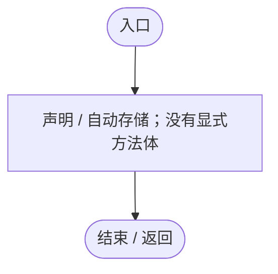

<a id="me460557fa7161e19"></a>

### Genes.set · L14

`private set`


#### Editor / Player · 语法控制结构 / 声明（非CFG）


<a id="m2552245887f0978b"></a>

### Traits.get · L16

`public IReadOnlyCollection<string> Traits`


#### Editor / Player · 语法控制结构 / 声明（非CFG）

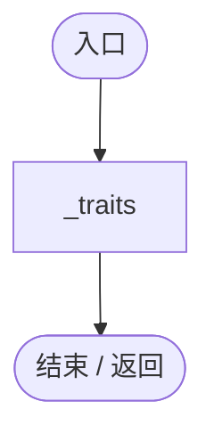

<a id="m3f3f83de828f602a"></a>

### Awake · L28

`private void Awake()`


#### Editor / Player · Roslyn编译器控制流

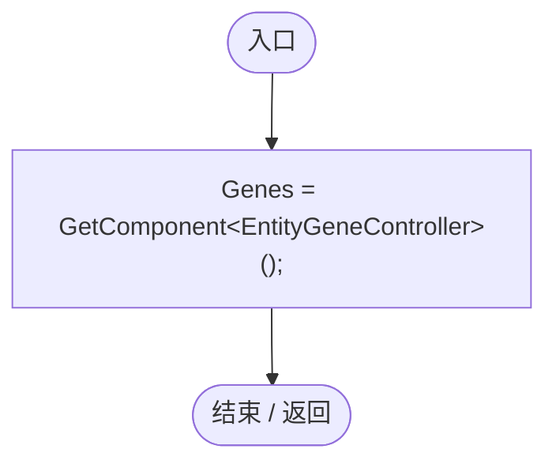

项目内调用/回调引用：

- [DarwinEntity.Genes.set · L14](Entities.md#me460557fa7161e19)（访问器）

<a id="m567c40d2c02b1076"></a>

### OnEnable · L33

`private void OnEnable()`


#### Editor / Player · Roslyn编译器控制流

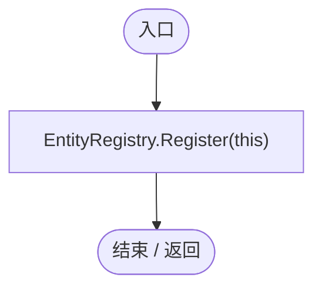

项目内调用/回调引用：

- [EntityRegistry.Register · L20](Entities.md#mfcc150206c18dd34)（方法）

<a id="md58ff1d3155efad4"></a>

### OnDisable · L34

`private void OnDisable()`


#### Editor / Player · Roslyn编译器控制流

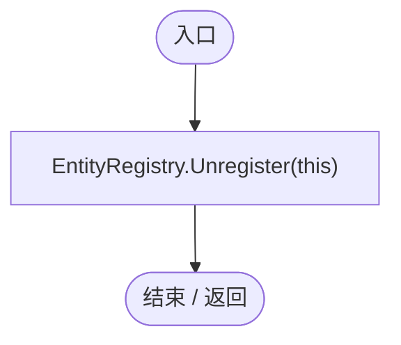

项目内调用/回调引用：

- [EntityRegistry.Unregister · L28](Entities.md#m663b8a65fa93eb49)（方法）

<a id="mfb4634eb6ceaac73"></a>

### EnableTrait · L36

`public void EnableTrait(string id)`


#### Editor / Player · Roslyn编译器控制流

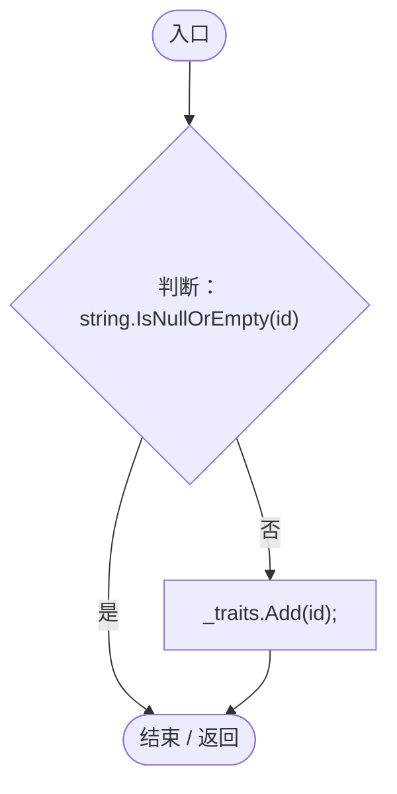

<a id="m80985eccf1782c0c"></a>

### DisableTrait · L37

`public void DisableTrait(string id)`


#### Editor / Player · Roslyn编译器控制流

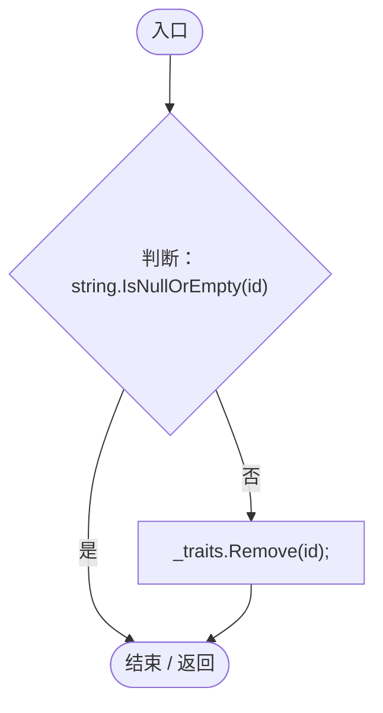

<a id="m68367f874590a20a"></a>

### HasTrait · L38

`public bool HasTrait(string id)`


#### Editor / Player · Roslyn编译器控制流

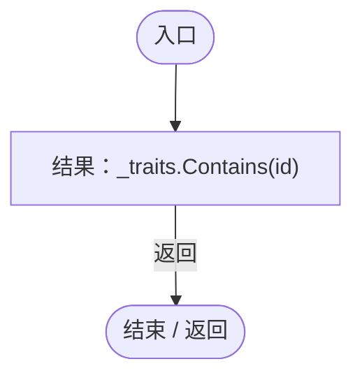

<a id="m82cfd893c3cfa3b3"></a>

### AddEnergy · L40

`public void AddEnergy(float amount)`


#### Editor / Player · Roslyn编译器控制流

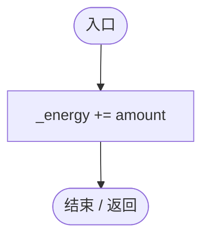

<a id="md1c920e79666968a"></a>

### Energy.get · L41

`public float Energy`


#### Editor / Player · 语法控制结构 / 声明（非CFG）

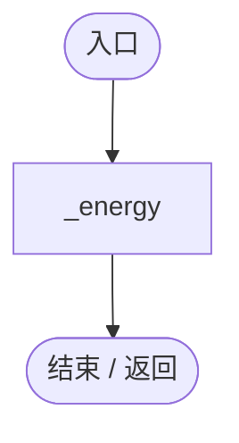

<a id="m19269518282b2241"></a>

### RequestReproduction · L43

`public void RequestReproduction(DarwinEntity partner, Genome offspringGenome)`


#### Editor / Player · Roslyn编译器控制流

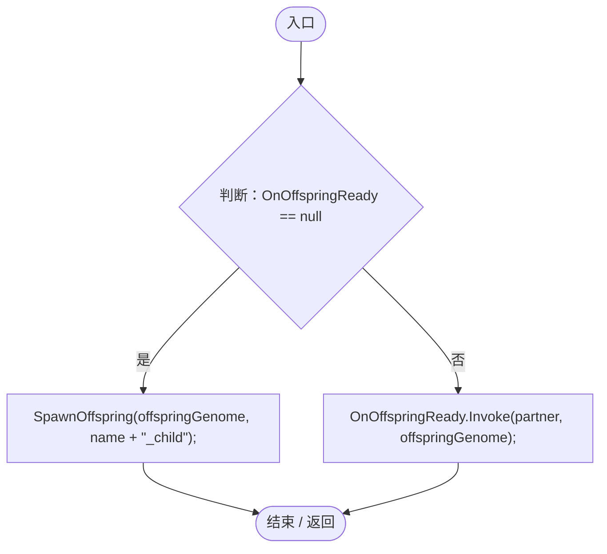

项目内调用/回调引用：

- [DarwinEntity.SpawnOffspring · L53](Entities.md#m0592a4fe9e10b836)（方法）

<a id="m0592a4fe9e10b836"></a>

### SpawnOffspring · L53

`public void SpawnOffspring(Genome genome, string childName)`


#### Editor / Player · Roslyn编译器控制流

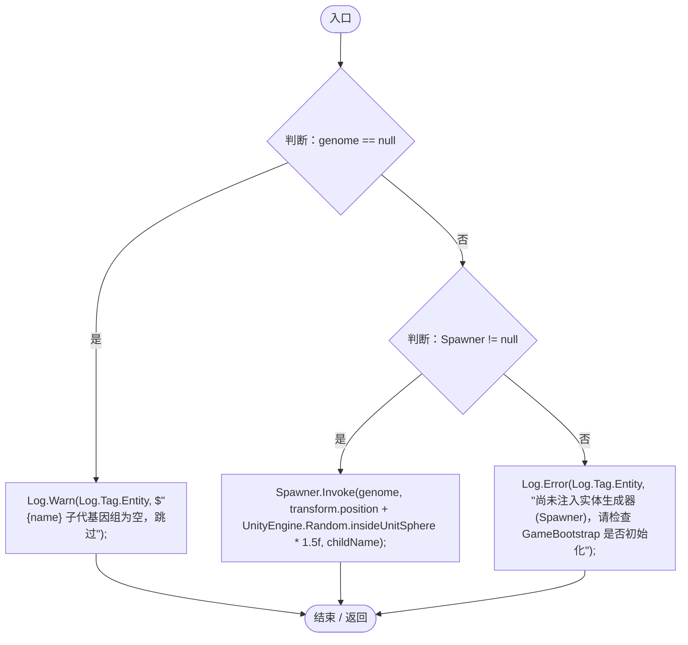

项目内调用/回调引用：

- [Log.Warn · L37](Core.md#m25a5d11252901de1)（方法）
- [Log.Error · L43](Core.md#m2addd5e1d74b000d)（方法）


---

<a id="saa858de55ec8e51a"></a>

## AntColonyCombat.cs

`Runtime` · `Assets/DarwinPark/Entities/Ecology/AntColonyCombat.cs`

[源文件](../../../Assets/DarwinPark/Entities/Ecology/AntColonyCombat.cs) · 源码校验：`405c1d23dfd9ee3a097bcd88891c2910cc6c0fb0ec45424be6feba342fdb192c`

方法按源文件位置排列。事件/回调引用不表示立即执行；完整源码与关系图请打开离线手册。

<a id="mf20367836d4406a5"></a>

### CanAttack · L9

`public static bool CanAttack(DarwinEntity attacker,DarwinEntity target)`


#### Editor / Player · Roslyn编译器控制流

```mermaid
flowchart TD
  b0(["入口"])
  b1{"判断：attacker==null"}
  b2{"判断：target==null"}
  b3["结果：true"]
  b4{"DarwinPark.Core.OptionalComponent.Read&lt;PopulationBehavior&gt;(attacker)<br/>判断：DarwinPark.Core.OptionalComponent.Read&lt;PopulationBehavior&gt;(attacker)"}
  b5[".SameGroup(target)"]
  b6["DarwinPark.Core.OptionalComponent.Read&lt;PopulationBehavior&gt;(attacker)"]
  b7{"判断：DarwinPark.Core.OptionalComponent.Read&lt;PopulationBehavior&gt;(attacker)?.SameGroup(target)==true"}
  b8["结果：false"]
  b9["member=DarwinPark.Core.OptionalComponent.Read&lt;AntColonyMember&gt;(attacker)"]
  b10{"判断：member==null"}
  b11{"判断：member.Active"}
  b12{"判断：member.Role==AntRole.None"}
  b13{"判断：member.Role==AntRole.Soldier"}
  b14["!member.Young"]
  b15["member.Role==AntRole.Soldier"]
  b16["member==null&#124;&#124;!member.Active&#124;&#124;member.Role==AntRole.None&#124;&#124;member.Role==AntRole.Soldier&amp;&amp;!member.Young"]
  b17["结果：member==null&#124;&#124;!member.Active&#124;&#124;member.Role==AntRole.None&#124;&#124;member.Role==AntRole.Soldier&amp;&amp;!member.Young"]
  b18(["结束 / 返回"])
  b0 --> b1
  b1 -->|"否"| b2
  b1 -->|"是"| b3
  b2 -->|"是"| b3
  b2 -->|"否"| b4
  b3 -->|"返回"| b18
  b4 -->|"否"| b5
  b4 -->|"是"| b6
  b5 --> b7
  b6 --> b7
  b7 -->|"是"| b8
  b7 -->|"否"| b9
  b8 -->|"返回"| b18
  b9 --> b10
  b10 -->|"否"| b11
  b10 -->|"是"| b16
  b11 -->|"是"| b12
  b11 -->|"否"| b16
  b12 -->|"否"| b13
  b12 -->|"是"| b16
  b13 -->|"是"| b14
  b13 -->|"否"| b15
  b14 --> b17
  b15 --> b17
  b16 --> b17
  b17 -->|"返回"| b18

```

项目内调用/回调引用：

- [OptionalComponent.Read · L7](Core.md#m69622a4dee165c5a)（方法）
- [PopulationBehavior.SameGroup · L135](Entities.md#mef6e38ec1794256f)（方法）
- [AntColonyMember.Role.get · L40](Entities.md#m382545c3d4092bf1)（访问器）

<a id="mcb554a0399af6a1c"></a>

### SettleSoldierAttack · L16

`public static bool SettleSoldierAttack(EntityGeneController genes,DarwinEntity target,bool killed)`


#### Editor / Player · Roslyn编译器控制流

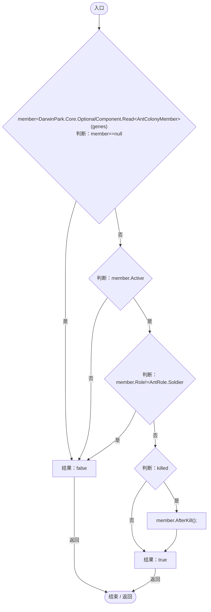

项目内调用/回调引用：

- [OptionalComponent.Read · L7](Core.md#m69622a4dee165c5a)（方法）
- [AntColonyMember.Role.get · L40](Entities.md#m382545c3d4092bf1)（访问器）
- [AntColonyMember.AfterKill · L151](Entities.md#m6b14ae5c34cb88db)（方法）


---

<a id="sbaebd85c05598377"></a>

## AntColonyMember.cs

`Runtime` · `Assets/DarwinPark/Entities/Ecology/AntColonyMember.cs`

[源文件](../../../Assets/DarwinPark/Entities/Ecology/AntColonyMember.cs) · 源码校验：`fae33aa79f58712225ddff9002398e31916cc5f45f37563b8a416ef94196c0e1`

方法按源文件位置排列。事件/回调引用不表示立即执行；完整源码与关系图请打开离线手册。

<a id="m8df0b33e716524af"></a>

### HasData.get · L26

`public bool HasData`


#### Editor / Player · 语法控制结构 / 声明（非CFG）

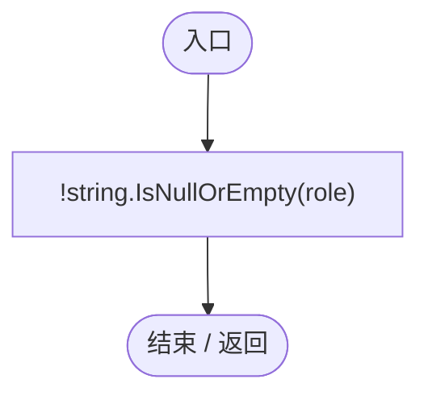

<a id="m8dde3800d33b5506"></a>

### All.get · L33

`public static IEnumerable<AntColonyMember> All`


#### Editor / Player · 语法控制结构 / 声明（非CFG）

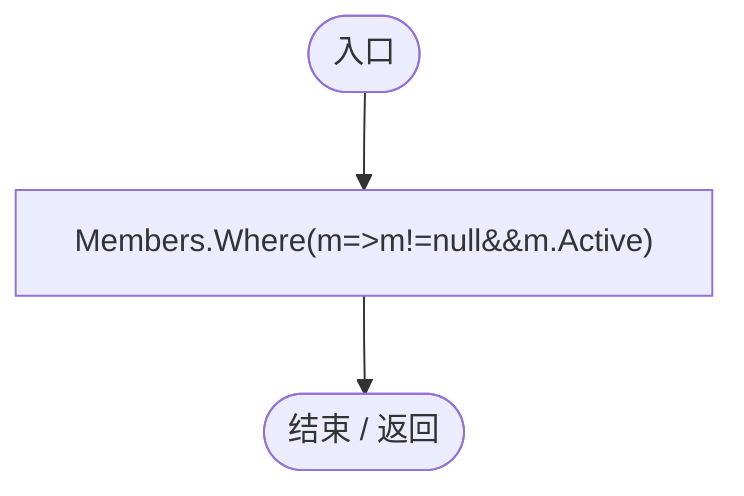

项目内调用/回调引用：

- [AntColonyMember.回调@33 · L33](Entities.md#md6c468ba465f26cf)（回调/委托）

<a id="md6c468ba465f26cf"></a>

### 回调@33 · L33

`m … => 回调`


#### Editor / Player · 语法控制结构 / 声明（非CFG）

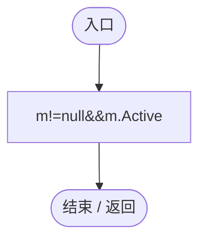

<a id="m64745194ab46f363"></a>

### State.get · L34

`get`


#### Editor / Player · 语法控制结构 / 声明（非CFG）


<a id="mf2eb0c46ab1752b7"></a>

### State.set · L34

`private set`


#### Editor / Player · 语法控制结构 / 声明（非CFG）


<a id="m32357842031ebe8d"></a>

### Genes.get · L35

`get`


#### Editor / Player · 语法控制结构 / 声明（非CFG）

```mermaid
flowchart TD
  n2(["入口"])
  n1["声明 / 自动存储；没有显式方法体"]
  n0(["结束 / 返回"])
  n1 --> n0
  n2 --> n1

```

<a id="m4012c8f7635d5743"></a>

### Genes.set · L35

`private set`


#### Editor / Player · 语法控制结构 / 声明（非CFG）

```mermaid
flowchart TD
  n2(["入口"])
  n1["声明 / 自动存储；没有显式方法体"]
  n0(["结束 / 返回"])
  n1 --> n0
  n2 --> n1

```

<a id="m9b719fef2d946b65"></a>

### Entity.get · L36

`get`


#### Editor / Player · 语法控制结构 / 声明（非CFG）

```mermaid
flowchart TD
  n2(["入口"])
  n1["声明 / 自动存储；没有显式方法体"]
  n0(["结束 / 返回"])
  n1 --> n0
  n2 --> n1

```

<a id="m69b358df5805c575"></a>

### Entity.set · L36

`private set`


#### Editor / Player · 语法控制结构 / 声明（非CFG）

```mermaid
flowchart TD
  n2(["入口"])
  n1["声明 / 自动存储；没有显式方法体"]
  n0(["结束 / 返回"])
  n1 --> n0
  n2 --> n1

```

<a id="m8a87d3d378490df9"></a>

### Population.get · L37

`get`


#### Editor / Player · 语法控制结构 / 声明（非CFG）

```mermaid
flowchart TD
  n2(["入口"])
  n1["声明 / 自动存储；没有显式方法体"]
  n0(["结束 / 返回"])
  n1 --> n0
  n2 --> n1

```

<a id="m44fefc091ed2080d"></a>

### Population.set · L37

`private set`


#### Editor / Player · 语法控制结构 / 声明（非CFG）

```mermaid
flowchart TD
  n2(["入口"])
  n1["声明 / 自动存储；没有显式方法体"]
  n0(["结束 / 返回"])
  n1 --> n0
  n2 --> n1

```

<a id="m382545c3d4092bf1"></a>

### Role.get · L40

`get`


#### Editor / Player · Roslyn编译器控制流

```mermaid
flowchart TD
  b0(["入口"])
  b1{"判断：_roleText!=State.role"}
  b2["_roleText=State.role;"]
  b3{"_role<br/>判断：Enum.TryParse&lt;AntRole&gt;(State.role,out var role)"}
  b4["role"]
  b5["AntRole.None"]
  b6["_role=Enum.TryParse&lt;AntRole&gt;(State.role,out var role)?role:AntRole.None;"]
  b7["结果：_role"]
  b8(["结束 / 返回"])
  b0 --> b1
  b1 -->|"是"| b2
  b1 -->|"否"| b7
  b2 --> b3
  b3 -->|"是"| b4
  b3 -->|"否"| b5
  b4 --> b6
  b5 --> b6
  b6 --> b7
  b7 -->|"返回"| b8

```

项目内调用/回调引用：

- [AntColonyMember.State.get · L34](Entities.md#m64745194ab46f363)（访问器）

<a id="md7a00fa632693c67"></a>

### Active.get · L41

`public bool Active`


#### Editor / Player · 语法控制结构 / 声明（非CFG）

```mermaid
flowchart TD
  n2(["入口"])
  n1["Population!=null&amp;&amp;Population.Active&amp;&amp;Population.Mode==EcologySettings.Load().antState"]
  n0(["结束 / 返回"])
  n1 --> n0
  n2 --> n1

```

项目内调用/回调引用：

- [AntColonyMember.Population.get · L37](Entities.md#m8a87d3d378490df9)（访问器）
- [EcologySettings.Load · L18](Entities.md#mb0575490373edaf2)（方法）

<a id="m0ec34669b50eecf6"></a>

### Young.get · L42

`public bool Young`


#### Editor / Player · 语法控制结构 / 声明（非CFG）

```mermaid
flowchart TD
  n2(["入口"])
  n1["Genes.CurrentAge==AgeState.Infant&#124;&#124;OptionalComponent.Read&lt;EggIncubation&gt;(this)?.Incubating==true"]
  n0(["结束 / 返回"])
  n1 --> n0
  n2 --> n1

```

项目内调用/回调引用：

- [EntityGeneController.CurrentAge.get · L39](Entities.md#m977f52932bb90600)（访问器）
- [AntColonyMember.Genes.get · L35](Entities.md#m32357842031ebe8d)（访问器）
- [OptionalComponent.Read · L7](Core.md#m69622a4dee165c5a)（方法）

<a id="m7f5d3208c6c0241e"></a>

### GroupId.get · L43

`public string GroupId`


#### Editor / Player · 语法控制结构 / 声明（非CFG）

```mermaid
flowchart TD
  n2(["入口"])
  n1["Population.GroupId"]
  n0(["结束 / 返回"])
  n1 --> n0
  n2 --> n1

```

项目内调用/回调引用：

- [PopulationBehavior.GroupId.get · L23](Entities.md#ma9e57e12d0585573)（访问器）
- [AntColonyMember.Population.get · L37](Entities.md#m8a87d3d378490df9)（访问器）

<a id="mc130acd852d469f0"></a>

### Id.get · L44

`public string Id`


#### Editor / Player · 语法控制结构 / 声明（非CFG）

```mermaid
flowchart TD
  n2(["入口"])
  n1["EcologyIdentity.Of(Entity)"]
  n0(["结束 / 返回"])
  n1 --> n0
  n2 --> n1

```

项目内调用/回调引用：

- [EcologyIdentity.Of · L22](Entities.md#mb23020fe763aafd3)（方法）
- [AntColonyMember.Entity.get · L36](Entities.md#m9b719fef2d946b65)（访问器）

<a id="m1fcea9b5730300dd"></a>

### Group.get · L45

`public IEnumerable<AntColonyMember> Group`


#### Editor / Player · 语法控制结构 / 声明（非CFG）

```mermaid
flowchart TD
  n2(["入口"])
  n1["Population.GroupMembers.Select(p=&gt;DarwinPark.Core.OptionalComponent.Read&lt;AntColonyMember&gt;(p)).Where(m=&gt;m!=null&amp;&amp;m.Active)"]
  n0(["结束 / 返回"])
  n1 --> n0
  n2 --> n1

```

项目内调用/回调引用：

- [AntColonyMember.Population.get · L37](Entities.md#m8a87d3d378490df9)（访问器）
- [AntColonyMember.回调@45 · L45](Entities.md#m72060d15728d5985)（回调/委托）
- [AntColonyMember.回调@45 · L45](Entities.md#m8650e0104242874d)（回调/委托）

<a id="m72060d15728d5985"></a>

### 回调@45 · L45

`p … => 回调`


#### Editor / Player · 语法控制结构 / 声明（非CFG）

```mermaid
flowchart TD
  n2(["入口"])
  n1["DarwinPark.Core.OptionalComponent.Read&lt;AntColonyMember&gt;(p)"]
  n0(["结束 / 返回"])
  n1 --> n0
  n2 --> n1

```

项目内调用/回调引用：

- [OptionalComponent.Read · L7](Core.md#m69622a4dee165c5a)（方法）

<a id="m8650e0104242874d"></a>

### 回调@45 · L45

`m … => 回调`


#### Editor / Player · 语法控制结构 / 声明（非CFG）

```mermaid
flowchart TD
  n2(["入口"])
  n1["m!=null&amp;&amp;m.Active"]
  n0(["结束 / 返回"])
  n1 --> n0
  n2 --> n1

```

<a id="mbab8b4a445bc91ed"></a>

### Queen.get · L46

`public AntColonyMember Queen`


#### Editor / Player · 语法控制结构 / 声明（非CFG）

```mermaid
flowchart TD
  n2(["入口"])
  n1["PopulationGroupIndex.Queen(Population)"]
  n0(["结束 / 返回"])
  n1 --> n0
  n2 --> n1

```

项目内调用/回调引用：

- [PopulationGroupIndex.Queen · L47](Entities.md#m99736eb6e778e4db)（方法）
- [AntColonyMember.Population.get · L37](Entities.md#m8a87d3d378490df9)（访问器）

<a id="mcc7c915e5d37ccc3"></a>

### Center.get · L47

`get`


#### Editor / Player · Roslyn编译器控制流

```mermaid
flowchart TD
  b0(["入口"])
  b1["queen=Queen"]
  b2{"判断：queen!=null"}
  b3["queen.transform.position"]
  b4["transform.position"]
  b5["结果：queen!=null?queen.transform.position:transform.position"]
  b6(["结束 / 返回"])
  b0 --> b1
  b1 --> b2
  b2 -->|"是"| b3
  b2 -->|"否"| b4
  b3 --> b5
  b4 --> b5
  b5 -->|"返回"| b6

```

<a id="m285279f4b1f33d83"></a>

### Radius.get · L48

`public float Radius`


#### Editor / Player · 语法控制结构 / 声明（非CFG）

```mermaid
flowchart TD
  n2(["入口"])
  n1["Mathf.Max(AntColonySettings.Current.minimumColonyRadius,Genes.GetAttribute(&quot;territory_radius&quot;),AntColonySettings.Current.colonyRadius)*DarwinPark.Core.GameplayTuning.Current.colonyActivityRadiusMultiplier"]
  n0(["结束 / 返回"])
  n1 --> n0
  n2 --> n1

```

项目内调用/回调引用：

- [AntColonySettings.Current.get · L31](Entities.md#mcd121159f407ccdf)（访问器）
- [EntityGeneController.GetAttribute · L290](Entities.md#m7bba19b32d600451)（方法）
- [AntColonyMember.Genes.get · L35](Entities.md#m32357842031ebe8d)（访问器）
- [GameplayTuning.Current.get · L46](Core.md#m4fa691bd8a3b9618)（访问器）

<a id="m831f2942e93fac77"></a>

### Frozen.get · L49

`public bool Frozen`


#### Editor / Player · 语法控制结构 / 声明（非CFG）

```mermaid
flowchart TD
  n2(["入口"])
  n1["Active&amp;&amp;Role!=AntRole.None&amp;&amp;AntColonySettings.Current.Rule(Role).frozenGenome"]
  n0(["结束 / 返回"])
  n1 --> n0
  n2 --> n1

```

项目内调用/回调引用：

- [AntColonyMember.Role.get · L40](Entities.md#m382545c3d4092bf1)（访问器）
- [AntColonySettings.Rule · L56](Entities.md#m46f80f7628c118a8)（方法）
- [AntColonySettings.Current.get · L31](Entities.md#mcd121159f407ccdf)（访问器）

<a id="m6ca2bd3b1acca44a"></a>

### Activity.get · L52

`get`


#### Editor / Player · Roslyn编译器控制流

```mermaid
flowchart TD
  b0(["入口"])
  b1{"判断：EntityTaskPlan.Feeding(this)"}
  b2{"State.plan<br/>判断：State.plan"}
  b3[".supply"]
  b4["State.plan"]
  b5{"判断：ColonyResource.Find(State.plan?.supply)!=null"}
  b6["ColonyActivity.Feed"]
  b7["_activity"]
  b8["结果：EntityTaskPlan.Feeding(this)&amp;&amp;ColonyResource.Find(State.plan?.supply)!=null?ColonyActivity.Feed:_activity"]
  b9(["结束 / 返回"])
  b0 --> b1
  b1 -->|"是"| b2
  b1 -->|"否"| b7
  b2 -->|"否"| b3
  b2 -->|"是"| b4
  b3 --> b5
  b4 --> b5
  b5 -->|"是"| b6
  b5 -->|"否"| b7
  b6 --> b8
  b7 --> b8
  b8 -->|"返回"| b9

```

项目内调用/回调引用：

- [EntityTaskPlan.Feeding · L20](Entities.md#m0546cdf948a33533)（方法）
- [ColonyResource.Find · L28](Entities.md#m1324285ab40ac6f4)（方法）
- [AntColonyMember.State.get · L34](Entities.md#m64745194ab46f363)（访问器）

<a id="m044555b23cca15dc"></a>

### Activity.set · L52

`internal set`


#### Editor / Player · Roslyn编译器控制流

```mermaid
flowchart TD
  b0(["入口"])
  b1["_activity=value;<br/>MemberTaskSequence.Record(this,value);"]
  b2(["结束 / 返回"])
  b0 --> b1
  b1 --> b2

```

项目内调用/回调引用：

- [MemberTaskSequence.Record · L7](Entities.md#m688656f9edfaf045)（方法）

<a id="ma8ff33f917e41c07"></a>

### TaskPriority.get · L53

`public int TaskPriority`


#### Editor / Player · 语法控制结构 / 声明（非CFG）

```mermaid
flowchart TD
  n2(["入口"])
  n1["EntityTaskPlan.Priority(Activity)"]
  n0(["结束 / 返回"])
  n1 --> n0
  n2 --> n1

```

项目内调用/回调引用：

- [EntityTaskPlan.Priority · L19](Entities.md#mf4050bd85d0733de)（方法）
- [AntColonyMember.Activity.get · L52](Entities.md#m6ca2bd3b1acca44a)（访问器）

<a id="m3acab8d7a42824bb"></a>

### Awake · L57

`private void Awake()`


#### Editor / Player · Roslyn编译器控制流

```mermaid
flowchart TD
  b0(["入口"])
  b1["Genes=GetComponent&lt;EntityGeneController&gt;();<br/>Entity=GetComponent&lt;DarwinEntity&gt;();<br/>Population=DarwinPark.Core.OptionalComponent.Read&lt;PopulationBehavior&gt;(this);"]
  b2(["结束 / 返回"])
  b0 --> b1
  b1 --> b2

```

项目内调用/回调引用：

- [AntColonyMember.Genes.set · L35](Entities.md#m4012c8f7635d5743)（访问器）
- [AntColonyMember.Entity.set · L36](Entities.md#m69b358df5805c575)（访问器）
- [AntColonyMember.Population.set · L37](Entities.md#m44fefc091ed2080d)（访问器）
- [OptionalComponent.Read · L7](Core.md#m69622a4dee165c5a)（方法）

<a id="m825081a9eae249ce"></a>

### OnEnable · L58

`private void OnEnable()`


#### Editor / Player · Roslyn编译器控制流

```mermaid
flowchart TD
  b0(["入口"])
  b1{"判断：Members.Contains(this)"}
  b2["Members.Add(this);"]
  b3(["结束 / 返回"])
  b0 --> b1
  b1 -->|"否"| b2
  b1 -->|"是"| b3
  b2 --> b3

```

<a id="mdac22ef765992907"></a>

### OnDisable · L59

`private void OnDisable()`


#### Editor / Player · Roslyn编译器控制流

```mermaid
flowchart TD
  b0(["入口"])
  b1["AntColonyWorker.Release(this);<br/>Members.Remove(this);"]
  b2(["结束 / 返回"])
  b0 --> b1
  b1 --> b2

```

项目内调用/回调引用：

- [AntColonyWorker.Release · L115](Entities.md#ma690c0beb4883222)（方法）

<a id="m7261c89fa8e734a8"></a>

### Reset · L60

`[RuntimeInitializeOnLoadMethod(RuntimeInitializeLoadType.SubsystemRegistration)] private static void Reset()`


#### Editor / Player · Roslyn编译器控制流

```mermaid
flowchart TD
  b0(["入口"])
  b1["Members.Clear()"]
  b2(["结束 / 返回"])
  b0 --> b1
  b1 --> b2

```

<a id="m4e1194d3f46affcd"></a>

### Ensure · L61

`public static AntColonyMember Ensure(PopulationBehavior pop)`


#### Editor / Player · Roslyn编译器控制流

```mermaid
flowchart TD
  b0(["入口"])
  b1{"DarwinPark.Core.OptionalComponent.Read&lt;AntColonyMember&gt;(pop)<br/>判断：DarwinPark.Core.OptionalComponent.Read&lt;AntColonyMember&gt;(pop)"}
  b2["DarwinPark.Core.OptionalComponent.Read&lt;AntColonyMember&gt;(pop)"]
  b3["pop.gameObject.AddComponent&lt;AntColonyMember&gt;()"]
  b4["结果：DarwinPark.Core.OptionalComponent.Read&lt;AntColonyMember&gt;(pop)??pop.gameObject.AddComponent&lt;AntColonyMember&gt;()"]
  b5(["结束 / 返回"])
  b0 --> b1
  b1 -->|"否"| b2
  b1 -->|"是"| b3
  b2 --> b4
  b3 --> b4
  b4 -->|"返回"| b5

```

项目内调用/回调引用：

- [OptionalComponent.Read · L7](Core.md#m69622a4dee165c5a)（方法）

<a id="m6ee49d38283d34d1"></a>

### QueenFor · L62

`public static AntColonyMember QueenFor(PopulationBehavior pop)`


#### Editor / Player · Roslyn编译器控制流

```mermaid
flowchart TD
  b0(["入口"])
  b1{"DarwinPark.Core.OptionalComponent.Read&lt;AntColonyMember&gt;(pop)<br/>判断：DarwinPark.Core.OptionalComponent.Read&lt;AntColonyMember&gt;(pop)"}
  b2[".Queen"]
  b3["DarwinPark.Core.OptionalComponent.Read&lt;AntColonyMember&gt;(pop)"]
  b4["结果：DarwinPark.Core.OptionalComponent.Read&lt;AntColonyMember&gt;(pop)?.Queen"]
  b5(["结束 / 返回"])
  b0 --> b1
  b1 -->|"否"| b2
  b1 -->|"是"| b3
  b2 --> b4
  b3 --> b4
  b4 -->|"返回"| b5

```

项目内调用/回调引用：

- [OptionalComponent.Read · L7](Core.md#m69622a4dee165c5a)（方法）

<a id="m62a304872736f89e"></a>

### IsManaged · L63

`public static bool IsManaged(EntityGeneController genes)`


#### Editor / Player · Roslyn编译器控制流

```mermaid
flowchart TD
  b0(["入口"])
  b1{"判断：genes!=null"}
  b2{"OptionalComponent.Read&lt;AntColonyMember&gt;(genes)<br/>判断：OptionalComponent.Read&lt;AntColonyMember&gt;(genes)"}
  b3[".Active"]
  b4["OptionalComponent.Read&lt;AntColonyMember&gt;(genes)"]
  b5["OptionalComponent.Read&lt;AntColonyMember&gt;(genes)?.Active==true"]
  b6["genes!=null"]
  b7["结果：genes!=null&amp;&amp;OptionalComponent.Read&lt;AntColonyMember&gt;(genes)?.Active==true"]
  b8(["结束 / 返回"])
  b0 --> b1
  b1 -->|"是"| b2
  b1 -->|"否"| b6
  b2 -->|"否"| b3
  b2 -->|"是"| b4
  b3 --> b5
  b4 --> b5
  b5 --> b7
  b6 --> b7
  b7 -->|"返回"| b8

```

项目内调用/回调引用：

- [OptionalComponent.Read · L7](Core.md#m69622a4dee165c5a)（方法）

<a id="m27a8ec4fadc8e70b"></a>

### Assign · L64

`public void Assign(AntRole role,string group=null)`


#### Editor / Player · Roslyn编译器控制流

```mermaid
flowchart TD
  b0(["入口"])
  b1{"判断：group!=null"}
  b2["Population.JoinColony(group,role==AntRole.Queen);"]
  b3["State.role=role.ToString();"]
  b4{"State.lockedGenome<br/>判断：AntColonySettings.Current.Rule(role).frozenGenome"}
  b5["JsonUtility.ToJson(Genes.Genome)"]
  b6["null"]
  b7["State.lockedGenome=AntColonySettings.Current.Rule(role).frozenGenome?JsonUtility.ToJson(Genes.Genome):null;"]
  b8{"PopulationGroupIndex.Invalidate();<br/>Genes.IsGestating=false;<br/>_suppressionRole=null;<br/>Genes.Recalculate();<br/>判断：GetComponent&lt;ColonyMemberMarker&gt;()==null"}
  b9["gameObject.AddComponent&lt;ColonyMemberMarker&gt;();"]
  b10{"判断：role==AntRole.Queen"}
  b11["EnsureSupplyPoints();"]
  b12(["结束 / 返回"])
  b0 --> b1
  b1 -->|"是"| b2
  b1 -->|"否"| b3
  b2 --> b3
  b3 --> b4
  b4 -->|"是"| b5
  b4 -->|"否"| b6
  b5 --> b7
  b6 --> b7
  b7 --> b8
  b8 -->|"是"| b9
  b8 -->|"否"| b10
  b9 --> b10
  b10 -->|"是"| b11
  b10 -->|"否"| b12
  b11 --> b12

```

项目内调用/回调引用：

- [PopulationBehavior.JoinColony · L133](Entities.md#ma61a59d0bc1e7cc9)（方法）
- [AntColonyMember.Population.get · L37](Entities.md#m8a87d3d378490df9)（访问器）
- [AntColonyMember.State.get · L34](Entities.md#m64745194ab46f363)（访问器）
- [AntColonySettings.Rule · L56](Entities.md#m46f80f7628c118a8)（方法）
- [AntColonySettings.Current.get · L31](Entities.md#mcd121159f407ccdf)（访问器）
- [AntColonyMember.Genes.get · L35](Entities.md#m32357842031ebe8d)（访问器）
- [PopulationGroupIndex.Invalidate · L21](Entities.md#m6301560c15e5621a)（方法）
- [EntityGeneController.Recalculate · L122](Entities.md#m0c8090b8014eb248)（方法）
- [AntColonyMember.EnsureSupplyPoints · L176](Entities.md#m4aa9d8fd5f28f5e3)（方法）

<a id="m5a3b31593e0247b1"></a>

### OnBirth · L73

`public static void OnBirth(EntityGeneController parent,DarwinEntity child)`


#### Editor / Player · Roslyn编译器控制流

```mermaid
flowchart TD
  b0(["入口"])
  b1{"source=DarwinPark.Core.OptionalComponent.Read&lt;AntColonyMember&gt;(parent)<br/>判断：source==null"}
  b2{"判断：source.Active"}
  b3{"判断：child==null"}
  b4{"pop=DarwinPark.Core.OptionalComponent.Read&lt;PopulationBehavior&gt;(child)<br/>判断：pop==null"}
  b5["member=Ensure(pop)<br/>member.Assign(source.ChooseBirthRole(),source.GroupId);"]
  b6(["结束 / 返回"])
  b0 --> b1
  b1 -->|"否"| b2
  b1 -->|"是"| b6
  b2 -->|"是"| b3
  b2 -->|"否"| b6
  b3 -->|"是"| b6
  b3 -->|"否"| b4
  b4 -->|"是"| b6
  b4 -->|"否"| b5
  b5 --> b6

```

项目内调用/回调引用：

- [OptionalComponent.Read · L7](Core.md#m69622a4dee165c5a)（方法）
- [AntColonyMember.Ensure · L61](Entities.md#m4e1194d3f46affcd)（方法）
- [AntColonyMember.Assign · L64](Entities.md#m27a8ec4fadc8e70b)（方法）
- [AntColonyMember.ChooseBirthRole · L79](Entities.md#m584d1b2e641b4343)（方法）

<a id="m584d1b2e641b4343"></a>

### ChooseBirthRole · L79

`public AntRole ChooseBirthRole()`


#### Editor / Player · Roslyn编译器控制流

```mermaid
flowchart TD
  b0(["入口"])
  b1{"判断：ColonyFoundingSupport.NeedsWorker(this)"}
  b2["结果：AntRole.Worker"]
  b3{"判断：ColonyContinuityPriority.NeedsSuccessor(this)"}
  b4["结果：AntRole.Reproductive"]
  b5{"settings=AntColonySettings.Current<br/>判断：Group.Count()&gt;=settings.reproductivePopulationThreshold"}
  b6{"判断：Group.Count(m=&gt;m.Role==AntRole.Reproductive)&lt;settings.minimumReproductives"}
  b7["结果：AntRole.Reproductive"]
  b8["choices=settings.roles.Where(r=&gt;r.birthWeight&gt;0&amp;&amp;(r.Role!=AntRole.Reproductive&#124;&#124;Group.Count(m=&gt;m.Role==AntRole.Reproductive)&lt;settings.maximumReproductives)).ToArray()<br/>roll=UnityEngine.Random.value*choices.Sum(r=&gt;r.birthWeight)"]
  b9["choices"]
  b10{"判断：choices"}
  b11{"var<br/>roll-=rule.birthWeight;<br/>判断：roll&lt;=0"}
  b12["结果：rule.Role"]
  b13{"choices<br/>判断：choices"}
  b14["choices"]
  b15["连接 / 离开区域"]
  b16["结果：choices[choices.Length-1].Role"]
  b17(["结束 / 返回"])
  b0 --> b1
  b1 -->|"是"| b2
  b1 -->|"否"| b3
  b2 -->|"返回"| b17
  b3 -->|"是"| b4
  b3 -->|"否"| b5
  b4 -->|"返回"| b17
  b5 -->|"是"| b6
  b5 -->|"否"| b8
  b6 -->|"是"| b7
  b6 -->|"否"| b8
  b7 -->|"返回"| b17
  b8 --> b9
  b9 --> b10
  b10 -->|"是"| b11
  b10 -->|"否 · 经过finally 13"| b16
  b11 -->|"是"| b12
  b11 -->|"否"| b10
  b12 -->|"返回 · 经过finally 13"| b17
  b13 -->|"否"| b14
  b13 -->|"是"| b15
  b14 --> b15
  b16 -->|"返回"| b17
  b10 -. "退出保护区时 finally（示意）" .-> b13

```

项目内调用/回调引用：

- [ColonyFoundingSupport.NeedsWorker · L14](Entities.md#maadfc5b35bfda290)（方法）
- [ColonyContinuityPriority.NeedsSuccessor · L12](Entities.md#m411d8fa2a477bff1)（方法）
- [AntColonySettings.Current.get · L31](Entities.md#mcd121159f407ccdf)（访问器）
- [AntColonyMember.回调@86 · L86](Entities.md#me9878a608a10fa74)（回调/委托）
- [AntColonyMember.回调@87 · L87](Entities.md#m4fc83fe332ab6e44)（回调/委托）
- [AntColonyMember.回调@88 · L88](Entities.md#m40d094c214d5099c)（回调/委托）

<a id="me9878a608a10fa74"></a>

### 回调@86 · L86

`m … => 回调`


#### Editor / Player · Roslyn编译器控制流

```mermaid
flowchart TD
  b0(["入口"])
  b1["结果：m.Role==AntRole.Reproductive"]
  b2(["结束 / 返回"])
  b0 --> b1
  b1 -->|"返回"| b2

```

项目内调用/回调引用：

- [AntColonyMember.Role.get · L40](Entities.md#m382545c3d4092bf1)（访问器）

<a id="m4fc83fe332ab6e44"></a>

### 回调@87 · L87

`r … => 回调`


#### Editor / Player · Roslyn编译器控制流

```mermaid
flowchart TD
  b0(["入口"])
  b1{"判断：r.birthWeight&gt;0"}
  b2{"判断：r.Role!=AntRole.Reproductive"}
  b3["Group.Count(m=&gt;m.Role==AntRole.Reproductive)&lt;settings.maximumReproductives"]
  b4["r.Role!=AntRole.Reproductive"]
  b5["r.birthWeight&gt;0"]
  b6["结果：r.birthWeight&gt;0&amp;&amp;(r.Role!=AntRole.Reproductive&#124;&#124;Group.Count(m=&gt;m.Role==AntRole.Reproductive)&lt;settings.maximumReproductives)"]
  b7(["结束 / 返回"])
  b0 --> b1
  b1 -->|"是"| b2
  b1 -->|"否"| b5
  b2 -->|"否"| b3
  b2 -->|"是"| b4
  b3 --> b6
  b4 --> b6
  b5 --> b6
  b6 -->|"返回"| b7

```

项目内调用/回调引用：

- [AntColonyMember.回调@87 · L87](Entities.md#m016b0efc88a0b7e0)（回调/委托）

<a id="m016b0efc88a0b7e0"></a>

### 回调@87 · L87

`m … => 回调`


#### Editor / Player · Roslyn编译器控制流

```mermaid
flowchart TD
  b0(["入口"])
  b1["结果：m.Role==AntRole.Reproductive"]
  b2(["结束 / 返回"])
  b0 --> b1
  b1 -->|"返回"| b2

```

项目内调用/回调引用：

- [AntColonyMember.Role.get · L40](Entities.md#m382545c3d4092bf1)（访问器）

<a id="m40d094c214d5099c"></a>

### 回调@88 · L88

`r … => 回调`


#### Editor / Player · Roslyn编译器控制流

```mermaid
flowchart TD
  b0(["入口"])
  b1["结果：r.birthWeight"]
  b2(["结束 / 返回"])
  b0 --> b1
  b1 -->|"返回"| b2

```

<a id="m790b5145678d0ed5"></a>

### Advance · L91

`public void Advance(float dt)`


#### Editor / Player · Roslyn编译器控制流

```mermaid
flowchart TD
  b0(["入口"])
  b1["performance=DarwinPark.Core.PerformanceTimings.Measure(DarwinPark.Core.PerformanceTimings.Area.ColonyTasks)"]
  b2{"判断：Active"}
  b3{"判断：dt&lt;=0"}
  b4{"判断：Role==AntRole.None"}
  b5{"Assign<br/>判断：Population.LeaderFlag"}
  b6["AntRole.Queen"]
  b7["ChooseBirthRole()"]
  b8["Assign(Population.LeaderFlag?AntRole.Queen:ChooseBirthRole());"]
  b9["State.scan-=dt;<br/>State.reproductionCooldown=Mathf.Max(0,State.reproductionCooldown-dt);<br/>ColonyResource.Feed(this,dt);"]
  b10{"OptionalComponent.Read&lt;EggIncubation&gt;(this)<br/>判断：OptionalComponent.Read&lt;EggIncubation&gt;(this)"}
  b11[".Incubating"]
  b12["OptionalComponent.Read&lt;EggIncubation&gt;(this)"]
  b13{"判断：OptionalComponent.Read&lt;EggIncubation&gt;(this)?.Incubating==true"}
  b14{"判断：Young"}
  b15["Activity=ColonyActivity.Young;"]
  b16{"判断：EntityActivityPlan.BlocksAutomatic(this)"}
  b17{"判断：Role==AntRole.Reproductive"}
  b18["BeginFounding();"]
  b19{"判断：State.founding"}
  b20{"判断：ColonyFeeding.Destination(this,out _)"}
  b21{"Activity=ColonyActivity.Founding;<br/>判断：EcologyQueries.Distance(transform.position,EcologyQueries.ToWorld(State.foundingPoint))&lt;=AntColonySettings.Current.arrivalDistance"}
  b22["State.founding=false;<br/>EnsureSupplyPoints();"]
  b23{"DarwinPark.Core.OptionalComponent.Read&lt;TerritoryBehavior&gt;(this)<br/>判断：DarwinPark.Core.OptionalComponent.Read&lt;TerritoryBehavior&gt;(this)"}
  b24["DarwinPark.Core.OptionalComponent.Read&lt;TerritoryBehavior&gt;(this)?.Restore(EcologyQueries.ToLocal(transform.position),true,0,Vector3.zero);"]
  b25{"判断：Role==AntRole.Queen"}
  b26["Activity=ColonyActivity.Reproduce;<br/>ColonyFoundingSupport.Advance(this,dt);<br/>AntColonyReproduction.Advance(this,dt);"]
  b27{"判断：Role==AntRole.Worker"}
  b28["AntColonyWorker.Advance(this,dt);"]
  b29{"判断：Role==AntRole.Mate"}
  b30["Activity=ColonyActivity.Mate;"]
  b31["AdvanceSoldier(dt);"]
  b32["performance=DarwinPark.Core.PerformanceTimings.Measure(DarwinPark.Core.PerformanceTimings.Area.ColonyTasks)"]
  b33(["结束 / 返回"])
  b0 --> b1
  b1 --> b2
  b2 -->|"是"| b3
  b2 -->|"否 · 经过finally 32"| b33
  b3 -->|"是 · 经过finally 32"| b33
  b3 -->|"否"| b4
  b4 -->|"是"| b5
  b4 -->|"否"| b9
  b5 -->|"是"| b6
  b5 -->|"否"| b7
  b6 --> b8
  b7 --> b8
  b8 --> b9
  b9 --> b10
  b10 -->|"否"| b11
  b10 -->|"是"| b12
  b11 --> b13
  b12 --> b13
  b13 -->|"是 · 经过finally 32"| b33
  b13 -->|"否"| b14
  b14 -->|"是"| b15
  b14 -->|"否"| b16
  b15 -->|"经过finally 32"| b33
  b16 -->|"是 · 经过finally 32"| b33
  b16 -->|"否"| b17
  b17 -->|"是"| b18
  b17 -->|"否"| b19
  b18 -->|"经过finally 32"| b33
  b19 -->|"是"| b20
  b19 -->|"否"| b25
  b20 -->|"是 · 经过finally 32"| b33
  b20 -->|"否"| b21
  b21 -->|"是"| b22
  b21 -->|"否 · 经过finally 32"| b33
  b22 --> b23
  b23 -->|"否"| b24
  b23 -->|"是 · 经过finally 32"| b33
  b24 -->|"经过finally 32"| b33
  b25 -->|"是"| b26
  b25 -->|"否"| b27
  b26 -->|"经过finally 32"| b33
  b27 -->|"是"| b28
  b27 -->|"否"| b29
  b28 -->|"经过finally 32"| b33
  b29 -->|"是"| b30
  b29 -->|"否"| b31
  b30 -->|"经过finally 32"| b33
  b31 -->|"经过finally 32"| b33
  b2 -. "退出保护区时 finally（示意）" .-> b32

```

项目内调用/回调引用：

- [PerformanceTimings.Measure · L25](Core.md#m36fde3c234084192)（方法）
- [AntColonyMember.Role.get · L40](Entities.md#m382545c3d4092bf1)（访问器）
- [AntColonyMember.Assign · L64](Entities.md#m27a8ec4fadc8e70b)（方法）
- [PopulationBehavior.LeaderFlag.get · L25](Entities.md#m44a6ceec4e0faf80)（访问器）
- [AntColonyMember.Population.get · L37](Entities.md#m8a87d3d378490df9)（访问器）
- [AntColonyMember.ChooseBirthRole · L79](Entities.md#m584d1b2e641b4343)（方法）
- [AntColonyMember.State.get · L34](Entities.md#m64745194ab46f363)（访问器）
- [ColonyResource.Feed · L94](Entities.md#md183207c0c9fb737)（方法）
- [OptionalComponent.Read · L7](Core.md#m69622a4dee165c5a)（方法）
- [AntColonyMember.Activity.set · L52](Entities.md#m044555b23cca15dc)（访问器）
- [EntityActivityPlan.BlocksAutomatic · L37](Entities.md#meb46502e106134d2)（方法）
- [AntColonyMember.BeginFounding · L118](Entities.md#m13c5f9ce42faf07f)（方法）
- [ColonyFeeding.Destination · L37](Entities.md#mae2885d7d6ea7035)（方法）
- [EcologyQueries.Distance · L43](Entities.md#m6e395dce655ebcac)（方法）
- [EcologyQueries.ToWorld · L41](Entities.md#mc67423f4877c3534)（方法）
- [AntColonySettings.Current.get · L31](Entities.md#mcd121159f407ccdf)（访问器）
- [AntColonyMember.EnsureSupplyPoints · L176](Entities.md#m4aa9d8fd5f28f5e3)（方法）
- [TerritoryBehavior.Restore · L77](Entities.md#mf15d2bca17e464ce)（方法）
- [EcologyQueries.ToLocal · L40](Entities.md#mfa1ace432c73012a)（方法）
- [ColonyFoundingSupport.Advance · L16](Entities.md#med9576e033cd215a)（方法）
- [AntColonyReproduction.Advance · L24](Entities.md#mc90b716e6ac59ee1)（方法）
- [AntColonyWorker.Advance · L38](Entities.md#mb832fdf53bf9f2ec)（方法）
- [AntColonyMember.AdvanceSoldier · L128](Entities.md#mf074adb54d31da87)（方法）

<a id="m13c5f9ce42faf07f"></a>

### BeginFounding · L118

`private void BeginFounding()`


#### Editor / Player · Roslyn编译器控制流

```mermaid
flowchart TD
  b0(["入口"])
  b1["parentGroup=GroupId<br/>center=Center<br/>up=EcologyQueries.Up(center)<br/>tangent=Vector3.ProjectOnPlane(UnityEngine.Random.onUnitSphere,up).normalized<br/>State.foundingPoint=EcologyQueries.ToLocal(EcologyQueries.Surface(center+tangent*Radius*AntColon…"]
  b2(["结束 / 返回"])
  b0 --> b1
  b1 --> b2

```

项目内调用/回调引用：

- [AntColonyMember.Center.get · L47](Entities.md#mcc7c915e5d37ccc3)（访问器）
- [EcologyQueries.Up · L42](Entities.md#ma73e6bbbc726282f)（方法）
- [AntColonyMember.State.get · L34](Entities.md#m64745194ab46f363)（访问器）
- [EcologyQueries.ToLocal · L40](Entities.md#mfa1ace432c73012a)（方法）
- [EcologyQueries.Surface · L48](Entities.md#m40ee3e975d7f5137)（方法）
- [AntColonySettings.Current.get · L31](Entities.md#mcd121159f407ccdf)（访问器）
- [AntColonyMember.Assign · L64](Entities.md#m27a8ec4fadc8e70b)（方法）
- [PopulationArchive.RecordFounding · L61](Entities.md#m4f038dbcbee72807)（方法）
- [AntColonyMember.Population.get · L37](Entities.md#m8a87d3d378490df9)（访问器）
- [AntColonyMember.Entity.get · L36](Entities.md#m9b719fef2d946b65)（访问器）
- [AntColonyMember.Activity.set · L52](Entities.md#m044555b23cca15dc)（访问器）

<a id="mf074adb54d31da87"></a>

### AdvanceSoldier · L128

`private void AdvanceSoldier(float dt)`


#### Editor / Player · Roslyn编译器控制流

```mermaid
flowchart TD
  b0(["入口"])
  b1{"判断：ColonyFeeding.Destination(this,out _)"}
  b2{"判断：PerceivedTargets.Valid(Genes,HuntTarget,false,out _)"}
  b3["HuntTarget=null;"]
  b4{"判断：State.scan&lt;=0"}
  b5{"判断：Simulation.ActionDecisionCadence.RoutineTurn(Genes)"}
  b6["State.scan=AntColonySettings.Current.scanInterval;<br/>HuntTarget=PerceivedTargets.Nearest(Genes,false,HuntTarget,out _);"]
  b7{"判断：HuntTarget!=null"}
  b8["Activity=ColonyActivity.Hunt;"]
  b9{"settings=AntColonySettings.Current<br/>判断：State.patrolRemaining&gt;0"}
  b10{"State.patrolRemaining=Mathf.Max(0,State.patrolRemaining-dt);<br/>circumference=2*Mathf.PI*ColonyActivityRange.PatrolCircle(this).Radius*settings.soldierPatrolRadiusRatio<br/>State.circleAngle+=360*Genes.GetAttribute(&quot;moveSpeed&quot;)*dt/Mathf.Max(set…"}
  b11["State.restRemaining=settings.soldierRestSeconds;"]
  b12{"State.restRemaining=Mathf.Max(0,State.restRemaining-dt);<br/>Activity=ColonyActivity.Rest;<br/>判断：State.restRemaining&lt;=0"}
  b13["State.patrolRemaining=settings.soldierPatrolSeconds;"]
  b14(["结束 / 返回"])
  b0 --> b1
  b1 -->|"是"| b14
  b1 -->|"否"| b2
  b2 -->|"否"| b3
  b2 -->|"是"| b4
  b3 --> b4
  b4 -->|"是"| b5
  b4 -->|"否"| b7
  b5 -->|"是"| b6
  b5 -->|"否"| b7
  b6 --> b7
  b7 -->|"是"| b8
  b7 -->|"否"| b9
  b8 --> b14
  b9 -->|"是"| b10
  b9 -->|"否"| b12
  b10 -->|"是"| b11
  b10 -->|"否"| b14
  b11 --> b14
  b12 -->|"是"| b13
  b12 -->|"否"| b14
  b13 --> b14

```

项目内调用/回调引用：

- [ColonyFeeding.Destination · L37](Entities.md#mae2885d7d6ea7035)（方法）
- [PerceivedTargets.Valid · L7](Entities.md#m1aa909943d40ed9f)（方法）
- [AntColonyMember.Genes.get · L35](Entities.md#m32357842031ebe8d)（访问器）
- [AntColonyMember.State.get · L34](Entities.md#m64745194ab46f363)（访问器）
- [ActionDecisionCadence.RoutineTurn · L50](Entities.md#m2e61537936286ba7)（方法）
- [AntColonySettings.Current.get · L31](Entities.md#mcd121159f407ccdf)（访问器）
- [PerceivedTargets.Nearest · L11](Entities.md#ma7949d5819dc10d6)（方法）
- [AntColonyMember.Activity.set · L52](Entities.md#m044555b23cca15dc)（访问器）
- [ColonyActivityRange.PatrolCircle · L43](Entities.md#md1a4333831875e44)（方法）
- [EntityGeneController.GetAttribute · L290](Entities.md#m7bba19b32d600451)（方法）

<a id="m6b14ae5c34cb88db"></a>

### AfterKill · L151

`public void AfterKill()`


#### Editor / Player · Roslyn编译器控制流

```mermaid
flowchart TD
  b0(["入口"])
  b1["HuntTarget=null;<br/>State.scan=AntColonySettings.Current.soldierPatrolSeconds;<br/>State.patrolRemaining=AntColonySettings.Current.soldierPatrolSeconds;<br/>State.restRemaining=0;<br/>Activity=ColonyActivity.Patrol;"]
  b2(["结束 / 返回"])
  b0 --> b1
  b1 --> b2

```

项目内调用/回调引用：

- [AntColonyMember.State.get · L34](Entities.md#m64745194ab46f363)（访问器）
- [AntColonySettings.Current.get · L31](Entities.md#mcd121159f407ccdf)（访问器）
- [AntColonyMember.Activity.set · L52](Entities.md#m044555b23cca15dc)（访问器）

<a id="m6fa0cddd05a67690"></a>

### Destination · L152

`public bool Destination(out Vector3 point,out DarwinEntity target,out float multiplier)`


#### Editor / Player · Roslyn编译器控制流

```mermaid
flowchart TD
  b0(["入口"])
  b1{"point=transform.position;<br/>target=null;<br/>multiplier=1;<br/>判断：Active"}
  b2{"判断：Role==AntRole.None"}
  b3["结果：false"]
  b4{"判断：ColonyFeeding.Destination(this,out point)"}
  b5["结果：true"]
  b6{"判断：State.founding"}
  b7["point=EcologyQueries.ToWorld(State.foundingPoint);<br/>结果：true"]
  b8{"判断：Young"}
  b9{"判断：Role==AntRole.Mate"}
  b10["point=ColonyFormation.Home(this,Center,AntColonySettings.Current.feedRadius*.8f);<br/>结果：true"]
  b11{"判断：Role==AntRole.Worker"}
  b12{"判断：ColonyFoundingSupport.Collecting(this)"}
  b13["point=AntColonyWorker.Destination(this);<br/>结果：true"]
  b14{"判断：Role==AntRole.Soldier"}
  b15{"判断：PerceivedTargets.Valid(Genes,HuntTarget,false,out point)"}
  b16["target=HuntTarget;<br/>结果：true"]
  b17{"判断：Role==AntRole.Soldier"}
  b18{"判断：State.patrolRemaining&gt;0"}
  b19["circle=ColonyActivityRange.PatrolCircle(this)<br/>point=ColonyActivityRange.Boundary(circle,State.circleAngle,AntColonySettings.Current.soldierPatrolRadiusRatio);"]
  b20{"判断：Role==AntRole.Soldier"}
  b21["point=ColonyFormation.Home(this,Center,Radius*.75f);"]
  b22["结果：true"]
  b23(["结束 / 返回"])
  b0 --> b1
  b1 -->|"是"| b2
  b1 -->|"否"| b3
  b2 -->|"是"| b3
  b2 -->|"否"| b4
  b3 -->|"返回"| b23
  b4 -->|"是"| b5
  b4 -->|"否"| b6
  b5 -->|"返回"| b23
  b6 -->|"是"| b7
  b6 -->|"否"| b8
  b7 -->|"返回"| b23
  b8 -->|"否"| b9
  b8 -->|"是"| b10
  b9 -->|"是"| b10
  b9 -->|"否"| b11
  b10 -->|"返回"| b23
  b11 -->|"否"| b12
  b11 -->|"是"| b13
  b12 -->|"是"| b13
  b12 -->|"否"| b14
  b13 -->|"返回"| b23
  b14 -->|"是"| b15
  b14 -->|"否"| b17
  b15 -->|"是"| b16
  b15 -->|"否"| b17
  b16 -->|"返回"| b23
  b17 -->|"是"| b18
  b17 -->|"否"| b20
  b18 -->|"是"| b19
  b18 -->|"否"| b20
  b19 --> b22
  b20 -->|"是"| b21
  b20 -->|"否"| b22
  b21 --> b22
  b22 -->|"返回"| b23

```

项目内调用/回调引用：

- [AntColonyMember.Role.get · L40](Entities.md#m382545c3d4092bf1)（访问器）
- [ColonyFeeding.Destination · L37](Entities.md#mae2885d7d6ea7035)（方法）
- [AntColonyMember.State.get · L34](Entities.md#m64745194ab46f363)（访问器）
- [EcologyQueries.ToWorld · L41](Entities.md#mc67423f4877c3534)（方法）
- [ColonyFormation.Home · L36](Entities.md#m79ad3420baeaf49d)（方法）
- [AntColonyMember.Center.get · L47](Entities.md#mcc7c915e5d37ccc3)（访问器）
- [AntColonySettings.Current.get · L31](Entities.md#mcd121159f407ccdf)（访问器）
- [ColonyFoundingSupport.Collecting · L13](Entities.md#m9dbfa09daab029b1)（方法）
- [AntColonyWorker.Destination · L103](Entities.md#ma9d315a93b09f261)（方法）
- [PerceivedTargets.Valid · L7](Entities.md#m1aa909943d40ed9f)（方法）
- [AntColonyMember.Genes.get · L35](Entities.md#m32357842031ebe8d)（访问器）
- [ColonyActivityRange.PatrolCircle · L43](Entities.md#md1a4333831875e44)（方法）
- [ColonyActivityRange.Boundary · L29](Entities.md#m28715bae49a2ac0e)（方法）

<a id="ma30a49c5b8fa2931"></a>

### TrySupplyDestination · L172

`public bool TrySupplyDestination(out Vector3 point)`


#### Editor / Player · Roslyn编译器控制流

```mermaid
flowchart TD
  b0(["入口"])
  b1["结果：ColonyFeeding.Destination(this,out point)"]
  b2(["结束 / 返回"])
  b0 --> b1
  b1 -->|"返回"| b2

```

项目内调用/回调引用：

- [ColonyFeeding.Destination · L37](Entities.md#mae2885d7d6ea7035)（方法）

<a id="m4aa9d8fd5f28f5e3"></a>

### EnsureSupplyPoints · L176

`public void EnsureSupplyPoints()`


#### Editor / Player · Roslyn编译器控制流

```mermaid
flowchart TD
  b0(["入口"])
  b1["State.supplyPoints.Clear();"]
  b2["ResourceGroups.Read(GroupId)"]
  b3{"判断：ResourceGroups.Read(GroupId)"}
  b4{"var<br/>判断：item.resource.State.kind==ColonyResourceKind.Supply"}
  b5{"判断：item.resource.State.energy&gt;0"}
  b6["State.supplyPoints.Add(EcologyQueries.ToLocal(item.position));"]
  b7{"判断：ResourceGroups.Read(GroupId)"}
  b8["ResourceGroups.Read(GroupId)"]
  b9["连接 / 离开区域"]
  b10(["结束 / 返回"])
  b0 --> b1
  b1 --> b2
  b2 --> b3
  b3 -->|"是"| b4
  b3 -->|"否 · 经过finally 7"| b10
  b4 -->|"是"| b5
  b4 -->|"否"| b3
  b5 -->|"是"| b6
  b5 -->|"否"| b3
  b6 --> b3
  b7 -->|"否"| b8
  b7 -->|"是"| b9
  b8 --> b9
  b3 -. "退出保护区时 finally（示意）" .-> b7

```

项目内调用/回调引用：

- [AntColonyMember.State.get · L34](Entities.md#m64745194ab46f363)（访问器）
- [ResourceGroups.Read · L9](Entities.md#m155d5ab724041bf7)（方法）
- [ColonyResource.State.get · L24](Entities.md#m41824f1a0e160aa5)（访问器）
- [EcologyQueries.ToLocal · L40](Entities.md#mfa1ace432c73012a)（方法）

<a id="mc172f7ce98545cd0"></a>

### EnforceGenome · L183

`public void EnforceGenome()`


#### Editor / Player · Roslyn编译器控制流

```mermaid
flowchart TD
  b0(["入口"])
  b1{"判断：Frozen"}
  b2{"判断：string.IsNullOrEmpty(State.lockedGenome)"}
  b3{"判断：JsonUtility.ToJson(Genes.Genome)!=State.lockedGenome"}
  b4["Genes.Genome=JsonUtility.FromJson&lt;Genome&gt;(State.lockedGenome);"]
  b5(["结束 / 返回"])
  b0 --> b1
  b1 -->|"是"| b2
  b1 -->|"否"| b5
  b2 -->|"否"| b3
  b2 -->|"是"| b5
  b3 -->|"是"| b4
  b3 -->|"否"| b5
  b4 --> b5

```

项目内调用/回调引用：

- [AntColonyMember.State.get · L34](Entities.md#m64745194ab46f363)（访问器）
- [AntColonyMember.Genes.get · L35](Entities.md#m32357842031ebe8d)（访问器）

<a id="m4cff5695be7de253"></a>

### ExpressionSuppression · L188

`public static IReadOnlyDictionary<string,float> ExpressionSuppression(EntityGeneController genes)`


#### Editor / Player · Roslyn编译器控制流

```mermaid
flowchart TD
  b0(["入口"])
  b1{"member=OptionalComponent.Read&lt;AntColonyMember&gt;(genes)<br/>判断：member==null"}
  b2{"判断：member.Active"}
  b3{"判断：member.Role==AntRole.None"}
  b4["结果：null"]
  b5{"判断：member._suppressionRole!=member.State.role"}
  b6["member._suppression.Clear();"]
  b7["AntColonySettings.Current.Rule(member.Role).suppressedGenes"]
  b8{"判断：AntColonySettings.Current.Rule(member.Role).suppressedGenes"}
  b9["var<br/>member._suppression[id]=AntColonySettings.Current.geneSuppression;"]
  b10{"AntColonySettings.Current.Rule(member.Role).suppressedGenes<br/>判断：AntColonySettings.Current.Rule(member.Role).suppressedGenes"}
  b11["AntColonySettings.Current.Rule(member.Role).suppressedGenes"]
  b12["连接 / 离开区域"]
  b13{"判断：member._suppression.ContainsKey(ParthenogenesisEvolutionUpgrade.SourceGeneId)"}
  b14["member._suppression[ParthenogenesisEvolutionUpgrade.GeneId]=AntColonySettings.Current.geneSuppression;"]
  b15{"判断：member._suppression.ContainsKey(MultipleBirthEvolutionUpgrade.SourceGeneId)"}
  b16["member._suppression[MultipleBirthEvolutionUpgrade.GeneId]=AntColonySettings.Current.geneSuppression;"]
  b17["member._suppressionRole=member.State.role;"]
  b18["结果：member._suppression"]
  b19(["结束 / 返回"])
  b0 --> b1
  b1 -->|"否"| b2
  b1 -->|"是"| b4
  b2 -->|"是"| b3
  b2 -->|"否"| b4
  b3 -->|"是"| b4
  b3 -->|"否"| b5
  b4 -->|"返回"| b19
  b5 -->|"是"| b6
  b5 -->|"否"| b18
  b6 --> b7
  b7 --> b8
  b8 -->|"是"| b9
  b8 -->|"否 · 经过finally 10"| b13
  b9 --> b8
  b10 -->|"否"| b11
  b10 -->|"是"| b12
  b11 --> b12
  b13 -->|"是"| b14
  b13 -->|"否"| b15
  b14 --> b15
  b15 -->|"是"| b16
  b15 -->|"否"| b17
  b16 --> b17
  b17 --> b18
  b18 -->|"返回"| b19
  b8 -. "退出保护区时 finally（示意）" .-> b10

```

项目内调用/回调引用：

- [OptionalComponent.Read · L7](Core.md#m69622a4dee165c5a)（方法）
- [AntColonyMember.Role.get · L40](Entities.md#m382545c3d4092bf1)（访问器）
- [AntColonyMember.State.get · L34](Entities.md#m64745194ab46f363)（访问器）
- [AntColonySettings.Rule · L56](Entities.md#m46f80f7628c118a8)（方法）
- [AntColonySettings.Current.get · L31](Entities.md#mcd121159f407ccdf)（访问器）

<a id="m6f20660fe077afcc"></a>

### Attribute · L201

`public static float Attribute(EntityGeneController genes,string id,float value)`


#### Editor / Player · Roslyn编译器控制流

```mermaid
flowchart TD
  b0(["入口"])
  b1{"member=OptionalComponent.Read&lt;AntColonyMember&gt;(genes)<br/>判断：member==null"}
  b2{"判断：member.Active"}
  b3{"判断：member.Role==AntRole.None"}
  b4["结果：value"]
  b5{"rule=AntColonySettings.Current.Rule(member.Role)<br/>判断：id==&quot;attack&quot;"}
  b6{"判断：member.Young"}
  b7["0"]
  b8["value*rule.attackMultiplier"]
  b9["结果：member.Young?0:value*rule.attackMultiplier"]
  b10{"判断：id==&quot;moveSpeed&quot;"}
  b11{"value<br/>判断：member.State.founding"}
  b12["1"]
  b13["rule.moveMultiplier"]
  b14["结果：value*(member.State.founding?1:rule.moveMultiplier)"]
  b15["结果：value"]
  b16(["结束 / 返回"])
  b0 --> b1
  b1 -->|"否"| b2
  b1 -->|"是"| b4
  b2 -->|"是"| b3
  b2 -->|"否"| b4
  b3 -->|"是"| b4
  b3 -->|"否"| b5
  b4 -->|"返回"| b16
  b5 -->|"是"| b6
  b5 -->|"否"| b10
  b6 -->|"是"| b7
  b6 -->|"否"| b8
  b7 --> b9
  b8 --> b9
  b9 -->|"返回"| b16
  b10 -->|"是"| b11
  b10 -->|"否"| b15
  b11 -->|"是"| b12
  b11 -->|"否"| b13
  b12 --> b14
  b13 --> b14
  b14 -->|"返回"| b16
  b15 -->|"返回"| b16

```

项目内调用/回调引用：

- [OptionalComponent.Read · L7](Core.md#m69622a4dee165c5a)（方法）
- [AntColonyMember.Role.get · L40](Entities.md#m382545c3d4092bf1)（访问器）
- [AntColonySettings.Rule · L56](Entities.md#m46f80f7628c118a8)（方法）
- [AntColonySettings.Current.get · L31](Entities.md#mcd121159f407ccdf)（访问器）
- [AntColonyMember.State.get · L34](Entities.md#m64745194ab46f363)（访问器）

<a id="m731ab9e91bc2ade8"></a>

### Capture · L209

`public AntColonyMemberSave Capture()`


#### Editor / Player · Roslyn编译器控制流

```mermaid
flowchart TD
  b0(["入口"])
  b1["结果：JsonUtility.FromJson&lt;AntColonyMemberSave&gt;(JsonUtility.ToJson(State))"]
  b2(["结束 / 返回"])
  b0 --> b1
  b1 -->|"返回"| b2

```

项目内调用/回调引用：

- [AntColonyMember.State.get · L34](Entities.md#m64745194ab46f363)（访问器）

<a id="mb1b8c923cc7f35a9"></a>

### Suspend · L210

`public void Suspend()`


#### Editor / Player · Roslyn编译器控制流

```mermaid
flowchart TD
  b0(["入口"])
  b1["AntColonyWorker.Release(this);<br/>HuntTarget=null;"]
  b2(["结束 / 返回"])
  b0 --> b1
  b1 --> b2

```

项目内调用/回调引用：

- [AntColonyWorker.Release · L115](Entities.md#ma690c0beb4883222)（方法）

<a id="m0dc544744a5b954c"></a>

### Restore · L211

`public void Restore(AntColonyMemberSave state)`


#### Editor / Player · Roslyn编译器控制流

```mermaid
flowchart TD
  b0(["入口"])
  b1{"判断：state==null"}
  b2{"判断：state.HasData"}
  b3["State=JsonUtility.FromJson&lt;AntColonyMemberSave&gt;(JsonUtility.ToJson(state));"]
  b4{"State.partnerGenome<br/>判断：State.partnerGenome"}
  b5[".Genes"]
  b6{"判断：.Genes"}
  b7[".Count"]
  b8["State.partnerGenome?.Genes?.Count"]
  b9{"判断：State.partnerGenome?.Genes?.Count==0"}
  b10["State.partnerGenome=null;"]
  b11{"_suppressionRole=null;<br/>PopulationGroupIndex.Invalidate();<br/>Genes.Recalculate();<br/>Population.EnsureMembership();<br/>判断：GetComponent&lt;ColonyMemberMarker&gt;()==null"}
  b12["gameObject.AddComponent&lt;ColonyMemberMarker&gt;();"]
  b13(["结束 / 返回"])
  b0 --> b1
  b1 -->|"否"| b2
  b1 -->|"是"| b13
  b2 -->|"否"| b13
  b2 -->|"是"| b3
  b3 --> b4
  b4 -->|"否"| b5
  b4 -->|"是"| b8
  b5 --> b6
  b6 -->|"否"| b7
  b6 -->|"是"| b8
  b7 --> b9
  b8 --> b9
  b9 -->|"是"| b10
  b9 -->|"否"| b11
  b10 --> b11
  b11 -->|"是"| b12
  b11 -->|"否"| b13
  b12 --> b13

```

项目内调用/回调引用：

- [AntColonyMember.State.set · L34](Entities.md#mf2eb0c46ab1752b7)（访问器）
- [AntColonyMember.State.get · L34](Entities.md#m64745194ab46f363)（访问器）
- [PopulationGroupIndex.Invalidate · L21](Entities.md#m6301560c15e5621a)（方法）
- [EntityGeneController.Recalculate · L122](Entities.md#m0c8090b8014eb248)（方法）
- [AntColonyMember.Genes.get · L35](Entities.md#m32357842031ebe8d)（访问器）
- [PopulationBehavior.EnsureMembership · L119](Entities.md#m19ead3b250034234)（方法）
- [AntColonyMember.Population.get · L37](Entities.md#m8a87d3d378490df9)（访问器）


---

<a id="sc22084eac4e522ed"></a>

## AntColonyReproduction.cs

`Runtime` · `Assets/DarwinPark/Entities/Ecology/AntColonyReproduction.cs`

[源文件](../../../Assets/DarwinPark/Entities/Ecology/AntColonyReproduction.cs) · 源码校验：`0b202d3e15f89f54e495c75b993e6543f329712541e9740d7c37ff90b863c8c8`

方法按源文件位置排列。事件/回调引用不表示立即执行；完整源码与关系图请打开离线手册。

<a id="m64e9441596fe1f19"></a>

### BlocksOrdinary · L13

`public static bool BlocksOrdinary(EntityGeneController genes)`


#### Editor / Player · Roslyn编译器控制流

```mermaid
flowchart TD
  b0(["入口"])
  b1["结果：AntColonyMember.IsManaged(genes)"]
  b2(["结束 / 返回"])
  b0 --> b1
  b1 -->|"返回"| b2

```

项目内调用/回调引用：

- [AntColonyMember.IsManaged · L63](Entities.md#m62a304872736f89e)（方法）

<a id="m70a1ae4f166feeb8"></a>

### Copy · L14

`private static Genome Copy(Genome genome)`


#### Editor / Player · Roslyn编译器控制流

```mermaid
flowchart TD
  b0(["入口"])
  b1["result=Genome.Copy(genome)"]
  b2["i=0"]
  b3{"判断：i&lt;result.Genes.Count"}
  b4["result.Genes[i].OriginInstanceId=genome.Genes[i].InstanceId;<br/>i++"]
  b5["结果：result"]
  b6(["结束 / 返回"])
  b0 --> b1
  b1 --> b2
  b2 --> b3
  b3 -->|"是"| b4
  b3 -->|"否"| b5
  b4 --> b3
  b5 -->|"返回"| b6

```

项目内调用/回调引用：

- [Genome.Copy · L14](Genetics.md#m54609fcfa941d1f6)（方法）

<a id="m60b60827317b9d96"></a>

### Spawn · L18

`private static DarwinEntity Spawn(Genome genome,Vector3 point)`


#### Editor / Player · Roslyn编译器控制流

```mermaid
flowchart TD
  b0(["入口"])
  b1{"判断：EntityPopulationLimit.CanSpawn"}
  b2["结果：null"]
  b3["结果：EntitySpawnCapture.Create(genome,point)"]
  b4(["结束 / 返回"])
  b0 --> b1
  b1 -->|"否"| b2
  b1 -->|"是"| b3
  b2 -->|"返回"| b4
  b3 -->|"返回"| b4

```

项目内调用/回调引用：

- [EntitySpawnCapture.Create · L11](Entities.md#m2adfeb24d77063b5)（方法）

<a id="mc90b716e6ac59ee1"></a>

### Advance · L24

`public static void Advance(AntColonyMember queen,float dt)`


#### Editor / Player · Roslyn编译器控制流

```mermaid
flowchart TD
  b0(["入口"])
  b1{"判断：queen.Role!=AntRole.Queen"}
  b2{"判断：queen.Young"}
  b3{"判断：queen.State.founding"}
  b4{"判断：queen.Genes.CurrentAge!=AgeState.Adult"}
  b5["queen.State.mateWait=0;"]
  b6{"判断：dt&lt;=0"}
  b7{"判断：DarwinPark.Core.WorldAuthority.IsReplica"}
  b8{"genes=queen.Genes<br/>state=queen.State<br/>settings=AntColonySettings.Current<br/>stats=queen.GetComponent&lt;EntityStats&gt;()<br/>reproduction=genes.Evaluation.Genes.Where(g=&gt;g.IsActive&amp;&amp;genes.GetLogic(g.Gene) is ReproductionGeneLogic).OrderByDescending(g=…"}
  b9{"state.mateWait=0;<br/>判断：genes.IsGestating"}
  b10["genes.IsGestating=false;<br/>state.reproductionTimer=0;<br/>genes.Recalculate();"]
  b11{"reproduction.State<br/>判断：reproduction.State"}
  b12[".StateId"]
  b13["reproduction.State"]
  b14["sexual=reproduction.State?.StateId==&quot;sexual&quot;"]
  b15{"mates=queen.Group.Where(m=&gt;m.Role==AntRole.Mate).OrderBy(m=&gt;m.Population.JoinOrder).ToArray()<br/>判断：EntityPopulationLimit.CanSpawn"}
  b16{"判断：sexual"}
  b17{"判断：ParthenogenesisCondition.Enabled(genes)"}
  b18{"判断：mates.Length==0"}
  b19{"判断：stats.TryGet(&quot;storedNutrient&quot;,out var mateReserve)"}
  b20{"判断：mateReserve&gt;=settings.mateCost"}
  b21{"判断：DarwinEntity.Spawner!=null"}
  b22{"判断：ColonyFormation.TryBirthPosition(queen,out var matePoint)"}
  b23["Spawn(Copy(genes.Genome),matePoint)"]
  b24["null"]
  b25["mate=ColonyFormation.TryBirthPosition(queen,out var matePoint)?Spawn(Copy(genes.Genome),matePoint):null"]
  b26{"判断：mate!=null"}
  b27["AntColonyMember.Ensure(DarwinPark.Core.OptionalComponent.Read&lt;PopulationBehavior&gt;(mate)).Assign(AntRole.Mate,queen.GroupId);<br/>mate.GetComponent&lt;EntityLifeCycle&gt;().RestoreProgress(LifeCycleSettings.Load().adultProgress);<br/>mask=(1&lt;&lt;(int)AgeS…"]
  b28{"判断：genes.IsGestating"}
  b29{"state.mateWait=0;<br/>state.reproductionTimer=Mathf.Max(0,state.reproductionTimer-dt);<br/>判断：state.reproductionTimer&gt;0"}
  b30{"判断：DarwinEntity.Spawner==null"}
  b31{"判断：MultipleBirthPolicy.Deliver(ref state.litter,()=&gt;QueenBirthDelivery.TrySpawn(queen))"}
  b32["state.litter=null;<br/>genes.IsGestating=false;<br/>state.partnerGenome=null;<br/>state.parthenogenetic=false;"]
  b33{"state.reproductionCooldown<br/>判断：NaturalPopulationPace.Current.enabled"}
  b34["NaturalPopulationPace.Current.queenCooldownDays*LifeCycleSettings.Load().secondsPerDay"]
  b35["settings.queenCooldownSeconds"]
  b36["state.reproductionCooldown=NaturalPopulationPace.Current.enabled?NaturalPopulationPace.Current.queenCooldownDays*LifeCycleSettings.Load().secondsPerDay:settings.queenCooldownSeconds;"]
  b37["genes.Recalculate();"]
  b38{"判断：state.reproductionCooldown&gt;0"}
  b39["state.mateWait=0;"]
  b40["eligibleMate=mates.FirstOrDefault(m=&gt;EcologyQueries.Distance(queen.transform.position,m.transform.position)&lt;=settings.feedRadius)"]
  b41{"genes<br/>state.mateWait<br/>判断：sexual"}
  b42["eligibleMate!=null"]
  b43["!sexual"]
  b44["parthenogenetic=ParthenogenesisCondition.Advance(genes,ref state.mateWait,!sexual&#124;&#124;eligibleMate!=null,dt)"]
  b45{"判断：EntityPopulationLimit.CanSpawn"}
  b46{"判断：sexual"}
  b47{"判断：eligibleMate==null"}
  b48{"判断：parthenogenetic"}
  b49{"判断：stats.TryGet(&quot;storedNutrient&quot;,out float reserve)"}
  b50{"判断：reserve&lt;settings.queenBirthCost*MultipleBirthPolicy.Count(genes)"}
  b51{"判断：ColonyFoundingSupport.NeedsWorker(queen)"}
  b52{"判断：PopulationMaintenance.BreedingReady(genes,ref state.maintenanceWait,dt)"}
  b53["state.maintenanceWait=0;<br/>state.litter=MultipleBirthPolicy.Begin(genes);<br/>stats.Modify(&quot;storedNutrient&quot;,-settings.queenBirthCost*state.litter.planned);"]
  b54{"state.partnerGenome<br/>判断：sexual"}
  b55{"判断：parthenogenetic"}
  b56["Copy(eligibleMate.Genes.Genome)"]
  b57["null"]
  b58["state.partnerGenome=sexual&amp;&amp;!parthenogenetic?Copy(eligibleMate.Genes.Genome):null;"]
  b59["state.parthenogenetic=parthenogenetic;<br/>state.mateWait=0;"]
  b60{"state.reproductionTimer<br/>判断：NaturalPopulationPace.Current.enabled"}
  b61["Mathf.Clamp(NaturalPopulationPace.Current.queenGestationDays*EcologyBalanceSettings.Current.referenceReproductionSpeed/Mathf.Max(EcologyBalanceSettings.Current.minimumReproductionSpeed,genes.GetAttribute(EcologyBalanceSettings.Current.re…"]
  b62["settings.queenGestationSeconds"]
  b63["state.reproductionTimer=NaturalPopulationPace.Current.enabled?Mathf.Clamp(NaturalPopulationPace.Current.queenGestationDays*EcologyBalanceSettings.Current.referenceReproductionSpeed/Mathf.Max(EcologyBalanceSettings.Current.minimumReproduc…"]
  b64["genes.IsGestating=true;<br/>genes.Recalculate();"]
  b65(["结束 / 返回"])
  b0 --> b1
  b1 -->|"否"| b2
  b1 -->|"是"| b5
  b2 -->|"否"| b3
  b2 -->|"是"| b5
  b3 -->|"否"| b4
  b3 -->|"是"| b5
  b4 -->|"是"| b5
  b4 -->|"否"| b6
  b5 --> b65
  b6 -->|"否"| b7
  b6 -->|"是"| b65
  b7 -->|"是"| b65
  b7 -->|"否"| b8
  b8 -->|"是"| b9
  b8 -->|"否"| b11
  b9 -->|"是"| b10
  b9 -->|"否"| b65
  b10 --> b65
  b11 -->|"否"| b12
  b11 -->|"是"| b13
  b12 --> b14
  b13 --> b14
  b14 --> b15
  b15 -->|"是"| b16
  b15 -->|"否"| b28
  b16 -->|"是"| b17
  b16 -->|"否"| b28
  b17 -->|"否"| b18
  b17 -->|"是"| b28
  b18 -->|"是"| b19
  b18 -->|"否"| b28
  b19 -->|"是"| b20
  b19 -->|"否"| b28
  b20 -->|"是"| b21
  b20 -->|"否"| b28
  b21 -->|"是"| b22
  b21 -->|"否"| b28
  b22 -->|"是"| b23
  b22 -->|"否"| b24
  b23 --> b25
  b24 --> b25
  b25 --> b26
  b26 -->|"是"| b27
  b26 -->|"否"| b28
  b27 --> b28
  b28 -->|"是"| b29
  b28 -->|"否"| b38
  b29 -->|"否"| b30
  b29 -->|"是"| b65
  b30 -->|"是"| b65
  b30 -->|"否"| b31
  b31 -->|"否"| b65
  b31 -->|"是"| b32
  b32 --> b33
  b33 -->|"是"| b34
  b33 -->|"否"| b35
  b34 --> b36
  b35 --> b36
  b36 --> b37
  b37 --> b65
  b38 -->|"是"| b39
  b38 -->|"否"| b40
  b39 --> b65
  b40 --> b41
  b41 -->|"是"| b42
  b41 -->|"否"| b43
  b42 --> b44
  b43 --> b44
  b44 --> b45
  b45 -->|"是"| b46
  b45 -->|"否"| b65
  b46 -->|"是"| b47
  b46 -->|"否"| b49
  b47 -->|"是"| b48
  b47 -->|"否"| b49
  b48 -->|"否"| b65
  b48 -->|"是"| b49
  b49 -->|"是"| b50
  b49 -->|"否"| b65
  b50 -->|"是"| b65
  b50 -->|"否"| b51
  b51 -->|"否"| b52
  b51 -->|"是"| b53
  b52 -->|"否"| b65
  b52 -->|"是"| b53
  b53 --> b54
  b54 -->|"是"| b55
  b54 -->|"否"| b57
  b55 -->|"否"| b56
  b55 -->|"是"| b57
  b56 --> b58
  b57 --> b58
  b58 --> b59
  b59 --> b60
  b60 -->|"是"| b61
  b60 -->|"否"| b62
  b61 --> b63
  b62 --> b63
  b63 --> b64
  b64 --> b65

```

项目内调用/回调引用：

- [AntColonyMember.Role.get · L40](Entities.md#m382545c3d4092bf1)（访问器）
- [AntColonyMember.State.get · L34](Entities.md#m64745194ab46f363)（访问器）
- [EntityGeneController.CurrentAge.get · L39](Entities.md#m977f52932bb90600)（访问器）
- [AntColonyMember.Genes.get · L35](Entities.md#m32357842031ebe8d)（访问器）
- [AntColonySettings.Current.get · L31](Entities.md#mcd121159f407ccdf)（访问器）
- [EntityGeneController.Evaluation.get · L20](Entities.md#mf275f100ea21601a)（访问器）
- [EntityGeneController.Recalculate · L122](Entities.md#m0c8090b8014eb248)（方法）
- [ParthenogenesisCondition.Enabled · L210](Entities.md#mcf78e3b578b8a276)（方法）
- [EntityStats.TryGet · L98](Entities.md#m5037131730bc5166)（方法）
- [ColonyFormation.TryBirthPosition · L60](Entities.md#me7b708986f2564ee)（方法）
- [AntColonyReproduction.Spawn · L18](Entities.md#m60b60827317b9d96)（方法）
- [AntColonyReproduction.Copy · L14](Entities.md#m70a1ae4f166feeb8)（方法）
- [AntColonyMember.Assign · L64](Entities.md#m27a8ec4fadc8e70b)（方法）
- [AntColonyMember.Ensure · L61](Entities.md#m4e1194d3f46affcd)（方法）
- [OptionalComponent.Read · L7](Core.md#m69622a4dee165c5a)（方法）
- [EntityLifeCycle.RestoreProgress · L53](Entities.md#m9ac5190ce2d7c425)（方法）
- [LifeCycleSettings.Load · L16](Entities.md#m6fe263852e5a8989)（方法）
- [EntityGeneController.RestoreStageState · L58](Entities.md#m89a02f44ce209b2f)（方法）
- [DarwinEntity.Genes.get · L14](Entities.md#m622eb1adf401d431)（访问器）
- [EntityStats.Modify · L113](Entities.md#mecbdebe1a74acc34)（方法）
- [MultipleBirthPolicy.Deliver · L36](Entities.md#m89832a39149d265e)（方法）
- [NaturalPopulationPace.Current.get · L19](Entities.md#m902ff80ab222d2ce)（访问器）
- [ParthenogenesisCondition.Advance · L211](Entities.md#m105f0e797d2ece41)（方法）
- [MultipleBirthPolicy.Count · L13](Entities.md#m0fef88a7307367ee)（方法）
- [ColonyFoundingSupport.NeedsWorker · L14](Entities.md#maadfc5b35bfda290)（方法）
- [PopulationMaintenance.BreedingReady · L131](Entities.md#md1977da4fc65ce94)（方法）
- [MultipleBirthPolicy.Begin · L24](Entities.md#mae46fad071d40570)（方法）
- [EcologyBalanceSettings.Current.get · L29](Entities.md#md33d4c4b8f82540b)（访问器）
- [EntityGeneController.GetAttribute · L290](Entities.md#m7bba19b32d600451)（方法）
- [AntColonyReproduction.回调@29 · L29](Entities.md#m3d869871da7747f1)（回调/委托）
- [AntColonyReproduction.回调@29 · L29](Entities.md#m80f969c6e7e5a74e)（回调/委托）
- [AntColonyReproduction.回调@33 · L33](Entities.md#mbb6d934ebb5fc369)（回调/委托）
- [AntColonyReproduction.回调@33 · L33](Entities.md#m2d4779d19aab755d)（回调/委托）
- [AntColonyReproduction.回调@53 · L53](Entities.md#m0bb474a0caeab1f6)（回调/委托）
- [AntColonyReproduction.回调@57 · L57](Entities.md#m1d7cc66a8634b7dc)（回调/委托）

<a id="m3d869871da7747f1"></a>

### 回调@29 · L29

`g … => 回调`


#### Editor / Player · Roslyn编译器控制流

```mermaid
flowchart TD
  b0(["入口"])
  b1{"判断：g.IsActive"}
  b2["genes.GetLogic(g.Gene) is ReproductionGeneLogic"]
  b3["g.IsActive"]
  b4["结果：g.IsActive&amp;&amp;genes.GetLogic(g.Gene) is ReproductionGeneLogic"]
  b5(["结束 / 返回"])
  b0 --> b1
  b1 -->|"是"| b2
  b1 -->|"否"| b3
  b2 --> b4
  b3 --> b4
  b4 -->|"返回"| b5

```

项目内调用/回调引用：

- [EntityGeneController.GetLogic · L244](Entities.md#mecc7e6f5f5a1ad9a)（方法）

<a id="m80f969c6e7e5a74e"></a>

### 回调@29 · L29

`g … => 回调`


#### Editor / Player · Roslyn编译器控制流

```mermaid
flowchart TD
  b0(["入口"])
  b1["结果：g.Definition.Tier"]
  b2(["结束 / 返回"])
  b0 --> b1
  b1 -->|"返回"| b2

```

<a id="mbb6d934ebb5fc369"></a>

### 回调@33 · L33

`m … => 回调`


#### Editor / Player · Roslyn编译器控制流

```mermaid
flowchart TD
  b0(["入口"])
  b1["结果：m.Role==AntRole.Mate"]
  b2(["结束 / 返回"])
  b0 --> b1
  b1 -->|"返回"| b2

```

项目内调用/回调引用：

- [AntColonyMember.Role.get · L40](Entities.md#m382545c3d4092bf1)（访问器）

<a id="m2d4779d19aab755d"></a>

### 回调@33 · L33

`m … => 回调`


#### Editor / Player · Roslyn编译器控制流

```mermaid
flowchart TD
  b0(["入口"])
  b1["结果：m.Population.JoinOrder"]
  b2(["结束 / 返回"])
  b0 --> b1
  b1 -->|"返回"| b2

```

项目内调用/回调引用：

- [PopulationBehavior.JoinOrder.get · L24](Entities.md#m4f4ac9691939f5b2)（访问器）
- [AntColonyMember.Population.get · L37](Entities.md#m8a87d3d378490df9)（访问器）

<a id="m0bb474a0caeab1f6"></a>

### 回调@53 · L53

`( … => 回调`


#### Editor / Player · Roslyn编译器控制流

```mermaid
flowchart TD
  b0(["入口"])
  b1["结果：QueenBirthDelivery.TrySpawn(queen)"]
  b2(["结束 / 返回"])
  b0 --> b1
  b1 -->|"返回"| b2

```

项目内调用/回调引用：

- [QueenBirthDelivery.TrySpawn · L9](Entities.md#m909af39309730abd)（方法）

<a id="m1d7cc66a8634b7dc"></a>

### 回调@57 · L57

`m … => 回调`


#### Editor / Player · Roslyn编译器控制流

```mermaid
flowchart TD
  b0(["入口"])
  b1["结果：EcologyQueries.Distance(queen.transform.position,m.transform.position)&lt;=settings.feedRadius"]
  b2(["结束 / 返回"])
  b0 --> b1
  b1 -->|"返回"| b2

```

项目内调用/回调引用：

- [EcologyQueries.Distance · L43](Entities.md#m6e395dce655ebcac)（方法）


---

<a id="scb0a937e97c8fbb3"></a>

## AntColonySettings.cs

`Runtime` · `Assets/DarwinPark/Entities/Ecology/AntColonySettings.cs`

[源文件](../../../Assets/DarwinPark/Entities/Ecology/AntColonySettings.cs) · 源码校验：`0f24206903c4f3c0bcb1af3e7558dda71b907fe0208e143329b0b5eef5faa158`

方法按源文件位置排列。事件/回调引用不表示立即执行；完整源码与关系图请打开离线手册。

<a id="m20b7e84bb392f901"></a>

### Role.get · L14

`public AntRole Role`


#### Editor / Player · 语法控制结构 / 声明（非CFG）

```mermaid
flowchart TD
  n2(["入口"])
  n1["(AntRole)Enum.Parse(typeof(AntRole),role)"]
  n0(["结束 / 返回"])
  n1 --> n0
  n2 --> n1

```

<a id="mcd121159f407ccdf"></a>

### Current.get · L31

`get`


#### Editor / Player · Roslyn编译器控制流

```mermaid
flowchart TD
  b0(["入口"])
  b1{"判断：_current==null"}
  b2["UseSnapshot(null);"]
  b3["结果：_current"]
  b4(["结束 / 返回"])
  b0 --> b1
  b1 -->|"是"| b2
  b1 -->|"否"| b3
  b2 --> b3
  b3 -->|"返回"| b4

```

项目内调用/回调引用：

- [AntColonySettings.UseSnapshot · L62](Entities.md#m50cd0fd034f16b81)（方法）

<a id="maa4463e90fdc2684"></a>

### CurrentJson.get · L32

`get`


#### Editor / Player · Roslyn编译器控制流

```mermaid
flowchart TD
  b0(["入口"])
  b1["_=Current;<br/>结果：_json"]
  b2(["结束 / 返回"])
  b0 --> b1
  b1 -->|"返回"| b2

```

项目内调用/回调引用：

- [AntColonySettings.Current.get · L31](Entities.md#mcd121159f407ccdf)（访问器）

<a id="mb07b1ffda39df5f5"></a>

### ReadConfiguredJson · L33

`public static string ReadConfiguredJson()`


#### Editor / Player · Roslyn编译器控制流

```mermaid
flowchart TD
  b0(["入口"])
  b1{"path=Path.Combine(GamePaths.Mods,&quot;Default&quot;,&quot;ant_colony.json&quot;)<br/>判断：File.Exists(path)"}
  b2["结果：File.ReadAllText(path)"]
  b3{"text=Resources.Load&lt;TextAsset&gt;(&quot;Entities/ant_colony&quot;)<br/>判断：text==null"}
  b4["结果：new InvalidDataException(&quot;缺少 Entities/ant_colony&quot;)"]
  x4(["抛出异常 / 离开方法"])
  b5["结果：text.text"]
  b6(["结束 / 返回"])
  b0 --> b1
  b1 -->|"是"| b2
  b1 -->|"否"| b3
  b2 -->|"返回"| b6
  b3 -->|"是"| b4
  b3 -->|"否"| b5
  b4 -->|"Throw"| x4
  b5 -->|"返回"| b6

```

<a id="mb52d89914d989e58"></a>

### Parse · L40

`public static AntColonySettings Parse(string json)`


#### Editor / Player · Roslyn编译器控制流

```mermaid
flowchart TD
  b0(["入口"])
  b1{"value=JsonUtility.FromJson&lt;AntColonySettings&gt;(json)<br/>判断：value==null"}
  b2{"判断：value.version!=1"}
  b3{"判断：value.roles==null"}
  b4{"判断：value.roles.Length!=5"}
  b5["结果：new InvalidDataException(&quot;蚁群配置版本或分工无效&quot;)"]
  x5(["抛出异常 / 离开方法"])
  b6{"ids=value.roles.Select(r=&gt;r.Role).ToArray()<br/>判断：ids.Distinct().Count()!=5"}
  b7{"判断：ids.Contains(AntRole.None)"}
  b8{"判断：ids.Any(id=&gt;!Enum.IsDefined(typeof(AntRole),id))"}
  b9["结果：new InvalidDataException(&quot;蚁群角色重复或缺失&quot;)"]
  x9(["抛出异常 / 离开方法"])
  b10["value.roles"]
  b11{"判断：value.roles"}
  b12{"var<br/>判断：string.IsNullOrWhiteSpace(rule.label)"}
  b13{"判断：rule.suppressedGenes==null"}
  b14{"判断：new[]{rule.birthWeight,rule.attackMultiplier,rule.moveMultiplier}.Any(n=&gt;float.IsNaN(n)&#124;&#124;float.IsInfinity(n)&#124;&#124;n&lt;0)"}
  b15["结果：new InvalidDataException(&quot;蚁群角色参数无效：&quot;+rule.role)"]
  x15(["抛出异常 / 离开方法"])
  b16{"value.roles<br/>判断：value.roles"}
  b17["value.roles"]
  b18["连接 / 离开区域"]
  b19["typeof(AntColonySettings).GetFields().Where(f=&gt;f.FieldType==typeof(float))"]
  b20{"判断：typeof(AntColonySettings).GetFields().Where(f=&gt;f.FieldType==typeof(float))"}
  b21["var"]
  b22{"number=(float)field.GetValue(value)<br/>判断：float.IsNaN(number)"}
  b23{"判断：float.IsInfinity(number)"}
  b24{"判断：number&lt;0"}
  b25["结果：new InvalidDataException(&quot;蚁群参数必须为非负有限值：&quot;+field.Name)"]
  x25(["抛出异常 / 离开方法"])
  b26{"判断：typeof(AntColonySettings).GetFields().Where(f=&gt;f.FieldType==typeof(float))"}
  b27["typeof(AntColonySettings).GetFields().Where(f=&gt;f.FieldType==typeof(float))"]
  b28["连接 / 离开区域"]
  b29{"判断：value.supplyPointCount&lt;1"}
  b30{"判断：value.minimumReproductives&lt;0"}
  b31{"判断：value.maximumReproductives&lt;value.minimumReproductives"}
  b32{"判断：value.reproductivePopulationThreshold&lt;1"}
  b33{"判断：value.geneSuppression&lt;=0"}
  b34{"判断：value.circleSegments&lt;12"}
  b35{"判断：value.scanInterval&lt;=0"}
  b36{"判断：value.arrivalDistance&lt;=0"}
  b37{"判断：value.colonyRadius&lt;=0"}
  b38{"判断：value.minimumColonyRadius&lt;=0"}
  b39{"判断：value.queenGestationSeconds&lt;=0"}
  b40{"判断：value.feedRate&lt;=0"}
  b41{"判断：value.feedRadius&lt;=0"}
  b42{"判断：value.patrolRestMax&lt;value.patrolRestMin"}
  b43{"判断：value.nurseryDeliveryFraction&gt;1"}
  b44{"判断：value.foundingDistanceRatio&lt;=1"}
  b45{"判断：value.roles.Where(r=&gt;r.Role==AntRole.Soldier&#124;&#124;r.Role==AntRole.Worker).Sum(r=&gt;r.birthWeight)&lt;=0"}
  b46{"判断：ColorUtility.TryParseHtmlString(value.energyColor,out _)"}
  b47["结果：new InvalidDataException(&quot;蚁群半径、计时、比例、分工权重或颜色配置无效&quot;)"]
  x47(["抛出异常 / 离开方法"])
  b48["结果：value"]
  b49(["结束 / 返回"])
  b0 --> b1
  b1 -->|"否"| b2
  b1 -->|"是"| b5
  b2 -->|"否"| b3
  b2 -->|"是"| b5
  b3 -->|"否"| b4
  b3 -->|"是"| b5
  b4 -->|"是"| b5
  b4 -->|"否"| b6
  b5 -->|"Throw"| x5
  b6 -->|"否"| b7
  b6 -->|"是"| b9
  b7 -->|"否"| b8
  b7 -->|"是"| b9
  b8 -->|"是"| b9
  b8 -->|"否"| b10
  b9 -->|"Throw"| x9
  b10 --> b11
  b11 -->|"是"| b12
  b11 -->|"否 · 经过finally 16"| b19
  b12 -->|"否"| b13
  b12 -->|"是"| b15
  b13 -->|"否"| b14
  b13 -->|"是"| b15
  b14 -->|"是"| b15
  b14 -->|"否"| b11
  b15 -->|"Throw"| x15
  b16 -->|"否"| b17
  b16 -->|"是"| b18
  b17 --> b18
  b19 --> b20
  b20 -->|"是"| b21
  b20 -->|"否 · 经过finally 26"| b29
  b21 --> b22
  b22 -->|"否"| b23
  b22 -->|"是"| b25
  b23 -->|"否"| b24
  b23 -->|"是"| b25
  b24 -->|"是"| b25
  b24 -->|"否"| b20
  b25 -->|"Throw"| x25
  b26 -->|"否"| b27
  b26 -->|"是"| b28
  b27 --> b28
  b29 -->|"否"| b30
  b29 -->|"是"| b47
  b30 -->|"否"| b31
  b30 -->|"是"| b47
  b31 -->|"否"| b32
  b31 -->|"是"| b47
  b32 -->|"否"| b33
  b32 -->|"是"| b47
  b33 -->|"否"| b34
  b33 -->|"是"| b47
  b34 -->|"否"| b35
  b34 -->|"是"| b47
  b35 -->|"否"| b36
  b35 -->|"是"| b47
  b36 -->|"否"| b37
  b36 -->|"是"| b47
  b37 -->|"否"| b38
  b37 -->|"是"| b47
  b38 -->|"否"| b39
  b38 -->|"是"| b47
  b39 -->|"否"| b40
  b39 -->|"是"| b47
  b40 -->|"否"| b41
  b40 -->|"是"| b47
  b41 -->|"否"| b42
  b41 -->|"是"| b47
  b42 -->|"否"| b43
  b42 -->|"是"| b47
  b43 -->|"否"| b44
  b43 -->|"是"| b47
  b44 -->|"否"| b45
  b44 -->|"是"| b47
  b45 -->|"否"| b46
  b45 -->|"是"| b47
  b46 -->|"否"| b47
  b46 -->|"是"| b48
  b47 -->|"Throw"| x47
  b48 -->|"返回"| b49
  b11 -. "退出保护区时 finally（示意）" .-> b16
  b20 -. "退出保护区时 finally（示意）" .-> b26

```

项目内调用/回调引用：

- [AntColonySettings.回调@44 · L44](Entities.md#mff76c258ecb35885)（回调/委托）
- [AntColonySettings.回调@45 · L45](Entities.md#m816a36b3c2da571f)（回调/委托）
- [AntColonySettings.回调@47 · L47](Entities.md#m5db5fecf812e6176)（回调/委托）
- [AntColonySettings.回调@49 · L49](Entities.md#m395732d8aabe5308)（回调/委托）
- [AntColonySettings.回调@51 · L51](Entities.md#m97aaf6e0febf5540)（回调/委托）
- [AntColonySettings.回调@51 · L51](Entities.md#m2e72f7c2c6d922bc)（回调/委托）

<a id="mff76c258ecb35885"></a>

### 回调@44 · L44

`r … => 回调`


#### Editor / Player · Roslyn编译器控制流

```mermaid
flowchart TD
  b0(["入口"])
  b1["结果：r.Role"]
  b2(["结束 / 返回"])
  b0 --> b1
  b1 -->|"返回"| b2

```

<a id="m816a36b3c2da571f"></a>

### 回调@45 · L45

`id … => 回调`


#### Editor / Player · Roslyn编译器控制流

```mermaid
flowchart TD
  b0(["入口"])
  b1["结果：!Enum.IsDefined(typeof(AntRole),id)"]
  b2(["结束 / 返回"])
  b0 --> b1
  b1 -->|"返回"| b2

```

<a id="m5db5fecf812e6176"></a>

### 回调@47 · L47

`n … => 回调`


#### Editor / Player · Roslyn编译器控制流

```mermaid
flowchart TD
  b0(["入口"])
  b1{"判断：float.IsNaN(n)"}
  b2{"判断：float.IsInfinity(n)"}
  b3["n&lt;0"]
  b4["float.IsNaN(n)&#124;&#124;float.IsInfinity(n)&#124;&#124;n&lt;0"]
  b5["结果：float.IsNaN(n)&#124;&#124;float.IsInfinity(n)&#124;&#124;n&lt;0"]
  b6(["结束 / 返回"])
  b0 --> b1
  b1 -->|"否"| b2
  b1 -->|"是"| b4
  b2 -->|"否"| b3
  b2 -->|"是"| b4
  b3 --> b5
  b4 --> b5
  b5 -->|"返回"| b6

```

<a id="m395732d8aabe5308"></a>

### 回调@49 · L49

`f … => 回调`


#### Editor / Player · Roslyn编译器控制流

```mermaid
flowchart TD
  b0(["入口"])
  b1["结果：f.FieldType==typeof(float)"]
  b2(["结束 / 返回"])
  b0 --> b1
  b1 -->|"返回"| b2

```

<a id="m97aaf6e0febf5540"></a>

### 回调@51 · L51

`r … => 回调`


#### Editor / Player · Roslyn编译器控制流

```mermaid
flowchart TD
  b0(["入口"])
  b1{"判断：r.Role==AntRole.Soldier"}
  b2["r.Role==AntRole.Worker"]
  b3["r.Role==AntRole.Soldier"]
  b4["结果：r.Role==AntRole.Soldier&#124;&#124;r.Role==AntRole.Worker"]
  b5(["结束 / 返回"])
  b0 --> b1
  b1 -->|"否"| b2
  b1 -->|"是"| b3
  b2 --> b4
  b3 --> b4
  b4 -->|"返回"| b5

```

<a id="m2e72f7c2c6d922bc"></a>

### 回调@51 · L51

`r … => 回调`


#### Editor / Player · Roslyn编译器控制流

```mermaid
flowchart TD
  b0(["入口"])
  b1["结果：r.birthWeight"]
  b2(["结束 / 返回"])
  b0 --> b1
  b1 -->|"返回"| b2

```

<a id="m46f80f7628c118a8"></a>

### Rule · L56

`public AntRoleRule Rule(AntRole role)`


#### Editor / Player · Roslyn编译器控制流

```mermaid
flowchart TD
  b0(["入口"])
  b1{"判断：_roleRules==null"}
  b2["_roleRules=new System.Collections.Generic.Dictionary&lt;AntRole,AntRoleRule&gt;();"]
  b3["roles"]
  b4{"判断：roles"}
  b5["var<br/>_roleRules.Add(rule.Role,rule);"]
  b6{"roles<br/>判断：roles"}
  b7["roles"]
  b8["连接 / 离开区域"]
  b9["结果：_roleRules[role]"]
  b10(["结束 / 返回"])
  b0 --> b1
  b1 -->|"是"| b2
  b1 -->|"否"| b9
  b2 --> b3
  b3 --> b4
  b4 -->|"是"| b5
  b4 -->|"否 · 经过finally 6"| b9
  b5 --> b4
  b6 -->|"否"| b7
  b6 -->|"是"| b8
  b7 --> b8
  b9 -->|"返回"| b10
  b4 -. "退出保护区时 finally（示意）" .-> b6

```

<a id="m50cd0fd034f16b81"></a>

### UseSnapshot · L62

`public static void UseSnapshot(string raw)`


#### Editor / Player · Roslyn编译器控制流

```mermaid
flowchart TD
  b0(["入口"])
  b1{"raw<br/>判断：string.IsNullOrWhiteSpace(raw)"}
  b2["ReadConfiguredJson()"]
  b3["raw"]
  b4["raw=string.IsNullOrWhiteSpace(raw)?ReadConfiguredJson():raw;"]
  b5["parsed=Parse(raw)<br/>_current=parsed;<br/>_json=raw;"]
  b6(["结束 / 返回"])
  b0 --> b1
  b1 -->|"是"| b2
  b1 -->|"否"| b3
  b2 --> b4
  b3 --> b4
  b4 --> b5
  b5 --> b6

```

项目内调用/回调引用：

- [AntColonySettings.ReadConfiguredJson · L33](Entities.md#mb07b1ffda39df5f5)（方法）
- [AntColonySettings.Parse · L40](Entities.md#mb52d89914d989e58)（方法）

<a id="m3139fd188f0f2c2b"></a>

### Clear · L63

`[RuntimeInitializeOnLoadMethod(RuntimeInitializeLoadType.SubsystemRegistration)] public static void Clear()`


#### Editor / Player · Roslyn编译器控制流

```mermaid
flowchart TD
  b0(["入口"])
  b1["_current=null;<br/>_json=null;"]
  b2(["结束 / 返回"])
  b0 --> b1
  b1 --> b2

```


---

<a id="s8a0cca2020271b6f"></a>

## AntColonyWorker.cs

`Runtime` · `Assets/DarwinPark/Entities/Ecology/AntColonyWorker.cs`

[源文件](../../../Assets/DarwinPark/Entities/Ecology/AntColonyWorker.cs) · 源码校验：`01a39df284ef9b905a26dfdb7e833583d74375bf932070fbc832fe2e9f57b8d1`

方法按源文件位置排列。事件/回调引用不表示立即执行；完整源码与关系图请打开离线手册。

<a id="mc972f5ba42247ab3"></a>

### Reset · L13

`[RuntimeInitializeOnLoadMethod(RuntimeInitializeLoadType.SubsystemRegistration)] private static void Reset()`


#### Editor / Player · Roslyn编译器控制流

```mermaid
flowchart TD
  b0(["入口"])
  b1["Carriers.Clear();<br/>Cargo.Clear();<br/>Claims.Clear();<br/>Targets.Clear();"]
  b2(["结束 / 返回"])
  b0 --> b1
  b1 --> b2

```

<a id="m2994413751c7964c"></a>

### Entity · L14

`private static DarwinEntity Entity(string id)`


#### Editor / Player · Roslyn编译器控制流

```mermaid
flowchart TD
  b0(["入口"])
  b1["结果：EcologyIdentity.Find(id)"]
  b2(["结束 / 返回"])
  b0 --> b1
  b1 -->|"返回"| b2

```

项目内调用/回调引用：

- [EcologyIdentity.Find · L21](Entities.md#mb670b64dc2baff58)（方法）

<a id="m31edb08c9b5a3c07"></a>

### TrackCargo · L16

`private static void TrackCargo(AntColonyMember worker,DarwinEntity entity)`

★ 修复（防Bug回归）：移动属性只需判定是否被搬运，不应每次扫描所有蚁群并重算每名成员的表达。

#### Editor / Player · Roslyn编译器控制流

```mermaid
flowchart TD
  b0(["入口"])
  b1{"判断：Cargo.TryGetValue(worker,out var previous)"}
  b2{"判断：ReferenceEquals(previous,entity)"}
  b3["Carriers.Remove(previous);<br/>Cargo.Remove(worker);"]
  b4{"判断：entity!=null"}
  b5["Cargo[worker]=entity;<br/>Carriers[entity]=worker;"]
  b6(["结束 / 返回"])
  b0 --> b1
  b1 -->|"是"| b2
  b1 -->|"否"| b4
  b2 -->|"否"| b3
  b2 -->|"是"| b4
  b3 --> b4
  b4 -->|"是"| b5
  b4 -->|"否"| b6
  b5 --> b6

```

<a id="m3dd7e60c7c0b9024"></a>

### TrackTarget · L22

`private static void TrackTarget(AntColonyMember worker)`


#### Editor / Player · Roslyn编译器控制流

```mermaid
flowchart TD
  b0(["入口"])
  b1{"id=worker.State.livingTarget<br/>判断：Targets.TryGetValue(worker,out var previous)"}
  b2{"判断：previous!=id"}
  b3{"判断：Claims.TryGetValue(previous,out var owner)"}
  b4{"判断：owner==worker"}
  b5["Claims.Remove(previous);"]
  b6["Targets.Remove(worker);"]
  b7{"判断：string.IsNullOrEmpty(id)"}
  b8{"Targets[worker]=id;<br/>判断：Claims.TryGetValue(id,out var current)"}
  b9{"判断：current==worker"}
  b10{"判断：current==null"}
  b11{"判断：current.Active"}
  b12["Claims[id]=worker;"]
  b13(["结束 / 返回"])
  b0 --> b1
  b1 -->|"是"| b2
  b1 -->|"否"| b7
  b2 -->|"是"| b3
  b2 -->|"否"| b7
  b3 -->|"是"| b4
  b3 -->|"否"| b6
  b4 -->|"是"| b5
  b4 -->|"否"| b6
  b5 --> b6
  b6 --> b7
  b7 -->|"是"| b13
  b7 -->|"否"| b8
  b8 -->|"是"| b9
  b8 -->|"否"| b12
  b9 -->|"否"| b10
  b9 -->|"是"| b12
  b10 -->|"否"| b11
  b10 -->|"是"| b12
  b11 -->|"否"| b12
  b11 -->|"是"| b13
  b12 --> b13

```

项目内调用/回调引用：

- [AntColonyMember.State.get · L34](Entities.md#m64745194ab46f363)（访问器）

<a id="mff9a0d119103c9ed"></a>

### Claimed · L29

`internal static bool Claimed(DarwinEntity entity,AntColonyMember worker)`


#### Editor / Player · Roslyn编译器控制流

```mermaid
flowchart TD
  b0(["入口"])
  b1{"id=EcologyIdentity.Of(entity)<br/>判断：Claims.TryGetValue(id,out var owner)"}
  b2{"判断：owner==worker"}
  b3["结果：false"]
  b4{"判断：owner!=null"}
  b5{"判断：owner.Active"}
  b6{"判断：owner.State.livingTarget==id"}
  b7{"判断：owner.State.carriedLiving==id"}
  b8["结果：true"]
  b9["Claims.Remove(id);<br/>结果：false"]
  b10(["结束 / 返回"])
  b0 --> b1
  b1 -->|"是"| b2
  b1 -->|"否"| b3
  b2 -->|"是"| b3
  b2 -->|"否"| b4
  b3 -->|"返回"| b10
  b4 -->|"是"| b5
  b4 -->|"否"| b9
  b5 -->|"是"| b6
  b5 -->|"否"| b9
  b6 -->|"否"| b7
  b6 -->|"是"| b8
  b7 -->|"是"| b8
  b7 -->|"否"| b9
  b8 -->|"返回"| b10
  b9 -->|"返回"| b10

```

项目内调用/回调引用：

- [EcologyIdentity.Of · L22](Entities.md#mb23020fe763aafd3)（方法）
- [AntColonyMember.State.get · L34](Entities.md#m64745194ab46f363)（访问器）

<a id="mdeeb29672bb0d9fa"></a>

### Valid · L37

`internal static bool Valid(DarwinEntity entity,AntColonyMember worker,IReadOnlyList<ActivityCircle> circles=null)`

★ 适配：体内隐藏的寄生幼体不是可搬运植株；不能把被宿主带到附近的幼体当作零速食物。

#### Editor / Player · Roslyn编译器控制流

```mermaid
flowchart TD
  b0(["入口"])
  b1{"判断：EcologyQueries.Alive(entity)"}
  b2{"判断：circles!=null"}
  b3{"判断：ColonyActivityRange.Contains(circles,entity.transform.position)"}
  b4{"判断：ColonyActivityRange.Contains(worker.Population,entity.transform.position)"}
  b5{"DarwinPark.Core.OptionalComponent.Read&lt;NutritionParasite&gt;(entity)<br/>判断：DarwinPark.Core.OptionalComponent.Read&lt;NutritionParasite&gt;(entity)"}
  b6[".Host"]
  b7["DarwinPark.Core.OptionalComponent.Read&lt;NutritionParasite&gt;(entity)"]
  b8{"判断：DarwinPark.Core.OptionalComponent.Read&lt;NutritionParasite&gt;(entity)?.Host==null"}
  b9{"判断：worker.Population.SameGroup(entity)"}
  b10{"判断：entity.Genes.GetAttribute(&quot;moveSpeed&quot;)&lt;=0"}
  b11{"DarwinPark.Core.OptionalComponent.Read&lt;EntityManualControl&gt;(entity)<br/>判断：DarwinPark.Core.OptionalComponent.Read&lt;EntityManualControl&gt;(entity)"}
  b12[".IsControlled"]
  b13["DarwinPark.Core.OptionalComponent.Read&lt;EntityManualControl&gt;(entity)"]
  b14["DarwinPark.Core.OptionalComponent.Read&lt;EntityManualControl&gt;(entity)?.IsControlled!=true"]
  b15["EcologyQueries.Alive(entity)&amp;&amp;(circles!=null?ColonyActivityRange.Contains(circles,entity.transform.position):ColonyActivityRange.Contains(worker.Population,entity.transform.position))&amp;&amp;DarwinPark.Core.OptionalComponent.Read&lt;NutritionPara…"]
  b16["结果：EcologyQueries.Alive(entity)&amp;&amp;(circles!=null?ColonyActivityRange.Contains(circles,entity.transform.position):ColonyActivityRange.Contains(worker.Population,entity.transform.position))&amp;&amp;DarwinPark.Core.OptionalComponent.Read&lt;NutritionP…"]
  b17(["结束 / 返回"])
  b0 --> b1
  b1 -->|"是"| b2
  b1 -->|"否"| b15
  b2 -->|"是"| b3
  b2 -->|"否"| b4
  b3 -->|"是"| b5
  b3 -->|"否"| b15
  b4 -->|"是"| b5
  b4 -->|"否"| b15
  b5 -->|"否"| b6
  b5 -->|"是"| b7
  b6 --> b8
  b7 --> b8
  b8 -->|"是"| b9
  b8 -->|"否"| b15
  b9 -->|"否"| b10
  b9 -->|"是"| b15
  b10 -->|"是"| b11
  b10 -->|"否"| b15
  b11 -->|"否"| b12
  b11 -->|"是"| b13
  b12 --> b14
  b13 --> b14
  b14 --> b16
  b15 --> b16
  b16 -->|"返回"| b17

```

项目内调用/回调引用：

- [EcologyQueries.Alive · L39](Entities.md#m8352bfacbe2996a8)（方法）
- [ColonyActivityRange.Contains · L27](Entities.md#m75fd40dfa1ab2aec)（方法）
- [ColonyActivityRange.Contains · L21](Entities.md#m535d817473d6a256)（方法）
- [AntColonyMember.Population.get · L37](Entities.md#m8a87d3d378490df9)（访问器）
- [OptionalComponent.Read · L7](Core.md#m69622a4dee165c5a)（方法）
- [NutritionParasite.Host.get · L22](Entities.md#m5812c5feaf5f3103)（访问器）
- [PopulationBehavior.SameGroup · L135](Entities.md#mef6e38ec1794256f)（方法）
- [EntityGeneController.GetAttribute · L290](Entities.md#m7bba19b32d600451)（方法）
- [DarwinEntity.Genes.get · L14](Entities.md#m622eb1adf401d431)（访问器）
- [EntityManualControl.IsControlled.get · L12](Entities.md#m125d8f7da7ab33bf)（访问器）

<a id="mb832fdf53bf9f2ec"></a>

### Advance · L38

`public static void Advance(AntColonyMember worker,float dt)`


#### Editor / Player · Roslyn编译器控制流

```mermaid
flowchart TD
  b0(["入口"])
  b1{"state=worker.State<br/>settings=AntColonySettings.Current<br/>carried=ColonyResource.Find(state.carriedResource)<br/>live=Entity(state.carriedLiving)<br/>TrackTarget(worker);<br/>TrackCargo(worker,live);<br/>判断：carried!=null"}
  b2{"判断：live!=null"}
  b3{"worker.Activity=ColonyActivity.Transport;<br/>held=worker.transform.position+EcologyQueries.Up(worker.transform.position)*settings.transportOffset<br/>判断：carried!=null"}
  b4["carried.CarryTo(held);"]
  b5{"判断：live!=null"}
  b6["live.transform.position=held;<br/>EntityNeighborhood.ObservePosition(live.Genes);"]
  b7{"判断：ColonyFeeding.Destination(worker,out _)"}
  b8{"判断：state.deliveryNursery"}
  b9{"判断：worker.Queen!=null"}
  b10["state.deliveryPoint=EcologyQueries.ToLocal(worker.Queen.transform.position);"]
  b11{"destination=EcologyQueries.ToWorld(state.deliveryPoint)<br/>判断：EcologyQueries.Distance(worker.transform.position,destination)&gt;settings.arrivalDistance"}
  b12{"判断：carried!=null"}
  b13["carried.State.energy"]
  b14["ColonyResource.Biomass(live)"]
  b15["energy=carried!=null?carried.State.energy:ColonyResource.Biomass(live)"]
  b16{"判断：carried!=null"}
  b17["carried.Remove();"]
  b18{"判断：live!=null"}
  b19["live.gameObject.SetActive(false);<br/>Object.Destroy(live.gameObject);"]
  b20["ColonyResource.Convert(worker.GroupId,destination,energy,state.deliveryNursery);<br/>state.carriedResource=state.carriedLiving=state.resourceTarget=state.livingTarget=null;<br/>TrackCargo(worker,null);<br/>TrackTarget(worker);<br/>WorkerTaskQueue.Comple…"]
  b21{"state.carriedResource=state.carriedLiving=null;<br/>判断：ColonyFeeding.Destination(worker,out _)"}
  b22{"resource=ColonyResource.Find(state.resourceTarget)<br/>plant=Entity(state.livingTarget)<br/>判断：resource!=null"}
  b23{"判断：ColonyActivityRange.Contains(worker.Population,resource.transform.position)"}
  b24{"判断：resource.Claim(worker)"}
  b25["resource.Release(worker.Id);<br/>state.resourceTarget=null;<br/>resource=null;"]
  b26{"判断：plant!=null"}
  b27{"判断：Valid(plant,worker)"}
  b28{"判断：Claimed(plant,worker)"}
  b29["state.livingTarget=null;<br/>plant=null;"]
  b30{"WorkerTaskQueue.Select(worker);<br/>resource=ColonyResource.Find(state.resourceTarget);<br/>plant=Entity(state.livingTarget);<br/>TrackTarget(worker);<br/>判断：resource==null"}
  b31{"判断：plant==null"}
  b32["worker.Activity=ColonyActivity.Rest;"]
  b33["worker.Activity=ColonyActivity.Collect;"]
  b34{"判断：resource!=null"}
  b35["resource.transform.position"]
  b36["plant.transform.position"]
  b37["point=resource!=null?resource.transform.position:plant.transform.position"]
  b38{"判断：EcologyQueries.Distance(worker.transform.position,point)&gt;settings.transportReach"}
  b39{"判断：resource!=null"}
  b40["state.carriedResource=resource.State.id;"]
  b41{"state.carriedLiving=EcologyIdentity.Of(plant);<br/>body=plant.GetComponent&lt;Rigidbody&gt;()<br/>TrackCargo(worker,plant);<br/>判断：body!=null"}
  b42{"state.originalKinematic=body.isKinematic;<br/>state.originalDetect=body.detectCollisions;<br/>判断：body.isKinematic"}
  b43["body.linearVelocity=Vector3.zero;"]
  b44["body.isKinematic=true;<br/>body.detectCollisions=false;"]
  b45{"WorkerTaskQueue.PickedUp(worker);<br/>queen=worker.Queen<br/>state.deliveryNursery=UnityEngine.Random.value&lt;settings.nurseryDeliveryFraction;<br/>判断：queen==null"}
  b46["state.deliveryPoint=EcologyQueries.ToLocal(worker.Center);<br/>state.deliveryNursery=true;"]
  b47{"queen.EnsureSupplyPoints();<br/>判断：ResourceGroups.Has(worker.GroupId,ColonyResourceKind.Nursery)"}
  b48["state.deliveryNursery=true;"]
  b49{"判断：ResourceGroups.Has(worker.GroupId,ColonyResourceKind.Supply)"}
  b50["state.deliveryNursery=false;"]
  b51{"判断：state.deliveryNursery"}
  b52["state.deliveryPoint=EcologyQueries.ToLocal(queen.transform.position);"]
  b53{"判断：queen.State.supplyPoints.Count&gt;=settings.supplyPointCount"}
  b54["state.deliveryPoint=queen.State.supplyPoints[UnityEngine.Random.Range(0,queen.State.supplyPoints.Count)];"]
  b55["tangent=Vector3.ProjectOnPlane(UnityEngine.Random.onUnitSphere,EcologyQueries.Up(queen.transform.position)).normalized<br/>state.deliveryPoint=EcologyQueries.ToLocal(EcologyQueries.Surface(queen.transform.position+tangent*UnityEngine.Random.…"]
  b56(["结束 / 返回"])
  b0 --> b1
  b1 -->|"否"| b2
  b1 -->|"是"| b3
  b2 -->|"是"| b3
  b2 -->|"否"| b21
  b3 -->|"是"| b4
  b3 -->|"否"| b5
  b4 --> b5
  b5 -->|"是"| b6
  b5 -->|"否"| b7
  b6 --> b7
  b7 -->|"是"| b56
  b7 -->|"否"| b8
  b8 -->|"是"| b9
  b8 -->|"否"| b11
  b9 -->|"是"| b10
  b9 -->|"否"| b11
  b10 --> b11
  b11 -->|"是"| b56
  b11 -->|"否"| b12
  b12 -->|"是"| b13
  b12 -->|"否"| b14
  b13 --> b15
  b14 --> b15
  b15 --> b16
  b16 -->|"是"| b17
  b16 -->|"否"| b18
  b17 --> b18
  b18 -->|"是"| b19
  b18 -->|"否"| b20
  b19 --> b20
  b20 --> b56
  b21 -->|"是"| b56
  b21 -->|"否"| b22
  b22 -->|"是"| b23
  b22 -->|"否"| b26
  b23 -->|"是"| b24
  b23 -->|"否"| b25
  b24 -->|"否"| b25
  b24 -->|"是"| b26
  b25 --> b26
  b26 -->|"是"| b27
  b26 -->|"否"| b30
  b27 -->|"是"| b28
  b27 -->|"否"| b29
  b28 -->|"是"| b29
  b28 -->|"否"| b30
  b29 --> b30
  b30 -->|"是"| b31
  b30 -->|"否"| b33
  b31 -->|"是"| b32
  b31 -->|"否"| b33
  b32 --> b56
  b33 --> b34
  b34 -->|"是"| b35
  b34 -->|"否"| b36
  b35 --> b37
  b36 --> b37
  b37 --> b38
  b38 -->|"是"| b56
  b38 -->|"否"| b39
  b39 -->|"是"| b40
  b39 -->|"否"| b41
  b40 --> b45
  b41 -->|"是"| b42
  b41 -->|"否"| b45
  b42 -->|"否"| b43
  b42 -->|"是"| b44
  b43 --> b44
  b44 --> b45
  b45 -->|"是"| b46
  b45 -->|"否"| b47
  b46 --> b56
  b47 -->|"否"| b48
  b47 -->|"是"| b49
  b48 --> b51
  b49 -->|"否"| b50
  b49 -->|"是"| b51
  b50 --> b51
  b51 -->|"是"| b52
  b51 -->|"否"| b53
  b52 --> b56
  b53 -->|"是"| b54
  b53 -->|"否"| b55
  b54 --> b56
  b55 --> b56

```

项目内调用/回调引用：

- [AntColonyMember.State.get · L34](Entities.md#m64745194ab46f363)（访问器）
- [AntColonySettings.Current.get · L31](Entities.md#mcd121159f407ccdf)（访问器）
- [ColonyResource.Find · L28](Entities.md#m1324285ab40ac6f4)（方法）
- [AntColonyWorker.Entity · L14](Entities.md#m2994413751c7964c)（方法）
- [AntColonyWorker.TrackTarget · L22](Entities.md#m3dd7e60c7c0b9024)（方法）
- [AntColonyWorker.TrackCargo · L16](Entities.md#m31edb08c9b5a3c07)（方法）
- [AntColonyMember.Activity.set · L52](Entities.md#m044555b23cca15dc)（访问器）
- [EcologyQueries.Up · L42](Entities.md#ma73e6bbbc726282f)（方法）
- [ColonyResource.CarryTo · L85](Entities.md#md7070757a728b6f5)（方法）
- [EntityNeighborhood.ObservePosition · L95](Entities.md#mb91def43ceb2e99d)（方法）
- [DarwinEntity.Genes.get · L14](Entities.md#m622eb1adf401d431)（访问器）
- [ColonyFeeding.Destination · L37](Entities.md#mae2885d7d6ea7035)（方法）
- [EcologyQueries.ToLocal · L40](Entities.md#mfa1ace432c73012a)（方法）
- [EcologyQueries.ToWorld · L41](Entities.md#mc67423f4877c3534)（方法）
- [EcologyQueries.Distance · L43](Entities.md#m6e395dce655ebcac)（方法）
- [ColonyResource.State.get · L24](Entities.md#m41824f1a0e160aa5)（访问器）
- [ColonyResource.Biomass · L33](Entities.md#mac6f0b77996f44ab)（方法）
- [ColonyResource.Remove · L108](Entities.md#m42fd78441247c433)（方法）
- [ColonyResource.Convert · L86](Entities.md#mf4a0916c3cd78e2e)（方法）
- [WorkerTaskQueue.Complete · L23](Entities.md#ma1450397c6869690)（方法）
- [ColonyActivityRange.Contains · L21](Entities.md#m535d817473d6a256)（方法）
- [AntColonyMember.Population.get · L37](Entities.md#m8a87d3d378490df9)（访问器）
- [ColonyResource.Claim · L73](Entities.md#m367d2436206a4618)（方法）
- [ColonyResource.Release · L84](Entities.md#m8a7905808688a0a6)（方法）
- [AntColonyWorker.Valid · L37](Entities.md#mdeeb29672bb0d9fa)（方法）
- [AntColonyWorker.Claimed · L29](Entities.md#mff9a0d119103c9ed)（方法）
- [WorkerTaskQueue.Select · L27](Entities.md#mf7061cdad05e5c0f)（方法）
- [EcologyIdentity.Of · L22](Entities.md#mb23020fe763aafd3)（方法）
- [WorkerTaskQueue.PickedUp · L25](Entities.md#mb52de928a27dce12)（方法）
- [AntColonyMember.Center.get · L47](Entities.md#mcc7c915e5d37ccc3)（访问器）
- [AntColonyMember.EnsureSupplyPoints · L176](Entities.md#m4aa9d8fd5f28f5e3)（方法）
- [ResourceGroups.Has · L16](Entities.md#m47a60bcde0821462)（方法）
- [EcologyQueries.Surface · L48](Entities.md#m40ee3e975d7f5137)（方法）

<a id="ma9d315a93b09f261"></a>

### Destination · L103

`public static Vector3 Destination(AntColonyMember worker)`


#### Editor / Player · Roslyn编译器控制流

```mermaid
flowchart TD
  b0(["入口"])
  b1{"state=worker.State<br/>判断：string.IsNullOrEmpty(state.carriedResource)"}
  b2{"判断：string.IsNullOrEmpty(state.carriedLiving)"}
  b3["结果：EcologyQueries.ToWorld(state.deliveryPoint)"]
  b4{"resource=ColonyResource.Find(state.resourceTarget)<br/>判断：resource!=null"}
  b5["结果：resource.transform.position"]
  b6{"plant=Entity(state.livingTarget)<br/>判断：plant!=null"}
  b7["结果：plant.transform.position"]
  b8["supply=null<br/>best=float.PositiveInfinity"]
  b9["ResourceGroups.Read(worker.GroupId)"]
  b10{"判断：ResourceGroups.Read(worker.GroupId)"}
  b11{"var<br/>判断：item.resource.State.kind==ColonyResourceKind.Supply"}
  b12{"判断：item.resource.State.energy&gt;0"}
  b13{"d=(item.position-worker.transform.position).sqrMagnitude<br/>判断：d&lt;best"}
  b14["best=d;<br/>supply=item.resource;"]
  b15{"判断：ResourceGroups.Read(worker.GroupId)"}
  b16["ResourceGroups.Read(worker.GroupId)"]
  b17["连接 / 离开区域"]
  b18{"worker<br/>判断：supply!=null"}
  b19["supply.transform.position"]
  b20["worker.Center"]
  b21{"判断：supply!=null"}
  b22["AntColonySettings.Current.feedRadius"]
  b23["worker.Radius*.75f"]
  b24["结果：ColonyFormation.Home(worker,supply!=null?supply.transform.position:worker.Center,supply!=null?AntColonySettings.Current.feedRadius:worker.Radius*.75f)"]
  b25(["结束 / 返回"])
  b0 --> b1
  b1 -->|"是"| b2
  b1 -->|"否"| b3
  b2 -->|"否"| b3
  b2 -->|"是"| b4
  b3 -->|"返回"| b25
  b4 -->|"是"| b5
  b4 -->|"否"| b6
  b5 -->|"返回"| b25
  b6 -->|"是"| b7
  b6 -->|"否"| b8
  b7 -->|"返回"| b25
  b8 --> b9
  b9 --> b10
  b10 -->|"是"| b11
  b10 -->|"否 · 经过finally 15"| b18
  b11 -->|"是"| b12
  b11 -->|"否"| b10
  b12 -->|"是"| b13
  b12 -->|"否"| b10
  b13 -->|"是"| b14
  b13 -->|"否"| b10
  b14 --> b10
  b15 -->|"否"| b16
  b15 -->|"是"| b17
  b16 --> b17
  b18 -->|"是"| b19
  b18 -->|"否"| b20
  b19 --> b21
  b20 --> b21
  b21 -->|"是"| b22
  b21 -->|"否"| b23
  b22 --> b24
  b23 --> b24
  b24 -->|"返回"| b25
  b10 -. "退出保护区时 finally（示意）" .-> b15

```

项目内调用/回调引用：

- [AntColonyMember.State.get · L34](Entities.md#m64745194ab46f363)（访问器）
- [EcologyQueries.ToWorld · L41](Entities.md#mc67423f4877c3534)（方法）
- [ColonyResource.Find · L28](Entities.md#m1324285ab40ac6f4)（方法）
- [AntColonyWorker.Entity · L14](Entities.md#m2994413751c7964c)（方法）
- [ResourceGroups.Read · L9](Entities.md#m155d5ab724041bf7)（方法）
- [ColonyResource.State.get · L24](Entities.md#m41824f1a0e160aa5)（访问器）
- [ColonyFormation.Home · L36](Entities.md#m79ad3420baeaf49d)（方法）
- [AntColonyMember.Center.get · L47](Entities.md#mcc7c915e5d37ccc3)（访问器）
- [AntColonySettings.Current.get · L31](Entities.md#mcd121159f407ccdf)（访问器）

<a id="ma690c0beb4883222"></a>

### Release · L115

`public static void Release(AntColonyMember worker)`


#### Editor / Player · Roslyn编译器控制流

```mermaid
flowchart TD
  b0(["入口"])
  b1{"判断：worker==null"}
  b2{"判断：worker.Entity==null"}
  b3["state=worker.State"]
  b4{"ColonyResource.Find(state.resourceTarget)<br/>判断：ColonyResource.Find(state.resourceTarget)"}
  b5["ColonyResource.Find(state.resourceTarget)?.Release(worker.Id);"]
  b6{"ColonyResource.Find(state.carriedResource)<br/>判断：ColonyResource.Find(state.carriedResource)"}
  b7["ColonyResource.Find(state.carriedResource)?.Release(worker.Id);"]
  b8{"live=Entity(state.carriedLiving)<br/>判断：live!=null"}
  b9{"body=live.GetComponent&lt;Rigidbody&gt;()<br/>判断：body!=null"}
  b10["body.isKinematic=state.originalKinematic;<br/>body.detectCollisions=state.originalDetect;"]
  b11["live.transform.position=EcologyQueries.Surface(worker.transform.position);<br/>EntityNeighborhood.ObservePosition(live.Genes);"]
  b12["state.carriedResource=state.carriedLiving=state.resourceTarget=state.livingTarget=null;<br/>WorkerTaskQueue.Tasks(worker).Clear();<br/>TrackCargo(worker,null);<br/>TrackTarget(worker);"]
  b13(["结束 / 返回"])
  b0 --> b1
  b1 -->|"否"| b2
  b1 -->|"是"| b13
  b2 -->|"是"| b13
  b2 -->|"否"| b3
  b3 --> b4
  b4 -->|"否"| b5
  b4 -->|"是"| b6
  b5 --> b6
  b6 -->|"否"| b7
  b6 -->|"是"| b8
  b7 --> b8
  b8 -->|"是"| b9
  b8 -->|"否"| b12
  b9 -->|"是"| b10
  b9 -->|"否"| b11
  b10 --> b11
  b11 --> b12
  b12 --> b13

```

项目内调用/回调引用：

- [AntColonyMember.Entity.get · L36](Entities.md#m9b719fef2d946b65)（访问器）
- [AntColonyMember.State.get · L34](Entities.md#m64745194ab46f363)（访问器）
- [ColonyResource.Find · L28](Entities.md#m1324285ab40ac6f4)（方法）
- [ColonyResource.Release · L84](Entities.md#m8a7905808688a0a6)（方法）
- [AntColonyWorker.Entity · L14](Entities.md#m2994413751c7964c)（方法）
- [EcologyQueries.Surface · L48](Entities.md#m40ee3e975d7f5137)（方法）
- [EntityNeighborhood.ObservePosition · L95](Entities.md#mb91def43ceb2e99d)（方法）
- [DarwinEntity.Genes.get · L14](Entities.md#m622eb1adf401d431)（访问器）
- [WorkerTaskQueue.Tasks · L16](Entities.md#m39e1f5f7df33e56c)（方法）
- [AntColonyWorker.TrackCargo · L16](Entities.md#m31edb08c9b5a3c07)（方法）
- [AntColonyWorker.TrackTarget · L22](Entities.md#m3dd7e60c7c0b9024)（方法）

<a id="mca801f7b4b316d05"></a>

### Resolve · L127

`public static void Resolve(AntColonyMember worker)`


#### Editor / Player · Roslyn编译器控制流

```mermaid
flowchart TD
  b0(["入口"])
  b1{"TrackTarget(worker);<br/>live=Entity(worker.State.carriedLiving)<br/>TrackCargo(worker,live);<br/>判断：live==null"}
  b2{"body=live.GetComponent&lt;Rigidbody&gt;()<br/>判断：body!=null"}
  b3["body.isKinematic=true;<br/>body.detectCollisions=false;"]
  b4(["结束 / 返回"])
  b0 --> b1
  b1 -->|"是"| b4
  b1 -->|"否"| b2
  b2 -->|"是"| b3
  b2 -->|"否"| b4
  b3 --> b4

```

项目内调用/回调引用：

- [AntColonyWorker.TrackTarget · L22](Entities.md#m3dd7e60c7c0b9024)（方法）
- [AntColonyWorker.Entity · L14](Entities.md#m2994413751c7964c)（方法）
- [AntColonyMember.State.get · L34](Entities.md#m64745194ab46f363)（访问器）
- [AntColonyWorker.TrackCargo · L16](Entities.md#m31edb08c9b5a3c07)（方法）

<a id="m0ec4e12a23e5a9fa"></a>

### IsCarried · L132

`public static bool IsCarried(DarwinEntity entity)`


#### Editor / Player · Roslyn编译器控制流

```mermaid
flowchart TD
  b0(["入口"])
  b1{"判断：entity!=null"}
  b2{"判断：Carriers.TryGetValue(entity,out var worker)"}
  b3{"判断：worker!=null"}
  b4{"判断：worker.Active"}
  b5["worker.State.carriedLiving==EcologyIdentity.Of(entity)"]
  b6["entity!=null&amp;&amp;Carriers.TryGetValue(entity,out var worker)&amp;&amp;worker!=null&amp;&amp;worker.Active&amp;&amp;worker.State.carriedLiving==EcologyIdentity.Of(entity)"]
  b7["结果：entity!=null&amp;&amp;Carriers.TryGetValue(entity,out var worker)&amp;&amp;worker!=null&amp;&amp;worker.Active&amp;&amp;worker.State.carriedLiving==EcologyIdentity.Of(entity)"]
  b8(["结束 / 返回"])
  b0 --> b1
  b1 -->|"是"| b2
  b1 -->|"否"| b6
  b2 -->|"是"| b3
  b2 -->|"否"| b6
  b3 -->|"是"| b4
  b3 -->|"否"| b6
  b4 -->|"是"| b5
  b4 -->|"否"| b6
  b5 --> b7
  b6 --> b7
  b7 -->|"返回"| b8

```

项目内调用/回调引用：

- [AntColonyMember.State.get · L34](Entities.md#m64745194ab46f363)（访问器）
- [EcologyIdentity.Of · L22](Entities.md#mb23020fe763aafd3)（方法）


---

<a id="se8d854132f563257"></a>

## ColonyActivityRange.cs

`Runtime` · `Assets/DarwinPark/Entities/Ecology/ColonyActivityRange.cs`

[源文件](../../../Assets/DarwinPark/Entities/Ecology/ColonyActivityRange.cs) · 源码校验：`670af1f267490028fa22218fe4dc535ef5554c6d4bae67ee20a737618e0811a8`

方法按源文件位置排列。事件/回调引用不表示立即执行；完整源码与关系图请打开离线手册。

<a id="m7ad6684817aa9fd4"></a>

### ActivityCircle.ctor · L10

`public ActivityCircle(string id,Vector3 center,float radius)`


#### Editor / Player · Roslyn编译器控制流

```mermaid
flowchart TD
  b0(["入口"])
  b1["Id=id;<br/>Center=center;<br/>Radius=radius;"]
  b2(["结束 / 返回"])
  b0 --> b1
  b1 --> b2

```

<a id="m8f570fb70a02e1cc"></a>

### EnumerationCount.get · L15

`get`


#### Editor / Player · 语法控制结构 / 声明（非CFG）

```mermaid
flowchart TD
  n2(["入口"])
  n1["声明 / 自动存储；没有显式方法体"]
  n0(["结束 / 返回"])
  n1 --> n0
  n2 --> n1

```

<a id="mb10e8b15cde999f4"></a>

### EnumerationCount.set · L15

`private set`


#### Editor / Player · 语法控制结构 / 声明（非CFG）

```mermaid
flowchart TD
  n2(["入口"])
  n1["声明 / 自动存储；没有显式方法体"]
  n0(["结束 / 返回"])
  n1 --> n0
  n2 --> n1

```

<a id="md27786d1fb691b16"></a>

### Circles · L16

`public static IEnumerable<ActivityCircle> Circles(PopulationBehavior population)`


#### Editor / Player · Roslyn编译器控制流

```mermaid
flowchart TD
  b0(["入口"])
  b1["EnumerationCount++;<br/>结果：ActivityCircleCache.Read(population)"]
  b2(["结束 / 返回"])
  b0 --> b1
  b1 -->|"返回"| b2

```

项目内调用/回调引用：

- [ColonyActivityRange.EnumerationCount.set · L15](Entities.md#mb10e8b15cde999f4)（访问器）
- [ColonyActivityRange.EnumerationCount.get · L15](Entities.md#m8f570fb70a02e1cc)（访问器）
- [ActivityCircleCache.Read · L24](Entities.md#m6d65dbb98eca0485)（方法）

<a id="m535d817473d6a256"></a>

### Contains · L21

`public static bool Contains(PopulationBehavior population,Vector3 position)`


#### Editor / Player · Roslyn编译器控制流

```mermaid
flowchart TD
  b0(["入口"])
  b1["Circles(population)"]
  b2{"判断：Circles(population)"}
  b3{"var<br/>判断：EcologyQueries.Distance(circle.Center,position)&lt;=circle.Radius"}
  b4["结果：true"]
  b5{"判断：Circles(population)"}
  b6["Circles(population)"]
  b7["连接 / 离开区域"]
  b8["结果：false"]
  b9(["结束 / 返回"])
  b0 --> b1
  b1 --> b2
  b2 -->|"是"| b3
  b2 -->|"否 · 经过finally 5"| b8
  b3 -->|"是"| b4
  b3 -->|"否"| b2
  b4 -->|"返回 · 经过finally 5"| b9
  b5 -->|"否"| b6
  b5 -->|"是"| b7
  b6 --> b7
  b8 -->|"返回"| b9
  b2 -. "退出保护区时 finally（示意）" .-> b5

```

项目内调用/回调引用：

- [ColonyActivityRange.Circles · L16](Entities.md#md27786d1fb691b16)（方法）
- [EcologyQueries.Distance · L43](Entities.md#m6e395dce655ebcac)（方法）

<a id="m75fd40dfa1ab2aec"></a>

### Contains · L27

`public static bool Contains(IReadOnlyList<ActivityCircle> circles,Vector3 position)`

★ 修复（防Bug回归）：一次同步任务搜索复用范围快照，候选循环不能为每个对象重新枚举全世界资源。

#### Editor / Player · Roslyn编译器控制流

```mermaid
flowchart TD
  b0(["入口"])
  b1["i=0"]
  b2{"判断：i&lt;circles.Count"}
  b3{"判断：EcologyQueries.Distance(circles[i].Center,position)&lt;=circles[i].Radius"}
  b4["结果：true"]
  b5["i++"]
  b6["结果：false"]
  b7(["结束 / 返回"])
  b0 --> b1
  b1 --> b2
  b2 -->|"是"| b3
  b2 -->|"否"| b6
  b3 -->|"是"| b4
  b3 -->|"否"| b5
  b4 -->|"返回"| b7
  b5 --> b2
  b6 -->|"返回"| b7

```

项目内调用/回调引用：

- [EcologyQueries.Distance · L43](Entities.md#m6e395dce655ebcac)（方法）

<a id="m28715bae49a2ac0e"></a>

### Boundary · L29

`public static Vector3 Boundary(ActivityCircle circle,float angle,float ratio=1)`


#### Editor / Player · Roslyn编译器控制流

```mermaid
flowchart TD
  b0(["入口"])
  b1{"up=EcologyQueries.Up(circle.Center)<br/>axis=Vector3.Cross(up,Vector3.forward).normalized<br/>判断：axis.sqrMagnitude&lt;.1f"}
  b2["axis=Vector3.Cross(up,Vector3.right).normalized;"]
  b3{"tangent=Quaternion.AngleAxis(angle,up)*axis<br/>planet=EcologyQueries.Planet<br/>判断：planet==null"}
  b4["结果：circle.Center+tangent*circle.Radius*ratio"]
  b5["radians=circle.Radius*ratio/Mathf.Max(planet.radius,planet.WaterRadius)<br/>结果：EcologyQueries.Surface(planet.transform.position+(up*Mathf.Cos(radians)+tangent*Mathf.Sin(radians))*Vector3.Distance(circle.Center,planet.transform.position))"]
  b6(["结束 / 返回"])
  b0 --> b1
  b1 -->|"是"| b2
  b1 -->|"否"| b3
  b2 --> b3
  b3 -->|"是"| b4
  b3 -->|"否"| b5
  b4 -->|"返回"| b6
  b5 -->|"返回"| b6

```

项目内调用/回调引用：

- [EcologyQueries.Up · L42](Entities.md#ma73e6bbbc726282f)（方法）
- [PlanetTerrainMeshBuilder.WaterRadius.get · L99](Planet.md#m76719c213b06ba56)（访问器）
- [EcologyQueries.Surface · L48](Entities.md#m40ee3e975d7f5137)（方法）

<a id="mb106f1cf0d4f9a63"></a>

### NearestCenter · L37

`public static Vector3 NearestCenter(PopulationBehavior population,Vector3 position)`


#### Editor / Player · Roslyn编译器控制流

```mermaid
flowchart TD
  b0(["入口"])
  b1["best=float.PositiveInfinity<br/>result=position"]
  b2["Circles(population)"]
  b3{"判断：Circles(population)"}
  b4["var"]
  b5{"gap=EcologyQueries.Distance(circle.Center,position)-circle.Radius<br/>判断：gap&lt;best"}
  b6["best=gap;<br/>result=circle.Center;"]
  b7{"判断：Circles(population)"}
  b8["Circles(population)"]
  b9["连接 / 离开区域"]
  b10["结果：result"]
  b11(["结束 / 返回"])
  b0 --> b1
  b1 --> b2
  b2 --> b3
  b3 -->|"是"| b4
  b3 -->|"否 · 经过finally 7"| b10
  b4 --> b5
  b5 -->|"是"| b6
  b5 -->|"否"| b3
  b6 --> b3
  b7 -->|"否"| b8
  b7 -->|"是"| b9
  b8 --> b9
  b10 -->|"返回"| b11
  b3 -. "退出保护区时 finally（示意）" .-> b7

```

项目内调用/回调引用：

- [ColonyActivityRange.Circles · L16](Entities.md#md27786d1fb691b16)（方法）
- [EcologyQueries.Distance · L43](Entities.md#m6e395dce655ebcac)（方法）

<a id="md1a4333831875e44"></a>

### PatrolCircle · L43

`public static ActivityCircle PatrolCircle(AntColonyMember member)`


#### Editor / Player · Roslyn编译器控制流

```mermaid
flowchart TD
  b0(["入口"])
  b1["circles=ActivityCircleCache.Read(member.Population)"]
  b2{"判断：circles.Count==0"}
  b3["new ActivityCircle(&quot;leader&quot;,member.Center,member.Radius)"]
  b4["circles[(int)(member.Population.JoinOrder%circles.Count)]"]
  b5["结果：circles.Count==0?new ActivityCircle(&quot;leader&quot;,member.Center,member.Radius):circles[(int)(member.Population.JoinOrder%circles.Count)]"]
  b6(["结束 / 返回"])
  b0 --> b1
  b1 --> b2
  b2 -->|"是"| b3
  b2 -->|"否"| b4
  b3 --> b5
  b4 --> b5
  b5 -->|"返回"| b6

```

项目内调用/回调引用：

- [ActivityCircleCache.Read · L24](Entities.md#m6d65dbb98eca0485)（方法）
- [AntColonyMember.Population.get · L37](Entities.md#m8a87d3d378490df9)（访问器）
- [ActivityCircle.ActivityCircle.ctor · L10](Entities.md#m7ad6684817aa9fd4)（构造函数）
- [AntColonyMember.Center.get · L47](Entities.md#mcc7c915e5d37ccc3)（访问器）
- [PopulationBehavior.JoinOrder.get · L24](Entities.md#m4f4ac9691939f5b2)（访问器）


---

<a id="se51c7c842d87a26d"></a>

## ColonyAppearance.cs

`Runtime` · `Assets/DarwinPark/Entities/Ecology/ColonyAppearance.cs`

[源文件](../../../Assets/DarwinPark/Entities/Ecology/ColonyAppearance.cs) · 源码校验：`3c9ddc9bdccb98efbe56f78fc679e535ca0458a25fb1b4f363db0e013b3bf429`

方法按源文件位置排列。事件/回调引用不表示立即执行；完整源码与关系图请打开离线手册。

<a id="m0ea090c43edf8334"></a>

### ColorFor · L9

`public static Color ColorFor(string id)`


#### Editor / Player · Roslyn编译器控制流

```mermaid
flowchart TD
  b0(["入口"])
  b1{"判断：PopulationArchive.TryColor(id,out var color)"}
  b2["结果：color"]
  b3["结果：DefaultColorFor(id)"]
  b4(["结束 / 返回"])
  b0 --> b1
  b1 -->|"是"| b2
  b1 -->|"否"| b3
  b2 -->|"返回"| b4
  b3 -->|"返回"| b4

```

项目内调用/回调引用：

- [PopulationArchive.TryColor · L111](Entities.md#m689025181011e447)（方法）
- [ColonyAppearance.DefaultColorFor · L11](Entities.md#mcedf0484b3bf132c)（方法）

<a id="mcedf0484b3bf132c"></a>

### DefaultColorFor · L11

`public static Color DefaultColorFor(string id)`


#### Editor / Player · Roslyn编译器控制流

```mermaid
flowchart TD
  b0(["入口"])
  b1["hash=2166136261"]
  b2{"id<br/>判断：id"}
  b3["id"]
  b4["&quot;&quot;"]
  b5["id??&quot;&quot;"]
  b6{"判断：id??&quot;&quot;"}
  b7["char<br/>hash^=c;<br/>hash*=16777619;"]
  b8{"判断：id??&quot;&quot;"}
  b9["id??&quot;&quot;"]
  b10["连接 / 离开区域"]
  b11["结果：Color.HSVToRGB((hash%100000)/100000f,.6f,1)"]
  b12(["结束 / 返回"])
  b0 --> b1
  b1 --> b2
  b2 -->|"否"| b3
  b2 -->|"是"| b4
  b3 --> b5
  b4 --> b5
  b5 --> b6
  b6 -->|"是"| b7
  b6 -->|"否 · 经过finally 8"| b11
  b7 --> b6
  b8 -->|"否"| b9
  b8 -->|"是"| b10
  b9 --> b10
  b11 -->|"返回"| b12
  b6 -. "退出保护区时 finally（示意）" .-> b8

```

<a id="mf0584eef05092701"></a>

### Tint · L14

`public static void Tint(LineRenderer line,Color color)`

★ 修复（防Bug回归）：URP Unlit 不读取线条顶点色，必须使用独立属性块，否则所有种群标记和范围均显示成白色。

#### Editor / Player · Roslyn编译器控制流

```mermaid
flowchart TD
  b0(["入口"])
  b1["line.startColor=line.endColor=color;<br/>block=new MaterialPropertyBlock()<br/>line.GetPropertyBlock(block);<br/>block.SetColor(&quot;_BaseColor&quot;,color);<br/>block.SetColor(&quot;_Color&quot;,color);<br/>line.SetPropertyBlock(block);"]
  b2(["结束 / 返回"])
  b0 --> b1
  b1 --> b2

```

<a id="m944f582dc511e626"></a>

### Circle · L19

`public static LineRenderer Circle(Transform parent,string name,float width)`


#### Editor / Player · Roslyn编译器控制流

```mermaid
flowchart TD
  b0(["入口"])
  b1{"go=new GameObject(name)<br/>go.transform.SetParent(parent,false);<br/>line=go.AddComponent&lt;LineRenderer&gt;()<br/>line.loop=true;<br/>line.useWorldSpace=false;<br/>line.widthMultiplier=width;<br/>判断：_lineMaterial==null"}
  b2{"shader=Shader.Find(&quot;Universal Render Pipeline/Unlit&quot;)<br/>判断：shader==null"}
  b3["结果：new System.InvalidOperationException(&quot;种群标记缺少 Unlit Shader&quot;)"]
  x3(["抛出异常 / 离开方法"])
  b4["_lineMaterial=new Material(shader);"]
  b5["line.sharedMaterial=_lineMaterial;<br/>line.shadowCastingMode=UnityEngine.Rendering.ShadowCastingMode.Off;<br/>line.receiveShadows=false;<br/>结果：line"]
  b6(["结束 / 返回"])
  b0 --> b1
  b1 -->|"是"| b2
  b1 -->|"否"| b5
  b2 -->|"是"| b3
  b2 -->|"否"| b4
  b3 -->|"Throw"| x3
  b4 --> b5
  b5 -->|"返回"| b6

```


---

<a id="sdbd1eb8a8137aa05"></a>

## ColonyContinuityPriority.cs

`Runtime` · `Assets/DarwinPark/Entities/Ecology/ColonyContinuityPriority.cs`

[源文件](../../../Assets/DarwinPark/Entities/Ecology/ColonyContinuityPriority.cs) · 源码校验：`a3940c17184dc2b87b5a1aa8a2a5b7010892da9fff40371e35d99ffcf62a99a4`

方法按源文件位置排列。事件/回调引用不表示立即执行；完整源码与关系图请打开离线手册。

<a id="m66f8da76b2a2d1c9"></a>

### Enabled.get · L11

`private static bool Enabled`


#### Editor / Player · 语法控制结构 / 声明（非CFG）

```mermaid
flowchart TD
  n2(["入口"])
  n1["WorldRuntimeGate.Ready&amp;&amp;!WorldRuntimeGate.Loading&amp;&amp;!WorldAuthority.IsReplica&amp;&amp;EcologyDefaults.Current.enableFoundingSupport"]
  n0(["结束 / 返回"])
  n1 --> n0
  n2 --> n1

```

项目内调用/回调引用：

- [EcologyDefaults.Current.get · L42](Entities.md#m68973cc24b73a92c)（访问器）

<a id="m411d8fa2a477bff1"></a>

### NeedsSuccessor · L12

`public static bool NeedsSuccessor(AntColonyMember queen)`


#### Editor / Player · Roslyn编译器控制流

```mermaid
flowchart TD
  b0(["入口"])
  b1{"判断：Enabled"}
  b2{"判断：queen.Role!=AntRole.Queen"}
  b3["结果：false"]
  b4["group=queen.Group.ToArray()"]
  b5{"判断：group.Length&gt;=GameplayTuning.Current.colonySuccessorPopulation"}
  b6{"判断：group.Count(m=&gt;m.Role==AntRole.Worker)&gt;=EcologyDefaults.Current.minimumWorkers"}
  b7["group.Count(m=&gt;m.Role==AntRole.Reproductive)&lt;AntColonySettings.Current.minimumReproductives"]
  b8["group.Length&gt;=GameplayTuning.Current.colonySuccessorPopulation&amp;&amp;group.Count(m=&gt;m.Role==AntRole.Worker)&gt;=EcologyDefaults.Current.minimumWorkers&amp;&amp;group.Count(m=&gt;m.Role==AntRole.Reproductive)&lt;AntColonySettings.Current.minimumReproductives"]
  b9["结果：group.Length&gt;=GameplayTuning.Current.colonySuccessorPopulation&amp;&amp;group.Count(m=&gt;m.Role==AntRole.Worker)&gt;=EcologyDefaults.Current.minimumWorkers&amp;&amp;group.Count(m=&gt;m.Role==AntRole.Reproductive)&lt;AntColonySettings.Current.minimumReproductives"]
  b10(["结束 / 返回"])
  b0 --> b1
  b1 -->|"是"| b2
  b1 -->|"否"| b3
  b2 -->|"是"| b3
  b2 -->|"否"| b4
  b3 -->|"返回"| b10
  b4 --> b5
  b5 -->|"是"| b6
  b5 -->|"否"| b8
  b6 -->|"是"| b7
  b6 -->|"否"| b8
  b7 --> b9
  b8 --> b9
  b9 -->|"返回"| b10

```

项目内调用/回调引用：

- [AntColonyMember.Role.get · L40](Entities.md#m382545c3d4092bf1)（访问器）
- [GameplayTuning.Current.get · L46](Core.md#m4fa691bd8a3b9618)（访问器）
- [EcologyDefaults.Current.get · L42](Entities.md#m68973cc24b73a92c)（访问器）
- [AntColonySettings.Current.get · L31](Entities.md#mcd121159f407ccdf)（访问器）
- [ColonyContinuityPriority.回调@16 · L16](Entities.md#mfa7bc952e9221a3b)（回调/委托）
- [ColonyContinuityPriority.回调@16 · L16](Entities.md#me3a59cc141d4cd4c)（回调/委托）

<a id="mfa7bc952e9221a3b"></a>

### 回调@16 · L16

`m … => 回调`


#### Editor / Player · Roslyn编译器控制流

```mermaid
flowchart TD
  b0(["入口"])
  b1["结果：m.Role==AntRole.Worker"]
  b2(["结束 / 返回"])
  b0 --> b1
  b1 -->|"返回"| b2

```

项目内调用/回调引用：

- [AntColonyMember.Role.get · L40](Entities.md#m382545c3d4092bf1)（访问器）

<a id="me3a59cc141d4cd4c"></a>

### 回调@16 · L16

`m … => 回调`


#### Editor / Player · Roslyn编译器控制流

```mermaid
flowchart TD
  b0(["入口"])
  b1["结果：m.Role==AntRole.Reproductive"]
  b2(["结束 / 返回"])
  b0 --> b1
  b1 -->|"返回"| b2

```

项目内调用/回调引用：

- [AntColonyMember.Role.get · L40](Entities.md#m382545c3d4092bf1)（访问器）

<a id="mc10b0878cf116782"></a>

### CanSpawn · L18

`public static bool CanSpawn(EntityGeneController parent=null)`


#### Editor / Player · Roslyn编译器控制流

```mermaid
flowchart TD
  b0(["入口"])
  b1{"判断：EntityPopulationLimit.CanSpawn"}
  b2["结果：false"]
  b3{"判断：Enabled"}
  b4{"判断：EntityPopulationLimit.Maximum==0"}
  b5["结果：true"]
  b6{"reserved=Mathf.Min(Mathf.FloorToInt(GameplayTuning.Current.colonyBirthReservedSlots),Mathf.Max(0,EntityPopulationLimit.Maximum-1))<br/>判断：EntityPopulationLimit.Maximum-EntityRegistry.All.Count&gt;reserved"}
  b7["结果：true"]
  b8{"判断：parent!=null"}
  b9["DarwinPark.Core.OptionalComponent.Read&lt;AntColonyMember&gt;(parent)"]
  b10["null"]
  b11["queen=parent!=null?DarwinPark.Core.OptionalComponent.Read&lt;AntColonyMember&gt;(parent):null"]
  b12{"判断：queen!=null"}
  b13{"判断：queen.Active"}
  b14{"判断：queen.Role==AntRole.Queen"}
  b15["结果：true"]
  b16["结果：!AntColonyMember.All.Any(m=&gt;m.Role==AntRole.Queen&amp;&amp;!m.Young)"]
  b17(["结束 / 返回"])
  b0 --> b1
  b1 -->|"否"| b2
  b1 -->|"是"| b3
  b2 -->|"返回"| b17
  b3 -->|"是"| b4
  b3 -->|"否"| b5
  b4 -->|"是"| b5
  b4 -->|"否"| b6
  b5 -->|"返回"| b17
  b6 -->|"是"| b7
  b6 -->|"否"| b8
  b7 -->|"返回"| b17
  b8 -->|"是"| b9
  b8 -->|"否"| b10
  b9 --> b11
  b10 --> b11
  b11 --> b12
  b12 -->|"是"| b13
  b12 -->|"否"| b16
  b13 -->|"是"| b14
  b13 -->|"否"| b16
  b14 -->|"是"| b15
  b14 -->|"否"| b16
  b15 -->|"返回"| b17
  b16 -->|"返回"| b17

```

项目内调用/回调引用：

- [GameplayTuning.Current.get · L46](Core.md#m4fa691bd8a3b9618)（访问器）
- [OptionalComponent.Read · L7](Core.md#m69622a4dee165c5a)（方法）
- [AntColonyMember.Role.get · L40](Entities.md#m382545c3d4092bf1)（访问器）
- [ColonyContinuityPriority.回调@27 · L27](Entities.md#m89db2d4ee8e118c6)（回调/委托）

<a id="m89db2d4ee8e118c6"></a>

### 回调@27 · L27

`m … => 回调`


#### Editor / Player · Roslyn编译器控制流

```mermaid
flowchart TD
  b0(["入口"])
  b1{"判断：m.Role==AntRole.Queen"}
  b2["!m.Young"]
  b3["m.Role==AntRole.Queen"]
  b4["结果：m.Role==AntRole.Queen&amp;&amp;!m.Young"]
  b5(["结束 / 返回"])
  b0 --> b1
  b1 -->|"是"| b2
  b1 -->|"否"| b3
  b2 --> b4
  b3 --> b4
  b4 -->|"返回"| b5

```

项目内调用/回调引用：

- [AntColonyMember.Role.get · L40](Entities.md#m382545c3d4092bf1)（访问器）


---

<a id="sf6ef68cc68f39eea"></a>

## ColonyCorpseAccess.cs

`Runtime` · `Assets/DarwinPark/Entities/Ecology/ColonyCorpseAccess.cs`

[源文件](../../../Assets/DarwinPark/Entities/Ecology/ColonyCorpseAccess.cs) · 源码校验：`28393ca21faf1d9f6f1ff8147dd99c91fabf5452447af1ecad29a578aa913407`

方法按源文件位置排列。事件/回调引用不表示立即执行；完整源码与关系图请打开离线手册。

<a id="m8ffa84bc06beaed6"></a>

### Available · L6

`public static bool Available(ColonyResource resource,AntColonyMember worker)`


#### Editor / Player · Roslyn编译器控制流

```mermaid
flowchart TD
  b0(["入口"])
  b1{"判断：resource!=null"}
  b2{"判断：resource.State.kind==ColonyResourceKind.Corpse"}
  b3{"判断：string.IsNullOrEmpty(resource.State.group)"}
  b4{"判断：resource.State.group==worker.GroupId"}
  b5["!ColonyResourceOwnership.HasOwner(resource.State.group)"]
  b6["string.IsNullOrEmpty(resource.State.group)&#124;&#124;resource.State.group==worker.GroupId&#124;&#124;!ColonyResourceOwnership.HasOwner(resource.State.group)"]
  b7["resource!=null&amp;&amp;resource.State.kind==ColonyResourceKind.Corpse&amp;&amp; (string.IsNullOrEmpty(resource.State.group)&#124;&#124;resource.State.group==worker.GroupId&#124;&#124;!ColonyResourceOwnership.HasOwner(resource.State.group))"]
  b8["结果：resource!=null&amp;&amp;resource.State.kind==ColonyResourceKind.Corpse&amp;&amp; (string.IsNullOrEmpty(resource.State.group)&#124;&#124;resource.State.group==worker.GroupId&#124;&#124;!ColonyResourceOwnership.HasOwner(resource.State.group))"]
  b9(["结束 / 返回"])
  b0 --> b1
  b1 -->|"是"| b2
  b1 -->|"否"| b7
  b2 -->|"是"| b3
  b2 -->|"否"| b7
  b3 -->|"否"| b4
  b3 -->|"是"| b6
  b4 -->|"否"| b5
  b4 -->|"是"| b6
  b5 --> b8
  b6 --> b8
  b7 --> b8
  b8 -->|"返回"| b9

```

项目内调用/回调引用：

- [ColonyResource.State.get · L24](Entities.md#m41824f1a0e160aa5)（访问器）
- [ColonyResourceOwnership.HasOwner · L14](Entities.md#mc9fb9c75e5ef3aa5)（方法）

<a id="me2731e09d1347ff7"></a>

### HasLiveClaim · L8

`public static bool HasLiveClaim(ColonyResource resource)`


#### Editor / Player · Roslyn编译器控制流

```mermaid
flowchart TD
  b0(["入口"])
  b1{"EcologyIdentity.Find(resource.State.claim)<br/>判断：EcologyIdentity.Find(resource.State.claim)"}
  b2[".GetComponent&lt;AntColonyMember&gt;()"]
  b3["EcologyIdentity.Find(resource.State.claim)"]
  b4["worker=EcologyIdentity.Find(resource.State.claim)?.GetComponent&lt;AntColonyMember&gt;()"]
  b5{"判断：worker!=null"}
  b6{"判断：worker.Active"}
  b7{"判断：worker.Role==AntRole.Worker"}
  b8{"判断：ColonyFoundingSupport.Collecting(worker)"}
  b9{"判断：worker.State.resourceTarget==resource.State.id"}
  b10["worker.State.carriedResource==resource.State.id"]
  b11["worker.State.resourceTarget==resource.State.id"]
  b12["worker!=null&amp;&amp;worker.Active&amp;&amp;(worker.Role==AntRole.Worker&#124;&#124;ColonyFoundingSupport.Collecting(worker))&amp;&amp;(worker.State.resourceTarget==resource.State.id&#124;&#124;worker.State.carriedResource==resource.State.id)"]
  b13["结果：worker!=null&amp;&amp;worker.Active&amp;&amp;(worker.Role==AntRole.Worker&#124;&#124;ColonyFoundingSupport.Collecting(worker))&amp;&amp;(worker.State.resourceTarget==resource.State.id&#124;&#124;worker.State.carriedResource==resource.State.id)"]
  b14(["结束 / 返回"])
  b0 --> b1
  b1 -->|"否"| b2
  b1 -->|"是"| b3
  b2 --> b4
  b3 --> b4
  b4 --> b5
  b5 -->|"是"| b6
  b5 -->|"否"| b12
  b6 -->|"是"| b7
  b6 -->|"否"| b12
  b7 -->|"否"| b8
  b7 -->|"是"| b9
  b8 -->|"是"| b9
  b8 -->|"否"| b12
  b9 -->|"否"| b10
  b9 -->|"是"| b11
  b10 --> b13
  b11 --> b13
  b12 --> b13
  b13 -->|"返回"| b14

```

项目内调用/回调引用：

- [EcologyIdentity.Find · L21](Entities.md#mb670b64dc2baff58)（方法）
- [ColonyResource.State.get · L24](Entities.md#m41824f1a0e160aa5)（访问器）
- [AntColonyMember.Role.get · L40](Entities.md#m382545c3d4092bf1)（访问器）
- [ColonyFoundingSupport.Collecting · L13](Entities.md#m9dbfa09daab029b1)（方法）
- [AntColonyMember.State.get · L34](Entities.md#m64745194ab46f363)（访问器）


---

<a id="se6b738dfaf434f21"></a>

## ColonyFeedDecision.cs

`Runtime` · `Assets/DarwinPark/Entities/Ecology/ColonyFeedDecision.cs`

[源文件](../../../Assets/DarwinPark/Entities/Ecology/ColonyFeedDecision.cs) · 源码校验：`858cd5392506b071aa0ad8862f502e102d95b39711aa637f57bed32bbfcc60f8`

方法按源文件位置排列。事件/回调引用不表示立即执行；完整源码与关系图请打开离线手册。

<a id="mf9ebce4438daf4d9"></a>

### Computations.get · L18

`get`


#### Editor / Player · 语法控制结构 / 声明（非CFG）

```mermaid
flowchart TD
  n2(["入口"])
  n1["声明 / 自动存储；没有显式方法体"]
  n0(["结束 / 返回"])
  n1 --> n0
  n2 --> n1

```

<a id="m41337e44391288f5"></a>

### Computations.set · L18

`private set`


#### Editor / Player · 语法控制结构 / 声明（非CFG）

```mermaid
flowchart TD
  n2(["入口"])
  n1["声明 / 自动存储；没有显式方法体"]
  n0(["结束 / 返回"])
  n1 --> n0
  n2 --> n1

```

<a id="m2334637b986fae08"></a>

### Hits.get · L19

`get`


#### Editor / Player · 语法控制结构 / 声明（非CFG）

```mermaid
flowchart TD
  n2(["入口"])
  n1["声明 / 自动存储；没有显式方法体"]
  n0(["结束 / 返回"])
  n1 --> n0
  n2 --> n1

```

<a id="m29d3fc11ac9f6e28"></a>

### Hits.set · L19

`private set`


#### Editor / Player · 语法控制结构 / 声明（非CFG）

```mermaid
flowchart TD
  n2(["入口"])
  n1["声明 / 自动存储；没有显式方法体"]
  n0(["结束 / 返回"])
  n1 --> n0
  n2 --> n1

```

<a id="mb98cae73b9e6076e"></a>

### Queued · L20

`private static bool Queued(EntityTaskPlanSave plan)`


#### Editor / Player · Roslyn编译器控制流

```mermaid
flowchart TD
  b0(["入口"])
  b1{"plan<br/>判断：plan"}
  b2[".tasks"]
  b3["plan"]
  b4{"判断：plan?.tasks != null"}
  b5{"判断：plan.tasks.Count &gt; 0"}
  b6["plan.tasks[0].kind == PlannedTaskKind.Feed"]
  b7["plan?.tasks != null &amp;&amp; plan.tasks.Count &gt; 0 &amp;&amp; plan.tasks[0].kind == PlannedTaskKind.Feed"]
  b8["结果：plan?.tasks != null &amp;&amp; plan.tasks.Count &gt; 0 &amp;&amp; plan.tasks[0].kind == PlannedTaskKind.Feed"]
  b9(["结束 / 返回"])
  b0 --> b1
  b1 -->|"否"| b2
  b1 -->|"是"| b3
  b2 --> b4
  b3 --> b4
  b4 -->|"是"| b5
  b4 -->|"否"| b7
  b5 -->|"是"| b6
  b5 -->|"否"| b7
  b6 --> b8
  b7 --> b8
  b8 -->|"返回"| b9

```

<a id="m096205a33e40ba5c"></a>

### Read · L21

`public static bool Read(AntColonyMember member)`


#### Editor / Player · Roslyn编译器控制流

```mermaid
flowchart TD
  b0(["入口"])
  b1["timing=PerformanceTimings.Measure(PerformanceTimings.Area.FeedDecision)"]
  b2{"判断：member == null"}
  b3["结果：false"]
  b4{"entry = _entries.GetOrCreateValue(member)<br/>判断：entry.stats == null"}
  b5["entry.stats = OptionalComponent.Read&lt;EntityStats&gt;(member);"]
  b6{"stats = entry.stats<br/>判断：stats == null"}
  b7["结果：false"]
  b8["settings = AntColonySettings.Current<br/>tuning = GameplayTuning.Current<br/>options = HashCode.Combine(settings.memberFeedThreshold, settings.queenFeedThreshold, settings.queenReserveTarget, tuning.memberFeedResume, tuning.queenReserveBuffer)"]
  b9{"OptionalComponent.Read&lt;EggIncubation&gt;(member)<br/>判断：OptionalComponent.Read&lt;EggIncubation&gt;(member)"}
  b10[".Incubating"]
  b11["OptionalComponent.Read&lt;EggIncubation&gt;(member)"]
  b12["egg = OptionalComponent.Read&lt;EggIncubation&gt;(member)?.Incubating == true"]
  b13{"plan = member.State.plan<br/>判断：entry.frame == Time.frameCount"}
  b14{"判断：entry.values == stats.ValueRevision"}
  b15{"判断：entry.genes == member.Genes.LogicRevision"}
  b16{"判断：entry.groups == PopulationGroupIndex.Revision"}
  b17{"判断：entry.role == member.State.role"}
  b18{"判断：entry.options == options"}
  b19{"判断：entry.egg == egg"}
  b20{"判断：ReferenceEquals(entry.plan, plan)"}
  b21["entry.feeding"]
  b22{"plan<br/>判断：plan"}
  b23[".feeding"]
  b24["plan"]
  b25{"判断：plan?.feeding"}
  b26["plan?.feeding"]
  b27["false"]
  b28{"判断：entry.feeding == (plan?.feeding ?? false)"}
  b29{"判断：entry.queued == Queued(plan)"}
  b30["Hits++;<br/>结果：entry.result"]
  b31["Computations++;"]
  b32{"判断：member.Active"}
  b33{"判断：egg"}
  b34["EntityTaskPlan.EvaluateFeeding(member, stats)"]
  b35["member.Active &amp;&amp; !egg &amp;&amp; EntityTaskPlan.EvaluateFeeding(member, stats)"]
  b36["result = member.Active &amp;&amp; !egg &amp;&amp; EntityTaskPlan.EvaluateFeeding(member, stats)"]
  b37["entry.frame = Time.frameCount;<br/>entry.values = stats.ValueRevision;<br/>entry.genes = member.Genes.LogicRevision;<br/>entry.groups = PopulationGroupIndex.Revision;<br/>entry.role = member.State.role;<br/>entry.options = options;<br/>entry.egg = egg;<br/>entry.pl…"]
  b38["entry.feeding"]
  b39{"entry.plan<br/>判断：entry.plan"}
  b40[".feeding"]
  b41["entry.plan"]
  b42{"判断：entry.plan?.feeding"}
  b43["entry.plan?.feeding"]
  b44["false"]
  b45["entry.feeding = entry.plan?.feeding ?? false;"]
  b46["entry.queued = Queued(entry.plan);<br/>entry.result = result;<br/>结果：result"]
  b47["timing=PerformanceTimings.Measure(PerformanceTimings.Area.FeedDecision)"]
  b48(["结束 / 返回"])
  b0 --> b1
  b1 --> b2
  b2 -->|"是"| b3
  b2 -->|"否"| b4
  b3 -->|"返回 · 经过finally 47"| b48
  b4 -->|"是"| b5
  b4 -->|"否"| b6
  b5 --> b6
  b6 -->|"是"| b7
  b6 -->|"否"| b8
  b7 -->|"返回 · 经过finally 47"| b48
  b8 --> b9
  b9 -->|"否"| b10
  b9 -->|"是"| b11
  b10 --> b12
  b11 --> b12
  b12 --> b13
  b13 -->|"是"| b14
  b13 -->|"否"| b31
  b14 -->|"是"| b15
  b14 -->|"否"| b31
  b15 -->|"是"| b16
  b15 -->|"否"| b31
  b16 -->|"是"| b17
  b16 -->|"否"| b31
  b17 -->|"是"| b18
  b17 -->|"否"| b31
  b18 -->|"是"| b19
  b18 -->|"否"| b31
  b19 -->|"是"| b20
  b19 -->|"否"| b31
  b20 -->|"是"| b21
  b20 -->|"否"| b31
  b21 --> b22
  b22 -->|"否"| b23
  b22 -->|"是"| b24
  b23 --> b25
  b24 --> b25
  b25 -->|"否"| b26
  b25 -->|"是"| b27
  b26 --> b28
  b27 --> b28
  b28 -->|"是"| b29
  b28 -->|"否"| b31
  b29 -->|"是"| b30
  b29 -->|"否"| b31
  b30 -->|"返回 · 经过finally 47"| b48
  b31 --> b32
  b32 -->|"是"| b33
  b32 -->|"否"| b35
  b33 -->|"否"| b34
  b33 -->|"是"| b35
  b34 --> b36
  b35 --> b36
  b36 --> b37
  b37 --> b38
  b38 --> b39
  b39 -->|"否"| b40
  b39 -->|"是"| b41
  b40 --> b42
  b41 --> b42
  b42 -->|"否"| b43
  b42 -->|"是"| b44
  b43 --> b45
  b44 --> b45
  b45 --> b46
  b46 -->|"返回 · 经过finally 47"| b48
  b2 -. "退出保护区时 finally（示意）" .-> b47

```

项目内调用/回调引用：

- [PerformanceTimings.Measure · L25](Core.md#m36fde3c234084192)（方法）
- [OptionalComponent.Read · L7](Core.md#m69622a4dee165c5a)（方法）
- [AntColonySettings.Current.get · L31](Entities.md#mcd121159f407ccdf)（访问器）
- [GameplayTuning.Current.get · L46](Core.md#m4fa691bd8a3b9618)（访问器）
- [AntColonyMember.State.get · L34](Entities.md#m64745194ab46f363)（访问器）
- [EntityStats.ValueRevision.get · L11](Entities.md#m61d2673905656496)（访问器）
- [EntityGeneController.LogicRevision.get · L21](Entities.md#m98a686d126eac5b3)（访问器）
- [AntColonyMember.Genes.get · L35](Entities.md#m32357842031ebe8d)（访问器）
- [PopulationGroupIndex.Revision.get · L20](Entities.md#m54a3b3992914501f)（访问器）
- [ColonyFeedDecision.Queued · L20](Entities.md#mb98cae73b9e6076e)（方法）
- [ColonyFeedDecision.Hits.set · L19](Entities.md#m29d3fc11ac9f6e28)（访问器）
- [ColonyFeedDecision.Hits.get · L19](Entities.md#m2334637b986fae08)（访问器）
- [ColonyFeedDecision.Computations.set · L18](Entities.md#m41337e44391288f5)（访问器）
- [ColonyFeedDecision.Computations.get · L18](Entities.md#mf9ebce4438daf4d9)（访问器）
- [EntityTaskPlan.EvaluateFeeding · L22](Entities.md#mb9988f48c09393bf)（方法）

<a id="ma338622e3821f47d"></a>

### Reset · L41

`[RuntimeInitializeOnLoadMethod(RuntimeInitializeLoadType.SubsystemRegistration)] private static void Reset()`


#### Editor / Player · Roslyn编译器控制流

```mermaid
flowchart TD
  b0(["入口"])
  b1["_entries = new();<br/>Computations = Hits = 0;"]
  b2(["结束 / 返回"])
  b0 --> b1
  b1 --> b2

```

项目内调用/回调引用：

- [ColonyFeedDecision.Computations.set · L18](Entities.md#m41337e44391288f5)（访问器）
- [ColonyFeedDecision.Hits.set · L19](Entities.md#m29d3fc11ac9f6e28)（访问器）


---

<a id="s2cb56c08d08ff8ec"></a>

## ColonyFeeding.cs

`Runtime` · `Assets/DarwinPark/Entities/Ecology/ColonyFeeding.cs`

[源文件](../../../Assets/DarwinPark/Entities/Ecology/ColonyFeeding.cs) · 源码校验：`644ab1fbce0edc3b208ccafd75e40d7d1bedaf2eefe5919f9183d1719a41d521`

方法按源文件位置排列。事件/回调引用不表示立即执行；完整源码与关系图请打开离线手册。

<a id="m56d2edeb3860f143"></a>

### WantsFood · L10

`public static bool WantsFood(AntColonyMember member)`

★ 适配：所有消费和寻路入口读取同一份持久化计划。

#### Editor / Player · Roslyn编译器控制流

```mermaid
flowchart TD
  b0(["入口"])
  b1["结果：EntityTaskPlan.Feeding(member)"]
  b2(["结束 / 返回"])
  b0 --> b1
  b1 -->|"返回"| b2

```

项目内调用/回调引用：

- [EntityTaskPlan.Feeding · L20](Entities.md#m0546cdf948a33533)（方法）

<a id="mfea041f7d0713775"></a>

### Find · L11

`public static ColonyResource Find(AntColonyMember member,bool nearbyOnly)`


#### Editor / Player · Roslyn编译器控制流

```mermaid
flowchart TD
  b0(["入口"])
  b1["performance=DarwinPark.Core.PerformanceTimings.Measure(DarwinPark.Core.PerformanceTimings.Area.Feeding)"]
  b2{"判断：WantsFood(member)"}
  b3["结果：null"]
  b4{"locked=ColonyResource.Find(member.State.plan.supply)<br/>valid=ColonyFoodSources.Usable(locked,member)<br/>判断：valid"}
  b5{"判断：EcologyQueries.Distance(locked.transform.position,member.transform.position)&lt;=AntColonySettings.Current.feedRadius"}
  b6["结果：locked"]
  b7{"local=ColonyFoodSources.Nearest(member,true)<br/>判断：local!=null"}
  b8{"判断：nearbyOnly"}
  b9["member.State.plan.supply=local.State.id;"]
  b10["结果：local"]
  b11{"判断：valid"}
  b12{"判断：nearbyOnly"}
  b13{"判断：ColonyFoodSources.Urgent(member)"}
  b14{"判断：nearbyOnly"}
  b15["null"]
  b16["locked"]
  b17["结果：nearbyOnly?null:locked"]
  b18{"member.State.plan.supply=null;<br/>判断：nearbyOnly"}
  b19["结果：null"]
  b20{"nearest=ColonyFoodSources.Nearest(member,false)<br/>判断：nearest!=null"}
  b21["member.State.plan.supply=nearest.State.id;"]
  b22["结果：nearest"]
  b23["performance=DarwinPark.Core.PerformanceTimings.Measure(DarwinPark.Core.PerformanceTimings.Area.Feeding)"]
  b24(["结束 / 返回"])
  b0 --> b1
  b1 --> b2
  b2 -->|"否"| b3
  b2 -->|"是"| b4
  b3 -->|"返回 · 经过finally 23"| b24
  b4 -->|"是"| b5
  b4 -->|"否"| b7
  b5 -->|"是"| b6
  b5 -->|"否"| b7
  b6 -->|"返回 · 经过finally 23"| b24
  b7 -->|"是"| b8
  b7 -->|"否"| b11
  b8 -->|"否"| b9
  b8 -->|"是"| b10
  b9 --> b10
  b10 -->|"返回 · 经过finally 23"| b24
  b11 -->|"是"| b12
  b11 -->|"否"| b18
  b12 -->|"否"| b13
  b12 -->|"是"| b14
  b13 -->|"否"| b14
  b13 -->|"是"| b18
  b14 -->|"是"| b15
  b14 -->|"否"| b16
  b15 --> b17
  b16 --> b17
  b17 -->|"返回 · 经过finally 23"| b24
  b18 -->|"是"| b19
  b18 -->|"否"| b20
  b19 -->|"返回 · 经过finally 23"| b24
  b20 -->|"是"| b21
  b20 -->|"否"| b22
  b21 --> b22
  b22 -->|"返回 · 经过finally 23"| b24
  b2 -. "退出保护区时 finally（示意）" .-> b23

```

项目内调用/回调引用：

- [PerformanceTimings.Measure · L25](Core.md#m36fde3c234084192)（方法）
- [ColonyFeeding.WantsFood · L10](Entities.md#m56d2edeb3860f143)（方法）
- [ColonyResource.Find · L28](Entities.md#m1324285ab40ac6f4)（方法）
- [AntColonyMember.State.get · L34](Entities.md#m64745194ab46f363)（访问器）
- [ColonyFoodSources.Usable · L26](Entities.md#m130e4fc5e6874ffc)（方法）
- [EcologyQueries.Distance · L43](Entities.md#m6e395dce655ebcac)（方法）
- [AntColonySettings.Current.get · L31](Entities.md#mcd121159f407ccdf)（访问器）
- [ColonyFoodSources.Nearest · L30](Entities.md#madb4912c0220704c)（方法）
- [ColonyResource.State.get · L24](Entities.md#m41824f1a0e160aa5)（访问器）
- [ColonyFoodSources.Urgent · L28](Entities.md#m724338338b658ae8)（方法）

<a id="m39bf48fc3c592882"></a>

### AvailableEnergy · L29

`public static float AvailableEnergy(ColonyResource resource,AntColonyMember member)`


#### Editor / Player · Roslyn编译器控制流

```mermaid
flowchart TD
  b0(["入口"])
  b1{"判断：resource.State.kind!=ColonyResourceKind.Nursery"}
  b2{"判断：member.Role==AntRole.Queen"}
  b3["结果：resource.State.energy"]
  b4{"queen=member.Queen<br/>判断：queen==null"}
  b5["结果：resource.State.energy"]
  b6["stats=queen.GetComponent&lt;EntityStats&gt;()<br/>stats.TryGet(&quot;nutrient&quot;,out float food);<br/>stats.TryGet(&quot;storedNutrient&quot;,out float reserve);<br/>结果：Mathf.Max(0,resource.State.energy-Mathf.Max(0,AntColonySettings.Current.queenFeedThreshold-food-reserve))"]
  b7(["结束 / 返回"])
  b0 --> b1
  b1 -->|"否"| b2
  b1 -->|"是"| b3
  b2 -->|"是"| b3
  b2 -->|"否"| b4
  b3 -->|"返回"| b7
  b4 -->|"是"| b5
  b4 -->|"否"| b6
  b5 -->|"返回"| b7
  b6 -->|"返回"| b7

```

项目内调用/回调引用：

- [ColonyResource.State.get · L24](Entities.md#m41824f1a0e160aa5)（访问器）
- [AntColonyMember.Role.get · L40](Entities.md#m382545c3d4092bf1)（访问器）
- [EntityStats.TryGet · L98](Entities.md#m5037131730bc5166)（方法）
- [AntColonySettings.Current.get · L31](Entities.md#mcd121159f407ccdf)（访问器）

<a id="mae2885d7d6ea7035"></a>

### Destination · L37

`public static bool Destination(AntColonyMember member,out Vector3 point)`


#### Editor / Player · Roslyn编译器控制流

```mermaid
flowchart TD
  b0(["入口"])
  b1["resource=Find(member,false)"]
  b2{"point<br/>判断：resource!=null"}
  b3["resource.transform.position"]
  b4["member.transform.position"]
  b5["point=resource!=null?resource.transform.position:member.transform.position;"]
  b6{"判断：resource==null"}
  b7["结果：false"]
  b8{"point<br/>判断：EcologyQueries.Distance(member.transform.position,point)&lt;=AntColonySettings.Current.feedRadius"}
  b9["member.transform.position"]
  b10["ColonyFormation.Home(member,point,AntColonySettings.Current.feedRadius*.65f)"]
  b11["point=EcologyQueries.Distance(member.transform.position,point)&lt;=AntColonySettings.Current.feedRadius?member.transform.position:ColonyFormation.Home(member,point,AntColonySettings.Current.feedRadius*.65f);"]
  b12["member.Activity=ColonyActivity.Feed;<br/>结果：true"]
  b13(["结束 / 返回"])
  b0 --> b1
  b1 --> b2
  b2 -->|"是"| b3
  b2 -->|"否"| b4
  b3 --> b5
  b4 --> b5
  b5 --> b6
  b6 -->|"是"| b7
  b6 -->|"否"| b8
  b7 -->|"返回"| b13
  b8 -->|"是"| b9
  b8 -->|"否"| b10
  b9 --> b11
  b10 --> b11
  b11 --> b12
  b12 -->|"返回"| b13

```

项目内调用/回调引用：

- [ColonyFeeding.Find · L11](Entities.md#mfea041f7d0713775)（方法）
- [EcologyQueries.Distance · L43](Entities.md#m6e395dce655ebcac)（方法）
- [AntColonySettings.Current.get · L31](Entities.md#mcd121159f407ccdf)（访问器）
- [ColonyFormation.Home · L36](Entities.md#m79ad3420baeaf49d)（方法）
- [AntColonyMember.Activity.set · L52](Entities.md#m044555b23cca15dc)（访问器）


---

<a id="s4c27166078738dd5"></a>

## ColonyFoodCandidates.cs

`Runtime` · `Assets/DarwinPark/Entities/Ecology/ColonyFoodCandidates.cs`

[源文件](../../../Assets/DarwinPark/Entities/Ecology/ColonyFoodCandidates.cs) · 源码校验：`076981cbe177b7f95430317f62facf83750b1033cbfc4807bcbd07bd7ae8d4b0`

方法按源文件位置排列。事件/回调引用不表示立即执行；完整源码与关系图请打开离线手册。

<a id="mc2046b69f0d29fa4"></a>

### Fill · L10

`public static void Fill(AntColonyMember member, bool nearbyOnly, List<ResourceCoordinate> result)`


#### Editor / Player · Roslyn编译器控制流

```mermaid
flowchart TD
  b0(["入口"])
  b1["timing=DarwinPark.Core.PerformanceTimings.Measure(DarwinPark.Core.PerformanceTimings.Area.FoodCandidates)"]
  b2{"point = member.transform.position<br/>判断：nearbyOnly"}
  b3["ResourceCoordinates.Query(point, AntColonySettings.Current.feedRadius, true, false, result);"]
  b4["result.Clear();"]
  b5["ResourceGroups.Read(member.GroupId)"]
  b6{"判断：ResourceGroups.Read(member.GroupId)"}
  b7{"var<br/>判断：item.resource != null"}
  b8{"判断：item.resource.State.kind != ColonyResourceKind.Energy"}
  b9["result.Add(item);"]
  b10{"判断：ResourceGroups.Read(member.GroupId)"}
  b11["ResourceGroups.Read(member.GroupId)"]
  b12["连接 / 离开区域"]
  b13["ResourceCoordinates.AppendKind(ColonyResourceKind.Energy, result);<br/>ResourceCoordinates.Query(point, AntColonySettings.Current.transportSearchRadius, true, false, Nearby);"]
  b14["Nearby"]
  b15{"判断：Nearby"}
  b16{"var<br/>判断：item.resource.State.kind != ColonyResourceKind.Energy"}
  b17{"判断：item.resource.State.group != member.GroupId"}
  b18{"判断：ColonyResourceOwnership.HasOwner(item.resource.State.group)"}
  b19["result.Add(item);"]
  b20["Nearby"]
  b21["Nearby.Clear();"]
  b22["timing=DarwinPark.Core.PerformanceTimings.Measure(DarwinPark.Core.PerformanceTimings.Area.FoodCandidates)"]
  b23(["结束 / 返回"])
  b0 --> b1
  b1 --> b2
  b2 -->|"是"| b3
  b2 -->|"否"| b4
  b3 -->|"经过finally 22"| b23
  b4 --> b5
  b5 --> b6
  b6 -->|"是"| b7
  b6 -->|"否 · 经过finally 10"| b13
  b7 -->|"是"| b8
  b7 -->|"否"| b6
  b8 -->|"是"| b9
  b8 -->|"否"| b6
  b9 --> b6
  b10 -->|"否"| b11
  b10 -->|"是"| b12
  b11 --> b12
  b13 --> b14
  b14 --> b15
  b15 -->|"是"| b16
  b15 -->|"否 · 经过finally 20"| b21
  b16 -->|"是"| b17
  b16 -->|"否"| b15
  b17 -->|"是"| b18
  b17 -->|"否"| b15
  b18 -->|"否"| b19
  b18 -->|"是"| b15
  b19 --> b15
  b21 -->|"经过finally 22"| b23
  b6 -. "退出保护区时 finally（示意）" .-> b10
  b15 -. "退出保护区时 finally（示意）" .-> b20
  b2 -. "退出保护区时 finally（示意）" .-> b22

```

项目内调用/回调引用：

- [PerformanceTimings.Measure · L25](Core.md#m36fde3c234084192)（方法）
- [ResourceCoordinates.Query · L69](Entities.md#mf169cf6ba025c1ca)（方法）
- [AntColonySettings.Current.get · L31](Entities.md#mcd121159f407ccdf)（访问器）
- [ResourceGroups.Read · L9](Entities.md#m155d5ab724041bf7)（方法）
- [ColonyResource.State.get · L24](Entities.md#m41824f1a0e160aa5)（访问器）
- [ResourceCoordinates.AppendKind · L88](Entities.md#m167af02287b0d8c5)（方法）
- [ColonyResourceOwnership.HasOwner · L14](Entities.md#mc9fb9c75e5ef3aa5)（方法）


---

<a id="s63cd90165719dbff"></a>

## ColonyFoodQueryCache.cs

`Runtime` · `Assets/DarwinPark/Entities/Ecology/ColonyFoodQueryCache.cs`

[源文件](../../../Assets/DarwinPark/Entities/Ecology/ColonyFoodQueryCache.cs) · 源码校验：`1bae66d9af92b8696afa56ebb5c486f203f0a2a435a75796e44f5bf6a7000da0`

方法按源文件位置排列。事件/回调引用不表示立即执行；完整源码与关系图请打开离线手册。

<a id="m871ae7a0cf96f22d"></a>

### Hits.get · L16

`get`


#### Editor / Player · 语法控制结构 / 声明（非CFG）

```mermaid
flowchart TD
  n2(["入口"])
  n1["声明 / 自动存储；没有显式方法体"]
  n0(["结束 / 返回"])
  n1 --> n0
  n2 --> n1

```

<a id="m832e7c1d618fe319"></a>

### Hits.set · L16

`private set`


#### Editor / Player · 语法控制结构 / 声明（非CFG）

```mermaid
flowchart TD
  n2(["入口"])
  n1["声明 / 自动存储；没有显式方法体"]
  n0(["结束 / 返回"])
  n1 --> n0
  n2 --> n1

```

<a id="m2faafc4a4fd9a504"></a>

### Searches.get · L16

`get`


#### Editor / Player · 语法控制结构 / 声明（非CFG）

```mermaid
flowchart TD
  n2(["入口"])
  n1["声明 / 自动存储；没有显式方法体"]
  n0(["结束 / 返回"])
  n1 --> n0
  n2 --> n1

```

<a id="m59bf99db3324516f"></a>

### Searches.set · L16

`private set`


#### Editor / Player · 语法控制结构 / 声明（非CFG）

```mermaid
flowchart TD
  n2(["入口"])
  n1["声明 / 自动存储；没有显式方法体"]
  n0(["结束 / 返回"])
  n1 --> n0
  n2 --> n1

```

<a id="mbf6c1d71527a0c92"></a>

### AddedEnergy · L17

`public static void AddedEnergy()`


#### Editor / Player · Roslyn编译器控制流

```mermaid
flowchart TD
  b0(["入口"])
  b1["_capacity++"]
  b2(["结束 / 返回"])
  b0 --> b1
  b1 --> b2

```

<a id="mf05d19e4c88a55a6"></a>

### Nearest · L18

`public static ColonyResource Nearest(AntColonyMember member,bool nearby)`


#### Editor / Player · Roslyn编译器控制流

```mermaid
flowchart TD
  b0(["入口"])
  b1{"entry=_entries.GetOrCreateValue(member)<br/>queen=member.Queen<br/>判断：entry.queen!=queen"}
  b2["entry.queen=queen;"]
  b3{"entry.queenStats<br/>判断：queen!=null"}
  b4["queen.GetComponent&lt;EntityStats&gt;()"]
  b5["null"]
  b6["entry.queenStats=queen!=null?queen.GetComponent&lt;EntityStats&gt;():null;"]
  b7{"queenReserve=0<br/>判断：member.Role!=AntRole.Queen"}
  b8{"判断：entry.queenStats!=null"}
  b9["entry.queenStats.TryGet(&quot;nutrient&quot;,out float food);<br/>entry.queenStats.TryGet(&quot;storedNutrient&quot;,out float reserve);<br/>queenReserve=Mathf.Max(0,AntColonySettings.Current.queenFeedThreshold-food-reserve);"]
  b10{"判断：nearby"}
  b11["entry.near"]
  b12["entry.far"]
  b13["cached=nearby?entry.near:entry.far"]
  b14["point=ResourceCoordinates.RelativePoint(member.transform.position)<br/>young=member.Young<br/>urgent=ColonyFoodSources.Urgent(member)<br/>tuning=GameplayTuning.Current<br/>settings=AntColonySettings.Current<br/>revision=ResourceCoordinates.FoodRevision<br/>grou…"]
  b15{"判断：cached.frame==Time.frameCount"}
  b16{"判断：Time.unscaledTime&lt;cached.next"}
  b17{"判断：cached.foodRevision==revision"}
  b18{"判断：cached.groups==groups"}
  b19{"判断：cached.capacity==_capacity"}
  b20{"判断：(cached.point-point).sqrMagnitude&lt;=SimulationOptimization.Current.foodSearchMoveTolerance*SimulationOptimization.Current.foodSearchMoveTolerance"}
  b21{"判断：cached.group==member.GroupId"}
  b22{"判断：cached.role==member.Role"}
  b23{"判断：cached.young==young"}
  b24{"判断：cached.urgent==urgent"}
  b25{"判断：cached.queenReserve==queenReserve"}
  b26{"判断：cached.feedRadius==settings.feedRadius"}
  b27{"判断：cached.queenLine==settings.queenFeedThreshold"}
  b28{"判断：cached.ownerRange==settings.transportSearchRadius"}
  b29{"判断：cached.share==tuning.colonyShareBackupFood"}
  b30{"判断：ReferenceEquals(cached.tuning,tuning)"}
  b31["ReferenceEquals(cached.settings,settings)"]
  b32["(cached.frame==Time.frameCount&#124;&#124;Time.unscaledTime&lt;cached.next)&amp;&amp;cached.foodRevision==revision&amp;&amp;cached.groups==groups&amp;&amp;cached.capacity==_capacity&amp;&amp;(cached.point-point).sqrMagnitude&lt;=SimulationOptimization.Current.foodSearchMoveTolerance*S…"]
  b33["key=(cached.frame==Time.frameCount&#124;&#124;Time.unscaledTime&lt;cached.next)&amp;&amp;cached.foodRevision==revision&amp;&amp;cached.groups==groups&amp;&amp;cached.capacity==_capacity&amp;&amp;(cached.point-point).sqrMagnitude&lt;=SimulationOptimization.Current.foodSearchMoveToleran…"]
  b34{"判断：key"}
  b35{"判断：ReferenceEquals(cached.value,null)"}
  b36{"判断：cached.value!=null"}
  b37{"判断：ColonyFoodSources.Usable(cached.value,member)"}
  b38{"判断：nearby"}
  b39{"判断：EcologyQueries.Distance(cached.value.transform.position,member.transform.position)&lt;=settings.feedRadius"}
  b40["Hits++;<br/>结果：cached.value"]
  b41["cached.value=ColonyFoodSources.Search(member,nearby);<br/>Searches++;<br/>cached.frame=Time.frameCount;<br/>cached.next=Time.unscaledTime+SimulationOptimization.Current.decisionSeconds;<br/>cached.foodRevision=revision;<br/>cached.groups=groups;<br/>cached.capa…"]
  b42(["结束 / 返回"])
  b0 --> b1
  b1 -->|"是"| b2
  b1 -->|"否"| b7
  b2 --> b3
  b3 -->|"是"| b4
  b3 -->|"否"| b5
  b4 --> b6
  b5 --> b6
  b6 --> b7
  b7 -->|"是"| b8
  b7 -->|"否"| b10
  b8 -->|"是"| b9
  b8 -->|"否"| b10
  b9 --> b10
  b10 -->|"是"| b11
  b10 -->|"否"| b12
  b11 --> b13
  b12 --> b13
  b13 --> b14
  b14 --> b15
  b15 -->|"否"| b16
  b15 -->|"是"| b17
  b16 -->|"是"| b17
  b16 -->|"否"| b32
  b17 -->|"是"| b18
  b17 -->|"否"| b32
  b18 -->|"是"| b19
  b18 -->|"否"| b32
  b19 -->|"是"| b20
  b19 -->|"否"| b32
  b20 -->|"是"| b21
  b20 -->|"否"| b32
  b21 -->|"是"| b22
  b21 -->|"否"| b32
  b22 -->|"是"| b23
  b22 -->|"否"| b32
  b23 -->|"是"| b24
  b23 -->|"否"| b32
  b24 -->|"是"| b25
  b24 -->|"否"| b32
  b25 -->|"是"| b26
  b25 -->|"否"| b32
  b26 -->|"是"| b27
  b26 -->|"否"| b32
  b27 -->|"是"| b28
  b27 -->|"否"| b32
  b28 -->|"是"| b29
  b28 -->|"否"| b32
  b29 -->|"是"| b30
  b29 -->|"否"| b32
  b30 -->|"是"| b31
  b30 -->|"否"| b32
  b31 --> b33
  b32 --> b33
  b33 --> b34
  b34 -->|"是"| b35
  b34 -->|"否"| b41
  b35 -->|"否"| b36
  b35 -->|"是"| b40
  b36 -->|"是"| b37
  b36 -->|"否"| b41
  b37 -->|"是"| b38
  b37 -->|"否"| b41
  b38 -->|"是"| b39
  b38 -->|"否"| b40
  b39 -->|"是"| b40
  b39 -->|"否"| b41
  b40 -->|"返回"| b42
  b41 -->|"返回"| b42

```

项目内调用/回调引用：

- [AntColonyMember.Role.get · L40](Entities.md#m382545c3d4092bf1)（访问器）
- [EntityStats.TryGet · L98](Entities.md#m5037131730bc5166)（方法）
- [AntColonySettings.Current.get · L31](Entities.md#mcd121159f407ccdf)（访问器）
- [ResourceCoordinates.RelativePoint · L25](Entities.md#mfa95c41000df4811)（方法）
- [ColonyFoodSources.Urgent · L28](Entities.md#m724338338b658ae8)（方法）
- [GameplayTuning.Current.get · L46](Core.md#m4fa691bd8a3b9618)（访问器）
- [ResourceCoordinates.FoodRevision.get · L29](Entities.md#m440fe2044b08481a)（访问器）
- [PopulationGroupIndex.Revision.get · L20](Entities.md#m54a3b3992914501f)（访问器）
- [SimulationOptimization.Current.get · L33](Core.md#ma4d76456c2404208)（访问器）
- [ColonyFoodSources.Usable · L26](Entities.md#m130e4fc5e6874ffc)（方法）
- [EcologyQueries.Distance · L43](Entities.md#m6e395dce655ebcac)（方法）
- [ColonyFoodQueryCache.Hits.set · L16](Entities.md#m832e7c1d618fe319)（访问器）
- [ColonyFoodQueryCache.Hits.get · L16](Entities.md#m871ae7a0cf96f22d)（访问器）
- [ColonyFoodSources.Search · L31](Entities.md#mb620770d7d07340d)（方法）
- [ColonyFoodQueryCache.Searches.set · L16](Entities.md#m59bf99db3324516f)（访问器）
- [ColonyFoodQueryCache.Searches.get · L16](Entities.md#m2faafc4a4fd9a504)（访问器）

<a id="mec5958325c162219"></a>

### Reset · L27

`[RuntimeInitializeOnLoadMethod(RuntimeInitializeLoadType.SubsystemRegistration)]private static void Reset()`


#### Editor / Player · Roslyn编译器控制流

```mermaid
flowchart TD
  b0(["入口"])
  b1["_entries=new();<br/>_capacity=0;<br/>Hits=Searches=0;"]
  b2(["结束 / 返回"])
  b0 --> b1
  b1 --> b2

```

项目内调用/回调引用：

- [ColonyFoodQueryCache.Hits.set · L16](Entities.md#m832e7c1d618fe319)（访问器）
- [ColonyFoodQueryCache.Searches.set · L16](Entities.md#m59bf99db3324516f)（访问器）


---

<a id="s4c419a1a067d428c"></a>

## ColonyFoodSources.cs

`Runtime` · `Assets/DarwinPark/Entities/Ecology/ColonyFoodSources.cs`

[源文件](../../../Assets/DarwinPark/Entities/Ecology/ColonyFoodSources.cs) · 源码校验：`8b3f1d1109243e635e5eb16f9d7b7c0e7d41daca0f616238cc730555dc474daa`

方法按源文件位置排列。事件/回调引用不表示立即执行；完整源码与关系图请打开离线手册。

<a id="m841fca83309208ee"></a>

### Count.get · L13

`public static int Count`


#### Editor / Player · 语法控制结构 / 声明（非CFG）

```mermaid
flowchart TD
  n2(["入口"])
  n1["Foods.Count"]
  n0(["结束 / 返回"])
  n1 --> n0
  n2 --> n1

```

<a id="m1ba5574cdb12eab4"></a>

### CandidateVisits.get · L14

`get`


#### Editor / Player · 语法控制结构 / 声明（非CFG）

```mermaid
flowchart TD
  n2(["入口"])
  n1["声明 / 自动存储；没有显式方法体"]
  n0(["结束 / 返回"])
  n1 --> n0
  n2 --> n1

```

<a id="mb736b92c42c88939"></a>

### CandidateVisits.set · L14

`private set`


#### Editor / Player · 语法控制结构 / 声明（非CFG）

```mermaid
flowchart TD
  n2(["入口"])
  n1["声明 / 自动存储；没有显式方法体"]
  n0(["结束 / 返回"])
  n1 --> n0
  n2 --> n1

```

<a id="mf32bc84088ad1316"></a>

### Register · L15

`public static void Register(ColonyResource resource)`


#### Editor / Player · Roslyn编译器控制流

```mermaid
flowchart TD
  b0(["入口"])
  b1{"判断：resource!=null"}
  b2{"判断：resource.State!=null"}
  b3{"判断：resource.State.kind!=ColonyResourceKind.Corpse"}
  b4{"判断：Foods.Contains(resource)"}
  b5["Foods.Add(resource);"]
  b6(["结束 / 返回"])
  b0 --> b1
  b1 -->|"是"| b2
  b1 -->|"否"| b6
  b2 -->|"是"| b3
  b2 -->|"否"| b6
  b3 -->|"是"| b4
  b3 -->|"否"| b6
  b4 -->|"否"| b5
  b4 -->|"是"| b6
  b5 --> b6

```

项目内调用/回调引用：

- [ColonyResource.State.get · L24](Entities.md#m41824f1a0e160aa5)（访问器）

<a id="m650b2a625df8b634"></a>

### Remove · L17

`public static void Remove(ColonyResource resource)`


#### Editor / Player · Roslyn编译器控制流

```mermaid
flowchart TD
  b0(["入口"])
  b1["Foods.Remove(resource)"]
  b2(["结束 / 返回"])
  b0 --> b1
  b1 --> b2

```

<a id="m1ded72e671d91ff7"></a>

### Clear · L18

`public static void Clear()`


#### Editor / Player · Roslyn编译器控制流

```mermaid
flowchart TD
  b0(["入口"])
  b1["Foods.Clear();<br/>CandidateVisits=0;"]
  b2(["结束 / 返回"])
  b0 --> b1
  b1 --> b2

```

项目内调用/回调引用：

- [ColonyFoodSources.CandidateVisits.set · L14](Entities.md#mb736b92c42c88939)（访问器）

<a id="m3812d5c2ba664d18"></a>

### Reset · L19

`[RuntimeInitializeOnLoadMethod(RuntimeInitializeLoadType.SubsystemRegistration)]private static void Reset()`


#### Editor / Player · Roslyn编译器控制流

```mermaid
flowchart TD
  b0(["入口"])
  b1["Clear()"]
  b2(["结束 / 返回"])
  b0 --> b1
  b1 --> b2

```

项目内调用/回调引用：

- [ColonyFoodSources.Clear · L18](Entities.md#m1ded72e671d91ff7)（方法）

<a id="m95daaf5446fc7dd6"></a>

### Rank · L20

`private static int Rank(ColonyResource resource,AntColonyMember member)`


#### Editor / Player · Roslyn编译器控制流

```mermaid
flowchart TD
  b0(["入口"])
  b1{"判断：resource==null"}
  b2{"判断：resource.isActiveAndEnabled"}
  b3{"判断：resource.State.energy&lt;=0"}
  b4{"判断：resource.State.kind==ColonyResourceKind.Corpse"}
  b5["结果：int.MaxValue"]
  b6{"判断：member.Role==AntRole.Queen"}
  b7{"判断：member.Young"}
  b8["ColonyResourceKind.Nursery"]
  b9["ColonyResourceKind.Supply"]
  b10["preferred=member.Role==AntRole.Queen&#124;&#124;member.Young?ColonyResourceKind.Nursery:ColonyResourceKind.Supply"]
  b11{"判断：resource.State.kind==preferred"}
  b12{"判断：resource.State.kind==ColonyResourceKind.Energy"}
  b13["0"]
  b14{"判断：GameplayTuning.Current.colonyShareBackupFood"}
  b15["1"]
  b16["int.MaxValue"]
  b17["结果：resource.State.kind==preferred&#124;&#124;resource.State.kind==ColonyResourceKind.Energy?0:GameplayTuning.Current.colonyShareBackupFood?1:int.MaxValue"]
  b18(["结束 / 返回"])
  b0 --> b1
  b1 -->|"否"| b2
  b1 -->|"是"| b5
  b2 -->|"是"| b3
  b2 -->|"否"| b5
  b3 -->|"否"| b4
  b3 -->|"是"| b5
  b4 -->|"是"| b5
  b4 -->|"否"| b6
  b5 -->|"返回"| b18
  b6 -->|"否"| b7
  b6 -->|"是"| b8
  b7 -->|"是"| b8
  b7 -->|"否"| b9
  b8 --> b10
  b9 --> b10
  b10 --> b11
  b11 -->|"否"| b12
  b11 -->|"是"| b13
  b12 -->|"是"| b13
  b12 -->|"否"| b14
  b13 --> b17
  b14 -->|"是"| b15
  b14 -->|"否"| b16
  b15 --> b17
  b16 --> b17
  b17 -->|"返回"| b18

```

项目内调用/回调引用：

- [ColonyResource.State.get · L24](Entities.md#m41824f1a0e160aa5)（访问器）
- [AntColonyMember.Role.get · L40](Entities.md#m382545c3d4092bf1)（访问器）
- [GameplayTuning.Current.get · L46](Core.md#m4fa691bd8a3b9618)（访问器）

<a id="m130e4fc5e6874ffc"></a>

### Usable · L26

`public static bool Usable(ColonyResource resource,AntColonyMember member)`


#### Editor / Player · Roslyn编译器控制流

```mermaid
flowchart TD
  b0(["入口"])
  b1{"判断：Rank(resource,member)!=int.MaxValue"}
  b2{"判断：ColonyResourceOwnership.Available(resource,member)"}
  b3["ColonyFeeding.AvailableEnergy(resource,member)&gt;0"]
  b4["Rank(resource,member)!=int.MaxValue&amp;&amp;ColonyResourceOwnership.Available(resource,member)&amp;&amp;ColonyFeeding.AvailableEnergy(resource,member)&gt;0"]
  b5["结果：Rank(resource,member)!=int.MaxValue&amp;&amp;ColonyResourceOwnership.Available(resource,member)&amp;&amp;ColonyFeeding.AvailableEnergy(resource,member)&gt;0"]
  b6(["结束 / 返回"])
  b0 --> b1
  b1 -->|"是"| b2
  b1 -->|"否"| b4
  b2 -->|"是"| b3
  b2 -->|"否"| b4
  b3 --> b5
  b4 --> b5
  b5 -->|"返回"| b6

```

项目内调用/回调引用：

- [ColonyFoodSources.Rank · L20](Entities.md#m95daaf5446fc7dd6)（方法）
- [ColonyResourceOwnership.Available · L23](Entities.md#ma3b7caf13a1f8423)（方法）
- [ColonyFeeding.AvailableEnergy · L29](Entities.md#m39bf48fc3c592882)（方法）

<a id="m724338338b658ae8"></a>

### Urgent · L28

`public static bool Urgent(AntColonyMember member)`


#### Editor / Player · Roslyn编译器控制流

```mermaid
flowchart TD
  b0(["入口"])
  b1{"判断：member.GetComponent&lt;EntityStats&gt;().TryGet(&quot;nutrient&quot;,out var food)"}
  b2["food&lt;GameplayTuning.Current.colonyEmergencyFeedThreshold"]
  b3["member.GetComponent&lt;EntityStats&gt;().TryGet(&quot;nutrient&quot;,out var food)"]
  b4["结果：member.GetComponent&lt;EntityStats&gt;().TryGet(&quot;nutrient&quot;,out var food)&amp;&amp;food&lt;GameplayTuning.Current.colonyEmergencyFeedThreshold"]
  b5(["结束 / 返回"])
  b0 --> b1
  b1 -->|"是"| b2
  b1 -->|"否"| b3
  b2 --> b4
  b3 --> b4
  b4 -->|"返回"| b5

```

项目内调用/回调引用：

- [EntityStats.TryGet · L98](Entities.md#m5037131730bc5166)（方法）
- [GameplayTuning.Current.get · L46](Core.md#m4fa691bd8a3b9618)（访问器）

<a id="madb4912c0220704c"></a>

### Nearest · L30

`public static ColonyResource Nearest(AntColonyMember member,bool nearbyOnly)`

★ 适配：只复用当前帧搜索结果，不缓存实际可消费能量。

#### Editor / Player · Roslyn编译器控制流

```mermaid
flowchart TD
  b0(["入口"])
  b1["结果：ColonyFoodQueryCache.Nearest(member,nearbyOnly)"]
  b2(["结束 / 返回"])
  b0 --> b1
  b1 -->|"返回"| b2

```

项目内调用/回调引用：

- [ColonyFoodQueryCache.Nearest · L18](Entities.md#mf05d19e4c88a55a6)（方法）

<a id="mb620770d7d07340d"></a>

### Search · L31

`internal static ColonyResource Search(AntColonyMember member,bool nearbyOnly)`


#### Editor / Player · Roslyn编译器控制流

```mermaid
flowchart TD
  b0(["入口"])
  b1["best=null<br/>rank=int.MaxValue<br/>distance=float.PositiveInfinity<br/>point=member.transform.position"]
  b2{"判断：member.Role==AntRole.Queen"}
  b3{"判断：member.Young"}
  b4["ColonyResourceKind.Nursery"]
  b5["ColonyResourceKind.Supply"]
  b6["preferred=member.Role==AntRole.Queen&#124;&#124;member.Young?ColonyResourceKind.Nursery:ColonyResourceKind.Supply"]
  b7["share=GameplayTuning.Current.colonyShareBackupFood<br/>protectedEnergy=0"]
  b8{"判断：member.Role==AntRole.Queen"}
  b9["null"]
  b10["member.Queen"]
  b11["queen=member.Role==AntRole.Queen?null:member.Queen"]
  b12{"判断：queen!=null"}
  b13["stats=queen.GetComponent&lt;EntityStats&gt;()<br/>stats.TryGet(&quot;nutrient&quot;,out float food);<br/>stats.TryGet(&quot;storedNutrient&quot;,out float reserve);<br/>protectedEnergy=Mathf.Max(0,AntColonySettings.Current.queenFeedThreshold-food-reserve);"]
  b14["ColonyFoodCandidates.Fill(member,nearbyOnly,Candidates);"]
  b15["Candidates"]
  b16{"判断：Candidates"}
  b17["var"]
  b18{"resource=coordinate.resource<br/>CandidateVisits++;<br/>判断：resource==null"}
  b19{"判断：resource.isActiveAndEnabled"}
  b20{"判断：resource.State.energy&lt;=0"}
  b21{"判断：resource.State.kind==ColonyResourceKind.Corpse"}
  b22{"判断：resource.State.kind==preferred"}
  b23{"判断：resource.State.kind==ColonyResourceKind.Energy"}
  b24["0"]
  b25{"判断：share"}
  b26["1"]
  b27["int.MaxValue"]
  b28["priority=resource.State.kind==preferred&#124;&#124;resource.State.kind==ColonyResourceKind.Energy?0:share?1:int.MaxValue"]
  b29{"判断：priority==int.MaxValue"}
  b30{"squared=(coordinate.position-point).sqrMagnitude<br/>判断：nearbyOnly"}
  b31{"判断：priority&gt;rank"}
  b32{"判断：priority==rank"}
  b33{"判断：squared&gt;=distance"}
  b34{"判断：squared&gt;distance"}
  b35{"判断：squared==distance"}
  b36{"判断：priority&gt;=rank"}
  b37{"判断：nearbyOnly"}
  b38{"判断：EcologyQueries.Distance(resource.transform.position,point)&gt;AntColonySettings.Current.feedRadius"}
  b39{"判断：ColonyResourceOwnership.Available(resource,member)"}
  b40{"resource.State.energy<br/>判断：resource.State.kind==ColonyResourceKind.Nursery"}
  b41["protectedEnergy"]
  b42["0"]
  b43{"判断：resource.State.energy-(resource.State.kind==ColonyResourceKind.Nursery?protectedEnergy:0)&lt;=0"}
  b44{"判断：nearbyOnly"}
  b45{"判断：LandReachability.CanReach(member.Genes,resource)"}
  b46["best=resource;<br/>rank=priority;<br/>distance=squared;"]
  b47["Candidates"]
  b48["结果：best"]
  b49(["结束 / 返回"])
  b0 --> b1
  b1 --> b2
  b2 -->|"否"| b3
  b2 -->|"是"| b4
  b3 -->|"是"| b4
  b3 -->|"否"| b5
  b4 --> b6
  b5 --> b6
  b6 --> b7
  b7 --> b8
  b8 -->|"是"| b9
  b8 -->|"否"| b10
  b9 --> b11
  b10 --> b11
  b11 --> b12
  b12 -->|"是"| b13
  b12 -->|"否"| b14
  b13 --> b14
  b14 --> b15
  b15 --> b16
  b16 -->|"是"| b17
  b16 -->|"否 · 经过finally 47"| b48
  b17 --> b18
  b18 -->|"否"| b19
  b18 -->|"是"| b16
  b19 -->|"是"| b20
  b19 -->|"否"| b16
  b20 -->|"否"| b21
  b20 -->|"是"| b16
  b21 -->|"是"| b16
  b21 -->|"否"| b22
  b22 -->|"否"| b23
  b22 -->|"是"| b24
  b23 -->|"是"| b24
  b23 -->|"否"| b25
  b24 --> b28
  b25 -->|"是"| b26
  b25 -->|"否"| b27
  b26 --> b28
  b27 --> b28
  b28 --> b29
  b29 -->|"是"| b16
  b29 -->|"否"| b30
  b30 -->|"是"| b31
  b30 -->|"否"| b34
  b31 -->|"否"| b32
  b31 -->|"是"| b16
  b32 -->|"是"| b33
  b32 -->|"否"| b37
  b33 -->|"是"| b16
  b33 -->|"否"| b37
  b34 -->|"否"| b35
  b34 -->|"是"| b16
  b35 -->|"是"| b36
  b35 -->|"否"| b37
  b36 -->|"是"| b16
  b36 -->|"否"| b37
  b37 -->|"是"| b38
  b37 -->|"否"| b39
  b38 -->|"否"| b39
  b38 -->|"是"| b16
  b39 -->|"是"| b40
  b39 -->|"否"| b16
  b40 -->|"是"| b41
  b40 -->|"否"| b42
  b41 --> b43
  b42 --> b43
  b43 -->|"是"| b16
  b43 -->|"否"| b44
  b44 -->|"否"| b45
  b44 -->|"是"| b46
  b45 -->|"否"| b16
  b45 -->|"是"| b46
  b46 --> b16
  b48 -->|"返回"| b49
  b16 -. "退出保护区时 finally（示意）" .-> b47

```

项目内调用/回调引用：

- [AntColonyMember.Role.get · L40](Entities.md#m382545c3d4092bf1)（访问器）
- [GameplayTuning.Current.get · L46](Core.md#m4fa691bd8a3b9618)（访问器）
- [EntityStats.TryGet · L98](Entities.md#m5037131730bc5166)（方法）
- [AntColonySettings.Current.get · L31](Entities.md#mcd121159f407ccdf)（访问器）
- [ColonyFoodCandidates.Fill · L10](Entities.md#mc2046b69f0d29fa4)（方法）
- [ColonyFoodSources.CandidateVisits.set · L14](Entities.md#mb736b92c42c88939)（访问器）
- [ColonyFoodSources.CandidateVisits.get · L14](Entities.md#m1ba5574cdb12eab4)（访问器）
- [ColonyResource.State.get · L24](Entities.md#m41824f1a0e160aa5)（访问器）
- [EcologyQueries.Distance · L43](Entities.md#m6e395dce655ebcac)（方法）
- [ColonyResourceOwnership.Available · L23](Entities.md#ma3b7caf13a1f8423)（方法）
- [LandReachability.CanReach · L13](Entities.md#mc2d1a33fc583a4d8)（方法）
- [AntColonyMember.Genes.get · L35](Entities.md#m32357842031ebe8d)（访问器）


---

<a id="sc65dce2d54e43480"></a>

## ColonyFormation.cs

`Runtime` · `Assets/DarwinPark/Entities/Ecology/ColonyFormation.cs`

[源文件](../../../Assets/DarwinPark/Entities/Ecology/ColonyFormation.cs) · 源码校验：`d6c941b5c4baf83b63bf7ea80e1e7f3f91fe958e596d839e87bd2bb70bdf2907`

方法按源文件位置排列。事件/回调引用不表示立即执行；完整源码与关系图请打开离线手册。

<a id="m3acc47bcb2b9b015"></a>

### Settings.get · L16

`get`


#### Editor / Player · Roslyn编译器控制流

```mermaid
flowchart TD
  b0(["入口"])
  b1{"判断：_config!=null"}
  b2["结果：_config"]
  b3{"asset=Resources.Load&lt;TextAsset&gt;(&quot;Entities/colony_formation&quot;)<br/>判断：asset==null"}
  b4["结果：new InvalidOperationException(&quot;缺少 Entities/colony_formation&quot;)"]
  x4(["抛出异常 / 离开方法"])
  b5{"value=JsonUtility.FromJson&lt;Config&gt;(asset.text)<br/>判断：value==null"}
  b6{"判断：new[]{value.spacing,value.margin,value.avoidanceRadius,value.avoidanceStrength,value.birthRadiusRatio}.Any(v=&gt;!float.IsFinite(v)&#124;&#124;v&lt;=0)"}
  b7{"判断：value.birthRadiusRatio&gt;=1"}
  b8{"判断：value.birthAttempts&lt;1"}
  b9["结果：new InvalidOperationException(&quot;蚁群队形配置无效&quot;)"]
  x9(["抛出异常 / 离开方法"])
  b10["结果：_config=value"]
  b11(["结束 / 返回"])
  b0 --> b1
  b1 -->|"是"| b2
  b1 -->|"否"| b3
  b2 -->|"返回"| b11
  b3 -->|"是"| b4
  b3 -->|"否"| b5
  b4 -->|"Throw"| x4
  b5 -->|"否"| b6
  b5 -->|"是"| b9
  b6 -->|"否"| b7
  b6 -->|"是"| b9
  b7 -->|"否"| b8
  b7 -->|"是"| b9
  b8 -->|"是"| b9
  b8 -->|"否"| b10
  b9 -->|"Throw"| x9
  b10 -->|"返回"| b11

```

项目内调用/回调引用：

- [ColonyFormation.回调@19 · L19](Entities.md#ma575c56816e6186b)（回调/委托）

<a id="ma575c56816e6186b"></a>

### 回调@19 · L19

`v … => 回调`


#### Editor / Player · Roslyn编译器控制流

```mermaid
flowchart TD
  b0(["入口"])
  b1{"判断：float.IsFinite(v)"}
  b2["v&lt;=0"]
  b3["!float.IsFinite(v)"]
  b4["结果：!float.IsFinite(v)&#124;&#124;v&lt;=0"]
  b5(["结束 / 返回"])
  b0 --> b1
  b1 -->|"是"| b2
  b1 -->|"否"| b3
  b2 --> b4
  b3 --> b4
  b4 -->|"返回"| b5

```

<a id="m476e15664ad2b340"></a>

### Slot · L24

`private static int Slot(AntColonyMember member)`


#### Editor / Player · Roslyn编译器控制流

```mermaid
flowchart TD
  b0(["入口"])
  b1{"判断：_revision!=PopulationGroupIndex.Revision"}
  b2["Slots.Clear();<br/>Indexed.Clear();<br/>_revision=PopulationGroupIndex.Revision;"]
  b3{"判断：Indexed.Add(member.GroupId)"}
  b4["i=0"]
  b5["member.Group.OrderBy(m=&gt;m.Population.JoinOrder).ThenBy(m=&gt;m.Id)"]
  b6{"判断：member.Group.OrderBy(m=&gt;m.Population.JoinOrder).ThenBy(m=&gt;m.Id)"}
  b7["var<br/>Slots[peer]=i++;"]
  b8{"判断：member.Group.OrderBy(m=&gt;m.Population.JoinOrder).ThenBy(m=&gt;m.Id)"}
  b9["member.Group.OrderBy(m=&gt;m.Population.JoinOrder).ThenBy(m=&gt;m.Id)"]
  b10["连接 / 离开区域"]
  b11{"判断：Slots.TryGetValue(member,out int slot)"}
  b12["slot"]
  b13["0"]
  b14["结果：Slots.TryGetValue(member,out int slot)?slot:0"]
  b15(["结束 / 返回"])
  b0 --> b1
  b1 -->|"是"| b2
  b1 -->|"否"| b3
  b2 --> b3
  b3 -->|"是"| b4
  b3 -->|"否"| b11
  b4 --> b5
  b5 --> b6
  b6 -->|"是"| b7
  b6 -->|"否 · 经过finally 8"| b11
  b7 --> b6
  b8 -->|"否"| b9
  b8 -->|"是"| b10
  b9 --> b10
  b11 -->|"是"| b12
  b11 -->|"否"| b13
  b12 --> b14
  b13 --> b14
  b14 -->|"返回"| b15
  b6 -. "退出保护区时 finally（示意）" .-> b8

```

项目内调用/回调引用：

- [PopulationGroupIndex.Revision.get · L20](Entities.md#m54a3b3992914501f)（访问器）
- [ColonyFormation.回调@27 · L27](Entities.md#m5a61567a1e966f5f)（回调/委托）
- [ColonyFormation.回调@27 · L27](Entities.md#ma3cd64f64279ddd4)（回调/委托）

<a id="m5a61567a1e966f5f"></a>

### 回调@27 · L27

`m … => 回调`


#### Editor / Player · Roslyn编译器控制流

```mermaid
flowchart TD
  b0(["入口"])
  b1["结果：m.Population.JoinOrder"]
  b2(["结束 / 返回"])
  b0 --> b1
  b1 -->|"返回"| b2

```

项目内调用/回调引用：

- [PopulationBehavior.JoinOrder.get · L24](Entities.md#m4f4ac9691939f5b2)（访问器）
- [AntColonyMember.Population.get · L37](Entities.md#m8a87d3d378490df9)（访问器）

<a id="ma3cd64f64279ddd4"></a>

### 回调@27 · L27

`m … => 回调`


#### Editor / Player · Roslyn编译器控制流

```mermaid
flowchart TD
  b0(["入口"])
  b1["结果：m.Id"]
  b2(["结束 / 返回"])
  b0 --> b1
  b1 -->|"返回"| b2

```

<a id="m9fb7918b890f8556"></a>

### Offset · L30

`private static Vector3 Offset(Vector3 center,float radius,float angle)`


#### Editor / Player · Roslyn编译器控制流

```mermaid
flowchart TD
  b0(["入口"])
  b1["up=EcologyQueries.Up(center)"]
  b2{"up<br/>判断：Mathf.Abs(up.y)&gt;.9f"}
  b3["Vector3.right"]
  b4["Vector3.up"]
  b5["side=Vector3.Cross(up,Mathf.Abs(up.y)&gt;.9f?Vector3.right:Vector3.up).normalized"]
  b6["offset=(side*Mathf.Cos(angle)+Vector3.Cross(up,side)*Mathf.Sin(angle))*radius<br/>planet=EcologyQueries.Planet"]
  b7{"判断：planet!=null"}
  b8["planet.transform.position+(center-planet.transform.position+offset).normalized*(center-planet.transform.position).magnitude"]
  b9["center+offset"]
  b10["结果：planet!=null?planet.transform.position+(center-planet.transform.position+offset).normalized*(center-planet.transform.position).magnitude:center+offset"]
  b11(["结束 / 返回"])
  b0 --> b1
  b1 --> b2
  b2 -->|"是"| b3
  b2 -->|"否"| b4
  b3 --> b5
  b4 --> b5
  b5 --> b6
  b6 --> b7
  b7 -->|"是"| b8
  b7 -->|"否"| b9
  b8 --> b10
  b9 --> b10
  b10 -->|"返回"| b11

```

项目内调用/回调引用：

- [EcologyQueries.Up · L42](Entities.md#ma73e6bbbc726282f)（方法）

<a id="m79ad3420baeaf49d"></a>

### Home · L36

`public static Vector3 Home(AntColonyMember member,Vector3 center,float radius)`


#### Editor / Player · Roslyn编译器控制流

```mermaid
flowchart TD
  b0(["入口"])
  b1["slot=Slot(member)+1<br/>distance=Mathf.Min(radius,Settings.spacing*Mathf.Sqrt(slot))<br/>结果：Offset(center,distance,slot*2.39996323f)"]
  b2(["结束 / 返回"])
  b0 --> b1
  b1 -->|"返回"| b2

```

项目内调用/回调引用：

- [ColonyFormation.Slot · L24](Entities.md#m476e15664ad2b340)（方法）
- [ColonyFormation.Settings.get · L16](Entities.md#m3acc47bcb2b9b015)（访问器）
- [ColonyFormation.Offset · L30](Entities.md#m9fb7918b890f8556)（方法）

<a id="mc8930f17890efefc"></a>

### BodyRadius · L41

`public static float BodyRadius(DarwinEntity entity)`


#### Editor / Player · Roslyn编译器控制流

```mermaid
flowchart TD
  b0(["入口"])
  b1["col=entity.GetComponent&lt;Collider&gt;()"]
  b2{"判断：col!=null"}
  b3["Mathf.Max(col.bounds.extents.x,col.bounds.extents.y,col.bounds.extents.z)"]
  b4["Settings.spacing*.25f"]
  b5["结果：col!=null?Mathf.Max(col.bounds.extents.x,col.bounds.extents.y,col.bounds.extents.z):Settings.spacing*.25f"]
  b6(["结束 / 返回"])
  b0 --> b1
  b1 --> b2
  b2 -->|"是"| b3
  b2 -->|"否"| b4
  b3 --> b5
  b4 --> b5
  b5 -->|"返回"| b6

```

项目内调用/回调引用：

- [ColonyFormation.Settings.get · L16](Entities.md#m3acc47bcb2b9b015)（访问器）

<a id="me7d09f85ef3637a0"></a>

### Avoid · L43

`public static Vector3 Avoid(EntityGeneController genes,Vector3 desired,float speed)`


#### Editor / Player · Roslyn编译器控制流

```mermaid
flowchart TD
  b0(["入口"])
  b1["performance=DarwinPark.Core.PerformanceTimings.Measure(DarwinPark.Core.PerformanceTimings.Area.Formation)"]
  b2{"member=DarwinPark.Core.OptionalComponent.Read&lt;AntColonyMember&gt;(genes)<br/>判断：member==null"}
  b3{"判断：member.Active"}
  b4{"判断：member.Role==AntRole.Queen"}
  b5{"判断：member.Young"}
  b6{"判断：speed&lt;=0"}
  b7["结果：desired"]
  b8["here=genes.transform.position<br/>up=EcologyQueries.Up(here)<br/>away=Vector3.zero<br/>radius=BodyRadius(member.Entity)<br/>EntityNeighborhood.Query(here,Settings.avoidanceRadius,Neighbors);"]
  b9["Neighbors"]
  b10{"判断：Neighbors"}
  b11["var"]
  b12{"判断：other==member.Entity"}
  b13{"判断：EcologyQueries.Alive(other)"}
  b14{"判断：member.Population.SameGroup(other)"}
  b15{"判断：IsHidden(other)"}
  b16{"delta=Vector3.ProjectOnPlane(here-other.transform.position,up)<br/>distance=delta.magnitude<br/>clearance=Mathf.Max(Settings.spacing*.5f,radius+BodyRadius(other)+Settings.margin)<br/>判断：distance&gt;=clearance"}
  b17{"判断：distance&lt;.001f"}
  b18["first=string.CompareOrdinal(member.Id,EcologyIdentity.Of(other))&lt;0"]
  b19["delta"]
  b20{"判断：Mathf.Abs(up.y)&gt;.9f"}
  b21["Vector3.right"]
  b22["Vector3.up"]
  b23["Vector3.ProjectOnPlane(Mathf.Abs(up.y)&gt;.9f?Vector3.right:Vector3.up,up).normalized"]
  b24{"判断：first"}
  b25["1"]
  b26["-1"]
  b27["delta=Vector3.ProjectOnPlane(Mathf.Abs(up.y)&gt;.9f?Vector3.right:Vector3.up,up).normalized*(first?1:-1);"]
  b28["away+=delta.normalized*(1-distance/clearance);"]
  b29["Neighbors"]
  b30["Neighbors.Clear();<br/>结果：Vector3.ClampMagnitude(desired+away*speed*Settings.avoidanceStrength,speed)"]
  b31["performance=DarwinPark.Core.PerformanceTimings.Measure(DarwinPark.Core.PerformanceTimings.Area.Formation)"]
  b32(["结束 / 返回"])
  b0 --> b1
  b1 --> b2
  b2 -->|"否"| b3
  b2 -->|"是"| b7
  b3 -->|"是"| b4
  b3 -->|"否"| b7
  b4 -->|"否"| b5
  b4 -->|"是"| b7
  b5 -->|"否"| b6
  b5 -->|"是"| b7
  b6 -->|"是"| b7
  b6 -->|"否"| b8
  b7 -->|"返回 · 经过finally 31"| b32
  b8 --> b9
  b9 --> b10
  b10 -->|"是"| b11
  b10 -->|"否 · 经过finally 29"| b30
  b11 --> b12
  b12 -->|"否"| b13
  b12 -->|"是"| b10
  b13 -->|"是"| b14
  b13 -->|"否"| b10
  b14 -->|"是"| b15
  b14 -->|"否"| b10
  b15 -->|"是"| b10
  b15 -->|"否"| b16
  b16 -->|"是"| b10
  b16 -->|"否"| b17
  b17 -->|"是"| b18
  b17 -->|"否"| b28
  b18 --> b19
  b19 --> b20
  b20 -->|"是"| b21
  b20 -->|"否"| b22
  b21 --> b23
  b22 --> b23
  b23 --> b24
  b24 -->|"是"| b25
  b24 -->|"否"| b26
  b25 --> b27
  b26 --> b27
  b27 --> b28
  b28 --> b10
  b30 -->|"返回 · 经过finally 31"| b32
  b10 -. "退出保护区时 finally（示意）" .-> b29
  b2 -. "退出保护区时 finally（示意）" .-> b31

```

项目内调用/回调引用：

- [PerformanceTimings.Measure · L25](Core.md#m36fde3c234084192)（方法）
- [OptionalComponent.Read · L7](Core.md#m69622a4dee165c5a)（方法）
- [AntColonyMember.Role.get · L40](Entities.md#m382545c3d4092bf1)（访问器）
- [EcologyQueries.Up · L42](Entities.md#ma73e6bbbc726282f)（方法）
- [ColonyFormation.BodyRadius · L41](Entities.md#mc8930f17890efefc)（方法）
- [AntColonyMember.Entity.get · L36](Entities.md#m9b719fef2d946b65)（访问器）
- [EntityNeighborhood.Query · L118](Entities.md#ma912d5f32a220085)（方法）
- [ColonyFormation.Settings.get · L16](Entities.md#m3acc47bcb2b9b015)（访问器）
- [EcologyQueries.Alive · L39](Entities.md#m8352bfacbe2996a8)（方法）
- [PopulationBehavior.SameGroup · L135](Entities.md#mef6e38ec1794256f)（方法）
- [AntColonyMember.Population.get · L37](Entities.md#m8a87d3d378490df9)（访问器）
- [ColonyFormation.IsHidden · L59](Entities.md#mfea0d4056f6368ba)（方法）
- [EcologyIdentity.Of · L22](Entities.md#mb23020fe763aafd3)（方法）

<a id="mfea0d4056f6368ba"></a>

### IsHidden · L59

`private static bool IsHidden(DarwinEntity entity)`


#### Editor / Player · Roslyn编译器控制流

```mermaid
flowchart TD
  b0(["入口"])
  b1{"DarwinPark.Core.OptionalComponent.Read&lt;NutritionParasite&gt;(entity)<br/>判断：DarwinPark.Core.OptionalComponent.Read&lt;NutritionParasite&gt;(entity)"}
  b2[".Host"]
  b3["DarwinPark.Core.OptionalComponent.Read&lt;NutritionParasite&gt;(entity)"]
  b4{"判断：DarwinPark.Core.OptionalComponent.Read&lt;NutritionParasite&gt;(entity)?.Host!=null"}
  b5["AntColonyWorker.IsCarried(entity)"]
  b6["DarwinPark.Core.OptionalComponent.Read&lt;NutritionParasite&gt;(entity)?.Host!=null"]
  b7["结果：DarwinPark.Core.OptionalComponent.Read&lt;NutritionParasite&gt;(entity)?.Host!=null&#124;&#124;AntColonyWorker.IsCarried(entity)"]
  b8(["结束 / 返回"])
  b0 --> b1
  b1 -->|"否"| b2
  b1 -->|"是"| b3
  b2 --> b4
  b3 --> b4
  b4 -->|"否"| b5
  b4 -->|"是"| b6
  b5 --> b7
  b6 --> b7
  b7 -->|"返回"| b8

```

项目内调用/回调引用：

- [OptionalComponent.Read · L7](Core.md#m69622a4dee165c5a)（方法）
- [NutritionParasite.Host.get · L22](Entities.md#m5812c5feaf5f3103)（访问器）
- [AntColonyWorker.IsCarried · L132](Entities.md#m0ec4e12a23e5a9fa)（方法）

<a id="me7b708986f2564ee"></a>

### TryBirthPosition · L60

`public static bool TryBirthPosition(AntColonyMember queen,out Vector3 point)`


#### Editor / Player · Roslyn编译器控制流

```mermaid
flowchart TD
  b0(["入口"])
  b1["body=BodyRadius(queen.Entity)<br/>minimum=Mathf.Max(Settings.spacing,body*2+Settings.margin)<br/>maximum=Mathf.Max(minimum,AntColonySettings.Current.feedRadius*Settings.birthRadiusRatio)"]
  b2["attempt=0"]
  b3{"判断：attempt&lt;Settings.birthAttempts"}
  b4["point=EcologyQueries.Surface(Offset(queen.transform.position,UnityEngine.Random.Range(minimum,maximum),UnityEngine.Random.Range(0,Mathf.PI*2)));<br/>EntityNeighborhood.Query(point,Settings.avoidanceRadius,Neighbors);<br/>free=true"]
  b5["Neighbors"]
  b6{"判断：Neighbors"}
  b7{"var<br/>判断：EcologyQueries.Alive(entity)"}
  b8{"判断：IsHidden(entity)"}
  b9{"判断：EcologyQueries.Distance(point,entity.transform.position)&lt;Mathf.Max(Settings.spacing,body+BodyRadius(entity)+Settings.margin)"}
  b10["free=false;"]
  b11["Neighbors"]
  b12{"Neighbors.Clear();<br/>判断：free"}
  b13["结果：true"]
  b14["attempt++"]
  b15["point=default;<br/>结果：false"]
  b16(["结束 / 返回"])
  b0 --> b1
  b1 --> b2
  b2 --> b3
  b3 -->|"是"| b4
  b3 -->|"否"| b15
  b4 --> b5
  b5 --> b6
  b6 -->|"是"| b7
  b6 -->|"否 · 经过finally 11"| b12
  b7 -->|"是"| b8
  b7 -->|"否"| b6
  b8 -->|"否"| b9
  b8 -->|"是"| b6
  b9 -->|"是"| b10
  b9 -->|"否"| b6
  b10 -->|"经过finally 11"| b12
  b12 -->|"是"| b13
  b12 -->|"否"| b14
  b13 -->|"返回"| b16
  b14 --> b3
  b15 -->|"返回"| b16
  b6 -. "退出保护区时 finally（示意）" .-> b11

```

项目内调用/回调引用：

- [ColonyFormation.BodyRadius · L41](Entities.md#mc8930f17890efefc)（方法）
- [AntColonyMember.Entity.get · L36](Entities.md#m9b719fef2d946b65)（访问器）
- [ColonyFormation.Settings.get · L16](Entities.md#m3acc47bcb2b9b015)（访问器）
- [AntColonySettings.Current.get · L31](Entities.md#mcd121159f407ccdf)（访问器）
- [EcologyQueries.Surface · L48](Entities.md#m40ee3e975d7f5137)（方法）
- [ColonyFormation.Offset · L30](Entities.md#m9fb7918b890f8556)（方法）
- [EntityNeighborhood.Query · L118](Entities.md#ma912d5f32a220085)（方法）
- [EcologyQueries.Alive · L39](Entities.md#m8352bfacbe2996a8)（方法）
- [ColonyFormation.IsHidden · L59](Entities.md#mfea0d4056f6368ba)（方法）
- [EcologyQueries.Distance · L43](Entities.md#m6e395dce655ebcac)（方法）

<a id="m2ebdcc6d7c69a637"></a>

### Reset · L72

`[RuntimeInitializeOnLoadMethod(RuntimeInitializeLoadType.SubsystemRegistration)] private static void Reset()`


#### Editor / Player · Roslyn编译器控制流

```mermaid
flowchart TD
  b0(["入口"])
  b1["Slots.Clear();<br/>Indexed.Clear();<br/>Neighbors.Clear();<br/>_revision=-1;<br/>_config=null;"]
  b2(["结束 / 返回"])
  b0 --> b1
  b1 --> b2

```


---

<a id="s404bb05c7f82518a"></a>

## ColonyFoundingSupport.cs

`Runtime` · `Assets/DarwinPark/Entities/Ecology/ColonyFoundingSupport.cs`

[源文件](../../../Assets/DarwinPark/Entities/Ecology/ColonyFoundingSupport.cs) · 源码校验：`5b9fdcefe95577d86d44d76ad4864282d4c56ef090b81c3e0913a362acd94795`

方法按源文件位置排列。事件/回调引用不表示立即执行；完整源码与关系图请打开离线手册。

<a id="m9ca065dbae1dd8ae"></a>

### Enabled.get · L12

`private static bool Enabled`


#### Editor / Player · 语法控制结构 / 声明（非CFG）

```mermaid
flowchart TD
  n2(["入口"])
  n1["WorldRuntimeGate.Ready&amp;&amp;!WorldRuntimeGate.Loading&amp;&amp;!WorldAuthority.IsReplica&amp;&amp;EcologyDefaults.Current.enableFoundingSupport"]
  n0(["结束 / 返回"])
  n1 --> n0
  n2 --> n1

```

项目内调用/回调引用：

- [EcologyDefaults.Current.get · L42](Entities.md#m68973cc24b73a92c)（访问器）

<a id="m9dbfa09daab029b1"></a>

### Collecting · L13

`public static bool Collecting(AntColonyMember queen)`


#### Editor / Player · Roslyn编译器控制流

```mermaid
flowchart TD
  b0(["入口"])
  b1{"判断：Enabled"}
  b2{"判断：queen.Role==AntRole.Queen"}
  b3{"判断：queen.Young"}
  b4{"判断：queen.State.founding"}
  b5{"queen.State.startup<br/>判断：queen.State.startup"}
  b6[".collecting"]
  b7["queen.State.startup"]
  b8["queen.State.startup?.collecting==true"]
  b9["Enabled&amp;&amp;queen.Role==AntRole.Queen&amp;&amp;!queen.Young&amp;&amp;!queen.State.founding&amp;&amp;queen.State.startup?.collecting==true"]
  b10["结果：Enabled&amp;&amp;queen.Role==AntRole.Queen&amp;&amp;!queen.Young&amp;&amp;!queen.State.founding&amp;&amp;queen.State.startup?.collecting==true"]
  b11(["结束 / 返回"])
  b0 --> b1
  b1 -->|"是"| b2
  b1 -->|"否"| b9
  b2 -->|"是"| b3
  b2 -->|"否"| b9
  b3 -->|"否"| b4
  b3 -->|"是"| b9
  b4 -->|"否"| b5
  b4 -->|"是"| b9
  b5 -->|"否"| b6
  b5 -->|"是"| b7
  b6 --> b8
  b7 --> b8
  b8 --> b10
  b9 --> b10
  b10 -->|"返回"| b11

```

项目内调用/回调引用：

- [AntColonyMember.Role.get · L40](Entities.md#m382545c3d4092bf1)（访问器）
- [AntColonyMember.State.get · L34](Entities.md#m64745194ab46f363)（访问器）

<a id="maadfc5b35bfda290"></a>

### NeedsWorker · L14

`public static bool NeedsWorker(AntColonyMember queen)`


#### Editor / Player · Roslyn编译器控制流

```mermaid
flowchart TD
  b0(["入口"])
  b1{"判断：Enabled"}
  b2{"判断：queen.Role==AntRole.Queen"}
  b3["queen.Group.Count(m=&gt;m.Role==AntRole.Worker)&lt;EcologyDefaults.Current.minimumWorkers"]
  b4["Enabled&amp;&amp;queen.Role==AntRole.Queen&amp;&amp;queen.Group.Count(m=&gt;m.Role==AntRole.Worker)&lt;EcologyDefaults.Current.minimumWorkers"]
  b5["结果：Enabled&amp;&amp;queen.Role==AntRole.Queen&amp;&amp;queen.Group.Count(m=&gt;m.Role==AntRole.Worker)&lt;EcologyDefaults.Current.minimumWorkers"]
  b6(["结束 / 返回"])
  b0 --> b1
  b1 -->|"是"| b2
  b1 -->|"否"| b4
  b2 -->|"是"| b3
  b2 -->|"否"| b4
  b3 --> b5
  b4 --> b5
  b5 -->|"返回"| b6

```

项目内调用/回调引用：

- [AntColonyMember.Role.get · L40](Entities.md#m382545c3d4092bf1)（访问器）
- [EcologyDefaults.Current.get · L42](Entities.md#m68973cc24b73a92c)（访问器）
- [ColonyFoundingSupport.回调@15 · L15](Entities.md#m59d6078e3be3e6dd)（回调/委托）

<a id="m59d6078e3be3e6dd"></a>

### 回调@15 · L15

`m … => 回调`


#### Editor / Player · Roslyn编译器控制流

```mermaid
flowchart TD
  b0(["入口"])
  b1["结果：m.Role==AntRole.Worker"]
  b2(["结束 / 返回"])
  b0 --> b1
  b1 -->|"返回"| b2

```

项目内调用/回调引用：

- [AntColonyMember.Role.get · L40](Entities.md#m382545c3d4092bf1)（访问器）

<a id="med9576e033cd215a"></a>

### Advance · L16

`public static void Advance(AntColonyMember queen,float dt)`


#### Editor / Player · Roslyn编译器控制流

```mermaid
flowchart TD
  b0(["入口"])
  b1{"判断：Enabled"}
  b2{"判断：dt&lt;=0"}
  b3{"判断：queen.Young"}
  b4{"判断：queen.Role!=AntRole.Queen"}
  b5{"判断：queen.State.founding"}
  b6["settings=EcologyDefaults.Current"]
  b7["queen.State.startup"]
  b8{"queen.State.startup<br/>判断：queen.State.startup"}
  b9["queen.State.startup??=new ColonyFoundingSave()"]
  b10["queen.State.startup??=new ColonyFoundingSave()"]
  b11["state=queen.State.startup??=new ColonyFoundingSave()"]
  b12{"判断：state.version==0"}
  b13{"state.version=1;<br/>判断：queen.Group.Count()&lt;=settings.maximumFoundingMembers"}
  b14{"判断：queen.Group.All(m=&gt;m.Role!=AntRole.Worker&#124;&#124;m.Young)"}
  b15{"判断：settings.foundingFood&gt;0"}
  b16["ColonyResource.Convert(queen.GroupId,queen.transform.position,settings.foundingFood,true);<br/>state.foodIssued=settings.foundingFood;"]
  b17["needsWorkers=queen.Group.Count(m=&gt;m.Role==AntRole.Worker&amp;&amp;!m.Young)&lt;settings.minimumWorkers"]
  b18{"判断：string.IsNullOrEmpty(queen.State.carriedResource)"}
  b19["!string.IsNullOrEmpty(queen.State.carriedLiving)"]
  b20["!string.IsNullOrEmpty(queen.State.carriedResource)"]
  b21["carrying=!string.IsNullOrEmpty(queen.State.carriedResource)&#124;&#124;!string.IsNullOrEmpty(queen.State.carriedLiving)"]
  b22{"state.collecting<br/>判断：needsWorkers"}
  b23["carrying"]
  b24["needsWorkers"]
  b25["state.collecting=needsWorkers&#124;&#124;carrying;"]
  b26{"判断：state.collecting"}
  b27["AntColonyWorker.Advance(queen,dt);"]
  b28(["结束 / 返回"])
  b0 --> b1
  b1 -->|"是"| b2
  b1 -->|"否"| b28
  b2 -->|"否"| b3
  b2 -->|"是"| b28
  b3 -->|"否"| b4
  b3 -->|"是"| b28
  b4 -->|"否"| b5
  b4 -->|"是"| b28
  b5 -->|"是"| b28
  b5 -->|"否"| b6
  b6 --> b7
  b7 --> b8
  b8 -->|"否"| b9
  b8 -->|"是"| b10
  b9 --> b11
  b10 --> b11
  b11 --> b12
  b12 -->|"是"| b13
  b12 -->|"否"| b17
  b13 -->|"是"| b14
  b13 -->|"否"| b17
  b14 -->|"是"| b15
  b14 -->|"否"| b17
  b15 -->|"是"| b16
  b15 -->|"否"| b17
  b16 --> b17
  b17 --> b18
  b18 -->|"是"| b19
  b18 -->|"否"| b20
  b19 --> b21
  b20 --> b21
  b21 --> b22
  b22 -->|"否"| b23
  b22 -->|"是"| b24
  b23 --> b25
  b24 --> b25
  b25 --> b26
  b26 -->|"是"| b27
  b26 -->|"否"| b28
  b27 --> b28

```

项目内调用/回调引用：

- [AntColonyMember.Role.get · L40](Entities.md#m382545c3d4092bf1)（访问器）
- [AntColonyMember.State.get · L34](Entities.md#m64745194ab46f363)（访问器）
- [EcologyDefaults.Current.get · L42](Entities.md#m68973cc24b73a92c)（访问器）
- [ColonyResource.Convert · L86](Entities.md#mf4a0916c3cd78e2e)（方法）
- [AntColonyWorker.Advance · L38](Entities.md#mb832fdf53bf9f2ec)（方法）
- [ColonyFoundingSupport.回调@24 · L24](Entities.md#m286daf0aefa97bc8)（回调/委托）
- [ColonyFoundingSupport.回调@27 · L27](Entities.md#m57b161e7ac8254cd)（回调/委托）

<a id="m286daf0aefa97bc8"></a>

### 回调@24 · L24

`m … => 回调`


#### Editor / Player · Roslyn编译器控制流

```mermaid
flowchart TD
  b0(["入口"])
  b1{"判断：m.Role!=AntRole.Worker"}
  b2["m.Young"]
  b3["m.Role!=AntRole.Worker"]
  b4["结果：m.Role!=AntRole.Worker&#124;&#124;m.Young"]
  b5(["结束 / 返回"])
  b0 --> b1
  b1 -->|"否"| b2
  b1 -->|"是"| b3
  b2 --> b4
  b3 --> b4
  b4 -->|"返回"| b5

```

项目内调用/回调引用：

- [AntColonyMember.Role.get · L40](Entities.md#m382545c3d4092bf1)（访问器）

<a id="m57b161e7ac8254cd"></a>

### 回调@27 · L27

`m … => 回调`


#### Editor / Player · Roslyn编译器控制流

```mermaid
flowchart TD
  b0(["入口"])
  b1{"判断：m.Role==AntRole.Worker"}
  b2["!m.Young"]
  b3["m.Role==AntRole.Worker"]
  b4["结果：m.Role==AntRole.Worker&amp;&amp;!m.Young"]
  b5(["结束 / 返回"])
  b0 --> b1
  b1 -->|"是"| b2
  b1 -->|"否"| b3
  b2 --> b4
  b3 --> b4
  b4 -->|"返回"| b5

```

项目内调用/回调引用：

- [AntColonyMember.Role.get · L40](Entities.md#m382545c3d4092bf1)（访问器）

<a id="m4a776757bc7f57ea"></a>

### Validate · L33

`public static void Validate(ColonyFoundingSave state)`


#### Editor / Player · Roslyn编译器控制流

```mermaid
flowchart TD
  b0(["入口"])
  b1{"判断：state==null"}
  b2{"判断：state.version&lt;0"}
  b3{"判断：state.version&gt;1"}
  b4{"判断：float.IsFinite(state.foodIssued)"}
  b5{"判断：state.foodIssued&lt;0"}
  b6{"判断：state.version==0"}
  b7{"判断：state.collecting"}
  b8{"判断：state.foodIssued!=0"}
  b9["结果：new System.IO.InvalidDataException(&quot;建群创业保障状态无效&quot;)"]
  x9(["抛出异常 / 离开方法"])
  b10(["结束 / 返回"])
  b0 --> b1
  b1 -->|"是"| b10
  b1 -->|"否"| b2
  b2 -->|"否"| b3
  b2 -->|"是"| b9
  b3 -->|"否"| b4
  b3 -->|"是"| b9
  b4 -->|"是"| b5
  b4 -->|"否"| b9
  b5 -->|"否"| b6
  b5 -->|"是"| b9
  b6 -->|"是"| b7
  b6 -->|"否"| b10
  b7 -->|"否"| b8
  b7 -->|"是"| b9
  b8 -->|"是"| b9
  b8 -->|"否"| b10
  b9 -->|"Throw"| x9

```


---

<a id="sf0491b971dcb491f"></a>

## ColonyMemberMarker.cs

`Runtime` · `Assets/DarwinPark/Entities/Ecology/ColonyMemberMarker.cs`

[源文件](../../../Assets/DarwinPark/Entities/Ecology/ColonyMemberMarker.cs) · 源码校验：`1a8a54c015c50c181cd0bb4ef4b9a06feda345d8b2bfe499384827450f426339`

方法按源文件位置排列。事件/回调引用不表示立即执行；完整源码与关系图请打开离线手册。

<a id="mda68425b65e467a5"></a>

### Awake · L12

`private void Awake()`


#### Editor / Player · Roslyn编译器控制流

```mermaid
flowchart TD
  b0(["入口"])
  b1["_member=DarwinPark.Core.OptionalComponent.Read&lt;AntColonyMember&gt;(this);<br/>_ring=ColonyAppearance.Circle(transform,&quot;种群标记&quot;,.06f);<br/>_ring.positionCount=24;<br/>points=new Vector3[_ring.positionCount]"]
  b2["i=0"]
  b3{"判断：i&lt;points.Length"}
  b4["angle=i*Mathf.PI*2/points.Length<br/>points[i]=new Vector3(Mathf.Cos(angle)*.65f,.05f,Mathf.Sin(angle)*.65f);"]
  b5["i++"]
  b6["_ring.SetPositions(points);"]
  b7(["结束 / 返回"])
  b0 --> b1
  b1 --> b2
  b2 --> b3
  b3 -->|"是"| b4
  b3 -->|"否"| b6
  b4 --> b5
  b5 --> b3
  b6 --> b7

```

项目内调用/回调引用：

- [OptionalComponent.Read · L7](Core.md#m69622a4dee165c5a)（方法）
- [ColonyAppearance.Circle · L19](Entities.md#m944f582dc511e626)（方法）

<a id="m774cd8a478a52e68"></a>

### LateUpdate · L18

`private void LateUpdate()`


#### Editor / Player · Roslyn编译器控制流

```mermaid
flowchart TD
  b0(["入口"])
  b1{"判断：_member!=null"}
  b2{"判断：_member.Active"}
  b3{"判断：_member.Role!=AntRole.None"}
  b4{"判断：PopulationArchive.IsVisible(_member.GroupId)"}
  b5{"DarwinPark.Core.OptionalComponent.Read&lt;EntityManualControl&gt;(this)<br/>判断：DarwinPark.Core.OptionalComponent.Read&lt;EntityManualControl&gt;(this)"}
  b6[".IsControlled"]
  b7["DarwinPark.Core.OptionalComponent.Read&lt;EntityManualControl&gt;(this)"]
  b8["DarwinPark.Core.OptionalComponent.Read&lt;EntityManualControl&gt;(this)?.IsControlled!=true"]
  b9["_member!=null&amp;&amp;_member.Active&amp;&amp;_member.Role!=AntRole.None&amp;&amp;PopulationArchive.IsVisible(_member.GroupId)&amp;&amp;DarwinPark.Core.OptionalComponent.Read&lt;EntityManualControl&gt;(this)?.IsControlled!=true"]
  b10["show=_member!=null&amp;&amp;_member.Active&amp;&amp;_member.Role!=AntRole.None&amp;&amp;PopulationArchive.IsVisible(_member.GroupId)&amp;&amp;DarwinPark.Core.OptionalComponent.Read&lt;EntityManualControl&gt;(this)?.IsControlled!=true"]
  b11{"_ring.enabled=show;<br/>判断：show"}
  b12{"判断：_group!=_member.GroupId"}
  b13{"判断：_displayRevision!=PopulationArchive.DisplayRevision"}
  b14["_group=_member.GroupId;<br/>_displayRevision=PopulationArchive.DisplayRevision;<br/>ColonyAppearance.Tint(_ring,ColonyAppearance.ColorFor(_group));"]
  b15(["结束 / 返回"])
  b0 --> b1
  b1 -->|"是"| b2
  b1 -->|"否"| b9
  b2 -->|"是"| b3
  b2 -->|"否"| b9
  b3 -->|"是"| b4
  b3 -->|"否"| b9
  b4 -->|"是"| b5
  b4 -->|"否"| b9
  b5 -->|"否"| b6
  b5 -->|"是"| b7
  b6 --> b8
  b7 --> b8
  b8 --> b10
  b9 --> b10
  b10 --> b11
  b11 -->|"否"| b15
  b11 -->|"是"| b12
  b12 -->|"否"| b13
  b12 -->|"是"| b14
  b13 -->|"是"| b14
  b13 -->|"否"| b15
  b14 --> b15

```

项目内调用/回调引用：

- [AntColonyMember.Role.get · L40](Entities.md#m382545c3d4092bf1)（访问器）
- [PopulationArchive.IsVisible · L112](Entities.md#m4621da56d2d3618f)（方法）
- [OptionalComponent.Read · L7](Core.md#m69622a4dee165c5a)（方法）
- [EntityManualControl.IsControlled.get · L12](Entities.md#m125d8f7da7ab33bf)（访问器）
- [PopulationArchive.DisplayRevision.get · L47](Entities.md#m77f1f2fe0be9631d)（访问器）
- [ColonyAppearance.Tint · L14](Entities.md#mf0584eef05092701)（方法）
- [ColonyAppearance.ColorFor · L9](Entities.md#m0ea090c43edf8334)（方法）

<a id="mc8a9191197a42ec9"></a>

### OnDisable · L24

`private void OnDisable()`


#### Editor / Player · Roslyn编译器控制流

```mermaid
flowchart TD
  b0(["入口"])
  b1{"判断：_ring!=null"}
  b2["_ring.enabled=false;"]
  b3(["结束 / 返回"])
  b0 --> b1
  b1 -->|"是"| b2
  b1 -->|"否"| b3
  b2 --> b3

```


---

<a id="s293dbaecfff4b585"></a>

## ColonyResource.cs

`Runtime` · `Assets/DarwinPark/Entities/Ecology/ColonyResource.cs`

[源文件](../../../Assets/DarwinPark/Entities/Ecology/ColonyResource.cs) · 源码校验：`84bdff88e9deba3961aad153f58d1cf7e80c92cc435f419ecc8ec75f96cffff8`

方法按源文件位置排列。事件/回调引用不表示立即执行；完整源码与关系图请打开离线手册。

<a id="m41824f1a0e160aa5"></a>

### State.get · L24

`get`


#### Editor / Player · 语法控制结构 / 声明（非CFG）

```mermaid
flowchart TD
  n2(["入口"])
  n1["声明 / 自动存储；没有显式方法体"]
  n0(["结束 / 返回"])
  n1 --> n0
  n2 --> n1

```

<a id="m07fea10388841ca3"></a>

### State.set · L24

`private set`


#### Editor / Player · 语法控制结构 / 声明（非CFG）

```mermaid
flowchart TD
  n2(["入口"])
  n1["声明 / 自动存储；没有显式方法体"]
  n0(["结束 / 返回"])
  n1 --> n0
  n2 --> n1

```

<a id="m6e80eddc0f1b4d79"></a>

### HasLiveClaim.get · L26

`public bool HasLiveClaim`

★ 适配：食腐只读领取状态；资源归属与独占状态共用同一判断。

#### Editor / Player · 语法控制结构 / 声明（非CFG）

```mermaid
flowchart TD
  n2(["入口"])
  n1["ColonyCorpseAccess.HasLiveClaim(this)"]
  n0(["结束 / 返回"])
  n1 --> n0
  n2 --> n1

```

项目内调用/回调引用：

- [ColonyCorpseAccess.HasLiveClaim · L8](Entities.md#me2731e09d1347ff7)（方法）

<a id="m5950bcef6edc2c18"></a>

### All.get · L27

`public static IEnumerable<ColonyResource> All`


#### Editor / Player · 语法控制结构 / 声明（非CFG）

```mermaid
flowchart TD
  n2(["入口"])
  n1["ResourcesInWorld.Where(r=&gt;r!=null&amp;&amp;r.isActiveAndEnabled&amp;&amp;r.State.energy&gt;0)"]
  n0(["结束 / 返回"])
  n1 --> n0
  n2 --> n1

```

项目内调用/回调引用：

- [ColonyResource.回调@27 · L27](Entities.md#mae7c1d09b08138d1)（回调/委托）

<a id="mae7c1d09b08138d1"></a>

### 回调@27 · L27

`r … => 回调`


#### Editor / Player · 语法控制结构 / 声明（非CFG）

```mermaid
flowchart TD
  n2(["入口"])
  n1["r!=null&amp;&amp;r.isActiveAndEnabled&amp;&amp;r.State.energy&gt;0"]
  n0(["结束 / 返回"])
  n1 --> n0
  n2 --> n1

```

项目内调用/回调引用：

- [ColonyResource.State.get · L24](Entities.md#m41824f1a0e160aa5)（访问器）

<a id="m1324285ab40ac6f4"></a>

### Find · L28

`public static ColonyResource Find(string id)`


#### Editor / Player · Roslyn编译器控制流

```mermaid
flowchart TD
  b0(["入口"])
  b1{"判断：string.IsNullOrEmpty(id)"}
  b2{"判断：ById.TryGetValue(id,out var resource)"}
  b3{"判断：resource!=null"}
  b4{"判断：resource.isActiveAndEnabled"}
  b5{"判断：resource.State.energy&gt;0"}
  b6["resource"]
  b7["null"]
  b8["结果：!string.IsNullOrEmpty(id)&amp;&amp;ById.TryGetValue(id,out var resource)&amp;&amp;resource!=null&amp;&amp;resource.isActiveAndEnabled&amp;&amp;resource.State.energy&gt;0?resource:null"]
  b9(["结束 / 返回"])
  b0 --> b1
  b1 -->|"否"| b2
  b1 -->|"是"| b7
  b2 -->|"是"| b3
  b2 -->|"否"| b7
  b3 -->|"是"| b4
  b3 -->|"否"| b7
  b4 -->|"是"| b5
  b4 -->|"否"| b7
  b5 -->|"是"| b6
  b5 -->|"否"| b7
  b6 --> b8
  b7 --> b8
  b8 -->|"返回"| b9

```

项目内调用/回调引用：

- [ColonyResource.State.get · L24](Entities.md#m41824f1a0e160aa5)（访问器）

<a id="m5291b71c3fd9d8ae"></a>

### OnEnable · L30

`private void OnEnable()`

★ 适配：出生、读档和启停同步维护能量块索引，资源尚未绑定State时由Create补登记。

#### Editor / Player · Roslyn编译器控制流

```mermaid
flowchart TD
  b0(["入口"])
  b1{"判断：ResourcesInWorld.Contains(this)"}
  b2["ResourcesInWorld.Add(this);"]
  b3{"判断：State!=null"}
  b4["ById[State.id]=this;<br/>ColonyFoodSources.Register(this);<br/>ResourceCoordinates.Observe(this);<br/>CorpseInstanceRenderer.Register(this);"]
  b5(["结束 / 返回"])
  b0 --> b1
  b1 -->|"否"| b2
  b1 -->|"是"| b3
  b2 --> b3
  b3 -->|"是"| b4
  b3 -->|"否"| b5
  b4 --> b5

```

项目内调用/回调引用：

- [ColonyResource.State.get · L24](Entities.md#m41824f1a0e160aa5)（访问器）
- [ColonyFoodSources.Register · L15](Entities.md#mf32bc84088ad1316)（方法）
- [ResourceCoordinates.Observe · L55](Entities.md#m78e074204b8da0a9)（方法）
- [CorpseInstanceRenderer.Register · L54](Entities.md#m858b61cccc0d77aa)（方法）

<a id="mb7b0a334c5cda3ae"></a>

### OnDisable · L31

`private void OnDisable()`


#### Editor / Player · Roslyn编译器控制流

```mermaid
flowchart TD
  b0(["入口"])
  b1{"CorpseInstanceRenderer.Remove(this);<br/>ResourcesInWorld.Remove(this);<br/>ColonyFoodSources.Remove(this);<br/>ResourceCoordinates.Remove(this);<br/>判断：State!=null"}
  b2["ById.Remove(State.id);"]
  b3(["结束 / 返回"])
  b0 --> b1
  b1 -->|"是"| b2
  b1 -->|"否"| b3
  b2 --> b3

```

项目内调用/回调引用：

- [CorpseInstanceRenderer.Remove · L90](Entities.md#m164fbcb515f58591)（方法）
- [ColonyFoodSources.Remove · L17](Entities.md#m650b2a625df8b634)（方法）
- [ResourceCoordinates.Remove · L61](Entities.md#mf37d0cac8b27b09b)（方法）
- [ColonyResource.State.get · L24](Entities.md#m41824f1a0e160aa5)（访问器）

<a id="m1da0c1beeec7a84b"></a>

### Reset · L32

`[RuntimeInitializeOnLoadMethod(RuntimeInitializeLoadType.SubsystemRegistration)] private static void Reset()`


#### Editor / Player · Roslyn编译器控制流

```mermaid
flowchart TD
  b0(["入口"])
  b1["ResourcesInWorld.Clear();<br/>ById.Clear();<br/>_material=null;"]
  b2(["结束 / 返回"])
  b0 --> b1
  b1 --> b2

```

<a id="mac6f0b77996f44ab"></a>

### Biomass · L33

`public static float Biomass(DarwinEntity entity)`


#### Editor / Player · Roslyn编译器控制流

```mermaid
flowchart TD
  b0(["入口"])
  b1["settings=AntColonySettings.Current<br/>stats=entity.GetComponent&lt;EntityStats&gt;()<br/>stats.TryGet(&quot;size&quot;,out float size);<br/>stats.TryGet(&quot;nutrient&quot;,out float food);<br/>stats.TryGet(&quot;storedNutrient&quot;,out float reserve);<br/>结果：Mathf.Max(settings.minimumBiom…"]
  b2(["结束 / 返回"])
  b0 --> b1
  b1 -->|"返回"| b2

```

项目内调用/回调引用：

- [AntColonySettings.Current.get · L31](Entities.md#mcd121159f407ccdf)（访问器）
- [EntityStats.TryGet · L98](Entities.md#m5037131730bc5166)（方法）

<a id="mfaa9011c226a6bcb"></a>

### LeaveCorpse · L38

`public static ColonyResource LeaveCorpse(DarwinEntity victim,string group)`


#### Editor / Player · Roslyn编译器控制流

```mermaid
flowchart TD
  b0(["入口"])
  b1["victim.GetComponent&lt;EntityStats&gt;().TryGet(&quot;size&quot;,out float size);"]
  b2["new ColonyResourceSave{source=CorpseEntityRecord.Capture(victim),sourceName=victim.DisplayName,sourceSize=size,id=Guid.NewGuid().ToString(&quot;N&quot;),group=group,kind=ColonyResourceKind.Corpse, local=EcologyQueries.ToLocal(victim.transform.posi…"]
  b3(["结束 / 返回"])
  b0 --> b1
  b1 --> b2
  b2 -->|"返回"| b3

```

项目内调用/回调引用：

- [EntityStats.TryGet · L98](Entities.md#m5037131730bc5166)（方法）
- [ColonyResource.Create · L45](Entities.md#m6768b4f531fe91dd)（方法）
- [CorpseEntityRecord.Capture · L15](Entities.md#m3785191a48d5dc8d)（方法）
- [EcologyQueries.ToLocal · L40](Entities.md#mfa1ace432c73012a)（方法）
- [ColonyResource.Biomass · L33](Entities.md#mac6f0b77996f44ab)（方法）

<a id="m6768b4f531fe91dd"></a>

### Create · L45

`public static ColonyResource Create(ColonyResourceSave data)`


#### Editor / Player · Roslyn编译器控制流

```mermaid
flowchart TD
  b0(["入口"])
  b1["data.source=CorpseEntityRecord.Normalize(data.source);"]
  b2{"判断：data.kind==ColonyResourceKind.Corpse"}
  b3["PrimitiveType.Sphere"]
  b4["PrimitiveType.Cube"]
  b5["obj=GameObject.CreatePrimitive(data.kind==ColonyResourceKind.Corpse?PrimitiveType.Sphere:PrimitiveType.Cube)"]
  b6{"obj.name<br/>判断：data.kind==ColonyResourceKind.Corpse"}
  b7["&quot;可搬运尸体&quot;"]
  b8{"判断：data.kind==ColonyResourceKind.Energy"}
  b9["&quot;能量块&quot;"]
  b10["&quot;种群能量块&quot;"]
  b11["obj.name=data.kind==ColonyResourceKind.Corpse?&quot;可搬运尸体&quot;:data.kind==ColonyResourceKind.Energy?&quot;能量块&quot;:&quot;种群能量块&quot;;"]
  b12{"collider=obj.GetComponent&lt;Collider&gt;()<br/>collider.enabled=false;<br/>Destroy(collider);<br/>判断：EcologyQueries.Planet!=null"}
  b13["obj.transform.SetParent(EcologyQueries.Planet.transform,false);"]
  b14["obj.transform.position=EcologyQueries.ToWorld(data.local);"]
  b15{"obj.transform.localScale<br/>判断：data.kind==ColonyResourceKind.Corpse"}
  b16["data.scale"]
  b17["Vector3.one*AntColonySettings.Current.energyBlockSize"]
  b18["obj.transform.localScale=data.kind==ColonyResourceKind.Corpse?data.scale:Vector3.one*AntColonySettings.Current.energyBlockSize;"]
  b19{"判断：_material==null"}
  b20{"Shader.Find(&quot;Universal Render Pipeline/Lit&quot;)<br/>判断：Shader.Find(&quot;Universal Render Pipeline/Lit&quot;)"}
  b21["Shader.Find(&quot;Universal Render Pipeline/Lit&quot;)"]
  b22["Shader.Find(&quot;Standard&quot;)"]
  b23["shader=Shader.Find(&quot;Universal Render Pipeline/Lit&quot;)??Shader.Find(&quot;Standard&quot;)"]
  b24{"判断：shader==null"}
  b25["结果：new InvalidOperationException(&quot;能量块缺少可用材质 Shader&quot;)"]
  x25(["抛出异常 / 离开方法"])
  b26["_material<br/>new Material(shader){name=&quot;Colony Resource&quot;,enableInstancing=DarwinPark.Core.SimulationOptimization.Current.resourceInstancing}<br/>name=&quot;Colony Resource&quot;<br/>enableInstancing=DarwinPark.Core.SimulationOptimization.Current.resourceInst…"]
  b27["_material.EnableKeyword(&quot;_EMISSION&quot;);"]
  b28["renderer=obj.GetComponent&lt;Renderer&gt;()<br/>renderer.sharedMaterial=_material;<br/>block=new MaterialPropertyBlock()<br/>ColorUtility.TryParseHtmlString(AntColonySettings.Current.energyColor,out var energy);"]
  b29{"判断：data.kind==ColonyResourceKind.Corpse"}
  b30["new Color(.28f,.25f,.2f)"]
  b31["energy"]
  b32["color=data.kind==ColonyResourceKind.Corpse?new Color(.28f,.25f,.2f):energy"]
  b33["block.SetColor(&quot;_BaseColor&quot;,color);<br/>block.SetColor(&quot;_Color&quot;,color);"]
  b34{"block<br/>&quot;_EmissionColor&quot;<br/>判断：data.kind==ColonyResourceKind.Corpse"}
  b35["Color.black"]
  b36["energy*AntColonySettings.Current.glowIntensity"]
  b37["block.SetColor(&quot;_EmissionColor&quot;,data.kind==ColonyResourceKind.Corpse?Color.black:energy*AntColonySettings.Current.glowIntensity);"]
  b38{"renderer.SetPropertyBlock(block);<br/>判断：data.kind!=ColonyResourceKind.Corpse"}
  b39["light=obj.AddComponent&lt;Light&gt;()<br/>light.type=LightType.Point;<br/>light.color=energy;<br/>light.intensity=AntColonySettings.Current.glowIntensity;<br/>light.range=AntColonySettings.Current.glowRange;<br/>light.shadows=LightShadows.None;"]
  b40{"resource=obj.AddComponent&lt;ColonyResource&gt;()<br/>resource.State=data;<br/>ById[data.id]=resource;<br/>ColonyFoodSources.Register(resource);<br/>ResourceCoordinates.Observe(resource);<br/>判断：data.kind==ColonyResourceKind.Corpse"}
  b41["resource._presentation=obj.AddComponent&lt;ColonyResourcePresentation&gt;();<br/>resource._presentation.Build();<br/>CorpseInstanceRenderer.Register(resource);"]
  b42["obj.AddComponent&lt;EnergyBlockGradeVisual&gt;().Refresh();"]
  b43["结果：resource"]
  b44(["结束 / 返回"])
  b0 --> b1
  b1 --> b2
  b2 -->|"是"| b3
  b2 -->|"否"| b4
  b3 --> b5
  b4 --> b5
  b5 --> b6
  b6 -->|"是"| b7
  b6 -->|"否"| b8
  b7 --> b11
  b8 -->|"是"| b9
  b8 -->|"否"| b10
  b9 --> b11
  b10 --> b11
  b11 --> b12
  b12 -->|"是"| b13
  b12 -->|"否"| b14
  b13 --> b14
  b14 --> b15
  b15 -->|"是"| b16
  b15 -->|"否"| b17
  b16 --> b18
  b17 --> b18
  b18 --> b19
  b19 -->|"是"| b20
  b19 -->|"否"| b28
  b20 -->|"否"| b21
  b20 -->|"是"| b22
  b21 --> b23
  b22 --> b23
  b23 --> b24
  b24 -->|"是"| b25
  b24 -->|"否"| b26
  b25 -->|"Throw"| x25
  b26 --> b27
  b27 --> b28
  b28 --> b29
  b29 -->|"是"| b30
  b29 -->|"否"| b31
  b30 --> b32
  b31 --> b32
  b32 --> b33
  b33 --> b34
  b34 -->|"是"| b35
  b34 -->|"否"| b36
  b35 --> b37
  b36 --> b37
  b37 --> b38
  b38 -->|"是"| b39
  b38 -->|"否"| b40
  b39 --> b40
  b40 -->|"是"| b41
  b40 -->|"否"| b42
  b41 --> b43
  b42 --> b43
  b43 -->|"返回"| b44

```

项目内调用/回调引用：

- [CorpseEntityRecord.Normalize · L23](Entities.md#m649806250b80642a)（方法）
- [EcologyQueries.ToWorld · L41](Entities.md#mc67423f4877c3534)（方法）
- [AntColonySettings.Current.get · L31](Entities.md#mcd121159f407ccdf)（访问器）
- [SimulationOptimization.Current.get · L33](Core.md#ma4d76456c2404208)（访问器）
- [ColonyResource.State.set · L24](Entities.md#m07fea10388841ca3)（访问器）
- [ColonyFoodSources.Register · L15](Entities.md#mf32bc84088ad1316)（方法）
- [ResourceCoordinates.Observe · L55](Entities.md#m78e074204b8da0a9)（方法）
- [ColonyResourcePresentation.Build · L22](Entities.md#madeb13553cf40472)（方法）
- [CorpseInstanceRenderer.Register · L54](Entities.md#m858b61cccc0d77aa)（方法）
- [EnergyBlockGradeVisual.Refresh · L15](Entities.md#m8d946724e45820f9)（方法）

<a id="m367d2436206a4618"></a>

### Claim · L73

`public bool Claim(AntColonyMember worker)`


#### Editor / Player · Roslyn编译器控制流

```mermaid
flowchart TD
  b0(["入口"])
  b1{"判断：ColonyCorpseAccess.Available(this,worker)"}
  b2["结果：false"]
  b3{"判断：string.IsNullOrEmpty(State.claim)"}
  b4{"判断：State.claim!=worker.Id"}
  b5{"判断：HasLiveClaim"}
  b6["结果：false"]
  b7["State.claim=worker.Id;<br/>State.group=worker.GroupId;<br/>ResourceCoordinates.Observe(this);<br/>结果：true"]
  b8(["结束 / 返回"])
  b0 --> b1
  b1 -->|"否"| b2
  b1 -->|"是"| b3
  b2 -->|"返回"| b8
  b3 -->|"否"| b4
  b3 -->|"是"| b7
  b4 -->|"是"| b5
  b4 -->|"否"| b7
  b5 -->|"是"| b6
  b5 -->|"否"| b7
  b6 -->|"返回"| b8
  b7 -->|"返回"| b8

```

项目内调用/回调引用：

- [ColonyCorpseAccess.Available · L6](Entities.md#m8ffa84bc06beaed6)（方法）
- [ColonyResource.State.get · L24](Entities.md#m41824f1a0e160aa5)（访问器）
- [ResourceCoordinates.Observe · L55](Entities.md#m78e074204b8da0a9)（方法）

<a id="m8a7905808688a0a6"></a>

### Release · L84

`public void Release(string owner)`


#### Editor / Player · Roslyn编译器控制流

```mermaid
flowchart TD
  b0(["入口"])
  b1{"判断：State.claim==owner"}
  b2["State.claim=null;"]
  b3(["结束 / 返回"])
  b0 --> b1
  b1 -->|"是"| b2
  b1 -->|"否"| b3
  b2 --> b3

```

项目内调用/回调引用：

- [ColonyResource.State.get · L24](Entities.md#m41824f1a0e160aa5)（访问器）

<a id="md7070757a728b6f5"></a>

### CarryTo · L85

`public void CarryTo(Vector3 point)`


#### Editor / Player · Roslyn编译器控制流

```mermaid
flowchart TD
  b0(["入口"])
  b1["transform.position=point;<br/>State.local=EcologyQueries.ToLocal(point);"]
  b2{"_presentation<br/>判断：_presentation"}
  b3["_presentation?.Align();"]
  b4["ResourceCoordinates.Observe(this);"]
  b5(["结束 / 返回"])
  b0 --> b1
  b1 --> b2
  b2 -->|"否"| b3
  b2 -->|"是"| b4
  b3 --> b4
  b4 --> b5

```

项目内调用/回调引用：

- [ColonyResource.State.get · L24](Entities.md#m41824f1a0e160aa5)（访问器）
- [EcologyQueries.ToLocal · L40](Entities.md#mfa1ace432c73012a)（方法）
- [ColonyResourcePresentation.Align · L40](Entities.md#mcccba155ee793429)（方法）
- [ResourceCoordinates.Observe · L55](Entities.md#m78e074204b8da0a9)（方法）

<a id="mf4a0916c3cd78e2e"></a>

### Convert · L86

`public static ColonyResource Convert(string group,Vector3 point,float energy,bool nursery)`


#### Editor / Player · Roslyn编译器控制流

```mermaid
flowchart TD
  b0(["入口"])
  b1{"判断：nursery"}
  b2["ColonyResourceKind.Nursery"]
  b3["ColonyResourceKind.Supply"]
  b4["kind=nursery?ColonyResourceKind.Nursery:ColonyResourceKind.Supply"]
  b5["existing=null"]
  b6["ResourceGroups.Read(group)"]
  b7{"判断：ResourceGroups.Read(group)"}
  b8{"var<br/>判断：item.resource.State.kind==kind"}
  b9{"判断：item.resource.State.energy&gt;0"}
  b10{"判断：EcologyQueries.Distance(item.position,point)&lt;=AntColonySettings.Current.arrivalDistance"}
  b11["existing=item.resource;"]
  b12{"判断：ResourceGroups.Read(group)"}
  b13["ResourceGroups.Read(group)"]
  b14["连接 / 离开区域"]
  b15{"判断：existing!=null"}
  b16["existing.State.energy+=energy;<br/>ColonyFoodQueryCache.AddedEnergy();<br/>结果：existing"]
  b17["new ColonyResourceSave{id=Guid.NewGuid().ToString(&quot;N&quot;),group=group,kind=kind,energy=energy,local=EcologyQueries.ToLocal(point),scale=Vector3.one}<br/>id=Guid.NewGuid().ToString(&quot;N&quot;)<br/>group=group<br/>kind=kind<br/>energy=energy<br/>local=EcologyQueries.To…"]
  b18(["结束 / 返回"])
  b0 --> b1
  b1 -->|"是"| b2
  b1 -->|"否"| b3
  b2 --> b4
  b3 --> b4
  b4 --> b5
  b5 --> b6
  b6 --> b7
  b7 -->|"是"| b8
  b7 -->|"否 · 经过finally 12"| b15
  b8 -->|"是"| b9
  b8 -->|"否"| b7
  b9 -->|"是"| b10
  b9 -->|"否"| b7
  b10 -->|"是"| b11
  b10 -->|"否"| b7
  b11 -->|"经过finally 12"| b15
  b12 -->|"否"| b13
  b12 -->|"是"| b14
  b13 --> b14
  b15 -->|"是"| b16
  b15 -->|"否"| b17
  b16 -->|"返回"| b18
  b17 -->|"返回"| b18
  b7 -. "退出保护区时 finally（示意）" .-> b12

```

项目内调用/回调引用：

- [ResourceGroups.Read · L9](Entities.md#m155d5ab724041bf7)（方法）
- [ColonyResource.State.get · L24](Entities.md#m41824f1a0e160aa5)（访问器）
- [EcologyQueries.Distance · L43](Entities.md#m6e395dce655ebcac)（方法）
- [AntColonySettings.Current.get · L31](Entities.md#mcd121159f407ccdf)（访问器）
- [ColonyFoodQueryCache.AddedEnergy · L17](Entities.md#mbf6c1d71527a0c92)（方法）
- [ColonyResource.Create · L45](Entities.md#m6768b4f531fe91dd)（方法）
- [EcologyQueries.ToLocal · L40](Entities.md#mfa1ace432c73012a)（方法）

<a id="md183207c0c9fb737"></a>

### Feed · L94

`public static void Feed(AntColonyMember member,float dt)`


#### Editor / Player · Roslyn编译器控制流

```mermaid
flowchart TD
  b0(["入口"])
  b1{"判断：dt&lt;=0"}
  b2{"resource=ColonyFeeding.Find(member,true)<br/>判断：resource==null"}
  b3{"stats=member.GetComponent&lt;EntityStats&gt;()<br/>settings=AntColonySettings.Current<br/>room=stats.CapacityRemaining(&quot;nutrient&quot;)+stats.CapacityRemaining(&quot;storedNutrient&quot;)<br/>amount=Mathf.Min(ColonyFeeding.AvailableEnergy(resource,member),settings.feedR…"}
  b4{"resource.State.group=member.GroupId;<br/>ResourceCoordinates.Observe(resource);<br/>resource.State.energy-=amount;<br/>stats.Feed(amount);<br/>判断：resource.State.energy&lt;=0"}
  b5["resource.Remove();"]
  b6(["结束 / 返回"])
  b0 --> b1
  b1 -->|"是"| b6
  b1 -->|"否"| b2
  b2 -->|"是"| b6
  b2 -->|"否"| b3
  b3 -->|"是"| b6
  b3 -->|"否"| b4
  b4 -->|"是"| b5
  b4 -->|"否"| b6
  b5 --> b6

```

项目内调用/回调引用：

- [ColonyFeeding.Find · L11](Entities.md#mfea041f7d0713775)（方法）
- [AntColonySettings.Current.get · L31](Entities.md#mcd121159f407ccdf)（访问器）
- [EntityStats.CapacityRemaining · L101](Entities.md#m653c6ce9efd4ab0b)（方法）
- [ColonyFeeding.AvailableEnergy · L29](Entities.md#m39bf48fc3c592882)（方法）
- [GameplayTuning.Current.get · L46](Core.md#m4fa691bd8a3b9618)（访问器）
- [ColonyResource.State.get · L24](Entities.md#m41824f1a0e160aa5)（访问器）
- [ResourceCoordinates.Observe · L55](Entities.md#m78e074204b8da0a9)（方法）
- [EntityStats.Feed · L104](Entities.md#mfc35bea7edadf5c7)（方法）
- [ColonyResource.Remove · L108](Entities.md#m42fd78441247c433)（方法）

<a id="m42fd78441247c433"></a>

### Remove · L108

`public void Remove()`


#### Editor / Player · Roslyn编译器控制流

```mermaid
flowchart TD
  b0(["入口"])
  b1["gameObject.SetActive(false);<br/>Destroy(gameObject);"]
  b2(["结束 / 返回"])
  b0 --> b1
  b1 --> b2

```

<a id="m0aae51a30765b159"></a>

### ClearWorld · L109

`public static void ClearWorld()`


#### Editor / Player · Roslyn编译器控制流

```mermaid
flowchart TD
  b0(["入口"])
  b1["All.ToArray()"]
  b2{"判断：All.ToArray()"}
  b3["var<br/>resource.Remove();"]
  b4{"All.ToArray()<br/>判断：All.ToArray()"}
  b5["All.ToArray()"]
  b6["连接 / 离开区域"]
  b7["ResourcesInWorld.Clear();<br/>ById.Clear();<br/>ColonyFoodSources.Clear();<br/>ResourceCoordinates.Clear();"]
  b8(["结束 / 返回"])
  b0 --> b1
  b1 --> b2
  b2 -->|"是"| b3
  b2 -->|"否 · 经过finally 4"| b7
  b3 --> b2
  b4 -->|"否"| b5
  b4 -->|"是"| b6
  b5 --> b6
  b7 --> b8
  b2 -. "退出保护区时 finally（示意）" .-> b4

```

项目内调用/回调引用：

- [ColonyResource.Remove · L108](Entities.md#m42fd78441247c433)（方法）
- [ColonyFoodSources.Clear · L18](Entities.md#m1ded72e671d91ff7)（方法）
- [ResourceCoordinates.Clear · L92](Entities.md#m1b44d83a47482abb)（方法）

<a id="m9ca8100b999762fe"></a>

### Capture · L110

`public ColonyResourceSave Capture()`


#### Editor / Player · Roslyn编译器控制流

```mermaid
flowchart TD
  b0(["入口"])
  b1["State.local=EcologyQueries.ToLocal(transform.position);<br/>结果：JsonUtility.FromJson&lt;ColonyResourceSave&gt;(JsonUtility.ToJson(State))"]
  b2(["结束 / 返回"])
  b0 --> b1
  b1 -->|"返回"| b2

```

项目内调用/回调引用：

- [ColonyResource.State.get · L24](Entities.md#m41824f1a0e160aa5)（访问器）
- [EcologyQueries.ToLocal · L40](Entities.md#mfa1ace432c73012a)（方法）


---

<a id="s2988679fde59fc87"></a>

## ColonyResourceOwnership.cs

`Runtime` · `Assets/DarwinPark/Entities/Ecology/ColonyResourceOwnership.cs`

[源文件](../../../Assets/DarwinPark/Entities/Ecology/ColonyResourceOwnership.cs) · 源码校验：`ad232595600b7ff9285df454450233441c35398893536ddd9f9d62650cb5a967`

方法按源文件位置排列。事件/回调引用不表示立即执行；完整源码与关系图请打开离线手册。

<a id="mef21eb98f056a72f"></a>

### Reset · L12

`[RuntimeInitializeOnLoadMethod(RuntimeInitializeLoadType.SubsystemRegistration)] private static void Reset()`


#### Editor / Player · Roslyn编译器控制流

```mermaid
flowchart TD
  b0(["入口"])
  b1["LivingGroups.Clear();<br/>_frame=-1;<br/>_revision=-1;"]
  b2(["结束 / 返回"])
  b0 --> b1
  b1 --> b2

```

<a id="mc9fb9c75e5ef3aa5"></a>

### HasOwner · L14

`public static bool HasOwner(string group)`


#### Editor / Player · Roslyn编译器控制流

```mermaid
flowchart TD
  b0(["入口"])
  b1{"判断：_frame!=Time.frameCount"}
  b2{"判断：_revision!=PopulationGroupIndex.Revision"}
  b3["LivingGroups.Clear();"]
  b4["AntColonyMember.All"]
  b5{"判断：AntColonyMember.All"}
  b6{"var<br/>判断：string.IsNullOrEmpty(member.GroupId)"}
  b7["LivingGroups.Add(member.GroupId);"]
  b8{"判断：AntColonyMember.All"}
  b9["AntColonyMember.All"]
  b10["连接 / 离开区域"]
  b11["_frame=Time.frameCount;<br/>_revision=PopulationGroupIndex.Revision;"]
  b12["结果：LivingGroups.Contains(group)"]
  b13(["结束 / 返回"])
  b0 --> b1
  b1 -->|"否"| b2
  b1 -->|"是"| b3
  b2 -->|"是"| b3
  b2 -->|"否"| b12
  b3 --> b4
  b4 --> b5
  b5 -->|"是"| b6
  b5 -->|"否 · 经过finally 8"| b11
  b6 -->|"否"| b7
  b6 -->|"是"| b5
  b7 --> b5
  b8 -->|"否"| b9
  b8 -->|"是"| b10
  b9 --> b10
  b11 --> b12
  b12 -->|"返回"| b13
  b5 -. "退出保护区时 finally（示意）" .-> b8

```

项目内调用/回调引用：

- [PopulationGroupIndex.Revision.get · L20](Entities.md#m54a3b3992914501f)（访问器）

<a id="ma3b7caf13a1f8423"></a>

### Available · L23

`public static bool Available(ColonyResource resource,AntColonyMember member)`


#### Editor / Player · Roslyn编译器控制流

```mermaid
flowchart TD
  b0(["入口"])
  b1{"判断：resource.State.kind==ColonyResourceKind.Energy"}
  b2["结果：true"]
  b3{"判断：resource.State.group==member.GroupId"}
  b4["结果：true"]
  b5{"判断：WorldRuntimeGate.Loading"}
  b6{"判断：HasOwner(resource.State.group)"}
  b7["EcologyQueries.Distance(resource.transform.position,member.transform.position)&lt;=AntColonySettings.Current.transportSearchRadius"]
  b8["!WorldRuntimeGate.Loading&amp;&amp;!HasOwner(resource.State.group)&amp;&amp; EcologyQueries.Distance(resource.transform.position,member.transform.position)&lt;=AntColonySettings.Current.transportSearchRadius"]
  b9["结果：!WorldRuntimeGate.Loading&amp;&amp;!HasOwner(resource.State.group)&amp;&amp; EcologyQueries.Distance(resource.transform.position,member.transform.position)&lt;=AntColonySettings.Current.transportSearchRadius"]
  b10(["结束 / 返回"])
  b0 --> b1
  b1 -->|"是"| b2
  b1 -->|"否"| b3
  b2 -->|"返回"| b10
  b3 -->|"是"| b4
  b3 -->|"否"| b5
  b4 -->|"返回"| b10
  b5 -->|"否"| b6
  b5 -->|"是"| b8
  b6 -->|"否"| b7
  b6 -->|"是"| b8
  b7 --> b9
  b8 --> b9
  b9 -->|"返回"| b10

```

项目内调用/回调引用：

- [ColonyResource.State.get · L24](Entities.md#m41824f1a0e160aa5)（访问器）
- [ColonyResourceOwnership.HasOwner · L14](Entities.md#mc9fb9c75e5ef3aa5)（方法）
- [EcologyQueries.Distance · L43](Entities.md#m6e395dce655ebcac)（方法）
- [AntColonySettings.Current.get · L31](Entities.md#mcd121159f407ccdf)（访问器）


---

<a id="s274e66c9a1d98a08"></a>

## ColonyResourcePresentation.cs

`Runtime` · `Assets/DarwinPark/Entities/Ecology/ColonyResourcePresentation.cs`

[源文件](../../../Assets/DarwinPark/Entities/Ecology/ColonyResourcePresentation.cs) · 源码校验：`5c8fcd89d496a65c4d51dfced7b346be0b29d58673d88426c3c242c8396c1d99`

方法按源文件位置排列。事件/回调引用不表示立即执行；完整源码与关系图请打开离线手册。

<a id="m11195c0bc0d8b39c"></a>

### Load · L13

`private static Settings Load()`


#### Editor / Player · Roslyn编译器控制流

```mermaid
flowchart TD
  b0(["入口"])
  b1{"判断：_settings!=null"}
  b2["结果：_settings"]
  b3{"asset=Resources.Load&lt;TextAsset&gt;(&quot;Entities/resource_presentation&quot;)<br/>判断：asset==null"}
  b4["结果：new InvalidOperationException(&quot;缺少 Entities/resource_presentation&quot;)"]
  x4(["抛出异常 / 离开方法"])
  b5{"value=JsonUtility.FromJson&lt;Settings&gt;(asset.text)<br/>判断：value==null"}
  b6{"判断：value.version!=1"}
  b7{"判断：ColorUtility.TryParseHtmlString(value.corpseColor,out _)"}
  b8{"判断：ColorUtility.TryParseHtmlString(value.markerColor,out _)"}
  b9["结果：new InvalidOperationException(&quot;尸体显示配置无效&quot;)"]
  x9(["抛出异常 / 离开方法"])
  b10["new[]{value.markerRadius,value.markerHeight,value.markerWidth}"]
  b11{"判断：new[]{value.markerRadius,value.markerHeight,value.markerWidth}"}
  b12{"float<br/>判断：float.IsFinite(number)"}
  b13{"判断：number&lt;=0"}
  b14["结果：new InvalidOperationException(&quot;尸体标记尺寸无效&quot;)"]
  x14(["抛出异常 / 离开方法"])
  b15{"new[]{value.markerRadius,value.markerHeight,value.markerWidth}<br/>判断：new[]{value.markerRadius,value.markerHeight,value.markerWidth}"}
  b16["new[]{value.markerRadius,value.markerHeight,value.markerWidth}"]
  b17["连接 / 离开区域"]
  b18["结果：_settings=value"]
  b19(["结束 / 返回"])
  b0 --> b1
  b1 -->|"是"| b2
  b1 -->|"否"| b3
  b2 -->|"返回"| b19
  b3 -->|"是"| b4
  b3 -->|"否"| b5
  b4 -->|"Throw"| x4
  b5 -->|"否"| b6
  b5 -->|"是"| b9
  b6 -->|"否"| b7
  b6 -->|"是"| b9
  b7 -->|"是"| b8
  b7 -->|"否"| b9
  b8 -->|"否"| b9
  b8 -->|"是"| b10
  b9 -->|"Throw"| x9
  b10 --> b11
  b11 -->|"是"| b12
  b11 -->|"否 · 经过finally 15"| b18
  b12 -->|"是"| b13
  b12 -->|"否"| b14
  b13 -->|"是"| b14
  b13 -->|"否"| b11
  b14 -->|"Throw"| x14
  b15 -->|"否"| b16
  b15 -->|"是"| b17
  b16 --> b17
  b18 -->|"返回"| b19
  b11 -. "退出保护区时 finally（示意）" .-> b15

```

<a id="madeb13553cf40472"></a>

### Build · L22

`public void Build()`


#### Editor / Player · Roslyn编译器控制流

```mermaid
flowchart TD
  b0(["入口"])
  b1{"config=Load()<br/>renderer=GetComponent&lt;Renderer&gt;()<br/>block=new MaterialPropertyBlock()<br/>renderer.GetPropertyBlock(block);<br/>ColorUtility.TryParseHtmlString(config.corpseColor,out var color);<br/>block.SetColor(&quot;_BaseColor&quot;,color);<br/>block.SetColor(&quot;_C…"}
  b2["vertices=new Vector3[8]<br/>triangles=new int[12]"]
  b3["i=0"]
  b4{"判断：i&lt;2"}
  b5{"-config.markerRadius<br/>config.markerHeight<br/>判断：i==0"}
  b6["-1"]
  b7["1"]
  b8["a=new Vector3(-config.markerRadius,config.markerHeight,(i==0?-1:1)*config.markerRadius)"]
  b9{"config.markerRadius<br/>config.markerHeight<br/>判断：i==0"}
  b10["1"]
  b11["-1"]
  b12["b=new Vector3(config.markerRadius,config.markerHeight,(i==0?1:-1)*config.markerRadius)"]
  b13["side=Vector3.Cross(Vector3.up,b-a).normalized*(config.markerWidth*.5f)<br/>offset=i*4<br/>index=i*6<br/>vertices[offset]=a+side;<br/>vertices[offset+1]=a-side;<br/>vertices[offset+2]=b+side;<br/>vertices[offset+3]=b-side;<br/>triangles[index]=offset;<br/>triangles[inde…"]
  b14["i++"]
  b15["_mesh<br/>new Mesh{name=&quot;Corpse status cross&quot;}<br/>name=&quot;Corpse status cross&quot;<br/>_mesh=new Mesh{name=&quot;Corpse status cross&quot;};"]
  b16["_mesh.vertices=vertices;<br/>_mesh.triangles=triangles;<br/>_mesh.RecalculateBounds();"]
  b17{"Shader.Find(&quot;Universal Render Pipeline/Unlit&quot;)<br/>判断：Shader.Find(&quot;Universal Render Pipeline/Unlit&quot;)"}
  b18["Shader.Find(&quot;Universal Render Pipeline/Unlit&quot;)"]
  b19["Shader.Find(&quot;Unlit/Color&quot;)"]
  b20["shader=Shader.Find(&quot;Universal Render Pipeline/Unlit&quot;)??Shader.Find(&quot;Unlit/Color&quot;)"]
  b21{"判断：shader==null"}
  b22["结果：new InvalidOperationException(&quot;尸体标记缺少Unlit材质&quot;)"]
  x22(["抛出异常 / 离开方法"])
  b23["_material<br/>new Material(shader){name=&quot;Corpse status marker&quot;,enableInstancing=DarwinPark.Core.SimulationOptimization.Current.resourceInstancing}<br/>name=&quot;Corpse status marker&quot;<br/>enableInstancing=DarwinPark.Core.SimulationOptimization.Current.re…"]
  b24{"ColorUtility.TryParseHtmlString(config.markerColor,out var markerColor);<br/>判断：_material.HasProperty(&quot;_BaseColor&quot;)"}
  b25["_material.SetColor(&quot;_BaseColor&quot;,markerColor);"]
  b26{"判断：_material.HasProperty(&quot;_Color&quot;)"}
  b27["_material.SetColor(&quot;_Color&quot;,markerColor);"]
  b28["marker=new GameObject(&quot;CorpseStatusMark&quot;,typeof(MeshFilter),typeof(MeshRenderer))<br/>_marker=marker.transform;<br/>_marker.SetParent(transform,false);<br/>marker.GetComponent&lt;MeshFilter&gt;().sharedMesh=_mesh;<br/>display=marker.GetComponent&lt;MeshRenderer&gt;…"]
  b29(["结束 / 返回"])
  b0 --> b1
  b1 -->|"是"| b2
  b1 -->|"否"| b28
  b2 --> b3
  b3 --> b4
  b4 -->|"是"| b5
  b4 -->|"否"| b15
  b5 -->|"是"| b6
  b5 -->|"否"| b7
  b6 --> b8
  b7 --> b8
  b8 --> b9
  b9 -->|"是"| b10
  b9 -->|"否"| b11
  b10 --> b12
  b11 --> b12
  b12 --> b13
  b13 --> b14
  b14 --> b4
  b15 --> b16
  b16 --> b17
  b17 -->|"否"| b18
  b17 -->|"是"| b19
  b18 --> b20
  b19 --> b20
  b20 --> b21
  b21 -->|"是"| b22
  b21 -->|"否"| b23
  b22 -->|"Throw"| x22
  b23 --> b24
  b24 -->|"是"| b25
  b24 -->|"否"| b26
  b25 --> b26
  b26 -->|"是"| b27
  b26 -->|"否"| b28
  b27 --> b28
  b28 --> b29

```

项目内调用/回调引用：

- [ColonyResourcePresentation.Load · L13](Entities.md#m11195c0bc0d8b39c)（方法）
- [SimulationOptimization.Current.get · L33](Core.md#ma4d76456c2404208)（访问器）
- [ColonyResourcePresentation.Align · L40](Entities.md#mcccba155ee793429)（方法）

<a id="mcccba155ee793429"></a>

### Align · L40

`public void Align()`


#### Editor / Player · Roslyn编译器控制流

```mermaid
flowchart TD
  b0(["入口"])
  b1{"判断：_marker!=null"}
  b2["_marker.rotation=Quaternion.FromToRotation(Vector3.up,EcologyQueries.Up(transform.position));"]
  b3(["结束 / 返回"])
  b0 --> b1
  b1 -->|"是"| b2
  b1 -->|"否"| b3
  b2 --> b3

```

项目内调用/回调引用：

- [EcologyQueries.Up · L42](Entities.md#ma73e6bbbc726282f)（方法）

<a id="m8395e78d5b335ae7"></a>

### Reset · L41

`[RuntimeInitializeOnLoadMethod(RuntimeInitializeLoadType.SubsystemRegistration)] private static void Reset()`


#### Editor / Player · Roslyn编译器控制流

```mermaid
flowchart TD
  b0(["入口"])
  b1["_settings=null;<br/>_mesh=null;<br/>_material=null;"]
  b2(["结束 / 返回"])
  b0 --> b1
  b1 --> b2

```


---

<a id="s50d866ed6b21d869"></a>

## ColonyWorldState.cs

`Runtime` · `Assets/DarwinPark/Entities/Ecology/ColonyWorldState.cs`

[源文件](../../../Assets/DarwinPark/Entities/Ecology/ColonyWorldState.cs) · 源码校验：`180af7a60ffbaafb75129599865f88203ec9e7960db9e2f93e506aa9946084c2`

方法按源文件位置排列。事件/回调引用不表示立即执行；完整源码与关系图请打开离线手册。

<a id="m9d2e00c309e8ba6e"></a>

### IsEmpty.get · L16

`public bool IsEmpty`


#### Editor / Player · 语法控制结构 / 声明（非CFG）

```mermaid
flowchart TD
  n2(["入口"])
  n1["version==0&amp;&amp;string.IsNullOrEmpty(settings)&amp;&amp;string.IsNullOrEmpty(ecologyDefaults)&amp;&amp;(resources==null&#124;&#124;resources.Count==0)&amp;&amp;population==null"]
  n0(["结束 / 返回"])
  n1 --> n0
  n2 --> n1

```

<a id="me5d65fe517781ed8"></a>

### Capture · L17

`public static ColonyWorldState Capture()`


#### Editor / Player · Roslyn编译器控制流

```mermaid
flowchart TD
  b0(["入口"])
  b1["new ColonyWorldState{settings=AntColonySettings.CurrentJson,ecologyDefaults=EcologyDefaults.CurrentJson,resources=ColonyResource.All.Select(r=&gt;r.Capture()).ToList(),population=PopulationArchive.Capture()}<br/>settings=AntColonySettings.Curre…"]
  b2(["结束 / 返回"])
  b0 --> b1
  b1 -->|"返回"| b2

```

项目内调用/回调引用：

- [AntColonySettings.CurrentJson.get · L32](Entities.md#maa4463e90fdc2684)（访问器）
- [EcologyDefaults.CurrentJson.get · L43](Entities.md#mcdaac7da9c60d5d3)（访问器）
- [PopulationArchive.Capture · L113](Entities.md#m4bbe3a09897d04ab)（方法）
- [ColonyWorldState.回调@17 · L17](Entities.md#m65112f3ec7f469df)（回调/委托）

<a id="m65112f3ec7f469df"></a>

### 回调@17 · L17

`r … => 回调`


#### Editor / Player · Roslyn编译器控制流

```mermaid
flowchart TD
  b0(["入口"])
  b1["结果：r.Capture()"]
  b2(["结束 / 返回"])
  b0 --> b1
  b1 -->|"返回"| b2

```

项目内调用/回调引用：

- [ColonyResource.Capture · L110](Entities.md#m9ca8100b999762fe)（方法）

<a id="mfed2400744335199"></a>

### Validate · L18

`public static void Validate(ColonyWorldState state)`


#### Editor / Player · Roslyn编译器控制流

```mermaid
flowchart TD
  b0(["入口"])
  b1{"判断：state==null"}
  b2{"判断：state.IsEmpty"}
  b3{"PopulationArchive.Validate(state.population);<br/>判断：string.IsNullOrWhiteSpace(state.ecologyDefaults)"}
  b4["EcologyDefaults.Parse(state.ecologyDefaults);"]
  b5{"判断：state.version!=1"}
  b6{"判断：state.resources==null"}
  b7["结果：new InvalidDataException(&quot;蚁群世界快照版本或资源列表无效&quot;)"]
  x7(["抛出异常 / 离开方法"])
  b8{"判断：string.IsNullOrEmpty(state.settings)"}
  b9["AntColonySettings.Parse(state.settings);"]
  b10["ids=new HashSet&lt;string&gt;()"]
  b11["state.resources"]
  b12{"判断：state.resources"}
  b13["var"]
  b14{"resource<br/>判断：resource"}
  b15[".source"]
  b16["resource"]
  b17["CorpseEntityRecord.Validate(resource?.source);"]
  b18["state.resources"]
  b19["state.resources"]
  b20{"判断：state.resources"}
  b21{"var<br/>判断：resource==null"}
  b22{"判断：Guid.TryParseExact(resource.id,&quot;N&quot;,out _)"}
  b23{"判断：ids.Add(resource.id)"}
  b24{"判断：resource.kind==ColonyResourceKind.Corpse"}
  b25{"判断：string.IsNullOrEmpty(resource.group)"}
  b26{"判断：Guid.TryParseExact(resource.group,&quot;N&quot;,out _)"}
  b27{"判断：Enum.IsDefined(typeof(ColonyResourceKind),resource.kind)"}
  b28{"判断：float.IsNaN(resource.energy)"}
  b29{"判断：float.IsInfinity(resource.energy)"}
  b30{"判断：resource.energy&lt;=0"}
  b31{"判断：float.IsFinite(resource.sourceSize)"}
  b32{"判断：resource.sourceSize&lt;0"}
  b33{"判断：Finite(resource.local)"}
  b34{"判断：Finite(resource.scale)"}
  b35["结果：new InvalidDataException(&quot;蚁群资源标识、位置或能量无效&quot;)"]
  x35(["抛出异常 / 离开方法"])
  b36["state.resources"]
  b37(["结束 / 返回"])
  b0 --> b1
  b1 -->|"否"| b2
  b1 -->|"是"| b37
  b2 -->|"是"| b37
  b2 -->|"否"| b3
  b3 -->|"否"| b4
  b3 -->|"是"| b5
  b4 --> b5
  b5 -->|"否"| b6
  b5 -->|"是"| b7
  b6 -->|"是"| b7
  b6 -->|"否"| b8
  b7 -->|"Throw"| x7
  b8 -->|"否"| b9
  b8 -->|"是"| b10
  b9 --> b10
  b10 --> b11
  b11 --> b12
  b12 -->|"是"| b13
  b12 -->|"否 · 经过finally 18"| b19
  b13 --> b14
  b14 -->|"否"| b15
  b14 -->|"是"| b16
  b15 --> b17
  b16 --> b17
  b17 --> b12
  b19 --> b20
  b20 -->|"是"| b21
  b20 -->|"否 · 经过finally 36"| b37
  b21 -->|"否"| b22
  b21 -->|"是"| b35
  b22 -->|"是"| b23
  b22 -->|"否"| b35
  b23 -->|"是"| b24
  b23 -->|"否"| b35
  b24 -->|"是"| b25
  b24 -->|"否"| b26
  b25 -->|"否"| b26
  b25 -->|"是"| b27
  b26 -->|"是"| b27
  b26 -->|"否"| b35
  b27 -->|"是"| b28
  b27 -->|"否"| b35
  b28 -->|"否"| b29
  b28 -->|"是"| b35
  b29 -->|"否"| b30
  b29 -->|"是"| b35
  b30 -->|"否"| b31
  b30 -->|"是"| b35
  b31 -->|"是"| b32
  b31 -->|"否"| b35
  b32 -->|"否"| b33
  b32 -->|"是"| b35
  b33 -->|"是"| b34
  b33 -->|"否"| b35
  b34 -->|"否"| b35
  b34 -->|"是"| b20
  b35 -->|"Throw"| x35
  b12 -. "退出保护区时 finally（示意）" .-> b18
  b20 -. "退出保护区时 finally（示意）" .-> b36

```

项目内调用/回调引用：

- [PopulationArchive.Validate · L114](Entities.md#mfc8876325997adb4)（方法）
- [EcologyDefaults.Parse · L50](Entities.md#mf05a6560e1e4f40c)（方法）
- [AntColonySettings.Parse · L40](Entities.md#mb52d89914d989e58)（方法）
- [CorpseEntityRecord.Validate · L24](Entities.md#m7f233f866d12f977)（方法）
- [ColonyWorldState.Finite · L33](Entities.md#mced3d3465f4df33e)（方法）

<a id="mced3d3465f4df33e"></a>

### Finite · L33

`private static bool Finite(Vector3 p)`


#### Editor / Player · Roslyn编译器控制流

```mermaid
flowchart TD
  b0(["入口"])
  b1{"判断：float.IsNaN(p.x)"}
  b2{"判断：float.IsInfinity(p.x)"}
  b3{"判断：float.IsNaN(p.y)"}
  b4{"判断：float.IsInfinity(p.y)"}
  b5{"判断：float.IsNaN(p.z)"}
  b6["!float.IsInfinity(p.z)"]
  b7["!float.IsNaN(p.x)&amp;&amp;!float.IsInfinity(p.x)&amp;&amp;!float.IsNaN(p.y)&amp;&amp;!float.IsInfinity(p.y)&amp;&amp;!float.IsNaN(p.z)&amp;&amp;!float.IsInfinity(p.z)"]
  b8["结果：!float.IsNaN(p.x)&amp;&amp;!float.IsInfinity(p.x)&amp;&amp;!float.IsNaN(p.y)&amp;&amp;!float.IsInfinity(p.y)&amp;&amp;!float.IsNaN(p.z)&amp;&amp;!float.IsInfinity(p.z)"]
  b9(["结束 / 返回"])
  b0 --> b1
  b1 -->|"否"| b2
  b1 -->|"是"| b7
  b2 -->|"否"| b3
  b2 -->|"是"| b7
  b3 -->|"否"| b4
  b3 -->|"是"| b7
  b4 -->|"否"| b5
  b4 -->|"是"| b7
  b5 -->|"否"| b6
  b5 -->|"是"| b7
  b6 --> b8
  b7 --> b8
  b8 -->|"返回"| b9

```

<a id="m7226b57021eb53f9"></a>

### Prepare · L34

`public static void Prepare(ColonyWorldState state)`


#### Editor / Player · Roslyn编译器控制流

```mermaid
flowchart TD
  b0(["入口"])
  b1["Validate(state);<br/>ColonyResource.ClearWorld();"]
  b2{"state<br/>判断：state"}
  b3[".settings"]
  b4["state"]
  b5["AntColonySettings.UseSnapshot(state?.settings);"]
  b6{"state<br/>判断：state"}
  b7[".ecologyDefaults"]
  b8["state"]
  b9["EcologyDefaults.UseSnapshot(state?.ecologyDefaults);"]
  b10{"state<br/>判断：state"}
  b11[".population"]
  b12["state"]
  b13["PopulationArchive.Restore(state?.population);"]
  b14["PopulationArchiveObserver.Ensure();"]
  b15(["结束 / 返回"])
  b0 --> b1
  b1 --> b2
  b2 -->|"否"| b3
  b2 -->|"是"| b4
  b3 --> b5
  b4 --> b5
  b5 --> b6
  b6 -->|"否"| b7
  b6 -->|"是"| b8
  b7 --> b9
  b8 --> b9
  b9 --> b10
  b10 -->|"否"| b11
  b10 -->|"是"| b12
  b11 --> b13
  b12 --> b13
  b13 --> b14
  b14 --> b15

```

项目内调用/回调引用：

- [ColonyWorldState.Validate · L18](Entities.md#mfed2400744335199)（方法）
- [ColonyResource.ClearWorld · L109](Entities.md#m0aae51a30765b159)（方法）
- [AntColonySettings.UseSnapshot · L62](Entities.md#m50cd0fd034f16b81)（方法）
- [EcologyDefaults.UseSnapshot · L74](Entities.md#m641d7a73bb4008e6)（方法）
- [PopulationArchive.Restore · L126](Entities.md#m7b637fee38d306f2)（方法）
- [PopulationArchiveObserver.Ensure · L137](Entities.md#m70c636a8f929b1d7)（方法）

<a id="m69dc7ee48843e72a"></a>

### Restore · L35

`public static void Restore(ColonyWorldState state)`


#### Editor / Player · Roslyn编译器控制流

```mermaid
flowchart TD
  b0(["入口"])
  b1{"state<br/>判断：state"}
  b2[".resources"]
  b3["state"]
  b4{"判断：state?.resources!=null"}
  b5["state.resources"]
  b6{"判断：state.resources"}
  b7["var<br/>ColonyResource.Create(JsonUtility.FromJson&lt;ColonyResourceSave&gt;(JsonUtility.ToJson(resource)));"]
  b8["state.resources"]
  b9["AntColonyMember.All.ToArray()"]
  b10{"判断：AntColonyMember.All.ToArray()"}
  b11["var<br/>AntColonyWorker.Resolve(member);"]
  b12{"AntColonyMember.All.ToArray()<br/>判断：AntColonyMember.All.ToArray()"}
  b13["AntColonyMember.All.ToArray()"]
  b14["连接 / 离开区域"]
  b15(["结束 / 返回"])
  b0 --> b1
  b1 -->|"否"| b2
  b1 -->|"是"| b3
  b2 --> b4
  b3 --> b4
  b4 -->|"是"| b5
  b4 -->|"否"| b9
  b5 --> b6
  b6 -->|"是"| b7
  b6 -->|"否 · 经过finally 8"| b9
  b7 --> b6
  b9 --> b10
  b10 -->|"是"| b11
  b10 -->|"否 · 经过finally 12"| b15
  b11 --> b10
  b12 -->|"否"| b13
  b12 -->|"是"| b14
  b13 --> b14
  b6 -. "退出保护区时 finally（示意）" .-> b8
  b10 -. "退出保护区时 finally（示意）" .-> b12

```

项目内调用/回调引用：

- [ColonyResource.Create · L45](Entities.md#m6768b4f531fe91dd)（方法）
- [AntColonyWorker.Resolve · L127](Entities.md#mca801f7b4b316d05)（方法）

<a id="m96c69358147b6541"></a>

### Clear · L40

`public static void Clear()`


#### Editor / Player · Roslyn编译器控制流

```mermaid
flowchart TD
  b0(["入口"])
  b1["ColonyResource.ClearWorld();<br/>AntColonySettings.Clear();<br/>PopulationArchive.Clear();"]
  b2(["结束 / 返回"])
  b0 --> b1
  b1 --> b2

```

项目内调用/回调引用：

- [ColonyResource.ClearWorld · L109](Entities.md#m0aae51a30765b159)（方法）
- [AntColonySettings.Clear · L63](Entities.md#m3139fd188f0f2c2b)（方法）
- [PopulationArchive.Clear · L130](Entities.md#m6f043da6cdc66a2c)（方法）

<a id="m36cd5f82989daa78"></a>

### ValidateMember · L41

`public static void ValidateMember(AntColonyMemberSave state)`


#### Editor / Player · Roslyn编译器控制流

```mermaid
flowchart TD
  b0(["入口"])
  b1{"判断：state==null"}
  b2{"判断：state.HasData"}
  b3{"ColonyFoundingSupport.Validate(state.startup);<br/>EntityTaskPlan.Validate(state.plan);<br/>Logic.MultipleBirthPolicy.Validate(state.litter);<br/>判断：Enum.TryParse&lt;AntRole&gt;(state.role,out var role)"}
  b4{"判断：Enum.IsDefined(typeof(AntRole),role)"}
  b5{"判断：role==AntRole.None"}
  b6{"判断：state.supplyPoints==null"}
  b7{"判断：state.supplyPoints.Any(p=&gt;!Finite(p))"}
  b8{"判断：Finite(state.foundingPoint)"}
  b9{"判断：Finite(state.deliveryPoint)"}
  b10["结果：new InvalidDataException(&quot;蚁群分工、运输位置或补给点无效&quot;)"]
  x10(["抛出异常 / 离开方法"])
  b11["new[]{state.scan,state.patrolRemaining,state.restRemaining,state.circleAngle,state.reproductionTimer,state.reproductionCooldown,state.mateWait,state.maintenanceWait}"]
  b12{"判断：new[]{state.scan,state.patrolRemaining,state.restRemaining,state.circleAngle,state.reproductionTimer,state.reproductionCooldown,state.mateWait,state.maintenanceWait}"}
  b13{"float<br/>判断：float.IsNaN(value)"}
  b14{"判断：float.IsInfinity(value)"}
  b15["结果：new InvalidDataException(&quot;蚁群计时无效&quot;)"]
  x15(["抛出异常 / 离开方法"])
  b16{"new[]{state.scan,state.patrolRemaining,state.restRemaining,state.circleAngle,state.reproductionTimer,state.reproductionCooldown,state.mateWait,state.maintenanceWait}<br/>判断：new[]{state.scan,state.patrolRemaining,state.restRemaining,state.cir…"}
  b17["new[]{state.scan,state.patrolRemaining,state.restRemaining,state.circleAngle,state.reproductionTimer,state.reproductionCooldown,state.mateWait,state.maintenanceWait}"]
  b18["连接 / 离开区域"]
  b19{"判断：state.mateWait&lt;0"}
  b20["结果：new InvalidDataException(&quot;孤雌生殖等待计时无效&quot;)"]
  x20(["抛出异常 / 离开方法"])
  b21{"判断：state.maintenanceWait&lt;0"}
  b22["结果：new InvalidDataException(&quot;数量维持繁殖间隔无效&quot;)"]
  x22(["抛出异常 / 离开方法"])
  b23{"判断：state.parthenogenetic"}
  b24{"state.partnerGenome<br/>判断：state.partnerGenome"}
  b25[".Genes"]
  b26{"判断：.Genes"}
  b27[".Count"]
  b28["state.partnerGenome?.Genes?.Count"]
  b29{"判断：state.partnerGenome?.Genes?.Count&gt;0"}
  b30["结果：new InvalidDataException(&quot;孤雌孕育不应包含配偶基因&quot;)"]
  x30(["抛出异常 / 离开方法"])
  b31{"判断：string.IsNullOrEmpty(state.lockedGenome)"}
  b32["ValidateGenome(JsonUtility.FromJson&lt;Genetics.Genome&gt;(state.lockedGenome));"]
  b33{"判断：state.partnerGenome!=null"}
  b34{"state.partnerGenome.Genes<br/>判断：state.partnerGenome.Genes"}
  b35[".Count"]
  b36["state.partnerGenome.Genes"]
  b37{"判断：state.partnerGenome.Genes?.Count&gt;0"}
  b38["ValidateGenome(state.partnerGenome);"]
  b39(["结束 / 返回"])
  b0 --> b1
  b1 -->|"否"| b2
  b1 -->|"是"| b39
  b2 -->|"否"| b39
  b2 -->|"是"| b3
  b3 -->|"是"| b4
  b3 -->|"否"| b10
  b4 -->|"是"| b5
  b4 -->|"否"| b10
  b5 -->|"否"| b6
  b5 -->|"是"| b10
  b6 -->|"否"| b7
  b6 -->|"是"| b10
  b7 -->|"否"| b8
  b7 -->|"是"| b10
  b8 -->|"是"| b9
  b8 -->|"否"| b10
  b9 -->|"否"| b10
  b9 -->|"是"| b11
  b10 -->|"Throw"| x10
  b11 --> b12
  b12 -->|"是"| b13
  b12 -->|"否 · 经过finally 16"| b19
  b13 -->|"否"| b14
  b13 -->|"是"| b15
  b14 -->|"是"| b15
  b14 -->|"否"| b12
  b15 -->|"Throw"| x15
  b16 -->|"否"| b17
  b16 -->|"是"| b18
  b17 --> b18
  b19 -->|"是"| b20
  b19 -->|"否"| b21
  b20 -->|"Throw"| x20
  b21 -->|"是"| b22
  b21 -->|"否"| b23
  b22 -->|"Throw"| x22
  b23 -->|"是"| b24
  b23 -->|"否"| b31
  b24 -->|"否"| b25
  b24 -->|"是"| b28
  b25 --> b26
  b26 -->|"否"| b27
  b26 -->|"是"| b28
  b27 --> b29
  b28 --> b29
  b29 -->|"是"| b30
  b29 -->|"否"| b31
  b30 -->|"Throw"| x30
  b31 -->|"否"| b32
  b31 -->|"是"| b33
  b32 --> b33
  b33 -->|"是"| b34
  b33 -->|"否"| b39
  b34 -->|"否"| b35
  b34 -->|"是"| b36
  b35 --> b37
  b36 --> b37
  b37 -->|"是"| b38
  b37 -->|"否"| b39
  b38 --> b39
  b12 -. "退出保护区时 finally（示意）" .-> b16

```

项目内调用/回调引用：

- [ColonyFoundingSupport.Validate · L33](Entities.md#m4a776757bc7f57ea)（方法）
- [EntityTaskPlan.Validate · L40](Entities.md#m01cb796e58649cce)（方法）
- [MultipleBirthPolicy.Validate · L30](Entities.md#m643deacffd5fe977)（方法）
- [ColonyWorldState.Finite · L33](Entities.md#mced3d3465f4df33e)（方法）
- [ColonyWorldState.ValidateGenome · L56](Entities.md#m1b9d890238d46b17)（方法）
- [ColonyWorldState.回调@47 · L47](Entities.md#m3264f8b80c35f399)（回调/委托）

<a id="m3264f8b80c35f399"></a>

### 回调@47 · L47

`p … => 回调`


#### Editor / Player · Roslyn编译器控制流

```mermaid
flowchart TD
  b0(["入口"])
  b1["结果：!Finite(p)"]
  b2(["结束 / 返回"])
  b0 --> b1
  b1 -->|"返回"| b2

```

项目内调用/回调引用：

- [ColonyWorldState.Finite · L33](Entities.md#mced3d3465f4df33e)（方法）

<a id="m1b9d890238d46b17"></a>

### ValidateGenome · L56

`private static void ValidateGenome(Genetics.Genome genome)`


#### Editor / Player · Roslyn编译器控制流

```mermaid
flowchart TD
  b0(["入口"])
  b1{"genome<br/>判断：genome"}
  b2[".Genes"]
  b3["genome"]
  b4{"判断：genome?.Genes==null"}
  b5{"判断：genome.Genes.Count==0"}
  b6{"判断：genome.Genes.Any(g=&gt;g==null&#124;&#124;string.IsNullOrEmpty(g.DefinitionId)&#124;&#124;float.IsNaN(g.Value)&#124;&#124;float.IsInfinity(g.Value)&#124;&#124;g.MissingStateIds==null)"}
  b7["结果：new InvalidDataException(&quot;蚁群固定或配偶基因快照无效&quot;)"]
  x7(["抛出异常 / 离开方法"])
  b8(["结束 / 返回"])
  b0 --> b1
  b1 -->|"否"| b2
  b1 -->|"是"| b3
  b2 --> b4
  b3 --> b4
  b4 -->|"否"| b5
  b4 -->|"是"| b7
  b5 -->|"否"| b6
  b5 -->|"是"| b7
  b6 -->|"是"| b7
  b6 -->|"否"| b8
  b7 -->|"Throw"| x7

```

项目内调用/回调引用：

- [ColonyWorldState.回调@58 · L58](Entities.md#mf5686afe939862f9)（回调/委托）

<a id="mf5686afe939862f9"></a>

### 回调@58 · L58

`g … => 回调`


#### Editor / Player · Roslyn编译器控制流

```mermaid
flowchart TD
  b0(["入口"])
  b1{"判断：g==null"}
  b2{"判断：string.IsNullOrEmpty(g.DefinitionId)"}
  b3{"判断：float.IsNaN(g.Value)"}
  b4{"判断：float.IsInfinity(g.Value)"}
  b5["g.MissingStateIds==null"]
  b6["g==null&#124;&#124;string.IsNullOrEmpty(g.DefinitionId)&#124;&#124;float.IsNaN(g.Value)&#124;&#124;float.IsInfinity(g.Value)&#124;&#124;g.MissingStateIds==null"]
  b7["结果：g==null&#124;&#124;string.IsNullOrEmpty(g.DefinitionId)&#124;&#124;float.IsNaN(g.Value)&#124;&#124;float.IsInfinity(g.Value)&#124;&#124;g.MissingStateIds==null"]
  b8(["结束 / 返回"])
  b0 --> b1
  b1 -->|"否"| b2
  b1 -->|"是"| b6
  b2 -->|"否"| b3
  b2 -->|"是"| b6
  b3 -->|"否"| b4
  b3 -->|"是"| b6
  b4 -->|"否"| b5
  b4 -->|"是"| b6
  b5 --> b7
  b6 --> b7
  b7 -->|"返回"| b8

```

<a id="mb738866be3f25c30"></a>

### ValidateMotion · L60

`public static void ValidateMotion(EcologySaveState state)`


#### Editor / Player · Roslyn编译器控制流

```mermaid
flowchart TD
  b0(["入口"])
  b1{"判断：state==null"}
  b2{"EntityResourcePlan.Validate(state.resourcePlan);<br/>判断：state.rts!=null"}
  b3{"判断：Enum.IsDefined(typeof(RtsOrderKind),state.rts.kind)"}
  b4{"判断：Finite(state.rts.point)"}
  b5["结果：new InvalidDataException(&quot;RTS命令或目标位置无效&quot;)"]
  x5(["抛出异常 / 离开方法"])
  b6["new[]{state.patrol?.rest??0,state.patrol?.active??0,state.combat?.remaining??0}"]
  b7{"state.patrol<br/>判断：state.patrol"}
  b8[".rest"]
  b9["state.patrol"]
  b10{"判断：state.patrol?.rest"}
  b11["state.patrol?.rest"]
  b12["0"]
  b13{"state.patrol<br/>判断：state.patrol"}
  b14[".active"]
  b15["state.patrol"]
  b16{"判断：state.patrol?.active"}
  b17["state.patrol?.active"]
  b18["0"]
  b19{"state.combat<br/>判断：state.combat"}
  b20[".remaining"]
  b21["state.combat"]
  b22{"判断：state.combat?.remaining"}
  b23["state.combat?.remaining"]
  b24["0"]
  b25["new[]{state.patrol?.rest??0,state.patrol?.active??0,state.combat?.remaining??0}"]
  b26{"判断：new[]{state.patrol?.rest??0,state.patrol?.active??0,state.combat?.remaining??0}"}
  b27{"float<br/>判断：float.IsNaN(value)"}
  b28{"判断：float.IsInfinity(value)"}
  b29{"判断：value&lt;0"}
  b30["结果：new InvalidDataException(&quot;巡逻或反击计时无效&quot;)"]
  x30(["抛出异常 / 离开方法"])
  b31{"new[]{state.patrol?.rest??0,state.patrol?.active??0,state.combat?.remaining??0}<br/>判断：new[]{state.patrol?.rest??0,state.patrol?.active??0,state.combat?.remaining??0}"}
  b32["new[]{state.patrol?.rest??0,state.patrol?.active??0,state.combat?.remaining??0}"]
  b33["连接 / 离开区域"]
  b34(["结束 / 返回"])
  b0 --> b1
  b1 -->|"是"| b34
  b1 -->|"否"| b2
  b2 -->|"是"| b3
  b2 -->|"否"| b6
  b3 -->|"是"| b4
  b3 -->|"否"| b5
  b4 -->|"否"| b5
  b4 -->|"是"| b6
  b5 -->|"Throw"| x5
  b6 --> b7
  b7 -->|"否"| b8
  b7 -->|"是"| b9
  b8 --> b10
  b9 --> b10
  b10 -->|"否"| b11
  b10 -->|"是"| b12
  b11 --> b13
  b12 --> b13
  b13 -->|"否"| b14
  b13 -->|"是"| b15
  b14 --> b16
  b15 --> b16
  b16 -->|"否"| b17
  b16 -->|"是"| b18
  b17 --> b19
  b18 --> b19
  b19 -->|"否"| b20
  b19 -->|"是"| b21
  b20 --> b22
  b21 --> b22
  b22 -->|"否"| b23
  b22 -->|"是"| b24
  b23 --> b25
  b24 --> b25
  b25 --> b26
  b26 -->|"是"| b27
  b26 -->|"否 · 经过finally 31"| b34
  b27 -->|"否"| b28
  b27 -->|"是"| b30
  b28 -->|"否"| b29
  b28 -->|"是"| b30
  b29 -->|"是"| b30
  b29 -->|"否"| b26
  b30 -->|"Throw"| x30
  b31 -->|"否"| b32
  b31 -->|"是"| b33
  b32 --> b33
  b26 -. "退出保护区时 finally（示意）" .-> b31

```

项目内调用/回调引用：

- [EntityResourcePlan.Validate · L59](Entities.md#m710f92fa2a48e771)（方法）
- [ColonyWorldState.Finite · L33](Entities.md#mced3d3465f4df33e)（方法）


---

<a id="s34193b994b2c0894"></a>

## CombatIntent.cs

`Runtime` · `Assets/DarwinPark/Entities/Ecology/CombatIntent.cs`

[源文件](../../../Assets/DarwinPark/Entities/Ecology/CombatIntent.cs) · 源码校验：`acc8398044a588db9a6d55188b9e41d214ee3a64fd4c4bc5a2deb622830d4368`

方法按源文件位置排列。事件/回调引用不表示立即执行；完整源码与关系图请打开离线手册。

<a id="m7bace2f2c50bd4c1"></a>

### Target.get · L12

`get`


#### Editor / Player · 语法控制结构 / 声明（非CFG）

```mermaid
flowchart TD
  n2(["入口"])
  n1["声明 / 自动存储；没有显式方法体"]
  n0(["结束 / 返回"])
  n1 --> n0
  n2 --> n1

```

<a id="m04379452d3f3242d"></a>

### Target.set · L12

`private set`


#### Editor / Player · 语法控制结构 / 声明（非CFG）

```mermaid
flowchart TD
  n2(["入口"])
  n1["声明 / 自动存储；没有显式方法体"]
  n0(["结束 / 返回"])
  n1 --> n0
  n2 --> n1

```

<a id="m2bb2b9e45851e6de"></a>

### Remaining.get · L13

`get`


#### Editor / Player · 语法控制结构 / 声明（非CFG）

```mermaid
flowchart TD
  n2(["入口"])
  n1["声明 / 自动存储；没有显式方法体"]
  n0(["结束 / 返回"])
  n1 --> n0
  n2 --> n1

```

<a id="m1b56958c9fe6fdb0"></a>

### Remaining.set · L13

`private set`


#### Editor / Player · 语法控制结构 / 声明（非CFG）

```mermaid
flowchart TD
  n2(["入口"])
  n1["声明 / 自动存储；没有显式方法体"]
  n0(["结束 / 返回"])
  n1 --> n0
  n2 --> n1

```

<a id="md9a954200c923c73"></a>

### OnEnable · L15

`private void OnEnable()`


#### Editor / Player · Roslyn编译器控制流

```mermaid
flowchart TD
  b0(["入口"])
  b1["_combat=EntityCombat.Ensure(gameObject);<br/>_combat.Attacked+=OnAttacked;"]
  b2(["结束 / 返回"])
  b0 --> b1
  b1 --> b2

```

项目内调用/回调引用：

- [EntityCombat.Ensure · L12](Entities.md#me21fe8f31497e62f)（方法）
- [CombatIntent.OnAttacked · L18](Entities.md#m04d7a26177466e0a)（方法）

<a id="m573914aab9cc1809"></a>

### OnDisable · L16

`private void OnDisable()`


#### Editor / Player · Roslyn编译器控制流

```mermaid
flowchart TD
  b0(["入口"])
  b1{"判断：_combat!=null"}
  b2["_combat.Attacked-=OnAttacked;"]
  b3(["结束 / 返回"])
  b0 --> b1
  b1 -->|"是"| b2
  b1 -->|"否"| b3
  b2 --> b3

```

项目内调用/回调引用：

- [CombatIntent.OnAttacked · L18](Entities.md#m04d7a26177466e0a)（方法）

<a id="mc5a8d04d3027ce21"></a>

### CanRetaliate · L17

`public static bool CanRetaliate(EntityGeneController genes,DarwinEntity attacker)`


#### Editor / Player · Roslyn编译器控制流

```mermaid
flowchart TD
  b0(["入口"])
  b1{"判断：genes!=null"}
  b2{"判断：attacker!=null"}
  b3{"判断：EcologyQueries.Alive(attacker)"}
  b4{"判断：genes.GetAttribute(&quot;attack&quot;)&gt;0"}
  b5{"判断：EcologyMotion.CanHunt(genes,attacker)"}
  b6["AntColonyCombat.CanAttack(genes.GetComponent&lt;DarwinEntity&gt;(),attacker)"]
  b7["genes!=null&amp;&amp;attacker!=null&amp;&amp;EcologyQueries.Alive(attacker)&amp;&amp;genes.GetAttribute(&quot;attack&quot;)&gt;0&amp;&amp;EcologyMotion.CanHunt(genes,attacker)&amp;&amp;AntColonyCombat.CanAttack(genes.GetComponent&lt;DarwinEntity&gt;(),attacker)"]
  b8["结果：genes!=null&amp;&amp;attacker!=null&amp;&amp;EcologyQueries.Alive(attacker)&amp;&amp;genes.GetAttribute(&quot;attack&quot;)&gt;0&amp;&amp;EcologyMotion.CanHunt(genes,attacker)&amp;&amp;AntColonyCombat.CanAttack(genes.GetComponent&lt;DarwinEntity&gt;(),attacker)"]
  b9(["结束 / 返回"])
  b0 --> b1
  b1 -->|"是"| b2
  b1 -->|"否"| b7
  b2 -->|"是"| b3
  b2 -->|"否"| b7
  b3 -->|"是"| b4
  b3 -->|"否"| b7
  b4 -->|"是"| b5
  b4 -->|"否"| b7
  b5 -->|"是"| b6
  b5 -->|"否"| b7
  b6 --> b8
  b7 --> b8
  b8 -->|"返回"| b9

```

项目内调用/回调引用：

- [EcologyQueries.Alive · L39](Entities.md#m8352bfacbe2996a8)（方法）
- [EntityGeneController.GetAttribute · L290](Entities.md#m7bba19b32d600451)（方法）
- [EcologyMotion.CanHunt · L42](Entities.md#m4f7dcb9782f82330)（方法）
- [AntColonyCombat.CanAttack · L9](Entities.md#mf20367836d4406a5)（方法）

<a id="m04d7a26177466e0a"></a>

### OnAttacked · L18

`private void OnAttacked(DarwinEntity attacker,float damage)`


#### Editor / Player · Roslyn编译器控制流

```mermaid
flowchart TD
  b0(["入口"])
  b1{"判断：damage&gt;0"}
  b2{"判断：CanRetaliate(GetComponent&lt;EntityGeneController&gt;(),attacker)"}
  b3["Target=attacker;<br/>Remaining=AntColonySettings.Current.retaliationSeconds;<br/>EntityPerceptionHub.Notice(GetComponent&lt;EntityGeneController&gt;(),attacker);"]
  b4(["结束 / 返回"])
  b0 --> b1
  b1 -->|"是"| b2
  b1 -->|"否"| b4
  b2 -->|"是"| b3
  b2 -->|"否"| b4
  b3 --> b4

```

项目内调用/回调引用：

- [CombatIntent.CanRetaliate · L17](Entities.md#mc5a8d04d3027ce21)（方法）
- [CombatIntent.Target.set · L12](Entities.md#m04379452d3f3242d)（访问器）
- [CombatIntent.Remaining.set · L13](Entities.md#m1b56958c9fe6fdb0)（访问器）
- [AntColonySettings.Current.get · L31](Entities.md#mcd121159f407ccdf)（访问器）
- [EntityPerceptionHub.Notice · L160](Entities.md#m63933de6881821c0)（方法）

<a id="m58aa83f6d2b7f919"></a>

### Advance · L20

`public void Advance(float dt)`


#### Editor / Player · Roslyn编译器控制流

```mermaid
flowchart TD
  b0(["入口"])
  b1{"Remaining=Mathf.Max(0,Remaining-dt);<br/>判断：Remaining&lt;=0"}
  b2["Target=null;"]
  b3(["结束 / 返回"])
  b0 --> b1
  b1 -->|"是"| b2
  b1 -->|"否"| b3
  b2 --> b3

```

项目内调用/回调引用：

- [CombatIntent.Remaining.set · L13](Entities.md#m1b56958c9fe6fdb0)（访问器）
- [CombatIntent.Remaining.get · L13](Entities.md#m2bb2b9e45851e6de)（访问器）
- [CombatIntent.Target.set · L12](Entities.md#m04379452d3f3242d)（访问器）

<a id="m1a83c0f1b775b970"></a>

### Destination · L21

`public static bool Destination(EntityGeneController genes,out Vector3 point,out DarwinEntity target)`


#### Editor / Player · Roslyn编译器控制流

```mermaid
flowchart TD
  b0(["入口"])
  b1{"point=genes.transform.position;<br/>target=null;<br/>intent=DarwinPark.Core.OptionalComponent.Read&lt;CombatIntent&gt;(genes)<br/>判断：intent==null"}
  b2{"判断：intent.Remaining&lt;=0"}
  b3["结果：false"]
  b4{"判断：CanRetaliate(genes,intent.Target)"}
  b5{"判断：EntityPerceptionHub.TryLocate(genes,intent.Target,out point)"}
  b6["intent.Target=null;<br/>结果：false"]
  b7["target=intent.Target;<br/>结果：true"]
  b8(["结束 / 返回"])
  b0 --> b1
  b1 -->|"否"| b2
  b1 -->|"是"| b3
  b2 -->|"是"| b3
  b2 -->|"否"| b4
  b3 -->|"返回"| b8
  b4 -->|"是"| b5
  b4 -->|"否"| b6
  b5 -->|"否"| b6
  b5 -->|"是"| b7
  b6 -->|"返回"| b8
  b7 -->|"返回"| b8

```

项目内调用/回调引用：

- [OptionalComponent.Read · L7](Core.md#m69622a4dee165c5a)（方法）
- [CombatIntent.Remaining.get · L13](Entities.md#m2bb2b9e45851e6de)（访问器）
- [CombatIntent.CanRetaliate · L17](Entities.md#mc5a8d04d3027ce21)（方法）
- [CombatIntent.Target.get · L12](Entities.md#m7bace2f2c50bd4c1)（访问器）
- [EntityPerceptionHub.TryLocate · L143](Entities.md#m55442aebb7ae866b)（方法）
- [CombatIntent.Target.set · L12](Entities.md#m04379452d3f3242d)（访问器）

<a id="mfc6c4c5cf8ca0391"></a>

### Capture · L28

`public CombatIntentSave Capture()`


#### Editor / Player · Roslyn编译器控制流

```mermaid
flowchart TD
  b0(["入口"])
  b1["new CombatIntentSave{target=Target!=null?EcologyIdentity.Of(Target):null,remaining=Remaining}"]
  b2{"判断：Target!=null"}
  b3["EcologyIdentity.Of(Target)"]
  b4["null"]
  b5["target=Target!=null?EcologyIdentity.Of(Target):null"]
  b6["remaining=Remaining<br/>结果：new CombatIntentSave{target=Target!=null?EcologyIdentity.Of(Target):null,remaining=Remaining}"]
  b7(["结束 / 返回"])
  b0 --> b1
  b1 --> b2
  b2 -->|"是"| b3
  b2 -->|"否"| b4
  b3 --> b5
  b4 --> b5
  b5 --> b6
  b6 -->|"返回"| b7

```

项目内调用/回调引用：

- [CombatIntent.Target.get · L12](Entities.md#m7bace2f2c50bd4c1)（访问器）
- [EcologyIdentity.Of · L22](Entities.md#mb23020fe763aafd3)（方法）
- [CombatIntent.Remaining.get · L13](Entities.md#m2bb2b9e45851e6de)（访问器）

<a id="md69ae8a8224b3125"></a>

### Restore · L29

`public void Restore(DarwinEntity target,float remaining)`


#### Editor / Player · Roslyn编译器控制流

```mermaid
flowchart TD
  b0(["入口"])
  b1["Target=target;<br/>Remaining=remaining;"]
  b2(["结束 / 返回"])
  b0 --> b1
  b1 --> b2

```

项目内调用/回调引用：

- [CombatIntent.Target.set · L12](Entities.md#m04379452d3f3242d)（访问器）
- [CombatIntent.Remaining.set · L13](Entities.md#m1b56958c9fe6fdb0)（访问器）

<a id="md15594f8b5719eff"></a>

### AdvanceFor · L30

`public static void AdvanceFor(EntityGeneController genes,float dt)`


#### Editor / Player · Roslyn编译器控制流

```mermaid
flowchart TD
  b0(["入口"])
  b1{"DarwinPark.Core.OptionalComponent.Read&lt;CombatIntent&gt;(genes)<br/>判断：DarwinPark.Core.OptionalComponent.Read&lt;CombatIntent&gt;(genes)"}
  b2["DarwinPark.Core.OptionalComponent.Read&lt;CombatIntent&gt;(genes)"]
  b3["genes.gameObject.AddComponent&lt;CombatIntent&gt;()"]
  b4["(DarwinPark.Core.OptionalComponent.Read&lt;CombatIntent&gt;(genes)??genes.gameObject.AddComponent&lt;CombatIntent&gt;()).Advance(dt);"]
  b5(["结束 / 返回"])
  b0 --> b1
  b1 -->|"否"| b2
  b1 -->|"是"| b3
  b2 --> b4
  b3 --> b4
  b4 --> b5

```

项目内调用/回调引用：

- [CombatIntent.Advance · L20](Entities.md#m58aa83f6d2b7f919)（方法）
- [OptionalComponent.Read · L7](Core.md#m69622a4dee165c5a)（方法）


---

<a id="s8a2345f1e54b1c75"></a>

## CorpseEntityRecord.cs

`Runtime` · `Assets/DarwinPark/Entities/Ecology/CorpseEntityRecord.cs`

[源文件](../../../Assets/DarwinPark/Entities/Ecology/CorpseEntityRecord.cs) · 源码校验：`a6cedf76781ac931ca184c6de95d3d18d5e8153bb0565a7a8888bda83217a391`

方法按源文件位置排列。事件/回调引用不表示立即执行；完整源码与关系图请打开离线手册。

<a id="m3785191a48d5dc8d"></a>

### Capture · L15

`public static CorpseEntityRecord Capture(DarwinEntity entity)`


#### Editor / Player · Roslyn编译器控制流

```mermaid
flowchart TD
  b0(["入口"])
  b1["genes=entity.Genes"]
  b2["new CorpseEntityRecord{version=1,genome=JsonUtility.FromJson&lt;Genome&gt;(JsonUtility.ToJson(genes.Genome)),age=genes.CurrentAge,lifeProgress=entity.GetComponent&lt;EntityLifeCycle&gt;()?.Progress??0,environmentSuppression=genes.EnvironmentGeneSupp…"]
  b3{"entity.GetComponent&lt;EntityLifeCycle&gt;()<br/>判断：entity.GetComponent&lt;EntityLifeCycle&gt;()"}
  b4[".Progress"]
  b5["entity.GetComponent&lt;EntityLifeCycle&gt;()"]
  b6{"判断：entity.GetComponent&lt;EntityLifeCycle&gt;()?.Progress"}
  b7["entity.GetComponent&lt;EntityLifeCycle&gt;()?.Progress"]
  b8["0"]
  b9["lifeProgress=entity.GetComponent&lt;EntityLifeCycle&gt;()?.Progress??0"]
  b10["environmentSuppression=genes.EnvironmentGeneSuppression<br/>gestating=genes.IsGestating<br/>stats=entity.GetComponent&lt;EntityStats&gt;().CaptureValues()<br/>record=new CorpseEntityRecord{version=1,genome=JsonUtility.FromJson&lt;Genome&gt;(JsonUtility.ToJson(g…"]
  b11{"roles=AntColonyMember.ExpressionSuppression(genes)<br/>判断：roles!=null"}
  b12["roles"]
  b13{"判断：roles"}
  b14["var"]
  b15["record.roleSuppression<br/>new CorpseSuppression{gene=pair.Key,value=pair.Value}<br/>gene=pair.Key<br/>value=pair.Value<br/>record.roleSuppression.Add(new CorpseSuppression{gene=pair.Key,value=pair.Value});"]
  b16{"判断：roles"}
  b17["roles"]
  b18["连接 / 离开区域"]
  b19["结果：record"]
  b20(["结束 / 返回"])
  b0 --> b1
  b1 --> b2
  b2 --> b3
  b3 -->|"否"| b4
  b3 -->|"是"| b5
  b4 --> b6
  b5 --> b6
  b6 -->|"否"| b7
  b6 -->|"是"| b8
  b7 --> b9
  b8 --> b9
  b9 --> b10
  b10 --> b11
  b11 -->|"是"| b12
  b11 -->|"否"| b19
  b12 --> b13
  b13 -->|"是"| b14
  b13 -->|"否 · 经过finally 16"| b19
  b14 --> b15
  b15 --> b13
  b16 -->|"否"| b17
  b16 -->|"是"| b18
  b17 --> b18
  b19 -->|"返回"| b20
  b13 -. "退出保护区时 finally（示意）" .-> b16

```

项目内调用/回调引用：

- [DarwinEntity.Genes.get · L14](Entities.md#m622eb1adf401d431)（访问器）
- [EntityGeneController.CurrentAge.get · L39](Entities.md#m977f52932bb90600)（访问器）
- [EntityLifeCycle.Progress.get · L12](Entities.md#md607c90b6934f95f)（访问器）
- [EntityStats.CaptureValues · L94](Entities.md#me26692826abc01c8)（方法）
- [AntColonyMember.ExpressionSuppression · L188](Entities.md#m4cff5695be7de253)（方法）

<a id="m9ce3ef56fdd9f205"></a>

### Evaluate · L20

`public GenomeEvaluation Evaluate()`


#### Editor / Player · Roslyn编译器控制流

```mermaid
flowchart TD
  b0(["入口"])
  b1["roles=new Dictionary&lt;string,float&gt;()"]
  b2["roleSuppression"]
  b3{"判断：roleSuppression"}
  b4["var<br/>roles[pair.gene]=pair.value;"]
  b5["roleSuppression"]
  b6["结果：GeneValueResolver.Resolve(genome,gestating,environmentSuppression,additionalSuppression:roles)"]
  b7(["结束 / 返回"])
  b0 --> b1
  b1 --> b2
  b2 --> b3
  b3 -->|"是"| b4
  b3 -->|"否 · 经过finally 5"| b6
  b4 --> b3
  b6 -->|"返回"| b7
  b3 -. "退出保护区时 finally（示意）" .-> b5

```

项目内调用/回调引用：

- [GeneValueResolver.Resolve · L34](Genetics.md#m03c53eac5d3439da)（方法）

<a id="md68fa808f162efb6"></a>

### LegacyEmpty · L22

`public static bool LegacyEmpty(CorpseEntityRecord value)`

★ 修复（防Bug回归）：Unity旧档缺少内联对象时可能生成全零空对象，必须与明确的损坏新档区分。

#### Editor / Player · Roslyn编译器控制流

```mermaid
flowchart TD
  b0(["入口"])
  b1{"判断：value!=null"}
  b2{"判断：value.version==0"}
  b3{"value.genome<br/>判断：value.genome"}
  b4[".Genes"]
  b5["value.genome"]
  b6{"判断：value.genome?.Genes==null"}
  b7{"判断：value.genome.Genes.Count==0"}
  b8{"判断：value.age==AgeState.Infant"}
  b9{"判断：value.lifeProgress==0"}
  b10{"判断：value.environmentSuppression==0"}
  b11{"判断：value.gestating"}
  b12{"判断：value.stats==null"}
  b13{"判断：value.stats.Count==0"}
  b14{"判断：value.roleSuppression==null"}
  b15["value.roleSuppression.Count==0"]
  b16["value.roleSuppression==null"]
  b17["value!=null&amp;&amp;value.version==0&amp;&amp;(value.genome?.Genes==null&#124;&#124;value.genome.Genes.Count==0)&amp;&amp;value.age==AgeState.Infant&amp;&amp;value.lifeProgress==0&amp;&amp;value.environmentSuppression==0&amp;&amp;!value.gestating&amp;&amp;(value.stats==null&#124;&#124;value.stats.Count==0)&amp;&amp;(va…"]
  b18["结果：value!=null&amp;&amp;value.version==0&amp;&amp;(value.genome?.Genes==null&#124;&#124;value.genome.Genes.Count==0)&amp;&amp;value.age==AgeState.Infant&amp;&amp;value.lifeProgress==0&amp;&amp;value.environmentSuppression==0&amp;&amp;!value.gestating&amp;&amp;(value.stats==null&#124;&#124;value.stats.Count==0)&amp;&amp;…"]
  b19(["结束 / 返回"])
  b0 --> b1
  b1 -->|"是"| b2
  b1 -->|"否"| b17
  b2 -->|"是"| b3
  b2 -->|"否"| b17
  b3 -->|"否"| b4
  b3 -->|"是"| b5
  b4 --> b6
  b5 --> b6
  b6 -->|"否"| b7
  b6 -->|"是"| b8
  b7 -->|"是"| b8
  b7 -->|"否"| b17
  b8 -->|"是"| b9
  b8 -->|"否"| b17
  b9 -->|"是"| b10
  b9 -->|"否"| b17
  b10 -->|"是"| b11
  b10 -->|"否"| b17
  b11 -->|"否"| b12
  b11 -->|"是"| b17
  b12 -->|"否"| b13
  b12 -->|"是"| b14
  b13 -->|"是"| b14
  b13 -->|"否"| b17
  b14 -->|"否"| b15
  b14 -->|"是"| b16
  b15 --> b18
  b16 --> b18
  b17 --> b18
  b18 -->|"返回"| b19

```

<a id="m649806250b80642a"></a>

### Normalize · L23

`public static CorpseEntityRecord Normalize(CorpseEntityRecord value)`


#### Editor / Player · Roslyn编译器控制流

```mermaid
flowchart TD
  b0(["入口"])
  b1{"判断：value==null"}
  b2{"判断：LegacyEmpty(value)"}
  b3["结果：null"]
  b4["Validate(value);<br/>结果：value"]
  b5(["结束 / 返回"])
  b0 --> b1
  b1 -->|"否"| b2
  b1 -->|"是"| b3
  b2 -->|"是"| b3
  b2 -->|"否"| b4
  b3 -->|"返回"| b5
  b4 -->|"返回"| b5

```

项目内调用/回调引用：

- [CorpseEntityRecord.LegacyEmpty · L22](Entities.md#md68fa808f162efb6)（方法）
- [CorpseEntityRecord.Validate · L24](Entities.md#m7f233f866d12f977)（方法）

<a id="m7f233f866d12f977"></a>

### Validate · L24

`public static void Validate(CorpseEntityRecord value)`


#### Editor / Player · Roslyn编译器控制流

```mermaid
flowchart TD
  b0(["入口"])
  b1{"判断：value==null"}
  b2{"判断：LegacyEmpty(value)"}
  b3{"判断：value.version!=1"}
  b4{"value.genome<br/>判断：value.genome"}
  b5[".Genes"]
  b6["value.genome"]
  b7{"判断：value.genome?.Genes==null"}
  b8{"判断：Enum.IsDefined(typeof(AgeState),value.age)"}
  b9{"判断：float.IsFinite(value.lifeProgress)"}
  b10{"判断：value.lifeProgress&lt;0"}
  b11{"判断：float.IsFinite(value.environmentSuppression)"}
  b12{"判断：value.environmentSuppression&lt;0"}
  b13{"判断：value.stats==null"}
  b14{"判断：value.roleSuppression==null"}
  b15["结果：new InvalidDataException(&quot;尸体实体档案无效&quot;)"]
  x15(["抛出异常 / 离开方法"])
  b16["ids=new HashSet&lt;string&gt;()"]
  b17["value.genome.Genes"]
  b18{"判断：value.genome.Genes"}
  b19{"var<br/>判断：gene==null"}
  b20{"判断：string.IsNullOrEmpty(gene.DefinitionId)"}
  b21{"判断：Guid.TryParseExact(gene.InstanceId,&quot;N&quot;,out _)"}
  b22{"判断：ids.Add(gene.InstanceId)"}
  b23{"判断：float.IsFinite(gene.Value)"}
  b24{"判断：gene.Value&lt;0"}
  b25{"判断：gene.Value&gt;100"}
  b26{"判断：float.IsFinite(gene.CopyStrength)"}
  b27{"判断：gene.CopyStrength&lt;0"}
  b28{"判断：gene.MissingStateIds==null"}
  b29["结果：new InvalidDataException(&quot;尸体遗传档案无效&quot;)"]
  x29(["抛出异常 / 离开方法"])
  b30["value.genome.Genes"]
  b31["value.stats"]
  b32{"判断：value.stats"}
  b33{"var<br/>判断：stat==null"}
  b34{"判断：string.IsNullOrEmpty(stat.id)"}
  b35{"判断：float.IsFinite(stat.value)"}
  b36{"判断：float.IsFinite(stat.max)"}
  b37{"判断：stat.max&lt;0"}
  b38["结果：new InvalidDataException(&quot;尸体数值档案无效&quot;)"]
  x38(["抛出异常 / 离开方法"])
  b39["value.stats"]
  b40["value.roleSuppression"]
  b41{"判断：value.roleSuppression"}
  b42{"var<br/>判断：suppression==null"}
  b43{"判断：string.IsNullOrEmpty(suppression.gene)"}
  b44{"判断：float.IsFinite(suppression.value)"}
  b45{"判断：suppression.value&lt;0"}
  b46["结果：new InvalidDataException(&quot;尸体抑制档案无效&quot;)"]
  x46(["抛出异常 / 离开方法"])
  b47["value.roleSuppression"]
  b48(["结束 / 返回"])
  b0 --> b1
  b1 -->|"否"| b2
  b1 -->|"是"| b48
  b2 -->|"是"| b48
  b2 -->|"否"| b3
  b3 -->|"否"| b4
  b3 -->|"是"| b15
  b4 -->|"否"| b5
  b4 -->|"是"| b6
  b5 --> b7
  b6 --> b7
  b7 -->|"否"| b8
  b7 -->|"是"| b15
  b8 -->|"是"| b9
  b8 -->|"否"| b15
  b9 -->|"是"| b10
  b9 -->|"否"| b15
  b10 -->|"否"| b11
  b10 -->|"是"| b15
  b11 -->|"是"| b12
  b11 -->|"否"| b15
  b12 -->|"否"| b13
  b12 -->|"是"| b15
  b13 -->|"否"| b14
  b13 -->|"是"| b15
  b14 -->|"是"| b15
  b14 -->|"否"| b16
  b15 -->|"Throw"| x15
  b16 --> b17
  b17 --> b18
  b18 -->|"是"| b19
  b18 -->|"否 · 经过finally 30"| b31
  b19 -->|"否"| b20
  b19 -->|"是"| b29
  b20 -->|"否"| b21
  b20 -->|"是"| b29
  b21 -->|"是"| b22
  b21 -->|"否"| b29
  b22 -->|"是"| b23
  b22 -->|"否"| b29
  b23 -->|"是"| b24
  b23 -->|"否"| b29
  b24 -->|"否"| b25
  b24 -->|"是"| b29
  b25 -->|"否"| b26
  b25 -->|"是"| b29
  b26 -->|"是"| b27
  b26 -->|"否"| b29
  b27 -->|"否"| b28
  b27 -->|"是"| b29
  b28 -->|"是"| b29
  b28 -->|"否"| b18
  b29 -->|"Throw"| x29
  b31 --> b32
  b32 -->|"是"| b33
  b32 -->|"否 · 经过finally 39"| b40
  b33 -->|"否"| b34
  b33 -->|"是"| b38
  b34 -->|"否"| b35
  b34 -->|"是"| b38
  b35 -->|"是"| b36
  b35 -->|"否"| b38
  b36 -->|"是"| b37
  b36 -->|"否"| b38
  b37 -->|"是"| b38
  b37 -->|"否"| b32
  b38 -->|"Throw"| x38
  b40 --> b41
  b41 -->|"是"| b42
  b41 -->|"否 · 经过finally 47"| b48
  b42 -->|"否"| b43
  b42 -->|"是"| b46
  b43 -->|"否"| b44
  b43 -->|"是"| b46
  b44 -->|"是"| b45
  b44 -->|"否"| b46
  b45 -->|"是"| b46
  b45 -->|"否"| b41
  b46 -->|"Throw"| x46
  b18 -. "退出保护区时 finally（示意）" .-> b30
  b32 -. "退出保护区时 finally（示意）" .-> b39
  b41 -. "退出保护区时 finally（示意）" .-> b47

```

项目内调用/回调引用：

- [CorpseEntityRecord.LegacyEmpty · L22](Entities.md#md68fa808f162efb6)（方法）


---

<a id="s0494eed2004cafc6"></a>

## CorpseFeeding.cs

`Runtime` · `Assets/DarwinPark/Entities/Ecology/CorpseFeeding.cs`

[源文件](../../../Assets/DarwinPark/Entities/Ecology/CorpseFeeding.cs) · 源码校验：`391c57454b2955f6587c0035dd54278be72c8804e65138e0038e3772fc69f331`

方法按源文件位置排列。事件/回调引用不表示立即执行；完整源码与关系图请打开离线手册。

<a id="m055940e6b4cf2361"></a>

### Awake · L13

`private void Awake()`


#### Editor / Player · Roslyn编译器控制流

```mermaid
flowchart TD
  b0(["入口"])
  b1["_genes=GetComponent&lt;EntityGeneController&gt;();<br/>_stats=GetComponent&lt;EntityStats&gt;();"]
  b2(["结束 / 返回"])
  b0 --> b1
  b1 --> b2

```

<a id="m67548f5425c26b88"></a>

### Update · L14

`private void Update()`


#### Editor / Player · Roslyn编译器控制流

```mermaid
flowchart TD
  b0(["入口"])
  b1{"判断：WorldAuthority.IsReplica"}
  b2{"Advance<br/>判断：ServiceLocator.TryGet&lt;SimulationClock&gt;(out var clock)"}
  b3["clock.GameDeltaTime"]
  b4["Time.deltaTime"]
  b5["Advance(ServiceLocator.TryGet&lt;SimulationClock&gt;(out var clock)?clock.GameDeltaTime:Time.deltaTime);"]
  b6(["结束 / 返回"])
  b0 --> b1
  b1 -->|"否"| b2
  b1 -->|"是"| b6
  b2 -->|"是"| b3
  b2 -->|"否"| b4
  b3 --> b5
  b4 --> b5
  b5 --> b6

```

项目内调用/回调引用：

- [CorpseFeeding.Advance · L17](Entities.md#m799528483716842b)（方法）
- [ServiceLocator.TryGet · L26](Core.md#m143b24e6d58471b0)（方法）
- [SimulationClock.GameDeltaTime.get · L26](Core.md#me7f11abae18a4f2d)（访问器）

<a id="me136d512b0fee4a1"></a>

### Active.get · L15

`private bool Active`


#### Editor / Player · 语法控制结构 / 声明（非CFG）

```mermaid
flowchart TD
  n2(["入口"])
  n1["EcologyQueries.Active(_genes,NutritionEcologySettings.Current.scavengerGene)!=null"]
  n0(["结束 / 返回"])
  n1 --> n0
  n2 --> n1

```

项目内调用/回调引用：

- [EcologyQueries.Active · L29](Entities.md#m200839bb9db5ec55)（方法）
- [NutritionEcologySettings.Current.get · L20](Genetics.md#m91e840e1725f09bb)（访问器）

<a id="ma2eb6d09d989b5f3"></a>

### Valid · L16

`private bool Valid(ColonyResource resource)`


#### Editor / Player · Roslyn编译器控制流

```mermaid
flowchart TD
  b0(["入口"])
  b1{"判断：resource!=null"}
  b2{"判断：resource.isActiveAndEnabled"}
  b3{"判断：resource.State.energy&gt;0"}
  b4{"判断：resource.State.kind==ColonyResourceKind.Corpse"}
  b5["!resource.HasLiveClaim"]
  b6["resource!=null&amp;&amp;resource.isActiveAndEnabled&amp;&amp;resource.State.energy&gt;0&amp;&amp;resource.State.kind==ColonyResourceKind.Corpse&amp;&amp;!resource.HasLiveClaim"]
  b7["结果：resource!=null&amp;&amp;resource.isActiveAndEnabled&amp;&amp;resource.State.energy&gt;0&amp;&amp;resource.State.kind==ColonyResourceKind.Corpse&amp;&amp;!resource.HasLiveClaim"]
  b8(["结束 / 返回"])
  b0 --> b1
  b1 -->|"是"| b2
  b1 -->|"否"| b6
  b2 -->|"是"| b3
  b2 -->|"否"| b6
  b3 -->|"是"| b4
  b3 -->|"否"| b6
  b4 -->|"是"| b5
  b4 -->|"否"| b6
  b5 --> b7
  b6 --> b7
  b7 -->|"返回"| b8

```

项目内调用/回调引用：

- [ColonyResource.State.get · L24](Entities.md#m41824f1a0e160aa5)（访问器）

<a id="m799528483716842b"></a>

### Advance · L17

`public void Advance(float dt)`


#### Editor / Player · Roslyn编译器控制流

```mermaid
flowchart TD
  b0(["入口"])
  b1{"判断：dt&lt;=0"}
  b2{"判断：Active"}
  b3{"判断：EcologyQueries.Alive(GetComponent&lt;DarwinEntity&gt;())"}
  b4{"判断：EcologyMotion.Immobilized(_genes)"}
  b5{"settings=NutritionEcologySettings.Current<br/>EntityResourcePlan.TickCorpse(_genes,dt);<br/>_target=EntityResourcePlan.FindCorpse(_genes,settings.searchRadius,settings.scanInterval);<br/>判断：Valid(_target)"}
  b6{"判断：EcologyQueries.Distance(transform.position,_target.transform.position)&gt;settings.feedingReach"}
  b7{"amount=NutritionTransfer.Feed(_stats,Mathf.Min(_target.State.energy,_genes.GetAttribute(settings.scavengeAttribute)*dt*GameplayTuning.Current.nutritionGainMultiplier))<br/>_target.State.energy-=amount;<br/>判断：_target.State.energy&lt;=0"}
  b8["_target.Remove();"]
  b9(["结束 / 返回"])
  b0 --> b1
  b1 -->|"否"| b2
  b1 -->|"是"| b9
  b2 -->|"是"| b3
  b2 -->|"否"| b9
  b3 -->|"是"| b4
  b3 -->|"否"| b9
  b4 -->|"是"| b9
  b4 -->|"否"| b5
  b5 -->|"是"| b6
  b5 -->|"否"| b9
  b6 -->|"是"| b9
  b6 -->|"否"| b7
  b7 -->|"是"| b8
  b7 -->|"否"| b9
  b8 --> b9

```

项目内调用/回调引用：

- [EcologyQueries.Alive · L39](Entities.md#m8352bfacbe2996a8)（方法）
- [EcologyMotion.Immobilized · L11](Entities.md#m5ee13c6cd31e5243)（方法）
- [NutritionEcologySettings.Current.get · L20](Genetics.md#m91e840e1725f09bb)（访问器）
- [EntityResourcePlan.TickCorpse · L20](Entities.md#mb624be37bf7b1104)（方法）
- [EntityResourcePlan.FindCorpse · L45](Entities.md#mbe33d1f94c0c03df)（方法）
- [CorpseFeeding.Valid · L16](Entities.md#ma2eb6d09d989b5f3)（方法）
- [EcologyQueries.Distance · L43](Entities.md#m6e395dce655ebcac)（方法）
- [NutritionTransfer.Feed · L15](Entities.md#m8f041a8d4c89f18e)（方法）
- [ColonyResource.State.get · L24](Entities.md#m41824f1a0e160aa5)（访问器）
- [EntityGeneController.GetAttribute · L290](Entities.md#m7bba19b32d600451)（方法）
- [GameplayTuning.Current.get · L46](Core.md#m4fa691bd8a3b9618)（访问器）
- [ColonyResource.Remove · L108](Entities.md#m42fd78441247c433)（方法）

<a id="m860439c88c988249"></a>

### Destination · L26

`public bool Destination(out Vector3 point)`


#### Editor / Player · Roslyn编译器控制流

```mermaid
flowchart TD
  b0(["入口"])
  b1{"point=transform.position;<br/>判断：Active"}
  b2{"判断：Valid(_target)"}
  b3{"判断：NutritionTransfer.Room(_stats)&lt;=0"}
  b4["结果：false"]
  b5{"判断：EcologyEnergyBudget.WantsFood(_genes,_stats,NutritionEcologySettings.Current.foodThreshold)"}
  b6["结果：false"]
  b7["point=_target.transform.position;<br/>结果：true"]
  b8(["结束 / 返回"])
  b0 --> b1
  b1 -->|"是"| b2
  b1 -->|"否"| b4
  b2 -->|"是"| b3
  b2 -->|"否"| b4
  b3 -->|"是"| b4
  b3 -->|"否"| b5
  b4 -->|"返回"| b8
  b5 -->|"否"| b6
  b5 -->|"是"| b7
  b6 -->|"返回"| b8
  b7 -->|"返回"| b8

```

项目内调用/回调引用：

- [CorpseFeeding.Valid · L16](Entities.md#ma2eb6d09d989b5f3)（方法）
- [NutritionTransfer.Room · L14](Entities.md#m1a5dea04e500ae02)（方法）
- [EcologyEnergyBudget.WantsFood · L16](Entities.md#m735b7aa45241348f)（方法）
- [NutritionEcologySettings.Current.get · L20](Genetics.md#m91e840e1725f09bb)（访问器）


---

<a id="s29964f1f6c300ac9"></a>

## CorpseInstanceRenderer.cs

`Runtime` · `Assets/DarwinPark/Entities/Ecology/CorpseInstanceRenderer.cs`

[源文件](../../../Assets/DarwinPark/Entities/Ecology/CorpseInstanceRenderer.cs) · 源码校验：`7e395d1e7ef0b0221d8c923624a9f8ab25fc5353ac74e6be980df7643d23a916`

方法按源文件位置排列。事件/回调引用不表示立即执行；完整源码与关系图请打开离线手册。

<a id="m60f2a3cafb05d2d6"></a>

### Store · L25

`private void Store(Part part,int limit)`


#### Editor / Player · Roslyn编译器控制流

```mermaid
flowchart TD
  b0(["入口"])
  b1["chunk=part.slot/limit"]
  b2{"判断：chunks.Count&lt;=chunk"}
  b3["chunks.Add(new Chunk());"]
  b4["chunks[chunk].matrices[part.slot%limit]=part.matrix;<br/>InstanceWrites++;"]
  b5(["结束 / 返回"])
  b0 --> b1
  b1 --> b2
  b2 -->|"是"| b3
  b2 -->|"否"| b4
  b3 --> b2
  b4 --> b5

```

项目内调用/回调引用：

- [CorpseInstanceRenderer.InstanceWrites.set · L47](Entities.md#m96e035b640723879)（访问器）
- [CorpseInstanceRenderer.InstanceWrites.get · L47](Entities.md#m9330ca4e2a209288)（访问器）

<a id="m7e532315ca923b1b"></a>

### Attach · L27

`public void Attach(Part part,int limit)`


#### Editor / Player · Roslyn编译器控制流

```mermaid
flowchart TD
  b0(["入口"])
  b1{"part.group=this;<br/>part.slot=members.Count;<br/>members.Add(part);<br/>Store(part,limit);<br/>used=(members.Count+limit-1)/limit;<br/>chunks[used-1].count=(members.Count-1)%limit+1;<br/>判断：members.Count==1"}
  b2["bounds=part.bounds;"]
  b3["bounds.Encapsulate(part.bounds);"]
  b4(["结束 / 返回"])
  b0 --> b1
  b1 -->|"是"| b2
  b1 -->|"否"| b3
  b2 --> b4
  b3 --> b4

```

项目内调用/回调引用：

- [CorpseInstanceRenderer.Group.Store · L25](Entities.md#m60f2a3cafb05d2d6)（方法）

<a id="m60c9699e378fe05b"></a>

### Change · L29

`public void Change(Part part,int limit)`


#### Editor / Player · Roslyn编译器控制流

```mermaid
flowchart TD
  b0(["入口"])
  b1["Store(part,limit);<br/>bounds.Encapsulate(part.bounds);"]
  b2(["结束 / 返回"])
  b0 --> b1
  b1 --> b2

```

项目内调用/回调引用：

- [CorpseInstanceRenderer.Group.Store · L25](Entities.md#m60f2a3cafb05d2d6)（方法）

<a id="m5d1fc9b8f514e922"></a>

### Detach · L31

`public void Detach(Part part,int limit)`


#### Editor / Player · Roslyn编译器控制流

```mermaid
flowchart TD
  b0(["入口"])
  b1{"last=members.Count-1<br/>moved=members[last]<br/>判断：part.slot!=last"}
  b2["members[part.slot]=moved;<br/>moved.slot=part.slot;<br/>Store(moved,limit);"]
  b3["members.RemoveAt(last);<br/>chunks[last/limit].count--;<br/>used=(members.Count+limit-1)/limit;<br/>part.slot=-1;<br/>part.group=null;"]
  b4(["结束 / 返回"])
  b0 --> b1
  b1 -->|"是"| b2
  b1 -->|"否"| b3
  b2 --> b3
  b3 --> b4

```

项目内调用/回调引用：

- [CorpseInstanceRenderer.Group.Store · L25](Entities.md#m60f2a3cafb05d2d6)（方法）

<a id="m9330ca4e2a209288"></a>

### InstanceWrites.get · L47

`get`


#### Editor / Player · 语法控制结构 / 声明（非CFG）

```mermaid
flowchart TD
  n2(["入口"])
  n1["声明 / 自动存储；没有显式方法体"]
  n0(["结束 / 返回"])
  n1 --> n0
  n2 --> n1

```

<a id="m96e035b640723879"></a>

### InstanceWrites.set · L47

`private set`


#### Editor / Player · 语法控制结构 / 声明（非CFG）

```mermaid
flowchart TD
  n2(["入口"])
  n1["声明 / 自动存储；没有显式方法体"]
  n0(["结束 / 返回"])
  n1 --> n0
  n2 --> n1

```

<a id="m936776ff97dcdb8e"></a>

### RegisteredParts.get · L48

`public static int RegisteredParts`


#### Editor / Player · 语法控制结构 / 声明（非CFG）

```mermaid
flowchart TD
  n2(["入口"])
  n1["_instance != null ? _instance._parts.Count : 0"]
  n0(["结束 / 返回"])
  n1 --> n0
  n2 --> n1

```

<a id="mb8773097c387985e"></a>

### LastBatches.get · L49

`get`


#### Editor / Player · 语法控制结构 / 声明（非CFG）

```mermaid
flowchart TD
  n2(["入口"])
  n1["声明 / 自动存储；没有显式方法体"]
  n0(["结束 / 返回"])
  n1 --> n0
  n2 --> n1

```

<a id="m41a980b4574506ab"></a>

### LastBatches.set · L49

`private set`


#### Editor / Player · 语法控制结构 / 声明（非CFG）

```mermaid
flowchart TD
  n2(["入口"])
  n1["声明 / 自动存储；没有显式方法体"]
  n0(["结束 / 返回"])
  n1 --> n0
  n2 --> n1

```

<a id="mc48fbcf8c606dd25"></a>

### LastInstances.get · L50

`get`


#### Editor / Player · 语法控制结构 / 声明（非CFG）

```mermaid
flowchart TD
  n2(["入口"])
  n1["声明 / 自动存储；没有显式方法体"]
  n0(["结束 / 返回"])
  n1 --> n0
  n2 --> n1

```

<a id="mac5497ebb9d3b29c"></a>

### LastInstances.set · L50

`private set`


#### Editor / Player · 语法控制结构 / 声明（非CFG）

```mermaid
flowchart TD
  n2(["入口"])
  n1["声明 / 自动存储；没有显式方法体"]
  n0(["结束 / 返回"])
  n1 --> n0
  n2 --> n1

```

<a id="m2dab089a4ae815ce"></a>

### PreviousFrameBatches.get · L52

`get`


#### Editor / Player · 语法控制结构 / 声明（非CFG）

```mermaid
flowchart TD
  n2(["入口"])
  n1["声明 / 自动存储；没有显式方法体"]
  n0(["结束 / 返回"])
  n1 --> n0
  n2 --> n1

```

<a id="m6ad8f887ad1b5e35"></a>

### PreviousFrameBatches.set · L52

`private set`


#### Editor / Player · 语法控制结构 / 声明（非CFG）

```mermaid
flowchart TD
  n2(["入口"])
  n1["声明 / 自动存储；没有显式方法体"]
  n0(["结束 / 返回"])
  n1 --> n0
  n2 --> n1

```

<a id="m858b61cccc0d77aa"></a>

### Register · L54

`public static void Register(ColonyResource resource)`


#### Editor / Player · Roslyn编译器控制流

```mermaid
flowchart TD
  b0(["入口"])
  b1{"判断：resource == null"}
  b2{"resource.State<br/>判断：resource.State"}
  b3[".kind"]
  b4["resource.State"]
  b5{"判断：resource.State?.kind != ColonyResourceKind.Corpse"}
  b6{"判断：resource.isActiveAndEnabled"}
  b7{"planet = EcologyQueries.Planet<br/>判断：planet == null"}
  b8{"判断：_instance == null"}
  b9["_instance"]
  b10{"planet.GetComponent&lt;CorpseInstanceRenderer&gt;()<br/>判断：planet.GetComponent&lt;CorpseInstanceRenderer&gt;()"}
  b11["planet.GetComponent&lt;CorpseInstanceRenderer&gt;()"]
  b12["planet.gameObject.AddComponent&lt;CorpseInstanceRenderer&gt;()"]
  b13["_instance = planet.GetComponent&lt;CorpseInstanceRenderer&gt;() ?? planet.gameObject.AddComponent&lt;CorpseInstanceRenderer&gt;();"]
  b14["_instance.Add(resource);"]
  b15(["结束 / 返回"])
  b0 --> b1
  b1 -->|"否"| b2
  b1 -->|"是"| b15
  b2 -->|"否"| b3
  b2 -->|"是"| b4
  b3 --> b5
  b4 --> b5
  b5 -->|"否"| b6
  b5 -->|"是"| b15
  b6 -->|"否"| b15
  b6 -->|"是"| b7
  b7 -->|"是"| b15
  b7 -->|"否"| b8
  b8 -->|"是"| b9
  b8 -->|"否"| b14
  b9 --> b10
  b10 -->|"否"| b11
  b10 -->|"是"| b12
  b11 --> b13
  b12 --> b13
  b13 --> b14
  b14 --> b15

```

项目内调用/回调引用：

- [ColonyResource.State.get · L24](Entities.md#m41824f1a0e160aa5)（访问器）
- [CorpseInstanceRenderer.Add · L63](Entities.md#m5ad165c84fd32bf3)（方法）

<a id="ma79456b556de27d0"></a>

### Awake · L62

`private void Awake()`


#### Editor / Player · Roslyn编译器控制流

```mermaid
flowchart TD
  b0(["入口"])
  b1["_instance = this;<br/>_block = new MaterialPropertyBlock();"]
  b2(["结束 / 返回"])
  b0 --> b1
  b1 --> b2

```

<a id="m5ad165c84fd32bf3"></a>

### Add · L63

`private void Add(ColonyResource resource)`


#### Editor / Player · Roslyn编译器控制流

```mermaid
flowchart TD
  b0(["入口"])
  b1{"判断：_owners.ContainsKey(resource)"}
  b2["parts = new List&lt;Part&gt;(2)<br/>_owners.Add(resource, parts);"]
  b3["resource.GetComponentsInChildren&lt;MeshRenderer&gt;()"]
  b4{"判断：resource.GetComponentsInChildren&lt;MeshRenderer&gt;()"}
  b5["var"]
  b6{"filter = renderer.GetComponent&lt;MeshFilter&gt;()<br/>material = renderer.sharedMaterial<br/>判断：filter == null"}
  b7{"判断：filter.sharedMesh == null"}
  b8{"判断：material == null"}
  b9{"判断：renderer.enabled"}
  b10["renderer.GetPropertyBlock(_block);"]
  b11{"判断：_block.HasColor(&quot;_BaseColor&quot;)"}
  b12["_block.GetColor(&quot;_BaseColor&quot;)"]
  b13{"判断：material.HasProperty(&quot;_BaseColor&quot;)"}
  b14["material.GetColor(&quot;_BaseColor&quot;)"]
  b15["Color.white"]
  b16["color = _block.HasColor(&quot;_BaseColor&quot;) ? _block.GetColor(&quot;_BaseColor&quot;) : material.HasProperty(&quot;_BaseColor&quot;) ? material.GetColor(&quot;_BaseColor&quot;) : Color.white"]
  b17{"判断：_block.HasColor(&quot;_EmissionColor&quot;)"}
  b18["_block.GetColor(&quot;_EmissionColor&quot;)"]
  b19{"判断：material.HasProperty(&quot;_EmissionColor&quot;)"}
  b20["material.GetColor(&quot;_EmissionColor&quot;)"]
  b21["Color.black"]
  b22["emission = _block.HasColor(&quot;_EmissionColor&quot;) ? _block.GetColor(&quot;_EmissionColor&quot;) : material.HasProperty(&quot;_EmissionColor&quot;) ? material.GetColor(&quot;_EmissionColor&quot;) : Color.black"]
  b23{"key = (filter.sharedMesh, material, color, emission, renderer.shadowCastingMode, renderer.receiveShadows, renderer.gameObject.layer)<br/>判断：_appearances.TryGetValue(key, out var appearance)"}
  b24["new Material(material) { name = &quot;Corpse instance palette&quot;, enableInstancing = true }<br/>name = &quot;Corpse instance palette&quot;<br/>enableInstancing = true<br/>palette = new Material(material) { name = &quot;Corpse instance palette&quot;, enableInstancing = true }"]
  b25{"判断：palette.HasProperty(&quot;_BaseColor&quot;)"}
  b26["palette.SetColor(&quot;_BaseColor&quot;, color);"]
  b27{"判断：palette.HasProperty(&quot;_Color&quot;)"}
  b28["palette.SetColor(&quot;_Color&quot;, color);"]
  b29{"判断：palette.HasProperty(&quot;_EmissionColor&quot;)"}
  b30["palette.SetColor(&quot;_EmissionColor&quot;, emission);"]
  b31["appearance<br/>new Appearance { mesh = filter.sharedMesh, material = palette, radius = filter.sharedMesh.bounds.extents.magnitude, parameters = new RenderParams(palette) { layer = renderer.gameObject.layer, shadowCastingMode = renderer.shado…"]
  b32["new RenderParams(palette) { layer = renderer.gameObject.layer, shadowCastingMode = renderer.shadowCastingMode, receiveShadows = renderer.receiveShadows, lightProbeUsage = LightProbeUsage.Off, motionVectorMode = MotionVectorGenerationMode…"]
  b33["appearance = new Appearance { mesh = filter.sharedMesh, material = palette, radius = filter.sharedMesh.bounds.extents.magnitude, parameters = new RenderParams(palette) { layer = renderer.gameObject.layer, shadowCastingMode = renderer.sha…"]
  b34["_appearances.Add(key, appearance);"]
  b35["new Part { owner = resource, source = renderer, transform = renderer.transform, appearance = appearance, original = renderer.enabled, index = _parts.Count }<br/>owner = resource<br/>source = renderer<br/>transform = renderer.transform<br/>appearance = a…"]
  b36["parts.Add(part);<br/>_parts.Add(part);"]
  b37{"resource.GetComponentsInChildren&lt;MeshRenderer&gt;()<br/>判断：resource.GetComponentsInChildren&lt;MeshRenderer&gt;()"}
  b38["resource.GetComponentsInChildren&lt;MeshRenderer&gt;()"]
  b39["连接 / 离开区域"]
  b40(["结束 / 返回"])
  b0 --> b1
  b1 -->|"是"| b40
  b1 -->|"否"| b2
  b2 --> b3
  b3 --> b4
  b4 -->|"是"| b5
  b4 -->|"否 · 经过finally 37"| b40
  b5 --> b6
  b6 -->|"否"| b7
  b6 -->|"是"| b4
  b7 -->|"否"| b8
  b7 -->|"是"| b4
  b8 -->|"否"| b9
  b8 -->|"是"| b4
  b9 -->|"否"| b4
  b9 -->|"是"| b10
  b10 --> b11
  b11 -->|"是"| b12
  b11 -->|"否"| b13
  b12 --> b16
  b13 -->|"是"| b14
  b13 -->|"否"| b15
  b14 --> b16
  b15 --> b16
  b16 --> b17
  b17 -->|"是"| b18
  b17 -->|"否"| b19
  b18 --> b22
  b19 -->|"是"| b20
  b19 -->|"否"| b21
  b20 --> b22
  b21 --> b22
  b22 --> b23
  b23 -->|"否"| b24
  b23 -->|"是"| b35
  b24 --> b25
  b25 -->|"是"| b26
  b25 -->|"否"| b27
  b26 --> b27
  b27 -->|"是"| b28
  b27 -->|"否"| b29
  b28 --> b29
  b29 -->|"是"| b30
  b29 -->|"否"| b31
  b30 --> b31
  b31 --> b32
  b32 --> b33
  b33 --> b34
  b34 --> b35
  b35 --> b36
  b36 --> b4
  b37 -->|"否"| b38
  b37 -->|"是"| b39
  b38 --> b39
  b4 -. "退出保护区时 finally（示意）" .-> b37

```

<a id="m164fbcb515f58591"></a>

### Remove · L90

`public static void Remove(ColonyResource resource)`


#### Editor / Player · Roslyn编译器控制流

```mermaid
flowchart TD
  b0(["入口"])
  b1{"判断：_instance == null"}
  b2{"判断：ReferenceEquals(resource, null)"}
  b3{"判断：_instance._owners.Remove(resource, out var parts)"}
  b4["parts"]
  b5{"判断：parts"}
  b6["var"]
  b7{"判断：part.group!=null"}
  b8["part.group.Detach(part,_instance._limit);<br/>_instance._instanceCount--;"]
  b9{"判断：part.source != null"}
  b10["part.source.enabled = part.original;"]
  b11["last = _instance._parts.Count - 1<br/>moved = _instance._parts[last]<br/>_instance._parts[part.index] = moved;<br/>moved.index = part.index;<br/>_instance._parts.RemoveAt(last);"]
  b12["parts"]
  b13(["结束 / 返回"])
  b0 --> b1
  b1 -->|"否"| b2
  b1 -->|"是"| b13
  b2 -->|"否"| b3
  b2 -->|"是"| b13
  b3 -->|"否"| b13
  b3 -->|"是"| b4
  b4 --> b5
  b5 -->|"是"| b6
  b5 -->|"否 · 经过finally 12"| b13
  b6 --> b7
  b7 -->|"是"| b8
  b7 -->|"否"| b9
  b8 --> b9
  b9 -->|"是"| b10
  b9 -->|"否"| b11
  b10 --> b11
  b11 --> b5
  b5 -. "退出保护区时 finally（示意）" .-> b12

```

项目内调用/回调引用：

- [CorpseInstanceRenderer.Group.Detach · L31](Entities.md#m5d1fc9b8f514e922)（方法）

<a id="mb231e202284e9ac4"></a>

### Restore · L101

`private void Restore()`


#### Editor / Player · Roslyn编译器控制流

```mermaid
flowchart TD
  b0(["入口"])
  b1["_parts"]
  b2{"判断：_parts"}
  b3{"var<br/>判断：part.source != null"}
  b4{"判断：part.batched"}
  b5["part.source.enabled = part.original;"]
  b6["part.batched = false;"]
  b7["_parts"]
  b8(["结束 / 返回"])
  b0 --> b1
  b1 --> b2
  b2 -->|"是"| b3
  b2 -->|"否 · 经过finally 7"| b8
  b3 -->|"是"| b4
  b3 -->|"否"| b6
  b4 -->|"是"| b5
  b4 -->|"否"| b6
  b5 --> b6
  b6 --> b2
  b2 -. "退出保护区时 finally（示意）" .-> b7

```

<a id="m7ed91a6d18846d3d"></a>

### LateUpdate · L103

`private void LateUpdate()`


#### Editor / Player · Roslyn编译器控制流

```mermaid
flowchart TD
  b0(["入口"])
  b1["timing=PerformanceTimings.Measure(PerformanceTimings.Area.CorpseBatches)"]
  b2{"PreviousFrameBatches=LastBatches;<br/>LastBatches = LastInstances = 0;<br/>settings = SimulationOptimization.Current<br/>判断：_failed"}
  b3{"判断：settings.corpseBatchRendering"}
  b4{"判断：settings.resourceInstancing"}
  b5{"判断：SystemInfo.supportsInstancing"}
  b6["Restore();"]
  b7["size = settings.corpseRenderCellSize<br/>limit = settings.corpseBatchSize"]
  b8["world=transform.localToWorldMatrix"]
  b9{"判断：size!=_cellSize"}
  b10["limit!=_limit"]
  b11["size!=_cellSize"]
  b12["resize=size!=_cellSize&#124;&#124;limit!=_limit"]
  b13{"_world=world;<br/>_cellSize=size;<br/>_limit=limit;<br/>inverse=world.inverse<br/>判断：resize"}
  b14["_groups.Clear();<br/>_visible.Clear();<br/>_instanceCount=0;"]
  b15["_parts"]
  b16{"判断：_parts"}
  b17["var<br/>part.group=null;<br/>part.slot=-1;<br/>part.dirty=true;"]
  b18["_parts"]
  b19["_owners"]
  b20{"判断：_owners"}
  b21["var"]
  b22{"判断：owner.Key==null"}
  b23{"判断：owner.Key.isActiveAndEnabled"}
  b24["owner.Key.State.energy&gt;0"]
  b25["owner.Key.isActiveAndEnabled"]
  b26["active=owner.Key.isActiveAndEnabled&amp;&amp;owner.Key.State.energy&gt;0"]
  b27["root=owner.Key.transform<br/>rootSignal=root.hasChanged<br/>moved=false"]
  b28["owner.Value"]
  b29{"判断：owner.Value"}
  b30["var"]
  b31{"part.active<br/>判断：active"}
  b32["part.source!=null"]
  b33["active"]
  b34["part.active=active&amp;&amp;part.source!=null;"]
  b35{"判断：part.active"}
  b36{"判断：part.group!=null"}
  b37["part.group.Detach(part,limit);<br/>_instanceCount--;"]
  b38{"part.dirty=true;<br/>判断：part.source!=null"}
  b39{"判断：part.batched"}
  b40["part.source.enabled=part.original;<br/>part.batched=false;"]
  b41{"poseChanged=false<br/>判断：part.dirty"}
  b42{"判断：rootSignal"}
  b43{"判断：part.transform.hasChanged"}
  b44["position=part.transform.localPosition<br/>rotation=part.transform.localRotation<br/>scale=part.transform.localScale"]
  b45{"poseChanged<br/>判断：part.localPosition!=position"}
  b46{"判断：part.localRotation!=rotation"}
  b47["part.localScale!=scale"]
  b48["part.localPosition!=position&#124;&#124;part.localRotation!=rotation&#124;&#124;part.localScale!=scale"]
  b49["poseChanged=part.localPosition!=position&#124;&#124;part.localRotation!=rotation&#124;&#124;part.localScale!=scale;"]
  b50["part.localPosition=position;<br/>part.localRotation=rotation;<br/>part.localScale=scale;<br/>part.transform.hasChanged=false;"]
  b51{"判断：part.transform==root"}
  b52["moved=poseChanged;"]
  b53{"判断：part.dirty"}
  b54{"判断：resize"}
  b55{"判断：poseChanged"}
  b56{"判断：moved"}
  b57{"判断：part.transform!=root"}
  b58{"part.matrix=inverse*part.transform.localToWorldMatrix;<br/>point=part.matrix.GetColumn(3)<br/>cell=new Vector3Int(Mathf.FloorToInt(point.x/size),Mathf.FloorToInt(point.y/size),Mathf.FloorToInt(point.z/size))<br/>key=(part.appearance,cell)<br/>判断：_groups…"}
  b59["group<br/>new Group{appearance=part.appearance}<br/>appearance=part.appearance<br/>group=new Group{appearance=part.appearance};"]
  b60["_groups.Add(key,group);<br/>_visible.Add(group);"]
  b61{"scale=Mathf.Sqrt(Mathf.Max(part.matrix.GetColumn(0).sqrMagnitude,part.matrix.GetColumn(1).sqrMagnitude,part.matrix.GetColumn(2).sqrMagnitude))<br/>part.bounds=new Bounds(point,Vector3.one*(part.appearance.radius*scale*2));<br/>判断：part.group!=group"}
  b62{"判断：part.group!=null"}
  b63["part.group.Detach(part,limit);<br/>_instanceCount--;"]
  b64["group.Attach(part,limit);<br/>_instanceCount++;"]
  b65["group.Change(part,limit);"]
  b66["part.dirty=false;<br/>part.transform.hasChanged=false;"]
  b67{"判断：part.batched"}
  b68["part.source.enabled=false;<br/>part.batched=true;"]
  b69["owner.Value"]
  b70["root.hasChanged=false;"]
  b71["_owners"]
  b72["LastInstances=_instanceCount;"]
  b73["(System.InvalidOperationException ex)<br/>_failed = true;<br/>Restore();<br/>Debug.LogWarning(&quot;[尸体批次] 当前平台/材质不可实例化，恢复原显示：&quot; + ex.Message);"]
  b74["timing=PerformanceTimings.Measure(PerformanceTimings.Area.CorpseBatches)"]
  b75(["结束 / 返回"])
  b0 --> b1
  b1 --> b2
  b2 -->|"否"| b3
  b2 -->|"是"| b6
  b3 -->|"是"| b4
  b3 -->|"否"| b6
  b4 -->|"是"| b5
  b4 -->|"否"| b6
  b5 -->|"否"| b6
  b5 -->|"是"| b7
  b6 -->|"经过finally 74"| b75
  b7 --> b8
  b8 --> b9
  b9 -->|"否"| b10
  b9 -->|"是"| b11
  b10 --> b12
  b11 --> b12
  b12 --> b13
  b13 -->|"是"| b14
  b13 -->|"否"| b19
  b14 --> b15
  b15 --> b16
  b16 -->|"是"| b17
  b16 -->|"否 · 经过finally 18"| b19
  b17 --> b16
  b19 --> b20
  b20 -->|"是"| b21
  b20 -->|"否 · 经过finally 71"| b72
  b21 --> b22
  b22 -->|"是"| b20
  b22 -->|"否"| b23
  b23 -->|"是"| b24
  b23 -->|"否"| b25
  b24 --> b26
  b25 --> b26
  b26 --> b27
  b27 --> b28
  b28 --> b29
  b29 -->|"是"| b30
  b29 -->|"否 · 经过finally 69"| b70
  b30 --> b31
  b31 -->|"是"| b32
  b31 -->|"否"| b33
  b32 --> b34
  b33 --> b34
  b34 --> b35
  b35 -->|"否"| b36
  b35 -->|"是"| b41
  b36 -->|"是"| b37
  b36 -->|"否"| b38
  b37 --> b38
  b38 -->|"是"| b39
  b38 -->|"否"| b29
  b39 -->|"是"| b40
  b39 -->|"否"| b29
  b40 --> b29
  b41 -->|"否"| b42
  b41 -->|"是"| b44
  b42 -->|"否"| b43
  b42 -->|"是"| b44
  b43 -->|"是"| b44
  b43 -->|"否"| b51
  b44 --> b45
  b45 -->|"否"| b46
  b45 -->|"是"| b48
  b46 -->|"否"| b47
  b46 -->|"是"| b48
  b47 --> b49
  b48 --> b49
  b49 --> b50
  b50 --> b51
  b51 -->|"是"| b52
  b51 -->|"否"| b53
  b52 --> b53
  b53 -->|"否"| b54
  b53 -->|"是"| b58
  b54 -->|"否"| b55
  b54 -->|"是"| b58
  b55 -->|"否"| b56
  b55 -->|"是"| b58
  b56 -->|"是"| b57
  b56 -->|"否"| b67
  b57 -->|"是"| b58
  b57 -->|"否"| b67
  b58 -->|"否"| b59
  b58 -->|"是"| b61
  b59 --> b60
  b60 --> b61
  b61 -->|"是"| b62
  b61 -->|"否"| b65
  b62 -->|"是"| b63
  b62 -->|"否"| b64
  b63 --> b64
  b64 --> b66
  b65 --> b66
  b66 --> b67
  b67 -->|"否"| b68
  b67 -->|"是"| b29
  b68 --> b29
  b70 --> b20
  b72 -->|"经过finally 74"| b75
  b73 -->|"经过finally 74"| b75
  b16 -. "退出保护区时 finally（示意）" .-> b18
  b29 -. "退出保护区时 finally（示意）" .-> b69
  b20 -. "退出保护区时 finally（示意）" .-> b71
  b8 -. "保护区可能异常（示意）" .-> b73
  b2 -. "退出保护区时 finally（示意）" .-> b74

```

项目内调用/回调引用：

- [PerformanceTimings.Measure · L25](Core.md#m36fde3c234084192)（方法）
- [CorpseInstanceRenderer.PreviousFrameBatches.set · L52](Entities.md#m6ad8f887ad1b5e35)（访问器）
- [CorpseInstanceRenderer.LastBatches.get · L49](Entities.md#mb8773097c387985e)（访问器）
- [CorpseInstanceRenderer.LastBatches.set · L49](Entities.md#m41a980b4574506ab)（访问器）
- [CorpseInstanceRenderer.LastInstances.set · L50](Entities.md#mac5497ebb9d3b29c)（访问器）
- [SimulationOptimization.Current.get · L33](Core.md#ma4d76456c2404208)（访问器）
- [CorpseInstanceRenderer.Restore · L101](Entities.md#mb231e202284e9ac4)（方法）
- [ColonyResource.State.get · L24](Entities.md#m41824f1a0e160aa5)（访问器）
- [CorpseInstanceRenderer.Group.Detach · L31](Entities.md#m5d1fc9b8f514e922)（方法）
- [CorpseInstanceRenderer.Group.Attach · L27](Entities.md#m7e532315ca923b1b)（方法）
- [CorpseInstanceRenderer.Group.Change · L29](Entities.md#m60c9699e378fe05b)（方法）

<a id="m9cb897cf5c537a85"></a>

### OnEnable · L155

`private void OnEnable()`

★ 修复（防Bug回归）：每台镜头仅提交可见空间格；原先把地球背面和镜头外批次也逐个提交，CPU绘制仍过高。

#### Editor / Player · Roslyn编译器控制流

```mermaid
flowchart TD
  b0(["入口"])
  b1["RenderPipelineManager.beginCameraRendering+=Draw;<br/>Camera.onPreCull+=DrawBuiltIn;"]
  b2(["结束 / 返回"])
  b0 --> b1
  b1 --> b2

```

项目内调用/回调引用：

- [CorpseInstanceRenderer.Draw · L157](Entities.md#m3f043bf637da9937)（方法）
- [CorpseInstanceRenderer.DrawBuiltIn · L156](Entities.md#md426ad7a7f5097d8)（方法）

<a id="md426ad7a7f5097d8"></a>

### DrawBuiltIn · L156

`private void DrawBuiltIn(Camera camera)`


#### Editor / Player · Roslyn编译器控制流

```mermaid
flowchart TD
  b0(["入口"])
  b1{"判断：GraphicsSettings.currentRenderPipeline==null"}
  b2["Draw(default,camera);"]
  b3(["结束 / 返回"])
  b0 --> b1
  b1 -->|"是"| b2
  b1 -->|"否"| b3
  b2 --> b3

```

项目内调用/回调引用：

- [CorpseInstanceRenderer.Draw · L157](Entities.md#m3f043bf637da9937)（方法）

<a id="m3f043bf637da9937"></a>

### Draw · L157

`private void Draw(ScriptableRenderContext context,Camera camera)`


#### Editor / Player · Roslyn编译器控制流

```mermaid
flowchart TD
  b0(["入口"])
  b1{"判断：_failed"}
  b2{"判断：isActiveAndEnabled"}
  b3{"判断：SimulationOptimization.Current.corpseBatchRendering"}
  b4{"判断：SimulationOptimization.Current.resourceInstancing"}
  b5["timing=PerformanceTimings.Measure(PerformanceTimings.Area.CorpseBatches)"]
  b6["_world=transform.localToWorldMatrix;<br/>GeometryUtility.CalculateFrustumPlanes(camera,_planes);<br/>scale=transform.lossyScale<br/>planet=EcologyQueries.Planet"]
  b7{"判断：planet!=null"}
  b8{"判断：planet.Data!=null"}
  b9["planet.radius*Mathf.Min(Mathf.Abs(scale.x),Mathf.Abs(scale.y),Mathf.Abs(scale.z))*Mathf.Cos(2*Mathf.Atan(1f/planet.Data.Subdivisions))"]
  b10["0"]
  b11["occluder=planet!=null&amp;&amp;planet.Data!=null?planet.radius*Mathf.Min(Mathf.Abs(scale.x),Mathf.Abs(scale.y),Mathf.Abs(scale.z))*Mathf.Cos(2*Mathf.Atan(1f/planet.Data.Subdivisions)):0"]
  b12["center=transform.position<br/>eye=camera.transform.position<br/>eyeDistance=Vector3.Distance(eye,center)"]
  b13["_visible"]
  b14{"判断：_visible"}
  b15["var"]
  b16{"判断：group.used==0"}
  b17{"bounds=WorldBounds(group.bounds,_world)<br/>判断：GeometryUtility.TestPlanesAABB(_planes,bounds)"}
  b18{"toward=bounds.center-eye<br/>distance=toward.magnitude<br/>radius=bounds.extents.magnitude<br/>判断：occluder&gt;0"}
  b19{"判断：eyeDistance&gt;occluder"}
  b20{"判断：distance&gt;radius"}
  b21{"cone=Mathf.Asin(occluder/eyeDistance)-Mathf.Asin(Mathf.Clamp01(radius/distance))<br/>判断：cone&gt;0"}
  b22{"判断：Vector3.Dot((center-eye)/eyeDistance,toward/distance)&gt;Mathf.Cos(cone)"}
  b23{"判断：distance-radius&gt;Mathf.Sqrt(eyeDistance*eyeDistance-occluder*occluder)"}
  b24["parameters=group.appearance.parameters<br/>parameters.camera=camera;<br/>parameters.worldBounds=bounds;"]
  b25["i=0"]
  b26{"判断：i&lt;group.used"}
  b27["chunk=group.chunks[i]"]
  b28["j=0"]
  b29{"判断：j&lt;chunk.count"}
  b30["chunk.world[j]=_world*chunk.matrices[j];<br/>j++"]
  b31["Graphics.RenderMeshInstanced(parameters,group.appearance.mesh,0,chunk.world,chunk.count);<br/>LastBatches++;"]
  b32["i++"]
  b33["_visible"]
  b34["(System.InvalidOperationException ex)<br/>_failed=true;<br/>Restore();<br/>Debug.LogWarning(&quot;[尸体批次] 恢复原显示：&quot;+ex.Message);"]
  b35["timing=PerformanceTimings.Measure(PerformanceTimings.Area.CorpseBatches)"]
  b36(["结束 / 返回"])
  b0 --> b1
  b1 -->|"否"| b2
  b1 -->|"是"| b36
  b2 -->|"是"| b3
  b2 -->|"否"| b36
  b3 -->|"是"| b4
  b3 -->|"否"| b36
  b4 -->|"否"| b36
  b4 -->|"是"| b5
  b5 --> b6
  b6 --> b7
  b7 -->|"是"| b8
  b7 -->|"否"| b10
  b8 -->|"是"| b9
  b8 -->|"否"| b10
  b9 --> b11
  b10 --> b11
  b11 --> b12
  b12 --> b13
  b13 --> b14
  b14 -->|"是"| b15
  b14 -->|"否 · 经过finally 33,35"| b36
  b15 --> b16
  b16 -->|"是"| b14
  b16 -->|"否"| b17
  b17 -->|"否"| b14
  b17 -->|"是"| b18
  b18 -->|"是"| b19
  b18 -->|"否"| b24
  b19 -->|"是"| b20
  b19 -->|"否"| b24
  b20 -->|"是"| b21
  b20 -->|"否"| b24
  b21 -->|"是"| b22
  b21 -->|"否"| b24
  b22 -->|"是"| b23
  b22 -->|"否"| b24
  b23 -->|"是"| b14
  b23 -->|"否"| b24
  b24 --> b25
  b25 --> b26
  b26 -->|"是"| b27
  b26 -->|"否"| b14
  b27 --> b28
  b28 --> b29
  b29 -->|"是"| b30
  b29 -->|"否"| b31
  b30 --> b29
  b31 --> b32
  b32 --> b26
  b34 -->|"经过finally 35"| b36
  b14 -. "退出保护区时 finally（示意）" .-> b33
  b13 -. "保护区可能异常（示意）" .-> b34
  b6 -. "退出保护区时 finally（示意）" .-> b35

```

项目内调用/回调引用：

- [SimulationOptimization.Current.get · L33](Core.md#ma4d76456c2404208)（访问器）
- [PerformanceTimings.Measure · L25](Core.md#m36fde3c234084192)（方法）
- [PlanetTerrainMeshBuilder.Data.get · L81](Planet.md#m1a65abfe0f34c5d8)（访问器）
- [CorpseInstanceRenderer.WorldBounds · L184](Entities.md#m3ac45e9b51180744)（方法）
- [CorpseInstanceRenderer.LastBatches.set · L49](Entities.md#m41a980b4574506ab)（访问器）
- [CorpseInstanceRenderer.LastBatches.get · L49](Entities.md#mb8773097c387985e)（访问器）
- [CorpseInstanceRenderer.Restore · L101](Entities.md#mb231e202284e9ac4)（方法）

<a id="m3ac45e9b51180744"></a>

### WorldBounds · L184

`private static Bounds WorldBounds(Bounds local,Matrix4x4 world)`


#### Editor / Player · Roslyn编译器控制流

```mermaid
flowchart TD
  b0(["入口"])
  b1["e=local.extents<br/>x=world.MultiplyVector(new Vector3(e.x,0,0))<br/>y=world.MultiplyVector(new Vector3(0,e.y,0))<br/>z=world.MultiplyVector(new Vector3(0,0,e.z))<br/>结果：new Bounds(world.MultiplyPoint3x4(local.center),new Vector3(Mathf.Abs(x.x)+Mathf.Ab…"]
  b2(["结束 / 返回"])
  b0 --> b1
  b1 -->|"返回"| b2

```

<a id="m0cd580addfbbee1b"></a>

### OnDisable · L189

`private void OnDisable()`


#### Editor / Player · Roslyn编译器控制流

```mermaid
flowchart TD
  b0(["入口"])
  b1{"RenderPipelineManager.beginCameraRendering-=Draw;<br/>Camera.onPreCull-=DrawBuiltIn;<br/>Restore();<br/>判断：_instance==this"}
  b2["PreviousFrameBatches=LastBatches=LastInstances=0;"]
  b3(["结束 / 返回"])
  b0 --> b1
  b1 -->|"是"| b2
  b1 -->|"否"| b3
  b2 --> b3

```

项目内调用/回调引用：

- [CorpseInstanceRenderer.Restore · L101](Entities.md#mb231e202284e9ac4)（方法）
- [CorpseInstanceRenderer.PreviousFrameBatches.set · L52](Entities.md#m6ad8f887ad1b5e35)（访问器）
- [CorpseInstanceRenderer.LastBatches.set · L49](Entities.md#m41a980b4574506ab)（访问器）
- [CorpseInstanceRenderer.LastInstances.set · L50](Entities.md#mac5497ebb9d3b29c)（访问器）
- [CorpseInstanceRenderer.Draw · L157](Entities.md#m3f043bf637da9937)（方法）
- [CorpseInstanceRenderer.DrawBuiltIn · L156](Entities.md#md426ad7a7f5097d8)（方法）

<a id="m89e79eb5c153287f"></a>

### OnDestroy · L190

`private void OnDestroy()`


#### Editor / Player · Roslyn编译器控制流

```mermaid
flowchart TD
  b0(["入口"])
  b1["Restore();"]
  b2["_appearances.Values"]
  b3{"判断：_appearances.Values"}
  b4{"var<br/>判断：item.material != null"}
  b5["Destroy(item.material);"]
  b6["_appearances.Values"]
  b7{"判断：_instance == this"}
  b8["_instance = null;"]
  b9(["结束 / 返回"])
  b0 --> b1
  b1 --> b2
  b2 --> b3
  b3 -->|"是"| b4
  b3 -->|"否 · 经过finally 6"| b7
  b4 -->|"是"| b5
  b4 -->|"否"| b3
  b5 --> b3
  b7 -->|"是"| b8
  b7 -->|"否"| b9
  b8 --> b9
  b3 -. "退出保护区时 finally（示意）" .-> b6

```

项目内调用/回调引用：

- [CorpseInstanceRenderer.Restore · L101](Entities.md#mb231e202284e9ac4)（方法）

<a id="m83434c59e6516e8d"></a>

### Reset · L192

`[RuntimeInitializeOnLoadMethod(RuntimeInitializeLoadType.SubsystemRegistration)] private static void Reset()`


#### Editor / Player · Roslyn编译器控制流

```mermaid
flowchart TD
  b0(["入口"])
  b1["_instance = null;<br/>PreviousFrameBatches=LastBatches = LastInstances = 0;<br/>InstanceWrites=0;"]
  b2(["结束 / 返回"])
  b0 --> b1
  b1 --> b2

```

项目内调用/回调引用：

- [CorpseInstanceRenderer.PreviousFrameBatches.set · L52](Entities.md#m6ad8f887ad1b5e35)（访问器）
- [CorpseInstanceRenderer.LastBatches.set · L49](Entities.md#m41a980b4574506ab)（访问器）
- [CorpseInstanceRenderer.LastInstances.set · L50](Entities.md#mac5497ebb9d3b29c)（访问器）
- [CorpseInstanceRenderer.InstanceWrites.set · L47](Entities.md#m96e035b640723879)（访问器）


---

<a id="s5a37bc79f15f6238"></a>

## EcologyBalanceSettings.cs

`Runtime` · `Assets/DarwinPark/Entities/Ecology/EcologyBalanceSettings.cs`

[源文件](../../../Assets/DarwinPark/Entities/Ecology/EcologyBalanceSettings.cs) · 源码校验：`f0f8431597cebf149013c80ea429efbb17d4150ea894086052e06afe538f22cd`

方法按源文件位置排列。事件/回调引用不表示立即执行；完整源码与关系图请打开离线手册。

<a id="m948d8be488be8013"></a>

### ConfiguredPath.get · L22

`public static string ConfiguredPath`


#### Editor / Player · 语法控制结构 / 声明（非CFG）

```mermaid
flowchart TD
  n2(["入口"])
  n1["Path.Combine(GamePaths.Mods,&quot;Default&quot;,&quot;ecology_balance.json&quot;)"]
  n0(["结束 / 返回"])
  n1 --> n0
  n2 --> n1

```

<a id="md3cac56b60832ffc"></a>

### ReadConfiguredJson · L23

`public static string ReadConfiguredJson()`


#### Editor / Player · Roslyn编译器控制流

```mermaid
flowchart TD
  b0(["入口"])
  b1{"判断：File.Exists(ConfiguredPath)"}
  b2["结果：File.ReadAllText(ConfiguredPath)"]
  b3{"asset=Resources.Load&lt;TextAsset&gt;(&quot;Entities/ecology_balance&quot;)<br/>判断：asset==null"}
  b4["结果：new InvalidDataException(&quot;缺少 Entities/ecology_balance&quot;)"]
  x4(["抛出异常 / 离开方法"])
  b5["结果：asset.text"]
  b6(["结束 / 返回"])
  b0 --> b1
  b1 -->|"是"| b2
  b1 -->|"否"| b3
  b2 -->|"返回"| b6
  b3 -->|"是"| b4
  b3 -->|"否"| b5
  b4 -->|"Throw"| x4
  b5 -->|"返回"| b6

```

<a id="md33d4c4b8f82540b"></a>

### Current.get · L29

`get`


#### Editor / Player · Roslyn编译器控制流

```mermaid
flowchart TD
  b0(["入口"])
  b1{"判断：_current==null"}
  b2["UseSnapshot(null);"]
  b3["结果：_current"]
  b4(["结束 / 返回"])
  b0 --> b1
  b1 -->|"是"| b2
  b1 -->|"否"| b3
  b2 --> b3
  b3 -->|"返回"| b4

```

项目内调用/回调引用：

- [EcologyBalanceSettings.UseSnapshot · L43](Entities.md#mfb6d2d0cbc1cf33d)（方法）

<a id="m4835e7fa2ac9560d"></a>

### CurrentJson.get · L30

`get`


#### Editor / Player · Roslyn编译器控制流

```mermaid
flowchart TD
  b0(["入口"])
  b1["_=Current;<br/>结果：_json"]
  b2(["结束 / 返回"])
  b0 --> b1
  b1 -->|"返回"| b2

```

项目内调用/回调引用：

- [EcologyBalanceSettings.Current.get · L29](Entities.md#md33d4c4b8f82540b)（访问器）

<a id="m044d17a39c22d55a"></a>

### Parse · L31

`public static EcologyBalanceSettings Parse(string json)`


#### Editor / Player · Roslyn编译器控制流

```mermaid
flowchart TD
  b0(["入口"])
  b1{"value=JsonUtility.FromJson&lt;EcologyBalanceSettings&gt;(json)<br/>判断：value==null"}
  b2{"判断：value.version!=1"}
  b3{"判断：value.producerStates==null"}
  b4{"判断：value.producerStates.Length==0"}
  b5["结果：new InvalidDataException(&quot;生态平衡配置格式无效&quot;)"]
  x5(["抛出异常 / 离开方法"])
  b6["new[]{value.sizeAttribute,value.nutrientAttribute,value.reserveAttribute,value.healthAttribute,value.movementAttribute,value.nutritionGene,value.photoState,value.chemicalState,value.absorptionAttribute,value.reproductionSpeedAttribute,va…"]
  b7{"判断：new[]{value.sizeAttribute,value.nutrientAttribute,value.reserveAttribute,value.healthAttribute,value.movementAttribute,value.nutritionGene,value.photoState,value.chemicalState,value.absorptionAttribute,value.reproductionSpeedAttribute…"}
  b8{"string<br/>判断：string.IsNullOrWhiteSpace(text)"}
  b9["结果：new InvalidDataException(&quot;生态平衡配置缺少属性或基因 ID&quot;)"]
  x9(["抛出异常 / 离开方法"])
  b10{"new[]{value.sizeAttribute,value.nutrientAttribute,value.reserveAttribute,value.healthAttribute,value.movementAttribute,value.nutritionGene,value.photoState,value.chemicalState,value.absorptionAttribute,value.reproductionSpeedAttribute,va…"}
  b11["new[]{value.sizeAttribute,value.nutrientAttribute,value.reserveAttribute,value.healthAttribute,value.movementAttribute,value.nutritionGene,value.photoState,value.chemicalState,value.absorptionAttribute,value.reproductionSpeedAttribute,va…"]
  b12["连接 / 离开区域"]
  b13["new[]{value.maximumPreySizeRatio,value.minimumSize,value.baseMetabolismScale,value.movementMetabolismScale,value.photoProductionRate,value.mineralExtractionRate,value.competitionRadius,value.competitionPerNeighbor,value.producerGestation…"]
  b14{"判断：new[]{value.maximumPreySizeRatio,value.minimumSize,value.baseMetabolismScale,value.movementMetabolismScale,value.photoProductionRate,value.mineralExtractionRate,value.competitionRadius,value.competitionPerNeighbor,value.producerGestat…"}
  b15{"float<br/>判断：float.IsNaN(number)"}
  b16{"判断：float.IsInfinity(number)"}
  b17{"判断：number&lt;0"}
  b18["结果：new InvalidDataException(&quot;生态平衡配置必须为非负有限数值&quot;)"]
  x18(["抛出异常 / 离开方法"])
  b19{"new[]{value.maximumPreySizeRatio,value.minimumSize,value.baseMetabolismScale,value.movementMetabolismScale,value.photoProductionRate,value.mineralExtractionRate,value.competitionRadius,value.competitionPerNeighbor,value.producerGestation…"}
  b20["new[]{value.maximumPreySizeRatio,value.minimumSize,value.baseMetabolismScale,value.movementMetabolismScale,value.photoProductionRate,value.mineralExtractionRate,value.competitionRadius,value.competitionPerNeighbor,value.producerGestation…"]
  b21["连接 / 离开区域"]
  b22{"判断：value.maximumPreySizeRatio&lt;=0"}
  b23{"判断：value.maximumPreySizeRatio&gt;1"}
  b24{"判断：value.minimumSize&lt;=0"}
  b25{"判断：value.competitionRadius&lt;=0"}
  b26{"判断：value.referenceReproductionSpeed&lt;=0"}
  b27{"判断：value.minimumReproductionSpeed&lt;=0"}
  b28{"判断：value.minimumReproductionSize&lt;=0"}
  b29{"判断：value.reserveFeedingThreshold&lt;=0"}
  b30{"判断：value.consumerFoodCompetitionRadius&lt;=0"}
  b31{"判断：value.consumersPerProducer&lt;=0"}
  b32["结果：new InvalidDataException(&quot;体型比例须在 (0,1]，体型/半径/速度参照/储粮阈值/食物比例须为正数&quot;)"]
  x32(["抛出异常 / 离开方法"])
  b33["结果：value"]
  b34(["结束 / 返回"])
  b0 --> b1
  b1 -->|"否"| b2
  b1 -->|"是"| b5
  b2 -->|"否"| b3
  b2 -->|"是"| b5
  b3 -->|"否"| b4
  b3 -->|"是"| b5
  b4 -->|"是"| b5
  b4 -->|"否"| b6
  b5 -->|"Throw"| x5
  b6 --> b7
  b7 -->|"是"| b8
  b7 -->|"否 · 经过finally 10"| b13
  b8 -->|"是"| b9
  b8 -->|"否"| b7
  b9 -->|"Throw"| x9
  b10 -->|"否"| b11
  b10 -->|"是"| b12
  b11 --> b12
  b13 --> b14
  b14 -->|"是"| b15
  b14 -->|"否 · 经过finally 19"| b22
  b15 -->|"否"| b16
  b15 -->|"是"| b18
  b16 -->|"否"| b17
  b16 -->|"是"| b18
  b17 -->|"是"| b18
  b17 -->|"否"| b14
  b18 -->|"Throw"| x18
  b19 -->|"否"| b20
  b19 -->|"是"| b21
  b20 --> b21
  b22 -->|"否"| b23
  b22 -->|"是"| b32
  b23 -->|"否"| b24
  b23 -->|"是"| b32
  b24 -->|"否"| b25
  b24 -->|"是"| b32
  b25 -->|"否"| b26
  b25 -->|"是"| b32
  b26 -->|"否"| b27
  b26 -->|"是"| b32
  b27 -->|"否"| b28
  b27 -->|"是"| b32
  b28 -->|"否"| b29
  b28 -->|"是"| b32
  b29 -->|"否"| b30
  b29 -->|"是"| b32
  b30 -->|"否"| b31
  b30 -->|"是"| b32
  b31 -->|"是"| b32
  b31 -->|"否"| b33
  b32 -->|"Throw"| x32
  b33 -->|"返回"| b34
  b7 -. "退出保护区时 finally（示意）" .-> b10
  b14 -. "退出保护区时 finally（示意）" .-> b19

```

<a id="mfb6d2d0cbc1cf33d"></a>

### UseSnapshot · L43

`public static void UseSnapshot(string json)`

★ 修复（防Bug回归）：先完整解析再替换，损坏快照不能留下旧数值配新 JSON 的半更新状态。

#### Editor / Player · Roslyn编译器控制流

```mermaid
flowchart TD
  b0(["入口"])
  b1{"判断：string.IsNullOrWhiteSpace(json)"}
  b2["ReadConfiguredJson()"]
  b3["json"]
  b4["raw=string.IsNullOrWhiteSpace(json)?ReadConfiguredJson():json"]
  b5["parsed=Parse(raw)<br/>_current=parsed;<br/>_json=raw;"]
  b6(["结束 / 返回"])
  b0 --> b1
  b1 -->|"是"| b2
  b1 -->|"否"| b3
  b2 --> b4
  b3 --> b4
  b4 --> b5
  b5 --> b6

```

项目内调用/回调引用：

- [EcologyBalanceSettings.ReadConfiguredJson · L23](Entities.md#md3cac56b60832ffc)（方法）
- [EcologyBalanceSettings.Parse · L31](Entities.md#m044d17a39c22d55a)（方法）

<a id="mf955ed3911a25061"></a>

### Clear · L44

`[RuntimeInitializeOnLoadMethod(RuntimeInitializeLoadType.SubsystemRegistration)] public static void Clear()`


#### Editor / Player · Roslyn编译器控制流

```mermaid
flowchart TD
  b0(["入口"])
  b1["_current=null;<br/>_json=null;"]
  b2(["结束 / 返回"])
  b0 --> b1
  b1 --> b2

```


---

<a id="s5b565b57de741d98"></a>

## EcologyDefaults.cs

`Runtime` · `Assets/DarwinPark/Entities/Ecology/EcologyDefaults.cs`

[源文件](../../../Assets/DarwinPark/Entities/Ecology/EcologyDefaults.cs) · 源码校验：`c03b8b6ddff63863b80ee2608172e3f401defc36cd28b007d1052751c3b97744`

方法按源文件位置排列。事件/回调引用不表示立即执行；完整源码与关系图请打开离线手册。

<a id="mcfa71afd0b8a873b"></a>

### Recipe · L16

`public RandomSpawnRecipe Recipe()`


#### Editor / Player · Roslyn编译器控制流

```mermaid
flowchart TD
  b0(["入口"])
  b1["genome = new Genome()"]
  b2["genes"]
  b3{"判断：genes"}
  b4["var"]
  b5{"instance = GeneInstance.Create(gene.id, gene.value, gene.tier)<br/>判断：string.IsNullOrEmpty(gene.stateId)"}
  b6["instance.StateId = gene.stateId;"]
  b7["genome.Add(instance);"]
  b8{"genes<br/>判断：genes"}
  b9["genes"]
  b10["连接 / 离开区域"]
  b11["new RandomSpawnRecipe{method=RandomSpawnMethod.Template,name=name,template=genome}<br/>method=RandomSpawnMethod.Template<br/>name=name<br/>template=genome<br/>结果：new RandomSpawnRecipe{method=RandomSpawnMethod.Template,name=name,template=genome}"]
  b12(["结束 / 返回"])
  b0 --> b1
  b1 --> b2
  b2 --> b3
  b3 -->|"是"| b4
  b3 -->|"否 · 经过finally 8"| b11
  b4 --> b5
  b5 -->|"否"| b6
  b5 -->|"是"| b7
  b6 --> b7
  b7 --> b3
  b8 -->|"否"| b9
  b8 -->|"是"| b10
  b9 --> b10
  b11 -->|"返回"| b12
  b3 -. "退出保护区时 finally（示意）" .-> b8

```

项目内调用/回调引用：

- [GeneInstance.Create · L22](Genetics.md#mdb15a75920d735a5)（方法）
- [Genome.Add · L40](Genetics.md#m09a2a70d3adcbc14)（方法）

<a id="m1909754955d3e2af"></a>

### ConfigurationPath.get · L41

`public static string ConfigurationPath`


#### Editor / Player · 语法控制结构 / 声明（非CFG）

```mermaid
flowchart TD
  n2(["入口"])
  n1["Path.Combine(GamePaths.Root,&quot;config&quot;,&quot;ecology_defaults_v2.json&quot;)"]
  n0(["结束 / 返回"])
  n1 --> n0
  n2 --> n1

```

<a id="m68973cc24b73a92c"></a>

### Current.get · L42

`get`


#### Editor / Player · Roslyn编译器控制流

```mermaid
flowchart TD
  b0(["入口"])
  b1{"判断：_current==null"}
  b2["UseSnapshot(null);"]
  b3["结果：_current"]
  b4(["结束 / 返回"])
  b0 --> b1
  b1 -->|"是"| b2
  b1 -->|"否"| b3
  b2 --> b3
  b3 -->|"返回"| b4

```

项目内调用/回调引用：

- [EcologyDefaults.UseSnapshot · L74](Entities.md#m641d7a73bb4008e6)（方法）

<a id="mcdaac7da9c60d5d3"></a>

### CurrentJson.get · L43

`get`


#### Editor / Player · Roslyn编译器控制流

```mermaid
flowchart TD
  b0(["入口"])
  b1["_=Current;<br/>结果：_json"]
  b2(["结束 / 返回"])
  b0 --> b1
  b1 -->|"返回"| b2

```

项目内调用/回调引用：

- [EcologyDefaults.Current.get · L42](Entities.md#m68973cc24b73a92c)（访问器）

<a id="mc77e4573131e3e5b"></a>

### ReadConfiguredJson · L44

`public static string ReadConfiguredJson()`


#### Editor / Player · Roslyn编译器控制流

```mermaid
flowchart TD
  b0(["入口"])
  b1{"判断：File.Exists(ConfigurationPath)"}
  b2["结果：File.ReadAllText(ConfigurationPath)"]
  b3{"asset=Resources.Load&lt;TextAsset&gt;(&quot;Entities/ecology_defaults&quot;)<br/>判断：asset==null"}
  b4["结果：new InvalidDataException(&quot;缺少 Entities/ecology_defaults&quot;)"]
  x4(["抛出异常 / 离开方法"])
  b5["Directory.CreateDirectory(Path.GetDirectoryName(ConfigurationPath));<br/>File.WriteAllText(ConfigurationPath,asset.text,new UTF8Encoding(false));<br/>结果：asset.text"]
  b6(["结束 / 返回"])
  b0 --> b1
  b1 -->|"是"| b2
  b1 -->|"否"| b3
  b2 -->|"返回"| b6
  b3 -->|"是"| b4
  b3 -->|"否"| b5
  b4 -->|"Throw"| x4
  b5 -->|"返回"| b6

```

<a id="mf05a6560e1e4f40c"></a>

### Parse · L50

`public static EcologyDefaultsSettings Parse(string json)`


#### Editor / Player · Roslyn编译器控制流

```mermaid
flowchart TD
  b0(["入口"])
  b1{"value=JsonUtility.FromJson&lt;EcologyDefaultsSettings&gt;(CommentedJson.Strip(json))<br/>判断：value==null"}
  b2{"判断：value.version!=2"}
  b3{"判断：value.minimumPopulation&lt;1"}
  b4{"判断：value.minimumPopulation&gt;100000"}
  b5{"判断：value.minimumWorkers&lt;0"}
  b6{"判断：value.minimumWorkers&gt;16"}
  b7{"判断：value.localProducerTarget&lt;0"}
  b8{"判断：value.localProducerTarget&gt;128"}
  b9{"判断：value.maximumFoundingMembers&lt;1"}
  b10{"判断：Finite(value.producerRatio)"}
  b11{"判断：Finite(value.mobileRatio)"}
  b12{"判断：value.producerRatio&lt;=0"}
  b13{"判断：value.mobileRatio&lt;=0"}
  b14{"判断：Mathf.Abs(value.producerRatio+value.mobileRatio-1)&gt;.00001f"}
  b15{"判断：Finite(value.foundingFood)"}
  b16{"判断：value.foundingFood&lt;0"}
  b17{"判断：Finite(value.plantSpacing)"}
  b18{"判断：value.plantSpacing&lt;=0"}
  b19{"判断：value.templates==null"}
  b20{"判断：value.templates.Length==0"}
  b21["结果：new InvalidDataException(&quot;生态默认比例、创业储粮或数量配置无效&quot;)"]
  x21(["抛出异常 / 离开方法"])
  b22["ids=new HashSet&lt;string&gt;()"]
  b23["value.templates"]
  b24{"判断：value.templates"}
  b25["var"]
  b26{"判断：template==null"}
  b27{"判断：string.IsNullOrWhiteSpace(template.id)"}
  b28{"判断：ids.Add(template.id)"}
  b29{"判断：string.IsNullOrWhiteSpace(template.name)"}
  b30{"判断：template.genes==null"}
  b31{"判断：template.genes.Length==0"}
  b32{"判断：template.genes.Length&gt;PopulationMaintenanceSettings.Current.maximumGenomeGenes"}
  b33["结果：new InvalidDataException(&quot;生态默认模板缺失或重复&quot;)"]
  x33(["抛出异常 / 离开方法"])
  b34["genes=new HashSet&lt;string&gt;()"]
  b35["template.genes"]
  b36{"判断：template.genes"}
  b37{"var<br/>判断：gene==null"}
  b38{"判断：string.IsNullOrWhiteSpace(gene.id)"}
  b39{"判断：genes.Add(gene.id)"}
  b40{"判断：Finite(gene.value)"}
  b41{"判断：gene.value&lt;0"}
  b42{"判断：gene.value&gt;100"}
  b43{"判断：gene.tier&lt;0"}
  b44["结果：new InvalidDataException(&quot;生态默认模板基因无效&quot;)"]
  x44(["抛出异常 / 离开方法"])
  b45{"template.genes<br/>判断：template.genes"}
  b46["template.genes"]
  b47["连接 / 离开区域"]
  b48{"value.templates<br/>判断：value.templates"}
  b49["value.templates"]
  b50["连接 / 离开区域"]
  b51{"判断：ids.Contains(value.producerTemplate)"}
  b52{"判断：ids.Contains(value.mobileTemplate)"}
  b53["结果：new InvalidDataException(&quot;生态默认比例引用未知模板&quot;)"]
  x53(["抛出异常 / 离开方法"])
  b54["结果：value"]
  b55(["结束 / 返回"])
  b0 --> b1
  b1 -->|"否"| b2
  b1 -->|"是"| b21
  b2 -->|"否"| b3
  b2 -->|"是"| b21
  b3 -->|"否"| b4
  b3 -->|"是"| b21
  b4 -->|"否"| b5
  b4 -->|"是"| b21
  b5 -->|"否"| b6
  b5 -->|"是"| b21
  b6 -->|"否"| b7
  b6 -->|"是"| b21
  b7 -->|"否"| b8
  b7 -->|"是"| b21
  b8 -->|"否"| b9
  b8 -->|"是"| b21
  b9 -->|"否"| b10
  b9 -->|"是"| b21
  b10 -->|"是"| b11
  b10 -->|"否"| b21
  b11 -->|"是"| b12
  b11 -->|"否"| b21
  b12 -->|"否"| b13
  b12 -->|"是"| b21
  b13 -->|"否"| b14
  b13 -->|"是"| b21
  b14 -->|"否"| b15
  b14 -->|"是"| b21
  b15 -->|"是"| b16
  b15 -->|"否"| b21
  b16 -->|"否"| b17
  b16 -->|"是"| b21
  b17 -->|"是"| b18
  b17 -->|"否"| b21
  b18 -->|"否"| b19
  b18 -->|"是"| b21
  b19 -->|"否"| b20
  b19 -->|"是"| b21
  b20 -->|"是"| b21
  b20 -->|"否"| b22
  b21 -->|"Throw"| x21
  b22 --> b23
  b23 --> b24
  b24 -->|"是"| b25
  b24 -->|"否 · 经过finally 48"| b51
  b25 --> b26
  b26 -->|"否"| b27
  b26 -->|"是"| b33
  b27 -->|"否"| b28
  b27 -->|"是"| b33
  b28 -->|"是"| b29
  b28 -->|"否"| b33
  b29 -->|"否"| b30
  b29 -->|"是"| b33
  b30 -->|"否"| b31
  b30 -->|"是"| b33
  b31 -->|"否"| b32
  b31 -->|"是"| b33
  b32 -->|"是"| b33
  b32 -->|"否"| b34
  b33 -->|"Throw"| x33
  b34 --> b35
  b35 --> b36
  b36 -->|"是"| b37
  b36 -->|"否 · 经过finally 45"| b24
  b37 -->|"否"| b38
  b37 -->|"是"| b44
  b38 -->|"否"| b39
  b38 -->|"是"| b44
  b39 -->|"是"| b40
  b39 -->|"否"| b44
  b40 -->|"是"| b41
  b40 -->|"否"| b44
  b41 -->|"否"| b42
  b41 -->|"是"| b44
  b42 -->|"否"| b43
  b42 -->|"是"| b44
  b43 -->|"是"| b44
  b43 -->|"否"| b36
  b44 -->|"Throw"| x44
  b45 -->|"否"| b46
  b45 -->|"是"| b47
  b46 --> b47
  b48 -->|"否"| b49
  b48 -->|"是"| b50
  b49 --> b50
  b51 -->|"是"| b52
  b51 -->|"否"| b53
  b52 -->|"否"| b53
  b52 -->|"是"| b54
  b53 -->|"Throw"| x53
  b54 -->|"返回"| b55
  b36 -. "退出保护区时 finally（示意）" .-> b45
  b24 -. "退出保护区时 finally（示意）" .-> b48

```

项目内调用/回调引用：

- [CommentedJson.Strip · L9](Core.md#mc9c02edd5a7f0a4d)（方法）
- [EcologyDefaults.Finite · L61](Entities.md#m655622c2b5ebfb1e)（方法）
- [PopulationMaintenanceSettings.Current.get · L77](Entities.md#ma2442661558e4796)（访问器）

<a id="m655622c2b5ebfb1e"></a>

### Finite · L61

`private static bool Finite(float value)`


#### Editor / Player · Roslyn编译器控制流

```mermaid
flowchart TD
  b0(["入口"])
  b1["结果：float.IsFinite(value)"]
  b2(["结束 / 返回"])
  b0 --> b1
  b1 -->|"返回"| b2

```

<a id="ma631368218b7021f"></a>

### PrepareSnapshot · L63

`public static ColonyWorldState PrepareSnapshot(ColonyWorldState state)`

★ 新增：旧档缺配置时先校验并固定一次外部默认，不能清场后才读取一份可能无效的配置。

#### Editor / Player · Roslyn编译器控制流

```mermaid
flowchart TD
  b0(["入口"])
  b1{"判断：state==null"}
  b2{"判断：state.IsEmpty"}
  b3["state=new ColonyWorldState();"]
  b4{"判断：string.IsNullOrWhiteSpace(state.ecologyDefaults)"}
  b5["state.ecologyDefaults=ReadConfiguredJson();"]
  b6["Parse(state.ecologyDefaults);<br/>结果：state"]
  b7(["结束 / 返回"])
  b0 --> b1
  b1 -->|"否"| b2
  b1 -->|"是"| b3
  b2 -->|"是"| b3
  b2 -->|"否"| b4
  b3 --> b4
  b4 -->|"是"| b5
  b4 -->|"否"| b6
  b5 --> b6
  b6 -->|"返回"| b7

```

项目内调用/回调引用：

- [EcologyDefaults.ReadConfiguredJson · L44](Entities.md#mc77e4573131e3e5b)（方法）
- [EcologyDefaults.Parse · L50](Entities.md#mf05a6560e1e4f40c)（方法）

<a id="m6120093a86dc3a86"></a>

### ValidateCatalog · L69

`public static void ValidateCatalog(string json,ICollection<string> catalog)`


#### Editor / Player · Roslyn编译器控制流

```mermaid
flowchart TD
  b0(["入口"])
  b1{"判断：string.IsNullOrWhiteSpace(json)"}
  b2["settings=Parse(json)"]
  b3["settings.templates"]
  b4{"判断：settings.templates"}
  b5["var"]
  b6["template.genes"]
  b7{"判断：template.genes"}
  b8{"var<br/>判断：catalog.Contains(gene.id)"}
  b9["结果：new InvalidDataException(&quot;生态默认模板引用未知基因：&quot;+gene.id)"]
  x9(["抛出异常 / 离开方法"])
  b10{"template.genes<br/>判断：template.genes"}
  b11["template.genes"]
  b12["连接 / 离开区域"]
  b13{"settings.templates<br/>判断：settings.templates"}
  b14["settings.templates"]
  b15["连接 / 离开区域"]
  b16(["结束 / 返回"])
  b0 --> b1
  b1 -->|"是"| b16
  b1 -->|"否"| b2
  b2 --> b3
  b3 --> b4
  b4 -->|"是"| b5
  b4 -->|"否 · 经过finally 13"| b16
  b5 --> b6
  b6 --> b7
  b7 -->|"是"| b8
  b7 -->|"否 · 经过finally 10"| b4
  b8 -->|"否"| b9
  b8 -->|"是"| b7
  b9 -->|"Throw"| x9
  b10 -->|"否"| b11
  b10 -->|"是"| b12
  b11 --> b12
  b13 -->|"否"| b14
  b13 -->|"是"| b15
  b14 --> b15
  b7 -. "退出保护区时 finally（示意）" .-> b10
  b4 -. "退出保护区时 finally（示意）" .-> b13

```

项目内调用/回调引用：

- [EcologyDefaults.Parse · L50](Entities.md#mf05a6560e1e4f40c)（方法）

<a id="m641d7a73bb4008e6"></a>

### UseSnapshot · L74

`public static void UseSnapshot(string json)`


#### Editor / Player · Roslyn编译器控制流

```mermaid
flowchart TD
  b0(["入口"])
  b1{"json<br/>判断：string.IsNullOrWhiteSpace(json)"}
  b2["ReadConfiguredJson()"]
  b3["json"]
  b4["json=string.IsNullOrWhiteSpace(json)?ReadConfiguredJson():json;"]
  b5["parsed=Parse(json)<br/>_current=parsed;<br/>_json=json;"]
  b6(["结束 / 返回"])
  b0 --> b1
  b1 -->|"是"| b2
  b1 -->|"否"| b3
  b2 --> b4
  b3 --> b4
  b4 --> b5
  b5 --> b6

```

项目内调用/回调引用：

- [EcologyDefaults.ReadConfiguredJson · L44](Entities.md#mc77e4573131e3e5b)（方法）
- [EcologyDefaults.Parse · L50](Entities.md#mf05a6560e1e4f40c)（方法）

<a id="m1e37c8ac132ec9ea"></a>

### Template · L75

`public static RandomSpawnRecipe Template(string id)`


#### Editor / Player · Roslyn编译器控制流

```mermaid
flowchart TD
  b0(["入口"])
  b1["结果：Current.templates.Single(t=&gt;t.id==id).Recipe()"]
  b2(["结束 / 返回"])
  b0 --> b1
  b1 -->|"返回"| b2

```

项目内调用/回调引用：

- [EcologyDefaultTemplate.Recipe · L16](Entities.md#mcfa71afd0b8a873b)（方法）
- [EcologyDefaults.Current.get · L42](Entities.md#m68973cc24b73a92c)（访问器）
- [EcologyDefaults.回调@75 · L75](Entities.md#mac56a0245ee2a985)（回调/委托）

<a id="mac56a0245ee2a985"></a>

### 回调@75 · L75

`t … => 回调`


#### Editor / Player · Roslyn编译器控制流

```mermaid
flowchart TD
  b0(["入口"])
  b1["结果：t.id==id"]
  b2(["结束 / 返回"])
  b0 --> b1
  b1 -->|"返回"| b2

```

<a id="maa97fc4377f7f3fc"></a>

### CreateRules · L76

`public static PopulationMaintenanceState CreateRules(string json=null,bool force=false)`


#### Editor / Player · Roslyn编译器控制流

```mermaid
flowchart TD
  b0(["入口"])
  b1{"判断：json==null"}
  b2["Current"]
  b3["Parse(json)"]
  b4["settings=json==null?Current:Parse(json)"]
  b5{"result=new PopulationMaintenanceState()<br/>判断：settings.enableNewWorldRules"}
  b6{"判断：force"}
  b7["结果：result"]
  b8["result.rules<br/>new PopulationMaintenanceRule{id=ProducerRuleId,category=PopulationRuleCategory.Producers,ratio=settings.producerRatio,minimumCount=Mathf.CeilToInt(settings.minimumPopulation*settings.producerRatio),source=settings.templates…"]
  b9["result.rules<br/>new PopulationMaintenanceRule{id=MobileRuleId,category=PopulationRuleCategory.Mobile,ratio=settings.mobileRatio,minimumCount=settings.minimumPopulation-result.rules[0].minimumCount,source=settings.templates.Single(t=&gt;t.id==s…"]
  b10["结果：result"]
  b11(["结束 / 返回"])
  b0 --> b1
  b1 -->|"是"| b2
  b1 -->|"否"| b3
  b2 --> b4
  b3 --> b4
  b4 --> b5
  b5 -->|"否"| b6
  b5 -->|"是"| b8
  b6 -->|"否"| b7
  b6 -->|"是"| b8
  b7 -->|"返回"| b11
  b8 --> b9
  b9 --> b10
  b10 -->|"返回"| b11

```

项目内调用/回调引用：

- [EcologyDefaults.Current.get · L42](Entities.md#m68973cc24b73a92c)（访问器）
- [EcologyDefaults.Parse · L50](Entities.md#mf05a6560e1e4f40c)（方法）
- [EcologyDefaultTemplate.Recipe · L16](Entities.md#mcfa71afd0b8a873b)（方法）
- [EcologyDefaults.回调@80 · L80](Entities.md#m2d8a375f0f541f82)（回调/委托）
- [EcologyDefaults.回调@81 · L81](Entities.md#m9f033a16e285887a)（回调/委托）

<a id="m2d8a375f0f541f82"></a>

### 回调@80 · L80

`t … => 回调`


#### Editor / Player · Roslyn编译器控制流

```mermaid
flowchart TD
  b0(["入口"])
  b1["结果：t.id==settings.producerTemplate"]
  b2(["结束 / 返回"])
  b0 --> b1
  b1 -->|"返回"| b2

```

<a id="m9f033a16e285887a"></a>

### 回调@81 · L81

`t … => 回调`


#### Editor / Player · Roslyn编译器控制流

```mermaid
flowchart TD
  b0(["入口"])
  b1["结果：t.id==settings.mobileTemplate"]
  b2(["结束 / 返回"])
  b0 --> b1
  b1 -->|"返回"| b2

```

<a id="m8c1c92ac4ad8ade5"></a>

### ApplyRules · L84

`public static bool ApplyRules()`

★ 新增：旧世界从界面显式应用；预先验证整组后原子替换默认两行，保留其他用户规则，失败时不部分写入。

#### Editor / Player · Roslyn编译器控制流

```mermaid
flowchart TD
  b0(["入口"])
  b1{"判断：WorldAuthority.IsReplica"}
  b2{"判断：WorldAuthority.CanEdit"}
  b3["结果：false"]
  b4["raw=ReadConfiguredJson()<br/>catalog=GeneDatabase.All.Select(d=&gt;d.Id).ToArray()<br/>ValidateCatalog(raw,catalog);<br/>next=PopulationMaintenance.Capture()<br/>defaults=CreateRules(raw,true)<br/>next.rules.RemoveAll(r=&gt;r.id==ProducerRuleId&#124;&#124;r.id==MobileRuleI…"]
  b5["(Exception ex)<br/>Debug.LogWarning(&quot;[生态默认项] 未应用：&quot;+ex.Message);<br/>结果：false"]
  b6(["结束 / 返回"])
  b0 --> b1
  b1 -->|"否"| b2
  b1 -->|"是"| b3
  b2 -->|"否"| b3
  b2 -->|"是"| b4
  b3 -->|"返回"| b6
  b4 -->|"返回"| b6
  b5 -->|"返回"| b6
  b4 -. "保护区可能异常（示意）" .-> b5

```

项目内调用/回调引用：

- [EcologyDefaults.ReadConfiguredJson · L44](Entities.md#mc77e4573131e3e5b)（方法）
- [GeneDatabase.All.get · L133](Genetics.md#m85e4dda1780523a9)（访问器）
- [EcologyDefaults.ValidateCatalog · L69](Entities.md#m6120093a86dc3a86)（方法）
- [PopulationMaintenance.Capture · L147](Entities.md#m12f4b5c116f566f8)（方法）
- [EcologyDefaults.CreateRules · L76](Entities.md#maa97fc4377f7f3fc)（方法）
- [PopulationMaintenance.Validate · L148](Entities.md#m1e48b23c0e0ff3b0)（方法）
- [EcologyDefaults.UseSnapshot · L74](Entities.md#m641d7a73bb4008e6)（方法）
- [PopulationMaintenance.Restore · L162](Entities.md#m23ae054ef57d2624)（方法）
- [EcologyDefaults.回调@89 · L89](Entities.md#mafab36fed9b7a5da)（回调/委托）
- [EcologyDefaults.回调@91 · L91](Entities.md#m6ed6cb0b1ce23b43)（回调/委托）

<a id="mafab36fed9b7a5da"></a>

### 回调@89 · L89

`d … => 回调`


#### Editor / Player · Roslyn编译器控制流

```mermaid
flowchart TD
  b0(["入口"])
  b1["结果：d.Id"]
  b2(["结束 / 返回"])
  b0 --> b1
  b1 -->|"返回"| b2

```

<a id="m6ed6cb0b1ce23b43"></a>

### 回调@91 · L91

`r … => 回调`


#### Editor / Player · Roslyn编译器控制流

```mermaid
flowchart TD
  b0(["入口"])
  b1{"判断：r.id==ProducerRuleId"}
  b2["r.id==MobileRuleId"]
  b3["r.id==ProducerRuleId"]
  b4["结果：r.id==ProducerRuleId&#124;&#124;r.id==MobileRuleId"]
  b5(["结束 / 返回"])
  b0 --> b1
  b1 -->|"否"| b2
  b1 -->|"是"| b3
  b2 --> b4
  b3 --> b4
  b4 -->|"返回"| b5

```

<a id="m6488e4531d7516ba"></a>

### Reset · L96

`[RuntimeInitializeOnLoadMethod(RuntimeInitializeLoadType.SubsystemRegistration)] private static void Reset()`


#### Editor / Player · Roslyn编译器控制流

```mermaid
flowchart TD
  b0(["入口"])
  b1["_current=null;<br/>_json=null;"]
  b2(["结束 / 返回"])
  b0 --> b1
  b1 --> b2

```


---

<a id="sfc141d865eda1284"></a>

## EcologyDiagnostics.cs

`Runtime` · `Assets/DarwinPark/Entities/Ecology/EcologyDiagnostics.cs`

[源文件](../../../Assets/DarwinPark/Entities/Ecology/EcologyDiagnostics.cs) · 源码校验：`fb6466f81a1cb1d12940a81de647711562156e47ba928bf936086c82bcae1da2`

方法按源文件位置排列。事件/回调引用不表示立即执行；完整源码与关系图请打开离线手册。

<a id="m50a1830a008f59a0"></a>

### Blocked · L10

`public static void Blocked(ReproductionBlock reason)`


#### Editor / Player · Roslyn编译器控制流

```mermaid
flowchart TD
  b0(["入口"])
  b1{"settings=EcologyPerformanceSettings.Current<br/>判断：settings.reproductionDiagnostics"}
  b2{"Counts[(int)reason]++;<br/>判断：Time.realtimeSinceStartup&lt;_next"}
  b3["_next=Time.realtimeSinceStartup+Mathf.Max(1,settings.summaryInterval);<br/>Debug.Log($&quot;[生态诊断] 繁殖条件检查：年龄未满足 {Counts[0]}，储粮不足 {Counts[1]}，无配偶 {Counts[2]}（合并计数，非个体数）&quot;);<br/>System.Array.Clear(Counts,0,Counts.Length);"]
  b4(["结束 / 返回"])
  b0 --> b1
  b1 -->|"否"| b4
  b1 -->|"是"| b2
  b2 -->|"是"| b4
  b2 -->|"否"| b3
  b3 --> b4

```

项目内调用/回调引用：

- [EcologyPerformanceSettings.Current.get · L13](Entities.md#m9b5b45c2da3c08f0)（访问器）

<a id="m462661bd73e37174"></a>

### Reset · L18

`[RuntimeInitializeOnLoadMethod(RuntimeInitializeLoadType.SubsystemRegistration)] private static void Reset()`


#### Editor / Player · Roslyn编译器控制流

```mermaid
flowchart TD
  b0(["入口"])
  b1["_next=0;<br/>System.Array.Clear(Counts,0,Counts.Length);"]
  b2(["结束 / 返回"])
  b0 --> b1
  b1 --> b2

```


---

<a id="s06a91c8201f26593"></a>

## EcologyEnergyBudget.cs

`Runtime` · `Assets/DarwinPark/Entities/Ecology/EcologyEnergyBudget.cs`

[源文件](../../../Assets/DarwinPark/Entities/Ecology/EcologyEnergyBudget.cs) · 源码校验：`39666d664a468cb4140c4dfbf29c41898b03dc9aaa0c810a8ef3fa5370ded8e0`

方法按源文件位置排列。事件/回调引用不表示立即执行；完整源码与关系图请打开离线手册。

<a id="m735b7aa45241348f"></a>

### WantsFood · L16

`public static bool WantsFood(EntityGeneController genes,EntityStats stats,float hungerThreshold)`

★ 修复（防Bug回归）：繁殖预算不足时提前储粮；储备充足后只在饥饿时觅食，避免吃光植物却堆满无用仓储。

#### Editor / Player · Roslyn编译器控制流

```mermaid
flowchart TD
  b0(["入口"])
  b1{"settings=EcologyBalanceSettings.Current<br/>判断：stats.TryGet(settings.nutrientAttribute,out float food)"}
  b2["结果：false"]
  b3{"判断：food&lt;hungerThreshold"}
  b4["结果：true"]
  b5{"判断：genes.CurrentAge==AgeState.Elder"}
  b6{"判断：food&gt;=settings.reserveFeedingThreshold"}
  b7{"判断：stats.TryGet(settings.reserveAttribute,out float reserve)"}
  b8["结果：false"]
  b9{"判断：stats.TryGet(settings.sizeAttribute,out float size)"}
  b10["结果：false"]
  b11{"判断：reserve&gt;=MultipleBirthPolicy.RequiredReserve(genes, LifeCycleSettings.Load().nutrientCost, Mathf.Max(settings.minimumReproductionSize,size))"}
  b12["结果：false"]
  b13["结果：genes.Evaluation.Genes.Exists(g=&gt;g.IsActive&amp;&amp;genes.GetLogic(g.Gene) is ReproductionGeneLogic)"]
  b14(["结束 / 返回"])
  b0 --> b1
  b1 -->|"否"| b2
  b1 -->|"是"| b3
  b2 -->|"返回"| b14
  b3 -->|"是"| b4
  b3 -->|"否"| b5
  b4 -->|"返回"| b14
  b5 -->|"否"| b6
  b5 -->|"是"| b8
  b6 -->|"否"| b7
  b6 -->|"是"| b8
  b7 -->|"否"| b8
  b7 -->|"是"| b9
  b8 -->|"返回"| b14
  b9 -->|"否"| b10
  b9 -->|"是"| b11
  b10 -->|"返回"| b14
  b11 -->|"是"| b12
  b11 -->|"否"| b13
  b12 -->|"返回"| b14
  b13 -->|"返回"| b14

```

项目内调用/回调引用：

- [EcologyBalanceSettings.Current.get · L29](Entities.md#md33d4c4b8f82540b)（访问器）
- [EntityStats.TryGet · L98](Entities.md#m5037131730bc5166)（方法）
- [EntityGeneController.CurrentAge.get · L39](Entities.md#m977f52932bb90600)（访问器）
- [MultipleBirthPolicy.RequiredReserve · L21](Entities.md#meb452ef5e91235fe)（方法）
- [LifeCycleSettings.Load · L16](Entities.md#m6fe263852e5a8989)（方法）
- [EntityGeneController.Evaluation.get · L20](Entities.md#mf275f100ea21601a)（访问器）
- [EcologyEnergyBudget.回调@24 · L24](Entities.md#ma8807ba767579e67)（回调/委托）

<a id="ma8807ba767579e67"></a>

### 回调@24 · L24

`g … => 回调`


#### Editor / Player · Roslyn编译器控制流

```mermaid
flowchart TD
  b0(["入口"])
  b1{"判断：g.IsActive"}
  b2["genes.GetLogic(g.Gene) is ReproductionGeneLogic"]
  b3["g.IsActive"]
  b4["结果：g.IsActive&amp;&amp;genes.GetLogic(g.Gene) is ReproductionGeneLogic"]
  b5(["结束 / 返回"])
  b0 --> b1
  b1 -->|"是"| b2
  b1 -->|"否"| b3
  b2 --> b4
  b3 --> b4
  b4 -->|"返回"| b5

```

项目内调用/回调引用：

- [EntityGeneController.GetLogic · L244](Entities.md#mecc7e6f5f5a1ad9a)（方法）

<a id="m279dbd0722e3b8e3"></a>

### IsProducer · L27

`public static bool IsProducer(EntityGeneController genes)`

★ 修复（防Bug回归）：比例规则和空间竞争共用已存在的表达分类；不能在每个繁殖检查重复遍历并走零速度修饰链。

#### Editor / Player · Roslyn编译器控制流

```mermaid
flowchart TD
  b0(["入口"])
  b1["结果：ProducerClassification.IsProducer(genes)"]
  b2(["结束 / 返回"])
  b0 --> b1
  b1 -->|"返回"| b2

```

项目内调用/回调引用：

- [ProducerClassification.IsProducer · L9](Entities.md#m7bdc26e4b34bc846)（方法）

<a id="md610a09cba576c52"></a>

### Competition · L28

`public static float Competition(EntityGeneController genes)`


#### Editor / Player · Roslyn编译器控制流

```mermaid
flowchart TD
  b0(["入口"])
  b1["结果：EntityNeighborhood.Competition(genes)"]
  b2(["结束 / 返回"])
  b0 --> b1
  b1 -->|"返回"| b2

```

项目内调用/回调引用：

- [EntityNeighborhood.Competition · L100](Entities.md#md1d586dd599ab52c)（方法）

<a id="md36d726689527617"></a>

### Produce · L33

`public static void Produce(EntityGeneController genes,GeneInstance source,float dt)`


#### Editor / Player · Roslyn编译器控制流

```mermaid
flowchart TD
  b0(["入口"])
  b1{"判断：dt&lt;=0"}
  b2{"GeneCapabilities.Active(genes,source.DefinitionId)<br/>判断：GeneCapabilities.Active(genes,source.DefinitionId)"}
  b3[".Gene"]
  b4["GeneCapabilities.Active(genes,source.DefinitionId)"]
  b5{"判断：GeneCapabilities.Active(genes,source.DefinitionId)?.Gene!=source"}
  b6{"stats=ActiveSimulationBatch.Read&lt;EntityStats&gt;(genes)<br/>判断：stats==null"}
  b7["evaluation=genes.GetEvaluation(source)"]
  b8{"evaluation<br/>判断：evaluation"}
  b9[".IsActive"]
  b10["evaluation"]
  b11{"判断：evaluation?.IsActive==true"}
  b12["evaluation.State"]
  b13["null"]
  b14["state=evaluation?.IsActive==true?evaluation.State:null"]
  b15["settings=EcologyBalanceSettings.Current<br/>efficiency=genes.GetAttribute(settings.absorptionAttribute)<br/>own=0<br/>total=0"]
  b16["genes.Evaluation.Genes"]
  b17{"判断：genes.Evaluation.Genes"}
  b18["var"]
  b19{"判断：item.IsActive"}
  b20{"判断：item.Definition.LogicScriptId==&quot;AutotrophyGeneLogic&quot;"}
  b21{"判断：item.AttributeContributions.TryGetValue(settings.absorptionAttribute,out float contribution)"}
  b22{"total+=contribution;<br/>判断：item.Definition.Id==source.DefinitionId"}
  b23["own+=contribution;"]
  b24["genes.Evaluation.Genes"]
  b25{"efficiency<br/>判断：total&gt;0"}
  b26["own/total"]
  b27["0"]
  b28["efficiency*=total&gt;0?own/total:0;"]
  b29{"判断：efficiency&lt;=0"}
  b30{"判断：state==null"}
  b31{"判断：state.StateId==settings.photoState"}
  b32["stats.Feed(efficiency*settings.photoProductionRate*dt*Mathf.Max(0,Vector3.Dot(EcologyQueries.Up(genes.transform.position),SunSystem.LightDirection))*GameplayTuning.Current.nutritionGainMultiplier/EntityNeighborhood.ProductionCompetition(…"]
  b33{"判断：state.StateId==settings.chemicalState"}
  b34{"判断：PlanetOreSystem.Instance!=null"}
  b35["stats.Feed(PlanetOreSystem.Instance.ConsumeOre(genes.transform.position,efficiency*settings.mineralExtractionRate*dt*GameplayTuning.Current.nutritionGainMultiplier));"]
  b36(["结束 / 返回"])
  b0 --> b1
  b1 -->|"否"| b2
  b1 -->|"是"| b36
  b2 -->|"否"| b3
  b2 -->|"是"| b4
  b3 --> b5
  b4 --> b5
  b5 -->|"是"| b36
  b5 -->|"否"| b6
  b6 -->|"是"| b36
  b6 -->|"否"| b7
  b7 --> b8
  b8 -->|"否"| b9
  b8 -->|"是"| b10
  b9 --> b11
  b10 --> b11
  b11 -->|"是"| b12
  b11 -->|"否"| b13
  b12 --> b14
  b13 --> b14
  b14 --> b15
  b15 --> b16
  b16 --> b17
  b17 -->|"是"| b18
  b17 -->|"否 · 经过finally 24"| b25
  b18 --> b19
  b19 -->|"是"| b20
  b19 -->|"否"| b17
  b20 -->|"是"| b21
  b20 -->|"否"| b17
  b21 -->|"是"| b22
  b21 -->|"否"| b17
  b22 -->|"是"| b23
  b22 -->|"否"| b17
  b23 --> b17
  b25 -->|"是"| b26
  b25 -->|"否"| b27
  b26 --> b28
  b27 --> b28
  b28 --> b29
  b29 -->|"否"| b30
  b29 -->|"是"| b36
  b30 -->|"是"| b36
  b30 -->|"否"| b31
  b31 -->|"是"| b32
  b31 -->|"否"| b33
  b32 --> b36
  b33 -->|"是"| b34
  b33 -->|"否"| b36
  b34 -->|"是"| b35
  b34 -->|"否"| b36
  b35 --> b36
  b17 -. "退出保护区时 finally（示意）" .-> b24

```

项目内调用/回调引用：

- [GeneCapabilities.Active · L11](Entities.md#m1618b67446072811)（方法）
- [ActiveSimulationBatch.Read · L57](Entities.md#m8738064dce99f86c)（方法）
- [EntityGeneController.GetEvaluation · L238](Entities.md#m5ea9e342c2da9340)（方法）
- [EcologyBalanceSettings.Current.get · L29](Entities.md#md33d4c4b8f82540b)（访问器）
- [EntityGeneController.GetAttribute · L290](Entities.md#m7bba19b32d600451)（方法）
- [EntityGeneController.Evaluation.get · L20](Entities.md#mf275f100ea21601a)（访问器）
- [EntityStats.Feed · L104](Entities.md#mfc35bea7edadf5c7)（方法）
- [EcologyQueries.Up · L42](Entities.md#ma73e6bbbc726282f)（方法）
- [SunSystem.LightDirection.get · L13](Planet.md#ma463124e320e51c1)（访问器）
- [GameplayTuning.Current.get · L46](Core.md#m4fa691bd8a3b9618)（访问器）
- [EntityNeighborhood.ProductionCompetition · L113](Entities.md#m0b856fc4bbe328bc)（方法）
- [PlanetOreSystem.Instance.get · L8](Planet.md#m53f6a6af4b6dc252)（访问器）
- [PlanetOreSystem.ConsumeOre · L143](Planet.md#m3ea9baf2479d16a6)（方法）

<a id="ma26cf80b6a162e03"></a>

### Consumption · L49

`public static float Consumption(EntityGeneController genes,float baseRate,float movementRate)`


#### Editor / Player · Roslyn编译器控制流

```mermaid
flowchart TD
  b0(["入口"])
  b1{"settings=EcologyBalanceSettings.Current<br/>speed=0<br/>tuning=GameplayTuning.Current<br/>判断：movementRate&lt;=0"}
  b2{"判断：tuning.movementMetabolismMultiplier&lt;=0"}
  b3{"判断：genes.Evaluation==null"}
  b4{"判断：genes.Evaluation.Attributes.TryGetValue(settings.movementAttribute,out float basic)"}
  b5{"判断：basic&lt;=0"}
  b6["结果：baseRate*settings.baseMetabolismScale*tuning.baseMetabolismMultiplier"]
  b7["body=ActiveSimulationBatch.Read&lt;Rigidbody&gt;(genes)"]
  b8{"判断：ServiceLocator.TryGet&lt;SimulationClock&gt;(out var clock)"}
  b9["clock.MotionTimeScale"]
  b10["1"]
  b11["scale=ServiceLocator.TryGet&lt;SimulationClock&gt;(out var clock)?clock.MotionTimeScale:1"]
  b12{"判断：body!=null"}
  b13{"判断：scale&gt;0"}
  b14["genes.GetAttribute(settings.movementAttribute)"]
  b15["0"]
  b16["movement=body!=null&amp;&amp;scale&gt;0?genes.GetAttribute(settings.movementAttribute):0"]
  b17{"判断：movement&gt;0"}
  b18["speed=Mathf.Min(movement,Vector3.ProjectOnPlane(body.linearVelocity,EcologyQueries.Up(genes.transform.position)).magnitude/scale);"]
  b19["结果：baseRate*settings.baseMetabolismScale*tuning.baseMetabolismMultiplier+movementRate*settings.movementMetabolismScale*speed*tuning.movementMetabolismMultiplier"]
  b20(["结束 / 返回"])
  b0 --> b1
  b1 -->|"否"| b2
  b1 -->|"是"| b6
  b2 -->|"否"| b3
  b2 -->|"是"| b6
  b3 -->|"否"| b4
  b3 -->|"是"| b6
  b4 -->|"是"| b5
  b4 -->|"否"| b6
  b5 -->|"是"| b6
  b5 -->|"否"| b7
  b6 -->|"返回"| b20
  b7 --> b8
  b8 -->|"是"| b9
  b8 -->|"否"| b10
  b9 --> b11
  b10 --> b11
  b11 --> b12
  b12 -->|"是"| b13
  b12 -->|"否"| b15
  b13 -->|"是"| b14
  b13 -->|"否"| b15
  b14 --> b16
  b15 --> b16
  b16 --> b17
  b17 -->|"是"| b18
  b17 -->|"否"| b19
  b18 --> b19
  b19 -->|"返回"| b20

```

项目内调用/回调引用：

- [EcologyBalanceSettings.Current.get · L29](Entities.md#md33d4c4b8f82540b)（访问器）
- [GameplayTuning.Current.get · L46](Core.md#m4fa691bd8a3b9618)（访问器）
- [EntityGeneController.Evaluation.get · L20](Entities.md#mf275f100ea21601a)（访问器）
- [ActiveSimulationBatch.Read · L57](Entities.md#m8738064dce99f86c)（方法）
- [ServiceLocator.TryGet · L26](Core.md#m143b24e6d58471b0)（方法）
- [EntityGeneController.GetAttribute · L290](Entities.md#m7bba19b32d600451)（方法）
- [EcologyQueries.Up · L42](Entities.md#ma73e6bbbc726282f)（方法）


---

<a id="sbdf7ccc2c9c0452f"></a>

## EcologyIdentity.cs

`Runtime` · `Assets/DarwinPark/Entities/Ecology/EcologyIdentity.cs`

[源文件](../../../Assets/DarwinPark/Entities/Ecology/EcologyIdentity.cs) · 源码校验：`2cc514412f215bbf010244af1f9f8ed3424184b3f9ce3392c964ee396ddbd4cb`

方法按源文件位置排列。事件/回调引用不表示立即执行；完整源码与关系图请打开离线手册。

<a id="m7ac96c56a47a45d3"></a>

### Id.get · L15

`get`


#### Editor / Player · 语法控制结构 / 声明（非CFG）

```mermaid
flowchart TD
  n2(["入口"])
  n1["声明 / 自动存储；没有显式方法体"]
  n0(["结束 / 返回"])
  n1 --> n0
  n2 --> n1

```

<a id="mfb0d5b1814d3e594"></a>

### Id.set · L15

`private set`


#### Editor / Player · 语法控制结构 / 声明（非CFG）

```mermaid
flowchart TD
  n2(["入口"])
  n1["声明 / 自动存储；没有显式方法体"]
  n0(["结束 / 返回"])
  n1 --> n0
  n2 --> n1

```

<a id="me29a2247bba15e88"></a>

### OnEnable · L16

`private void OnEnable()`


#### Editor / Player · Roslyn编译器控制流

```mermaid
flowchart TD
  b0(["入口"])
  b1["_entity=GetComponent&lt;DarwinEntity&gt;();<br/>Identities[Id]=this;"]
  b2(["结束 / 返回"])
  b0 --> b1
  b1 --> b2

```

项目内调用/回调引用：

- [EcologyIdentity.Id.get · L15](Entities.md#m7ac96c56a47a45d3)（访问器）

<a id="m360f829a5f85f872"></a>

### OnDisable · L17

`private void OnDisable()`


#### Editor / Player · Roslyn编译器控制流

```mermaid
flowchart TD
  b0(["入口"])
  b1{"判断：Identities.TryGetValue(Id,out var current)"}
  b2{"判断：current==this"}
  b3["Identities.Remove(Id);"]
  b4(["结束 / 返回"])
  b0 --> b1
  b1 -->|"是"| b2
  b1 -->|"否"| b4
  b2 -->|"是"| b3
  b2 -->|"否"| b4
  b3 --> b4

```

项目内调用/回调引用：

- [EcologyIdentity.Id.get · L15](Entities.md#m7ac96c56a47a45d3)（访问器）

<a id="m98cb86822bff605e"></a>

### Reset · L18

`[RuntimeInitializeOnLoadMethod(RuntimeInitializeLoadType.SubsystemRegistration)] private static void Reset()`


#### Editor / Player · Roslyn编译器控制流

```mermaid
flowchart TD
  b0(["入口"])
  b1["Identities.Clear()"]
  b2(["结束 / 返回"])
  b0 --> b1
  b1 --> b2

```

<a id="m4b6a41779b342bc3"></a>

### Restore · L19

`public void Restore(string id)`


#### Editor / Player · Roslyn编译器控制流

```mermaid
flowchart TD
  b0(["入口"])
  b1{"判断：Guid.TryParseExact(id,&quot;N&quot;,out _)"}
  b2{"OnDisable();<br/>Id=id;<br/>判断：isActiveAndEnabled"}
  b3["OnEnable();"]
  b4(["结束 / 返回"])
  b0 --> b1
  b1 -->|"否"| b4
  b1 -->|"是"| b2
  b2 -->|"是"| b3
  b2 -->|"否"| b4
  b3 --> b4

```

项目内调用/回调引用：

- [EcologyIdentity.OnDisable · L17](Entities.md#m360f829a5f85f872)（方法）
- [EcologyIdentity.Id.set · L15](Entities.md#mfb0d5b1814d3e594)（访问器）
- [EcologyIdentity.OnEnable · L16](Entities.md#me29a2247bba15e88)（方法）

<a id="mb670b64dc2baff58"></a>

### Find · L21

`public static DarwinEntity Find(string id)`

★ 修复（防Bug回归）：运输每帧解析实体 ID，不能为每名工匠再次遍历全部实体；恢复 ID 和停用时同步更新索引。

#### Editor / Player · Roslyn编译器控制流

```mermaid
flowchart TD
  b0(["入口"])
  b1{"判断：string.IsNullOrEmpty(id)"}
  b2{"判断：Identities.TryGetValue(id,out var identity)"}
  b3{"判断：identity!=null"}
  b4{"判断：identity.isActiveAndEnabled"}
  b5["identity._entity"]
  b6["null"]
  b7["结果：!string.IsNullOrEmpty(id)&amp;&amp;Identities.TryGetValue(id,out var identity)&amp;&amp;identity!=null&amp;&amp;identity.isActiveAndEnabled?identity._entity:null"]
  b8(["结束 / 返回"])
  b0 --> b1
  b1 -->|"否"| b2
  b1 -->|"是"| b6
  b2 -->|"是"| b3
  b2 -->|"否"| b6
  b3 -->|"是"| b4
  b3 -->|"否"| b6
  b4 -->|"是"| b5
  b4 -->|"否"| b6
  b5 --> b7
  b6 --> b7
  b7 -->|"返回"| b8

```

<a id="mb23020fe763aafd3"></a>

### Of · L22

`public static string Of(DarwinEntity entity)`


#### Editor / Player · Roslyn编译器控制流

```mermaid
flowchart TD
  b0(["入口"])
  b1["结果：Ensure(entity.gameObject).Id"]
  b2(["结束 / 返回"])
  b0 --> b1
  b1 -->|"返回"| b2

```

项目内调用/回调引用：

- [EcologyIdentity.Id.get · L15](Entities.md#m7ac96c56a47a45d3)（访问器）
- [EcologyIdentity.Ensure · L23](Entities.md#m8adfd15f583f225a)（方法）

<a id="m8adfd15f583f225a"></a>

### Ensure · L23

`public static EcologyIdentity Ensure(GameObject obj)`


#### Editor / Player · Roslyn编译器控制流

```mermaid
flowchart TD
  b0(["入口"])
  b1{"obj.GetComponent&lt;EcologyIdentity&gt;()<br/>判断：obj.GetComponent&lt;EcologyIdentity&gt;()"}
  b2["obj.GetComponent&lt;EcologyIdentity&gt;()"]
  b3["obj.AddComponent&lt;EcologyIdentity&gt;()"]
  b4["结果：obj.GetComponent&lt;EcologyIdentity&gt;()??obj.AddComponent&lt;EcologyIdentity&gt;()"]
  b5(["结束 / 返回"])
  b0 --> b1
  b1 -->|"否"| b2
  b1 -->|"是"| b3
  b2 --> b4
  b3 --> b4
  b4 -->|"返回"| b5

```

<a id="m161b5058306f1ffe"></a>

### Planet.get · L28

`public static PlanetTerrainMeshBuilder Planet`


#### Editor / Player · 语法控制结构 / 声明（非CFG）

```mermaid
flowchart TD
  n2(["入口"])
  n1["_planet!=null?_planet:(_planet=UnityEngine.Object.FindFirstObjectByType&lt;PlanetTerrainMeshBuilder&gt;())"]
  n0(["结束 / 返回"])
  n1 --> n0
  n2 --> n1

```

<a id="m200839bb9db5ec55"></a>

### Active · L29

`public static GeneEvaluation Active(EntityGeneController genes,string id)`


#### Editor / Player · Roslyn编译器控制流

```mermaid
flowchart TD
  b0(["入口"])
  b1{"判断：genes==null"}
  b2{"OptionalComponent.Read&lt;EggIncubation&gt;(genes)<br/>判断：OptionalComponent.Read&lt;EggIncubation&gt;(genes)"}
  b3[".Incubating"]
  b4["OptionalComponent.Read&lt;EggIncubation&gt;(genes)"]
  b5{"判断：OptionalComponent.Read&lt;EggIncubation&gt;(genes)?.Incubating==true"}
  b6["结果：null"]
  b7{"selected=null<br/>判断：genes.Evaluation!=null"}
  b8["genes.Evaluation.Genes"]
  b9{"判断：genes.Evaluation.Genes"}
  b10{"var<br/>判断：gene.IsActive"}
  b11{"判断：gene.Definition.Id==id"}
  b12{"判断：selected==null"}
  b13{"判断：gene.EffectiveStrength&gt;selected.EffectiveStrength"}
  b14["selected=gene;"]
  b15["genes.Evaluation.Genes"]
  b16["结果：selected"]
  b17(["结束 / 返回"])
  b0 --> b1
  b1 -->|"否"| b2
  b1 -->|"是"| b6
  b2 -->|"否"| b3
  b2 -->|"是"| b4
  b3 --> b5
  b4 --> b5
  b5 -->|"是"| b6
  b5 -->|"否"| b7
  b6 -->|"返回"| b17
  b7 -->|"是"| b8
  b7 -->|"否"| b16
  b8 --> b9
  b9 -->|"是"| b10
  b9 -->|"否 · 经过finally 15"| b16
  b10 -->|"是"| b11
  b10 -->|"否"| b9
  b11 -->|"是"| b12
  b11 -->|"否"| b9
  b12 -->|"否"| b13
  b12 -->|"是"| b14
  b13 -->|"是"| b14
  b13 -->|"否"| b9
  b14 --> b9
  b16 -->|"返回"| b17
  b9 -. "退出保护区时 finally（示意）" .-> b15

```

项目内调用/回调引用：

- [OptionalComponent.Read · L7](Core.md#m69622a4dee165c5a)（方法）
- [EntityGeneController.Evaluation.get · L20](Entities.md#mf275f100ea21601a)（访问器）

<a id="m8352bfacbe2996a8"></a>

### Alive · L39

`public static bool Alive(DarwinEntity entity)`


#### Editor / Player · Roslyn编译器控制流

```mermaid
flowchart TD
  b0(["入口"])
  b1{"判断：entity!=null"}
  b2{"判断：entity.isActiveAndEnabled"}
  b3{"判断：entity.GetComponent&lt;Stats.EntityStats&gt;() is Stats.EntityStats stats"}
  b4{"判断：stats.TryGet(&quot;health&quot;,out var hp)"}
  b5["hp&gt;0"]
  b6["entity!=null&amp;&amp;entity.isActiveAndEnabled&amp;&amp;entity.GetComponent&lt;Stats.EntityStats&gt;() is Stats.EntityStats stats&amp;&amp;stats.TryGet(&quot;health&quot;,out var hp)&amp;&amp;hp&gt;0"]
  b7["结果：entity!=null&amp;&amp;entity.isActiveAndEnabled&amp;&amp;entity.GetComponent&lt;Stats.EntityStats&gt;() is Stats.EntityStats stats&amp;&amp;stats.TryGet(&quot;health&quot;,out var hp)&amp;&amp;hp&gt;0"]
  b8(["结束 / 返回"])
  b0 --> b1
  b1 -->|"是"| b2
  b1 -->|"否"| b6
  b2 -->|"是"| b3
  b2 -->|"否"| b6
  b3 -->|"是"| b4
  b3 -->|"否"| b6
  b4 -->|"是"| b5
  b4 -->|"否"| b6
  b5 --> b7
  b6 --> b7
  b7 -->|"返回"| b8

```

项目内调用/回调引用：

- [EntityStats.TryGet · L98](Entities.md#m5037131730bc5166)（方法）

<a id="mfa1ace432c73012a"></a>

### ToLocal · L40

`public static Vector3 ToLocal(Vector3 point)`


#### Editor / Player · Roslyn编译器控制流

```mermaid
flowchart TD
  b0(["入口"])
  b1{"判断：Planet!=null"}
  b2["Planet.transform.InverseTransformPoint(point)"]
  b3["point"]
  b4["结果：Planet!=null?Planet.transform.InverseTransformPoint(point):point"]
  b5(["结束 / 返回"])
  b0 --> b1
  b1 -->|"是"| b2
  b1 -->|"否"| b3
  b2 --> b4
  b3 --> b4
  b4 -->|"返回"| b5

```

<a id="mc67423f4877c3534"></a>

### ToWorld · L41

`public static Vector3 ToWorld(Vector3 point)`


#### Editor / Player · Roslyn编译器控制流

```mermaid
flowchart TD
  b0(["入口"])
  b1{"判断：Planet!=null"}
  b2["Planet.transform.TransformPoint(point)"]
  b3["point"]
  b4["结果：Planet!=null?Planet.transform.TransformPoint(point):point"]
  b5(["结束 / 返回"])
  b0 --> b1
  b1 -->|"是"| b2
  b1 -->|"否"| b3
  b2 --> b4
  b3 --> b4
  b4 -->|"返回"| b5

```

<a id="ma73e6bbbc726282f"></a>

### Up · L42

`public static Vector3 Up(Vector3 point)`


#### Editor / Player · Roslyn编译器控制流

```mermaid
flowchart TD
  b0(["入口"])
  b1{"point<br/>判断：Planet!=null"}
  b2["Planet.transform.position"]
  b3["Vector3.zero"]
  b4["结果：(point-(Planet!=null?Planet.transform.position:Vector3.zero)).normalized"]
  b5(["结束 / 返回"])
  b0 --> b1
  b1 -->|"是"| b2
  b1 -->|"否"| b3
  b2 --> b4
  b3 --> b4
  b4 -->|"返回"| b5

```

<a id="m6e395dce655ebcac"></a>

### Distance · L43

`public static float Distance(Vector3 a,Vector3 b)`


#### Editor / Player · Roslyn编译器控制流

```mermaid
flowchart TD
  b0(["入口"])
  b1{"判断：Planet==null"}
  b2["结果：Vector3.Distance(a,b)"]
  b3["结果：Mathf.Acos(Mathf.Clamp(Vector3.Dot(Up(a),Up(b)),-1,1))*Mathf.Max(Planet.radius,Planet.WaterRadius)"]
  b4(["结束 / 返回"])
  b0 --> b1
  b1 -->|"是"| b2
  b1 -->|"否"| b3
  b2 -->|"返回"| b4
  b3 -->|"返回"| b4

```

项目内调用/回调引用：

- [EcologyQueries.Up · L42](Entities.md#ma73e6bbbc726282f)（方法）
- [PlanetTerrainMeshBuilder.WaterRadius.get · L99](Planet.md#m76719c213b06ba56)（访问器）

<a id="m40ee3e975d7f5137"></a>

### Surface · L48

`public static Vector3 Surface(Vector3 point)`


#### Editor / Player · Roslyn编译器控制流

```mermaid
flowchart TD
  b0(["入口"])
  b1{"判断：Planet==null"}
  b2["结果：point"]
  b3{"direction=Up(point)<br/>判断：direction.sqrMagnitude&lt;.5f"}
  b4["direction=Vector3.up;"]
  b5{"col=Planet.GetComponent&lt;MeshCollider&gt;()<br/>outside=Planet.radius+Planet.heightScale+100<br/>判断：SimulationOptimization.Current.directGroundQueries"}
  b6{"判断：DarwinPark.Planet.RadialTerrainSurface.TrySample(Planet,col,Planet.transform.position+direction*outside,out var surface)"}
  b7["结果：surface.point+direction"]
  b8{"判断：col!=null"}
  b9{"判断：col.Raycast(new Ray(Planet.transform.position+direction*outside,-direction),out var hit,outside*2)"}
  b10["结果：hit.point+direction"]
  b11["结果：Planet.transform.position+direction*(Planet.WaterRadius+1)"]
  b12(["结束 / 返回"])
  b0 --> b1
  b1 -->|"是"| b2
  b1 -->|"否"| b3
  b2 -->|"返回"| b12
  b3 -->|"是"| b4
  b3 -->|"否"| b5
  b4 --> b5
  b5 -->|"是"| b6
  b5 -->|"否"| b8
  b6 -->|"是"| b7
  b6 -->|"否"| b8
  b7 -->|"返回"| b12
  b8 -->|"是"| b9
  b8 -->|"否"| b11
  b9 -->|"是"| b10
  b9 -->|"否"| b11
  b10 -->|"返回"| b12
  b11 -->|"返回"| b12

```

项目内调用/回调引用：

- [EcologyQueries.Up · L42](Entities.md#ma73e6bbbc726282f)（方法）
- [SimulationOptimization.Current.get · L33](Core.md#ma4d76456c2404208)（访问器）
- [RadialTerrainSurface.TrySample · L12](Planet.md#m994c30d4296dac34)（方法）
- [PlanetTerrainMeshBuilder.WaterRadius.get · L99](Planet.md#m76719c213b06ba56)（访问器）


---

<a id="s554e3f13e11b3808"></a>

## EcologyMaintenancePolicy.cs

`Runtime` · `Assets/DarwinPark/Entities/Ecology/EcologyMaintenancePolicy.cs`

[源文件](../../../Assets/DarwinPark/Entities/Ecology/EcologyMaintenancePolicy.cs) · 源码校验：`bcc9ffe630b48cbdf8c8b98f83d8c7663c53789a2a0296dd52c39c13982b2a63`

方法按源文件位置排列。事件/回调引用不表示立即执行；完整源码与关系图请打开离线手册。

<a id="mdf5f7d2472a9e113"></a>

### ResetCounts · L12

`public static void ResetCounts()`


#### Editor / Player · Roslyn编译器控制流

```mermaid
flowchart TD
  b0(["入口"])
  b1["_eligible=0"]
  b2(["结束 / 返回"])
  b0 --> b1
  b1 --> b2

```

<a id="m8bc52ee55cfb7b6e"></a>

### Observe · L13

`public static PopulationRuleCategory Observe(EntityGeneController genes)`


#### Editor / Player · Roslyn编译器控制流

```mermaid
flowchart TD
  b0(["入口"])
  b1{"判断：EcologyEnergyBudget.IsProducer(genes)"}
  b2["PopulationRuleCategory.Producers"]
  b3{"判断：EcologyMobility.CanMove(genes)"}
  b4["PopulationRuleCategory.Mobile"]
  b5["PopulationRuleCategory.Source"]
  b6["category=EcologyEnergyBudget.IsProducer(genes)?PopulationRuleCategory.Producers:EcologyMobility.CanMove(genes)?PopulationRuleCategory.Mobile:PopulationRuleCategory.Source"]
  b7{"判断：category!=PopulationRuleCategory.Source"}
  b8["_eligible++;"]
  b9["结果：category"]
  b10(["结束 / 返回"])
  b0 --> b1
  b1 -->|"是"| b2
  b1 -->|"否"| b3
  b2 --> b6
  b3 -->|"是"| b4
  b3 -->|"否"| b5
  b4 --> b6
  b5 --> b6
  b6 --> b7
  b7 -->|"是"| b8
  b7 -->|"否"| b9
  b8 --> b9
  b9 -->|"返回"| b10

```

项目内调用/回调引用：

- [EcologyEnergyBudget.IsProducer · L27](Entities.md#m279dbd0722e3b8e3)（方法）
- [EcologyMobility.CanMove · L6](Entities.md#m9806988ade82d499)（方法）

<a id="m93cad8d2c6e73e24"></a>

### Matches · L18

`public static bool Matches(PopulationMaintenanceRule rule,EntityGeneController genes,PopulationRuleCategory category)`


#### Editor / Player · Roslyn编译器控制流

```mermaid
flowchart TD
  b0(["入口"])
  b1{"判断：rule.category==PopulationRuleCategory.Source"}
  b2["rule.source.Matches(genes.Genome)"]
  b3["rule.category==category"]
  b4["结果：rule.category==PopulationRuleCategory.Source?rule.source.Matches(genes.Genome):rule.category==category"]
  b5(["结束 / 返回"])
  b0 --> b1
  b1 -->|"是"| b2
  b1 -->|"否"| b3
  b2 --> b4
  b3 --> b4
  b4 -->|"返回"| b5

```

项目内调用/回调引用：

- [RandomSpawnRecipe.Matches · L34](Entities.md#mb2348b1f360c1cce)（方法）

<a id="ma67d386eaec83627"></a>

### Matches · L20

`public static bool Matches(PopulationMaintenanceRule rule,EntityGeneController genes)`


#### Editor / Player · Roslyn编译器控制流

```mermaid
flowchart TD
  b0(["入口"])
  b1{"判断：rule.category==PopulationRuleCategory.Source"}
  b2["结果：rule.source.Matches(genes.Genome)"]
  b3{"判断：rule.category==PopulationRuleCategory.Producers"}
  b4["EcologyEnergyBudget.IsProducer(genes)"]
  b5["EcologyMobility.CanMove(genes)"]
  b6["结果：rule.category==PopulationRuleCategory.Producers?EcologyEnergyBudget.IsProducer(genes):EcologyMobility.CanMove(genes)"]
  b7(["结束 / 返回"])
  b0 --> b1
  b1 -->|"是"| b2
  b1 -->|"否"| b3
  b2 -->|"返回"| b7
  b3 -->|"是"| b4
  b3 -->|"否"| b5
  b4 --> b6
  b5 --> b6
  b6 -->|"返回"| b7

```

项目内调用/回调引用：

- [RandomSpawnRecipe.Matches · L34](Entities.md#mb2348b1f360c1cce)（方法）
- [EcologyEnergyBudget.IsProducer · L27](Entities.md#m279dbd0722e3b8e3)（方法）
- [EcologyMobility.CanMove · L6](Entities.md#m9806988ade82d499)（方法）

<a id="m762c8935b6339195"></a>

### Denominator · L25

`public static int Denominator(PopulationMaintenanceRule rule,int all)`


#### Editor / Player · Roslyn编译器控制流

```mermaid
flowchart TD
  b0(["入口"])
  b1{"判断：rule.category==PopulationRuleCategory.Source"}
  b2["all"]
  b3["_eligible"]
  b4["结果：rule.category==PopulationRuleCategory.Source?all:_eligible"]
  b5(["结束 / 返回"])
  b0 --> b1
  b1 -->|"是"| b2
  b1 -->|"否"| b3
  b2 --> b4
  b3 --> b4
  b4 -->|"返回"| b5

```

<a id="ma927d7b21c868a77"></a>

### Disjoint · L26

`public static bool Disjoint(PopulationMaintenanceRule a,PopulationMaintenanceRule b,Func<RandomSpawnRecipe,RandomSpawnRecipe,bool> original)`


#### Editor / Player · Roslyn编译器控制流

```mermaid
flowchart TD
  b0(["入口"])
  b1{"判断：a.category==PopulationRuleCategory.Source"}
  b2{"判断：b.category==PopulationRuleCategory.Source"}
  b3["结果：original(a.source,b.source)"]
  b4{"判断：a.category!=PopulationRuleCategory.Source"}
  b5{"判断：b.category!=PopulationRuleCategory.Source"}
  b6["a.category!=b.category"]
  b7["a.category!=PopulationRuleCategory.Source&amp;&amp;b.category!=PopulationRuleCategory.Source&amp;&amp;a.category!=b.category"]
  b8["结果：a.category!=PopulationRuleCategory.Source&amp;&amp;b.category!=PopulationRuleCategory.Source&amp;&amp;a.category!=b.category"]
  b9(["结束 / 返回"])
  b0 --> b1
  b1 -->|"是"| b2
  b1 -->|"否"| b4
  b2 -->|"是"| b3
  b2 -->|"否"| b4
  b3 -->|"返回"| b9
  b4 -->|"是"| b5
  b4 -->|"否"| b7
  b5 -->|"是"| b6
  b5 -->|"否"| b7
  b6 --> b8
  b7 --> b8
  b8 -->|"返回"| b9

```

<a id="m5790138483bedd8c"></a>

### Describe · L31

`public static string Describe(PopulationMaintenanceRule rule)`


#### Editor / Player · Roslyn编译器控制流

```mermaid
flowchart TD
  b0(["入口"])
  b1{"判断：rule.category==PopulationRuleCategory.Source"}
  b2["&quot;&quot;"]
  b3{"判断：rule.category==PopulationRuleCategory.Producers"}
  b4["&quot;按实际静止自养能力统计&quot;"]
  b5["&quot;按实际移动能力统计&quot;"]
  b6["(rule.category==PopulationRuleCategory.Producers?&quot;按实际静止自养能力统计&quot;:&quot;按实际移动能力统计&quot;)+&quot; · 保底 &quot;+rule.minimumCount"]
  b7["结果：rule.category==PopulationRuleCategory.Source?&quot;&quot;:(rule.category==PopulationRuleCategory.Producers?&quot;按实际静止自养能力统计&quot;:&quot;按实际移动能力统计&quot;)+&quot; · 保底 &quot;+rule.minimumCount"]
  b8(["结束 / 返回"])
  b0 --> b1
  b1 -->|"是"| b2
  b1 -->|"否"| b3
  b2 --> b7
  b3 -->|"是"| b4
  b3 -->|"否"| b5
  b4 --> b6
  b5 --> b6
  b6 --> b7
  b7 -->|"返回"| b8

```

<a id="mb0b18a08186ea136"></a>

### SpawnDirection · L33

`public static Vector3 SpawnDirection(PopulationMaintenanceRule rule,Vector3 planetCenter,ProducerPlacementSnapshot snapshot=null)`

★ 新增：默认生产者优先投放到缺少植物的定居蚁群活动区，仍由原地形射线检查陆地，不能在空中/海底硬生成。

#### Editor / Player · Roslyn编译器控制流

```mermaid
flowchart TD
  b0(["入口"])
  b1["performance=DarwinPark.Core.PerformanceTimings.Measure(DarwinPark.Core.PerformanceTimings.Area.ProducerPlacement)"]
  b2["settings=EcologyDefaults.Current"]
  b3{"rule<br/>判断：rule"}
  b4[".category"]
  b5["rule"]
  b6{"判断：rule?.category!=PopulationRuleCategory.Producers"}
  b7{"判断：settings.localProducerTarget&lt;=0"}
  b8["结果：UnityEngine.Random.onUnitSphere"]
  b9{"判断：snapshot!=null"}
  b10["snapshot.Direction(planetCenter,settings)"]
  b11["ProducerPlacementSearch.Direction(planetCenter,settings)"]
  b12["结果：snapshot!=null?snapshot.Direction(planetCenter,settings):ProducerPlacementSearch.Direction(planetCenter,settings)"]
  b13["performance=DarwinPark.Core.PerformanceTimings.Measure(DarwinPark.Core.PerformanceTimings.Area.ProducerPlacement)"]
  b14(["结束 / 返回"])
  b0 --> b1
  b1 --> b2
  b2 --> b3
  b3 -->|"否"| b4
  b3 -->|"是"| b5
  b4 --> b6
  b5 --> b6
  b6 -->|"否"| b7
  b6 -->|"是"| b8
  b7 -->|"是"| b8
  b7 -->|"否"| b9
  b8 -->|"返回 · 经过finally 13"| b14
  b9 -->|"是"| b10
  b9 -->|"否"| b11
  b10 --> b12
  b11 --> b12
  b12 -->|"返回 · 经过finally 13"| b14
  b2 -. "退出保护区时 finally（示意）" .-> b13

```

项目内调用/回调引用：

- [PerformanceTimings.Measure · L25](Core.md#m36fde3c234084192)（方法）
- [EcologyDefaults.Current.get · L42](Entities.md#m68973cc24b73a92c)（访问器）
- [ProducerPlacementSnapshot.Direction · L35](Entities.md#m8842824e6d6626a9)（方法）
- [ProducerPlacementSearch.Direction · L7](Entities.md#m5d2dee60f3f248af)（方法）


---

<a id="s5cf9761659037d31"></a>

## EcologyMobility.cs

`Runtime` · `Assets/DarwinPark/Entities/Ecology/EcologyMobility.cs`

[源文件](../../../Assets/DarwinPark/Entities/Ecology/EcologyMobility.cs) · 源码校验：`da8d8778bb376e8d805dc4d9138f247e379175c7897a2a87b8be1fdb35d37d43`

方法按源文件位置排列。事件/回调引用不表示立即执行；完整源码与关系图请打开离线手册。

<a id="m9806988ade82d499"></a>

### CanMove · L6

`public static bool CanMove(EntityGeneController genes)`


#### Editor / Player · Roslyn编译器控制流

```mermaid
flowchart TD
  b0(["入口"])
  b1["attribute=EcologyBalanceSettings.Current.movementAttribute"]
  b2{"判断：genes!=null"}
  b3{"判断：genes.Evaluation!=null"}
  b4{"判断：genes.Evaluation.Attributes.TryGetValue(attribute,out var value)"}
  b5{"判断：value&gt;0"}
  b6["genes.GetAttribute(attribute)&gt;0"]
  b7["genes!=null&amp;&amp;genes.Evaluation!=null&amp;&amp;genes.Evaluation.Attributes.TryGetValue(attribute,out var value)&amp;&amp;value&gt;0&amp;&amp;genes.GetAttribute(attribute)&gt;0"]
  b8["结果：genes!=null&amp;&amp;genes.Evaluation!=null&amp;&amp;genes.Evaluation.Attributes.TryGetValue(attribute,out var value)&amp;&amp;value&gt;0&amp;&amp;genes.GetAttribute(attribute)&gt;0"]
  b9(["结束 / 返回"])
  b0 --> b1
  b1 --> b2
  b2 -->|"是"| b3
  b2 -->|"否"| b7
  b3 -->|"是"| b4
  b3 -->|"否"| b7
  b4 -->|"是"| b5
  b4 -->|"否"| b7
  b5 -->|"是"| b6
  b5 -->|"否"| b7
  b6 --> b8
  b7 --> b8
  b8 -->|"返回"| b9

```

项目内调用/回调引用：

- [EcologyBalanceSettings.Current.get · L29](Entities.md#md33d4c4b8f82540b)（访问器）
- [EntityGeneController.Evaluation.get · L20](Entities.md#mf275f100ea21601a)（访问器）
- [EntityGeneController.GetAttribute · L290](Entities.md#m7bba19b32d600451)（方法）


---

<a id="s6ed9d0eedb456d32"></a>

## EcologyMotion.cs

`Runtime` · `Assets/DarwinPark/Entities/Ecology/EcologyMotion.cs`

[源文件](../../../Assets/DarwinPark/Entities/Ecology/EcologyMotion.cs) · 源码校验：`8a2899acaee8de53da5dbf10feecf4c633b39830b455237b426bd3b96f0c682d`

方法按源文件位置排列。事件/回调引用不表示立即执行；完整源码与关系图请打开离线手册。

<a id="m5ee13c6cd31e5243"></a>

### Immobilized · L11

`public static bool Immobilized(EntityGeneController genes)`


#### Editor / Player · Roslyn编译器控制流

```mermaid
flowchart TD
  b0(["入口"])
  b1{"ActiveSimulationBatch.Read&lt;NutritionParasite&gt;(genes)<br/>判断：ActiveSimulationBatch.Read&lt;NutritionParasite&gt;(genes)"}
  b2[".Host"]
  b3["ActiveSimulationBatch.Read&lt;NutritionParasite&gt;(genes)"]
  b4{"判断：ActiveSimulationBatch.Read&lt;NutritionParasite&gt;(genes)?.Host!=null"}
  b5{"ActiveSimulationBatch.Read&lt;ParasiteBehavior&gt;(genes)<br/>判断：ActiveSimulationBatch.Read&lt;ParasiteBehavior&gt;(genes)"}
  b6[".Active"]
  b7["ActiveSimulationBatch.Read&lt;ParasiteBehavior&gt;(genes)"]
  b8{"判断：ActiveSimulationBatch.Read&lt;ParasiteBehavior&gt;(genes)?.Active==true"}
  b9{"ActiveSimulationBatch.Read&lt;EggIncubation&gt;(genes)<br/>判断：ActiveSimulationBatch.Read&lt;EggIncubation&gt;(genes)"}
  b10[".Incubating"]
  b11["ActiveSimulationBatch.Read&lt;EggIncubation&gt;(genes)"]
  b12{"判断：ActiveSimulationBatch.Read&lt;EggIncubation&gt;(genes)?.Incubating==true"}
  b13["AntColonyWorker.IsCarried(ActiveSimulationBatch.Read&lt;DarwinEntity&gt;(genes))"]
  b14["ActiveSimulationBatch.Read&lt;NutritionParasite&gt;(genes)?.Host!=null&#124;&#124;ActiveSimulationBatch.Read&lt;ParasiteBehavior&gt;(genes)?.Active==true&#124;&#124;ActiveSimulationBatch.Read&lt;EggIncubation&gt;(genes)?.Incubating==true&#124;&#124;AntColonyWorker.IsCarried(ActiveSimu…"]
  b15["结果：ActiveSimulationBatch.Read&lt;NutritionParasite&gt;(genes)?.Host!=null&#124;&#124;ActiveSimulationBatch.Read&lt;ParasiteBehavior&gt;(genes)?.Active==true&#124;&#124;ActiveSimulationBatch.Read&lt;EggIncubation&gt;(genes)?.Incubating==true&#124;&#124;AntColonyWorker.IsCarried(ActiveS…"]
  b16(["结束 / 返回"])
  b0 --> b1
  b1 -->|"否"| b2
  b1 -->|"是"| b3
  b2 --> b4
  b3 --> b4
  b4 -->|"否"| b5
  b4 -->|"是"| b14
  b5 -->|"否"| b6
  b5 -->|"是"| b7
  b6 --> b8
  b7 --> b8
  b8 -->|"否"| b9
  b8 -->|"是"| b14
  b9 -->|"否"| b10
  b9 -->|"是"| b11
  b10 --> b12
  b11 --> b12
  b12 -->|"否"| b13
  b12 -->|"是"| b14
  b13 --> b15
  b14 --> b15
  b15 -->|"返回"| b16

```

项目内调用/回调引用：

- [ActiveSimulationBatch.Read · L57](Entities.md#m8738064dce99f86c)（方法）
- [NutritionParasite.Host.get · L22](Entities.md#m5812c5feaf5f3103)（访问器）
- [AntColonyWorker.IsCarried · L132](Entities.md#m0ec4e12a23e5a9fa)（方法）

<a id="m9d6872b8c4a43080"></a>

### Directive · L12

`public static bool Directive(EntityGeneController genes,out Vector3 point,out DarwinEntity target,out float multiplier)`


#### Editor / Player · Roslyn编译器控制流

```mermaid
flowchart TD
  b0(["入口"])
  b1{"target=null;<br/>point=genes.transform.position;<br/>multiplier=1;<br/>判断：ActiveSimulationBatch.Read&lt;AntColonyMember&gt;(genes) is AntColonyMember supplyMember"}
  b2{"判断：supplyMember.Active"}
  b3{"判断：supplyMember.TrySupplyDestination(out point)"}
  b4["结果：true"]
  b5{"判断：CombatIntent.Destination(genes,out point,out target)"}
  b6["结果：true"]
  b7{"rts=ActiveSimulationBatch.Read&lt;RtsOrderController&gt;(genes)<br/>判断：rts!=null"}
  b8{"判断：rts.Destination(out point,out target)"}
  b9["结果：true"]
  b10{"ant=ActiveSimulationBatch.Read&lt;AntColonyMember&gt;(genes)<br/>判断：ant!=null"}
  b11{"判断：ant.Destination(out point,out target,out multiplier)"}
  b12["结果：true"]
  b13{"energy=ActiveSimulationBatch.Read&lt;EnergyBlockMetabolism&gt;(genes)<br/>判断：energy!=null"}
  b14{"判断：energy.Destination(out point)"}
  b15["结果：true"]
  b16{"ActiveSimulationBatch.Read&lt;NutritionParasite&gt;(genes)<br/>判断：ActiveSimulationBatch.Read&lt;NutritionParasite&gt;(genes)"}
  b17[".Destination(out point)"]
  b18["ActiveSimulationBatch.Read&lt;NutritionParasite&gt;(genes)"]
  b19{"判断：ActiveSimulationBatch.Read&lt;NutritionParasite&gt;(genes)?.Destination(out point)==true"}
  b20["结果：true"]
  b21{"ActiveSimulationBatch.Read&lt;CorpseFeeding&gt;(genes)<br/>判断：ActiveSimulationBatch.Read&lt;CorpseFeeding&gt;(genes)"}
  b22[".Destination(out point)"]
  b23["ActiveSimulationBatch.Read&lt;CorpseFeeding&gt;(genes)"]
  b24{"判断：ActiveSimulationBatch.Read&lt;CorpseFeeding&gt;(genes)?.Destination(out point)==true"}
  b25["结果：true"]
  b26{"territory=ActiveSimulationBatch.Read&lt;TerritoryBehavior&gt;(genes)<br/>判断：territory!=null"}
  b27{"判断：territory.Active"}
  b28{"判断：territory.EvictionRemaining&gt;0"}
  b29["结果：territory.Destination(out point,out multiplier)"]
  b30{"population=ActiveSimulationBatch.Read&lt;PopulationBehavior&gt;(genes)<br/>判断：population!=null"}
  b31{"判断：population.Destination(out point,out target)"}
  b32["结果：true"]
  b33{"判断：territory!=null"}
  b34{"判断：territory.Destination(out point,out multiplier)"}
  b35["结果：true"]
  b36{"判断：PatrolRhythm.Defensive(genes)"}
  b37{"ActiveSimulationBatch.Read&lt;EntityStateController&gt;(genes)<br/>判断：ActiveSimulationBatch.Read&lt;EntityStateController&gt;(genes)"}
  b38[".Current.Behavior"]
  b39["ActiveSimulationBatch.Read&lt;EntityStateController&gt;(genes)"]
  b40{"判断：ActiveSimulationBatch.Read&lt;EntityStateController&gt;(genes)?.Current.Behavior==EntityStateBehavior.TerritoryPatrol"}
  b41["territory.PatrolDestination(out point);"]
  b42["结果：true"]
  b43{"判断：PatrolRhythm.Resting(genes)"}
  b44["point=genes.transform.position;<br/>结果：true"]
  b45["结果：EntityStateMotion.Directive(genes,out point,out target,out multiplier)"]
  b46(["结束 / 返回"])
  b0 --> b1
  b1 -->|"是"| b2
  b1 -->|"否"| b5
  b2 -->|"是"| b3
  b2 -->|"否"| b5
  b3 -->|"是"| b4
  b3 -->|"否"| b5
  b4 -->|"返回"| b46
  b5 -->|"是"| b6
  b5 -->|"否"| b7
  b6 -->|"返回"| b46
  b7 -->|"是"| b8
  b7 -->|"否"| b10
  b8 -->|"是"| b9
  b8 -->|"否"| b10
  b9 -->|"返回"| b46
  b10 -->|"是"| b11
  b10 -->|"否"| b13
  b11 -->|"是"| b12
  b11 -->|"否"| b13
  b12 -->|"返回"| b46
  b13 -->|"是"| b14
  b13 -->|"否"| b16
  b14 -->|"是"| b15
  b14 -->|"否"| b16
  b15 -->|"返回"| b46
  b16 -->|"否"| b17
  b16 -->|"是"| b18
  b17 --> b19
  b18 --> b19
  b19 -->|"是"| b20
  b19 -->|"否"| b21
  b20 -->|"返回"| b46
  b21 -->|"否"| b22
  b21 -->|"是"| b23
  b22 --> b24
  b23 --> b24
  b24 -->|"是"| b25
  b24 -->|"否"| b26
  b25 -->|"返回"| b46
  b26 -->|"是"| b27
  b26 -->|"否"| b30
  b27 -->|"是"| b28
  b27 -->|"否"| b30
  b28 -->|"是"| b29
  b28 -->|"否"| b30
  b29 -->|"返回"| b46
  b30 -->|"是"| b31
  b30 -->|"否"| b33
  b31 -->|"是"| b32
  b31 -->|"否"| b33
  b32 -->|"返回"| b46
  b33 -->|"是"| b34
  b33 -->|"否"| b36
  b34 -->|"是"| b35
  b34 -->|"否"| b36
  b35 -->|"返回"| b46
  b36 -->|"是"| b37
  b36 -->|"否"| b43
  b37 -->|"否"| b38
  b37 -->|"是"| b39
  b38 --> b40
  b39 --> b40
  b40 -->|"是"| b41
  b40 -->|"否"| b42
  b41 --> b42
  b42 -->|"返回"| b46
  b43 -->|"是"| b44
  b43 -->|"否"| b45
  b44 -->|"返回"| b46
  b45 -->|"返回"| b46

```

项目内调用/回调引用：

- [ActiveSimulationBatch.Read · L57](Entities.md#m8738064dce99f86c)（方法）
- [AntColonyMember.TrySupplyDestination · L172](Entities.md#ma30a49c5b8fa2931)（方法）
- [CombatIntent.Destination · L21](Entities.md#m1a83c0f1b775b970)（方法）
- [RtsOrderController.Destination · L45](Entities.md#m9b45c4820e66e721)（方法）
- [AntColonyMember.Destination · L152](Entities.md#m6fa0cddd05a67690)（方法）
- [EnergyBlockMetabolism.Destination · L27](Entities.md#maca6a1912f9ee1b1)（方法）
- [NutritionParasite.Destination · L56](Entities.md#mab8a754770c93283)（方法）
- [CorpseFeeding.Destination · L26](Entities.md#m860439c88c988249)（方法）
- [TerritoryBehavior.EvictionRemaining.get · L12](Entities.md#m737a47b8e966cdb5)（访问器）
- [TerritoryBehavior.Destination · L51](Entities.md#m374e03b42ee0c515)（方法）
- [PopulationBehavior.Destination · L187](Entities.md#m6a705f3a1678d7f1)（方法）
- [PatrolRhythm.Defensive · L24](Entities.md#m157d3dba33d51915)（方法）
- [TerritoryBehavior.PatrolDestination · L66](Entities.md#m876514deba1e74d9)（方法）
- [PatrolRhythm.Resting · L30](Entities.md#m3ced5d236403db27)（方法）
- [EntityStateMotion.Directive · L10](Entities.md#mc1cc9f4ca4cac68b)（方法）

<a id="m4f7dcb9782f82330"></a>

### CanHunt · L42

`public static bool CanHunt(EntityGeneController genes,DarwinEntity target)`


#### Editor / Player · Roslyn编译器控制流

```mermaid
flowchart TD
  b0(["入口"])
  b1{"判断：PredationSizePolicy.Allows(genes,target)"}
  b2{"判断：AntColonyCombat.CanAttack(ActiveSimulationBatch.Read&lt;DarwinEntity&gt;(genes),target)"}
  b3{"判断：AntColonyWorker.IsCarried(target)"}
  b4["结果：false"]
  b5{"ActiveSimulationBatch.Read&lt;PopulationBehavior&gt;(genes)<br/>判断：ActiveSimulationBatch.Read&lt;PopulationBehavior&gt;(genes)"}
  b6[".SameGroup(target)"]
  b7["ActiveSimulationBatch.Read&lt;PopulationBehavior&gt;(genes)"]
  b8{"判断：ActiveSimulationBatch.Read&lt;PopulationBehavior&gt;(genes)?.SameGroup(target)==true"}
  b9["结果：false"]
  b10{"member=ActiveSimulationBatch.Read&lt;AntColonyMember&gt;(genes)<br/>判断：member!=null"}
  b11{"判断：member.Active"}
  b12["结果：ColonyActivityRange.Contains(member.Population,target.transform.position)"]
  b13["territory=ActiveSimulationBatch.Read&lt;TerritoryBehavior&gt;(genes)"]
  b14{"判断：territory==null"}
  b15["territory.AllowsTarget(target.transform.position)"]
  b16["territory==null"]
  b17["结果：territory==null&#124;&#124;territory.AllowsTarget(target.transform.position)"]
  b18(["结束 / 返回"])
  b0 --> b1
  b1 -->|"是"| b2
  b1 -->|"否"| b4
  b2 -->|"是"| b3
  b2 -->|"否"| b4
  b3 -->|"是"| b4
  b3 -->|"否"| b5
  b4 -->|"返回"| b18
  b5 -->|"否"| b6
  b5 -->|"是"| b7
  b6 --> b8
  b7 --> b8
  b8 -->|"是"| b9
  b8 -->|"否"| b10
  b9 -->|"返回"| b18
  b10 -->|"是"| b11
  b10 -->|"否"| b13
  b11 -->|"是"| b12
  b11 -->|"否"| b13
  b12 -->|"返回"| b18
  b13 --> b14
  b14 -->|"否"| b15
  b14 -->|"是"| b16
  b15 --> b17
  b16 --> b17
  b17 -->|"返回"| b18

```

项目内调用/回调引用：

- [PredationSizePolicy.Allows · L9](Entities.md#m70764380d885d2d4)（方法）
- [AntColonyCombat.CanAttack · L9](Entities.md#mf20367836d4406a5)（方法）
- [ActiveSimulationBatch.Read · L57](Entities.md#m8738064dce99f86c)（方法）
- [AntColonyWorker.IsCarried · L132](Entities.md#m0ec4e12a23e5a9fa)（方法）
- [PopulationBehavior.SameGroup · L135](Entities.md#mef6e38ec1794256f)（方法）
- [ColonyActivityRange.Contains · L21](Entities.md#m535d817473d6a256)（方法）
- [AntColonyMember.Population.get · L37](Entities.md#m8a87d3d378490df9)（访问器）
- [TerritoryBehavior.AllowsTarget · L44](Entities.md#me15c2336b446d739)（方法）

<a id="mb020cc84fb1e5c4e"></a>

### ResolveAttribute · L52

`public static float ResolveAttribute(EntityGeneController genes,string id,float value)`


#### Editor / Player · Roslyn编译器控制流

```mermaid
flowchart TD
  b0(["入口"])
  b1{"判断：value==0"}
  b2{"判断：id==&quot;moveSpeed&quot;"}
  b3{"判断：id==&quot;attack&quot;"}
  b4["结果：0"]
  b5{"判断：id==&quot;moveSpeed&quot;"}
  b6{"判断：id==&quot;attack&quot;"}
  b7{"判断：id==&quot;jumpAbility&quot;"}
  b8{"ActiveSimulationBatch.Read&lt;NutritionParasite&gt;(genes)<br/>判断：ActiveSimulationBatch.Read&lt;NutritionParasite&gt;(genes)"}
  b9[".Host"]
  b10["ActiveSimulationBatch.Read&lt;NutritionParasite&gt;(genes)"]
  b11{"判断：ActiveSimulationBatch.Read&lt;NutritionParasite&gt;(genes)?.Host!=null"}
  b12["结果：0"]
  b13{"判断：id==&quot;jumpAbility&quot;"}
  b14["结果：EntityMovementLimits.Attribute(genes,id,value)"]
  b15{"判断：id!=&quot;moveSpeed&quot;"}
  b16{"判断：id!=&quot;attack&quot;"}
  b17["结果：value"]
  b18{"value=AntColonyMember.Attribute(genes,id,value);<br/>判断：value==0"}
  b19["结果：0"]
  b20{"population=ActiveSimulationBatch.Read&lt;PopulationBehavior&gt;(genes)<br/>判断：id==&quot;moveSpeed&quot;"}
  b21{"判断：population!=null"}
  b22["value*=population.MoveMultiplier;"]
  b23{"判断：id==&quot;attack&quot;"}
  b24{"判断：population!=null"}
  b25["value*=population.AttackMultiplier;"]
  b26{"判断：id==&quot;moveSpeed&quot;"}
  b27{"判断：Immobilized(genes)"}
  b28["结果：0"]
  b29["结果：EntityMovementLimits.Attribute(genes,id,value)"]
  b30(["结束 / 返回"])
  b0 --> b1
  b1 -->|"是"| b2
  b1 -->|"否"| b5
  b2 -->|"否"| b3
  b2 -->|"是"| b4
  b3 -->|"是"| b4
  b3 -->|"否"| b5
  b4 -->|"返回"| b30
  b5 -->|"否"| b6
  b5 -->|"是"| b8
  b6 -->|"否"| b7
  b6 -->|"是"| b8
  b7 -->|"是"| b8
  b7 -->|"否"| b13
  b8 -->|"否"| b9
  b8 -->|"是"| b10
  b9 --> b11
  b10 --> b11
  b11 -->|"是"| b12
  b11 -->|"否"| b13
  b12 -->|"返回"| b30
  b13 -->|"是"| b14
  b13 -->|"否"| b15
  b14 -->|"返回"| b30
  b15 -->|"是"| b16
  b15 -->|"否"| b18
  b16 -->|"是"| b17
  b16 -->|"否"| b18
  b17 -->|"返回"| b30
  b18 -->|"是"| b19
  b18 -->|"否"| b20
  b19 -->|"返回"| b30
  b20 -->|"是"| b21
  b20 -->|"否"| b23
  b21 -->|"是"| b22
  b21 -->|"否"| b23
  b22 --> b23
  b23 -->|"是"| b24
  b23 -->|"否"| b26
  b24 -->|"是"| b25
  b24 -->|"否"| b26
  b25 --> b26
  b26 -->|"是"| b27
  b26 -->|"否"| b29
  b27 -->|"是"| b28
  b27 -->|"否"| b29
  b28 -->|"返回"| b30
  b29 -->|"返回"| b30

```

项目内调用/回调引用：

- [ActiveSimulationBatch.Read · L57](Entities.md#m8738064dce99f86c)（方法）
- [NutritionParasite.Host.get · L22](Entities.md#m5812c5feaf5f3103)（访问器）
- [EntityMovementLimits.Attribute · L10](Entities.md#m5656261bdba0054b)（方法）
- [AntColonyMember.Attribute · L201](Entities.md#m6f20660fe077afcc)（方法）
- [PopulationBehavior.AttackMultiplier.get · L58](Entities.md#m294bdbb65fc60119)（访问器）
- [EcologyMotion.Immobilized · L11](Entities.md#m5ee13c6cd31e5243)（方法）

<a id="mc9d541da0a13da10"></a>

### Detectable · L69

`public static bool Detectable(DarwinEntity target,Vector3 observer,float range,DarwinEntity observerEntity=null)`


#### Editor / Player · Roslyn编译器控制流

```mermaid
flowchart TD
  b0(["入口"])
  b1{"DarwinPark.Core.OptionalComponent.Read&lt;NutritionParasite&gt;(target)<br/>判断：DarwinPark.Core.OptionalComponent.Read&lt;NutritionParasite&gt;(target)"}
  b2[".Host"]
  b3["DarwinPark.Core.OptionalComponent.Read&lt;NutritionParasite&gt;(target)"]
  b4{"判断：DarwinPark.Core.OptionalComponent.Read&lt;NutritionParasite&gt;(target)?.Host!=null"}
  b5["结果：false"]
  b6{"parasite=DarwinPark.Core.OptionalComponent.Read&lt;ParasiteBehavior&gt;(target)<br/>判断：parasite!=null"}
  b7{"判断：parasite.Host!=null"}
  b8{"判断：parasite.VisibleTo(observerEntity)"}
  b9["结果：false"]
  b10{"判断：parasite!=null"}
  b11{"判断：parasite.Host!=null"}
  b12["Mathf.Clamp01(target.Genes.GetAttribute(&quot;hide_from_host&quot;))"]
  b13["0"]
  b14["conceal=parasite!=null&amp;&amp;parasite.Host!=null?Mathf.Clamp01(target.Genes.GetAttribute(&quot;hide_from_host&quot;)):0"]
  b15["结果：(target.transform.position-observer).sqrMagnitude&lt;=range*range*(1-conceal)*(1-conceal)"]
  b16(["结束 / 返回"])
  b0 --> b1
  b1 -->|"否"| b2
  b1 -->|"是"| b3
  b2 --> b4
  b3 --> b4
  b4 -->|"是"| b5
  b4 -->|"否"| b6
  b5 -->|"返回"| b16
  b6 -->|"是"| b7
  b6 -->|"否"| b10
  b7 -->|"是"| b8
  b7 -->|"否"| b10
  b8 -->|"否"| b9
  b8 -->|"是"| b10
  b9 -->|"返回"| b16
  b10 -->|"是"| b11
  b10 -->|"否"| b13
  b11 -->|"是"| b12
  b11 -->|"否"| b13
  b12 --> b14
  b13 --> b14
  b14 --> b15
  b15 -->|"返回"| b16

```

项目内调用/回调引用：

- [OptionalComponent.Read · L7](Core.md#m69622a4dee165c5a)（方法）
- [NutritionParasite.Host.get · L22](Entities.md#m5812c5feaf5f3103)（访问器）
- [ParasiteBehavior.Host.get · L18](Entities.md#m26d7e4af4cdffdbb)（访问器）
- [ParasiteBehavior.VisibleTo · L22](Entities.md#md0a6c5009a0a1a3e)（方法）
- [EntityGeneController.GetAttribute · L290](Entities.md#m7bba19b32d600451)（方法）
- [DarwinEntity.Genes.get · L14](Entities.md#m622eb1adf401d431)（访问器）


---

<a id="sd5a013a7598d7dff"></a>

## EcologyPerformanceSettings.cs

`Runtime` · `Assets/DarwinPark/Entities/Ecology/EcologyPerformanceSettings.cs`

[源文件](../../../Assets/DarwinPark/Entities/Ecology/EcologyPerformanceSettings.cs) · 源码校验：`1eb0d3863d715a23e8b79b8e6dc637253bfe016cac1db8597e5c4a0c23546d58`

方法按源文件位置排列。事件/回调引用不表示立即执行；完整源码与关系图请打开离线手册。

<a id="m9b5b45c2da3c08f0"></a>

### Current.get · L13

`get`


#### Editor / Player · Roslyn编译器控制流

```mermaid
flowchart TD
  b0(["入口"])
  b1{"判断：_current!=null"}
  b2["结果：_current"]
  b3{"asset=Resources.Load&lt;TextAsset&gt;(&quot;Entities/ecology_performance&quot;)<br/>判断：asset==null"}
  b4["Debug.LogWarning(&quot;缺少 Entities/ecology_performance，使用性能配置默认值&quot;);<br/>结果：_current=new EcologyPerformanceSettings()"]
  b5{"parsed=JsonUtility.FromJson&lt;EcologyPerformanceSettings&gt;(asset.text)<br/>判断：parsed==null"}
  b6{"判断：float.IsFinite(parsed.summaryInterval)"}
  b7{"判断：parsed.summaryInterval&lt;=0"}
  b8{"判断：float.IsFinite(parsed.restSpeed)"}
  b9{"判断：parsed.restSpeed&lt;0"}
  b10{"判断：float.IsFinite(parsed.restContactSlack)"}
  b11{"判断：parsed.restContactSlack&lt;0"}
  b12["结果：new InvalidOperationException(&quot;生态性能配置无效&quot;)"]
  x12(["抛出异常 / 离开方法"])
  b13["结果：_current=parsed"]
  b14(["结束 / 返回"])
  b0 --> b1
  b1 -->|"是"| b2
  b1 -->|"否"| b3
  b2 -->|"返回"| b14
  b3 -->|"是"| b4
  b3 -->|"否"| b5
  b4 -->|"返回"| b14
  b5 -->|"否"| b6
  b5 -->|"是"| b12
  b6 -->|"是"| b7
  b6 -->|"否"| b12
  b7 -->|"否"| b8
  b7 -->|"是"| b12
  b8 -->|"是"| b9
  b8 -->|"否"| b12
  b9 -->|"否"| b10
  b9 -->|"是"| b12
  b10 -->|"是"| b11
  b10 -->|"否"| b12
  b11 -->|"是"| b12
  b11 -->|"否"| b13
  b12 -->|"Throw"| x12
  b13 -->|"返回"| b14

```

<a id="mb9bffcd2bf871e4a"></a>

### Reset · L24

`[RuntimeInitializeOnLoadMethod(RuntimeInitializeLoadType.SubsystemRegistration)] private static void Reset()`


#### Editor / Player · Roslyn编译器控制流

```mermaid
flowchart TD
  b0(["入口"])
  b1["_current=null"]
  b2(["结束 / 返回"])
  b0 --> b1
  b1 --> b2

```


---

<a id="seaaa574d7ae50e29"></a>

## EcologyReproduction.cs

`Runtime` · `Assets/DarwinPark/Entities/Ecology/EcologyReproduction.cs`

[源文件](../../../Assets/DarwinPark/Entities/Ecology/EcologyReproduction.cs) · 源码校验：`ef9d2abb017b6fcf35feee1c0f720eaeee4fd33ddb8f571806e6cdf8521c1f7f`

方法按源文件位置排列。事件/回调引用不表示立即执行；完整源码与关系图请打开离线手册。

<a id="m80cc35c4a2829f3d"></a>

### Spawn · L10

`public static bool Spawn(EntityGeneController parent,Genome genome,Vector3 position)`

★ 新增：卵生后代先作为可攻击的独立卵存在，孵化前不进入普通生命周期。

#### Editor / Player · Roslyn编译器控制流

```mermaid
flowchart TD
  b0(["入口"])
  b1{"判断：ColonyContinuityPriority.CanSpawn(parent)"}
  b2["结果：false"]
  b3{"判断：EcologyQueries.Active(parent,NutritionEcologySettings.Current.eggGene)!=null"}
  b4["结果：EggHostPregnancy.TryDeposit(parent,genome)"]
  b5{"判断：EntityPopulationLimit.CanSpawn"}
  b6["结果：false"]
  b7["DarwinPark.Core.PerformanceTimings.Measure(DarwinPark.Core.PerformanceTimings.Area.BirthFactory)"]
  b8["child=EntitySpawnCapture.Create(genome,position);"]
  b9["DarwinPark.Core.PerformanceTimings.Measure(DarwinPark.Core.PerformanceTimings.Area.BirthFactory)"]
  b10{"判断：child==null"}
  b11["结果：false"]
  b12{"AntColonyMember.OnBirth(parent,child);<br/>判断：EcologyQueries.Active(parent,EcologySettings.Load().oviparousGene)!=null"}
  b13{"DarwinPark.Core.OptionalComponent.Read&lt;EggIncubation&gt;(child)<br/>判断：DarwinPark.Core.OptionalComponent.Read&lt;EggIncubation&gt;(child)"}
  b14["DarwinPark.Core.OptionalComponent.Read&lt;EggIncubation&gt;(child)"]
  b15["child.gameObject.AddComponent&lt;EggIncubation&gt;()"]
  b16["egg=DarwinPark.Core.OptionalComponent.Read&lt;EggIncubation&gt;(child)??child.gameObject.AddComponent&lt;EggIncubation&gt;()"]
  b17["egg.Begin(EcologySettings.Load().incubationSeconds/Mathf.Max(.01f,parent.GetAttribute(&quot;hatchSpeed&quot;)));"]
  b18{"source=DarwinPark.Core.OptionalComponent.Read&lt;PopulationBehavior&gt;(parent)<br/>population=DarwinPark.Core.OptionalComponent.Read&lt;PopulationBehavior&gt;(child)<br/>判断：source!=null"}
  b19{"判断：source.Active"}
  b20{"判断：population!=null"}
  b21{"判断：population.Active"}
  b22{"判断：population.Mode!=EcologySettings.Load().antState"}
  b23{"population.EnsureMembership();<br/>判断：population.LeaderFlag"}
  b24{"判断：population.GroupId!=source.GroupId"}
  b25["PopulationArchive.RecordFounding(source.GroupId,population.GroupId,population.Mode,child.DisplayName,&quot;后代独立形成新种群&quot;);"]
  b26["结果：true"]
  b27(["结束 / 返回"])
  b0 --> b1
  b1 -->|"否"| b2
  b1 -->|"是"| b3
  b2 -->|"返回"| b27
  b3 -->|"是"| b4
  b3 -->|"否"| b5
  b4 -->|"返回"| b27
  b5 -->|"否"| b6
  b5 -->|"是"| b7
  b6 -->|"返回"| b27
  b7 --> b8
  b8 -->|"经过finally 9"| b10
  b10 -->|"是"| b11
  b10 -->|"否"| b12
  b11 -->|"返回"| b27
  b12 -->|"是"| b13
  b12 -->|"否"| b18
  b13 -->|"否"| b14
  b13 -->|"是"| b15
  b14 --> b16
  b15 --> b16
  b16 --> b17
  b17 --> b18
  b18 -->|"是"| b19
  b18 -->|"否"| b26
  b19 -->|"是"| b20
  b19 -->|"否"| b26
  b20 -->|"是"| b21
  b20 -->|"否"| b26
  b21 -->|"是"| b22
  b21 -->|"否"| b26
  b22 -->|"是"| b23
  b22 -->|"否"| b26
  b23 -->|"是"| b24
  b23 -->|"否"| b26
  b24 -->|"是"| b25
  b24 -->|"否"| b26
  b25 --> b26
  b26 -->|"返回"| b27
  b8 -. "退出保护区时 finally（示意）" .-> b9

```

项目内调用/回调引用：

- [ColonyContinuityPriority.CanSpawn · L18](Entities.md#mc10b0878cf116782)（方法）
- [EcologyQueries.Active · L29](Entities.md#m200839bb9db5ec55)（方法）
- [NutritionEcologySettings.Current.get · L20](Genetics.md#m91e840e1725f09bb)（访问器）
- [EggHostPregnancy.TryDeposit · L17](Entities.md#mda991bb1ba8c5c4a)（方法）
- [PerformanceTimings.Measure · L25](Core.md#m36fde3c234084192)（方法）
- [EntitySpawnCapture.Create · L11](Entities.md#m2adfeb24d77063b5)（方法）
- [AntColonyMember.OnBirth · L73](Entities.md#m5a3b31593e0247b1)（方法）
- [EcologySettings.Load · L18](Entities.md#mb0575490373edaf2)（方法）
- [OptionalComponent.Read · L7](Core.md#m69622a4dee165c5a)（方法）
- [EggIncubation.Begin · L9](Entities.md#md45ae9ffbcf543e9)（方法）
- [EntityGeneController.GetAttribute · L290](Entities.md#m7bba19b32d600451)（方法）
- [PopulationBehavior.EnsureMembership · L119](Entities.md#m19ead3b250034234)（方法）
- [PopulationBehavior.LeaderFlag.get · L25](Entities.md#m44a6ceec4e0faf80)（访问器）
- [PopulationBehavior.GroupId.get · L23](Entities.md#ma9e57e12d0585573)（访问器）
- [PopulationArchive.RecordFounding · L61](Entities.md#m4f038dbcbee72807)（方法）


---

<a id="sf834876424538fa9"></a>

## EcologyReproductionTiming.cs

`Runtime` · `Assets/DarwinPark/Entities/Ecology/EcologyReproductionTiming.cs`

[源文件](../../../Assets/DarwinPark/Entities/Ecology/EcologyReproductionTiming.cs) · 源码校验：`ea585e01a18f04893619c3170dcd60f37f296d7be0433c88ddc56ece493ccf82`

方法按源文件位置排列。事件/回调引用不表示立即执行；完整源码与关系图请打开离线手册。

<a id="medb66b741c6f0fd2"></a>

### GestationSeconds · L11

`public static float GestationSeconds(EntityGeneController genes,float size)`


#### Editor / Player · Roslyn编译器控制流

```mermaid
flowchart TD
  b0(["入口"])
  b1["settings=EcologyBalanceSettings.Current<br/>life=LifeCycleSettings.Load()<br/>pace=NaturalPopulationPace.Current"]
  b2{"判断：pace.enabled"}
  b3{"判断：EcologyEnergyBudget.IsProducer(genes)"}
  b4["pace.producerGestationDays"]
  b5["pace.consumerGestationDays"]
  b6{"判断：EcologyEnergyBudget.IsProducer(genes)"}
  b7["settings.producerGestationDays"]
  b8["settings.consumerGestationDays"]
  b9["days=pace.enabled?(EcologyEnergyBudget.IsProducer(genes)?pace.producerGestationDays:pace.consumerGestationDays):(EcologyEnergyBudget.IsProducer(genes)?settings.producerGestationDays:settings.consumerGestationDays)"]
  b10{"speed=Mathf.Max(settings.minimumReproductionSpeed,genes.GetAttribute(settings.reproductionSpeedAttribute))<br/>days*=settings.referenceReproductionSpeed/speed*size;<br/>判断：EcologyEnergyBudget.IsProducer(genes)"}
  b11["days*=FoodPressure(genes);"]
  b12{"efficiency=genes.GetAttribute(settings.gestationEfficiencyAttribute)<br/>判断：efficiency&gt;0"}
  b13["days/=efficiency;"]
  b14{"days<br/>判断：pace.enabled"}
  b15["pace.minimumGestationDays"]
  b16["life.minimumGestationDays"]
  b17{"判断：pace.enabled"}
  b18["pace.maximumGestationDays"]
  b19["life.maximumGestationDays"]
  b20["结果：Mathf.Clamp(days,pace.enabled?pace.minimumGestationDays:life.minimumGestationDays,pace.enabled?pace.maximumGestationDays:life.maximumGestationDays)*life.secondsPerDay"]
  b21(["结束 / 返回"])
  b0 --> b1
  b1 --> b2
  b2 -->|"是"| b3
  b2 -->|"否"| b6
  b3 -->|"是"| b4
  b3 -->|"否"| b5
  b4 --> b9
  b5 --> b9
  b6 -->|"是"| b7
  b6 -->|"否"| b8
  b7 --> b9
  b8 --> b9
  b9 --> b10
  b10 -->|"否"| b11
  b10 -->|"是"| b12
  b11 --> b12
  b12 -->|"是"| b13
  b12 -->|"否"| b14
  b13 --> b14
  b14 -->|"是"| b15
  b14 -->|"否"| b16
  b15 --> b17
  b16 --> b17
  b17 -->|"是"| b18
  b17 -->|"否"| b19
  b18 --> b20
  b19 --> b20
  b20 -->|"返回"| b21

```

项目内调用/回调引用：

- [EcologyBalanceSettings.Current.get · L29](Entities.md#md33d4c4b8f82540b)（访问器）
- [LifeCycleSettings.Load · L16](Entities.md#m6fe263852e5a8989)（方法）
- [NaturalPopulationPace.Current.get · L19](Entities.md#m902ff80ab222d2ce)（访问器）
- [EcologyEnergyBudget.IsProducer · L27](Entities.md#m279dbd0722e3b8e3)（方法）
- [EntityGeneController.GetAttribute · L290](Entities.md#m7bba19b32d600451)（方法）
- [EcologyReproductionTiming.FoodPressure · L25](Entities.md#m33c01d48a5edb8fd)（方法）

<a id="m4739e32bdedf6120"></a>

### CooldownSeconds · L22

`public static float CooldownSeconds(EntityGeneController genes)`


#### Editor / Player · Roslyn编译器控制流

```mermaid
flowchart TD
  b0(["入口"])
  b1{"settings=EcologyBalanceSettings.Current<br/>判断：NaturalPopulationPace.Current.enabled"}
  b2["结果：NaturalPopulationPace.Current.postpartumYears*365*LifeCycleSettings.Load().secondsPerDay"]
  b3{"判断：EcologyEnergyBudget.IsProducer(genes)"}
  b4["settings.producerCooldownDays"]
  b5["settings.consumerCooldownDays"]
  b6["结果：(EcologyEnergyBudget.IsProducer(genes)?settings.producerCooldownDays:settings.consumerCooldownDays)*LifeCycleSettings.Load().secondsPerDay"]
  b7(["结束 / 返回"])
  b0 --> b1
  b1 -->|"是"| b2
  b1 -->|"否"| b3
  b2 -->|"返回"| b7
  b3 -->|"是"| b4
  b3 -->|"否"| b5
  b4 --> b6
  b5 --> b6
  b6 -->|"返回"| b7

```

项目内调用/回调引用：

- [EcologyBalanceSettings.Current.get · L29](Entities.md#md33d4c4b8f82540b)（访问器）
- [NaturalPopulationPace.Current.get · L19](Entities.md#m902ff80ab222d2ce)（访问器）
- [LifeCycleSettings.Load · L16](Entities.md#m6fe263852e5a8989)（方法）
- [EcologyEnergyBudget.IsProducer · L27](Entities.md#m279dbd0722e3b8e3)（方法）

<a id="m33c01d48a5edb8fd"></a>

### FoodPressure · L25

`public static float FoodPressure(EntityGeneController genes)`

★ 新增：附近可食生产者不足时减慢孕育，避免已有储粮在食物衰退期间继续造成数量过冲；不直接增删实体。

#### Editor / Player · Roslyn编译器控制流

```mermaid
flowchart TD
  b0(["入口"])
  b1["settings=EcologyBalanceSettings.Current<br/>producers=0<br/>consumers=0<br/>position=genes.transform.position<br/>EntityNeighborhood.Query(position,settings.consumerFoodCompetitionRadius,Neighbors);"]
  b2["Neighbors"]
  b3{"判断：Neighbors"}
  b4{"var<br/>判断：entity==null"}
  b5{"判断：(entity.transform.position-position).sqrMagnitude&gt;settings.consumerFoodCompetitionRadius*settings.consumerFoodCompetitionRadius"}
  b6{"判断：EcologyQueries.Alive(entity)"}
  b7{"判断：EcologyEnergyBudget.IsProducer(entity.Genes)"}
  b8{"判断：PredationSizePolicy.Allows(genes,entity)"}
  b9["producers++;"]
  b10{"判断：entity.Genes.GetAttribute(settings.movementAttribute)&gt;0"}
  b11["consumers++;"]
  b12["Neighbors"]
  b13["Neighbors.Clear();<br/>pressure=consumers/(Mathf.Max(1,producers)*settings.consumersPerProducer)<br/>结果：1+Mathf.Max(0,pressure-1)*settings.consumerFoodPressureStrength"]
  b14(["结束 / 返回"])
  b0 --> b1
  b1 --> b2
  b2 --> b3
  b3 -->|"是"| b4
  b3 -->|"否 · 经过finally 12"| b13
  b4 -->|"否"| b5
  b4 -->|"是"| b3
  b5 -->|"否"| b6
  b5 -->|"是"| b3
  b6 -->|"否"| b3
  b6 -->|"是"| b7
  b7 -->|"是"| b8
  b7 -->|"否"| b10
  b8 -->|"是"| b9
  b8 -->|"否"| b3
  b9 --> b3
  b10 -->|"是"| b11
  b10 -->|"否"| b3
  b11 --> b3
  b13 -->|"返回"| b14
  b3 -. "退出保护区时 finally（示意）" .-> b12

```

项目内调用/回调引用：

- [EcologyBalanceSettings.Current.get · L29](Entities.md#md33d4c4b8f82540b)（访问器）
- [EntityNeighborhood.Query · L118](Entities.md#ma912d5f32a220085)（方法）
- [EcologyQueries.Alive · L39](Entities.md#m8352bfacbe2996a8)（方法）
- [EcologyEnergyBudget.IsProducer · L27](Entities.md#m279dbd0722e3b8e3)（方法）
- [DarwinEntity.Genes.get · L14](Entities.md#m622eb1adf401d431)（访问器）
- [PredationSizePolicy.Allows · L9](Entities.md#m70764380d885d2d4)（方法）
- [EntityGeneController.GetAttribute · L290](Entities.md#m7bba19b32d600451)（方法）


---

<a id="sdd1dde4b4c192659"></a>

## EcologySaveState.cs

`Runtime` · `Assets/DarwinPark/Entities/Ecology/EcologySaveState.cs`

[源文件](../../../Assets/DarwinPark/Entities/Ecology/EcologySaveState.cs) · 源码校验：`29cad5586cfa4c080fb4c3580d116f6d3800594be044f82a6cd8f4982b4c48bf`

方法按源文件位置排列。事件/回调引用不表示立即执行；完整源码与关系图请打开离线手册。

<a id="m679e7c38b3b71343"></a>

### IsEmpty.get · L29

`public bool IsEmpty`

★ 修复（防Bug回归）：Unity 内联类缺字段时可能生成空对象；仅完全空的生态记录视作旧档无此字段。

#### Editor / Player · 语法控制结构 / 声明（非CFG）

```mermaid
flowchart TD
  n2(["入口"])
  n1["string.IsNullOrEmpty(id)&amp;&amp;string.IsNullOrEmpty(groupId)&amp;&amp;string.IsNullOrEmpty(mode)&amp;&amp;string.IsNullOrEmpty(targetId)&amp;&amp;string.IsNullOrEmpty(hostId)&amp;&amp; (activityPlan==null&#124;&#124;activityPlan.tasks?.Count==0)&amp;&amp;(resourcePlan==null&#124;&#124;resourcePlan.IsE…"]
  n0(["结束 / 返回"])
  n1 --> n0
  n2 --> n1

```

<a id="me728bd2470e60226"></a>

### Capture · L33

`public static EcologySaveState Capture(DarwinEntity entity)`

★ 新增：先保存本体与稳定标识，再在所有实体创建后恢复群体目标和宿主引用，不依赖加载先后顺序。

#### Editor / Player · Roslyn编译器控制流

```mermaid
flowchart TD
  b0(["入口"])
  b1["new EcologySaveState{id=EcologyIdentity.Of(entity)}<br/>id=EcologyIdentity.Of(entity)<br/>state=new EcologySaveState{id=EcologyIdentity.Of(entity)}"]
  b2{"territory=DarwinPark.Core.OptionalComponent.Read&lt;TerritoryBehavior&gt;(entity)<br/>判断：territory!=null"}
  b3["state.hasCenter=territory.HasCenter;<br/>state.center=territory.CenterLocal;<br/>state.threat=territory.ThreatLocal;<br/>state.evictionRemaining=territory.EvictionRemaining;"]
  b4{"pop=DarwinPark.Core.OptionalComponent.Read&lt;PopulationBehavior&gt;(entity)<br/>判断：pop!=null"}
  b5["state.groupId=pop.GroupId;<br/>state.joinOrder=pop.JoinOrder;<br/>state.leader=pop.IsLeader;<br/>state.mode=pop.Mode;<br/>state.command=pop.Command;<br/>state.commandRemaining=pop.CommandRemaining;<br/>state.commandPoint=pop.CommandPointLocal;<br/>state.manualRemai…"]
  b6{"state.targetId<br/>判断：pop.Target!=null"}
  b7["EcologyIdentity.Of(pop.Target)"]
  b8["null"]
  b9["state.targetId=pop.Target!=null?EcologyIdentity.Of(pop.Target):null;"]
  b10{"parasite=DarwinPark.Core.OptionalComponent.Read&lt;ParasiteBehavior&gt;(entity)<br/>判断：parasite!=null"}
  b11{"判断：parasite.Host!=null"}
  b12["state.hostId=EcologyIdentity.Of(parasite.Host);<br/>state.hostOffset=parasite.Offset;<br/>state.hostKinematic=parasite.OriginalKinematic;<br/>state.hostDetected=parasite.DetectedByHost;<br/>state.hostDetectionRemaining=parasite.DetectionRemaining;"]
  b13["state.nutritionParasite"]
  b14{"DarwinPark.Core.OptionalComponent.Read&lt;NutritionParasite&gt;(entity)<br/>判断：DarwinPark.Core.OptionalComponent.Read&lt;NutritionParasite&gt;(entity)"}
  b15[".Capture()"]
  b16["DarwinPark.Core.OptionalComponent.Read&lt;NutritionParasite&gt;(entity)"]
  b17["state.nutritionParasite=DarwinPark.Core.OptionalComponent.Read&lt;NutritionParasite&gt;(entity)?.Capture();"]
  b18["state.nutritionParasiteCount=NutritionParasite.CountOn(entity);"]
  b19["state.foreignEggs"]
  b20{"entity.GetComponent&lt;EggHostPregnancy&gt;()<br/>判断：entity.GetComponent&lt;EggHostPregnancy&gt;()"}
  b21[".Capture()"]
  b22["entity.GetComponent&lt;EggHostPregnancy&gt;()"]
  b23["state.foreignEggs=entity.GetComponent&lt;EggHostPregnancy&gt;()?.Capture();"]
  b24["state.entityStateId"]
  b25{"DarwinPark.Core.OptionalComponent.Read&lt;EntityStateController&gt;(entity)<br/>判断：DarwinPark.Core.OptionalComponent.Read&lt;EntityStateController&gt;(entity)"}
  b26[".Current.id"]
  b27["DarwinPark.Core.OptionalComponent.Read&lt;EntityStateController&gt;(entity)"]
  b28["state.entityStateId=DarwinPark.Core.OptionalComponent.Read&lt;EntityStateController&gt;(entity)?.Current.id;"]
  b29["state.ant"]
  b30{"DarwinPark.Core.OptionalComponent.Read&lt;AntColonyMember&gt;(entity)<br/>判断：DarwinPark.Core.OptionalComponent.Read&lt;AntColonyMember&gt;(entity)"}
  b31[".Capture()"]
  b32["DarwinPark.Core.OptionalComponent.Read&lt;AntColonyMember&gt;(entity)"]
  b33["state.ant=DarwinPark.Core.OptionalComponent.Read&lt;AntColonyMember&gt;(entity)?.Capture();"]
  b34["state.patrol"]
  b35{"DarwinPark.Core.OptionalComponent.Read&lt;PatrolRhythm&gt;(entity)<br/>判断：DarwinPark.Core.OptionalComponent.Read&lt;PatrolRhythm&gt;(entity)"}
  b36[".Capture()"]
  b37["DarwinPark.Core.OptionalComponent.Read&lt;PatrolRhythm&gt;(entity)"]
  b38["state.patrol=DarwinPark.Core.OptionalComponent.Read&lt;PatrolRhythm&gt;(entity)?.Capture();"]
  b39["state.combat"]
  b40{"DarwinPark.Core.OptionalComponent.Read&lt;CombatIntent&gt;(entity)<br/>判断：DarwinPark.Core.OptionalComponent.Read&lt;CombatIntent&gt;(entity)"}
  b41[".Capture()"]
  b42["DarwinPark.Core.OptionalComponent.Read&lt;CombatIntent&gt;(entity)"]
  b43["state.combat=DarwinPark.Core.OptionalComponent.Read&lt;CombatIntent&gt;(entity)?.Capture();"]
  b44["state.resourcePlan=EntityResourcePlan.Capture(entity.Genes);"]
  b45["state.activityPlan"]
  b46{"DarwinPark.Core.OptionalComponent.Read&lt;EntityActivityPlan&gt;(entity)<br/>判断：DarwinPark.Core.OptionalComponent.Read&lt;EntityActivityPlan&gt;(entity)"}
  b47[".Capture()"]
  b48["DarwinPark.Core.OptionalComponent.Read&lt;EntityActivityPlan&gt;(entity)"]
  b49["state.activityPlan=DarwinPark.Core.OptionalComponent.Read&lt;EntityActivityPlan&gt;(entity)?.Capture();"]
  b50["state.rts"]
  b51{"DarwinPark.Core.OptionalComponent.Read&lt;RtsOrderController&gt;(entity)<br/>判断：DarwinPark.Core.OptionalComponent.Read&lt;RtsOrderController&gt;(entity)"}
  b52[".Capture()"]
  b53["DarwinPark.Core.OptionalComponent.Read&lt;RtsOrderController&gt;(entity)"]
  b54["state.rts=DarwinPark.Core.OptionalComponent.Read&lt;RtsOrderController&gt;(entity)?.Capture();"]
  b55["state.incubationRemaining"]
  b56{"DarwinPark.Core.OptionalComponent.Read&lt;EggIncubation&gt;(entity)<br/>判断：DarwinPark.Core.OptionalComponent.Read&lt;EggIncubation&gt;(entity)"}
  b57[".Remaining"]
  b58["DarwinPark.Core.OptionalComponent.Read&lt;EggIncubation&gt;(entity)"]
  b59{"判断：DarwinPark.Core.OptionalComponent.Read&lt;EggIncubation&gt;(entity)?.Remaining"}
  b60["DarwinPark.Core.OptionalComponent.Read&lt;EggIncubation&gt;(entity)?.Remaining"]
  b61["0"]
  b62["state.incubationRemaining=DarwinPark.Core.OptionalComponent.Read&lt;EggIncubation&gt;(entity)?.Remaining??0;"]
  b63["结果：state"]
  b64(["结束 / 返回"])
  b0 --> b1
  b1 --> b2
  b2 -->|"是"| b3
  b2 -->|"否"| b4
  b3 --> b4
  b4 -->|"是"| b5
  b4 -->|"否"| b10
  b5 --> b6
  b6 -->|"是"| b7
  b6 -->|"否"| b8
  b7 --> b9
  b8 --> b9
  b9 --> b10
  b10 -->|"是"| b11
  b10 -->|"否"| b13
  b11 -->|"是"| b12
  b11 -->|"否"| b13
  b12 --> b13
  b13 --> b14
  b14 -->|"否"| b15
  b14 -->|"是"| b16
  b15 --> b17
  b16 --> b17
  b17 --> b18
  b18 --> b19
  b19 --> b20
  b20 -->|"否"| b21
  b20 -->|"是"| b22
  b21 --> b23
  b22 --> b23
  b23 --> b24
  b24 --> b25
  b25 -->|"否"| b26
  b25 -->|"是"| b27
  b26 --> b28
  b27 --> b28
  b28 --> b29
  b29 --> b30
  b30 -->|"否"| b31
  b30 -->|"是"| b32
  b31 --> b33
  b32 --> b33
  b33 --> b34
  b34 --> b35
  b35 -->|"否"| b36
  b35 -->|"是"| b37
  b36 --> b38
  b37 --> b38
  b38 --> b39
  b39 --> b40
  b40 -->|"否"| b41
  b40 -->|"是"| b42
  b41 --> b43
  b42 --> b43
  b43 --> b44
  b44 --> b45
  b45 --> b46
  b46 -->|"否"| b47
  b46 -->|"是"| b48
  b47 --> b49
  b48 --> b49
  b49 --> b50
  b50 --> b51
  b51 -->|"否"| b52
  b51 -->|"是"| b53
  b52 --> b54
  b53 --> b54
  b54 --> b55
  b55 --> b56
  b56 -->|"否"| b57
  b56 -->|"是"| b58
  b57 --> b59
  b58 --> b59
  b59 -->|"否"| b60
  b59 -->|"是"| b61
  b60 --> b62
  b61 --> b62
  b62 --> b63
  b63 -->|"返回"| b64

```

项目内调用/回调引用：

- [EcologyIdentity.Of · L22](Entities.md#mb23020fe763aafd3)（方法）
- [OptionalComponent.Read · L7](Core.md#m69622a4dee165c5a)（方法）
- [TerritoryBehavior.HasCenter.get · L11](Entities.md#meb62e210ced1fe2d)（访问器）
- [TerritoryBehavior.CenterLocal.get · L10](Entities.md#m88cc30456d76375a)（访问器）
- [TerritoryBehavior.ThreatLocal.get · L13](Entities.md#m09b6b3fc491be4b7)（访问器）
- [TerritoryBehavior.EvictionRemaining.get · L12](Entities.md#m737a47b8e966cdb5)（访问器）
- [PopulationBehavior.GroupId.get · L23](Entities.md#ma9e57e12d0585573)（访问器）
- [PopulationBehavior.JoinOrder.get · L24](Entities.md#m4f4ac9691939f5b2)（访问器）
- [PopulationBehavior.Command.get · L26](Entities.md#m9ae02836204f8f56)（访问器）
- [PopulationBehavior.CommandRemaining.get · L27](Entities.md#me3fc6d27ce467dc5)（访问器）
- [PopulationBehavior.CommandPointLocal.get · L28](Entities.md#mbe19752a2782ef18)（访问器）
- [PopulationBehavior.Target.get · L29](Entities.md#m294c615e18a9fa25)（访问器）
- [ParasiteBehavior.Host.get · L18](Entities.md#m26d7e4af4cdffdbb)（访问器）
- [NutritionParasite.Capture · L70](Entities.md#m4ec69d03b193ed23)（方法）
- [NutritionParasite.CountOn · L25](Entities.md#mf0039c8dbea245fe)（方法）
- [EggHostPregnancy.Capture · L45](Entities.md#mdd733d4631c10767)（方法）
- [AntColonyMember.Capture · L209](Entities.md#m731ab9e91bc2ade8)（方法）
- [PatrolRhythm.Capture · L35](Entities.md#m5e97aeb0526e9015)（方法）
- [CombatIntent.Capture · L28](Entities.md#mfc6c4c5cf8ca0391)（方法）
- [EntityResourcePlan.Capture · L56](Entities.md#mf278ec899873544f)（方法）
- [DarwinEntity.Genes.get · L14](Entities.md#m622eb1adf401d431)（访问器）
- [EntityActivityPlan.Capture · L29](Entities.md#m5087f04a1b294ddd)（方法）
- [RtsOrderController.Capture · L64](Entities.md#m9f24a83433e8bd1c)（方法）
- [EggIncubation.Remaining.get · L7](Entities.md#m0ecf83a56f86b68f)（访问器）

<a id="md530c35b157c7524"></a>

### Restore · L48

`public void Restore(DarwinEntity entity)`


#### Editor / Player · Roslyn编译器控制流

```mermaid
flowchart TD
  b0(["入口"])
  b1["EcologyIdentity.Ensure(entity.gameObject).Restore(id);<br/>EntityResourcePlan.Restore(entity.Genes,resourcePlan);"]
  b2{"activityPlan<br/>判断：activityPlan"}
  b3[".tasks"]
  b4{"判断：.tasks"}
  b5[".Count"]
  b6["activityPlan?.tasks?.Count"]
  b7{"判断：activityPlan?.tasks?.Count&gt;0"}
  b8["EntityActivityPlan.Ensure(entity).Restore(activityPlan);"]
  b9{"foreignEggs<br/>判断：foreignEggs"}
  b10[".Count"]
  b11["foreignEggs"]
  b12{"判断：foreignEggs?.Count&gt;0"}
  b13{"entity.GetComponent&lt;EggHostPregnancy&gt;()<br/>判断：entity.GetComponent&lt;EggHostPregnancy&gt;()"}
  b14["entity.GetComponent&lt;EggHostPregnancy&gt;()"]
  b15["entity.gameObject.AddComponent&lt;EggHostPregnancy&gt;()"]
  b16["(entity.GetComponent&lt;EggHostPregnancy&gt;()??entity.gameObject.AddComponent&lt;EggHostPregnancy&gt;()).Restore(foreignEggs);"]
  b17{"rts<br/>判断：rts"}
  b18[".active"]
  b19["rts"]
  b20{"判断：rts?.active==true"}
  b21["RtsOrderController.Ensure(entity).Restore(rts);"]
  b22{"DarwinPark.Core.OptionalComponent.Read&lt;TerritoryBehavior&gt;(entity)<br/>判断：DarwinPark.Core.OptionalComponent.Read&lt;TerritoryBehavior&gt;(entity)"}
  b23["DarwinPark.Core.OptionalComponent.Read&lt;TerritoryBehavior&gt;(entity)?.Restore(center,hasCenter,evictionRemaining,threat);"]
  b24{"DarwinPark.Core.OptionalComponent.Read&lt;PopulationBehavior&gt;(entity)<br/>判断：DarwinPark.Core.OptionalComponent.Read&lt;PopulationBehavior&gt;(entity)"}
  b25["DarwinPark.Core.OptionalComponent.Read&lt;PopulationBehavior&gt;(entity)?.Restore(this);"]
  b26{"ant<br/>判断：ant"}
  b27[".HasData"]
  b28["ant"]
  b29{"判断：ant?.HasData==true"}
  b30{"DarwinPark.Core.OptionalComponent.Read&lt;PopulationBehavior&gt;(entity)<br/>判断：DarwinPark.Core.OptionalComponent.Read&lt;PopulationBehavior&gt;(entity)"}
  b31["DarwinPark.Core.OptionalComponent.Read&lt;PopulationBehavior&gt;(entity)"]
  b32["entity.gameObject.AddComponent&lt;PopulationBehavior&gt;()"]
  b33["population=DarwinPark.Core.OptionalComponent.Read&lt;PopulationBehavior&gt;(entity)??entity.gameObject.AddComponent&lt;PopulationBehavior&gt;()"]
  b34["population.Restore(this);<br/>AntColonyMember.Ensure(population).Restore(ant);"]
  b35{"判断：patrol!=null"}
  b36["PatrolRhythm.Ensure(entity.gameObject).Restore(patrol);"]
  b37{"判断：incubationRemaining&gt;0"}
  b38{"DarwinPark.Core.OptionalComponent.Read&lt;EggIncubation&gt;(entity)<br/>判断：DarwinPark.Core.OptionalComponent.Read&lt;EggIncubation&gt;(entity)"}
  b39["DarwinPark.Core.OptionalComponent.Read&lt;EggIncubation&gt;(entity)"]
  b40["entity.gameObject.AddComponent&lt;EggIncubation&gt;()"]
  b41["(DarwinPark.Core.OptionalComponent.Read&lt;EggIncubation&gt;(entity)??entity.gameObject.AddComponent&lt;EggIncubation&gt;()).Begin(incubationRemaining);"]
  b42{"entity.GetComponent&lt;EntityLifeCycle&gt;()<br/>判断：entity.GetComponent&lt;EntityLifeCycle&gt;()"}
  b43["entity.GetComponent&lt;EntityLifeCycle&gt;()?.WaitForHatch();"]
  b44{"DarwinPark.Core.OptionalComponent.Read&lt;EntityStateController&gt;(entity)<br/>判断：DarwinPark.Core.OptionalComponent.Read&lt;EntityStateController&gt;(entity)"}
  b45["DarwinPark.Core.OptionalComponent.Read&lt;EntityStateController&gt;(entity)?.Restore(entityStateId);"]
  b46(["结束 / 返回"])
  b0 --> b1
  b1 --> b2
  b2 -->|"否"| b3
  b2 -->|"是"| b6
  b3 --> b4
  b4 -->|"否"| b5
  b4 -->|"是"| b6
  b5 --> b7
  b6 --> b7
  b7 -->|"是"| b8
  b7 -->|"否"| b9
  b8 --> b9
  b9 -->|"否"| b10
  b9 -->|"是"| b11
  b10 --> b12
  b11 --> b12
  b12 -->|"是"| b13
  b12 -->|"否"| b17
  b13 -->|"否"| b14
  b13 -->|"是"| b15
  b14 --> b16
  b15 --> b16
  b16 --> b17
  b17 -->|"否"| b18
  b17 -->|"是"| b19
  b18 --> b20
  b19 --> b20
  b20 -->|"是"| b21
  b20 -->|"否"| b22
  b21 --> b22
  b22 -->|"否"| b23
  b22 -->|"是"| b24
  b23 --> b24
  b24 -->|"否"| b25
  b24 -->|"是"| b26
  b25 --> b26
  b26 -->|"否"| b27
  b26 -->|"是"| b28
  b27 --> b29
  b28 --> b29
  b29 -->|"是"| b30
  b29 -->|"否"| b35
  b30 -->|"否"| b31
  b30 -->|"是"| b32
  b31 --> b33
  b32 --> b33
  b33 --> b34
  b34 --> b35
  b35 -->|"是"| b36
  b35 -->|"否"| b37
  b36 --> b37
  b37 -->|"是"| b38
  b37 -->|"否"| b44
  b38 -->|"否"| b39
  b38 -->|"是"| b40
  b39 --> b41
  b40 --> b41
  b41 --> b42
  b42 -->|"否"| b43
  b42 -->|"是"| b44
  b43 --> b44
  b44 -->|"否"| b45
  b44 -->|"是"| b46
  b45 --> b46

```

项目内调用/回调引用：

- [EcologyIdentity.Restore · L19](Entities.md#m4b6a41779b342bc3)（方法）
- [EcologyIdentity.Ensure · L23](Entities.md#m8adfd15f583f225a)（方法）
- [EntityResourcePlan.Restore · L57](Entities.md#mf4d9479209b1adf0)（方法）
- [DarwinEntity.Genes.get · L14](Entities.md#m622eb1adf401d431)（访问器）
- [EntityActivityPlan.Restore · L28](Entities.md#m9ea97c2cd71fbecf)（方法）
- [EntityActivityPlan.Ensure · L21](Entities.md#mb3a7a57b267a695b)（方法）
- [EggHostPregnancy.Restore · L47](Entities.md#mf422c440c64cc367)（方法）
- [RtsOrderController.Restore · L65](Entities.md#mf14e59f7b0320f0e)（方法）
- [RtsOrderController.Ensure · L19](Entities.md#mb6925942cada4db0)（方法）
- [OptionalComponent.Read · L7](Core.md#m69622a4dee165c5a)（方法）
- [TerritoryBehavior.Restore · L77](Entities.md#mf15d2bca17e464ce)（方法）
- [PopulationBehavior.Restore · L214](Entities.md#me12bbdac04df4ef7)（方法）
- [AntColonyMember.Restore · L211](Entities.md#m0dc544744a5b954c)（方法）
- [AntColonyMember.Ensure · L61](Entities.md#m4e1194d3f46affcd)（方法）
- [PatrolRhythm.Restore · L36](Entities.md#m66eb6fa23f369cda)（方法）
- [PatrolRhythm.Ensure · L14](Entities.md#mfe51a369852bf3eb)（方法）
- [EggIncubation.Begin · L9](Entities.md#md45ae9ffbcf543e9)（方法）
- [EntityLifeCycle.WaitForHatch · L55](Entities.md#m6dc5cdf38903df50)（方法）
- [EntityStateController.Restore · L107](Entities.md#m7a40a097ad98b909)（方法）

<a id="me3a0954a9da18c83"></a>

### Resolve · L64

`public void Resolve(DarwinEntity entity,Dictionary<string,DarwinEntity> entities)`


#### Editor / Player · Roslyn编译器控制流

```mermaid
flowchart TD
  b0(["入口"])
  b1["entities"]
  b2{"targetId<br/>判断：targetId"}
  b3["targetId"]
  b4["&quot;&quot;"]
  b5["entities.TryGetValue(targetId??&quot;&quot;,out var target);"]
  b6{"DarwinPark.Core.OptionalComponent.Read&lt;PopulationBehavior&gt;(entity)<br/>判断：DarwinPark.Core.OptionalComponent.Read&lt;PopulationBehavior&gt;(entity)"}
  b7["DarwinPark.Core.OptionalComponent.Read&lt;PopulationBehavior&gt;(entity)?.RestoreTarget(target);"]
  b8{"判断：combat!=null"}
  b9["entities"]
  b10{"combat.target<br/>判断：combat.target"}
  b11["combat.target"]
  b12["&quot;&quot;"]
  b13["entities.TryGetValue(combat.target??&quot;&quot;,out var attacker);"]
  b14{"DarwinPark.Core.OptionalComponent.Read&lt;CombatIntent&gt;(entity)<br/>判断：DarwinPark.Core.OptionalComponent.Read&lt;CombatIntent&gt;(entity)"}
  b15["DarwinPark.Core.OptionalComponent.Read&lt;CombatIntent&gt;(entity)"]
  b16["entity.gameObject.AddComponent&lt;CombatIntent&gt;()"]
  b17["(DarwinPark.Core.OptionalComponent.Read&lt;CombatIntent&gt;(entity)??entity.gameObject.AddComponent&lt;CombatIntent&gt;()).Restore(attacker,combat.remaining);"]
  b18{"判断：string.IsNullOrEmpty(hostId)"}
  b19{"判断：entities.TryGetValue(hostId,out var host)"}
  b20{"parasite=DarwinPark.Core.OptionalComponent.Read&lt;ParasiteBehavior&gt;(entity)<br/>判断：parasite!=null"}
  b21{"判断：parasite.TryAttach(host,true,hostOffset,hostKinematic)"}
  b22["parasite.RestoreDetection(hostDetected,hostDetectionRemaining);"]
  b23{"nutritionParasite<br/>判断：nutritionParasite"}
  b24[".host"]
  b25["nutritionParasite"]
  b26{"判断：string.IsNullOrEmpty(nutritionParasite?.host)"}
  b27{"判断：entities.TryGetValue(nutritionParasite.host,out var feedingHost)"}
  b28{"DarwinPark.Core.OptionalComponent.Read&lt;NutritionParasite&gt;(entity)<br/>判断：DarwinPark.Core.OptionalComponent.Read&lt;NutritionParasite&gt;(entity)"}
  b29["DarwinPark.Core.OptionalComponent.Read&lt;NutritionParasite&gt;(entity)?.TryAttach(feedingHost,nutritionParasite);"]
  b30(["结束 / 返回"])
  b0 --> b1
  b1 --> b2
  b2 -->|"否"| b3
  b2 -->|"是"| b4
  b3 --> b5
  b4 --> b5
  b5 --> b6
  b6 -->|"否"| b7
  b6 -->|"是"| b8
  b7 --> b8
  b8 -->|"是"| b9
  b8 -->|"否"| b18
  b9 --> b10
  b10 -->|"否"| b11
  b10 -->|"是"| b12
  b11 --> b13
  b12 --> b13
  b13 --> b14
  b14 -->|"否"| b15
  b14 -->|"是"| b16
  b15 --> b17
  b16 --> b17
  b17 --> b18
  b18 -->|"否"| b19
  b18 -->|"是"| b23
  b19 -->|"是"| b20
  b19 -->|"否"| b23
  b20 -->|"是"| b21
  b20 -->|"否"| b23
  b21 -->|"是"| b22
  b21 -->|"否"| b23
  b22 --> b23
  b23 -->|"否"| b24
  b23 -->|"是"| b25
  b24 --> b26
  b25 --> b26
  b26 -->|"否"| b27
  b26 -->|"是"| b30
  b27 -->|"是"| b28
  b27 -->|"否"| b30
  b28 -->|"否"| b29
  b28 -->|"是"| b30
  b29 --> b30

```

项目内调用/回调引用：

- [OptionalComponent.Read · L7](Core.md#m69622a4dee165c5a)（方法）
- [PopulationBehavior.RestoreTarget · L221](Entities.md#m6eda267b9e8620ac)（方法）
- [CombatIntent.Restore · L29](Entities.md#md69ae8a8224b3125)（方法）
- [ParasiteBehavior.TryAttach · L78](Entities.md#m8473a35a233ea83d)（方法）
- [ParasiteBehavior.RestoreDetection · L23](Entities.md#m5047a40ae90aa091)（方法）
- [NutritionParasite.TryAttach · L58](Entities.md#mf12aac70a216a5a0)（方法）


---

<a id="s90428a275d065ef6"></a>

## EcologySettings.cs

`Runtime` · `Assets/DarwinPark/Entities/Ecology/EcologySettings.cs`

[源文件](../../../Assets/DarwinPark/Entities/Ecology/EcologySettings.cs) · 源码校验：`e8f614950b158fb87af13aa7369deba267b13be4cf53d76fd7591a1a6bad45f2`

方法按源文件位置排列。事件/回调引用不表示立即执行；完整源码与关系图请打开离线手册。

<a id="mb0575490373edaf2"></a>

### Load · L18

`public static EcologySettings Load()`

★ 新增：行为半径、周期与战斗收益集中配置，统一使用模拟秒。

#### Editor / Player · Roslyn编译器控制流

```mermaid
flowchart TD
  b0(["入口"])
  b1{"判断：_cached!=null"}
  b2["结果：_cached"]
  b3{"asset=Resources.Load&lt;TextAsset&gt;(&quot;Entities/social_ecology&quot;)<br/>判断：asset==null"}
  b4["结果：new InvalidOperationException(&quot;缺少 Entities/social_ecology&quot;)"]
  x4(["抛出异常 / 离开方法"])
  b5["结果：_cached=JsonUtility.FromJson&lt;EcologySettings&gt;(asset.text)"]
  b6(["结束 / 返回"])
  b0 --> b1
  b1 -->|"是"| b2
  b1 -->|"否"| b3
  b2 -->|"返回"| b6
  b3 -->|"是"| b4
  b3 -->|"否"| b5
  b4 -->|"Throw"| x4
  b5 -->|"返回"| b6

```


---

<a id="sb0ff4b8259f98b85"></a>

## EggHostPregnancy.cs

`Runtime` · `Assets/DarwinPark/Entities/Ecology/EggHostPregnancy.cs`

[源文件](../../../Assets/DarwinPark/Entities/Ecology/EggHostPregnancy.cs) · 源码校验：`c0b7d0f988acf194693b5a0541145133f6c8184dd15baa8fc06a97e12c24ecfe`

方法按源文件位置排列。事件/回调引用不表示立即执行；完整源码与关系图请打开离线手册。

<a id="mbc4618119a49cea7"></a>

### Count.get · L16

`public int Count`


#### Editor / Player · 语法控制结构 / 声明（非CFG）

```mermaid
flowchart TD
  n2(["入口"])
  n1["_eggs.Count"]
  n0(["结束 / 返回"])
  n1 --> n0
  n2 --> n1

```

<a id="mda991bb1ba8c5c4a"></a>

### TryDeposit · L17

`public static bool TryDeposit(EntityGeneController parent,Genome offspring)`


#### Editor / Player · Roslyn编译器控制流

```mermaid
flowchart TD
  b0(["入口"])
  b1{"判断：parent==null"}
  b2{"判断：WorldAuthority.IsReplica"}
  b3{"判断：EcologyQueries.Alive(parent.GetComponent&lt;DarwinEntity&gt;())"}
  b4{"offspring<br/>判断：offspring"}
  b5[".Genes"]
  b6["offspring"]
  b7{"判断：offspring?.Genes==null"}
  b8{"判断：offspring.Genes.Count==0"}
  b9["结果：false"]
  b10["settings=NutritionEcologySettings.Current<br/>nearest=null<br/>best=settings.eggHostRadius*settings.eggHostRadius"]
  b11["EntityRegistry.All"]
  b12{"判断：EntityRegistry.All"}
  b13["var"]
  b14{"判断：EcologyQueries.Alive(host)"}
  b15{"判断：host.gameObject==parent.gameObject"}
  b16{"DarwinPark.Core.OptionalComponent.Read&lt;EggIncubation&gt;(host)<br/>判断：DarwinPark.Core.OptionalComponent.Read&lt;EggIncubation&gt;(host)"}
  b17[".Incubating"]
  b18["DarwinPark.Core.OptionalComponent.Read&lt;EggIncubation&gt;(host)"]
  b19{"判断：DarwinPark.Core.OptionalComponent.Read&lt;EggIncubation&gt;(host)?.Incubating==true"}
  b20{"DarwinPark.Core.OptionalComponent.Read&lt;NutritionParasite&gt;(host)<br/>判断：DarwinPark.Core.OptionalComponent.Read&lt;NutritionParasite&gt;(host)"}
  b21[".Host"]
  b22["DarwinPark.Core.OptionalComponent.Read&lt;NutritionParasite&gt;(host)"]
  b23{"判断：DarwinPark.Core.OptionalComponent.Read&lt;NutritionParasite&gt;(host)?.Host!=null"}
  b24{"DarwinPark.Core.OptionalComponent.Read&lt;PopulationBehavior&gt;(parent)<br/>判断：DarwinPark.Core.OptionalComponent.Read&lt;PopulationBehavior&gt;(parent)"}
  b25[".SameGroup(host)"]
  b26["DarwinPark.Core.OptionalComponent.Read&lt;PopulationBehavior&gt;(parent)"]
  b27{"判断：DarwinPark.Core.OptionalComponent.Read&lt;PopulationBehavior&gt;(parent)?.SameGroup(host)==true"}
  b28{"host.GetComponent&lt;EggHostPregnancy&gt;()<br/>判断：host.GetComponent&lt;EggHostPregnancy&gt;()"}
  b29[".Count"]
  b30["host.GetComponent&lt;EggHostPregnancy&gt;()"]
  b31{"判断：host.GetComponent&lt;EggHostPregnancy&gt;()?.Count"}
  b32["host.GetComponent&lt;EggHostPregnancy&gt;()?.Count"]
  b33["0"]
  b34{"判断：(host.GetComponent&lt;EggHostPregnancy&gt;()?.Count??0)&gt;=settings.maximumEggsPerHost"}
  b35{"distance=(host.transform.position-parent.transform.position).sqrMagnitude<br/>判断：distance&lt;best"}
  b36["best=distance;<br/>nearest=host;"]
  b37{"判断：EntityRegistry.All"}
  b38["EntityRegistry.All"]
  b39["连接 / 离开区域"]
  b40{"判断：nearest==null"}
  b41["结果：false"]
  b42{"nearest.GetComponent&lt;EggHostPregnancy&gt;()<br/>判断：nearest.GetComponent&lt;EggHostPregnancy&gt;()"}
  b43["nearest.GetComponent&lt;EggHostPregnancy&gt;()"]
  b44["nearest.gameObject.AddComponent&lt;EggHostPregnancy&gt;()"]
  b45["pregnancy=nearest.GetComponent&lt;EggHostPregnancy&gt;()??nearest.gameObject.AddComponent&lt;EggHostPregnancy&gt;()"]
  b46["pregnancy._eggs<br/>new ForeignEggSave{parent=EcologyIdentity.Of(parent.GetComponent&lt;DarwinEntity&gt;()),genome=JsonUtility.FromJson&lt;Genome&gt;(JsonUtility.ToJson(offspring)),remaining=settings.eggIncubationSeconds/Mathf.Max(.01f,parent.GetAttribu…"]
  b47["结果：true"]
  b48(["结束 / 返回"])
  b0 --> b1
  b1 -->|"否"| b2
  b1 -->|"是"| b9
  b2 -->|"否"| b3
  b2 -->|"是"| b9
  b3 -->|"是"| b4
  b3 -->|"否"| b9
  b4 -->|"否"| b5
  b4 -->|"是"| b6
  b5 --> b7
  b6 --> b7
  b7 -->|"否"| b8
  b7 -->|"是"| b9
  b8 -->|"是"| b9
  b8 -->|"否"| b10
  b9 -->|"返回"| b48
  b10 --> b11
  b11 --> b12
  b12 -->|"是"| b13
  b12 -->|"否 · 经过finally 37"| b40
  b13 --> b14
  b14 -->|"是"| b15
  b14 -->|"否"| b12
  b15 -->|"否"| b16
  b15 -->|"是"| b12
  b16 -->|"否"| b17
  b16 -->|"是"| b18
  b17 --> b19
  b18 --> b19
  b19 -->|"否"| b20
  b19 -->|"是"| b12
  b20 -->|"否"| b21
  b20 -->|"是"| b22
  b21 --> b23
  b22 --> b23
  b23 -->|"否"| b24
  b23 -->|"是"| b12
  b24 -->|"否"| b25
  b24 -->|"是"| b26
  b25 --> b27
  b26 --> b27
  b27 -->|"否"| b28
  b27 -->|"是"| b12
  b28 -->|"否"| b29
  b28 -->|"是"| b30
  b29 --> b31
  b30 --> b31
  b31 -->|"否"| b32
  b31 -->|"是"| b33
  b32 --> b34
  b33 --> b34
  b34 -->|"是"| b12
  b34 -->|"否"| b35
  b35 -->|"是"| b36
  b35 -->|"否"| b12
  b36 --> b12
  b37 -->|"否"| b38
  b37 -->|"是"| b39
  b38 --> b39
  b40 -->|"是"| b41
  b40 -->|"否"| b42
  b41 -->|"返回"| b48
  b42 -->|"否"| b43
  b42 -->|"是"| b44
  b43 --> b45
  b44 --> b45
  b45 --> b46
  b46 --> b47
  b47 -->|"返回"| b48
  b12 -. "退出保护区时 finally（示意）" .-> b37

```

项目内调用/回调引用：

- [EcologyQueries.Alive · L39](Entities.md#m8352bfacbe2996a8)（方法）
- [NutritionEcologySettings.Current.get · L20](Genetics.md#m91e840e1725f09bb)（访问器）
- [OptionalComponent.Read · L7](Core.md#m69622a4dee165c5a)（方法）
- [NutritionParasite.Host.get · L22](Entities.md#m5812c5feaf5f3103)（访问器）
- [PopulationBehavior.SameGroup · L135](Entities.md#mef6e38ec1794256f)（方法）
- [EcologyIdentity.Of · L22](Entities.md#mb23020fe763aafd3)（方法）
- [EntityGeneController.GetAttribute · L290](Entities.md#m7bba19b32d600451)（方法）

<a id="mab39010429328dc0"></a>

### Update · L31

`private void Update()`


#### Editor / Player · Roslyn编译器控制流

```mermaid
flowchart TD
  b0(["入口"])
  b1{"判断：WorldAuthority.IsReplica"}
  b2{"Advance<br/>判断：ServiceLocator.TryGet&lt;SimulationClock&gt;(out var clock)"}
  b3["clock.GameDeltaTime"]
  b4["Time.deltaTime"]
  b5["Advance(ServiceLocator.TryGet&lt;SimulationClock&gt;(out var clock)?clock.GameDeltaTime:Time.deltaTime);"]
  b6(["结束 / 返回"])
  b0 --> b1
  b1 -->|"否"| b2
  b1 -->|"是"| b6
  b2 -->|"是"| b3
  b2 -->|"否"| b4
  b3 --> b5
  b4 --> b5
  b5 --> b6

```

项目内调用/回调引用：

- [EggHostPregnancy.Advance · L32](Entities.md#mfacac663d4191a31)（方法）
- [ServiceLocator.TryGet · L26](Core.md#m143b24e6d58471b0)（方法）
- [SimulationClock.GameDeltaTime.get · L26](Core.md#me7f11abae18a4f2d)（访问器）

<a id="mfacac663d4191a31"></a>

### Advance · L32

`public void Advance(float dt)`


#### Editor / Player · Roslyn编译器控制流

```mermaid
flowchart TD
  b0(["入口"])
  b1{"判断：dt&lt;=0"}
  b2{"判断：EcologyQueries.Alive(GetComponent&lt;DarwinEntity&gt;())"}
  b3["i=_eggs.Count-1"]
  b4{"判断：i&gt;=0"}
  b5{"egg=_eggs[i]<br/>egg.remaining=Mathf.Max(0,egg.remaining-dt);<br/>判断：egg.remaining&gt;0"}
  b6{"判断：EntityPopulationLimit.CanSpawn"}
  b7{"判断：DarwinEntity.Spawner==null"}
  b8{"判断：OffspringPlacement.TryGetPosition(transform.position,false,out var point)"}
  b9{"child=EntitySpawnCapture.Create(JsonUtility.FromJson&lt;Genome&gt;(JsonUtility.ToJson(egg.genome)),point)<br/>判断：child==null"}
  b10{"parent=EcologyIdentity.Find(egg.parent)<br/>判断：parent!=null"}
  b11["AntColonyMember.OnBirth(parent.Genes,child);"]
  b12["_eggs.RemoveAt(i);"]
  b13["i--"]
  b14(["结束 / 返回"])
  b0 --> b1
  b1 -->|"否"| b2
  b1 -->|"是"| b14
  b2 -->|"否"| b14
  b2 -->|"是"| b3
  b3 --> b4
  b4 -->|"是"| b5
  b4 -->|"否"| b14
  b5 -->|"否"| b6
  b5 -->|"是"| b13
  b6 -->|"是"| b7
  b6 -->|"否"| b13
  b7 -->|"是"| b13
  b7 -->|"否"| b8
  b8 -->|"否"| b13
  b8 -->|"是"| b9
  b9 -->|"是"| b13
  b9 -->|"否"| b10
  b10 -->|"是"| b11
  b10 -->|"否"| b12
  b11 --> b12
  b12 --> b13
  b13 --> b4

```

项目内调用/回调引用：

- [EcologyQueries.Alive · L39](Entities.md#m8352bfacbe2996a8)（方法）
- [OffspringPlacement.TryGetPosition · L9](Entities.md#mcf47222366c0f594)（方法）
- [EntitySpawnCapture.Create · L11](Entities.md#m2adfeb24d77063b5)（方法）
- [EcologyIdentity.Find · L21](Entities.md#mb670b64dc2baff58)（方法）
- [AntColonyMember.OnBirth · L73](Entities.md#m5a3b31593e0247b1)（方法）
- [DarwinEntity.Genes.get · L14](Entities.md#m622eb1adf401d431)（访问器）

<a id="mdd733d4631c10767"></a>

### Capture · L45

`public List<ForeignEggSave> Capture()`


#### Editor / Player · Roslyn编译器控制流

```mermaid
flowchart TD
  b0(["入口"])
  b1["结果：_eggs.Select(e=&gt;new ForeignEggSave{parent=e.parent,genome=JsonUtility.FromJson&lt;Genome&gt;(JsonUtility.ToJson(e.genome)),remaining=e.remaining}).ToList()"]
  b2(["结束 / 返回"])
  b0 --> b1
  b1 -->|"返回"| b2

```

项目内调用/回调引用：

- [EggHostPregnancy.回调@45 · L45](Entities.md#m4345fec86fbca73e)（回调/委托）

<a id="m4345fec86fbca73e"></a>

### 回调@45 · L45

`e … => 回调`


#### Editor / Player · Roslyn编译器控制流

```mermaid
flowchart TD
  b0(["入口"])
  b1["new ForeignEggSave{parent=e.parent,genome=JsonUtility.FromJson&lt;Genome&gt;(JsonUtility.ToJson(e.genome)),remaining=e.remaining}<br/>parent=e.parent<br/>genome=JsonUtility.FromJson&lt;Genome&gt;(JsonUtility.ToJson(e.genome))<br/>remaining=e.remaining<br/>结果：new Fo…"]
  b2(["结束 / 返回"])
  b0 --> b1
  b1 -->|"返回"| b2

```

<a id="mf422c440c64cc367"></a>

### Restore · L47

`public void Restore(List<ForeignEggSave> eggs)`

★ 修复（防Bug回归）：恢复同样深拷贝，推进运行计时不能顺带改写读入的存档/联机快照。

#### Editor / Player · Roslyn编译器控制流

```mermaid
flowchart TD
  b0(["入口"])
  b1{"_eggs.Clear();<br/>判断：eggs!=null"}
  b2["_eggs.AddRange(eggs.Select(e=&gt;new ForeignEggSave{parent=e.parent,genome=JsonUtility.FromJson&lt;Genome&gt;(JsonUtility.ToJson(e.genome)),remaining=e.remaining}));"]
  b3(["结束 / 返回"])
  b0 --> b1
  b1 -->|"是"| b2
  b1 -->|"否"| b3
  b2 --> b3

```

项目内调用/回调引用：

- [EggHostPregnancy.回调@48 · L48](Entities.md#m3d1686607df41020)（回调/委托）

<a id="m3d1686607df41020"></a>

### 回调@48 · L48

`e … => 回调`


#### Editor / Player · Roslyn编译器控制流

```mermaid
flowchart TD
  b0(["入口"])
  b1["new ForeignEggSave{parent=e.parent,genome=JsonUtility.FromJson&lt;Genome&gt;(JsonUtility.ToJson(e.genome)),remaining=e.remaining}<br/>parent=e.parent<br/>genome=JsonUtility.FromJson&lt;Genome&gt;(JsonUtility.ToJson(e.genome))<br/>remaining=e.remaining<br/>结果：new Fo…"]
  b2(["结束 / 返回"])
  b0 --> b1
  b1 -->|"返回"| b2

```


---

<a id="sf5a647fca719706f"></a>

## EggIncubation.cs

`Runtime` · `Assets/DarwinPark/Entities/Ecology/EggIncubation.cs`

[源文件](../../../Assets/DarwinPark/Entities/Ecology/EggIncubation.cs) · 源码校验：`33eeb1be97ec086966228cece54da7e2272a2018e600dafece0fd449c4bd5056`

方法按源文件位置排列。事件/回调引用不表示立即执行；完整源码与关系图请打开离线手册。

<a id="m0ecf83a56f86b68f"></a>

### Remaining.get · L7

`get`


#### Editor / Player · 语法控制结构 / 声明（非CFG）

```mermaid
flowchart TD
  n2(["入口"])
  n1["声明 / 自动存储；没有显式方法体"]
  n0(["结束 / 返回"])
  n1 --> n0
  n2 --> n1

```

<a id="m8231c97086c1a00a"></a>

### Remaining.set · L7

`private set`


#### Editor / Player · 语法控制结构 / 声明（非CFG）

```mermaid
flowchart TD
  n2(["入口"])
  n1["声明 / 自动存储；没有显式方法体"]
  n0(["结束 / 返回"])
  n1 --> n0
  n2 --> n1

```

<a id="m4538d35c9a666dfe"></a>

### Incubating.get · L8

`public bool Incubating`


#### Editor / Player · 语法控制结构 / 声明（非CFG）

```mermaid
flowchart TD
  n2(["入口"])
  n1["Remaining&gt;0"]
  n0(["结束 / 返回"])
  n1 --> n0
  n2 --> n1

```

项目内调用/回调引用：

- [EggIncubation.Remaining.get · L7](Entities.md#m0ecf83a56f86b68f)（访问器）

<a id="md45ae9ffbcf543e9"></a>

### Begin · L9

`public void Begin(float seconds)`


#### Editor / Player · Roslyn编译器控制流

```mermaid
flowchart TD
  b0(["入口"])
  b1["Remaining=Mathf.Max(0,seconds);"]
  b2(["结束 / 返回"])
  b0 --> b1
  b1 --> b2

```

项目内调用/回调引用：

- [EggIncubation.Remaining.set · L7](Entities.md#m8231c97086c1a00a)（访问器）

<a id="m7f35c7c5958784bc"></a>

### Advance · L10

`public void Advance(float dt)`


#### Editor / Player · Roslyn编译器控制流

```mermaid
flowchart TD
  b0(["入口"])
  b1{"判断：dt&lt;=0"}
  b2{"判断：Incubating"}
  b3{"Remaining=Mathf.Max(0,Remaining-dt);<br/>body=GetComponent&lt;Rigidbody&gt;()<br/>判断：body!=null"}
  b4{"判断：body.isKinematic"}
  b5["body.linearVelocity=Vector3.zero;<br/>body.angularVelocity=Vector3.zero;"]
  b6{"判断：Incubating"}
  b7{"GetComponent&lt;EntityLifeCycle&gt;()<br/>判断：GetComponent&lt;EntityLifeCycle&gt;()"}
  b8["GetComponent&lt;EntityLifeCycle&gt;()?.InitializeBirth();"]
  b9(["结束 / 返回"])
  b0 --> b1
  b1 -->|"否"| b2
  b1 -->|"是"| b9
  b2 -->|"否"| b9
  b2 -->|"是"| b3
  b3 -->|"是"| b4
  b3 -->|"否"| b6
  b4 -->|"否"| b5
  b4 -->|"是"| b6
  b5 --> b6
  b6 -->|"否"| b7
  b6 -->|"是"| b9
  b7 -->|"否"| b8
  b7 -->|"是"| b9
  b8 --> b9

```

项目内调用/回调引用：

- [EggIncubation.Remaining.set · L7](Entities.md#m8231c97086c1a00a)（访问器）
- [EggIncubation.Remaining.get · L7](Entities.md#m0ecf83a56f86b68f)（访问器）
- [EntityLifeCycle.InitializeBirth · L19](Entities.md#m80c12af9a9987d8a)（方法）


---

<a id="sdd689a3df9b53e75"></a>

## EnergyBlockGradeVisual.cs

`Runtime` · `Assets/DarwinPark/Entities/Ecology/EnergyBlockGradeVisual.cs`

[源文件](../../../Assets/DarwinPark/Entities/Ecology/EnergyBlockGradeVisual.cs) · 源码校验：`88f0b1c2192b7118e2e19c61e956c1fde0db2d4e04fc64271c1cd64b9c25cd88`

方法按源文件位置排列。事件/回调引用不表示立即执行；完整源码与关系图请打开离线手册。

<a id="m886612b195b4cb40"></a>

### Awake · L10

`private void Awake()`


#### Editor / Player · Roslyn编译器控制流

```mermaid
flowchart TD
  b0(["入口"])
  b1["_resource=GetComponent&lt;ColonyResource&gt;();<br/>_renderer=GetComponent&lt;Renderer&gt;();<br/>_light=GetComponent&lt;Light&gt;();<br/>_block=new MaterialPropertyBlock();"]
  b2(["结束 / 返回"])
  b0 --> b1
  b1 --> b2

```

<a id="mc6a3c42ba7f9e8a8"></a>

### OnEnable · L12

`private void OnEnable()`

★ 适配：统一调度外观，避免每个块每帧一次MonoBehaviour回调。

#### Editor / Player · Roslyn编译器控制流

```mermaid
flowchart TD
  b0(["入口"])
  b1["ResourceVisualScheduler.Register(this)"]
  b2(["结束 / 返回"])
  b0 --> b1
  b1 --> b2

```

项目内调用/回调引用：

- [ResourceVisualScheduler.Register · L10](Entities.md#m1fd38cd520bfc9a9)（方法）

<a id="m2e6842317507c5c3"></a>

### OnDisable · L13

`private void OnDisable()`


#### Editor / Player · Roslyn编译器控制流

```mermaid
flowchart TD
  b0(["入口"])
  b1["ResourceVisualScheduler.Remove(this)"]
  b2(["结束 / 返回"])
  b0 --> b1
  b1 --> b2

```

项目内调用/回调引用：

- [ResourceVisualScheduler.Remove · L12](Entities.md#me674d2850843710e)（方法）

<a id="m31231118f6a8d332"></a>

### SetLightVisible · L14

`public void SetLightVisible(bool visible)`


#### Editor / Player · Roslyn编译器控制流

```mermaid
flowchart TD
  b0(["入口"])
  b1{"判断：_light!=null"}
  b2{"判断：_light.enabled!=visible"}
  b3["_light.enabled=visible;"]
  b4(["结束 / 返回"])
  b0 --> b1
  b1 -->|"是"| b2
  b1 -->|"否"| b4
  b2 -->|"是"| b3
  b2 -->|"否"| b4
  b3 --> b4

```

<a id="m8d946724e45820f9"></a>

### Refresh · L15

`public void Refresh()`


#### Editor / Player · Roslyn编译器控制流

```mermaid
flowchart TD
  b0(["入口"])
  b1["performance=DarwinPark.Core.PerformanceTimings.Measure(DarwinPark.Core.PerformanceTimings.Area.ResourceVisuals)"]
  b2{"判断：_resource.State==null"}
  b3{"判断：_resource.State.kind==ColonyResourceKind.Corpse"}
  b4{"判断：_energy==_resource.State.energy"}
  b5{"_energy=_resource.State.energy;<br/>index=EnergyBlockGrades.Level(_energy)<br/>grade=EnergyBlockGrades.Table.levels[index]<br/>ColorUtility.TryParseHtmlString(grade.color,out var color);<br/>_renderer.GetPropertyBlock(_block);<br/>_block.SetColor(&quot;_BaseColo…"}
  b6["_light.color=color;"]
  b7["transform.localScale=Vector3.one*AntColonySettings.Current.energyBlockSize*grade.scale;<br/>gameObject.name=$&quot;{grade.name}能量块 Lv.{index+1} · {_energy:F1}&quot;;"]
  b8["performance=DarwinPark.Core.PerformanceTimings.Measure(DarwinPark.Core.PerformanceTimings.Area.ResourceVisuals)"]
  b9(["结束 / 返回"])
  b0 --> b1
  b1 --> b2
  b2 -->|"否"| b3
  b2 -->|"是 · 经过finally 8"| b9
  b3 -->|"否"| b4
  b3 -->|"是 · 经过finally 8"| b9
  b4 -->|"是 · 经过finally 8"| b9
  b4 -->|"否"| b5
  b5 -->|"是"| b6
  b5 -->|"否"| b7
  b6 --> b7
  b7 -->|"经过finally 8"| b9
  b2 -. "退出保护区时 finally（示意）" .-> b8

```

项目内调用/回调引用：

- [PerformanceTimings.Measure · L25](Core.md#m36fde3c234084192)（方法）
- [ColonyResource.State.get · L24](Entities.md#m41824f1a0e160aa5)（访问器）
- [EnergyBlockGrades.Level · L50](Entities.md#m7c2ca1d753bc064a)（方法）
- [EnergyBlockGrades.Table.get · L16](Entities.md#m5883f4b3fcdf870b)（访问器）
- [AntColonySettings.Current.get · L31](Entities.md#mcd121159f407ccdf)（访问器）


---

<a id="s1251b395f5845255"></a>

## EnergyBlockGrades.cs

`Runtime` · `Assets/DarwinPark/Entities/Ecology/EnergyBlockGrades.cs`

[源文件](../../../Assets/DarwinPark/Entities/Ecology/EnergyBlockGrades.cs) · 源码校验：`cca1f8bdcd8fa4f8ea763cbe4285d0326d6b2b3299a24329c33f906514056721`

方法按源文件位置排列。事件/回调引用不表示立即执行；完整源码与关系图请打开离线手册。

<a id="m5883f4b3fcdf870b"></a>

### Table.get · L16

`get`


#### Editor / Player · Roslyn编译器控制流

```mermaid
flowchart TD
  b0(["入口"])
  b1{"判断：_table!=null"}
  b2["结果：_table"]
  b3["Reload();<br/>结果：_table"]
  b4(["结束 / 返回"])
  b0 --> b1
  b1 -->|"是"| b2
  b1 -->|"否"| b3
  b2 -->|"返回"| b4
  b3 -->|"返回"| b4

```

项目内调用/回调引用：

- [EnergyBlockGrades.Reload · L23](Entities.md#m4fe3f63c3e370e29)（方法）

<a id="m1944b718652a2be6"></a>

### FilePath.get · L22

`public static string FilePath`


#### Editor / Player · 语法控制结构 / 声明（非CFG）

```mermaid
flowchart TD
  n2(["入口"])
  n1["Path.Combine(GamePaths.Root,&quot;config&quot;,&quot;energy_levels.json&quot;)"]
  n0(["结束 / 返回"])
  n1 --> n0
  n2 --> n1

```

<a id="m4fe3f63c3e370e29"></a>

### Reload · L23

`public static void Reload()`


#### Editor / Player · Roslyn编译器控制流

```mermaid
flowchart TD
  b0(["入口"])
  b1{"asset=Resources.Load&lt;TextAsset&gt;(&quot;Entities/energy_levels&quot;)<br/>判断：asset==null"}
  b2["结果：new InvalidDataException(&quot;缺少能量块等级配置 Entities/energy_levels&quot;)"]
  x2(["抛出异常 / 离开方法"])
  b3["fallback=Parse(asset.text)"]
  b4{"判断：File.Exists(FilePath)"}
  b5["Directory.CreateDirectory(Path.GetDirectoryName(FilePath));<br/>File.WriteAllText(FilePath,asset.text,new System.Text.UTF8Encoding(false));"]
  b6["_table=Parse(File.ReadAllText(FilePath));"]
  b7{"(Exception ex)<br/>判断：ex is IOException"}
  b8{"判断：ex is UnauthorizedAccessException"}
  b9{"判断：ex is ArgumentException"}
  b10{"判断：_table==null"}
  b11["_table=fallback;"]
  b12["Debug.LogWarning(&quot;[能量块等级] 保留有效配置：&quot;+ex.Message);"]
  b13(["结束 / 返回"])
  b0 --> b1
  b1 -->|"是"| b2
  b1 -->|"否"| b3
  b2 -->|"Throw"| x2
  b3 --> b4
  b4 -->|"否"| b5
  b4 -->|"是"| b6
  b5 --> b6
  b6 --> b13
  b7 -->|"否"| b8
  b7 -->|"是"| b10
  b8 -->|"否"| b9
  b8 -->|"是"| b10
  b9 -->|"是"| b10
  b10 -->|"是"| b11
  b10 -->|"否"| b12
  b11 --> b12
  b12 --> b13

```

项目内调用/回调引用：

- [EnergyBlockGrades.Parse · L37](Entities.md#m239ab11e1030b94a)（方法）

<a id="m239ab11e1030b94a"></a>

### Parse · L37

`public static EnergyBlockGradeTable Parse(string json)`


#### Editor / Player · Roslyn编译器控制流

```mermaid
flowchart TD
  b0(["入口"])
  b1["table=JsonUtility.FromJson&lt;EnergyBlockGradeTable&gt;(CommentedJson.Strip(json))"]
  b2{"table<br/>判断：table"}
  b3[".levels"]
  b4["table"]
  b5{"判断：table?.levels==null"}
  b6{"判断：table.levels.Length!=5"}
  b7["结果：new InvalidDataException(&quot;能量块必须有五个等级&quot;)"]
  x7(["抛出异常 / 离开方法"])
  b8["previous=-1"]
  b9["table.levels"]
  b10{"判断：table.levels"}
  b11{"var<br/>判断：level==null"}
  b12{"判断：string.IsNullOrEmpty(level.name)"}
  b13{"判断：ColorUtility.TryParseHtmlString(level.color,out _)"}
  b14{"判断：float.IsFinite(level.minimumEnergy)"}
  b15{"判断：level.minimumEnergy&lt;=previous"}
  b16{"判断：float.IsFinite(level.scale)"}
  b17{"判断：level.scale&lt;=0"}
  b18["结果：new InvalidDataException(&quot;能量块等级颜色、能量或大小无效&quot;)"]
  x18(["抛出异常 / 离开方法"])
  b19["previous=level.minimumEnergy;"]
  b20{"table.levels<br/>判断：table.levels"}
  b21["table.levels"]
  b22["连接 / 离开区域"]
  b23{"判断：table.levels[0].minimumEnergy!=0"}
  b24["结果：new InvalidDataException(&quot;最低等级须从零开始&quot;)"]
  x24(["抛出异常 / 离开方法"])
  b25["结果：table"]
  b26(["结束 / 返回"])
  b0 --> b1
  b1 --> b2
  b2 -->|"否"| b3
  b2 -->|"是"| b4
  b3 --> b5
  b4 --> b5
  b5 -->|"否"| b6
  b5 -->|"是"| b7
  b6 -->|"是"| b7
  b6 -->|"否"| b8
  b7 -->|"Throw"| x7
  b8 --> b9
  b9 --> b10
  b10 -->|"是"| b11
  b10 -->|"否 · 经过finally 20"| b23
  b11 -->|"否"| b12
  b11 -->|"是"| b18
  b12 -->|"否"| b13
  b12 -->|"是"| b18
  b13 -->|"是"| b14
  b13 -->|"否"| b18
  b14 -->|"是"| b15
  b14 -->|"否"| b18
  b15 -->|"否"| b16
  b15 -->|"是"| b18
  b16 -->|"是"| b17
  b16 -->|"否"| b18
  b17 -->|"是"| b18
  b17 -->|"否"| b19
  b18 -->|"Throw"| x18
  b19 --> b10
  b20 -->|"否"| b21
  b20 -->|"是"| b22
  b21 --> b22
  b23 -->|"是"| b24
  b23 -->|"否"| b25
  b24 -->|"Throw"| x24
  b25 -->|"返回"| b26
  b10 -. "退出保护区时 finally（示意）" .-> b20

```

项目内调用/回调引用：

- [CommentedJson.Strip · L9](Core.md#mc9c02edd5a7f0a4d)（方法）

<a id="m7c2ca1d753bc064a"></a>

### Level · L50

`public static int Level(float energy)`


#### Editor / Player · Roslyn编译器控制流

```mermaid
flowchart TD
  b0(["入口"])
  b1["level=0"]
  b2{"判断：level+1&lt;Table.levels.Length"}
  b3{"判断：energy&gt;=Table.levels[level+1].minimumEnergy"}
  b4["level++;"]
  b5["结果：level"]
  b6(["结束 / 返回"])
  b0 --> b1
  b1 --> b2
  b2 -->|"是"| b3
  b2 -->|"否"| b5
  b3 -->|"是"| b4
  b3 -->|"否"| b5
  b4 --> b2
  b5 -->|"返回"| b6

```

项目内调用/回调引用：

- [EnergyBlockGrades.Table.get · L16](Entities.md#m5883f4b3fcdf870b)（访问器）

<a id="md5e84473d392a30f"></a>

### Reset · L52

`[RuntimeInitializeOnLoadMethod(RuntimeInitializeLoadType.SubsystemRegistration)] private static void Reset()`


#### Editor / Player · Roslyn编译器控制流

```mermaid
flowchart TD
  b0(["入口"])
  b1["_table=null"]
  b2(["结束 / 返回"])
  b0 --> b1
  b1 --> b2

```


---

<a id="s123c1bf82bdb8ea2"></a>

## EnergyBlockMetabolism.cs

`Runtime` · `Assets/DarwinPark/Entities/Ecology/EnergyBlockMetabolism.cs`

[源文件](../../../Assets/DarwinPark/Entities/Ecology/EnergyBlockMetabolism.cs) · 源码校验：`f6158c9c211f11b3a716e918f685de009a20f49332b6fff00b1e296094a48d61`

方法按源文件位置排列。事件/回调引用不表示立即执行；完整源码与关系图请打开离线手册。

<a id="mb08a43ccfd9fb492"></a>

### Awake · L16

`private void Awake()`


#### Editor / Player · Roslyn编译器控制流

```mermaid
flowchart TD
  b0(["入口"])
  b1["_genes=GetComponent&lt;EntityGeneController&gt;();<br/>_entity=GetComponent&lt;DarwinEntity&gt;();"]
  b2(["结束 / 返回"])
  b0 --> b1
  b1 --> b2

```

<a id="m87460e50de58f151"></a>

### Ensure · L17

`public static EnergyBlockMetabolism Ensure(GameObject host)`


#### Editor / Player · Roslyn编译器控制流

```mermaid
flowchart TD
  b0(["入口"])
  b1{"DarwinPark.Core.OptionalComponent.Read&lt;EnergyBlockMetabolism&gt;(host)<br/>判断：DarwinPark.Core.OptionalComponent.Read&lt;EnergyBlockMetabolism&gt;(host)"}
  b2["DarwinPark.Core.OptionalComponent.Read&lt;EnergyBlockMetabolism&gt;(host)"]
  b3["host.AddComponent&lt;EnergyBlockMetabolism&gt;()"]
  b4["结果：DarwinPark.Core.OptionalComponent.Read&lt;EnergyBlockMetabolism&gt;(host)??host.AddComponent&lt;EnergyBlockMetabolism&gt;()"]
  b5(["结束 / 返回"])
  b0 --> b1
  b1 -->|"否"| b2
  b1 -->|"是"| b3
  b2 --> b4
  b3 --> b4
  b4 -->|"返回"| b5

```

项目内调用/回调引用：

- [OptionalComponent.Read · L10](Core.md#mb7ce1447c8fe50f7)（方法）

<a id="madaa7ac6e3fe1ec0"></a>

### Active.get · L18

`public bool Active`


#### Editor / Player · 语法控制结构 / 声明（非CFG）

```mermaid
flowchart TD
  n2(["入口"])
  n1["EcologyQueries.Alive(_entity)&amp;&amp;EcologyQueries.Active(_genes,NutrientUtilizationSettings.Current.geneId)!=null&amp;&amp;!EcologyMotion.Immobilized(_genes)"]
  n0(["结束 / 返回"])
  n1 --> n0
  n2 --> n1

```

项目内调用/回调引用：

- [EcologyQueries.Alive · L39](Entities.md#m8352bfacbe2996a8)（方法）
- [EcologyQueries.Active · L29](Entities.md#m200839bb9db5ec55)（方法）
- [NutrientUtilizationSettings.Current.get · L17](Entities.md#mfa1e978a0be0644c)（访问器）
- [EcologyMotion.Immobilized · L11](Entities.md#m5ee13c6cd31e5243)（方法）

<a id="me55705abaa005903"></a>

### Find · L19

`private ColonyResource Find(bool nearby)`


#### Editor / Player · Roslyn编译器控制流

```mermaid
flowchart TD
  b0(["入口"])
  b1{"判断：Active"}
  b2["结果：null"]
  b3{"settings=NutrientUtilizationSettings.Current<br/>stats=GetComponent&lt;EntityStats&gt;()<br/>判断：stats.TryGet(settings.nutrientAttribute,out float food)"}
  b4{"判断：food&gt;=settings.feedThreshold"}
  b5["结果：null"]
  b6{"_genes<br/>判断：nearby"}
  b7["settings.feedRadius"]
  b8["settings.searchRadius"]
  b9["结果：EntityResourcePlan.FindEnergy(_genes,nearby?settings.feedRadius:settings.searchRadius,nearby)"]
  b10(["结束 / 返回"])
  b0 --> b1
  b1 -->|"否"| b2
  b1 -->|"是"| b3
  b2 -->|"返回"| b10
  b3 -->|"是"| b4
  b3 -->|"否"| b5
  b4 -->|"是"| b5
  b4 -->|"否"| b6
  b5 -->|"返回"| b10
  b6 -->|"是"| b7
  b6 -->|"否"| b8
  b7 --> b9
  b8 --> b9
  b9 -->|"返回"| b10

```

项目内调用/回调引用：

- [NutrientUtilizationSettings.Current.get · L17](Entities.md#mfa1e978a0be0644c)（访问器）
- [EntityStats.TryGet · L98](Entities.md#m5037131730bc5166)（方法）
- [EntityResourcePlan.FindEnergy · L28](Entities.md#m946240d33e353e81)（方法）

<a id="maca6a1912f9ee1b1"></a>

### Destination · L27

`public bool Destination(out Vector3 point)`


#### Editor / Player · Roslyn编译器控制流

```mermaid
flowchart TD
  b0(["入口"])
  b1["resource=Find(false)"]
  b2{"point<br/>判断：resource!=null"}
  b3["resource.transform.position"]
  b4["transform.position"]
  b5["point=resource!=null?resource.transform.position:transform.position;"]
  b6["结果：resource!=null"]
  b7(["结束 / 返回"])
  b0 --> b1
  b1 --> b2
  b2 -->|"是"| b3
  b2 -->|"否"| b4
  b3 --> b5
  b4 --> b5
  b5 --> b6
  b6 -->|"返回"| b7

```

项目内调用/回调引用：

- [EnergyBlockMetabolism.Find · L19](Entities.md#me55705abaa005903)（方法）

<a id="m50e5bb65942a6ac9"></a>

### Advance · L29

`public void Advance(float dt)`


#### Editor / Player · Roslyn编译器控制流

```mermaid
flowchart TD
  b0(["入口"])
  b1{"判断：dt&lt;=0"}
  b2{"判断：AntColonyMember.IsManaged(_genes)"}
  b3{"EntityResourcePlan.TickEnergy(_genes,dt);<br/>resource=Find(true)<br/>判断：resource==null"}
  b4{"stats=GetComponent&lt;EntityStats&gt;()<br/>settings=NutrientUtilizationSettings.Current<br/>room=stats.CapacityRemaining(settings.nutrientAttribute)+stats.CapacityRemaining(settings.reserveAttribute)<br/>amount=Mathf.Min(room,resource.State.energy,_genes…"}
  b5{"stats.Feed(amount);<br/>resource.State.energy-=amount;<br/>判断：resource.State.energy&lt;=0"}
  b6["resource.Remove();"]
  b7(["结束 / 返回"])
  b0 --> b1
  b1 -->|"否"| b2
  b1 -->|"是"| b7
  b2 -->|"是"| b7
  b2 -->|"否"| b3
  b3 -->|"是"| b7
  b3 -->|"否"| b4
  b4 -->|"是"| b7
  b4 -->|"否"| b5
  b5 -->|"是"| b6
  b5 -->|"否"| b7
  b6 --> b7

```

项目内调用/回调引用：

- [AntColonyMember.IsManaged · L63](Entities.md#m62a304872736f89e)（方法）
- [EntityResourcePlan.TickEnergy · L19](Entities.md#m722bfeae41676288)（方法）
- [EnergyBlockMetabolism.Find · L19](Entities.md#me55705abaa005903)（方法）
- [NutrientUtilizationSettings.Current.get · L17](Entities.md#mfa1e978a0be0644c)（访问器）
- [EntityStats.CapacityRemaining · L101](Entities.md#m653c6ce9efd4ab0b)（方法）
- [ColonyResource.State.get · L24](Entities.md#m41824f1a0e160aa5)（访问器）
- [EntityGeneController.GetAttribute · L290](Entities.md#m7bba19b32d600451)（方法）
- [GameplayTuning.Current.get · L46](Core.md#m4fa691bd8a3b9618)（访问器）
- [EntityStats.Feed · L104](Entities.md#mfc35bea7edadf5c7)（方法）
- [ColonyResource.Remove · L108](Entities.md#m42fd78441247c433)（方法）

<a id="mf49f990f4e1cf720"></a>

### TryRelease · L41

`public bool TryRelease(Vector3 forward,out ColonyResource resource)`


#### Editor / Player · Roslyn编译器控制流

```mermaid
flowchart TD
  b0(["入口"])
  b1{"resource=null;<br/>判断：Active"}
  b2{"判断：WorldAuthority.IsReplica"}
  b3{"判断：GameInputGate.Blocked"}
  b4{"判断：WorldAuthority.RemoteCommand"}
  b5{"判断：WorldRuntimeGate.Managed"}
  b6{"判断：WorldRuntimeGate.Ready"}
  b7{"判断：ServiceLocator.TryGet&lt;SimulationClock&gt;(out var clock)"}
  b8{"判断：clock.IsRunning"}
  b9["结果：false"]
  b10{"settings=NutrientUtilizationSettings.Current<br/>stats=GetComponent&lt;EntityStats&gt;()<br/>stats.TryGet(settings.nutrientAttribute,out float food);<br/>stats.TryGet(settings.reserveAttribute,out float reserve);<br/>amount=_genes.GetAttribute(settings.releas…"}
  b11{"判断：float.IsInfinity(amount)"}
  b12{"判断：amount&lt;=0"}
  b13{"判断：Mathf.Max(0,reserve)+availableFood&lt;amount"}
  b14["结果：false"]
  b15{"up=EcologyQueries.Up(transform.position)<br/>direction=Vector3.ProjectOnPlane(forward,up).normalized<br/>判断：direction.sqrMagnitude&lt;.1f"}
  b16["direction=Vector3.ProjectOnPlane(Vector3.forward,up).normalized;"]
  b17{"判断：direction.sqrMagnitude&lt;.1f"}
  b18["direction=Vector3.ProjectOnPlane(Vector3.right,up).normalized;"]
  b19["point=EcologyQueries.Surface(transform.position+direction*settings.releaseDistance)<br/>ant=DarwinPark.Core.OptionalComponent.Read&lt;AntColonyMember&gt;(this)"]
  b20{"判断：ant!=null"}
  b21{"判断：ant.Active"}
  b22["ant.GroupId"]
  b23["EcologyIdentity.Of(_entity)"]
  b24["group=ant!=null&amp;&amp;ant.Active?ant.GroupId:EcologyIdentity.Of(_entity)"]
  b25["resource<br/>new ColonyResourceSave{id=Guid.NewGuid().ToString(&quot;N&quot;),group=group,kind=ColonyResourceKind.Energy,energy=amount,local=EcologyQueries.ToLocal(point),scale=Vector3.one}<br/>id=Guid.NewGuid().ToString(&quot;N&quot;)<br/>group=group<br/>kind=ColonyResour…"]
  b26["fromReserve=Mathf.Min(Mathf.Max(0,reserve),amount)<br/>stats.Modify(settings.reserveAttribute,-fromReserve,false);<br/>stats.Modify(settings.nutrientAttribute,-(amount-fromReserve),false);<br/>结果：true"]
  b27(["结束 / 返回"])
  b0 --> b1
  b1 -->|"是"| b2
  b1 -->|"否"| b9
  b2 -->|"否"| b3
  b2 -->|"是"| b9
  b3 -->|"是"| b4
  b3 -->|"否"| b5
  b4 -->|"是"| b5
  b4 -->|"否"| b9
  b5 -->|"是"| b6
  b5 -->|"否"| b7
  b6 -->|"是"| b7
  b6 -->|"否"| b9
  b7 -->|"是"| b8
  b7 -->|"否"| b10
  b8 -->|"否"| b9
  b8 -->|"是"| b10
  b9 -->|"返回"| b27
  b10 -->|"否"| b11
  b10 -->|"是"| b14
  b11 -->|"否"| b12
  b11 -->|"是"| b14
  b12 -->|"否"| b13
  b12 -->|"是"| b14
  b13 -->|"是"| b14
  b13 -->|"否"| b15
  b14 -->|"返回"| b27
  b15 -->|"是"| b16
  b15 -->|"否"| b17
  b16 --> b17
  b17 -->|"是"| b18
  b17 -->|"否"| b19
  b18 --> b19
  b19 --> b20
  b20 -->|"是"| b21
  b20 -->|"否"| b23
  b21 -->|"是"| b22
  b21 -->|"否"| b23
  b22 --> b24
  b23 --> b24
  b24 --> b25
  b25 --> b26
  b26 -->|"返回"| b27

```

项目内调用/回调引用：

- [GameInputGate.Blocked.get · L8](Core.md#m765763b665829633)（访问器）
- [ServiceLocator.TryGet · L26](Core.md#m143b24e6d58471b0)（方法）
- [SimulationClock.IsRunning.get · L22](Core.md#m10f4fe307faca0f0)（访问器）
- [NutrientUtilizationSettings.Current.get · L17](Entities.md#mfa1e978a0be0644c)（访问器）
- [EntityStats.TryGet · L98](Entities.md#m5037131730bc5166)（方法）
- [EntityGeneController.GetAttribute · L290](Entities.md#m7bba19b32d600451)（方法）
- [EcologyQueries.Up · L42](Entities.md#ma73e6bbbc726282f)（方法）
- [EcologyQueries.Surface · L48](Entities.md#m40ee3e975d7f5137)（方法）
- [OptionalComponent.Read · L7](Core.md#m69622a4dee165c5a)（方法）
- [EcologyIdentity.Of · L22](Entities.md#mb23020fe763aafd3)（方法）
- [ColonyResource.Create · L45](Entities.md#m6768b4f531fe91dd)（方法）
- [EcologyQueries.ToLocal · L40](Entities.md#mfa1ace432c73012a)（方法）
- [EntityStats.Modify · L120](Entities.md#m751999dc3c54487e)（方法）


---

<a id="sf10b31128f72f63b"></a>

## EntityActivityPlan.cs

`Runtime` · `Assets/DarwinPark/Entities/Ecology/EntityActivityPlan.cs`

[源文件](../../../Assets/DarwinPark/Entities/Ecology/EntityActivityPlan.cs) · 源码校验：`e2742fd47ece5940dc0d462056ef512f58a09ac66511fe576aa111e2fe10852b`

方法按源文件位置排列。事件/回调引用不表示立即执行；完整源码与关系图请打开离线手册。

<a id="mfd68027ea2b4eeb7"></a>

### State.get · L16

`get`


#### Editor / Player · 语法控制结构 / 声明（非CFG）

```mermaid
flowchart TD
  n2(["入口"])
  n1["声明 / 自动存储；没有显式方法体"]
  n0(["结束 / 返回"])
  n1 --> n0
  n2 --> n1

```

<a id="m4fcf07a48fc411d1"></a>

### State.set · L16

`private set`


#### Editor / Player · 语法控制结构 / 声明（非CFG）

```mermaid
flowchart TD
  n2(["入口"])
  n1["声明 / 自动存储；没有显式方法体"]
  n0(["结束 / 返回"])
  n1 --> n0
  n2 --> n1

```

<a id="m47e15f6a8173b51f"></a>

### Active.get · L17

`public bool Active`


#### Editor / Player · 语法控制结构 / 声明（非CFG）

```mermaid
flowchart TD
  n2(["入口"])
  n1["State.enabled&amp;&amp;State.tasks.Count&gt;0"]
  n0(["结束 / 返回"])
  n1 --> n0
  n2 --> n1

```

项目内调用/回调引用：

- [EntityActivityPlan.State.get · L16](Entities.md#mfd68027ea2b4eeb7)（访问器）

<a id="m2b1d9405f1317016"></a>

### Status.get · L18

`get`


#### Editor / Player · 语法控制结构 / 声明（非CFG）

```mermaid
flowchart TD
  n2(["入口"])
  n1["声明 / 自动存储；没有显式方法体"]
  n0(["结束 / 返回"])
  n1 --> n0
  n2 --> n1

```

<a id="m17a29c8ef4104b06"></a>

### Status.set · L18

`private set`


#### Editor / Player · 语法控制结构 / 声明（非CFG）

```mermaid
flowchart TD
  n2(["入口"])
  n1["声明 / 自动存储；没有显式方法体"]
  n0(["结束 / 返回"])
  n1 --> n0
  n2 --> n1

```

<a id="m5e8619b224e51f1f"></a>

### Awake · L20

`private void Awake()`


#### Editor / Player · Roslyn编译器控制流

```mermaid
flowchart TD
  b0(["入口"])
  b1["_genes=GetComponent&lt;EntityGeneController&gt;();<br/>_stats=GetComponent&lt;EntityStats&gt;();<br/>_entity=GetComponent&lt;DarwinEntity&gt;();<br/>Simulation.ActiveSimulationBatch.Invalidate(_genes);"]
  b2(["结束 / 返回"])
  b0 --> b1
  b1 --> b2

```

项目内调用/回调引用：

- [ActiveSimulationBatch.Invalidate · L56](Entities.md#m7062797e85f9353e)（方法）

<a id="mb3a7a57b267a695b"></a>

### Ensure · L21

`public static EntityActivityPlan Ensure(DarwinEntity entity)`


#### Editor / Player · Roslyn编译器控制流

```mermaid
flowchart TD
  b0(["入口"])
  b1{"OptionalComponent.Read&lt;EntityActivityPlan&gt;(entity)<br/>判断：OptionalComponent.Read&lt;EntityActivityPlan&gt;(entity)"}
  b2["OptionalComponent.Read&lt;EntityActivityPlan&gt;(entity)"]
  b3["entity.gameObject.AddComponent&lt;EntityActivityPlan&gt;()"]
  b4["结果：OptionalComponent.Read&lt;EntityActivityPlan&gt;(entity)??entity.gameObject.AddComponent&lt;EntityActivityPlan&gt;()"]
  b5(["结束 / 返回"])
  b0 --> b1
  b1 -->|"否"| b2
  b1 -->|"是"| b3
  b2 --> b4
  b3 --> b4
  b4 -->|"返回"| b5

```

项目内调用/回调引用：

- [OptionalComponent.Read · L7](Core.md#m69622a4dee165c5a)（方法）

<a id="m93a51ef890121345"></a>

### Validate · L22

`public static void Validate(EntityActivityPlanSave state)`


#### Editor / Player · Roslyn编译器控制流

```mermaid
flowchart TD
  b0(["入口"])
  b1{"判断：state==null"}
  b2{"判断：state.tasks==null"}
  b3{"判断：state.tasks.Count&gt;SimulationOptimization.Current.workerQueueLimit"}
  b4["结果：new InvalidDataException(&quot;任务列表为空或过长&quot;)"]
  x4(["抛出异常 / 离开方法"])
  b5["state.tasks"]
  b6{"判断：state.tasks"}
  b7{"var<br/>判断：task==null"}
  b8{"判断：Enum.IsDefined(typeof(EntityActivityKind),task.kind)"}
  b9{"判断：float.IsFinite(task.remaining)"}
  b10{"判断：task.remaining&lt;0"}
  b11{"判断：task.remaining&gt;86400"}
  b12{"判断：string.IsNullOrEmpty(task.target)"}
  b13{"判断：Guid.TryParseExact(task.target,&quot;N&quot;,out _)"}
  b14["结果：new InvalidDataException(&quot;任务类型、计时或目标无效&quot;)"]
  x14(["抛出异常 / 离开方法"])
  b15["state.tasks"]
  b16(["结束 / 返回"])
  b0 --> b1
  b1 -->|"是"| b16
  b1 -->|"否"| b2
  b2 -->|"否"| b3
  b2 -->|"是"| b4
  b3 -->|"是"| b4
  b3 -->|"否"| b5
  b4 -->|"Throw"| x4
  b5 --> b6
  b6 -->|"是"| b7
  b6 -->|"否 · 经过finally 15"| b16
  b7 -->|"否"| b8
  b7 -->|"是"| b14
  b8 -->|"是"| b9
  b8 -->|"否"| b14
  b9 -->|"是"| b10
  b9 -->|"否"| b14
  b10 -->|"否"| b11
  b10 -->|"是"| b14
  b11 -->|"否"| b12
  b11 -->|"是"| b14
  b12 -->|"否"| b13
  b12 -->|"是"| b6
  b13 -->|"否"| b14
  b13 -->|"是"| b6
  b14 -->|"Throw"| x14
  b6 -. "退出保护区时 finally（示意）" .-> b15

```

项目内调用/回调引用：

- [SimulationOptimization.Current.get · L33](Core.md#ma4d76456c2404208)（访问器）

<a id="m9ea97c2cd71fbecf"></a>

### Restore · L28

`public void Restore(EntityActivityPlanSave state)`


#### Editor / Player · Roslyn编译器控制流

```mermaid
flowchart TD
  b0(["入口"])
  b1["Validate(state);"]
  b2{"State<br/>判断：state==null"}
  b3["new()"]
  b4["JsonUtility.FromJson&lt;EntityActivityPlanSave&gt;(JsonUtility.ToJson(state))"]
  b5["State=state==null?new():JsonUtility.FromJson&lt;EntityActivityPlanSave&gt;(JsonUtility.ToJson(state));"]
  b6["_scan=0;"]
  b7{"Status<br/>判断：Active"}
  b8["&quot;等待执行&quot;"]
  b9["&quot;自动行为&quot;"]
  b10["Status=Active?&quot;等待执行&quot;:&quot;自动行为&quot;;"]
  b11(["结束 / 返回"])
  b0 --> b1
  b1 --> b2
  b2 -->|"是"| b3
  b2 -->|"否"| b4
  b3 --> b5
  b4 --> b5
  b5 --> b6
  b6 --> b7
  b7 -->|"是"| b8
  b7 -->|"否"| b9
  b8 --> b10
  b9 --> b10
  b10 --> b11

```

项目内调用/回调引用：

- [EntityActivityPlan.Validate · L22](Entities.md#m93a51ef890121345)（方法）
- [EntityActivityPlan.State.set · L16](Entities.md#m4fcf07a48fc411d1)（访问器）
- [EntityActivityPlan.Status.set · L18](Entities.md#m17a29c8ef4104b06)（访问器）

<a id="m5087f04a1b294ddd"></a>

### Capture · L29

`public EntityActivityPlanSave Capture()`


#### Editor / Player · Roslyn编译器控制流

```mermaid
flowchart TD
  b0(["入口"])
  b1["结果：JsonUtility.FromJson&lt;EntityActivityPlanSave&gt;(JsonUtility.ToJson(State))"]
  b2(["结束 / 返回"])
  b0 --> b1
  b1 -->|"返回"| b2

```

项目内调用/回调引用：

- [EntityActivityPlan.State.get · L16](Entities.md#mfd68027ea2b4eeb7)（访问器）

<a id="mf8d54b95739fdf36"></a>

### Apply · L30

`public static bool Apply(DarwinEntity entity,EntityActivityPlanSave state)`


#### Editor / Player · Roslyn编译器控制流

```mermaid
flowchart TD
  b0(["入口"])
  b1{"判断：EcologyQueries.Alive(entity)"}
  b2{"判断：state==null"}
  b3["结果：false"]
  b4["Validate(state);"]
  b5["结果：false"]
  b6["Ensure(entity).Restore(state);<br/>Simulation.EntityWorkScheduler.Wake(entity.Genes);<br/>结果：true"]
  b7(["结束 / 返回"])
  b0 --> b1
  b1 -->|"是"| b2
  b1 -->|"否"| b3
  b2 -->|"是"| b3
  b2 -->|"否"| b4
  b3 -->|"返回"| b7
  b4 --> b6
  b5 -->|"返回"| b7
  b6 -->|"返回"| b7
  b4 -. "保护区可能异常（示意）" .-> b5

```

项目内调用/回调引用：

- [EcologyQueries.Alive · L39](Entities.md#m8352bfacbe2996a8)（方法）
- [EntityActivityPlan.Validate · L22](Entities.md#m93a51ef890121345)（方法）
- [EntityActivityPlan.Restore · L28](Entities.md#m9ea97c2cd71fbecf)（方法）
- [EntityActivityPlan.Ensure · L21](Entities.md#mb3a7a57b267a695b)（方法）
- [EntityWorkScheduler.Wake · L41](Entities.md#mcf73a6d6dfeeec1c)（方法）
- [DarwinEntity.Genes.get · L14](Entities.md#m622eb1adf401d431)（访问器）

<a id="meb46502e106134d2"></a>

### BlocksAutomatic · L37

`public static bool BlocksAutomatic(AntColonyMember member)`


#### Editor / Player · Roslyn编译器控制流

```mermaid
flowchart TD
  b0(["入口"])
  b1{"判断：OptionalComponent.Read&lt;EntityActivityPlan&gt;(member) is EntityActivityPlan plan"}
  b2{"判断：plan.Active"}
  b3["plan.State.tasks[0].kind!=EntityActivityKind.Transport"]
  b4["OptionalComponent.Read&lt;EntityActivityPlan&gt;(member) is EntityActivityPlan plan&amp;&amp;plan.Active&amp;&amp;plan.State.tasks[0].kind!=EntityActivityKind.Transport"]
  b5["结果：OptionalComponent.Read&lt;EntityActivityPlan&gt;(member) is EntityActivityPlan plan&amp;&amp;plan.Active&amp;&amp;plan.State.tasks[0].kind!=EntityActivityKind.Transport"]
  b6(["结束 / 返回"])
  b0 --> b1
  b1 -->|"是"| b2
  b1 -->|"否"| b4
  b2 -->|"是"| b3
  b2 -->|"否"| b4
  b3 --> b5
  b4 --> b5
  b5 -->|"返回"| b6

```

项目内调用/回调引用：

- [OptionalComponent.Read · L7](Core.md#m69622a4dee165c5a)（方法）
- [EntityActivityPlan.State.get · L16](Entities.md#mfd68027ea2b4eeb7)（访问器）

<a id="m5b2e8f5e7c3617da"></a>

### Name · L38

`public static string Name(EntityActivityKind kind)`


#### Editor / Player · Roslyn编译器控制流

```mermaid
flowchart TD
  b0(["入口"])
  b1{"kind<br/>判断：EntityActivityKind.Feed=&gt;&quot;补给&quot;"}
  b2["&quot;补给&quot;"]
  b3{"判断：EntityActivityKind.Hunt=&gt;&quot;捕猎&quot;"}
  b4["&quot;捕猎&quot;"]
  b5{"判断：EntityActivityKind.Transport=&gt;&quot;运输&quot;"}
  b6["&quot;运输&quot;"]
  b7{"判断：_=&gt;&quot;休息&quot;"}
  b8["&quot;休息&quot;"]
  b9["结果：kind switch{EntityActivityKind.Feed=&gt;&quot;补给&quot;,EntityActivityKind.Hunt=&gt;&quot;捕猎&quot;,EntityActivityKind.Transport=&gt;&quot;运输&quot;,_=&gt;&quot;休息&quot;}"]
  x9(["抛出异常 / 离开方法"])
  b10["结果：kind switch{EntityActivityKind.Feed=&gt;&quot;补给&quot;,EntityActivityKind.Hunt=&gt;&quot;捕猎&quot;,EntityActivityKind.Transport=&gt;&quot;运输&quot;,_=&gt;&quot;休息&quot;}"]
  b11(["结束 / 返回"])
  b0 --> b1
  b1 -->|"是"| b2
  b1 -->|"否"| b3
  b2 --> b10
  b3 -->|"是"| b4
  b3 -->|"否"| b5
  b4 --> b10
  b5 -->|"是"| b6
  b5 -->|"否"| b7
  b6 --> b10
  b7 -->|"是"| b8
  b7 -->|"否"| b9
  b8 --> b10
  b9 -->|"Throw"| x9
  b10 -->|"返回"| b11

```

<a id="mebbaa48a09d9c6bc"></a>

### Limitation · L39

`public static string Limitation(DarwinEntity entity,EntityActivityKind kind)`


#### Editor / Player · Roslyn编译器控制流

```mermaid
flowchart TD
  b0(["入口"])
  b1{"判断：kind==EntityActivityKind.Transport"}
  b2{"判断：RtsOrderController.Supports(entity,RtsOrderKind.Collect)"}
  b3["结果：&quot;需成年工匠及行动能力&quot;"]
  b4{"判断：kind==EntityActivityKind.Hunt"}
  b5{"判断：entity.Genes.GetAttribute(&quot;attack&quot;)&lt;=0"}
  b6{"判断：GeneCapabilities.Active(entity.Genes,BiologySettings.Current.centralGene)==null"}
  b7{"判断：GeneCapabilities.Active(entity.Genes,BiologySettings.Current.locomotionGene)==null"}
  b8["结果：&quot;需中枢、行动和攻击能力&quot;"]
  b9["结果：&quot;&quot;"]
  b10(["结束 / 返回"])
  b0 --> b1
  b1 -->|"是"| b2
  b1 -->|"否"| b4
  b2 -->|"否"| b3
  b2 -->|"是"| b4
  b3 -->|"返回"| b10
  b4 -->|"是"| b5
  b4 -->|"否"| b9
  b5 -->|"否"| b6
  b5 -->|"是"| b8
  b6 -->|"否"| b7
  b6 -->|"是"| b8
  b7 -->|"是"| b8
  b7 -->|"否"| b9
  b8 -->|"返回"| b10
  b9 -->|"返回"| b10

```

项目内调用/回调引用：

- [RtsOrderController.Supports · L20](Entities.md#m56d7bb2618872269)（方法）
- [EntityGeneController.GetAttribute · L290](Entities.md#m7bba19b32d600451)（方法）
- [DarwinEntity.Genes.get · L14](Entities.md#m622eb1adf401d431)（访问器）
- [GeneCapabilities.Active · L11](Entities.md#m1618b67446072811)（方法）
- [BiologySettings.Current.get · L11](Entities.md#mdccceb1b526cddfe)（访问器）

<a id="m04a39c95781dd11b"></a>

### Advance · L45

`public void Advance(float dt)`


#### Editor / Player · Roslyn编译器控制流

```mermaid
flowchart TD
  b0(["入口"])
  b1{"判断：Active"}
  b2{"判断：dt&lt;=0"}
  b3{"判断：WorldAuthority.IsReplica"}
  b4{"_scan=Mathf.Max(0,_scan-dt);<br/>task=State.tasks[0]<br/>判断：string.IsNullOrEmpty(Limitation(_entity,task.kind))"}
  b5["Status=Limitation(_entity,task.kind);"]
  b6{"complete=false<br/>判断：task.kind==EntityActivityKind.Rest"}
  b7{"判断：task.started"}
  b8["task.started=true;<br/>task.remaining=LocomotionSettings.Load().wanderInterval;"]
  b9["task.remaining=Mathf.Max(0,task.remaining-dt);<br/>complete=task.remaining&lt;=0;"]
  b10{"判断：task.kind==EntityActivityKind.Feed"}
  b11{"判断：_stats.TryGet(&quot;nutrient&quot;,out float food)"}
  b12{"OptionalComponent.Read&lt;AntColonyMember&gt;(this)<br/>判断：OptionalComponent.Read&lt;AntColonyMember&gt;(this)"}
  b13[".Active"]
  b14["OptionalComponent.Read&lt;AntColonyMember&gt;(this)"]
  b15{"判断：OptionalComponent.Read&lt;AntColonyMember&gt;(this)?.Active==true"}
  b16["GameplayTuning.Current.memberFeedResume"]
  b17["NutrientUtilizationSettings.Current.feedThreshold"]
  b18["threshold=OptionalComponent.Read&lt;AntColonyMember&gt;(this)?.Active==true?GameplayTuning.Current.memberFeedResume:NutrientUtilizationSettings.Current.feedThreshold"]
  b19["complete=food&gt;=Mathf.Min(food+_stats.CapacityRemaining(&quot;nutrient&quot;),threshold);"]
  b20{"判断：task.kind==EntityActivityKind.Hunt"}
  b21{"判断：task.started"}
  b22{"判断：EcologyQueries.Alive(EcologyIdentity.Find(task.target))"}
  b23["complete=true;"]
  b24{"判断：task.kind==EntityActivityKind.Transport"}
  b25["worker=OptionalComponent.Read&lt;AntColonyMember&gt;(this)"]
  b26{"判断：string.IsNullOrEmpty(worker.State.carriedResource)"}
  b27["!string.IsNullOrEmpty(worker.State.carriedLiving)"]
  b28["!string.IsNullOrEmpty(worker.State.carriedResource)"]
  b29["carrying=!string.IsNullOrEmpty(worker.State.carriedResource)&#124;&#124;!string.IsNullOrEmpty(worker.State.carriedLiving)"]
  b30{"判断：carrying"}
  b31["task.started=true;"]
  b32{"判断：task.started"}
  b33["complete=true;"]
  b34{"判断：complete"}
  b35["State.tasks.RemoveAt(0);<br/>_scan=0;"]
  b36{"Status<br/>判断：Active"}
  b37["&quot;继续下一任务&quot;"]
  b38["&quot;任务完成，恢复自动行为&quot;"]
  b39["Status=Active?&quot;继续下一任务&quot;:&quot;任务完成，恢复自动行为&quot;;"]
  b40["Simulation.EntityWorkScheduler.Wake(_genes);"]
  b41(["结束 / 返回"])
  b0 --> b1
  b1 -->|"是"| b2
  b1 -->|"否"| b41
  b2 -->|"否"| b3
  b2 -->|"是"| b41
  b3 -->|"是"| b41
  b3 -->|"否"| b4
  b4 -->|"否"| b5
  b4 -->|"是"| b6
  b5 --> b41
  b6 -->|"是"| b7
  b6 -->|"否"| b10
  b7 -->|"否"| b8
  b7 -->|"是"| b9
  b8 --> b9
  b9 --> b10
  b10 -->|"是"| b11
  b10 -->|"否"| b20
  b11 -->|"是"| b12
  b11 -->|"否"| b20
  b12 -->|"否"| b13
  b12 -->|"是"| b14
  b13 --> b15
  b14 --> b15
  b15 -->|"是"| b16
  b15 -->|"否"| b17
  b16 --> b18
  b17 --> b18
  b18 --> b19
  b19 --> b20
  b20 -->|"是"| b21
  b20 -->|"否"| b24
  b21 -->|"是"| b22
  b21 -->|"否"| b24
  b22 -->|"否"| b23
  b22 -->|"是"| b24
  b23 --> b24
  b24 -->|"是"| b25
  b24 -->|"否"| b34
  b25 --> b26
  b26 -->|"是"| b27
  b26 -->|"否"| b28
  b27 --> b29
  b28 --> b29
  b29 --> b30
  b30 -->|"是"| b31
  b30 -->|"否"| b32
  b31 --> b34
  b32 -->|"是"| b33
  b32 -->|"否"| b34
  b33 --> b34
  b34 -->|"是"| b35
  b34 -->|"否"| b41
  b35 --> b36
  b36 -->|"是"| b37
  b36 -->|"否"| b38
  b37 --> b39
  b38 --> b39
  b39 --> b40
  b40 --> b41

```

项目内调用/回调引用：

- [EntityActivityPlan.State.get · L16](Entities.md#mfd68027ea2b4eeb7)（访问器）
- [EntityActivityPlan.Limitation · L39](Entities.md#mebbaa48a09d9c6bc)（方法）
- [EntityActivityPlan.Status.set · L18](Entities.md#m17a29c8ef4104b06)（访问器）
- [LocomotionSettings.Load · L18](Entities.md#ma16eec8a733e8950)（方法）
- [EntityStats.TryGet · L98](Entities.md#m5037131730bc5166)（方法）
- [OptionalComponent.Read · L7](Core.md#m69622a4dee165c5a)（方法）
- [GameplayTuning.Current.get · L46](Core.md#m4fa691bd8a3b9618)（访问器）
- [NutrientUtilizationSettings.Current.get · L17](Entities.md#mfa1e978a0be0644c)（访问器）
- [EntityStats.CapacityRemaining · L101](Entities.md#m653c6ce9efd4ab0b)（方法）
- [EcologyQueries.Alive · L39](Entities.md#m8352bfacbe2996a8)（方法）
- [EcologyIdentity.Find · L21](Entities.md#mb670b64dc2baff58)（方法）
- [AntColonyMember.State.get · L34](Entities.md#m64745194ab46f363)（访问器）
- [EntityWorkScheduler.Wake · L41](Entities.md#mcf73a6d6dfeeec1c)（方法）

<a id="ma8fe88737184bb97"></a>

### Destination · L63

`public bool Destination(out Vector3 point,out DarwinEntity target)`


#### Editor / Player · Roslyn编译器控制流

```mermaid
flowchart TD
  b0(["入口"])
  b1{"point=transform.position;<br/>target=null;<br/>判断：Active"}
  b2{"判断：WorldAuthority.IsReplica"}
  b3["结果：false"]
  b4{"task=State.tasks[0]<br/>Status=Name(task.kind);<br/>reason=Limitation(_entity,task.kind)<br/>判断：string.IsNullOrEmpty(reason)"}
  b5["Status=reason;<br/>结果：true"]
  b6{"判断：task.kind==EntityActivityKind.Rest"}
  b7["结果：true"]
  b8{"判断：task.kind==EntityActivityKind.Transport"}
  b9["point=AntColonyWorker.Destination(OptionalComponent.Read&lt;AntColonyMember&gt;(this));<br/>结果：true"]
  b10{"判断：task.kind==EntityActivityKind.Hunt"}
  b11{"graze=GeneCapabilities.Diet(_genes)==&quot;herbivore&quot;<br/>target=EcologyIdentity.Find(task.target);<br/>判断：PerceivedTargets.Valid(_genes,target,graze,out point,true)"}
  b12["target=null;"]
  b13{"判断：target==null"}
  b14{"判断：_scan&lt;=0"}
  b15{"_scan=SimulationOptimization.Current.decisionSeconds;<br/>target=PerceivedTargets.Nearest(_genes,graze,null,out point,true);<br/>判断：target!=null"}
  b16["task.target=EcologyIdentity.Of(target);<br/>task.started=true;"]
  b17{"判断：target==null"}
  b18["point=transform.position;<br/>Status=&quot;等待可见且可捕食的目标&quot;;"]
  b19["结果：true"]
  b20["ant=OptionalComponent.Read&lt;AntColonyMember&gt;(this)"]
  b21{"ant<br/>判断：ant"}
  b22[".Active"]
  b23["ant"]
  b24{"判断：ant?.Active==true"}
  b25{"判断：ant.TrySupplyDestination(out point)"}
  b26["结果：true"]
  b27{"energy=OptionalComponent.Read&lt;EnergyBlockMetabolism&gt;(this)<br/>判断：energy!=null"}
  b28{"判断：energy.Destination(out point)"}
  b29["结果：true"]
  b30{"corpse=OptionalComponent.Read&lt;CorpseFeeding&gt;(this)<br/>判断：corpse!=null"}
  b31{"判断：corpse.Destination(out point)"}
  b32["结果：true"]
  b33{"grazing=GeneCapabilities.Diet(_genes)==&quot;herbivore&quot;<br/>target=EcologyIdentity.Find(task.target);<br/>判断：PerceivedTargets.Valid(_genes,target,grazing,out point,true)"}
  b34["target=null;"]
  b35{"判断：_genes.GetAttribute(&quot;attack&quot;)&gt;0"}
  b36{"判断：target==null"}
  b37{"判断：_scan&lt;=0"}
  b38{"_scan=SimulationOptimization.Current.decisionSeconds;<br/>target=PerceivedTargets.Nearest(_genes,grazing,null,out point,true);<br/>判断：target!=null"}
  b39["task.target=EcologyIdentity.Of(target);"]
  b40{"判断：target==null"}
  b41["point=transform.position;<br/>Status=&quot;等待营养来源（自养仍正常进行）&quot;;"]
  b42["结果：true"]
  b43(["结束 / 返回"])
  b0 --> b1
  b1 -->|"是"| b2
  b1 -->|"否"| b3
  b2 -->|"是"| b3
  b2 -->|"否"| b4
  b3 -->|"返回"| b43
  b4 -->|"否"| b5
  b4 -->|"是"| b6
  b5 -->|"返回"| b43
  b6 -->|"是"| b7
  b6 -->|"否"| b8
  b7 -->|"返回"| b43
  b8 -->|"是"| b9
  b8 -->|"否"| b10
  b9 -->|"返回"| b43
  b10 -->|"是"| b11
  b10 -->|"否"| b20
  b11 -->|"否"| b12
  b11 -->|"是"| b13
  b12 --> b13
  b13 -->|"是"| b14
  b13 -->|"否"| b17
  b14 -->|"是"| b15
  b14 -->|"否"| b17
  b15 -->|"是"| b16
  b15 -->|"否"| b17
  b16 --> b17
  b17 -->|"是"| b18
  b17 -->|"否"| b19
  b18 --> b19
  b19 -->|"返回"| b43
  b20 --> b21
  b21 -->|"否"| b22
  b21 -->|"是"| b23
  b22 --> b24
  b23 --> b24
  b24 -->|"是"| b25
  b24 -->|"否"| b27
  b25 -->|"是"| b26
  b25 -->|"否"| b27
  b26 -->|"返回"| b43
  b27 -->|"是"| b28
  b27 -->|"否"| b30
  b28 -->|"是"| b29
  b28 -->|"否"| b30
  b29 -->|"返回"| b43
  b30 -->|"是"| b31
  b30 -->|"否"| b33
  b31 -->|"是"| b32
  b31 -->|"否"| b33
  b32 -->|"返回"| b43
  b33 -->|"否"| b34
  b33 -->|"是"| b35
  b34 --> b35
  b35 -->|"是"| b36
  b35 -->|"否"| b40
  b36 -->|"是"| b37
  b36 -->|"否"| b40
  b37 -->|"是"| b38
  b37 -->|"否"| b40
  b38 -->|"是"| b39
  b38 -->|"否"| b40
  b39 --> b40
  b40 -->|"是"| b41
  b40 -->|"否"| b42
  b41 --> b42
  b42 -->|"返回"| b43

```

项目内调用/回调引用：

- [EntityActivityPlan.State.get · L16](Entities.md#mfd68027ea2b4eeb7)（访问器）
- [EntityActivityPlan.Status.set · L18](Entities.md#m17a29c8ef4104b06)（访问器）
- [EntityActivityPlan.Name · L38](Entities.md#m5b2e8f5e7c3617da)（方法）
- [EntityActivityPlan.Limitation · L39](Entities.md#mebbaa48a09d9c6bc)（方法）
- [AntColonyWorker.Destination · L103](Entities.md#ma9d315a93b09f261)（方法）
- [OptionalComponent.Read · L7](Core.md#m69622a4dee165c5a)（方法）
- [GeneCapabilities.Diet · L17](Entities.md#m9553df3a1d100faf)（方法）
- [EcologyIdentity.Find · L21](Entities.md#mb670b64dc2baff58)（方法）
- [PerceivedTargets.Valid · L7](Entities.md#m1aa909943d40ed9f)（方法）
- [SimulationOptimization.Current.get · L33](Core.md#ma4d76456c2404208)（访问器）
- [PerceivedTargets.Nearest · L11](Entities.md#ma7949d5819dc10d6)（方法）
- [EcologyIdentity.Of · L22](Entities.md#mb23020fe763aafd3)（方法）
- [AntColonyMember.TrySupplyDestination · L172](Entities.md#ma30a49c5b8fa2931)（方法）
- [EnergyBlockMetabolism.Destination · L27](Entities.md#maca6a1912f9ee1b1)（方法）
- [CorpseFeeding.Destination · L26](Entities.md#m860439c88c988249)（方法）
- [EntityGeneController.GetAttribute · L290](Entities.md#m7bba19b32d600451)（方法）


---

<a id="sa5b5b46ac6c197ae"></a>

## EntityCombat.cs

`Runtime` · `Assets/DarwinPark/Entities/Ecology/EntityCombat.cs`

[源文件](../../../Assets/DarwinPark/Entities/Ecology/EntityCombat.cs) · 源码校验：`4db8ad79f74ccef160af9e80008c059842ab808636ee0cfa822c4def57fd3020`

方法按源文件位置排列。事件/回调引用不表示立即执行；完整源码与关系图请打开离线手册。

<a id="me21fe8f31497e62f"></a>

### Ensure · L12

`public static EntityCombat Ensure(GameObject obj)`


#### Editor / Player · Roslyn编译器控制流

```mermaid
flowchart TD
  b0(["入口"])
  b1{"obj.GetComponent&lt;EntityCombat&gt;()<br/>判断：obj.GetComponent&lt;EntityCombat&gt;()"}
  b2["obj.GetComponent&lt;EntityCombat&gt;()"]
  b3["obj.AddComponent&lt;EntityCombat&gt;()"]
  b4["结果：obj.GetComponent&lt;EntityCombat&gt;()??obj.AddComponent&lt;EntityCombat&gt;()"]
  b5(["结束 / 返回"])
  b0 --> b1
  b1 -->|"否"| b2
  b1 -->|"是"| b3
  b2 --> b4
  b3 --> b4
  b4 -->|"返回"| b5

```

<a id="ma763706a48b8843a"></a>

### Receive · L13

`public float Receive(DarwinEntity attacker,float damage)`


#### Editor / Player · Roslyn编译器控制流

```mermaid
flowchart TD
  b0(["入口"])
  b1{"判断：AntColonyCombat.CanAttack(attacker,GetComponent&lt;DarwinEntity&gt;())"}
  b2["结果：0"]
  b3{"判断：GetComponent&lt;EntityGeneController&gt;()!=null"}
  b4{"判断：DarwinPark.Core.OptionalComponent.Read&lt;CombatIntent&gt;(this)==null"}
  b5["gameObject.AddComponent&lt;CombatIntent&gt;();"]
  b6{"stats=GetComponent&lt;EntityStats&gt;()<br/>判断：damage&lt;=0"}
  b7{"判断：stats.TryGet(&quot;health&quot;,out float hp)"}
  b8{"判断：hp&lt;=0"}
  b9["结果：0"]
  b10{"DarwinPark.Core.OptionalComponent.Read&lt;TerritoryBehavior&gt;(this)<br/>判断：DarwinPark.Core.OptionalComponent.Read&lt;TerritoryBehavior&gt;(this)"}
  b11[".Defense"]
  b12["DarwinPark.Core.OptionalComponent.Read&lt;TerritoryBehavior&gt;(this)"]
  b13{"判断：DarwinPark.Core.OptionalComponent.Read&lt;TerritoryBehavior&gt;(this)?.Defense"}
  b14["DarwinPark.Core.OptionalComponent.Read&lt;TerritoryBehavior&gt;(this)?.Defense"]
  b15["0"]
  b16["defense=DarwinPark.Core.OptionalComponent.Read&lt;TerritoryBehavior&gt;(this)?.Defense??0"]
  b17{"DarwinPark.Core.OptionalComponent.Read&lt;EggIncubation&gt;(this)<br/>判断：DarwinPark.Core.OptionalComponent.Read&lt;EggIncubation&gt;(this)"}
  b18[".Incubating"]
  b19["DarwinPark.Core.OptionalComponent.Read&lt;EggIncubation&gt;(this)"]
  b20{"判断：DarwinPark.Core.OptionalComponent.Read&lt;EggIncubation&gt;(this)?.Incubating==true"}
  b21["defense+=GetComponent&lt;EntityGeneController&gt;().GetAttribute(&quot;eggDefense&quot;);"]
  b22{"actual=Mathf.Min(hp,damage/(1+Mathf.Max(0,defense)/100))<br/>stats.Modify(&quot;health&quot;,-actual);<br/>判断：attacker!=null"}
  b23{"Attacked<br/>判断：Attacked"}
  b24["Attacked?.Invoke(attacker,actual);"]
  b25{"判断：actual&gt;=hp"}
  b26["EntityDeathSettlement.Die(GetComponent&lt;DarwinEntity&gt;(),attacker);"]
  b27["结果：actual"]
  b28(["结束 / 返回"])
  b0 --> b1
  b1 -->|"否"| b2
  b1 -->|"是"| b3
  b2 -->|"返回"| b28
  b3 -->|"是"| b4
  b3 -->|"否"| b6
  b4 -->|"是"| b5
  b4 -->|"否"| b6
  b5 --> b6
  b6 -->|"否"| b7
  b6 -->|"是"| b9
  b7 -->|"是"| b8
  b7 -->|"否"| b9
  b8 -->|"是"| b9
  b8 -->|"否"| b10
  b9 -->|"返回"| b28
  b10 -->|"否"| b11
  b10 -->|"是"| b12
  b11 --> b13
  b12 --> b13
  b13 -->|"否"| b14
  b13 -->|"是"| b15
  b14 --> b16
  b15 --> b16
  b16 --> b17
  b17 -->|"否"| b18
  b17 -->|"是"| b19
  b18 --> b20
  b19 --> b20
  b20 -->|"是"| b21
  b20 -->|"否"| b22
  b21 --> b22
  b22 -->|"是"| b23
  b22 -->|"否"| b25
  b23 -->|"否"| b24
  b23 -->|"是"| b25
  b24 --> b25
  b25 -->|"是"| b26
  b25 -->|"否"| b27
  b26 --> b27
  b27 -->|"返回"| b28

```

项目内调用/回调引用：

- [AntColonyCombat.CanAttack · L9](Entities.md#mf20367836d4406a5)（方法）
- [OptionalComponent.Read · L7](Core.md#m69622a4dee165c5a)（方法）
- [EntityStats.TryGet · L98](Entities.md#m5037131730bc5166)（方法）
- [EntityGeneController.GetAttribute · L290](Entities.md#m7bba19b32d600451)（方法）
- [EntityStats.Modify · L113](Entities.md#mecbdebe1a74acc34)（方法）
- [EntityDeathSettlement.Die · L12](Entities.md#m9a912ca8df50ff6f)（方法）


---

<a id="sf6d0404a662a5d5c"></a>

## EntityCoordinateGrid.cs

`Runtime` · `Assets/DarwinPark/Entities/Ecology/EntityCoordinateGrid.cs`

[源文件](../../../Assets/DarwinPark/Entities/Ecology/EntityCoordinateGrid.cs) · 源码校验：`d0adf644accfcb6a0dba8fa4052cb53e7940a0d1a34b427fe34fd16280b7daef`

方法按源文件位置排列。事件/回调引用不表示立即执行；完整源码与关系图请打开离线手册。

<a id="m992c004c77417439"></a>

### EntityCoordinate.ctor · L13

`public EntityCoordinate(DarwinEntity target, Vector3 point) : this(target, point, EcologyQueries.ToLocal(point), 0)`


#### Editor / Player · Roslyn编译器控制流

```mermaid
flowchart TD
  b0(["入口"])
  b1[": this(target, point, EcologyQueries.ToLocal(point), 0)"]
  b2(["结束 / 返回"])
  b0 --> b1
  b1 --> b2

```

项目内调用/回调引用：

- [EcologyQueries.ToLocal · L40](Entities.md#mfa1ace432c73012a)（方法）
- [EntityCoordinate.EntityCoordinate.ctor · L14](Entities.md#m54e86946627d35ba)（构造函数）

<a id="m54e86946627d35ba"></a>

### EntityCoordinate.ctor · L14

`internal EntityCoordinate(DarwinEntity target, Vector3 point, Vector3 local, long version)`


#### Editor / Player · Roslyn编译器控制流

```mermaid
flowchart TD
  b0(["入口"])
  b1["entity=target;<br/>position=point;<br/>localPosition=local;<br/>revision=version;"]
  b2(["结束 / 返回"])
  b0 --> b1
  b1 --> b2

```

<a id="m4024cadda0ab22fe"></a>

### TryGeography · L17

`public bool TryGeography(out PlanetCoordinate coordinate)`

✦ 新增：快照地理来自采样坐标，不能泄露目标随后移动的位置。

#### Editor / Player · Roslyn编译器控制流

```mermaid
flowchart TD
  b0(["入口"])
  b1["planet=EcologyQueries.Planet"]
  b2{"coordinate<br/>判断：planet!=null"}
  b3{"判断：planet.Data!=null"}
  b4["PlanetCoordinate.AtLocal(planet.Data,localPosition)"]
  b5["default"]
  b6["coordinate=planet!=null&amp;&amp;planet.Data!=null?PlanetCoordinate.AtLocal(planet.Data,localPosition):default;"]
  b7{"判断：planet!=null"}
  b8["planet.Data!=null"]
  b9["planet!=null"]
  b10["结果：planet!=null&amp;&amp;planet.Data!=null"]
  b11(["结束 / 返回"])
  b0 --> b1
  b1 --> b2
  b2 -->|"是"| b3
  b2 -->|"否"| b5
  b3 -->|"是"| b4
  b3 -->|"否"| b5
  b4 --> b6
  b5 --> b6
  b6 --> b7
  b7 -->|"是"| b8
  b7 -->|"否"| b9
  b8 --> b10
  b9 --> b10
  b10 -->|"返回"| b11

```

项目内调用/回调引用：

- [PlanetTerrainMeshBuilder.Data.get · L81](Planet.md#m1a65abfe0f34c5d8)（访问器）
- [PlanetCoordinate.AtLocal · L32](Planet.md#m86f4bc9cea333796)（方法）

<a id="m718e99aa20e213e5"></a>

### CandidateVisits.get · L40

`get`


#### Editor / Player · 语法控制结构 / 声明（非CFG）

```mermaid
flowchart TD
  n2(["入口"])
  n1["声明 / 自动存储；没有显式方法体"]
  n0(["结束 / 返回"])
  n1 --> n0
  n2 --> n1

```

<a id="m06081da0a4ca7a34"></a>

### CandidateVisits.set · L40

`private set`


#### Editor / Player · 语法控制结构 / 声明（非CFG）

```mermaid
flowchart TD
  n2(["入口"])
  n1["声明 / 自动存储；没有显式方法体"]
  n0(["结束 / 返回"])
  n1 --> n0
  n2 --> n1

```

<a id="mea353b6fb5e49bb7"></a>

### UpdatedRecords.get · L41

`get`


#### Editor / Player · 语法控制结构 / 声明（非CFG）

```mermaid
flowchart TD
  n2(["入口"])
  n1["声明 / 自动存储；没有显式方法体"]
  n0(["结束 / 返回"])
  n1 --> n0
  n2 --> n1

```

<a id="mc45b6047d1708878"></a>

### UpdatedRecords.set · L41

`private set`


#### Editor / Player · 语法控制结构 / 声明（非CFG）

```mermaid
flowchart TD
  n2(["入口"])
  n1["声明 / 自动存储；没有显式方法体"]
  n0(["结束 / 返回"])
  n1 --> n0
  n2 --> n1

```

<a id="mef824567ffec6f08"></a>

### BucketMoves.get · L42

`get`


#### Editor / Player · 语法控制结构 / 声明（非CFG）

```mermaid
flowchart TD
  n2(["入口"])
  n1["声明 / 自动存储；没有显式方法体"]
  n0(["结束 / 返回"])
  n1 --> n0
  n2 --> n1

```

<a id="m7080cc10ffe6b133"></a>

### BucketMoves.set · L42

`private set`


#### Editor / Player · 语法控制结构 / 声明（非CFG）

```mermaid
flowchart TD
  n2(["入口"])
  n1["声明 / 自动存储；没有显式方法体"]
  n0(["结束 / 返回"])
  n1 --> n0
  n2 --> n1

```

<a id="m4e4e3677e636bba8"></a>

### Builds.get · L43

`get`


#### Editor / Player · 语法控制结构 / 声明（非CFG）

```mermaid
flowchart TD
  n2(["入口"])
  n1["声明 / 自动存储；没有显式方法体"]
  n0(["结束 / 返回"])
  n1 --> n0
  n2 --> n1

```

<a id="m152e422856ec134d"></a>

### Builds.set · L43

`private set`


#### Editor / Player · 语法控制结构 / 声明（非CFG）

```mermaid
flowchart TD
  n2(["入口"])
  n1["声明 / 自动存储；没有显式方法体"]
  n0(["结束 / 返回"])
  n1 --> n0
  n2 --> n1

```

<a id="m6620f9b0d468c580"></a>

### Count.get · L44

`get`


#### Editor / Player · Roslyn编译器控制流

```mermaid
flowchart TD
  b0(["入口"])
  b1["EntityNeighborhood.Synchronize();<br/>结果：Entries.Count"]
  b2(["结束 / 返回"])
  b0 --> b1
  b1 -->|"返回"| b2

```

项目内调用/回调引用：

- [EntityNeighborhood.Synchronize · L48](Entities.md#m017249165c64627a)（方法）

<a id="ma2ccf09a05b7a347"></a>

### Point · L45

`private static Vector3 Point(Vector3 world)`


#### Editor / Player · Roslyn编译器控制流

```mermaid
flowchart TD
  b0(["入口"])
  b1["结果：_inverse*(world-_origin)"]
  b2(["结束 / 返回"])
  b0 --> b1
  b1 -->|"返回"| b2

```

<a id="mf1ffbc77f39d67a2"></a>

### Cell · L46

`private static Vector3Int Cell(Vector3 point)`


#### Editor / Player · Roslyn编译器控制流

```mermaid
flowchart TD
  b0(["入口"])
  b1["结果：new(Mathf.FloorToInt(point.x/_size),Mathf.FloorToInt(point.y/_size),Mathf.FloorToInt(point.z/_size))"]
  b2(["结束 / 返回"])
  b0 --> b1
  b1 -->|"返回"| b2

```

<a id="m2ce629b119f862d2"></a>

### Dirty · L47

`private static void Dirty(Vector3Int cell)`


#### Editor / Player · Roslyn编译器控制流

```mermaid
flowchart TD
  b0(["入口"])
  b1{"判断：Versions.Count&gt;=ObservationSettings.Current.coordinateRevisionCellLimit"}
  b2["Versions.Clear();<br/>_baseline=++_stamp;"]
  b3["Versions[cell]=++_stamp;"]
  b4(["结束 / 返回"])
  b0 --> b1
  b1 -->|"是"| b2
  b1 -->|"否"| b3
  b2 --> b3
  b3 --> b4

```

项目内调用/回调引用：

- [ObservationSettings.Current.get · L20](Genetics.md#mad4909e1e5171529)（访问器）

<a id="m32106bb7efec4eb8"></a>

### Add · L53

`private static void Add(Entry entry)`


#### Editor / Player · Roslyn编译器控制流

```mermaid
flowchart TD
  b0(["入口"])
  b1{"entry.cell=Cell(entry.point);<br/>判断：Cells.TryGetValue(entry.cell,out var list)"}
  b2{"list<br/>判断：Pool.Count&gt;0"}
  b3["Pool.Pop()"]
  b4["new List&lt;Entry&gt;()"]
  b5["list=Pool.Count&gt;0?Pool.Pop():new List&lt;Entry&gt;();"]
  b6["Cells.Add(entry.cell,list);"]
  b7["list.Add(entry);<br/>Dirty(entry.cell);<br/>BucketMoves++;"]
  b8(["结束 / 返回"])
  b0 --> b1
  b1 -->|"否"| b2
  b1 -->|"是"| b7
  b2 -->|"是"| b3
  b2 -->|"否"| b4
  b3 --> b5
  b4 --> b5
  b5 --> b6
  b6 --> b7
  b7 --> b8

```

项目内调用/回调引用：

- [EntityCoordinateGrid.Cell · L46](Entities.md#mf1ffbc77f39d67a2)（方法）
- [EntityCoordinateGrid.Dirty · L47](Entities.md#m2ce629b119f862d2)（方法）
- [EntityCoordinateGrid.BucketMoves.set · L42](Entities.md#m7080cc10ffe6b133)（访问器）
- [EntityCoordinateGrid.BucketMoves.get · L42](Entities.md#mef824567ffec6f08)（访问器）

<a id="m1947e7124d55620b"></a>

### Detach · L59

`private static void Detach(Entry entry)`


#### Editor / Player · Roslyn编译器控制流

```mermaid
flowchart TD
  b0(["入口"])
  b1{"判断：Cells.TryGetValue(entry.cell,out var list)"}
  b2{"list.Remove(entry);<br/>判断：list.Count==0"}
  b3["Cells.Remove(entry.cell);<br/>Pool.Push(list);"]
  b4["Dirty(entry.cell);"]
  b5(["结束 / 返回"])
  b0 --> b1
  b1 -->|"是"| b2
  b1 -->|"否"| b4
  b2 -->|"是"| b3
  b2 -->|"否"| b4
  b3 --> b4
  b4 --> b5

```

项目内调用/回调引用：

- [EntityCoordinateGrid.Dirty · L47](Entities.md#m2ce629b119f862d2)（方法）

<a id="m0a92ac296e2c6576"></a>

### Configure · L64

`internal static bool Configure()`


#### Editor / Player · Roslyn编译器控制流

```mermaid
flowchart TD
  b0(["入口"])
  b1["planet=EcologyQueries.Planet"]
  b2{"判断：planet!=null"}
  b3["planet.transform"]
  b4["null"]
  b5["root=planet!=null?planet.transform:null"]
  b6{"判断：root!=null"}
  b7["root.localToWorldMatrix"]
  b8["Matrix4x4.identity"]
  b9["matrix=root!=null?root.localToWorldMatrix:Matrix4x4.identity"]
  b10["size=ObservationSettings.Current.coordinateCellSize"]
  b11{"判断：matrix!=_matrix"}
  b12{"判断：root!=_root"}
  b13["size!=_size"]
  b14["matrix!=_matrix&#124;&#124;root!=_root&#124;&#124;size!=_size"]
  b15["changed=matrix!=_matrix&#124;&#124;root!=_root&#124;&#124;size!=_size"]
  b16{"判断：size!=_size"}
  b17["root!=_root"]
  b18["size!=_size"]
  b19["rebuild=size!=_size&#124;&#124;root!=_root"]
  b20["_poseDirty&#124;=changed;<br/>_root=root;<br/>_matrix=matrix;<br/>_size=size;"]
  b21{"_worldToLocal<br/>判断：root!=null"}
  b22["root.worldToLocalMatrix"]
  b23["Matrix4x4.identity"]
  b24["_worldToLocal=root!=null?root.worldToLocalMatrix:Matrix4x4.identity;"]
  b25{"_inverse<br/>判断：root!=null"}
  b26["Quaternion.Inverse(root.rotation)"]
  b27["Quaternion.identity"]
  b28["_inverse=root!=null?Quaternion.Inverse(root.rotation):Quaternion.identity;"]
  b29{"_origin<br/>判断：root!=null"}
  b30["root.position"]
  b31["Vector3.zero"]
  b32["_origin=root!=null?root.position:Vector3.zero;"]
  b33{"判断：rebuild"}
  b34["Cells.Values"]
  b35{"判断：Cells.Values"}
  b36["var<br/>list.Clear();<br/>Pool.Push(list);"]
  b37["Cells.Values"]
  b38["Cells.Clear();<br/>Versions.Clear();<br/>_baseline=++_stamp;<br/>Builds++;"]
  b39["Entries.Values"]
  b40{"判断：Entries.Values"}
  b41["var<br/>entry.point=Point(entry.coordinate.position);<br/>Add(entry);"]
  b42["Entries.Values"]
  b43["结果：_poseDirty"]
  b44(["结束 / 返回"])
  b0 --> b1
  b1 --> b2
  b2 -->|"是"| b3
  b2 -->|"否"| b4
  b3 --> b5
  b4 --> b5
  b5 --> b6
  b6 -->|"是"| b7
  b6 -->|"否"| b8
  b7 --> b9
  b8 --> b9
  b9 --> b10
  b10 --> b11
  b11 -->|"否"| b12
  b11 -->|"是"| b14
  b12 -->|"否"| b13
  b12 -->|"是"| b14
  b13 --> b15
  b14 --> b15
  b15 --> b16
  b16 -->|"否"| b17
  b16 -->|"是"| b18
  b17 --> b19
  b18 --> b19
  b19 --> b20
  b20 --> b21
  b21 -->|"是"| b22
  b21 -->|"否"| b23
  b22 --> b24
  b23 --> b24
  b24 --> b25
  b25 -->|"是"| b26
  b25 -->|"否"| b27
  b26 --> b28
  b27 --> b28
  b28 --> b29
  b29 -->|"是"| b30
  b29 -->|"否"| b31
  b30 --> b32
  b31 --> b32
  b32 --> b33
  b33 -->|"是"| b34
  b33 -->|"否"| b43
  b34 --> b35
  b35 -->|"是"| b36
  b35 -->|"否 · 经过finally 37"| b38
  b36 --> b35
  b38 --> b39
  b39 --> b40
  b40 -->|"是"| b41
  b40 -->|"否 · 经过finally 42"| b43
  b41 --> b40
  b43 -->|"返回"| b44
  b35 -. "退出保护区时 finally（示意）" .-> b37
  b40 -. "退出保护区时 finally（示意）" .-> b42

```

项目内调用/回调引用：

- [ObservationSettings.Current.get · L20](Genetics.md#mad4909e1e5171529)（访问器）
- [EntityCoordinateGrid.Builds.set · L43](Entities.md#m152e422856ec134d)（访问器）
- [EntityCoordinateGrid.Builds.get · L43](Entities.md#m4e4e3677e636bba8)（访问器）
- [EntityCoordinateGrid.Point · L45](Entities.md#ma2ccf09a05b7a347)（方法）
- [EntityCoordinateGrid.Add · L53](Entities.md#m32106bb7efec4eb8)（方法）

<a id="m25c6a9acd047951f"></a>

### CompleteSynchronization · L78

`internal static void CompleteSynchronization()`


#### Editor / Player · Roslyn编译器控制流

```mermaid
flowchart TD
  b0(["入口"])
  b1["_poseDirty=false"]
  b2(["结束 / 返回"])
  b0 --> b1
  b1 --> b2

```

<a id="m7eaa60f8f62c6f40"></a>

### Upsert · L79

`internal static void Upsert(DarwinEntity entity,Vector3 world,bool alive)`


#### Editor / Player · Roslyn编译器控制流

```mermaid
flowchart TD
  b0(["入口"])
  b1{"判断：alive"}
  b2["Remove(entity);"]
  b3{"point=Point(world)<br/>local=_worldToLocal.MultiplyPoint3x4(world)<br/>判断：Entries.TryGetValue(entity,out var entry)"}
  b4["entry<br/>new Entry{point=point}<br/>point=point<br/>entry=new Entry{point=point};"]
  b5["Entries.Add(entity,entry);<br/>Add(entry);"]
  b6{"判断：entry.coordinate.position==world"}
  b7{"判断：entry.coordinate.localPosition==local"}
  b8{"判断：entry.point==point"}
  b9{"判断：entry.cell!=Cell(point)"}
  b10["Detach(entry);<br/>entry.point=point;<br/>Add(entry);"]
  b11["entry.point=point;<br/>Dirty(entry.cell);"]
  b12["entry.coordinate=new EntityCoordinate(entity,world,local,++_stamp);<br/>UpdatedRecords++;"]
  b13(["结束 / 返回"])
  b0 --> b1
  b1 -->|"否"| b2
  b1 -->|"是"| b3
  b2 --> b13
  b3 -->|"否"| b4
  b3 -->|"是"| b6
  b4 --> b5
  b5 --> b12
  b6 -->|"是"| b7
  b6 -->|"否"| b9
  b7 -->|"是"| b8
  b7 -->|"否"| b9
  b8 -->|"是"| b13
  b8 -->|"否"| b9
  b9 -->|"是"| b10
  b9 -->|"否"| b11
  b10 --> b12
  b11 --> b12
  b12 --> b13

```

项目内调用/回调引用：

- [EntityCoordinateGrid.Remove · L90](Entities.md#m288c1d6aa2eff57d)（方法）
- [EntityCoordinateGrid.Point · L45](Entities.md#ma2ccf09a05b7a347)（方法）
- [EntityCoordinateGrid.Add · L53](Entities.md#m32106bb7efec4eb8)（方法）
- [EntityCoordinateGrid.Cell · L46](Entities.md#mf1ffbc77f39d67a2)（方法）
- [EntityCoordinateGrid.Detach · L59](Entities.md#m1947e7124d55620b)（方法）
- [EntityCoordinateGrid.Dirty · L47](Entities.md#m2ce629b119f862d2)（方法）
- [EntityCoordinate.EntityCoordinate.ctor · L14](Entities.md#m54e86946627d35ba)（构造函数）
- [EntityCoordinateGrid.UpdatedRecords.set · L41](Entities.md#mc45b6047d1708878)（访问器）
- [EntityCoordinateGrid.UpdatedRecords.get · L41](Entities.md#mea353b6fb5e49bb7)（访问器）

<a id="m288c1d6aa2eff57d"></a>

### Remove · L90

`internal static void Remove(DarwinEntity entity)`


#### Editor / Player · Roslyn编译器控制流

```mermaid
flowchart TD
  b0(["入口"])
  b1{"判断：ReferenceEquals(entity,null)"}
  b2{"判断：Entries.Remove(entity,out var entry)"}
  b3["Detach(entry);"]
  b4(["结束 / 返回"])
  b0 --> b1
  b1 -->|"否"| b2
  b1 -->|"是"| b4
  b2 -->|"是"| b3
  b2 -->|"否"| b4
  b3 --> b4

```

项目内调用/回调引用：

- [EntityCoordinateGrid.Detach · L59](Entities.md#m1947e7124d55620b)（方法）

<a id="mfcf5b54a24411070"></a>

### Touch · L92

`internal static void Touch(DarwinEntity entity)`


#### Editor / Player · Roslyn编译器控制流

```mermaid
flowchart TD
  b0(["入口"])
  b1{"判断：entity!=null"}
  b2{"判断：Entries.TryGetValue(entity,out var entry)"}
  b3["Dirty(entry.cell);"]
  b4(["结束 / 返回"])
  b0 --> b1
  b1 -->|"是"| b2
  b1 -->|"否"| b4
  b2 -->|"是"| b3
  b2 -->|"否"| b4
  b3 --> b4

```

项目内调用/回调引用：

- [EntityCoordinateGrid.Dirty · L47](Entities.md#m2ce629b119f862d2)（方法）

<a id="m1046c16c7ce79a2d"></a>

### TryGet · L94

`public static bool TryGet(DarwinEntity entity,out EntityCoordinate coordinate)`


#### Editor / Player · Roslyn编译器控制流

```mermaid
flowchart TD
  b0(["入口"])
  b1{"coordinate=default;<br/>判断：entity==null"}
  b2["结果：false"]
  b3{"EntityNeighborhood.ObservePosition(entity.Genes);<br/>判断：Entries.TryGetValue(entity,out var entry)"}
  b4["结果：false"]
  b5["coordinate=entry.coordinate;<br/>结果：true"]
  b6(["结束 / 返回"])
  b0 --> b1
  b1 -->|"是"| b2
  b1 -->|"否"| b3
  b2 -->|"返回"| b6
  b3 -->|"否"| b4
  b3 -->|"是"| b5
  b4 -->|"返回"| b6
  b5 -->|"返回"| b6

```

项目内调用/回调引用：

- [EntityNeighborhood.ObservePosition · L95](Entities.md#mb91def43ceb2e99d)（方法）
- [DarwinEntity.Genes.get · L14](Entities.md#m622eb1adf401d431)（访问器）

<a id="mdba1bddfb1b5cb3e"></a>

### CopyPositions · L99

`public static void CopyPositions(List<EntityCoordinate> result)`


#### Editor / Player · Roslyn编译器控制流

```mermaid
flowchart TD
  b0(["入口"])
  b1["EntityNeighborhood.Synchronize();<br/>result.Clear();"]
  b2["Entries.Values"]
  b3{"判断：Entries.Values"}
  b4["var<br/>result.Add(entry.coordinate);"]
  b5["Entries.Values"]
  b6(["结束 / 返回"])
  b0 --> b1
  b1 --> b2
  b2 --> b3
  b3 -->|"是"| b4
  b3 -->|"否 · 经过finally 5"| b6
  b4 --> b3
  b3 -. "退出保护区时 finally（示意）" .-> b5

```

项目内调用/回调引用：

- [EntityNeighborhood.Synchronize · L48](Entities.md#m017249165c64627a)（方法）

<a id="m64b80a81cabe4751"></a>

### Volume · L101

`private static double Volume(Vector3Int min,Vector3Int max)`


#### Editor / Player · Roslyn编译器控制流

```mermaid
flowchart TD
  b0(["入口"])
  b1["结果：((double)max.x-min.x+1)*((double)max.y-min.y+1)*((double)max.z-min.z+1)"]
  b2(["结束 / 返回"])
  b0 --> b1
  b1 -->|"返回"| b2

```

<a id="mf2010e725012a6a5"></a>

### QueryRevision · L102

`public static long QueryRevision(Vector3 world,float radius)`


#### Editor / Player · Roslyn编译器控制流

```mermaid
flowchart TD
  b0(["入口"])
  b1{"EntityNeighborhood.Synchronize();<br/>判断：float.IsInfinity(radius)"}
  b2["结果：_stamp"]
  b3{"point=Point(world)<br/>min=Cell(point-Vector3.one*radius)<br/>max=Cell(point+Vector3.one*radius)<br/>判断：Volume(min,max)&gt;ObservationSettings.Current.maximumCellsPerQuery"}
  b4["结果：_stamp"]
  b5["latest=_baseline"]
  b6["x=min.x"]
  b7{"判断：x&lt;=max.x"}
  b8["y=min.y"]
  b9{"判断：y&lt;=max.y"}
  b10["z=min.z"]
  b11{"判断：z&lt;=max.z"}
  b12{"判断：Versions.TryGetValue(new Vector3Int(x,y,z),out long stamp)"}
  b13["latest=System.Math.Max(latest,stamp);"]
  b14["z++"]
  b15["y++"]
  b16["x++"]
  b17["结果：latest"]
  b18(["结束 / 返回"])
  b0 --> b1
  b1 -->|"是"| b2
  b1 -->|"否"| b3
  b2 -->|"返回"| b18
  b3 -->|"是"| b4
  b3 -->|"否"| b5
  b4 -->|"返回"| b18
  b5 --> b6
  b6 --> b7
  b7 -->|"是"| b8
  b7 -->|"否"| b17
  b8 --> b9
  b9 -->|"是"| b10
  b9 -->|"否"| b16
  b10 --> b11
  b11 -->|"是"| b12
  b11 -->|"否"| b15
  b12 -->|"是"| b13
  b12 -->|"否"| b14
  b13 --> b14
  b14 --> b11
  b15 --> b9
  b16 --> b7
  b17 -->|"返回"| b18

```

项目内调用/回调引用：

- [EntityNeighborhood.Synchronize · L48](Entities.md#m017249165c64627a)（方法）
- [EntityCoordinateGrid.Point · L45](Entities.md#ma2ccf09a05b7a347)（方法）
- [EntityCoordinateGrid.Cell · L46](Entities.md#mf1ffbc77f39d67a2)（方法）
- [EntityCoordinateGrid.Volume · L101](Entities.md#m64b80a81cabe4751)（方法）
- [ObservationSettings.Current.get · L20](Genetics.md#mad4909e1e5171529)（访问器）

<a id="m5789a2e7f69a2cc5"></a>

### Append · L111

`private static void Append(Entry entry,Vector3 point,float squared,List<EntityCoordinate> coordinates,List<DarwinEntity> entities)`


#### Editor / Player · Roslyn编译器控制流

```mermaid
flowchart TD
  b0(["入口"])
  b1{"CandidateVisits++;<br/>判断：(entry.point-point).sqrMagnitude&gt;squared"}
  b2{"coordinates<br/>判断：coordinates"}
  b3["coordinates?.Add(entry.coordinate);"]
  b4{"entities<br/>判断：entities"}
  b5["entities?.Add(entry.coordinate.entity);"]
  b6(["结束 / 返回"])
  b0 --> b1
  b1 -->|"是"| b6
  b1 -->|"否"| b2
  b2 -->|"否"| b3
  b2 -->|"是"| b4
  b3 --> b4
  b4 -->|"否"| b5
  b4 -->|"是"| b6
  b5 --> b6

```

项目内调用/回调引用：

- [EntityCoordinateGrid.CandidateVisits.set · L40](Entities.md#m06081da0a4ca7a34)（访问器）
- [EntityCoordinateGrid.CandidateVisits.get · L40](Entities.md#m718e99aa20e213e5)（访问器）

<a id="me64a4bb1669280ef"></a>

### QueryCore · L113

`private static void QueryCore(Vector3 world,float radius,List<EntityCoordinate> coordinates,List<DarwinEntity> entities)`


#### Editor / Player · Roslyn编译器控制流

```mermaid
flowchart TD
  b0(["入口"])
  b1{"coordinates<br/>判断：coordinates"}
  b2["coordinates?.Clear();"]
  b3{"entities<br/>判断：entities"}
  b4["entities?.Clear();"]
  b5{"判断：radius&lt;=0"}
  b6{"判断：float.IsNaN(radius)"}
  b7["EntityNeighborhood.Synchronize();<br/>point=Point(world)<br/>squared=radius*radius<br/>unlimited=float.IsPositiveInfinity(radius)"]
  b8{"判断：unlimited"}
  b9["default"]
  b10["Cell(point-Vector3.one*radius)"]
  b11["min=unlimited?default:Cell(point-Vector3.one*radius)"]
  b12{"判断：unlimited"}
  b13["default"]
  b14["Cell(point+Vector3.one*radius)"]
  b15["max=unlimited?default:Cell(point+Vector3.one*radius)"]
  b16{"判断：unlimited"}
  b17{"判断：Volume(min,max)&gt;System.Math.Min(Cells.Count,ObservationSettings.Current.maximumCellsPerQuery)"}
  b18["Entries.Values"]
  b19{"判断：Entries.Values"}
  b20["var<br/>Append(entry,point,squared,coordinates,entities);"]
  b21["Entries.Values"]
  b22["x=min.x"]
  b23{"判断：x&lt;=max.x"}
  b24["y=min.y"]
  b25{"判断：y&lt;=max.y"}
  b26["z=min.z"]
  b27{"判断：z&lt;=max.z"}
  b28{"判断：Cells.TryGetValue(new Vector3Int(x,y,z),out var list)"}
  b29["list"]
  b30{"判断：list"}
  b31["var<br/>Append(entry,point,squared,coordinates,entities);"]
  b32["list"]
  b33["z++"]
  b34["y++"]
  b35["x++"]
  b36(["结束 / 返回"])
  b0 --> b1
  b1 -->|"否"| b2
  b1 -->|"是"| b3
  b2 --> b3
  b3 -->|"否"| b4
  b3 -->|"是"| b5
  b4 --> b5
  b5 -->|"否"| b6
  b5 -->|"是"| b36
  b6 -->|"是"| b36
  b6 -->|"否"| b7
  b7 --> b8
  b8 -->|"是"| b9
  b8 -->|"否"| b10
  b9 --> b11
  b10 --> b11
  b11 --> b12
  b12 -->|"是"| b13
  b12 -->|"否"| b14
  b13 --> b15
  b14 --> b15
  b15 --> b16
  b16 -->|"否"| b17
  b16 -->|"是"| b18
  b17 -->|"是"| b18
  b17 -->|"否"| b22
  b18 --> b19
  b19 -->|"是"| b20
  b19 -->|"否 · 经过finally 21"| b36
  b20 --> b19
  b22 --> b23
  b23 -->|"是"| b24
  b23 -->|"否"| b36
  b24 --> b25
  b25 -->|"是"| b26
  b25 -->|"否"| b35
  b26 --> b27
  b27 -->|"是"| b28
  b27 -->|"否"| b34
  b28 -->|"是"| b29
  b28 -->|"否"| b33
  b29 --> b30
  b30 -->|"是"| b31
  b30 -->|"否 · 经过finally 32"| b33
  b31 --> b30
  b33 --> b27
  b34 --> b25
  b35 --> b23
  b19 -. "退出保护区时 finally（示意）" .-> b21
  b30 -. "退出保护区时 finally（示意）" .-> b32

```

项目内调用/回调引用：

- [EntityNeighborhood.Synchronize · L48](Entities.md#m017249165c64627a)（方法）
- [EntityCoordinateGrid.Point · L45](Entities.md#ma2ccf09a05b7a347)（方法）
- [EntityCoordinateGrid.Cell · L46](Entities.md#mf1ffbc77f39d67a2)（方法）
- [EntityCoordinateGrid.Volume · L101](Entities.md#m64b80a81cabe4751)（方法）
- [ObservationSettings.Current.get · L20](Genetics.md#mad4909e1e5171529)（访问器）
- [EntityCoordinateGrid.Append · L111](Entities.md#m5789a2e7f69a2cc5)（方法）

<a id="mcf59fb9c1bb0a8e4"></a>

### Query · L123

`public static void Query(Vector3 point,float radius,List<EntityCoordinate> result)`


#### Editor / Player · Roslyn编译器控制流

```mermaid
flowchart TD
  b0(["入口"])
  b1["measured=DarwinPark.Core.PerformanceTimings.Measure(DarwinPark.Core.PerformanceTimings.Area.CoordinateGrid)"]
  b2["QueryCore(point,radius,result,null);"]
  b3["measured=DarwinPark.Core.PerformanceTimings.Measure(DarwinPark.Core.PerformanceTimings.Area.CoordinateGrid)"]
  b4(["结束 / 返回"])
  b0 --> b1
  b1 --> b2
  b2 -->|"经过finally 3"| b4
  b2 -. "退出保护区时 finally（示意）" .-> b3

```

项目内调用/回调引用：

- [PerformanceTimings.Measure · L25](Core.md#m36fde3c234084192)（方法）
- [EntityCoordinateGrid.QueryCore · L113](Entities.md#me64a4bb1669280ef)（方法）

<a id="mc46af381ac943f15"></a>

### QueryEntities · L125

`public static void QueryEntities(Vector3 point,float radius,List<DarwinEntity> result)`


#### Editor / Player · Roslyn编译器控制流

```mermaid
flowchart TD
  b0(["入口"])
  b1["QueryCore(point,radius,null,result)"]
  b2(["结束 / 返回"])
  b0 --> b1
  b1 --> b2

```

项目内调用/回调引用：

- [EntityCoordinateGrid.QueryCore · L113](Entities.md#me64a4bb1669280ef)（方法）

<a id="mc602b8cbd1545415"></a>

### Clear · L126

`public static void Clear()`


#### Editor / Player · Roslyn编译器控制流

```mermaid
flowchart TD
  b0(["入口"])
  b1["Entries.Clear();<br/>Cells.Clear();<br/>Versions.Clear();<br/>Pool.Clear();<br/>_size=0;<br/>_root=null;<br/>_matrix=default;<br/>_inverse=Quaternion.identity;<br/>_origin=default;<br/>_baseline=++_stamp;<br/>_worldToLocal=Matrix4x4.identity;<br/>_poseDirty=false;<br/>Builds=0;<br/>Update…"]
  b2(["结束 / 返回"])
  b0 --> b1
  b1 --> b2

```

项目内调用/回调引用：

- [EntityCoordinateGrid.Builds.set · L43](Entities.md#m152e422856ec134d)（访问器）
- [EntityCoordinateGrid.UpdatedRecords.set · L41](Entities.md#mc45b6047d1708878)（访问器）
- [EntityCoordinateGrid.BucketMoves.set · L42](Entities.md#m7080cc10ffe6b133)（访问器）
- [EntityCoordinateGrid.CandidateVisits.set · L40](Entities.md#m06081da0a4ca7a34)（访问器）
- [EntityNeighborhood.InvalidateCoordinates · L24](Entities.md#m30009249ee9add33)（方法）

<a id="m29ecff15b43a6099"></a>

### Reset · L131

`[RuntimeInitializeOnLoadMethod(RuntimeInitializeLoadType.SubsystemRegistration)]private static void Reset()`


#### Editor / Player · Roslyn编译器控制流

```mermaid
flowchart TD
  b0(["入口"])
  b1["Clear()"]
  b2(["结束 / 返回"])
  b0 --> b1
  b1 --> b2

```

项目内调用/回调引用：

- [EntityCoordinateGrid.Clear · L126](Entities.md#mc602b8cbd1545415)（方法）


---

<a id="s07fa6bdaadf50796"></a>

## EntityDeathSettlement.cs

`Runtime` · `Assets/DarwinPark/Entities/Ecology/EntityDeathSettlement.cs`

[源文件](../../../Assets/DarwinPark/Entities/Ecology/EntityDeathSettlement.cs) · 源码校验：`60854c9585afd07bb4b037132fe2ccdaa3988c90e7602b3b0e210aefcb295b37`

方法按源文件位置排列。事件/回调引用不表示立即执行；完整源码与关系图请打开离线手册。

<a id="m9a912ca8df50ff6f"></a>

### Die · L12

`public static ColonyResource Die(DarwinEntity victim,DarwinEntity attacker=null)`


#### Editor / Player · Roslyn编译器控制流

```mermaid
flowchart TD
  b0(["入口"])
  b1{"判断：victim==null"}
  b2{"判断：WorldAuthority.IsReplica"}
  b3["结果：null"]
  b4{"victim.GetComponent&lt;EntityDeathSettlement&gt;()<br/>判断：victim.GetComponent&lt;EntityDeathSettlement&gt;()"}
  b5["victim.GetComponent&lt;EntityDeathSettlement&gt;()"]
  b6["victim.gameObject.AddComponent&lt;EntityDeathSettlement&gt;()"]
  b7["marker=victim.GetComponent&lt;EntityDeathSettlement&gt;()??victim.gameObject.AddComponent&lt;EntityDeathSettlement&gt;()"]
  b8{"判断：marker._settled"}
  b9["结果：null"]
  b10["marker._settled=true;<br/>remaining=ColonyResource.Biomass(victim)<br/>remaining-=NutritionTransfer.Digest(attacker,remaining);"]
  b11{"判断：attacker!=null"}
  b12["DarwinPark.Core.OptionalComponent.Read&lt;AntColonyMember&gt;(attacker)"]
  b13["null"]
  b14["member=attacker!=null?DarwinPark.Core.OptionalComponent.Read&lt;AntColonyMember&gt;(attacker):null"]
  b15{"判断：member!=null"}
  b16{"判断：member.Active"}
  b17{"判断：member.Role==AntRole.Soldier"}
  b18["member.GroupId"]
  b19["&quot;&quot;"]
  b20["group=member!=null&amp;&amp;member.Active&amp;&amp;member.Role==AntRole.Soldier?member.GroupId:&quot;&quot;"]
  b21{"corpse=null<br/>判断：remaining&gt;0"}
  b22["corpse=ColonyResource.LeaveCorpse(victim,group);<br/>corpse.State.energy=remaining;"]
  b23{"DarwinPark.Core.OptionalComponent.Read&lt;NutritionParasite&gt;(victim)<br/>判断：DarwinPark.Core.OptionalComponent.Read&lt;NutritionParasite&gt;(victim)"}
  b24["DarwinPark.Core.OptionalComponent.Read&lt;NutritionParasite&gt;(victim)?.Detach();"]
  b25{"DarwinPark.Core.OptionalComponent.Read&lt;EntityManualControl&gt;(victim)<br/>判断：DarwinPark.Core.OptionalComponent.Read&lt;EntityManualControl&gt;(victim)"}
  b26["DarwinPark.Core.OptionalComponent.Read&lt;EntityManualControl&gt;(victim)?.Release();"]
  b27["victim.gameObject.SetActive(false);<br/>Destroy(victim.gameObject);<br/>结果：corpse"]
  b28(["结束 / 返回"])
  b0 --> b1
  b1 -->|"否"| b2
  b1 -->|"是"| b3
  b2 -->|"是"| b3
  b2 -->|"否"| b4
  b3 -->|"返回"| b28
  b4 -->|"否"| b5
  b4 -->|"是"| b6
  b5 --> b7
  b6 --> b7
  b7 --> b8
  b8 -->|"是"| b9
  b8 -->|"否"| b10
  b9 -->|"返回"| b28
  b10 --> b11
  b11 -->|"是"| b12
  b11 -->|"否"| b13
  b12 --> b14
  b13 --> b14
  b14 --> b15
  b15 -->|"是"| b16
  b15 -->|"否"| b19
  b16 -->|"是"| b17
  b16 -->|"否"| b19
  b17 -->|"是"| b18
  b17 -->|"否"| b19
  b18 --> b20
  b19 --> b20
  b20 --> b21
  b21 -->|"是"| b22
  b21 -->|"否"| b23
  b22 --> b23
  b23 -->|"否"| b24
  b23 -->|"是"| b25
  b24 --> b25
  b25 -->|"否"| b26
  b25 -->|"是"| b27
  b26 --> b27
  b27 -->|"返回"| b28

```

项目内调用/回调引用：

- [ColonyResource.Biomass · L33](Entities.md#mac6f0b77996f44ab)（方法）
- [NutritionTransfer.Digest · L39](Entities.md#m680a93d63f9387f0)（方法）
- [OptionalComponent.Read · L7](Core.md#m69622a4dee165c5a)（方法）
- [AntColonyMember.Role.get · L40](Entities.md#m382545c3d4092bf1)（访问器）
- [ColonyResource.LeaveCorpse · L38](Entities.md#mfaa9011c226a6bcb)（方法）
- [ColonyResource.State.get · L24](Entities.md#m41824f1a0e160aa5)（访问器）
- [NutritionParasite.Detach · L71](Entities.md#mb9b336c82296dcad)（方法）
- [EntityManualControl.Release · L37](Entities.md#m40fd112901a759d7)（方法）


---

<a id="s2bd5b2a0a92aa554"></a>

## EntityGeography.cs

`Runtime` · `Assets/DarwinPark/Entities/Ecology/EntityGeography.cs`

[源文件](../../../Assets/DarwinPark/Entities/Ecology/EntityGeography.cs) · 源码校验：`42eee5bc8dc90f663e0759c9da79a34e63e2e2c42c88bfc8c174b313e65eca0c`

方法按源文件位置排列。事件/回调引用不表示立即执行；完整源码与关系图请打开离线手册。

<a id="m774edce69526ee83"></a>

### TryRead · L20

`public static bool TryRead(EntityGeneController genes, out PlanetCoordinate coordinate)`


#### Editor / Player · Roslyn编译器控制流

```mermaid
flowchart TD
  b0(["入口"])
  b1{"coordinate = default;<br/>planet = EcologyQueries.Planet<br/>判断：genes == null"}
  b2{"判断：planet == null"}
  b3{"判断：planet.Data == null"}
  b4["结果：false"]
  b5["entry = _entries.GetOrCreateValue(genes)<br/>entity = DarwinPark.Core.OptionalComponent.Read&lt;DarwinEntity&gt;(genes)"]
  b6{"判断：entity != null"}
  b7{"判断：EntityCoordinateGrid.TryGet(entity, out var shared)"}
  b8["shared.localPosition"]
  b9["planet.transform.InverseTransformPoint(genes.transform.position)"]
  b10["position = entity != null &amp;&amp; EntityCoordinateGrid.TryGet(entity, out var shared) ? shared.localPosition : planet.transform.InverseTransformPoint(genes.transform.position)"]
  b11{"判断：entry.terrain != planet.Data"}
  b12{"判断：entry.navigation != planet.Data.Navigation"}
  b13{"判断：entry.position != position"}
  b14["entry.terrain = planet.Data;<br/>entry.navigation = planet.Data.Navigation;<br/>entry.position = position;<br/>entry.coordinate = PlanetCoordinate.AtLocal(planet.Data, position);"]
  b15["coordinate = entry.coordinate;<br/>结果：true"]
  b16(["结束 / 返回"])
  b0 --> b1
  b1 -->|"否"| b2
  b1 -->|"是"| b4
  b2 -->|"否"| b3
  b2 -->|"是"| b4
  b3 -->|"是"| b4
  b3 -->|"否"| b5
  b4 -->|"返回"| b16
  b5 --> b6
  b6 -->|"是"| b7
  b6 -->|"否"| b9
  b7 -->|"是"| b8
  b7 -->|"否"| b9
  b8 --> b10
  b9 --> b10
  b10 --> b11
  b11 -->|"否"| b12
  b11 -->|"是"| b14
  b12 -->|"否"| b13
  b12 -->|"是"| b14
  b13 -->|"是"| b14
  b13 -->|"否"| b15
  b14 --> b15
  b15 -->|"返回"| b16

```

项目内调用/回调引用：

- [PlanetTerrainMeshBuilder.Data.get · L81](Planet.md#m1a65abfe0f34c5d8)（访问器）
- [OptionalComponent.Read · L7](Core.md#m69622a4dee165c5a)（方法）
- [EntityCoordinateGrid.TryGet · L94](Entities.md#m1046c16c7ce79a2d)（方法）
- [PlanetCoordinate.AtLocal · L32](Planet.md#m86f4bc9cea333796)（方法）

<a id="mb5c089a33f469ac5"></a>

### Reset · L41

`[RuntimeInitializeOnLoadMethod(RuntimeInitializeLoadType.SubsystemRegistration)] private static void Reset()`


#### Editor / Player · Roslyn编译器控制流

```mermaid
flowchart TD
  b0(["入口"])
  b1["_entries = new()"]
  b2(["结束 / 返回"])
  b0 --> b1
  b1 --> b2

```


---

<a id="se5e24c4aff0395b1"></a>

## EntityNeighborhood.cs

`Runtime` · `Assets/DarwinPark/Entities/Ecology/EntityNeighborhood.cs`

[源文件](../../../Assets/DarwinPark/Entities/Ecology/EntityNeighborhood.cs) · 源码校验：`c650de5ecc65b43a674a6d9ec285058ced735191a7df8652c3414b08e7227627`

方法按源文件位置排列。事件/回调引用不表示立即执行；完整源码与关系图请打开离线手册。

<a id="maf148b1f16709faf"></a>

### BuildCount.get · L22

`get`


#### Editor / Player · 语法控制结构 / 声明（非CFG）

```mermaid
flowchart TD
  n2(["入口"])
  n1["声明 / 自动存储；没有显式方法体"]
  n0(["结束 / 返回"])
  n1 --> n0
  n2 --> n1

```

<a id="ma1bb7388633af43c"></a>

### BuildCount.set · L22

`private set`


#### Editor / Player · 语法控制结构 / 声明（非CFG）

```mermaid
flowchart TD
  n2(["入口"])
  n1["声明 / 自动存储；没有显式方法体"]
  n0(["结束 / 返回"])
  n1 --> n0
  n2 --> n1

```

<a id="m9b86ccb96188a151"></a>

### PositionVersion.get · L23

`get`


#### Editor / Player · Roslyn编译器控制流

```mermaid
flowchart TD
  b0(["入口"])
  b1["Synchronize();<br/>结果：_version"]
  b2(["结束 / 返回"])
  b0 --> b1
  b1 -->|"返回"| b2

```

项目内调用/回调引用：

- [EntityNeighborhood.Synchronize · L48](Entities.md#m017249165c64627a)（方法）

<a id="m30009249ee9add33"></a>

### InvalidateCoordinates · L24

`internal static void InvalidateCoordinates()`


#### Editor / Player · Roslyn编译器控制流

```mermaid
flowchart TD
  b0(["入口"])
  b1["_frame=-1;<br/>_version++;"]
  b2(["结束 / 返回"])
  b0 --> b1
  b1 --> b2

```

<a id="m50c19fd17826c7bf"></a>

### Refresh · L25

`private static void Refresh(Entry entry)`


#### Editor / Player · Roslyn编译器控制流

```mermaid
flowchart TD
  b0(["入口"])
  b1{"判断：entry.refreshing"}
  b2["entry.refreshing=true;"]
  b3{"position=entry.transform.position<br/>判断：entry.stats==null"}
  b4["entry.stats=entry.entity.GetComponent&lt;EntityStats&gt;();"]
  b5{"判断：entry.entity.isActiveAndEnabled"}
  b6{"判断：entry.stats!=null"}
  b7{"判断：entry.stats.TryGet(&quot;health&quot;,out var hp)"}
  b8["hp&gt;0"]
  b9["entry.entity.isActiveAndEnabled&amp;&amp;entry.stats!=null&amp;&amp;entry.stats.TryGet(&quot;health&quot;,out var hp)&amp;&amp;hp&gt;0"]
  b10["alive=entry.entity.isActiveAndEnabled&amp;&amp;entry.stats!=null&amp;&amp;entry.stats.TryGet(&quot;health&quot;,out var hp)&amp;&amp;hp&gt;0"]
  b11{"判断：alive"}
  b12["ProducerClassification.IsProducer(entry.genes)"]
  b13["alive"]
  b14["producer=alive&amp;&amp;ProducerClassification.IsProducer(entry.genes)"]
  b15{"判断：producer!=entry.producer"}
  b16["alive!=entry.alive"]
  b17["producer!=entry.producer"]
  b18["semantics=producer!=entry.producer&#124;&#124;alive!=entry.alive"]
  b19{"判断：position!=entry.position"}
  b20{"判断：semantics"}
  b21["entry.competitionVersion=-1;<br/>_version++;"]
  b22{"entry.position=position;<br/>entry.alive=alive;<br/>entry.producer=producer;<br/>EntityCoordinateGrid.Upsert(entry.entity,position,alive);<br/>判断：semantics"}
  b23["EntityCoordinateGrid.Touch(entry.entity);"]
  b24["entry.refreshing=false;"]
  b25(["结束 / 返回"])
  b0 --> b1
  b1 -->|"是"| b25
  b1 -->|"否"| b2
  b2 --> b3
  b3 -->|"是"| b4
  b3 -->|"否"| b5
  b4 --> b5
  b5 -->|"是"| b6
  b5 -->|"否"| b9
  b6 -->|"是"| b7
  b6 -->|"否"| b9
  b7 -->|"是"| b8
  b7 -->|"否"| b9
  b8 --> b10
  b9 --> b10
  b10 --> b11
  b11 -->|"是"| b12
  b11 -->|"否"| b13
  b12 --> b14
  b13 --> b14
  b14 --> b15
  b15 -->|"否"| b16
  b15 -->|"是"| b17
  b16 --> b18
  b17 --> b18
  b18 --> b19
  b19 -->|"否"| b20
  b19 -->|"是"| b21
  b20 -->|"是"| b21
  b20 -->|"否"| b22
  b21 --> b22
  b22 -->|"是"| b23
  b22 -->|"否 · 经过finally 24"| b25
  b23 -->|"经过finally 24"| b25
  b3 -. "退出保护区时 finally（示意）" .-> b24

```

项目内调用/回调引用：

- [EntityStats.TryGet · L98](Entities.md#m5037131730bc5166)（方法）
- [ProducerClassification.IsProducer · L9](Entities.md#m7bdc26e4b34bc846)（方法）
- [EntityCoordinateGrid.Upsert · L79](Entities.md#m7eaa60f8f62c6f40)（方法）
- [EntityCoordinateGrid.Touch · L92](Entities.md#mfcf5b54a24411070)（方法）

<a id="m49da57db68b421eb"></a>

### Add · L42

`private static void Add(DarwinEntity entity)`


#### Editor / Player · Roslyn编译器控制流

```mermaid
flowchart TD
  b0(["入口"])
  b1{"判断：entity==null"}
  b2{"判断：entity.Genes==null"}
  b3{"判断：Entries.ContainsKey(entity.Genes)"}
  b4["new Entry{entity=entity,genes=entity.Genes,transform=entity.transform}<br/>entity=entity<br/>genes=entity.Genes<br/>transform=entity.transform<br/>entry=new Entry{entity=entity,genes=entity.Genes,transform=entity.transform}"]
  b5{"Entries.Add(entity.Genes,entry);<br/>Refresh(entry);<br/>判断：entry.stats==null"}
  b6["Initializing.Add(entry);"]
  b7(["结束 / 返回"])
  b0 --> b1
  b1 -->|"否"| b2
  b1 -->|"是"| b7
  b2 -->|"否"| b3
  b2 -->|"是"| b7
  b3 -->|"是"| b7
  b3 -->|"否"| b4
  b4 --> b5
  b5 -->|"是"| b6
  b5 -->|"否"| b7
  b6 --> b7

```

项目内调用/回调引用：

- [DarwinEntity.Genes.get · L14](Entities.md#m622eb1adf401d431)（访问器）
- [EntityNeighborhood.Refresh · L25](Entities.md#m50c19fd17826c7bf)（方法）

<a id="m017249165c64627a"></a>

### Synchronize · L48

`public static void Synchronize()`


#### Editor / Player · Roslyn编译器控制流

```mermaid
flowchart TD
  b0(["入口"])
  b1{"判断：_syncing"}
  b2{"poseChanged=EntityCoordinateGrid.Configure()<br/>判断：_frame==Time.frameCount"}
  b3{"判断：_membership==EntityRegistry.MembershipRevision"}
  b4{"判断：poseChanged"}
  b5{"判断：Initializing.Count==0"}
  b6["measured=DarwinPark.Core.PerformanceTimings.Measure(DarwinPark.Core.PerformanceTimings.Area.Neighborhood)"]
  b7["_syncing=true;"]
  b8{"判断：_frame==Time.frameCount"}
  b9{"判断：_membership==EntityRegistry.MembershipRevision"}
  b10{"判断：poseChanged"}
  b11["i=Initializing.Count-1"]
  b12{"判断：i&gt;=0"}
  b13{"Refresh(Initializing[i]);<br/>判断：Initializing[i].stats!=null"}
  b14["Initializing.RemoveAt(i);"]
  b15["i--"]
  b16{"判断：_membership!=EntityRegistry.MembershipRevision"}
  b17["EntityRegistry.All"]
  b18{"判断：EntityRegistry.All"}
  b19["var<br/>Add(entity);"]
  b20{"判断：EntityRegistry.All"}
  b21["EntityRegistry.All"]
  b22["连接 / 离开区域"]
  b23["_membership=EntityRegistry.MembershipRevision;"]
  b24["Entries.Values"]
  b25{"判断：Entries.Values"}
  b26["var<br/>Refresh(entry);"]
  b27["Entries.Values"]
  b28["i=Initializing.Count-1"]
  b29{"判断：i&gt;=0"}
  b30{"判断：Initializing[i].stats!=null"}
  b31["Initializing.RemoveAt(i);"]
  b32["i--"]
  b33{"判断：poseChanged"}
  b34["_version++;"]
  b35["EntityCoordinateGrid.CompleteSynchronization();<br/>_frame=Time.frameCount;<br/>BuildCount++;"]
  b36["_syncing=false;"]
  b37["measured=DarwinPark.Core.PerformanceTimings.Measure(DarwinPark.Core.PerformanceTimings.Area.Neighborhood)"]
  b38(["结束 / 返回"])
  b0 --> b1
  b1 -->|"是"| b38
  b1 -->|"否"| b2
  b2 -->|"是"| b3
  b2 -->|"否"| b6
  b3 -->|"是"| b4
  b3 -->|"否"| b6
  b4 -->|"否"| b5
  b4 -->|"是"| b6
  b5 -->|"是"| b38
  b5 -->|"否"| b6
  b6 --> b7
  b7 --> b8
  b8 -->|"是"| b9
  b8 -->|"否"| b16
  b9 -->|"是"| b10
  b9 -->|"否"| b16
  b10 -->|"否"| b11
  b10 -->|"是"| b16
  b11 --> b12
  b12 -->|"是"| b13
  b12 -->|"否 · 经过finally 36,37"| b38
  b13 -->|"是"| b14
  b13 -->|"否"| b15
  b14 --> b15
  b15 --> b12
  b16 -->|"是"| b17
  b16 -->|"否"| b24
  b17 --> b18
  b18 -->|"是"| b19
  b18 -->|"否 · 经过finally 20"| b23
  b19 --> b18
  b20 -->|"否"| b21
  b20 -->|"是"| b22
  b21 --> b22
  b23 --> b24
  b24 --> b25
  b25 -->|"是"| b26
  b25 -->|"否 · 经过finally 27"| b28
  b26 --> b25
  b28 --> b29
  b29 -->|"是"| b30
  b29 -->|"否"| b33
  b30 -->|"是"| b31
  b30 -->|"否"| b32
  b31 --> b32
  b32 --> b29
  b33 -->|"是"| b34
  b33 -->|"否"| b35
  b34 --> b35
  b35 -->|"经过finally 36,37"| b38
  b18 -. "退出保护区时 finally（示意）" .-> b20
  b25 -. "退出保护区时 finally（示意）" .-> b27
  b8 -. "退出保护区时 finally（示意）" .-> b36
  b7 -. "退出保护区时 finally（示意）" .-> b37

```

项目内调用/回调引用：

- [EntityCoordinateGrid.Configure · L64](Entities.md#m0a92ac296e2c6576)（方法）
- [EntityRegistry.MembershipRevision.get · L15](Entities.md#m6afb6f184d119e11)（访问器）
- [PerformanceTimings.Measure · L25](Core.md#m36fde3c234084192)（方法）
- [EntityNeighborhood.Refresh · L25](Entities.md#m50c19fd17826c7bf)（方法）
- [EntityNeighborhood.Add · L42](Entities.md#m49da57db68b421eb)（方法）
- [EntityCoordinateGrid.CompleteSynchronization · L78](Entities.md#m25c6a9acd047951f)（方法）
- [EntityNeighborhood.BuildCount.set · L22](Entities.md#ma1bb7388633af43c)（访问器）
- [EntityNeighborhood.BuildCount.get · L22](Entities.md#maf148b1f16709faf)（访问器）

<a id="mba0264085cbd3ee6"></a>

### MembershipChanged · L74

`public static void MembershipChanged(DarwinEntity entity,bool removed)`


#### Editor / Player · Roslyn编译器控制流

```mermaid
flowchart TD
  b0(["入口"])
  b1{"判断：removed"}
  b2{"判断：entity!=null"}
  b3{"判断：entity.Genes!=null"}
  b4["Entries.Remove(entity.Genes);"]
  b5["i=Initializing.Count-1"]
  b6{"判断：i&gt;=0"}
  b7{"判断：Initializing[i].genes==entity.Genes"}
  b8["Initializing.RemoveAt(i);"]
  b9["i--"]
  b10{"EntityCoordinateGrid.Remove(entity);<br/>判断：entity!=null"}
  b11["ProducerClassification.Remove(entity.Genes);"]
  b12["EntityCoordinateGrid.Configure();<br/>Add(entity);"]
  b13["_membership=EntityRegistry.MembershipRevision;<br/>_version++;"]
  b14(["结束 / 返回"])
  b0 --> b1
  b1 -->|"是"| b2
  b1 -->|"否"| b12
  b2 -->|"是"| b3
  b2 -->|"否"| b10
  b3 -->|"是"| b4
  b3 -->|"否"| b10
  b4 --> b5
  b5 --> b6
  b6 -->|"是"| b7
  b6 -->|"否"| b10
  b7 -->|"是"| b8
  b7 -->|"否"| b9
  b8 --> b9
  b9 --> b6
  b10 -->|"是"| b11
  b10 -->|"否"| b13
  b11 --> b13
  b12 --> b13
  b13 --> b14

```

项目内调用/回调引用：

- [DarwinEntity.Genes.get · L14](Entities.md#m622eb1adf401d431)（访问器）
- [EntityCoordinateGrid.Remove · L90](Entities.md#m288c1d6aa2eff57d)（方法）
- [ProducerClassification.Remove · L10](Entities.md#m7f93215ad1d0cd0f)（方法）
- [EntityCoordinateGrid.Configure · L64](Entities.md#m0a92ac296e2c6576)（方法）
- [EntityNeighborhood.Add · L42](Entities.md#m49da57db68b421eb)（方法）
- [EntityRegistry.MembershipRevision.get · L15](Entities.md#m6afb6f184d119e11)（访问器）

<a id="m1a273dd4fa42acc3"></a>

### Changed · L90

`public static void Changed(EntityGeneController genes)`

✦ 新增：属性编辑/搬运/传送同帧可见；物理位移由下一次统一采集覆盖。

#### Editor / Player · Roslyn编译器控制流

```mermaid
flowchart TD
  b0(["入口"])
  b1{"判断：genes==null"}
  b2{"Synchronize();<br/>判断：Entries.TryGetValue(genes,out var entry)"}
  b3["Refresh(entry);"]
  b4(["结束 / 返回"])
  b0 --> b1
  b1 -->|"是"| b4
  b1 -->|"否"| b2
  b2 -->|"是"| b3
  b2 -->|"否"| b4
  b3 --> b4

```

项目内调用/回调引用：

- [EntityNeighborhood.Synchronize · L48](Entities.md#m017249165c64627a)（方法）
- [EntityNeighborhood.Refresh · L25](Entities.md#m50c19fd17826c7bf)（方法）

<a id="mb91def43ceb2e99d"></a>

### ObservePosition · L95

`public static void ObservePosition(EntityGeneController genes)`


#### Editor / Player · Roslyn编译器控制流

```mermaid
flowchart TD
  b0(["入口"])
  b1{"判断：genes==null"}
  b2{"Synchronize();<br/>判断：Entries.TryGetValue(genes,out var entry)"}
  b3{"判断：entry.position!=entry.transform.position"}
  b4{"判断：entry.stats==null"}
  b5{"判断：entry.alive"}
  b6["Refresh(entry);"]
  b7(["结束 / 返回"])
  b0 --> b1
  b1 -->|"是"| b7
  b1 -->|"否"| b2
  b2 -->|"是"| b3
  b2 -->|"否"| b7
  b3 -->|"否"| b4
  b3 -->|"是"| b6
  b4 -->|"否"| b5
  b4 -->|"是"| b6
  b5 -->|"否"| b6
  b5 -->|"是"| b7
  b6 --> b7

```

项目内调用/回调引用：

- [EntityNeighborhood.Synchronize · L48](Entities.md#m017249165c64627a)（方法）
- [EntityNeighborhood.Refresh · L25](Entities.md#m50c19fd17826c7bf)（方法）

<a id="md1d586dd599ab52c"></a>

### Competition · L100

`public static float Competition(EntityGeneController genes)`


#### Editor / Player · Roslyn编译器控制流

```mermaid
flowchart TD
  b0(["入口"])
  b1{"Synchronize();<br/>ObservePosition(genes);<br/>判断：genes==null"}
  b2{"判断：Entries.TryGetValue(genes,out var self)"}
  b3["结果：1"]
  b4["settings=EcologyBalanceSettings.Current"]
  b5{"判断：DarwinPark.Core.SimulationOptimization.Current.localCompetition"}
  b6["EntityCoordinateGrid.QueryRevision(self.position,settings.competitionRadius)"]
  b7["_version"]
  b8["version=DarwinPark.Core.SimulationOptimization.Current.localCompetition?EntityCoordinateGrid.QueryRevision(self.position,settings.competitionRadius):_version"]
  b9{"判断：self.competitionVersion==version"}
  b10["结果：self.competition"]
  b11["self.neighbors"]
  b12{"self.neighbors<br/>判断：self.neighbors"}
  b13["self.neighbors??=new List&lt;DarwinEntity&gt;()"]
  b14["EntityCoordinateGrid.QueryEntities(self.position,settings.competitionRadius,self.neighbors);<br/>count=0"]
  b15["self.neighbors"]
  b16{"判断：self.neighbors"}
  b17["var"]
  b18{"判断：other!=self.entity"}
  b19{"判断：Entries.TryGetValue(other.Genes,out var candidate)"}
  b20{"判断：candidate.alive"}
  b21{"判断：candidate.producer"}
  b22["count++;"]
  b23["self.neighbors"]
  b24["self.neighbors.Clear();<br/>self.competition=1+count*settings.competitionPerNeighbor;<br/>self.competitionVersion=version;<br/>结果：self.competition"]
  b25(["结束 / 返回"])
  b0 --> b1
  b1 -->|"否"| b2
  b1 -->|"是"| b3
  b2 -->|"否"| b3
  b2 -->|"是"| b4
  b3 -->|"返回"| b25
  b4 --> b5
  b5 -->|"是"| b6
  b5 -->|"否"| b7
  b6 --> b8
  b7 --> b8
  b8 --> b9
  b9 -->|"是"| b10
  b9 -->|"否"| b11
  b10 -->|"返回"| b25
  b11 --> b12
  b12 -->|"否"| b14
  b12 -->|"是"| b13
  b13 --> b14
  b14 --> b15
  b15 --> b16
  b16 -->|"是"| b17
  b16 -->|"否 · 经过finally 23"| b24
  b17 --> b18
  b18 -->|"是"| b19
  b18 -->|"否"| b16
  b19 -->|"是"| b20
  b19 -->|"否"| b16
  b20 -->|"是"| b21
  b20 -->|"否"| b16
  b21 -->|"是"| b22
  b21 -->|"否"| b16
  b22 --> b16
  b24 -->|"返回"| b25
  b16 -. "退出保护区时 finally（示意）" .-> b23

```

项目内调用/回调引用：

- [EntityNeighborhood.Synchronize · L48](Entities.md#m017249165c64627a)（方法）
- [EntityNeighborhood.ObservePosition · L95](Entities.md#mb91def43ceb2e99d)（方法）
- [EcologyBalanceSettings.Current.get · L29](Entities.md#md33d4c4b8f82540b)（访问器）
- [SimulationOptimization.Current.get · L33](Core.md#ma4d76456c2404208)（访问器）
- [EntityCoordinateGrid.QueryRevision · L102](Entities.md#mf2010e725012a6a5)（方法）
- [EntityCoordinateGrid.QueryEntities · L125](Entities.md#mc46af381ac943f15)（方法）
- [DarwinEntity.Genes.get · L14](Entities.md#m622eb1adf401d431)（访问器）

<a id="m0b856fc4bbe328bc"></a>

### ProductionCompetition · L113

`public static float ProductionCompetition(EntityGeneController genes)`


#### Editor / Player · Roslyn编译器控制流

```mermaid
flowchart TD
  b0(["入口"])
  b1["Synchronize();"]
  b2{"判断：genes!=null"}
  b3{"判断：Entries.TryGetValue(genes,out var entry)"}
  b4{"判断：entry.producer"}
  b5["Competition(genes)"]
  b6["1"]
  b7["结果：genes!=null&amp;&amp;Entries.TryGetValue(genes,out var entry)&amp;&amp;entry.producer?Competition(genes):1"]
  b8(["结束 / 返回"])
  b0 --> b1
  b1 --> b2
  b2 -->|"是"| b3
  b2 -->|"否"| b6
  b3 -->|"是"| b4
  b3 -->|"否"| b6
  b4 -->|"是"| b5
  b4 -->|"否"| b6
  b5 --> b7
  b6 --> b7
  b7 -->|"返回"| b8

```

项目内调用/回调引用：

- [EntityNeighborhood.Synchronize · L48](Entities.md#m017249165c64627a)（方法）
- [EntityNeighborhood.Competition · L100](Entities.md#md1d586dd599ab52c)（方法）

<a id="mfb3e989f86474d72"></a>

### TryPosition · L115

`public static bool TryPosition(DarwinEntity entity,out Vector3 point)`


#### Editor / Player · Roslyn编译器控制流

```mermaid
flowchart TD
  b0(["入口"])
  b1["found=EntityCoordinateGrid.TryGet(entity,out var coordinate)<br/>point=coordinate.position;<br/>结果：found"]
  b2(["结束 / 返回"])
  b0 --> b1
  b1 -->|"返回"| b2

```

项目内调用/回调引用：

- [EntityCoordinateGrid.TryGet · L94](Entities.md#m1046c16c7ce79a2d)（方法）

<a id="mbe381a73e82e5ad6"></a>

### CopyPositions · L117

`public static void CopyPositions(List<EntityCoordinate> result)`


#### Editor / Player · Roslyn编译器控制流

```mermaid
flowchart TD
  b0(["入口"])
  b1["EntityCoordinateGrid.CopyPositions(result)"]
  b2(["结束 / 返回"])
  b0 --> b1
  b1 --> b2

```

项目内调用/回调引用：

- [EntityCoordinateGrid.CopyPositions · L99](Entities.md#mdba1bddfb1b5cb3e)（方法）

<a id="ma912d5f32a220085"></a>

### Query · L118

`public static void Query(Vector3 position,float radius,List<DarwinEntity> result)`


#### Editor / Player · Roslyn编译器控制流

```mermaid
flowchart TD
  b0(["入口"])
  b1["EntityCoordinateGrid.QueryEntities(position,radius,result)"]
  b2(["结束 / 返回"])
  b0 --> b1
  b1 --> b2

```

项目内调用/回调引用：

- [EntityCoordinateGrid.QueryEntities · L125](Entities.md#mc46af381ac943f15)（方法）

<a id="m33bab78f9858ef67"></a>

### Clear · L119

`public static void Clear()`


#### Editor / Player · Roslyn编译器控制流

```mermaid
flowchart TD
  b0(["入口"])
  b1["Entries.Clear();<br/>Initializing.Clear();<br/>ProducerClassification.Clear();<br/>_membership=-1;<br/>_frame=-1;<br/>_syncing=false;<br/>_version++;<br/>BuildCount=0;<br/>EntityCoordinateGrid.Clear();"]
  b2(["结束 / 返回"])
  b0 --> b1
  b1 --> b2

```

项目内调用/回调引用：

- [ProducerClassification.Clear · L11](Entities.md#m9d1d683f67066eeb)（方法）
- [EntityNeighborhood.BuildCount.set · L22](Entities.md#ma1bb7388633af43c)（访问器）
- [EntityCoordinateGrid.Clear · L126](Entities.md#mc602b8cbd1545415)（方法）

<a id="mda64ad80c09e2b14"></a>

### Reset · L124

`[RuntimeInitializeOnLoadMethod(RuntimeInitializeLoadType.SubsystemRegistration)]private static void Reset()`


#### Editor / Player · Roslyn编译器控制流

```mermaid
flowchart TD
  b0(["入口"])
  b1["Clear()"]
  b2(["结束 / 返回"])
  b0 --> b1
  b1 --> b2

```

项目内调用/回调引用：

- [EntityNeighborhood.Clear · L119](Entities.md#m33bab78f9858ef67)（方法）


---

<a id="saeecc36cb2c3cc24"></a>

## EntityPerceptionHub.cs

`Runtime` · `Assets/DarwinPark/Entities/Ecology/EntityPerceptionHub.cs`

[源文件](../../../Assets/DarwinPark/Entities/Ecology/EntityPerceptionHub.cs) · 源码校验：`5911bf3a77d1c5118d2b3bb14e4fd2c141bdb019982ae54e8c37aff887ceba05`

方法按源文件位置排列。事件/回调引用不表示立即执行；完整源码与关系图请打开离线手册。

<a id="mcaa4d9b8196fbfca"></a>

### position.get · L15

`public Vector3 position`


#### Editor / Player · 语法控制结构 / 声明（非CFG）

```mermaid
flowchart TD
  n2(["入口"])
  n1["_planet!=null?_planet.TransformPoint(localPosition):_worldPosition"]
  n0(["结束 / 返回"])
  n1 --> n0
  n2 --> n1

```

<a id="m1a305d994a21238f"></a>

### EntitySighting.ctor · L18

`public EntitySighting(DarwinEntity target,Vector3 point,float time) :this(new EntityCoordinate(target,point),time)`


#### Editor / Player · Roslyn编译器控制流

```mermaid
flowchart TD
  b0(["入口"])
  b1[":this(new EntityCoordinate(target,point),time)"]
  b2(["结束 / 返回"])
  b0 --> b1
  b1 --> b2

```

项目内调用/回调引用：

- [EntityCoordinate.EntityCoordinate.ctor · L13](Entities.md#m992c004c77417439)（构造函数）
- [EntitySighting.EntitySighting.ctor · L20](Entities.md#m7da4e1bcaf32e5c6)（构造函数）

<a id="m7da4e1bcaf32e5c6"></a>

### EntitySighting.ctor · L20

`internal EntitySighting(EntityCoordinate coordinate,float time)`


#### Editor / Player · Roslyn编译器控制流

```mermaid
flowchart TD
  b0(["入口"])
  b1["entity=coordinate.entity;<br/>_worldPosition=coordinate.position;"]
  b2{"_planet<br/>判断：EcologyQueries.Planet!=null"}
  b3["EcologyQueries.Planet.transform"]
  b4["null"]
  b5["_planet=EcologyQueries.Planet!=null?EcologyQueries.Planet.transform:null;"]
  b6["localPosition=coordinate.localPosition;<br/>sampledAt=time;<br/>coordinateRevision=coordinate.revision;"]
  b7(["结束 / 返回"])
  b0 --> b1
  b1 --> b2
  b2 -->|"是"| b3
  b2 -->|"否"| b4
  b3 --> b5
  b4 --> b5
  b5 --> b6
  b6 --> b7

```

<a id="m37c6a7fb84a297d4"></a>

### Searches.get · L44

`get`


#### Editor / Player · 语法控制结构 / 声明（非CFG）

```mermaid
flowchart TD
  n2(["入口"])
  n1["声明 / 自动存储；没有显式方法体"]
  n0(["结束 / 返回"])
  n1 --> n0
  n2 --> n1

```

<a id="mede6c050e333de28"></a>

### Searches.set · L44

`private set`


#### Editor / Player · 语法控制结构 / 声明（非CFG）

```mermaid
flowchart TD
  n2(["入口"])
  n1["声明 / 自动存储；没有显式方法体"]
  n0(["结束 / 返回"])
  n1 --> n0
  n2 --> n1

```

<a id="m1920f1bf20392aba"></a>

### Delivered.get · L45

`get`


#### Editor / Player · 语法控制结构 / 声明（非CFG）

```mermaid
flowchart TD
  n2(["入口"])
  n1["声明 / 自动存储；没有显式方法体"]
  n0(["结束 / 返回"])
  n1 --> n0
  n2 --> n1

```

<a id="m38ff2e6b2d14ca3e"></a>

### Delivered.set · L45

`private set`


#### Editor / Player · 语法控制结构 / 声明（非CFG）

```mermaid
flowchart TD
  n2(["入口"])
  n1["声明 / 自动存储；没有显式方法体"]
  n0(["结束 / 返回"])
  n1 --> n0
  n2 --> n1

```

<a id="m9b881422dff7d41a"></a>

### CandidateVisits.get · L46

`get`


#### Editor / Player · 语法控制结构 / 声明（非CFG）

```mermaid
flowchart TD
  n2(["入口"])
  n1["声明 / 自动存储；没有显式方法体"]
  n0(["结束 / 返回"])
  n1 --> n0
  n2 --> n1

```

<a id="mb385136faa236256"></a>

### CandidateVisits.set · L46

`private set`


#### Editor / Player · 语法控制结构 / 声明（非CFG）

```mermaid
flowchart TD
  n2(["入口"])
  n1["声明 / 自动存储；没有显式方法体"]
  n0(["结束 / 返回"])
  n1 --> n0
  n2 --> n1

```

<a id="md6293aa171a262c0"></a>

### PendingScans.get · L47

`public static int PendingScans`


#### Editor / Player · 语法控制结构 / 声明（非CFG）

```mermaid
flowchart TD
  n2(["入口"])
  n1["Pending.Count"]
  n0(["结束 / 返回"])
  n1 --> n0
  n2 --> n1

```

<a id="m38c65c73b020f55d"></a>

### Now.get · L48

`private static float Now`


#### Editor / Player · 语法控制结构 / 声明（非CFG）

```mermaid
flowchart TD
  n2(["入口"])
  n1["ServiceLocator.TryGet&lt;SimulationClock&gt;(out var clock)?clock.GameTime:Time.time"]
  n0(["结束 / 返回"])
  n1 --> n0
  n2 --> n1

```

项目内调用/回调引用：

- [ServiceLocator.TryGet · L26](Core.md#m143b24e6d58471b0)（方法）
- [SimulationClock.GameTime.get · L23](Core.md#m74adfa39a896652f)（访问器）

<a id="m7157acf97177f9f2"></a>

### Get · L49

`private static Inbox Get(EntityGeneController genes)`


#### Editor / Player · Roslyn编译器控制流

```mermaid
flowchart TD
  b0(["入口"])
  b1{"判断：Inboxes.TryGetValue(genes,out var inbox)"}
  b2["inbox=new Inbox();<br/>Inboxes.Add(genes,inbox);"]
  b3{"判断：inbox.revision!=genes.LogicRevision"}
  b4["PerceptionSubscriptions.Forget(genes,inbox.memory.Keys);<br/>PerceptionSubscriptions.Forget(genes,inbox.byTarget.Keys);<br/>inbox.revision=genes.LogicRevision;<br/>inbox.next=float.NegativeInfinity;<br/>inbox.lastReal=float.NegativeInfinity;<br/>inbox.sight…"]
  b5["inbox.memoryNodes.Values"]
  b6{"判断：inbox.memoryNodes.Values"}
  b7["var<br/>inbox.nodePool.Push(node);"]
  b8["inbox.memoryNodes.Values"]
  b9["inbox.memoryOrder.Clear();<br/>inbox.memoryNodes.Clear();<br/>settings=ObservationSettings.Current<br/>observation=EcologyQueries.Active(genes,settings.geneId)<br/>hasGene=false"]
  b10["genes.Genome.Genes"]
  b11{"判断：genes.Genome.Genes"}
  b12{"var<br/>判断：gene.DefinitionId==settings.geneId"}
  b13["hasGene=true;"]
  b14["genes.Genome.Genes"]
  b15["inbox.attention"]
  b16{"observation<br/>判断：observation"}
  b17[".State"]
  b18{"判断：.State"}
  b19[".StateId"]
  b20["observation?.State?.StateId"]
  b21["inbox.attention=observation?.State?.StateId==settings.attentionState;"]
  b22{"inbox.range<br/>判断：hasGene"}
  b23{"判断：observation!=null"}
  b24{"Mathf.Max(0,genes.GetAttribute(settings.rangeAttribute))<br/>判断：inbox.attention"}
  b25["settings.attentionRangeMultiplier"]
  b26["settings.wideRangeMultiplier"]
  b27["Mathf.Max(0,genes.GetAttribute(settings.rangeAttribute))*(inbox.attention?settings.attentionRangeMultiplier:settings.wideRangeMultiplier)"]
  b28["0"]
  b29["0"]
  b30["inbox.range=hasGene?(observation!=null?Mathf.Max(0,genes.GetAttribute(settings.rangeAttribute))*(inbox.attention?settings.attentionRangeMultiplier:settings.wideRangeMultiplier):0):0;"]
  b31{"inbox.interval<br/>判断：hasGene"}
  b32{"判断：inbox.attention"}
  b33["settings.attentionRefreshSeconds"]
  b34["settings.wideRefreshSeconds"]
  b35["SimulationOptimization.Current.decisionSeconds"]
  b36["inbox.interval=hasGene?(inbox.attention?settings.attentionRefreshSeconds:settings.wideRefreshSeconds):SimulationOptimization.Current.decisionSeconds;"]
  b37["结果：inbox"]
  b38(["结束 / 返回"])
  b0 --> b1
  b1 -->|"否"| b2
  b1 -->|"是"| b3
  b2 --> b3
  b3 -->|"是"| b4
  b3 -->|"否"| b37
  b4 --> b5
  b5 --> b6
  b6 -->|"是"| b7
  b6 -->|"否 · 经过finally 8"| b9
  b7 --> b6
  b9 --> b10
  b10 --> b11
  b11 -->|"是"| b12
  b11 -->|"否 · 经过finally 14"| b15
  b12 -->|"是"| b13
  b12 -->|"否"| b11
  b13 -->|"经过finally 14"| b15
  b15 --> b16
  b16 -->|"否"| b17
  b16 -->|"是"| b20
  b17 --> b18
  b18 -->|"否"| b19
  b18 -->|"是"| b20
  b19 --> b21
  b20 --> b21
  b21 --> b22
  b22 -->|"是"| b23
  b22 -->|"否"| b29
  b23 -->|"是"| b24
  b23 -->|"否"| b28
  b24 -->|"是"| b25
  b24 -->|"否"| b26
  b25 --> b27
  b26 --> b27
  b27 --> b30
  b28 --> b30
  b29 --> b30
  b30 --> b31
  b31 -->|"是"| b32
  b31 -->|"否"| b35
  b32 -->|"是"| b33
  b32 -->|"否"| b34
  b33 --> b36
  b34 --> b36
  b35 --> b36
  b36 --> b37
  b37 -->|"返回"| b38
  b6 -. "退出保护区时 finally（示意）" .-> b8
  b11 -. "退出保护区时 finally（示意）" .-> b14

```

项目内调用/回调引用：

- [EntityGeneController.LogicRevision.get · L21](Entities.md#m98a686d126eac5b3)（访问器）
- [PerceptionSubscriptions.Forget · L197](Entities.md#m8f29e3e5c725d9f8)（方法）
- [ObservationSettings.Current.get · L20](Genetics.md#mad4909e1e5171529)（访问器）
- [EcologyQueries.Active · L29](Entities.md#m200839bb9db5ec55)（方法）
- [EntityGeneController.GetAttribute · L290](Entities.md#m7bba19b32d600451)（方法）
- [SimulationOptimization.Current.get · L33](Core.md#ma4d76456c2404208)（访问器）

<a id="me0facba0e9060c1d"></a>

### Range · L66

`public static float Range(EntityGeneController genes)`


#### Editor / Player · Roslyn编译器控制流

```mermaid
flowchart TD
  b0(["入口"])
  b1{"判断：genes!=null"}
  b2["Get(genes).range"]
  b3["0"]
  b4["结果：genes!=null?Get(genes).range:0"]
  b5(["结束 / 返回"])
  b0 --> b1
  b1 -->|"是"| b2
  b1 -->|"否"| b3
  b2 --> b4
  b3 --> b4
  b4 -->|"返回"| b5

```

项目内调用/回调引用：

- [EntityPerceptionHub.Get · L49](Entities.md#m7157acf97177f9f2)（方法）

<a id="m7f989fa0c181d325"></a>

### Range · L67

`public static float Range(EntityGeneController genes,string attribute)`


#### Editor / Player · Roslyn编译器控制流

```mermaid
flowchart TD
  b0(["入口"])
  b1{"判断：attribute==&quot;senseRange&quot;"}
  b2["Range(genes)"]
  b3["Mathf.Min(Range(genes),Mathf.Max(0,genes.GetAttribute(attribute)))"]
  b4["结果：attribute==&quot;senseRange&quot;?Range(genes):Mathf.Min(Range(genes),Mathf.Max(0,genes.GetAttribute(attribute)))"]
  b5(["结束 / 返回"])
  b0 --> b1
  b1 -->|"是"| b2
  b1 -->|"否"| b3
  b2 --> b4
  b3 --> b4
  b4 -->|"返回"| b5

```

项目内调用/回调引用：

- [EntityPerceptionHub.Range · L66](Entities.md#me0facba0e9060c1d)（方法）
- [EntityGeneController.GetAttribute · L290](Entities.md#m7bba19b32d600451)（方法）

<a id="m1ddd041b31c4d51a"></a>

### Visible · L69

`private static bool Visible(EntityGeneController genes,DarwinEntity target,Vector3 point,float range)`

解析球体遮挡，不为每个候选调用物理射线；距离/隐蔽仍使用既有规则。

#### Editor / Player · Roslyn编译器控制流

```mermaid
flowchart TD
  b0(["入口"])
  b1{"判断：EcologyMotion.Detectable(target,genes.transform.position,range,genes.GetComponent&lt;DarwinEntity&gt;())"}
  b2["结果：false"]
  b3{"planet=EcologyQueries.Planet<br/>判断：planet==null"}
  b4{"判断：planet.Data==null"}
  b5["结果：true"]
  b6["a=planet.transform.InverseTransformPoint(genes.transform.position)<br/>b=planet.transform.InverseTransformPoint(point)<br/>delta=b-a<br/>t=Mathf.Clamp01(-Vector3.Dot(a,delta)/Mathf.Max(1e-12f,delta.sqrMagnitude))<br/>结果：(a+delta*t).sqrMagnitude&gt;=planet.…"]
  b7(["结束 / 返回"])
  b0 --> b1
  b1 -->|"否"| b2
  b1 -->|"是"| b3
  b2 -->|"返回"| b7
  b3 -->|"否"| b4
  b3 -->|"是"| b5
  b4 -->|"是"| b5
  b4 -->|"否"| b6
  b5 -->|"返回"| b7
  b6 -->|"返回"| b7

```

项目内调用/回调引用：

- [EcologyMotion.Detectable · L69](Entities.md#mc9d541da0a13da10)（方法）
- [PlanetTerrainMeshBuilder.Data.get · L81](Planet.md#m1a65abfe0f34c5d8)（访问器）

<a id="ma7ca27e85e118b78"></a>

### ForgetMemory · L79

`private static void ForgetMemory(EntityGeneController genes,Inbox inbox,DarwinEntity target)`

Bounded LRU: dense visibility cannot turn memory eviction into a per-target linear scan.

#### Editor / Player · Roslyn编译器控制流

```mermaid
flowchart TD
  b0(["入口"])
  b1{"inbox.memory.Remove(target);<br/>判断：inbox.memoryNodes.Remove(target,out var node)"}
  b2["inbox.memoryOrder.Remove(node);<br/>inbox.nodePool.Push(node);"]
  b3{"判断：inbox.byTarget.ContainsKey(target)"}
  b4["PerceptionSubscriptions.Detach(genes,target);"]
  b5(["结束 / 返回"])
  b0 --> b1
  b1 -->|"是"| b2
  b1 -->|"否"| b3
  b2 --> b3
  b3 -->|"否"| b4
  b3 -->|"是"| b5
  b4 --> b5

```

项目内调用/回调引用：

- [PerceptionSubscriptions.Detach · L195](Entities.md#md217e92d4294c334)（方法）

<a id="m275e28e8ed73ca70"></a>

### Remember · L85

`private static void Remember(EntityGeneController genes,Inbox inbox,EntitySighting sighting)`


#### Editor / Player · Roslyn编译器控制流

```mermaid
flowchart TD
  b0(["入口"])
  b1{"判断：inbox.memoryNodes.TryGetValue(sighting.entity,out var node)"}
  b2["inbox.memoryOrder.Remove(node);"]
  b3{"判断：inbox.memory.Count&gt;=ObservationSettings.Current.maximumRememberedTargets"}
  b4["oldest=inbox.memoryOrder.First.Value<br/>ForgetMemory(genes,inbox,oldest);"]
  b5{"node<br/>判断：inbox.nodePool.Count&gt;0"}
  b6["inbox.nodePool.Pop()"]
  b7["new LinkedListNode&lt;DarwinEntity&gt;(sighting.entity)"]
  b8["node=inbox.nodePool.Count&gt;0?inbox.nodePool.Pop():new LinkedListNode&lt;DarwinEntity&gt;(sighting.entity);"]
  b9["node.Value=sighting.entity;<br/>inbox.memoryNodes[sighting.entity]=node;"]
  b10["inbox.memoryOrder.AddLast(node);<br/>inbox.memory[sighting.entity]=sighting;"]
  b11(["结束 / 返回"])
  b0 --> b1
  b1 -->|"是"| b2
  b1 -->|"否"| b3
  b2 --> b10
  b3 -->|"是"| b4
  b3 -->|"否"| b5
  b4 --> b5
  b5 -->|"是"| b6
  b5 -->|"否"| b7
  b6 --> b8
  b7 --> b8
  b8 --> b9
  b9 --> b10
  b10 --> b11

```

项目内调用/回调引用：

- [ObservationSettings.Current.get · L20](Genetics.md#mad4909e1e5171529)（访问器）
- [EntityPerceptionHub.ForgetMemory · L79](Entities.md#ma7ca27e85e118b78)（方法）

<a id="m46f84217da03ebe2"></a>

### Scan · L100

`private static void Scan(EntityGeneController genes,Inbox inbox)`


#### Editor / Player · Roslyn编译器控制流

```mermaid
flowchart TD
  b0(["入口"])
  b1["measured=PerformanceTimings.Measure(PerformanceTimings.Area.Perception)"]
  b2["inbox.expired.Clear();"]
  b3["inbox.memory"]
  b4{"判断：inbox.memory"}
  b5{"var<br/>判断：pair.Key==null"}
  b6{"判断：Now-pair.Value.sampledAt&gt;ObservationSettings.Current.memorySeconds"}
  b7["inbox.expired.Add(pair.Key);"]
  b8["inbox.memory"]
  b9["inbox.expired"]
  b10{"判断：inbox.expired"}
  b11["var<br/>ForgetMemory(genes,inbox,target);"]
  b12["inbox.expired"]
  b13["inbox.expired.Clear();"]
  b14["inbox.byTarget.Keys"]
  b15{"判断：inbox.byTarget.Keys"}
  b16{"var<br/>判断：inbox.memory.ContainsKey(target)"}
  b17["PerceptionSubscriptions.Detach(genes,target);"]
  b18["inbox.byTarget.Keys"]
  b19["inbox.sightings.Clear();<br/>inbox.byTarget.Clear();<br/>now=Now<br/>EntityCoordinateGrid.Query(genes.transform.position,inbox.range,inbox.candidates);<br/>Searches++;<br/>self=genes.GetComponent&lt;DarwinEntity&gt;()"]
  b20["inbox.candidates"]
  b21{"判断：inbox.candidates"}
  b22["var"]
  b23{"entity=coordinate.entity<br/>CandidateVisits++;<br/>判断：entity==self"}
  b24{"判断：Visible(genes,entity,coordinate.position,inbox.range)"}
  b25["sighting=new EntitySighting(coordinate,now)<br/>inbox.sightings.Add(sighting);<br/>inbox.byTarget[entity]=sighting;<br/>Remember(genes,inbox,sighting);<br/>PerceptionSubscriptions.Attach(genes,entity);<br/>Delivered++;"]
  b26["inbox.candidates"]
  b27["inbox.candidates.Clear();<br/>inbox.lastReal=Time.unscaledTime;<br/>phase=(unchecked((uint)genes.GetInstanceID())%997)/997f<br/>cycle=(Mathf.Floor(now/inbox.interval-phase)+1+phase)*inbox.interval<br/>inbox.next=Mathf.Max(now+inbox.interval*.5f,cycle);"]
  b28["measured=PerformanceTimings.Measure(PerformanceTimings.Area.Perception)"]
  b29(["结束 / 返回"])
  b0 --> b1
  b1 --> b2
  b2 --> b3
  b3 --> b4
  b4 -->|"是"| b5
  b4 -->|"否 · 经过finally 8"| b9
  b5 -->|"否"| b6
  b5 -->|"是"| b7
  b6 -->|"是"| b7
  b6 -->|"否"| b4
  b7 --> b4
  b9 --> b10
  b10 -->|"是"| b11
  b10 -->|"否 · 经过finally 12"| b13
  b11 --> b10
  b13 --> b14
  b14 --> b15
  b15 -->|"是"| b16
  b15 -->|"否 · 经过finally 18"| b19
  b16 -->|"否"| b17
  b16 -->|"是"| b15
  b17 --> b15
  b19 --> b20
  b20 --> b21
  b21 -->|"是"| b22
  b21 -->|"否 · 经过finally 26"| b27
  b22 --> b23
  b23 -->|"否"| b24
  b23 -->|"是"| b21
  b24 -->|"否"| b21
  b24 -->|"是"| b25
  b25 --> b21
  b27 -->|"经过finally 28"| b29
  b4 -. "退出保护区时 finally（示意）" .-> b8
  b10 -. "退出保护区时 finally（示意）" .-> b12
  b15 -. "退出保护区时 finally（示意）" .-> b18
  b21 -. "退出保护区时 finally（示意）" .-> b26
  b2 -. "退出保护区时 finally（示意）" .-> b28

```

项目内调用/回调引用：

- [PerformanceTimings.Measure · L25](Core.md#m36fde3c234084192)（方法）
- [ObservationSettings.Current.get · L20](Genetics.md#mad4909e1e5171529)（访问器）
- [EntityPerceptionHub.ForgetMemory · L79](Entities.md#ma7ca27e85e118b78)（方法）
- [PerceptionSubscriptions.Detach · L195](Entities.md#md217e92d4294c334)（方法）
- [EntityCoordinateGrid.Query · L123](Entities.md#mcf59fb9c1bb0a8e4)（方法）
- [EntityPerceptionHub.Searches.set · L44](Entities.md#mede6c050e333de28)（访问器）
- [EntityPerceptionHub.Searches.get · L44](Entities.md#m37c6a7fb84a297d4)（访问器）
- [EntityPerceptionHub.CandidateVisits.set · L46](Entities.md#mb385136faa236256)（访问器）
- [EntityPerceptionHub.CandidateVisits.get · L46](Entities.md#m9b881422dff7d41a)（访问器）
- [EntityPerceptionHub.Visible · L69](Entities.md#m1ddd041b31c4d51a)（方法）
- [EntitySighting.EntitySighting.ctor · L20](Entities.md#m7da4e1bcaf32e5c6)（构造函数）
- [EntityPerceptionHub.Remember · L85](Entities.md#m275e28e8ed73ca70)（方法）
- [PerceptionSubscriptions.Attach · L194](Entities.md#m3ac1658bb86d8c0b)（方法）
- [EntityPerceptionHub.Delivered.set · L45](Entities.md#m38ff2e6b2d14ca3e)（访问器）
- [EntityPerceptionHub.Delivered.get · L45](Entities.md#m1920f1bf20392aba)（访问器）

<a id="m7971ce7106758cfd"></a>

### Pump · L124

`private static void Pump()`


#### Editor / Player · Roslyn编译器控制流

```mermaid
flowchart TD
  b0(["入口"])
  b1{"判断：_budgetFrame!=Time.frameCount"}
  b2["_budgetFrame=Time.frameCount;<br/>_scans=0;<br/>_usedMilliseconds=0;"]
  b3["settings=ObservationSettings.Current"]
  b4{"判断：Pending.Count&gt;0"}
  b5{"判断：_scans&lt;settings.perceptionScansPerFrame"}
  b6{"判断：_usedMilliseconds&lt;settings.perceptionBudgetMilliseconds"}
  b7{"genes=Pending.First.Value<br/>Pending.RemoveFirst();<br/>判断：genes==null"}
  b8{"判断：genes.gameObject.activeInHierarchy"}
  b9{"判断：Inboxes.TryGetValue(genes,out var inbox)"}
  b10["inbox=Get(genes);<br/>inbox.queued=false;<br/>inbox.pendingNode=null;<br/>began=Time.realtimeSinceStartupAsDouble<br/>Scan(genes,inbox);<br/>_usedMilliseconds+=(Time.realtimeSinceStartupAsDouble-began)*1000;<br/>_scans++;"]
  b11(["结束 / 返回"])
  b0 --> b1
  b1 -->|"是"| b2
  b1 -->|"否"| b3
  b2 --> b3
  b3 --> b4
  b4 -->|"是"| b5
  b4 -->|"否"| b11
  b5 -->|"是"| b6
  b5 -->|"否"| b11
  b6 -->|"是"| b7
  b6 -->|"否"| b11
  b7 -->|"否"| b8
  b7 -->|"是"| b4
  b8 -->|"是"| b9
  b8 -->|"否"| b4
  b9 -->|"否"| b4
  b9 -->|"是"| b10
  b10 --> b4

```

项目内调用/回调引用：

- [ObservationSettings.Current.get · L20](Genetics.md#mad4909e1e5171529)（访问器）
- [EntityPerceptionHub.Get · L49](Entities.md#m7157acf97177f9f2)（方法）
- [EntityPerceptionHub.Scan · L100](Entities.md#m46f84217da03ebe2)（方法）

<a id="mf75a7b93e2e6d13c"></a>

### Read · L136

`public static IReadOnlyList<EntitySighting> Read(EntityGeneController genes)`


#### Editor / Player · Roslyn编译器控制流

```mermaid
flowchart TD
  b0(["入口"])
  b1{"inbox=Get(genes)<br/>判断：inbox.queued"}
  b2{"判断：Now&gt;=inbox.next"}
  b3{"判断：Time.unscaledTime-inbox.lastReal&gt;=ObservationSettings.Current.minimumRealRefreshSeconds"}
  b4["inbox.queued=true;<br/>inbox.pendingNode=Pending.AddLast(genes);"]
  b5["Pump();<br/>结果：inbox.sightings"]
  b6(["结束 / 返回"])
  b0 --> b1
  b1 -->|"否"| b2
  b1 -->|"是"| b5
  b2 -->|"是"| b3
  b2 -->|"否"| b5
  b3 -->|"是"| b4
  b3 -->|"否"| b5
  b4 --> b5
  b5 -->|"返回"| b6

```

项目内调用/回调引用：

- [EntityPerceptionHub.Get · L49](Entities.md#m7157acf97177f9f2)（方法）
- [ObservationSettings.Current.get · L20](Genetics.md#mad4909e1e5171529)（访问器）
- [EntityPerceptionHub.Pump · L124](Entities.md#m7971ce7106758cfd)（方法）

<a id="m55442aebb7ae866b"></a>

### TryLocate · L143

`public static bool TryLocate(EntityGeneController genes,DarwinEntity target,out Vector3 point,float maximumRange=float.PositiveInfinity)`


#### Editor / Player · Roslyn编译器控制流

```mermaid
flowchart TD
  b0(["入口"])
  b1{"point=default;<br/>判断：target==null"}
  b2{"判断：target.isActiveAndEnabled"}
  b3["结果：false"]
  b4{"Read(genes);<br/>inbox=Get(genes)<br/>判断：inbox.byTarget.TryGetValue(target,out var sighting)"}
  b5{"判断：Now-sighting.sampledAt&gt;ObservationSettings.Current.memorySeconds"}
  b6["结果：false"]
  b7{"range = Mathf.Min(inbox.range, maximumRange)<br/>判断：(sighting.position - genes.transform.position).sqrMagnitude &gt; range * range"}
  b8["结果：false"]
  b9["point=sighting.position;<br/>结果：true"]
  b10(["结束 / 返回"])
  b0 --> b1
  b1 -->|"否"| b2
  b1 -->|"是"| b3
  b2 -->|"否"| b3
  b2 -->|"是"| b4
  b3 -->|"返回"| b10
  b4 -->|"是"| b5
  b4 -->|"否"| b6
  b5 -->|"是"| b6
  b5 -->|"否"| b7
  b6 -->|"返回"| b10
  b7 -->|"是"| b8
  b7 -->|"否"| b9
  b8 -->|"返回"| b10
  b9 -->|"返回"| b10

```

项目内调用/回调引用：

- [EntityPerceptionHub.Read · L136](Entities.md#mf75a7b93e2e6d13c)（方法）
- [EntityPerceptionHub.Get · L49](Entities.md#m7157acf97177f9f2)（方法）
- [ObservationSettings.Current.get · L20](Genetics.md#mad4909e1e5171529)（访问器）

<a id="m867aa6c4094bb023"></a>

### TryRecall · L154

`public static bool TryRecall(EntityGeneController genes,DarwinEntity target,out EntitySighting sighting)`


#### Editor / Player · Roslyn编译器控制流

```mermaid
flowchart TD
  b0(["入口"])
  b1{"sighting=default;<br/>判断：target==null"}
  b2{"判断：Inboxes.TryGetValue(genes,out var inbox)"}
  b3{"判断：inbox.memory.TryGetValue(target,out sighting)"}
  b4["结果：false"]
  b5{"判断：Now-sighting.sampledAt&lt;=ObservationSettings.Current.memorySeconds"}
  b6["结果：true"]
  b7["ForgetMemory(genes,inbox,target);<br/>sighting=default;<br/>结果：false"]
  b8(["结束 / 返回"])
  b0 --> b1
  b1 -->|"否"| b2
  b1 -->|"是"| b4
  b2 -->|"是"| b3
  b2 -->|"否"| b4
  b3 -->|"否"| b4
  b3 -->|"是"| b5
  b4 -->|"返回"| b8
  b5 -->|"是"| b6
  b5 -->|"否"| b7
  b6 -->|"返回"| b8
  b7 -->|"返回"| b8

```

项目内调用/回调引用：

- [ObservationSettings.Current.get · L20](Genetics.md#mad4909e1e5171529)（访问器）
- [EntityPerceptionHub.ForgetMemory · L79](Entities.md#ma7ca27e85e118b78)（方法）

<a id="m63933de6881821c0"></a>

### Notice · L160

`public static void Notice(EntityGeneController genes,DarwinEntity target)`


#### Editor / Player · Roslyn编译器控制流

```mermaid
flowchart TD
  b0(["入口"])
  b1{"判断：target==null"}
  b2{"判断：EntityCoordinateGrid.TryGet(target,out var coordinate)"}
  b3{"inbox=Get(genes)<br/>判断：inbox.range&lt;=0"}
  b4{"判断：Visible(genes,target,coordinate.position,inbox.range)"}
  b5{"sighting=new EntitySighting(coordinate,Now)<br/>判断：inbox.byTarget.ContainsKey(target)"}
  b6["inbox.sightings.Add(sighting);"]
  b7["i=0"]
  b8{"判断：i&lt;inbox.sightings.Count"}
  b9{"判断：inbox.sightings[i].entity==target"}
  b10["inbox.sightings[i]=sighting;"]
  b11["i++"]
  b12["inbox.byTarget[target]=sighting;<br/>Remember(genes,inbox,sighting);<br/>PerceptionSubscriptions.Attach(genes,target);"]
  b13(["结束 / 返回"])
  b0 --> b1
  b1 -->|"否"| b2
  b1 -->|"是"| b13
  b2 -->|"否"| b13
  b2 -->|"是"| b3
  b3 -->|"否"| b4
  b3 -->|"是"| b13
  b4 -->|"否"| b13
  b4 -->|"是"| b5
  b5 -->|"否"| b6
  b5 -->|"是"| b7
  b6 --> b12
  b7 --> b8
  b8 -->|"是"| b9
  b8 -->|"否"| b12
  b9 -->|"是"| b10
  b9 -->|"否"| b11
  b10 --> b12
  b11 --> b8
  b12 --> b13

```

项目内调用/回调引用：

- [EntityCoordinateGrid.TryGet · L94](Entities.md#m1046c16c7ce79a2d)（方法）
- [EntityPerceptionHub.Get · L49](Entities.md#m7157acf97177f9f2)（方法）
- [EntityPerceptionHub.Visible · L69](Entities.md#m1ddd041b31c4d51a)（方法）
- [EntitySighting.EntitySighting.ctor · L20](Entities.md#m7da4e1bcaf32e5c6)（构造函数）
- [EntityPerceptionHub.Remember · L85](Entities.md#m275e28e8ed73ca70)（方法）
- [PerceptionSubscriptions.Attach · L194](Entities.md#m3ac1658bb86d8c0b)（方法）

<a id="m4085a8db8bba024f"></a>

### Remove · L169

`public static void Remove(EntityGeneController genes)`


#### Editor / Player · Roslyn编译器控制流

```mermaid
flowchart TD
  b0(["入口"])
  b1{"判断：ReferenceEquals(genes,null)"}
  b2{"判断：Inboxes.TryGetValue(genes,out var own)"}
  b3{"PerceptionSubscriptions.Forget(genes,own.memory.Keys);<br/>PerceptionSubscriptions.Forget(genes,own.byTarget.Keys);<br/>判断：own.pendingNode!=null"}
  b4["Pending.Remove(own.pendingNode);"]
  b5{"Inboxes.Remove(genes);<br/>target=genes.GetComponent&lt;DarwinEntity&gt;()<br/>判断：target==null"}
  b6{"observers=PerceptionSubscriptions.Take(target)<br/>判断：observers==null"}
  b7["observers"]
  b8{"判断：observers"}
  b9["var"]
  b10{"判断：Inboxes.TryGetValue(observer,out var inbox)"}
  b11["inbox.byTarget.Remove(target);<br/>ForgetMemory(observer,inbox,target);"]
  b12["i=inbox.sightings.Count-1"]
  b13{"判断：i&gt;=0"}
  b14{"判断：inbox.sightings[i].entity==target"}
  b15["inbox.sightings.RemoveAt(i);"]
  b16["i--"]
  b17["observers"]
  b18(["结束 / 返回"])
  b0 --> b1
  b1 -->|"是"| b18
  b1 -->|"否"| b2
  b2 -->|"是"| b3
  b2 -->|"否"| b5
  b3 -->|"是"| b4
  b3 -->|"否"| b5
  b4 --> b5
  b5 -->|"是"| b18
  b5 -->|"否"| b6
  b6 -->|"是"| b18
  b6 -->|"否"| b7
  b7 --> b8
  b8 -->|"是"| b9
  b8 -->|"否 · 经过finally 17"| b18
  b9 --> b10
  b10 -->|"是"| b11
  b10 -->|"否"| b8
  b11 --> b12
  b12 --> b13
  b13 -->|"是"| b14
  b13 -->|"否"| b8
  b14 -->|"是"| b15
  b14 -->|"否"| b16
  b15 --> b16
  b16 --> b13
  b8 -. "退出保护区时 finally（示意）" .-> b17

```

项目内调用/回调引用：

- [PerceptionSubscriptions.Forget · L197](Entities.md#m8f29e3e5c725d9f8)（方法）
- [PerceptionSubscriptions.Take · L198](Entities.md#m9abd157a7ba910bf)（方法）
- [EntityPerceptionHub.ForgetMemory · L79](Entities.md#ma7ca27e85e118b78)（方法）

<a id="mc6368e6ed936155e"></a>

### Clear · L179

`public static void Clear()`


#### Editor / Player · Roslyn编译器控制流

```mermaid
flowchart TD
  b0(["入口"])
  b1["Inboxes.Clear();<br/>Pending.Clear();<br/>PerceptionSubscriptions.Clear();<br/>EntityCoordinateGrid.Clear();<br/>_budgetFrame=-1;<br/>Searches=Delivered=CandidateVisits=0;"]
  b2(["结束 / 返回"])
  b0 --> b1
  b1 --> b2

```

项目内调用/回调引用：

- [PerceptionSubscriptions.Clear · L199](Entities.md#m10c9d13b3825fdf0)（方法）
- [EntityCoordinateGrid.Clear · L126](Entities.md#mc602b8cbd1545415)（方法）
- [EntityPerceptionHub.Searches.set · L44](Entities.md#mede6c050e333de28)（访问器）
- [EntityPerceptionHub.Delivered.set · L45](Entities.md#m38ff2e6b2d14ca3e)（访问器）
- [EntityPerceptionHub.CandidateVisits.set · L46](Entities.md#mb385136faa236256)（访问器）

<a id="maa46c6b8cebc134f"></a>

### Reset · L181

`[RuntimeInitializeOnLoadMethod(RuntimeInitializeLoadType.SubsystemRegistration)]private static void Reset()`


#### Editor / Player · Roslyn编译器控制流

```mermaid
flowchart TD
  b0(["入口"])
  b1["Clear()"]
  b2(["结束 / 返回"])
  b0 --> b1
  b1 --> b2

```

项目内调用/回调引用：

- [EntityPerceptionHub.Clear · L179](Entities.md#mc6368e6ed936155e)（方法）

<a id="m3ac1658bb86d8c0b"></a>

### Attach · L194

`public static void Attach(EntityGeneController observer,DarwinEntity target)`


#### Editor / Player · Roslyn编译器控制流

```mermaid
flowchart TD
  b0(["入口"])
  b1{"判断：Observers.TryGetValue(target,out var set)"}
  b2["set=new();<br/>Observers.Add(target,set);"]
  b3["set.Add(observer);"]
  b4(["结束 / 返回"])
  b0 --> b1
  b1 -->|"否"| b2
  b1 -->|"是"| b3
  b2 --> b3
  b3 --> b4

```

<a id="md217e92d4294c334"></a>

### Detach · L195

`public static void Detach(EntityGeneController observer,DarwinEntity target)`


#### Editor / Player · Roslyn编译器控制流

```mermaid
flowchart TD
  b0(["入口"])
  b1{"判断：ReferenceEquals(target,null)"}
  b2{"判断：Observers.TryGetValue(target,out var set)"}
  b3{"set.Remove(observer);<br/>判断：set.Count==0"}
  b4["Observers.Remove(target);"]
  b5(["结束 / 返回"])
  b0 --> b1
  b1 -->|"否"| b2
  b1 -->|"是"| b5
  b2 -->|"是"| b3
  b2 -->|"否"| b5
  b3 -->|"是"| b4
  b3 -->|"否"| b5
  b4 --> b5

```

<a id="m8f29e3e5c725d9f8"></a>

### Forget · L197

`public static void Forget(EntityGeneController observer,IEnumerable<DarwinEntity> targets)`


#### Editor / Player · Roslyn编译器控制流

```mermaid
flowchart TD
  b0(["入口"])
  b1["targets"]
  b2{"判断：targets"}
  b3["var"]
  b4{"判断：Observers.TryGetValue(target,out var set)"}
  b5{"set.Remove(observer);<br/>判断：set.Count==0"}
  b6["Observers.Remove(target);"]
  b7{"判断：targets"}
  b8["targets"]
  b9["连接 / 离开区域"]
  b10(["结束 / 返回"])
  b0 --> b1
  b1 --> b2
  b2 -->|"是"| b3
  b2 -->|"否 · 经过finally 7"| b10
  b3 --> b4
  b4 -->|"是"| b5
  b4 -->|"否"| b2
  b5 -->|"是"| b6
  b5 -->|"否"| b2
  b6 --> b2
  b7 -->|"否"| b8
  b7 -->|"是"| b9
  b8 --> b9
  b2 -. "退出保护区时 finally（示意）" .-> b7

```

<a id="m9abd157a7ba910bf"></a>

### Take · L198

`public static HashSet<EntityGeneController> Take(DarwinEntity target)`


#### Editor / Player · Roslyn编译器控制流

```mermaid
flowchart TD
  b0(["入口"])
  b1{"判断：Observers.Remove(target,out var set)"}
  b2["结果：set"]
  b3["结果：null"]
  b4(["结束 / 返回"])
  b0 --> b1
  b1 -->|"是"| b2
  b1 -->|"否"| b3
  b2 -->|"返回"| b4
  b3 -->|"返回"| b4

```

<a id="m10c9d13b3825fdf0"></a>

### Clear · L199

`public static void Clear()`


#### Editor / Player · Roslyn编译器控制流

```mermaid
flowchart TD
  b0(["入口"])
  b1["Observers.Clear()"]
  b2(["结束 / 返回"])
  b0 --> b1
  b1 --> b2

```

<a id="mc88a8693d990cd17"></a>

### Reset · L200

`[RuntimeInitializeOnLoadMethod(RuntimeInitializeLoadType.SubsystemRegistration)]private static void Reset()`


#### Editor / Player · Roslyn编译器控制流

```mermaid
flowchart TD
  b0(["入口"])
  b1["Clear()"]
  b2(["结束 / 返回"])
  b0 --> b1
  b1 --> b2

```

项目内调用/回调引用：

- [PerceptionSubscriptions.Clear · L199](Entities.md#m10c9d13b3825fdf0)（方法）


---

<a id="s569e8e31d0634370"></a>

## EntityResourcePlan.cs

`Runtime` · `Assets/DarwinPark/Entities/Ecology/EntityResourcePlan.cs`

[源文件](../../../Assets/DarwinPark/Entities/Ecology/EntityResourcePlan.cs) · 源码校验：`ff37963b6b24eac4ec7bc932fdcd91493eaf71604f7317e1026bfb47b43659a8`

方法按源文件位置排列。事件/回调引用不表示立即执行；完整源码与关系图请打开离线手册。

<a id="m8a943eb46bc10aae"></a>

### IsEmpty.get · L11

`public bool IsEmpty`


#### Editor / Player · 语法控制结构 / 声明（非CFG）

```mermaid
flowchart TD
  n2(["入口"])
  n1["(energy==null&#124;&#124;energy.Count==0)&amp;&amp;(corpses==null&#124;&#124;corpses.Count==0)&amp;&amp;energyScan==0&amp;&amp;corpseScan==0"]
  n0(["结束 / 返回"])
  n1 --> n0
  n2 --> n1

```

<a id="m64c8ae125a394115"></a>

### Get · L18

`private static Context Get(EntityGeneController genes)`


#### Editor / Player · Roslyn编译器控制流

```mermaid
flowchart TD
  b0(["入口"])
  b1{"判断：Plans.TryGetValue(genes,out var context)"}
  b2["context=new();<br/>Plans.Add(genes,context);"]
  b3["结果：context"]
  b4(["结束 / 返回"])
  b0 --> b1
  b1 -->|"否"| b2
  b1 -->|"是"| b3
  b2 --> b3
  b3 -->|"返回"| b4

```

<a id="m722bfeae41676288"></a>

### TickEnergy · L19

`public static void TickEnergy(EntityGeneController genes,float dt)`


#### Editor / Player · Roslyn编译器控制流

```mermaid
flowchart TD
  b0(["入口"])
  b1{"判断：Plans.TryGetValue(genes,out var context)"}
  b2["context.state.energyScan=Mathf.Max(0,context.state.energyScan-dt);"]
  b3(["结束 / 返回"])
  b0 --> b1
  b1 -->|"是"| b2
  b1 -->|"否"| b3
  b2 --> b3

```

<a id="mb624be37bf7b1104"></a>

### TickCorpse · L20

`public static void TickCorpse(EntityGeneController genes,float dt)`


#### Editor / Player · Roslyn编译器控制流

```mermaid
flowchart TD
  b0(["入口"])
  b1["context=Get(genes)<br/>context.state.corpseScan=Mathf.Max(0,context.state.corpseScan-dt);"]
  b2(["结束 / 返回"])
  b0 --> b1
  b1 --> b2

```

项目内调用/回调引用：

- [EntityResourcePlan.Get · L18](Entities.md#m64c8ae125a394115)（方法）

<a id="m3a73ddaa4ce93378"></a>

### Energy · L21

`private static bool Energy(ColonyResource resource)`


#### Editor / Player · Roslyn编译器控制流

```mermaid
flowchart TD
  b0(["入口"])
  b1{"判断：resource!=null"}
  b2{"判断：resource.State.kind!=ColonyResourceKind.Corpse"}
  b3{"判断：resource.State.kind==ColonyResourceKind.Energy"}
  b4{"判断：WorldRuntimeGate.Loading"}
  b5["!ColonyResourceOwnership.HasOwner(resource.State.group)"]
  b6["resource.State.kind==ColonyResourceKind.Energy"]
  b7["resource!=null&amp;&amp;resource.State.kind!=ColonyResourceKind.Corpse&amp;&amp;(resource.State.kind==ColonyResourceKind.Energy&#124;&#124;!WorldRuntimeGate.Loading&amp;&amp;!ColonyResourceOwnership.HasOwner(resource.State.group))"]
  b8["结果：resource!=null&amp;&amp;resource.State.kind!=ColonyResourceKind.Corpse&amp;&amp;(resource.State.kind==ColonyResourceKind.Energy&#124;&#124;!WorldRuntimeGate.Loading&amp;&amp;!ColonyResourceOwnership.HasOwner(resource.State.group))"]
  b9(["结束 / 返回"])
  b0 --> b1
  b1 -->|"是"| b2
  b1 -->|"否"| b7
  b2 -->|"是"| b3
  b2 -->|"否"| b7
  b3 -->|"否"| b4
  b3 -->|"是"| b6
  b4 -->|"否"| b5
  b4 -->|"是"| b7
  b5 --> b8
  b6 --> b8
  b7 --> b8
  b8 -->|"返回"| b9

```

项目内调用/回调引用：

- [ColonyResource.State.get · L24](Entities.md#m41824f1a0e160aa5)（访问器）
- [ColonyResourceOwnership.HasOwner · L14](Entities.md#mc9fb9c75e5ef3aa5)（方法）

<a id="m16d68ba656e1a41e"></a>

### Corpse · L22

`private static bool Corpse(ColonyResource resource)`


#### Editor / Player · Roslyn编译器控制流

```mermaid
flowchart TD
  b0(["入口"])
  b1{"判断：resource!=null"}
  b2{"判断：resource.State.kind==ColonyResourceKind.Corpse"}
  b3["!resource.HasLiveClaim"]
  b4["resource!=null&amp;&amp;resource.State.kind==ColonyResourceKind.Corpse&amp;&amp;!resource.HasLiveClaim"]
  b5["结果：resource!=null&amp;&amp;resource.State.kind==ColonyResourceKind.Corpse&amp;&amp;!resource.HasLiveClaim"]
  b6(["结束 / 返回"])
  b0 --> b1
  b1 -->|"是"| b2
  b1 -->|"否"| b4
  b2 -->|"是"| b3
  b2 -->|"否"| b4
  b3 --> b5
  b4 --> b5
  b5 -->|"返回"| b6

```

项目内调用/回调引用：

- [ColonyResource.State.get · L24](Entities.md#m41824f1a0e160aa5)（访问器）

<a id="m8d13c078ead24220"></a>

### Valid · L23

`private static bool Valid(ColonyResource resource,Vector3 point,float radius,bool corpse)`


#### Editor / Player · Roslyn编译器控制流

```mermaid
flowchart TD
  b0(["入口"])
  b1{"判断：resource!=null"}
  b2{"判断：corpse"}
  b3{"判断：Corpse(resource)"}
  b4["(resource.transform.position-point).sqrMagnitude&lt;=radius*radius"]
  b5["Corpse(resource)"]
  b6{"判断：Energy(resource)"}
  b7["EcologyQueries.Distance(point,resource.transform.position)&lt;=radius"]
  b8["Energy(resource)"]
  b9["corpse?Corpse(resource)&amp;&amp;(resource.transform.position-point).sqrMagnitude&lt;=radius*radius:Energy(resource)&amp;&amp;EcologyQueries.Distance(point,resource.transform.position)&lt;=radius"]
  b10["resource!=null"]
  b11["结果：resource!=null&amp;&amp;(corpse?Corpse(resource)&amp;&amp;(resource.transform.position-point).sqrMagnitude&lt;=radius*radius:Energy(resource)&amp;&amp;EcologyQueries.Distance(point,resource.transform.position)&lt;=radius)"]
  b12(["结束 / 返回"])
  b0 --> b1
  b1 -->|"是"| b2
  b1 -->|"否"| b10
  b2 -->|"是"| b3
  b2 -->|"否"| b6
  b3 -->|"是"| b4
  b3 -->|"否"| b5
  b4 --> b9
  b5 --> b9
  b6 -->|"是"| b7
  b6 -->|"否"| b8
  b7 --> b9
  b8 --> b9
  b9 --> b11
  b10 --> b11
  b11 -->|"返回"| b12

```

项目内调用/回调引用：

- [EntityResourcePlan.Corpse · L22](Entities.md#m16d68ba656e1a41e)（方法）
- [EntityResourcePlan.Energy · L21](Entities.md#m3a73ddaa4ce93378)（方法）
- [EcologyQueries.Distance · L43](Entities.md#m6e395dce655ebcac)（方法）

<a id="m7dd1c9a2fa6548b4"></a>

### Head · L24

`private static ColonyResource Head(List<string> queue,EntityGeneController genes,Vector3 point,float radius,bool corpse)`


#### Editor / Player · Roslyn编译器控制流

```mermaid
flowchart TD
  b0(["入口"])
  b1{"判断：queue.Count&gt;0"}
  b2{"resource=ColonyResource.Find(queue[0])<br/>判断：Valid(resource,point,radius,corpse)"}
  b3{"判断：EcologyQueries.Distance(point,resource.transform.position)&lt;=NutrientUtilizationSettings.Current.feedRadius"}
  b4{"判断：LandReachability.CanReach(genes,resource)"}
  b5["结果：resource"]
  b6["queue.RemoveAt(0);"]
  b7["结果：null"]
  b8(["结束 / 返回"])
  b0 --> b1
  b1 -->|"是"| b2
  b1 -->|"否"| b7
  b2 -->|"是"| b3
  b2 -->|"否"| b6
  b3 -->|"否"| b4
  b3 -->|"是"| b5
  b4 -->|"是"| b5
  b4 -->|"否"| b6
  b5 -->|"返回"| b8
  b6 --> b1
  b7 -->|"返回"| b8

```

项目内调用/回调引用：

- [ColonyResource.Find · L28](Entities.md#m1324285ab40ac6f4)（方法）
- [EntityResourcePlan.Valid · L23](Entities.md#m8d13c078ead24220)（方法）
- [EcologyQueries.Distance · L43](Entities.md#m6e395dce655ebcac)（方法）
- [NutrientUtilizationSettings.Current.get · L17](Entities.md#mfa1e978a0be0644c)（访问器）
- [LandReachability.CanReach · L13](Entities.md#mc2d1a33fc583a4d8)（方法）

<a id="m946240d33e353e81"></a>

### FindEnergy · L28

`public static ColonyResource FindEnergy(EntityGeneController genes,float radius,bool nearby)`


#### Editor / Player · Roslyn编译器控制流

```mermaid
flowchart TD
  b0(["入口"])
  b1{"context=Get(genes)<br/>state=context.state<br/>point=genes.transform.position<br/>revision=ResourceCoordinates.FoodRevision<br/>判断：context.food!=revision"}
  b2["context.food=revision;<br/>state.energyScan=0;"]
  b3{"state.energy<br/>genes<br/>point<br/>判断：nearby"}
  b4["float.PositiveInfinity"]
  b5["radius"]
  b6["current=Head(state.energy,genes,point,nearby?float.PositiveInfinity:radius,false)"]
  b7{"判断：current!=null"}
  b8{"判断：Valid(current,point,radius,false)"}
  b9["结果：current"]
  b10{"判断：nearby"}
  b11{"判断：state.energyScan&gt;0"}
  b12["结果：null"]
  b13{"ResourceCoordinates.Query(point,radius,true,false,context.candidates);<br/>context.candidates.Sort((a,b)=&gt;(a.position-point).sqrMagnitude.CompareTo((b.position-point).sqrMagnitude));<br/>判断：nearby"}
  b14["context.candidates"]
  b15{"判断：context.candidates"}
  b16{"var<br/>判断：Energy(candidate.resource)"}
  b17["id=candidate.resource.State.id<br/>state.energy.Remove(id);<br/>state.energy.Insert(0,id);<br/>Trim(state.energy);<br/>context.candidates.Clear();<br/>结果：candidate.resource"]
  b18["context.candidates"]
  b19["context.candidates.Clear();<br/>结果：null"]
  b20["state.energyScan=SimulationOptimization.Current.decisionSeconds;<br/>context.candidates.RemoveAll(c=&gt;!LandReachability.CanReach(genes,c.resource));<br/>Fill(state.energy,context.candidates,false);<br/>context.candidates.Clear();<br/>结果：Head(state.energy…"]
  b21(["结束 / 返回"])
  b0 --> b1
  b1 -->|"是"| b2
  b1 -->|"否"| b3
  b2 --> b3
  b3 -->|"是"| b4
  b3 -->|"否"| b5
  b4 --> b6
  b5 --> b6
  b6 --> b7
  b7 -->|"是"| b8
  b7 -->|"否"| b10
  b8 -->|"是"| b9
  b8 -->|"否"| b10
  b9 -->|"返回"| b21
  b10 -->|"否"| b11
  b10 -->|"是"| b13
  b11 -->|"是"| b12
  b11 -->|"否"| b13
  b12 -->|"返回"| b21
  b13 -->|"是"| b14
  b13 -->|"否"| b20
  b14 --> b15
  b15 -->|"是"| b16
  b15 -->|"否 · 经过finally 18"| b19
  b16 -->|"是"| b17
  b16 -->|"否"| b15
  b17 -->|"返回 · 经过finally 18"| b21
  b19 -->|"返回"| b21
  b20 -->|"返回"| b21
  b15 -. "退出保护区时 finally（示意）" .-> b18

```

项目内调用/回调引用：

- [EntityResourcePlan.Get · L18](Entities.md#m64c8ae125a394115)（方法）
- [ResourceCoordinates.FoodRevision.get · L29](Entities.md#m440fe2044b08481a)（访问器）
- [EntityResourcePlan.Head · L24](Entities.md#m7dd1c9a2fa6548b4)（方法）
- [EntityResourcePlan.Valid · L23](Entities.md#m8d13c078ead24220)（方法）
- [ResourceCoordinates.Query · L69](Entities.md#mf169cf6ba025c1ca)（方法）
- [EntityResourcePlan.Energy · L21](Entities.md#m3a73ddaa4ce93378)（方法）
- [ColonyResource.State.get · L24](Entities.md#m41824f1a0e160aa5)（访问器）
- [EntityResourcePlan.Trim · L55](Entities.md#m5be6148580e2c3b0)（方法）
- [SimulationOptimization.Current.get · L33](Core.md#ma4d76456c2404208)（访问器）
- [EntityResourcePlan.Fill · L50](Entities.md#m3adc4f6e9bb0404b)（方法）
- [EntityResourcePlan.回调@37 · L37](Entities.md#m05d0aa9608452839)（回调/委托）
- [EntityResourcePlan.回调@43 · L43](Entities.md#mab26ba848cd0309d)（回调/委托）

<a id="m05d0aa9608452839"></a>

### 回调@37 · L37

`( … => 回调`


#### Editor / Player · Roslyn编译器控制流

```mermaid
flowchart TD
  b0(["入口"])
  b1["结果：(a.position-point).sqrMagnitude.CompareTo((b.position-point).sqrMagnitude)"]
  b2(["结束 / 返回"])
  b0 --> b1
  b1 -->|"返回"| b2

```

<a id="mab26ba848cd0309d"></a>

### 回调@43 · L43

`c … => 回调`


#### Editor / Player · Roslyn编译器控制流

```mermaid
flowchart TD
  b0(["入口"])
  b1["结果：!LandReachability.CanReach(genes,c.resource)"]
  b2(["结束 / 返回"])
  b0 --> b1
  b1 -->|"返回"| b2

```

项目内调用/回调引用：

- [LandReachability.CanReach · L13](Entities.md#mc2d1a33fc583a4d8)（方法）

<a id="mbe33d1f94c0c03df"></a>

### FindCorpse · L45

`public static ColonyResource FindCorpse(EntityGeneController genes,float radius,float interval)`


#### Editor / Player · Roslyn编译器控制流

```mermaid
flowchart TD
  b0(["入口"])
  b1{"context=Get(genes)<br/>state=context.state<br/>point=genes.transform.position<br/>current=Head(state.corpses,genes,point,radius,true)<br/>判断：current!=null"}
  b2["结果：current"]
  b3{"判断：state.corpseScan&gt;0"}
  b4["结果：null"]
  b5["state.corpseScan=interval;<br/>ResourceCoordinates.Query(point,radius,false,true,context.candidates);<br/>context.candidates.Sort((a,b)=&gt;(a.position-point).sqrMagnitude.CompareTo((b.position-point).sqrMagnitude));<br/>context.candidates.RemoveAll(c=…"]
  b6(["结束 / 返回"])
  b0 --> b1
  b1 -->|"是"| b2
  b1 -->|"否"| b3
  b2 -->|"返回"| b6
  b3 -->|"是"| b4
  b3 -->|"否"| b5
  b4 -->|"返回"| b6
  b5 -->|"返回"| b6

```

项目内调用/回调引用：

- [EntityResourcePlan.Get · L18](Entities.md#m64c8ae125a394115)（方法）
- [EntityResourcePlan.Head · L24](Entities.md#m7dd1c9a2fa6548b4)（方法）
- [ResourceCoordinates.Query · L69](Entities.md#mf169cf6ba025c1ca)（方法）
- [EntityResourcePlan.Fill · L50](Entities.md#m3adc4f6e9bb0404b)（方法）
- [EntityResourcePlan.回调@48 · L48](Entities.md#m6fd90ab7a1f66937)（回调/委托）
- [EntityResourcePlan.回调@48 · L48](Entities.md#m884f9ddc4b7d532f)（回调/委托）

<a id="m6fd90ab7a1f66937"></a>

### 回调@48 · L48

`( … => 回调`


#### Editor / Player · Roslyn编译器控制流

```mermaid
flowchart TD
  b0(["入口"])
  b1["结果：(a.position-point).sqrMagnitude.CompareTo((b.position-point).sqrMagnitude)"]
  b2(["结束 / 返回"])
  b0 --> b1
  b1 -->|"返回"| b2

```

<a id="m884f9ddc4b7d532f"></a>

### 回调@48 · L48

`c … => 回调`


#### Editor / Player · Roslyn编译器控制流

```mermaid
flowchart TD
  b0(["入口"])
  b1["结果：!LandReachability.CanReach(genes,c.resource)"]
  b2(["结束 / 返回"])
  b0 --> b1
  b1 -->|"返回"| b2

```

项目内调用/回调引用：

- [LandReachability.CanReach · L13](Entities.md#mc2d1a33fc583a4d8)（方法）

<a id="m3adc4f6e9bb0404b"></a>

### Fill · L50

`private static void Fill(List<string> queue,List<ResourceCoordinate> candidates,bool corpse)`


#### Editor / Player · Roslyn编译器控制流

```mermaid
flowchart TD
  b0(["入口"])
  b1{"判断：SimulationOptimization.Current.taskQueue"}
  b2["SimulationOptimization.Current.workerQueueLimit"]
  b3["1"]
  b4["limit=SimulationOptimization.Current.taskQueue?SimulationOptimization.Current.workerQueueLimit:1"]
  b5["candidates"]
  b6{"判断：candidates"}
  b7{"var<br/>判断：queue.Count&gt;=limit"}
  b8{"判断：corpse"}
  b9{"判断：Corpse(candidate.resource)"}
  b10{"判断：Energy(candidate.resource)"}
  b11{"判断：queue.Contains(candidate.resource.State.id)"}
  b12["queue.Add(candidate.resource.State.id);"]
  b13["candidates"]
  b14(["结束 / 返回"])
  b0 --> b1
  b1 -->|"是"| b2
  b1 -->|"否"| b3
  b2 --> b4
  b3 --> b4
  b4 --> b5
  b5 --> b6
  b6 -->|"是"| b7
  b6 -->|"否 · 经过finally 13"| b14
  b7 -->|"是 · 经过finally 13"| b14
  b7 -->|"否"| b8
  b8 -->|"是"| b9
  b8 -->|"否"| b10
  b9 -->|"是"| b11
  b9 -->|"否"| b6
  b10 -->|"是"| b11
  b10 -->|"否"| b6
  b11 -->|"否"| b12
  b11 -->|"是"| b6
  b12 --> b6
  b6 -. "退出保护区时 finally（示意）" .-> b13

```

项目内调用/回调引用：

- [SimulationOptimization.Current.get · L33](Core.md#ma4d76456c2404208)（访问器）
- [EntityResourcePlan.Corpse · L22](Entities.md#m16d68ba656e1a41e)（方法）
- [EntityResourcePlan.Energy · L21](Entities.md#m3a73ddaa4ce93378)（方法）
- [ColonyResource.State.get · L24](Entities.md#m41824f1a0e160aa5)（访问器）

<a id="m5be6148580e2c3b0"></a>

### Trim · L55

`private static void Trim(List<string> queue)`


#### Editor / Player · Roslyn编译器控制流

```mermaid
flowchart TD
  b0(["入口"])
  b1{"判断：SimulationOptimization.Current.taskQueue"}
  b2["SimulationOptimization.Current.workerQueueLimit"]
  b3["1"]
  b4["limit=SimulationOptimization.Current.taskQueue?SimulationOptimization.Current.workerQueueLimit:1"]
  b5{"判断：queue.Count&gt;limit"}
  b6["queue.RemoveAt(queue.Count-1);"]
  b7(["结束 / 返回"])
  b0 --> b1
  b1 -->|"是"| b2
  b1 -->|"否"| b3
  b2 --> b4
  b3 --> b4
  b4 --> b5
  b5 -->|"是"| b6
  b5 -->|"否"| b7
  b6 --> b5

```

项目内调用/回调引用：

- [SimulationOptimization.Current.get · L33](Core.md#ma4d76456c2404208)（访问器）

<a id="mf278ec899873544f"></a>

### Capture · L56

`public static EntityResourcePlanSave Capture(EntityGeneController genes)`


#### Editor / Player · Roslyn编译器控制流

```mermaid
flowchart TD
  b0(["入口"])
  b1{"判断：genes!=null"}
  b2{"判断：Plans.TryGetValue(genes,out var context)"}
  b3{"判断：context.state.IsEmpty"}
  b4["JsonUtility.FromJson&lt;EntityResourcePlanSave&gt;(JsonUtility.ToJson(context.state))"]
  b5["null"]
  b6["结果：genes!=null&amp;&amp;Plans.TryGetValue(genes,out var context)&amp;&amp;!context.state.IsEmpty?JsonUtility.FromJson&lt;EntityResourcePlanSave&gt;(JsonUtility.ToJson(context.state)):null"]
  b7(["结束 / 返回"])
  b0 --> b1
  b1 -->|"是"| b2
  b1 -->|"否"| b5
  b2 -->|"是"| b3
  b2 -->|"否"| b5
  b3 -->|"否"| b4
  b3 -->|"是"| b5
  b4 --> b6
  b5 --> b6
  b6 -->|"返回"| b7

```

<a id="mf4d9479209b1adf0"></a>

### Restore · L57

`public static void Restore(EntityGeneController genes,EntityResourcePlanSave state)`


#### Editor / Player · Roslyn编译器控制流

```mermaid
flowchart TD
  b0(["入口"])
  b1{"Validate(state);<br/>判断：genes==null"}
  b2{"Remove(genes);<br/>判断：state==null"}
  b3{"判断：state.IsEmpty"}
  b4["context=Get(genes)<br/>context.state=JsonUtility.FromJson&lt;EntityResourcePlanSave&gt;(JsonUtility.ToJson(state));"]
  b5["context.state.energy"]
  b6{"context.state.energy<br/>判断：context.state.energy"}
  b7["context.state.energy??=new()"]
  b8["context.state.corpses"]
  b9{"context.state.corpses<br/>判断：context.state.corpses"}
  b10["context.state.corpses??=new()"]
  b11["context.food=-1;"]
  b12(["结束 / 返回"])
  b0 --> b1
  b1 -->|"是"| b12
  b1 -->|"否"| b2
  b2 -->|"否"| b3
  b2 -->|"是"| b12
  b3 -->|"是"| b12
  b3 -->|"否"| b4
  b4 --> b5
  b5 --> b6
  b6 -->|"否"| b8
  b6 -->|"是"| b7
  b7 --> b8
  b8 --> b9
  b9 -->|"否"| b11
  b9 -->|"是"| b10
  b10 --> b11
  b11 --> b12

```

项目内调用/回调引用：

- [EntityResourcePlan.Validate · L59](Entities.md#m710f92fa2a48e771)（方法）
- [EntityResourcePlan.Remove · L67](Entities.md#mab4fd29432365e84)（方法）
- [EntityResourcePlan.Get · L18](Entities.md#m64c8ae125a394115)（方法）

<a id="m710f92fa2a48e771"></a>

### Validate · L59

`public static void Validate(EntityResourcePlanSave state)`


#### Editor / Player · Roslyn编译器控制流

```mermaid
flowchart TD
  b0(["入口"])
  b1{"判断：state==null"}
  b2{"判断：state.IsEmpty"}
  b3{"判断：state.version==0"}
  b4{"判断：state.version==1"}
  b5{"判断：state.version!=1"}
  b6{"判断：float.IsFinite(state.energyScan)"}
  b7{"判断：float.IsFinite(state.corpseScan)"}
  b8{"判断：state.energyScan&lt;0"}
  b9{"判断：state.corpseScan&lt;0"}
  b10["结果：new InvalidDataException(&quot;普通实体资源计划版本或计时无效&quot;)"]
  x10(["抛出异常 / 离开方法"])
  b11["new[]{state.energy,state.corpses}"]
  b12{"判断：new[]{state.energy,state.corpses}"}
  b13["var"]
  b14{"判断：queue==null"}
  b15{"判断：queue.Count&gt;128"}
  b16["结果：new InvalidDataException(&quot;普通实体资源计划过长&quot;)"]
  x16(["抛出异常 / 离开方法"])
  b17["ids=new HashSet&lt;string&gt;()"]
  b18["queue"]
  b19{"判断：queue"}
  b20{"var<br/>判断：Guid.TryParseExact(id,&quot;N&quot;,out _)"}
  b21{"判断：ids.Add(id)"}
  b22["结果：new InvalidDataException(&quot;普通实体资源计划目标重复或无效&quot;)"]
  x22(["抛出异常 / 离开方法"])
  b23["queue"]
  b24{"new[]{state.energy,state.corpses}<br/>判断：new[]{state.energy,state.corpses}"}
  b25["new[]{state.energy,state.corpses}"]
  b26["连接 / 离开区域"]
  b27(["结束 / 返回"])
  b0 --> b1
  b1 -->|"否"| b2
  b1 -->|"是"| b27
  b2 -->|"是"| b3
  b2 -->|"否"| b5
  b3 -->|"否"| b4
  b3 -->|"是"| b27
  b4 -->|"是"| b27
  b4 -->|"否"| b5
  b5 -->|"否"| b6
  b5 -->|"是"| b10
  b6 -->|"是"| b7
  b6 -->|"否"| b10
  b7 -->|"是"| b8
  b7 -->|"否"| b10
  b8 -->|"否"| b9
  b8 -->|"是"| b10
  b9 -->|"是"| b10
  b9 -->|"否"| b11
  b10 -->|"Throw"| x10
  b11 --> b12
  b12 -->|"是"| b13
  b12 -->|"否 · 经过finally 24"| b27
  b13 --> b14
  b14 -->|"是"| b12
  b14 -->|"否"| b15
  b15 -->|"是"| b16
  b15 -->|"否"| b17
  b16 -->|"Throw"| x16
  b17 --> b18
  b18 --> b19
  b19 -->|"是"| b20
  b19 -->|"否 · 经过finally 23"| b12
  b20 -->|"是"| b21
  b20 -->|"否"| b22
  b21 -->|"否"| b22
  b21 -->|"是"| b19
  b22 -->|"Throw"| x22
  b24 -->|"否"| b25
  b24 -->|"是"| b26
  b25 --> b26
  b19 -. "退出保护区时 finally（示意）" .-> b23
  b12 -. "退出保护区时 finally（示意）" .-> b24

```

<a id="m05b775fc4a68ab66"></a>

### Token · L65

`public static int Token(EntityGeneController genes)`

★ 适配：任务完成/失效立即打断行动缓存，不等待决策周期到期。

#### Editor / Player · Roslyn编译器控制流

```mermaid
flowchart TD
  b0(["入口"])
  b1{"判断：Plans.TryGetValue(genes,out var context)"}
  b2["结果：0"]
  b3["state=context.state"]
  b4{"判断：state.energy.Count&gt;0"}
  b5["state.energy[0]"]
  b6["null"]
  b7["energy=state.energy.Count&gt;0?state.energy[0]:null"]
  b8{"判断：state.corpses.Count&gt;0"}
  b9["state.corpses[0]"]
  b10["null"]
  b11["corpse=state.corpses.Count&gt;0?state.corpses[0]:null"]
  b12["结果：HashCode.Combine(energy,corpse,ColonyResource.Find(energy)!=null,ColonyResource.Find(corpse)!=null)"]
  b13(["结束 / 返回"])
  b0 --> b1
  b1 -->|"否"| b2
  b1 -->|"是"| b3
  b2 -->|"返回"| b13
  b3 --> b4
  b4 -->|"是"| b5
  b4 -->|"否"| b6
  b5 --> b7
  b6 --> b7
  b7 --> b8
  b8 -->|"是"| b9
  b8 -->|"否"| b10
  b9 --> b11
  b10 --> b11
  b11 --> b12
  b12 -->|"返回"| b13

```

项目内调用/回调引用：

- [ColonyResource.Find · L28](Entities.md#m1324285ab40ac6f4)（方法）

<a id="mab4fd29432365e84"></a>

### Remove · L67

`public static void Remove(EntityGeneController genes)`


#### Editor / Player · Roslyn编译器控制流

```mermaid
flowchart TD
  b0(["入口"])
  b1{"判断：ReferenceEquals(genes,null)"}
  b2["Plans.Remove(genes);"]
  b3(["结束 / 返回"])
  b0 --> b1
  b1 -->|"否"| b2
  b1 -->|"是"| b3
  b2 --> b3

```

<a id="mc9ae902b1982e537"></a>

### Clear · L68

`public static void Clear()`


#### Editor / Player · Roslyn编译器控制流

```mermaid
flowchart TD
  b0(["入口"])
  b1["Plans.Clear()"]
  b2(["结束 / 返回"])
  b0 --> b1
  b1 --> b2

```

<a id="m708ce2d6a76c4957"></a>

### Reset · L69

`[RuntimeInitializeOnLoadMethod(RuntimeInitializeLoadType.SubsystemRegistration)]private static void Reset()`


#### Editor / Player · Roslyn编译器控制流

```mermaid
flowchart TD
  b0(["入口"])
  b1["Clear()"]
  b2(["结束 / 返回"])
  b0 --> b1
  b1 --> b2

```

项目内调用/回调引用：

- [EntityResourcePlan.Clear · L68](Entities.md#mc9ae902b1982e537)（方法）


---

<a id="s0f8869eb7018091e"></a>

## EntityStateController.cs

`Runtime` · `Assets/DarwinPark/Entities/Ecology/EntityStateController.cs`

[源文件](../../../Assets/DarwinPark/Entities/Ecology/EntityStateController.cs) · 源码校验：`eaf3b75673cb4fcddc00c0efb054acba7ab0a1211ee9d273b233ef15cb0f4df8`

方法按源文件位置排列。事件/回调引用不表示立即执行；完整源码与关系图请打开离线手册。

<a id="m6dbfcf4ac4cb049a"></a>

### DetectedTarget.get · L18

`get`


#### Editor / Player · 语法控制结构 / 声明（非CFG）

```mermaid
flowchart TD
  n2(["入口"])
  n1["声明 / 自动存储；没有显式方法体"]
  n0(["结束 / 返回"])
  n1 --> n0
  n2 --> n1

```

<a id="m05f541a345771be5"></a>

### DetectedTarget.set · L18

`private set`


#### Editor / Player · 语法控制结构 / 声明（非CFG）

```mermaid
flowchart TD
  n2(["入口"])
  n1["声明 / 自动存储；没有显式方法体"]
  n0(["结束 / 返回"])
  n1 --> n0
  n2 --> n1

```

<a id="m2d14d3e060ff7346"></a>

### HuntTarget.get · L19

`get`


#### Editor / Player · 语法控制结构 / 声明（非CFG）

```mermaid
flowchart TD
  n2(["入口"])
  n1["声明 / 自动存储；没有显式方法体"]
  n0(["结束 / 返回"])
  n1 --> n0
  n2 --> n1

```

<a id="m6db916eeb719ccff"></a>

### HuntTarget.set · L19

`set`


#### Editor / Player · 语法控制结构 / 声明（非CFG）

```mermaid
flowchart TD
  n2(["入口"])
  n1["声明 / 自动存储；没有显式方法体"]
  n0(["结束 / 返回"])
  n1 --> n0
  n2 --> n1

```

<a id="m70e9ec1c29840399"></a>

### Current.get · L20

`public EntityStateDefinition Current`


#### Editor / Player · 语法控制结构 / 声明（非CFG）

```mermaid
flowchart TD
  n2(["入口"])
  n1["EntityStateRegistry.Current.Get(_available.Contains(_current??&quot;&quot;)?_current:EntityStateRegistry.Current.defaultStateId)"]
  n0(["结束 / 返回"])
  n1 --> n0
  n2 --> n1

```

项目内调用/回调引用：

- [EntityStateDocument.Get · L32](Genetics.md#m52cb41ccf0c9d3c9)（方法）
- [EntityStateRegistry.Current.get · L41](Genetics.md#m61b7aa1a54b9a56c)（访问器）

<a id="m8f315e6934381736"></a>

### Available.get · L21

`public IEnumerable<EntityStateDefinition> Available`


#### Editor / Player · 语法控制结构 / 声明（非CFG）

```mermaid
flowchart TD
  n2(["入口"])
  n1["EntityStateRegistry.Current.states.Where(s=&gt;_available.Contains(s.id))"]
  n0(["结束 / 返回"])
  n1 --> n0
  n2 --> n1

```

项目内调用/回调引用：

- [EntityStateRegistry.Current.get · L41](Genetics.md#m61b7aa1a54b9a56c)（访问器）
- [EntityStateController.回调@21 · L21](Entities.md#mbb088a656891b11c)（回调/委托）

<a id="mbb088a656891b11c"></a>

### 回调@21 · L21

`s … => 回调`


#### Editor / Player · 语法控制结构 / 声明（非CFG）

```mermaid
flowchart TD
  n2(["入口"])
  n1["_available.Contains(s.id)"]
  n0(["结束 / 返回"])
  n1 --> n0
  n2 --> n1

```

<a id="ma6264d082f71ac2b"></a>

### Awake · L22

`private void Awake()`


#### Editor / Player · Roslyn编译器控制流

```mermaid
flowchart TD
  b0(["入口"])
  b1["_genes=GetComponent&lt;EntityGeneController&gt;();"]
  b2(["结束 / 返回"])
  b0 --> b1
  b1 --> b2

```

<a id="mc9a8aa9d76f7d46e"></a>

### Rebind · L24

`public static void Rebind(EntityGeneController genes)`

★ 适配：运行时基因逻辑使用的动态组件由有效标签安装；移除/抑制基因时同步撤销状态授权。

#### Editor / Player · Roslyn编译器控制流

```mermaid
flowchart TD
  b0(["入口"])
  b1{"genes.Evaluation<br/>判断：genes.Evaluation"}
  b2[".Genes.Any(e=&gt;e.IsActive&amp;&amp;e.Definition.EntityStateTags.Count&gt;0)"]
  b3["genes.Evaluation"]
  b4["tagged=genes.Evaluation?.Genes.Any(e=&gt;e.IsActive&amp;&amp;e.Definition.EntityStateTags.Count&gt;0)==true"]
  b5{"component=DarwinPark.Core.OptionalComponent.Read&lt;EntityStateController&gt;(genes)<br/>判断：component==null"}
  b6{"判断：tagged"}
  b7["component=genes.gameObject.AddComponent&lt;EntityStateController&gt;();"]
  b8{"判断：component==null"}
  b9["component.RebuildGrants(true);"]
  b10["component._available"]
  b11{"component._current<br/>判断：component._current"}
  b12["component._current"]
  b13["&quot;&quot;"]
  b14{"判断：component._available.Contains(component._current??&quot;&quot;)"}
  b15["component._current=EntityStateRegistry.Current.defaultStateId;<br/>component.HuntTarget=null;<br/>component.DetectedTarget=null;"]
  b16(["结束 / 返回"])
  b0 --> b1
  b1 -->|"否"| b2
  b1 -->|"是"| b3
  b2 --> b4
  b3 --> b4
  b4 --> b5
  b5 -->|"是"| b6
  b5 -->|"否"| b8
  b6 -->|"是"| b7
  b6 -->|"否"| b8
  b7 --> b8
  b8 -->|"是"| b16
  b8 -->|"否"| b9
  b9 --> b10
  b10 --> b11
  b11 -->|"否"| b12
  b11 -->|"是"| b13
  b12 --> b14
  b13 --> b14
  b14 -->|"否"| b15
  b14 -->|"是"| b16
  b15 --> b16

```

项目内调用/回调引用：

- [EntityGeneController.Evaluation.get · L20](Entities.md#mf275f100ea21601a)（访问器）
- [OptionalComponent.Read · L7](Core.md#m69622a4dee165c5a)（方法）
- [EntityStateController.RebuildGrants · L33](Entities.md#mdefc1e3c06f6f3f5)（方法）
- [EntityStateRegistry.Current.get · L41](Genetics.md#m61b7aa1a54b9a56c)（访问器）
- [EntityStateController.HuntTarget.set · L19](Entities.md#m6db916eeb719ccff)（访问器）
- [EntityStateController.DetectedTarget.set · L18](Entities.md#m05f541a345771be5)（访问器）
- [EntityStateController.回调@26 · L26](Entities.md#m8e1509583cd36387)（回调/委托）

<a id="m8e1509583cd36387"></a>

### 回调@26 · L26

`e … => 回调`


#### Editor / Player · Roslyn编译器控制流

```mermaid
flowchart TD
  b0(["入口"])
  b1{"判断：e.IsActive"}
  b2["e.Definition.EntityStateTags.Count&gt;0"]
  b3["e.IsActive"]
  b4["结果：e.IsActive&amp;&amp;e.Definition.EntityStateTags.Count&gt;0"]
  b5(["结束 / 返回"])
  b0 --> b1
  b1 -->|"是"| b2
  b1 -->|"否"| b3
  b2 --> b4
  b3 --> b4
  b4 -->|"返回"| b5

```

<a id="mdefc1e3c06f6f3f5"></a>

### RebuildGrants · L33

`private void RebuildGrants(bool force=false)`


#### Editor / Player · Roslyn编译器控制流

```mermaid
flowchart TD
  b0(["入口"])
  b1{"Simulation.ActiveSimulationBatch.Read&lt;EggIncubation&gt;(_genes)<br/>判断：Simulation.ActiveSimulationBatch.Read&lt;EggIncubation&gt;(_genes)"}
  b2[".Incubating"]
  b3["Simulation.ActiveSimulationBatch.Read&lt;EggIncubation&gt;(_genes)"]
  b4["egg=Simulation.ActiveSimulationBatch.Read&lt;EggIncubation&gt;(_genes)?.Incubating==true"]
  b5{"判断：force"}
  b6{"判断：ReferenceEquals(_grantsEvaluation,_genes.Evaluation)"}
  b7{"判断：ReferenceEquals(_grantsRegistry,EntityStateRegistry.Current)"}
  b8{"判断：_grantsEgg==egg"}
  b9{"_grantsEvaluation=_genes.Evaluation;<br/>_grantsRegistry=EntityStateRegistry.Current;<br/>_grantsEgg=egg;<br/>tags=_genes.Evaluation.Genes.Where(e=&gt;e.IsActive).SelectMany(e=&gt;e.Definition.EntityStateTags)<br/>判断：egg"}
  b10["tags=Enumerable.Empty&lt;string&gt;();"]
  b11["_available=EntityStateRegistry.ExpandTags(tags,EntityStateRegistry.Current);"]
  b12(["结束 / 返回"])
  b0 --> b1
  b1 -->|"否"| b2
  b1 -->|"是"| b3
  b2 --> b4
  b3 --> b4
  b4 --> b5
  b5 -->|"否"| b6
  b5 -->|"是"| b9
  b6 -->|"是"| b7
  b6 -->|"否"| b9
  b7 -->|"是"| b8
  b7 -->|"否"| b9
  b8 -->|"是"| b12
  b8 -->|"否"| b9
  b9 -->|"是"| b10
  b9 -->|"否"| b11
  b10 --> b11
  b11 --> b12

```

项目内调用/回调引用：

- [ActiveSimulationBatch.Read · L57](Entities.md#m8738064dce99f86c)（方法）
- [EntityGeneController.Evaluation.get · L20](Entities.md#mf275f100ea21601a)（访问器）
- [EntityStateRegistry.Current.get · L41](Genetics.md#m61b7aa1a54b9a56c)（访问器）
- [EntityStateRegistry.ExpandTags · L89](Genetics.md#m5528990748fa1dfb)（方法）
- [EntityStateController.回调@39 · L39](Entities.md#mac93a6cbba3f1fe8)（回调/委托）
- [EntityStateController.回调@39 · L39](Entities.md#m70802b59bb076061)（回调/委托）

<a id="mac93a6cbba3f1fe8"></a>

### 回调@39 · L39

`e … => 回调`


#### Editor / Player · Roslyn编译器控制流

```mermaid
flowchart TD
  b0(["入口"])
  b1["结果：e.IsActive"]
  b2(["结束 / 返回"])
  b0 --> b1
  b1 -->|"返回"| b2

```

<a id="m70802b59bb076061"></a>

### 回调@39 · L39

`e … => 回调`


#### Editor / Player · Roslyn编译器控制流

```mermaid
flowchart TD
  b0(["入口"])
  b1["结果：e.Definition.EntityStateTags"]
  b2(["结束 / 返回"])
  b0 --> b1
  b1 -->|"返回"| b2

```

<a id="mfaff58408788d0ab"></a>

### Advance · L43

`public void Advance(float dt)`


#### Editor / Player · Roslyn编译器控制流

```mermaid
flowchart TD
  b0(["入口"])
  b1["performance=DarwinPark.Core.PerformanceTimings.Measure(DarwinPark.Core.PerformanceTimings.Area.StatePerception)"]
  b2{"判断：dt&lt;=0"}
  b3{"RebuildGrants();<br/>DetectedTarget=null;<br/>判断：AntColonyMember.IsManaged(_genes)"}
  b4["Set(EntityStateRegistry.Current.defaultStateId,null);"]
  b5{"判断：EcologyMotion.Immobilized(_genes)"}
  b6["Set(EntityStateRegistry.Current.defaultStateId,null);"]
  b7["current=Current"]
  b8["current.transitions"]
  b9{"判断：current.transitions"}
  b10["var"]
  b11{"判断：_available.Contains(transition.to)"}
  b12{"判断：PatrolRhythm.Eligible(_genes,EntityStateRegistry.Current.Get(transition.to))"}
  b13{"判断：Matches(transition.any,out var target)"}
  b14{"判断：Matches(EntityStateRegistry.Current.Get(transition.to).entryAny,out var entryTarget)"}
  b15{"Set<br/>transition.to<br/>判断：target!=null"}
  b16["target"]
  b17["entryTarget"]
  b18["Set(transition.to,target!=null?target:entryTarget);"]
  b19["current.transitions"]
  b20{"判断：current.id!=EntityStateRegistry.Current.defaultStateId"}
  b21{"判断：PatrolRhythm.Eligible(_genes,current)"}
  b22{"判断：Matches(current.entryAny,out var found)"}
  b23["Set(current.id,found);"]
  b24["_priorityCache.Read(_available,EntityStateRegistry.Current)"]
  b25{"判断：_priorityCache.Read(_available,EntityStateRegistry.Current)"}
  b26["var"]
  b27{"判断：PatrolRhythm.Eligible(_genes,state)"}
  b28{"判断：Matches(state.entryAny,out var target)"}
  b29["Set(state.id,target);"]
  b30{"判断：_priorityCache.Read(_available,EntityStateRegistry.Current)"}
  b31["_priorityCache.Read(_available,EntityStateRegistry.Current)"]
  b32["连接 / 离开区域"]
  b33["Set(EntityStateRegistry.Current.defaultStateId,null);"]
  b34["performance=DarwinPark.Core.PerformanceTimings.Measure(DarwinPark.Core.PerformanceTimings.Area.StatePerception)"]
  b35(["结束 / 返回"])
  b0 --> b1
  b1 --> b2
  b2 -->|"是 · 经过finally 34"| b35
  b2 -->|"否"| b3
  b3 -->|"是"| b4
  b3 -->|"否"| b5
  b4 -->|"经过finally 34"| b35
  b5 -->|"是"| b6
  b5 -->|"否"| b7
  b6 -->|"经过finally 34"| b35
  b7 --> b8
  b8 --> b9
  b9 -->|"是"| b10
  b9 -->|"否 · 经过finally 19"| b20
  b10 --> b11
  b11 -->|"是"| b12
  b11 -->|"否"| b9
  b12 -->|"是"| b13
  b12 -->|"否"| b9
  b13 -->|"是"| b14
  b13 -->|"否"| b9
  b14 -->|"是"| b15
  b14 -->|"否"| b9
  b15 -->|"是"| b16
  b15 -->|"否"| b17
  b16 --> b18
  b17 --> b18
  b18 -->|"经过finally 19,34"| b35
  b20 -->|"是"| b21
  b20 -->|"否"| b24
  b21 -->|"是"| b22
  b21 -->|"否"| b24
  b22 -->|"是"| b23
  b22 -->|"否"| b24
  b23 -->|"经过finally 34"| b35
  b24 --> b25
  b25 -->|"是"| b26
  b25 -->|"否 · 经过finally 30"| b33
  b26 --> b27
  b27 -->|"是"| b28
  b27 -->|"否"| b25
  b28 -->|"是"| b29
  b28 -->|"否"| b25
  b29 -->|"经过finally 30,34"| b35
  b30 -->|"否"| b31
  b30 -->|"是"| b32
  b31 --> b32
  b33 -->|"经过finally 34"| b35
  b9 -. "退出保护区时 finally（示意）" .-> b19
  b25 -. "退出保护区时 finally（示意）" .-> b30
  b2 -. "退出保护区时 finally（示意）" .-> b34

```

项目内调用/回调引用：

- [PerformanceTimings.Measure · L25](Core.md#m36fde3c234084192)（方法）
- [EntityStateController.RebuildGrants · L33](Entities.md#mdefc1e3c06f6f3f5)（方法）
- [EntityStateController.DetectedTarget.set · L18](Entities.md#m05f541a345771be5)（访问器）
- [AntColonyMember.IsManaged · L63](Entities.md#m62a304872736f89e)（方法）
- [EntityStateController.Set · L62](Entities.md#m02e5e4c22073286f)（方法）
- [EntityStateRegistry.Current.get · L41](Genetics.md#m61b7aa1a54b9a56c)（访问器）
- [EcologyMotion.Immobilized · L11](Entities.md#m5ee13c6cd31e5243)（方法）
- [PatrolRhythm.Eligible · L25](Entities.md#mad6cf8a1dbe1afb8)（方法）
- [EntityStateDocument.Get · L32](Genetics.md#m52cb41ccf0c9d3c9)（方法）
- [EntityStateController.Matches · L65](Entities.md#m46c7c86a99fac9e1)（方法）
- [StatePriorityCache.Read · L8](Entities.md#ma8de838854f0a1b9)（方法）

<a id="m02e5e4c22073286f"></a>

### Set · L62

`private void Set(string id,DarwinEntity detected)`


#### Editor / Player · Roslyn编译器控制流

```mermaid
flowchart TD
  b0(["入口"])
  b1{"判断：_current!=id"}
  b2["Simulation.EntityWorkScheduler.Wake(_genes);<br/>HuntTarget=null;"]
  b3["_current=id;<br/>DetectedTarget=detected;"]
  b4(["结束 / 返回"])
  b0 --> b1
  b1 -->|"是"| b2
  b1 -->|"否"| b3
  b2 --> b3
  b3 --> b4

```

项目内调用/回调引用：

- [EntityWorkScheduler.Wake · L41](Entities.md#mcf73a6d6dfeeec1c)（方法）
- [EntityStateController.HuntTarget.set · L19](Entities.md#m6db916eeb719ccff)（访问器）
- [EntityStateController.DetectedTarget.set · L18](Entities.md#m05f541a345771be5)（访问器）

<a id="m46c7c86a99fac9e1"></a>

### Matches · L65

`private bool Matches(List<EntityStateRule> any,out DarwinEntity detected)`


#### Editor / Player · Roslyn编译器控制流

```mermaid
flowchart TD
  b0(["入口"])
  b1{"detected=null;<br/>判断：any.Count==0"}
  b2["结果：true"]
  b3["any"]
  b4{"判断：any"}
  b5["var"]
  b6["matched=true<br/>candidate=null"]
  b7["rule.all"]
  b8{"判断：rule.all"}
  b9{"var<br/>判断：condition.kind==&quot;stat&quot;"}
  b10{"stats=Simulation.ActiveSimulationBatch.Read&lt;EntityStats&gt;(_genes)<br/>判断：stats==null"}
  b11{"判断：stats.TryGet(condition.attributeId,out float value)"}
  b12{"判断：condition.comparison==&quot;gt&quot;"}
  b13{"判断：value&lt;=condition.value"}
  b14{"判断：value&gt;condition.value"}
  b15["matched=false;"]
  b16{"nearby=FindMatchingEntity(condition)<br/>判断：(condition.comparison==&quot;present&quot;)!=(nearby!=null)"}
  b17["matched=false;"]
  b18{"判断：nearby!=null"}
  b19["candidate=nearby;"]
  b20["rule.all"]
  b21{"判断：matched"}
  b22["detected=candidate;<br/>结果：true"]
  b23["any"]
  b24["结果：false"]
  b25(["结束 / 返回"])
  b0 --> b1
  b1 -->|"是"| b2
  b1 -->|"否"| b3
  b2 -->|"返回"| b25
  b3 --> b4
  b4 -->|"是"| b5
  b4 -->|"否 · 经过finally 23"| b24
  b5 --> b6
  b6 --> b7
  b7 --> b8
  b8 -->|"是"| b9
  b8 -->|"否 · 经过finally 20"| b21
  b9 -->|"是"| b10
  b9 -->|"否"| b16
  b10 -->|"否"| b11
  b10 -->|"是"| b15
  b11 -->|"是"| b12
  b11 -->|"否"| b15
  b12 -->|"是"| b13
  b12 -->|"否"| b14
  b13 -->|"是"| b15
  b13 -->|"否"| b8
  b14 -->|"是"| b15
  b14 -->|"否"| b8
  b15 -->|"经过finally 20"| b21
  b16 -->|"是"| b17
  b16 -->|"否"| b18
  b17 -->|"经过finally 20"| b21
  b18 -->|"是"| b19
  b18 -->|"否"| b8
  b19 --> b8
  b21 -->|"是"| b22
  b21 -->|"否"| b4
  b22 -->|"返回 · 经过finally 23"| b25
  b24 -->|"返回"| b25
  b8 -. "退出保护区时 finally（示意）" .-> b20
  b4 -. "退出保护区时 finally（示意）" .-> b23

```

项目内调用/回调引用：

- [ActiveSimulationBatch.Read · L57](Entities.md#m8738064dce99f86c)（方法）
- [EntityStats.TryGet · L98](Entities.md#m5037131730bc5166)（方法）
- [EntityStateController.FindMatchingEntity · L89](Entities.md#m6224ae55833a1b7b)（方法）

<a id="m6224ae55833a1b7b"></a>

### FindMatchingEntity · L89

`private DarwinEntity FindMatchingEntity(EntityStateCondition condition)`


#### Editor / Player · Roslyn编译器控制流

```mermaid
flowchart TD
  b0(["入口"])
  b1{"range=EntityPerceptionHub.Range(_genes,condition.rangeAttributeId)<br/>判断：range&lt;=0"}
  b2["结果：null"]
  b3["best=null<br/>distance=float.MaxValue"]
  b4["EntityPerceptionHub.Read(_genes)"]
  b5{"判断：EntityPerceptionHub.Read(_genes)"}
  b6["var"]
  b7{"entity=sighting.entity<br/>判断：entity.gameObject==gameObject"}
  b8{"判断：EcologyQueries.Alive(entity)"}
  b9{"Simulation.ActiveSimulationBatch.Read&lt;PopulationBehavior&gt;(_genes)<br/>判断：Simulation.ActiveSimulationBatch.Read&lt;PopulationBehavior&gt;(_genes)"}
  b10[".SameGroup(entity)"]
  b11["Simulation.ActiveSimulationBatch.Read&lt;PopulationBehavior&gt;(_genes)"]
  b12{"判断：Simulation.ActiveSimulationBatch.Read&lt;PopulationBehavior&gt;(_genes)?.SameGroup(entity)==true"}
  b13["gene=EcologyQueries.Active(entity.Genes,condition.geneId)"]
  b14{"gene<br/>判断：gene"}
  b15[".State"]
  b16{"判断：.State"}
  b17[".StateId"]
  b18["gene?.State?.StateId"]
  b19{"判断：gene?.State?.StateId!=condition.geneStateId"}
  b20{"判断：EntityPerceptionHub.TryLocate(_genes,entity,out var point,range)"}
  b21{"current=(point-transform.position).sqrMagnitude<br/>判断：current&gt;range*range"}
  b22{"判断：current&lt;distance"}
  b23["distance=current;<br/>best=entity;"]
  b24{"判断：EntityPerceptionHub.Read(_genes)"}
  b25["EntityPerceptionHub.Read(_genes)"]
  b26["连接 / 离开区域"]
  b27["结果：best"]
  b28(["结束 / 返回"])
  b0 --> b1
  b1 -->|"是"| b2
  b1 -->|"否"| b3
  b2 -->|"返回"| b28
  b3 --> b4
  b4 --> b5
  b5 -->|"是"| b6
  b5 -->|"否 · 经过finally 24"| b27
  b6 --> b7
  b7 -->|"否"| b8
  b7 -->|"是"| b5
  b8 -->|"否"| b5
  b8 -->|"是"| b9
  b9 -->|"否"| b10
  b9 -->|"是"| b11
  b10 --> b12
  b11 --> b12
  b12 -->|"是"| b5
  b12 -->|"否"| b13
  b13 --> b14
  b14 -->|"否"| b15
  b14 -->|"是"| b18
  b15 --> b16
  b16 -->|"否"| b17
  b16 -->|"是"| b18
  b17 --> b19
  b18 --> b19
  b19 -->|"否"| b20
  b19 -->|"是"| b5
  b20 -->|"否"| b5
  b20 -->|"是"| b21
  b21 -->|"是"| b5
  b21 -->|"否"| b22
  b22 -->|"是"| b23
  b22 -->|"否"| b5
  b23 --> b5
  b24 -->|"否"| b25
  b24 -->|"是"| b26
  b25 --> b26
  b27 -->|"返回"| b28
  b5 -. "退出保护区时 finally（示意）" .-> b24

```

项目内调用/回调引用：

- [EntityPerceptionHub.Range · L67](Entities.md#m7f989fa0c181d325)（方法）
- [EntityPerceptionHub.Read · L136](Entities.md#mf75a7b93e2e6d13c)（方法）
- [EcologyQueries.Alive · L39](Entities.md#m8352bfacbe2996a8)（方法）
- [ActiveSimulationBatch.Read · L57](Entities.md#m8738064dce99f86c)（方法）
- [PopulationBehavior.SameGroup · L135](Entities.md#mef6e38ec1794256f)（方法）
- [EcologyQueries.Active · L29](Entities.md#m200839bb9db5ec55)（方法）
- [DarwinEntity.Genes.get · L14](Entities.md#m622eb1adf401d431)（访问器）
- [EntityPerceptionHub.TryLocate · L143](Entities.md#m55442aebb7ae866b)（方法）

<a id="m7a40a097ad98b909"></a>

### Restore · L107

`public void Restore(string id)`

★ 适配：条件没有计时或随机副作用；读档先恢复标签与状态，下一模拟步再按恢复完整的周边环境判定。

#### Editor / Player · Roslyn编译器控制流

```mermaid
flowchart TD
  b0(["入口"])
  b1["RebuildGrants();"]
  b2["Set"]
  b3["_available"]
  b4{"id<br/>判断：id"}
  b5["id"]
  b6["&quot;&quot;"]
  b7{"判断：_available.Contains(id??&quot;&quot;)"}
  b8["id"]
  b9["EntityStateRegistry.Current.defaultStateId"]
  b10["Set(_available.Contains(id??&quot;&quot;)?id:EntityStateRegistry.Current.defaultStateId,null);"]
  b11(["结束 / 返回"])
  b0 --> b1
  b1 --> b2
  b2 --> b3
  b3 --> b4
  b4 -->|"否"| b5
  b4 -->|"是"| b6
  b5 --> b7
  b6 --> b7
  b7 -->|"是"| b8
  b7 -->|"否"| b9
  b8 --> b10
  b9 --> b10
  b10 --> b11

```

项目内调用/回调引用：

- [EntityStateController.RebuildGrants · L33](Entities.md#mdefc1e3c06f6f3f5)（方法）
- [EntityStateController.Set · L62](Entities.md#m02e5e4c22073286f)（方法）
- [EntityStateRegistry.Current.get · L41](Genetics.md#m61b7aa1a54b9a56c)（访问器）


---

<a id="sd5c725c964fe5c61"></a>

## EntityStateMotion.cs

`Runtime` · `Assets/DarwinPark/Entities/Ecology/EntityStateMotion.cs`

[源文件](../../../Assets/DarwinPark/Entities/Ecology/EntityStateMotion.cs) · 源码校验：`991f7a5e916073f165256be562449875528154267b880c881d2bfe7b3152939c`

方法按源文件位置排列。事件/回调引用不表示立即执行；完整源码与关系图请打开离线手册。

<a id="mc1cc9f4ca4cac68b"></a>

### Directive · L10

`public static bool Directive(EntityGeneController genes,out Vector3 point,out DarwinEntity target,out float multiplier)`


#### Editor / Player · Roslyn编译器控制流

```mermaid
flowchart TD
  b0(["入口"])
  b1{"point=genes.transform.position;<br/>target=null;<br/>multiplier=1;<br/>state=DarwinPark.Core.OptionalComponent.Read&lt;EntityStateController&gt;(genes)<br/>判断：state==null"}
  b2["结果：false"]
  b3["state.Current.Behavior"]
  b4{"判断：EntityStateBehavior.TerritoryPatrol"}
  b5["territory=DarwinPark.Core.OptionalComponent.Read&lt;TerritoryBehavior&gt;(genes)"]
  b6{"判断：territory!=null"}
  b7["territory.PatrolDestination(out point)"]
  b8["territory!=null"]
  b9["结果：territory!=null&amp;&amp;territory.PatrolDestination(out point)"]
  b10{"判断：EntityStateBehavior.Hunt"}
  b11{"判断：NutritionTransfer.CanHuntForFood(genes)"}
  b12["结果：false"]
  b13{"range=EntityPerceptionHub.Range(genes,state.Current.targetRangeAttributeId)<br/>判断：PerceivedTargets.Valid(genes,state.DetectedTarget,false,out _,true,range)"}
  b14["state.HuntTarget=state.DetectedTarget;"]
  b15{"state.HuntTarget=PerceivedTargets.Nearest(genes,false,state.HuntTarget,out point,true,range);<br/>target=state.HuntTarget;<br/>判断：target==null"}
  b16["结果：false"]
  b17["结果：true"]
  b18["结果：false"]
  b19(["结束 / 返回"])
  b0 --> b1
  b1 -->|"是"| b2
  b1 -->|"否"| b3
  b2 -->|"返回"| b19
  b3 --> b4
  b4 -->|"是"| b5
  b4 -->|"否"| b10
  b5 --> b6
  b6 -->|"是"| b7
  b6 -->|"否"| b8
  b7 --> b9
  b8 --> b9
  b9 -->|"返回"| b19
  b10 -->|"是"| b11
  b10 -->|"否"| b18
  b11 -->|"否"| b12
  b11 -->|"是"| b13
  b12 -->|"返回"| b19
  b13 -->|"是"| b14
  b13 -->|"否"| b15
  b14 --> b15
  b15 -->|"是"| b16
  b15 -->|"否"| b17
  b16 -->|"返回"| b19
  b17 -->|"返回"| b19
  b18 -->|"返回"| b19

```

项目内调用/回调引用：

- [OptionalComponent.Read · L7](Core.md#m69622a4dee165c5a)（方法）
- [TerritoryBehavior.PatrolDestination · L66](Entities.md#m876514deba1e74d9)（方法）
- [NutritionTransfer.CanHuntForFood · L28](Entities.md#m2cbdf5db3ea5d5c3)（方法）
- [EntityPerceptionHub.Range · L67](Entities.md#m7f989fa0c181d325)（方法）
- [PerceivedTargets.Valid · L7](Entities.md#m1aa909943d40ed9f)（方法）
- [EntityStateController.DetectedTarget.get · L18](Entities.md#m6dbfcf4ac4cb049a)（访问器）
- [EntityStateController.HuntTarget.set · L19](Entities.md#m6db916eeb719ccff)（访问器）
- [PerceivedTargets.Nearest · L11](Entities.md#ma7949d5819dc10d6)（方法）
- [EntityStateController.HuntTarget.get · L19](Entities.md#m2d14d3e060ff7346)（访问器）


---

<a id="sda041665b1125ffc"></a>

## EntityTaskPlan.cs

`Runtime` · `Assets/DarwinPark/Entities/Ecology/EntityTaskPlan.cs`

[源文件](../../../Assets/DarwinPark/Entities/Ecology/EntityTaskPlan.cs) · 源码校验：`626a90c9020570d2771746d246d172e99ffbd5ab53cd5972b6d6b71fb73dd693`

方法按源文件位置排列。事件/回调引用不表示立即执行；完整源码与关系图请打开离线手册。

<a id="mf4050bd85d0733de"></a>

### Priority · L19

`public static int Priority(ColonyActivity activity)`

★ 修复（防Bug回归）：补给也高于迁居，维持生命后才能继续建群。

#### Editor / Player · Roslyn编译器控制流

```mermaid
flowchart TD
  b0(["入口"])
  b1{"判断：activity==ColonyActivity.Feed"}
  b2["120"]
  b3{"判断：activity==ColonyActivity.Founding"}
  b4["110"]
  b5{"判断：activity==ColonyActivity.Transport"}
  b6["70"]
  b7{"判断：activity==ColonyActivity.Reproduce"}
  b8["60"]
  b9{"判断：activity==ColonyActivity.Collect"}
  b10["50"]
  b11{"判断：activity==ColonyActivity.Hunt"}
  b12["40"]
  b13{"判断：activity==ColonyActivity.Patrol"}
  b14["20"]
  b15["10"]
  b16["结果：activity==ColonyActivity.Feed?120:activity==ColonyActivity.Founding?110:activity==ColonyActivity.Transport?70:activity==ColonyActivity.Reproduce?60:activity==ColonyActivity.Collect?50:activity==ColonyActivity.Hunt?40:activity==ColonyA…"]
  b17(["结束 / 返回"])
  b0 --> b1
  b1 -->|"是"| b2
  b1 -->|"否"| b3
  b2 --> b16
  b3 -->|"是"| b4
  b3 -->|"否"| b5
  b4 --> b16
  b5 -->|"是"| b6
  b5 -->|"否"| b7
  b6 --> b16
  b7 -->|"是"| b8
  b7 -->|"否"| b9
  b8 --> b16
  b9 -->|"是"| b10
  b9 -->|"否"| b11
  b10 --> b16
  b11 -->|"是"| b12
  b11 -->|"否"| b13
  b12 --> b16
  b13 -->|"是"| b14
  b13 -->|"否"| b15
  b14 --> b16
  b15 --> b16
  b16 -->|"返回"| b17

```

<a id="m0546cdf948a33533"></a>

### Feeding · L20

`public static bool Feeding(AntColonyMember member)`


#### Editor / Player · Roslyn编译器控制流

```mermaid
flowchart TD
  b0(["入口"])
  b1["结果：ColonyFeedDecision.Read(member)"]
  b2(["结束 / 返回"])
  b0 --> b1
  b1 -->|"返回"| b2

```

项目内调用/回调引用：

- [ColonyFeedDecision.Read · L21](Entities.md#m096205a33e40ba5c)（方法）

<a id="mb9988f48c09393bf"></a>

### EvaluateFeeding · L22

`internal static bool EvaluateFeeding(AntColonyMember member,EntityStats stats)`

★ 适配：纯判断仅由版本缓存的唯一入口调用，插队和恢复逻辑保持原语义。

#### Editor / Player · Roslyn编译器控制流

```mermaid
flowchart TD
  b0(["入口"])
  b1{"member.State.plan<br/>判断：member.State.plan"}
  b2["member.State.plan"]
  b3["member.State.plan=new EntityTaskPlanSave()"]
  b4["plan=member.State.plan??(member.State.plan=new EntityTaskPlanSave())"]
  b5{"判断：stats.TryGet(&quot;nutrient&quot;,out var food)"}
  b6["结果：false"]
  b7["stats.TryGet(&quot;storedNutrient&quot;,out var reserve);<br/>settings=AntColonySettings.Current<br/>tuning=GameplayTuning.Current<br/>queen=member.Role==AntRole.Queen"]
  b8{"food<br/>判断：queen"}
  b9["settings.queenFeedThreshold"]
  b10["settings.memberFeedThreshold"]
  b11{"判断：food&lt;(queen?settings.queenFeedThreshold:settings.memberFeedThreshold)"}
  b12{"判断：queen"}
  b13["reserve&lt;settings.queenReserveTarget"]
  b14["queen"]
  b15["food&lt;(queen?settings.queenFeedThreshold:settings.memberFeedThreshold)"]
  b16["hungry=food&lt;(queen?settings.queenFeedThreshold:settings.memberFeedThreshold)&#124;&#124;queen&amp;&amp;reserve&lt;settings.queenReserveTarget"]
  b17{"food<br/>food+stats.CapacityRemaining(&quot;nutrient&quot;)<br/>tuning.memberFeedResume<br/>判断：queen"}
  b18["settings.queenFeedThreshold"]
  b19["settings.memberFeedThreshold"]
  b20{"判断：food&gt;=Math.Min(food+stats.CapacityRemaining(&quot;nutrient&quot;),Math.Max(tuning.memberFeedResume,queen?settings.queenFeedThreshold:settings.memberFeedThreshold))"}
  b21{"判断：queen"}
  b22["reserve&gt;=Math.Min(reserve+stats.CapacityRemaining(&quot;storedNutrient&quot;),settings.queenReserveTarget+tuning.queenReserveBuffer)"]
  b23["!queen"]
  b24["food&gt;=Math.Min(food+stats.CapacityRemaining(&quot;nutrient&quot;),Math.Max(tuning.memberFeedResume,queen?settings.queenFeedThreshold:settings.memberFeedThreshold))"]
  b25["satisfied=food&gt;=Math.Min(food+stats.CapacityRemaining(&quot;nutrient&quot;),Math.Max(tuning.memberFeedResume,queen?settings.queenFeedThreshold:settings.memberFeedThreshold))&amp;&amp;(!queen&#124;&#124;reserve&gt;=Math.Min(reserve+stats.CapacityRemaining(&quot;storedNutrie…"]
  b26{"判断：plan.feeding"}
  b27{"判断：satisfied"}
  b28["plan.feeding=false;<br/>plan.supply=null;"]
  b29{"判断：plan.feeding"}
  b30{"判断：hungry"}
  b31["plan.feeding=true;"]
  b32{"判断：plan.tasks!=null"}
  b33{"判断：plan.tasks.Count&gt;0"}
  b34["plan.tasks[0].kind==PlannedTaskKind.Feed"]
  b35["plan.tasks!=null&amp;&amp;plan.tasks.Count&gt;0&amp;&amp;plan.tasks[0].kind==PlannedTaskKind.Feed"]
  b36["queued=plan.tasks!=null&amp;&amp;plan.tasks.Count&gt;0&amp;&amp;plan.tasks[0].kind==PlannedTaskKind.Feed"]
  b37{"判断：queued!=plan.feeding"}
  b38["WorkerTaskQueue.Feeding(member,plan.feeding);"]
  b39["结果：plan.feeding"]
  b40(["结束 / 返回"])
  b0 --> b1
  b1 -->|"否"| b2
  b1 -->|"是"| b3
  b2 --> b4
  b3 --> b4
  b4 --> b5
  b5 -->|"否"| b6
  b5 -->|"是"| b7
  b6 -->|"返回"| b40
  b7 --> b8
  b8 -->|"是"| b9
  b8 -->|"否"| b10
  b9 --> b11
  b10 --> b11
  b11 -->|"否"| b12
  b11 -->|"是"| b15
  b12 -->|"是"| b13
  b12 -->|"否"| b14
  b13 --> b16
  b14 --> b16
  b15 --> b16
  b16 --> b17
  b17 -->|"是"| b18
  b17 -->|"否"| b19
  b18 --> b20
  b19 --> b20
  b20 -->|"是"| b21
  b20 -->|"否"| b24
  b21 -->|"是"| b22
  b21 -->|"否"| b23
  b22 --> b25
  b23 --> b25
  b24 --> b25
  b25 --> b26
  b26 -->|"是"| b27
  b26 -->|"否"| b29
  b27 -->|"是"| b28
  b27 -->|"否"| b29
  b28 --> b32
  b29 -->|"否"| b30
  b29 -->|"是"| b32
  b30 -->|"是"| b31
  b30 -->|"否"| b32
  b31 --> b32
  b32 -->|"是"| b33
  b32 -->|"否"| b35
  b33 -->|"是"| b34
  b33 -->|"否"| b35
  b34 --> b36
  b35 --> b36
  b36 --> b37
  b37 -->|"是"| b38
  b37 -->|"否"| b39
  b38 --> b39
  b39 -->|"返回"| b40

```

项目内调用/回调引用：

- [AntColonyMember.State.get · L34](Entities.md#m64745194ab46f363)（访问器）
- [EntityStats.TryGet · L98](Entities.md#m5037131730bc5166)（方法）
- [AntColonySettings.Current.get · L31](Entities.md#mcd121159f407ccdf)（访问器）
- [GameplayTuning.Current.get · L46](Core.md#m4fa691bd8a3b9618)（访问器）
- [AntColonyMember.Role.get · L40](Entities.md#m382545c3d4092bf1)（访问器）
- [EntityStats.CapacityRemaining · L101](Entities.md#m653c6ce9efd4ab0b)（方法）
- [WorkerTaskQueue.Feeding · L17](Entities.md#mb78e6fc083b136b4)（方法）

<a id="m01cb796e58649cce"></a>

### Validate · L40

`public static void Validate(EntityTaskPlanSave plan)`


#### Editor / Player · Roslyn编译器控制流

```mermaid
flowchart TD
  b0(["入口"])
  b1{"plan<br/>判断：plan"}
  b2[".tasks"]
  b3["plan"]
  b4["WorkerTaskQueue.Validate(plan?.tasks);"]
  b5{"判断：plan!=null"}
  b6{"判断：string.IsNullOrEmpty(plan.supply)"}
  b7{"判断：Guid.TryParseExact(plan.supply,&quot;N&quot;,out _)"}
  b8["结果：new InvalidDataException(&quot;实体补给计划的资源标识无效&quot;)"]
  x8(["抛出异常 / 离开方法"])
  b9(["结束 / 返回"])
  b0 --> b1
  b1 -->|"否"| b2
  b1 -->|"是"| b3
  b2 --> b4
  b3 --> b4
  b4 --> b5
  b5 -->|"是"| b6
  b5 -->|"否"| b9
  b6 -->|"否"| b7
  b6 -->|"是"| b9
  b7 -->|"否"| b8
  b7 -->|"是"| b9
  b8 -->|"Throw"| x8

```

项目内调用/回调引用：

- [WorkerTaskQueue.Validate · L61](Entities.md#mdca1e660b92076bc)（方法）


---

<a id="s816416ac988cda79"></a>

## LandReachability.cs

`Runtime` · `Assets/DarwinPark/Entities/Ecology/LandReachability.cs`

[源文件](../../../Assets/DarwinPark/Entities/Ecology/LandReachability.cs) · 源码校验：`f823ba09f605b85c759734dd15c1c064ec81a74bc581691fee5406853748bbd7`

方法按源文件位置排列。事件/回调引用不表示立即执行；完整源码与关系图请打开离线手册。

<a id="m48727eb621982fd9"></a>

### Region · L11

`private static int Region(Object owner,Vector3 point,PlanetTerrainMeshBuilder planet)`


#### Editor / Player · Roslyn编译器控制流

```mermaid
flowchart TD
  b0(["入口"])
  b1{"graph=planet.Data.Navigation<br/>matrix=planet.transform.worldToLocalMatrix<br/>entry=_entries.GetOrCreateValue(owner)<br/>判断：entry.graph!=graph"}
  b2{"判断：entry.point!=point"}
  b3{"判断：entry.matrix!=matrix"}
  b4["entry.graph=graph;<br/>entry.point=point;<br/>entry.matrix=matrix;<br/>cell=graph.Closest(matrix.MultiplyPoint3x4(point).normalized)"]
  b5{"entry.region<br/>判断：cell&lt;0"}
  b6["0"]
  b7["graph.Regions[cell]"]
  b8["entry.region=cell&lt;0?0:graph.Regions[cell];"]
  b9["结果：entry.region"]
  b10(["结束 / 返回"])
  b0 --> b1
  b1 -->|"否"| b2
  b1 -->|"是"| b4
  b2 -->|"否"| b3
  b2 -->|"是"| b4
  b3 -->|"是"| b4
  b3 -->|"否"| b9
  b4 --> b5
  b5 -->|"是"| b6
  b5 -->|"否"| b7
  b6 --> b8
  b7 --> b8
  b8 --> b9
  b9 -->|"返回"| b10

```

项目内调用/回调引用：

- [PlanetTerrainMeshBuilder.Data.get · L81](Planet.md#m1a65abfe0f34c5d8)（访问器）
- [LandNavigationGraph.Closest · L91](Planet.md#m37d2a61898a73698)（方法）

<a id="mc2d1a33fc583a4d8"></a>

### CanReach · L13

`public static bool CanReach(EntityGeneController genes,ColonyResource resource)`


#### Editor / Player · Roslyn编译器控制流

```mermaid
flowchart TD
  b0(["入口"])
  b1["planet=EcologyQueries.Planet"]
  b2{"planet<br/>判断：planet"}
  b3[".Data"]
  b4{"判断：.Data"}
  b5[".Navigation"]
  b6["planet?.Data?.Navigation"]
  b7{"判断：planet?.Data?.Navigation==null"}
  b8{"判断：genes.GetAttribute(&quot;swimSpeed&quot;)&gt;0"}
  b9{"判断：genes.Evaluation==null"}
  b10{"判断：genes.Evaluation.Attributes.TryGetValue(EcologyBalanceSettings.Current.movementAttribute,out var speed)"}
  b11{"判断：speed&lt;=0"}
  b12["结果：true"]
  b13["a=Region(genes,genes.transform.position,planet)"]
  b14{"判断：a&gt;0"}
  b15["a==Region(resource,resource.transform.position,planet)"]
  b16["a&gt;0"]
  b17["结果：a&gt;0&amp;&amp;a==Region(resource,resource.transform.position,planet)"]
  b18(["结束 / 返回"])
  b0 --> b1
  b1 --> b2
  b2 -->|"否"| b3
  b2 -->|"是"| b6
  b3 --> b4
  b4 -->|"否"| b5
  b4 -->|"是"| b6
  b5 --> b7
  b6 --> b7
  b7 -->|"否"| b8
  b7 -->|"是"| b12
  b8 -->|"否"| b9
  b8 -->|"是"| b12
  b9 -->|"否"| b10
  b9 -->|"是"| b12
  b10 -->|"是"| b11
  b10 -->|"否"| b12
  b11 -->|"是"| b12
  b11 -->|"否"| b13
  b12 -->|"返回"| b18
  b13 --> b14
  b14 -->|"是"| b15
  b14 -->|"否"| b16
  b15 --> b17
  b16 --> b17
  b17 -->|"返回"| b18

```

项目内调用/回调引用：

- [PlanetTerrainMeshBuilder.Data.get · L81](Planet.md#m1a65abfe0f34c5d8)（访问器）
- [EntityGeneController.GetAttribute · L290](Entities.md#m7bba19b32d600451)（方法）
- [EntityGeneController.Evaluation.get · L20](Entities.md#mf275f100ea21601a)（访问器）
- [EcologyBalanceSettings.Current.get · L29](Entities.md#md33d4c4b8f82540b)（访问器）
- [LandReachability.Region · L11](Entities.md#m48727eb621982fd9)（方法）

<a id="m421ee61c476fabe8"></a>

### CanReach · L15

`public static bool CanReach(EntityGeneController genes,DarwinEntity target)`


#### Editor / Player · Roslyn编译器控制流

```mermaid
flowchart TD
  b0(["入口"])
  b1["planet=EcologyQueries.Planet"]
  b2{"planet<br/>判断：planet"}
  b3[".Data"]
  b4{"判断：.Data"}
  b5[".Navigation"]
  b6["planet?.Data?.Navigation"]
  b7{"判断：planet?.Data?.Navigation==null"}
  b8{"判断：genes.GetAttribute(&quot;swimSpeed&quot;)&gt;0"}
  b9["结果：true"]
  b10["a=Region(genes,genes.transform.position,planet)"]
  b11{"判断：a&gt;0"}
  b12["a==Region(target,target.transform.position,planet)"]
  b13["a&gt;0"]
  b14["结果：a&gt;0&amp;&amp;a==Region(target,target.transform.position,planet)"]
  b15(["结束 / 返回"])
  b0 --> b1
  b1 --> b2
  b2 -->|"否"| b3
  b2 -->|"是"| b6
  b3 --> b4
  b4 -->|"否"| b5
  b4 -->|"是"| b6
  b5 --> b7
  b6 --> b7
  b7 -->|"否"| b8
  b7 -->|"是"| b9
  b8 -->|"是"| b9
  b8 -->|"否"| b10
  b9 -->|"返回"| b15
  b10 --> b11
  b11 -->|"是"| b12
  b11 -->|"否"| b13
  b12 --> b14
  b13 --> b14
  b14 -->|"返回"| b15

```

项目内调用/回调引用：

- [PlanetTerrainMeshBuilder.Data.get · L81](Planet.md#m1a65abfe0f34c5d8)（访问器）
- [EntityGeneController.GetAttribute · L290](Entities.md#m7bba19b32d600451)（方法）
- [LandReachability.Region · L11](Entities.md#m48727eb621982fd9)（方法）

<a id="mefd82f308a18b5c1"></a>

### CanReach · L18

`public static bool CanReach(EntityGeneController genes,DarwinEntity target,Vector3 observedPosition)`

✦ 修复（Bug回归）：感知选目标时使用已观察坐标，不从可达性判断旁路读取目标的新位置。

#### Editor / Player · Roslyn编译器控制流

```mermaid
flowchart TD
  b0(["入口"])
  b1["planet=EcologyQueries.Planet"]
  b2{"planet<br/>判断：planet"}
  b3[".Data"]
  b4{"判断：.Data"}
  b5[".Navigation"]
  b6["planet?.Data?.Navigation"]
  b7{"判断：planet?.Data?.Navigation==null"}
  b8{"判断：genes.GetAttribute(&quot;swimSpeed&quot;)&gt;0"}
  b9["结果：true"]
  b10["a=Region(genes,genes.transform.position,planet)"]
  b11{"判断：a&gt;0"}
  b12["a==Region(target,observedPosition,planet)"]
  b13["a&gt;0"]
  b14["结果：a&gt;0&amp;&amp;a==Region(target,observedPosition,planet)"]
  b15(["结束 / 返回"])
  b0 --> b1
  b1 --> b2
  b2 -->|"否"| b3
  b2 -->|"是"| b6
  b3 --> b4
  b4 -->|"否"| b5
  b4 -->|"是"| b6
  b5 --> b7
  b6 --> b7
  b7 -->|"否"| b8
  b7 -->|"是"| b9
  b8 -->|"是"| b9
  b8 -->|"否"| b10
  b9 -->|"返回"| b15
  b10 --> b11
  b11 -->|"是"| b12
  b11 -->|"否"| b13
  b12 --> b14
  b13 --> b14
  b14 -->|"返回"| b15

```

项目内调用/回调引用：

- [PlanetTerrainMeshBuilder.Data.get · L81](Planet.md#m1a65abfe0f34c5d8)（访问器）
- [EntityGeneController.GetAttribute · L290](Entities.md#m7bba19b32d600451)（方法）
- [LandReachability.Region · L11](Entities.md#m48727eb621982fd9)（方法）

<a id="mf283056ba2dd34aa"></a>

### Reset · L20

`[RuntimeInitializeOnLoadMethod(RuntimeInitializeLoadType.SubsystemRegistration)]private static void Reset()`


#### Editor / Player · Roslyn编译器控制流

```mermaid
flowchart TD
  b0(["入口"])
  b1["_entries=new()"]
  b2(["结束 / 返回"])
  b0 --> b1
  b1 --> b2

```


---

<a id="sc0c58c738d12bfd2"></a>

## MateCoordinates.cs

`Runtime` · `Assets/DarwinPark/Entities/Ecology/MateCoordinates.cs`

[源文件](../../../Assets/DarwinPark/Entities/Ecology/MateCoordinates.cs) · 源码校验：`e76db7c886304a63d0cf3fa1f53fbad2124c33094502da65498909aa9fae66b6`

方法按源文件位置排列。事件/回调引用不表示立即执行；完整源码与关系图请打开离线手册。

<a id="m3afa74def74c096e"></a>

### Advance · L13

`public void Advance(float dt)`


#### Editor / Player · Roslyn编译器控制流

```mermaid
flowchart TD
  b0(["入口"])
  b1["_remaining-=dt"]
  b2(["结束 / 返回"])
  b0 --> b1
  b1 --> b2

```

<a id="m53856ac648ef46b4"></a>

### Valid · L14

`private static bool Valid(EntityGeneController owner,DarwinEntity entity,float range,float required)`


#### Editor / Player · Roslyn编译器控制流

```mermaid
flowchart TD
  b0(["入口"])
  b1{"判断：entity==null"}
  b2{"判断：entity.Genes==owner"}
  b3{"判断：EcologyQueries.Alive(entity)"}
  b4{"判断：AntColonyReproduction.BlocksOrdinary(entity.Genes)"}
  b5{"判断：entity.Genes.CurrentAge!=AgeState.Adult"}
  b6{"判断：entity.Genes.IsGestating"}
  b7{"判断：(entity.transform.position-owner.transform.position).sqrMagnitude&gt;range*range"}
  b8["结果：false"]
  b9{"stats=entity.GetComponent&lt;EntityStats&gt;()<br/>判断：stats==null"}
  b10{"判断：stats.TryGet(&quot;storedNutrient&quot;,out var reserve)"}
  b11{"判断：reserve&lt;required"}
  b12["结果：false"]
  b13["entity.Genes.Genome.Genes"]
  b14{"判断：entity.Genes.Genome.Genes"}
  b15{"var<br/>判断：entity.Genes.GetLogic(gene) is ReproductionGeneLogic"}
  b16{"判断：GeneBehaviorAuthority.IsPrimary&lt;ReproductionGeneLogic&gt;(entity.Genes,gene)"}
  b17{"entity.Genes.GetEvaluation(gene)<br/>判断：entity.Genes.GetEvaluation(gene)"}
  b18[".State"]
  b19{"判断：.State"}
  b20[".StateId"]
  b21["entity.Genes.GetEvaluation(gene)?.State?.StateId"]
  b22{"判断：entity.Genes.GetEvaluation(gene)?.State?.StateId==&quot;sexual&quot;"}
  b23["结果：true"]
  b24["entity.Genes.Genome.Genes"]
  b25["结果：false"]
  b26(["结束 / 返回"])
  b0 --> b1
  b1 -->|"否"| b2
  b1 -->|"是"| b8
  b2 -->|"否"| b3
  b2 -->|"是"| b8
  b3 -->|"是"| b4
  b3 -->|"否"| b8
  b4 -->|"否"| b5
  b4 -->|"是"| b8
  b5 -->|"否"| b6
  b5 -->|"是"| b8
  b6 -->|"否"| b7
  b6 -->|"是"| b8
  b7 -->|"是"| b8
  b7 -->|"否"| b9
  b8 -->|"返回"| b26
  b9 -->|"否"| b10
  b9 -->|"是"| b12
  b10 -->|"是"| b11
  b10 -->|"否"| b12
  b11 -->|"是"| b12
  b11 -->|"否"| b13
  b12 -->|"返回"| b26
  b13 --> b14
  b14 -->|"是"| b15
  b14 -->|"否 · 经过finally 24"| b25
  b15 -->|"是"| b16
  b15 -->|"否"| b14
  b16 -->|"是"| b17
  b16 -->|"否"| b14
  b17 -->|"否"| b18
  b17 -->|"是"| b21
  b18 --> b19
  b19 -->|"否"| b20
  b19 -->|"是"| b21
  b20 --> b22
  b21 --> b22
  b22 -->|"是"| b23
  b22 -->|"否"| b14
  b23 -->|"返回 · 经过finally 24"| b26
  b25 -->|"返回"| b26
  b14 -. "退出保护区时 finally（示意）" .-> b24

```

项目内调用/回调引用：

- [DarwinEntity.Genes.get · L14](Entities.md#m622eb1adf401d431)（访问器）
- [EcologyQueries.Alive · L39](Entities.md#m8352bfacbe2996a8)（方法）
- [AntColonyReproduction.BlocksOrdinary · L13](Entities.md#m64e9441596fe1f19)（方法）
- [EntityGeneController.CurrentAge.get · L39](Entities.md#m977f52932bb90600)（访问器）
- [EntityStats.TryGet · L98](Entities.md#m5037131730bc5166)（方法）
- [EntityGeneController.GetLogic · L244](Entities.md#mecc7e6f5f5a1ad9a)（方法）
- [GeneBehaviorAuthority.IsPrimary · L13](Entities.md#me9c75f8894efc877)（方法）
- [EntityGeneController.GetEvaluation · L238](Entities.md#m5ea9e342c2da9340)（方法）

<a id="m1929025f2180b77c"></a>

### Find · L21

`public DarwinEntity Find(EntityGeneController owner,float range,float required)`


#### Editor / Player · Roslyn编译器控制流

```mermaid
flowchart TD
  b0(["入口"])
  b1["performance=PerformanceTimings.Measure(PerformanceTimings.Area.MateSearch)"]
  b2{"判断：Valid(owner,_mate,range,required)"}
  b3["结果：_mate"]
  b4{"_mate=null;<br/>判断：_remaining&gt;0"}
  b5["结果：null"]
  b6["_remaining=SimulationOptimization.Current.mateSearchSeconds;<br/>EntityCoordinateGrid.Query(owner.transform.position,range,_candidates);<br/>best=float.PositiveInfinity"]
  b7["_candidates"]
  b8{"判断：_candidates"}
  b9["var"]
  b10{"d=(coordinate.position-owner.transform.position).sqrMagnitude<br/>判断：d&lt;best"}
  b11{"判断：Valid(owner,coordinate.entity,range,required)"}
  b12["best=d;<br/>_mate=coordinate.entity;"]
  b13["_candidates"]
  b14["_candidates.Clear();<br/>结果：_mate"]
  b15["performance=PerformanceTimings.Measure(PerformanceTimings.Area.MateSearch)"]
  b16(["结束 / 返回"])
  b0 --> b1
  b1 --> b2
  b2 -->|"是"| b3
  b2 -->|"否"| b4
  b3 -->|"返回 · 经过finally 15"| b16
  b4 -->|"是"| b5
  b4 -->|"否"| b6
  b5 -->|"返回 · 经过finally 15"| b16
  b6 --> b7
  b7 --> b8
  b8 -->|"是"| b9
  b8 -->|"否 · 经过finally 13"| b14
  b9 --> b10
  b10 -->|"是"| b11
  b10 -->|"否"| b8
  b11 -->|"是"| b12
  b11 -->|"否"| b8
  b12 --> b8
  b14 -->|"返回 · 经过finally 15"| b16
  b8 -. "退出保护区时 finally（示意）" .-> b13
  b2 -. "退出保护区时 finally（示意）" .-> b15

```

项目内调用/回调引用：

- [PerformanceTimings.Measure · L25](Core.md#m36fde3c234084192)（方法）
- [MateCoordinates.Valid · L14](Entities.md#m53856ac648ef46b4)（方法）
- [SimulationOptimization.Current.get · L33](Core.md#ma4d76456c2404208)（访问器）
- [EntityCoordinateGrid.Query · L123](Entities.md#mcf59fb9c1bb0a8e4)（方法）


---

<a id="se0c3a41d605c176a"></a>

## MemberTaskSequence.cs

`Runtime` · `Assets/DarwinPark/Entities/Ecology/MemberTaskSequence.cs`

[源文件](../../../Assets/DarwinPark/Entities/Ecology/MemberTaskSequence.cs) · 源码校验：`f455f0bf1b257c45fe12daf75255ec551e054332c738186fb9db5c95f34452cc`

方法按源文件位置排列。事件/回调引用不表示立即执行；完整源码与关系图请打开离线手册。

<a id="m688656f9edfaf045"></a>

### Record · L7

`public static void Record(AntColonyMember member,ColonyActivity activity)`


#### Editor / Player · Roslyn编译器控制流

```mermaid
flowchart TD
  b0(["入口"])
  b1{"判断：EntityActivityPlan.BlocksAutomatic(member)"}
  b2{"判断：member.State.role==null"}
  b3{"判断：member.Role==AntRole.Worker"}
  b4{"判断：ColonyFoundingSupport.Collecting(member)"}
  b5{"判断：activity==ColonyActivity.Feed"}
  b6{"member.State.plan<br/>判断：member.State.plan"}
  b7[".feeding"]
  b8["member.State.plan"]
  b9{"判断：member.State.plan?.feeding==true"}
  b10["tasks=WorkerTaskQueue.Tasks(member)"]
  b11{"判断：tasks.Count&gt;0"}
  b12{"判断：tasks[0].kind==PlannedTaskKind.Feed"}
  b13["1"]
  b14["0"]
  b15["index=tasks.Count&gt;0&amp;&amp;tasks[0].kind==PlannedTaskKind.Feed?1:0"]
  b16{"activity<br/>判断：ColonyActivity.Patrol=&gt;PlannedTaskKind.Patrol"}
  b17["PlannedTaskKind.Patrol"]
  b18{"判断：ColonyActivity.Hunt=&gt;PlannedTaskKind.Hunt"}
  b19["PlannedTaskKind.Hunt"]
  b20{"判断：ColonyActivity.Rest=&gt;PlannedTaskKind.Rest"}
  b21["PlannedTaskKind.Rest"]
  b22{"判断：ColonyActivity.Founding=&gt;PlannedTaskKind.Founding"}
  b23["PlannedTaskKind.Founding"]
  b24{"判断：ColonyActivity.Reproduce=&gt;PlannedTaskKind.Reproduce"}
  b25["PlannedTaskKind.Reproduce"]
  b26{"判断：_=&gt;PlannedTaskKind.Follow"}
  b27["PlannedTaskKind.Follow"]
  b28["结果：activity switch {ColonyActivity.Patrol=&gt;PlannedTaskKind.Patrol,ColonyActivity.Hunt=&gt;PlannedTaskKind.Hunt,ColonyActivity.Rest=&gt;PlannedTaskKind.Rest,ColonyActivity.Founding=&gt;PlannedTaskKind.Founding,ColonyActivity.Reproduce=&gt;PlannedTask…"]
  x28(["抛出异常 / 离开方法"])
  b29["kind=activity switch {ColonyActivity.Patrol=&gt;PlannedTaskKind.Patrol,ColonyActivity.Hunt=&gt;PlannedTaskKind.Hunt,ColonyActivity.Rest=&gt;PlannedTaskKind.Rest,ColonyActivity.Founding=&gt;PlannedTaskKind.Founding,ColonyActivity.Reproduce=&gt;PlannedTa…"]
  b30{"判断：index&lt;tasks.Count"}
  b31{"判断：tasks[index].kind==kind"}
  b32{"判断：index&lt;tasks.Count"}
  b33{"判断：tasks[index].kind!=kind"}
  b34["tasks.RemoveAt(index);"]
  b35{"判断：index==tasks.Count"}
  b36["tasks<br/>new PlannedEntityTask<br/>kind=kind<br/>tasks.Add(new PlannedEntityTask);"]
  b37{"判断：member.Role!=AntRole.Soldier"}
  b38{"判断：kind==PlannedTaskKind.Hunt"}
  b39["Append(tasks,PlannedTaskKind.Patrol);<br/>Append(tasks,PlannedTaskKind.Rest);"]
  b40{"判断：kind==PlannedTaskKind.Patrol"}
  b41["Append(tasks,PlannedTaskKind.Rest);"]
  b42{"判断：kind==PlannedTaskKind.Rest"}
  b43["Append(tasks,PlannedTaskKind.Patrol);"]
  b44(["结束 / 返回"])
  b0 --> b1
  b1 -->|"否"| b2
  b1 -->|"是"| b44
  b2 -->|"否"| b3
  b2 -->|"是"| b44
  b3 -->|"否"| b4
  b3 -->|"是"| b44
  b4 -->|"否"| b5
  b4 -->|"是"| b44
  b5 -->|"否"| b6
  b5 -->|"是"| b44
  b6 -->|"否"| b7
  b6 -->|"是"| b8
  b7 --> b9
  b8 --> b9
  b9 -->|"是"| b44
  b9 -->|"否"| b10
  b10 --> b11
  b11 -->|"是"| b12
  b11 -->|"否"| b14
  b12 -->|"是"| b13
  b12 -->|"否"| b14
  b13 --> b15
  b14 --> b15
  b15 --> b16
  b16 -->|"是"| b17
  b16 -->|"否"| b18
  b17 --> b29
  b18 -->|"是"| b19
  b18 -->|"否"| b20
  b19 --> b29
  b20 -->|"是"| b21
  b20 -->|"否"| b22
  b21 --> b29
  b22 -->|"是"| b23
  b22 -->|"否"| b24
  b23 --> b29
  b24 -->|"是"| b25
  b24 -->|"否"| b26
  b25 --> b29
  b26 -->|"是"| b27
  b26 -->|"否"| b28
  b27 --> b29
  b28 -->|"Throw"| x28
  b29 --> b30
  b30 -->|"是"| b31
  b30 -->|"否"| b32
  b31 -->|"是"| b44
  b31 -->|"否"| b32
  b32 -->|"是"| b33
  b32 -->|"否"| b35
  b33 -->|"是"| b34
  b33 -->|"否"| b35
  b34 --> b32
  b35 -->|"是"| b36
  b35 -->|"否"| b37
  b36 --> b37
  b37 -->|"是"| b44
  b37 -->|"否"| b38
  b38 -->|"是"| b39
  b38 -->|"否"| b40
  b39 --> b44
  b40 -->|"是"| b41
  b40 -->|"否"| b42
  b41 --> b44
  b42 -->|"是"| b43
  b42 -->|"否"| b44
  b43 --> b44

```

项目内调用/回调引用：

- [EntityActivityPlan.BlocksAutomatic · L37](Entities.md#meb46502e106134d2)（方法）
- [AntColonyMember.State.get · L34](Entities.md#m64745194ab46f363)（访问器）
- [AntColonyMember.Role.get · L40](Entities.md#m382545c3d4092bf1)（访问器）
- [ColonyFoundingSupport.Collecting · L13](Entities.md#m9dbfa09daab029b1)（方法）
- [WorkerTaskQueue.Tasks · L16](Entities.md#m39e1f5f7df33e56c)（方法）
- [MemberTaskSequence.Append · L21](Entities.md#m63dbb39fc8206e40)（方法）

<a id="m63dbb39fc8206e40"></a>

### Append · L21

`private static void Append(List<PlannedEntityTask> tasks,PlannedTaskKind kind)`


#### Editor / Player · Roslyn编译器控制流

```mermaid
flowchart TD
  b0(["入口"])
  b1["tasks"]
  b2{"判断：tasks"}
  b3{"var<br/>判断：task.kind==kind"}
  b4["tasks"]
  b5["tasks<br/>new PlannedEntityTask<br/>kind=kind<br/>tasks.Add(new PlannedEntityTask);"]
  b6(["结束 / 返回"])
  b0 --> b1
  b1 --> b2
  b2 -->|"是"| b3
  b2 -->|"否 · 经过finally 4"| b5
  b3 -->|"是 · 经过finally 4"| b6
  b3 -->|"否"| b2
  b5 --> b6
  b2 -. "退出保护区时 finally（示意）" .-> b4

```


---

<a id="sbb501fbca2e1b01f"></a>

## NaturalPopulationPace.cs

`Runtime` · `Assets/DarwinPark/Entities/Ecology/NaturalPopulationPace.cs`

[源文件](../../../Assets/DarwinPark/Entities/Ecology/NaturalPopulationPace.cs) · 源码校验：`98dd8d66725511e4b50fb3c1c82180b1c00bd849224fb0488d474f92d5660570`

方法按源文件位置排列。事件/回调引用不表示立即执行；完整源码与关系图请打开离线手册。

<a id="m902ff80ab222d2ce"></a>

### Current.get · L19

`get`


#### Editor / Player · Roslyn编译器控制流

```mermaid
flowchart TD
  b0(["入口"])
  b1{"判断：_current==null"}
  b2["Reload();"]
  b3["结果：_current"]
  b4(["结束 / 返回"])
  b0 --> b1
  b1 -->|"是"| b2
  b1 -->|"否"| b3
  b2 --> b3
  b3 -->|"返回"| b4

```

项目内调用/回调引用：

- [NaturalPopulationPace.Reload · L21](Entities.md#m3287761d49aaa330)（方法）

<a id="medfb9861825d543f"></a>

### FilePath.get · L20

`public static string FilePath`


#### Editor / Player · 语法控制结构 / 声明（非CFG）

```mermaid
flowchart TD
  n2(["入口"])
  n1["Path.Combine(GamePaths.Root,&quot;config&quot;,&quot;natural_population.json&quot;)"]
  n0(["结束 / 返回"])
  n1 --> n0
  n2 --> n1

```

<a id="m3287761d49aaa330"></a>

### Reload · L21

`public static void Reload()`


#### Editor / Player · Roslyn编译器控制流

```mermaid
flowchart TD
  b0(["入口"])
  b1["previous=_current"]
  b2["Load();"]
  b3{"(Exception ex)<br/>判断：previous==null"}
  b4{"fallback=Resources.Load&lt;TextAsset&gt;(&quot;Entities/natural_population&quot;)<br/>判断：fallback==null"}
  x4(["重新抛出异常"])
  b5["_current=Parse(fallback.text);"]
  b6["Debug.LogWarning(&quot;[自然种群] 配置无效，保留有效值：&quot;+ex.Message);"]
  b7(["结束 / 返回"])
  b0 --> b1
  b1 --> b2
  b2 --> b7
  b3 -->|"是"| b4
  b3 -->|"否"| b6
  b4 -->|"Rethrow"| x4
  b4 -->|"否"| b5
  b5 --> b6
  b6 --> b7
  b2 -. "保护区可能异常（示意）" .-> b3

```

项目内调用/回调引用：

- [NaturalPopulationPace.Load · L29](Entities.md#mbeba1b6fbceaba64)（方法）
- [NaturalPopulationPace.Parse · L35](Entities.md#mb550373dea39a9d7)（方法）

<a id="m7b5c779b973102c9"></a>

### Poll · L27

`public static void Poll()`


#### Editor / Player · Roslyn编译器控制流

```mermaid
flowchart TD
  b0(["入口"])
  b1{"判断：Time.unscaledTime&lt;_nextPoll"}
  b2["_nextPoll=Time.unscaledTime+2;"]
  b3{"stamp=File.GetLastWriteTimeUtc(FilePath).Ticks<br/>判断：_current==null"}
  b4{"判断：stamp!=_stamp"}
  b5["Reload();<br/>_stamp=File.GetLastWriteTimeUtc(FilePath).Ticks;"]
  b6["(Exception ex)<br/>Debug.LogWarning(&quot;[自然种群] 无法重新载入：&quot;+ex.Message);"]
  b7(["结束 / 返回"])
  b0 --> b1
  b1 -->|"是"| b7
  b1 -->|"否"| b2
  b2 --> b3
  b3 -->|"否"| b4
  b3 -->|"是"| b5
  b4 -->|"是"| b5
  b4 -->|"否"| b7
  b5 --> b7
  b6 --> b7
  b3 -. "保护区可能异常（示意）" .-> b6

```

项目内调用/回调引用：

- [NaturalPopulationPace.Reload · L21](Entities.md#m3287761d49aaa330)（方法）

<a id="mbeba1b6fbceaba64"></a>

### Load · L29

`private static void Load()`


#### Editor / Player · Roslyn编译器控制流

```mermaid
flowchart TD
  b0(["入口"])
  b1{"asset=Resources.Load&lt;TextAsset&gt;(&quot;Entities/natural_population&quot;)<br/>判断：asset==null"}
  b2["结果：new InvalidDataException(&quot;缺少natural_population&quot;)"]
  x2(["抛出异常 / 离开方法"])
  b3{"判断：File.Exists(FilePath)"}
  b4["File.ReadAllText(FilePath)"]
  b5["asset.text"]
  b6["raw=File.Exists(FilePath)?File.ReadAllText(FilePath):asset.text"]
  b7{"value=Parse(raw)<br/>_current=value;<br/>判断：File.Exists(FilePath)"}
  b8["Directory.CreateDirectory(Path.GetDirectoryName(FilePath));<br/>File.WriteAllText(FilePath,asset.text,new System.Text.UTF8Encoding(false));"]
  b9["_stamp=File.GetLastWriteTimeUtc(FilePath).Ticks;"]
  b10(["结束 / 返回"])
  b0 --> b1
  b1 -->|"是"| b2
  b1 -->|"否"| b3
  b2 -->|"Throw"| x2
  b3 -->|"是"| b4
  b3 -->|"否"| b5
  b4 --> b6
  b5 --> b6
  b6 --> b7
  b7 -->|"否"| b8
  b7 -->|"是"| b9
  b8 --> b9
  b9 --> b10

```

项目内调用/回调引用：

- [NaturalPopulationPace.Parse · L35](Entities.md#mb550373dea39a9d7)（方法）

<a id="mb550373dea39a9d7"></a>

### Parse · L35

`public static NaturalPopulationSettings Parse(string raw)`


#### Editor / Player · Roslyn编译器控制流

```mermaid
flowchart TD
  b0(["入口"])
  b1{"value=JsonUtility.FromJson&lt;NaturalPopulationSettings&gt;(CommentedJson.Strip(raw))<br/>判断：value==null"}
  b2{"判断：value.version!=1"}
  b3{"判断：value.initialPopulation&lt;2"}
  b4{"判断：value.initialPopulation&gt;1000"}
  b5{"判断：value.maturityYears&lt;=0"}
  b6{"判断：value.elderYears&lt;=value.maturityYears"}
  b7{"判断：value.lifespanYears&lt;=value.elderYears"}
  b8{"判断：value.minimumGestationDays&lt;=0"}
  b9{"判断：value.maximumGestationDays&lt;value.minimumGestationDays"}
  b10["结果：new InvalidDataException(&quot;自然种群年限或初始数量无效&quot;)"]
  x10(["抛出异常 / 离开方法"])
  b11["typeof(NaturalPopulationSettings).GetFields()"]
  b12{"判断：typeof(NaturalPopulationSettings).GetFields()"}
  b13{"var<br/>判断：field.FieldType==typeof(float)"}
  b14{"n=(float)field.GetValue(value)<br/>判断：float.IsFinite(n)"}
  b15{"判断：n&lt;=0"}
  b16["结果：new InvalidDataException(&quot;自然种群参数须为正有限数：&quot;+field.Name)"]
  x16(["抛出异常 / 离开方法"])
  b17{"typeof(NaturalPopulationSettings).GetFields()<br/>判断：typeof(NaturalPopulationSettings).GetFields()"}
  b18["typeof(NaturalPopulationSettings).GetFields()"]
  b19["连接 / 离开区域"]
  b20{"判断：string.IsNullOrWhiteSpace(value.producerTemplate)"}
  b21{"判断：string.IsNullOrWhiteSpace(value.mobileTemplate)"}
  b22["结果：new InvalidDataException(&quot;初始种源模板不能为空&quot;)"]
  x22(["抛出异常 / 离开方法"])
  b23["结果：value"]
  b24(["结束 / 返回"])
  b0 --> b1
  b1 -->|"否"| b2
  b1 -->|"是"| b10
  b2 -->|"否"| b3
  b2 -->|"是"| b10
  b3 -->|"否"| b4
  b3 -->|"是"| b10
  b4 -->|"否"| b5
  b4 -->|"是"| b10
  b5 -->|"否"| b6
  b5 -->|"是"| b10
  b6 -->|"否"| b7
  b6 -->|"是"| b10
  b7 -->|"否"| b8
  b7 -->|"是"| b10
  b8 -->|"否"| b9
  b8 -->|"是"| b10
  b9 -->|"是"| b10
  b9 -->|"否"| b11
  b10 -->|"Throw"| x10
  b11 --> b12
  b12 -->|"是"| b13
  b12 -->|"否 · 经过finally 17"| b20
  b13 -->|"是"| b14
  b13 -->|"否"| b12
  b14 -->|"是"| b15
  b14 -->|"否"| b16
  b15 -->|"是"| b16
  b15 -->|"否"| b12
  b16 -->|"Throw"| x16
  b17 -->|"否"| b18
  b17 -->|"是"| b19
  b18 --> b19
  b20 -->|"否"| b21
  b20 -->|"是"| b22
  b21 -->|"是"| b22
  b21 -->|"否"| b23
  b22 -->|"Throw"| x22
  b23 -->|"返回"| b24
  b12 -. "退出保护区时 finally（示意）" .-> b17

```

项目内调用/回调引用：

- [CommentedJson.Strip · L9](Core.md#mc9c02edd5a7f0a4d)（方法）

<a id="m7d12dfc0703924bf"></a>

### LifeSpeed · L43

`public static float LifeSpeed(EntityGeneController genes)`


#### Editor / Player · Roslyn编译器控制流

```mermaid
flowchart TD
  b0(["入口"])
  b1{"life=LifeCycleSettings.Load()<br/>cfg=Current<br/>year=life.secondsPerDay*365<br/>判断：cfg.enabled"}
  b2{"判断：genes.CurrentAge==DarwinPark.Entities.AgeState.Elder"}
  b3["Mathf.Max(life.minimumAgingSpeed,genes.GetAttribute(&quot;agingSpeed&quot;))*life.agingProgressScale"]
  b4["Mathf.Max(0,genes.GetAttribute(&quot;growthSpeed&quot;))*life.growthProgressScale"]
  b5["结果：genes.CurrentAge==DarwinPark.Entities.AgeState.Elder?Mathf.Max(life.minimumAgingSpeed,genes.GetAttribute(&quot;agingSpeed&quot;))*life.agingProgressScale:Mathf.Max(0,genes.GetAttribute(&quot;growthSpeed&quot;))*life.growthProgressScale"]
  b6["aging=Mathf.Max(life.minimumAgingSpeed,genes.GetAttribute(&quot;agingSpeed&quot;))/cfg.referenceAgingSpeed<br/>growth=Mathf.Max(0,genes.GetAttribute(&quot;growthSpeed&quot;))/cfg.referenceGrowthSpeed<br/>member=OptionalComponent.Read&lt;AntColonyMember&gt;(genes)"]
  b7{"判断：member!=null"}
  b8{"判断：member.Active"}
  b9{"判断：member.Role==AntRole.Worker"}
  b10["cfg.workerMaturityDays/365"]
  b11["cfg.maturityYears"]
  b12["mature=member!=null&amp;&amp;member.Active&amp;&amp;member.Role==AntRole.Worker?cfg.workerMaturityDays/365:cfg.maturityYears"]
  b13{"判断：genes.CurrentAge==DarwinPark.Entities.AgeState.Infant"}
  b14["life.adultProgress/(mature*year)*growth"]
  b15{"判断：genes.CurrentAge==DarwinPark.Entities.AgeState.Adult"}
  b16["(life.elderProgress-life.adultProgress)/((cfg.elderYears-mature)*year)*aging"]
  b17["(life.deathProgress-life.elderProgress)/((cfg.lifespanYears-cfg.elderYears)*year)*aging"]
  b18["结果：genes.CurrentAge==DarwinPark.Entities.AgeState.Infant?life.adultProgress/(mature*year)*growth:genes.CurrentAge==DarwinPark.Entities.AgeState.Adult?(life.elderProgress-life.adultProgress)/((cfg.elderYears-mature)*year)*aging:(life.deat…"]
  b19(["结束 / 返回"])
  b0 --> b1
  b1 -->|"否"| b2
  b1 -->|"是"| b6
  b2 -->|"是"| b3
  b2 -->|"否"| b4
  b3 --> b5
  b4 --> b5
  b5 -->|"返回"| b19
  b6 --> b7
  b7 -->|"是"| b8
  b7 -->|"否"| b11
  b8 -->|"是"| b9
  b8 -->|"否"| b11
  b9 -->|"是"| b10
  b9 -->|"否"| b11
  b10 --> b12
  b11 --> b12
  b12 --> b13
  b13 -->|"是"| b14
  b13 -->|"否"| b15
  b14 --> b18
  b15 -->|"是"| b16
  b15 -->|"否"| b17
  b16 --> b18
  b17 --> b18
  b18 -->|"返回"| b19

```

项目内调用/回调引用：

- [LifeCycleSettings.Load · L16](Entities.md#m6fe263852e5a8989)（方法）
- [NaturalPopulationPace.Current.get · L19](Entities.md#m902ff80ab222d2ce)（访问器）
- [EntityGeneController.CurrentAge.get · L39](Entities.md#m977f52932bb90600)（访问器）
- [EntityGeneController.GetAttribute · L290](Entities.md#m7bba19b32d600451)（方法）
- [OptionalComponent.Read · L7](Core.md#m69622a4dee165c5a)（方法）
- [AntColonyMember.Role.get · L40](Entities.md#m382545c3d4092bf1)（访问器）

<a id="m8e5fcd1046b5ff0c"></a>

### Reset · L51

`[RuntimeInitializeOnLoadMethod(RuntimeInitializeLoadType.SubsystemRegistration)]private static void Reset()`


#### Editor / Player · Roslyn编译器控制流

```mermaid
flowchart TD
  b0(["入口"])
  b1["_current=null;<br/>_stamp=0;<br/>_nextPoll=0;"]
  b2(["结束 / 返回"])
  b0 --> b1
  b1 --> b2

```


---

<a id="s276bc943280dcfce"></a>

## NutrientUtilizationSettings.cs

`Runtime` · `Assets/DarwinPark/Entities/Ecology/NutrientUtilizationSettings.cs`

[源文件](../../../Assets/DarwinPark/Entities/Ecology/NutrientUtilizationSettings.cs) · 源码校验：`e078a7a033c8b1e14cc3ecc253bee243fc030513cb0559dac2cbbe747f489cc1`

方法按源文件位置排列。事件/回调引用不表示立即执行；完整源码与关系图请打开离线手册。

<a id="mfa1e978a0be0644c"></a>

### Current.get · L17

`get`


#### Editor / Player · Roslyn编译器控制流

```mermaid
flowchart TD
  b0(["入口"])
  b1{"判断：_current!=null"}
  b2["结果：_current"]
  b3{"path=Path.Combine(GamePaths.Mods,&quot;Default&quot;,&quot;nutrient_utilization.json&quot;)<br/>asset=Resources.Load&lt;TextAsset&gt;(&quot;Entities/nutrient_utilization&quot;)<br/>判断：File.Exists(path)"}
  b4{"判断：asset==null"}
  b5["结果：new InvalidDataException(&quot;缺少 Entities/nutrient_utilization&quot;)"]
  x5(["抛出异常 / 离开方法"])
  b6{"判断：File.Exists(path)"}
  b7["File.ReadAllText(path)"]
  b8["asset.text"]
  b9["data=JsonUtility.FromJson&lt;NutrientUtilizationSettings&gt;(File.Exists(path)?File.ReadAllText(path):asset.text)"]
  b10{"判断：data==null"}
  b11{"判断：data.version!=1"}
  b12{"判断：string.IsNullOrWhiteSpace(data.geneId)"}
  b13{"判断：string.IsNullOrWhiteSpace(data.nutrientAttribute)"}
  b14{"判断：string.IsNullOrWhiteSpace(data.reserveAttribute)"}
  b15{"判断：string.IsNullOrWhiteSpace(data.absorptionAttribute)"}
  b16{"判断：string.IsNullOrWhiteSpace(data.releaseAttribute)"}
  b17["结果：new InvalidDataException(&quot;营养利用配置字段无效&quot;)"]
  x17(["抛出异常 / 离开方法"])
  b18["new[]{data.feedThreshold,data.feedRadius,data.searchRadius,data.releaseDistance,data.minimumFoodAfterRelease}"]
  b19{"判断：new[]{data.feedThreshold,data.feedRadius,data.searchRadius,data.releaseDistance,data.minimumFoodAfterRelease}"}
  b20{"float<br/>判断：float.IsNaN(value)"}
  b21{"判断：float.IsInfinity(value)"}
  b22{"判断：value&lt;0"}
  b23["结果：new InvalidDataException(&quot;营养利用参数必须为非负有限值&quot;)"]
  x23(["抛出异常 / 离开方法"])
  b24{"new[]{data.feedThreshold,data.feedRadius,data.searchRadius,data.releaseDistance,data.minimumFoodAfterRelease}<br/>判断：new[]{data.feedThreshold,data.feedRadius,data.searchRadius,data.releaseDistance,data.minimumFoodAfterRelease}"}
  b25["new[]{data.feedThreshold,data.feedRadius,data.searchRadius,data.releaseDistance,data.minimumFoodAfterRelease}"]
  b26["连接 / 离开区域"]
  b27{"判断：data.feedRadius&lt;=0"}
  b28{"判断：data.searchRadius&lt;data.feedRadius"}
  b29{"判断：data.releaseDistance&lt;=data.feedRadius"}
  b30["结果：new InvalidDataException(&quot;营养利用搜索或吐出距离无效&quot;)"]
  x30(["抛出异常 / 离开方法"])
  b31["结果：_current=data"]
  b32(["结束 / 返回"])
  b0 --> b1
  b1 -->|"是"| b2
  b1 -->|"否"| b3
  b2 -->|"返回"| b32
  b3 -->|"否"| b4
  b3 -->|"是"| b6
  b4 -->|"是"| b5
  b4 -->|"否"| b6
  b5 -->|"Throw"| x5
  b6 -->|"是"| b7
  b6 -->|"否"| b8
  b7 --> b9
  b8 --> b9
  b9 --> b10
  b10 -->|"否"| b11
  b10 -->|"是"| b17
  b11 -->|"否"| b12
  b11 -->|"是"| b17
  b12 -->|"否"| b13
  b12 -->|"是"| b17
  b13 -->|"否"| b14
  b13 -->|"是"| b17
  b14 -->|"否"| b15
  b14 -->|"是"| b17
  b15 -->|"否"| b16
  b15 -->|"是"| b17
  b16 -->|"是"| b17
  b16 -->|"否"| b18
  b17 -->|"Throw"| x17
  b18 --> b19
  b19 -->|"是"| b20
  b19 -->|"否 · 经过finally 24"| b27
  b20 -->|"否"| b21
  b20 -->|"是"| b23
  b21 -->|"否"| b22
  b21 -->|"是"| b23
  b22 -->|"是"| b23
  b22 -->|"否"| b19
  b23 -->|"Throw"| x23
  b24 -->|"否"| b25
  b24 -->|"是"| b26
  b25 --> b26
  b27 -->|"否"| b28
  b27 -->|"是"| b30
  b28 -->|"否"| b29
  b28 -->|"是"| b30
  b29 -->|"是"| b30
  b29 -->|"否"| b31
  b30 -->|"Throw"| x30
  b31 -->|"返回"| b32
  b19 -. "退出保护区时 finally（示意）" .-> b24

```

<a id="m28d41d72b22645ab"></a>

### Reset · L31

`[RuntimeInitializeOnLoadMethod(RuntimeInitializeLoadType.SubsystemRegistration)]private static void Reset()`


#### Editor / Player · Roslyn编译器控制流

```mermaid
flowchart TD
  b0(["入口"])
  b1["_current=null"]
  b2(["结束 / 返回"])
  b0 --> b1
  b1 --> b2

```


---

<a id="s4a18785b7c1e1484"></a>

## NutritionParasite.cs

`Runtime` · `Assets/DarwinPark/Entities/Ecology/NutritionParasite.cs`

[源文件](../../../Assets/DarwinPark/Entities/Ecology/NutritionParasite.cs) · 源码校验：`701f32c1dcbcd9783a0b385d6865be37739778209d1a580252b707d67f692e23`

方法按源文件位置排列。事件/回调引用不表示立即执行；完整源码与关系图请打开离线手册。

<a id="m5812c5feaf5f3103"></a>

### Host.get · L22

`get`


#### Editor / Player · 语法控制结构 / 声明（非CFG）

```mermaid
flowchart TD
  n2(["入口"])
  n1["声明 / 自动存储；没有显式方法体"]
  n0(["结束 / 返回"])
  n1 --> n0
  n2 --> n1

```

<a id="m6d464ea1fa0d3425"></a>

### Host.set · L22

`private set`


#### Editor / Player · 语法控制结构 / 声明（非CFG）

```mermaid
flowchart TD
  n2(["入口"])
  n1["声明 / 自动存储；没有显式方法体"]
  n0(["结束 / 返回"])
  n1 --> n0
  n2 --> n1

```

<a id="m0f3647695c1ba2bf"></a>

### Active.get · L24

`public bool Active`

★ 适配：已孵化的幼体才可营养寄生，食腐出错分支优先接管食性，避免复制基因同时执行两套吸收。

#### Editor / Player · 语法控制结构 / 声明（非CFG）

```mermaid
flowchart TD
  n2(["入口"])
  n1["_genes!=null&amp;&amp;_genes.CurrentAge==AgeState.Infant&amp;&amp;DarwinPark.Core.OptionalComponent.Read&lt;EggIncubation&gt;(this)?.Incubating!=true&amp;&amp;EcologyQueries.Active(_genes,NutritionEcologySettings.Current.scavengerGene)==null&amp;&amp;EcologyQueries.Active(_g…"]
  n0(["结束 / 返回"])
  n1 --> n0
  n2 --> n1

```

项目内调用/回调引用：

- [EntityGeneController.CurrentAge.get · L39](Entities.md#m977f52932bb90600)（访问器）
- [OptionalComponent.Read · L7](Core.md#m69622a4dee165c5a)（方法）
- [EcologyQueries.Active · L29](Entities.md#m200839bb9db5ec55)（方法）
- [NutritionEcologySettings.Current.get · L20](Genetics.md#m91e840e1725f09bb)（访问器）

<a id="mf0039c8dbea245fe"></a>

### CountOn · L25

`public static int CountOn(DarwinEntity host)`


#### Editor / Player · Roslyn编译器控制流

```mermaid
flowchart TD
  b0(["入口"])
  b1{"判断：host!=null"}
  b2{"判断：Counts.TryGetValue(host,out int count)"}
  b3["count"]
  b4["0"]
  b5["结果：host!=null&amp;&amp;Counts.TryGetValue(host,out int count)?count:0"]
  b6(["结束 / 返回"])
  b0 --> b1
  b1 -->|"是"| b2
  b1 -->|"否"| b4
  b2 -->|"是"| b3
  b2 -->|"否"| b4
  b3 --> b5
  b4 --> b5
  b5 -->|"返回"| b6

```

<a id="mf30de30b93c082f5"></a>

### Reset · L26

`[RuntimeInitializeOnLoadMethod(RuntimeInitializeLoadType.SubsystemRegistration)] private static void Reset()`


#### Editor / Player · Roslyn编译器控制流

```mermaid
flowchart TD
  b0(["入口"])
  b1["Counts.Clear()"]
  b2(["结束 / 返回"])
  b0 --> b1
  b1 --> b2

```

<a id="ma96039c555515432"></a>

### Awake · L27

`private void Awake()`


#### Editor / Player · Roslyn编译器控制流

```mermaid
flowchart TD
  b0(["入口"])
  b1["_genes=GetComponent&lt;EntityGeneController&gt;();<br/>_entity=GetComponent&lt;DarwinEntity&gt;();<br/>_stats=GetComponent&lt;EntityStats&gt;();<br/>EcologyIdentity.Ensure(gameObject);"]
  b2(["结束 / 返回"])
  b0 --> b1
  b1 --> b2

```

项目内调用/回调引用：

- [EcologyIdentity.Ensure · L23](Entities.md#m8adfd15f583f225a)（方法）

<a id="m51ecc002a18e20b6"></a>

### Update · L28

`private void Update()`


#### Editor / Player · Roslyn编译器控制流

```mermaid
flowchart TD
  b0(["入口"])
  b1{"判断：WorldAuthority.IsReplica"}
  b2{"Advance<br/>判断：ServiceLocator.TryGet&lt;SimulationClock&gt;(out var clock)"}
  b3["clock.GameDeltaTime"]
  b4["Time.deltaTime"]
  b5["Advance(ServiceLocator.TryGet&lt;SimulationClock&gt;(out var clock)?clock.GameDeltaTime:Time.deltaTime);"]
  b6(["结束 / 返回"])
  b0 --> b1
  b1 -->|"否"| b2
  b1 -->|"是"| b6
  b2 -->|"是"| b3
  b2 -->|"否"| b4
  b3 --> b5
  b4 --> b5
  b5 --> b6

```

项目内调用/回调引用：

- [NutritionParasite.Advance · L36](Entities.md#ma39611804283688c)（方法）
- [ServiceLocator.TryGet · L26](Core.md#m143b24e6d58471b0)（方法）
- [SimulationClock.GameDeltaTime.get · L26](Core.md#me7f11abae18a4f2d)（访问器）

<a id="m177fb99d094513fe"></a>

### OnDisable · L29

`private void OnDisable()`


#### Editor / Player · Roslyn编译器控制流

```mermaid
flowchart TD
  b0(["入口"])
  b1["Detach()"]
  b2(["结束 / 返回"])
  b0 --> b1
  b1 --> b2

```

项目内调用/回调引用：

- [NutritionParasite.Detach · L71](Entities.md#mb9b336c82296dcad)（方法）

<a id="m590e60d948286435"></a>

### CanHost · L30

`private bool CanHost(DarwinEntity host)`


#### Editor / Player · Roslyn编译器控制流

```mermaid
flowchart TD
  b0(["入口"])
  b1{"判断：EcologyQueries.Alive(host)"}
  b2{"判断：host==_entity"}
  b3{"判断：CountOn(_entity)&gt;0"}
  b4{"判断：AntColonyWorker.IsCarried(host)"}
  b5{"判断：AntColonyWorker.IsCarried(_entity)"}
  b6{"DarwinPark.Core.OptionalComponent.Read&lt;EggIncubation&gt;(host)<br/>判断：DarwinPark.Core.OptionalComponent.Read&lt;EggIncubation&gt;(host)"}
  b7[".Incubating"]
  b8["DarwinPark.Core.OptionalComponent.Read&lt;EggIncubation&gt;(host)"]
  b9{"判断：DarwinPark.Core.OptionalComponent.Read&lt;EggIncubation&gt;(host)?.Incubating==true"}
  b10{"DarwinPark.Core.OptionalComponent.Read&lt;NutritionParasite&gt;(host)<br/>判断：DarwinPark.Core.OptionalComponent.Read&lt;NutritionParasite&gt;(host)"}
  b11[".Active"]
  b12["DarwinPark.Core.OptionalComponent.Read&lt;NutritionParasite&gt;(host)"]
  b13{"判断：DarwinPark.Core.OptionalComponent.Read&lt;NutritionParasite&gt;(host)?.Active==true"}
  b14{"DarwinPark.Core.OptionalComponent.Read&lt;PopulationBehavior&gt;(this)<br/>判断：DarwinPark.Core.OptionalComponent.Read&lt;PopulationBehavior&gt;(this)"}
  b15[".SameGroup(host)"]
  b16["DarwinPark.Core.OptionalComponent.Read&lt;PopulationBehavior&gt;(this)"]
  b17{"判断：DarwinPark.Core.OptionalComponent.Read&lt;PopulationBehavior&gt;(this)?.SameGroup(host)==true"}
  b18["结果：false"]
  b19["_stats.TryGet(&quot;size&quot;,out float own);<br/>host.GetComponent&lt;EntityStats&gt;().TryGet(&quot;size&quot;,out float size);<br/>结果：size&gt;=own*NutritionEcologySettings.Current.minimumHostSizeRatio"]
  b20(["结束 / 返回"])
  b0 --> b1
  b1 -->|"是"| b2
  b1 -->|"否"| b18
  b2 -->|"否"| b3
  b2 -->|"是"| b18
  b3 -->|"否"| b4
  b3 -->|"是"| b18
  b4 -->|"否"| b5
  b4 -->|"是"| b18
  b5 -->|"否"| b6
  b5 -->|"是"| b18
  b6 -->|"否"| b7
  b6 -->|"是"| b8
  b7 --> b9
  b8 --> b9
  b9 -->|"否"| b10
  b9 -->|"是"| b18
  b10 -->|"否"| b11
  b10 -->|"是"| b12
  b11 --> b13
  b12 --> b13
  b13 -->|"否"| b14
  b13 -->|"是"| b18
  b14 -->|"否"| b15
  b14 -->|"是"| b16
  b15 --> b17
  b16 --> b17
  b17 -->|"是"| b18
  b17 -->|"否"| b19
  b18 -->|"返回"| b20
  b19 -->|"返回"| b20

```

项目内调用/回调引用：

- [EcologyQueries.Alive · L39](Entities.md#m8352bfacbe2996a8)（方法）
- [NutritionParasite.CountOn · L25](Entities.md#mf0039c8dbea245fe)（方法）
- [AntColonyWorker.IsCarried · L132](Entities.md#m0ec4e12a23e5a9fa)（方法）
- [OptionalComponent.Read · L7](Core.md#m69622a4dee165c5a)（方法）
- [PopulationBehavior.SameGroup · L135](Entities.md#mef6e38ec1794256f)（方法）
- [EntityStats.TryGet · L98](Entities.md#m5037131730bc5166)（方法）
- [NutritionEcologySettings.Current.get · L20](Genetics.md#m91e840e1725f09bb)（访问器）

<a id="ma39611804283688c"></a>

### Advance · L36

`public void Advance(float dt)`


#### Editor / Player · Roslyn编译器控制流

```mermaid
flowchart TD
  b0(["入口"])
  b1{"判断：Active"}
  b2{"判断：EcologyQueries.Alive(_entity)"}
  b3["Detach();"]
  b4{"判断：_attached"}
  b5{"判断：EcologyQueries.Alive(Host)"}
  b6["Detach();"]
  b7{"判断：dt&lt;=0"}
  b8{"settings=NutritionEcologySettings.Current<br/>判断：Host!=null"}
  b9{"stats=Host.GetComponent&lt;EntityStats&gt;()<br/>stats.TryGet(&quot;nutrient&quot;,out float food);<br/>amount=Mathf.Min(Mathf.Max(0,food-settings.hostProtectedNutrient),Mathf.Max(0,_genes.GetAttribute(settings.parasiteDrainAttribute))*dt*DarwinPark.Core.Gamepl…"}
  b10["stats.Modify(&quot;nutrient&quot;,-amount,false);<br/>_stats.Feed(amount);"]
  b11["Follow();"]
  b12{"_scan-=dt;<br/>判断：_scan&lt;=0"}
  b13["_scan=settings.scanInterval;<br/>_candidate=null;<br/>best=settings.searchRadius*settings.searchRadius<br/>measured=PerformanceTimings.Measure(PerformanceTimings.Area.ParasiteHostSearch)"]
  b14["EntityCoordinateGrid.Query(transform.position,settings.searchRadius,_coordinates);"]
  b15["_coordinates"]
  b16{"判断：_coordinates"}
  b17["var"]
  b18{"entity=coordinate.entity<br/>判断：CanHost(entity)"}
  b19{"判断：LandReachability.CanReach(_genes,entity)"}
  b20{"distance=(coordinate.position-transform.position).sqrMagnitude<br/>判断：distance&lt;best"}
  b21["best=distance;<br/>_candidate=entity;"]
  b22["_coordinates"]
  b23["measured=PerformanceTimings.Measure(PerformanceTimings.Area.ParasiteHostSearch)"]
  b24{"判断：CanHost(_candidate)"}
  b25["EcologyQueries.Distance(transform.position,_candidate.transform.position)<br/>settings.attachReach"]
  b26{"_candidate.GetComponent&lt;Collider&gt;()<br/>判断：_candidate.GetComponent&lt;Collider&gt;()"}
  b27[".bounds.extents.magnitude"]
  b28["_candidate.GetComponent&lt;Collider&gt;()"]
  b29{"判断：_candidate.GetComponent&lt;Collider&gt;()?.bounds.extents.magnitude"}
  b30["_candidate.GetComponent&lt;Collider&gt;()?.bounds.extents.magnitude"]
  b31["0"]
  b32{"判断：EcologyQueries.Distance(transform.position,_candidate.transform.position)&lt;=settings.attachReach+(_candidate.GetComponent&lt;Collider&gt;()?.bounds.extents.magnitude??0)"}
  b33["TryAttach(_candidate);"]
  b34(["结束 / 返回"])
  b0 --> b1
  b1 -->|"是"| b2
  b1 -->|"否"| b3
  b2 -->|"否"| b3
  b2 -->|"是"| b4
  b3 --> b34
  b4 -->|"是"| b5
  b4 -->|"否"| b7
  b5 -->|"否"| b6
  b5 -->|"是"| b7
  b6 --> b7
  b7 -->|"是"| b34
  b7 -->|"否"| b8
  b8 -->|"是"| b9
  b8 -->|"否"| b12
  b9 -->|"是"| b10
  b9 -->|"否"| b11
  b10 --> b11
  b11 --> b34
  b12 -->|"是"| b13
  b12 -->|"否"| b24
  b13 --> b14
  b14 --> b15
  b15 --> b16
  b16 -->|"是"| b17
  b16 -->|"否 · 经过finally 22,23"| b24
  b17 --> b18
  b18 -->|"是"| b19
  b18 -->|"否"| b16
  b19 -->|"否"| b16
  b19 -->|"是"| b20
  b20 -->|"是"| b21
  b20 -->|"否"| b16
  b21 --> b16
  b24 -->|"是"| b25
  b24 -->|"否"| b34
  b25 --> b26
  b26 -->|"否"| b27
  b26 -->|"是"| b28
  b27 --> b29
  b28 --> b29
  b29 -->|"否"| b30
  b29 -->|"是"| b31
  b30 --> b32
  b31 --> b32
  b32 -->|"是"| b33
  b32 -->|"否"| b34
  b33 --> b34
  b16 -. "退出保护区时 finally（示意）" .-> b22
  b14 -. "退出保护区时 finally（示意）" .-> b23

```

项目内调用/回调引用：

- [EcologyQueries.Alive · L39](Entities.md#m8352bfacbe2996a8)（方法）
- [NutritionParasite.Detach · L71](Entities.md#mb9b336c82296dcad)（方法）
- [NutritionParasite.Host.get · L22](Entities.md#m5812c5feaf5f3103)（访问器）
- [NutritionEcologySettings.Current.get · L20](Genetics.md#m91e840e1725f09bb)（访问器）
- [EntityStats.TryGet · L98](Entities.md#m5037131730bc5166)（方法）
- [EntityGeneController.GetAttribute · L290](Entities.md#m7bba19b32d600451)（方法）
- [GameplayTuning.Current.get · L46](Core.md#m4fa691bd8a3b9618)（访问器）
- [NutritionTransfer.Room · L14](Entities.md#m1a5dea04e500ae02)（方法）
- [EntityStats.Modify · L120](Entities.md#m751999dc3c54487e)（方法）
- [EntityStats.Feed · L104](Entities.md#mfc35bea7edadf5c7)（方法）
- [NutritionParasite.Follow · L69](Entities.md#m07152720cc0bff01)（方法）
- [PerformanceTimings.Measure · L25](Core.md#m36fde3c234084192)（方法）
- [EntityCoordinateGrid.Query · L123](Entities.md#mcf59fb9c1bb0a8e4)（方法）
- [NutritionParasite.CanHost · L30](Entities.md#m590e60d948286435)（方法）
- [LandReachability.CanReach · L15](Entities.md#m421ee61c476fabe8)（方法）
- [EcologyQueries.Distance · L43](Entities.md#m6e395dce655ebcac)（方法）
- [NutritionParasite.TryAttach · L58](Entities.md#mf12aac70a216a5a0)（方法）

<a id="mab8a754770c93283"></a>

### Destination · L56

`public bool Destination(out Vector3 point)`


#### Editor / Player · Roslyn编译器控制流

```mermaid
flowchart TD
  b0(["入口"])
  b1{"point=transform.position;<br/>判断：Active"}
  b2{"判断：Host!=null"}
  b3{"判断：CanHost(_candidate)"}
  b4["结果：false"]
  b5["point=_candidate.transform.position;<br/>结果：true"]
  b6(["结束 / 返回"])
  b0 --> b1
  b1 -->|"是"| b2
  b1 -->|"否"| b4
  b2 -->|"否"| b3
  b2 -->|"是"| b4
  b3 -->|"否"| b4
  b3 -->|"是"| b5
  b4 -->|"返回"| b6
  b5 -->|"返回"| b6

```

项目内调用/回调引用：

- [NutritionParasite.Host.get · L22](Entities.md#m5812c5feaf5f3103)（访问器）
- [NutritionParasite.CanHost · L30](Entities.md#m590e60d948286435)（方法）

<a id="mf12aac70a216a5a0"></a>

### TryAttach · L58

`public bool TryAttach(DarwinEntity host,NutritionParasiteSave restore=null)`


#### Editor / Player · Roslyn编译器控制流

```mermaid
flowchart TD
  b0(["入口"])
  b1{"判断：Active"}
  b2{"判断：CanHost(host)"}
  b3["结果：false"]
  b4{"判断：restore==null"}
  b5["EcologyQueries.Distance(transform.position,host.transform.position)<br/>NutritionEcologySettings.Current.attachReach"]
  b6{"host.GetComponent&lt;Collider&gt;()<br/>判断：host.GetComponent&lt;Collider&gt;()"}
  b7[".bounds.extents.magnitude"]
  b8["host.GetComponent&lt;Collider&gt;()"]
  b9{"判断：host.GetComponent&lt;Collider&gt;()?.bounds.extents.magnitude"}
  b10["host.GetComponent&lt;Collider&gt;()?.bounds.extents.magnitude"]
  b11["0"]
  b12{"判断：EcologyQueries.Distance(transform.position,host.transform.position)&gt;NutritionEcologySettings.Current.attachReach+(host.GetComponent&lt;Collider&gt;()?.bounds.extents.magnitude??0)"}
  b13["结果：false"]
  b14{"Detach();<br/>Host=host;<br/>_attached=true;<br/>Counts[host]=CountOn(host)+1;<br/>_body=GetComponent&lt;Rigidbody&gt;();<br/>判断：_body!=null"}
  b15["_kinematic"]
  b16{"restore<br/>判断：restore"}
  b17[".originalKinematic"]
  b18["restore"]
  b19{"判断：restore?.originalKinematic"}
  b20["restore?.originalKinematic"]
  b21["_body.isKinematic"]
  b22["_kinematic=restore?.originalKinematic??_body.isKinematic;"]
  b23["_detect"]
  b24{"restore<br/>判断：restore"}
  b25[".originalDetect"]
  b26["restore"]
  b27{"判断：restore?.originalDetect"}
  b28["restore?.originalDetect"]
  b29["_body.detectCollisions"]
  b30["_detect=restore?.originalDetect??_body.detectCollisions;"]
  b31{"判断：_body.isKinematic"}
  b32["_body.linearVelocity=Vector3.zero;"]
  b33["_body.isKinematic=true;<br/>_body.detectCollisions=false;"]
  b34["GetComponentsInChildren&lt;Renderer&gt;(true)"]
  b35{"判断：GetComponentsInChildren&lt;Renderer&gt;(true)"}
  b36["var<br/>_renderers[renderer]=renderer.enabled;<br/>renderer.enabled=false;"]
  b37{"GetComponentsInChildren&lt;Renderer&gt;(true)<br/>判断：GetComponentsInChildren&lt;Renderer&gt;(true)"}
  b38["GetComponentsInChildren&lt;Renderer&gt;(true)"]
  b39["连接 / 离开区域"]
  b40["GetComponentsInChildren&lt;Collider&gt;(true)"]
  b41{"判断：GetComponentsInChildren&lt;Collider&gt;(true)"}
  b42["var<br/>_colliders[collider]=collider.enabled;<br/>collider.enabled=false;"]
  b43{"GetComponentsInChildren&lt;Collider&gt;(true)<br/>判断：GetComponentsInChildren&lt;Collider&gt;(true)"}
  b44["GetComponentsInChildren&lt;Collider&gt;(true)"]
  b45["连接 / 离开区域"]
  b46["Follow();<br/>结果：true"]
  b47(["结束 / 返回"])
  b0 --> b1
  b1 -->|"是"| b2
  b1 -->|"否"| b3
  b2 -->|"否"| b3
  b2 -->|"是"| b4
  b3 -->|"返回"| b47
  b4 -->|"是"| b5
  b4 -->|"否"| b14
  b5 --> b6
  b6 -->|"否"| b7
  b6 -->|"是"| b8
  b7 --> b9
  b8 --> b9
  b9 -->|"否"| b10
  b9 -->|"是"| b11
  b10 --> b12
  b11 --> b12
  b12 -->|"是"| b13
  b12 -->|"否"| b14
  b13 -->|"返回"| b47
  b14 -->|"是"| b15
  b14 -->|"否"| b34
  b15 --> b16
  b16 -->|"否"| b17
  b16 -->|"是"| b18
  b17 --> b19
  b18 --> b19
  b19 -->|"否"| b20
  b19 -->|"是"| b21
  b20 --> b22
  b21 --> b22
  b22 --> b23
  b23 --> b24
  b24 -->|"否"| b25
  b24 -->|"是"| b26
  b25 --> b27
  b26 --> b27
  b27 -->|"否"| b28
  b27 -->|"是"| b29
  b28 --> b30
  b29 --> b30
  b30 --> b31
  b31 -->|"否"| b32
  b31 -->|"是"| b33
  b32 --> b33
  b33 --> b34
  b34 --> b35
  b35 -->|"是"| b36
  b35 -->|"否 · 经过finally 37"| b40
  b36 --> b35
  b37 -->|"否"| b38
  b37 -->|"是"| b39
  b38 --> b39
  b40 --> b41
  b41 -->|"是"| b42
  b41 -->|"否 · 经过finally 43"| b46
  b42 --> b41
  b43 -->|"否"| b44
  b43 -->|"是"| b45
  b44 --> b45
  b46 -->|"返回"| b47
  b35 -. "退出保护区时 finally（示意）" .-> b37
  b41 -. "退出保护区时 finally（示意）" .-> b43

```

项目内调用/回调引用：

- [NutritionParasite.CanHost · L30](Entities.md#m590e60d948286435)（方法）
- [EcologyQueries.Distance · L43](Entities.md#m6e395dce655ebcac)（方法）
- [NutritionEcologySettings.Current.get · L20](Genetics.md#m91e840e1725f09bb)（访问器）
- [NutritionParasite.Detach · L71](Entities.md#mb9b336c82296dcad)（方法）
- [NutritionParasite.Host.set · L22](Entities.md#m6d464ea1fa0d3425)（访问器）
- [NutritionParasite.CountOn · L25](Entities.md#mf0039c8dbea245fe)（方法）
- [NutritionParasite.Follow · L69](Entities.md#m07152720cc0bff01)（方法）

<a id="m9c057371a269ca63"></a>

### LateUpdate · L68

`private void LateUpdate()`


#### Editor / Player · Roslyn编译器控制流

```mermaid
flowchart TD
  b0(["入口"])
  b1{"判断：_attached"}
  b2["Follow();"]
  b3(["结束 / 返回"])
  b0 --> b1
  b1 -->|"是"| b2
  b1 -->|"否"| b3
  b2 --> b3

```

项目内调用/回调引用：

- [NutritionParasite.Follow · L69](Entities.md#m07152720cc0bff01)（方法）

<a id="m07152720cc0bff01"></a>

### Follow · L69

`private void Follow()`


#### Editor / Player · Roslyn编译器控制流

```mermaid
flowchart TD
  b0(["入口"])
  b1{"判断：Host!=null"}
  b2["transform.position=Host.transform.position;<br/>EntityNeighborhood.ObservePosition(_genes);"]
  b3(["结束 / 返回"])
  b0 --> b1
  b1 -->|"是"| b2
  b1 -->|"否"| b3
  b2 --> b3

```

项目内调用/回调引用：

- [NutritionParasite.Host.get · L22](Entities.md#m5812c5feaf5f3103)（访问器）
- [EntityNeighborhood.ObservePosition · L95](Entities.md#mb91def43ceb2e99d)（方法）

<a id="m4ec69d03b193ed23"></a>

### Capture · L70

`public NutritionParasiteSave Capture()`


#### Editor / Player · Roslyn编译器控制流

```mermaid
flowchart TD
  b0(["入口"])
  b1{"判断：Host==null"}
  b2["null"]
  b3["new NutritionParasiteSave{host=EcologyIdentity.Of(Host),originalKinematic=_kinematic,originalDetect=_detect}<br/>host=EcologyIdentity.Of(Host)<br/>originalKinematic=_kinematic<br/>originalDetect=_detect"]
  b4["结果：Host==null?null:new NutritionParasiteSave{host=EcologyIdentity.Of(Host),originalKinematic=_kinematic,originalDetect=_detect}"]
  b5(["结束 / 返回"])
  b0 --> b1
  b1 -->|"是"| b2
  b1 -->|"否"| b3
  b2 --> b4
  b3 --> b4
  b4 -->|"返回"| b5

```

项目内调用/回调引用：

- [NutritionParasite.Host.get · L22](Entities.md#m5812c5feaf5f3103)（访问器）
- [EcologyIdentity.Of · L22](Entities.md#mb23020fe763aafd3)（方法）

<a id="mb9b336c82296dcad"></a>

### Detach · L71

`public void Detach()`


#### Editor / Player · Roslyn编译器控制流

```mermaid
flowchart TD
  b0(["入口"])
  b1{"判断：_attached"}
  b2{"判断：ReferenceEquals(Host,null)"}
  b3{"判断：Counts.TryGetValue(Host,out int count)"}
  b4{"判断：count&lt;=1"}
  b5["Counts.Remove(Host);"]
  b6["Counts[Host]=count-1;"]
  b7["_renderers"]
  b8{"判断：_renderers"}
  b9{"var<br/>判断：item.Key!=null"}
  b10["item.Key.enabled=item.Value;"]
  b11["_renderers"]
  b12["_renderers.Clear();"]
  b13["_colliders"]
  b14{"判断：_colliders"}
  b15{"var<br/>判断：item.Key!=null"}
  b16["item.Key.enabled=item.Value;"]
  b17["_colliders"]
  b18{"_colliders.Clear();<br/>判断：_body!=null"}
  b19["_body.isKinematic=_kinematic;<br/>_body.detectCollisions=_detect;"]
  b20["_attached=false;<br/>Host=null;<br/>_candidate=null;<br/>_scan=0;<br/>transform.position=EcologyQueries.Surface(transform.position+Vector3.ProjectOnPlane(Vector3.right,EcologyQueries.Up(transform.position))*NutritionEcologySettings.Current.attachReach);…"]
  b21(["结束 / 返回"])
  b0 --> b1
  b1 -->|"否"| b21
  b1 -->|"是"| b2
  b2 -->|"否"| b3
  b2 -->|"是"| b7
  b3 -->|"是"| b4
  b3 -->|"否"| b7
  b4 -->|"是"| b5
  b4 -->|"否"| b6
  b5 --> b7
  b6 --> b7
  b7 --> b8
  b8 -->|"是"| b9
  b8 -->|"否 · 经过finally 11"| b12
  b9 -->|"是"| b10
  b9 -->|"否"| b8
  b10 --> b8
  b12 --> b13
  b13 --> b14
  b14 -->|"是"| b15
  b14 -->|"否 · 经过finally 17"| b18
  b15 -->|"是"| b16
  b15 -->|"否"| b14
  b16 --> b14
  b18 -->|"是"| b19
  b18 -->|"否"| b20
  b19 --> b20
  b20 --> b21
  b8 -. "退出保护区时 finally（示意）" .-> b11
  b14 -. "退出保护区时 finally（示意）" .-> b17

```

项目内调用/回调引用：

- [NutritionParasite.Host.get · L22](Entities.md#m5812c5feaf5f3103)（访问器）
- [NutritionParasite.Host.set · L22](Entities.md#m6d464ea1fa0d3425)（访问器）
- [EcologyQueries.Surface · L48](Entities.md#m40ee3e975d7f5137)（方法）
- [EcologyQueries.Up · L42](Entities.md#ma73e6bbbc726282f)（方法）
- [NutritionEcologySettings.Current.get · L20](Genetics.md#m91e840e1725f09bb)（访问器）
- [EntityNeighborhood.ObservePosition · L95](Entities.md#mb91def43ceb2e99d)（方法）


---

<a id="sf62a3371065beeb4"></a>

## NutritionSaveValidation.cs

`Runtime` · `Assets/DarwinPark/Entities/Ecology/NutritionSaveValidation.cs`

[源文件](../../../Assets/DarwinPark/Entities/Ecology/NutritionSaveValidation.cs) · 源码校验：`9842a13db3f8e2ab1b5dc9f3c4a1d9daf6ff39342803e7b3bd402d7d872f37a8`

方法按源文件位置排列。事件/回调引用不表示立即执行；完整源码与关系图请打开离线手册。

<a id="m7f56eaa9737e049c"></a>

### Validate · L11

`public static void Validate(EcologySaveState state,ICollection<string> catalog)`


#### Editor / Player · Roslyn编译器控制流

```mermaid
flowchart TD
  b0(["入口"])
  b1{"判断：state==null"}
  b2{"EntityActivityPlan.Validate(state.activityPlan);<br/>判断：state.nutritionParasiteCount&lt;0"}
  b3{"state.nutritionParasite<br/>判断：state.nutritionParasite"}
  b4[".host"]
  b5["state.nutritionParasite"]
  b6{"判断：string.IsNullOrEmpty(state.nutritionParasite?.host)"}
  b7{"判断：Guid.TryParseExact(state.nutritionParasite.host,&quot;N&quot;,out _)"}
  b8{"判断：state.nutritionParasite.host==state.id"}
  b9["结果：new InvalidDataException(&quot;营养寄生宿主标识或数量无效&quot;)"]
  x9(["抛出异常 / 离开方法"])
  b10{"判断：state.foreignEggs==null"}
  b11["state.foreignEggs"]
  b12{"判断：state.foreignEggs"}
  b13{"var<br/>判断：egg==null"}
  b14{"判断：float.IsFinite(egg.remaining)"}
  b15{"判断：egg.remaining&lt;0"}
  b16{"判断：Guid.TryParseExact(egg.parent,&quot;N&quot;,out _)"}
  b17{"egg.genome<br/>判断：egg.genome"}
  b18[".Genes"]
  b19["egg.genome"]
  b20{"判断：egg.genome?.Genes==null"}
  b21{"判断：egg.genome.Genes.Count==0"}
  b22{"判断：egg.genome.Genes.Any(g=&gt;g==null&#124;&#124;!catalog.Contains(g.DefinitionId)&#124;&#124;!float.IsFinite(g.Value)&#124;&#124;g.MissingStateIds==null)"}
  b23["结果：new InvalidDataException(&quot;卵寄生载荷的亲本、计时或基因组无效&quot;)"]
  x23(["抛出异常 / 离开方法"])
  b24["state.foreignEggs"]
  b25(["结束 / 返回"])
  b0 --> b1
  b1 -->|"是"| b25
  b1 -->|"否"| b2
  b2 -->|"否"| b3
  b2 -->|"是"| b9
  b3 -->|"否"| b4
  b3 -->|"是"| b5
  b4 --> b6
  b5 --> b6
  b6 -->|"否"| b7
  b6 -->|"是"| b10
  b7 -->|"是"| b8
  b7 -->|"否"| b9
  b8 -->|"是"| b9
  b8 -->|"否"| b10
  b9 -->|"Throw"| x9
  b10 -->|"是"| b25
  b10 -->|"否"| b11
  b11 --> b12
  b12 -->|"是"| b13
  b12 -->|"否 · 经过finally 24"| b25
  b13 -->|"否"| b14
  b13 -->|"是"| b23
  b14 -->|"是"| b15
  b14 -->|"否"| b23
  b15 -->|"否"| b16
  b15 -->|"是"| b23
  b16 -->|"是"| b17
  b16 -->|"否"| b23
  b17 -->|"否"| b18
  b17 -->|"是"| b19
  b18 --> b20
  b19 --> b20
  b20 -->|"否"| b21
  b20 -->|"是"| b23
  b21 -->|"否"| b22
  b21 -->|"是"| b23
  b22 -->|"是"| b23
  b22 -->|"否"| b12
  b23 -->|"Throw"| x23
  b12 -. "退出保护区时 finally（示意）" .-> b24

```

项目内调用/回调引用：

- [EntityActivityPlan.Validate · L22](Entities.md#m93a51ef890121345)（方法）
- [NutritionSaveValidation.回调@18 · L18](Entities.md#m86ee7b27e5be288a)（回调/委托）

<a id="m86ee7b27e5be288a"></a>

### 回调@18 · L18

`g … => 回调`


#### Editor / Player · Roslyn编译器控制流

```mermaid
flowchart TD
  b0(["入口"])
  b1{"判断：g==null"}
  b2{"判断：catalog.Contains(g.DefinitionId)"}
  b3{"判断：float.IsFinite(g.Value)"}
  b4["g.MissingStateIds==null"]
  b5["g==null&#124;&#124;!catalog.Contains(g.DefinitionId)&#124;&#124;!float.IsFinite(g.Value)&#124;&#124;g.MissingStateIds==null"]
  b6["结果：g==null&#124;&#124;!catalog.Contains(g.DefinitionId)&#124;&#124;!float.IsFinite(g.Value)&#124;&#124;g.MissingStateIds==null"]
  b7(["结束 / 返回"])
  b0 --> b1
  b1 -->|"否"| b2
  b1 -->|"是"| b5
  b2 -->|"是"| b3
  b2 -->|"否"| b5
  b3 -->|"是"| b4
  b3 -->|"否"| b5
  b4 --> b6
  b5 --> b6
  b6 -->|"返回"| b7

```


---

<a id="s081d3b8ff683e442"></a>

## NutritionTransfer.cs

`Runtime` · `Assets/DarwinPark/Entities/Ecology/NutritionTransfer.cs`

[源文件](../../../Assets/DarwinPark/Entities/Ecology/NutritionTransfer.cs) · 源码校验：`a38b6ea2ded28df0e85c94895c249db93e77e579264b01076485bbcbd2fefc1e`

方法按源文件位置排列。事件/回调引用不表示立即执行；完整源码与关系图请打开离线手册。

<a id="m1a5dea04e500ae02"></a>

### Room · L14

`public static float Room(EntityStats stats)`


#### Editor / Player · Roslyn编译器控制流

```mermaid
flowchart TD
  b0(["入口"])
  b1{"判断：stats==null"}
  b2["0"]
  b3["stats.CapacityRemaining(&quot;nutrient&quot;)+stats.CapacityRemaining(&quot;storedNutrient&quot;)"]
  b4["结果：stats==null?0:stats.CapacityRemaining(&quot;nutrient&quot;)+stats.CapacityRemaining(&quot;storedNutrient&quot;)"]
  b5(["结束 / 返回"])
  b0 --> b1
  b1 -->|"是"| b2
  b1 -->|"否"| b3
  b2 --> b4
  b3 --> b4
  b4 -->|"返回"| b5

```

项目内调用/回调引用：

- [EntityStats.CapacityRemaining · L101](Entities.md#m653c6ce9efd4ab0b)（方法）

<a id="m8f041a8d4c89f18e"></a>

### Feed · L15

`public static float Feed(EntityStats stats,float amount)`


#### Editor / Player · Roslyn编译器控制流

```mermaid
flowchart TD
  b0(["入口"])
  b1{"accepted=Mathf.Min(Mathf.Max(0,amount),Room(stats))<br/>判断：accepted&gt;0"}
  b2["stats.Feed(accepted);"]
  b3["结果：accepted"]
  b4(["结束 / 返回"])
  b0 --> b1
  b1 -->|"是"| b2
  b1 -->|"否"| b3
  b2 --> b3
  b3 -->|"返回"| b4

```

项目内调用/回调引用：

- [NutritionTransfer.Room · L14](Entities.md#m1a5dea04e500ae02)（方法）
- [EntityStats.Feed · L104](Entities.md#mfc35bea7edadf5c7)（方法）

<a id="mb8b64a1a3a5f01a9"></a>

### CanDigest · L19

`public static bool CanDigest(EntityGeneController genes)`


#### Editor / Player · Roslyn编译器控制流

```mermaid
flowchart TD
  b0(["入口"])
  b1{"判断：genes==null"}
  b2["结果：false"]
  b3{"settings=NutritionEcologySettings.Current<br/>判断：EcologyQueries.Active(genes,settings.scavengerGene)!=null"}
  b4["结果：false"]
  b5{"EcologyQueries.Active(genes,settings.heterotrophyGene)<br/>判断：EcologyQueries.Active(genes,settings.heterotrophyGene)"}
  b6[".State"]
  b7{"判断：.State"}
  b8[".StateId"]
  b9["EcologyQueries.Active(genes,settings.heterotrophyGene)?.State?.StateId"]
  b10["state=EcologyQueries.Active(genes,settings.heterotrophyGene)?.State?.StateId"]
  b11{"判断：state==settings.digestState"}
  b12{"判断：settings.adultParasitesDigest"}
  b13{"判断：state==settings.parasiteState"}
  b14["genes.CurrentAge!=AgeState.Infant"]
  b15["settings.adultParasitesDigest&amp;&amp;state==settings.parasiteState&amp;&amp;genes.CurrentAge!=AgeState.Infant"]
  b16["state==settings.digestState"]
  b17["结果：state==settings.digestState&#124;&#124;settings.adultParasitesDigest&amp;&amp;state==settings.parasiteState&amp;&amp;genes.CurrentAge!=AgeState.Infant"]
  b18(["结束 / 返回"])
  b0 --> b1
  b1 -->|"是"| b2
  b1 -->|"否"| b3
  b2 -->|"返回"| b18
  b3 -->|"是"| b4
  b3 -->|"否"| b5
  b4 -->|"返回"| b18
  b5 -->|"否"| b6
  b5 -->|"是"| b9
  b6 --> b7
  b7 -->|"否"| b8
  b7 -->|"是"| b9
  b8 --> b10
  b9 --> b10
  b10 --> b11
  b11 -->|"否"| b12
  b11 -->|"是"| b16
  b12 -->|"是"| b13
  b12 -->|"否"| b15
  b13 -->|"是"| b14
  b13 -->|"否"| b15
  b14 --> b17
  b15 --> b17
  b16 --> b17
  b17 -->|"返回"| b18

```

项目内调用/回调引用：

- [NutritionEcologySettings.Current.get · L20](Genetics.md#m91e840e1725f09bb)（访问器）
- [EcologyQueries.Active · L29](Entities.md#m200839bb9db5ec55)（方法）
- [EntityGeneController.CurrentAge.get · L39](Entities.md#m977f52932bb90600)（访问器）

<a id="m2cbdf5db3ea5d5c3"></a>

### CanHuntForFood · L28

`public static bool CanHuntForFood(EntityGeneController genes)`


#### Editor / Player · Roslyn编译器控制流

```mermaid
flowchart TD
  b0(["入口"])
  b1["ant=DarwinPark.Core.OptionalComponent.Read&lt;AntColonyMember&gt;(genes)"]
  b2{"判断：ant!=null"}
  b3{"判断：ant.Active"}
  b4{"判断：ant.Role==AntRole.Soldier"}
  b5["CanDigest(genes)"]
  b6["ant!=null&amp;&amp;ant.Active&amp;&amp;ant.Role==AntRole.Soldier"]
  b7["结果：ant!=null&amp;&amp;ant.Active&amp;&amp;ant.Role==AntRole.Soldier&#124;&#124;CanDigest(genes)"]
  b8(["结束 / 返回"])
  b0 --> b1
  b1 --> b2
  b2 -->|"是"| b3
  b2 -->|"否"| b5
  b3 -->|"是"| b4
  b3 -->|"否"| b5
  b4 -->|"否"| b5
  b4 -->|"是"| b6
  b5 --> b7
  b6 --> b7
  b7 -->|"返回"| b8

```

项目内调用/回调引用：

- [OptionalComponent.Read · L7](Core.md#m69622a4dee165c5a)（方法）
- [AntColonyMember.Role.get · L40](Entities.md#m382545c3d4092bf1)（访问器）
- [NutritionTransfer.CanDigest · L19](Entities.md#mb8b64a1a3a5f01a9)（方法）

<a id="mcc8cbf4a29fbd47d"></a>

### FoodTargetAllowed · L33

`public static bool FoodTargetAllowed(EntityGeneController genes,DarwinEntity target)`

★ 适配：行动的食草倾向只挑静止实体，捕猎倾向可挑移动实体；两者都必须有消化食性才能自主猎食。

#### Editor / Player · Roslyn编译器控制流

```mermaid
flowchart TD
  b0(["入口"])
  b1{"判断：CanHuntForFood(genes)"}
  b2{"判断：EcologyQueries.Alive(target)"}
  b3["结果：false"]
  b4{"genes.Evaluation<br/>判断：genes.Evaluation"}
  b5[".Genes.FirstOrDefault(g=&gt;g.IsActive&amp;&amp;genes.GetLogic(g.Gene) is LocomotionGeneLogic&amp;&amp;GeneBehaviorAuthority.IsPrimary&lt;LocomotionGeneLogic&gt;(genes,g.Gene))"]
  b6["genes.Evaluation"]
  b7["movement=genes.Evaluation?.Genes.FirstOrDefault(g=&gt;g.IsActive&amp;&amp;genes.GetLogic(g.Gene) is LocomotionGeneLogic&amp;&amp;GeneBehaviorAuthority.IsPrimary&lt;LocomotionGeneLogic&gt;(genes,g.Gene))"]
  b8{"movement<br/>判断：movement"}
  b9[".State"]
  b10{"判断：.State"}
  b11[".StateId"]
  b12["movement?.State?.StateId"]
  b13{"判断：movement?.State?.StateId!=&quot;herbivore&quot;"}
  b14["target.Genes.GetAttribute(&quot;moveSpeed&quot;)&lt;=0"]
  b15["movement?.State?.StateId!=&quot;herbivore&quot;"]
  b16["结果：movement?.State?.StateId!=&quot;herbivore&quot;&#124;&#124;target.Genes.GetAttribute(&quot;moveSpeed&quot;)&lt;=0"]
  b17(["结束 / 返回"])
  b0 --> b1
  b1 -->|"是"| b2
  b1 -->|"否"| b3
  b2 -->|"否"| b3
  b2 -->|"是"| b4
  b3 -->|"返回"| b17
  b4 -->|"否"| b5
  b4 -->|"是"| b6
  b5 --> b7
  b6 --> b7
  b7 --> b8
  b8 -->|"否"| b9
  b8 -->|"是"| b12
  b9 --> b10
  b10 -->|"否"| b11
  b10 -->|"是"| b12
  b11 --> b13
  b12 --> b13
  b13 -->|"否"| b14
  b13 -->|"是"| b15
  b14 --> b16
  b15 --> b16
  b16 -->|"返回"| b17

```

项目内调用/回调引用：

- [NutritionTransfer.CanHuntForFood · L28](Entities.md#m2cbdf5db3ea5d5c3)（方法）
- [EcologyQueries.Alive · L39](Entities.md#m8352bfacbe2996a8)（方法）
- [EntityGeneController.Evaluation.get · L20](Entities.md#mf275f100ea21601a)（访问器）
- [EntityGeneController.GetAttribute · L290](Entities.md#m7bba19b32d600451)（方法）
- [DarwinEntity.Genes.get · L14](Entities.md#m622eb1adf401d431)（访问器）
- [NutritionTransfer.回调@36 · L36](Entities.md#me8ca500047ae0790)（回调/委托）

<a id="me8ca500047ae0790"></a>

### 回调@36 · L36

`g … => 回调`


#### Editor / Player · Roslyn编译器控制流

```mermaid
flowchart TD
  b0(["入口"])
  b1{"判断：g.IsActive"}
  b2{"判断：genes.GetLogic(g.Gene) is LocomotionGeneLogic"}
  b3["GeneBehaviorAuthority.IsPrimary&lt;LocomotionGeneLogic&gt;(genes,g.Gene)"]
  b4["g.IsActive&amp;&amp;genes.GetLogic(g.Gene) is LocomotionGeneLogic&amp;&amp;GeneBehaviorAuthority.IsPrimary&lt;LocomotionGeneLogic&gt;(genes,g.Gene)"]
  b5["结果：g.IsActive&amp;&amp;genes.GetLogic(g.Gene) is LocomotionGeneLogic&amp;&amp;GeneBehaviorAuthority.IsPrimary&lt;LocomotionGeneLogic&gt;(genes,g.Gene)"]
  b6(["结束 / 返回"])
  b0 --> b1
  b1 -->|"是"| b2
  b1 -->|"否"| b4
  b2 -->|"是"| b3
  b2 -->|"否"| b4
  b3 --> b5
  b4 --> b5
  b5 -->|"返回"| b6

```

项目内调用/回调引用：

- [EntityGeneController.GetLogic · L244](Entities.md#mecc7e6f5f5a1ad9a)（方法）
- [GeneBehaviorAuthority.IsPrimary · L13](Entities.md#me9c75f8894efc877)（方法）

<a id="m680a93d63f9387f0"></a>

### Digest · L39

`public static float Digest(DarwinEntity attacker,float available)`


#### Editor / Player · Roslyn编译器控制流

```mermaid
flowchart TD
  b0(["入口"])
  b1{"判断：EcologyQueries.Alive(attacker)"}
  b2{"判断：CanDigest(attacker.Genes)"}
  b3["结果：0"]
  b4{"soldier=DarwinPark.Core.OptionalComponent.Read&lt;AntColonyMember&gt;(attacker)<br/>判断：soldier!=null"}
  b5{"判断：soldier.Active"}
  b6{"判断：soldier.Role==AntRole.Soldier"}
  b7["结果：0"]
  b8{"budget=available*Mathf.Min(1,DarwinPark.Core.GameplayTuning.Current.nutritionGainMultiplier*Mathf.Clamp01(attacker.Genes.GetAttribute(NutritionEcologySettings.Current.digestionAttribute)))<br/>population=DarwinPark.Core.OptionalComponent.Rea…"}
  b9{"判断：population.Active"}
  b10{"recipients=population.GroupMembers.Where(m=&gt;m!=population&amp;&amp;EcologyQueries.Distance(attacker.transform.position,m.transform.position)&lt;=population.Aura).ToArray()<br/>判断：recipients.Length&gt;0"}
  b11["share=budget*Mathf.Clamp01(EcologySettings.Load().shareFraction)/recipients.Length"]
  b12["recipients"]
  b13{"判断：recipients"}
  b14["var<br/>absorbed+=Feed(recipient.GetComponent&lt;EntityStats&gt;(),share);"]
  b15{"recipients<br/>判断：recipients"}
  b16["recipients"]
  b17["连接 / 离开区域"]
  b18["结果：absorbed+Feed(attacker.GetComponent&lt;EntityStats&gt;(),budget-absorbed)"]
  b19(["结束 / 返回"])
  b0 --> b1
  b1 -->|"是"| b2
  b1 -->|"否"| b3
  b2 -->|"否"| b3
  b2 -->|"是"| b4
  b3 -->|"返回"| b19
  b4 -->|"是"| b5
  b4 -->|"否"| b8
  b5 -->|"是"| b6
  b5 -->|"否"| b8
  b6 -->|"是"| b7
  b6 -->|"否"| b8
  b7 -->|"返回"| b19
  b8 -->|"是"| b9
  b8 -->|"否"| b18
  b9 -->|"是"| b10
  b9 -->|"否"| b18
  b10 -->|"是"| b11
  b10 -->|"否"| b18
  b11 --> b12
  b12 --> b13
  b13 -->|"是"| b14
  b13 -->|"否 · 经过finally 15"| b18
  b14 --> b13
  b15 -->|"否"| b16
  b15 -->|"是"| b17
  b16 --> b17
  b18 -->|"返回"| b19
  b13 -. "退出保护区时 finally（示意）" .-> b15

```

项目内调用/回调引用：

- [EcologyQueries.Alive · L39](Entities.md#m8352bfacbe2996a8)（方法）
- [NutritionTransfer.CanDigest · L19](Entities.md#mb8b64a1a3a5f01a9)（方法）
- [DarwinEntity.Genes.get · L14](Entities.md#m622eb1adf401d431)（访问器）
- [OptionalComponent.Read · L7](Core.md#m69622a4dee165c5a)（方法）
- [AntColonyMember.Role.get · L40](Entities.md#m382545c3d4092bf1)（访问器）
- [GameplayTuning.Current.get · L46](Core.md#m4fa691bd8a3b9618)（访问器）
- [EntityGeneController.GetAttribute · L290](Entities.md#m7bba19b32d600451)（方法）
- [NutritionEcologySettings.Current.get · L20](Genetics.md#m91e840e1725f09bb)（访问器）
- [EcologySettings.Load · L18](Entities.md#mb0575490373edaf2)（方法）
- [NutritionTransfer.Feed · L15](Entities.md#m8f041a8d4c89f18e)（方法）
- [NutritionTransfer.回调@47 · L47](Entities.md#m38a7b01d12ba05de)（回调/委托）

<a id="m38a7b01d12ba05de"></a>

### 回调@47 · L47

`m … => 回调`


#### Editor / Player · Roslyn编译器控制流

```mermaid
flowchart TD
  b0(["入口"])
  b1{"判断：m!=population"}
  b2["EcologyQueries.Distance(attacker.transform.position,m.transform.position)&lt;=population.Aura"]
  b3["m!=population"]
  b4["结果：m!=population&amp;&amp;EcologyQueries.Distance(attacker.transform.position,m.transform.position)&lt;=population.Aura"]
  b5(["结束 / 返回"])
  b0 --> b1
  b1 -->|"是"| b2
  b1 -->|"否"| b3
  b2 --> b4
  b3 --> b4
  b4 -->|"返回"| b5

```

项目内调用/回调引用：

- [EcologyQueries.Distance · L43](Entities.md#m6e395dce655ebcac)（方法）


---

<a id="sec21ecbd299caaed"></a>

## ParasiteBehavior.cs

`Runtime` · `Assets/DarwinPark/Entities/Ecology/ParasiteBehavior.cs`

[源文件](../../../Assets/DarwinPark/Entities/Ecology/ParasiteBehavior.cs) · 源码校验：`07c2f705e2729befdf2d9ad1f26ee28433d65a9d07193fc6ffc67d3fc086dd56`

方法按源文件位置排列。事件/回调引用不表示立即执行；完整源码与关系图请打开离线手册。

<a id="m26d7e4af4cdffdbb"></a>

### Host.get · L18

`get`


#### Editor / Player · 语法控制结构 / 声明（非CFG）

```mermaid
flowchart TD
  n2(["入口"])
  n1["声明 / 自动存储；没有显式方法体"]
  n0(["结束 / 返回"])
  n1 --> n0
  n2 --> n1

```

<a id="md057cd47821a7aa9"></a>

### Host.set · L18

`private set`


#### Editor / Player · 语法控制结构 / 声明（非CFG）

```mermaid
flowchart TD
  n2(["入口"])
  n1["声明 / 自动存储；没有显式方法体"]
  n0(["结束 / 返回"])
  n1 --> n0
  n2 --> n1

```

<a id="me65a7509f034e027"></a>

### Offset.get · L19

`public Vector3 Offset`


#### Editor / Player · 语法控制结构 / 声明（非CFG）

```mermaid
flowchart TD
  n2(["入口"])
  n1["_offset"]
  n0(["结束 / 返回"])
  n1 --> n0
  n2 --> n1

```

<a id="mc0b1fc7eaac7771a"></a>

### DetectedByHost.get · L20

`public bool DetectedByHost`


#### Editor / Player · 语法控制结构 / 声明（非CFG）

```mermaid
flowchart TD
  n2(["入口"])
  n1["_detectedByHost"]
  n0(["结束 / 返回"])
  n1 --> n0
  n2 --> n1

```

<a id="md2af822af86a84dd"></a>

### DetectionRemaining.get · L21

`public float DetectionRemaining`


#### Editor / Player · 语法控制结构 / 声明（非CFG）

```mermaid
flowchart TD
  n2(["入口"])
  n1["_detectionRemaining"]
  n0(["结束 / 返回"])
  n1 --> n0
  n2 --> n1

```

<a id="md0a6c5009a0a1a3e"></a>

### VisibleTo · L22

`public bool VisibleTo(DarwinEntity observer)`


#### Editor / Player · Roslyn编译器控制流

```mermaid
flowchart TD
  b0(["入口"])
  b1{"判断：observer!=Host"}
  b2["_detectedByHost"]
  b3["observer!=Host"]
  b4["结果：observer!=Host&#124;&#124;_detectedByHost"]
  b5(["结束 / 返回"])
  b0 --> b1
  b1 -->|"否"| b2
  b1 -->|"是"| b3
  b2 --> b4
  b3 --> b4
  b4 -->|"返回"| b5

```

项目内调用/回调引用：

- [ParasiteBehavior.Host.get · L18](Entities.md#m26d7e4af4cdffdbb)（访问器）

<a id="m5047a40ae90aa091"></a>

### RestoreDetection · L23

`public void RestoreDetection(bool detected,float remaining)`


#### Editor / Player · Roslyn编译器控制流

```mermaid
flowchart TD
  b0(["入口"])
  b1["_detectedByHost=detected;<br/>_detectionRemaining=remaining;"]
  b2(["结束 / 返回"])
  b0 --> b1
  b1 --> b2

```

<a id="m45857745d20c309b"></a>

### Active.get · L25

`public bool Active`

★ 修复（防Bug回归）：热更新或旧组件残留时，新卵寄生逻辑不能继续触发旧的吸血/跟随行为。

#### Editor / Player · 语法控制结构 / 声明（非CFG）

```mermaid
flowchart TD
  n2(["入口"])
  n1["EcologyQueries.Active(_genes,_settings.parasiticGene)?.Definition.LogicScriptId==DarwinPark.Genetics.NutritionEcologySettings.Current.legacyEggLogic"]
  n0(["结束 / 返回"])
  n1 --> n0
  n2 --> n1

```

项目内调用/回调引用：

- [EcologyQueries.Active · L29](Entities.md#m200839bb9db5ec55)（方法）
- [NutritionEcologySettings.Current.get · L20](Genetics.md#m91e840e1725f09bb)（访问器）

<a id="mb50e6bdc00e42f73"></a>

### Internal.get · L26

`public bool Internal`


#### Editor / Player · 语法控制结构 / 声明（非CFG）

```mermaid
flowchart TD
  n2(["入口"])
  n1["EcologyQueries.Active(_genes,_settings.parasiticGene)?.State?.StateId==_settings.internalState"]
  n0(["结束 / 返回"])
  n1 --> n0
  n2 --> n1

```

项目内调用/回调引用：

- [EcologyQueries.Active · L29](Entities.md#m200839bb9db5ec55)（方法）

<a id="md273b2395ba33966"></a>

### OriginalKinematic.get · L27

`public bool OriginalKinematic`


#### Editor / Player · 语法控制结构 / 声明（非CFG）

```mermaid
flowchart TD
  n2(["入口"])
  n1["Host!=null?_kinematic:_body!=null&amp;&amp;_body.isKinematic"]
  n0(["结束 / 返回"])
  n1 --> n0
  n2 --> n1

```

项目内调用/回调引用：

- [ParasiteBehavior.Host.get · L18](Entities.md#m26d7e4af4cdffdbb)（访问器）

<a id="m583105d4b5e5f7bb"></a>

### Awake · L28

`private void Awake()`


#### Editor / Player · Roslyn编译器控制流

```mermaid
flowchart TD
  b0(["入口"])
  b1["_genes=GetComponent&lt;EntityGeneController&gt;();<br/>_entity=GetComponent&lt;DarwinEntity&gt;();<br/>_settings=EcologySettings.Load();<br/>EcologyIdentity.Ensure(gameObject);"]
  b2(["结束 / 返回"])
  b0 --> b1
  b1 --> b2

```

项目内调用/回调引用：

- [EcologySettings.Load · L18](Entities.md#mb0575490373edaf2)（方法）
- [EcologyIdentity.Ensure · L23](Entities.md#m8adfd15f583f225a)（方法）

<a id="md862501ee37e8380"></a>

### Update · L29

`private void Update()`


#### Editor / Player · Roslyn编译器控制流

```mermaid
flowchart TD
  b0(["入口"])
  b1{"Advance<br/>判断：ServiceLocator.TryGet&lt;SimulationClock&gt;(out var clock)"}
  b2["clock.GameDeltaTime"]
  b3["Time.deltaTime"]
  b4["Advance(ServiceLocator.TryGet&lt;SimulationClock&gt;(out var clock)?clock.GameDeltaTime:Time.deltaTime);"]
  b5(["结束 / 返回"])
  b0 --> b1
  b1 -->|"是"| b2
  b1 -->|"否"| b3
  b2 --> b4
  b3 --> b4
  b4 --> b5

```

项目内调用/回调引用：

- [ParasiteBehavior.Advance · L31](Entities.md#m52dd6e8d78f1a34c)（方法）
- [ServiceLocator.TryGet · L26](Core.md#m143b24e6d58471b0)（方法）
- [SimulationClock.GameDeltaTime.get · L26](Core.md#me7f11abae18a4f2d)（访问器）

<a id="mdf6475e5137b4c4a"></a>

### OnDisable · L30

`private void OnDisable()`


#### Editor / Player · Roslyn编译器控制流

```mermaid
flowchart TD
  b0(["入口"])
  b1["Detach();"]
  b2(["结束 / 返回"])
  b0 --> b1
  b1 --> b2

```

项目内调用/回调引用：

- [ParasiteBehavior.Detach · L94](Entities.md#m85ba1f015e87ec39)（方法）

<a id="m52dd6e8d78f1a34c"></a>

### Advance · L31

`public void Advance(float dt)`


#### Editor / Player · Roslyn编译器控制流

```mermaid
flowchart TD
  b0(["入口"])
  b1{"判断：Active"}
  b2["Detach();"]
  b3{"判断：dt&lt;=0"}
  b4{"判断：_body==null"}
  b5["_body=GetComponent&lt;Rigidbody&gt;();"]
  b6{"判断：_attached"}
  b7{"判断：EcologyQueries.Alive(Host)"}
  b8{"判断：_attachedInternal!=Internal"}
  b9["Detach();"]
  b10{"判断：Host!=null"}
  b11["_detectionRemaining-=dt;"]
  b12{"判断：_detectionRemaining&lt;=0"}
  b13["_detectionRemaining+=Mathf.Max(.01f,_settings.hostSearchInterval);<br/>_detectedByHost=Random.value&gt;=Mathf.Clamp01(_genes.GetAttribute(&quot;hide_from_host&quot;));"]
  b14["stats=Host.GetComponent&lt;EntityStats&gt;()<br/>requested=Mathf.Max(0,_genes.GetAttribute(&quot;host_drain_rate&quot;))*dt<br/>stats.TryGet(&quot;nutrient&quot;,out var food);<br/>drained=Mathf.Min(food,requested)<br/>stats.Modify(&quot;nutrient&quot;,-drained);<br/>stats.TryGet(&quot;storedNutri…"]
  b15{"_search-=dt;<br/>判断：_search&lt;=0"}
  b16["_search=_settings.hostSearchInterval;<br/>_candidate=FindHost();"]
  b17{"判断：CanHost(_candidate)"}
  b18{"判断：Vector3.Distance(transform.position,_candidate.transform.position)&lt;=_settings.attachReach+HostRadius(_candidate)"}
  b19["TryAttach(_candidate);"]
  b20{"判断：_body==null"}
  b21{"判断：_body.isKinematic"}
  b22{"planet=EcologyQueries.Planet<br/>destination=_candidate.transform.position<br/>判断：_genes.GetAttribute(&quot;swimSpeed&quot;)&lt;=0"}
  b23{"判断：_route.Resolve(planet,transform.position,destination,out destination)"}
  b24["_body.linearVelocity=Vector3.zero;"]
  b25["up=EcologyQueries.Up(transform.position)<br/>direction=Vector3.ProjectOnPlane(destination-transform.position,up).normalized"]
  b26{"判断：ServiceLocator.TryGet&lt;SimulationClock&gt;(out var clock)"}
  b27["clock.MotionTimeScale"]
  b28["1"]
  b29["scale=ServiceLocator.TryGet&lt;SimulationClock&gt;(out var clock)?clock.MotionTimeScale:1"]
  b30{"tangent=direction*_settings.parasiteSeekSpeed*scale<br/>判断：_genes.GetAttribute(&quot;swimSpeed&quot;)&lt;=0"}
  b31["tangent=DarwinPark.Planet.LandRoutePlan.SafeVelocity(planet,transform.position,tangent);"]
  b32["_body.linearVelocity=tangent+up*Mathf.Min(0,Vector3.Dot(_body.linearVelocity,up));"]
  b33(["结束 / 返回"])
  b0 --> b1
  b1 -->|"否"| b2
  b1 -->|"是"| b3
  b2 --> b33
  b3 -->|"是"| b33
  b3 -->|"否"| b4
  b4 -->|"是"| b5
  b4 -->|"否"| b6
  b5 --> b6
  b6 -->|"是"| b7
  b6 -->|"否"| b10
  b7 -->|"是"| b8
  b7 -->|"否"| b9
  b8 -->|"是"| b9
  b8 -->|"否"| b10
  b9 --> b10
  b10 -->|"是"| b11
  b10 -->|"否"| b15
  b11 --> b12
  b12 -->|"是"| b13
  b12 -->|"否"| b14
  b13 --> b12
  b14 --> b33
  b15 -->|"是"| b16
  b15 -->|"否"| b17
  b16 --> b17
  b17 -->|"否"| b33
  b17 -->|"是"| b18
  b18 -->|"是"| b19
  b18 -->|"否"| b20
  b19 --> b33
  b20 -->|"否"| b21
  b20 -->|"是"| b33
  b21 -->|"是"| b33
  b21 -->|"否"| b22
  b22 -->|"是"| b23
  b22 -->|"否"| b25
  b23 -->|"否"| b24
  b23 -->|"是"| b25
  b24 --> b33
  b25 --> b26
  b26 -->|"是"| b27
  b26 -->|"否"| b28
  b27 --> b29
  b28 --> b29
  b29 --> b30
  b30 -->|"是"| b31
  b30 -->|"否"| b32
  b31 --> b32
  b32 --> b33

```

项目内调用/回调引用：

- [ParasiteBehavior.Detach · L94](Entities.md#m85ba1f015e87ec39)（方法）
- [EcologyQueries.Alive · L39](Entities.md#m8352bfacbe2996a8)（方法）
- [ParasiteBehavior.Host.get · L18](Entities.md#m26d7e4af4cdffdbb)（访问器）
- [EntityGeneController.GetAttribute · L290](Entities.md#m7bba19b32d600451)（方法）
- [EntityStats.TryGet · L98](Entities.md#m5037131730bc5166)（方法）
- [EntityStats.Modify · L113](Entities.md#mecbdebe1a74acc34)（方法）
- [EntityStats.Feed · L104](Entities.md#mfc35bea7edadf5c7)（方法）
- [ParasiteBehavior.Follow · L93](Entities.md#mc051bf3a9b9733ce)（方法）
- [ParasiteBehavior.FindHost · L59](Entities.md#m5b3425b94bdcab23)（方法）
- [ParasiteBehavior.CanHost · L68](Entities.md#m976734fde9bb01e4)（方法）
- [ParasiteBehavior.HostRadius · L77](Entities.md#ma9c640d736992744)（方法）
- [ParasiteBehavior.TryAttach · L78](Entities.md#m8473a35a233ea83d)（方法）
- [LandRoutePlan.Resolve · L58](Planet.md#me21cc1173b8e7e5e)（方法）
- [EcologyQueries.Up · L42](Entities.md#ma73e6bbbc726282f)（方法）
- [ServiceLocator.TryGet · L26](Core.md#m143b24e6d58471b0)（方法）
- [LandRoutePlan.SafeVelocity · L73](Planet.md#mef56a5f979380105)（方法）

<a id="m5b3425b94bdcab23"></a>

### FindHost · L59

`private DarwinEntity FindHost()`


#### Editor / Player · Roslyn编译器控制流

```mermaid
flowchart TD
  b0(["入口"])
  b1["best=null<br/>distance=_settings.hostSearchRadius*_settings.hostSearchRadius<br/>cost=PerformanceTimings.Measure(PerformanceTimings.Area.ParasiteHostSearch)"]
  b2["EntityCoordinateGrid.Query(transform.position,_settings.hostSearchRadius,_coordinates);"]
  b3["_coordinates"]
  b4{"判断：_coordinates"}
  b5["var"]
  b6{"entity=coordinate.entity<br/>判断：CanHost(entity)"}
  b7{"判断：LandReachability.CanReach(_genes,entity)"}
  b8{"d=(coordinate.position-transform.position).sqrMagnitude<br/>判断：d&lt;distance"}
  b9["best=entity;<br/>distance=d;"]
  b10["_coordinates"]
  b11["结果：best"]
  b12["cost=PerformanceTimings.Measure(PerformanceTimings.Area.ParasiteHostSearch)"]
  b13(["结束 / 返回"])
  b0 --> b1
  b1 --> b2
  b2 --> b3
  b3 --> b4
  b4 -->|"是"| b5
  b4 -->|"否 · 经过finally 10"| b11
  b5 --> b6
  b6 -->|"是"| b7
  b6 -->|"否"| b4
  b7 -->|"否"| b4
  b7 -->|"是"| b8
  b8 -->|"是"| b9
  b8 -->|"否"| b4
  b9 --> b4
  b11 -->|"返回 · 经过finally 12"| b13
  b4 -. "退出保护区时 finally（示意）" .-> b10
  b2 -. "退出保护区时 finally（示意）" .-> b12

```

项目内调用/回调引用：

- [PerformanceTimings.Measure · L25](Core.md#m36fde3c234084192)（方法）
- [EntityCoordinateGrid.Query · L123](Entities.md#mcf59fb9c1bb0a8e4)（方法）
- [ParasiteBehavior.CanHost · L68](Entities.md#m976734fde9bb01e4)（方法）
- [LandReachability.CanReach · L15](Entities.md#m421ee61c476fabe8)（方法）

<a id="m976734fde9bb01e4"></a>

### CanHost · L68

`private bool CanHost(DarwinEntity entity)`


#### Editor / Player · Roslyn编译器控制流

```mermaid
flowchart TD
  b0(["入口"])
  b1{"判断：EcologyQueries.Alive(entity)"}
  b2{"判断：entity==_entity"}
  b3["结果：false"]
  b4{"_entity.GetComponent&lt;EntityStats&gt;().TryGet(&quot;size&quot;,out var own);<br/>entity.GetComponent&lt;EntityStats&gt;().TryGet(&quot;size&quot;,out var size);<br/>判断：size&lt;Mathf.Max(.01f,own)*_settings.minimumHostSizeRatio"}
  b5["结果：false"]
  b6["seen=new HashSet&lt;DarwinEntity&gt;()<br/>current=entity"]
  b7{"判断：current!=null"}
  b8{"判断：current==_entity"}
  b9{"判断：seen.Add(current)"}
  b10["结果：false"]
  b11["current"]
  b12{"DarwinPark.Core.OptionalComponent.Read&lt;ParasiteBehavior&gt;(current)<br/>判断：DarwinPark.Core.OptionalComponent.Read&lt;ParasiteBehavior&gt;(current)"}
  b13[".Host"]
  b14["DarwinPark.Core.OptionalComponent.Read&lt;ParasiteBehavior&gt;(current)"]
  b15["current=DarwinPark.Core.OptionalComponent.Read&lt;ParasiteBehavior&gt;(current)?.Host;"]
  b16["结果：true"]
  b17(["结束 / 返回"])
  b0 --> b1
  b1 -->|"是"| b2
  b1 -->|"否"| b3
  b2 -->|"是"| b3
  b2 -->|"否"| b4
  b3 -->|"返回"| b17
  b4 -->|"是"| b5
  b4 -->|"否"| b6
  b5 -->|"返回"| b17
  b6 --> b7
  b7 -->|"是"| b8
  b7 -->|"否"| b16
  b8 -->|"否"| b9
  b8 -->|"是"| b10
  b9 -->|"否"| b10
  b9 -->|"是"| b11
  b10 -->|"返回"| b17
  b11 --> b12
  b12 -->|"否"| b13
  b12 -->|"是"| b14
  b13 --> b15
  b14 --> b15
  b15 --> b7
  b16 -->|"返回"| b17

```

项目内调用/回调引用：

- [EcologyQueries.Alive · L39](Entities.md#m8352bfacbe2996a8)（方法）
- [EntityStats.TryGet · L98](Entities.md#m5037131730bc5166)（方法）
- [OptionalComponent.Read · L7](Core.md#m69622a4dee165c5a)（方法）
- [ParasiteBehavior.Host.get · L18](Entities.md#m26d7e4af4cdffdbb)（访问器）

<a id="ma9c640d736992744"></a>

### HostRadius · L77

`private static float HostRadius(DarwinEntity entity)`


#### Editor / Player · Roslyn编译器控制流

```mermaid
flowchart TD
  b0(["入口"])
  b1{"entity.GetComponent&lt;Collider&gt;()<br/>判断：entity.GetComponent&lt;Collider&gt;()"}
  b2[".bounds.extents.magnitude"]
  b3["entity.GetComponent&lt;Collider&gt;()"]
  b4{"判断：entity.GetComponent&lt;Collider&gt;()?.bounds.extents.magnitude"}
  b5["entity.GetComponent&lt;Collider&gt;()?.bounds.extents.magnitude"]
  b6["0"]
  b7["结果：entity.GetComponent&lt;Collider&gt;()?.bounds.extents.magnitude??0"]
  b8(["结束 / 返回"])
  b0 --> b1
  b1 -->|"否"| b2
  b1 -->|"是"| b3
  b2 --> b4
  b3 --> b4
  b4 -->|"否"| b5
  b4 -->|"是"| b6
  b5 --> b7
  b6 --> b7
  b7 -->|"返回"| b8

```

<a id="m8473a35a233ea83d"></a>

### TryAttach · L78

`public bool TryAttach(DarwinEntity host,bool restoring=false,Vector3 savedOffset=default,bool originalKinematic=false)`


#### Editor / Player · Roslyn编译器控制流

```mermaid
flowchart TD
  b0(["入口"])
  b1{"判断：Active"}
  b2{"判断：CanHost(host)"}
  b3["结果：false"]
  b4{"判断：restoring"}
  b5{"判断：Vector3.Distance(transform.position,host.transform.position)&gt;_settings.attachReach+HostRadius(host)"}
  b6["结果：false"]
  b7["Detach();<br/>Host=host;<br/>_attached=true;<br/>_attachedInternal=Internal;<br/>_body=GetComponent&lt;Rigidbody&gt;();"]
  b8{"_detectedByHost<br/>判断：restoring"}
  b9["Random.value&gt;=Mathf.Clamp01(_genes.GetAttribute(&quot;hide_from_host&quot;))"]
  b10["!restoring"]
  b11["_detectedByHost=!restoring&amp;&amp;Random.value&gt;=Mathf.Clamp01(_genes.GetAttribute(&quot;hide_from_host&quot;));"]
  b12{"_detectionRemaining=_settings.hostSearchInterval;<br/>判断：_body!=null"}
  b13{"_kinematic<br/>判断：restoring"}
  b14["originalKinematic"]
  b15["_body.isKinematic"]
  b16["_kinematic=restoring?originalKinematic:_body.isKinematic;"]
  b17{"判断：_body.isKinematic"}
  b18["_body.linearVelocity=Vector3.zero;<br/>_body.angularVelocity=Vector3.zero;"]
  b19["_body.isKinematic=true;"]
  b20{"_offset<br/>判断：restoring"}
  b21["savedOffset"]
  b22{"host.transform<br/>判断：Internal"}
  b23["Vector3.zero"]
  b24["EcologyQueries.Up(host.transform.position)*(HostRadius(host)+.1f)"]
  b25["host.transform.InverseTransformVector(Internal?Vector3.zero:EcologyQueries.Up(host.transform.position)*(HostRadius(host)+.1f))"]
  b26["_offset=restoring?savedOffset:host.transform.InverseTransformVector(Internal?Vector3.zero:EcologyQueries.Up(host.transform.position)*(HostRadius(host)+.1f));"]
  b27["GetComponentsInChildren&lt;Collider&gt;()"]
  b28{"判断：GetComponentsInChildren&lt;Collider&gt;()"}
  b29["var"]
  b30["host.GetComponentsInChildren&lt;Collider&gt;()"]
  b31{"判断：host.GetComponentsInChildren&lt;Collider&gt;()"}
  b32{"var<br/>判断：parasite==collider"}
  b33["Physics.IgnoreCollision(parasite,collider,true);<br/>_ignored.Add((parasite,collider));"]
  b34{"host.GetComponentsInChildren&lt;Collider&gt;()<br/>判断：host.GetComponentsInChildren&lt;Collider&gt;()"}
  b35["host.GetComponentsInChildren&lt;Collider&gt;()"]
  b36["连接 / 离开区域"]
  b37{"GetComponentsInChildren&lt;Collider&gt;()<br/>判断：GetComponentsInChildren&lt;Collider&gt;()"}
  b38["GetComponentsInChildren&lt;Collider&gt;()"]
  b39["连接 / 离开区域"]
  b40{"判断：Internal"}
  b41["GetComponentsInChildren&lt;Renderer&gt;()"]
  b42{"判断：GetComponentsInChildren&lt;Renderer&gt;()"}
  b43["var<br/>_renderers[renderer]=renderer.enabled;<br/>renderer.enabled=false;"]
  b44{"GetComponentsInChildren&lt;Renderer&gt;()<br/>判断：GetComponentsInChildren&lt;Renderer&gt;()"}
  b45["GetComponentsInChildren&lt;Renderer&gt;()"]
  b46["连接 / 离开区域"]
  b47["Follow();<br/>结果：true"]
  b48(["结束 / 返回"])
  b0 --> b1
  b1 -->|"是"| b2
  b1 -->|"否"| b3
  b2 -->|"否"| b3
  b2 -->|"是"| b4
  b3 -->|"返回"| b48
  b4 -->|"否"| b5
  b4 -->|"是"| b7
  b5 -->|"是"| b6
  b5 -->|"否"| b7
  b6 -->|"返回"| b48
  b7 --> b8
  b8 -->|"否"| b9
  b8 -->|"是"| b10
  b9 --> b11
  b10 --> b11
  b11 --> b12
  b12 -->|"是"| b13
  b12 -->|"否"| b20
  b13 -->|"是"| b14
  b13 -->|"否"| b15
  b14 --> b16
  b15 --> b16
  b16 --> b17
  b17 -->|"否"| b18
  b17 -->|"是"| b19
  b18 --> b19
  b19 --> b20
  b20 -->|"是"| b21
  b20 -->|"否"| b22
  b21 --> b26
  b22 -->|"是"| b23
  b22 -->|"否"| b24
  b23 --> b25
  b24 --> b25
  b25 --> b26
  b26 --> b27
  b27 --> b28
  b28 -->|"是"| b29
  b28 -->|"否 · 经过finally 37"| b40
  b29 --> b30
  b30 --> b31
  b31 -->|"是"| b32
  b31 -->|"否 · 经过finally 34"| b28
  b32 -->|"是"| b31
  b32 -->|"否"| b33
  b33 --> b31
  b34 -->|"否"| b35
  b34 -->|"是"| b36
  b35 --> b36
  b37 -->|"否"| b38
  b37 -->|"是"| b39
  b38 --> b39
  b40 -->|"是"| b41
  b40 -->|"否"| b47
  b41 --> b42
  b42 -->|"是"| b43
  b42 -->|"否 · 经过finally 44"| b47
  b43 --> b42
  b44 -->|"否"| b45
  b44 -->|"是"| b46
  b45 --> b46
  b47 -->|"返回"| b48
  b31 -. "退出保护区时 finally（示意）" .-> b34
  b28 -. "退出保护区时 finally（示意）" .-> b37
  b42 -. "退出保护区时 finally（示意）" .-> b44

```

项目内调用/回调引用：

- [ParasiteBehavior.CanHost · L68](Entities.md#m976734fde9bb01e4)（方法）
- [ParasiteBehavior.HostRadius · L77](Entities.md#ma9c640d736992744)（方法）
- [ParasiteBehavior.Detach · L94](Entities.md#m85ba1f015e87ec39)（方法）
- [ParasiteBehavior.Host.set · L18](Entities.md#md057cd47821a7aa9)（访问器）
- [EntityGeneController.GetAttribute · L290](Entities.md#m7bba19b32d600451)（方法）
- [EcologyQueries.Up · L42](Entities.md#ma73e6bbbc726282f)（方法）
- [ParasiteBehavior.Follow · L93](Entities.md#mc051bf3a9b9733ce)（方法）

<a id="mdb66a478067005fe"></a>

### LateUpdate · L91

`private void LateUpdate()`


#### Editor / Player · Roslyn编译器控制流

```mermaid
flowchart TD
  b0(["入口"])
  b1{"判断：Host!=null"}
  b2["Follow();"]
  b3(["结束 / 返回"])
  b0 --> b1
  b1 -->|"是"| b2
  b1 -->|"否"| b3
  b2 --> b3

```

项目内调用/回调引用：

- [ParasiteBehavior.Host.get · L18](Entities.md#m26d7e4af4cdffdbb)（访问器）
- [ParasiteBehavior.Follow · L93](Entities.md#mc051bf3a9b9733ce)（方法）

<a id="mc051bf3a9b9733ce"></a>

### Follow · L93

`private void Follow()`

★ 适配：宿主跟随可能发生在基因模拟之后，及时同步空间索引。

#### Editor / Player · Roslyn编译器控制流

```mermaid
flowchart TD
  b0(["入口"])
  b1{"判断：Host!=null"}
  b2["transform.position=Host.transform.position+Host.transform.TransformVector(_offset);<br/>EntityNeighborhood.ObservePosition(GetComponent&lt;EntityGeneController&gt;());"]
  b3(["结束 / 返回"])
  b0 --> b1
  b1 -->|"是"| b2
  b1 -->|"否"| b3
  b2 --> b3

```

项目内调用/回调引用：

- [ParasiteBehavior.Host.get · L18](Entities.md#m26d7e4af4cdffdbb)（访问器）
- [EntityNeighborhood.ObservePosition · L95](Entities.md#mb91def43ceb2e99d)（方法）

<a id="m85ba1f015e87ec39"></a>

### Detach · L94

`public void Detach()`


#### Editor / Player · Roslyn编译器控制流

```mermaid
flowchart TD
  b0(["入口"])
  b1["_ignored"]
  b2{"判断：_ignored"}
  b3{"var<br/>判断：pair.parasite!=null"}
  b4{"判断：pair.host!=null"}
  b5["Physics.IgnoreCollision(pair.parasite,pair.host,false);"]
  b6["_ignored"]
  b7["_ignored.Clear();"]
  b8["_renderers"]
  b9{"判断：_renderers"}
  b10{"var<br/>判断：pair.Key!=null"}
  b11["pair.Key.enabled=pair.Value;"]
  b12["_renderers"]
  b13{"_renderers.Clear();<br/>判断：_body!=null"}
  b14{"判断：_attached"}
  b15{"_body.isKinematic=_kinematic;<br/>判断：_body.isKinematic"}
  b16["_body.linearVelocity=Vector3.zero;"]
  b17["_attached=false;<br/>Host=null;<br/>_candidate=null;<br/>_search=0;"]
  b18(["结束 / 返回"])
  b0 --> b1
  b1 --> b2
  b2 -->|"是"| b3
  b2 -->|"否 · 经过finally 6"| b7
  b3 -->|"是"| b4
  b3 -->|"否"| b2
  b4 -->|"是"| b5
  b4 -->|"否"| b2
  b5 --> b2
  b7 --> b8
  b8 --> b9
  b9 -->|"是"| b10
  b9 -->|"否 · 经过finally 12"| b13
  b10 -->|"是"| b11
  b10 -->|"否"| b9
  b11 --> b9
  b13 -->|"是"| b14
  b13 -->|"否"| b17
  b14 -->|"是"| b15
  b14 -->|"否"| b17
  b15 -->|"否"| b16
  b15 -->|"是"| b17
  b16 --> b17
  b17 --> b18
  b2 -. "退出保护区时 finally（示意）" .-> b6
  b9 -. "退出保护区时 finally（示意）" .-> b12

```

项目内调用/回调引用：

- [ParasiteBehavior.Host.set · L18](Entities.md#md057cd47821a7aa9)（访问器）


---

<a id="sf55940fd5773d413"></a>

## PatrolRhythm.cs

`Runtime` · `Assets/DarwinPark/Entities/Ecology/PatrolRhythm.cs`

[源文件](../../../Assets/DarwinPark/Entities/Ecology/PatrolRhythm.cs) · 源码校验：`a9f370e1b95e095f1f94b3838edccd5c217c0971774fa40b6b8381fab15c235a`

方法按源文件位置排列。事件/回调引用不表示立即执行；完整源码与关系图请打开离线手册。

<a id="mafc3b297d1cd5ea1"></a>

### Awake · L12

`private void Awake()`


#### Editor / Player · Roslyn编译器控制流

```mermaid
flowchart TD
  b0(["入口"])
  b1["_rest=UnityEngine.Random.Range(AntColonySettings.Current.patrolRestMin,AntColonySettings.Current.patrolRestMax);"]
  b2(["结束 / 返回"])
  b0 --> b1
  b1 --> b2

```

项目内调用/回调引用：

- [AntColonySettings.Current.get · L31](Entities.md#mcd121159f407ccdf)（访问器）

<a id="m161b0e34812d8cd7"></a>

### Patrolling.get · L13

`public bool Patrolling`


#### Editor / Player · 语法控制结构 / 声明（非CFG）

```mermaid
flowchart TD
  n2(["入口"])
  n1["_active&gt;0"]
  n0(["结束 / 返回"])
  n1 --> n0
  n2 --> n1

```

<a id="mfe51a369852bf3eb"></a>

### Ensure · L14

`public static PatrolRhythm Ensure(GameObject obj)`


#### Editor / Player · Roslyn编译器控制流

```mermaid
flowchart TD
  b0(["入口"])
  b1{"DarwinPark.Core.OptionalComponent.Read&lt;PatrolRhythm&gt;(obj)<br/>判断：DarwinPark.Core.OptionalComponent.Read&lt;PatrolRhythm&gt;(obj)"}
  b2["DarwinPark.Core.OptionalComponent.Read&lt;PatrolRhythm&gt;(obj)"]
  b3["obj.AddComponent&lt;PatrolRhythm&gt;()"]
  b4["结果：DarwinPark.Core.OptionalComponent.Read&lt;PatrolRhythm&gt;(obj)??obj.AddComponent&lt;PatrolRhythm&gt;()"]
  b5(["结束 / 返回"])
  b0 --> b1
  b1 -->|"否"| b2
  b1 -->|"是"| b3
  b2 --> b4
  b3 --> b4
  b4 -->|"返回"| b5

```

项目内调用/回调引用：

- [OptionalComponent.Read · L10](Core.md#mb7ce1447c8fe50f7)（方法）

<a id="m3972297e3b3f0268"></a>

### Advance · L15

`public void Advance(float dt)`


#### Editor / Player · Roslyn编译器控制流

```mermaid
flowchart TD
  b0(["入口"])
  b1{"判断：dt&lt;=0"}
  b2{"settings=AntColonySettings.Current<br/>判断：_active&gt;0"}
  b3{"_active=Mathf.Max(0,_active-dt);<br/>判断：_active&lt;=0"}
  b4["_rest=UnityEngine.Random.Range(settings.patrolRestMin,settings.patrolRestMax);"]
  b5{"_rest=Mathf.Max(0,_rest-dt);<br/>判断：_rest&lt;=0"}
  b6["_active=settings.patrolDuration;"]
  b7(["结束 / 返回"])
  b0 --> b1
  b1 -->|"是"| b7
  b1 -->|"否"| b2
  b2 -->|"是"| b3
  b2 -->|"否"| b5
  b3 -->|"是"| b4
  b3 -->|"否"| b7
  b4 --> b7
  b5 -->|"是"| b6
  b5 -->|"否"| b7
  b6 --> b7

```

项目内调用/回调引用：

- [AntColonySettings.Current.get · L31](Entities.md#mcd121159f407ccdf)（访问器）

<a id="m81df27ee0a3ed85c"></a>

### Allows · L22

`public static bool Allows(EntityGeneController genes)`


#### Editor / Player · Roslyn编译器控制流

```mermaid
flowchart TD
  b0(["入口"])
  b1["结果：Ensure(genes.gameObject).Patrolling"]
  b2(["结束 / 返回"])
  b0 --> b1
  b1 -->|"返回"| b2

```

项目内调用/回调引用：

- [PatrolRhythm.Ensure · L14](Entities.md#mfe51a369852bf3eb)（方法）

<a id="m157d3dba33d51915"></a>

### Defensive · L24

`public static bool Defensive(EntityGeneController genes)`

★ 修复（防Bug回归）：普通领地巡逻仅受击反击，附近捕猎倾向和饥饿状态不能自行授予攻击目标；群体仍执行自己的分工。

#### Editor / Player · Roslyn编译器控制流

```mermaid
flowchart TD
  b0(["入口"])
  b1{"判断：AntColonySettings.Current.patrolRetaliationOnly"}
  b2{"DarwinPark.Core.OptionalComponent.Read&lt;TerritoryBehavior&gt;(genes)<br/>判断：DarwinPark.Core.OptionalComponent.Read&lt;TerritoryBehavior&gt;(genes)"}
  b3[".Active"]
  b4["DarwinPark.Core.OptionalComponent.Read&lt;TerritoryBehavior&gt;(genes)"]
  b5{"判断：DarwinPark.Core.OptionalComponent.Read&lt;TerritoryBehavior&gt;(genes)?.Active==true"}
  b6{"DarwinPark.Core.OptionalComponent.Read&lt;PopulationBehavior&gt;(genes)<br/>判断：DarwinPark.Core.OptionalComponent.Read&lt;PopulationBehavior&gt;(genes)"}
  b7[".Active"]
  b8["DarwinPark.Core.OptionalComponent.Read&lt;PopulationBehavior&gt;(genes)"]
  b9["DarwinPark.Core.OptionalComponent.Read&lt;PopulationBehavior&gt;(genes)?.Active!=true"]
  b10["AntColonySettings.Current.patrolRetaliationOnly&amp;&amp;DarwinPark.Core.OptionalComponent.Read&lt;TerritoryBehavior&gt;(genes)?.Active==true&amp;&amp;DarwinPark.Core.OptionalComponent.Read&lt;PopulationBehavior&gt;(genes)?.Active!=true"]
  b11["结果：AntColonySettings.Current.patrolRetaliationOnly&amp;&amp;DarwinPark.Core.OptionalComponent.Read&lt;TerritoryBehavior&gt;(genes)?.Active==true&amp;&amp;DarwinPark.Core.OptionalComponent.Read&lt;PopulationBehavior&gt;(genes)?.Active!=true"]
  b12(["结束 / 返回"])
  b0 --> b1
  b1 -->|"是"| b2
  b1 -->|"否"| b10
  b2 -->|"否"| b3
  b2 -->|"是"| b4
  b3 --> b5
  b4 --> b5
  b5 -->|"是"| b6
  b5 -->|"否"| b10
  b6 -->|"否"| b7
  b6 -->|"是"| b8
  b7 --> b9
  b8 --> b9
  b9 --> b11
  b10 --> b11
  b11 -->|"返回"| b12

```

项目内调用/回调引用：

- [AntColonySettings.Current.get · L31](Entities.md#mcd121159f407ccdf)（访问器）
- [OptionalComponent.Read · L7](Core.md#m69622a4dee165c5a)（方法）

<a id="mad6cf8a1dbe1afb8"></a>

### Eligible · L25

`public static bool Eligible(EntityGeneController genes,Genetics.EntityStateDefinition state)`


#### Editor / Player · Roslyn编译器控制流

```mermaid
flowchart TD
  b0(["入口"])
  b1{"判断：state.Behavior==Genetics.EntityStateBehavior.Hunt"}
  b2{"判断：Defensive(genes)"}
  b3["结果：false"]
  b4{"判断：state.Behavior!=Genetics.EntityStateBehavior.TerritoryPatrol"}
  b5["Allows(genes)"]
  b6["state.Behavior!=Genetics.EntityStateBehavior.TerritoryPatrol"]
  b7["结果：state.Behavior!=Genetics.EntityStateBehavior.TerritoryPatrol&#124;&#124;Allows(genes)"]
  b8(["结束 / 返回"])
  b0 --> b1
  b1 -->|"是"| b2
  b1 -->|"否"| b4
  b2 -->|"是"| b3
  b2 -->|"否"| b4
  b3 -->|"返回"| b8
  b4 -->|"否"| b5
  b4 -->|"是"| b6
  b5 --> b7
  b6 --> b7
  b7 -->|"返回"| b8

```

项目内调用/回调引用：

- [PatrolRhythm.Defensive · L24](Entities.md#m157d3dba33d51915)（方法）
- [PatrolRhythm.Allows · L22](Entities.md#m81df27ee0a3ed85c)（方法）

<a id="m3ced5d236403db27"></a>

### Resting · L30

`public static bool Resting(EntityGeneController genes)`


#### Editor / Player · Roslyn编译器控制流

```mermaid
flowchart TD
  b0(["入口"])
  b1{"DarwinPark.Core.OptionalComponent.Read&lt;TerritoryBehavior&gt;(genes)<br/>判断：DarwinPark.Core.OptionalComponent.Read&lt;TerritoryBehavior&gt;(genes)"}
  b2[".Active"]
  b3["DarwinPark.Core.OptionalComponent.Read&lt;TerritoryBehavior&gt;(genes)"]
  b4{"判断：DarwinPark.Core.OptionalComponent.Read&lt;TerritoryBehavior&gt;(genes)?.Active!=true"}
  b5{"判断：Allows(genes)"}
  b6{"DarwinPark.Core.OptionalComponent.Read&lt;EntityStateController&gt;(genes)<br/>判断：DarwinPark.Core.OptionalComponent.Read&lt;EntityStateController&gt;(genes)"}
  b7[".Current.Behavior"]
  b8["DarwinPark.Core.OptionalComponent.Read&lt;EntityStateController&gt;(genes)"]
  b9{"判断：DarwinPark.Core.OptionalComponent.Read&lt;EntityStateController&gt;(genes)?.Current.Behavior==Genetics.EntityStateBehavior.Hunt"}
  b10["结果：false"]
  b11["stats=genes.GetComponent&lt;Stats.EntityStats&gt;()"]
  b12{"判断：stats!=null"}
  b13["!EcologyEnergyBudget.WantsFood(genes,stats,AntColonySettings.Current.memberFeedThreshold)"]
  b14["stats!=null"]
  b15["结果：stats!=null&amp;&amp;!EcologyEnergyBudget.WantsFood(genes,stats,AntColonySettings.Current.memberFeedThreshold)"]
  b16(["结束 / 返回"])
  b0 --> b1
  b1 -->|"否"| b2
  b1 -->|"是"| b3
  b2 --> b4
  b3 --> b4
  b4 -->|"否"| b5
  b4 -->|"是"| b10
  b5 -->|"否"| b6
  b5 -->|"是"| b10
  b6 -->|"否"| b7
  b6 -->|"是"| b8
  b7 --> b9
  b8 --> b9
  b9 -->|"是"| b10
  b9 -->|"否"| b11
  b10 -->|"返回"| b16
  b11 --> b12
  b12 -->|"是"| b13
  b12 -->|"否"| b14
  b13 --> b15
  b14 --> b15
  b15 -->|"返回"| b16

```

项目内调用/回调引用：

- [OptionalComponent.Read · L7](Core.md#m69622a4dee165c5a)（方法）
- [PatrolRhythm.Allows · L22](Entities.md#m81df27ee0a3ed85c)（方法）
- [EcologyEnergyBudget.WantsFood · L16](Entities.md#m735b7aa45241348f)（方法）
- [AntColonySettings.Current.get · L31](Entities.md#mcd121159f407ccdf)（访问器）

<a id="m5e97aeb0526e9015"></a>

### Capture · L35

`public PatrolRhythmSave Capture()`


#### Editor / Player · Roslyn编译器控制流

```mermaid
flowchart TD
  b0(["入口"])
  b1["new PatrolRhythmSave{rest=_rest,active=_active}<br/>rest=_rest<br/>active=_active<br/>结果：new PatrolRhythmSave{rest=_rest,active=_active}"]
  b2(["结束 / 返回"])
  b0 --> b1
  b1 -->|"返回"| b2

```

<a id="m66eb6fa23f369cda"></a>

### Restore · L36

`public void Restore(PatrolRhythmSave state)`


#### Editor / Player · Roslyn编译器控制流

```mermaid
flowchart TD
  b0(["入口"])
  b1{"判断：state!=null"}
  b2["_rest=state.rest;<br/>_active=state.active;"]
  b3(["结束 / 返回"])
  b0 --> b1
  b1 -->|"是"| b2
  b1 -->|"否"| b3
  b2 --> b3

```


---

<a id="sb78759d0d0a172e4"></a>

## PerceivedTargets.cs

`Runtime` · `Assets/DarwinPark/Entities/Ecology/PerceivedTargets.cs`

[源文件](../../../Assets/DarwinPark/Entities/Ecology/PerceivedTargets.cs) · 源码校验：`ce50b69b120235af0edbdcd9c58fb646d0a32ec8fe4a4b17a355dacd9292f0d6`

方法按源文件位置排列。事件/回调引用不表示立即执行；完整源码与关系图请打开离线手册。

<a id="m1aa909943d40ed9f"></a>

### Valid · L7

`public static bool Valid(EntityGeneController genes,DarwinEntity target,bool graze,out Vector3 point,bool foodOnly=false,float maximumRange=float.PositiveInfinity)`


#### Editor / Player · Roslyn编译器控制流

```mermaid
flowchart TD
  b0(["入口"])
  b1["point=default;"]
  b2{"判断：target!=null"}
  b3{"判断：target.gameObject!=genes.gameObject"}
  b4{"判断：EcologyQueries.Alive(target)"}
  b5{"判断：EntityPerceptionHub.TryLocate(genes,target,out point,maximumRange)"}
  b6{"判断：graze"}
  b7{"判断：target.Genes.GetAttribute(&quot;moveSpeed&quot;)&lt;=0"}
  b8{"判断：foodOnly"}
  b9{"判断：NutritionTransfer.FoodTargetAllowed(genes,target)"}
  b10{"判断：EcologyMotion.CanHunt(genes,target)"}
  b11["LandReachability.CanReach(genes,target,point)"]
  b12["target!=null&amp;&amp;target.gameObject!=genes.gameObject&amp;&amp;EcologyQueries.Alive(target)&amp;&amp;EntityPerceptionHub.TryLocate(genes,target,out point,maximumRange)&amp;&amp;(!graze&#124;&#124;target.Genes.GetAttribute(&quot;moveSpeed&quot;)&lt;=0)&amp;&amp;(!foodOnly&#124;&#124;NutritionTransfer.FoodT…"]
  b13["结果：target!=null&amp;&amp;target.gameObject!=genes.gameObject&amp;&amp;EcologyQueries.Alive(target)&amp;&amp;EntityPerceptionHub.TryLocate(genes,target,out point,maximumRange)&amp;&amp;(!graze&#124;&#124;target.Genes.GetAttribute(&quot;moveSpeed&quot;)&lt;=0)&amp;&amp;(!foodOnly&#124;&#124;NutritionTransfer.Fo…"]
  b14(["结束 / 返回"])
  b0 --> b1
  b1 --> b2
  b2 -->|"是"| b3
  b2 -->|"否"| b12
  b3 -->|"是"| b4
  b3 -->|"否"| b12
  b4 -->|"是"| b5
  b4 -->|"否"| b12
  b5 -->|"是"| b6
  b5 -->|"否"| b12
  b6 -->|"是"| b7
  b6 -->|"否"| b8
  b7 -->|"是"| b8
  b7 -->|"否"| b12
  b8 -->|"是"| b9
  b8 -->|"否"| b10
  b9 -->|"是"| b10
  b9 -->|"否"| b12
  b10 -->|"是"| b11
  b10 -->|"否"| b12
  b11 --> b13
  b12 --> b13
  b13 -->|"返回"| b14

```

项目内调用/回调引用：

- [EcologyQueries.Alive · L39](Entities.md#m8352bfacbe2996a8)（方法）
- [EntityPerceptionHub.TryLocate · L143](Entities.md#m55442aebb7ae866b)（方法）
- [EntityGeneController.GetAttribute · L290](Entities.md#m7bba19b32d600451)（方法）
- [DarwinEntity.Genes.get · L14](Entities.md#m622eb1adf401d431)（访问器）
- [NutritionTransfer.FoodTargetAllowed · L33](Entities.md#mcc8cbf4a29fbd47d)（方法）
- [EcologyMotion.CanHunt · L42](Entities.md#m4f7dcb9782f82330)（方法）
- [LandReachability.CanReach · L18](Entities.md#mefd82f308a18b5c1)（方法）

<a id="ma7949d5819dc10d6"></a>

### Nearest · L11

`public static DarwinEntity Nearest(EntityGeneController genes,bool graze,DarwinEntity previous,out Vector3 point,bool foodOnly=false,float maximumRange=float.PositiveInfinity)`


#### Editor / Player · Roslyn编译器控制流

```mermaid
flowchart TD
  b0(["入口"])
  b1{"判断：Valid(genes,previous,graze,out point,foodOnly,maximumRange)"}
  b2["结果：previous"]
  b3["best=null<br/>point=default;<br/>distance=float.PositiveInfinity<br/>here=genes.transform.position"]
  b4["EntityPerceptionHub.Read(genes)"]
  b5{"判断：EntityPerceptionHub.Read(genes)"}
  b6["var"]
  b7{"判断：Valid(genes,sighting.entity,graze,out var candidate,foodOnly,maximumRange)"}
  b8{"squared=(candidate-here).sqrMagnitude<br/>判断：squared&gt;=distance"}
  b9["best=sighting.entity;<br/>point=candidate;<br/>distance=squared;"]
  b10{"判断：EntityPerceptionHub.Read(genes)"}
  b11["EntityPerceptionHub.Read(genes)"]
  b12["连接 / 离开区域"]
  b13["结果：best"]
  b14(["结束 / 返回"])
  b0 --> b1
  b1 -->|"是"| b2
  b1 -->|"否"| b3
  b2 -->|"返回"| b14
  b3 --> b4
  b4 --> b5
  b5 -->|"是"| b6
  b5 -->|"否 · 经过finally 10"| b13
  b6 --> b7
  b7 -->|"否"| b5
  b7 -->|"是"| b8
  b8 -->|"是"| b5
  b8 -->|"否"| b9
  b9 --> b5
  b10 -->|"否"| b11
  b10 -->|"是"| b12
  b11 --> b12
  b13 -->|"返回"| b14
  b5 -. "退出保护区时 finally（示意）" .-> b10

```

项目内调用/回调引用：

- [PerceivedTargets.Valid · L7](Entities.md#m1aa909943d40ed9f)（方法）
- [EntityPerceptionHub.Read · L136](Entities.md#mf75a7b93e2e6d13c)（方法）


---

<a id="s084e119b69cdd751"></a>

## PopulationArchive.cs

`Runtime` · `Assets/DarwinPark/Entities/Ecology/PopulationArchive.cs`

[源文件](../../../Assets/DarwinPark/Entities/Ecology/PopulationArchive.cs) · 源码校验：`f9a7d3dc4752b1241c6f5b01fe8585dbfeaf4595bfb92ab25ada8f45e7bb453c`

方法按源文件位置排列。事件/回调引用不表示立即执行；完整源码与关系图请打开离线手册。

<a id="m023b385168536f50"></a>

### Current.get · L34

`get`


#### Editor / Player · Roslyn编译器控制流

```mermaid
flowchart TD
  b0(["入口"])
  b1{"判断：_current!=null"}
  b2["结果：_current"]
  b3{"asset=Resources.Load&lt;TextAsset&gt;(&quot;Entities/population_archive&quot;)<br/>判断：asset==null"}
  b4["结果：new InvalidDataException(&quot;缺少 Entities/population_archive&quot;)"]
  x4(["抛出异常 / 离开方法"])
  b5{"value=JsonUtility.FromJson&lt;PopulationArchiveSettings&gt;(asset.text)<br/>判断：value==null"}
  b6{"判断：float.IsFinite(value.refreshSeconds)"}
  b7{"判断：value.refreshSeconds&lt;=0"}
  b8{"判断：float.IsFinite(value.sampleGameSeconds)"}
  b9{"判断：value.sampleGameSeconds&lt;=0"}
  b10{"判断：value.maximumSamples&lt;4"}
  b11{"判断：value.maximumEvents&lt;4"}
  b12["结果：new InvalidDataException(&quot;种群历史记录配置无效&quot;)"]
  x12(["抛出异常 / 离开方法"])
  b13["结果：_current=value"]
  b14(["结束 / 返回"])
  b0 --> b1
  b1 -->|"是"| b2
  b1 -->|"否"| b3
  b2 -->|"返回"| b14
  b3 -->|"是"| b4
  b3 -->|"否"| b5
  b4 -->|"Throw"| x4
  b5 -->|"否"| b6
  b5 -->|"是"| b12
  b6 -->|"是"| b7
  b6 -->|"否"| b12
  b7 -->|"否"| b8
  b7 -->|"是"| b12
  b8 -->|"是"| b9
  b8 -->|"否"| b12
  b9 -->|"否"| b10
  b9 -->|"是"| b12
  b10 -->|"否"| b11
  b10 -->|"是"| b12
  b11 -->|"是"| b12
  b11 -->|"否"| b13
  b12 -->|"Throw"| x12
  b13 -->|"返回"| b14

```

<a id="m0bc191c07ba626ab"></a>

### Revision.get · L46

`get`


#### Editor / Player · 语法控制结构 / 声明（非CFG）

```mermaid
flowchart TD
  n2(["入口"])
  n1["声明 / 自动存储；没有显式方法体"]
  n0(["结束 / 返回"])
  n1 --> n0
  n2 --> n1

```

<a id="me3088e44c2a37c2b"></a>

### Revision.set · L46

`private set`


#### Editor / Player · 语法控制结构 / 声明（非CFG）

```mermaid
flowchart TD
  n2(["入口"])
  n1["声明 / 自动存储；没有显式方法体"]
  n0(["结束 / 返回"])
  n1 --> n0
  n2 --> n1

```

<a id="m77f1f2fe0be9631d"></a>

### DisplayRevision.get · L47

`get`


#### Editor / Player · 语法控制结构 / 声明（非CFG）

```mermaid
flowchart TD
  n2(["入口"])
  n1["声明 / 自动存储；没有显式方法体"]
  n0(["结束 / 返回"])
  n1 --> n0
  n2 --> n1

```

<a id="md4d7e451935e9753"></a>

### DisplayRevision.set · L47

`private set`


#### Editor / Player · 语法控制结构 / 声明（非CFG）

```mermaid
flowchart TD
  n2(["入口"])
  n1["声明 / 自动存储；没有显式方法体"]
  n0(["结束 / 返回"])
  n1 --> n0
  n2 --> n1

```

<a id="m406452cd7c2a9e7b"></a>

### All.get · L48

`public static IEnumerable<PopulationRecord> All`


#### Editor / Player · 语法控制结构 / 声明（非CFG）

```mermaid
flowchart TD
  n2(["入口"])
  n1["Records.Values"]
  n0(["结束 / 返回"])
  n1 --> n0
  n2 --> n1

```

<a id="m097cf654a9ad9f3d"></a>

### Now.get · L49

`public static float Now`


#### Editor / Player · 语法控制结构 / 声明（非CFG）

```mermaid
flowchart TD
  n2(["入口"])
  n1["ServiceLocator.TryGet&lt;SimulationClock&gt;(out var clock)?clock.GameTime:0"]
  n0(["结束 / 返回"])
  n1 --> n0
  n2 --> n1

```

项目内调用/回调引用：

- [ServiceLocator.TryGet · L26](Core.md#m143b24e6d58471b0)（方法）
- [SimulationClock.GameTime.get · L23](Core.md#m74adfa39a896652f)（访问器）

<a id="m842230bd55f69711"></a>

### Find · L50

`public static PopulationRecord Find(string id)`


#### Editor / Player · Roslyn编译器控制流

```mermaid
flowchart TD
  b0(["入口"])
  b1{"判断：id!=null"}
  b2{"判断：Records.TryGetValue(id,out var record)"}
  b3["record"]
  b4["null"]
  b5["结果：id!=null&amp;&amp;Records.TryGetValue(id,out var record)?record:null"]
  b6(["结束 / 返回"])
  b0 --> b1
  b1 -->|"是"| b2
  b1 -->|"否"| b4
  b2 -->|"是"| b3
  b2 -->|"否"| b4
  b3 --> b5
  b4 --> b5
  b5 -->|"返回"| b6

```

<a id="meb0fdfbca01ac369"></a>

### Register · L51

`public static PopulationRecord Register(string id,string mode,string name,bool known=false)`


#### Editor / Player · Roslyn编译器控制流

```mermaid
flowchart TD
  b0(["入口"])
  b1{"判断：string.IsNullOrEmpty(id)"}
  b2["结果：null"]
  b3{"判断：Records.TryGetValue(id,out var record)"}
  b4["结果：record"]
  b5["record<br/>new PopulationRecord{id=id,mode=mode??&quot;&quot;,name=string.IsNullOrWhiteSpace(name)?&quot;种群 &quot;+id.Substring(0,Math.Min(6,id.Length)):name,firstSeen=Now,lastSeen=Now,originKnown=known}<br/>id=id"]
  b6{"mode<br/>判断：mode"}
  b7["mode"]
  b8["&quot;&quot;"]
  b9["mode=mode??&quot;&quot;"]
  b10{"判断：string.IsNullOrWhiteSpace(name)"}
  b11["&quot;种群 &quot;+id.Substring(0,Math.Min(6,id.Length))"]
  b12["name"]
  b13["name=string.IsNullOrWhiteSpace(name)?&quot;种群 &quot;+id.Substring(0,Math.Min(6,id.Length)):name"]
  b14["firstSeen=Now<br/>lastSeen=Now<br/>originKnown=known<br/>record=new PopulationRecord{id=id,mode=mode??&quot;&quot;,name=string.IsNullOrWhiteSpace(name)?&quot;种群 &quot;+id.Substring(0,Math.Min(6,id.Length)):name,firstSeen=Now,lastSeen=Now,originKnown=known};"]
  b15["Records.Add(id,record);"]
  b16{"record<br/>判断：known"}
  b17["&quot;种群成立&quot;"]
  b18["&quot;首次观察；此前历史未记录&quot;"]
  b19["Event(record,known?&quot;种群成立&quot;:&quot;首次观察；此前历史未记录&quot;);"]
  b20["Revision++;<br/>结果：record"]
  b21(["结束 / 返回"])
  b0 --> b1
  b1 -->|"是"| b2
  b1 -->|"否"| b3
  b2 -->|"返回"| b21
  b3 -->|"是"| b4
  b3 -->|"否"| b5
  b4 -->|"返回"| b21
  b5 --> b6
  b6 -->|"否"| b7
  b6 -->|"是"| b8
  b7 --> b9
  b8 --> b9
  b9 --> b10
  b10 -->|"是"| b11
  b10 -->|"否"| b12
  b11 --> b13
  b12 --> b13
  b13 --> b14
  b14 --> b15
  b15 --> b16
  b16 -->|"是"| b17
  b16 -->|"否"| b18
  b17 --> b19
  b18 --> b19
  b19 --> b20
  b20 -->|"返回"| b21

```

项目内调用/回调引用：

- [PopulationArchive.Event · L57](Entities.md#ma9fed5859a47627c)（方法）
- [PopulationArchive.Revision.set · L46](Entities.md#me3088e44c2a37c2b)（访问器）
- [PopulationArchive.Revision.get · L46](Entities.md#m0bc191c07ba626ab)（访问器）

<a id="ma9fed5859a47627c"></a>

### Event · L57

`private static void Event(PopulationRecord record,string text)`


#### Editor / Player · Roslyn编译器控制流

```mermaid
flowchart TD
  b0(["入口"])
  b1["record.events<br/>new PopulationEvent{time=Now,text=text}<br/>time=Now<br/>text=text<br/>record.events.Add(new PopulationEvent{time=Now,text=text});"]
  b2{"判断：record.events.Count&gt;PopulationArchiveSettings.Current.maximumEvents"}
  b3["record.events.RemoveAt(0);"]
  b4(["结束 / 返回"])
  b0 --> b1
  b1 --> b2
  b2 -->|"是"| b3
  b2 -->|"否"| b4
  b3 --> b2

```

项目内调用/回调引用：

- [PopulationArchiveSettings.Current.get · L34](Entities.md#m023b385168536f50)（访问器）

<a id="m4f038dbcbee72807"></a>

### RecordFounding · L61

`public static void RecordFounding(string parent,string child,string mode,string name,string reason="繁殖个体离群建立新种群")`


#### Editor / Player · Roslyn编译器控制流

```mermaid
flowchart TD
  b0(["入口"])
  b1{"判断：WorldAuthority.IsReplica"}
  b2{"判断：string.IsNullOrEmpty(parent)"}
  b3{"判断：string.IsNullOrEmpty(child)"}
  b4{"判断：parent==child"}
  b5{"source=Register(parent,mode,&quot;原种群&quot;)<br/>result=Register(child,mode,name,true)<br/>判断：string.IsNullOrEmpty(result.parentId)"}
  b6["result.parentId=parent;<br/>result.originKnown=true;<br/>Event(source,reason+&quot;：&quot;+result.name);<br/>Event(result,&quot;由种群「&quot;+source.name+&quot;」衍生建立&quot;);<br/>Revision++;"]
  b7(["结束 / 返回"])
  b0 --> b1
  b1 -->|"否"| b2
  b1 -->|"是"| b7
  b2 -->|"否"| b3
  b2 -->|"是"| b7
  b3 -->|"否"| b4
  b3 -->|"是"| b7
  b4 -->|"是"| b7
  b4 -->|"否"| b5
  b5 -->|"否"| b7
  b5 -->|"是"| b6
  b6 --> b7

```

项目内调用/回调引用：

- [PopulationArchive.Register · L51](Entities.md#meb0fdfbca01ac369)（方法）
- [PopulationArchive.Event · L57](Entities.md#ma9fed5859a47627c)（方法）
- [PopulationArchive.Revision.set · L46](Entities.md#me3088e44c2a37c2b)（访问器）
- [PopulationArchive.Revision.get · L46](Entities.md#m0bc191c07ba626ab)（访问器）

<a id="m4bac9678050b2f8f"></a>

### Members · L68

`public static List<DarwinEntity> Members(string id)`


#### Editor / Player · Roslyn编译器控制流

```mermaid
flowchart TD
  b0(["入口"])
  b1["结果：EntityRegistry.All.Where(EcologyQueries.Alive).Where(e=&gt;DarwinPark.Core.OptionalComponent.Read&lt;PopulationBehavior&gt;(e) is PopulationBehavior p&amp;&amp;p.Active&amp;&amp;p.GroupId==id).ToList()"]
  b2(["结束 / 返回"])
  b0 --> b1
  b1 -->|"返回"| b2

```

项目内调用/回调引用：

- [PopulationArchive.回调@68 · L68](Entities.md#m4ae1025874c2f4e0)（回调/委托）
- [EcologyQueries.Alive · L39](Entities.md#m8352bfacbe2996a8)（方法）

<a id="m4ae1025874c2f4e0"></a>

### 回调@68 · L68

`e … => 回调`


#### Editor / Player · Roslyn编译器控制流

```mermaid
flowchart TD
  b0(["入口"])
  b1{"判断：DarwinPark.Core.OptionalComponent.Read&lt;PopulationBehavior&gt;(e) is PopulationBehavior p"}
  b2{"判断：p.Active"}
  b3["p.GroupId==id"]
  b4["DarwinPark.Core.OptionalComponent.Read&lt;PopulationBehavior&gt;(e) is PopulationBehavior p&amp;&amp;p.Active&amp;&amp;p.GroupId==id"]
  b5["结果：DarwinPark.Core.OptionalComponent.Read&lt;PopulationBehavior&gt;(e) is PopulationBehavior p&amp;&amp;p.Active&amp;&amp;p.GroupId==id"]
  b6(["结束 / 返回"])
  b0 --> b1
  b1 -->|"是"| b2
  b1 -->|"否"| b4
  b2 -->|"是"| b3
  b2 -->|"否"| b4
  b3 --> b5
  b4 --> b5
  b5 -->|"返回"| b6

```

项目内调用/回调引用：

- [OptionalComponent.Read · L7](Core.md#m69622a4dee165c5a)（方法）
- [PopulationBehavior.GroupId.get · L23](Entities.md#ma9e57e12d0585573)（访问器）

<a id="m39adee1a1db96b4e"></a>

### Observe · L69

`public static void Observe()`


#### Editor / Player · Roslyn编译器控制流

```mermaid
flowchart TD
  b0(["入口"])
  b1["measured=PerformanceTimings.Measure(PerformanceTimings.Area.PopulationArchive)"]
  b2{"判断：WorldAuthority.IsReplica"}
  b3{"判断：WorldRuntimeGate.Loading"}
  b4["groups=EntityRegistry.All.Where(EcologyQueries.Alive).Select(e=&gt;DarwinPark.Core.OptionalComponent.Read&lt;PopulationBehavior&gt;(e)).Where(p=&gt;p!=null&amp;&amp;p.Active&amp;&amp;!string.IsNullOrEmpty(p.GroupId)).GroupBy(p=&gt;p.GroupId).ToArray()<br/>seen=new HashSet…"]
  b5["groups"]
  b6{"判断：groups"}
  b7["var"]
  b8["seen.Add(group.Key);<br/>first=group.First()<br/>entities=group.Select(p=&gt;p.GetComponent&lt;DarwinEntity&gt;()).ToList()"]
  b9["group.Key<br/>first.Mode"]
  b10{"first.Leader<br/>判断：first.Leader"}
  b11["first.Leader"]
  b12["first"]
  b13["record=Register(group.Key,first.Mode,(first.Leader??first).GetComponent&lt;DarwinEntity&gt;().DisplayName)"]
  b14{"count=entities.Count<br/>changed=count!=record.current<br/>判断：changed"}
  b15{"delta=count-record.current<br/>判断：record.samples.Count&gt;0"}
  b16["record.increases+=Mathf.Max(0,delta);<br/>record.decreases+=Mathf.Max(0,-delta);<br/>Event(record,&quot;成员数 &quot;+record.current+&quot; → &quot;+count+&quot;（含出生、死亡及迁移）&quot;);"]
  b17["record.current=count;<br/>Revision++;"]
  b18{"record.lastSeen=Now;<br/>record.peak=Mathf.Max(record.peak,count);<br/>record.mode=first.Mode;<br/>判断：changed"}
  b19{"判断：record.samples.Count==0"}
  b20{"判断：Now-record.samples[record.samples.Count-1].time&gt;=PopulationArchiveSettings.Current.sampleGameSeconds"}
  b21["record.infants=entities.Count(e=&gt;e.Genes.CurrentAge==AgeState.Infant);<br/>record.adults=entities.Count(e=&gt;e.Genes.CurrentAge==AgeState.Adult);<br/>record.elders=count-record.infants-record.adults;<br/>record.lastLiving=count;<br/>genes=new Dictionary&lt;s…"]
  b22["entities"]
  b23{"判断：entities"}
  b24["var"]
  b25["active=new HashSet&lt;string&gt;(entity.Genes.Evaluation.Genes.Where(g=&gt;g.IsActive).Select(g=&gt;g.Definition.Id))"]
  b26["entity.Genes.Genome.Genes.Select(g=&gt;g.DefinitionId).Distinct()"]
  b27{"判断：entity.Genes.Genome.Genes.Select(g=&gt;g.DefinitionId).Distinct()"}
  b28["string"]
  b29{"判断：genes.TryGetValue(id,out var value)"}
  b30["genes[id]<br/>value<br/>new PopulationGeneCount{id=id}<br/>id=id<br/>genes[id]=value=new PopulationGeneCount{id=id};"]
  b31{"value.carried++;<br/>判断：active.Contains(id)"}
  b32["value.expressed++;"]
  b33{"判断：entity.Genes.Genome.Genes.Select(g=&gt;g.DefinitionId).Distinct()"}
  b34["entity.Genes.Genome.Genes.Select(g=&gt;g.DefinitionId).Distinct()"]
  b35["连接 / 离开区域"]
  b36["entities"]
  b37["record.genes=genes.Values.OrderBy(g=&gt;g.id).ToList();<br/>Sample(record,count);<br/>Revision++;"]
  b38{"groups<br/>判断：groups"}
  b39["groups"]
  b40["连接 / 离开区域"]
  b41["Records.Values.Where(r=&gt;r.current&gt;0&amp;&amp;!seen.Contains(r.id)).ToArray()"]
  b42{"判断：Records.Values.Where(r=&gt;r.current&gt;0&amp;&amp;!seen.Contains(r.id)).ToArray()"}
  b43["var<br/>record.decreases+=record.current;<br/>record.current=0;<br/>Event(record,&quot;种群灭绝或全部成员离开&quot;);<br/>Sample(record,0);<br/>Revision++;"]
  b44{"Records.Values.Where(r=&gt;r.current&gt;0&amp;&amp;!seen.Contains(r.id)).ToArray()<br/>判断：Records.Values.Where(r=&gt;r.current&gt;0&amp;&amp;!seen.Contains(r.id)).ToArray()"}
  b45["Records.Values.Where(r=&gt;r.current&gt;0&amp;&amp;!seen.Contains(r.id)).ToArray()"]
  b46["连接 / 离开区域"]
  b47["measured=PerformanceTimings.Measure(PerformanceTimings.Area.PopulationArchive)"]
  b48(["结束 / 返回"])
  b0 --> b1
  b1 --> b2
  b2 -->|"否"| b3
  b2 -->|"是 · 经过finally 47"| b48
  b3 -->|"是 · 经过finally 47"| b48
  b3 -->|"否"| b4
  b4 --> b5
  b5 --> b6
  b6 -->|"是"| b7
  b6 -->|"否 · 经过finally 38"| b41
  b7 --> b8
  b8 --> b9
  b9 --> b10
  b10 -->|"否"| b11
  b10 -->|"是"| b12
  b11 --> b13
  b12 --> b13
  b13 --> b14
  b14 -->|"是"| b15
  b14 -->|"否"| b18
  b15 -->|"是"| b16
  b15 -->|"否"| b17
  b16 --> b17
  b17 --> b18
  b18 -->|"否"| b19
  b18 -->|"是"| b21
  b19 -->|"否"| b20
  b19 -->|"是"| b21
  b20 -->|"是"| b21
  b20 -->|"否"| b6
  b21 --> b22
  b22 --> b23
  b23 -->|"是"| b24
  b23 -->|"否 · 经过finally 36"| b37
  b24 --> b25
  b25 --> b26
  b26 --> b27
  b27 -->|"是"| b28
  b27 -->|"否 · 经过finally 33"| b23
  b28 --> b29
  b29 -->|"否"| b30
  b29 -->|"是"| b31
  b30 --> b31
  b31 -->|"是"| b32
  b31 -->|"否"| b27
  b32 --> b27
  b33 -->|"否"| b34
  b33 -->|"是"| b35
  b34 --> b35
  b37 --> b6
  b38 -->|"否"| b39
  b38 -->|"是"| b40
  b39 --> b40
  b41 --> b42
  b42 -->|"是"| b43
  b42 -->|"否 · 经过finally 44,47"| b48
  b43 --> b42
  b44 -->|"否"| b45
  b44 -->|"是"| b46
  b45 --> b46
  b27 -. "退出保护区时 finally（示意）" .-> b33
  b23 -. "退出保护区时 finally（示意）" .-> b36
  b6 -. "退出保护区时 finally（示意）" .-> b38
  b42 -. "退出保护区时 finally（示意）" .-> b44
  b2 -. "退出保护区时 finally（示意）" .-> b47

```

项目内调用/回调引用：

- [PerformanceTimings.Measure · L25](Core.md#m36fde3c234084192)（方法）
- [PopulationArchive.Register · L51](Entities.md#meb0fdfbca01ac369)（方法）
- [PopulationArchive.Event · L57](Entities.md#ma9fed5859a47627c)（方法）
- [PopulationArchive.Revision.set · L46](Entities.md#me3088e44c2a37c2b)（访问器）
- [PopulationArchive.Revision.get · L46](Entities.md#m0bc191c07ba626ab)（访问器）
- [PopulationArchiveSettings.Current.get · L34](Entities.md#m023b385168536f50)（访问器）
- [EntityGeneController.Evaluation.get · L20](Entities.md#mf275f100ea21601a)（访问器）
- [DarwinEntity.Genes.get · L14](Entities.md#m622eb1adf401d431)（访问器）
- [PopulationArchive.Sample · L96](Entities.md#m84061b81a4c264f5)（方法）
- [PopulationArchive.回调@74 · L74](Entities.md#m0be7919a5062362b)（回调/委托）
- [PopulationArchive.回调@74 · L74](Entities.md#m80ce9ab6b30dc86b)（回调/委托）
- [PopulationArchive.回调@74 · L74](Entities.md#m43349c89350e0305)（回调/委托）
- [PopulationArchive.回调@77 · L77](Entities.md#m33785133178daf8b)（回调/委托）
- [PopulationArchive.回调@84 · L84](Entities.md#m7b28707e6e9ecd6a)（回调/委托）
- [PopulationArchive.回调@84 · L84](Entities.md#mbbf073e7600a6b18)（回调/委托）
- [PopulationArchive.回调@87 · L87](Entities.md#m552964660c0cbf00)（回调/委托）
- [PopulationArchive.回调@87 · L87](Entities.md#m1fc2742d9f958fb8)（回调/委托）
- [PopulationArchive.回调@88 · L88](Entities.md#mc4d84ec6b0890481)（回调/委托）
- [PopulationArchive.回调@90 · L90](Entities.md#m868cbbde1c8ede6c)（回调/委托）
- [PopulationArchive.回调@93 · L93](Entities.md#md887405687c8a7b1)（回调/委托）
- [EcologyQueries.Alive · L39](Entities.md#m8352bfacbe2996a8)（方法）

<a id="m0be7919a5062362b"></a>

### 回调@74 · L74

`e … => 回调`


#### Editor / Player · Roslyn编译器控制流

```mermaid
flowchart TD
  b0(["入口"])
  b1["结果：DarwinPark.Core.OptionalComponent.Read&lt;PopulationBehavior&gt;(e)"]
  b2(["结束 / 返回"])
  b0 --> b1
  b1 -->|"返回"| b2

```

项目内调用/回调引用：

- [OptionalComponent.Read · L7](Core.md#m69622a4dee165c5a)（方法）

<a id="m80ce9ab6b30dc86b"></a>

### 回调@74 · L74

`p … => 回调`


#### Editor / Player · Roslyn编译器控制流

```mermaid
flowchart TD
  b0(["入口"])
  b1{"判断：p!=null"}
  b2{"判断：p.Active"}
  b3["!string.IsNullOrEmpty(p.GroupId)"]
  b4["p!=null&amp;&amp;p.Active&amp;&amp;!string.IsNullOrEmpty(p.GroupId)"]
  b5["结果：p!=null&amp;&amp;p.Active&amp;&amp;!string.IsNullOrEmpty(p.GroupId)"]
  b6(["结束 / 返回"])
  b0 --> b1
  b1 -->|"是"| b2
  b1 -->|"否"| b4
  b2 -->|"是"| b3
  b2 -->|"否"| b4
  b3 --> b5
  b4 --> b5
  b5 -->|"返回"| b6

```

项目内调用/回调引用：

- [PopulationBehavior.GroupId.get · L23](Entities.md#ma9e57e12d0585573)（访问器）

<a id="m43349c89350e0305"></a>

### 回调@74 · L74

`p … => 回调`


#### Editor / Player · Roslyn编译器控制流

```mermaid
flowchart TD
  b0(["入口"])
  b1["结果：p.GroupId"]
  b2(["结束 / 返回"])
  b0 --> b1
  b1 -->|"返回"| b2

```

项目内调用/回调引用：

- [PopulationBehavior.GroupId.get · L23](Entities.md#ma9e57e12d0585573)（访问器）

<a id="m33785133178daf8b"></a>

### 回调@77 · L77

`p … => 回调`


#### Editor / Player · Roslyn编译器控制流

```mermaid
flowchart TD
  b0(["入口"])
  b1["结果：p.GetComponent&lt;DarwinEntity&gt;()"]
  b2(["结束 / 返回"])
  b0 --> b1
  b1 -->|"返回"| b2

```

<a id="m7b28707e6e9ecd6a"></a>

### 回调@84 · L84

`e … => 回调`


#### Editor / Player · Roslyn编译器控制流

```mermaid
flowchart TD
  b0(["入口"])
  b1["结果：e.Genes.CurrentAge==AgeState.Infant"]
  b2(["结束 / 返回"])
  b0 --> b1
  b1 -->|"返回"| b2

```

项目内调用/回调引用：

- [EntityGeneController.CurrentAge.get · L39](Entities.md#m977f52932bb90600)（访问器）
- [DarwinEntity.Genes.get · L14](Entities.md#m622eb1adf401d431)（访问器）

<a id="mbbf073e7600a6b18"></a>

### 回调@84 · L84

`e … => 回调`


#### Editor / Player · Roslyn编译器控制流

```mermaid
flowchart TD
  b0(["入口"])
  b1["结果：e.Genes.CurrentAge==AgeState.Adult"]
  b2(["结束 / 返回"])
  b0 --> b1
  b1 -->|"返回"| b2

```

项目内调用/回调引用：

- [EntityGeneController.CurrentAge.get · L39](Entities.md#m977f52932bb90600)（访问器）
- [DarwinEntity.Genes.get · L14](Entities.md#m622eb1adf401d431)（访问器）

<a id="m552964660c0cbf00"></a>

### 回调@87 · L87

`g … => 回调`


#### Editor / Player · Roslyn编译器控制流

```mermaid
flowchart TD
  b0(["入口"])
  b1["结果：g.IsActive"]
  b2(["结束 / 返回"])
  b0 --> b1
  b1 -->|"返回"| b2

```

<a id="m1fc2742d9f958fb8"></a>

### 回调@87 · L87

`g … => 回调`


#### Editor / Player · Roslyn编译器控制流

```mermaid
flowchart TD
  b0(["入口"])
  b1["结果：g.Definition.Id"]
  b2(["结束 / 返回"])
  b0 --> b1
  b1 -->|"返回"| b2

```

<a id="mc4d84ec6b0890481"></a>

### 回调@88 · L88

`g … => 回调`


#### Editor / Player · Roslyn编译器控制流

```mermaid
flowchart TD
  b0(["入口"])
  b1["结果：g.DefinitionId"]
  b2(["结束 / 返回"])
  b0 --> b1
  b1 -->|"返回"| b2

```

<a id="m868cbbde1c8ede6c"></a>

### 回调@90 · L90

`g … => 回调`


#### Editor / Player · Roslyn编译器控制流

```mermaid
flowchart TD
  b0(["入口"])
  b1["结果：g.id"]
  b2(["结束 / 返回"])
  b0 --> b1
  b1 -->|"返回"| b2

```

<a id="md887405687c8a7b1"></a>

### 回调@93 · L93

`r … => 回调`


#### Editor / Player · Roslyn编译器控制流

```mermaid
flowchart TD
  b0(["入口"])
  b1{"判断：r.current&gt;0"}
  b2["!seen.Contains(r.id)"]
  b3["r.current&gt;0"]
  b4["结果：r.current&gt;0&amp;&amp;!seen.Contains(r.id)"]
  b5(["结束 / 返回"])
  b0 --> b1
  b1 -->|"是"| b2
  b1 -->|"否"| b3
  b2 --> b4
  b3 --> b4
  b4 -->|"返回"| b5

```

<a id="m84061b81a4c264f5"></a>

### Sample · L96

`private static void Sample(PopulationRecord record,int count)`


#### Editor / Player · Roslyn编译器控制流

```mermaid
flowchart TD
  b0(["入口"])
  b1["record.samples<br/>new PopulationSample{time=Now,members=count,infants=count==0?0:record.infants,adults=count==0?0:record.adults,elders=count==0?0:record.elders}<br/>time=Now<br/>members=count"]
  b2{"判断：count==0"}
  b3["0"]
  b4["record.infants"]
  b5["infants=count==0?0:record.infants"]
  b6{"判断：count==0"}
  b7["0"]
  b8["record.adults"]
  b9["adults=count==0?0:record.adults"]
  b10{"判断：count==0"}
  b11["0"]
  b12["record.elders"]
  b13["elders=count==0?0:record.elders"]
  b14["record.samples.Add(new PopulationSample{time=Now,members=count,infants=count==0?0:record.infants,adults=count==0?0:record.adults,elders=count==0?0:record.elders});"]
  b15{"判断：record.samples.Count&gt;PopulationArchiveSettings.Current.maximumSamples"}
  b16["new List&lt;PopulationSample&gt;{record.samples[0]}<br/>record.samples[0]<br/>compact=new List&lt;PopulationSample&gt;{record.samples[0]}"]
  b17["i=2"]
  b18{"判断：i&lt;record.samples.Count-1"}
  b19["compact.Add(record.samples[i]);<br/>i+=2"]
  b20["compact.Add(record.samples[record.samples.Count-1]);<br/>record.samples=compact;"]
  b21(["结束 / 返回"])
  b0 --> b1
  b1 --> b2
  b2 -->|"是"| b3
  b2 -->|"否"| b4
  b3 --> b5
  b4 --> b5
  b5 --> b6
  b6 -->|"是"| b7
  b6 -->|"否"| b8
  b7 --> b9
  b8 --> b9
  b9 --> b10
  b10 -->|"是"| b11
  b10 -->|"否"| b12
  b11 --> b13
  b12 --> b13
  b13 --> b14
  b14 --> b15
  b15 -->|"是"| b16
  b15 -->|"否"| b21
  b16 --> b17
  b17 --> b18
  b18 -->|"是"| b19
  b18 -->|"否"| b20
  b19 --> b18
  b20 --> b21

```

项目内调用/回调引用：

- [PopulationArchiveSettings.Current.get · L34](Entities.md#m023b385168536f50)（访问器）

<a id="m468798c589a19a18"></a>

### SetDisplay · L105

`public static bool SetDisplay(string id,string color,bool visible,bool? syncEntityColor=null,float? rangeOpacity=null)`


#### Editor / Player · Roslyn编译器控制流

```mermaid
flowchart TD
  b0(["入口"])
  b1{"判断：WorldAuthority.IsReplica"}
  b2{"判断：WorldAuthority.CanEdit"}
  b3{"判断：Find(id) is not PopulationRecord record"}
  b4{"判断：ColorUtility.TryParseHtmlString(color,out var parsed)"}
  b5{"判断：rangeOpacity.HasValue"}
  b6{"判断：float.IsFinite(rangeOpacity.Value)"}
  b7{"判断：rangeOpacity&lt;0"}
  b8{"判断：rangeOpacity&gt;1"}
  b9["结果：false"]
  b10{"record.color=&quot;#&quot;+ColorUtility.ToHtmlStringRGB(parsed);<br/>record.visible=visible;<br/>判断：syncEntityColor.HasValue"}
  b11["record.syncEntityColor=syncEntityColor.Value;"]
  b12{"判断：rangeOpacity.HasValue"}
  b13["record.rangeOpacity=rangeOpacity.Value;"]
  b14["Revision++;<br/>DisplayRevision++;<br/>结果：true"]
  b15(["结束 / 返回"])
  b0 --> b1
  b1 -->|"否"| b2
  b1 -->|"是"| b9
  b2 -->|"是"| b3
  b2 -->|"否"| b9
  b3 -->|"否"| b4
  b3 -->|"是"| b9
  b4 -->|"是"| b5
  b4 -->|"否"| b9
  b5 -->|"是"| b6
  b5 -->|"否"| b10
  b6 -->|"是"| b7
  b6 -->|"否"| b9
  b7 -->|"否"| b8
  b7 -->|"是"| b9
  b8 -->|"是"| b9
  b8 -->|"否"| b10
  b9 -->|"返回"| b15
  b10 -->|"是"| b11
  b10 -->|"否"| b12
  b11 --> b12
  b12 -->|"是"| b13
  b12 -->|"否"| b14
  b13 --> b14
  b14 -->|"返回"| b15

```

项目内调用/回调引用：

- [PopulationArchive.Find · L50](Entities.md#m842230bd55f69711)（方法）
- [PopulationArchive.Revision.set · L46](Entities.md#me3088e44c2a37c2b)（访问器）
- [PopulationArchive.Revision.get · L46](Entities.md#m0bc191c07ba626ab)（访问器）
- [PopulationArchive.DisplayRevision.set · L47](Entities.md#md4d7e451935e9753)（访问器）
- [PopulationArchive.DisplayRevision.get · L47](Entities.md#m77f1f2fe0be9631d)（访问器）

<a id="m4ca8d2c41b966b30"></a>

### OpacityFor · L110

`public static float OpacityFor(string id)`


#### Editor / Player · Roslyn编译器控制流

```mermaid
flowchart TD
  b0(["入口"])
  b1{"判断：Find(id) is PopulationRecord record"}
  b2{"判断：record.rangeOpacity&gt;=0"}
  b3["record.rangeOpacity"]
  b4["GameplayTuning.Current.populationFillOpacity"]
  b5["结果：Find(id) is PopulationRecord record&amp;&amp;record.rangeOpacity&gt;=0?record.rangeOpacity:GameplayTuning.Current.populationFillOpacity"]
  b6(["结束 / 返回"])
  b0 --> b1
  b1 -->|"是"| b2
  b1 -->|"否"| b4
  b2 -->|"是"| b3
  b2 -->|"否"| b4
  b3 --> b5
  b4 --> b5
  b5 -->|"返回"| b6

```

项目内调用/回调引用：

- [PopulationArchive.Find · L50](Entities.md#m842230bd55f69711)（方法）
- [GameplayTuning.Current.get · L46](Core.md#m4fa691bd8a3b9618)（访问器）

<a id="m689025181011e447"></a>

### TryColor · L111

`public static bool TryColor(string id,out Color color)`


#### Editor / Player · Roslyn编译器控制流

```mermaid
flowchart TD
  b0(["入口"])
  b1["color=default;"]
  b2{"判断：Find(id) is PopulationRecord record"}
  b3{"判断：string.IsNullOrEmpty(record.color)"}
  b4["ColorUtility.TryParseHtmlString(record.color,out color)"]
  b5["Find(id) is PopulationRecord record&amp;&amp;!string.IsNullOrEmpty(record.color)&amp;&amp;ColorUtility.TryParseHtmlString(record.color,out color)"]
  b6["结果：Find(id) is PopulationRecord record&amp;&amp;!string.IsNullOrEmpty(record.color)&amp;&amp;ColorUtility.TryParseHtmlString(record.color,out color)"]
  b7(["结束 / 返回"])
  b0 --> b1
  b1 --> b2
  b2 -->|"是"| b3
  b2 -->|"否"| b5
  b3 -->|"否"| b4
  b3 -->|"是"| b5
  b4 --> b6
  b5 --> b6
  b6 -->|"返回"| b7

```

项目内调用/回调引用：

- [PopulationArchive.Find · L50](Entities.md#m842230bd55f69711)（方法）

<a id="m4621da56d2d3618f"></a>

### IsVisible · L112

`public static bool IsVisible(string id)`


#### Editor / Player · Roslyn编译器控制流

```mermaid
flowchart TD
  b0(["入口"])
  b1{"Find(id)<br/>判断：Find(id)"}
  b2[".visible"]
  b3["Find(id)"]
  b4{"判断：Find(id)?.visible"}
  b5["Find(id)?.visible"]
  b6["true"]
  b7["结果：Find(id)?.visible??true"]
  b8(["结束 / 返回"])
  b0 --> b1
  b1 -->|"否"| b2
  b1 -->|"是"| b3
  b2 --> b4
  b3 --> b4
  b4 -->|"否"| b5
  b4 -->|"是"| b6
  b5 --> b7
  b6 --> b7
  b7 -->|"返回"| b8

```

项目内调用/回调引用：

- [PopulationArchive.Find · L50](Entities.md#m842230bd55f69711)（方法）

<a id="m4bbe3a09897d04ab"></a>

### Capture · L113

`public static PopulationArchiveState Capture()`


#### Editor / Player · Roslyn编译器控制流

```mermaid
flowchart TD
  b0(["入口"])
  b1{"判断：WorldRuntimeGate.Ready"}
  b2{"判断：WorldAuthority.IsReplica"}
  b3["Observe();"]
  b4["new PopulationArchiveState{groups=Records.Values.OrderBy(r=&gt;r.id).ToList()}<br/>groups=Records.Values.OrderBy(r=&gt;r.id).ToList()<br/>结果：JsonUtility.FromJson&lt;PopulationArchiveState&gt;(JsonUtility.ToJson(new PopulationArchiveState{groups=Records.Valu…"]
  b5(["结束 / 返回"])
  b0 --> b1
  b1 -->|"是"| b2
  b1 -->|"否"| b4
  b2 -->|"否"| b3
  b2 -->|"是"| b4
  b3 --> b4
  b4 -->|"返回"| b5

```

项目内调用/回调引用：

- [PopulationArchive.Observe · L69](Entities.md#m39adee1a1db96b4e)（方法）
- [PopulationArchive.回调@113 · L113](Entities.md#mfe8481a5b890f375)（回调/委托）

<a id="mfe8481a5b890f375"></a>

### 回调@113 · L113

`r … => 回调`


#### Editor / Player · Roslyn编译器控制流

```mermaid
flowchart TD
  b0(["入口"])
  b1["结果：r.id"]
  b2(["结束 / 返回"])
  b0 --> b1
  b1 -->|"返回"| b2

```

<a id="mfc8876325997adb4"></a>

### Validate · L114

`public static void Validate(PopulationArchiveState state)`


#### Editor / Player · Roslyn编译器控制流

```mermaid
flowchart TD
  b0(["入口"])
  b1{"判断：state==null"}
  b2{"判断：state.version!=1"}
  b3{"判断：state.groups==null"}
  b4["结果：new InvalidDataException(&quot;种群档案版本无效&quot;)"]
  x4(["抛出异常 / 离开方法"])
  b5["ids=new HashSet&lt;string&gt;()"]
  b6["state.groups"]
  b7{"判断：state.groups"}
  b8["var"]
  b9{"判断：r!=null"}
  b10{"判断：float.IsFinite(r.rangeOpacity)"}
  b11{"判断：r.rangeOpacity!= -1"}
  b12{"判断：r.rangeOpacity&lt;0"}
  b13{"判断：r.rangeOpacity&gt;1"}
  b14["结果：new InvalidDataException(&quot;种群范围不透明度无效&quot;)"]
  x14(["抛出异常 / 离开方法"])
  b15{"判断：r==null"}
  b16{"判断：Guid.TryParseExact(r.id,&quot;N&quot;,out _)"}
  b17{"判断：ids.Add(r.id)"}
  b18{"判断：string.IsNullOrWhiteSpace(r.name)"}
  b19{"判断：r.current&lt;0"}
  b20{"判断：r.lastLiving&lt;0"}
  b21{"判断：r.peak&lt;r.current"}
  b22{"判断：float.IsFinite(r.firstSeen)"}
  b23{"判断：r.firstSeen&lt;0"}
  b24{"判断：float.IsFinite(r.lastSeen)"}
  b25{"判断：r.lastSeen&lt;r.firstSeen"}
  b26{"判断：r.samples==null"}
  b27{"判断：r.events==null"}
  b28{"判断：r.genes==null"}
  b29{"判断：string.IsNullOrEmpty(r.color)"}
  b30{"判断：ColorUtility.TryParseHtmlString(r.color,out _)"}
  b31["结果：new InvalidDataException(&quot;种群档案内容无效&quot;)"]
  x31(["抛出异常 / 离开方法"])
  b32["last=-1"]
  b33["r.samples"]
  b34{"判断：r.samples"}
  b35{"var<br/>判断：s==null"}
  b36{"判断：float.IsFinite(s.time)"}
  b37{"判断：s.time&lt;last"}
  b38{"判断：s.time&lt;0"}
  b39{"判断：s.members&lt;0"}
  b40{"判断：s.infants&lt;0"}
  b41{"判断：s.adults&lt;0"}
  b42{"判断：s.elders&lt;0"}
  b43{"判断：s.infants+s.adults+s.elders!=s.members"}
  b44["结果：new InvalidDataException(&quot;种群历史采样无效&quot;)"]
  x44(["抛出异常 / 离开方法"])
  b45["last=s.time;"]
  b46["r.samples"]
  b47{"判断：r.events.Any(e=&gt;e==null&#124;&#124;!float.IsFinite(e.time)&#124;&#124;e.time&lt;0&#124;&#124;string.IsNullOrWhiteSpace(e.text))"}
  b48{"判断：r.genes.Any(g=&gt;g==null&#124;&#124;string.IsNullOrWhiteSpace(g.id)&#124;&#124;g.carried&lt;0&#124;&#124;g.expressed&lt;0&#124;&#124;g.expressed&gt;g.carried&#124;&#124;g.carried&gt;r.lastLiving)"}
  b49["结果：new InvalidDataException(&quot;种群事件或基因计数无效&quot;)"]
  x49(["抛出异常 / 离开方法"])
  b50["state.groups"]
  b51["byId=state.groups.ToDictionary(r=&gt;r.id)"]
  b52["state.groups"]
  b53{"判断：state.groups"}
  b54["var"]
  b55["new HashSet&lt;string&gt;{record.id}<br/>record.id<br/>path=new HashSet&lt;string&gt;{record.id}"]
  b56["current=record"]
  b57{"判断：string.IsNullOrEmpty(current.parentId)"}
  b58{"判断：path.Add(current.parentId)"}
  b59{"判断：byId.TryGetValue(current.parentId,out current)"}
  b60["结果：new InvalidDataException(&quot;种群谱系有循环或缺失来源&quot;)"]
  x60(["抛出异常 / 离开方法"])
  b61["state.groups"]
  b62(["结束 / 返回"])
  b0 --> b1
  b1 -->|"是"| b62
  b1 -->|"否"| b2
  b2 -->|"否"| b3
  b2 -->|"是"| b4
  b3 -->|"是"| b4
  b3 -->|"否"| b5
  b4 -->|"Throw"| x4
  b5 --> b6
  b6 --> b7
  b7 -->|"是"| b8
  b7 -->|"否 · 经过finally 50"| b51
  b8 --> b9
  b9 -->|"是"| b10
  b9 -->|"否"| b15
  b10 -->|"是"| b11
  b10 -->|"否"| b14
  b11 -->|"是"| b12
  b11 -->|"否"| b15
  b12 -->|"否"| b13
  b12 -->|"是"| b14
  b13 -->|"是"| b14
  b13 -->|"否"| b15
  b14 -->|"Throw"| x14
  b15 -->|"否"| b16
  b15 -->|"是"| b31
  b16 -->|"是"| b17
  b16 -->|"否"| b31
  b17 -->|"是"| b18
  b17 -->|"否"| b31
  b18 -->|"否"| b19
  b18 -->|"是"| b31
  b19 -->|"否"| b20
  b19 -->|"是"| b31
  b20 -->|"否"| b21
  b20 -->|"是"| b31
  b21 -->|"否"| b22
  b21 -->|"是"| b31
  b22 -->|"是"| b23
  b22 -->|"否"| b31
  b23 -->|"否"| b24
  b23 -->|"是"| b31
  b24 -->|"是"| b25
  b24 -->|"否"| b31
  b25 -->|"否"| b26
  b25 -->|"是"| b31
  b26 -->|"否"| b27
  b26 -->|"是"| b31
  b27 -->|"否"| b28
  b27 -->|"是"| b31
  b28 -->|"否"| b29
  b28 -->|"是"| b31
  b29 -->|"否"| b30
  b29 -->|"是"| b32
  b30 -->|"否"| b31
  b30 -->|"是"| b32
  b31 -->|"Throw"| x31
  b32 --> b33
  b33 --> b34
  b34 -->|"是"| b35
  b34 -->|"否 · 经过finally 46"| b47
  b35 -->|"否"| b36
  b35 -->|"是"| b44
  b36 -->|"是"| b37
  b36 -->|"否"| b44
  b37 -->|"否"| b38
  b37 -->|"是"| b44
  b38 -->|"否"| b39
  b38 -->|"是"| b44
  b39 -->|"否"| b40
  b39 -->|"是"| b44
  b40 -->|"否"| b41
  b40 -->|"是"| b44
  b41 -->|"否"| b42
  b41 -->|"是"| b44
  b42 -->|"否"| b43
  b42 -->|"是"| b44
  b43 -->|"是"| b44
  b43 -->|"否"| b45
  b44 -->|"Throw"| x44
  b45 --> b34
  b47 -->|"否"| b48
  b47 -->|"是"| b49
  b48 -->|"是"| b49
  b48 -->|"否"| b7
  b49 -->|"Throw"| x49
  b51 --> b52
  b52 --> b53
  b53 -->|"是"| b54
  b53 -->|"否 · 经过finally 61"| b62
  b54 --> b55
  b55 --> b56
  b56 --> b57
  b57 -->|"否"| b58
  b57 -->|"是"| b53
  b58 -->|"是"| b59
  b58 -->|"否"| b60
  b59 -->|"否"| b60
  b59 -->|"是"| b57
  b60 -->|"Throw"| x60
  b34 -. "退出保护区时 finally（示意）" .-> b46
  b7 -. "退出保护区时 finally（示意）" .-> b50
  b53 -. "退出保护区时 finally（示意）" .-> b61

```

项目内调用/回调引用：

- [PopulationArchive.回调@122 · L122](Entities.md#m9507bba3cbbeabfd)（回调/委托）
- [PopulationArchive.回调@122 · L122](Entities.md#m0cdb9dbe66450280)（回调/委托）
- [PopulationArchive.回调@124 · L124](Entities.md#m88e70964f2bd5a24)（回调/委托）

<a id="m9507bba3cbbeabfd"></a>

### 回调@122 · L122

`e … => 回调`


#### Editor / Player · Roslyn编译器控制流

```mermaid
flowchart TD
  b0(["入口"])
  b1{"判断：e==null"}
  b2{"判断：float.IsFinite(e.time)"}
  b3{"判断：e.time&lt;0"}
  b4["string.IsNullOrWhiteSpace(e.text)"]
  b5["e==null&#124;&#124;!float.IsFinite(e.time)&#124;&#124;e.time&lt;0&#124;&#124;string.IsNullOrWhiteSpace(e.text)"]
  b6["结果：e==null&#124;&#124;!float.IsFinite(e.time)&#124;&#124;e.time&lt;0&#124;&#124;string.IsNullOrWhiteSpace(e.text)"]
  b7(["结束 / 返回"])
  b0 --> b1
  b1 -->|"否"| b2
  b1 -->|"是"| b5
  b2 -->|"是"| b3
  b2 -->|"否"| b5
  b3 -->|"否"| b4
  b3 -->|"是"| b5
  b4 --> b6
  b5 --> b6
  b6 -->|"返回"| b7

```

<a id="m0cdb9dbe66450280"></a>

### 回调@122 · L122

`g … => 回调`


#### Editor / Player · Roslyn编译器控制流

```mermaid
flowchart TD
  b0(["入口"])
  b1{"判断：g==null"}
  b2{"判断：string.IsNullOrWhiteSpace(g.id)"}
  b3{"判断：g.carried&lt;0"}
  b4{"判断：g.expressed&lt;0"}
  b5{"判断：g.expressed&gt;g.carried"}
  b6["g.carried&gt;r.lastLiving"]
  b7["g==null&#124;&#124;string.IsNullOrWhiteSpace(g.id)&#124;&#124;g.carried&lt;0&#124;&#124;g.expressed&lt;0&#124;&#124;g.expressed&gt;g.carried&#124;&#124;g.carried&gt;r.lastLiving"]
  b8["结果：g==null&#124;&#124;string.IsNullOrWhiteSpace(g.id)&#124;&#124;g.carried&lt;0&#124;&#124;g.expressed&lt;0&#124;&#124;g.expressed&gt;g.carried&#124;&#124;g.carried&gt;r.lastLiving"]
  b9(["结束 / 返回"])
  b0 --> b1
  b1 -->|"否"| b2
  b1 -->|"是"| b7
  b2 -->|"否"| b3
  b2 -->|"是"| b7
  b3 -->|"否"| b4
  b3 -->|"是"| b7
  b4 -->|"否"| b5
  b4 -->|"是"| b7
  b5 -->|"否"| b6
  b5 -->|"是"| b7
  b6 --> b8
  b7 --> b8
  b8 -->|"返回"| b9

```

<a id="m88e70964f2bd5a24"></a>

### 回调@124 · L124

`r … => 回调`


#### Editor / Player · Roslyn编译器控制流

```mermaid
flowchart TD
  b0(["入口"])
  b1["结果：r.id"]
  b2(["结束 / 返回"])
  b0 --> b1
  b1 -->|"返回"| b2

```

<a id="m7b637fee38d306f2"></a>

### Restore · L126

`public static void Restore(PopulationArchiveState state)`


#### Editor / Player · Roslyn编译器控制流

```mermaid
flowchart TD
  b0(["入口"])
  b1{"Validate(state);<br/>Records.Clear();<br/>判断：state!=null"}
  b2["JsonUtility.FromJson&lt;PopulationArchiveState&gt;(JsonUtility.ToJson(state)).groups"]
  b3{"判断：JsonUtility.FromJson&lt;PopulationArchiveState&gt;(JsonUtility.ToJson(state)).groups"}
  b4["var<br/>Records.Add(record.id,record);"]
  b5["JsonUtility.FromJson&lt;PopulationArchiveState&gt;(JsonUtility.ToJson(state)).groups"]
  b6["Revision++;<br/>DisplayRevision++;"]
  b7(["结束 / 返回"])
  b0 --> b1
  b1 -->|"是"| b2
  b1 -->|"否"| b6
  b2 --> b3
  b3 -->|"是"| b4
  b3 -->|"否 · 经过finally 5"| b6
  b4 --> b3
  b6 --> b7
  b3 -. "退出保护区时 finally（示意）" .-> b5

```

项目内调用/回调引用：

- [PopulationArchive.Validate · L114](Entities.md#mfc8876325997adb4)（方法）
- [PopulationArchive.Revision.set · L46](Entities.md#me3088e44c2a37c2b)（访问器）
- [PopulationArchive.Revision.get · L46](Entities.md#m0bc191c07ba626ab)（访问器）
- [PopulationArchive.DisplayRevision.set · L47](Entities.md#md4d7e451935e9753)（访问器）
- [PopulationArchive.DisplayRevision.get · L47](Entities.md#m77f1f2fe0be9631d)（访问器）

<a id="m6f043da6cdc66a2c"></a>

### Clear · L130

`public static void Clear()`


#### Editor / Player · Roslyn编译器控制流

```mermaid
flowchart TD
  b0(["入口"])
  b1["Records.Clear();<br/>Revision++;<br/>DisplayRevision++;"]
  b2(["结束 / 返回"])
  b0 --> b1
  b1 --> b2

```

项目内调用/回调引用：

- [PopulationArchive.Revision.set · L46](Entities.md#me3088e44c2a37c2b)（访问器）
- [PopulationArchive.Revision.get · L46](Entities.md#m0bc191c07ba626ab)（访问器）
- [PopulationArchive.DisplayRevision.set · L47](Entities.md#md4d7e451935e9753)（访问器）
- [PopulationArchive.DisplayRevision.get · L47](Entities.md#m77f1f2fe0be9631d)（访问器）

<a id="m2c386619e87c1655"></a>

### Reset · L131

`[RuntimeInitializeOnLoadMethod(RuntimeInitializeLoadType.SubsystemRegistration)] private static void Reset()`


#### Editor / Player · Roslyn编译器控制流

```mermaid
flowchart TD
  b0(["入口"])
  b1["Clear()"]
  b2(["结束 / 返回"])
  b0 --> b1
  b1 --> b2

```

项目内调用/回调引用：

- [PopulationArchive.Clear · L130](Entities.md#m6f043da6cdc66a2c)（方法）

<a id="m70c636a8f929b1d7"></a>

### Ensure · L137

`public static void Ensure()`


#### Editor / Player · Roslyn编译器控制流

```mermaid
flowchart TD
  b0(["入口"])
  b1{"判断：UnityEngine.Object.FindFirstObjectByType&lt;PopulationArchiveObserver&gt;()==null"}
  b2["new GameObject(&quot;种群档案记录&quot;).AddComponent&lt;PopulationArchiveObserver&gt;();"]
  b3(["结束 / 返回"])
  b0 --> b1
  b1 -->|"是"| b2
  b1 -->|"否"| b3
  b2 --> b3

```

<a id="m2c8c5fe5b7c6969f"></a>

### Update · L138

`private void Update()`


#### Editor / Player · Roslyn编译器控制流

```mermaid
flowchart TD
  b0(["入口"])
  b1{"判断：WorldRuntimeGate.Ready"}
  b2{"判断：WorldRuntimeGate.Loading"}
  b3{"判断：Time.unscaledTime&lt;_next"}
  b4["_next=Time.unscaledTime+PopulationArchiveSettings.Current.refreshSeconds;<br/>PopulationArchive.Observe();"]
  b5(["结束 / 返回"])
  b0 --> b1
  b1 -->|"是"| b2
  b1 -->|"否"| b5
  b2 -->|"否"| b3
  b2 -->|"是"| b5
  b3 -->|"是"| b5
  b3 -->|"否"| b4
  b4 --> b5

```

项目内调用/回调引用：

- [PopulationArchiveSettings.Current.get · L34](Entities.md#m023b385168536f50)（访问器）
- [PopulationArchive.Observe · L69](Entities.md#m39adee1a1db96b4e)（方法）


---

<a id="s21e4f62f75a9a80f"></a>

## PopulationBehavior.cs

`Runtime` · `Assets/DarwinPark/Entities/Ecology/PopulationBehavior.cs`

[源文件](../../../Assets/DarwinPark/Entities/Ecology/PopulationBehavior.cs) · 源码校验：`2b628f2f7a65309efbe3474778ce5183a0ffff58e07176ce3065346d2258b4b3`

方法按源文件位置排列。事件/回调引用不表示立即执行；完整源码与关系图请打开离线手册。

<a id="m25afd3740c9eae9a"></a>

### RegisteredMembers.get · L19

`internal static IReadOnlyList<PopulationBehavior> RegisteredMembers`


#### Editor / Player · 语法控制结构 / 声明（非CFG）

```mermaid
flowchart TD
  n2(["入口"])
  n1["Members"]
  n0(["结束 / 返回"])
  n1 --> n0
  n2 --> n1

```

<a id="ma9e57e12d0585573"></a>

### GroupId.get · L23

`get`


#### Editor / Player · 语法控制结构 / 声明（非CFG）

```mermaid
flowchart TD
  n2(["入口"])
  n1["声明 / 自动存储；没有显式方法体"]
  n0(["结束 / 返回"])
  n1 --> n0
  n2 --> n1

```

<a id="md297ce93f9d9400b"></a>

### GroupId.set · L23

`private set`


#### Editor / Player · 语法控制结构 / 声明（非CFG）

```mermaid
flowchart TD
  n2(["入口"])
  n1["声明 / 自动存储；没有显式方法体"]
  n0(["结束 / 返回"])
  n1 --> n0
  n2 --> n1

```

<a id="m4f4ac9691939f5b2"></a>

### JoinOrder.get · L24

`get`


#### Editor / Player · 语法控制结构 / 声明（非CFG）

```mermaid
flowchart TD
  n2(["入口"])
  n1["声明 / 自动存储；没有显式方法体"]
  n0(["结束 / 返回"])
  n1 --> n0
  n2 --> n1

```

<a id="m30208eca3992c57d"></a>

### JoinOrder.set · L24

`private set`


#### Editor / Player · 语法控制结构 / 声明（非CFG）

```mermaid
flowchart TD
  n2(["入口"])
  n1["声明 / 自动存储；没有显式方法体"]
  n0(["结束 / 返回"])
  n1 --> n0
  n2 --> n1

```

<a id="m44a6ceec4e0faf80"></a>

### LeaderFlag.get · L25

`get`


#### Editor / Player · 语法控制结构 / 声明（非CFG）

```mermaid
flowchart TD
  n2(["入口"])
  n1["声明 / 自动存储；没有显式方法体"]
  n0(["结束 / 返回"])
  n1 --> n0
  n2 --> n1

```

<a id="m53f4add9cf9d03dc"></a>

### LeaderFlag.set · L25

`private set`


#### Editor / Player · 语法控制结构 / 声明（非CFG）

```mermaid
flowchart TD
  n2(["入口"])
  n1["声明 / 自动存储；没有显式方法体"]
  n0(["结束 / 返回"])
  n1 --> n0
  n2 --> n1

```

<a id="m9ae02836204f8f56"></a>

### Command.get · L26

`get`


#### Editor / Player · 语法控制结构 / 声明（非CFG）

```mermaid
flowchart TD
  n2(["入口"])
  n1["声明 / 自动存储；没有显式方法体"]
  n0(["结束 / 返回"])
  n1 --> n0
  n2 --> n1

```

<a id="mc88601305482effd"></a>

### Command.set · L26

`private set`


#### Editor / Player · 语法控制结构 / 声明（非CFG）

```mermaid
flowchart TD
  n2(["入口"])
  n1["声明 / 自动存储；没有显式方法体"]
  n0(["结束 / 返回"])
  n1 --> n0
  n2 --> n1

```

<a id="me3fc6d27ce467dc5"></a>

### CommandRemaining.get · L27

`get`


#### Editor / Player · 语法控制结构 / 声明（非CFG）

```mermaid
flowchart TD
  n2(["入口"])
  n1["声明 / 自动存储；没有显式方法体"]
  n0(["结束 / 返回"])
  n1 --> n0
  n2 --> n1

```

<a id="m9cf4a96e93fe4361"></a>

### CommandRemaining.set · L27

`private set`


#### Editor / Player · 语法控制结构 / 声明（非CFG）

```mermaid
flowchart TD
  n2(["入口"])
  n1["声明 / 自动存储；没有显式方法体"]
  n0(["结束 / 返回"])
  n1 --> n0
  n2 --> n1

```

<a id="mbe19752a2782ef18"></a>

### CommandPointLocal.get · L28

`get`


#### Editor / Player · 语法控制结构 / 声明（非CFG）

```mermaid
flowchart TD
  n2(["入口"])
  n1["声明 / 自动存储；没有显式方法体"]
  n0(["结束 / 返回"])
  n1 --> n0
  n2 --> n1

```

<a id="m91ddac9e169c51f9"></a>

### CommandPointLocal.set · L28

`private set`


#### Editor / Player · 语法控制结构 / 声明（非CFG）

```mermaid
flowchart TD
  n2(["入口"])
  n1["声明 / 自动存储；没有显式方法体"]
  n0(["结束 / 返回"])
  n1 --> n0
  n2 --> n1

```

<a id="m294c615e18a9fa25"></a>

### Target.get · L29

`get`


#### Editor / Player · 语法控制结构 / 声明（非CFG）

```mermaid
flowchart TD
  n2(["入口"])
  n1["声明 / 自动存储；没有显式方法体"]
  n0(["结束 / 返回"])
  n1 --> n0
  n2 --> n1

```

<a id="m9b227d2cfd9e17ac"></a>

### Target.set · L29

`private set`


#### Editor / Player · 语法控制结构 / 声明（非CFG）

```mermaid
flowchart TD
  n2(["入口"])
  n1["声明 / 自动存储；没有显式方法体"]
  n0(["结束 / 返回"])
  n1 --> n0
  n2 --> n1

```

<a id="m5da092eea9b2f405"></a>

### DuelRemaining.get · L30

`public float DuelRemaining`


#### Editor / Player · 语法控制结构 / 声明（非CFG）

```mermaid
flowchart TD
  n2(["入口"])
  n1["_duelRemaining"]
  n0(["结束 / 返回"])
  n1 --> n0
  n2 --> n1

```

<a id="mb6ba8897120d4c31"></a>

### PopulationGene.get · L36

`get`


#### Editor / Player · Roslyn编译器控制流

```mermaid
flowchart TD
  b0(["入口"])
  b1{"判断：ReferenceEquals(_populationEvaluation,_genes.Evaluation)"}
  b2["OnGenesChanged(_genes.Evaluation);"]
  b3["结果：_populationGene"]
  b4(["结束 / 返回"])
  b0 --> b1
  b1 -->|"否"| b2
  b1 -->|"是"| b3
  b2 --> b3
  b3 -->|"返回"| b4

```

项目内调用/回调引用：

- [EntityGeneController.Evaluation.get · L20](Entities.md#mf275f100ea21601a)（访问器）
- [PopulationBehavior.OnGenesChanged · L68](Entities.md#m6dc299b76882244d)（方法）

<a id="mbb9ac32a5a2ad910"></a>

### Mode.get · L42

`public string Mode`


#### Editor / Player · 语法控制结构 / 声明（非CFG）

```mermaid
flowchart TD
  n2(["入口"])
  n1["PopulationGene?.State?.StateId??&quot;&quot;"]
  n0(["结束 / 返回"])
  n1 --> n0
  n2 --> n1

```

项目内调用/回调引用：

- [PopulationBehavior.PopulationGene.get · L36](Entities.md#mb6ba8897120d4c31)（访问器）

<a id="m055400e2729906b0"></a>

### Alive.get · L44

`get`


#### Editor / Player · Roslyn编译器控制流

```mermaid
flowchart TD
  b0(["入口"])
  b1{"判断：_stats==null"}
  b2["_stats=GetComponent&lt;EntityStats&gt;();"]
  b3{"判断：_entity!=null"}
  b4{"判断：_entity.isActiveAndEnabled"}
  b5{"判断：_stats!=null"}
  b6{"判断：_stats.TryGet(&quot;health&quot;,out float hp)"}
  b7["hp&gt;0"]
  b8["_entity!=null&amp;&amp;_entity.isActiveAndEnabled&amp;&amp;_stats!=null&amp;&amp;_stats.TryGet(&quot;health&quot;,out float hp)&amp;&amp;hp&gt;0"]
  b9["结果：_entity!=null&amp;&amp;_entity.isActiveAndEnabled&amp;&amp;_stats!=null&amp;&amp;_stats.TryGet(&quot;health&quot;,out float hp)&amp;&amp;hp&gt;0"]
  b10(["结束 / 返回"])
  b0 --> b1
  b1 -->|"是"| b2
  b1 -->|"否"| b3
  b2 --> b3
  b3 -->|"是"| b4
  b3 -->|"否"| b8
  b4 -->|"是"| b5
  b4 -->|"否"| b8
  b5 -->|"是"| b6
  b5 -->|"否"| b8
  b6 -->|"是"| b7
  b6 -->|"否"| b8
  b7 --> b9
  b8 --> b9
  b9 -->|"返回"| b10

```

项目内调用/回调引用：

- [EntityStats.TryGet · L98](Entities.md#m5037131730bc5166)（方法）

<a id="ma16a1856d3941bd2"></a>

### Active.get · L45

`public bool Active`


#### Editor / Player · 语法控制结构 / 声明（非CFG）

```mermaid
flowchart TD
  n2(["入口"])
  n1["PopulationGene!=null&amp;&amp;Alive&amp;&amp; (OptionalComponent.Read&lt;EggIncubation&gt;(this)?.Incubating!=true&#124;&#124; Mode==_settings.antState&amp;&amp;!string.IsNullOrEmpty(GroupId)&amp;&amp;OptionalComponent.Read&lt;AntColonyMember&gt;(this)?.Role is AntRole role&amp;&amp;role!=AntRole.N…"]
  n0(["结束 / 返回"])
  n1 --> n0
  n2 --> n1

```

项目内调用/回调引用：

- [PopulationBehavior.PopulationGene.get · L36](Entities.md#mb6ba8897120d4c31)（访问器）
- [PopulationBehavior.Alive.get · L44](Entities.md#m055400e2729906b0)（访问器）
- [OptionalComponent.Read · L7](Core.md#m69622a4dee165c5a)（方法）
- [PopulationBehavior.GroupId.get · L23](Entities.md#ma9e57e12d0585573)（访问器）
- [AntColonyMember.Role.get · L40](Entities.md#m382545c3d4092bf1)（访问器）

<a id="m2131a73e82422adf"></a>

### Leader.get · L49

`public PopulationBehavior Leader`

★ 适配：蚁群领袖由王后分工确定，狼群仍沿用原有决斗与加入顺序。

#### Editor / Player · 语法控制结构 / 声明（非CFG）

```mermaid
flowchart TD
  n2(["入口"])
  n1["PopulationGroupIndex.Leader(this)"]
  n0(["结束 / 返回"])
  n1 --> n0
  n2 --> n1

```

项目内调用/回调引用：

- [PopulationGroupIndex.Leader · L54](Entities.md#m5b7030bbfdbc610e)（方法）

<a id="mcd6ab3cab0d22c0a"></a>

### IsLeader.get · L50

`public bool IsLeader`


#### Editor / Player · 语法控制结构 / 声明（非CFG）

```mermaid
flowchart TD
  n2(["入口"])
  n1["Active&amp;&amp;Leader==this"]
  n0(["结束 / 返回"])
  n1 --> n0
  n2 --> n1

```

<a id="m0073e9827a8da3b1"></a>

### GroupMembers.get · L51

`public IEnumerable<PopulationBehavior> GroupMembers`


#### Editor / Player · 语法控制结构 / 声明（非CFG）

```mermaid
flowchart TD
  n2(["入口"])
  n1["PopulationGroupIndex.Members(this)"]
  n0(["结束 / 返回"])
  n1 --> n0
  n2 --> n1

```

项目内调用/回调引用：

- [PopulationGroupIndex.Members · L40](Entities.md#m854fb2ce08b0f47f)（方法）

<a id="m4ef022d4ac57b581"></a>

### MemberCount.get · L52

`public int MemberCount`


#### Editor / Player · 语法控制结构 / 声明（非CFG）

```mermaid
flowchart TD
  n2(["入口"])
  n1["GroupMembers.Count()"]
  n0(["结束 / 返回"])
  n1 --> n0
  n2 --> n1

```

<a id="m85479b2129fdbf8c"></a>

### Aura.get · L53

`public float Aura`


#### Editor / Player · 语法控制结构 / 声明（非CFG）

```mermaid
flowchart TD
  n2(["入口"])
  n1["Mathf.Max(_settings.arrivalDistance,_genes.GetAttribute(&quot;leadership_aura&quot;))"]
  n0(["结束 / 返回"])
  n1 --> n0
  n2 --> n1

```

项目内调用/回调引用：

- [EntityGeneController.GetAttribute · L290](Entities.md#m7bba19b32d600451)（方法）

<a id="m7502a29b7458099d"></a>

### InAura.get · L54

`public bool InAura`


#### Editor / Player · 语法控制结构 / 声明（非CFG）

```mermaid
flowchart TD
  n2(["入口"])
  n1["Leader is PopulationBehavior leader&amp;&amp;EcologyQueries.Distance(transform.position,leader.transform.position)&lt;=leader.Aura"]
  n0(["结束 / 返回"])
  n1 --> n0
  n2 --> n1

```

项目内调用/回调引用：

- [EcologyQueries.Distance · L43](Entities.md#m6e395dce655ebcac)（方法）

<a id="m42b75234eb7b58a2"></a>

### MoveMultiplier.get · L55

`public float MoveMultiplier`


#### Editor / Player · 语法控制结构 / 声明（非CFG）

```mermaid
flowchart TD
  n2(["入口"])
  n1["!Active?1:Mode==_settings.antState?_settings.antBodyMultiplier*(InAura?1+_settings.antSpeedBonus*_genes.GetAttribute(&quot;coordination&quot;):1):1"]
  n0(["结束 / 返回"])
  n1 --> n0
  n2 --> n1

```

项目内调用/回调引用：

- [EntityGeneController.GetAttribute · L290](Entities.md#m7bba19b32d600451)（方法）

<a id="m294bdbb65fc60119"></a>

### AttackMultiplier.get · L58

`get`


#### Editor / Player · Roslyn编译器控制流

```mermaid
flowchart TD
  b0(["入口"])
  b1{"判断：Active"}
  b2["结果：1"]
  b3{"判断：Mode==_settings.antState"}
  b4["结果：_settings.antBodyMultiplier"]
  b5{"判断：InAura"}
  b6["结果：1"]
  b7["helpers=Mathf.Min(_settings.maximumCoordinators,GroupMembers.Count(m=&gt;m!=this&amp;&amp;EcologyQueries.Distance(transform.position,m.transform.position)&lt;=Aura))<br/>结果：1+_settings.wolfAttackBonus*_genes.GetAttribute(&quot;coordination&quot;)*helpers"]
  b8(["结束 / 返回"])
  b0 --> b1
  b1 -->|"否"| b2
  b1 -->|"是"| b3
  b2 -->|"返回"| b8
  b3 -->|"是"| b4
  b3 -->|"否"| b5
  b4 -->|"返回"| b8
  b5 -->|"否"| b6
  b5 -->|"是"| b7
  b6 -->|"返回"| b8
  b7 -->|"返回"| b8

```

项目内调用/回调引用：

- [EntityGeneController.GetAttribute · L290](Entities.md#m7bba19b32d600451)（方法）
- [PopulationBehavior.回调@62 · L62](Entities.md#m26684d0a7062d7c3)（回调/委托）

<a id="m26684d0a7062d7c3"></a>

### 回调@62 · L62

`m … => 回调`


#### Editor / Player · Roslyn编译器控制流

```mermaid
flowchart TD
  b0(["入口"])
  b1{"判断：m!=this"}
  b2["EcologyQueries.Distance(transform.position,m.transform.position)&lt;=Aura"]
  b3["m!=this"]
  b4["结果：m!=this&amp;&amp;EcologyQueries.Distance(transform.position,m.transform.position)&lt;=Aura"]
  b5(["结束 / 返回"])
  b0 --> b1
  b1 -->|"是"| b2
  b1 -->|"否"| b3
  b2 --> b4
  b3 --> b4
  b4 -->|"返回"| b5

```

项目内调用/回调引用：

- [EcologyQueries.Distance · L43](Entities.md#m6e395dce655ebcac)（方法）

<a id="m840f5e2ac48f7e81"></a>

### Awake · L66

`private void Awake()`


#### Editor / Player · Roslyn编译器控制流

```mermaid
flowchart TD
  b0(["入口"])
  b1["_genes=GetComponent&lt;EntityGeneController&gt;();<br/>_entity=GetComponent&lt;DarwinEntity&gt;();<br/>_settings=EcologySettings.Load();<br/>EcologyIdentity.Ensure(gameObject);<br/>_genes.OnEvaluationChanged+=OnGenesChanged;"]
  b2(["结束 / 返回"])
  b0 --> b1
  b1 --> b2

```

项目内调用/回调引用：

- [EcologySettings.Load · L18](Entities.md#mb0575490373edaf2)（方法）
- [EcologyIdentity.Ensure · L23](Entities.md#m8adfd15f583f225a)（方法）
- [PopulationBehavior.OnGenesChanged · L68](Entities.md#m6dc299b76882244d)（方法）

<a id="m6dc299b76882244d"></a>

### OnGenesChanged · L68

`private void OnGenesChanged(Genetics.GenomeEvaluation evaluation)`

★ 修复（防Bug回归）：实时表达仍选最强的种群基因；只有成员资格或种群类型变化才使群组索引失效。

#### Editor / Player · Roslyn编译器控制流

```mermaid
flowchart TD
  b0(["入口"])
  b1{"判断：ReferenceEquals(_populationEvaluation,evaluation)"}
  b2{"previous=_populationGene<br/>_populationEvaluation=evaluation;<br/>_populationGene=null;<br/>判断：evaluation!=null"}
  b3["evaluation.Genes"]
  b4{"判断：evaluation.Genes"}
  b5{"var<br/>判断：gene.IsActive"}
  b6{"判断：gene.Definition.Id==_settings.populationGene"}
  b7{"判断：_populationGene==null"}
  b8{"判断：gene.EffectiveStrength&gt;_populationGene.EffectiveStrength"}
  b9["_populationGene=gene;"]
  b10["evaluation.Genes"]
  b11{"判断：(previous==null)!=(_populationGene==null)"}
  b12{"previous<br/>判断：previous"}
  b13[".State"]
  b14{"判断：.State"}
  b15[".StateId"]
  b16["previous?.State?.StateId"]
  b17{"_populationGene<br/>判断：_populationGene"}
  b18[".State"]
  b19{"判断：.State"}
  b20[".StateId"]
  b21["_populationGene?.State?.StateId"]
  b22{"判断：previous?.State?.StateId!=_populationGene?.State?.StateId"}
  b23["PopulationGroupIndex.Invalidate();"]
  b24(["结束 / 返回"])
  b0 --> b1
  b1 -->|"是"| b24
  b1 -->|"否"| b2
  b2 -->|"是"| b3
  b2 -->|"否"| b11
  b3 --> b4
  b4 -->|"是"| b5
  b4 -->|"否 · 经过finally 10"| b11
  b5 -->|"是"| b6
  b5 -->|"否"| b4
  b6 -->|"是"| b7
  b6 -->|"否"| b4
  b7 -->|"否"| b8
  b7 -->|"是"| b9
  b8 -->|"是"| b9
  b8 -->|"否"| b4
  b9 --> b4
  b11 -->|"否"| b12
  b11 -->|"是"| b23
  b12 -->|"否"| b13
  b12 -->|"是"| b16
  b13 --> b14
  b14 -->|"否"| b15
  b14 -->|"是"| b16
  b15 --> b17
  b16 --> b17
  b17 -->|"否"| b18
  b17 -->|"是"| b21
  b18 --> b19
  b19 -->|"否"| b20
  b19 -->|"是"| b21
  b20 --> b22
  b21 --> b22
  b22 -->|"是"| b23
  b22 -->|"否"| b24
  b23 --> b24
  b4 -. "退出保护区时 finally（示意）" .-> b10

```

项目内调用/回调引用：

- [PopulationGroupIndex.Invalidate · L21](Entities.md#m6301560c15e5621a)（方法）

<a id="mc9e97829f6deb249"></a>

### OnDestroy · L82

`private void OnDestroy()`


#### Editor / Player · Roslyn编译器控制流

```mermaid
flowchart TD
  b0(["入口"])
  b1{"判断：_genes!=null"}
  b2["_genes.OnEvaluationChanged-=OnGenesChanged;"]
  b3(["结束 / 返回"])
  b0 --> b1
  b1 -->|"是"| b2
  b1 -->|"否"| b3
  b2 --> b3

```

项目内调用/回调引用：

- [PopulationBehavior.OnGenesChanged · L68](Entities.md#m6dc299b76882244d)（方法）

<a id="mf51e49a6ac4de694"></a>

### OnDisable · L83

`private void OnDisable()`


#### Editor / Player · Roslyn编译器控制流

```mermaid
flowchart TD
  b0(["入口"])
  b1["UnregisterMember();<br/>PopulationGroupIndex.Invalidate();"]
  b2(["结束 / 返回"])
  b0 --> b1
  b1 --> b2

```

项目内调用/回调引用：

- [PopulationBehavior.UnregisterMember · L86](Entities.md#md7c4fb0f13fa92da)（方法）
- [PopulationGroupIndex.Invalidate · L21](Entities.md#m6301560c15e5621a)（方法）

<a id="m8ba8b89073600551"></a>

### Reset · L84

`[RuntimeInitializeOnLoadMethod(RuntimeInitializeLoadType.SubsystemRegistration)] private static void Reset()`


#### Editor / Player · Roslyn编译器控制流

```mermaid
flowchart TD
  b0(["入口"])
  b1["Members.Clear();<br/>Registered.Clear();<br/>_serial=0;"]
  b2(["结束 / 返回"])
  b0 --> b1
  b1 --> b2

```

<a id="md7c4fb0f13fa92da"></a>

### UnregisterMember · L86

`private bool UnregisterMember()`


#### Editor / Player · Roslyn编译器控制流

```mermaid
flowchart TD
  b0(["入口"])
  b1{"判断：Registered.Remove(this)"}
  b2["结果：false"]
  b3["Members.Remove(this);<br/>结果：true"]
  b4(["结束 / 返回"])
  b0 --> b1
  b1 -->|"否"| b2
  b1 -->|"是"| b3
  b2 -->|"返回"| b4
  b3 -->|"返回"| b4

```

<a id="m59b51e81d0607f87"></a>

### Update · L87

`private void Update()`


#### Editor / Player · Roslyn编译器控制流

```mermaid
flowchart TD
  b0(["入口"])
  b1{"Advance<br/>判断：ServiceLocator.TryGet&lt;SimulationClock&gt;(out var clock)"}
  b2["clock.GameDeltaTime"]
  b3["Time.deltaTime"]
  b4["Advance(ServiceLocator.TryGet&lt;SimulationClock&gt;(out var clock)?clock.GameDeltaTime:Time.deltaTime);"]
  b5(["结束 / 返回"])
  b0 --> b1
  b1 -->|"是"| b2
  b1 -->|"否"| b3
  b2 --> b4
  b3 --> b4
  b4 --> b5

```

项目内调用/回调引用：

- [PopulationBehavior.Advance · L88](Entities.md#m871adab6a39a7dce)（方法）
- [ServiceLocator.TryGet · L26](Core.md#m143b24e6d58471b0)（方法）
- [SimulationClock.GameDeltaTime.get · L26](Core.md#me7f11abae18a4f2d)（访问器）

<a id="m871adab6a39a7dce"></a>

### Advance · L88

`public void Advance(float dt)`


#### Editor / Player · Roslyn编译器控制流

```mermaid
flowchart TD
  b0(["入口"])
  b1["performance=DarwinPark.Core.PerformanceTimings.Measure(DarwinPark.Core.PerformanceTimings.Area.Population)"]
  b2{"判断：WorldAuthority.IsReplica"}
  b3{"判断：Active"}
  b4{"OptionalComponent.Read&lt;AntColonyMember&gt;(this)<br/>判断：OptionalComponent.Read&lt;AntColonyMember&gt;(this)"}
  b5["OptionalComponent.Read&lt;AntColonyMember&gt;(this)?.Suspend();"]
  b6{"判断：UnregisterMember()"}
  b7{"判断：string.IsNullOrEmpty(GroupId)"}
  b8["PopulationGroupIndex.Invalidate();"]
  b9["GroupId=&quot;&quot;;<br/>LeaderFlag=false;<br/>Command=PopulationCommand.None;"]
  b10{"判断：dt&lt;=0"}
  b11{"判断：_mode!=null"}
  b12{"判断：_mode!=Mode"}
  b13["GroupId"]
  b14["null"]
  b15["previousGroup=_mode!=null&amp;&amp;_mode!=Mode?GroupId:null"]
  b16{"判断：_mode!=null"}
  b17{"判断：_mode!=Mode"}
  b18{"OptionalComponent.Read&lt;AntColonyMember&gt;(this)<br/>判断：OptionalComponent.Read&lt;AntColonyMember&gt;(this)"}
  b19["OptionalComponent.Read&lt;AntColonyMember&gt;(this)?.Suspend();"]
  b20["UnregisterMember();<br/>PopulationGroupIndex.Invalidate();<br/>GroupId=&quot;&quot;;<br/>LeaderFlag=false;<br/>Command=PopulationCommand.None;"]
  b21{"_mode=Mode;<br/>判断：Registered.Contains(this)"}
  b22{"判断：string.IsNullOrEmpty(GroupId)"}
  b23["EnsureMembership();"]
  b24{"判断：string.IsNullOrEmpty(previousGroup)"}
  b25{"判断：previousGroup!=GroupId"}
  b26{"判断：LeaderFlag"}
  b27["PopulationArchive.RecordFounding(previousGroup,GroupId,Mode,_entity.DisplayName,&quot;种群状态变化形成新种群&quot;);"]
  b28{"OptionalComponent.Read&lt;EggIncubation&gt;(this)<br/>判断：OptionalComponent.Read&lt;EggIncubation&gt;(this)"}
  b29[".Incubating"]
  b30["OptionalComponent.Read&lt;EggIncubation&gt;(this)"]
  b31{"判断：OptionalComponent.Read&lt;EggIncubation&gt;(this)?.Incubating==true"}
  b32{"判断：Mode==_settings.antState"}
  b33["AntColonyMember.Ensure(this).Advance(dt);"]
  b34{"_duelRemaining=Mathf.Max(0,_duelRemaining-dt);<br/>_manualRemaining=Mathf.Max(0,_manualRemaining-dt);<br/>CommandRemaining=Mathf.Max(0,CommandRemaining-dt);<br/>判断：CommandRemaining&lt;=0"}
  b35{"判断：Command==PopulationCommand.Hunt"}
  b36{"判断：EcologyQueries.Alive(Target)"}
  b37{"判断：SameGroup(Target)"}
  b38["Command=PopulationCommand.None;<br/>Target=null;"]
  b39{"leader=Leader<br/>判断：leader!=null"}
  b40{"判断：leader.LeaderFlag"}
  b41["leader.LeaderFlag=true;"]
  b42{"判断：leader!=this"}
  b43{"判断：leader!=null"}
  b44{"判断：_duelRemaining&lt;=0"}
  b45{"判断：leader._duelRemaining&lt;=0"}
  b46{"判断：EcologyQueries.Distance(transform.position,leader.transform.position)&lt;=_settings.arrivalDistance"}
  b47{"判断：Score()&gt;leader.Score()*_settings.duelAdvantage"}
  b48["ChallengeLeadership(out _);"]
  b49{"_scan-=dt;<br/>判断：leader==this"}
  b50{"判断：_scan&lt;=0"}
  b51{"判断：_manualRemaining&lt;=0"}
  b52{"判断：Simulation.ActionDecisionCadence.RoutineTurn(_genes)"}
  b53["_scan=_settings.scanInterval;<br/>AutoCommand();"]
  b54{"判断：Mode==_settings.antState"}
  b55{"判断：Command==PopulationCommand.Gather"}
  b56{"判断：EcologyQueries.Distance(transform.position,EcologyQueries.ToWorld(CommandPointLocal))&lt;=_settings.arrivalDistance"}
  b57{"判断：Planet.PlanetOreSystem.Instance!=null"}
  b58{"判断：InAura"}
  b59["1+_settings.antGatherBonus"]
  b60["1"]
  b61["auraBonus=InAura?1+_settings.antGatherBonus:1"]
  b62["extracted=Planet.PlanetOreSystem.Instance.ConsumeOre(transform.position,_settings.antGatherRate*Mathf.Max(0,_genes.GetAttribute(&quot;coordination&quot;))*auraBonus*dt)<br/>_entity.GetComponent&lt;EntityStats&gt;().Feed(extracted);"]
  b63["performance=DarwinPark.Core.PerformanceTimings.Measure(DarwinPark.Core.PerformanceTimings.Area.Population)"]
  b64(["结束 / 返回"])
  b0 --> b1
  b1 --> b2
  b2 -->|"是 · 经过finally 63"| b64
  b2 -->|"否"| b3
  b3 -->|"否"| b4
  b3 -->|"是"| b10
  b4 -->|"否"| b5
  b4 -->|"是"| b6
  b5 --> b6
  b6 -->|"否"| b7
  b6 -->|"是"| b8
  b7 -->|"否"| b8
  b7 -->|"是"| b9
  b8 --> b9
  b9 -->|"经过finally 63"| b64
  b10 -->|"是 · 经过finally 63"| b64
  b10 -->|"否"| b11
  b11 -->|"是"| b12
  b11 -->|"否"| b14
  b12 -->|"是"| b13
  b12 -->|"否"| b14
  b13 --> b15
  b14 --> b15
  b15 --> b16
  b16 -->|"是"| b17
  b16 -->|"否"| b21
  b17 -->|"是"| b18
  b17 -->|"否"| b21
  b18 -->|"否"| b19
  b18 -->|"是"| b20
  b19 --> b20
  b20 --> b21
  b21 -->|"是"| b22
  b21 -->|"否"| b23
  b22 -->|"是"| b23
  b22 -->|"否"| b24
  b23 --> b24
  b24 -->|"否"| b25
  b24 -->|"是"| b28
  b25 -->|"是"| b26
  b25 -->|"否"| b28
  b26 -->|"是"| b27
  b26 -->|"否"| b28
  b27 --> b28
  b28 -->|"否"| b29
  b28 -->|"是"| b30
  b29 --> b31
  b30 --> b31
  b31 -->|"是 · 经过finally 63"| b64
  b31 -->|"否"| b32
  b32 -->|"是"| b33
  b32 -->|"否"| b34
  b33 -->|"经过finally 63"| b64
  b34 -->|"否"| b35
  b34 -->|"是"| b38
  b35 -->|"是"| b36
  b35 -->|"否"| b39
  b36 -->|"是"| b37
  b36 -->|"否"| b38
  b37 -->|"是"| b38
  b37 -->|"否"| b39
  b38 --> b39
  b39 -->|"是"| b40
  b39 -->|"否"| b42
  b40 -->|"否"| b41
  b40 -->|"是"| b42
  b41 --> b42
  b42 -->|"是"| b43
  b42 -->|"否"| b49
  b43 -->|"是"| b44
  b43 -->|"否"| b49
  b44 -->|"是"| b45
  b44 -->|"否"| b49
  b45 -->|"是"| b46
  b45 -->|"否"| b49
  b46 -->|"是"| b47
  b46 -->|"否"| b49
  b47 -->|"是"| b48
  b47 -->|"否"| b49
  b48 --> b49
  b49 -->|"是"| b50
  b49 -->|"否"| b54
  b50 -->|"是"| b51
  b50 -->|"否"| b54
  b51 -->|"是"| b52
  b51 -->|"否"| b54
  b52 -->|"是"| b53
  b52 -->|"否"| b54
  b53 --> b54
  b54 -->|"是"| b55
  b54 -->|"否 · 经过finally 63"| b64
  b55 -->|"是"| b56
  b55 -->|"否 · 经过finally 63"| b64
  b56 -->|"是"| b57
  b56 -->|"否 · 经过finally 63"| b64
  b57 -->|"是"| b58
  b57 -->|"否 · 经过finally 63"| b64
  b58 -->|"是"| b59
  b58 -->|"否"| b60
  b59 --> b61
  b60 --> b61
  b61 --> b62
  b62 -->|"经过finally 63"| b64
  b2 -. "退出保护区时 finally（示意）" .-> b63

```

项目内调用/回调引用：

- [PerformanceTimings.Measure · L25](Core.md#m36fde3c234084192)（方法）
- [OptionalComponent.Read · L7](Core.md#m69622a4dee165c5a)（方法）
- [AntColonyMember.Suspend · L210](Entities.md#mb1b8c923cc7f35a9)（方法）
- [PopulationBehavior.UnregisterMember · L86](Entities.md#md7c4fb0f13fa92da)（方法）
- [PopulationBehavior.GroupId.get · L23](Entities.md#ma9e57e12d0585573)（访问器）
- [PopulationGroupIndex.Invalidate · L21](Entities.md#m6301560c15e5621a)（方法）
- [PopulationBehavior.GroupId.set · L23](Entities.md#md297ce93f9d9400b)（访问器）
- [PopulationBehavior.LeaderFlag.set · L25](Entities.md#m53f4add9cf9d03dc)（访问器）
- [PopulationBehavior.Command.set · L26](Entities.md#mc88601305482effd)（访问器）
- [PopulationBehavior.EnsureMembership · L119](Entities.md#m19ead3b250034234)（方法）
- [PopulationBehavior.LeaderFlag.get · L25](Entities.md#m44a6ceec4e0faf80)（访问器）
- [PopulationArchive.RecordFounding · L61](Entities.md#m4f038dbcbee72807)（方法）
- [AntColonyMember.Advance · L91](Entities.md#m790b5145678d0ed5)（方法）
- [AntColonyMember.Ensure · L61](Entities.md#m4e1194d3f46affcd)（方法）
- [PopulationBehavior.CommandRemaining.set · L27](Entities.md#m9cf4a96e93fe4361)（访问器）
- [PopulationBehavior.CommandRemaining.get · L27](Entities.md#me3fc6d27ce467dc5)（访问器）
- [PopulationBehavior.Command.get · L26](Entities.md#m9ae02836204f8f56)（访问器）
- [EcologyQueries.Alive · L39](Entities.md#m8352bfacbe2996a8)（方法）
- [PopulationBehavior.Target.get · L29](Entities.md#m294c615e18a9fa25)（访问器）
- [PopulationBehavior.SameGroup · L135](Entities.md#mef6e38ec1794256f)（方法）
- [PopulationBehavior.Target.set · L29](Entities.md#m9b227d2cfd9e17ac)（访问器）
- [EcologyQueries.Distance · L43](Entities.md#m6e395dce655ebcac)（方法）
- [PopulationBehavior.Score · L136](Entities.md#md0a2210794f26491)（方法）
- [PopulationBehavior.ChallengeLeadership · L137](Entities.md#m598e97daecf42bcf)（方法）
- [ActionDecisionCadence.RoutineTurn · L50](Entities.md#m2e61537936286ba7)（方法）
- [PopulationBehavior.AutoCommand · L163](Entities.md#m7d7d544f39b6567a)（方法）
- [EcologyQueries.ToWorld · L41](Entities.md#mc67423f4877c3534)（方法）
- [PopulationBehavior.CommandPointLocal.get · L28](Entities.md#mbe19752a2782ef18)（访问器）
- [PlanetOreSystem.Instance.get · L8](Planet.md#m53f6a6af4b6dc252)（访问器）
- [PlanetOreSystem.ConsumeOre · L143](Planet.md#m3ea9baf2479d16a6)（方法）
- [EntityGeneController.GetAttribute · L290](Entities.md#m7bba19b32d600451)（方法）
- [EntityStats.Feed · L104](Entities.md#mfc35bea7edadf5c7)（方法）

<a id="m19ead3b250034234"></a>

### EnsureMembership · L119

`public void EnsureMembership()`


#### Editor / Player · Roslyn编译器控制流

```mermaid
flowchart TD
  b0(["入口"])
  b1{"判断：Active"}
  b2{"判断：string.IsNullOrEmpty(GroupId)"}
  b3["neighbor=Members.Where(m=&gt;m!=null&amp;&amp;m!=this&amp;&amp;m.Active&amp;&amp;m.Mode==Mode&amp;&amp;EcologyQueries.Distance(transform.position,m.transform.position)&lt;=_settings.joinRadius) .OrderBy(m=&gt;m.JoinOrder).FirstOrDefault()"]
  b4["GroupId"]
  b5{"neighbor<br/>判断：neighbor"}
  b6[".GroupId"]
  b7["neighbor"]
  b8{"判断：neighbor?.GroupId"}
  b9["neighbor?.GroupId"]
  b10["Guid.NewGuid().ToString(&quot;N&quot;)"]
  b11["GroupId=neighbor?.GroupId??Guid.NewGuid().ToString(&quot;N&quot;);"]
  b12{"JoinOrder=++_serial;<br/>LeaderFlag=neighbor==null;<br/>判断：neighbor==null"}
  b13{"判断：WorldRuntimeGate.Ready"}
  b14{"判断：WorldRuntimeGate.Loading"}
  b15{"判断：WorldAuthority.IsReplica"}
  b16["PopulationArchive.Register(GroupId,Mode,_entity.DisplayName,true);"]
  b17{"_serial=Math.Max(_serial,JoinOrder);<br/>判断：Registered.Add(this)"}
  b18["Members.Add(this);<br/>PopulationGroupIndex.Invalidate();"]
  b19(["结束 / 返回"])
  b0 --> b1
  b1 -->|"否"| b19
  b1 -->|"是"| b2
  b2 -->|"是"| b3
  b2 -->|"否"| b17
  b3 --> b4
  b4 --> b5
  b5 -->|"否"| b6
  b5 -->|"是"| b7
  b6 --> b8
  b7 --> b8
  b8 -->|"否"| b9
  b8 -->|"是"| b10
  b9 --> b11
  b10 --> b11
  b11 --> b12
  b12 -->|"是"| b13
  b12 -->|"否"| b17
  b13 -->|"是"| b14
  b13 -->|"否"| b17
  b14 -->|"否"| b15
  b14 -->|"是"| b17
  b15 -->|"否"| b16
  b15 -->|"是"| b17
  b16 --> b17
  b17 -->|"是"| b18
  b17 -->|"否"| b19
  b18 --> b19

```

项目内调用/回调引用：

- [PopulationBehavior.GroupId.get · L23](Entities.md#ma9e57e12d0585573)（访问器）
- [PopulationBehavior.GroupId.set · L23](Entities.md#md297ce93f9d9400b)（访问器）
- [PopulationBehavior.JoinOrder.set · L24](Entities.md#m30208eca3992c57d)（访问器）
- [PopulationBehavior.LeaderFlag.set · L25](Entities.md#m53f4add9cf9d03dc)（访问器）
- [PopulationArchive.Register · L51](Entities.md#meb0fdfbca01ac369)（方法）
- [PopulationBehavior.JoinOrder.get · L24](Entities.md#m4f4ac9691939f5b2)（访问器）
- [PopulationGroupIndex.Invalidate · L21](Entities.md#m6301560c15e5621a)（方法）
- [PopulationBehavior.回调@124 · L124](Entities.md#m7d36c9d15a093f29)（回调/委托）
- [PopulationBehavior.回调@125 · L125](Entities.md#mc84686567a53eb7f)（回调/委托）

<a id="m7d36c9d15a093f29"></a>

### 回调@124 · L124

`m … => 回调`


#### Editor / Player · Roslyn编译器控制流

```mermaid
flowchart TD
  b0(["入口"])
  b1{"判断：m!=null"}
  b2{"判断：m!=this"}
  b3{"判断：m.Active"}
  b4{"判断：m.Mode==Mode"}
  b5["EcologyQueries.Distance(transform.position,m.transform.position)&lt;=_settings.joinRadius"]
  b6["m!=null&amp;&amp;m!=this&amp;&amp;m.Active&amp;&amp;m.Mode==Mode&amp;&amp;EcologyQueries.Distance(transform.position,m.transform.position)&lt;=_settings.joinRadius"]
  b7["结果：m!=null&amp;&amp;m!=this&amp;&amp;m.Active&amp;&amp;m.Mode==Mode&amp;&amp;EcologyQueries.Distance(transform.position,m.transform.position)&lt;=_settings.joinRadius"]
  b8(["结束 / 返回"])
  b0 --> b1
  b1 -->|"是"| b2
  b1 -->|"否"| b6
  b2 -->|"是"| b3
  b2 -->|"否"| b6
  b3 -->|"是"| b4
  b3 -->|"否"| b6
  b4 -->|"是"| b5
  b4 -->|"否"| b6
  b5 --> b7
  b6 --> b7
  b7 -->|"返回"| b8

```

项目内调用/回调引用：

- [EcologyQueries.Distance · L43](Entities.md#m6e395dce655ebcac)（方法）

<a id="mc84686567a53eb7f"></a>

### 回调@125 · L125

`m … => 回调`


#### Editor / Player · Roslyn编译器控制流

```mermaid
flowchart TD
  b0(["入口"])
  b1["结果：m.JoinOrder"]
  b2(["结束 / 返回"])
  b0 --> b1
  b1 -->|"返回"| b2

```

项目内调用/回调引用：

- [PopulationBehavior.JoinOrder.get · L24](Entities.md#m4f4ac9691939f5b2)（访问器）

<a id="ma61a59d0bc1e7cc9"></a>

### JoinColony · L133

`public void JoinColony(string group,bool queen)`

★ 适配：出生继承和新王后建群通过此接口写入持久标识，不重新按距离随机入群。

#### Editor / Player · Roslyn编译器控制流

```mermaid
flowchart TD
  b0(["入口"])
  b1["PopulationGroupIndex.Invalidate();<br/>GroupId=group;<br/>JoinOrder=++_serial;<br/>LeaderFlag=queen;<br/>Command=PopulationCommand.None;<br/>Target=null;<br/>CommandRemaining=0;<br/>EnsureMembership();"]
  b2(["结束 / 返回"])
  b0 --> b1
  b1 --> b2

```

项目内调用/回调引用：

- [PopulationGroupIndex.Invalidate · L21](Entities.md#m6301560c15e5621a)（方法）
- [PopulationBehavior.GroupId.set · L23](Entities.md#md297ce93f9d9400b)（访问器）
- [PopulationBehavior.JoinOrder.set · L24](Entities.md#m30208eca3992c57d)（访问器）
- [PopulationBehavior.LeaderFlag.set · L25](Entities.md#m53f4add9cf9d03dc)（访问器）
- [PopulationBehavior.Command.set · L26](Entities.md#mc88601305482effd)（访问器）
- [PopulationBehavior.Target.set · L29](Entities.md#m9b227d2cfd9e17ac)（访问器）
- [PopulationBehavior.CommandRemaining.set · L27](Entities.md#m9cf4a96e93fe4361)（访问器）
- [PopulationBehavior.EnsureMembership · L119](Entities.md#m19ead3b250034234)（方法）

<a id="mef6e38ec1794256f"></a>

### SameGroup · L135

`public bool SameGroup(DarwinEntity other)`


#### Editor / Player · Roslyn编译器控制流

```mermaid
flowchart TD
  b0(["入口"])
  b1{"判断：Active"}
  b2{"判断：other!=null"}
  b3{"判断：DarwinPark.Core.OptionalComponent.Read&lt;PopulationBehavior&gt;(other) is PopulationBehavior pop"}
  b4{"判断：pop.Active"}
  b5{"判断：pop.Mode==Mode"}
  b6{"判断：string.IsNullOrEmpty(GroupId)"}
  b7["pop.GroupId==GroupId"]
  b8["Active&amp;&amp;other!=null&amp;&amp;DarwinPark.Core.OptionalComponent.Read&lt;PopulationBehavior&gt;(other) is PopulationBehavior pop&amp;&amp;pop.Active&amp;&amp;pop.Mode==Mode&amp;&amp;!string.IsNullOrEmpty(GroupId)&amp;&amp;pop.GroupId==GroupId"]
  b9["结果：Active&amp;&amp;other!=null&amp;&amp;DarwinPark.Core.OptionalComponent.Read&lt;PopulationBehavior&gt;(other) is PopulationBehavior pop&amp;&amp;pop.Active&amp;&amp;pop.Mode==Mode&amp;&amp;!string.IsNullOrEmpty(GroupId)&amp;&amp;pop.GroupId==GroupId"]
  b10(["结束 / 返回"])
  b0 --> b1
  b1 -->|"是"| b2
  b1 -->|"否"| b8
  b2 -->|"是"| b3
  b2 -->|"否"| b8
  b3 -->|"是"| b4
  b3 -->|"否"| b8
  b4 -->|"是"| b5
  b4 -->|"否"| b8
  b5 -->|"是"| b6
  b5 -->|"否"| b8
  b6 -->|"否"| b7
  b6 -->|"是"| b8
  b7 --> b9
  b8 --> b9
  b9 -->|"返回"| b10

```

项目内调用/回调引用：

- [OptionalComponent.Read · L7](Core.md#m69622a4dee165c5a)（方法）
- [PopulationBehavior.GroupId.get · L23](Entities.md#ma9e57e12d0585573)（访问器）

<a id="md0a2210794f26491"></a>

### Score · L136

`private float Score()`


#### Editor / Player · Roslyn编译器控制流

```mermaid
flowchart TD
  b0(["入口"])
  b1["_entity.GetComponent&lt;EntityStats&gt;().TryGet(&quot;health&quot;,out var health);<br/>结果：_genes.GetAttribute(&quot;attack&quot;)+health*_settings.duelHealthWeight"]
  b2(["结束 / 返回"])
  b0 --> b1
  b1 -->|"返回"| b2

```

项目内调用/回调引用：

- [EntityStats.TryGet · L98](Entities.md#m5037131730bc5166)（方法）
- [EntityGeneController.GetAttribute · L290](Entities.md#m7bba19b32d600451)（方法）

<a id="m598e97daecf42bcf"></a>

### ChallengeLeadership · L137

`public bool ChallengeLeadership(out string message)`


#### Editor / Player · Roslyn编译器控制流

```mermaid
flowchart TD
  b0(["入口"])
  b1{"判断：Mode==_settings.antState"}
  b2["message=&quot;蚁群王后不能被挑战&quot;;<br/>结果：false"]
  b3{"EnsureMembership();<br/>leader=Leader<br/>判断：Active"}
  b4{"判断：leader==null"}
  b5{"判断：leader==this"}
  b6["message=&quot;当前没有可挑战的领袖&quot;;<br/>结果：false"]
  b7{"判断：_duelRemaining&gt;0"}
  b8{"判断：leader._duelRemaining&gt;0"}
  b9["message=&quot;决斗仍在冷却&quot;;<br/>结果：false"]
  b10{"判断：EcologyQueries.Distance(transform.position,leader.transform.position)&gt;_settings.joinRadius"}
  b11["message=&quot;请先靠近领袖&quot;;<br/>结果：false"]
  b12{"_duelRemaining=leader._duelRemaining=_settings.duelCooldown;<br/>won=Score()&gt;leader.Score()*_settings.duelAdvantage<br/>判断：won"}
  b13["GroupMembers"]
  b14{"判断：GroupMembers"}
  b15["var<br/>member.LeaderFlag=false;"]
  b16{"判断：GroupMembers"}
  b17["GroupMembers"]
  b18["连接 / 离开区域"]
  b19["LeaderFlag=true;<br/>PopulationGroupIndex.Invalidate();"]
  b20{"message<br/>判断：won"}
  b21["&quot;决斗获胜，成为领袖&quot;"]
  b22["&quot;决斗失败，原领袖留任&quot;"]
  b23["message=won?&quot;决斗获胜，成为领袖&quot;:&quot;决斗失败，原领袖留任&quot;;"]
  b24["结果：won"]
  b25(["结束 / 返回"])
  b0 --> b1
  b1 -->|"是"| b2
  b1 -->|"否"| b3
  b2 -->|"返回"| b25
  b3 -->|"是"| b4
  b3 -->|"否"| b6
  b4 -->|"否"| b5
  b4 -->|"是"| b6
  b5 -->|"是"| b6
  b5 -->|"否"| b7
  b6 -->|"返回"| b25
  b7 -->|"否"| b8
  b7 -->|"是"| b9
  b8 -->|"是"| b9
  b8 -->|"否"| b10
  b9 -->|"返回"| b25
  b10 -->|"是"| b11
  b10 -->|"否"| b12
  b11 -->|"返回"| b25
  b12 -->|"是"| b13
  b12 -->|"否"| b20
  b13 --> b14
  b14 -->|"是"| b15
  b14 -->|"否 · 经过finally 16"| b19
  b15 --> b14
  b16 -->|"否"| b17
  b16 -->|"是"| b18
  b17 --> b18
  b19 --> b20
  b20 -->|"是"| b21
  b20 -->|"否"| b22
  b21 --> b23
  b22 --> b23
  b23 --> b24
  b24 -->|"返回"| b25
  b14 -. "退出保护区时 finally（示意）" .-> b16

```

项目内调用/回调引用：

- [PopulationBehavior.EnsureMembership · L119](Entities.md#m19ead3b250034234)（方法）
- [EcologyQueries.Distance · L43](Entities.md#m6e395dce655ebcac)（方法）
- [PopulationBehavior.Score · L136](Entities.md#md0a2210794f26491)（方法）
- [PopulationBehavior.LeaderFlag.set · L25](Entities.md#m53f4add9cf9d03dc)（访问器）
- [PopulationGroupIndex.Invalidate · L21](Entities.md#m6301560c15e5621a)（方法）

<a id="mad02789af895b830"></a>

### Issue · L150

`public bool Issue(PopulationCommand command,DarwinEntity target,Vector3 point,bool manual,out string message)`


#### Editor / Player · Roslyn编译器控制流

```mermaid
flowchart TD
  b0(["入口"])
  b1{"EnsureMembership();<br/>判断：IsLeader"}
  b2["message=&quot;只有领袖可以下令&quot;;<br/>结果：false"]
  b3{"判断：command==PopulationCommand.Hunt"}
  b4{"判断：EcologyQueries.Alive(target)"}
  b5{"判断：SameGroup(target)"}
  b6{"判断：PredationSizePolicy.Allows(_genes,target)"}
  b7{"判断：EcologyQueries.Distance(transform.position,target.transform.position)&gt;_settings.maximumCommandRange"}
  b8["message=&quot;需要范围内的非同群存活猎物&quot;;<br/>结果：false"]
  b9["GroupMembers"]
  b10{"判断：GroupMembers"}
  b11["var<br/>member.Command=command;<br/>member.Target=target;<br/>member.CommandPointLocal=EcologyQueries.ToLocal(point);<br/>member.CommandRemaining=_settings.commandLifetime;"]
  b12{"member._manualRemaining<br/>判断：manual"}
  b13["_settings.commandLifetime"]
  b14["0"]
  b15["member._manualRemaining=manual?_settings.commandLifetime:0;"]
  b16{"判断：GroupMembers"}
  b17["GroupMembers"]
  b18["连接 / 离开区域"]
  b19["message=&quot;已下令：&quot;+CommandLabel(command);<br/>结果：true"]
  b20(["结束 / 返回"])
  b0 --> b1
  b1 -->|"否"| b2
  b1 -->|"是"| b3
  b2 -->|"返回"| b20
  b3 -->|"是"| b4
  b3 -->|"否"| b9
  b4 -->|"是"| b5
  b4 -->|"否"| b8
  b5 -->|"否"| b6
  b5 -->|"是"| b8
  b6 -->|"是"| b7
  b6 -->|"否"| b8
  b7 -->|"是"| b8
  b7 -->|"否"| b9
  b8 -->|"返回"| b20
  b9 --> b10
  b10 -->|"是"| b11
  b10 -->|"否 · 经过finally 16"| b19
  b11 --> b12
  b12 -->|"是"| b13
  b12 -->|"否"| b14
  b13 --> b15
  b14 --> b15
  b15 --> b10
  b16 -->|"否"| b17
  b16 -->|"是"| b18
  b17 --> b18
  b19 -->|"返回"| b20
  b10 -. "退出保护区时 finally（示意）" .-> b16

```

项目内调用/回调引用：

- [PopulationBehavior.EnsureMembership · L119](Entities.md#m19ead3b250034234)（方法）
- [EcologyQueries.Alive · L39](Entities.md#m8352bfacbe2996a8)（方法）
- [PopulationBehavior.SameGroup · L135](Entities.md#mef6e38ec1794256f)（方法）
- [PredationSizePolicy.Allows · L9](Entities.md#m70764380d885d2d4)（方法）
- [EcologyQueries.Distance · L43](Entities.md#m6e395dce655ebcac)（方法）
- [PopulationBehavior.Command.set · L26](Entities.md#mc88601305482effd)（访问器）
- [PopulationBehavior.Target.set · L29](Entities.md#m9b227d2cfd9e17ac)（访问器）
- [PopulationBehavior.CommandPointLocal.set · L28](Entities.md#m91ddac9e169c51f9)（访问器）
- [EcologyQueries.ToLocal · L40](Entities.md#mfa1ace432c73012a)（方法）
- [PopulationBehavior.CommandRemaining.set · L27](Entities.md#m9cf4a96e93fe4361)（访问器）
- [PopulationBehavior.CommandLabel · L222](Entities.md#mce3d9109f39de886)（方法）

<a id="m7d7d544f39b6567a"></a>

### AutoCommand · L163

`private void AutoCommand()`


#### Editor / Player · Roslyn编译器控制流

```mermaid
flowchart TD
  b0(["入口"])
  b1{"判断：Mode==_settings.wolfState"}
  b2{"判断：NutritionTransfer.CanHuntForFood(_genes)"}
  b3{"prey=PerceivedTargets.Nearest(_genes,false,null,out var seen,true)<br/>判断：prey!=null"}
  b4["Issue(PopulationCommand.Hunt,prey,seen,false,out _);"]
  b5{"判断：Mode==_settings.antState"}
  b6{"判断：FindOre(out var ore)"}
  b7["Issue(PopulationCommand.Gather,null,ore,false,out _);"]
  b8["territory=DarwinPark.Core.OptionalComponent.Read&lt;TerritoryBehavior&gt;(this)"]
  b9{"Issue<br/>PopulationCommand.Rally<br/>null<br/>判断：territory!=null"}
  b10["territory.Center"]
  b11["transform.position"]
  b12["Issue(PopulationCommand.Rally,null,territory!=null?territory.Center:transform.position,false,out _);"]
  b13(["结束 / 返回"])
  b0 --> b1
  b1 -->|"是"| b2
  b1 -->|"否"| b5
  b2 -->|"是"| b3
  b2 -->|"否"| b5
  b3 -->|"是"| b4
  b3 -->|"否"| b5
  b4 --> b13
  b5 -->|"是"| b6
  b5 -->|"否"| b8
  b6 -->|"是"| b7
  b6 -->|"否"| b8
  b7 --> b13
  b8 --> b9
  b9 -->|"是"| b10
  b9 -->|"否"| b11
  b10 --> b12
  b11 --> b12
  b12 --> b13

```

项目内调用/回调引用：

- [NutritionTransfer.CanHuntForFood · L28](Entities.md#m2cbdf5db3ea5d5c3)（方法）
- [PerceivedTargets.Nearest · L11](Entities.md#ma7949d5819dc10d6)（方法）
- [PopulationBehavior.Issue · L150](Entities.md#mad02789af895b830)（方法）
- [PopulationBehavior.FindOre · L175](Entities.md#mc5381bfaf79b301c)（方法）
- [OptionalComponent.Read · L7](Core.md#m69622a4dee165c5a)（方法）

<a id="mc5381bfaf79b301c"></a>

### FindOre · L175

`public bool FindOre(out Vector3 point)`


#### Editor / Player · Roslyn编译器控制流

```mermaid
flowchart TD
  b0(["入口"])
  b1{"point=transform.position;<br/>ore=Planet.PlanetOreSystem.Instance<br/>判断：ore==null"}
  b2["结果：false"]
  b3{"best=ore.GetOreAmount(point)<br/>up=EcologyQueries.Up(point)<br/>axis=Vector3.Cross(up,Vector3.forward).normalized<br/>判断：axis.sqrMagnitude&lt;.5f"}
  b4["axis=Vector3.Cross(up,Vector3.right).normalized;"]
  b5["i=0"]
  b6{"判断：i&lt;_settings.oreSearchSamples"}
  b7{"candidate=EcologyQueries.Surface(transform.position+Quaternion.AngleAxis(i*137.50776f,up)*axis*Aura*Mathf.Sqrt((i+1f)/_settings.oreSearchSamples))<br/>value=ore.GetOreAmount(candidate)<br/>判断：value&gt;best"}
  b8["best=value;<br/>point=candidate;"]
  b9["i++"]
  b10["结果：best&gt;0"]
  b11(["结束 / 返回"])
  b0 --> b1
  b1 -->|"是"| b2
  b1 -->|"否"| b3
  b2 -->|"返回"| b11
  b3 -->|"是"| b4
  b3 -->|"否"| b5
  b4 --> b5
  b5 --> b6
  b6 -->|"是"| b7
  b6 -->|"否"| b10
  b7 -->|"是"| b8
  b7 -->|"否"| b9
  b8 --> b9
  b9 --> b6
  b10 -->|"返回"| b11

```

项目内调用/回调引用：

- [PlanetOreSystem.Instance.get · L8](Planet.md#m53f6a6af4b6dc252)（访问器）
- [PlanetOreSystem.GetOreAmount · L134](Planet.md#mc06b6a6f613fc632)（方法）
- [EcologyQueries.Up · L42](Entities.md#ma73e6bbbc726282f)（方法）
- [EcologyQueries.Surface · L48](Entities.md#m40ee3e975d7f5137)（方法）

<a id="m6a705f3a1678d7f1"></a>

### Destination · L187

`public bool Destination(out Vector3 point,out DarwinEntity target)`


#### Editor / Player · Roslyn编译器控制流

```mermaid
flowchart TD
  b0(["入口"])
  b1{"point=transform.position;<br/>target=null;<br/>判断：Active"}
  b2{"判断：Command==PopulationCommand.None"}
  b3{"判断：CommandRemaining&lt;=0"}
  b4["结果：false"]
  b5{"判断：Command==PopulationCommand.Hunt"}
  b6{"判断：_manualRemaining&lt;=0"}
  b7{"判断：NutritionTransfer.FoodTargetAllowed(_genes,Target)"}
  b8["结果：false"]
  b9{"判断：EcologyQueries.Alive(Target)"}
  b10{"判断：SameGroup(Target)"}
  b11{"判断：PredationSizePolicy.Allows(_genes,Target)"}
  b12["结果：false"]
  b13{"判断：_manualRemaining&gt;0"}
  b14["target=Target;<br/>point=Target.transform.position;"]
  b15{"判断：EntityPerceptionHub.TryLocate(_genes,Target,out point)"}
  b16["target=Target;"]
  b17["point=EcologyQueries.ToWorld(CommandPointLocal);<br/>结果：true"]
  b18{"peers=GroupMembers.OrderBy(m=&gt;m.JoinOrder).ToList()<br/>index=Mathf.Max(0,peers.IndexOf(this))<br/>判断：EcologyQueries.Distance(transform.position,point)&gt;_settings.formationSpacing*2"}
  b19["up=EcologyQueries.Up(point)<br/>side=Vector3.Cross(up,transform.position-point).normalized<br/>point=EcologyQueries.Surface(point+Quaternion.AngleAxis(index*360f/Mathf.Max(1,peers.Count),up)*side*_settings.formationSpacing);"]
  b20["结果：true"]
  b21["point=EcologyQueries.ToWorld(CommandPointLocal);<br/>结果：true"]
  b22(["结束 / 返回"])
  b0 --> b1
  b1 -->|"是"| b2
  b1 -->|"否"| b4
  b2 -->|"否"| b3
  b2 -->|"是"| b4
  b3 -->|"是"| b4
  b3 -->|"否"| b5
  b4 -->|"返回"| b22
  b5 -->|"是"| b6
  b5 -->|"否"| b21
  b6 -->|"是"| b7
  b6 -->|"否"| b9
  b7 -->|"否"| b8
  b7 -->|"是"| b9
  b8 -->|"返回"| b22
  b9 -->|"是"| b10
  b9 -->|"否"| b12
  b10 -->|"否"| b11
  b10 -->|"是"| b12
  b11 -->|"否"| b12
  b11 -->|"是"| b13
  b12 -->|"返回"| b22
  b13 -->|"是"| b14
  b13 -->|"否"| b15
  b14 --> b18
  b15 -->|"是"| b16
  b15 -->|"否"| b17
  b16 --> b18
  b17 -->|"返回"| b22
  b18 -->|"是"| b19
  b18 -->|"否"| b20
  b19 --> b20
  b20 -->|"返回"| b22
  b21 -->|"返回"| b22

```

项目内调用/回调引用：

- [PopulationBehavior.Command.get · L26](Entities.md#m9ae02836204f8f56)（访问器）
- [PopulationBehavior.CommandRemaining.get · L27](Entities.md#me3fc6d27ce467dc5)（访问器）
- [NutritionTransfer.FoodTargetAllowed · L33](Entities.md#mcc8cbf4a29fbd47d)（方法）
- [PopulationBehavior.Target.get · L29](Entities.md#m294c615e18a9fa25)（访问器）
- [EcologyQueries.Alive · L39](Entities.md#m8352bfacbe2996a8)（方法）
- [PopulationBehavior.SameGroup · L135](Entities.md#mef6e38ec1794256f)（方法）
- [PredationSizePolicy.Allows · L9](Entities.md#m70764380d885d2d4)（方法）
- [EntityPerceptionHub.TryLocate · L143](Entities.md#m55442aebb7ae866b)（方法）
- [EcologyQueries.ToWorld · L41](Entities.md#mc67423f4877c3534)（方法）
- [PopulationBehavior.CommandPointLocal.get · L28](Entities.md#mbe19752a2782ef18)（访问器）
- [EcologyQueries.Distance · L43](Entities.md#m6e395dce655ebcac)（方法）
- [EcologyQueries.Up · L42](Entities.md#ma73e6bbbc726282f)（方法）
- [EcologyQueries.Surface · L48](Entities.md#m40ee3e975d7f5137)（方法）
- [PopulationBehavior.回调@197 · L197](Entities.md#mded6572e8cb0158c)（回调/委托）

<a id="mded6572e8cb0158c"></a>

### 回调@197 · L197

`m … => 回调`


#### Editor / Player · Roslyn编译器控制流

```mermaid
flowchart TD
  b0(["入口"])
  b1["结果：m.JoinOrder"]
  b2(["结束 / 返回"])
  b0 --> b1
  b1 -->|"返回"| b2

```

项目内调用/回调引用：

- [PopulationBehavior.JoinOrder.get · L24](Entities.md#m4f4ac9691939f5b2)（访问器）

<a id="m2778b53e1b45bbfb"></a>

### ShareReward · L207

`public void ShareReward(float amount)`


#### Editor / Player · Roslyn编译器控制流

```mermaid
flowchart TD
  b0(["入口"])
  b1["others=GroupMembers.Where(m=&gt;m!=this&amp;&amp;EcologyQueries.Distance(transform.position,m.transform.position)&lt;=Aura).ToArray()"]
  b2{"判断：others.Length&gt;0"}
  b3["amount*Mathf.Clamp01(_settings.shareFraction)"]
  b4["0"]
  b5["shared=others.Length&gt;0?amount*Mathf.Clamp01(_settings.shareFraction):0"]
  b6["_entity.GetComponent&lt;EntityStats&gt;().Feed(amount-shared);"]
  b7["others"]
  b8{"判断：others"}
  b9["var<br/>member._entity.GetComponent&lt;EntityStats&gt;().Feed(shared/others.Length);"]
  b10{"others<br/>判断：others"}
  b11["others"]
  b12["连接 / 离开区域"]
  b13(["结束 / 返回"])
  b0 --> b1
  b1 --> b2
  b2 -->|"是"| b3
  b2 -->|"否"| b4
  b3 --> b5
  b4 --> b5
  b5 --> b6
  b6 --> b7
  b7 --> b8
  b8 -->|"是"| b9
  b8 -->|"否 · 经过finally 10"| b13
  b9 --> b8
  b10 -->|"否"| b11
  b10 -->|"是"| b12
  b11 --> b12
  b8 -. "退出保护区时 finally（示意）" .-> b10

```

项目内调用/回调引用：

- [EntityStats.Feed · L104](Entities.md#mfc35bea7edadf5c7)（方法）
- [PopulationBehavior.回调@209 · L209](Entities.md#m96255b22ff4dcfea)（回调/委托）

<a id="m96255b22ff4dcfea"></a>

### 回调@209 · L209

`m … => 回调`


#### Editor / Player · Roslyn编译器控制流

```mermaid
flowchart TD
  b0(["入口"])
  b1{"判断：m!=this"}
  b2["EcologyQueries.Distance(transform.position,m.transform.position)&lt;=Aura"]
  b3["m!=this"]
  b4["结果：m!=this&amp;&amp;EcologyQueries.Distance(transform.position,m.transform.position)&lt;=Aura"]
  b5(["结束 / 返回"])
  b0 --> b1
  b1 -->|"是"| b2
  b1 -->|"否"| b3
  b2 --> b4
  b3 --> b4
  b4 -->|"返回"| b5

```

项目内调用/回调引用：

- [EcologyQueries.Distance · L43](Entities.md#m6e395dce655ebcac)（方法）

<a id="me12bbdac04df4ef7"></a>

### Restore · L214

`public void Restore(EcologySaveState state)`


#### Editor / Player · Roslyn编译器控制流

```mermaid
flowchart TD
  b0(["入口"])
  b1["UnregisterMember();<br/>PopulationGroupIndex.Invalidate();"]
  b2["GroupId"]
  b3{"state.groupId<br/>判断：state.groupId"}
  b4["state.groupId"]
  b5["&quot;&quot;"]
  b6["GroupId=state.groupId??&quot;&quot;;"]
  b7["JoinOrder=state.joinOrder;<br/>LeaderFlag=state.leader;<br/>_mode=state.mode;<br/>Command=state.command;<br/>CommandRemaining=state.commandRemaining;<br/>CommandPointLocal=state.commandPoint;<br/>_manualRemaining=state.manualRemaining;<br/>_duelRemaining=state.duel…"]
  b8(["结束 / 返回"])
  b0 --> b1
  b1 --> b2
  b2 --> b3
  b3 -->|"否"| b4
  b3 -->|"是"| b5
  b4 --> b6
  b5 --> b6
  b6 --> b7
  b7 --> b8

```

项目内调用/回调引用：

- [PopulationBehavior.UnregisterMember · L86](Entities.md#md7c4fb0f13fa92da)（方法）
- [PopulationGroupIndex.Invalidate · L21](Entities.md#m6301560c15e5621a)（方法）
- [PopulationBehavior.GroupId.set · L23](Entities.md#md297ce93f9d9400b)（访问器）
- [PopulationBehavior.JoinOrder.set · L24](Entities.md#m30208eca3992c57d)（访问器）
- [PopulationBehavior.LeaderFlag.set · L25](Entities.md#m53f4add9cf9d03dc)（访问器）
- [PopulationBehavior.Command.set · L26](Entities.md#mc88601305482effd)（访问器）
- [PopulationBehavior.CommandRemaining.set · L27](Entities.md#m9cf4a96e93fe4361)（访问器）
- [PopulationBehavior.CommandPointLocal.set · L28](Entities.md#m91ddac9e169c51f9)（访问器）
- [PopulationBehavior.EnsureMembership · L119](Entities.md#m19ead3b250034234)（方法）

<a id="mfd684ebb1608650f"></a>

### ManualRemaining.get · L220

`public float ManualRemaining`


#### Editor / Player · 语法控制结构 / 声明（非CFG）

```mermaid
flowchart TD
  n2(["入口"])
  n1["_manualRemaining"]
  n0(["结束 / 返回"])
  n1 --> n0
  n2 --> n1

```

<a id="m6eda267b9e8620ac"></a>

### RestoreTarget · L221

`public void RestoreTarget(DarwinEntity target)`


#### Editor / Player · Roslyn编译器控制流

```mermaid
flowchart TD
  b0(["入口"])
  b1{"Target=target;<br/>判断：Command==PopulationCommand.Hunt"}
  b2{"判断：EcologyQueries.Alive(target)"}
  b3["Command=PopulationCommand.None;"]
  b4(["结束 / 返回"])
  b0 --> b1
  b1 -->|"是"| b2
  b1 -->|"否"| b4
  b2 -->|"否"| b3
  b2 -->|"是"| b4
  b3 --> b4

```

项目内调用/回调引用：

- [PopulationBehavior.Target.set · L29](Entities.md#m9b227d2cfd9e17ac)（访问器）
- [PopulationBehavior.Command.get · L26](Entities.md#m9ae02836204f8f56)（访问器）
- [EcologyQueries.Alive · L39](Entities.md#m8352bfacbe2996a8)（方法）
- [PopulationBehavior.Command.set · L26](Entities.md#mc88601305482effd)（访问器）

<a id="mce3d9109f39de886"></a>

### CommandLabel · L222

`public static string CommandLabel(PopulationCommand command)`


#### Editor / Player · Roslyn编译器控制流

```mermaid
flowchart TD
  b0(["入口"])
  b1{"command<br/>判断：PopulationCommand.Hunt=&gt;&quot;捕猎&quot;"}
  b2["&quot;捕猎&quot;"]
  b3{"判断：PopulationCommand.Gather=&gt;&quot;采集&quot;"}
  b4["&quot;采集&quot;"]
  b5{"判断：PopulationCommand.Rally=&gt;&quot;集结&quot;"}
  b6["&quot;集结&quot;"]
  b7{"判断：PopulationCommand.Defend=&gt;&quot;守卫&quot;"}
  b8["&quot;守卫&quot;"]
  b9{"判断：_=&gt;&quot;自由活动&quot;"}
  b10["&quot;自由活动&quot;"]
  b11["结果：command switch {PopulationCommand.Hunt=&gt;&quot;捕猎&quot;,PopulationCommand.Gather=&gt;&quot;采集&quot;,PopulationCommand.Rally=&gt;&quot;集结&quot;,PopulationCommand.Defend=&gt;&quot;守卫&quot;,_=&gt;&quot;自由活动&quot;}"]
  x11(["抛出异常 / 离开方法"])
  b12["结果：command switch {PopulationCommand.Hunt=&gt;&quot;捕猎&quot;,PopulationCommand.Gather=&gt;&quot;采集&quot;,PopulationCommand.Rally=&gt;&quot;集结&quot;,PopulationCommand.Defend=&gt;&quot;守卫&quot;,_=&gt;&quot;自由活动&quot;}"]
  b13(["结束 / 返回"])
  b0 --> b1
  b1 -->|"是"| b2
  b1 -->|"否"| b3
  b2 --> b12
  b3 -->|"是"| b4
  b3 -->|"否"| b5
  b4 --> b12
  b5 -->|"是"| b6
  b5 -->|"否"| b7
  b6 --> b12
  b7 -->|"是"| b8
  b7 -->|"否"| b9
  b8 --> b12
  b9 -->|"是"| b10
  b9 -->|"否"| b11
  b10 --> b12
  b11 -->|"Throw"| x11
  b12 -->|"返回"| b13

```


---

<a id="s6bb343d8be5beae5"></a>

## PopulationGroupIndex.cs

`Runtime` · `Assets/DarwinPark/Entities/Ecology/PopulationGroupIndex.cs`

[源文件](../../../Assets/DarwinPark/Entities/Ecology/PopulationGroupIndex.cs) · 源码校验：`b1a74698ba483ec65e67d5bf89c36fe9677012f5654ac7d452ee958943cb5957`

方法按源文件位置排列。事件/回调引用不表示立即执行；完整源码与关系图请打开离线手册。

<a id="m8c9707f063fcf56d"></a>

### BuildCount.get · L18

`get`


#### Editor / Player · 语法控制结构 / 声明（非CFG）

```mermaid
flowchart TD
  n2(["入口"])
  n1["声明 / 自动存储；没有显式方法体"]
  n0(["结束 / 返回"])
  n1 --> n0
  n2 --> n1

```

<a id="m137c40e2c41e15e3"></a>

### BuildCount.set · L18

`private set`


#### Editor / Player · 语法控制结构 / 声明（非CFG）

```mermaid
flowchart TD
  n2(["入口"])
  n1["声明 / 自动存储；没有显式方法体"]
  n0(["结束 / 返回"])
  n1 --> n0
  n2 --> n1

```

<a id="m54a3b3992914501f"></a>

### Revision.get · L20

`get`


#### Editor / Player · 语法控制结构 / 声明（非CFG）

```mermaid
flowchart TD
  n2(["入口"])
  n1["声明 / 自动存储；没有显式方法体"]
  n0(["结束 / 返回"])
  n1 --> n0
  n2 --> n1

```

<a id="m0522f31acd2cfbc5"></a>

### Revision.set · L20

`private set`


#### Editor / Player · 语法控制结构 / 声明（非CFG）

```mermaid
flowchart TD
  n2(["入口"])
  n1["声明 / 自动存储；没有显式方法体"]
  n0(["结束 / 返回"])
  n1 --> n0
  n2 --> n1

```

<a id="m6301560c15e5621a"></a>

### Invalidate · L21

`public static void Invalidate()`


#### Editor / Player · Roslyn编译器控制流

```mermaid
flowchart TD
  b0(["入口"])
  b1["Groups.Clear();<br/>Revision++;"]
  b2(["结束 / 返回"])
  b0 --> b1
  b1 --> b2

```

项目内调用/回调引用：

- [PopulationGroupIndex.Revision.set · L20](Entities.md#m0522f31acd2cfbc5)（访问器）
- [PopulationGroupIndex.Revision.get · L20](Entities.md#m54a3b3992914501f)（访问器）

<a id="m6b4ef43fc5ce06d9"></a>

### Reset · L22

`[RuntimeInitializeOnLoadMethod(RuntimeInitializeLoadType.SubsystemRegistration)] private static void Reset()`


#### Editor / Player · Roslyn编译器控制流

```mermaid
flowchart TD
  b0(["入口"])
  b1["Groups.Clear();<br/>BuildCount=0;<br/>Revision=0;"]
  b2(["结束 / 返回"])
  b0 --> b1
  b1 --> b2

```

项目内调用/回调引用：

- [PopulationGroupIndex.BuildCount.set · L18](Entities.md#m137c40e2c41e15e3)（访问器）
- [PopulationGroupIndex.Revision.set · L20](Entities.md#m0522f31acd2cfbc5)（访问器）

<a id="mdfb4cef0515f3784"></a>

### Earlier · L24

`private static bool Earlier(PopulationBehavior a,PopulationBehavior b)`


#### Editor / Player · Roslyn编译器控制流

```mermaid
flowchart TD
  b0(["入口"])
  b1{"判断：b==null"}
  b2{"判断：a.JoinOrder&lt;b.JoinOrder"}
  b3{"判断：a.JoinOrder==b.JoinOrder"}
  b4["string.CompareOrdinal(EcologyIdentity.Of(a.GetComponent&lt;DarwinEntity&gt;()),EcologyIdentity.Of(b.GetComponent&lt;DarwinEntity&gt;()))&lt;0"]
  b5["a.JoinOrder==b.JoinOrder"]
  b6["b==null&#124;&#124;a.JoinOrder&lt;b.JoinOrder&#124;&#124;a.JoinOrder==b.JoinOrder&amp;&amp;string.CompareOrdinal(EcologyIdentity.Of(a.GetComponent&lt;DarwinEntity&gt;()),EcologyIdentity.Of(b.GetComponent&lt;DarwinEntity&gt;()))&lt;0"]
  b7["结果：b==null&#124;&#124;a.JoinOrder&lt;b.JoinOrder&#124;&#124;a.JoinOrder==b.JoinOrder&amp;&amp;string.CompareOrdinal(EcologyIdentity.Of(a.GetComponent&lt;DarwinEntity&gt;()),EcologyIdentity.Of(b.GetComponent&lt;DarwinEntity&gt;()))&lt;0"]
  b8(["结束 / 返回"])
  b0 --> b1
  b1 -->|"否"| b2
  b1 -->|"是"| b6
  b2 -->|"否"| b3
  b2 -->|"是"| b6
  b3 -->|"是"| b4
  b3 -->|"否"| b5
  b4 --> b7
  b5 --> b7
  b6 --> b7
  b7 -->|"返回"| b8

```

项目内调用/回调引用：

- [PopulationBehavior.JoinOrder.get · L24](Entities.md#m4f4ac9691939f5b2)（访问器）
- [EcologyIdentity.Of · L22](Entities.md#mb23020fe763aafd3)（方法）

<a id="me4ce6f84a62a2928"></a>

### Get · L25

`private static Group Get(PopulationBehavior owner)`


#### Editor / Player · Roslyn编译器控制流

```mermaid
flowchart TD
  b0(["入口"])
  b1{"key=(owner.GroupId,owner.Mode)<br/>判断：Groups.TryGetValue(key,out var group)"}
  b2["结果：group"]
  b3["group=new Group();<br/>BuildCount++;"]
  b4["PopulationBehavior.RegisteredMembers"]
  b5{"判断：PopulationBehavior.RegisteredMembers"}
  b6["var"]
  b7{"判断：member==null"}
  b8{"判断：member.GroupId!=key.Item1"}
  b9{"判断：member.Mode!=key.Item2"}
  b10{"判断：member.Active"}
  b11{"group.members.Add(member);<br/>判断：group.leader==null"}
  b12{"判断：member.LeaderFlag"}
  b13{"判断：group.leader.LeaderFlag"}
  b14{"判断：member.LeaderFlag==group.leader.LeaderFlag"}
  b15{"判断：Earlier(member,group.leader)"}
  b16["group.leader=member;"]
  b17{"ant=DarwinPark.Core.OptionalComponent.Read&lt;AntColonyMember&gt;(member)<br/>判断：key.Item2==EcologySettings.Load().antState"}
  b18{"判断：ant!=null"}
  b19{"判断：ant.Role==AntRole.Queen"}
  b20{"member<br/>判断：group.queen!=null"}
  b21["group.queen.Population"]
  b22["null"]
  b23{"判断：Earlier(member,group.queen!=null?group.queen.Population:null)"}
  b24["group.queen=ant;"]
  b25{"判断：PopulationBehavior.RegisteredMembers"}
  b26["PopulationBehavior.RegisteredMembers"]
  b27["连接 / 离开区域"]
  b28["Groups[key]=group;<br/>结果：group"]
  b29(["结束 / 返回"])
  b0 --> b1
  b1 -->|"是"| b2
  b1 -->|"否"| b3
  b2 -->|"返回"| b29
  b3 --> b4
  b4 --> b5
  b5 -->|"是"| b6
  b5 -->|"否 · 经过finally 25"| b28
  b6 --> b7
  b7 -->|"否"| b8
  b7 -->|"是"| b5
  b8 -->|"否"| b9
  b8 -->|"是"| b5
  b9 -->|"否"| b10
  b9 -->|"是"| b5
  b10 -->|"否"| b5
  b10 -->|"是"| b11
  b11 -->|"否"| b12
  b11 -->|"是"| b16
  b12 -->|"是"| b13
  b12 -->|"否"| b14
  b13 -->|"是"| b14
  b13 -->|"否"| b16
  b14 -->|"是"| b15
  b14 -->|"否"| b17
  b15 -->|"是"| b16
  b15 -->|"否"| b17
  b16 --> b17
  b17 -->|"是"| b18
  b17 -->|"否"| b5
  b18 -->|"是"| b19
  b18 -->|"否"| b5
  b19 -->|"是"| b20
  b19 -->|"否"| b5
  b20 -->|"是"| b21
  b20 -->|"否"| b22
  b21 --> b23
  b22 --> b23
  b23 -->|"是"| b24
  b23 -->|"否"| b5
  b24 --> b5
  b25 -->|"否"| b26
  b25 -->|"是"| b27
  b26 --> b27
  b28 -->|"返回"| b29
  b5 -. "退出保护区时 finally（示意）" .-> b25

```

项目内调用/回调引用：

- [PopulationBehavior.GroupId.get · L23](Entities.md#ma9e57e12d0585573)（访问器）
- [PopulationGroupIndex.BuildCount.set · L18](Entities.md#m137c40e2c41e15e3)（访问器）
- [PopulationGroupIndex.BuildCount.get · L18](Entities.md#m8c9707f063fcf56d)（访问器）
- [PopulationBehavior.LeaderFlag.get · L25](Entities.md#m44a6ceec4e0faf80)（访问器）
- [PopulationGroupIndex.Earlier · L24](Entities.md#mdfb4cef0515f3784)（方法）
- [OptionalComponent.Read · L7](Core.md#m69622a4dee165c5a)（方法）
- [EcologySettings.Load · L18](Entities.md#mb0575490373edaf2)（方法）
- [AntColonyMember.Role.get · L40](Entities.md#m382545c3d4092bf1)（访问器）
- [AntColonyMember.Population.get · L37](Entities.md#m8a87d3d378490df9)（访问器）

<a id="m854fb2ce08b0f47f"></a>

### Members · L40

`public static IEnumerable<PopulationBehavior> Members(PopulationBehavior owner)`


#### Editor / Player · Roslyn编译器控制流

```mermaid
flowchart TD
  b0(["入口"])
  b1{"判断：string.IsNullOrEmpty(owner.GroupId)"}
  b2["结果：Empty"]
  b3["结果：AliveMembers(Get(owner).members,owner.GroupId,owner.Mode)"]
  b4(["结束 / 返回"])
  b0 --> b1
  b1 -->|"是"| b2
  b1 -->|"否"| b3
  b2 -->|"返回"| b4
  b3 -->|"返回"| b4

```

项目内调用/回调引用：

- [PopulationBehavior.GroupId.get · L23](Entities.md#ma9e57e12d0585573)（访问器）
- [PopulationGroupIndex.AliveMembers · L45](Entities.md#m00ade2f83b10d43c)（方法）
- [PopulationGroupIndex.Get · L25](Entities.md#me4ce6f84a62a2928)（方法）

<a id="m00ade2f83b10d43c"></a>

### AliveMembers · L45

`private static IEnumerable<PopulationBehavior> AliveMembers(List<PopulationBehavior> members,string id,string mode)`


#### Editor / Player · Roslyn编译器控制流

```mermaid
flowchart TD
  b0(["入口"])
  b1["members"]
  b2{"判断：members"}
  b3{"var<br/>判断：member!=null"}
  b4{"判断：member.GroupId==id"}
  b5{"判断：member.Mode==mode"}
  b6{"判断：member.Active"}
  b7["yield return member;"]
  b8["members"]
  b9(["结束 / 返回"])
  b0 --> b1
  b1 --> b2
  b2 -->|"是"| b3
  b2 -->|"否 · 经过finally 8"| b9
  b3 -->|"是"| b4
  b3 -->|"否"| b2
  b4 -->|"是"| b5
  b4 -->|"否"| b2
  b5 -->|"是"| b6
  b5 -->|"否"| b2
  b6 -->|"是"| b7
  b6 -->|"否"| b2
  b7 --> b2
  b2 -. "退出保护区时 finally（示意）" .-> b8

```

项目内调用/回调引用：

- [PopulationBehavior.GroupId.get · L23](Entities.md#ma9e57e12d0585573)（访问器）

<a id="m99736eb6e778e4db"></a>

### Queen · L47

`public static AntColonyMember Queen(PopulationBehavior owner)`


#### Editor / Player · Roslyn编译器控制流

```mermaid
flowchart TD
  b0(["入口"])
  b1{"判断：string.IsNullOrEmpty(owner.GroupId)"}
  b2{"判断：owner.Mode!=EcologySettings.Load().antState"}
  b3["结果：null"]
  b4{"group=Get(owner)<br/>判断：group.queen!=null"}
  b5{"判断：group.queen.Active"}
  b6{"判断：group.queen.Role!=AntRole.Queen"}
  b7["Invalidate();<br/>group=Get(owner);"]
  b8["结果：group.queen"]
  b9(["结束 / 返回"])
  b0 --> b1
  b1 -->|"否"| b2
  b1 -->|"是"| b3
  b2 -->|"是"| b3
  b2 -->|"否"| b4
  b3 -->|"返回"| b9
  b4 -->|"是"| b5
  b4 -->|"否"| b8
  b5 -->|"是"| b6
  b5 -->|"否"| b7
  b6 -->|"是"| b7
  b6 -->|"否"| b8
  b7 --> b8
  b8 -->|"返回"| b9

```

项目内调用/回调引用：

- [PopulationBehavior.GroupId.get · L23](Entities.md#ma9e57e12d0585573)（访问器）
- [EcologySettings.Load · L18](Entities.md#mb0575490373edaf2)（方法）
- [PopulationGroupIndex.Get · L25](Entities.md#me4ce6f84a62a2928)（方法）
- [AntColonyMember.Role.get · L40](Entities.md#m382545c3d4092bf1)（访问器）
- [PopulationGroupIndex.Invalidate · L21](Entities.md#m6301560c15e5621a)（方法）

<a id="m5b7030bbfdbc610e"></a>

### Leader · L54

`public static PopulationBehavior Leader(PopulationBehavior owner)`


#### Editor / Player · Roslyn编译器控制流

```mermaid
flowchart TD
  b0(["入口"])
  b1{"判断：string.IsNullOrEmpty(owner.GroupId)"}
  b2["结果：null"]
  b3{"group=Get(owner)<br/>判断：group.leader!=null"}
  b4{"判断：group.leader.Active"}
  b5["Invalidate();<br/>group=Get(owner);"]
  b6{"判断：owner.Mode==EcologySettings.Load().antState"}
  b7{"判断：group.queen!=null"}
  b8{"判断：group.queen.Active"}
  b9["group.queen.Population"]
  b10["group.leader"]
  b11["结果：owner.Mode==EcologySettings.Load().antState&amp;&amp;group.queen!=null&amp;&amp;group.queen.Active?group.queen.Population:group.leader"]
  b12(["结束 / 返回"])
  b0 --> b1
  b1 -->|"是"| b2
  b1 -->|"否"| b3
  b2 -->|"返回"| b12
  b3 -->|"是"| b4
  b3 -->|"否"| b6
  b4 -->|"否"| b5
  b4 -->|"是"| b6
  b5 --> b6
  b6 -->|"是"| b7
  b6 -->|"否"| b10
  b7 -->|"是"| b8
  b7 -->|"否"| b10
  b8 -->|"是"| b9
  b8 -->|"否"| b10
  b9 --> b11
  b10 --> b11
  b11 -->|"返回"| b12

```

项目内调用/回调引用：

- [PopulationBehavior.GroupId.get · L23](Entities.md#ma9e57e12d0585573)（访问器）
- [PopulationGroupIndex.Get · L25](Entities.md#me4ce6f84a62a2928)（方法）
- [PopulationGroupIndex.Invalidate · L21](Entities.md#m6301560c15e5621a)（方法）
- [EcologySettings.Load · L18](Entities.md#mb0575490373edaf2)（方法）
- [AntColonyMember.Population.get · L37](Entities.md#m8a87d3d378490df9)（访问器）


---

<a id="s80ea865fb0f12053"></a>

## PredationSizePolicy.cs

`Runtime` · `Assets/DarwinPark/Entities/Ecology/PredationSizePolicy.cs`

[源文件](../../../Assets/DarwinPark/Entities/Ecology/PredationSizePolicy.cs) · 源码校验：`e8e2706fe68594052e78a4fd3557a5d6f1a99afa75e764a63d09f7cb873722b8`

方法按源文件位置排列。事件/回调引用不表示立即执行；完整源码与关系图请打开离线手册。

<a id="m70764380d885d2d4"></a>

### Allows · L9

`public static bool Allows(EntityGeneController predator,DarwinEntity prey)`


#### Editor / Player · Roslyn编译器控制流

```mermaid
flowchart TD
  b0(["入口"])
  b1{"判断：predator==null"}
  b2{"判断：prey==null"}
  b3{"判断：predator.gameObject==prey.gameObject"}
  b4["结果：false"]
  b5{"settings=EcologyBalanceSettings.Current<br/>a=predator.GetComponent&lt;EntityStats&gt;()<br/>b=prey.GetComponent&lt;EntityStats&gt;()<br/>判断：a==null"}
  b6{"判断：b==null"}
  b7{"判断：a.TryGet(settings.sizeAttribute,out float own)"}
  b8{"判断：b.TryGet(settings.sizeAttribute,out float other)"}
  b9["结果：false"]
  b10["结果：AllowsValues(own,other,settings)"]
  b11(["结束 / 返回"])
  b0 --> b1
  b1 -->|"否"| b2
  b1 -->|"是"| b4
  b2 -->|"否"| b3
  b2 -->|"是"| b4
  b3 -->|"是"| b4
  b3 -->|"否"| b5
  b4 -->|"返回"| b11
  b5 -->|"否"| b6
  b5 -->|"是"| b9
  b6 -->|"否"| b7
  b6 -->|"是"| b9
  b7 -->|"是"| b8
  b7 -->|"否"| b9
  b8 -->|"否"| b9
  b8 -->|"是"| b10
  b9 -->|"返回"| b11
  b10 -->|"返回"| b11

```

项目内调用/回调引用：

- [EcologyBalanceSettings.Current.get · L29](Entities.md#md33d4c4b8f82540b)（访问器）
- [EntityStats.TryGet · L98](Entities.md#m5037131730bc5166)（方法）
- [PredationSizePolicy.AllowsValues · L17](Entities.md#mc56a07700ddd4a98)（方法）

<a id="mc56a07700ddd4a98"></a>

### AllowsValues · L17

`public static bool AllowsValues(float predatorSize,float preySize,EcologyBalanceSettings settings=null)`


#### Editor / Player · Roslyn编译器控制流

```mermaid
flowchart TD
  b0(["入口"])
  b1["settings"]
  b2{"settings<br/>判断：settings"}
  b3["settings"]
  b4["EcologyBalanceSettings.Current"]
  b5["settings=settings??EcologyBalanceSettings.Current;"]
  b6{"判断：float.IsNaN(predatorSize)"}
  b7{"判断：float.IsInfinity(predatorSize)"}
  b8{"判断：float.IsNaN(preySize)"}
  b9{"判断：float.IsInfinity(preySize)"}
  b10{"判断：predatorSize&lt;settings.minimumSize"}
  b11{"判断：preySize&lt;settings.minimumSize"}
  b12["结果：false"]
  b13["结果：preySize&lt;=predatorSize*settings.maximumPreySizeRatio"]
  b14(["结束 / 返回"])
  b0 --> b1
  b1 --> b2
  b2 -->|"否"| b3
  b2 -->|"是"| b4
  b3 --> b5
  b4 --> b5
  b5 --> b6
  b6 -->|"否"| b7
  b6 -->|"是"| b12
  b7 -->|"否"| b8
  b7 -->|"是"| b12
  b8 -->|"否"| b9
  b8 -->|"是"| b12
  b9 -->|"否"| b10
  b9 -->|"是"| b12
  b10 -->|"否"| b11
  b10 -->|"是"| b12
  b11 -->|"是"| b12
  b11 -->|"否"| b13
  b12 -->|"返回"| b14
  b13 -->|"返回"| b14

```

项目内调用/回调引用：

- [EcologyBalanceSettings.Current.get · L29](Entities.md#md33d4c4b8f82540b)（访问器）


---

<a id="sad32a2250ced390a"></a>

## ProducerClassification.cs

`Runtime` · `Assets/DarwinPark/Entities/Ecology/ProducerClassification.cs`

[源文件](../../../Assets/DarwinPark/Entities/Ecology/ProducerClassification.cs) · 源码校验：`09255e2bcc1efa73547f1baf29638d1939f52adb28b7c5c5b400b14daef70dee`

方法按源文件位置排列。事件/回调引用不表示立即执行；完整源码与关系图请打开离线手册。

<a id="m7bdc26e4b34bc846"></a>

### IsProducer · L9

`public static bool IsProducer(EntityGeneController genes)`


#### Editor / Player · Roslyn编译器控制流

```mermaid
flowchart TD
  b0(["入口"])
  b1{"判断：genes!=null"}
  b2{"判断：GeneCapabilities.Active(genes,BiologySettings.Current.photoGene)!=null"}
  b3{"判断：GeneCapabilities.Active(genes,BiologySettings.Current.mineralGene)!=null"}
  b4{"OptionalComponent.Read&lt;EggIncubation&gt;(genes)<br/>判断：OptionalComponent.Read&lt;EggIncubation&gt;(genes)"}
  b5[".Incubating"]
  b6["OptionalComponent.Read&lt;EggIncubation&gt;(genes)"]
  b7["OptionalComponent.Read&lt;EggIncubation&gt;(genes)?.Incubating!=true"]
  b8["genes!=null&amp;&amp;(GeneCapabilities.Active(genes,BiologySettings.Current.photoGene)!=null&#124;&#124;GeneCapabilities.Active(genes,BiologySettings.Current.mineralGene)!=null)&amp;&amp;OptionalComponent.Read&lt;EggIncubation&gt;(genes)?.Incubating!=true"]
  b9["结果：genes!=null&amp;&amp;(GeneCapabilities.Active(genes,BiologySettings.Current.photoGene)!=null&#124;&#124;GeneCapabilities.Active(genes,BiologySettings.Current.mineralGene)!=null)&amp;&amp;OptionalComponent.Read&lt;EggIncubation&gt;(genes)?.Incubating!=true"]
  b10(["结束 / 返回"])
  b0 --> b1
  b1 -->|"是"| b2
  b1 -->|"否"| b8
  b2 -->|"否"| b3
  b2 -->|"是"| b4
  b3 -->|"是"| b4
  b3 -->|"否"| b8
  b4 -->|"否"| b5
  b4 -->|"是"| b6
  b5 --> b7
  b6 --> b7
  b7 --> b9
  b8 --> b9
  b9 -->|"返回"| b10

```

项目内调用/回调引用：

- [GeneCapabilities.Active · L11](Entities.md#m1618b67446072811)（方法）
- [BiologySettings.Current.get · L11](Entities.md#mdccceb1b526cddfe)（访问器）
- [OptionalComponent.Read · L7](Core.md#m69622a4dee165c5a)（方法）

<a id="m7f93215ad1d0cd0f"></a>

### Remove · L10

`public static void Remove(EntityGeneController genes)`


#### Editor / Player · Roslyn编译器控制流

```mermaid
flowchart TD
  b0(["入口"])
  b1(["结束 / 返回"])
  b0 --> b1

```

<a id="m9d1d683f67066eeb"></a>

### Clear · L11

`public static void Clear()`


#### Editor / Player · Roslyn编译器控制流

```mermaid
flowchart TD
  b0(["入口"])
  b1(["结束 / 返回"])
  b0 --> b1

```


---

<a id="s68c6f349d3942cc4"></a>

## ProducerPlacementSearch.cs

`Runtime` · `Assets/DarwinPark/Entities/Ecology/ProducerPlacementSearch.cs`

[源文件](../../../Assets/DarwinPark/Entities/Ecology/ProducerPlacementSearch.cs) · 源码校验：`d65d0ed0ceeed76c33a3ee5610e800113db3e24a7951ca785d341298977f4d0b`

方法按源文件位置排列。事件/回调引用不表示立即执行；完整源码与关系图请打开离线手册。

<a id="m5d2dee60f3f248af"></a>

### Direction · L7

`public static Vector3 Direction(Vector3 planetCenter,EcologyDefaultsSettings settings)`


#### Editor / Player · Roslyn编译器控制流

```mermaid
flowchart TD
  b0(["入口"])
  b1["结果：new ProducerPlacementSnapshot().Direction(planetCenter,settings)"]
  b2(["结束 / 返回"])
  b0 --> b1
  b1 -->|"返回"| b2

```

项目内调用/回调引用：

- [ProducerPlacementSnapshot.Direction · L35](Entities.md#m8842824e6d6626a9)（方法）


---

<a id="s94d51265e18d4726"></a>

## ProducerPlacementSnapshot.cs

`Runtime` · `Assets/DarwinPark/Entities/Ecology/ProducerPlacementSnapshot.cs`

[源文件](../../../Assets/DarwinPark/Entities/Ecology/ProducerPlacementSnapshot.cs) · 源码校验：`eb3f7553a035c653a0158f1ff3eeae9eb29237105dabd97cf436dc105da3d234`

方法按源文件位置排列。事件/回调引用不表示立即执行；完整源码与关系图请打开离线手册。

<a id="me2012b299020c7eb"></a>

### Home.ctor · L9

`public Home(AntColonyMember queen)`


#### Editor / Player · Roslyn编译器控制流

```mermaid
flowchart TD
  b0(["入口"])
  b1["point=queen.transform.position;<br/>up=EcologyQueries.Up(point);<br/>radius=queen.Radius;"]
  b2(["结束 / 返回"])
  b0 --> b1
  b1 --> b2

```

项目内调用/回调引用：

- [EcologyQueries.Up · L42](Entities.md#ma73e6bbbc726282f)（方法）

<a id="m0a2a83d1d04ce199"></a>

### Area.ctor · L10

`public Area(ActivityCircle circle,Vector3 center)`


#### Editor / Player · Roslyn编译器控制流

```mermaid
flowchart TD
  b0(["入口"])
  b1["point=circle.Center;<br/>up=(point-center).normalized;<br/>radius=circle.Radius;"]
  b2(["结束 / 返回"])
  b0 --> b1
  b1 --> b2

```

<a id="m139d0065fefec41d"></a>

### Builds.get · L13

`get`


#### Editor / Player · 语法控制结构 / 声明（非CFG）

```mermaid
flowchart TD
  n2(["入口"])
  n1["声明 / 自动存储；没有显式方法体"]
  n0(["结束 / 返回"])
  n1 --> n0
  n2 --> n1

```

<a id="m8ee20fff242fffad"></a>

### Builds.set · L13

`private set`


#### Editor / Player · 语法控制结构 / 声明（非CFG）

```mermaid
flowchart TD
  n2(["入口"])
  n1["声明 / 自动存储；没有显式方法体"]
  n0(["结束 / 返回"])
  n1 --> n0
  n2 --> n1

```

<a id="m4ef3abca64f06223"></a>

### ProducerChecks.get · L13

`get`


#### Editor / Player · 语法控制结构 / 声明（非CFG）

```mermaid
flowchart TD
  n2(["入口"])
  n1["声明 / 自动存储；没有显式方法体"]
  n0(["结束 / 返回"])
  n1 --> n0
  n2 --> n1

```

<a id="m66ea60e8c37da36c"></a>

### ProducerChecks.set · L13

`private set`


#### Editor / Player · 语法控制结构 / 声明（非CFG）

```mermaid
flowchart TD
  n2(["入口"])
  n1["声明 / 自动存储；没有显式方法体"]
  n0(["结束 / 返回"])
  n1 --> n0
  n2 --> n1

```

<a id="m6a81df248bea8ef7"></a>

### Invalidate · L14

`public void Invalidate()`


#### Editor / Player · Roslyn编译器控制流

```mermaid
flowchart TD
  b0(["入口"])
  b1["_frame=-1;"]
  b2(["结束 / 返回"])
  b0 --> b1
  b1 --> b2

```

<a id="mf58415dd86a14d6d"></a>

### Prepare · L15

`private void Prepare(EcologyDefaultsSettings settings)`


#### Editor / Player · Roslyn编译器控制流

```mermaid
flowchart TD
  b0(["入口"])
  b1{"判断：_frame==Time.frameCount"}
  b2{"判断：_membership==EntityRegistry.MembershipRevision"}
  b3{"判断：ReferenceEquals(settings,_settings)"}
  b4{"判断：_target==settings.localProducerTarget"}
  b5["_living.Clear();<br/>_producers.Clear();<br/>_producerUps.Clear();<br/>_homes.Clear();<br/>planet=EcologyQueries.Planet<br/>spherical=planet!=null"]
  b6{"判断：spherical"}
  b7["planet.transform.position"]
  b8["Vector3.zero"]
  b9["center=spherical?planet.transform.position:Vector3.zero"]
  b10{"判断：spherical"}
  b11["Mathf.Max(planet.radius,planet.WaterRadius)"]
  b12["0"]
  b13["scale=spherical?Mathf.Max(planet.radius,planet.WaterRadius):0"]
  b14["EntityRegistry.All"]
  b15{"判断：EntityRegistry.All"}
  b16{"var<br/>判断：EcologyQueries.Alive(entity)"}
  b17{"point=entity.transform.position<br/>_living.Add(point);<br/>判断：EcologyEnergyBudget.IsProducer(entity.Genes)"}
  b18["_producers.Add(point);<br/>_producerUps.Add((point-center).normalized);"]
  b19{"判断：EntityRegistry.All"}
  b20["EntityRegistry.All"]
  b21["连接 / 离开区域"]
  b22["AntColonyMember.All"]
  b23{"判断：AntColonyMember.All"}
  b24["var"]
  b25{"判断：queen.Role!=AntRole.Queen"}
  b26{"判断：queen.State.founding"}
  b27["circles=ActivityCircleCache.Read(queen.Population)<br/>count=0<br/>_areas.Clear();"]
  b28["circles"]
  b29{"判断：circles"}
  b30["var<br/>_areas.Add(new Area(circle,center));"]
  b31{"判断：circles"}
  b32["circles"]
  b33["连接 / 离开区域"]
  b34["i=0"]
  b35{"判断：i&lt;_producers.Count"}
  b36["ProducerChecks++;<br/>inside=false"]
  b37["_areas"]
  b38{"判断：_areas"}
  b39["var"]
  b40{"判断：spherical"}
  b41["Mathf.Acos(Mathf.Clamp(Vector3.Dot(area.up,_producerUps[i]),-1,1))*scale"]
  b42["Vector3.Distance(area.point,_producers[i])"]
  b43["distance=spherical?Mathf.Acos(Mathf.Clamp(Vector3.Dot(area.up,_producerUps[i]),-1,1))*scale:Vector3.Distance(area.point,_producers[i])"]
  b44{"判断：distance&lt;=area.radius"}
  b45["inside=true;"]
  b46["_areas"]
  b47{"判断：inside"}
  b48{"判断：++count&gt;=settings.localProducerTarget"}
  b49["i++"]
  b50{"判断：count&lt;settings.localProducerTarget"}
  b51["_homes.Add(new Home(queen));"]
  b52{"判断：AntColonyMember.All"}
  b53["AntColonyMember.All"]
  b54["连接 / 离开区域"]
  b55["_frame=Time.frameCount;<br/>_membership=EntityRegistry.MembershipRevision;<br/>_settings=settings;<br/>_target=settings.localProducerTarget;<br/>Builds++;"]
  b56(["结束 / 返回"])
  b0 --> b1
  b1 -->|"是"| b2
  b1 -->|"否"| b5
  b2 -->|"是"| b3
  b2 -->|"否"| b5
  b3 -->|"是"| b4
  b3 -->|"否"| b5
  b4 -->|"是"| b56
  b4 -->|"否"| b5
  b5 --> b6
  b6 -->|"是"| b7
  b6 -->|"否"| b8
  b7 --> b9
  b8 --> b9
  b9 --> b10
  b10 -->|"是"| b11
  b10 -->|"否"| b12
  b11 --> b13
  b12 --> b13
  b13 --> b14
  b14 --> b15
  b15 -->|"是"| b16
  b15 -->|"否 · 经过finally 19"| b22
  b16 -->|"是"| b17
  b16 -->|"否"| b15
  b17 -->|"是"| b18
  b17 -->|"否"| b15
  b18 --> b15
  b19 -->|"否"| b20
  b19 -->|"是"| b21
  b20 --> b21
  b22 --> b23
  b23 -->|"是"| b24
  b23 -->|"否 · 经过finally 52"| b55
  b24 --> b25
  b25 -->|"否"| b26
  b25 -->|"是"| b23
  b26 -->|"是"| b23
  b26 -->|"否"| b27
  b27 --> b28
  b28 --> b29
  b29 -->|"是"| b30
  b29 -->|"否 · 经过finally 31"| b34
  b30 --> b29
  b31 -->|"否"| b32
  b31 -->|"是"| b33
  b32 --> b33
  b34 --> b35
  b35 -->|"是"| b36
  b35 -->|"否"| b50
  b36 --> b37
  b37 --> b38
  b38 -->|"是"| b39
  b38 -->|"否 · 经过finally 46"| b47
  b39 --> b40
  b40 -->|"是"| b41
  b40 -->|"否"| b42
  b41 --> b43
  b42 --> b43
  b43 --> b44
  b44 -->|"是"| b45
  b44 -->|"否"| b38
  b45 -->|"经过finally 46"| b47
  b47 -->|"是"| b48
  b47 -->|"否"| b49
  b48 -->|"是"| b50
  b48 -->|"否"| b49
  b49 --> b35
  b50 -->|"是"| b51
  b50 -->|"否"| b23
  b51 --> b23
  b52 -->|"否"| b53
  b52 -->|"是"| b54
  b53 --> b54
  b55 --> b56
  b15 -. "退出保护区时 finally（示意）" .-> b19
  b29 -. "退出保护区时 finally（示意）" .-> b31
  b38 -. "退出保护区时 finally（示意）" .-> b46
  b23 -. "退出保护区时 finally（示意）" .-> b52

```

项目内调用/回调引用：

- [EntityRegistry.MembershipRevision.get · L15](Entities.md#m6afb6f184d119e11)（访问器）
- [PlanetTerrainMeshBuilder.WaterRadius.get · L99](Planet.md#m76719c213b06ba56)（访问器）
- [EcologyQueries.Alive · L39](Entities.md#m8352bfacbe2996a8)（方法）
- [EcologyEnergyBudget.IsProducer · L27](Entities.md#m279dbd0722e3b8e3)（方法）
- [DarwinEntity.Genes.get · L14](Entities.md#m622eb1adf401d431)（访问器）
- [AntColonyMember.Role.get · L40](Entities.md#m382545c3d4092bf1)（访问器）
- [AntColonyMember.State.get · L34](Entities.md#m64745194ab46f363)（访问器）
- [ActivityCircleCache.Read · L24](Entities.md#m6d65dbb98eca0485)（方法）
- [AntColonyMember.Population.get · L37](Entities.md#m8a87d3d378490df9)（访问器）
- [ProducerPlacementSnapshot.Area.Area.ctor · L10](Entities.md#m0a2a83d1d04ce199)（构造函数）
- [ProducerPlacementSnapshot.ProducerChecks.set · L13](Entities.md#m66ea60e8c37da36c)（访问器）
- [ProducerPlacementSnapshot.ProducerChecks.get · L13](Entities.md#m4ef3abca64f06223)（访问器）
- [ProducerPlacementSnapshot.Home.Home.ctor · L9](Entities.md#me2012b299020c7eb)（构造函数）
- [ProducerPlacementSnapshot.Builds.set · L13](Entities.md#m8ee20fff242fffad)（访问器）
- [ProducerPlacementSnapshot.Builds.get · L13](Entities.md#m139d0065fefec41d)（访问器）

<a id="m8842824e6d6626a9"></a>

### Direction · L35

`public Vector3 Direction(Vector3 center,EcologyDefaultsSettings settings)`


#### Editor / Player · Roslyn编译器控制流

```mermaid
flowchart TD
  b0(["入口"])
  b1["Prepare(settings);<br/>squared=settings.plantSpacing*settings.plantSpacing"]
  b2["_homes"]
  b3{"判断：_homes"}
  b4["var"]
  b5["tangent=Vector3.ProjectOnPlane(Random.onUnitSphere,home.up).normalized<br/>point=home.point+tangent*Random.Range(Mathf.Min(settings.plantSpacing,home.radius*.4f),home.radius*.8f)<br/>crowded=false"]
  b6["_living"]
  b7{"判断：_living"}
  b8{"var<br/>判断：(occupied-point).sqrMagnitude&lt;squared"}
  b9["crowded=true;"]
  b10["_living"]
  b11{"判断：crowded"}
  b12["结果：(point-center).normalized"]
  b13["_homes"]
  b14["结果：Random.onUnitSphere"]
  b15(["结束 / 返回"])
  b0 --> b1
  b1 --> b2
  b2 --> b3
  b3 -->|"是"| b4
  b3 -->|"否 · 经过finally 13"| b14
  b4 --> b5
  b5 --> b6
  b6 --> b7
  b7 -->|"是"| b8
  b7 -->|"否 · 经过finally 10"| b11
  b8 -->|"是"| b9
  b8 -->|"否"| b7
  b9 -->|"经过finally 10"| b11
  b11 -->|"否"| b12
  b11 -->|"是"| b3
  b12 -->|"返回 · 经过finally 13"| b15
  b14 -->|"返回"| b15
  b7 -. "退出保护区时 finally（示意）" .-> b10
  b3 -. "退出保护区时 finally（示意）" .-> b13

```

项目内调用/回调引用：

- [ProducerPlacementSnapshot.Prepare · L15](Entities.md#mf58415dd86a14d6d)（方法）


---

<a id="s10252933c19b3182"></a>

## QueenBirthDelivery.cs

`Runtime` · `Assets/DarwinPark/Entities/Ecology/QueenBirthDelivery.cs`

[源文件](../../../Assets/DarwinPark/Entities/Ecology/QueenBirthDelivery.cs) · 源码校验：`588a63df1f81018bdf530ca187daf332fba1acbdc769cf11c2791386cc028156`

方法按源文件位置排列。事件/回调引用不表示立即执行；完整源码与关系图请打开离线手册。

<a id="m909af39309730abd"></a>

### TrySpawn · L9

`public static bool TrySpawn(AntColonyMember queen)`


#### Editor / Player · Roslyn编译器控制流

```mermaid
flowchart TD
  b0(["入口"])
  b1{"判断：ColonyFormation.TryBirthPosition(queen,out var point)"}
  b2["结果：false"]
  b3["child=new Genome()"]
  b4["queen.Genes.Genome.Genes"]
  b5{"判断：queen.Genes.Genome.Genes"}
  b6["var"]
  b7["copy=GeneInstance.Create(gene.DefinitionId,gene.Value,gene.Tier)<br/>copy.Enabled=gene.Enabled;<br/>copy.CopyStrength=gene.CopyStrength;<br/>copy.MissingStateIds=new System.Collections.Generic.List&lt;string&gt;(gene.MissingStateIds);<br/>copy.OriginInstanceI…"]
  b8{"queen.State.partnerGenome<br/>判断：queen.State.partnerGenome"}
  b9[".Genes"]
  b10{"判断：.Genes"}
  b11[".FirstOrDefault(g=&gt;g.DefinitionId==gene.DefinitionId)"]
  b12["queen.State.partnerGenome?.Genes?.FirstOrDefault(g=&gt;g.DefinitionId==gene.DefinitionId)"]
  b13["partner=queen.State.partnerGenome?.Genes?.FirstOrDefault(g=&gt;g.DefinitionId==gene.DefinitionId)"]
  b14{"判断：partner!=null"}
  b15["copy.Value=(copy.Value+partner.Value)*.5f;"]
  b16["child.Add(copy);"]
  b17["queen.Genes.Genome.Genes"]
  b18["结果：EcologyReproduction.Spawn(queen.Genes,child,point)"]
  b19(["结束 / 返回"])
  b0 --> b1
  b1 -->|"否"| b2
  b1 -->|"是"| b3
  b2 -->|"返回"| b19
  b3 --> b4
  b4 --> b5
  b5 -->|"是"| b6
  b5 -->|"否 · 经过finally 17"| b18
  b6 --> b7
  b7 --> b8
  b8 -->|"否"| b9
  b8 -->|"是"| b12
  b9 --> b10
  b10 -->|"否"| b11
  b10 -->|"是"| b12
  b11 --> b13
  b12 --> b13
  b13 --> b14
  b14 -->|"是"| b15
  b14 -->|"否"| b16
  b15 --> b16
  b16 --> b5
  b18 -->|"返回"| b19
  b5 -. "退出保护区时 finally（示意）" .-> b17

```

项目内调用/回调引用：

- [ColonyFormation.TryBirthPosition · L60](Entities.md#me7b708986f2564ee)（方法）
- [AntColonyMember.Genes.get · L35](Entities.md#m32357842031ebe8d)（访问器）
- [GeneInstance.Create · L22](Genetics.md#mdb15a75920d735a5)（方法）
- [AntColonyMember.State.get · L34](Entities.md#m64745194ab46f363)（访问器）
- [Genome.Add · L40](Genetics.md#m09a2a70d3adcbc14)（方法）
- [EcologyReproduction.Spawn · L10](Entities.md#m80cc35c4a2829f3d)（方法）
- [QueenBirthDelivery.回调@17 · L17](Entities.md#mece60d44bb0fd678)（回调/委托）

<a id="mece60d44bb0fd678"></a>

### 回调@17 · L17

`g … => 回调`


#### Editor / Player · Roslyn编译器控制流

```mermaid
flowchart TD
  b0(["入口"])
  b1["结果：g.DefinitionId==gene.DefinitionId"]
  b2(["结束 / 返回"])
  b0 --> b1
  b1 -->|"返回"| b2

```


---

<a id="s93d731ac01e3af48"></a>

## ResourceCoordinates.cs

`Runtime` · `Assets/DarwinPark/Entities/Ecology/ResourceCoordinates.cs`

[源文件](../../../Assets/DarwinPark/Entities/Ecology/ResourceCoordinates.cs) · 源码校验：`018fb15c7a17bd0292f772c5da1c556715d76a1b34730d4f0f34d8b902e1d6ab`

方法按源文件位置排列。事件/回调引用不表示立即执行；完整源码与关系图请打开离线手册。

<a id="ma4983fb1891a67cf"></a>

### ResourceCoordinate.ctor · L10

`public ResourceCoordinate(ColonyResource value,Vector3 point)`


#### Editor / Player · Roslyn编译器控制流

```mermaid
flowchart TD
  b0(["入口"])
  b1["resource=value;<br/>position=point;"]
  b2(["结束 / 返回"])
  b0 --> b1
  b1 --> b2

```

<a id="m078a94a2ebef07d3"></a>

### PoseRevision.get · L23

`get`


#### Editor / Player · Roslyn编译器控制流

```mermaid
flowchart TD
  b0(["入口"])
  b1["Ensure();<br/>结果：_poseRevision"]
  b2(["结束 / 返回"])
  b0 --> b1
  b1 -->|"返回"| b2

```

项目内调用/回调引用：

- [ResourceCoordinates.Ensure · L33](Entities.md#m39789a3fc074335c)（方法）

<a id="m8d7daf91ba26e421"></a>

### Rebuilds.get · L24

`get`


#### Editor / Player · 语法控制结构 / 声明（非CFG）

```mermaid
flowchart TD
  n2(["入口"])
  n1["声明 / 自动存储；没有显式方法体"]
  n0(["结束 / 返回"])
  n1 --> n0
  n2 --> n1

```

<a id="m5244b6243dc6c8f1"></a>

### Rebuilds.set · L24

`private set`


#### Editor / Player · 语法控制结构 / 声明（非CFG）

```mermaid
flowchart TD
  n2(["入口"])
  n1["声明 / 自动存储；没有显式方法体"]
  n0(["结束 / 返回"])
  n1 --> n0
  n2 --> n1

```

<a id="mfa95c41000df4811"></a>

### RelativePoint · L25

`public static Vector3 RelativePoint(Vector3 world)`


#### Editor / Player · Roslyn编译器控制流

```mermaid
flowchart TD
  b0(["入口"])
  b1["Ensure();<br/>结果：IndexPoint(world)"]
  b2(["结束 / 返回"])
  b0 --> b1
  b1 -->|"返回"| b2

```

项目内调用/回调引用：

- [ResourceCoordinates.Ensure · L33](Entities.md#m39789a3fc074335c)（方法）
- [ResourceCoordinates.IndexPoint · L26](Entities.md#m4b9f745d5e99ae7e)（方法）

<a id="m4b9f745d5e99ae7e"></a>

### IndexPoint · L26

`private static Vector3 IndexPoint(Vector3 world)`


#### Editor / Player · Roslyn编译器控制流

```mermaid
flowchart TD
  b0(["入口"])
  b1{"判断：_root!=null"}
  b2["_inverse*(world-_origin)"]
  b3["world"]
  b4["结果：_root!=null?_inverse*(world-_origin):world"]
  b5(["结束 / 返回"])
  b0 --> b1
  b1 -->|"是"| b2
  b1 -->|"否"| b3
  b2 --> b4
  b3 --> b4
  b4 -->|"返回"| b5

```

<a id="m0edf1ba7c5c4ede1"></a>

### WorldPoint · L27

`private static Vector3 WorldPoint(Vector3 point)`


#### Editor / Player · Roslyn编译器控制流

```mermaid
flowchart TD
  b0(["入口"])
  b1{"判断：_root!=null"}
  b2["_rotation*point+_origin"]
  b3["point"]
  b4["结果：_root!=null?_rotation*point+_origin:point"]
  b5(["结束 / 返回"])
  b0 --> b1
  b1 -->|"是"| b2
  b1 -->|"否"| b3
  b2 --> b4
  b3 --> b4
  b4 -->|"返回"| b5

```

<a id="m440fe2044b08481a"></a>

### FoodRevision.get · L29

`get`


#### Editor / Player · Roslyn编译器控制流

```mermaid
flowchart TD
  b0(["入口"])
  b1["Ensure();<br/>结果：_foodRevision"]
  b2(["结束 / 返回"])
  b0 --> b1
  b1 -->|"返回"| b2

```

项目内调用/回调引用：

- [ResourceCoordinates.Ensure · L33](Entities.md#m39789a3fc074335c)（方法）

<a id="mb7f53578a9039cf2"></a>

### Revision.get · L30

`get`


#### Editor / Player · 语法控制结构 / 声明（非CFG）

```mermaid
flowchart TD
  n2(["入口"])
  n1["声明 / 自动存储；没有显式方法体"]
  n0(["结束 / 返回"])
  n1 --> n0
  n2 --> n1

```

<a id="m21d297bb6f87f8b4"></a>

### Revision.set · L30

`private set`


#### Editor / Player · 语法控制结构 / 声明（非CFG）

```mermaid
flowchart TD
  n2(["入口"])
  n1["声明 / 自动存储；没有显式方法体"]
  n0(["结束 / 返回"])
  n1 --> n0
  n2 --> n1

```

<a id="m30a427d018fa4718"></a>

### CandidateVisits.get · L30

`get`


#### Editor / Player · 语法控制结构 / 声明（非CFG）

```mermaid
flowchart TD
  n2(["入口"])
  n1["声明 / 自动存储；没有显式方法体"]
  n0(["结束 / 返回"])
  n1 --> n0
  n2 --> n1

```

<a id="m9f58e129eb2c4a63"></a>

### CandidateVisits.set · L30

`private set`


#### Editor / Player · 语法控制结构 / 声明（非CFG）

```mermaid
flowchart TD
  n2(["入口"])
  n1["声明 / 自动存储；没有显式方法体"]
  n0(["结束 / 返回"])
  n1 --> n0
  n2 --> n1

```

<a id="mb087ec16cff2724f"></a>

### Count.get · L31

`public static int Count`


#### Editor / Player · 语法控制结构 / 声明（非CFG）

```mermaid
flowchart TD
  n2(["入口"])
  n1["Entries.Count"]
  n0(["结束 / 返回"])
  n1 --> n0
  n2 --> n1

```

<a id="m4d6e13997ac03e99"></a>

### Cell · L32

`private static Vector3Int Cell(Vector3 p)`


#### Editor / Player · Roslyn编译器控制流

```mermaid
flowchart TD
  b0(["入口"])
  b1["结果：new(Mathf.FloorToInt(p.x/_size),Mathf.FloorToInt(p.y/_size),Mathf.FloorToInt(p.z/_size))"]
  b2(["结束 / 返回"])
  b0 --> b1
  b1 -->|"返回"| b2

```

<a id="m39789a3fc074335c"></a>

### Ensure · L33

`private static void Ensure()`


#### Editor / Player · Roslyn编译器控制流

```mermaid
flowchart TD
  b0(["入口"])
  b1{"判断：EcologyQueries.Planet!=null"}
  b2["EcologyQueries.Planet.transform"]
  b3["null"]
  b4["root=EcologyQueries.Planet!=null?EcologyQueries.Planet.transform:null"]
  b5{"判断：root!=null"}
  b6["root.localToWorldMatrix"]
  b7["Matrix4x4.identity"]
  b8["matrix=root!=null?root.localToWorldMatrix:Matrix4x4.identity"]
  b9["size=SimulationOptimization.Current.resourceCellSize"]
  b10{"判断：EcologyQueries.Planet!=null"}
  b11["Mathf.Max(EcologyQueries.Planet.radius,EcologyQueries.Planet.WaterRadius)"]
  b12["0"]
  b13["surface=EcologyQueries.Planet!=null?Mathf.Max(EcologyQueries.Planet.radius,EcologyQueries.Planet.WaterRadius):0"]
  b14{"判断：_size==size"}
  b15{"判断：_root==root"}
  b16{"判断：_planet==matrix"}
  b17{"判断：_surfaceRadius==surface"}
  b18{"判断：root!=null"}
  b19["root.rotation"]
  b20["Quaternion.identity"]
  b21["rotation=root!=null?root.rotation:Quaternion.identity"]
  b22["inverse=Quaternion.Inverse(rotation)<br/>shape=Matrix4x4.Rotate(inverse)*matrix<br/>shape.m03=shape.m13=shape.m23=0;"]
  b23{"判断：_size==size"}
  b24{"判断：_root==root"}
  b25{"判断：_surfaceRadius==surface"}
  b26["_shape==shape"]
  b27["_size==size&amp;&amp;_root==root&amp;&amp;_surfaceRadius==surface&amp;&amp;_shape==shape"]
  b28["rigid=_size==size&amp;&amp;_root==root&amp;&amp;_surfaceRadius==surface&amp;&amp;_shape==shape"]
  b29["_rotation=rotation;<br/>_inverse=inverse;"]
  b30{"_origin<br/>判断：root!=null"}
  b31["root.position"]
  b32["Vector3.zero"]
  b33["_origin=root!=null?root.position:Vector3.zero;"]
  b34{"_shape=shape;<br/>_poseRevision++;<br/>_surfaceRadius=surface;<br/>_size=size;<br/>_root=root;<br/>_planet=matrix;<br/>判断：rigid"}
  b35["Revision++;"]
  b36["Rebuilds++;<br/>_foodRevision++;<br/>Refresh.Clear();"]
  b37["Entries.Keys"]
  b38{"判断：Entries.Keys"}
  b39["var<br/>Refresh.Add(resource);"]
  b40["Entries.Keys"]
  b41["Cells.Values"]
  b42{"判断：Cells.Values"}
  b43["var<br/>list.Clear();<br/>Pool.Push(list);"]
  b44["Cells.Values"]
  b45["Cells.Clear();<br/>Kinds.Clear();<br/>Entries.Clear();"]
  b46["Refresh"]
  b47{"判断：Refresh"}
  b48{"var<br/>判断：resource!=null"}
  b49{"判断：resource.isActiveAndEnabled"}
  b50["Insert(resource);"]
  b51["Refresh"]
  b52["Refresh.Clear();<br/>Revision++;"]
  b53(["结束 / 返回"])
  b0 --> b1
  b1 -->|"是"| b2
  b1 -->|"否"| b3
  b2 --> b4
  b3 --> b4
  b4 --> b5
  b5 -->|"是"| b6
  b5 -->|"否"| b7
  b6 --> b8
  b7 --> b8
  b8 --> b9
  b9 --> b10
  b10 -->|"是"| b11
  b10 -->|"否"| b12
  b11 --> b13
  b12 --> b13
  b13 --> b14
  b14 -->|"是"| b15
  b14 -->|"否"| b18
  b15 -->|"是"| b16
  b15 -->|"否"| b18
  b16 -->|"是"| b17
  b16 -->|"否"| b18
  b17 -->|"是"| b53
  b17 -->|"否"| b18
  b18 -->|"是"| b19
  b18 -->|"否"| b20
  b19 --> b21
  b20 --> b21
  b21 --> b22
  b22 --> b23
  b23 -->|"是"| b24
  b23 -->|"否"| b27
  b24 -->|"是"| b25
  b24 -->|"否"| b27
  b25 -->|"是"| b26
  b25 -->|"否"| b27
  b26 --> b28
  b27 --> b28
  b28 --> b29
  b29 --> b30
  b30 -->|"是"| b31
  b30 -->|"否"| b32
  b31 --> b33
  b32 --> b33
  b33 --> b34
  b34 -->|"是"| b35
  b34 -->|"否"| b36
  b35 --> b53
  b36 --> b37
  b37 --> b38
  b38 -->|"是"| b39
  b38 -->|"否 · 经过finally 40"| b41
  b39 --> b38
  b41 --> b42
  b42 -->|"是"| b43
  b42 -->|"否 · 经过finally 44"| b45
  b43 --> b42
  b45 --> b46
  b46 --> b47
  b47 -->|"是"| b48
  b47 -->|"否 · 经过finally 51"| b52
  b48 -->|"是"| b49
  b48 -->|"否"| b47
  b49 -->|"是"| b50
  b49 -->|"否"| b47
  b50 --> b47
  b52 --> b53
  b38 -. "退出保护区时 finally（示意）" .-> b40
  b42 -. "退出保护区时 finally（示意）" .-> b44
  b47 -. "退出保护区时 finally（示意）" .-> b51

```

项目内调用/回调引用：

- [SimulationOptimization.Current.get · L33](Core.md#ma4d76456c2404208)（访问器）
- [PlanetTerrainMeshBuilder.WaterRadius.get · L99](Planet.md#m76719c213b06ba56)（访问器）
- [ResourceCoordinates.Revision.set · L30](Entities.md#m21d297bb6f87f8b4)（访问器）
- [ResourceCoordinates.Revision.get · L30](Entities.md#mb7f53578a9039cf2)（访问器）
- [ResourceCoordinates.Rebuilds.set · L24](Entities.md#m5244b6243dc6c8f1)（访问器）
- [ResourceCoordinates.Rebuilds.get · L24](Entities.md#m8d7daf91ba26e421)（访问器）
- [ResourceCoordinates.Insert · L49](Entities.md#m5c510b56e64494f0)（方法）

<a id="meb2811801a71ca2e"></a>

### SurfacePoint · L47

`private static Vector3 SurfacePoint(Vector3 point)`


#### Editor / Player · Roslyn编译器控制流

```mermaid
flowchart TD
  b0(["入口"])
  b1{"判断：_root==null"}
  b2["point"]
  b3["point.normalized*_surfaceRadius"]
  b4["结果：_root==null?point:point.normalized*_surfaceRadius"]
  b5(["结束 / 返回"])
  b0 --> b1
  b1 -->|"是"| b2
  b1 -->|"否"| b3
  b2 --> b4
  b3 --> b4
  b4 -->|"返回"| b5

```

<a id="m5c510b56e64494f0"></a>

### Insert · L49

`private static void Insert(ColonyResource resource,Entry reuse=null)`


#### Editor / Player · Roslyn编译器控制流

```mermaid
flowchart TD
  b0(["入口"])
  b1{"reuse<br/>判断：reuse"}
  b2["reuse"]
  b3["new Entry()"]
  b4["entry=reuse??new Entry()"]
  b5{"entry.resource=resource;<br/>entry.point=IndexPoint(resource.transform.position);<br/>entry.direction=entry.point.normalized;<br/>entry.kind=resource.State.kind;<br/>entry.group=resource.State.group;<br/>entry.cell=Cell(entry.point);<br/>entry.surfaceCell=Cell(…"}
  b6["_foodRevision++;"]
  b7["i=0"]
  b8{"判断：i&lt;2"}
  b9{"判断：i==0"}
  b10["entry.cell"]
  b11["entry.surfaceCell"]
  b12["key=(i==0?entry.cell:entry.surfaceCell,entry.kind,i==1)"]
  b13{"判断：Cells.TryGetValue(key,out var bucket)"}
  b14{"bucket<br/>判断：Pool.Count&gt;0"}
  b15["Pool.Pop()"]
  b16["new()"]
  b17["bucket=Pool.Count&gt;0?Pool.Pop():new();"]
  b18["Cells.Add(key,bucket);"]
  b19["bucket.Add(entry);"]
  b20["i++"]
  b21{"判断：Kinds.TryGetValue(entry.kind,out var kind)"}
  b22["kind=new();<br/>Kinds.Add(entry.kind,kind);"]
  b23["kind.Add(entry);"]
  b24(["结束 / 返回"])
  b0 --> b1
  b1 -->|"否"| b2
  b1 -->|"是"| b3
  b2 --> b4
  b3 --> b4
  b4 --> b5
  b5 -->|"是"| b6
  b5 -->|"否"| b7
  b6 --> b7
  b7 --> b8
  b8 -->|"是"| b9
  b8 -->|"否"| b21
  b9 -->|"是"| b10
  b9 -->|"否"| b11
  b10 --> b12
  b11 --> b12
  b12 --> b13
  b13 -->|"否"| b14
  b13 -->|"是"| b19
  b14 -->|"是"| b15
  b14 -->|"否"| b16
  b15 --> b17
  b16 --> b17
  b17 --> b18
  b18 --> b19
  b19 --> b20
  b20 --> b8
  b21 -->|"否"| b22
  b21 -->|"是"| b23
  b22 --> b23
  b23 --> b24

```

项目内调用/回调引用：

- [ResourceCoordinates.IndexPoint · L26](Entities.md#m4b9f745d5e99ae7e)（方法）
- [ColonyResource.State.get · L24](Entities.md#m41824f1a0e160aa5)（访问器）
- [ResourceCoordinates.Cell · L32](Entities.md#m4d6e13997ac03e99)（方法）
- [ResourceCoordinates.SurfacePoint · L47](Entities.md#meb2811801a71ca2e)（方法）

<a id="m78e074204b8da0a9"></a>

### Observe · L55

`public static void Observe(ColonyResource resource)`


#### Editor / Player · Roslyn编译器控制流

```mermaid
flowchart TD
  b0(["入口"])
  b1{"判断：resource==null"}
  b2{"判断：resource.State==null"}
  b3{"Ensure();<br/>判断：Entries.TryGetValue(resource,out var old)"}
  b4{"判断：old.point==IndexPoint(resource.transform.position)"}
  b5{"判断：old.kind==resource.State.kind"}
  b6{"判断：old.group==resource.State.group"}
  b7{"Remove(resource);<br/>判断：resource.isActiveAndEnabled"}
  b8{"判断：resource.State.energy&gt;0"}
  b9["Insert(resource,old);"]
  b10["Revision++;"]
  b11(["结束 / 返回"])
  b0 --> b1
  b1 -->|"否"| b2
  b1 -->|"是"| b11
  b2 -->|"是"| b11
  b2 -->|"否"| b3
  b3 -->|"是"| b4
  b3 -->|"否"| b7
  b4 -->|"是"| b5
  b4 -->|"否"| b7
  b5 -->|"是"| b6
  b5 -->|"否"| b7
  b6 -->|"是"| b11
  b6 -->|"否"| b7
  b7 -->|"是"| b8
  b7 -->|"否"| b10
  b8 -->|"是"| b9
  b8 -->|"否"| b10
  b9 --> b10
  b10 --> b11

```

项目内调用/回调引用：

- [ColonyResource.State.get · L24](Entities.md#m41824f1a0e160aa5)（访问器）
- [ResourceCoordinates.Ensure · L33](Entities.md#m39789a3fc074335c)（方法）
- [ResourceCoordinates.IndexPoint · L26](Entities.md#m4b9f745d5e99ae7e)（方法）
- [ResourceCoordinates.Remove · L61](Entities.md#mf37d0cac8b27b09b)（方法）
- [ResourceCoordinates.Insert · L49](Entities.md#m5c510b56e64494f0)（方法）
- [ResourceCoordinates.Revision.set · L30](Entities.md#m21d297bb6f87f8b4)（访问器）
- [ResourceCoordinates.Revision.get · L30](Entities.md#mb7f53578a9039cf2)（访问器）

<a id="mf37d0cac8b27b09b"></a>

### Remove · L61

`public static void Remove(ColonyResource resource)`


#### Editor / Player · Roslyn编译器控制流

```mermaid
flowchart TD
  b0(["入口"])
  b1{"判断：ReferenceEquals(resource,null)"}
  b2{"判断：Entries.TryGetValue(resource,out var entry)"}
  b3["i=0"]
  b4{"判断：i&lt;2"}
  b5{"判断：i==0"}
  b6["entry.cell"]
  b7["entry.surfaceCell"]
  b8["key=(i==0?entry.cell:entry.surfaceCell,entry.kind,i==1)"]
  b9{"判断：Cells.TryGetValue(key,out var bucket)"}
  b10{"bucket.Remove(entry);<br/>判断：bucket.Count==0"}
  b11["Cells.Remove(key);<br/>Pool.Push(bucket);"]
  b12["i++"]
  b13{"判断：Kinds.TryGetValue(entry.kind,out var kind)"}
  b14["kind.Remove(entry);"]
  b15{"Entries.Remove(resource);<br/>Revision++;<br/>判断：entry.kind!=ColonyResourceKind.Corpse"}
  b16["_foodRevision++;"]
  b17(["结束 / 返回"])
  b0 --> b1
  b1 -->|"否"| b2
  b1 -->|"是"| b17
  b2 -->|"否"| b17
  b2 -->|"是"| b3
  b3 --> b4
  b4 -->|"是"| b5
  b4 -->|"否"| b13
  b5 -->|"是"| b6
  b5 -->|"否"| b7
  b6 --> b8
  b7 --> b8
  b8 --> b9
  b9 -->|"是"| b10
  b9 -->|"否"| b12
  b10 -->|"是"| b11
  b10 -->|"否"| b12
  b11 --> b12
  b12 --> b4
  b13 -->|"是"| b14
  b13 -->|"否"| b15
  b14 --> b15
  b15 -->|"是"| b16
  b15 -->|"否"| b17
  b16 --> b17

```

项目内调用/回调引用：

- [ResourceCoordinates.Revision.set · L30](Entities.md#m21d297bb6f87f8b4)（访问器）
- [ResourceCoordinates.Revision.get · L30](Entities.md#mb7f53578a9039cf2)（访问器）

<a id="m49560cf6f99b0949"></a>

### BroadRadius · L68

`public static float BroadRadius(Vector3 point,float radius)`

★ 适配：活体仍保留原3D搜索半径；资源球面查询使用投影格，避免高山同方向资源漏检。

#### Editor / Player · Roslyn编译器控制流

```mermaid
flowchart TD
  b0(["入口"])
  b1["结果：radius"]
  b2(["结束 / 返回"])
  b0 --> b1
  b1 -->|"返回"| b2

```

<a id="mf169cf6ba025c1ca"></a>

### Query · L69

`public static void Query(Vector3 point,float radius,bool surfaceDistance,bool corpses,List<ResourceCoordinate> result)`


#### Editor / Player · Roslyn编译器控制流

```mermaid
flowchart TD
  b0(["入口"])
  b1["performance=PerformanceTimings.Measure(PerformanceTimings.Area.ResourceSearch)"]
  b2["result.Clear();<br/>Ensure();<br/>point=IndexPoint(point);<br/>broad=radius<br/>unlimited=float.IsPositiveInfinity(radius)"]
  b3{"判断：surfaceDistance"}
  b4["SurfacePoint(point)"]
  b5["point"]
  b6["center=surfaceDistance?SurfacePoint(point):point"]
  b7{"判断：unlimited"}
  b8["default"]
  b9["Cell(center-Vector3.one*broad)"]
  b10["min=unlimited?default:Cell(center-Vector3.one*broad)"]
  b11{"判断：unlimited"}
  b12["default"]
  b13["Cell(center+Vector3.one*broad)"]
  b14["max=unlimited?default:Cell(center+Vector3.one*broad)"]
  b15{"判断：surfaceDistance"}
  b16["_root!=null"]
  b17["surfaceDistance"]
  b18["spherical=surfaceDistance&amp;&amp;_root!=null"]
  b19{"判断：spherical"}
  b20["point.normalized"]
  b21["Vector3.zero"]
  b22["direction=spherical?point.normalized:Vector3.zero"]
  b23{"判断：unlimited"}
  b24["double.PositiveInfinity"]
  b25["((double)max.x-min.x+1)*((double)max.y-min.y+1)*((double)max.z-min.z+1)"]
  b26["volume=unlimited?double.PositiveInfinity:((double)max.x-min.x+1)*((double)max.y-min.y+1)*((double)max.z-min.z+1)"]
  b27["k=0"]
  b28{"判断：k&lt;4"}
  b29{"kind=(ColonyResourceKind)k<br/>判断：(kind==ColonyResourceKind.Corpse)!=corpses"}
  b30{"判断：Kinds.TryGetValue(kind,out var all)"}
  b31{"判断：all.Count==0"}
  b32{"判断：volume&gt;SimulationOptimization.Current.maximumResourceCells"}
  b33{"判断：volume&gt;all.Count"}
  b34["all"]
  b35{"判断：all"}
  b36["var<br/>Add(entry,point,direction,radius,spherical,result);"]
  b37["all"]
  b38["x=min.x"]
  b39{"判断：x&lt;=max.x"}
  b40["y=min.y"]
  b41{"判断：y&lt;=max.y"}
  b42["z=min.z"]
  b43{"判断：z&lt;=max.z"}
  b44{"判断：Cells.TryGetValue((new Vector3Int(x,y,z),kind,surfaceDistance),out var bucket)"}
  b45["bucket"]
  b46{"判断：bucket"}
  b47["var<br/>Add(entry,point,direction,radius,spherical,result);"]
  b48["bucket"]
  b49["z++"]
  b50["y++"]
  b51["x++"]
  b52["k++"]
  b53["performance=PerformanceTimings.Measure(PerformanceTimings.Area.ResourceSearch)"]
  b54(["结束 / 返回"])
  b0 --> b1
  b1 --> b2
  b2 --> b3
  b3 -->|"是"| b4
  b3 -->|"否"| b5
  b4 --> b6
  b5 --> b6
  b6 --> b7
  b7 -->|"是"| b8
  b7 -->|"否"| b9
  b8 --> b10
  b9 --> b10
  b10 --> b11
  b11 -->|"是"| b12
  b11 -->|"否"| b13
  b12 --> b14
  b13 --> b14
  b14 --> b15
  b15 -->|"是"| b16
  b15 -->|"否"| b17
  b16 --> b18
  b17 --> b18
  b18 --> b19
  b19 -->|"是"| b20
  b19 -->|"否"| b21
  b20 --> b22
  b21 --> b22
  b22 --> b23
  b23 -->|"是"| b24
  b23 -->|"否"| b25
  b24 --> b26
  b25 --> b26
  b26 --> b27
  b27 --> b28
  b28 -->|"是"| b29
  b28 -->|"否 · 经过finally 53"| b54
  b29 -->|"是"| b52
  b29 -->|"否"| b30
  b30 -->|"是"| b31
  b30 -->|"否"| b52
  b31 -->|"是"| b52
  b31 -->|"否"| b32
  b32 -->|"否"| b33
  b32 -->|"是"| b34
  b33 -->|"是"| b34
  b33 -->|"否"| b38
  b34 --> b35
  b35 -->|"是"| b36
  b35 -->|"否 · 经过finally 37"| b52
  b36 --> b35
  b38 --> b39
  b39 -->|"是"| b40
  b39 -->|"否"| b52
  b40 --> b41
  b41 -->|"是"| b42
  b41 -->|"否"| b51
  b42 --> b43
  b43 -->|"是"| b44
  b43 -->|"否"| b50
  b44 -->|"是"| b45
  b44 -->|"否"| b49
  b45 --> b46
  b46 -->|"是"| b47
  b46 -->|"否 · 经过finally 48"| b49
  b47 --> b46
  b49 --> b43
  b50 --> b41
  b51 --> b39
  b52 --> b28
  b35 -. "退出保护区时 finally（示意）" .-> b37
  b46 -. "退出保护区时 finally（示意）" .-> b48
  b2 -. "退出保护区时 finally（示意）" .-> b53

```

项目内调用/回调引用：

- [PerformanceTimings.Measure · L25](Core.md#m36fde3c234084192)（方法）
- [ResourceCoordinates.Ensure · L33](Entities.md#m39789a3fc074335c)（方法）
- [ResourceCoordinates.IndexPoint · L26](Entities.md#m4b9f745d5e99ae7e)（方法）
- [ResourceCoordinates.SurfacePoint · L47](Entities.md#meb2811801a71ca2e)（方法）
- [ResourceCoordinates.Cell · L32](Entities.md#m4d6e13997ac03e99)（方法）
- [SimulationOptimization.Current.get · L33](Core.md#ma4d76456c2404208)（访问器）
- [ResourceCoordinates.Add · L85](Entities.md#m5d66e37231f53412)（方法）

<a id="m5d66e37231f53412"></a>

### Add · L85

`private static void Add(Entry entry,Vector3 point,Vector3 direction,float radius,bool spherical,List<ResourceCoordinate> result)`


#### Editor / Player · Roslyn编译器控制流

```mermaid
flowchart TD
  b0(["入口"])
  b1{"CandidateVisits++;<br/>判断：entry.resource==null"}
  b2{"判断：entry.resource.isActiveAndEnabled"}
  b3{"判断：entry.resource.State.energy&lt;=0"}
  b4{"判断：float.IsPositiveInfinity(radius)"}
  b5{"判断：spherical"}
  b6{"判断：Mathf.Acos(Mathf.Clamp(Vector3.Dot(direction,entry.direction),-1,1))*_surfaceRadius&lt;=radius"}
  b7{"判断：(point-entry.point).sqrMagnitude&lt;=radius*radius"}
  b8["result.Add(new(entry.resource,WorldPoint(entry.point)));"]
  b9(["结束 / 返回"])
  b0 --> b1
  b1 -->|"否"| b2
  b1 -->|"是"| b9
  b2 -->|"是"| b3
  b2 -->|"否"| b9
  b3 -->|"是"| b9
  b3 -->|"否"| b4
  b4 -->|"否"| b5
  b4 -->|"是"| b8
  b5 -->|"是"| b6
  b5 -->|"否"| b7
  b6 -->|"是"| b8
  b6 -->|"否"| b9
  b7 -->|"是"| b8
  b7 -->|"否"| b9
  b8 --> b9

```

项目内调用/回调引用：

- [ResourceCoordinates.CandidateVisits.set · L30](Entities.md#m9f58e129eb2c4a63)（访问器）
- [ResourceCoordinates.CandidateVisits.get · L30](Entities.md#m30a427d018fa4718)（访问器）
- [ColonyResource.State.get · L24](Entities.md#m41824f1a0e160aa5)（访问器）
- [ResourceCoordinate.ResourceCoordinate.ctor · L10](Entities.md#ma4983fb1891a67cf)（构造函数）
- [ResourceCoordinates.WorldPoint · L27](Entities.md#m0edf1ba7c5c4ede1)（方法）

<a id="m167af02287b0d8c5"></a>

### AppendKind · L88

`public static void AppendKind(ColonyResourceKind kind,List<ResourceCoordinate> result)`

★ 新增：分类追加用于远食候选，不接触其他活群的专用食物桶。

#### Editor / Player · Roslyn编译器控制流

```mermaid
flowchart TD
  b0(["入口"])
  b1{"Ensure();<br/>判断：Kinds.TryGetValue(kind,out var list)"}
  b2["list"]
  b3{"判断：list"}
  b4{"var<br/>CandidateVisits++;<br/>判断：entry.resource!=null"}
  b5{"判断：entry.resource.isActiveAndEnabled"}
  b6{"判断：entry.resource.State.energy&gt;0"}
  b7["result.Add(new(entry.resource,WorldPoint(entry.point)));"]
  b8["list"]
  b9(["结束 / 返回"])
  b0 --> b1
  b1 -->|"是"| b2
  b1 -->|"否"| b9
  b2 --> b3
  b3 -->|"是"| b4
  b3 -->|"否 · 经过finally 8"| b9
  b4 -->|"是"| b5
  b4 -->|"否"| b3
  b5 -->|"是"| b6
  b5 -->|"否"| b3
  b6 -->|"是"| b7
  b6 -->|"否"| b3
  b7 --> b3
  b3 -. "退出保护区时 finally（示意）" .-> b8

```

项目内调用/回调引用：

- [ResourceCoordinates.Ensure · L33](Entities.md#m39789a3fc074335c)（方法）
- [ResourceCoordinates.CandidateVisits.set · L30](Entities.md#m9f58e129eb2c4a63)（访问器）
- [ResourceCoordinates.CandidateVisits.get · L30](Entities.md#m30a427d018fa4718)（访问器）
- [ColonyResource.State.get · L24](Entities.md#m41824f1a0e160aa5)（访问器）
- [ResourceCoordinate.ResourceCoordinate.ctor · L10](Entities.md#ma4983fb1891a67cf)（构造函数）
- [ResourceCoordinates.WorldPoint · L27](Entities.md#m0edf1ba7c5c4ede1)（方法）

<a id="mac62f72f9d561756"></a>

### Food · L90

`public static void Food(List<ResourceCoordinate> result)`


#### Editor / Player · Roslyn编译器控制流

```mermaid
flowchart TD
  b0(["入口"])
  b1["performance=PerformanceTimings.Measure(PerformanceTimings.Area.ResourceSearch)"]
  b2["result.Clear();<br/>Ensure();"]
  b3["Kinds"]
  b4{"判断：Kinds"}
  b5{"var<br/>判断：pair.Key!=ColonyResourceKind.Corpse"}
  b6["pair.Value"]
  b7{"判断：pair.Value"}
  b8{"var<br/>CandidateVisits++;<br/>判断：entry.resource!=null"}
  b9{"判断：entry.resource.isActiveAndEnabled"}
  b10{"判断：entry.resource.State.energy&gt;0"}
  b11["result.Add(new(entry.resource,WorldPoint(entry.point)));"]
  b12["pair.Value"]
  b13["Kinds"]
  b14["performance=PerformanceTimings.Measure(PerformanceTimings.Area.ResourceSearch)"]
  b15(["结束 / 返回"])
  b0 --> b1
  b1 --> b2
  b2 --> b3
  b3 --> b4
  b4 -->|"是"| b5
  b4 -->|"否 · 经过finally 13,14"| b15
  b5 -->|"是"| b6
  b5 -->|"否"| b4
  b6 --> b7
  b7 -->|"是"| b8
  b7 -->|"否 · 经过finally 12"| b4
  b8 -->|"是"| b9
  b8 -->|"否"| b7
  b9 -->|"是"| b10
  b9 -->|"否"| b7
  b10 -->|"是"| b11
  b10 -->|"否"| b7
  b11 --> b7
  b7 -. "退出保护区时 finally（示意）" .-> b12
  b4 -. "退出保护区时 finally（示意）" .-> b13
  b2 -. "退出保护区时 finally（示意）" .-> b14

```

项目内调用/回调引用：

- [PerformanceTimings.Measure · L25](Core.md#m36fde3c234084192)（方法）
- [ResourceCoordinates.Ensure · L33](Entities.md#m39789a3fc074335c)（方法）
- [ResourceCoordinates.CandidateVisits.set · L30](Entities.md#m9f58e129eb2c4a63)（访问器）
- [ResourceCoordinates.CandidateVisits.get · L30](Entities.md#m30a427d018fa4718)（访问器）
- [ColonyResource.State.get · L24](Entities.md#m41824f1a0e160aa5)（访问器）
- [ResourceCoordinate.ResourceCoordinate.ctor · L10](Entities.md#ma4983fb1891a67cf)（构造函数）
- [ResourceCoordinates.WorldPoint · L27](Entities.md#m0edf1ba7c5c4ede1)（方法）

<a id="m1b44d83a47482abb"></a>

### Clear · L92

`public static void Clear()`


#### Editor / Player · Roslyn编译器控制流

```mermaid
flowchart TD
  b0(["入口"])
  b1["ResourceGroups.Clear();<br/>ActivityCircleCache.Clear();<br/>Entries.Clear();<br/>Cells.Clear();<br/>Kinds.Clear();<br/>Pool.Clear();<br/>Refresh.Clear();<br/>_root=null;<br/>_size=0;<br/>_rotation=_inverse=Quaternion.identity;<br/>_origin=Vector3.zero;<br/>_shape=default;<br/>Rebuild…"]
  b2(["结束 / 返回"])
  b0 --> b1
  b1 --> b2

```

项目内调用/回调引用：

- [ResourceGroups.Clear · L17](Entities.md#mc79d59f34ad5a39b)（方法）
- [ActivityCircleCache.Clear · L35](Entities.md#mf3f13c933d2a6e05)（方法）
- [ResourceCoordinates.Rebuilds.set · L24](Entities.md#m5244b6243dc6c8f1)（访问器）
- [ResourceCoordinates.Revision.set · L30](Entities.md#m21d297bb6f87f8b4)（访问器）
- [ResourceCoordinates.Revision.get · L30](Entities.md#mb7f53578a9039cf2)（访问器）
- [ResourceCoordinates.CandidateVisits.set · L30](Entities.md#m9f58e129eb2c4a63)（访问器）

<a id="me3ca143bdae71753"></a>

### Reset · L93

`[RuntimeInitializeOnLoadMethod(RuntimeInitializeLoadType.SubsystemRegistration)]private static void Reset()`


#### Editor / Player · Roslyn编译器控制流

```mermaid
flowchart TD
  b0(["入口"])
  b1["Clear()"]
  b2(["结束 / 返回"])
  b0 --> b1
  b1 --> b2

```

项目内调用/回调引用：

- [ResourceCoordinates.Clear · L92](Entities.md#m1b44d83a47482abb)（方法）


---

<a id="s97a3c8522367343a"></a>

## ResourceGroups.cs

`Runtime` · `Assets/DarwinPark/Entities/Ecology/ResourceGroups.cs`

[源文件](../../../Assets/DarwinPark/Entities/Ecology/ResourceGroups.cs) · 源码校验：`f3dc0e69fbc143c057881299097033aa8fe1c0af35592ca4991a18c52368434d`

方法按源文件位置排列。事件/回调引用不表示立即执行；完整源码与关系图请打开离线手册。

<a id="m155d5ab724041bf7"></a>

### Read · L9

`public static IReadOnlyList<ResourceCoordinate> Read(string group)`


#### Editor / Player · Roslyn编译器控制流

```mermaid
flowchart TD
  b0(["入口"])
  b1{"revision=ResourceCoordinates.FoodRevision<br/>判断：_version!=revision"}
  b2{"判断：_pose!=ResourceCoordinates.PoseRevision"}
  b3["Groups.Clear();<br/>ResourceCoordinates.Food(Buffer);"]
  b4["Buffer"]
  b5{"判断：Buffer"}
  b6["var"]
  b7{"item.resource.State.group<br/>判断：item.resource.State.group"}
  b8["item.resource.State.group"]
  b9["&quot;&quot;"]
  b10["id=item.resource.State.group??&quot;&quot;"]
  b11{"判断：Groups.TryGetValue(id,out var list)"}
  b12["list=new();<br/>Groups.Add(id,list);"]
  b13["list.Add(item);"]
  b14["Buffer"]
  b15["Buffer.Clear();<br/>_version=ResourceCoordinates.FoodRevision;<br/>_pose=ResourceCoordinates.PoseRevision;"]
  b16["Groups"]
  b17{"group<br/>判断：group"}
  b18["group"]
  b19["&quot;&quot;"]
  b20{"判断：Groups.TryGetValue(group??&quot;&quot;,out var resources)"}
  b21["resources"]
  b22["Empty"]
  b23["结果：Groups.TryGetValue(group??&quot;&quot;,out var resources)?resources:Empty"]
  b24(["结束 / 返回"])
  b0 --> b1
  b1 -->|"否"| b2
  b1 -->|"是"| b3
  b2 -->|"是"| b3
  b2 -->|"否"| b16
  b3 --> b4
  b4 --> b5
  b5 -->|"是"| b6
  b5 -->|"否 · 经过finally 14"| b15
  b6 --> b7
  b7 -->|"否"| b8
  b7 -->|"是"| b9
  b8 --> b10
  b9 --> b10
  b10 --> b11
  b11 -->|"否"| b12
  b11 -->|"是"| b13
  b12 --> b13
  b13 --> b5
  b15 --> b16
  b16 --> b17
  b17 -->|"否"| b18
  b17 -->|"是"| b19
  b18 --> b20
  b19 --> b20
  b20 -->|"是"| b21
  b20 -->|"否"| b22
  b21 --> b23
  b22 --> b23
  b23 -->|"返回"| b24
  b5 -. "退出保护区时 finally（示意）" .-> b14

```

项目内调用/回调引用：

- [ResourceCoordinates.FoodRevision.get · L29](Entities.md#m440fe2044b08481a)（访问器）
- [ResourceCoordinates.PoseRevision.get · L23](Entities.md#m078a94a2ebef07d3)（访问器）
- [ResourceCoordinates.Food · L90](Entities.md#mac62f72f9d561756)（方法）
- [ColonyResource.State.get · L24](Entities.md#m41824f1a0e160aa5)（访问器）

<a id="m47a60bcde0821462"></a>

### Has · L16

`public static bool Has(string group,ColonyResourceKind kind)`


#### Editor / Player · Roslyn编译器控制流

```mermaid
flowchart TD
  b0(["入口"])
  b1["Read(group)"]
  b2{"判断：Read(group)"}
  b3{"var<br/>判断：item.resource.State.energy&gt;0"}
  b4{"判断：item.resource.State.kind==kind"}
  b5["结果：true"]
  b6{"判断：Read(group)"}
  b7["Read(group)"]
  b8["连接 / 离开区域"]
  b9["结果：false"]
  b10(["结束 / 返回"])
  b0 --> b1
  b1 --> b2
  b2 -->|"是"| b3
  b2 -->|"否 · 经过finally 6"| b9
  b3 -->|"是"| b4
  b3 -->|"否"| b2
  b4 -->|"是"| b5
  b4 -->|"否"| b2
  b5 -->|"返回 · 经过finally 6"| b10
  b6 -->|"否"| b7
  b6 -->|"是"| b8
  b7 --> b8
  b9 -->|"返回"| b10
  b2 -. "退出保护区时 finally（示意）" .-> b6

```

项目内调用/回调引用：

- [ResourceGroups.Read · L9](Entities.md#m155d5ab724041bf7)（方法）
- [ColonyResource.State.get · L24](Entities.md#m41824f1a0e160aa5)（访问器）

<a id="mc79d59f34ad5a39b"></a>

### Clear · L17

`public static void Clear()`


#### Editor / Player · Roslyn编译器控制流

```mermaid
flowchart TD
  b0(["入口"])
  b1["Groups.Clear();<br/>Buffer.Clear();<br/>_version=_pose=-1;"]
  b2(["结束 / 返回"])
  b0 --> b1
  b1 --> b2

```

<a id="m2147b0f620a119e3"></a>

### Reset · L18

`[RuntimeInitializeOnLoadMethod(RuntimeInitializeLoadType.SubsystemRegistration)]private static void Reset()`


#### Editor / Player · Roslyn编译器控制流

```mermaid
flowchart TD
  b0(["入口"])
  b1["Clear()"]
  b2(["结束 / 返回"])
  b0 --> b1
  b1 --> b2

```

项目内调用/回调引用：

- [ResourceGroups.Clear · L17](Entities.md#mc79d59f34ad5a39b)（方法）

<a id="m6d65dbb98eca0485"></a>

### Read · L24

`public static IReadOnlyList<ActivityCircle> Read(PopulationBehavior pop)`


#### Editor / Player · Roslyn编译器控制流

```mermaid
flowchart TD
  b0(["入口"])
  b1{"判断：_groups!=PopulationGroupIndex.Revision"}
  b2["Cache.Clear();<br/>_groups=PopulationGroupIndex.Revision;"]
  b3{"判断：pop==null"}
  b4{"判断：pop.Active"}
  b5["结果：System.Array.Empty&lt;ActivityCircle&gt;()"]
  b6["queen=AntColonyMember.QueenFor(pop)"]
  b7{"判断：queen!=null"}
  b8["queen.Population"]
  b9["pop.Leader"]
  b10["leader=queen!=null?queen.Population:pop.Leader"]
  b11{"判断：leader==null"}
  b12["结果：System.Array.Empty&lt;ActivityCircle&gt;()"]
  b13{"判断：queen!=null"}
  b14["queen.Radius"]
  b15["Mathf.Max(AntColonySettings.Current.minimumColonyRadius,leader.GetComponent&lt;EntityGeneController&gt;().GetAttribute(&quot;territory_radius&quot;))*DarwinPark.Core.GameplayTuning.Current.colonyActivityRadiusMultiplier"]
  b16["radius=queen!=null?queen.Radius:Mathf.Max(AntColonySettings.Current.minimumColonyRadius,leader.GetComponent&lt;EntityGeneController&gt;().GetAttribute(&quot;territory_radius&quot;))*DarwinPark.Core.GameplayTuning.Current.colonyActivityRadiusMultiplier"]
  b17{"pop.GroupId<br/>判断：pop.GroupId"}
  b18["pop.GroupId"]
  b19["&quot;&quot;"]
  b20["key=pop.GroupId??&quot;&quot;"]
  b21{"判断：Cache.TryGetValue(key,out var entry)"}
  b22["entry=new();<br/>Cache.Add(key,entry);"]
  b23{"ratio=DarwinPark.Core.GameplayTuning.Current.supplyActivityRadiusRatio<br/>food=ResourceCoordinates.FoodRevision<br/>判断：entry.leader==leader"}
  b24{"判断：entry.point==leader.transform.position"}
  b25{"判断：entry.radius==radius"}
  b26{"判断：entry.ratio==ratio"}
  b27{"判断：entry.food==food"}
  b28{"判断：entry.pose==ResourceCoordinates.PoseRevision"}
  b29{"判断：entry.queen==(queen!=null)"}
  b30["结果：entry.circles"]
  b31{"entry.leader=leader;<br/>entry.point=leader.transform.position;<br/>entry.radius=radius;<br/>entry.ratio=ratio;<br/>entry.food=food;<br/>entry.pose=ResourceCoordinates.PoseRevision;<br/>entry.queen=queen!=null;<br/>entry.circles.Clear();<br/>entry.circles.Add(new Activ…"}
  b32["ResourceGroups.Read(pop.GroupId)"]
  b33{"判断：ResourceGroups.Read(pop.GroupId)"}
  b34["var"]
  b35{"resource=item.resource<br/>判断：resource.State.energy&lt;=0"}
  b36{"判断：resource.State.kind!=ColonyResourceKind.Supply"}
  b37{"判断：resource.State.kind!=ColonyResourceKind.Nursery"}
  b38{"判断：Mathf.Approximately(radius,radius*ratio)"}
  b39{"判断：Vector3.Distance(item.position,entry.point)&lt;.01f"}
  b40["entry.circles.Add(new ActivityCircle(&quot;resource-&quot;+resource.State.id,item.position,radius*ratio));"]
  b41{"判断：ResourceGroups.Read(pop.GroupId)"}
  b42["ResourceGroups.Read(pop.GroupId)"]
  b43["连接 / 离开区域"]
  b44["结果：entry.circles"]
  b45(["结束 / 返回"])
  b0 --> b1
  b1 -->|"是"| b2
  b1 -->|"否"| b3
  b2 --> b3
  b3 -->|"否"| b4
  b3 -->|"是"| b5
  b4 -->|"否"| b5
  b4 -->|"是"| b6
  b5 -->|"返回"| b45
  b6 --> b7
  b7 -->|"是"| b8
  b7 -->|"否"| b9
  b8 --> b10
  b9 --> b10
  b10 --> b11
  b11 -->|"是"| b12
  b11 -->|"否"| b13
  b12 -->|"返回"| b45
  b13 -->|"是"| b14
  b13 -->|"否"| b15
  b14 --> b16
  b15 --> b16
  b16 --> b17
  b17 -->|"否"| b18
  b17 -->|"是"| b19
  b18 --> b20
  b19 --> b20
  b20 --> b21
  b21 -->|"否"| b22
  b21 -->|"是"| b23
  b22 --> b23
  b23 -->|"是"| b24
  b23 -->|"否"| b31
  b24 -->|"是"| b25
  b24 -->|"否"| b31
  b25 -->|"是"| b26
  b25 -->|"否"| b31
  b26 -->|"是"| b27
  b26 -->|"否"| b31
  b27 -->|"是"| b28
  b27 -->|"否"| b31
  b28 -->|"是"| b29
  b28 -->|"否"| b31
  b29 -->|"是"| b30
  b29 -->|"否"| b31
  b30 -->|"返回"| b45
  b31 -->|"是"| b32
  b31 -->|"否"| b44
  b32 --> b33
  b33 -->|"是"| b34
  b33 -->|"否 · 经过finally 41"| b44
  b34 --> b35
  b35 -->|"否"| b36
  b35 -->|"是"| b33
  b36 -->|"是"| b37
  b36 -->|"否"| b38
  b37 -->|"是"| b33
  b37 -->|"否"| b38
  b38 -->|"是"| b39
  b38 -->|"否"| b40
  b39 -->|"是"| b33
  b39 -->|"否"| b40
  b40 --> b33
  b41 -->|"否"| b42
  b41 -->|"是"| b43
  b42 --> b43
  b44 -->|"返回"| b45
  b33 -. "退出保护区时 finally（示意）" .-> b41

```

项目内调用/回调引用：

- [PopulationGroupIndex.Revision.get · L20](Entities.md#m54a3b3992914501f)（访问器）
- [AntColonyMember.QueenFor · L62](Entities.md#m6ee49d38283d34d1)（方法）
- [AntColonyMember.Population.get · L37](Entities.md#m8a87d3d378490df9)（访问器）
- [AntColonySettings.Current.get · L31](Entities.md#mcd121159f407ccdf)（访问器）
- [EntityGeneController.GetAttribute · L290](Entities.md#m7bba19b32d600451)（方法）
- [GameplayTuning.Current.get · L46](Core.md#m4fa691bd8a3b9618)（访问器）
- [PopulationBehavior.GroupId.get · L23](Entities.md#ma9e57e12d0585573)（访问器）
- [ResourceCoordinates.FoodRevision.get · L29](Entities.md#m440fe2044b08481a)（访问器）
- [ResourceCoordinates.PoseRevision.get · L23](Entities.md#m078a94a2ebef07d3)（访问器）
- [ActivityCircle.ActivityCircle.ctor · L10](Entities.md#m7ad6684817aa9fd4)（构造函数）
- [ResourceGroups.Read · L9](Entities.md#m155d5ab724041bf7)（方法）
- [ColonyResource.State.get · L24](Entities.md#m41824f1a0e160aa5)（访问器）

<a id="mf3f13c933d2a6e05"></a>

### Clear · L35

`public static void Clear()`


#### Editor / Player · Roslyn编译器控制流

```mermaid
flowchart TD
  b0(["入口"])
  b1["Cache.Clear();<br/>_groups=-1;"]
  b2(["结束 / 返回"])
  b0 --> b1
  b1 --> b2

```

<a id="m4e36117bc70f3c62"></a>

### Reset · L36

`[RuntimeInitializeOnLoadMethod(RuntimeInitializeLoadType.SubsystemRegistration)]private static void Reset()`


#### Editor / Player · Roslyn编译器控制流

```mermaid
flowchart TD
  b0(["入口"])
  b1["Clear()"]
  b2(["结束 / 返回"])
  b0 --> b1
  b1 --> b2

```

项目内调用/回调引用：

- [ActivityCircleCache.Clear · L35](Entities.md#mf3f13c933d2a6e05)（方法）


---

<a id="s853364800e4eeb69"></a>

## ResourceVisualScheduler.cs

`Runtime` · `Assets/DarwinPark/Entities/Ecology/ResourceVisualScheduler.cs`

[源文件](../../../Assets/DarwinPark/Entities/Ecology/ResourceVisualScheduler.cs) · 源码校验：`71770bb8c692afb69ca169717b1095e4b4f259a0fea59d4e8974d4a4f8fc215c`

方法按源文件位置排列。事件/回调引用不表示立即执行；完整源码与关系图请打开离线手册。

<a id="m1fd38cd520bfc9a9"></a>

### Register · L10

`public static void Register(EnergyBlockGradeVisual item)`


#### Editor / Player · Roslyn编译器控制流

```mermaid
flowchart TD
  b0(["入口"])
  b1{"Items.Add(item);<br/>判断：_instance==null"}
  b2{"_instance=Object.FindFirstObjectByType&lt;ResourceVisualScheduler&gt;();<br/>判断：_instance==null"}
  b3["new GameObject(&quot;ResourceVisualScheduler&quot;).AddComponent&lt;ResourceVisualScheduler&gt;();"]
  b4(["结束 / 返回"])
  b0 --> b1
  b1 -->|"是"| b2
  b1 -->|"否"| b4
  b2 -->|"是"| b3
  b2 -->|"否"| b4
  b3 --> b4

```

<a id="me674d2850843710e"></a>

### Remove · L12

`public static void Remove(EnergyBlockGradeVisual item)`


#### Editor / Player · Roslyn编译器控制流

```mermaid
flowchart TD
  b0(["入口"])
  b1["Items.Remove(item)"]
  b2(["结束 / 返回"])
  b0 --> b1
  b1 --> b2

```

<a id="m96f33fdf97266ac9"></a>

### Awake · L13

`private void Awake()`


#### Editor / Player · Roslyn编译器控制流

```mermaid
flowchart TD
  b0(["入口"])
  b1{"判断：_instance!=null"}
  b2{"判断：_instance!=this"}
  b3["Destroy(gameObject);"]
  b4["_instance=this;"]
  b5(["结束 / 返回"])
  b0 --> b1
  b1 -->|"是"| b2
  b1 -->|"否"| b4
  b2 -->|"是"| b3
  b2 -->|"否"| b4
  b3 --> b5
  b4 --> b5

```

<a id="ma1a45f2acb171516"></a>

### OnDestroy · L14

`private void OnDestroy()`


#### Editor / Player · Roslyn编译器控制流

```mermaid
flowchart TD
  b0(["入口"])
  b1{"判断：_instance==this"}
  b2["_instance=null;"]
  b3(["结束 / 返回"])
  b0 --> b1
  b1 -->|"是"| b2
  b1 -->|"否"| b3
  b2 --> b3

```

<a id="mb1246a6ed6e18040"></a>

### LateUpdate · L15

`private void LateUpdate()`


#### Editor / Player · Roslyn编译器控制流

```mermaid
flowchart TD
  b0(["入口"])
  b1{"判断：Time.unscaledTime&lt;_next"}
  b2["_next=Time.unscaledTime+SimulationOptimization.Current.visualRefreshSeconds;<br/>camera=Camera.main"]
  b3{"判断：camera!=null"}
  b4["camera.transform.position"]
  b5["Vector3.zero"]
  b6["point=camera!=null?camera.transform.position:Vector3.zero"]
  b7["distance=SimulationOptimization.Current.lightDistance"]
  b8["Items"]
  b9{"判断：Items"}
  b10{"var<br/>判断：item!=null"}
  b11{"判断：item.isActiveAndEnabled"}
  b12["item.Refresh();"]
  b13{"item<br/>判断：camera==null"}
  b14["(item.transform.position-point).sqrMagnitude&lt;=distance*distance"]
  b15["camera==null"]
  b16["item.SetLightVisible(camera==null&#124;&#124;(item.transform.position-point).sqrMagnitude&lt;=distance*distance);"]
  b17["Items"]
  b18(["结束 / 返回"])
  b0 --> b1
  b1 -->|"是"| b18
  b1 -->|"否"| b2
  b2 --> b3
  b3 -->|"是"| b4
  b3 -->|"否"| b5
  b4 --> b6
  b5 --> b6
  b6 --> b7
  b7 --> b8
  b8 --> b9
  b9 -->|"是"| b10
  b9 -->|"否 · 经过finally 17"| b18
  b10 -->|"是"| b11
  b10 -->|"否"| b9
  b11 -->|"是"| b12
  b11 -->|"否"| b9
  b12 --> b13
  b13 -->|"否"| b14
  b13 -->|"是"| b15
  b14 --> b16
  b15 --> b16
  b16 --> b9
  b9 -. "退出保护区时 finally（示意）" .-> b17

```

项目内调用/回调引用：

- [SimulationOptimization.Current.get · L33](Core.md#ma4d76456c2404208)（访问器）
- [EnergyBlockGradeVisual.Refresh · L15](Entities.md#m8d946724e45820f9)（方法）
- [EnergyBlockGradeVisual.SetLightVisible · L14](Entities.md#m31231118f6a8d332)（方法）

<a id="m5f74baa1402c44de"></a>

### Reset · L20

`[RuntimeInitializeOnLoadMethod(RuntimeInitializeLoadType.SubsystemRegistration)]private static void Reset()`


#### Editor / Player · Roslyn编译器控制流

```mermaid
flowchart TD
  b0(["入口"])
  b1["_instance=null;<br/>Items.Clear();"]
  b2(["结束 / 返回"])
  b0 --> b1
  b1 --> b2

```


---

<a id="scac3b6501f41ca35"></a>

## RtsOrderController.cs

`Runtime` · `Assets/DarwinPark/Entities/Ecology/RtsOrderController.cs`

[源文件](../../../Assets/DarwinPark/Entities/Ecology/RtsOrderController.cs) · 源码校验：`dd78d01a99a7c3a1d7f03c787e0fb31747fcbefca7b766bbe941aa422ba49fd8`

方法按源文件位置排列。事件/回调引用不表示立即执行；完整源码与关系图请打开离线手册。

<a id="me514e46eb890238d"></a>

### State.get · L16

`get`


#### Editor / Player · 语法控制结构 / 声明（非CFG）

```mermaid
flowchart TD
  n2(["入口"])
  n1["声明 / 自动存储；没有显式方法体"]
  n0(["结束 / 返回"])
  n1 --> n0
  n2 --> n1

```

<a id="mfeb6d8304d0ade78"></a>

### State.set · L16

`private set`


#### Editor / Player · 语法控制结构 / 声明（非CFG）

```mermaid
flowchart TD
  n2(["入口"])
  n1["声明 / 自动存储；没有显式方法体"]
  n0(["结束 / 返回"])
  n1 --> n0
  n2 --> n1

```

<a id="m5dfe700f6b159c35"></a>

### Awake · L18

`private void Awake()`


#### Editor / Player · Roslyn编译器控制流

```mermaid
flowchart TD
  b0(["入口"])
  b1["_genes=GetComponent&lt;EntityGeneController&gt;();<br/>Simulation.ActiveSimulationBatch.Invalidate(_genes);"]
  b2(["结束 / 返回"])
  b0 --> b1
  b1 --> b2

```

项目内调用/回调引用：

- [ActiveSimulationBatch.Invalidate · L56](Entities.md#m7062797e85f9353e)（方法）

<a id="mb6925942cada4db0"></a>

### Ensure · L19

`public static RtsOrderController Ensure(DarwinEntity entity)`


#### Editor / Player · Roslyn编译器控制流

```mermaid
flowchart TD
  b0(["入口"])
  b1{"DarwinPark.Core.OptionalComponent.Read&lt;RtsOrderController&gt;(entity)<br/>判断：DarwinPark.Core.OptionalComponent.Read&lt;RtsOrderController&gt;(entity)"}
  b2["DarwinPark.Core.OptionalComponent.Read&lt;RtsOrderController&gt;(entity)"]
  b3["entity.gameObject.AddComponent&lt;RtsOrderController&gt;()"]
  b4["结果：DarwinPark.Core.OptionalComponent.Read&lt;RtsOrderController&gt;(entity)??entity.gameObject.AddComponent&lt;RtsOrderController&gt;()"]
  b5(["结束 / 返回"])
  b0 --> b1
  b1 -->|"否"| b2
  b1 -->|"是"| b3
  b2 --> b4
  b3 --> b4
  b4 -->|"返回"| b5

```

项目内调用/回调引用：

- [OptionalComponent.Read · L7](Core.md#m69622a4dee165c5a)（方法）

<a id="m56d7bb2618872269"></a>

### Supports · L20

`public static bool Supports(DarwinEntity entity,RtsOrderKind kind)`


#### Editor / Player · Roslyn编译器控制流

```mermaid
flowchart TD
  b0(["入口"])
  b1{"判断：EcologyQueries.Alive(entity)"}
  b2{"判断：EcologyMotion.Immobilized(entity.Genes)"}
  b3["结果：false"]
  b4{"判断：kind==RtsOrderKind.Stop"}
  b5["结果：true"]
  b6{"判断：entity.Genes.GetAttribute(&quot;moveSpeed&quot;)&lt;=0"}
  b7["结果：false"]
  b8{"判断：kind==RtsOrderKind.Attack"}
  b9["结果：entity.Genes.GetAttribute(&quot;attack&quot;)&gt;0"]
  b10{"判断：kind==RtsOrderKind.Collect"}
  b11{"判断：DarwinPark.Core.OptionalComponent.Read&lt;AntColonyMember&gt;(entity) is AntColonyMember ant"}
  b12{"判断：ant.Active"}
  b13{"判断：ant.Young"}
  b14["ant.Role==AntRole.Worker"]
  b15["DarwinPark.Core.OptionalComponent.Read&lt;AntColonyMember&gt;(entity) is AntColonyMember ant&amp;&amp;ant.Active&amp;&amp;!ant.Young&amp;&amp;ant.Role==AntRole.Worker"]
  b16["结果：DarwinPark.Core.OptionalComponent.Read&lt;AntColonyMember&gt;(entity) is AntColonyMember ant&amp;&amp;ant.Active&amp;&amp;!ant.Young&amp;&amp;ant.Role==AntRole.Worker"]
  b17["结果：true"]
  b18(["结束 / 返回"])
  b0 --> b1
  b1 -->|"是"| b2
  b1 -->|"否"| b3
  b2 -->|"是"| b3
  b2 -->|"否"| b4
  b3 -->|"返回"| b18
  b4 -->|"是"| b5
  b4 -->|"否"| b6
  b5 -->|"返回"| b18
  b6 -->|"是"| b7
  b6 -->|"否"| b8
  b7 -->|"返回"| b18
  b8 -->|"是"| b9
  b8 -->|"否"| b10
  b9 -->|"返回"| b18
  b10 -->|"是"| b11
  b10 -->|"否"| b17
  b11 -->|"是"| b12
  b11 -->|"否"| b15
  b12 -->|"是"| b13
  b12 -->|"否"| b15
  b13 -->|"否"| b14
  b13 -->|"是"| b15
  b14 --> b16
  b15 --> b16
  b16 -->|"返回"| b18
  b17 -->|"返回"| b18

```

项目内调用/回调引用：

- [EcologyQueries.Alive · L39](Entities.md#m8352bfacbe2996a8)（方法）
- [EcologyMotion.Immobilized · L11](Entities.md#m5ee13c6cd31e5243)（方法）
- [DarwinEntity.Genes.get · L14](Entities.md#m622eb1adf401d431)（访问器）
- [EntityGeneController.GetAttribute · L290](Entities.md#m7bba19b32d600451)（方法）
- [OptionalComponent.Read · L7](Core.md#m69622a4dee165c5a)（方法）
- [AntColonyMember.Role.get · L40](Entities.md#m382545c3d4092bf1)（访问器）

<a id="m400d3b80cc5f6dec"></a>

### Issue · L29

`public bool Issue(RtsOrderKind kind,Vector3 worldPoint,DarwinEntity target=null,ColonyResource resource=null)`


#### Editor / Player · Roslyn编译器控制流

```mermaid
flowchart TD
  b0(["入口"])
  b1{"entity=GetComponent&lt;DarwinEntity&gt;()<br/>判断：Supports(entity,kind)"}
  b2["结果：false"]
  b3{"判断：kind==RtsOrderKind.Attack"}
  b4{"判断：EcologyQueries.Alive(target)"}
  b5{"判断：EcologyMotion.CanHunt(_genes,target)"}
  b6["结果：false"]
  b7{"判断：kind==RtsOrderKind.Collect"}
  b8{"worker=DarwinPark.Core.OptionalComponent.Read&lt;AntColonyMember&gt;(this)<br/>判断：resource!=null"}
  b9{"判断：ColonyCorpseAccess.Available(resource,worker)"}
  b10["AntColonyWorker.Release(worker);<br/>worker.State.resourceTarget=resource.State.id;<br/>worker.State.scan=1;"]
  b11{"判断：target!=null"}
  b12{"判断：worker.Population.SameGroup(target)"}
  b13{"判断：target.Genes.GetAttribute(&quot;moveSpeed&quot;)&lt;=0"}
  b14["AntColonyWorker.Release(worker);<br/>worker.State.livingTarget=EcologyIdentity.Of(target);<br/>worker.State.scan=1;"]
  b15["结果：false"]
  b16["State<br/>new RtsOrderSave{active=true,kind=kind,point=EcologyQueries.ToLocal(worldPoint),target=target!=null?EcologyIdentity.Of(target):resource?.State.id}<br/>active=true<br/>kind=kind<br/>point=EcologyQueries.ToLocal(worldPoint)"]
  b17{"判断：target!=null"}
  b18["EcologyIdentity.Of(target)"]
  b19{"resource<br/>判断：resource"}
  b20[".State.id"]
  b21["resource"]
  b22["target=target!=null?EcologyIdentity.Of(target):resource?.State.id"]
  b23["State=new RtsOrderSave{active=true,kind=kind,point=EcologyQueries.ToLocal(worldPoint),target=target!=null?EcologyIdentity.Of(target):resource?.State.id};"]
  b24["结果：true"]
  b25(["结束 / 返回"])
  b0 --> b1
  b1 -->|"否"| b2
  b1 -->|"是"| b3
  b2 -->|"返回"| b25
  b3 -->|"是"| b4
  b3 -->|"否"| b7
  b4 -->|"是"| b5
  b4 -->|"否"| b6
  b5 -->|"否"| b6
  b5 -->|"是"| b7
  b6 -->|"返回"| b25
  b7 -->|"是"| b8
  b7 -->|"否"| b16
  b8 -->|"是"| b9
  b8 -->|"否"| b11
  b9 -->|"是"| b10
  b9 -->|"否"| b11
  b10 --> b16
  b11 -->|"是"| b12
  b11 -->|"否"| b15
  b12 -->|"否"| b13
  b12 -->|"是"| b15
  b13 -->|"是"| b14
  b13 -->|"否"| b15
  b14 --> b16
  b15 -->|"返回"| b25
  b16 --> b17
  b17 -->|"是"| b18
  b17 -->|"否"| b19
  b18 --> b22
  b19 -->|"否"| b20
  b19 -->|"是"| b21
  b20 --> b22
  b21 --> b22
  b22 --> b23
  b23 --> b24
  b24 -->|"返回"| b25

```

项目内调用/回调引用：

- [RtsOrderController.Supports · L20](Entities.md#m56d7bb2618872269)（方法）
- [EcologyQueries.Alive · L39](Entities.md#m8352bfacbe2996a8)（方法）
- [EcologyMotion.CanHunt · L42](Entities.md#m4f7dcb9782f82330)（方法）
- [OptionalComponent.Read · L7](Core.md#m69622a4dee165c5a)（方法）
- [ColonyCorpseAccess.Available · L6](Entities.md#m8ffa84bc06beaed6)（方法）
- [AntColonyWorker.Release · L115](Entities.md#ma690c0beb4883222)（方法）
- [AntColonyMember.State.get · L34](Entities.md#m64745194ab46f363)（访问器）
- [ColonyResource.State.get · L24](Entities.md#m41824f1a0e160aa5)（访问器）
- [PopulationBehavior.SameGroup · L135](Entities.md#mef6e38ec1794256f)（方法）
- [AntColonyMember.Population.get · L37](Entities.md#m8a87d3d378490df9)（访问器）
- [EntityGeneController.GetAttribute · L290](Entities.md#m7bba19b32d600451)（方法）
- [DarwinEntity.Genes.get · L14](Entities.md#m622eb1adf401d431)（访问器）
- [EcologyIdentity.Of · L22](Entities.md#mb23020fe763aafd3)（方法）
- [RtsOrderController.State.set · L16](Entities.md#mfeb6d8304d0ade78)（访问器）
- [EcologyQueries.ToLocal · L40](Entities.md#mfa1ace432c73012a)（方法）

<a id="m9b45c4820e66e721"></a>

### Destination · L45

`public bool Destination(out Vector3 point,out DarwinEntity target)`


#### Editor / Player · Roslyn编译器控制流

```mermaid
flowchart TD
  b0(["入口"])
  b1{"point=transform.position;<br/>target=null;<br/>判断：State.active"}
  b2{"判断：WorldAuthority.IsReplica"}
  b3["结果：false"]
  b4{"判断：State.kind==RtsOrderKind.Stop"}
  b5["结果：true"]
  b6{"判断：Supports(GetComponent&lt;DarwinEntity&gt;(),State.kind)"}
  b7["State.active=false;<br/>结果：false"]
  b8{"判断：State.kind==RtsOrderKind.Collect"}
  b9{"worker=DarwinPark.Core.OptionalComponent.Read&lt;AntColonyMember&gt;(this)<br/>判断：ColonyResource.Find(State.target)==null"}
  b10{"判断：EcologyIdentity.Find(State.target)==null"}
  b11{"判断：string.IsNullOrEmpty(worker.State.carriedResource)"}
  b12{"判断：string.IsNullOrEmpty(worker.State.carriedLiving)"}
  b13["State.active=false;"]
  b14["结果：false"]
  b15{"point=EcologyQueries.ToWorld(State.point);<br/>判断：State.kind==RtsOrderKind.Attack"}
  b16{"target=EcologyIdentity.Find(State.target);<br/>判断：EcologyQueries.Alive(target)"}
  b17{"判断：EcologyMotion.CanHunt(_genes,target)"}
  b18["State.active=false;<br/>target=null;<br/>结果：false"]
  b19["point=target.transform.position;<br/>结果：true"]
  b20{"判断：State.kind==RtsOrderKind.Guard"}
  b21{"判断：_genes.GetAttribute(&quot;attack&quot;)&gt;0"}
  b22["range=EntityPerceptionHub.Range(_genes)<br/>guardPoint=point"]
  b23["EntityPerceptionHub.Read(_genes)"]
  b24{"判断：EntityPerceptionHub.Read(_genes)"}
  b25["var"]
  b26{"判断：PerceivedTargets.Valid(_genes,sighting.entity,false,out var seen)"}
  b27{"判断：(seen-guardPoint).sqrMagnitude&lt;=range*range"}
  b28["target=sighting.entity;<br/>point=seen;"]
  b29{"判断：EntityPerceptionHub.Read(_genes)"}
  b30["EntityPerceptionHub.Read(_genes)"]
  b31["连接 / 离开区域"]
  b32{"判断：State.kind==RtsOrderKind.Move"}
  b33{"判断：EcologyQueries.Distance(transform.position,point)&lt;=arrivalDistance"}
  b34["State.active=false;<br/>结果：true"]
  b35["结果：true"]
  b36(["结束 / 返回"])
  b0 --> b1
  b1 -->|"是"| b2
  b1 -->|"否"| b3
  b2 -->|"是"| b3
  b2 -->|"否"| b4
  b3 -->|"返回"| b36
  b4 -->|"是"| b5
  b4 -->|"否"| b6
  b5 -->|"返回"| b36
  b6 -->|"否"| b7
  b6 -->|"是"| b8
  b7 -->|"返回"| b36
  b8 -->|"是"| b9
  b8 -->|"否"| b15
  b9 -->|"是"| b10
  b9 -->|"否"| b14
  b10 -->|"是"| b11
  b10 -->|"否"| b14
  b11 -->|"是"| b12
  b11 -->|"否"| b14
  b12 -->|"是"| b13
  b12 -->|"否"| b14
  b13 --> b14
  b14 -->|"返回"| b36
  b15 -->|"是"| b16
  b15 -->|"否"| b20
  b16 -->|"是"| b17
  b16 -->|"否"| b18
  b17 -->|"否"| b18
  b17 -->|"是"| b19
  b18 -->|"返回"| b36
  b19 -->|"返回"| b36
  b20 -->|"是"| b21
  b20 -->|"否"| b32
  b21 -->|"是"| b22
  b21 -->|"否"| b32
  b22 --> b23
  b23 --> b24
  b24 -->|"是"| b25
  b24 -->|"否 · 经过finally 29"| b32
  b25 --> b26
  b26 -->|"是"| b27
  b26 -->|"否"| b24
  b27 -->|"是"| b28
  b27 -->|"否"| b24
  b28 -->|"经过finally 29"| b32
  b29 -->|"否"| b30
  b29 -->|"是"| b31
  b30 --> b31
  b32 -->|"是"| b33
  b32 -->|"否"| b35
  b33 -->|"是"| b34
  b33 -->|"否"| b35
  b34 -->|"返回"| b36
  b35 -->|"返回"| b36
  b24 -. "退出保护区时 finally（示意）" .-> b29

```

项目内调用/回调引用：

- [RtsOrderController.State.get · L16](Entities.md#me514e46eb890238d)（访问器）
- [RtsOrderController.Supports · L20](Entities.md#m56d7bb2618872269)（方法）
- [OptionalComponent.Read · L7](Core.md#m69622a4dee165c5a)（方法）
- [ColonyResource.Find · L28](Entities.md#m1324285ab40ac6f4)（方法）
- [EcologyIdentity.Find · L21](Entities.md#mb670b64dc2baff58)（方法）
- [AntColonyMember.State.get · L34](Entities.md#m64745194ab46f363)（访问器）
- [EcologyQueries.ToWorld · L41](Entities.md#mc67423f4877c3534)（方法）
- [EcologyQueries.Alive · L39](Entities.md#m8352bfacbe2996a8)（方法）
- [EcologyMotion.CanHunt · L42](Entities.md#m4f7dcb9782f82330)（方法）
- [EntityGeneController.GetAttribute · L290](Entities.md#m7bba19b32d600451)（方法）
- [EntityPerceptionHub.Range · L66](Entities.md#me0facba0e9060c1d)（方法）
- [EntityPerceptionHub.Read · L136](Entities.md#mf75a7b93e2e6d13c)（方法）
- [PerceivedTargets.Valid · L7](Entities.md#m1aa909943d40ed9f)（方法）
- [EcologyQueries.Distance · L43](Entities.md#m6e395dce655ebcac)（方法）

<a id="m9f24a83433e8bd1c"></a>

### Capture · L64

`public RtsOrderSave Capture()`


#### Editor / Player · Roslyn编译器控制流

```mermaid
flowchart TD
  b0(["入口"])
  b1["结果：JsonUtility.FromJson&lt;RtsOrderSave&gt;(JsonUtility.ToJson(State))"]
  b2(["结束 / 返回"])
  b0 --> b1
  b1 -->|"返回"| b2

```

项目内调用/回调引用：

- [RtsOrderController.State.get · L16](Entities.md#me514e46eb890238d)（访问器）

<a id="mf14e59f7b0320f0e"></a>

### Restore · L65

`public void Restore(RtsOrderSave state)`


#### Editor / Player · Roslyn编译器控制流

```mermaid
flowchart TD
  b0(["入口"])
  b1{"判断：state!=null"}
  b2["State=JsonUtility.FromJson&lt;RtsOrderSave&gt;(JsonUtility.ToJson(state));"]
  b3(["结束 / 返回"])
  b0 --> b1
  b1 -->|"是"| b2
  b1 -->|"否"| b3
  b2 --> b3

```

项目内调用/回调引用：

- [RtsOrderController.State.set · L16](Entities.md#mfeb6d8304d0ade78)（访问器）


---

<a id="s96e08a1a0ab523b5"></a>

## StatePriorityCache.cs

`Runtime` · `Assets/DarwinPark/Entities/Ecology/StatePriorityCache.cs`

[源文件](../../../Assets/DarwinPark/Entities/Ecology/StatePriorityCache.cs) · 源码校验：`02a199b9c9eff18099e922a1256939d403b32115d5d9d486cd39ffb90cf6b7e3`

方法按源文件位置排列。事件/回调引用不表示立即执行；完整源码与关系图请打开离线手册。

<a id="ma8de838854f0a1b9"></a>

### Read · L8

`public IReadOnlyList<DarwinPark.Genetics.EntityStateDefinition> Read(HashSet<string> grants,DarwinPark.Genetics.EntityStateDocument registry)`


#### Editor / Player · Roslyn编译器控制流

```mermaid
flowchart TD
  b0(["入口"])
  b1{"判断：ReferenceEquals(grants,_grants)"}
  b2{"判断：ReferenceEquals(registry,_registry)"}
  b3["结果：_states"]
  b4["_grants=grants;<br/>_registry=registry;<br/>_states.Clear();"]
  b5["registry.states"]
  b6{"判断：registry.states"}
  b7{"var<br/>判断：grants.Contains(state.id)"}
  b8{"判断：state.id!=registry.defaultStateId"}
  b9["_states.Add(state);"]
  b10["registry.states"]
  b11["_states.Sort((a,b)=&gt;{int priority=b.priority.CompareTo(a.priority);return priority!=0?priority:string.CompareOrdinal(a.id,b.id);});<br/>结果：_states"]
  b12(["结束 / 返回"])
  b0 --> b1
  b1 -->|"是"| b2
  b1 -->|"否"| b4
  b2 -->|"是"| b3
  b2 -->|"否"| b4
  b3 -->|"返回"| b12
  b4 --> b5
  b5 --> b6
  b6 -->|"是"| b7
  b6 -->|"否 · 经过finally 10"| b11
  b7 -->|"是"| b8
  b7 -->|"否"| b6
  b8 -->|"是"| b9
  b8 -->|"否"| b6
  b9 --> b6
  b11 -->|"返回"| b12
  b6 -. "退出保护区时 finally（示意）" .-> b10

```

项目内调用/回调引用：

- [StatePriorityCache.回调@9 · L9](Entities.md#m242bc7868b7c22d6)（回调/委托）

<a id="m242bc7868b7c22d6"></a>

### 回调@9 · L9

`( … => 回调`


#### Editor / Player · Roslyn编译器控制流

```mermaid
flowchart TD
  b0(["入口"])
  b1["priority=b.priority.CompareTo(a.priority)"]
  b2{"判断：priority!=0"}
  b3["priority"]
  b4["string.CompareOrdinal(a.id,b.id)"]
  b5["结果：priority!=0?priority:string.CompareOrdinal(a.id,b.id)"]
  b6(["结束 / 返回"])
  b0 --> b1
  b1 --> b2
  b2 -->|"是"| b3
  b2 -->|"否"| b4
  b3 --> b5
  b4 --> b5
  b5 -->|"返回"| b6

```


---

<a id="s76faddc0f6e77241"></a>

## TerrainResourceRelocation.cs

`Runtime` · `Assets/DarwinPark/Entities/Ecology/TerrainResourceRelocation.cs`

[源文件](../../../Assets/DarwinPark/Entities/Ecology/TerrainResourceRelocation.cs) · 源码校验：`d30d4e1d83a9cfff2d95ba5501aecabd0c2013084e9dfd7f2e8440e82fb102c1`

方法按源文件位置排列。事件/回调引用不表示立即执行；完整源码与关系图请打开离线手册。

<a id="m1529160443086235"></a>

### TerrainResourceRelocation.ctor · L11

`public TerrainResourceRelocation(PlanetTerrainMeshBuilder planet,float minimum,float maximum)`


#### Editor / Player · Roslyn编译器控制流

```mermaid
flowchart TD
  b0(["入口"])
  b1["public TerrainResourceRelocation(PlanetTerrainMeshBuilder planet,float minimum,float maximum) {var carried=new HashSet&lt;string&gt;();foreach(var member in AntColonyMember.All)if(!string.IsNullOrEmpty(member.State.carriedResource))carried.Add…"]
  b2["carried=new HashSet&lt;string&gt;()"]
  b3["AntColonyMember.All"]
  b4{"判断：AntColonyMember.All"}
  b5{"var<br/>判断：string.IsNullOrEmpty(member.State.carriedResource)"}
  b6["carried.Add(member.State.carriedResource);"]
  b7{"判断：AntColonyMember.All"}
  b8["AntColonyMember.All"]
  b9["连接 / 离开区域"]
  b10["ColonyResource.All"]
  b11{"判断：ColonyResource.All"}
  b12["var"]
  b13{"判断：carried.Contains(resource.State.id)"}
  b14["offset=resource.transform.position-planet.transform.position<br/>direction=offset.normalized<br/>ground=planet.radius+PlanetTerrainSampler.SampleHeight(planet.Data,planet.transform.InverseTransformDirection(direction))*planet.heightScale"]
  b15["_items<br/>new Item{resource=resource,direction=direction,altitude=Mathf.Clamp(offset.magnitude-ground,minimum,maximum)}<br/>resource=resource<br/>direction=direction<br/>altitude=Mathf.Clamp(offset.magnitude-ground,minimum,maximum)<br/>_items.Add(new Item{…"]
  b16{"判断：ColonyResource.All"}
  b17["ColonyResource.All"]
  b18["连接 / 离开区域"]
  b19(["结束 / 返回"])
  b0 --> b1
  b1 --> b2
  b2 --> b3
  b3 --> b4
  b4 -->|"是"| b5
  b4 -->|"否 · 经过finally 7"| b10
  b5 -->|"否"| b6
  b5 -->|"是"| b4
  b6 --> b4
  b7 -->|"否"| b8
  b7 -->|"是"| b9
  b8 --> b9
  b10 --> b11
  b11 -->|"是"| b12
  b11 -->|"否 · 经过finally 16"| b19
  b12 --> b13
  b13 -->|"是"| b11
  b13 -->|"否"| b14
  b14 --> b15
  b15 --> b11
  b16 -->|"否"| b17
  b16 -->|"是"| b18
  b17 --> b18
  b4 -. "退出保护区时 finally（示意）" .-> b7
  b11 -. "退出保护区时 finally（示意）" .-> b16

```

项目内调用/回调引用：

- [AntColonyMember.State.get · L34](Entities.md#m64745194ab46f363)（访问器）
- [ColonyResource.State.get · L24](Entities.md#m41824f1a0e160aa5)（访问器）
- [PlanetTerrainSampler.SampleHeight · L32](Planet.md#m759508f0c5a04b21)（方法）
- [PlanetTerrainMeshBuilder.Data.get · L81](Planet.md#m1a65abfe0f34c5d8)（访问器）

<a id="m0120f3d738fc9a23"></a>

### Restore · L13

`public void Restore(PlanetTerrainMeshBuilder planet)`


#### Editor / Player · Roslyn编译器控制流

```mermaid
flowchart TD
  b0(["入口"])
  b1["_items"]
  b2{"判断：_items"}
  b3{"var<br/>判断：item.resource!=null"}
  b4{"判断：item.resource.isActiveAndEnabled"}
  b5["radius=planet.radius+PlanetTerrainSampler.SampleHeight(planet.Data,planet.transform.InverseTransformDirection(item.direction))*planet.heightScale<br/>item.resource.CarryTo(planet.transform.position+item.direction*(radius+item.altitude));"]
  b6["_items"]
  b7["_items.Clear();"]
  b8(["结束 / 返回"])
  b0 --> b1
  b1 --> b2
  b2 -->|"是"| b3
  b2 -->|"否 · 经过finally 6"| b7
  b3 -->|"是"| b4
  b3 -->|"否"| b2
  b4 -->|"是"| b5
  b4 -->|"否"| b2
  b5 --> b2
  b7 --> b8
  b2 -. "退出保护区时 finally（示意）" .-> b6

```

项目内调用/回调引用：

- [PlanetTerrainSampler.SampleHeight · L32](Planet.md#m759508f0c5a04b21)（方法）
- [PlanetTerrainMeshBuilder.Data.get · L81](Planet.md#m1a65abfe0f34c5d8)（访问器）
- [ColonyResource.CarryTo · L85](Entities.md#md7070757a728b6f5)（方法）


---

<a id="s19d504dcdc8bc624"></a>

## TerritoryBehavior.cs

`Runtime` · `Assets/DarwinPark/Entities/Ecology/TerritoryBehavior.cs`

[源文件](../../../Assets/DarwinPark/Entities/Ecology/TerritoryBehavior.cs) · 源码校验：`3a54e79926565377e604c2548c5e2e065301415b549c0ee04a7c47eeb8aa8c9d`

方法按源文件位置排列。事件/回调引用不表示立即执行；完整源码与关系图请打开离线手册。

<a id="m88cc30456d76375a"></a>

### CenterLocal.get · L10

`get`


#### Editor / Player · 语法控制结构 / 声明（非CFG）

```mermaid
flowchart TD
  n2(["入口"])
  n1["声明 / 自动存储；没有显式方法体"]
  n0(["结束 / 返回"])
  n1 --> n0
  n2 --> n1

```

<a id="m721305d037d9500e"></a>

### CenterLocal.set · L10

`private set`


#### Editor / Player · 语法控制结构 / 声明（非CFG）

```mermaid
flowchart TD
  n2(["入口"])
  n1["声明 / 自动存储；没有显式方法体"]
  n0(["结束 / 返回"])
  n1 --> n0
  n2 --> n1

```

<a id="meb62e210ced1fe2d"></a>

### HasCenter.get · L11

`get`


#### Editor / Player · 语法控制结构 / 声明（非CFG）

```mermaid
flowchart TD
  n2(["入口"])
  n1["声明 / 自动存储；没有显式方法体"]
  n0(["结束 / 返回"])
  n1 --> n0
  n2 --> n1

```

<a id="m82357e4c9702e3e7"></a>

### HasCenter.set · L11

`private set`


#### Editor / Player · 语法控制结构 / 声明（非CFG）

```mermaid
flowchart TD
  n2(["入口"])
  n1["声明 / 自动存储；没有显式方法体"]
  n0(["结束 / 返回"])
  n1 --> n0
  n2 --> n1

```

<a id="m737a47b8e966cdb5"></a>

### EvictionRemaining.get · L12

`get`


#### Editor / Player · 语法控制结构 / 声明（非CFG）

```mermaid
flowchart TD
  n2(["入口"])
  n1["声明 / 自动存储；没有显式方法体"]
  n0(["结束 / 返回"])
  n1 --> n0
  n2 --> n1

```

<a id="m7c0ff6fc4b655d52"></a>

### EvictionRemaining.set · L12

`private set`


#### Editor / Player · 语法控制结构 / 声明（非CFG）

```mermaid
flowchart TD
  n2(["入口"])
  n1["声明 / 自动存储；没有显式方法体"]
  n0(["结束 / 返回"])
  n1 --> n0
  n2 --> n1

```

<a id="m09b6b3fc491be4b7"></a>

### ThreatLocal.get · L13

`get`


#### Editor / Player · 语法控制结构 / 声明（非CFG）

```mermaid
flowchart TD
  n2(["入口"])
  n1["声明 / 自动存储；没有显式方法体"]
  n0(["结束 / 返回"])
  n1 --> n0
  n2 --> n1

```

<a id="m7c6af5bea732388a"></a>

### ThreatLocal.set · L13

`private set`


#### Editor / Player · 语法控制结构 / 声明（非CFG）

```mermaid
flowchart TD
  n2(["入口"])
  n1["声明 / 自动存储；没有显式方法体"]
  n0(["结束 / 返回"])
  n1 --> n0
  n2 --> n1

```

<a id="meed3f27c690f8e19"></a>

### Active.get · L16

`public bool Active`


#### Editor / Player · 语法控制结构 / 声明（非CFG）

```mermaid
flowchart TD
  n2(["入口"])
  n1["EcologyQueries.Active(_genes,_settings.territoryGene)!=null&#124;&#124;EcologyQueries.Active(_genes,_settings.populationGene)!=null"]
  n0(["结束 / 返回"])
  n1 --> n0
  n2 --> n1

```

项目内调用/回调引用：

- [EcologyQueries.Active · L29](Entities.md#m200839bb9db5ec55)（方法）

<a id="ma0c0d67154c057a9"></a>

### Center.get · L17

`public Vector3 Center`


#### Editor / Player · 语法控制结构 / 声明（非CFG）

```mermaid
flowchart TD
  n2(["入口"])
  n1["EcologyQueries.ToWorld(CenterLocal)"]
  n0(["结束 / 返回"])
  n1 --> n0
  n2 --> n1

```

项目内调用/回调引用：

- [EcologyQueries.ToWorld · L41](Entities.md#mc67423f4877c3534)（方法）
- [TerritoryBehavior.CenterLocal.get · L10](Entities.md#m88cc30456d76375a)（访问器）

<a id="md162d54387425443"></a>

### Radius.get · L18

`public float Radius`


#### Editor / Player · 语法控制结构 / 声明（非CFG）

```mermaid
flowchart TD
  n2(["入口"])
  n1["Mathf.Max(_settings.arrivalDistance,_genes.GetAttribute(&quot;territory_radius&quot;))"]
  n0(["结束 / 返回"])
  n1 --> n0
  n2 --> n1

```

项目内调用/回调引用：

- [EntityGeneController.GetAttribute · L290](Entities.md#m7bba19b32d600451)（方法）

<a id="m46a26d602baf83f0"></a>

### Defense.get · L19

`public float Defense`


#### Editor / Player · 语法控制结构 / 声明（非CFG）

```mermaid
flowchart TD
  n2(["入口"])
  n1["Active&amp;&amp;EvictionRemaining&lt;=0&amp;&amp;AllowsTarget(transform.position)?_genes.GetAttribute(&quot;defend_bonus&quot;):0"]
  n0(["结束 / 返回"])
  n1 --> n0
  n2 --> n1

```

项目内调用/回调引用：

- [TerritoryBehavior.EvictionRemaining.get · L12](Entities.md#m737a47b8e966cdb5)（访问器）
- [TerritoryBehavior.AllowsTarget · L44](Entities.md#me15c2336b446d739)（方法）
- [EntityGeneController.GetAttribute · L290](Entities.md#m7bba19b32d600451)（方法）

<a id="ma8fe6ea402ce8738"></a>

### Awake · L20

`private void Awake()`


#### Editor / Player · Roslyn编译器控制流

```mermaid
flowchart TD
  b0(["入口"])
  b1["_genes=GetComponent&lt;EntityGeneController&gt;();<br/>_settings=EcologySettings.Load();"]
  b2(["结束 / 返回"])
  b0 --> b1
  b1 --> b2

```

项目内调用/回调引用：

- [EcologySettings.Load · L18](Entities.md#mb0575490373edaf2)（方法）

<a id="m75b21d82e3071bc4"></a>

### OnEnable · L21

`private void OnEnable()`


#### Editor / Player · Roslyn编译器控制流

```mermaid
flowchart TD
  b0(["入口"])
  b1["_combat=EntityCombat.Ensure(gameObject);<br/>_combat.Attacked+=OnAttacked;"]
  b2(["结束 / 返回"])
  b0 --> b1
  b1 --> b2

```

项目内调用/回调引用：

- [EntityCombat.Ensure · L12](Entities.md#me21fe8f31497e62f)（方法）
- [TerritoryBehavior.OnAttacked · L37](Entities.md#mb355e0d49d68cde1)（方法）

<a id="m37e664d84c11f0f8"></a>

### OnDisable · L22

`private void OnDisable()`


#### Editor / Player · Roslyn编译器控制流

```mermaid
flowchart TD
  b0(["入口"])
  b1{"判断：_combat!=null"}
  b2["_combat.Attacked-=OnAttacked;"]
  b3(["结束 / 返回"])
  b0 --> b1
  b1 -->|"是"| b2
  b1 -->|"否"| b3
  b2 --> b3

```

项目内调用/回调引用：

- [TerritoryBehavior.OnAttacked · L37](Entities.md#mb355e0d49d68cde1)（方法）

<a id="me912ce40a7821277"></a>

### Update · L23

`private void Update()`


#### Editor / Player · Roslyn编译器控制流

```mermaid
flowchart TD
  b0(["入口"])
  b1{"判断：ServiceLocator.TryGet&lt;SimulationClock&gt;(out var clock)"}
  b2["clock.GameDeltaTime"]
  b3["Time.deltaTime"]
  b4["dt=ServiceLocator.TryGet&lt;SimulationClock&gt;(out var clock)?clock.GameDeltaTime:Time.deltaTime"]
  b5["Advance(dt);"]
  b6(["结束 / 返回"])
  b0 --> b1
  b1 -->|"是"| b2
  b1 -->|"否"| b3
  b2 --> b4
  b3 --> b4
  b4 --> b5
  b5 --> b6

```

项目内调用/回调引用：

- [ServiceLocator.TryGet · L26](Core.md#m143b24e6d58471b0)（方法）
- [SimulationClock.GameDeltaTime.get · L26](Core.md#me7f11abae18a4f2d)（访问器）
- [TerritoryBehavior.Advance · L24](Entities.md#m08bf00c6d2c8c51a)（方法）

<a id="m08bf00c6d2c8c51a"></a>

### Advance · L24

`public void Advance(float dt)`


#### Editor / Player · Roslyn编译器控制流

```mermaid
flowchart TD
  b0(["入口"])
  b1{"判断：Active"}
  b2{"判断：dt&lt;=0"}
  b3{"PatrolRhythm.Ensure(gameObject).Advance(dt);<br/>判断：HasCenter"}
  b4["CenterLocal=EcologyQueries.ToLocal(transform.position);<br/>HasCenter=true;"]
  b5{"判断：EvictionRemaining&gt;0"}
  b6{"EvictionRemaining=Mathf.Max(0,EvictionRemaining-dt);<br/>判断：EvictionRemaining&lt;=0"}
  b7["CenterLocal=EcologyQueries.ToLocal(transform.position);<br/>_patrolTimer=0;"]
  b8["_patrolTimer-=dt;"]
  b9(["结束 / 返回"])
  b0 --> b1
  b1 -->|"是"| b2
  b1 -->|"否"| b9
  b2 -->|"是"| b9
  b2 -->|"否"| b3
  b3 -->|"否"| b4
  b3 -->|"是"| b5
  b4 --> b5
  b5 -->|"是"| b6
  b5 -->|"否"| b8
  b6 -->|"是"| b7
  b6 -->|"否"| b8
  b7 --> b8
  b8 --> b9

```

项目内调用/回调引用：

- [PatrolRhythm.Advance · L15](Entities.md#m3972297e3b3f0268)（方法）
- [PatrolRhythm.Ensure · L14](Entities.md#mfe51a369852bf3eb)（方法）
- [TerritoryBehavior.HasCenter.get · L11](Entities.md#meb62e210ced1fe2d)（访问器）
- [TerritoryBehavior.CenterLocal.set · L10](Entities.md#m721305d037d9500e)（访问器）
- [EcologyQueries.ToLocal · L40](Entities.md#mfa1ace432c73012a)（方法）
- [TerritoryBehavior.HasCenter.set · L11](Entities.md#m82357e4c9702e3e7)（访问器）
- [TerritoryBehavior.EvictionRemaining.get · L12](Entities.md#m737a47b8e966cdb5)（访问器）
- [TerritoryBehavior.EvictionRemaining.set · L12](Entities.md#m7c0ff6fc4b655d52)（访问器）

<a id="mb355e0d49d68cde1"></a>

### OnAttacked · L37

`private void OnAttacked(DarwinEntity attacker,float damage)`


#### Editor / Player · Roslyn编译器控制流

```mermaid
flowchart TD
  b0(["入口"])
  b1{"判断：Active"}
  b2{"判断：attacker==null"}
  b3{"判断：damage&lt;=0"}
  b4{"判断：CombatIntent.CanRetaliate(_genes,attacker)"}
  b5["ThreatLocal=EcologyQueries.ToLocal(attacker.transform.position);<br/>EvictionRemaining=_settings.settleDelay;"]
  b6(["结束 / 返回"])
  b0 --> b1
  b1 -->|"是"| b2
  b1 -->|"否"| b6
  b2 -->|"否"| b3
  b2 -->|"是"| b6
  b3 -->|"是"| b6
  b3 -->|"否"| b4
  b4 -->|"是"| b6
  b4 -->|"否"| b5
  b5 --> b6

```

项目内调用/回调引用：

- [CombatIntent.CanRetaliate · L17](Entities.md#mc5a8d04d3027ce21)（方法）
- [TerritoryBehavior.ThreatLocal.set · L13](Entities.md#m7c6af5bea732388a)（访问器）
- [EcologyQueries.ToLocal · L40](Entities.md#mfa1ace432c73012a)（方法）
- [TerritoryBehavior.EvictionRemaining.set · L12](Entities.md#m7c0ff6fc4b655d52)（访问器）

<a id="me15c2336b446d739"></a>

### AllowsTarget · L44

`public bool AllowsTarget(Vector3 position)`


#### Editor / Player · Roslyn编译器控制流

```mermaid
flowchart TD
  b0(["入口"])
  b1{"判断：Active"}
  b2{"判断：EvictionRemaining&gt;0"}
  b3["结果：true"]
  b4["population=DarwinPark.Core.OptionalComponent.Read&lt;PopulationBehavior&gt;(this)"]
  b5{"判断：population!=null"}
  b6{"判断：population.Active"}
  b7["ColonyActivityRange.Contains(population,position)"]
  b8["EcologyQueries.Distance(Center,position)&lt;=Radius"]
  b9["结果：population!=null&amp;&amp;population.Active?ColonyActivityRange.Contains(population,position):EcologyQueries.Distance(Center,position)&lt;=Radius"]
  b10(["结束 / 返回"])
  b0 --> b1
  b1 -->|"是"| b2
  b1 -->|"否"| b3
  b2 -->|"是"| b3
  b2 -->|"否"| b4
  b3 -->|"返回"| b10
  b4 --> b5
  b5 -->|"是"| b6
  b5 -->|"否"| b8
  b6 -->|"是"| b7
  b6 -->|"否"| b8
  b7 --> b9
  b8 --> b9
  b9 -->|"返回"| b10

```

项目内调用/回调引用：

- [TerritoryBehavior.EvictionRemaining.get · L12](Entities.md#m737a47b8e966cdb5)（访问器）
- [OptionalComponent.Read · L7](Core.md#m69622a4dee165c5a)（方法）
- [ColonyActivityRange.Contains · L21](Entities.md#m535d817473d6a256)（方法）
- [EcologyQueries.Distance · L43](Entities.md#m6e395dce655ebcac)（方法）

<a id="m374e03b42ee0c515"></a>

### Destination · L51

`public bool Destination(out Vector3 point,out float speed)`


#### Editor / Player · Roslyn编译器控制流

```mermaid
flowchart TD
  b0(["入口"])
  b1{"point=transform.position;<br/>speed=1;<br/>判断：Active"}
  b2["结果：false"]
  b3{"判断：HasCenter"}
  b4["CenterLocal=EcologyQueries.ToLocal(transform.position);<br/>HasCenter=true;"]
  b5{"判断：EvictionRemaining&gt;0"}
  b6{"away=Vector3.ProjectOnPlane(transform.position-EcologyQueries.ToWorld(ThreatLocal),EcologyQueries.Up(transform.position))<br/>判断：away.sqrMagnitude&lt;.01f"}
  b7["away=Vector3.Cross(EcologyQueries.Up(transform.position),Vector3.right);"]
  b8["point=EcologyQueries.Surface(transform.position+away.normalized*_settings.fleeDistance);<br/>speed=_settings.fleeSpeedMultiplier;<br/>结果：true"]
  b9{"判断：AllowsTarget(transform.position)"}
  b10["pop=DarwinPark.Core.OptionalComponent.Read&lt;PopulationBehavior&gt;(this)"]
  b11{"point<br/>判断：pop!=null"}
  b12{"判断：pop.Active"}
  b13["ColonyActivityRange.NearestCenter(pop,transform.position)"]
  b14["Center"]
  b15["point=pop!=null&amp;&amp;pop.Active?ColonyActivityRange.NearestCenter(pop,transform.position):Center;"]
  b16["结果：true"]
  b17["结果：false"]
  b18(["结束 / 返回"])
  b0 --> b1
  b1 -->|"否"| b2
  b1 -->|"是"| b3
  b2 -->|"返回"| b18
  b3 -->|"否"| b4
  b3 -->|"是"| b5
  b4 --> b5
  b5 -->|"是"| b6
  b5 -->|"否"| b9
  b6 -->|"是"| b7
  b6 -->|"否"| b8
  b7 --> b8
  b8 -->|"返回"| b18
  b9 -->|"否"| b10
  b9 -->|"是"| b17
  b10 --> b11
  b11 -->|"是"| b12
  b11 -->|"否"| b14
  b12 -->|"是"| b13
  b12 -->|"否"| b14
  b13 --> b15
  b14 --> b15
  b15 --> b16
  b16 -->|"返回"| b18
  b17 -->|"返回"| b18

```

项目内调用/回调引用：

- [TerritoryBehavior.HasCenter.get · L11](Entities.md#meb62e210ced1fe2d)（访问器）
- [TerritoryBehavior.CenterLocal.set · L10](Entities.md#m721305d037d9500e)（访问器）
- [EcologyQueries.ToLocal · L40](Entities.md#mfa1ace432c73012a)（方法）
- [TerritoryBehavior.HasCenter.set · L11](Entities.md#m82357e4c9702e3e7)（访问器）
- [TerritoryBehavior.EvictionRemaining.get · L12](Entities.md#m737a47b8e966cdb5)（访问器）
- [EcologyQueries.ToWorld · L41](Entities.md#mc67423f4877c3534)（方法）
- [TerritoryBehavior.ThreatLocal.get · L13](Entities.md#m09b6b3fc491be4b7)（访问器）
- [EcologyQueries.Up · L42](Entities.md#ma73e6bbbc726282f)（方法）
- [EcologyQueries.Surface · L48](Entities.md#m40ee3e975d7f5137)（方法）
- [TerritoryBehavior.AllowsTarget · L44](Entities.md#me15c2336b446d739)（方法）
- [OptionalComponent.Read · L7](Core.md#m69622a4dee165c5a)（方法）
- [ColonyActivityRange.NearestCenter · L37](Entities.md#mb106f1cf0d4f9a63)（方法）

<a id="m876514deba1e74d9"></a>

### PatrolDestination · L66

`public bool PatrolDestination(out Vector3 point)`

★ 适配：仅由注册表中 TerritoryPatrol 行为调用，保留基因状态与独立实体状态。

#### Editor / Player · Roslyn编译器控制流

```mermaid
flowchart TD
  b0(["入口"])
  b1{"point=transform.position;<br/>判断：Active"}
  b2{"判断：PatrolRhythm.Allows(_genes)"}
  b3["结果：false"]
  b4{"判断：HasCenter"}
  b5["CenterLocal=EcologyQueries.ToLocal(transform.position);<br/>HasCenter=true;"]
  b6{"判断：_patrolTimer&lt;=0"}
  b7{"判断：EcologyQueries.Distance(transform.position,EcologyQueries.ToWorld(_destination))&lt;_settings.arrivalDistance"}
  b8["tangent=Vector3.ProjectOnPlane(Random.onUnitSphere,EcologyQueries.Up(Center))<br/>_destination=EcologyQueries.ToLocal(EcologyQueries.Surface(Center+tangent.normalized*Random.Range(0,Radius)));<br/>_patrolTimer=_settings.patrolInterval;"]
  b9["point=EcologyQueries.ToWorld(_destination);<br/>结果：true"]
  b10(["结束 / 返回"])
  b0 --> b1
  b1 -->|"是"| b2
  b1 -->|"否"| b3
  b2 -->|"否"| b3
  b2 -->|"是"| b4
  b3 -->|"返回"| b10
  b4 -->|"否"| b5
  b4 -->|"是"| b6
  b5 --> b6
  b6 -->|"否"| b7
  b6 -->|"是"| b8
  b7 -->|"是"| b8
  b7 -->|"否"| b9
  b8 --> b9
  b9 -->|"返回"| b10

```

项目内调用/回调引用：

- [PatrolRhythm.Allows · L22](Entities.md#m81df27ee0a3ed85c)（方法）
- [TerritoryBehavior.HasCenter.get · L11](Entities.md#meb62e210ced1fe2d)（访问器）
- [TerritoryBehavior.CenterLocal.set · L10](Entities.md#m721305d037d9500e)（访问器）
- [EcologyQueries.ToLocal · L40](Entities.md#mfa1ace432c73012a)（方法）
- [TerritoryBehavior.HasCenter.set · L11](Entities.md#m82357e4c9702e3e7)（访问器）
- [EcologyQueries.Distance · L43](Entities.md#m6e395dce655ebcac)（方法）
- [EcologyQueries.ToWorld · L41](Entities.md#mc67423f4877c3534)（方法）
- [EcologyQueries.Up · L42](Entities.md#ma73e6bbbc726282f)（方法）
- [EcologyQueries.Surface · L48](Entities.md#m40ee3e975d7f5137)（方法）

<a id="mf15d2bca17e464ce"></a>

### Restore · L77

`public void Restore(Vector3 center,bool hasCenter,float eviction,Vector3 threat)`


#### Editor / Player · Roslyn编译器控制流

```mermaid
flowchart TD
  b0(["入口"])
  b1["CenterLocal=center;<br/>HasCenter=hasCenter;<br/>EvictionRemaining=eviction;<br/>ThreatLocal=threat;<br/>_patrolTimer=0;"]
  b2(["结束 / 返回"])
  b0 --> b1
  b1 --> b2

```

项目内调用/回调引用：

- [TerritoryBehavior.CenterLocal.set · L10](Entities.md#m721305d037d9500e)（访问器）
- [TerritoryBehavior.HasCenter.set · L11](Entities.md#m82357e4c9702e3e7)（访问器）
- [TerritoryBehavior.EvictionRemaining.set · L12](Entities.md#m7c0ff6fc4b655d52)（访问器）
- [TerritoryBehavior.ThreatLocal.set · L13](Entities.md#m7c6af5bea732388a)（访问器）


---

<a id="sdc0692495776be10"></a>

## WorkerTaskQueue.cs

`Runtime` · `Assets/DarwinPark/Entities/Ecology/WorkerTaskQueue.cs`

[源文件](../../../Assets/DarwinPark/Entities/Ecology/WorkerTaskQueue.cs) · 源码校验：`2637f869cb5e1c66ad87e3aa5e09582de33c717b9a1b29eddf7b014671485b46`

方法按源文件位置排列。事件/回调引用不表示立即执行；完整源码与关系图请打开离线手册。

<a id="m39e1f5f7df33e56c"></a>

### Tasks · L16

`public static List<PlannedEntityTask> Tasks(AntColonyMember worker)`


#### Editor / Player · Roslyn编译器控制流

```mermaid
flowchart TD
  b0(["入口"])
  b1["worker.State.plan"]
  b2{"worker.State.plan<br/>判断：worker.State.plan"}
  b3["worker.State.plan??=new EntityTaskPlanSave()"]
  b4["worker.State.plan??=new EntityTaskPlanSave()"]
  b5["(worker.State.plan??=new EntityTaskPlanSave()).tasks"]
  b6{"(worker.State.plan??=new EntityTaskPlanSave()).tasks<br/>判断：(worker.State.plan??=new EntityTaskPlanSave()).tasks"}
  b7["(worker.State.plan??=new EntityTaskPlanSave()).tasks??=new()"]
  b8["(worker.State.plan??=new EntityTaskPlanSave()).tasks??=new()"]
  b9["结果：(worker.State.plan??=new EntityTaskPlanSave()).tasks??=new()"]
  b10(["结束 / 返回"])
  b0 --> b1
  b1 --> b2
  b2 -->|"否"| b3
  b2 -->|"是"| b4
  b3 --> b5
  b4 --> b5
  b5 --> b6
  b6 -->|"否"| b7
  b6 -->|"是"| b8
  b7 --> b9
  b8 --> b9
  b9 -->|"返回"| b10

```

项目内调用/回调引用：

- [AntColonyMember.State.get · L34](Entities.md#m64745194ab46f363)（访问器）

<a id="mb78e6fc083b136b4"></a>

### Feeding · L17

`public static void Feeding(AntColonyMember worker,bool feeding)`


#### Editor / Player · Roslyn编译器控制流

```mermaid
flowchart TD
  b0(["入口"])
  b1["tasks=Tasks(worker)"]
  b2["i=tasks.Count-1"]
  b3{"判断：i&gt;=0"}
  b4{"判断：tasks[i].kind==PlannedTaskKind.Feed"}
  b5["tasks.RemoveAt(i);"]
  b6["i--"]
  b7{"判断：feeding"}
  b8["tasks<br/>0<br/>new PlannedEntityTask{kind=PlannedTaskKind.Feed}<br/>kind=PlannedTaskKind.Feed<br/>tasks.Insert(0,new PlannedEntityTask{kind=PlannedTaskKind.Feed});"]
  b9(["结束 / 返回"])
  b0 --> b1
  b1 --> b2
  b2 --> b3
  b3 -->|"是"| b4
  b3 -->|"否"| b7
  b4 -->|"是"| b5
  b4 -->|"否"| b6
  b5 --> b6
  b6 --> b3
  b7 -->|"是"| b8
  b7 -->|"否"| b9
  b8 --> b9

```

项目内调用/回调引用：

- [WorkerTaskQueue.Tasks · L16](Entities.md#m39e1f5f7df33e56c)（方法）

<a id="mc6fef7402bae4000"></a>

### WorkIndex · L22

`private static int WorkIndex(List<PlannedEntityTask> tasks)`


#### Editor / Player · Roslyn编译器控制流

```mermaid
flowchart TD
  b0(["入口"])
  b1{"判断：tasks.Count&gt;0"}
  b2{"判断：tasks[0].kind==PlannedTaskKind.Feed"}
  b3["1"]
  b4["0"]
  b5["结果：tasks.Count&gt;0&amp;&amp;tasks[0].kind==PlannedTaskKind.Feed?1:0"]
  b6(["结束 / 返回"])
  b0 --> b1
  b1 -->|"是"| b2
  b1 -->|"否"| b4
  b2 -->|"是"| b3
  b2 -->|"否"| b4
  b3 --> b5
  b4 --> b5
  b5 -->|"返回"| b6

```

<a id="ma1450397c6869690"></a>

### Complete · L23

`public static void Complete(AntColonyMember worker)`


#### Editor / Player · Roslyn编译器控制流

```mermaid
flowchart TD
  b0(["入口"])
  b1{"tasks=Tasks(worker)<br/>i=WorkIndex(tasks)<br/>判断：i&lt;tasks.Count"}
  b2["tasks.RemoveAt(i);"]
  b3(["结束 / 返回"])
  b0 --> b1
  b1 -->|"是"| b2
  b1 -->|"否"| b3
  b2 --> b3

```

项目内调用/回调引用：

- [WorkerTaskQueue.Tasks · L16](Entities.md#m39e1f5f7df33e56c)（方法）
- [WorkerTaskQueue.WorkIndex · L22](Entities.md#mc6fef7402bae4000)（方法）

<a id="mb52de928a27dce12"></a>

### PickedUp · L25

`public static void PickedUp(AntColonyMember worker)`


#### Editor / Player · Roslyn编译器控制流

```mermaid
flowchart TD
  b0(["入口"])
  b1{"tasks=Tasks(worker)<br/>i=WorkIndex(tasks)<br/>判断：i&lt;tasks.Count"}
  b2["tasks[i].kind=PlannedTaskKind.Deliver;"]
  b3(["结束 / 返回"])
  b0 --> b1
  b1 -->|"是"| b2
  b1 -->|"否"| b3
  b2 --> b3

```

项目内调用/回调引用：

- [WorkerTaskQueue.Tasks · L16](Entities.md#m39e1f5f7df33e56c)（方法）
- [WorkerTaskQueue.WorkIndex · L22](Entities.md#mc6fef7402bae4000)（方法）

<a id="mf7061cdad05e5c0f"></a>

### Select · L27

`public static void Select(AntColonyMember worker)`


#### Editor / Player · Roslyn编译器控制流

```mermaid
flowchart TD
  b0(["入口"])
  b1["state=worker.State<br/>tasks=Tasks(worker)<br/>current=WorkIndex(tasks)"]
  b2{"判断：string.IsNullOrEmpty(state.resourceTarget)"}
  b3["state.resourceTarget"]
  b4["state.livingTarget"]
  b5["selected=!string.IsNullOrEmpty(state.resourceTarget)?state.resourceTarget:state.livingTarget"]
  b6{"判断：string.IsNullOrEmpty(selected)"}
  b7{"判断：current==tasks.Count"}
  b8{"判断：tasks[current].target!=selected"}
  b9{"判断：string.IsNullOrEmpty(state.carriedResource)"}
  b10{"判断：string.IsNullOrEmpty(state.carriedLiving)"}
  b11["i=tasks.Count-1"]
  b12{"判断：i&gt;=current"}
  b13{"判断：tasks[i].target==selected"}
  b14["tasks.RemoveAt(i);"]
  b15["i--"]
  b16["tasks<br/>current<br/>new PlannedEntityTask{kind=!string.IsNullOrEmpty(state.resourceTarget)?PlannedTaskKind.CollectCorpse:PlannedTaskKind.CollectLiving,target=selected}"]
  b17{"判断：string.IsNullOrEmpty(state.resourceTarget)"}
  b18["PlannedTaskKind.CollectCorpse"]
  b19["PlannedTaskKind.CollectLiving"]
  b20["kind=!string.IsNullOrEmpty(state.resourceTarget)?PlannedTaskKind.CollectCorpse:PlannedTaskKind.CollectLiving"]
  b21["target=selected<br/>tasks.Insert(current,new PlannedEntityTask{kind=!string.IsNullOrEmpty(state.resourceTarget)?PlannedTaskKind.CollectCorpse:PlannedTaskKind.CollectLiving,target=selected});"]
  b22{"判断：SimulationOptimization.Current.taskQueue"}
  b23["SimulationOptimization.Current.workerQueueLimit"]
  b24["1"]
  b25["maximum=(SimulationOptimization.Current.taskQueue?SimulationOptimization.Current.workerQueueLimit:1)+current"]
  b26{"判断：tasks.Count&gt;maximum"}
  b27["tasks.RemoveAt(tasks.Count-1);"]
  b28{"判断：current&lt;tasks.Count"}
  b29{"task=tasks[current]<br/>判断：task.kind==PlannedTaskKind.Deliver"}
  b30{"判断：string.IsNullOrEmpty(state.carriedResource)"}
  b31{"判断：string.IsNullOrEmpty(state.carriedLiving)"}
  b32{"判断：task.kind==PlannedTaskKind.CollectCorpse"}
  b33["ColonyResource.Find(task.target)"]
  b34["null"]
  b35["resource=task.kind==PlannedTaskKind.CollectCorpse?ColonyResource.Find(task.target):null"]
  b36{"判断：task.kind==PlannedTaskKind.CollectLiving"}
  b37["EcologyIdentity.Find(task.target)"]
  b38["null"]
  b39["entity=task.kind==PlannedTaskKind.CollectLiving?EcologyIdentity.Find(task.target):null"]
  b40{"判断：resource!=null"}
  b41{"判断：ColonyCorpseAccess.Available(resource,worker)"}
  b42{"判断：ColonyActivityRange.Contains(worker.Population,resource.transform.position)"}
  b43{"判断：resource.Claim(worker)"}
  b44["state.resourceTarget=task.target;<br/>state.livingTarget=null;"]
  b45{"判断：entity!=null"}
  b46{"判断：AntColonyWorker.Valid(entity,worker)"}
  b47{"判断：AntColonyWorker.Claimed(entity,worker)"}
  b48["state.livingTarget=task.target;<br/>state.resourceTarget=null;"]
  b49["tasks.RemoveAt(current);<br/>state.resourceTarget=state.livingTarget=null;"]
  b50{"判断：state.scan&gt;0"}
  b51["state.scan=AntColonySettings.Current.scanInterval;<br/>Circles.Clear();"]
  b52["ColonyActivityRange.Circles(worker.Population)"]
  b53{"判断：ColonyActivityRange.Circles(worker.Population)"}
  b54["var<br/>Circles.Add(circle);"]
  b55{"判断：ColonyActivityRange.Circles(worker.Population)"}
  b56["ColonyActivityRange.Circles(worker.Population)"]
  b57["连接 / 离开区域"]
  b58["Included.Clear();"]
  b59["tasks"]
  b60{"判断：tasks"}
  b61{"var<br/>判断：task.target!=null"}
  b62["Included.Add(task.target);"]
  b63["tasks"]
  b64["origin=worker.transform.position<br/>settings=AntColonySettings.Current"]
  b65{"判断：SimulationOptimization.Current.taskQueue"}
  b66["SimulationOptimization.Current.workerQueueLimit"]
  b67["1"]
  b68["limit=SimulationOptimization.Current.taskQueue?SimulationOptimization.Current.workerQueueLimit:1"]
  b69["ResourceCoordinates.Query(origin,settings.transportSearchRadius,true,true,Resources);<br/>Resources.Sort((a,b)=&gt;(a.position-origin).sqrMagnitude.CompareTo((b.position-origin).sqrMagnitude));"]
  b70["Resources"]
  b71{"判断：Resources"}
  b72["var"]
  b73{"r=item.resource<br/>判断：tasks.Count&gt;=limit"}
  b74{"判断：ColonyCorpseAccess.Available(r,worker)"}
  b75{"判断：r.HasLiveClaim"}
  b76{"判断：ColonyActivityRange.Contains(Circles,item.position)"}
  b77{"判断：Included.Add(r.State.id)"}
  b78["tasks<br/>new PlannedEntityTask{kind=PlannedTaskKind.CollectCorpse,target=r.State.id}<br/>kind=PlannedTaskKind.CollectCorpse<br/>target=r.State.id<br/>tasks.Add(new PlannedEntityTask{kind=PlannedTaskKind.CollectCorpse,target=r.State.id});"]
  b79["Resources"]
  b80["Resources.Clear();<br/>EntityCoordinateGrid.Query(origin,ResourceCoordinates.BroadRadius(origin,settings.transportSearchRadius),Entities);<br/>Entities.Sort((a,b)=&gt;(a.position-origin).sqrMagnitude.CompareTo((b.position-origin).sqrMagnitude));"]
  b81["Entities"]
  b82{"判断：Entities"}
  b83["var"]
  b84{"e=item.entity<br/>判断：tasks.Count&gt;=limit"}
  b85{"判断：EcologyQueries.Distance(origin,item.position)&lt;=settings.transportSearchRadius"}
  b86{"判断：ColonyActivityRange.Contains(Circles,item.position)"}
  b87{"判断：AntColonyWorker.Valid(e,worker,Circles)"}
  b88{"判断：AntColonyWorker.Claimed(e,worker)"}
  b89{"id=EcologyIdentity.Of(e)<br/>判断：Included.Add(id)"}
  b90["tasks<br/>new PlannedEntityTask{kind=PlannedTaskKind.CollectLiving,target=id}<br/>kind=PlannedTaskKind.CollectLiving<br/>target=id<br/>tasks.Add(new PlannedEntityTask{kind=PlannedTaskKind.CollectLiving,target=id});"]
  b91["Entities"]
  b92{"Entities.Clear();<br/>Included.Clear();<br/>Circles.Clear();<br/>判断：current&lt;tasks.Count"}
  b93["Select(worker);"]
  b94(["结束 / 返回"])
  b0 --> b1
  b1 --> b2
  b2 -->|"否"| b3
  b2 -->|"是"| b4
  b3 --> b5
  b4 --> b5
  b5 --> b6
  b6 -->|"否"| b7
  b6 -->|"是"| b28
  b7 -->|"否"| b8
  b7 -->|"是"| b9
  b8 -->|"是"| b9
  b8 -->|"否"| b28
  b9 -->|"是"| b10
  b9 -->|"否"| b28
  b10 -->|"是"| b11
  b10 -->|"否"| b28
  b11 --> b12
  b12 -->|"是"| b13
  b12 -->|"否"| b16
  b13 -->|"是"| b14
  b13 -->|"否"| b15
  b14 --> b15
  b15 --> b12
  b16 --> b17
  b17 -->|"否"| b18
  b17 -->|"是"| b19
  b18 --> b20
  b19 --> b20
  b20 --> b21
  b21 --> b22
  b22 -->|"是"| b23
  b22 -->|"否"| b24
  b23 --> b25
  b24 --> b25
  b25 --> b26
  b26 -->|"是"| b27
  b26 -->|"否"| b28
  b27 --> b26
  b28 -->|"是"| b29
  b28 -->|"否"| b50
  b29 -->|"是"| b30
  b29 -->|"否"| b32
  b30 -->|"是"| b31
  b30 -->|"否"| b94
  b31 -->|"否"| b94
  b31 -->|"是"| b32
  b32 -->|"是"| b33
  b32 -->|"否"| b34
  b33 --> b35
  b34 --> b35
  b35 --> b36
  b36 -->|"是"| b37
  b36 -->|"否"| b38
  b37 --> b39
  b38 --> b39
  b39 --> b40
  b40 -->|"是"| b41
  b40 -->|"否"| b45
  b41 -->|"是"| b42
  b41 -->|"否"| b45
  b42 -->|"是"| b43
  b42 -->|"否"| b45
  b43 -->|"是"| b44
  b43 -->|"否"| b45
  b44 --> b94
  b45 -->|"是"| b46
  b45 -->|"否"| b49
  b46 -->|"是"| b47
  b46 -->|"否"| b49
  b47 -->|"否"| b48
  b47 -->|"是"| b49
  b48 --> b94
  b49 --> b28
  b50 -->|"是"| b94
  b50 -->|"否"| b51
  b51 --> b52
  b52 --> b53
  b53 -->|"是"| b54
  b53 -->|"否 · 经过finally 55"| b58
  b54 --> b53
  b55 -->|"否"| b56
  b55 -->|"是"| b57
  b56 --> b57
  b58 --> b59
  b59 --> b60
  b60 -->|"是"| b61
  b60 -->|"否 · 经过finally 63"| b64
  b61 -->|"是"| b62
  b61 -->|"否"| b60
  b62 --> b60
  b64 --> b65
  b65 -->|"是"| b66
  b65 -->|"否"| b67
  b66 --> b68
  b67 --> b68
  b68 --> b69
  b69 --> b70
  b70 --> b71
  b71 -->|"是"| b72
  b71 -->|"否 · 经过finally 79"| b80
  b72 --> b73
  b73 -->|"是 · 经过finally 79"| b80
  b73 -->|"否"| b74
  b74 -->|"是"| b75
  b74 -->|"否"| b71
  b75 -->|"否"| b76
  b75 -->|"是"| b71
  b76 -->|"是"| b77
  b76 -->|"否"| b71
  b77 -->|"是"| b78
  b77 -->|"否"| b71
  b78 --> b71
  b80 --> b81
  b81 --> b82
  b82 -->|"是"| b83
  b82 -->|"否 · 经过finally 91"| b92
  b83 --> b84
  b84 -->|"是 · 经过finally 91"| b92
  b84 -->|"否"| b85
  b85 -->|"是"| b86
  b85 -->|"否"| b82
  b86 -->|"是"| b87
  b86 -->|"否"| b82
  b87 -->|"是"| b88
  b87 -->|"否"| b82
  b88 -->|"否"| b89
  b88 -->|"是"| b82
  b89 -->|"是"| b90
  b89 -->|"否"| b82
  b90 --> b82
  b92 -->|"是"| b93
  b92 -->|"否"| b94
  b93 --> b94
  b53 -. "退出保护区时 finally（示意）" .-> b55
  b60 -. "退出保护区时 finally（示意）" .-> b63
  b71 -. "退出保护区时 finally（示意）" .-> b79
  b82 -. "退出保护区时 finally（示意）" .-> b91

```

项目内调用/回调引用：

- [AntColonyMember.State.get · L34](Entities.md#m64745194ab46f363)（访问器）
- [WorkerTaskQueue.Tasks · L16](Entities.md#m39e1f5f7df33e56c)（方法）
- [WorkerTaskQueue.WorkIndex · L22](Entities.md#mc6fef7402bae4000)（方法）
- [SimulationOptimization.Current.get · L33](Core.md#ma4d76456c2404208)（访问器）
- [ColonyResource.Find · L28](Entities.md#m1324285ab40ac6f4)（方法）
- [EcologyIdentity.Find · L21](Entities.md#mb670b64dc2baff58)（方法）
- [ColonyCorpseAccess.Available · L6](Entities.md#m8ffa84bc06beaed6)（方法）
- [ColonyActivityRange.Contains · L21](Entities.md#m535d817473d6a256)（方法）
- [AntColonyMember.Population.get · L37](Entities.md#m8a87d3d378490df9)（访问器）
- [ColonyResource.Claim · L73](Entities.md#m367d2436206a4618)（方法）
- [AntColonyWorker.Valid · L37](Entities.md#mdeeb29672bb0d9fa)（方法）
- [AntColonyWorker.Claimed · L29](Entities.md#mff9a0d119103c9ed)（方法）
- [AntColonySettings.Current.get · L31](Entities.md#mcd121159f407ccdf)（访问器）
- [ColonyActivityRange.Circles · L16](Entities.md#md27786d1fb691b16)（方法）
- [ResourceCoordinates.Query · L69](Entities.md#mf169cf6ba025c1ca)（方法）
- [ColonyActivityRange.Contains · L27](Entities.md#m75fd40dfa1ab2aec)（方法）
- [ColonyResource.State.get · L24](Entities.md#m41824f1a0e160aa5)（访问器）
- [EntityCoordinateGrid.Query · L123](Entities.md#mcf59fb9c1bb0a8e4)（方法）
- [ResourceCoordinates.BroadRadius · L68](Entities.md#m49560cf6f99b0949)（方法）
- [EcologyQueries.Distance · L43](Entities.md#m6e395dce655ebcac)（方法）
- [EcologyIdentity.Of · L22](Entities.md#mb23020fe763aafd3)（方法）
- [WorkerTaskQueue.Select · L27](Entities.md#mf7061cdad05e5c0f)（方法）
- [WorkerTaskQueue.回调@53 · L53](Entities.md#mde2011a3852b2341)（回调/委托）
- [WorkerTaskQueue.回调@56 · L56](Entities.md#me04551a8e824d1ee)（回调/委托）

<a id="mde2011a3852b2341"></a>

### 回调@53 · L53

`( … => 回调`


#### Editor / Player · Roslyn编译器控制流

```mermaid
flowchart TD
  b0(["入口"])
  b1["结果：(a.position-origin).sqrMagnitude.CompareTo((b.position-origin).sqrMagnitude)"]
  b2(["结束 / 返回"])
  b0 --> b1
  b1 -->|"返回"| b2

```

<a id="me04551a8e824d1ee"></a>

### 回调@56 · L56

`( … => 回调`


#### Editor / Player · Roslyn编译器控制流

```mermaid
flowchart TD
  b0(["入口"])
  b1["结果：(a.position-origin).sqrMagnitude.CompareTo((b.position-origin).sqrMagnitude)"]
  b2(["结束 / 返回"])
  b0 --> b1
  b1 -->|"返回"| b2

```

<a id="mdca1e660b92076bc"></a>

### Validate · L61

`public static void Validate(List<PlannedEntityTask> tasks)`


#### Editor / Player · Roslyn编译器控制流

```mermaid
flowchart TD
  b0(["入口"])
  b1{"判断：tasks==null"}
  b2{"判断：tasks.Count&gt;129"}
  b3["结果：new InvalidDataException(&quot;实体任务队列过长&quot;)"]
  x3(["抛出异常 / 离开方法"])
  b4["ids=new HashSet&lt;string&gt;()<br/>feeds=0"]
  b5["i=0"]
  b6{"判断：i&lt;tasks.Count"}
  b7{"task=tasks[i]<br/>判断：task==null"}
  b8{"判断：Enum.IsDefined(typeof(PlannedTaskKind),task.kind)"}
  b9["结果：new InvalidDataException(&quot;实体任务类型无效&quot;)"]
  x9(["抛出异常 / 离开方法"])
  b10{"判断：task.kind==PlannedTaskKind.Feed"}
  b11{"判断：++feeds&gt;1"}
  b12{"判断：i!=0"}
  b13["结果：new InvalidDataException(&quot;补给任务必须位于首位&quot;)"]
  x13(["抛出异常 / 离开方法"])
  b14{"判断：task.kind==PlannedTaskKind.CollectCorpse"}
  b15{"判断：task.kind==PlannedTaskKind.CollectLiving"}
  b16{"判断：task.kind==PlannedTaskKind.Deliver"}
  b17{"判断：Guid.TryParseExact(task.target,&quot;N&quot;,out _)"}
  b18{"判断：ids.Add(task.target)"}
  b19["结果：new InvalidDataException(&quot;实体任务目标重复或无效&quot;)"]
  x19(["抛出异常 / 离开方法"])
  b20["i++"]
  b21(["结束 / 返回"])
  b0 --> b1
  b1 -->|"是"| b21
  b1 -->|"否"| b2
  b2 -->|"是"| b3
  b2 -->|"否"| b4
  b3 -->|"Throw"| x3
  b4 --> b5
  b5 --> b6
  b6 -->|"是"| b7
  b6 -->|"否"| b21
  b7 -->|"否"| b8
  b7 -->|"是"| b9
  b8 -->|"否"| b9
  b8 -->|"是"| b10
  b9 -->|"Throw"| x9
  b10 -->|"是"| b11
  b10 -->|"否"| b14
  b11 -->|"否"| b12
  b11 -->|"是"| b13
  b12 -->|"是"| b13
  b12 -->|"否"| b20
  b13 -->|"Throw"| x13
  b14 -->|"否"| b15
  b14 -->|"是"| b17
  b15 -->|"否"| b16
  b15 -->|"是"| b17
  b16 -->|"是"| b17
  b16 -->|"否"| b20
  b17 -->|"是"| b18
  b17 -->|"否"| b19
  b18 -->|"否"| b19
  b18 -->|"是"| b20
  b19 -->|"Throw"| x19
  b20 --> b6

```


---

<a id="s2e9dde897281c303"></a>

## EntityAttackAim.cs

`Runtime` · `Assets/DarwinPark/Entities/EntityAttackAim.cs`

[源文件](../../../Assets/DarwinPark/Entities/EntityAttackAim.cs) · 源码校验：`a02a7d986d62f2edc901c3f7a020920f0c625f0990d6767f5c58ee5ca7ab850a`

方法按源文件位置排列。事件/回调引用不表示立即执行；完整源码与关系图请打开离线手册。

<a id="m6a55b6280b6e3053"></a>

### Pick · L10

`public static DarwinEntity Pick(GameObject self,Ray ray,float distance,float radius=0)`


#### Editor / Player · Roslyn编译器控制流

```mermaid
flowchart TD
  b0(["入口"])
  b1["performance=PerformanceTimings.Measure(PerformanceTimings.Area.ManualAim)"]
  b2["best=null<br/>nearest=distance"]
  b3["EntityRegistry.All"]
  b4{"判断：EntityRegistry.All"}
  b5{"var<br/>判断：entity==null"}
  b6{"判断：entity.gameObject==self"}
  b7{"判断：EcologyQueries.Alive(entity)"}
  b8["entity.GetComponentsInChildren&lt;Collider&gt;()"]
  b9{"判断：entity.GetComponentsInChildren&lt;Collider&gt;()"}
  b10["var"]
  b11{"判断：collider.enabled"}
  b12{"判断：collider.isTrigger"}
  b13{"判断：collider.gameObject.activeInHierarchy"}
  b14{"判断：Vector3.Dot(collider.bounds.center-ray.origin,ray.direction)&lt;=0"}
  b15{"bounds=collider.bounds<br/>bounds.extents=bounds.extents*GameplayTuning.Current.manualHitboxScale+Vector3.one*Mathf.Max(0,radius);<br/>判断：bounds.IntersectRay(ray,out float along)"}
  b16{"判断：along&gt;nearest"}
  b17{"point=collider.ClosestPoint(ray.GetPoint(Mathf.Max(0,along)))<br/>toward=point-ray.origin<br/>blocked=false<br/>判断：toward.sqrMagnitude&gt;.0001f"}
  b18["Physics.RaycastAll(ray.origin,toward.normalized,toward.magnitude,~0,QueryTriggerInteraction.Ignore)"]
  b19{"判断：Physics.RaycastAll(ray.origin,toward.normalized,toward.magnitude,~0,QueryTriggerInteraction.Ignore)"}
  b20["var"]
  b21{"owner=hit.collider.GetComponentInParent&lt;DarwinEntity&gt;()<br/>判断：owner==entity"}
  b22{"判断：owner!=null"}
  b23{"判断：owner.gameObject==self"}
  b24["blocked=true;"]
  b25{"Physics.RaycastAll(ray.origin,toward.normalized,toward.magnitude,~0,QueryTriggerInteraction.Ignore)<br/>判断：Physics.RaycastAll(ray.origin,toward.normalized,toward.magnitude,~0,QueryTriggerInteraction.Ignore)"}
  b26["Physics.RaycastAll(ray.origin,toward.normalized,toward.magnitude,~0,QueryTriggerInteraction.Ignore)"]
  b27["连接 / 离开区域"]
  b28{"判断：blocked"}
  b29["nearest=along;<br/>best=entity;"]
  b30{"entity.GetComponentsInChildren&lt;Collider&gt;()<br/>判断：entity.GetComponentsInChildren&lt;Collider&gt;()"}
  b31["entity.GetComponentsInChildren&lt;Collider&gt;()"]
  b32["连接 / 离开区域"]
  b33{"判断：EntityRegistry.All"}
  b34["EntityRegistry.All"]
  b35["连接 / 离开区域"]
  b36["结果：best"]
  b37["performance=PerformanceTimings.Measure(PerformanceTimings.Area.ManualAim)"]
  b38(["结束 / 返回"])
  b0 --> b1
  b1 --> b2
  b2 --> b3
  b3 --> b4
  b4 -->|"是"| b5
  b4 -->|"否 · 经过finally 33"| b36
  b5 -->|"否"| b6
  b5 -->|"是"| b4
  b6 -->|"否"| b7
  b6 -->|"是"| b4
  b7 -->|"否"| b4
  b7 -->|"是"| b8
  b8 --> b9
  b9 -->|"是"| b10
  b9 -->|"否 · 经过finally 30"| b4
  b10 --> b11
  b11 -->|"是"| b12
  b11 -->|"否"| b9
  b12 -->|"否"| b13
  b12 -->|"是"| b9
  b13 -->|"否"| b9
  b13 -->|"是"| b14
  b14 -->|"是"| b9
  b14 -->|"否"| b15
  b15 -->|"是"| b16
  b15 -->|"否"| b9
  b16 -->|"是"| b9
  b16 -->|"否"| b17
  b17 -->|"是"| b18
  b17 -->|"否"| b28
  b18 --> b19
  b19 -->|"是"| b20
  b19 -->|"否 · 经过finally 25"| b28
  b20 --> b21
  b21 -->|"否"| b22
  b21 -->|"是"| b19
  b22 -->|"是"| b23
  b22 -->|"否"| b24
  b23 -->|"是"| b19
  b23 -->|"否"| b24
  b24 -->|"经过finally 25"| b28
  b25 -->|"否"| b26
  b25 -->|"是"| b27
  b26 --> b27
  b28 -->|"是"| b9
  b28 -->|"否"| b29
  b29 --> b9
  b30 -->|"否"| b31
  b30 -->|"是"| b32
  b31 --> b32
  b33 -->|"否"| b34
  b33 -->|"是"| b35
  b34 --> b35
  b36 -->|"返回 · 经过finally 37"| b38
  b19 -. "退出保护区时 finally（示意）" .-> b25
  b9 -. "退出保护区时 finally（示意）" .-> b30
  b4 -. "退出保护区时 finally（示意）" .-> b33
  b2 -. "退出保护区时 finally（示意）" .-> b37

```

项目内调用/回调引用：

- [PerformanceTimings.Measure · L25](Core.md#m36fde3c234084192)（方法）
- [EcologyQueries.Alive · L39](Entities.md#m8352bfacbe2996a8)（方法）
- [GameplayTuning.Current.get · L46](Core.md#m4fa691bd8a3b9618)（访问器）


---

<a id="sa9b7178bb1369693"></a>

## EntityBodyEditor.cs

`Runtime` · `Assets/DarwinPark/Entities/EntityBodyEditor.cs`

[源文件](../../../Assets/DarwinPark/Entities/EntityBodyEditor.cs) · 源码校验：`252944b033973fd90512b73e071bbe238adf21c260c2927ed7816190f104f9e4`

方法按源文件位置排列。事件/回调引用不表示立即执行；完整源码与关系图请打开离线手册。

<a id="mb6dbe82b466361cb"></a>

### Apply · L8

`public static bool Apply(DarwinEntity entity,PartOverride part,bool reset)`


#### Editor / Player · Roslyn编译器控制流

```mermaid
flowchart TD
  b0(["入口"])
  b1{"判断：Ecology.EcologyQueries.Alive(entity)"}
  b2{"判断：part==null"}
  b3{"DarwinPark.Core.OptionalComponent.Read&lt;Ecology.AntColonyMember&gt;(entity)<br/>判断：DarwinPark.Core.OptionalComponent.Read&lt;Ecology.AntColonyMember&gt;(entity)"}
  b4[".Frozen"]
  b5["DarwinPark.Core.OptionalComponent.Read&lt;Ecology.AntColonyMember&gt;(entity)"]
  b6{"判断：DarwinPark.Core.OptionalComponent.Read&lt;Ecology.AntColonyMember&gt;(entity)?.Frozen==true"}
  b7["结果：false"]
  b8{"genome=entity.Genes.Genome<br/>body=MorphologyRegistry.Body(genome.BodyPlanId)<br/>判断：body.slots.Exists(s=&gt;s.id==part.slotId)"}
  b9["结果：false"]
  b10["new Genome{BodyPlanId=genome.BodyPlanId,Genes=genome.Genes,BodyOverrides=new System.Collections.Generic.List&lt;PartOverride&gt;(genome.BodyOverrides)}<br/>BodyPlanId=genome.BodyPlanId<br/>Genes=genome.Genes<br/>BodyOverrides=new System.Collections.Generi…"]
  b11{"candidate.BodyOverrides.RemoveAll(p=&gt;p.slotId==part.slotId);<br/>判断：reset"}
  b12["candidate.BodyOverrides<br/>new PartOverride{slotId=part.slotId,scale=part.scale,position=part.position,rotation=part.rotation}<br/>slotId=part.slotId<br/>scale=part.scale<br/>position=part.position<br/>rotation=part.rotation<br/>candidate.BodyOverrides.Add(new…"]
  b13["MorphologyRegistry.ValidateGenome(candidate);"]
  b14["结果：false"]
  b15["genome.BodyOverrides=candidate.BodyOverrides;<br/>entity.Genes.Recalculate();<br/>结果：true"]
  b16(["结束 / 返回"])
  b0 --> b1
  b1 -->|"是"| b2
  b1 -->|"否"| b7
  b2 -->|"否"| b3
  b2 -->|"是"| b7
  b3 -->|"否"| b4
  b3 -->|"是"| b5
  b4 --> b6
  b5 --> b6
  b6 -->|"是"| b7
  b6 -->|"否"| b8
  b7 -->|"返回"| b16
  b8 -->|"否"| b9
  b8 -->|"是"| b10
  b9 -->|"返回"| b16
  b10 --> b11
  b11 -->|"否"| b12
  b11 -->|"是"| b13
  b12 --> b13
  b13 --> b15
  b14 -->|"返回"| b16
  b15 -->|"返回"| b16
  b13 -. "保护区可能异常（示意）" .-> b14

```

项目内调用/回调引用：

- [EcologyQueries.Alive · L39](Entities.md#m8352bfacbe2996a8)（方法）
- [OptionalComponent.Read · L7](Core.md#m69622a4dee165c5a)（方法）
- [DarwinEntity.Genes.get · L14](Entities.md#m622eb1adf401d431)（访问器）
- [MorphologyRegistry.Body · L37](Genetics.md#m95b477d49090f25d)（方法）
- [MorphologyRegistry.ValidateGenome · L51](Genetics.md#m6dcc52fce7aa3463)（方法）
- [EntityGeneController.Recalculate · L122](Entities.md#m0c8090b8014eb248)（方法）
- [EntityBodyEditor.回调@12 · L12](Entities.md#mc5e6f389e806cd1c)（回调/委托）
- [EntityBodyEditor.回调@14 · L14](Entities.md#m965b4c10748f80cc)（回调/委托）

<a id="mc5e6f389e806cd1c"></a>

### 回调@12 · L12

`s … => 回调`


#### Editor / Player · Roslyn编译器控制流

```mermaid
flowchart TD
  b0(["入口"])
  b1["结果：s.id==part.slotId"]
  b2(["结束 / 返回"])
  b0 --> b1
  b1 -->|"返回"| b2

```

<a id="m965b4c10748f80cc"></a>

### 回调@14 · L14

`p … => 回调`


#### Editor / Player · Roslyn编译器控制流

```mermaid
flowchart TD
  b0(["入口"])
  b1["结果：p.slotId==part.slotId"]
  b2(["结束 / 返回"])
  b0 --> b1
  b1 -->|"返回"| b2

```


---

<a id="s7494d53178552f0e"></a>

## EntityGeneController.cs

`Runtime` · `Assets/DarwinPark/Entities/EntityGeneController.cs`

[源文件](../../../Assets/DarwinPark/Entities/EntityGeneController.cs) · 源码校验：`1d9e8330503c2e44a8116f204d85644f3a0b1df09b36099ef1002d2a460eda75`

方法按源文件位置排列。事件/回调引用不表示立即执行；完整源码与关系图请打开离线手册。

<a id="mf275f100ea21601a"></a>

### Evaluation.get · L20

`get`


#### Editor / Player · 语法控制结构 / 声明（非CFG）

```mermaid
flowchart TD
  n2(["入口"])
  n1["声明 / 自动存储；没有显式方法体"]
  n0(["结束 / 返回"])
  n1 --> n0
  n2 --> n1

```

<a id="mc13ad7639dfec9af"></a>

### Evaluation.set · L20

`private set`


#### Editor / Player · 语法控制结构 / 声明（非CFG）

```mermaid
flowchart TD
  n2(["入口"])
  n1["声明 / 自动存储；没有显式方法体"]
  n0(["结束 / 返回"])
  n1 --> n0
  n2 --> n1

```

<a id="m98a686d126eac5b3"></a>

### LogicRevision.get · L21

`get`


#### Editor / Player · 语法控制结构 / 声明（非CFG）

```mermaid
flowchart TD
  n2(["入口"])
  n1["声明 / 自动存储；没有显式方法体"]
  n0(["结束 / 返回"])
  n1 --> n0
  n2 --> n1

```

<a id="m393ed5b5d81502a0"></a>

### LogicRevision.set · L21

`private set`


#### Editor / Player · 语法控制结构 / 声明（非CFG）

```mermaid
flowchart TD
  n2(["入口"])
  n1["声明 / 自动存储；没有显式方法体"]
  n0(["结束 / 返回"])
  n1 --> n0
  n2 --> n1

```

<a id="m977f52932bb90600"></a>

### CurrentAge.get · L39

`get`


#### Editor / Player · 语法控制结构 / 声明（非CFG）

```mermaid
flowchart TD
  n2(["入口"])
  n1["声明 / 自动存储；没有显式方法体"]
  n0(["结束 / 返回"])
  n1 --> n0
  n2 --> n1

```

<a id="me4193b89bf90aa38"></a>

### CurrentAge.set · L39

`set`


#### Editor / Player · 语法控制结构 / 声明（非CFG）

```mermaid
flowchart TD
  n2(["入口"])
  n1["声明 / 自动存储；没有显式方法体"]
  n0(["结束 / 返回"])
  n1 --> n0
  n2 --> n1

```

<a id="m5e82d9f3414a3479"></a>

### LogicSnapshotBuilds.get · L50

`get`


#### Editor / Player · 语法控制结构 / 声明（非CFG）

```mermaid
flowchart TD
  n2(["入口"])
  n1["声明 / 自动存储；没有显式方法体"]
  n0(["结束 / 返回"])
  n1 --> n0
  n2 --> n1

```

<a id="m41d9d63ed9211a85"></a>

### LogicSnapshotBuilds.set · L50

`private set`


#### Editor / Player · 语法控制结构 / 声明（非CFG）

```mermaid
flowchart TD
  n2(["入口"])
  n1["声明 / 自动存储；没有显式方法体"]
  n0(["结束 / 返回"])
  n1 --> n0
  n2 --> n1

```

<a id="m9446cee18889c5b7"></a>

### StageMutationChecks.get · L55

`get`


#### Editor / Player · 语法控制结构 / 声明（非CFG）

```mermaid
flowchart TD
  n2(["入口"])
  n1["声明 / 自动存储；没有显式方法体"]
  n0(["结束 / 返回"])
  n1 --> n0
  n2 --> n1

```

<a id="mb59ec89eb8127bdb"></a>

### StageMutationChecks.set · L55

`private set`


#### Editor / Player · 语法控制结构 / 声明（非CFG）

```mermaid
flowchart TD
  n2(["入口"])
  n1["声明 / 自动存储；没有显式方法体"]
  n0(["结束 / 返回"])
  n1 --> n0
  n2 --> n1

```

<a id="m6208ab78b848dc3a"></a>

### MutatedStageMask.get · L57

`public int MutatedStageMask`

★ 适配：恢复已登记的阶段，读档不重复触发生命阶段事件。

#### Editor / Player · 语法控制结构 / 声明（非CFG）

```mermaid
flowchart TD
  n2(["入口"])
  n1["_mutatedStages"]
  n0(["结束 / 返回"])
  n1 --> n0
  n2 --> n1

```

<a id="m89a02f44ce209b2f"></a>

### RestoreStageState · L58

`public void RestoreStageState(AgeState age,int mask,int checks)`


#### Editor / Player · Roslyn编译器控制流

```mermaid
flowchart TD
  b0(["入口"])
  b1["CurrentAge=age;<br/>_mutatedStages=mask;<br/>StageMutationChecks=checks;"]
  b2(["结束 / 返回"])
  b0 --> b1
  b1 --> b2

```

项目内调用/回调引用：

- [EntityGeneController.CurrentAge.set · L39](Entities.md#me4193b89bf90aa38)（访问器）
- [EntityGeneController.StageMutationChecks.set · L55](Entities.md#mb59ec89eb8127bdb)（访问器）

<a id="mb756ff08cd4d69f0"></a>

### Awake · L60

`private void Awake()`


#### Editor / Player · Roslyn编译器控制流

```mermaid
flowchart TD
  b0(["入口"])
  b1["LoadGenesFromJson(&quot;entity_default&quot;);<br/>Recalculate();"]
  b2(["结束 / 返回"])
  b0 --> b1
  b1 --> b2

```

项目内调用/回调引用：

- [EntityGeneController.LoadGenesFromJson · L257](Entities.md#mcae2a8d356b1b3fc)（方法）
- [EntityGeneController.Recalculate · L122](Entities.md#m0c8090b8014eb248)（方法）

<a id="m9b387c7c7f72e7ed"></a>

### Update · L66

`private void Update()`


#### Editor / Player · Roslyn编译器控制流

```mermaid
flowchart TD
  b0(["入口"])
  b1{"判断：ServiceLocator.TryGet&lt;SimulationClock&gt;(out var clock)"}
  b2["clock.GameDeltaTime"]
  b3["Time.deltaTime"]
  b4["dt = ServiceLocator.TryGet&lt;SimulationClock&gt;(out var clock) ? clock.GameDeltaTime : Time.deltaTime"]
  b5{"判断：Simulation.EntityWorkScheduler.Handled(this)"}
  b6["Simulation.EntityWorkScheduler.AdvanceUnscheduled(this,dt);"]
  b7(["结束 / 返回"])
  b0 --> b1
  b1 -->|"是"| b2
  b1 -->|"否"| b3
  b2 --> b4
  b3 --> b4
  b4 --> b5
  b5 -->|"是"| b7
  b5 -->|"否"| b6
  b6 --> b7

```

项目内调用/回调引用：

- [ServiceLocator.TryGet · L26](Core.md#m143b24e6d58471b0)（方法）
- [SimulationClock.GameDeltaTime.get · L26](Core.md#me7f11abae18a4f2d)（访问器）
- [EntityWorkScheduler.Handled · L39](Entities.md#mce38ba439bc51afa)（方法）
- [EntityWorkScheduler.AdvanceUnscheduled · L42](Entities.md#m8d34fbed84205115)（方法）

<a id="m6e94486f8bf79c01"></a>

### AdvanceSimulation · L75

`public void AdvanceSimulation(float dt)`


#### Editor / Player · Roslyn编译器控制流

```mermaid
flowchart TD
  b0(["入口"])
  b1["performance=DarwinPark.Core.PerformanceTimings.Measure(DarwinPark.Core.PerformanceTimings.Area.Genes)"]
  b2{"判断：dt &lt;= 0f"}
  b3{"判断：WorldAuthority.IsReplica"}
  b4{"Ecology.EntityNeighborhood.ObservePosition(this);<br/>egg=DarwinPark.Core.OptionalComponent.Read&lt;Ecology.EggIncubation&gt;(this)<br/>判断：egg!=null"}
  b5{"判断：egg.Incubating"}
  b6["egg.Advance(dt);"]
  b7{"判断：_isRecalculating"}
  b8{"判断：_life==null"}
  b9{"_life=GetComponent&lt;EntityLifeCycle&gt;();<br/>判断：_life==null"}
  b10{"判断：GetComponent&lt;EntityStats&gt;()!=null"}
  b11["_life=gameObject.AddComponent&lt;EntityLifeCycle&gt;();"]
  b12{"判断：_combat==null"}
  b13["_combat"]
  b14{"DarwinPark.Core.OptionalComponent.Read&lt;Ecology.CombatIntent&gt;(this)<br/>判断：DarwinPark.Core.OptionalComponent.Read&lt;Ecology.CombatIntent&gt;(this)"}
  b15["DarwinPark.Core.OptionalComponent.Read&lt;Ecology.CombatIntent&gt;(this)"]
  b16["gameObject.AddComponent&lt;Ecology.CombatIntent&gt;()"]
  b17["_combat=DarwinPark.Core.OptionalComponent.Read&lt;Ecology.CombatIntent&gt;(this)??gameObject.AddComponent&lt;Ecology.CombatIntent&gt;();"]
  b18["steps=DarwinPark.Core.SimulationSubsteps.Count(dt)<br/>Simulation.ActionMotionBatch.Begin(this,dt);<br/>reuse=SimulationOptimization.Current.activeComponentReuse"]
  b19{"判断：SimulationOptimization.Current.activeExecutionPlan"}
  b20["reuse"]
  b21["SimulationOptimization.Current.activeExecutionPlan"]
  b22["planned=SimulationOptimization.Current.activeExecutionPlan&#124;&#124;reuse"]
  b23{"判断：reuse"}
  b24["Simulation.ActiveSimulationBatch.Begin(this,_activePlan);"]
  b25["index=0"]
  b26{"判断：index&lt;steps"}
  b27["step=DarwinPark.Core.SimulationSubsteps.Slice(dt,index,steps)<br/>Simulation.ActionMotionBatch.Step(this,index==steps-1);"]
  b28{"_life<br/>判断：_life"}
  b29["_life?.Advance(step);"]
  b30{"判断：_life!=null"}
  b31{"判断：_life.HasDied"}
  b32["_combat.Advance(step);"]
  b33{"_state<br/>判断：_state"}
  b34["_state?.Advance(step);"]
  b35{"Simulation.ActiveSimulationBatch.Read&lt;Ecology.EntityActivityPlan&gt;(this)<br/>判断：Simulation.ActiveSimulationBatch.Read&lt;Ecology.EntityActivityPlan&gt;(this)"}
  b36["Simulation.ActiveSimulationBatch.Read&lt;Ecology.EntityActivityPlan&gt;(this)?.Advance(step);"]
  b37{"判断：_snapshotRevision!=LogicRevision"}
  b38["_simulationLogics.Clear();<br/>_simulationLogics.AddRange(_activeLogics.Values);<br/>_snapshotRevision=LogicRevision;<br/>_activePlan.Invalidate();<br/>LogicSnapshotBuilds++;"]
  b39{"判断：planned"}
  b40["_activePlan.Run(this,_simulationLogics,step);"]
  b41["_simulationLogics"]
  b42{"判断：_simulationLogics"}
  b43["var<br/>logic.OnUpdate(step);"]
  b44["_simulationLogics"]
  b45["index++"]
  b46{"判断：reuse"}
  b47["Simulation.ActiveSimulationBatch.End(this);"]
  b48["Simulation.ActionMotionBatch.End(this);"]
  b49["performance=DarwinPark.Core.PerformanceTimings.Measure(DarwinPark.Core.PerformanceTimings.Area.Genes)"]
  b50(["结束 / 返回"])
  b0 --> b1
  b1 --> b2
  b2 -->|"否"| b3
  b2 -->|"是 · 经过finally 49"| b50
  b3 -->|"是 · 经过finally 49"| b50
  b3 -->|"否"| b4
  b4 -->|"是"| b5
  b4 -->|"否"| b7
  b5 -->|"是"| b6
  b5 -->|"否"| b7
  b6 -->|"经过finally 49"| b50
  b7 -->|"是 · 经过finally 49"| b50
  b7 -->|"否"| b8
  b8 -->|"是"| b9
  b8 -->|"否"| b12
  b9 -->|"是"| b10
  b9 -->|"否"| b12
  b10 -->|"是"| b11
  b10 -->|"否"| b12
  b11 --> b12
  b12 -->|"是"| b13
  b12 -->|"否"| b18
  b13 --> b14
  b14 -->|"否"| b15
  b14 -->|"是"| b16
  b15 --> b17
  b16 --> b17
  b17 --> b18
  b18 --> b19
  b19 -->|"否"| b20
  b19 -->|"是"| b21
  b20 --> b22
  b21 --> b22
  b22 --> b23
  b23 -->|"是"| b24
  b23 -->|"否"| b25
  b24 --> b25
  b25 --> b26
  b26 -->|"是"| b27
  b26 -->|"否 · 经过finally 46,49"| b50
  b27 --> b28
  b28 -->|"否"| b29
  b28 -->|"是"| b30
  b29 --> b30
  b30 -->|"是"| b31
  b30 -->|"否"| b32
  b31 -->|"是 · 经过finally 46,49"| b50
  b31 -->|"否"| b32
  b32 --> b33
  b33 -->|"否"| b34
  b33 -->|"是"| b35
  b34 --> b35
  b35 -->|"否"| b36
  b35 -->|"是"| b37
  b36 --> b37
  b37 -->|"是"| b38
  b37 -->|"否"| b39
  b38 --> b39
  b39 -->|"是"| b40
  b39 -->|"否"| b41
  b40 --> b45
  b41 --> b42
  b42 -->|"是"| b43
  b42 -->|"否 · 经过finally 44"| b45
  b43 --> b42
  b45 --> b26
  b46 -->|"是"| b47
  b46 -->|"否"| b48
  b47 --> b48
  b42 -. "退出保护区时 finally（示意）" .-> b44
  b25 -. "退出保护区时 finally（示意）" .-> b46
  b2 -. "退出保护区时 finally（示意）" .-> b49

```

项目内调用/回调引用：

- [PerformanceTimings.Measure · L25](Core.md#m36fde3c234084192)（方法）
- [EntityNeighborhood.ObservePosition · L95](Entities.md#mb91def43ceb2e99d)（方法）
- [OptionalComponent.Read · L7](Core.md#m69622a4dee165c5a)（方法）
- [EggIncubation.Advance · L10](Entities.md#m7f35c7c5958784bc)（方法）
- [SimulationSubsteps.Count · L10](Core.md#m9b3c9def7f9642d1)（方法）
- [ActionMotionBatch.Begin · L9](Entities.md#m57b66d19021e5a4e)（方法）
- [SimulationOptimization.Current.get · L33](Core.md#ma4d76456c2404208)（访问器）
- [ActiveSimulationBatch.Begin · L54](Entities.md#m69b20d0b5239a1db)（方法）
- [SimulationSubsteps.Slice · L11](Core.md#ma075f8159da64c99)（方法）
- [ActionMotionBatch.Step · L10](Entities.md#m9cfa1cc8415e98f5)（方法）
- [EntityLifeCycle.Advance · L29](Entities.md#m1fd9eac22c334c51)（方法）
- [EntityLifeCycle.HasDied.get · L13](Entities.md#maab7204775f0aafa)（访问器）
- [CombatIntent.Advance · L20](Entities.md#m58aa83f6d2b7f919)（方法）
- [EntityStateController.Advance · L43](Entities.md#mfaff58408788d0ab)（方法）
- [ActiveSimulationBatch.Read · L57](Entities.md#m8738064dce99f86c)（方法）
- [EntityActivityPlan.Advance · L45](Entities.md#m04a39c95781dd11b)（方法）
- [EntityGeneController.LogicRevision.get · L21](Entities.md#m98a686d126eac5b3)（访问器）
- [ActiveSimulationPlan.Invalidate · L15](Entities.md#m2a303a152f180f6a)（方法）
- [EntityGeneController.LogicSnapshotBuilds.set · L50](Entities.md#m41d9d63ed9211a85)（访问器）
- [EntityGeneController.LogicSnapshotBuilds.get · L50](Entities.md#m5e82d9f3414a3479)（访问器）
- [ActiveSimulationPlan.Run · L35](Entities.md#m0b704fac1456bb7c)（方法）
- [IGeneLogic.OnUpdate · L9](Entities.md#m829188d65276f8e5)（方法）
- [ActiveSimulationBatch.End · L55](Entities.md#m3ca08aea615ddc7f)（方法）
- [ActionMotionBatch.End · L12](Entities.md#m21a01c67fb20708a)（方法）

<a id="m0c8090b8014eb248"></a>

### Recalculate · L122

`public void Recalculate()`


#### Editor / Player · Roslyn编译器控制流

```mermaid
flowchart TD
  b0(["入口"])
  b1["performance=DarwinPark.Core.PerformanceTimings.Measure(DarwinPark.Core.PerformanceTimings.Area.GeneRecalculation)"]
  b2{"判断：_isRecalculating"}
  b3["Simulation.ActiveSimulationBatch.Invalidate(this);<br/>Simulation.EntityWorkScheduler.Wake(this);"]
  b4{"DarwinPark.Core.OptionalComponent.Read&lt;Ecology.AntColonyMember&gt;(this)<br/>判断：DarwinPark.Core.OptionalComponent.Read&lt;Ecology.AntColonyMember&gt;(this)"}
  b5["DarwinPark.Core.OptionalComponent.Read&lt;Ecology.AntColonyMember&gt;(this)?.EnforceGenome();"]
  b6["_isRecalculating = true;"]
  b7["_genomeMembership.Clear();<br/>_genomeMembership.UnionWith(Genome.Genes);<br/>Evaluation = GeneValueResolver.Resolve(Genome, IsGestating, EnvironmentGeneSuppression,additionalSuppression:Ecology.AntColonyMember.ExpressionSuppression(this));<br/>_eva…"]
  b8["Evaluation.Genes"]
  b9{"判断：Evaluation.Genes"}
  b10["var"]
  b11{"id=evaluation.Gene.InstanceId<br/>判断：id==null"}
  b12{"判断：_nullIdEvaluation==null"}
  b13["_nullIdEvaluation=evaluation;"]
  b14{"判断：_evaluations.ContainsKey(id)"}
  b15["_evaluations.Add(id,evaluation);"]
  b16["Evaluation.Genes"]
  b17{"stats = GetComponent&lt;EntityStats&gt;()<br/>size = 1f<br/>判断：stats != null"}
  b18{"判断：stats.TryGet(&quot;size&quot;, out float s)"}
  b19["size = s;"]
  b20["Evaluation.Attributes = EntityAttributeProcessor.Process( Evaluation.Attributes, Evaluation.Genes, CurrentAge, size, IsGestating );<br/>_removedLogics.Clear();"]
  b21["_activeLogics"]
  b22{"判断：_activeLogics"}
  b23["var"]
  b24{"eval = GetEvaluation(kvp.Key)<br/>判断：_genomeMembership.Contains(kvp.Key)"}
  b25{"判断：kvp.Key.Enabled"}
  b26{"判断：eval == null"}
  b27{"判断：eval.IsActive"}
  b28{"判断：kvp.Value.GetType().Name != eval.Definition.LogicScriptId"}
  b29["_removedLogics.Add(kvp.Key);"]
  b30["_activeLogics"]
  b31["_removedLogics"]
  b32{"判断：_removedLogics"}
  b33["var"]
  b34{"判断：_activeLogics[g] is IDisposable disposable"}
  b35["disposable.Dispose();"]
  b36["_activeLogics.Remove(g);"]
  b37["_removedLogics"]
  b38["_removedLogics.Clear();"]
  b39{"OnEvaluationChanged<br/>判断：OnEvaluationChanged"}
  b40["OnEvaluationChanged?.Invoke(Evaluation);"]
  b41["Genome.Genes"]
  b42{"判断：Genome.Genes"}
  b43["var"]
  b44{"判断：gene.Enabled"}
  b45{"eval = GetEvaluation(gene)<br/>判断：eval == null"}
  b46{"判断：eval.IsActive"}
  b47{"判断：_activeLogics.ContainsKey(gene)"}
  b48{"def = GeneDatabase.Get(gene.DefinitionId)<br/>判断：def == null"}
  b49{"判断：string.IsNullOrEmpty(def.LogicScriptId)"}
  b50{"logic = GeneLogicRegistry.CreateLogic(def.LogicScriptId)<br/>判断：logic != null"}
  b51["logic.Initialize(this, gene);<br/>_activeLogics[gene] = logic;"]
  b52["Genome.Genes"]
  b53["_isRecalculating=false;<br/>_snapshotRevision=-1;"]
  b54["Simulation.ActiveSimulationBatch.Invalidate(this);<br/>Ecology.EntityStateController.Rebind(this);<br/>_state=DarwinPark.Core.OptionalComponent.Read&lt;Ecology.EntityStateController&gt;(this);<br/>LogicRevision++;<br/>Ecology.EntityNeighborhood.Changed(this);"]
  b55["performance=DarwinPark.Core.PerformanceTimings.Measure(DarwinPark.Core.PerformanceTimings.Area.GeneRecalculation)"]
  b56(["结束 / 返回"])
  b0 --> b1
  b1 --> b2
  b2 -->|"是 · 经过finally 55"| b56
  b2 -->|"否"| b3
  b3 --> b4
  b4 -->|"否"| b5
  b4 -->|"是"| b6
  b5 --> b6
  b6 --> b7
  b7 --> b8
  b8 --> b9
  b9 -->|"是"| b10
  b9 -->|"否 · 经过finally 16"| b17
  b10 --> b11
  b11 -->|"是"| b12
  b11 -->|"否"| b14
  b12 -->|"是"| b13
  b12 -->|"否"| b9
  b13 --> b9
  b14 -->|"否"| b15
  b14 -->|"是"| b9
  b15 --> b9
  b17 -->|"是"| b18
  b17 -->|"否"| b20
  b18 -->|"是"| b19
  b18 -->|"否"| b20
  b19 --> b20
  b20 --> b21
  b21 --> b22
  b22 -->|"是"| b23
  b22 -->|"否 · 经过finally 30"| b31
  b23 --> b24
  b24 -->|"是"| b25
  b24 -->|"否"| b29
  b25 -->|"是"| b26
  b25 -->|"否"| b29
  b26 -->|"否"| b27
  b26 -->|"是"| b29
  b27 -->|"是"| b28
  b27 -->|"否"| b29
  b28 -->|"是"| b29
  b28 -->|"否"| b22
  b29 --> b22
  b31 --> b32
  b32 -->|"是"| b33
  b32 -->|"否 · 经过finally 37"| b38
  b33 --> b34
  b34 -->|"是"| b35
  b34 -->|"否"| b36
  b35 --> b36
  b36 --> b32
  b38 --> b39
  b39 -->|"否"| b40
  b39 -->|"是"| b41
  b40 --> b41
  b41 --> b42
  b42 -->|"是"| b43
  b42 -->|"否 · 经过finally 52,53"| b54
  b43 --> b44
  b44 -->|"否"| b42
  b44 -->|"是"| b45
  b45 -->|"否"| b46
  b45 -->|"是"| b42
  b46 -->|"否"| b42
  b46 -->|"是"| b47
  b47 -->|"是"| b42
  b47 -->|"否"| b48
  b48 -->|"否"| b49
  b48 -->|"是"| b42
  b49 -->|"是"| b42
  b49 -->|"否"| b50
  b50 -->|"是"| b51
  b50 -->|"否"| b42
  b51 --> b42
  b54 -->|"经过finally 55"| b56
  b9 -. "退出保护区时 finally（示意）" .-> b16
  b22 -. "退出保护区时 finally（示意）" .-> b30
  b32 -. "退出保护区时 finally（示意）" .-> b37
  b42 -. "退出保护区时 finally（示意）" .-> b52
  b7 -. "退出保护区时 finally（示意）" .-> b53
  b2 -. "退出保护区时 finally（示意）" .-> b55

```

项目内调用/回调引用：

- [PerformanceTimings.Measure · L25](Core.md#m36fde3c234084192)（方法）
- [ActiveSimulationBatch.Invalidate · L56](Entities.md#m7062797e85f9353e)（方法）
- [EntityWorkScheduler.Wake · L41](Entities.md#mcf73a6d6dfeeec1c)（方法）
- [OptionalComponent.Read · L7](Core.md#m69622a4dee165c5a)（方法）
- [AntColonyMember.EnforceGenome · L183](Entities.md#mc172f7ce98545cd0)（方法）
- [EntityGeneController.Evaluation.set · L20](Entities.md#mc13ad7639dfec9af)（访问器）
- [GeneValueResolver.Resolve · L34](Genetics.md#m03c53eac5d3439da)（方法）
- [AntColonyMember.ExpressionSuppression · L188](Entities.md#m4cff5695be7de253)（方法）
- [EntityGeneController.Evaluation.get · L20](Entities.md#mf275f100ea21601a)（访问器）
- [EntityStats.TryGet · L98](Entities.md#m5037131730bc5166)（方法）
- [EntityAttributeProcessor.Process · L10](Entities.md#mb9d5b20716b64153)（方法）
- [EntityGeneController.CurrentAge.get · L39](Entities.md#m977f52932bb90600)（访问器）
- [EntityGeneController.GetEvaluation · L238](Entities.md#m5ea9e342c2da9340)（方法）
- [GeneDatabase.Get · L140](Genetics.md#me2c5590ce9e38ef7)（方法）
- [GeneLogicRegistry.CreateLogic · L15](Entities.md#m3a1d09abe1b13c18)（方法）
- [IGeneLogic.Initialize · L8](Entities.md#madf34517fa30c347)（方法）
- [EntityStateController.Rebind · L24](Entities.md#mc9a8aa9d76f7d46e)（方法）
- [EntityGeneController.LogicRevision.set · L21](Entities.md#m393ed5b5d81502a0)（访问器）
- [EntityGeneController.LogicRevision.get · L21](Entities.md#m98a686d126eac5b3)（访问器）
- [EntityNeighborhood.Changed · L90](Entities.md#m1a273dd4fa42acc3)（方法）

<a id="mfcc6ec744a7fc29b"></a>

### ApplyEnvironmentPressure · L217

`public void ApplyEnvironmentPressure(float suppression, float mutationChance, string adaptationGeneId, float targetValue)`

<summary>  ★ 新增：环境压力写入。压力变化较大时才重算，避免每帧重建评估。  </summary>

#### Editor / Player · Roslyn编译器控制流

```mermaid
flowchart TD
  b0(["入口"])
  b1["EnvironmentMutationChance = Mathf.Clamp01(mutationChance);"]
  b2{"EnvironmentGeneId<br/>判断：string.IsNullOrEmpty(adaptationGeneId)"}
  b3["&quot;gene_environment&quot;"]
  b4["adaptationGeneId"]
  b5["EnvironmentGeneId = string.IsNullOrEmpty(adaptationGeneId) ? &quot;gene_environment&quot; : adaptationGeneId;"]
  b6["EnvironmentAdaptationTarget = targetValue;<br/>suppression = Mathf.Max(0f, suppression);<br/>delta = Mathf.Abs(suppression - EnvironmentGeneSuppression)"]
  b7{"判断：suppression &lt;= 0.01f"}
  b8["EnvironmentGeneSuppression &gt; 0.01f"]
  b9["suppression &lt;= 0.01f"]
  b10["mustReset = suppression &lt;= 0.01f &amp;&amp; EnvironmentGeneSuppression &gt; 0.01f"]
  b11{"判断：delta &gt; 0.3f"}
  b12{"判断：mustReset"}
  b13["EnvironmentGeneSuppression = suppression;<br/>Recalculate();"]
  b14(["结束 / 返回"])
  b0 --> b1
  b1 --> b2
  b2 -->|"是"| b3
  b2 -->|"否"| b4
  b3 --> b5
  b4 --> b5
  b5 --> b6
  b6 --> b7
  b7 -->|"是"| b8
  b7 -->|"否"| b9
  b8 --> b10
  b9 --> b10
  b10 --> b11
  b11 -->|"否"| b12
  b11 -->|"是"| b13
  b12 -->|"是"| b13
  b12 -->|"否"| b14
  b13 --> b14

```

项目内调用/回调引用：

- [EntityGeneController.Recalculate · L122](Entities.md#m0c8090b8014eb248)（方法）

<a id="m5ea9e342c2da9340"></a>

### GetEvaluation · L238

`public GeneEvaluation GetEvaluation(GeneInstance gene)`

★ 新增：统一按实例ID查询表达，不能让每个行动/生产子步各建闭包遍历整份基因列表。

#### Editor / Player · Roslyn编译器控制流

```mermaid
flowchart TD
  b0(["入口"])
  b1{"判断：gene==null"}
  b2["结果：null"]
  b3{"判断：gene.InstanceId==null"}
  b4["_nullIdEvaluation"]
  b5{"判断：_evaluations.TryGetValue(gene.InstanceId,out var value)"}
  b6["value"]
  b7["null"]
  b8["结果：gene.InstanceId==null?_nullIdEvaluation:_evaluations.TryGetValue(gene.InstanceId,out var value)?value:null"]
  b9(["结束 / 返回"])
  b0 --> b1
  b1 -->|"是"| b2
  b1 -->|"否"| b3
  b2 -->|"返回"| b9
  b3 -->|"是"| b4
  b3 -->|"否"| b5
  b4 --> b8
  b5 -->|"是"| b6
  b5 -->|"否"| b7
  b6 --> b8
  b7 --> b8
  b8 -->|"返回"| b9

```

<a id="me17944f8bf335eb6"></a>

### CopySimulationLogics · L242

`internal void CopySimulationLogics(List<IGeneLogic> result)`

★ 适配：独立静止核按原逻辑插入顺序取得快照，不能按基因列表重新排序行为。

#### Editor / Player · Roslyn编译器控制流

```mermaid
flowchart TD
  b0(["入口"])
  b1["result.Clear();<br/>result.AddRange(_activeLogics.Values);"]
  b2(["结束 / 返回"])
  b0 --> b1
  b1 --> b2

```

<a id="mecc7e6f5f5a1ad9a"></a>

### GetLogic · L244

`public IGeneLogic GetLogic(GeneInstance gene)`


#### Editor / Player · Roslyn编译器控制流

```mermaid
flowchart TD
  b0(["入口"])
  b1{"判断：gene != null"}
  b2{"判断：_activeLogics.TryGetValue(gene, out var logic)"}
  b3["结果：logic"]
  b4["结果：null"]
  b5(["结束 / 返回"])
  b0 --> b1
  b1 -->|"是"| b2
  b1 -->|"否"| b4
  b2 -->|"是"| b3
  b2 -->|"否"| b4
  b3 -->|"返回"| b5
  b4 -->|"返回"| b5

```

<a id="mf598e50f3b2fd576"></a>

### OnDestroy · L250

`private void OnDestroy()`


#### Editor / Player · Roslyn编译器控制流

```mermaid
flowchart TD
  b0(["入口"])
  b1["_activeLogics.Values"]
  b2{"判断：_activeLogics.Values"}
  b3["var"]
  b4{"判断：logic is IDisposable disposable"}
  b5["disposable.Dispose();"]
  b6["_activeLogics.Values"]
  b7["_activeLogics.Clear();<br/>_simulationLogics.Clear();<br/>_evaluations.Clear();<br/>_genomeMembership.Clear();<br/>_removedLogics.Clear();<br/>_nullIdEvaluation=null;"]
  b8(["结束 / 返回"])
  b0 --> b1
  b1 --> b2
  b2 -->|"是"| b3
  b2 -->|"否 · 经过finally 6"| b7
  b3 --> b4
  b4 -->|"是"| b5
  b4 -->|"否"| b2
  b5 --> b2
  b7 --> b8
  b2 -. "退出保护区时 finally（示意）" .-> b6

```

<a id="mcae2a8d356b1b3fc"></a>

### LoadGenesFromJson · L257

`public void LoadGenesFromJson(string jsonId)`


#### Editor / Player · Roslyn编译器控制流

```mermaid
flowchart TD
  b0(["入口"])
  b1{"asset = Resources.Load&lt;TextAsset&gt;($&quot;Entities/{jsonId}&quot;)<br/>判断：asset == null"}
  b2["Genome = GeneMutator.CreateBaseGenome();"]
  b3["data = JsonUtility.FromJson&lt;EntityGeneData&gt;(asset.text)<br/>Genome = new Genome();"]
  b4["data.genes"]
  b5{"判断：data.genes"}
  b6["var<br/>Genome.Add(GeneInstance.Create(g.definitionId, g.value, g.tier));"]
  b7["data.genes"]
  b8(["结束 / 返回"])
  b0 --> b1
  b1 -->|"是"| b2
  b1 -->|"否"| b3
  b2 --> b8
  b3 --> b4
  b4 --> b5
  b5 -->|"是"| b6
  b5 -->|"否 · 经过finally 7"| b8
  b6 --> b5
  b5 -. "退出保护区时 finally（示意）" .-> b7

```

项目内调用/回调引用：

- [GeneMutator.CreateBaseGenome · L8](Genetics.md#md3926965177316e9)（方法）
- [Genome.Add · L40](Genetics.md#m09a2a70d3adcbc14)（方法）
- [GeneInstance.Create · L22](Genetics.md#mdb15a75920d735a5)（方法）

<a id="m78cde48e34fc2bc8"></a>

### GetRandomName · L275

`public string GetRandomName()`

★ 适配：优化重复计算，内置词库每个播放会话只解析一次；随机抽样顺序和正常命名结果与原实现一致。

#### Editor / Player · Roslyn编译器控制流

```mermaid
flowchart TD
  b0(["入口"])
  b1{"判断：_namePoolLoaded"}
  b2{"_namePoolLoaded=true;<br/>asset=Resources.Load&lt;TextAsset&gt;(&quot;Names/name_pool&quot;)<br/>_nameAssetMissing=asset==null;<br/>判断：asset!=null"}
  b3["_namePool=JsonUtility.FromJson&lt;NamePoolJson&gt;(asset.text);"]
  b4["(Exception ex)<br/>Debug.LogWarning(&quot;[命名] 词库解析失败：&quot;+ex.Message);"]
  b5["Debug.LogWarning(&quot;[命名] 缺少 Names/name_pool，使用回退名称&quot;);"]
  b6{"判断：_nameAssetMissing"}
  b7["结果：$&quot;未知生物-{UnityEngine.Random.Range(100,999)}&quot;"]
  b8{"_namePool<br/>判断：_namePool"}
  b9[".familyNames"]
  b10["_namePool"]
  b11{"判断：_namePool?.familyNames==null"}
  b12{"判断：_namePool.familyNames.Count==0"}
  b13{"判断：_namePool.givenNames==null"}
  b14{"判断：_namePool.givenNames.Count==0"}
  b15["结果：&quot;无名生物&quot;"]
  b16["结果：_namePool.familyNames[UnityEngine.Random.Range(0,_namePool.familyNames.Count)]+&quot;·&quot;+_namePool.givenNames[UnityEngine.Random.Range(0,_namePool.givenNames.Count)]"]
  b17(["结束 / 返回"])
  b0 --> b1
  b1 -->|"否"| b2
  b1 -->|"是"| b6
  b2 -->|"是"| b3
  b2 -->|"否"| b5
  b3 --> b6
  b4 --> b6
  b5 --> b6
  b6 -->|"是"| b7
  b6 -->|"否"| b8
  b7 -->|"返回"| b17
  b8 -->|"否"| b9
  b8 -->|"是"| b10
  b9 --> b11
  b10 --> b11
  b11 -->|"否"| b12
  b11 -->|"是"| b15
  b12 -->|"否"| b13
  b12 -->|"是"| b15
  b13 -->|"否"| b14
  b13 -->|"是"| b15
  b14 -->|"是"| b15
  b14 -->|"否"| b16
  b15 -->|"返回"| b17
  b16 -->|"返回"| b17
  b3 -. "保护区可能异常（示意）" .-> b4

```

<a id="me241fe3786234dd4"></a>

### ResetNamePool · L287

`[RuntimeInitializeOnLoadMethod(RuntimeInitializeLoadType.SubsystemRegistration)] private static void ResetNamePool()`


#### Editor / Player · Roslyn编译器控制流

```mermaid
flowchart TD
  b0(["入口"])
  b1["_namePool=null;<br/>_namePoolLoaded=_nameAssetMissing=false;"]
  b2(["结束 / 返回"])
  b0 --> b1
  b1 --> b2

```

<a id="m7bba19b32d600451"></a>

### GetAttribute · L290

`public float GetAttribute(string id)`


#### Editor / Player · Roslyn编译器控制流

```mermaid
flowchart TD
  b0(["入口"])
  b1{"判断：Evaluation != null"}
  b2{"判断：Evaluation.Attributes.TryGetValue(id, out var v)"}
  b3["结果：Ecology.EcologyMotion.ResolveAttribute(this,id,v)"]
  b4["结果：0f"]
  b5(["结束 / 返回"])
  b0 --> b1
  b1 -->|"是"| b2
  b1 -->|"否"| b4
  b2 -->|"是"| b3
  b2 -->|"否"| b4
  b3 -->|"返回"| b5
  b4 -->|"返回"| b5

```

项目内调用/回调引用：

- [EntityGeneController.Evaluation.get · L20](Entities.md#mf275f100ea21601a)（访问器）
- [EcologyMotion.ResolveAttribute · L52](Entities.md#mb020cc84fb1e5c4e)（方法）

<a id="m3e68c504ce5d0660"></a>

### TryStageMutation · L296

`public void TryStageMutation(AgeState stage)`


#### Editor / Player · Roslyn编译器控制流

```mermaid
flowchart TD
  b0(["入口"])
  b1{"bit=1&lt;&lt;(int)stage<br/>判断：(_mutatedStages&amp;bit)!=0"}
  b2["_mutatedStages&#124;=bit;<br/>StageMutationChecks++;<br/>Simulation.StageMutationPolicy.TryMutate(this);"]
  b3(["结束 / 返回"])
  b0 --> b1
  b1 -->|"是"| b3
  b1 -->|"否"| b2
  b2 --> b3

```

项目内调用/回调引用：

- [EntityGeneController.StageMutationChecks.set · L55](Entities.md#mb59ec89eb8127bdb)（访问器）
- [EntityGeneController.StageMutationChecks.get · L55](Entities.md#m9446cee18889c5b7)（访问器）
- [StageMutationPolicy.TryMutate · L12](Entities.md#m20014c3039aa0ec4)（方法）


---

<a id="s6cefee808441951d"></a>

## EntityGroundProbe.cs

`Runtime` · `Assets/DarwinPark/Entities/EntityGroundProbe.cs`

[源文件](../../../Assets/DarwinPark/Entities/EntityGroundProbe.cs) · 源码校验：`e66ae073c8292e811d2064f279f1ecd8df908cfec337cae8a1ed365859253795`

方法按源文件位置排列。事件/回调引用不表示立即执行；完整源码与关系图请打开离线手册。

<a id="mb5f376a0611ec93c"></a>

### EntityGroundSample.ctor · L9

`public EntityGroundSample(Vector3 position,Vector3 center,Vector3 up,Vector3 point,Vector3 normal,float distance,bool hasSurface,bool underwater,MeshCollider ground)`


#### Editor / Player · Roslyn编译器控制流

```mermaid
flowchart TD
  b0(["入口"])
  b1["this.position=position;<br/>this.center=center;<br/>this.up=up;<br/>this.point=point;<br/>this.normal=normal;<br/>this.distance=distance;<br/>this.hasSurface=hasSurface;<br/>this.underwater=underwater;<br/>this.ground=ground;"]
  b2{"altitude<br/>判断：hasSurface"}
  b3["Vector3.Dot(position-point,up)"]
  b4["0"]
  b5["altitude=hasSurface?Vector3.Dot(position-point,up):0;"]
  b6(["结束 / 返回"])
  b0 --> b1
  b1 --> b2
  b2 -->|"是"| b3
  b2 -->|"否"| b4
  b3 --> b5
  b4 --> b5
  b5 --> b6

```

<a id="m166e0db4b94e5551"></a>

### Builder.get · L19

`internal PlanetTerrainMeshBuilder Builder`


#### Editor / Player · 语法控制结构 / 声明（非CFG）

```mermaid
flowchart TD
  n2(["入口"])
  n1["_builder"]
  n0(["结束 / 返回"])
  n1 --> n0
  n2 --> n1

```

<a id="m60112153c71033d4"></a>

### NearWater · L21

`internal bool NearWater(float distance)`


#### Editor / Player · Roslyn编译器控制流

```mermaid
flowchart TD
  b0(["入口"])
  b1{"判断：_sample.underwater"}
  b2["_shoreClearance&lt;=distance"]
  b3["_sample.underwater"]
  b4["结果：_sample.underwater&#124;&#124;_shoreClearance&lt;=distance"]
  b5(["结束 / 返回"])
  b0 --> b1
  b1 -->|"否"| b2
  b1 -->|"是"| b3
  b2 --> b4
  b3 --> b4
  b4 -->|"返回"| b5

```

<a id="m99c0084090170edf"></a>

### EntityGroundProbe.ctor · L22

`public EntityGroundProbe(Rigidbody body)`


#### Editor / Player · Roslyn编译器控制流

```mermaid
flowchart TD
  b0(["入口"])
  b1["public EntityGroundProbe(Rigidbody body){_body=body;}<br/>_body=body;"]
  b2(["结束 / 返回"])
  b0 --> b1
  b1 --> b2

```

<a id="m0e663e9ff758ede5"></a>

### Read · L23

`public EntityGroundSample Read(Transform planet)`


#### Editor / Player · Roslyn编译器控制流

```mermaid
flowchart TD
  b0(["入口"])
  b1["performance=PerformanceTimings.Measure(PerformanceTimings.Area.GroundQuery)"]
  b2{"Steps++;<br/>判断：_planet!=planet"}
  b3{"判断：_builder==null"}
  b4{"判断：_ground==null"}
  b5["_planet=planet;"]
  b6{"_builder<br/>判断：planet!=null"}
  b7["planet.GetComponent&lt;PlanetTerrainMeshBuilder&gt;()"]
  b8["null"]
  b9["_builder=planet!=null?planet.GetComponent&lt;PlanetTerrainMeshBuilder&gt;():null;"]
  b10{"_ground<br/>判断：planet!=null"}
  b11["planet.GetComponent&lt;MeshCollider&gt;()"]
  b12["null"]
  b13["_ground=planet!=null?planet.GetComponent&lt;MeshCollider&gt;():null;"]
  b14["_stamp=float.NaN;"]
  b15{"position=_body.position<br/>判断：planet==null"}
  b16["结果：default"]
  b17["matrix=planet.localToWorldMatrix"]
  b18{"_builder<br/>判断：_builder"}
  b19[".Data"]
  b20["_builder"]
  b21["data=_builder?.Data"]
  b22{"判断：_ground!=null"}
  b23["_ground.sharedMesh"]
  b24["null"]
  b25["mesh=_ground!=null?_ground.sharedMesh:null"]
  b26{"判断：_builder!=null"}
  b27["_builder.radius"]
  b28["0"]
  b29["radius=_builder!=null?_builder.radius:0"]
  b30{"判断：_builder!=null"}
  b31["_builder.heightScale"]
  b32["0"]
  b33["height=_builder!=null?_builder.heightScale:0"]
  b34{"判断：_builder!=null"}
  b35["_builder.WaterRadius"]
  b36["0"]
  b37["water=_builder!=null?_builder.WaterRadius:0"]
  b38{"判断：_ground!=null"}
  b39["_ground.enabled"]
  b40["_ground!=null"]
  b41["enabled=_ground!=null&amp;&amp;_ground.enabled"]
  b42{"direct=SimulationOptimization.Current.directGroundQueries<br/>判断：_stamp==Time.fixedTime"}
  b43{"判断：position==_position"}
  b44{"判断：matrix==_matrix"}
  b45{"判断：ReferenceEquals(data,_data)"}
  b46{"判断：mesh==_mesh"}
  b47{"判断：radius==_radius"}
  b48{"判断：height==_height"}
  b49{"判断：water==_water"}
  b50{"判断：enabled==_enabled"}
  b51{"判断：direct==_direct"}
  b52["ReusedSamples++;<br/>结果：_sample"]
  b53["center=planet.position<br/>offset=position-center<br/>distance=offset.magnitude"]
  b54{"判断：distance&gt;0"}
  b55["offset/distance"]
  b56["Vector3.up"]
  b57["up=distance&gt;0?offset/distance:Vector3.up"]
  b58["found=false<br/>point=default<br/>normal=up<br/>tuning=SimulationOptimization.Current"]
  b59{"判断：matrix==_matrix"}
  b60{"判断：ReferenceEquals(data,_data)"}
  b61{"判断：mesh==_mesh"}
  b62{"判断：radius==_radius"}
  b63{"判断：height==_height"}
  b64{"判断：water==_water"}
  b65{"判断：enabled==_enabled"}
  b66["direct==_direct"]
  b67["matrix==_matrix&amp;&amp;ReferenceEquals(data,_data)&amp;&amp;mesh==_mesh&amp;&amp;radius==_radius&amp;&amp;height==_height&amp;&amp;water==_water&amp;&amp;enabled==_enabled&amp;&amp;direct==_direct"]
  b68["unchanged=matrix==_matrix&amp;&amp;ReferenceEquals(data,_data)&amp;&amp;mesh==_mesh&amp;&amp;radius==_radius&amp;&amp;height==_height&amp;&amp;water==_water&amp;&amp;enabled==_enabled&amp;&amp;direct==_direct"]
  b69{"判断：unchanged"}
  b70{"判断：direct"}
  b71{"判断：_sample.hasSurface"}
  b72{"判断：Time.fixedTime&lt;_next"}
  b73{"判断：(position-_samplePosition).sqrMagnitude&lt;=tuning.groundProbeMoveTolerance*tuning.groundProbeMoveTolerance"}
  b74["Mathf.Abs(Vector3.Dot(_body.linearVelocity,up))&lt;=tuning.groundProbeVerticalSpeed"]
  b75["unchanged&amp;&amp;direct&amp;&amp;_sample.hasSurface&amp;&amp;Time.fixedTime&lt;_next&amp;&amp;(position-_samplePosition).sqrMagnitude&lt;=tuning.groundProbeMoveTolerance*tuning.groundProbeMoveTolerance&amp;&amp;Mathf.Abs(Vector3.Dot(_body.linearVelocity,up))&lt;=tuning.groundProbeVer…"]
  b76["reuse=unchanged&amp;&amp;direct&amp;&amp;_sample.hasSurface&amp;&amp;Time.fixedTime&lt;_next&amp;&amp;(position-_samplePosition).sqrMagnitude&lt;=tuning.groundProbeMoveTolerance*tuning.groundProbeMoveTolerance&amp;&amp;Mathf.Abs(Vector3.Dot(_body.linearVelocity,up))&lt;=tuning.groundPr…"]
  b77{"判断：reuse"}
  b78{"判断：_patch.TryRead(center,up,out point,out normal)"}
  b79["found=true;<br/>ReusedSamples++;<br/>CrossStepReused++;"]
  b80{"判断：direct"}
  b81{"判断：RadialTerrainSurface.TrySample(_builder,_ground,position,out var surface)"}
  b82["DirectSamples++;<br/>found=true;<br/>point=surface.point;<br/>normal=surface.normal;<br/>_patch.Capture(_builder,surface.triangle);<br/>_next=Time.fixedTime+tuning.groundProbeSeconds;<br/>_samplePosition=position;"]
  b83{"判断：_ground!=null"}
  b84{"判断：enabled"}
  b85{"Raycasts++;<br/>found=_ground.Raycast(new Ray(center+up*(_ground.bounds.extents.magnitude+distance),-up),out var hit,_ground.bounds.extents.magnitude+distance*2);<br/>判断：found"}
  b86["point=hit.point;<br/>normal=hit.normal;"]
  b87{"_position=position;<br/>_matrix=matrix;<br/>_data=data;<br/>_mesh=mesh;<br/>_radius=radius;<br/>_height=height;<br/>_water=water;<br/>_enabled=enabled;<br/>_direct=direct;<br/>_stamp=Time.fixedTime;<br/>submerged=distance&lt;water<br/>_shoreClearance=float.PositiveInfinity;<br/>判断：data!=…"}
  b88["inverse=planet.worldToLocalMatrix<br/>local=inverse.MultiplyPoint3x4(position)<br/>localRadius=local.magnitude"]
  b89{"判断：localRadius&gt;1e-6f"}
  b90["local/localRadius"]
  b91["Vector3.up"]
  b92["direction=localRadius&gt;1e-6f?local/localRadius:Vector3.up"]
  b93{"data.Navigation<br/>判断：data.Navigation"}
  b94[".WaterRadius(direction)"]
  b95["data.Navigation"]
  b96{"判断：data.Navigation?.WaterRadius(direction)"}
  b97["data.Navigation?.WaterRadius(direction)"]
  b98["PlanetCoordinate.WaterSurfaceRadius(data,direction)"]
  b99["localWater=data.Navigation?.WaterRadius(direction)??PlanetCoordinate.WaterSurfaceRadius(data,direction)"]
  b100{"submerged=localRadius&lt;localWater;<br/>判断：found"}
  b101["_shoreClearance=inverse.MultiplyPoint3x4(point).magnitude-localWater;"]
  b102["结果：_sample=new EntityGroundSample(position,center,up,point,normal,distance,found,submerged,_ground)"]
  b103["performance=PerformanceTimings.Measure(PerformanceTimings.Area.GroundQuery)"]
  b104(["结束 / 返回"])
  b0 --> b1
  b1 --> b2
  b2 -->|"否"| b3
  b2 -->|"是"| b5
  b3 -->|"否"| b4
  b3 -->|"是"| b5
  b4 -->|"是"| b5
  b4 -->|"否"| b15
  b5 --> b6
  b6 -->|"是"| b7
  b6 -->|"否"| b8
  b7 --> b9
  b8 --> b9
  b9 --> b10
  b10 -->|"是"| b11
  b10 -->|"否"| b12
  b11 --> b13
  b12 --> b13
  b13 --> b14
  b14 --> b15
  b15 -->|"是"| b16
  b15 -->|"否"| b17
  b16 -->|"返回 · 经过finally 103"| b104
  b17 --> b18
  b18 -->|"否"| b19
  b18 -->|"是"| b20
  b19 --> b21
  b20 --> b21
  b21 --> b22
  b22 -->|"是"| b23
  b22 -->|"否"| b24
  b23 --> b25
  b24 --> b25
  b25 --> b26
  b26 -->|"是"| b27
  b26 -->|"否"| b28
  b27 --> b29
  b28 --> b29
  b29 --> b30
  b30 -->|"是"| b31
  b30 -->|"否"| b32
  b31 --> b33
  b32 --> b33
  b33 --> b34
  b34 -->|"是"| b35
  b34 -->|"否"| b36
  b35 --> b37
  b36 --> b37
  b37 --> b38
  b38 -->|"是"| b39
  b38 -->|"否"| b40
  b39 --> b41
  b40 --> b41
  b41 --> b42
  b42 -->|"是"| b43
  b42 -->|"否"| b53
  b43 -->|"是"| b44
  b43 -->|"否"| b53
  b44 -->|"是"| b45
  b44 -->|"否"| b53
  b45 -->|"是"| b46
  b45 -->|"否"| b53
  b46 -->|"是"| b47
  b46 -->|"否"| b53
  b47 -->|"是"| b48
  b47 -->|"否"| b53
  b48 -->|"是"| b49
  b48 -->|"否"| b53
  b49 -->|"是"| b50
  b49 -->|"否"| b53
  b50 -->|"是"| b51
  b50 -->|"否"| b53
  b51 -->|"是"| b52
  b51 -->|"否"| b53
  b52 -->|"返回 · 经过finally 103"| b104
  b53 --> b54
  b54 -->|"是"| b55
  b54 -->|"否"| b56
  b55 --> b57
  b56 --> b57
  b57 --> b58
  b58 --> b59
  b59 -->|"是"| b60
  b59 -->|"否"| b67
  b60 -->|"是"| b61
  b60 -->|"否"| b67
  b61 -->|"是"| b62
  b61 -->|"否"| b67
  b62 -->|"是"| b63
  b62 -->|"否"| b67
  b63 -->|"是"| b64
  b63 -->|"否"| b67
  b64 -->|"是"| b65
  b64 -->|"否"| b67
  b65 -->|"是"| b66
  b65 -->|"否"| b67
  b66 --> b68
  b67 --> b68
  b68 --> b69
  b69 -->|"是"| b70
  b69 -->|"否"| b75
  b70 -->|"是"| b71
  b70 -->|"否"| b75
  b71 -->|"是"| b72
  b71 -->|"否"| b75
  b72 -->|"是"| b73
  b72 -->|"否"| b75
  b73 -->|"是"| b74
  b73 -->|"否"| b75
  b74 --> b76
  b75 --> b76
  b76 --> b77
  b77 -->|"是"| b78
  b77 -->|"否"| b80
  b78 -->|"是"| b79
  b78 -->|"否"| b80
  b79 --> b87
  b80 -->|"是"| b81
  b80 -->|"否"| b83
  b81 -->|"是"| b82
  b81 -->|"否"| b83
  b82 --> b87
  b83 -->|"是"| b84
  b83 -->|"否"| b87
  b84 -->|"是"| b85
  b84 -->|"否"| b87
  b85 -->|"是"| b86
  b85 -->|"否"| b87
  b86 --> b87
  b87 -->|"是"| b88
  b87 -->|"否"| b102
  b88 --> b89
  b89 -->|"是"| b90
  b89 -->|"否"| b91
  b90 --> b92
  b91 --> b92
  b92 --> b93
  b93 -->|"否"| b94
  b93 -->|"是"| b95
  b94 --> b96
  b95 --> b96
  b96 -->|"否"| b97
  b96 -->|"是"| b98
  b97 --> b99
  b98 --> b99
  b99 --> b100
  b100 -->|"是"| b101
  b100 -->|"否"| b102
  b101 --> b102
  b102 -->|"返回 · 经过finally 103"| b104
  b2 -. "退出保护区时 finally（示意）" .-> b103

```

项目内调用/回调引用：

- [PerformanceTimings.Measure · L25](Core.md#m36fde3c234084192)（方法）
- [PlanetTerrainMeshBuilder.Data.get · L81](Planet.md#m1a65abfe0f34c5d8)（访问器）
- [PlanetTerrainMeshBuilder.WaterRadius.get · L99](Planet.md#m76719c213b06ba56)（访问器）
- [SimulationOptimization.Current.get · L33](Core.md#ma4d76456c2404208)（访问器）
- [GroundSurfacePatch.TryRead · L28](Entities.md#mddeaf71389fad7b9)（方法）
- [RadialTerrainSurface.TrySample · L12](Planet.md#m994c30d4296dac34)（方法）
- [GroundSurfacePatch.Capture · L12](Entities.md#m300eb73331c1636f)（方法）
- [LandNavigationGraph.WaterRadius · L43](Planet.md#md3a4b4965ac19e73)（方法）
- [PlanetCoordinate.WaterSurfaceRadius · L41](Planet.md#m27391c19f63ed646)（方法）
- [EntityGroundSample.EntityGroundSample.ctor · L9](Entities.md#mb5f376a0611ec93c)（构造函数）

<a id="m1773b3c502eedd78"></a>

### Friction · L58

`public void Friction(PhysicsMaterial material,float value)`

★ 适配：沿用原摩擦变更缓存，不再由多个组件各写一次相同材质。

#### Editor / Player · Roslyn编译器控制流

```mermaid
flowchart TD
  b0(["入口"])
  b1["_legacy.Friction(material,value)"]
  b2(["结束 / 返回"])
  b0 --> b1
  b1 --> b2

```

项目内调用/回调引用：

- [GravityProbeCache.Friction · L25](Entities.md#me24ce9237e4b975b)（方法）

<a id="mc47960ce4a9880e4"></a>

### Velocity · L59

`public static void Velocity(Rigidbody body,Vector3 value)`


#### Editor / Player · Roslyn编译器控制流

```mermaid
flowchart TD
  b0(["入口"])
  b1{"epsilon=SimulationOptimization.Current.groundVelocityEpsilon<br/>current=body.linearVelocity<br/>判断：value.sqrMagnitude==0"}
  b2{"判断：current.sqrMagnitude==0"}
  b3{"判断：(current-value).sqrMagnitude&lt;=epsilon*epsilon"}
  b4["SkippedWrites++;"]
  b5["body.linearVelocity=value;<br/>VelocityWrites++;"]
  b6(["结束 / 返回"])
  b0 --> b1
  b1 -->|"是"| b2
  b1 -->|"否"| b3
  b2 -->|"是"| b4
  b2 -->|"否"| b5
  b3 -->|"是"| b4
  b3 -->|"否"| b5
  b4 --> b6
  b5 --> b6

```

项目内调用/回调引用：

- [SimulationOptimization.Current.get · L33](Core.md#ma4d76456c2404208)（访问器）

<a id="m8c4358295a986f52"></a>

### Align · L61

`public static void Align(Rigidbody body,Vector3 normal,float rate)`


#### Editor / Player · Roslyn编译器控制流

```mermaid
flowchart TD
  b0(["入口"])
  b1{"rotation=body.rotation<br/>up=rotation*Vector3.up<br/>angle=SimulationOptimization.Current.groundNormalAngleDegrees<br/>判断：Vector3.Dot(up,normal)&gt;=Mathf.Cos(angle*Mathf.Deg2Rad)"}
  b2["SkippedWrites++;"]
  b3["target=Quaternion.FromToRotation(up,normal)*rotation<br/>body.MoveRotation(Quaternion.Slerp(rotation,target,Time.fixedDeltaTime*rate));<br/>RotationWrites++;"]
  b4(["结束 / 返回"])
  b0 --> b1
  b1 -->|"是"| b2
  b1 -->|"否"| b3
  b2 --> b4
  b3 --> b4

```

项目内调用/回调引用：

- [SimulationOptimization.Current.get · L33](Core.md#ma4d76456c2404208)（访问器）

<a id="mcca2357c35e61b48"></a>

### Reset · L67

`[RuntimeInitializeOnLoadMethod(RuntimeInitializeLoadType.SubsystemRegistration)]private static void Reset()`


#### Editor / Player · Roslyn编译器控制流

```mermaid
flowchart TD
  b0(["入口"])
  b1["CrossStepReused=DirectSamples=Raycasts=ReusedSamples=RotationWrites=VelocityWrites=SkippedWrites=Steps=0;"]
  b2(["结束 / 返回"])
  b0 --> b1
  b1 --> b2

```


---

<a id="sfa3269c9da0aa692"></a>

## EntityJumpMotor.cs

`Runtime` · `Assets/DarwinPark/Entities/EntityJumpMotor.cs`

[源文件](../../../Assets/DarwinPark/Entities/EntityJumpMotor.cs) · 源码校验：`45cd40010e3d4d7bc74c10645cb37681a24a33c2924ac992eab41f3934400380`

方法按源文件位置排列。事件/回调引用不表示立即执行；完整源码与关系图请打开离线手册。

<a id="mb6fa23cb9d873e29"></a>

### IsJumping.get · L14

`get`


#### Editor / Player · 语法控制结构 / 声明（非CFG）

```mermaid
flowchart TD
  n2(["入口"])
  n1["声明 / 自动存储；没有显式方法体"]
  n0(["结束 / 返回"])
  n1 --> n0
  n2 --> n1

```

<a id="m5e5a0b9ee44276a0"></a>

### IsJumping.set · L14

`private set`


#### Editor / Player · 语法控制结构 / 声明（非CFG）

```mermaid
flowchart TD
  n2(["入口"])
  n1["声明 / 自动存储；没有显式方法体"]
  n0(["结束 / 返回"])
  n1 --> n0
  n2 --> n1

```

<a id="m88d87d1419876b5d"></a>

### Awake · L21

`private void Awake()`


#### Editor / Player · Roslyn编译器控制流

```mermaid
flowchart TD
  b0(["入口"])
  b1["_body = GetComponent&lt;Rigidbody&gt;();<br/>_collider = GetComponent&lt;Collider&gt;();<br/>_manual = DarwinPark.Core.OptionalComponent.Read&lt;EntityManualControl&gt;(this);"]
  b2["_probe"]
  b3{"GetComponent&lt;PlanetGravity&gt;()<br/>判断：GetComponent&lt;PlanetGravity&gt;()"}
  b4[".Grounding"]
  b5["GetComponent&lt;PlanetGravity&gt;()"]
  b6{"判断：GetComponent&lt;PlanetGravity&gt;()?.Grounding"}
  b7["GetComponent&lt;PlanetGravity&gt;()?.Grounding"]
  b8["new EntityGroundProbe(_body)"]
  b9["_probe=GetComponent&lt;PlanetGravity&gt;()?.Grounding??new EntityGroundProbe(_body);"]
  b10(["结束 / 返回"])
  b0 --> b1
  b1 --> b2
  b2 --> b3
  b3 -->|"否"| b4
  b3 -->|"是"| b5
  b4 --> b6
  b5 --> b6
  b6 -->|"否"| b7
  b6 -->|"是"| b8
  b7 --> b9
  b8 --> b9
  b9 --> b10

```

项目内调用/回调引用：

- [OptionalComponent.Read · L7](Core.md#m69622a4dee165c5a)（方法）
- [EntityGroundProbe.EntityGroundProbe.ctor · L22](Entities.md#m99c0084090170edf)（构造函数）

<a id="mc6171e335b954dd5"></a>

### Bind · L22

`public void Bind(Transform planet)`


#### Editor / Player · Roslyn编译器控制流

```mermaid
flowchart TD
  b0(["入口"])
  b1["_planet = planet;"]
  b2{"_ground<br/>判断：planet != null"}
  b3["planet.GetComponent&lt;MeshCollider&gt;()"]
  b4["null"]
  b5["_ground = planet != null ? planet.GetComponent&lt;MeshCollider&gt;() : null;"]
  b6["IsJumping = false;"]
  b7(["结束 / 返回"])
  b0 --> b1
  b1 --> b2
  b2 -->|"是"| b3
  b2 -->|"否"| b4
  b3 --> b5
  b4 --> b5
  b5 --> b6
  b6 --> b7

```

项目内调用/回调引用：

- [EntityJumpMotor.IsJumping.set · L14](Entities.md#m5e5a0b9ee44276a0)（访问器）

<a id="mce353a96ea1e5aac"></a>

### TryJump · L24

`public bool TryJump(bool allowed)`


#### Editor / Player · Roslyn编译器控制流

```mermaid
flowchart TD
  b0(["入口"])
  b1{"判断：allowed"}
  b2{"判断：IsJumping"}
  b3{"判断：_body.isKinematic"}
  b4{"判断：_planet == null"}
  b5{"判断：_ground == null"}
  b6["结果：false"]
  b7{"GetComponent&lt;DarwinPark.Entities.Vitals.EntityEnvironmentHazard&gt;()<br/>判断：GetComponent&lt;DarwinPark.Entities.Vitals.EntityEnvironmentHazard&gt;()"}
  b8[".IsSubmerged"]
  b9["GetComponent&lt;DarwinPark.Entities.Vitals.EntityEnvironmentHazard&gt;()"]
  b10{"判断：GetComponent&lt;DarwinPark.Entities.Vitals.EntityEnvironmentHazard&gt;()?.IsSubmerged == true"}
  b11["结果：false"]
  b12{"判断：ServiceLocator.TryGet&lt;SimulationClock&gt;(out var clock)"}
  b13["clock.MotionTimeScale"]
  b14["1"]
  b15["scale = ServiceLocator.TryGet&lt;SimulationClock&gt;(out var clock) ? clock.MotionTimeScale : 1"]
  b16{"判断：scale &lt;= 0"}
  b17["结果：false"]
  b18{"up = (transform.position - _planet.position).normalized<br/>bounds = _collider.bounds<br/>support = Vector3.Dot(bounds.extents, new Vector3(Mathf.Abs(up.x), Mathf.Abs(up.y), Mathf.Abs(up.z)))<br/>判断：_ground.Raycast(new Ray(bounds.center, -up), out v…"}
  b19{"判断：Vector3.Dot(hit.normal, up) &lt; minimumGroundDot"}
  b20["结果：false"]
  b21["genes=GetComponent&lt;EntityGeneController&gt;()"]
  b22{"判断：genes!=null"}
  b23["genes.GetAttribute(&quot;jumpAbility&quot;)"]
  b24["0"]
  b25["ability=genes!=null?genes.GetAttribute(&quot;jumpAbility&quot;):0"]
  b26{"launch=Mathf.Min(jumpSpeed,ability)<br/>判断：launch&lt;=0"}
  b27["结果：false"]
  b28["_body.linearVelocity = Vector3.ProjectOnPlane(_body.linearVelocity, up) + up * launch;<br/>IsJumping = true;<br/>结果：true"]
  b29(["结束 / 返回"])
  b0 --> b1
  b1 -->|"是"| b2
  b1 -->|"否"| b6
  b2 -->|"否"| b3
  b2 -->|"是"| b6
  b3 -->|"否"| b4
  b3 -->|"是"| b6
  b4 -->|"否"| b5
  b4 -->|"是"| b6
  b5 -->|"是"| b6
  b5 -->|"否"| b7
  b6 -->|"返回"| b29
  b7 -->|"否"| b8
  b7 -->|"是"| b9
  b8 --> b10
  b9 --> b10
  b10 -->|"是"| b11
  b10 -->|"否"| b12
  b11 -->|"返回"| b29
  b12 -->|"是"| b13
  b12 -->|"否"| b14
  b13 --> b15
  b14 --> b15
  b15 --> b16
  b16 -->|"是"| b17
  b16 -->|"否"| b18
  b17 -->|"返回"| b29
  b18 -->|"是"| b19
  b18 -->|"否"| b20
  b19 -->|"是"| b20
  b19 -->|"否"| b21
  b20 -->|"返回"| b29
  b21 --> b22
  b22 -->|"是"| b23
  b22 -->|"否"| b24
  b23 --> b25
  b24 --> b25
  b25 --> b26
  b26 -->|"是"| b27
  b26 -->|"否"| b28
  b27 -->|"返回"| b29
  b28 -->|"返回"| b29

```

项目内调用/回调引用：

- [EntityJumpMotor.IsJumping.get · L14](Entities.md#mb6fa23cb9d873e29)（访问器）
- [EntityEnvironmentHazard.IsSubmerged.get · L32](Entities.md#maf946f50a290ce83)（访问器）
- [ServiceLocator.TryGet · L26](Core.md#m143b24e6d58471b0)（方法）
- [EntityGeneController.GetAttribute · L290](Entities.md#m7bba19b32d600451)（方法）
- [EntityJumpMotor.IsJumping.set · L14](Entities.md#m5e5a0b9ee44276a0)（访问器）

<a id="m565d775006ce20ec"></a>

### RadialVelocity · L46

`public float RadialVelocity(Vector3 up, float velocity)`


#### Editor / Player · Roslyn编译器控制流

```mermaid
flowchart TD
  b0(["入口"])
  b1{"判断：IsJumping"}
  b2{"判断：velocity &lt;= 0"}
  b3["IsJumping = false;"]
  b4{"判断：IsJumping"}
  b5["velocity"]
  b6["Mathf.Min(0, velocity)"]
  b7["结果：IsJumping ? velocity : Mathf.Min(0, velocity)"]
  b8(["结束 / 返回"])
  b0 --> b1
  b1 -->|"是"| b2
  b1 -->|"否"| b4
  b2 -->|"是"| b3
  b2 -->|"否"| b4
  b3 --> b4
  b4 -->|"是"| b5
  b4 -->|"否"| b6
  b5 --> b7
  b6 --> b7
  b7 -->|"返回"| b8

```

项目内调用/回调引用：

- [EntityJumpMotor.IsJumping.get · L14](Entities.md#mb6fa23cb9d873e29)（访问器）
- [EntityJumpMotor.IsJumping.set · L14](Entities.md#m5e5a0b9ee44276a0)（访问器）

<a id="m3ca329a04e64da3f"></a>

### Cancel · L51

`public void Cancel()`


#### Editor / Player · Roslyn编译器控制流

```mermaid
flowchart TD
  b0(["入口"])
  b1["IsJumping = false;"]
  b2(["结束 / 返回"])
  b0 --> b1
  b1 --> b2

```

项目内调用/回调引用：

- [EntityJumpMotor.IsJumping.set · L14](Entities.md#m5e5a0b9ee44276a0)（访问器）

<a id="m200111411f21deea"></a>

### FixedUpdate · L52

`private void FixedUpdate()`


#### Editor / Player · Roslyn编译器控制流

```mermaid
flowchart TD
  b0(["入口"])
  b1{"判断：_manual == null"}
  b2{"判断：_manual.IsControlled"}
  b3{"判断：_body.isKinematic"}
  b4{"判断：ServiceLocator.TryGet&lt;SimulationClock&gt;(out var clock)"}
  b5{"判断：clock.IsRunning"}
  b6["ResolveGroundContact();"]
  b7(["结束 / 返回"])
  b0 --> b1
  b1 -->|"否"| b2
  b1 -->|"是"| b7
  b2 -->|"是"| b3
  b2 -->|"否"| b7
  b3 -->|"是"| b7
  b3 -->|"否"| b4
  b4 -->|"是"| b5
  b4 -->|"否"| b6
  b5 -->|"否"| b7
  b5 -->|"是"| b6
  b6 --> b7

```

项目内调用/回调引用：

- [EntityManualControl.IsControlled.get · L12](Entities.md#m125d8f7da7ab33bf)（访问器）
- [ServiceLocator.TryGet · L26](Core.md#m143b24e6d58471b0)（方法）
- [SimulationClock.IsRunning.get · L22](Core.md#m10f4fe307faca0f0)（访问器）
- [EntityJumpMotor.ResolveGroundContact · L59](Entities.md#m659d5c175a37d022)（方法）

<a id="m659d5c175a37d022"></a>

### ResolveGroundContact · L59

`public bool ResolveGroundContact()`

★ 修复（防Bug回归）：密集曲面上的切向速度控制可能覆盖接触解算，用真实碰撞表面兜底防止操控实体穿地溺水。

#### Editor / Player · Roslyn编译器控制流

```mermaid
flowchart TD
  b0(["入口"])
  b1{"判断：_planet == null"}
  b2{"判断：_ground == null"}
  b3["结果：false"]
  b4{"corrected=PlanetGroundPhysics.ResolvePenetration(_body,_collider,_probe.Read(_planet),out bool cancel)<br/>判断：cancel"}
  b5["IsJumping=false;"]
  b6["结果：corrected"]
  b7(["结束 / 返回"])
  b0 --> b1
  b1 -->|"否"| b2
  b1 -->|"是"| b3
  b2 -->|"是"| b3
  b2 -->|"否"| b4
  b3 -->|"返回"| b7
  b4 -->|"是"| b5
  b4 -->|"否"| b6
  b5 --> b6
  b6 -->|"返回"| b7

```

项目内调用/回调引用：

- [PlanetGroundPhysics.ResolvePenetration · L54](Entities.md#m8bc9b5f1803df239)（方法）
- [EntityGroundProbe.Read · L23](Entities.md#m0e663e9ff758ede5)（方法）
- [EntityJumpMotor.IsJumping.set · L14](Entities.md#m5e5a0b9ee44276a0)（访问器）

<a id="m4a64be3944964318"></a>

### OnDisable · L65

`private void OnDisable()`


#### Editor / Player · Roslyn编译器控制流

```mermaid
flowchart TD
  b0(["入口"])
  b1["Cancel()"]
  b2(["结束 / 返回"])
  b0 --> b1
  b1 --> b2

```

项目内调用/回调引用：

- [EntityJumpMotor.Cancel · L51](Entities.md#m3ca329a04e64da3f)（方法）


---

<a id="s9f4138bfbae654b7"></a>

## EntityLifeCycle.cs

`Runtime` · `Assets/DarwinPark/Entities/EntityLifeCycle.cs`

[源文件](../../../Assets/DarwinPark/Entities/EntityLifeCycle.cs) · 源码校验：`bd35d948d53a67d8fd358a2c3ecdeb6617d6f5784a36f2e5b25f568ab4957315`

方法按源文件位置排列。事件/回调引用不表示立即执行；完整源码与关系图请打开离线手册。

<a id="md607c90b6934f95f"></a>

### Progress.get · L12

`get`


#### Editor / Player · 语法控制结构 / 声明（非CFG）

```mermaid
flowchart TD
  n2(["入口"])
  n1["声明 / 自动存储；没有显式方法体"]
  n0(["结束 / 返回"])
  n1 --> n0
  n2 --> n1

```

<a id="m5e3d3747ad95e224"></a>

### Progress.set · L12

`private set`


#### Editor / Player · 语法控制结构 / 声明（非CFG）

```mermaid
flowchart TD
  n2(["入口"])
  n1["声明 / 自动存储；没有显式方法体"]
  n0(["结束 / 返回"])
  n1 --> n0
  n2 --> n1

```

<a id="maab7204775f0aafa"></a>

### HasDied.get · L13

`get`


#### Editor / Player · 语法控制结构 / 声明（非CFG）

```mermaid
flowchart TD
  n2(["入口"])
  n1["声明 / 自动存储；没有显式方法体"]
  n0(["结束 / 返回"])
  n1 --> n0
  n2 --> n1

```

<a id="maed84add1bf8c9b2"></a>

### HasDied.set · L13

`private set`


#### Editor / Player · 语法控制结构 / 声明（非CFG）

```mermaid
flowchart TD
  n2(["入口"])
  n1["声明 / 自动存储；没有显式方法体"]
  n0(["结束 / 返回"])
  n1 --> n0
  n2 --> n1

```

<a id="m9ffbf04b5576cbed"></a>

### Awake · L17

`private void Awake()`


#### Editor / Player · Roslyn编译器控制流

```mermaid
flowchart TD
  b0(["入口"])
  b1["_genes=GetComponent&lt;EntityGeneController&gt;();<br/>_stats=GetComponent&lt;EntityStats&gt;();"]
  b2(["结束 / 返回"])
  b0 --> b1
  b1 --> b2

```

<a id="m8a9f251d7791c5d4"></a>

### Start · L18

`private void Start()`


#### Editor / Player · Roslyn编译器控制流

```mermaid
flowchart TD
  b0(["入口"])
  b1["InitializeBirth()"]
  b2(["结束 / 返回"])
  b0 --> b1
  b1 --> b2

```

项目内调用/回调引用：

- [EntityLifeCycle.InitializeBirth · L19](Entities.md#m80c12af9a9987d8a)（方法）

<a id="m80c12af9a9987d8a"></a>

### InitializeBirth · L19

`public void InitializeBirth()`


#### Editor / Player · Roslyn编译器控制流

```mermaid
flowchart TD
  b0(["入口"])
  b1{"判断：_born"}
  b2{"DarwinPark.Core.OptionalComponent.Read&lt;Ecology.EggIncubation&gt;(this)<br/>判断：DarwinPark.Core.OptionalComponent.Read&lt;Ecology.EggIncubation&gt;(this)"}
  b3[".Incubating"]
  b4["DarwinPark.Core.OptionalComponent.Read&lt;Ecology.EggIncubation&gt;(this)"]
  b5{"判断：DarwinPark.Core.OptionalComponent.Read&lt;Ecology.EggIncubation&gt;(this)?.Incubating==true"}
  b6["_born=true;<br/>_genes.CurrentAge=AgeState.Infant;<br/>_genes.TryStageMutation(AgeState.Infant);<br/>_genes.Recalculate();"]
  b7(["结束 / 返回"])
  b0 --> b1
  b1 -->|"是"| b7
  b1 -->|"否"| b2
  b2 -->|"否"| b3
  b2 -->|"是"| b4
  b3 --> b5
  b4 --> b5
  b5 -->|"是"| b7
  b5 -->|"否"| b6
  b6 --> b7

```

项目内调用/回调引用：

- [OptionalComponent.Read · L7](Core.md#m69622a4dee165c5a)（方法）
- [EntityGeneController.CurrentAge.set · L39](Entities.md#me4193b89bf90aa38)（访问器）
- [EntityGeneController.TryStageMutation · L296](Entities.md#m3e68c504ce5d0660)（方法）
- [EntityGeneController.Recalculate · L122](Entities.md#m0c8090b8014eb248)（方法）

<a id="m1fd9eac22c334c51"></a>

### Advance · L29

`public void Advance(float dt)`


#### Editor / Player · Roslyn编译器控制流

```mermaid
flowchart TD
  b0(["入口"])
  b1["AdvanceShared(dt,null)"]
  b2(["结束 / 返回"])
  b0 --> b1
  b1 --> b2

```

项目内调用/回调引用：

- [EntityLifeCycle.AdvanceShared · L31](Entities.md#mb1df321a3be857d0)（方法）

<a id="mb1df321a3be857d0"></a>

### AdvanceShared · L31

`public void AdvanceShared(float dt,float? sharedSpeed)`

★ 适配：相近同基因组只计算一次成长速度，个体仍独立过阶段、变异、结算死亡。

#### Editor / Player · Roslyn编译器控制流

```mermaid
flowchart TD
  b0(["入口"])
  b1{"判断：dt&lt;=0"}
  b2{"判断：HasDied"}
  b3{"InitializeBirth();<br/>判断：_stats.TryGet(&quot;health&quot;,out float hp)"}
  b4{"判断：hp&lt;=0"}
  b5["settings=LifeCycleSettings.Load()"]
  b6{"sharedSpeed<br/>判断：sharedSpeed"}
  b7["sharedSpeed"]
  b8["Ecology.NaturalPopulationPace.LifeSpeed(_genes)"]
  b9["speed=sharedSpeed??Ecology.NaturalPopulationPace.LifeSpeed(_genes)"]
  b10{"Progress=Mathf.Min(settings.deathProgress,Progress+speed*dt);<br/>判断：Progress&gt;=settings.adultProgress"}
  b11{"判断：_genes.CurrentAge==AgeState.Infant"}
  b12["EnterStage(AgeState.Adult);"]
  b13{"判断：Progress&gt;=settings.elderProgress"}
  b14{"判断：_genes.CurrentAge==AgeState.Adult"}
  b15["EnterStage(AgeState.Elder);"]
  b16{"判断：Progress&gt;=settings.deathProgress"}
  b17["HasDied=true;<br/>_stats.TryGet(&quot;health&quot;,out hp);<br/>_stats.Modify(&quot;health&quot;,-Mathf.Max(0,hp),false);"]
  b18{"DarwinPark.Core.OptionalComponent.Read&lt;EntityManualControl&gt;(this)<br/>判断：DarwinPark.Core.OptionalComponent.Read&lt;EntityManualControl&gt;(this)"}
  b19["DarwinPark.Core.OptionalComponent.Read&lt;EntityManualControl&gt;(this)?.Release();"]
  b20["Ecology.EntityDeathSettlement.Die(GetComponent&lt;DarwinEntity&gt;());"]
  b21(["结束 / 返回"])
  b0 --> b1
  b1 -->|"否"| b2
  b1 -->|"是"| b21
  b2 -->|"是"| b21
  b2 -->|"否"| b3
  b3 -->|"是"| b4
  b3 -->|"否"| b5
  b4 -->|"是"| b21
  b4 -->|"否"| b5
  b5 --> b6
  b6 -->|"否"| b7
  b6 -->|"是"| b8
  b7 --> b9
  b8 --> b9
  b9 --> b10
  b10 -->|"是"| b11
  b10 -->|"否"| b13
  b11 -->|"是"| b12
  b11 -->|"否"| b13
  b12 --> b13
  b13 -->|"是"| b14
  b13 -->|"否"| b16
  b14 -->|"是"| b15
  b14 -->|"否"| b16
  b15 --> b16
  b16 -->|"是"| b17
  b16 -->|"否"| b21
  b17 --> b18
  b18 -->|"否"| b19
  b18 -->|"是"| b20
  b19 --> b20
  b20 --> b21

```

项目内调用/回调引用：

- [EntityLifeCycle.HasDied.get · L13](Entities.md#maab7204775f0aafa)（访问器）
- [EntityLifeCycle.InitializeBirth · L19](Entities.md#m80c12af9a9987d8a)（方法）
- [EntityStats.TryGet · L98](Entities.md#m5037131730bc5166)（方法）
- [LifeCycleSettings.Load · L16](Entities.md#m6fe263852e5a8989)（方法）
- [NaturalPopulationPace.LifeSpeed · L43](Entities.md#m7d12dfc0703924bf)（方法）
- [EntityLifeCycle.Progress.set · L12](Entities.md#m5e3d3747ad95e224)（访问器）
- [EntityLifeCycle.Progress.get · L12](Entities.md#md607c90b6934f95f)（访问器）
- [EntityGeneController.CurrentAge.get · L39](Entities.md#m977f52932bb90600)（访问器）
- [EntityLifeCycle.EnterStage · L56](Entities.md#m1a8d074410c26ee3)（方法）
- [EntityLifeCycle.HasDied.set · L13](Entities.md#maed84add1bf8c9b2)（访问器）
- [EntityStats.Modify · L120](Entities.md#m751999dc3c54487e)（方法）
- [OptionalComponent.Read · L7](Core.md#m69622a4dee165c5a)（方法）
- [EntityManualControl.Release · L37](Entities.md#m40fd112901a759d7)（方法）
- [EntityDeathSettlement.Die · L12](Entities.md#m9a912ca8df50ff6f)（方法）

<a id="m9ac5190ce2d7c425"></a>

### RestoreProgress · L53

`public void RestoreProgress(float progress)`

★ 适配：读档直接恢复寿命，不运行出生初始化。

#### Editor / Player · Roslyn编译器控制流

```mermaid
flowchart TD
  b0(["入口"])
  b1["Progress=progress;<br/>HasDied=false;<br/>_born=true;"]
  b2(["结束 / 返回"])
  b0 --> b1
  b1 --> b2

```

项目内调用/回调引用：

- [EntityLifeCycle.Progress.set · L12](Entities.md#m5e3d3747ad95e224)（访问器）
- [EntityLifeCycle.HasDied.set · L13](Entities.md#maed84add1bf8c9b2)（访问器）

<a id="m6dc5cdf38903df50"></a>

### WaitForHatch · L55

`public void WaitForHatch()`

★ 适配：读档的卵尚未出生，孵化时仍应执行一次出生阶段初始化。

#### Editor / Player · Roslyn编译器控制流

```mermaid
flowchart TD
  b0(["入口"])
  b1["_born=false;"]
  b2(["结束 / 返回"])
  b0 --> b1
  b1 --> b2

```

<a id="m1a8d074410c26ee3"></a>

### EnterStage · L56

`private void EnterStage(AgeState stage)`


#### Editor / Player · Roslyn编译器控制流

```mermaid
flowchart TD
  b0(["入口"])
  b1["_genes.CurrentAge=stage;<br/>_genes.TryStageMutation(stage);<br/>_genes.Recalculate();"]
  b2(["结束 / 返回"])
  b0 --> b1
  b1 --> b2

```

项目内调用/回调引用：

- [EntityGeneController.CurrentAge.set · L39](Entities.md#me4193b89bf90aa38)（访问器）
- [EntityGeneController.TryStageMutation · L296](Entities.md#m3e68c504ce5d0660)（方法）
- [EntityGeneController.Recalculate · L122](Entities.md#m0c8090b8014eb248)（方法）


---

<a id="sa6969896da35e1f0"></a>

## EntityManualControl.cs

`Runtime` · `Assets/DarwinPark/Entities/EntityManualControl.cs`

[源文件](../../../Assets/DarwinPark/Entities/EntityManualControl.cs) · 源码校验：`a59d1091a4d8a154aa9429b1a39d7ca2185f965e81065f4992dfb216fc9f6192`

方法按源文件位置排列。事件/回调引用不表示立即执行；完整源码与关系图请打开离线手册。

<a id="m125d8f7da7ab33bf"></a>

### IsControlled.get · L12

`get`


#### Editor / Player · 语法控制结构 / 声明（非CFG）

```mermaid
flowchart TD
  n2(["入口"])
  n1["声明 / 自动存储；没有显式方法体"]
  n0(["结束 / 返回"])
  n1 --> n0
  n2 --> n1

```

<a id="m2c289b150c05a99b"></a>

### IsControlled.set · L12

`private set`


#### Editor / Player · 语法控制结构 / 声明（非CFG）

```mermaid
flowchart TD
  n2(["入口"])
  n1["声明 / 自动存储；没有显式方法体"]
  n0(["结束 / 返回"])
  n1 --> n0
  n2 --> n1

```

<a id="m39dd2982bac56366"></a>

### AttackHeld.get · L13

`get`


#### Editor / Player · 语法控制结构 / 声明（非CFG）

```mermaid
flowchart TD
  n2(["入口"])
  n1["声明 / 自动存储；没有显式方法体"]
  n0(["结束 / 返回"])
  n1 --> n0
  n2 --> n1

```

<a id="mb2d5701268c6df1f"></a>

### AttackHeld.set · L13

`private set`


#### Editor / Player · 语法控制结构 / 声明（非CFG）

```mermaid
flowchart TD
  n2(["入口"])
  n1["声明 / 自动存储；没有显式方法体"]
  n0(["结束 / 返回"])
  n1 --> n0
  n2 --> n1

```

<a id="mcdc072c374347467"></a>

### MoveDirection.get · L14

`get`


#### Editor / Player · 语法控制结构 / 声明（非CFG）

```mermaid
flowchart TD
  n2(["入口"])
  n1["声明 / 自动存储；没有显式方法体"]
  n0(["结束 / 返回"])
  n1 --> n0
  n2 --> n1

```

<a id="mc5b0bd91ea02e054"></a>

### MoveDirection.set · L14

`private set`


#### Editor / Player · 语法控制结构 / 声明（非CFG）

```mermaid
flowchart TD
  n2(["入口"])
  n1["声明 / 自动存储；没有显式方法体"]
  n0(["结束 / 返回"])
  n1 --> n0
  n2 --> n1

```

<a id="mdcfc56ec3a1bbeb1"></a>

### aimRadius.get · L23

`public float aimRadius`

★ 适配：判定框扩大由可编辑游戏配置统一控制，避免旧场景组件残留小半径。

#### Editor / Player · 语法控制结构 / 声明（非CFG）

```mermaid
flowchart TD
  n2(["入口"])
  n1["GameplayTuning.Current.manualAimPadding"]
  n0(["结束 / 返回"])
  n1 --> n0
  n2 --> n1

```

项目内调用/回调引用：

- [GameplayTuning.Current.get · L46](Core.md#m4fa691bd8a3b9618)（访问器）

<a id="md160ef2315358c16"></a>

### QueueAttack · L24

`public void QueueAttack()`


#### Editor / Player · Roslyn编译器控制流

```mermaid
flowchart TD
  b0(["入口"])
  b1{"判断：CanMove"}
  b2{"判断：IsControlled"}
  b3["_attackQueued=true;"]
  b4(["结束 / 返回"])
  b0 --> b1
  b1 -->|"是"| b2
  b1 -->|"否"| b4
  b2 -->|"是"| b3
  b2 -->|"否"| b4
  b3 --> b4

```

项目内调用/回调引用：

- [EntityManualControl.IsControlled.get · L12](Entities.md#m125d8f7da7ab33bf)（访问器）

<a id="m3427183a9d7fd9f6"></a>

### ConsumeAttack · L25

`public bool ConsumeAttack()`


#### Editor / Player · Roslyn编译器控制流

```mermaid
flowchart TD
  b0(["入口"])
  b1["pending=_attackQueued<br/>_attackQueued=false;<br/>结果：pending"]
  b2(["结束 / 返回"])
  b0 --> b1
  b1 -->|"返回"| b2

```

<a id="m9a16d6f4efae7238"></a>

### ClearAttack · L26

`public void ClearAttack()`


#### Editor / Player · Roslyn编译器控制流

```mermaid
flowchart TD
  b0(["入口"])
  b1["_attackQueued=false;<br/>AttackHeld=false;"]
  b2(["结束 / 返回"])
  b0 --> b1
  b1 --> b2

```

项目内调用/回调引用：

- [EntityManualControl.AttackHeld.set · L13](Entities.md#mb2d5701268c6df1f)（访问器）

<a id="m70f09d0090a1fa41"></a>

### SetAim · L27

`public void SetAim(Ray ray)`


#### Editor / Player · Roslyn编译器控制流

```mermaid
flowchart TD
  b0(["入口"])
  b1["_aimRay=ray;"]
  b2(["结束 / 返回"])
  b0 --> b1
  b1 --> b2

```

<a id="mb046508bf5d61cb1"></a>

### GetAttackTarget · L28

`public DarwinEntity GetAttackTarget()`


#### Editor / Player · Roslyn编译器控制流

```mermaid
flowchart TD
  b0(["入口"])
  b1{"判断：_aimRay.HasValue"}
  b2["EntityAttackAim.Pick(gameObject,_aimRay.Value,aimRayDistance,aimRadius)"]
  b3["null"]
  b4["结果：_aimRay.HasValue?EntityAttackAim.Pick(gameObject,_aimRay.Value,aimRayDistance,aimRadius):null"]
  b5(["结束 / 返回"])
  b0 --> b1
  b1 -->|"是"| b2
  b1 -->|"否"| b3
  b2 --> b4
  b3 --> b4
  b4 -->|"返回"| b5

```

项目内调用/回调引用：

- [EntityAttackAim.Pick · L10](Entities.md#m6a55b6280b6e3053)（方法）

<a id="mbd4523f3be4a2b4a"></a>

### CanMove.get · L29

`public bool CanMove`


#### Editor / Player · 语法控制结构 / 声明（非CFG）

```mermaid
flowchart TD
  n2(["入口"])
  n1["_genes != null &amp;&amp; !Ecology.EcologyMotion.Immobilized(_genes) &amp;&amp; _genes.GetAttribute(&quot;moveSpeed&quot;) &gt; 0 &amp;&amp; _genes.Evaluation != null &amp;&amp; _genes.Evaluation.Genes.Exists(g =&gt; g.IsActive &amp;&amp; _genes.GetLogic(g.Gene) is LocomotionGeneLogic)"]
  n0(["结束 / 返回"])
  n1 --> n0
  n2 --> n1

```

项目内调用/回调引用：

- [EcologyMotion.Immobilized · L11](Entities.md#m5ee13c6cd31e5243)（方法）
- [EntityGeneController.GetAttribute · L290](Entities.md#m7bba19b32d600451)（方法）
- [EntityGeneController.Evaluation.get · L20](Entities.md#mf275f100ea21601a)（访问器）
- [EntityManualControl.回调@30 · L30](Entities.md#m6ce2935482f342d1)（回调/委托）

<a id="m6ce2935482f342d1"></a>

### 回调@30 · L30

`g … => 回调`


#### Editor / Player · 语法控制结构 / 声明（非CFG）

```mermaid
flowchart TD
  n2(["入口"])
  n1["g.IsActive &amp;&amp; _genes.GetLogic(g.Gene) is LocomotionGeneLogic"]
  n0(["结束 / 返回"])
  n1 --> n0
  n2 --> n1

```

项目内调用/回调引用：

- [EntityGeneController.GetLogic · L244](Entities.md#mecc7e6f5f5a1ad9a)（方法）

<a id="m04668840e6651a39"></a>

### Awake · L31

`private void Awake()`


#### Editor / Player · Roslyn编译器控制流

```mermaid
flowchart TD
  b0(["入口"])
  b1["_body = GetComponent&lt;Rigidbody&gt;();<br/>_genes = GetComponent&lt;EntityGeneController&gt;();"]
  b2(["结束 / 返回"])
  b0 --> b1
  b1 --> b2

```

<a id="mf0dadf914f9961c7"></a>

### BeginControl · L32

`public void BeginControl(Transform planet)`


#### Editor / Player · Roslyn编译器控制流

```mermaid
flowchart TD
  b0(["入口"])
  b1["Simulation.ActiveSimulationBatch.Invalidate(_genes);<br/>_planet = planet;<br/>_jump = GetComponent&lt;EntityJumpMotor&gt;();<br/>IsControlled = true;<br/>SetInput(Vector3.zero, false);"]
  b2(["结束 / 返回"])
  b0 --> b1
  b1 --> b2

```

项目内调用/回调引用：

- [ActiveSimulationBatch.Invalidate · L56](Entities.md#m7062797e85f9353e)（方法）
- [EntityManualControl.IsControlled.set · L12](Entities.md#m2c289b150c05a99b)（访问器）
- [EntityManualControl.SetInput · L33](Entities.md#mb1079fe9e2dced13)（方法）

<a id="mb1079fe9e2dced13"></a>

### SetInput · L33

`public void SetInput(Vector3 direction, bool attack)`


#### Editor / Player · Roslyn编译器控制流

```mermaid
flowchart TD
  b0(["入口"])
  b1["MoveDirection = Vector3.ClampMagnitude(direction, 1);"]
  b2{"AttackHeld<br/>判断：attack"}
  b3["CanMove"]
  b4["attack"]
  b5["AttackHeld = attack &amp;&amp; CanMove;"]
  b6(["结束 / 返回"])
  b0 --> b1
  b1 --> b2
  b2 -->|"是"| b3
  b2 -->|"否"| b4
  b3 --> b5
  b4 --> b5
  b5 --> b6

```

项目内调用/回调引用：

- [EntityManualControl.MoveDirection.set · L14](Entities.md#mc5b0bd91ea02e054)（访问器）
- [EntityManualControl.AttackHeld.set · L13](Entities.md#mb2d5701268c6df1f)（访问器）

<a id="m40fd112901a759d7"></a>

### Release · L37

`public void Release()`


#### Editor / Player · Roslyn编译器控制流

```mermaid
flowchart TD
  b0(["入口"])
  b1["SetInput(Vector3.zero, false);<br/>ClearAttack();<br/>IsControlled = false;<br/>_aimRay=null;"]
  b2{"_jump<br/>判断：_jump"}
  b3["_jump?.Cancel();"]
  b4{"判断：_body != null"}
  b5{"判断：_body.isKinematic"}
  b6{"判断：_planet != null"}
  b7["up = (transform.position - _planet.position).normalized<br/>_body.linearVelocity = up * Mathf.Min(0, Vector3.Dot(_body.linearVelocity,up));"]
  b8(["结束 / 返回"])
  b0 --> b1
  b1 --> b2
  b2 -->|"否"| b3
  b2 -->|"是"| b4
  b3 --> b4
  b4 -->|"是"| b5
  b4 -->|"否"| b8
  b5 -->|"否"| b6
  b5 -->|"是"| b8
  b6 -->|"是"| b7
  b6 -->|"否"| b8
  b7 --> b8

```

项目内调用/回调引用：

- [EntityManualControl.SetInput · L33](Entities.md#mb1079fe9e2dced13)（方法）
- [EntityManualControl.ClearAttack · L26](Entities.md#m9a16d6f4efae7238)（方法）
- [EntityManualControl.IsControlled.set · L12](Entities.md#m2c289b150c05a99b)（访问器）
- [EntityJumpMotor.Cancel · L51](Entities.md#m3ca329a04e64da3f)（方法）

<a id="md28a908b673cf64d"></a>

### FixedUpdate · L47

`private void FixedUpdate()`


#### Editor / Player · Roslyn编译器控制流

```mermaid
flowchart TD
  b0(["入口"])
  b1{"判断：IsControlled"}
  b2{"判断：_planet == null"}
  b3{"判断：_body == null"}
  b4{"判断：_body.isKinematic"}
  b5{"判断：ServiceLocator.TryGet&lt;SimulationClock&gt;(out var clock)"}
  b6["clock.MotionTimeScale"]
  b7["1"]
  b8["scale = ServiceLocator.TryGet&lt;SimulationClock&gt;(out var clock) ? clock.MotionTimeScale : 1"]
  b9{"判断：scale &lt;= 0"}
  b10["up = (transform.position - _planet.position).normalized"]
  b11{"GetComponent&lt;DarwinPark.Entities.Vitals.EntityEnvironmentHazard&gt;()<br/>判断：GetComponent&lt;DarwinPark.Entities.Vitals.EntityEnvironmentHazard&gt;()"}
  b12[".IsSubmerged"]
  b13["GetComponent&lt;DarwinPark.Entities.Vitals.EntityEnvironmentHazard&gt;()"]
  b14["underwater=GetComponent&lt;DarwinPark.Entities.Vitals.EntityEnvironmentHazard&gt;()?.IsSubmerged == true"]
  b15{"判断：CanMove"}
  b16{"判断：underwater"}
  b17{"判断：_genes.GetAttribute(&quot;swimSpeed&quot;)&gt;0"}
  b18["Vector3.ProjectOnPlane(MoveDirection,up).normalized * MoveDirection.magnitude"]
  b19["Vector3.zero"]
  b20["direction = CanMove &amp;&amp; (!underwater&#124;&#124;_genes.GetAttribute(&quot;swimSpeed&quot;)&gt;0) ? Vector3.ProjectOnPlane(MoveDirection,up).normalized * MoveDirection.magnitude : Vector3.zero"]
  b21{"判断：_jump == null"}
  b22["_jump = GetComponent&lt;EntityJumpMotor&gt;();"]
  b23{"判断：underwater"}
  b24{"_jump<br/>判断：_jump"}
  b25["_jump?.Cancel();"]
  b26["radial = Vector3.Dot(_body.linearVelocity,up)<br/>swimSpeed = _genes.GetAttribute(&quot;swimSpeed&quot;)"]
  b27{"direction<br/>判断：underwater"}
  b28["swimSpeed"]
  b29["_genes.GetAttribute(&quot;moveSpeed&quot;)"]
  b30["tangent = direction * ((underwater ? swimSpeed : _genes.GetAttribute(&quot;moveSpeed&quot;)) * scale)"]
  b31{"判断：swimSpeed &lt;= 0"}
  b32["collider = GetComponent&lt;Collider&gt;()"]
  b33{"tangent<br/>_planet.GetComponent&lt;DarwinPark.Planet.PlanetTerrainMeshBuilder&gt;()<br/>transform.position<br/>判断：collider != null"}
  b34["collider.bounds.extents.magnitude"]
  b35["0"]
  b36["tangent = DarwinPark.Planet.LandRoutePlan.SafeVelocity(_planet.GetComponent&lt;DarwinPark.Planet.PlanetTerrainMeshBuilder&gt;(), transform.position, tangent, collider != null ? collider.bounds.extents.magnitude : 0);"]
  b37{"_body.linearVelocity<br/>tangent<br/>up<br/>判断：_jump != null"}
  b38["_jump.RadialVelocity(up,radial)"]
  b39["Mathf.Min(0,radial)"]
  b40["_body.linearVelocity = tangent + up * (_jump != null ? _jump.RadialVelocity(up,radial) : Mathf.Min(0,radial));"]
  b41(["结束 / 返回"])
  b0 --> b1
  b1 -->|"是"| b2
  b1 -->|"否"| b41
  b2 -->|"否"| b3
  b2 -->|"是"| b41
  b3 -->|"否"| b4
  b3 -->|"是"| b41
  b4 -->|"是"| b41
  b4 -->|"否"| b5
  b5 -->|"是"| b6
  b5 -->|"否"| b7
  b6 --> b8
  b7 --> b8
  b8 --> b9
  b9 -->|"是"| b41
  b9 -->|"否"| b10
  b10 --> b11
  b11 -->|"否"| b12
  b11 -->|"是"| b13
  b12 --> b14
  b13 --> b14
  b14 --> b15
  b15 -->|"是"| b16
  b15 -->|"否"| b19
  b16 -->|"是"| b17
  b16 -->|"否"| b18
  b17 -->|"是"| b18
  b17 -->|"否"| b19
  b18 --> b20
  b19 --> b20
  b20 --> b21
  b21 -->|"是"| b22
  b21 -->|"否"| b23
  b22 --> b23
  b23 -->|"是"| b24
  b23 -->|"否"| b26
  b24 -->|"否"| b25
  b24 -->|"是"| b26
  b25 --> b26
  b26 --> b27
  b27 -->|"是"| b28
  b27 -->|"否"| b29
  b28 --> b30
  b29 --> b30
  b30 --> b31
  b31 -->|"是"| b32
  b31 -->|"否"| b37
  b32 --> b33
  b33 -->|"是"| b34
  b33 -->|"否"| b35
  b34 --> b36
  b35 --> b36
  b36 --> b37
  b37 -->|"是"| b38
  b37 -->|"否"| b39
  b38 --> b40
  b39 --> b40
  b40 --> b41

```

项目内调用/回调引用：

- [EntityManualControl.IsControlled.get · L12](Entities.md#m125d8f7da7ab33bf)（访问器）
- [ServiceLocator.TryGet · L26](Core.md#m143b24e6d58471b0)（方法）
- [EntityEnvironmentHazard.IsSubmerged.get · L32](Entities.md#maf946f50a290ce83)（访问器）
- [EntityGeneController.GetAttribute · L290](Entities.md#m7bba19b32d600451)（方法）
- [EntityManualControl.MoveDirection.get · L14](Entities.md#mcdc072c374347467)（访问器）
- [EntityJumpMotor.Cancel · L51](Entities.md#m3ca329a04e64da3f)（方法）
- [LandRoutePlan.SafeVelocity · L73](Planet.md#mef56a5f979380105)（方法）
- [EntityJumpMotor.RadialVelocity · L46](Entities.md#m565d775006ce20ec)（方法）

<a id="mef03a11261f6e72b"></a>

### OnDisable · L73

`private void OnDisable()`


#### Editor / Player · Roslyn编译器控制流

```mermaid
flowchart TD
  b0(["入口"])
  b1["Release()"]
  b2(["结束 / 返回"])
  b0 --> b1
  b1 --> b2

```

项目内调用/回调引用：

- [EntityManualControl.Release · L37](Entities.md#m40fd112901a759d7)（方法）


---

<a id="s2093aaf08559c9f2"></a>

## EntityRegistry.cs

`Runtime` · `Assets/DarwinPark/Entities/EntityRegistry.cs`

[源文件](../../../Assets/DarwinPark/Entities/EntityRegistry.cs) · 源码校验：`78a0f4d7a6299b19626f8d68d41a2ac296770f13c2e073eebff135d746181ef8`

方法按源文件位置排列。事件/回调引用不表示立即执行；完整源码与关系图请打开离线手册。

<a id="m6afb6f184d119e11"></a>

### MembershipRevision.get · L15

`get`


#### Editor / Player · 语法控制结构 / 声明（非CFG）

```mermaid
flowchart TD
  n2(["入口"])
  n1["声明 / 自动存储；没有显式方法体"]
  n0(["结束 / 返回"])
  n1 --> n0
  n2 --> n1

```

<a id="m1651d1bae508a3fb"></a>

### MembershipRevision.set · L15

`private set`


#### Editor / Player · 语法控制结构 / 声明（非CFG）

```mermaid
flowchart TD
  n2(["入口"])
  n1["声明 / 自动存储；没有显式方法体"]
  n0(["结束 / 返回"])
  n1 --> n0
  n2 --> n1

```

<a id="m034869ea4449c6ac"></a>

### All.get · L16

`public static IReadOnlyCollection<DarwinEntity> All`


#### Editor / Player · 语法控制结构 / 声明（非CFG）

```mermaid
flowchart TD
  n2(["入口"])
  n1["_all"]
  n0(["结束 / 返回"])
  n1 --> n0
  n2 --> n1

```

<a id="mfcc150206c18dd34"></a>

### Register · L20

`public static void Register(DarwinEntity e)`


#### Editor / Player · Roslyn编译器控制流

```mermaid
flowchart TD
  b0(["入口"])
  b1{"判断：e == null"}
  b2{"判断：_all.Add(e)"}
  b3["MembershipRevision++;<br/>Ecology.EntityNeighborhood.MembershipChanged(e,false);"]
  b4{"OnRegistered<br/>判断：OnRegistered"}
  b5["OnRegistered?.Invoke(e);"]
  b6(["结束 / 返回"])
  b0 --> b1
  b1 -->|"否"| b2
  b1 -->|"是"| b6
  b2 -->|"否"| b6
  b2 -->|"是"| b3
  b3 --> b4
  b4 -->|"否"| b5
  b4 -->|"是"| b6
  b5 --> b6

```

项目内调用/回调引用：

- [EntityRegistry.MembershipRevision.set · L15](Entities.md#m1651d1bae508a3fb)（访问器）
- [EntityRegistry.MembershipRevision.get · L15](Entities.md#m6afb6f184d119e11)（访问器）
- [EntityNeighborhood.MembershipChanged · L74](Entities.md#mba0264085cbd3ee6)（方法）

<a id="m663b8a65fa93eb49"></a>

### Unregister · L28

`public static void Unregister(DarwinEntity e)`


#### Editor / Player · Roslyn编译器控制流

```mermaid
flowchart TD
  b0(["入口"])
  b1{"判断：e == null"}
  b2{"判断：_all.Remove(e)"}
  b3["MembershipRevision++;<br/>Ecology.EntityNeighborhood.MembershipChanged(e,true);<br/>Ecology.EntityPerceptionHub.Remove(e.Genes);<br/>Simulation.SingletonSettlement.Remove(e.Genes);<br/>Ecology.EntityResourcePlan.Remove(e.Genes);<br/>StationaryBodyRest.Remov…"]
  b4{"OnUnregistered<br/>判断：OnUnregistered"}
  b5["OnUnregistered?.Invoke(e);"]
  b6(["结束 / 返回"])
  b0 --> b1
  b1 -->|"否"| b2
  b1 -->|"是"| b6
  b2 -->|"否"| b6
  b2 -->|"是"| b3
  b3 --> b4
  b4 -->|"否"| b5
  b4 -->|"是"| b6
  b5 --> b6

```

项目内调用/回调引用：

- [EntityRegistry.MembershipRevision.set · L15](Entities.md#m1651d1bae508a3fb)（访问器）
- [EntityRegistry.MembershipRevision.get · L15](Entities.md#m6afb6f184d119e11)（访问器）
- [EntityNeighborhood.MembershipChanged · L74](Entities.md#mba0264085cbd3ee6)（方法）
- [EntityPerceptionHub.Remove · L169](Entities.md#m4085a8db8bba024f)（方法）
- [DarwinEntity.Genes.get · L14](Entities.md#m622eb1adf401d431)（访问器）
- [SingletonSettlement.Remove · L41](Entities.md#m3cf6144f9541fa09)（方法）
- [EntityResourcePlan.Remove · L67](Entities.md#mab4fd29432365e84)（方法）
- [StationaryBodyRest.Remove · L44](Entities.md#m56d7ff9304a30899)（方法）

<a id="m161c6cfd92989e72"></a>

### Clear · L39

`public static void Clear()`

★ 适配：换世界同步释放空间缓存，不能保留上一局引用。

#### Editor / Player · Roslyn编译器控制流

```mermaid
flowchart TD
  b0(["入口"])
  b1["_all.Clear();<br/>MembershipRevision++;<br/>Ecology.EntityNeighborhood.Clear();<br/>Ecology.EntityPerceptionHub.Clear();<br/>StationaryBodyRest.Clear();<br/>Simulation.SingletonSettlement.Clear();<br/>Ecology.EntityResourcePlan.Clear();"]
  b2(["结束 / 返回"])
  b0 --> b1
  b1 --> b2

```

项目内调用/回调引用：

- [EntityRegistry.MembershipRevision.set · L15](Entities.md#m1651d1bae508a3fb)（访问器）
- [EntityRegistry.MembershipRevision.get · L15](Entities.md#m6afb6f184d119e11)（访问器）
- [EntityNeighborhood.Clear · L119](Entities.md#m33bab78f9858ef67)（方法）
- [EntityPerceptionHub.Clear · L179](Entities.md#mc6368e6ed936155e)（方法）
- [StationaryBodyRest.Clear · L45](Entities.md#mce574e90da1fb2d2)（方法）
- [SingletonSettlement.Clear · L42](Entities.md#mc628e006651b924f)（方法）
- [EntityResourcePlan.Clear · L68](Entities.md#mc9ae902b1982e537)（方法）


---

<a id="sa1ec8fcd9d7d3ddb"></a>

## EntitySaveState.cs

`Runtime` · `Assets/DarwinPark/Entities/EntitySaveState.cs`

[源文件](../../../Assets/DarwinPark/Entities/EntitySaveState.cs) · 源码校验：`1b61fa482a944a2ce9a89e81979f2d5561892eb2f6738ba51aab30e42787c61d`

方法按源文件位置排列。事件/回调引用不表示立即执行；完整源码与关系图请打开离线手册。

<a id="md994065ded6697b7"></a>

### Capture · L22

`public static EntitySaveState Capture(DarwinEntity entity)`


#### Editor / Player · Roslyn编译器控制流

```mermaid
flowchart TD
  b0(["入口"])
  b1["genes=entity.Genes"]
  b2["new EntitySaveState{name=entity.DisplayName,position=entity.transform.position,rotation=entity.transform.rotation,scale=entity.transform.localScale, genome=JsonUtility.FromJson&lt;Genome&gt;(JsonUtility.ToJson(genes.Genome)),age=genes.CurrentA…"]
  b3{"entity.GetComponent&lt;EntityLifeCycle&gt;()<br/>判断：entity.GetComponent&lt;EntityLifeCycle&gt;()"}
  b4[".Progress"]
  b5["entity.GetComponent&lt;EntityLifeCycle&gt;()"]
  b6{"判断：entity.GetComponent&lt;EntityLifeCycle&gt;()?.Progress"}
  b7["entity.GetComponent&lt;EntityLifeCycle&gt;()?.Progress"]
  b8["0"]
  b9["lifeProgress=entity.GetComponent&lt;EntityLifeCycle&gt;()?.Progress??0"]
  b10["pendingSimulationTime=genes.PendingSimulationTime<br/>mutationChance=genes.mutationChance<br/>mutatedStages=genes.MutatedStageMask<br/>stageChecks=genes.StageMutationChecks<br/>gestating=genes.IsGestating<br/>energy=entity.Energy<br/>traits=new List&lt;string&gt;(ent…"]
  b11["genes.Genome.Genes"]
  b12{"判断：genes.Genome.Genes"}
  b13["var"]
  b14{"判断：genes.GetLogic(gene) is ReproductionGeneLogic reproduction"}
  b15["state.reproduction.Add(reproduction.CaptureState());"]
  b16["genes.Genome.Genes"]
  b17["state.ecology=Ecology.EcologySaveState.Capture(entity);<br/>结果：state"]
  b18(["结束 / 返回"])
  b0 --> b1
  b1 --> b2
  b2 --> b3
  b3 -->|"否"| b4
  b3 -->|"是"| b5
  b4 --> b6
  b5 --> b6
  b6 -->|"否"| b7
  b6 -->|"是"| b8
  b7 --> b9
  b8 --> b9
  b9 --> b10
  b10 --> b11
  b11 --> b12
  b12 -->|"是"| b13
  b12 -->|"否 · 经过finally 16"| b17
  b13 --> b14
  b14 -->|"是"| b15
  b14 -->|"否"| b12
  b15 --> b12
  b17 -->|"返回"| b18
  b12 -. "退出保护区时 finally（示意）" .-> b16

```

项目内调用/回调引用：

- [DarwinEntity.Genes.get · L14](Entities.md#m622eb1adf401d431)（访问器）
- [EntityGeneController.CurrentAge.get · L39](Entities.md#m977f52932bb90600)（访问器）
- [EntityLifeCycle.Progress.get · L12](Entities.md#md607c90b6934f95f)（访问器）
- [EntityGeneController.StageMutationChecks.get · L55](Entities.md#m9446cee18889c5b7)（访问器）
- [EntityStats.CaptureValues · L94](Entities.md#me26692826abc01c8)（方法）
- [EntityGeneController.GetLogic · L244](Entities.md#mecc7e6f5f5a1ad9a)（方法）
- [ReproductionGeneLogic.CaptureState · L37](Entities.md#m56d6ec1f1c8b2072)（方法）
- [EcologySaveState.Capture · L33](Entities.md#me728bd2470e60226)（方法）

<a id="md1cca8b8dd3628a4"></a>

### Restore · L32

`public void Restore(DarwinEntity entity)`


#### Editor / Player · Roslyn编译器控制流

```mermaid
flowchart TD
  b0(["入口"])
  b1["entity.transform.SetPositionAndRotation(position,rotation);<br/>entity.transform.localScale=scale;<br/>entity.DisplayName=name;<br/>genes=entity.Genes<br/>genes.PendingSimulationTime=pendingSimulationTime;<br/>genes.mutationChance=mutationChance;<br/>genes.IsGe…"]
  b2["reproduction"]
  b3{"判断：reproduction"}
  b4["var"]
  b5{"gene=genes.Genome.Find(entry.gene)<br/>判断：genes.GetLogic(gene) is ReproductionGeneLogic logic"}
  b6["logic.RestoreState(entry);"]
  b7["reproduction"]
  b8["traits"]
  b9{"判断：traits"}
  b10["var<br/>entity.EnableTrait(trait);"]
  b11["traits"]
  b12{"entity.AddEnergy(energy-entity.Energy);<br/>判断：ecology!=null"}
  b13{"判断：ecology.IsEmpty"}
  b14["ecology.Restore(entity);"]
  b15(["结束 / 返回"])
  b0 --> b1
  b1 --> b2
  b2 --> b3
  b3 -->|"是"| b4
  b3 -->|"否 · 经过finally 7"| b8
  b4 --> b5
  b5 -->|"是"| b6
  b5 -->|"否"| b3
  b6 --> b3
  b8 --> b9
  b9 -->|"是"| b10
  b9 -->|"否 · 经过finally 11"| b12
  b10 --> b9
  b12 -->|"是"| b13
  b12 -->|"否"| b15
  b13 -->|"否"| b14
  b13 -->|"是"| b15
  b14 --> b15
  b3 -. "退出保护区时 finally（示意）" .-> b7
  b9 -. "退出保护区时 finally（示意）" .-> b11

```

项目内调用/回调引用：

- [DarwinEntity.Genes.get · L14](Entities.md#m622eb1adf401d431)（访问器）
- [EntityGeneController.RestoreStageState · L58](Entities.md#m89a02f44ce209b2f)（方法）
- [EntityLifeCycle.RestoreProgress · L53](Entities.md#m9ac5190ce2d7c425)（方法）
- [EntityGeneController.Recalculate · L122](Entities.md#m0c8090b8014eb248)（方法）
- [EntityStats.RestoreValues · L96](Entities.md#m8a2fa2271a18a5c8)（方法）
- [Genome.Find · L32](Genetics.md#ma10d2d4c9987b7f8)（方法）
- [EntityGeneController.GetLogic · L244](Entities.md#mecc7e6f5f5a1ad9a)（方法）
- [ReproductionGeneLogic.RestoreState · L39](Entities.md#m024a77bf70fc78fe)（方法）
- [DarwinEntity.EnableTrait · L36](Entities.md#mfb4634eb6ceaac73)（方法）
- [DarwinEntity.AddEnergy · L40](Entities.md#m82cfd893c3cfa3b3)（方法）
- [EcologySaveState.Restore · L48](Entities.md#md530c35b157c7524)（方法）


---

<a id="s5a4874756805f604"></a>

## EntitySpawnCapture.cs

`Runtime` · `Assets/DarwinPark/Entities/EntitySpawnCapture.cs`

[源文件](../../../Assets/DarwinPark/Entities/EntitySpawnCapture.cs) · 源码校验：`b2b1c49ea35ca4fa448af5e6d563c14e1771fae8b7846231e144163f82b3112f`

方法按源文件位置排列。事件/回调引用不表示立即执行；完整源码与关系图请打开离线手册。

<a id="m5a0171000652f2d4"></a>

### Captured.get · L10

`get`


#### Editor / Player · 语法控制结构 / 声明（非CFG）

```mermaid
flowchart TD
  n2(["入口"])
  n1["声明 / 自动存储；没有显式方法体"]
  n0(["结束 / 返回"])
  n1 --> n0
  n2 --> n1

```

<a id="mb2542e9e714853bd"></a>

### Captured.set · L10

`private set`


#### Editor / Player · 语法控制结构 / 声明（非CFG）

```mermaid
flowchart TD
  n2(["入口"])
  n1["声明 / 自动存储；没有显式方法体"]
  n0(["结束 / 返回"])
  n1 --> n0
  n2 --> n1

```

<a id="m2adfeb24d77063b5"></a>

### Create · L11

`public static DarwinEntity Create(Genome genome, Vector3 position, string name = "")`


#### Editor / Player · Roslyn编译器控制流

```mermaid
flowchart TD
  b0(["入口"])
  b1["child = null<br/>EntityRegistry.OnRegistered += Registered;"]
  b2{"DarwinEntity.Spawner<br/>判断：DarwinEntity.Spawner"}
  b3["DarwinEntity.Spawner?.Invoke(genome, position, name);"]
  b4["EntityRegistry.OnRegistered -= Registered;"]
  b5["结果：child"]
  b6(["结束 / 返回"])
  b0 --> b1
  b1 --> b2
  b2 -->|"否"| b3
  b2 -->|"是 · 经过finally 4"| b5
  b3 -->|"经过finally 4"| b5
  b5 -->|"返回"| b6
  b2 -. "退出保护区时 finally（示意）" .-> b4

```

项目内调用/回调引用：

- [EntitySpawnCapture.Registered · L14](Entities.md#mbfcc5a6245250697)（局部函数）

<a id="mbfcc5a6245250697"></a>

### Registered · L14

`void Registered(DarwinEntity entity)`


#### Editor / Player · Roslyn编译器控制流

```mermaid
flowchart TD
  b0(["入口"])
  b1["timing = PerformanceTimings.Measure(PerformanceTimings.Area.BirthIdentity)"]
  b2{"判断：child == null"}
  b3["child = entity;<br/>Captured++;"]
  b4["timing = PerformanceTimings.Measure(PerformanceTimings.Area.BirthIdentity)"]
  b5(["结束 / 返回"])
  b0 --> b1
  b1 --> b2
  b2 -->|"是"| b3
  b2 -->|"否 · 经过finally 4"| b5
  b3 -->|"经过finally 4"| b5
  b2 -. "退出保护区时 finally（示意）" .-> b4

```

项目内调用/回调引用：

- [PerformanceTimings.Measure · L25](Core.md#m36fde3c234084192)（方法）
- [EntitySpawnCapture.Captured.set · L10](Entities.md#mb2542e9e714853bd)（访问器）
- [EntitySpawnCapture.Captured.get · L10](Entities.md#m5a0171000652f2d4)（访问器）

<a id="m3700fbf85e724b81"></a>

### Reset · L24

`[RuntimeInitializeOnLoadMethod(RuntimeInitializeLoadType.SubsystemRegistration)] private static void Reset()`


#### Editor / Player · Roslyn编译器控制流

```mermaid
flowchart TD
  b0(["入口"])
  b1["Captured = 0"]
  b2(["结束 / 返回"])
  b0 --> b1
  b1 --> b2

```

项目内调用/回调引用：

- [EntitySpawnCapture.Captured.set · L10](Entities.md#mb2542e9e714853bd)（访问器）


---

<a id="s7086a659bc6af34a"></a>

## EntityStateEditor.cs

`Runtime` · `Assets/DarwinPark/Entities/EntityStateEditor.cs`

[源文件](../../../Assets/DarwinPark/Entities/EntityStateEditor.cs) · 源码校验：`ee81d434d7819de45698f079322be93fdfebfbf7c2449ac223cb89b7ae0dabaf`

方法按源文件位置排列。事件/回调引用不表示立即执行；完整源码与关系图请打开离线手册。

<a id="m5de8f77a2f5b1645"></a>

### SetStage · L12

`public static bool SetStage(DarwinEntity entity,AgeState age)`


#### Editor / Player · Roslyn编译器控制流

```mermaid
flowchart TD
  b0(["入口"])
  b1{"判断：WorldAuthority.CanEdit"}
  b2{"判断：WorldAuthority.IsReplica"}
  b3{"判断：EcologyQueries.Alive(entity)"}
  b4{"判断：Enum.IsDefined(typeof(AgeState),age)"}
  b5["结果：false"]
  b6{"life=entity.GetComponent&lt;EntityLifeCycle&gt;()<br/>判断：life==null"}
  b7["结果：false"]
  b8{"settings=LifeCycleSettings.Load()<br/>判断：age==AgeState.Infant"}
  b9{"member=DarwinPark.Core.OptionalComponent.Read&lt;AntColonyMember&gt;(entity)<br/>判断：member!=null"}
  b10["AntColonyWorker.Release(member);"]
  b11{"life<br/>判断：age==AgeState.Infant"}
  b12["0"]
  b13{"判断：age==AgeState.Adult"}
  b14["settings.adultProgress"]
  b15["settings.elderProgress"]
  b16["life.RestoreProgress(age==AgeState.Infant?0:age==AgeState.Adult?settings.adultProgress:settings.elderProgress);"]
  b17["entity.Genes.CurrentAge=age;<br/>entity.Genes.Recalculate();<br/>结果：true"]
  b18(["结束 / 返回"])
  b0 --> b1
  b1 -->|"是"| b2
  b1 -->|"否"| b5
  b2 -->|"否"| b3
  b2 -->|"是"| b5
  b3 -->|"是"| b4
  b3 -->|"否"| b5
  b4 -->|"否"| b5
  b4 -->|"是"| b6
  b5 -->|"返回"| b18
  b6 -->|"是"| b7
  b6 -->|"否"| b8
  b7 -->|"返回"| b18
  b8 -->|"是"| b9
  b8 -->|"否"| b11
  b9 -->|"是"| b10
  b9 -->|"否"| b11
  b10 --> b11
  b11 -->|"是"| b12
  b11 -->|"否"| b13
  b12 --> b16
  b13 -->|"是"| b14
  b13 -->|"否"| b15
  b14 --> b16
  b15 --> b16
  b16 --> b17
  b17 -->|"返回"| b18

```

项目内调用/回调引用：

- [EcologyQueries.Alive · L39](Entities.md#m8352bfacbe2996a8)（方法）
- [LifeCycleSettings.Load · L16](Entities.md#m6fe263852e5a8989)（方法）
- [OptionalComponent.Read · L7](Core.md#m69622a4dee165c5a)（方法）
- [AntColonyWorker.Release · L115](Entities.md#ma690c0beb4883222)（方法）
- [EntityLifeCycle.RestoreProgress · L53](Entities.md#m9ac5190ce2d7c425)（方法）
- [EntityGeneController.CurrentAge.set · L39](Entities.md#me4193b89bf90aa38)（访问器）
- [DarwinEntity.Genes.get · L14](Entities.md#m622eb1adf401d431)（访问器）
- [EntityGeneController.Recalculate · L122](Entities.md#m0c8090b8014eb248)（方法）

<a id="m6f132303f64ec122"></a>

### SetStat · L21

`public static bool SetStat(DarwinEntity entity,string id,float value)`


#### Editor / Player · Roslyn编译器控制流

```mermaid
flowchart TD
  b0(["入口"])
  b1{"判断：WorldAuthority.CanEdit"}
  b2{"判断：WorldAuthority.IsReplica"}
  b3{"判断：EcologyQueries.Alive(entity)"}
  b4{"判断：float.IsFinite(value)"}
  b5{"判断：value&lt;0"}
  b6{"判断：id!=&quot;health&quot;"}
  b7{"判断：id!=&quot;nutrient&quot;"}
  b8{"判断：id!=&quot;storedNutrient&quot;"}
  b9["结果：false"]
  b10{"stats=entity.GetComponent&lt;EntityStats&gt;()<br/>判断：stats==null"}
  b11{"判断：stats.TryGet(id,out float old)"}
  b12{"判断：stats.TryGetMaximum(id,out float maximum)"}
  b13{"判断：value&gt;maximum"}
  b14["结果：false"]
  b15{"stats.Modify(id,value-old,false);<br/>DarwinPark.Entities.Simulation.EntityWorkScheduler.Wake(entity.Genes);<br/>判断：id==&quot;health&quot;"}
  b16{"判断：value&lt;=0"}
  b17["EntityDeathSettlement.Die(entity);"]
  b18["结果：true"]
  b19(["结束 / 返回"])
  b0 --> b1
  b1 -->|"是"| b2
  b1 -->|"否"| b9
  b2 -->|"否"| b3
  b2 -->|"是"| b9
  b3 -->|"是"| b4
  b3 -->|"否"| b9
  b4 -->|"是"| b5
  b4 -->|"否"| b9
  b5 -->|"否"| b6
  b5 -->|"是"| b9
  b6 -->|"是"| b7
  b6 -->|"否"| b10
  b7 -->|"是"| b8
  b7 -->|"否"| b10
  b8 -->|"是"| b9
  b8 -->|"否"| b10
  b9 -->|"返回"| b19
  b10 -->|"否"| b11
  b10 -->|"是"| b14
  b11 -->|"是"| b12
  b11 -->|"否"| b14
  b12 -->|"是"| b13
  b12 -->|"否"| b14
  b13 -->|"是"| b14
  b13 -->|"否"| b15
  b14 -->|"返回"| b19
  b15 -->|"是"| b16
  b15 -->|"否"| b18
  b16 -->|"是"| b17
  b16 -->|"否"| b18
  b17 --> b18
  b18 -->|"返回"| b19

```

项目内调用/回调引用：

- [EcologyQueries.Alive · L39](Entities.md#m8352bfacbe2996a8)（方法）
- [EntityStats.TryGet · L98](Entities.md#m5037131730bc5166)（方法）
- [EntityStats.TryGetMaximum · L99](Entities.md#m0a5b90cb36767b0f)（方法）
- [EntityStats.Modify · L120](Entities.md#m751999dc3c54487e)（方法）
- [EntityWorkScheduler.Wake · L41](Entities.md#mcf73a6d6dfeeec1c)（方法）
- [DarwinEntity.Genes.get · L14](Entities.md#m622eb1adf401d431)（访问器）
- [EntityDeathSettlement.Die · L12](Entities.md#m9a912ca8df50ff6f)（方法）


---

<a id="s71fd1058c8ed8660"></a>

## EntitySurfaceAnchor.cs

`Runtime` · `Assets/DarwinPark/Entities/EntitySurfaceAnchor.cs`

[源文件](../../../Assets/DarwinPark/Entities/EntitySurfaceAnchor.cs) · 源码校验：`db4a785b23151efa7e07dfc80dedbbe731b41667b29edea03c9b1a1e85e99c7d`

方法按源文件位置排列。事件/回调引用不表示立即执行；完整源码与关系图请打开离线手册。

<a id="m8f9859dd9c14f985"></a>

### Awake · L34

`private void Awake()`


#### Editor / Player · Roslyn编译器控制流

```mermaid
flowchart TD
  b0(["入口"])
  b1["_rb = GetComponent&lt;Rigidbody&gt;();<br/>_gravity=GetComponent&lt;PlanetGravity&gt;();"]
  b2{"_grounding<br/>判断：_gravity!=null"}
  b3["_gravity.Grounding"]
  b4["new EntityGroundProbe(_rb)"]
  b5["_grounding=_gravity!=null?_gravity.Grounding:new EntityGroundProbe(_rb);"]
  b6["FindPlanet();"]
  b7(["结束 / 返回"])
  b0 --> b1
  b1 --> b2
  b2 -->|"是"| b3
  b2 -->|"否"| b4
  b3 --> b5
  b4 --> b5
  b5 --> b6
  b6 --> b7

```

项目内调用/回调引用：

- [EntityGroundProbe.EntityGroundProbe.ctor · L22](Entities.md#m99c0084090170edf)（构造函数）
- [EntitySurfaceAnchor.FindPlanet · L41](Entities.md#mf256dbcafc12c239)（方法）

<a id="mf256dbcafc12c239"></a>

### FindPlanet · L41

`private void FindPlanet()`


#### Editor / Player · Roslyn编译器控制流

```mermaid
flowchart TD
  b0(["入口"])
  b1{"判断：_builder != null"}
  b2{"planet = GameObject.Find(&quot;Planet&quot;)<br/>判断：planet != null"}
  b3["_builder = planet.GetComponent&lt;PlanetTerrainMeshBuilder&gt;();"]
  b4(["结束 / 返回"])
  b0 --> b1
  b1 -->|"是"| b4
  b1 -->|"否"| b2
  b2 -->|"是"| b3
  b2 -->|"否"| b4
  b3 --> b4

```

<a id="me636c5248f21eb94"></a>

### FixedUpdate · L48

`private void FixedUpdate()`


#### Editor / Player · Roslyn编译器控制流

```mermaid
flowchart TD
  b0(["入口"])
  b1["performance=DarwinPark.Core.PerformanceTimings.Measure(DarwinPark.Core.PerformanceTimings.Area.GroundAnchor)"]
  b2{"判断：ServiceLocator.TryGet&lt;SimulationClock&gt;(out var clock)"}
  b3{"判断：clock.IsRunning"}
  b4{"判断：_rb == null"}
  b5{"判断：_rb.isKinematic"}
  b6{"判断：StationaryBodyRest.IsResting(_rb)"}
  b7{"FindPlanet();<br/>判断：_builder == null"}
  b8{"判断：_builder.Data == null"}
  b9["PlanetGroundPhysics.AdvanceAnchor(this,_rb,_grounding.Read(_builder.transform),ref _airTime);"]
  b10["performance=DarwinPark.Core.PerformanceTimings.Measure(DarwinPark.Core.PerformanceTimings.Area.GroundAnchor)"]
  b11(["结束 / 返回"])
  b0 --> b1
  b1 --> b2
  b2 -->|"是"| b3
  b2 -->|"否"| b4
  b3 -->|"否 · 经过finally 10"| b11
  b3 -->|"是"| b4
  b4 -->|"否"| b5
  b4 -->|"是 · 经过finally 10"| b11
  b5 -->|"是 · 经过finally 10"| b11
  b5 -->|"否"| b6
  b6 -->|"是 · 经过finally 10"| b11
  b6 -->|"否"| b7
  b7 -->|"否"| b8
  b7 -->|"是 · 经过finally 10"| b11
  b8 -->|"是 · 经过finally 10"| b11
  b8 -->|"否"| b9
  b9 -->|"经过finally 10"| b11
  b2 -. "退出保护区时 finally（示意）" .-> b10

```

项目内调用/回调引用：

- [PerformanceTimings.Measure · L25](Core.md#m36fde3c234084192)（方法）
- [ServiceLocator.TryGet · L26](Core.md#m143b24e6d58471b0)（方法）
- [SimulationClock.IsRunning.get · L22](Core.md#m10f4fe307faca0f0)（访问器）
- [StationaryBodyRest.IsResting · L13](Entities.md#m05a63ddbf1fcc412)（方法）
- [EntitySurfaceAnchor.FindPlanet · L41](Entities.md#mf256dbcafc12c239)（方法）
- [PlanetTerrainMeshBuilder.Data.get · L81](Planet.md#m1a65abfe0f34c5d8)（访问器）
- [PlanetGroundPhysics.AdvanceAnchor · L63](Entities.md#m509e44189657871d)（方法）
- [EntityGroundProbe.Read · L23](Entities.md#m0e663e9ff758ede5)（方法）


---

<a id="s901cef6b99719cf7"></a>

## GravityProbeCache.cs

`Runtime` · `Assets/DarwinPark/Entities/GravityProbeCache.cs`

[源文件](../../../Assets/DarwinPark/Entities/GravityProbeCache.cs) · 源码校验：`a0b7526a7427297c731014b852316a1bb13d45657622588366d0731fb7500940`

方法按源文件位置排列。事件/回调引用不表示立即执行；完整源码与关系图请打开离线手册。

<a id="mcf76d70f4147b29d"></a>

### Raycasts.get · L11

`get`


#### Editor / Player · 语法控制结构 / 声明（非CFG）

```mermaid
flowchart TD
  n2(["入口"])
  n1["声明 / 自动存储；没有显式方法体"]
  n0(["结束 / 返回"])
  n1 --> n0
  n2 --> n1

```

<a id="m6bd52d456f7ae637"></a>

### Raycasts.set · L11

`private set`


#### Editor / Player · 语法控制结构 / 声明（非CFG）

```mermaid
flowchart TD
  n2(["入口"])
  n1["声明 / 自动存储；没有显式方法体"]
  n0(["结束 / 返回"])
  n1 --> n0
  n2 --> n1

```

<a id="m380630260ba0a0b6"></a>

### Genes · L12

`public EntityGeneController Genes(Component owner)`


#### Editor / Player · Roslyn编译器控制流

```mermaid
flowchart TD
  b0(["入口"])
  b1{"判断：_genes==null"}
  b2["_genes=owner.GetComponent&lt;EntityGeneController&gt;();"]
  b3["结果：_genes"]
  b4(["结束 / 返回"])
  b0 --> b1
  b1 -->|"是"| b2
  b1 -->|"否"| b3
  b2 --> b3
  b3 -->|"返回"| b4

```

<a id="m420b431e2a1fd37f"></a>

### UnderWater · L13

`public bool UnderWater(Transform planet,Vector3 point)`


#### Editor / Player · Roslyn编译器控制流

```mermaid
flowchart TD
  b0(["入口"])
  b1["Bind(planet);"]
  b2{"判断：_builder!=null"}
  b3["_builder.IsSubmerged(point)"]
  b4["_builder!=null"]
  b5["结果：_builder!=null&amp;&amp;_builder.IsSubmerged(point)"]
  b6(["结束 / 返回"])
  b0 --> b1
  b1 --> b2
  b2 -->|"是"| b3
  b2 -->|"否"| b4
  b3 --> b5
  b4 --> b5
  b5 -->|"返回"| b6

```

项目内调用/回调引用：

- [GravityProbeCache.Bind · L14](Entities.md#m23df419a43bce3cf)（方法）
- [PlanetTerrainMeshBuilder.IsSubmerged · L107](Planet.md#m77993fefee27a702)（方法）

<a id="m23df419a43bce3cf"></a>

### Bind · L14

`private void Bind(Transform planet)`


#### Editor / Player · Roslyn编译器控制流

```mermaid
flowchart TD
  b0(["入口"])
  b1{"判断：_planet==planet"}
  b2{"判断：_builder!=null"}
  b3{"判断：_ground!=null"}
  b4["_planet=planet;"]
  b5{"_ground<br/>判断：planet!=null"}
  b6["planet.GetComponent&lt;MeshCollider&gt;()"]
  b7["null"]
  b8["_ground=planet!=null?planet.GetComponent&lt;MeshCollider&gt;():null;"]
  b9{"_builder<br/>判断：planet!=null"}
  b10["planet.GetComponent&lt;PlanetTerrainMeshBuilder&gt;()"]
  b11["null"]
  b12["_builder=planet!=null?planet.GetComponent&lt;PlanetTerrainMeshBuilder&gt;():null;"]
  b13["_ready=false;"]
  b14(["结束 / 返回"])
  b0 --> b1
  b1 -->|"是"| b2
  b1 -->|"否"| b4
  b2 -->|"是"| b3
  b2 -->|"否"| b4
  b3 -->|"是"| b14
  b3 -->|"否"| b4
  b4 --> b5
  b5 -->|"是"| b6
  b5 -->|"否"| b7
  b6 --> b8
  b7 --> b8
  b8 --> b9
  b9 -->|"是"| b10
  b9 -->|"否"| b11
  b10 --> b12
  b11 --> b12
  b12 --> b13
  b13 --> b14

```

<a id="m87964189a0f02fea"></a>

### Probe · L15

`public bool Probe(Transform planet,Rigidbody body,Vector3 direction,out RaycastHit hit)`


#### Editor / Player · Roslyn编译器控制流

```mermaid
flowchart TD
  b0(["入口"])
  b1["Bind(planet);<br/>matrix=planet.localToWorldMatrix"]
  b2{"_builder<br/>判断：_builder"}
  b3[".Data"]
  b4["_builder"]
  b5["data=_builder?.Data"]
  b6{"判断：_builder!=null"}
  b7["_builder.radius"]
  b8["0"]
  b9["radius=_builder!=null?_builder.radius:0"]
  b10{"判断：_builder!=null"}
  b11["_builder.heightScale"]
  b12["0"]
  b13["height=_builder!=null?_builder.heightScale:0"]
  b14{"tuning=SimulationOptimization.Current<br/>gentle=Mathf.Abs(Vector3.Dot(body.linearVelocity,direction))&lt;tuning.groundProbeVerticalSpeed<br/>判断：_ready"}
  b15{"判断：Time.fixedTime&gt;=_next"}
  b16{"判断：gentle"}
  b17{"判断：(body.position-_position).sqrMagnitude&gt;tuning.groundProbeMoveTolerance*tuning.groundProbeMoveTolerance"}
  b18{"判断：matrix!=_matrix"}
  b19{"判断：ReferenceEquals(data,_data)"}
  b20{"判断：radius!=_radius"}
  b21{"判断：height!=_height"}
  b22{"_found<br/>判断：_ground!=null"}
  b23["_ground.Raycast(new Ray(body.position,direction),out _hit,20)"]
  b24["_ground!=null"]
  b25["_found=_ground!=null&amp;&amp;_ground.Raycast(new Ray(body.position,direction),out _hit,20);"]
  b26["Raycasts++;<br/>_position=body.position;<br/>_matrix=matrix;<br/>_data=data;<br/>_radius=radius;<br/>_height=height;<br/>_next=Time.fixedTime+SimulationOptimization.Current.groundProbeSeconds;<br/>_ready=true;"]
  b27{"hit=_hit;<br/>判断：_found"}
  b28["hit.distance=Mathf.Max(0,Vector3.Dot(body.position-_hit.point,-direction));"]
  b29["结果：_found"]
  b30(["结束 / 返回"])
  b0 --> b1
  b1 --> b2
  b2 -->|"否"| b3
  b2 -->|"是"| b4
  b3 --> b5
  b4 --> b5
  b5 --> b6
  b6 -->|"是"| b7
  b6 -->|"否"| b8
  b7 --> b9
  b8 --> b9
  b9 --> b10
  b10 -->|"是"| b11
  b10 -->|"否"| b12
  b11 --> b13
  b12 --> b13
  b13 --> b14
  b14 -->|"是"| b15
  b14 -->|"否"| b22
  b15 -->|"否"| b16
  b15 -->|"是"| b22
  b16 -->|"是"| b17
  b16 -->|"否"| b22
  b17 -->|"否"| b18
  b17 -->|"是"| b22
  b18 -->|"否"| b19
  b18 -->|"是"| b22
  b19 -->|"是"| b20
  b19 -->|"否"| b22
  b20 -->|"否"| b21
  b20 -->|"是"| b22
  b21 -->|"是"| b22
  b21 -->|"否"| b27
  b22 -->|"是"| b23
  b22 -->|"否"| b24
  b23 --> b25
  b24 --> b25
  b25 --> b26
  b26 --> b27
  b27 -->|"是"| b28
  b27 -->|"否"| b29
  b28 --> b29
  b29 -->|"返回"| b30

```

项目内调用/回调引用：

- [GravityProbeCache.Bind · L14](Entities.md#m23df419a43bce3cf)（方法）
- [PlanetTerrainMeshBuilder.Data.get · L81](Planet.md#m1a65abfe0f34c5d8)（访问器）
- [SimulationOptimization.Current.get · L33](Core.md#ma4d76456c2404208)（访问器）
- [GravityProbeCache.Raycasts.set · L11](Entities.md#m6bd52d456f7ae637)（访问器）
- [GravityProbeCache.Raycasts.get · L11](Entities.md#mcf76d70f4147b29d)（访问器）

<a id="me24ce9237e4b975b"></a>

### Friction · L25

`public void Friction(PhysicsMaterial material,float value)`


#### Editor / Player · Roslyn编译器控制流

```mermaid
flowchart TD
  b0(["入口"])
  b1{"判断：material==null"}
  b2{"判断：value==_friction"}
  b3["_friction=value;<br/>material.staticFriction=material.dynamicFriction=value;<br/>material.frictionCombine=PhysicsMaterialCombine.Minimum;"]
  b4(["结束 / 返回"])
  b0 --> b1
  b1 -->|"否"| b2
  b1 -->|"是"| b4
  b2 -->|"是"| b4
  b2 -->|"否"| b3
  b3 --> b4

```


---

<a id="s24903349a79c9f98"></a>

## GroundMotionSnapshot.cs

`Runtime` · `Assets/DarwinPark/Entities/GroundMotionSnapshot.cs`

[源文件](../../../Assets/DarwinPark/Entities/GroundMotionSnapshot.cs) · 源码校验：`bf62c27ae52d4ce9018290fca03d0f5cea49ce1a4feb70a464603143e0c1eb44`

方法按源文件位置排列。事件/回调引用不表示立即执行；完整源码与关系图请打开离线手册。

<a id="ma5fae5afdf04918f"></a>

### Resolved.get · L11

`get`


#### Editor / Player · 语法控制结构 / 声明（非CFG）

```mermaid
flowchart TD
  n2(["入口"])
  n1["声明 / 自动存储；没有显式方法体"]
  n0(["结束 / 返回"])
  n1 --> n0
  n2 --> n1

```

<a id="mbe7d7b96140c302c"></a>

### Resolved.set · L11

`private set`


#### Editor / Player · 语法控制结构 / 声明（非CFG）

```mermaid
flowchart TD
  n2(["入口"])
  n1["声明 / 自动存储；没有显式方法体"]
  n0(["结束 / 返回"])
  n1 --> n0
  n2 --> n1

```

<a id="m93f0898ab9866968"></a>

### Speed · L12

`public static float Speed(EntityGeneController genes)`


#### Editor / Player · Roslyn编译器控制流

```mermaid
flowchart TD
  b0(["入口"])
  b1{"判断：genes == null"}
  b2{"判断：genes.Evaluation == null"}
  b3{"判断：genes.Evaluation.Attributes.TryGetValue(&quot;moveSpeed&quot;, out float basis)"}
  b4{"判断：basis &lt;= 0"}
  b5["结果：0"]
  b6{"entry = _entries.GetOrCreateValue(genes)<br/>判断：entry.frame != Time.frameCount"}
  b7{"判断：entry.revision != genes.LogicRevision"}
  b8["entry.frame = Time.frameCount;<br/>entry.revision = genes.LogicRevision;<br/>entry.speed = genes.GetAttribute(&quot;moveSpeed&quot;);<br/>Resolved++;"]
  b9["结果：entry.speed"]
  b10(["结束 / 返回"])
  b0 --> b1
  b1 -->|"否"| b2
  b1 -->|"是"| b5
  b2 -->|"否"| b3
  b2 -->|"是"| b5
  b3 -->|"是"| b4
  b3 -->|"否"| b5
  b4 -->|"是"| b5
  b4 -->|"否"| b6
  b5 -->|"返回"| b10
  b6 -->|"否"| b7
  b6 -->|"是"| b8
  b7 -->|"是"| b8
  b7 -->|"否"| b9
  b8 --> b9
  b9 -->|"返回"| b10

```

项目内调用/回调引用：

- [EntityGeneController.Evaluation.get · L20](Entities.md#mf275f100ea21601a)（访问器）
- [EntityGeneController.LogicRevision.get · L21](Entities.md#m98a686d126eac5b3)（访问器）
- [EntityGeneController.GetAttribute · L290](Entities.md#m7bba19b32d600451)（方法）
- [GroundMotionSnapshot.Resolved.set · L11](Entities.md#mbe7d7b96140c302c)（访问器）
- [GroundMotionSnapshot.Resolved.get · L11](Entities.md#ma5fae5afdf04918f)（访问器）

<a id="ma51b6b10417360d8"></a>

### Reset · L23

`[RuntimeInitializeOnLoadMethod(RuntimeInitializeLoadType.SubsystemRegistration)] private static void Reset()`


#### Editor / Player · Roslyn编译器控制流

```mermaid
flowchart TD
  b0(["入口"])
  b1["_entries = new();<br/>Resolved = 0;"]
  b2(["结束 / 返回"])
  b0 --> b1
  b1 --> b2

```

项目内调用/回调引用：

- [GroundMotionSnapshot.Resolved.set · L11](Entities.md#mbe7d7b96140c302c)（访问器）


---

<a id="s04c11d343acaab51"></a>

## GroundSurfacePatch.cs

`Runtime` · `Assets/DarwinPark/Entities/GroundSurfacePatch.cs`

[源文件](../../../Assets/DarwinPark/Entities/GroundSurfacePatch.cs) · 源码校验：`a8d32d4627c92bf89838e714f16912da9c9f0e456d1310f0990013425b20c60d`

方法按源文件位置排列。事件/回调引用不表示立即执行；完整源码与关系图请打开离线手册。

<a id="m300eb73331c1636f"></a>

### Capture · L12

`public void Capture(PlanetTerrainMeshBuilder planet, int triangle)`


#### Editor / Player · Roslyn编译器控制流

```mermaid
flowchart TD
  b0(["入口"])
  b1{"data = planet.Data<br/>index = triangle * 3<br/>_ready = false;<br/>判断：index &lt; 0"}
  b2{"判断：index + 2 &gt;= data.Triangles.Length"}
  b3{"matrix = planet.transform.localToWorldMatrix<br/>_a = matrix.MultiplyPoint3x4(data.Vertices[data.Triangles[index]]);<br/>_ab = matrix.MultiplyPoint3x4(data.Vertices[data.Triangles[index + 1]]) - _a;<br/>_ac = matrix.MultiplyPoint3x4(data.Vertices[da…"}
  b4["_normal = -_normal;"]
  b5{"_uu = Vector3.Dot(_ab, _ab);<br/>_uv = Vector3.Dot(_ab, _ac);<br/>_vv = Vector3.Dot(_ac, _ac);<br/>determinant = _uu * _vv - _uv * _uv<br/>判断：Mathf.Abs(determinant) &lt; 1e-12f"}
  b6["_inverse = 1 / determinant;<br/>_ready = true;"]
  b7(["结束 / 返回"])
  b0 --> b1
  b1 -->|"否"| b2
  b1 -->|"是"| b7
  b2 -->|"是"| b7
  b2 -->|"否"| b3
  b3 -->|"是"| b4
  b3 -->|"否"| b5
  b4 --> b5
  b5 -->|"是"| b7
  b5 -->|"否"| b6
  b6 --> b7

```

项目内调用/回调引用：

- [PlanetTerrainMeshBuilder.Data.get · L81](Planet.md#m1a65abfe0f34c5d8)（访问器）

<a id="mddeaf71389fad7b9"></a>

### TryRead · L28

`public bool TryRead(Vector3 center, Vector3 up, out Vector3 point, out Vector3 normal)`


#### Editor / Player · Roslyn编译器控制流

```mermaid
flowchart TD
  b0(["入口"])
  b1{"point = default;<br/>normal = _normal;<br/>alignment = Vector3.Dot(_normal, up)<br/>判断：_ready"}
  b2{"判断：alignment &lt;= 1e-6f"}
  b3["结果：false"]
  b4["point = center + up * (Vector3.Dot(_normal, _a - center) / alignment);<br/>offset = point - _a<br/>u = Vector3.Dot(offset, _ab)<br/>v = Vector3.Dot(offset, _ac)<br/>x = (_vv * u - _uv * v) * _inverse<br/>y = (_uu * v - _uv * u) * _inverse"]
  b5{"判断：x &gt;= -.00001f"}
  b6{"判断：y &gt;= -.00001f"}
  b7["x + y &lt;= 1.00001f"]
  b8["x &gt;= -.00001f &amp;&amp; y &gt;= -.00001f &amp;&amp; x + y &lt;= 1.00001f"]
  b9["结果：x &gt;= -.00001f &amp;&amp; y &gt;= -.00001f &amp;&amp; x + y &lt;= 1.00001f"]
  b10(["结束 / 返回"])
  b0 --> b1
  b1 -->|"是"| b2
  b1 -->|"否"| b3
  b2 -->|"是"| b3
  b2 -->|"否"| b4
  b3 -->|"返回"| b10
  b4 --> b5
  b5 -->|"是"| b6
  b5 -->|"否"| b8
  b6 -->|"是"| b7
  b6 -->|"否"| b8
  b7 --> b9
  b8 --> b9
  b9 -->|"返回"| b10

```


---

<a id="sace76969fe8f61de"></a>

## LifeCycleSettings.cs

`Runtime` · `Assets/DarwinPark/Entities/LifeCycleSettings.cs`

[源文件](../../../Assets/DarwinPark/Entities/LifeCycleSettings.cs) · 源码校验：`3cb58e6fbf65e0172f2a4cea879dd60482094c05e9346387c6e3106c7843aeac`

方法按源文件位置排列。事件/回调引用不表示立即执行；完整源码与关系图请打开离线手册。

<a id="m6fe263852e5a8989"></a>

### Load · L16

`public static LifeCycleSettings Load()`


#### Editor / Player · Roslyn编译器控制流

```mermaid
flowchart TD
  b0(["入口"])
  b1{"判断：_cached!=null"}
  b2["结果：_cached"]
  b3{"json=Resources.Load&lt;TextAsset&gt;(&quot;Entities/lifecycle_settings&quot;)<br/>判断：json==null"}
  b4["Debug.LogError(&quot;缺少 Entities/lifecycle_settings，使用生命周期默认配置&quot;);<br/>结果：_cached=new LifeCycleSettings()"]
  b5["结果：_cached=JsonUtility.FromJson&lt;LifeCycleSettings&gt;(json.text)"]
  b6(["结束 / 返回"])
  b0 --> b1
  b1 -->|"是"| b2
  b1 -->|"否"| b3
  b2 -->|"返回"| b6
  b3 -->|"是"| b4
  b3 -->|"否"| b5
  b4 -->|"返回"| b6
  b5 -->|"返回"| b6

```


---

<a id="sda9f5037fb9bc08c"></a>

## AutotrophyGeneLogic.cs

`Runtime` · `Assets/DarwinPark/Entities/Logic/AutotrophyGeneLogic.cs`

[源文件](../../../Assets/DarwinPark/Entities/Logic/AutotrophyGeneLogic.cs) · 源码校验：`972b232ab3caf1da8ec9a1515bae26eea66abab9ebe7c9a923ebdb6dc2c3b1e2`

方法按源文件位置排列。事件/回调引用不表示立即执行；完整源码与关系图请打开离线手册。

<a id="m11f43793e34ede6f"></a>

### Initialize · L8

`public void Initialize(EntityGeneController genes,GeneInstance source)`


#### Editor / Player · Roslyn编译器控制流

```mermaid
flowchart TD
  b0(["入口"])
  b1["_genes=genes;<br/>_source=source;"]
  b2(["结束 / 返回"])
  b0 --> b1
  b1 --> b2

```

<a id="mb236c235b4ed2afc"></a>

### OnUpdate · L9

`public void OnUpdate(float dt)`


#### Editor / Player · Roslyn编译器控制流

```mermaid
flowchart TD
  b0(["入口"])
  b1["Ecology.EcologyEnergyBudget.Produce(_genes,_source,dt)"]
  b2(["结束 / 返回"])
  b0 --> b1
  b1 --> b2

```

项目内调用/回调引用：

- [EcologyEnergyBudget.Produce · L33](Entities.md#md36d726689527617)（方法）

<a id="m607f4c2e732c3967"></a>

### GetTooltipInfo · L10

`public string GetTooltipInfo()`


#### Editor / Player · Roslyn编译器控制流

```mermaid
flowchart TD
  b0(["入口"])
  b1["结果：&quot;按独立营养部件获取资源；阳光自养受太阳高度影响，矿石自养扣除真实矿产，复制基因不重复结算。&quot;"]
  b2(["结束 / 返回"])
  b0 --> b1
  b1 -->|"返回"| b2

```

<a id="m000a60cc435b998a"></a>

### Initialize · L14

`public void Initialize(EntityGeneController genes,GeneInstance source)`


#### Editor / Player · Roslyn编译器控制流

```mermaid
flowchart TD
  b0(["入口"])
  b1{"判断：genes.GetComponent&lt;Ecology.NutritionParasite&gt;()==null"}
  b2["genes.gameObject.AddComponent&lt;Ecology.NutritionParasite&gt;();"]
  b3(["结束 / 返回"])
  b0 --> b1
  b1 -->|"是"| b2
  b1 -->|"否"| b3
  b2 --> b3

```

<a id="m2630a8ab073f283a"></a>

### OnUpdate · L15

`public void OnUpdate(float dt)`


#### Editor / Player · Roslyn编译器控制流

```mermaid
flowchart TD
  b0(["入口"])
  b1(["结束 / 返回"])
  b0 --> b1

```

<a id="mcf5b92528560e7d3"></a>

### GetTooltipInfo · L16

`public string GetTooltipInfo()`


#### Editor / Player · Roslyn编译器控制流

```mermaid
flowchart TD
  b0(["入口"])
  b1["结果：&quot;独立营养寄生能力，附着并吸取宿主营养；不改变基础异养口部。&quot;"]
  b2(["结束 / 返回"])
  b0 --> b1
  b1 -->|"返回"| b2

```


---

<a id="s2acaaef409abe325"></a>

## BiologySettings.cs

`Runtime` · `Assets/DarwinPark/Entities/Logic/BiologySettings.cs`

[源文件](../../../Assets/DarwinPark/Entities/Logic/BiologySettings.cs) · 源码校验：`c7e3bfe6d7e4e5056f15698007be73b5fd8cd269760819549c19018ce56f1548`

方法按源文件位置排列。事件/回调引用不表示立即执行；完整源码与关系图请打开离线手册。

<a id="mdccceb1b526cddfe"></a>

### Current.get · L11

`get`


#### Editor / Player · Roslyn编译器控制流

```mermaid
flowchart TD
  b0(["入口"])
  b1{"判断：_current!=null"}
  b2["结果：_current"]
  b3{"asset=Resources.Load&lt;TextAsset&gt;(&quot;Entities/biology&quot;)<br/>判断：asset==null"}
  b4["结果：new InvalidDataException(&quot;缺少Entities/biology&quot;)"]
  x4(["抛出异常 / 离开方法"])
  b5{"value=JsonUtility.FromJson&lt;BiologySettings&gt;(asset.text)<br/>判断：value==null"}
  b6{"判断：value.version!=2"}
  b7["结果：new InvalidDataException(&quot;生物能力版本无效&quot;)"]
  x7(["抛出异常 / 离开方法"])
  b8["typeof(BiologySettings).GetFields()"]
  b9{"判断：typeof(BiologySettings).GetFields()"}
  b10{"var<br/>判断：field.FieldType==typeof(string)"}
  b11{"判断：string.IsNullOrWhiteSpace((string)field.GetValue(value))"}
  b12["结果：new InvalidDataException(&quot;生物能力缺少ID：&quot;+field.Name)"]
  x12(["抛出异常 / 离开方法"])
  b13{"typeof(BiologySettings).GetFields()<br/>判断：typeof(BiologySettings).GetFields()"}
  b14["typeof(BiologySettings).GetFields()"]
  b15["连接 / 离开区域"]
  b16["结果：_current=value"]
  b17(["结束 / 返回"])
  b0 --> b1
  b1 -->|"是"| b2
  b1 -->|"否"| b3
  b2 -->|"返回"| b17
  b3 -->|"是"| b4
  b3 -->|"否"| b5
  b4 -->|"Throw"| x4
  b5 -->|"否"| b6
  b5 -->|"是"| b7
  b6 -->|"是"| b7
  b6 -->|"否"| b8
  b7 -->|"Throw"| x7
  b8 --> b9
  b9 -->|"是"| b10
  b9 -->|"否 · 经过finally 13"| b16
  b10 -->|"是"| b11
  b10 -->|"否"| b9
  b11 -->|"是"| b12
  b11 -->|"否"| b9
  b12 -->|"Throw"| x12
  b13 -->|"否"| b14
  b13 -->|"是"| b15
  b14 --> b15
  b16 -->|"返回"| b17
  b9 -. "退出保护区时 finally（示意）" .-> b13

```

<a id="m2e6b8fb9e51cd3f3"></a>

### Reset · L12

`[RuntimeInitializeOnLoadMethod(RuntimeInitializeLoadType.SubsystemRegistration)]private static void Reset()`


#### Editor / Player · Roslyn编译器控制流

```mermaid
flowchart TD
  b0(["入口"])
  b1["_current=null"]
  b2(["结束 / 返回"])
  b0 --> b1
  b1 --> b2

```


---

<a id="s038813984c4ffaff"></a>

## CentralGeneLogic.cs

`Runtime` · `Assets/DarwinPark/Entities/Logic/CentralGeneLogic.cs`

[源文件](../../../Assets/DarwinPark/Entities/Logic/CentralGeneLogic.cs) · 源码校验：`665374449256eac97b42b3630656a255a5b4500648f3b96c46dba5ad1347633d`

方法按源文件位置排列。事件/回调引用不表示立即执行；完整源码与关系图请打开离线手册。

<a id="ma6c6596d94120bee"></a>

### Initialize · L25

`public virtual void Initialize(EntityGeneController controller, GeneInstance gene)`


#### Editor / Player · Roslyn编译器控制流

```mermaid
flowchart TD
  b0(["入口"])
  b1["_controller = controller;<br/>_gene = gene;<br/>_settings = LocomotionSettings.Load();<br/>_wanderDir = Random.onUnitSphere;"]
  b2(["结束 / 返回"])
  b0 --> b1
  b1 --> b2

```

项目内调用/回调引用：

- [LocomotionSettings.Load · L18](Entities.md#ma16eec8a733e8950)（方法）

<a id="md49b13884b86b397"></a>

### OnUpdate · L30

`public void OnUpdate(float dt)`


#### Editor / Player · Roslyn编译器控制流

```mermaid
flowchart TD
  b0(["入口"])
  b1["performance=PerformanceTimings.Measure(PerformanceTimings.Area.Locomotion)"]
  b2{"判断：GeneBehaviorAuthority.IsPrimary&lt;CentralGeneLogic&gt;(_controller,_gene)"}
  b3{"判断：EcologyMotion.Immobilized(_controller)"}
  b4{"判断：dt&lt;=0"}
  b5{"_actionCooldown -= dt;<br/>speed = _controller.GetAttribute(&quot;moveSpeed&quot;)<br/>判断：GeneCapabilities.Active(_controller,BiologySettings.Current.locomotionGene)==null"}
  b6{"stats = ActiveSimulationBatch.Read&lt;EntityStats&gt;(_controller)<br/>判断：speed &lt;= 0"}
  b7{"判断：stats == null"}
  b8{"判断：stats.TryGet(&quot;health&quot;, out float hp)"}
  b9{"判断：hp &lt;= 0"}
  b10{"diet = GeneCapabilities.Diet(_controller)<br/>manual = ActiveSimulationBatch.Read&lt;EntityManualControl&gt;(_controller)<br/>判断：manual != null"}
  b11{"判断：manual.IsControlled"}
  b12{"_decision.Reset();<br/>判断：_actionCooldown &gt; 0"}
  b13{"判断：manual.ConsumeAttack()"}
  b14["manual.AttackHeld"]
  b15["manual.ConsumeAttack()"]
  b16["requested=manual.ConsumeAttack() &#124;&#124; manual.AttackHeld"]
  b17{"判断：manual.CanMove"}
  b18{"判断：requested"}
  b19{"判断：_controller.GetAttribute(&quot;attack&quot;)&gt;0"}
  b20{"graze=diet==&quot;herbivore&quot;<br/>_target=manual.GetAttackTarget();<br/>判断：_target!=null"}
  b21["TryBite(stats,graze);"]
  b22{"plan=ActiveSimulationBatch.Read&lt;EntityActivityPlan&gt;(_controller)<br/>判断：plan!=null"}
  b23{"判断：plan.Active"}
  b24{"_decision.Reset();<br/>plan.Destination(out var plannedPoint,out _target);<br/>Chase(plannedPoint,speed,dt);<br/>判断：_target!=null"}
  b25["TryBite(stats,GeneCapabilities.Diet(_controller)==&quot;herbivore&quot;);"]
  b26{"decide=_decision.Due(_controller,dt)<br/>判断：decide"}
  b27["_decision.directive=EcologyMotion.Directive(_controller,out _decision.point,out _decision.target,out _decision.multiplier);"]
  b28{"判断：_decision.directive"}
  b29{"_target=_decision.target;<br/>判断：_target!=null"}
  b30["explicitOrder=ActiveSimulationBatch.Read&lt;RtsOrderController&gt;(_controller)<br/>pop=ActiveSimulationBatch.Read&lt;PopulationBehavior&gt;(_controller)"]
  b31{"explicitOrder<br/>判断：explicitOrder"}
  b32[".State.active"]
  b33["explicitOrder"]
  b34{"判断：explicitOrder?.State.active==true"}
  b35{"判断：explicitOrder.State.kind==RtsOrderKind.Attack"}
  b36{"pop<br/>判断：pop"}
  b37[".ManualRemaining"]
  b38["pop"]
  b39{"判断：pop?.ManualRemaining&gt;0"}
  b40["EntityNeighborhood.TryPosition(_target,out _decision.point);"]
  b41{"判断：EntityPerceptionHub.TryLocate(_controller,_target,out _decision.point)"}
  b42{"判断：EntityPerceptionHub.TryRecall(_controller,_target,out var known)"}
  b43{"判断：LandReachability.CanReach(_controller,_target,known.position)"}
  b44["Chase(known.position,speed*_decision.multiplier,dt);"]
  b45["_decision.Reset();<br/>_target=null;"]
  b46{"Chase(_decision.point,speed*_decision.multiplier,dt);<br/>判断：_target!=null"}
  b47["TryBite(stats,false);"]
  b48{"判断：NutritionTransfer.CanHuntForFood(_controller)"}
  b49{"判断：EcologyEnergyBudget.WantsFood(_controller,stats,_settings.hungerThreshold)"}
  b50{"判断：diet != null"}
  b51{"graze = diet == &quot;herbivore&quot;<br/>判断：diet == &quot;hunt&quot;"}
  b52{"判断：graze"}
  b53{"判断：decide"}
  b54["FindTarget(graze);"]
  b55{"判断：_target!=null"}
  b56{"判断：PerceivedTargets.Valid(_controller,_target,graze,out _observedTarget)"}
  b57["_target=null;"]
  b58{"判断：_target != null"}
  b59["_lastSeenTarget=_target;<br/>Chase(_observedTarget, speed, dt);<br/>TryBite(stats, graze);"]
  b60{"判断：_lastSeenTarget!=null"}
  b61{"判断：EntityPerceptionHub.TryRecall(_controller,_lastSeenTarget,out var known)"}
  b62{"判断：LandReachability.CanReach(_controller,_lastSeenTarget,known.position)"}
  b63["Chase(known.position,speed,dt);"]
  b64{"_target = null;<br/>_lastSeenTarget=null;<br/>_wanderTimer -= dt;<br/>判断：_wanderTimer &lt;= 0"}
  b65["_wanderTimer = _settings.wanderInterval;<br/>_wanderDir = Random.onUnitSphere;"]
  b66["Chase(_controller.transform.position + _wanderDir * _settings.wanderDistance, speed * _settings.wanderSpeedRatio, dt);"]
  b67["performance=PerformanceTimings.Measure(PerformanceTimings.Area.Locomotion)"]
  b68(["结束 / 返回"])
  b0 --> b1
  b1 --> b2
  b2 -->|"是"| b3
  b2 -->|"否 · 经过finally 67"| b68
  b3 -->|"是 · 经过finally 67"| b68
  b3 -->|"否"| b4
  b4 -->|"是 · 经过finally 67"| b68
  b4 -->|"否"| b5
  b5 -->|"是 · 经过finally 67"| b68
  b5 -->|"否"| b6
  b6 -->|"否"| b7
  b6 -->|"是 · 经过finally 67"| b68
  b7 -->|"否"| b8
  b7 -->|"是 · 经过finally 67"| b68
  b8 -->|"是"| b9
  b8 -->|"否 · 经过finally 67"| b68
  b9 -->|"是 · 经过finally 67"| b68
  b9 -->|"否"| b10
  b10 -->|"是"| b11
  b10 -->|"否"| b22
  b11 -->|"是"| b12
  b11 -->|"否"| b22
  b12 -->|"是 · 经过finally 67"| b68
  b12 -->|"否"| b13
  b13 -->|"否"| b14
  b13 -->|"是"| b15
  b14 --> b16
  b15 --> b16
  b16 --> b17
  b17 -->|"是"| b18
  b17 -->|"否 · 经过finally 67"| b68
  b18 -->|"是"| b19
  b18 -->|"否 · 经过finally 67"| b68
  b19 -->|"是"| b20
  b19 -->|"否 · 经过finally 67"| b68
  b20 -->|"是"| b21
  b20 -->|"否 · 经过finally 67"| b68
  b21 -->|"经过finally 67"| b68
  b22 -->|"是"| b23
  b22 -->|"否"| b26
  b23 -->|"是"| b24
  b23 -->|"否"| b26
  b24 -->|"是"| b25
  b24 -->|"否 · 经过finally 67"| b68
  b25 -->|"经过finally 67"| b68
  b26 -->|"是"| b27
  b26 -->|"否"| b28
  b27 --> b28
  b28 -->|"是"| b29
  b28 -->|"否"| b48
  b29 -->|"是"| b30
  b29 -->|"否"| b46
  b30 --> b31
  b31 -->|"否"| b32
  b31 -->|"是"| b33
  b32 --> b34
  b33 --> b34
  b34 -->|"是"| b35
  b34 -->|"否"| b36
  b35 -->|"否"| b36
  b35 -->|"是"| b40
  b36 -->|"否"| b37
  b36 -->|"是"| b38
  b37 --> b39
  b38 --> b39
  b39 -->|"是"| b40
  b39 -->|"否"| b41
  b40 --> b46
  b41 -->|"否"| b42
  b41 -->|"是"| b46
  b42 -->|"是"| b43
  b42 -->|"否"| b45
  b43 -->|"是"| b44
  b43 -->|"否"| b45
  b44 -->|"经过finally 67"| b68
  b45 -->|"经过finally 67"| b68
  b46 -->|"是"| b47
  b46 -->|"否 · 经过finally 67"| b68
  b47 -->|"经过finally 67"| b68
  b48 -->|"是"| b49
  b48 -->|"否"| b64
  b49 -->|"是"| b50
  b49 -->|"否"| b64
  b50 -->|"是"| b51
  b50 -->|"否"| b64
  b51 -->|"否"| b52
  b51 -->|"是"| b53
  b52 -->|"是"| b53
  b52 -->|"否"| b64
  b53 -->|"是"| b54
  b53 -->|"否"| b55
  b54 --> b58
  b55 -->|"是"| b56
  b55 -->|"否"| b58
  b56 -->|"否"| b57
  b56 -->|"是"| b58
  b57 --> b58
  b58 -->|"是"| b59
  b58 -->|"否"| b60
  b59 -->|"经过finally 67"| b68
  b60 -->|"是"| b61
  b60 -->|"否"| b64
  b61 -->|"是"| b62
  b61 -->|"否"| b64
  b62 -->|"是"| b63
  b62 -->|"否"| b64
  b63 -->|"经过finally 67"| b68
  b64 -->|"是"| b65
  b64 -->|"否"| b66
  b65 --> b66
  b66 -->|"经过finally 67"| b68
  b2 -. "退出保护区时 finally（示意）" .-> b67

```

项目内调用/回调引用：

- [PerformanceTimings.Measure · L25](Core.md#m36fde3c234084192)（方法）
- [GeneBehaviorAuthority.IsPrimary · L13](Entities.md#me9c75f8894efc877)（方法）
- [EcologyMotion.Immobilized · L11](Entities.md#m5ee13c6cd31e5243)（方法）
- [EntityGeneController.GetAttribute · L290](Entities.md#m7bba19b32d600451)（方法）
- [GeneCapabilities.Active · L11](Entities.md#m1618b67446072811)（方法）
- [BiologySettings.Current.get · L11](Entities.md#mdccceb1b526cddfe)（访问器）
- [ActiveSimulationBatch.Read · L57](Entities.md#m8738064dce99f86c)（方法）
- [EntityStats.TryGet · L98](Entities.md#m5037131730bc5166)（方法）
- [GeneCapabilities.Diet · L17](Entities.md#m9553df3a1d100faf)（方法）
- [EntityManualControl.IsControlled.get · L12](Entities.md#m125d8f7da7ab33bf)（访问器）
- [ActionDecisionCadence.Reset · L64](Entities.md#m301f22c706625438)（方法）
- [EntityManualControl.ConsumeAttack · L25](Entities.md#m3427183a9d7fd9f6)（方法）
- [EntityManualControl.AttackHeld.get · L13](Entities.md#m39dd2982bac56366)（访问器）
- [EntityManualControl.GetAttackTarget · L28](Entities.md#mb046508bf5d61cb1)（方法）
- [CentralGeneLogic.TryBite · L111](Entities.md#m7695f7c11210c05c)（方法）
- [EntityActivityPlan.Destination · L63](Entities.md#ma8fe88737184bb97)（方法）
- [CentralGeneLogic.Chase · L140](Entities.md#ma41760d7ff0ef647)（方法）
- [ActionDecisionCadence.Due · L17](Entities.md#m1c08f24ca1a22110)（方法）
- [EcologyMotion.Directive · L12](Entities.md#m9d6872b8c4a43080)（方法）
- [RtsOrderController.State.get · L16](Entities.md#me514e46eb890238d)（访问器）
- [EntityNeighborhood.TryPosition · L115](Entities.md#mfb3e989f86474d72)（方法）
- [EntityPerceptionHub.TryLocate · L143](Entities.md#m55442aebb7ae866b)（方法）
- [EntityPerceptionHub.TryRecall · L154](Entities.md#m867aa6c4094bb023)（方法）
- [LandReachability.CanReach · L18](Entities.md#mefd82f308a18b5c1)（方法）
- [NutritionTransfer.CanHuntForFood · L28](Entities.md#m2cbdf5db3ea5d5c3)（方法）
- [EcologyEnergyBudget.WantsFood · L16](Entities.md#m735b7aa45241348f)（方法）
- [CentralGeneLogic.FindTarget · L135](Entities.md#mc2055cb2532a627f)（方法）
- [PerceivedTargets.Valid · L7](Entities.md#m1aa909943d40ed9f)（方法）

<a id="m7695f7c11210c05c"></a>

### TryBite · L111

`private void TryBite(EntityStats stats, bool graze)`


#### Editor / Player · Roslyn编译器控制流

```mermaid
flowchart TD
  b0(["入口"])
  b1{"判断：_target == null"}
  b2{"判断：_actionCooldown &gt; 0"}
  b3{"判断：PredationSizePolicy.Allows(_controller,_target)"}
  b4["_target=null;"]
  b5["otherStats = _target.GetComponent&lt;EntityStats&gt;()<br/>a = ActiveSimulationBatch.Read&lt;Collider&gt;(_controller)<br/>b = _target.GetComponent&lt;Collider&gt;()"]
  b6{"判断：a != null"}
  b7{"判断：b != null"}
  b8["Vector3.Distance(a.ClosestPoint(b.bounds.center),b.ClosestPoint(a.bounds.center))"]
  b9["Vector3.Distance(_controller.transform.position,_target.transform.position)"]
  b10["gap = a != null &amp;&amp; b != null ? Vector3.Distance(a.ClosestPoint(b.bounds.center),b.ClosestPoint(a.bounds.center)) : Vector3.Distance(_controller.transform.position,_target.transform.position)"]
  b11["_settings.attackReach"]
  b12{"ActiveSimulationBatch.Read&lt;EntityManualControl&gt;(_controller)<br/>判断：ActiveSimulationBatch.Read&lt;EntityManualControl&gt;(_controller)"}
  b13[".IsControlled"]
  b14["ActiveSimulationBatch.Read&lt;EntityManualControl&gt;(_controller)"]
  b15{"判断：ActiveSimulationBatch.Read&lt;EntityManualControl&gt;(_controller)?.IsControlled==true"}
  b16["GameplayTuning.Current.manualAttackReachBonus"]
  b17["0"]
  b18["reach=_settings.attackReach+(ActiveSimulationBatch.Read&lt;EntityManualControl&gt;(_controller)?.IsControlled==true?GameplayTuning.Current.manualAttackReachBonus:0)"]
  b19{"判断：gap &gt; reach"}
  b20{"判断：otherStats == null"}
  b21{"判断：otherStats.TryGet(&quot;health&quot;,out float health)"}
  b22{"判断：health &lt;= 0"}
  b23{"判断：graze"}
  b24["Mathf.Min(_settings.grazeDamage,_controller.GetAttribute(&quot;attack&quot;))"]
  b25["_controller.GetAttribute(&quot;attack&quot;)"]
  b26["damage = graze ? Mathf.Min(_settings.grazeDamage,_controller.GetAttribute(&quot;attack&quot;)) : _controller.GetAttribute(&quot;attack&quot;)"]
  b27{"判断：damage &lt;= 0"}
  b28{"_actionCooldown = _settings.attackInterval;<br/>EntityCombat.Ensure(_target.gameObject).Receive(ActiveSimulationBatch.Read&lt;DarwinEntity&gt;(_controller),damage);<br/>otherStats.TryGet(&quot;health&quot;,out float remainingHealth);<br/>判断：Ecology.AntColonyCombat.…"}
  b29{"判断：remainingHealth&lt;=0"}
  b30["_target.gameObject.SetActive(false);<br/>Object.Destroy(_target.gameObject);<br/>_target=null;"]
  b31{"判断：remainingHealth&lt;=0"}
  b32["_target=null;"]
  b33(["结束 / 返回"])
  b0 --> b1
  b1 -->|"否"| b2
  b1 -->|"是"| b33
  b2 -->|"是"| b33
  b2 -->|"否"| b3
  b3 -->|"否"| b4
  b3 -->|"是"| b5
  b4 --> b33
  b5 --> b6
  b6 -->|"是"| b7
  b6 -->|"否"| b9
  b7 -->|"是"| b8
  b7 -->|"否"| b9
  b8 --> b10
  b9 --> b10
  b10 --> b11
  b11 --> b12
  b12 -->|"否"| b13
  b12 -->|"是"| b14
  b13 --> b15
  b14 --> b15
  b15 -->|"是"| b16
  b15 -->|"否"| b17
  b16 --> b18
  b17 --> b18
  b18 --> b19
  b19 -->|"否"| b20
  b19 -->|"是"| b33
  b20 -->|"否"| b21
  b20 -->|"是"| b33
  b21 -->|"是"| b22
  b21 -->|"否"| b33
  b22 -->|"是"| b33
  b22 -->|"否"| b23
  b23 -->|"是"| b24
  b23 -->|"否"| b25
  b24 --> b26
  b25 --> b26
  b26 --> b27
  b27 -->|"是"| b33
  b27 -->|"否"| b28
  b28 -->|"是"| b29
  b28 -->|"否"| b31
  b29 -->|"是"| b30
  b29 -->|"否"| b33
  b30 --> b33
  b31 -->|"是"| b32
  b31 -->|"否"| b33
  b32 --> b33

```

项目内调用/回调引用：

- [PredationSizePolicy.Allows · L9](Entities.md#m70764380d885d2d4)（方法）
- [ActiveSimulationBatch.Read · L57](Entities.md#m8738064dce99f86c)（方法）
- [EntityManualControl.IsControlled.get · L12](Entities.md#m125d8f7da7ab33bf)（访问器）
- [GameplayTuning.Current.get · L46](Core.md#m4fa691bd8a3b9618)（访问器）
- [EntityStats.TryGet · L98](Entities.md#m5037131730bc5166)（方法）
- [EntityGeneController.GetAttribute · L290](Entities.md#m7bba19b32d600451)（方法）
- [EntityCombat.Receive · L13](Entities.md#ma763706a48b8843a)（方法）
- [EntityCombat.Ensure · L12](Entities.md#me21fe8f31497e62f)（方法）
- [AntColonyCombat.SettleSoldierAttack · L16](Entities.md#mcb554a0399af6a1c)（方法）

<a id="mc2055cb2532a627f"></a>

### FindTarget · L135

`private void FindTarget(bool graze)`


#### Editor / Player · Roslyn编译器控制流

```mermaid
flowchart TD
  b0(["入口"])
  b1["_target=PerceivedTargets.Nearest(_controller,graze,_target,out _observedTarget);"]
  b2(["结束 / 返回"])
  b0 --> b1
  b1 --> b2

```

项目内调用/回调引用：

- [PerceivedTargets.Nearest · L11](Entities.md#ma7949d5819dc10d6)（方法）

<a id="ma41760d7ff0ef647"></a>

### Chase · L140

`private void Chase(Vector3 position,float speed,float dt)`


#### Editor / Player · Roslyn编译器控制流

```mermaid
flowchart TD
  b0(["入口"])
  b1{"action=GeneCapabilities.Active(_controller,BiologySettings.Current.locomotionGene)<br/>判断：action!=null"}
  b2{"判断：_controller.GetLogic(action.Gene) is LocomotionGeneLogic motor"}
  b3["motor.Move(position,speed,dt);"]
  b4(["结束 / 返回"])
  b0 --> b1
  b1 -->|"是"| b2
  b1 -->|"否"| b4
  b2 -->|"是"| b3
  b2 -->|"否"| b4
  b3 --> b4

```

项目内调用/回调引用：

- [GeneCapabilities.Active · L11](Entities.md#m1618b67446072811)（方法）
- [BiologySettings.Current.get · L11](Entities.md#mdccceb1b526cddfe)（访问器）
- [EntityGeneController.GetLogic · L244](Entities.md#mecc7e6f5f5a1ad9a)（方法）
- [LocomotionGeneLogic.Move · L15](Entities.md#m4e8e17154f3bd5a2)（方法）

<a id="mf1cc9a05b6c0ace3"></a>

### GetTooltipInfo · L146

`public virtual string GetTooltipInfo()`


#### Editor / Player · Roslyn编译器控制流

```mermaid
flowchart TD
  b0(["入口"])
  b1{"判断：_target != null"}
  b2["&quot;正在追击：&quot; + _target.DisplayName"]
  b3["&quot;中枢选择目标和行为，行动基因执行移动，口部异养基因提供伤害与消化。&quot;"]
  b4["结果：_target != null ? &quot;正在追击：&quot; + _target.DisplayName : &quot;中枢选择目标和行为，行动基因执行移动，口部异养基因提供伤害与消化。&quot;"]
  b5(["结束 / 返回"])
  b0 --> b1
  b1 -->|"是"| b2
  b1 -->|"否"| b3
  b2 --> b4
  b3 --> b4
  b4 -->|"返回"| b5

```


---

<a id="s8a71d1ffa661de3c"></a>

## EnergyBlockGeneLogic.cs

`Runtime` · `Assets/DarwinPark/Entities/Logic/EnergyBlockGeneLogic.cs`

[源文件](../../../Assets/DarwinPark/Entities/Logic/EnergyBlockGeneLogic.cs) · 源码校验：`a67d633c3af941f98107e10800b8f686504232201eff45092165490ed3f91023`

方法按源文件位置排列。事件/回调引用不表示立即执行；完整源码与关系图请打开离线手册。

<a id="m1bd9979f2c5b5087"></a>

### Initialize · L10

`public void Initialize(EntityGeneController controller,GeneInstance gene)`


#### Editor / Player · Roslyn编译器控制流

```mermaid
flowchart TD
  b0(["入口"])
  b1["_genes=controller;<br/>_gene=gene;<br/>_metabolism=EnergyBlockMetabolism.Ensure(controller.gameObject);"]
  b2(["结束 / 返回"])
  b0 --> b1
  b1 --> b2

```

项目内调用/回调引用：

- [EnergyBlockMetabolism.Ensure · L17](Entities.md#m87460e50de58f151)（方法）

<a id="mcce2bf96ba3b1ec9"></a>

### OnUpdate · L12

`public void OnUpdate(float dt)`


#### Editor / Player · Roslyn编译器控制流

```mermaid
flowchart TD
  b0(["入口"])
  b1{"判断：GeneBehaviorAuthority.IsPrimary&lt;EnergyBlockGeneLogic&gt;(_genes,_gene)"}
  b2["_metabolism.Advance(dt);"]
  b3(["结束 / 返回"])
  b0 --> b1
  b1 -->|"是"| b2
  b1 -->|"否"| b3
  b2 --> b3

```

项目内调用/回调引用：

- [GeneBehaviorAuthority.IsPrimary · L13](Entities.md#me9c75f8894efc877)（方法）
- [EnergyBlockMetabolism.Advance · L29](Entities.md#m50e5bb65942a6ac9)（方法）

<a id="m0a906ffc65277b26"></a>

### GetTooltipInfo · L13

`public string GetTooltipInfo()`


#### Editor / Player · Roslyn编译器控制流

```mermaid
flowchart TD
  b0(["入口"])
  b1["结果：&quot;饥饿时自动吸收附近能量块；操控时按Q吐出。\n消耗自身营养：&quot;+_genes.GetAttribute(NutrientUtilizationSettings.Current.releaseAttribute).ToString(&quot;F1&quot;)+&quot;；储存营养优先。&quot;"]
  b2(["结束 / 返回"])
  b0 --> b1
  b1 -->|"返回"| b2

```

项目内调用/回调引用：

- [EntityGeneController.GetAttribute · L290](Entities.md#m7bba19b32d600451)（方法）
- [NutrientUtilizationSettings.Current.get · L17](Entities.md#mfa1e978a0be0644c)（访问器）


---

<a id="sbf2a44fffc5f10d6"></a>

## EntityMovementLimits.cs

`Runtime` · `Assets/DarwinPark/Entities/Logic/EntityMovementLimits.cs`

[源文件](../../../Assets/DarwinPark/Entities/Logic/EntityMovementLimits.cs) · 源码校验：`50308cf2e3d3f5c6fd3b58fb23966e85c80716054e193f787b858eb7e61f7cf1`

方法按源文件位置排列。事件/回调引用不表示立即执行；完整源码与关系图请打开离线手册。

<a id="mbe765ae4c73829b7"></a>

### Speed · L9

`public static float Speed(float value)`


#### Editor / Player · Roslyn编译器控制流

```mermaid
flowchart TD
  b0(["入口"])
  b1["结果：Mathf.Clamp(value,0,LocomotionSettings.Load().maximumMoveSpeed)"]
  b2(["结束 / 返回"])
  b0 --> b1
  b1 -->|"返回"| b2

```

项目内调用/回调引用：

- [LocomotionSettings.Load · L18](Entities.md#ma16eec8a733e8950)（方法）

<a id="m5656261bdba0054b"></a>

### Attribute · L10

`public static float Attribute(EntityGeneController genes,string id,float value)`


#### Editor / Player · Roslyn编译器控制流

```mermaid
flowchart TD
  b0(["入口"])
  b1{"判断：id==&quot;moveSpeed&quot;"}
  b2{"DarwinPark.Core.OptionalComponent.Read&lt;DarwinPark.Entities.Vitals.EntityEnvironmentHazard&gt;(genes)<br/>判断：DarwinPark.Core.OptionalComponent.Read&lt;DarwinPark.Entities.Vitals.EntityEnvironmentHazard&gt;(genes)"}
  b3[".IsSubmerged"]
  b4["DarwinPark.Core.OptionalComponent.Read&lt;DarwinPark.Entities.Vitals.EntityEnvironmentHazard&gt;(genes)"]
  b5["wet=DarwinPark.Core.OptionalComponent.Read&lt;DarwinPark.Entities.Vitals.EntityEnvironmentHazard&gt;(genes)?.IsSubmerged==true"]
  b6{"判断：wet"}
  b7["genes.GetAttribute(&quot;swimSpeed&quot;)"]
  b8["value"]
  b9["结果：Speed(wet?genes.GetAttribute(&quot;swimSpeed&quot;):value)"]
  b10{"判断：id!=&quot;jumpAbility&quot;"}
  b11["结果：value"]
  b12["settings=LocomotionSettings.Load()<br/>stats=genes.GetComponent&lt;EntityStats&gt;()"]
  b13{"判断：stats!=null"}
  b14{"判断：stats.TryGet(&quot;size&quot;,out float actual)"}
  b15["actual"]
  b16["1"]
  b17["size=stats!=null&amp;&amp;stats.TryGet(&quot;size&quot;,out float actual)?actual:1"]
  b18["结果：Mathf.Clamp(value/Mathf.Pow(Mathf.Max(settings.minimumMovementSize,size),settings.jumpSizeExponent),0,settings.maximumJumpSpeed)"]
  b19(["结束 / 返回"])
  b0 --> b1
  b1 -->|"是"| b2
  b1 -->|"否"| b10
  b2 -->|"否"| b3
  b2 -->|"是"| b4
  b3 --> b5
  b4 --> b5
  b5 --> b6
  b6 -->|"是"| b7
  b6 -->|"否"| b8
  b7 --> b9
  b8 --> b9
  b9 -->|"返回"| b19
  b10 -->|"是"| b11
  b10 -->|"否"| b12
  b11 -->|"返回"| b19
  b12 --> b13
  b13 -->|"是"| b14
  b13 -->|"否"| b16
  b14 -->|"是"| b15
  b14 -->|"否"| b16
  b15 --> b17
  b16 --> b17
  b17 --> b18
  b18 -->|"返回"| b19

```

项目内调用/回调引用：

- [OptionalComponent.Read · L7](Core.md#m69622a4dee165c5a)（方法）
- [EntityEnvironmentHazard.IsSubmerged.get · L32](Entities.md#maf946f50a290ce83)（访问器）
- [EntityMovementLimits.Speed · L9](Entities.md#mbe765ae4c73829b7)（方法）
- [EntityGeneController.GetAttribute · L290](Entities.md#m7bba19b32d600451)（方法）
- [LocomotionSettings.Load · L18](Entities.md#ma16eec8a733e8950)（方法）
- [EntityStats.TryGet · L98](Entities.md#m5037131730bc5166)（方法）


---

<a id="sdb4d3946df81db22"></a>

## EnvironmentAdaptationGeneLogic.cs

`Runtime` · `Assets/DarwinPark/Entities/Logic/EnvironmentAdaptationGeneLogic.cs`

[源文件](../../../Assets/DarwinPark/Entities/Logic/EnvironmentAdaptationGeneLogic.cs) · 源码校验：`b29286b9627864f01b8fc2d6fe579033017d6ba1aafbf1445c4f51a8b9f6227e`

方法按源文件位置排列。事件/回调引用不表示立即执行；完整源码与关系图请打开离线手册。

<a id="m7e275f47701eebf8"></a>

### Initialize · L17

`public void Initialize(EntityGeneController controller, GeneInstance gene)`


#### Editor / Player · Roslyn编译器控制流

```mermaid
flowchart TD
  b0(["入口"])
  b1["_controller = controller;<br/>_gene = gene;"]
  b2(["结束 / 返回"])
  b0 --> b1
  b1 --> b2

```

<a id="m754f1467d393bf3c"></a>

### OnUpdate · L23

`public void OnUpdate(float deltaTime)`


#### Editor / Player · Roslyn编译器控制流

```mermaid
flowchart TD
  b0(["入口"])
  b1(["结束 / 返回"])
  b0 --> b1

```

<a id="m88fe2209166c13d4"></a>

### GetTooltipInfo · L28

`public string GetTooltipInfo()`


#### Editor / Player · Roslyn编译器控制流

```mermaid
flowchart TD
  b0(["入口"])
  b1["def = GeneDatabase.Get(_gene.DefinitionId)"]
  b2{"def<br/>判断：def"}
  b3[".ResolveState(_gene.Value, _gene.MissingStateIds)"]
  b4["def"]
  b5["state = def?.ResolveState(_gene.Value, _gene.MissingStateIds)"]
  b6{"判断：state != null"}
  b7["state.DisplayName"]
  b8["&quot;未分化&quot;"]
  b9["direction = state != null ? state.DisplayName : &quot;未分化&quot;"]
  b10["resistance = _controller.GetAttribute(&quot;environmentResistance&quot;)<br/>结果：$&quot;适应方向: &lt;color=#6EE7FF&gt;{direction}&lt;/color&gt;\n环境抵抗力: {resistance:F1}&quot;"]
  b11(["结束 / 返回"])
  b0 --> b1
  b1 --> b2
  b2 -->|"否"| b3
  b2 -->|"是"| b4
  b3 --> b5
  b4 --> b5
  b5 --> b6
  b6 -->|"是"| b7
  b6 -->|"否"| b8
  b7 --> b9
  b8 --> b9
  b9 --> b10
  b10 -->|"返回"| b11

```

项目内调用/回调引用：

- [GeneDatabase.Get · L140](Genetics.md#me2c5590ce9e38ef7)（方法）
- [GeneDefinition.ResolveState · L97](Genetics.md#mc03e411bf8076ce1)（方法）
- [EntityGeneController.GetAttribute · L290](Entities.md#m7bba19b32d600451)（方法）


---

<a id="sbe83fa896bbe02ae"></a>

## GeneBehaviorAuthority.cs

`Runtime` · `Assets/DarwinPark/Entities/Logic/GeneBehaviorAuthority.cs`

[源文件](../../../Assets/DarwinPark/Entities/Logic/GeneBehaviorAuthority.cs) · 源码校验：`e330d13568dd9b04a40c784b1e869db214933882ec7429b9a693a2208d57d64a`

方法按源文件位置排列。事件/回调引用不表示立即执行；完整源码与关系图请打开离线手册。

<a id="me9c75f8894efc877"></a>

### IsPrimary · L13

`public static bool IsPrimary<T>(EntityGeneController controller,GeneInstance gene) where T:class,IGeneLogic`


#### Editor / Player · Roslyn编译器控制流

```mermaid
flowchart TD
  b0(["入口"])
  b1{"values=Cache.GetValue(controller,_=&gt;new Dictionary&lt;Type,Selection&gt;())<br/>key=typeof(T)<br/>判断：values.TryGetValue(key,out var value)"}
  b2["value<br/>new Selection{revision=-1}<br/>revision=-1<br/>value=new Selection{revision=-1};"]
  b3["values.Add(key,value);"]
  b4{"判断：ReferenceEquals(value.evaluation,controller.Evaluation)"}
  b5{"判断：value.revision!=controller.LogicRevision"}
  b6{"selected=null<br/>判断：controller.Evaluation!=null"}
  b7["controller.Evaluation.Genes"]
  b8{"判断：controller.Evaluation.Genes"}
  b9{"var<br/>判断：candidate.IsActive"}
  b10{"判断：controller.GetLogic(candidate.Gene) is T"}
  b11{"判断：selected==null"}
  b12{"判断：candidate.Definition.Tier&gt;selected.Definition.Tier"}
  b13{"判断：candidate.Definition.Tier==selected.Definition.Tier"}
  b14{"判断：string.CompareOrdinal(candidate.Gene.InstanceId,selected.Gene.InstanceId)&lt;0"}
  b15["selected=candidate;"]
  b16["controller.Evaluation.Genes"]
  b17["value.evaluation=controller.Evaluation;<br/>value.revision=controller.LogicRevision;"]
  b18["value.gene"]
  b19{"selected<br/>判断：selected"}
  b20[".Gene"]
  b21["selected"]
  b22["value.gene=selected?.Gene;"]
  b23["结果：value.gene==gene"]
  b24(["结束 / 返回"])
  b0 --> b1
  b1 -->|"否"| b2
  b1 -->|"是"| b4
  b2 --> b3
  b3 --> b4
  b4 -->|"是"| b5
  b4 -->|"否"| b6
  b5 -->|"是"| b6
  b5 -->|"否"| b23
  b6 -->|"是"| b7
  b6 -->|"否"| b17
  b7 --> b8
  b8 -->|"是"| b9
  b8 -->|"否 · 经过finally 16"| b17
  b9 -->|"是"| b10
  b9 -->|"否"| b8
  b10 -->|"是"| b11
  b10 -->|"否"| b8
  b11 -->|"否"| b12
  b11 -->|"是"| b15
  b12 -->|"否"| b13
  b12 -->|"是"| b15
  b13 -->|"是"| b14
  b13 -->|"否"| b8
  b14 -->|"是"| b15
  b14 -->|"否"| b8
  b15 --> b8
  b17 --> b18
  b18 --> b19
  b19 -->|"否"| b20
  b19 -->|"是"| b21
  b20 --> b22
  b21 --> b22
  b22 --> b23
  b23 -->|"返回"| b24
  b8 -. "退出保护区时 finally（示意）" .-> b16

```

项目内调用/回调引用：

- [EntityGeneController.Evaluation.get · L20](Entities.md#mf275f100ea21601a)（访问器）
- [EntityGeneController.LogicRevision.get · L21](Entities.md#m98a686d126eac5b3)（访问器）
- [EntityGeneController.GetLogic · L244](Entities.md#mecc7e6f5f5a1ad9a)（方法）
- [GeneBehaviorAuthority.回调@15 · L15](Entities.md#m0841ea0f5d12734c)（回调/委托）

<a id="m0841ea0f5d12734c"></a>

### 回调@15 · L15

`_ … => 回调`


#### Editor / Player · Roslyn编译器控制流

```mermaid
flowchart TD
  b0(["入口"])
  b1["结果：new Dictionary&lt;Type,Selection&gt;()"]
  b2(["结束 / 返回"])
  b0 --> b1
  b1 -->|"返回"| b2

```

<a id="mbf285d1304627f1b"></a>

### IsPrimary · L34

`public static bool IsPrimary<T>(EntityGeneController controller,DarwinPark.Genetics.GeneInstance gene) where T:class,IGeneLogic`


#### Editor / Player · Roslyn编译器控制流

```mermaid
flowchart TD
  b0(["入口"])
  b1["结果：GeneBehaviorAuthority.IsPrimary&lt;T&gt;(controller,gene)"]
  b2(["结束 / 返回"])
  b0 --> b1
  b1 -->|"返回"| b2

```

项目内调用/回调引用：

- [GeneBehaviorAuthority.IsPrimary · L13](Entities.md#me9c75f8894efc877)（方法）


---

<a id="s3d670f10d5de6b0a"></a>

## GeneCapabilities.cs

`Runtime` · `Assets/DarwinPark/Entities/Logic/GeneCapabilities.cs`

[源文件](../../../Assets/DarwinPark/Entities/Logic/GeneCapabilities.cs) · 源码校验：`9f57e9b33aba2f706f0f2901cf9b436a52fe8a2b2d5e7edbad0f70bcc7c25760`

方法按源文件位置排列。事件/回调引用不表示立即执行；完整源码与关系图请打开离线手册。

<a id="m1618b67446072811"></a>

### Active · L11

`public static GeneEvaluation Active(EntityGeneController genes,string id)`


#### Editor / Player · Roslyn编译器控制流

```mermaid
flowchart TD
  b0(["入口"])
  b1{"value=Cache.GetValue(genes,_=&gt;new Entry())<br/>判断：value.revision!=genes.LogicRevision"}
  b2{"判断：ReferenceEquals(value.evaluation,genes.Evaluation)"}
  b3{"value.revision=genes.LogicRevision;<br/>value.evaluation=genes.Evaluation;<br/>value.primary.Clear();<br/>判断：genes.Evaluation!=null"}
  b4["genes.Evaluation.Genes"]
  b5{"判断：genes.Evaluation.Genes"}
  b6["var"]
  b7{"判断：gene.IsActive"}
  b8{"判断：value.primary.TryGetValue(gene.Definition.Id,out var old)"}
  b9{"判断：gene.EffectiveStrength&gt;old.EffectiveStrength"}
  b10{"判断：gene.EffectiveStrength==old.EffectiveStrength"}
  b11{"判断：string.CompareOrdinal(gene.Gene.InstanceId,old.Gene.InstanceId)&lt;0"}
  b12["value.primary[gene.Definition.Id]=gene;"]
  b13["genes.Evaluation.Genes"]
  b14{"判断：value.primary.TryGetValue(id,out var result)"}
  b15["result"]
  b16["null"]
  b17["结果：value.primary.TryGetValue(id,out var result)?result:null"]
  b18(["结束 / 返回"])
  b0 --> b1
  b1 -->|"否"| b2
  b1 -->|"是"| b3
  b2 -->|"否"| b3
  b2 -->|"是"| b14
  b3 -->|"是"| b4
  b3 -->|"否"| b14
  b4 --> b5
  b5 -->|"是"| b6
  b5 -->|"否 · 经过finally 13"| b14
  b6 --> b7
  b7 -->|"是"| b8
  b7 -->|"否"| b5
  b8 -->|"是"| b9
  b8 -->|"否"| b12
  b9 -->|"否"| b10
  b9 -->|"是"| b12
  b10 -->|"是"| b11
  b10 -->|"否"| b5
  b11 -->|"是"| b12
  b11 -->|"否"| b5
  b12 --> b5
  b14 -->|"是"| b15
  b14 -->|"否"| b16
  b15 --> b17
  b16 --> b17
  b17 -->|"返回"| b18
  b5 -. "退出保护区时 finally（示意）" .-> b13

```

项目内调用/回调引用：

- [EntityGeneController.LogicRevision.get · L21](Entities.md#m98a686d126eac5b3)（访问器）
- [EntityGeneController.Evaluation.get · L20](Entities.md#mf275f100ea21601a)（访问器）
- [GeneCapabilities.回调@13 · L13](Entities.md#m0a2a460b097c59d0)（回调/委托）

<a id="m0a2a460b097c59d0"></a>

### 回调@13 · L13

`_ … => 回调`


#### Editor / Player · Roslyn编译器控制流

```mermaid
flowchart TD
  b0(["入口"])
  b1["结果：new Entry()"]
  b2(["结束 / 返回"])
  b0 --> b1
  b1 -->|"返回"| b2

```

<a id="m9553df3a1d100faf"></a>

### Diet · L17

`public static string Diet(EntityGeneController genes)`


#### Editor / Player · Roslyn编译器控制流

```mermaid
flowchart TD
  b0(["入口"])
  b1{"Active(genes,BiologySettings.Current.feedingGene)<br/>判断：Active(genes,BiologySettings.Current.feedingGene)"}
  b2[".State"]
  b3{"判断：.State"}
  b4[".StateId"]
  b5["Active(genes,BiologySettings.Current.feedingGene)?.State?.StateId"]
  b6["结果：Active(genes,BiologySettings.Current.feedingGene)?.State?.StateId"]
  b7(["结束 / 返回"])
  b0 --> b1
  b1 -->|"否"| b2
  b1 -->|"是"| b5
  b2 --> b3
  b3 -->|"否"| b4
  b3 -->|"是"| b5
  b4 --> b6
  b5 --> b6
  b6 -->|"返回"| b7

```

项目内调用/回调引用：

- [GeneCapabilities.Active · L11](Entities.md#m1618b67446072811)（方法）
- [BiologySettings.Current.get · L11](Entities.md#mdccceb1b526cddfe)（访问器）


---

<a id="s5304fdad773967f8"></a>

## GeneLogicRegistry.cs

`Runtime` · `Assets/DarwinPark/Entities/Logic/GeneLogicRegistry.cs`

[源文件](../../../Assets/DarwinPark/Entities/Logic/GeneLogicRegistry.cs) · 源码校验：`d0684c64d0fb9b82a38b44a1a32133d0c2c8a4ca619e037e294bca13cc4f3bf5`

方法按源文件位置排列。事件/回调引用不表示立即执行；完整源码与关系图请打开离线手册。

<a id="madf34517fa30c347"></a>

### Initialize · L8

`void Initialize(EntityGeneController controller, GeneInstance gene)`


#### Editor / Player · 语法控制结构 / 声明（非CFG）

```mermaid
flowchart TD
  n2(["入口"])
  n1["声明 / 自动存储；没有显式方法体"]
  n0(["结束 / 返回"])
  n1 --> n0
  n2 --> n1

```

<a id="m829188d65276f8e5"></a>

### OnUpdate · L9

`void OnUpdate(float deltaTime)`


#### Editor / Player · 语法控制结构 / 声明（非CFG）

```mermaid
flowchart TD
  n2(["入口"])
  n1["声明 / 自动存储；没有显式方法体"]
  n0(["结束 / 返回"])
  n1 --> n0
  n2 --> n1

```

<a id="m537c8dbe80618f16"></a>

### GetTooltipInfo · L10

`string GetTooltipInfo()`


#### Editor / Player · 语法控制结构 / 声明（非CFG）

```mermaid
flowchart TD
  n2(["入口"])
  n1["声明 / 自动存储；没有显式方法体"]
  n0(["结束 / 返回"])
  n1 --> n0
  n2 --> n1

```

<a id="m3a1d09abe1b13c18"></a>

### CreateLogic · L15

`public static IGeneLogic CreateLogic(string scriptId)`


#### Editor / Player · Roslyn编译器控制流

```mermaid
flowchart TD
  b0(["入口"])
  b1{"scriptId<br/>判断：&quot;GrowthGeneLogic&quot;"}
  b2["结果：new GrowthGeneLogic()"]
  b3{"判断：&quot;RepairGeneLogic&quot;"}
  b4["结果：new RepairGeneLogic()"]
  b5{"判断：&quot;NutritionGeneLogic&quot;"}
  b6["结果：new NutritionGeneLogic()"]
  b7{"判断：&quot;EnergyBlockGeneLogic&quot;"}
  b8["结果：new EnergyBlockGeneLogic()"]
  b9{"判断：&quot;HeterotrophyGeneLogic&quot;"}
  b10["结果：new HeterotrophyGeneLogic()"]
  b11{"判断：&quot;ScavengingGeneLogic&quot;"}
  b12["结果：new ScavengingGeneLogic()"]
  b13{"判断：&quot;EggParasiticGeneLogic&quot;"}
  b14["结果：new EggParasiticGeneLogic()"]
  b15{"判断：&quot;StorageGeneLogic&quot;"}
  b16["结果：new StorageGeneLogic()"]
  b17{"判断：&quot;LocomotionGeneLogic&quot;"}
  b18["结果：new LocomotionGeneLogic()"]
  b19{"判断：&quot;CentralGeneLogic&quot;"}
  b20["结果：new CentralGeneLogic()"]
  b21{"判断：&quot;AutotrophyGeneLogic&quot;"}
  b22["结果：new AutotrophyGeneLogic()"]
  b23{"判断：&quot;NutrientParasitismGeneLogic&quot;"}
  b24["结果：new NutrientParasitismGeneLogic()"]
  b25{"判断：&quot;ObservationGeneLogic&quot;"}
  b26["结果：new ObservationGeneLogic()"]
  b27{"判断：&quot;MultipleBirthGeneLogic&quot;"}
  b28["结果：new MultipleBirthGeneLogic()"]
  b29{"判断：&quot;ReproductionGeneLogic&quot;"}
  b30["结果：new ReproductionGeneLogic()"]
  b31{"判断：&quot;EnvironmentAdaptationGeneLogic&quot;"}
  b32["结果：new EnvironmentAdaptationGeneLogic()"]
  b33{"判断：&quot;TerritoryGeneLogic&quot;"}
  b34["结果：new TerritoryGeneLogic()"]
  b35{"判断：&quot;PopulationGeneLogic&quot;"}
  b36["结果：new PopulationGeneLogic()"]
  b37{"判断：&quot;ParasiticGeneLogic&quot;"}
  b38["结果：new ParasiticGeneLogic()"]
  b39{"判断：&quot;OviparousGeneLogic&quot;"}
  b40["结果：new OviparousGeneLogic()"]
  b41["Debug.LogWarning($&quot;[Gene] 未注册的基因逻辑脚本: {scriptId}&quot;);<br/>结果：null"]
  b42(["结束 / 返回"])
  b0 --> b1
  b1 -->|"是"| b2
  b1 -->|"否"| b3
  b2 -->|"返回"| b42
  b3 -->|"是"| b4
  b3 -->|"否"| b5
  b4 -->|"返回"| b42
  b5 -->|"是"| b6
  b5 -->|"否"| b7
  b6 -->|"返回"| b42
  b7 -->|"是"| b8
  b7 -->|"否"| b9
  b8 -->|"返回"| b42
  b9 -->|"是"| b10
  b9 -->|"否"| b11
  b10 -->|"返回"| b42
  b11 -->|"是"| b12
  b11 -->|"否"| b13
  b12 -->|"返回"| b42
  b13 -->|"是"| b14
  b13 -->|"否"| b15
  b14 -->|"返回"| b42
  b15 -->|"是"| b16
  b15 -->|"否"| b17
  b16 -->|"返回"| b42
  b17 -->|"是"| b18
  b17 -->|"否"| b19
  b18 -->|"返回"| b42
  b19 -->|"是"| b20
  b19 -->|"否"| b21
  b20 -->|"返回"| b42
  b21 -->|"是"| b22
  b21 -->|"否"| b23
  b22 -->|"返回"| b42
  b23 -->|"是"| b24
  b23 -->|"否"| b25
  b24 -->|"返回"| b42
  b25 -->|"是"| b26
  b25 -->|"否"| b27
  b26 -->|"返回"| b42
  b27 -->|"是"| b28
  b27 -->|"否"| b29
  b28 -->|"返回"| b42
  b29 -->|"是"| b30
  b29 -->|"否"| b31
  b30 -->|"返回"| b42
  b31 -->|"是"| b32
  b31 -->|"否"| b33
  b32 -->|"返回"| b42
  b33 -->|"是"| b34
  b33 -->|"否"| b35
  b34 -->|"返回"| b42
  b35 -->|"是"| b36
  b35 -->|"否"| b37
  b36 -->|"返回"| b42
  b37 -->|"是"| b38
  b37 -->|"否"| b39
  b38 -->|"返回"| b42
  b39 -->|"是"| b40
  b39 -->|"否"| b41
  b40 -->|"返回"| b42
  b41 -->|"返回"| b42

```


---

<a id="s136851db51415ac3"></a>

## GrowthGeneLogic.cs

`Runtime` · `Assets/DarwinPark/Entities/Logic/GrowthGeneLogic.cs`

[源文件](../../../Assets/DarwinPark/Entities/Logic/GrowthGeneLogic.cs) · 源码校验：`eed3d0b13de06bde44ec5b121f3e5bf42292df3139d398d5778f617180ec8374`

方法按源文件位置排列。事件/回调引用不表示立即执行；完整源码与关系图请打开离线手册。

<a id="mc66cf44d40afbe23"></a>

### Initialize · L10

`public void Initialize(EntityGeneController controller,GeneInstance gene)`


#### Editor / Player · Roslyn编译器控制流

```mermaid
flowchart TD
  b0(["入口"])
  b1["_controller=controller;"]
  b2(["结束 / 返回"])
  b0 --> b1
  b1 --> b2

```

<a id="m8d1542586b3bc828"></a>

### OnUpdate · L11

`public void OnUpdate(float dt)`


#### Editor / Player · Roslyn编译器控制流

```mermaid
flowchart TD
  b0(["入口"])
  b1(["结束 / 返回"])
  b0 --> b1

```

<a id="m0b267ba4316adae4"></a>

### GetTooltipInfo · L12

`public string GetTooltipInfo()`


#### Editor / Player · Roslyn编译器控制流

```mermaid
flowchart TD
  b0(["入口"])
  b1["life=_controller.GetComponent&lt;EntityLifeCycle&gt;()"]
  b2{"判断：_controller.CurrentAge==AgeState.Infant"}
  b3["&quot;幼年&quot;"]
  b4{"判断：_controller.CurrentAge==AgeState.Adult"}
  b5["&quot;成年&quot;"]
  b6["&quot;老年&quot;"]
  b7["age=_controller.CurrentAge==AgeState.Infant?&quot;幼年&quot;:_controller.CurrentAge==AgeState.Adult?&quot;成年&quot;:&quot;老年&quot;"]
  b8["_controller.GetAttribute(&quot;growthSpeed&quot;)"]
  b9{"life<br/>判断：life"}
  b10[".Progress"]
  b11["life"]
  b12{"判断：life?.Progress"}
  b13["life?.Progress"]
  b14["0"]
  b15["结果：$&quot;基因状态: &lt;color=#06D6A0&gt;{_controller.GetAttribute(&quot;growthSpeed&quot;):F1} 成长力&lt;/color&gt;\n实体寿命: {life?.Progress??0:F1}% (当前阶段: {age})&quot;"]
  b16(["结束 / 返回"])
  b0 --> b1
  b1 --> b2
  b2 -->|"是"| b3
  b2 -->|"否"| b4
  b3 --> b7
  b4 -->|"是"| b5
  b4 -->|"否"| b6
  b5 --> b7
  b6 --> b7
  b7 --> b8
  b8 --> b9
  b9 -->|"否"| b10
  b9 -->|"是"| b11
  b10 --> b12
  b11 --> b12
  b12 -->|"否"| b13
  b12 -->|"是"| b14
  b13 --> b15
  b14 --> b15
  b15 -->|"返回"| b16

```

项目内调用/回调引用：

- [EntityGeneController.CurrentAge.get · L39](Entities.md#m977f52932bb90600)（访问器）
- [EntityGeneController.GetAttribute · L290](Entities.md#m7bba19b32d600451)（方法）
- [EntityLifeCycle.Progress.get · L12](Entities.md#md607c90b6934f95f)（访问器）


---

<a id="s3424ac142ce89828"></a>

## HeterotrophyGeneLogic.cs

`Runtime` · `Assets/DarwinPark/Entities/Logic/HeterotrophyGeneLogic.cs`

[源文件](../../../Assets/DarwinPark/Entities/Logic/HeterotrophyGeneLogic.cs) · 源码校验：`fb542d5e909b49eb821d481d8fa546e5f7984ca233f51caa37d793f8a177dc3e`

方法按源文件位置排列。事件/回调引用不表示立即执行；完整源码与关系图请打开离线手册。

<a id="mdd5e32772a71e01f"></a>

### Initialize · L11

`public void Initialize(EntityGeneController controller,GeneInstance gene)`


#### Editor / Player · Roslyn编译器控制流

```mermaid
flowchart TD
  b0(["入口"])
  b1["_genes=controller;"]
  b2(["结束 / 返回"])
  b0 --> b1
  b1 --> b2

```

<a id="m0f498c192e33f758"></a>

### OnUpdate · L12

`public void OnUpdate(float dt)`


#### Editor / Player · Roslyn编译器控制流

```mermaid
flowchart TD
  b0(["入口"])
  b1(["结束 / 返回"])
  b0 --> b1

```

<a id="ma9f6ee27c3c47e66"></a>

### GetTooltipInfo · L13

`public string GetTooltipInfo()`


#### Editor / Player · Roslyn编译器控制流

```mermaid
flowchart TD
  b0(["入口"])
  b1{"判断：NutritionTransfer.CanDigest(_genes)"}
  b2["&quot;击败后按消化效率吸收营养，吃不下的营养留为尸体。&quot;"]
  b3["&quot;幼年寄生：隐藏并跟随宿主吸收饱食度，保留宿主安全口粮；成年脱离，独立消化取食。&quot;"]
  b4["结果：NutritionTransfer.CanDigest(_genes)?&quot;击败后按消化效率吸收营养，吃不下的营养留为尸体。&quot;:&quot;幼年寄生：隐藏并跟随宿主吸收饱食度，保留宿主安全口粮；成年脱离，独立消化取食。&quot;"]
  b5(["结束 / 返回"])
  b0 --> b1
  b1 -->|"是"| b2
  b1 -->|"否"| b3
  b2 --> b4
  b3 --> b4
  b4 -->|"返回"| b5

```

项目内调用/回调引用：

- [NutritionTransfer.CanDigest · L19](Entities.md#mb8b64a1a3a5f01a9)（方法）

<a id="m61d18c915e36dc72"></a>

### Initialize · L17

`public void Initialize(EntityGeneController controller,GeneInstance gene)`


#### Editor / Player · Roslyn编译器控制流

```mermaid
flowchart TD
  b0(["入口"])
  b1{"判断：DarwinPark.Core.OptionalComponent.Read&lt;CorpseFeeding&gt;(controller)==null"}
  b2["controller.gameObject.AddComponent&lt;CorpseFeeding&gt;();"]
  b3(["结束 / 返回"])
  b0 --> b1
  b1 -->|"是"| b2
  b1 -->|"否"| b3
  b2 --> b3

```

项目内调用/回调引用：

- [OptionalComponent.Read · L7](Core.md#m69622a4dee165c5a)（方法）

<a id="m165ee89a4d342389"></a>

### OnUpdate · L18

`public void OnUpdate(float dt)`


#### Editor / Player · Roslyn编译器控制流

```mermaid
flowchart TD
  b0(["入口"])
  b1(["结束 / 返回"])
  b0 --> b1

```

<a id="mdfd6143ace5d5edd"></a>

### GetTooltipInfo · L19

`public string GetTooltipInfo()`


#### Editor / Player · Roslyn编译器控制流

```mermaid
flowchart TD
  b0(["入口"])
  b1["结果：&quot;吸收尸体剩余营养；有行动能力时自动靠近尸体，没有行动能力只能吸收接触范围内的尸体。&quot;"]
  b2(["结束 / 返回"])
  b0 --> b1
  b1 -->|"返回"| b2

```


---

<a id="s50c563bf540685c7"></a>

## LocomotionGeneLogic.cs

`Runtime` · `Assets/DarwinPark/Entities/Logic/LocomotionGeneLogic.cs`

[源文件](../../../Assets/DarwinPark/Entities/Logic/LocomotionGeneLogic.cs) · 源码校验：`dbc751263155e895c435cfead03da19abf63adbd5e09aeb51f93ae8c469c6c6b`

方法按源文件位置排列。事件/回调引用不表示立即执行；完整源码与关系图请打开离线手册。

<a id="m305b948bc5f00204"></a>

### Initialize · L13

`public virtual void Initialize(EntityGeneController controller,GeneInstance gene)`


#### Editor / Player · Roslyn编译器控制流

```mermaid
flowchart TD
  b0(["入口"])
  b1["_controller=controller;<br/>_rb=controller.GetComponent&lt;Rigidbody&gt;();<br/>_collider=controller.GetComponent&lt;Collider&gt;();<br/>_planet=Object.FindFirstObjectByType&lt;PlanetTerrainMeshBuilder&gt;();<br/>_settings=LocomotionSettings.Load();"]
  b2(["结束 / 返回"])
  b0 --> b1
  b1 --> b2

```

项目内调用/回调引用：

- [LocomotionSettings.Load · L18](Entities.md#ma16eec8a733e8950)（方法）

<a id="mbc0ed1c414ce84a3"></a>

### OnUpdate · L14

`public void OnUpdate(float dt)`


#### Editor / Player · Roslyn编译器控制流

```mermaid
flowchart TD
  b0(["入口"])
  b1(["结束 / 返回"])
  b0 --> b1

```

<a id="m4e8e17154f3bd5a2"></a>

### Move · L15

`public void Move(Vector3 position, float speed, float dt)`


#### Editor / Player · Roslyn编译器控制流

```mermaid
flowchart TD
  b0(["入口"])
  b1{"判断：_rb==null"}
  b2["_rb=_controller.GetComponent&lt;Rigidbody&gt;();"]
  b3{"判断：_planet==null"}
  b4["_planet=Object.FindFirstObjectByType&lt;PlanetTerrainMeshBuilder&gt;();"]
  b5{"判断：_rb==null"}
  b6{"判断：_planet==null"}
  b7{"判断：Simulation.ActionMotionBatch.Consume(_controller,ref dt)"}
  b8{"landOnly = _controller.GetAttribute(&quot;swimSpeed&quot;) &lt;= 0<br/>判断：landOnly"}
  b9{"判断：_landRoute.Resolve(_planet,_controller.transform.position,position,out position)"}
  b10["_rb.linearVelocity=Vector3.zero;"]
  b11["radial = (_controller.transform.position-_planet.transform.position).normalized<br/>toward = Vector3.ProjectOnPlane(position-_controller.transform.position, radial)"]
  b12{"判断：ServiceLocator.TryGet&lt;SimulationClock&gt;(out var clock)"}
  b13["clock.MotionTimeScale"]
  b14["1"]
  b15["scale = ServiceLocator.TryGet&lt;SimulationClock&gt;(out var clock) ? clock.MotionTimeScale : 1"]
  b16{"physicalSpeed = Mathf.Min(EntityMovementLimits.Speed(speed) * scale, toward.magnitude / Mathf.Max(Time.deltaTime, .001f))<br/>desired = toward.normalized * physicalSpeed<br/>判断：toward.sqrMagnitude&gt;1e-8f"}
  b17["_rb.MoveRotation(Quaternion.RotateTowards(_rb.rotation,Quaternion.LookRotation(toward.normalized,radial),_settings.turnDegreesPerSecond*dt));"]
  b18{"desired=ColonyFormation.Avoid(_controller,desired,EntityMovementLimits.Speed(speed)*scale);<br/>velocity = _rb.linearVelocity<br/>inward = Mathf.Min(0,Vector3.Dot(velocity,radial))<br/>tangent = Vector3.Lerp(Vector3.ProjectOnPlane(velocity,radial),d…"}
  b19{"_planet<br/>_controller.transform.position<br/>tangent<br/>判断：_collider!=null"}
  b20["_collider.bounds.extents.magnitude"]
  b21["0"]
  b22["safe=LandRoutePlan.SafeVelocity(_planet,_controller.transform.position,tangent,_collider!=null?_collider.bounds.extents.magnitude:0)"]
  b23{"判断：tangent.sqrMagnitude&gt;1e-8f"}
  b24{"判断：safe.sqrMagnitude==0"}
  b25["_landRoute.Invalidate();"]
  b26["tangent=safe;"]
  b27["_rb.linearVelocity = Vector3.ClampMagnitude(tangent,_settings.maximumMoveSpeed*scale) + radial * inward;"]
  b28(["结束 / 返回"])
  b0 --> b1
  b1 -->|"是"| b2
  b1 -->|"否"| b3
  b2 --> b3
  b3 -->|"是"| b4
  b3 -->|"否"| b5
  b4 --> b5
  b5 -->|"否"| b6
  b5 -->|"是"| b28
  b6 -->|"是"| b28
  b6 -->|"否"| b7
  b7 -->|"否"| b28
  b7 -->|"是"| b8
  b8 -->|"是"| b9
  b8 -->|"否"| b11
  b9 -->|"否"| b10
  b9 -->|"是"| b11
  b10 --> b28
  b11 --> b12
  b12 -->|"是"| b13
  b12 -->|"否"| b14
  b13 --> b15
  b14 --> b15
  b15 --> b16
  b16 -->|"是"| b17
  b16 -->|"否"| b18
  b17 --> b18
  b18 -->|"是"| b19
  b18 -->|"否"| b27
  b19 -->|"是"| b20
  b19 -->|"否"| b21
  b20 --> b22
  b21 --> b22
  b22 --> b23
  b23 -->|"是"| b24
  b23 -->|"否"| b26
  b24 -->|"是"| b25
  b24 -->|"否"| b26
  b25 --> b26
  b26 --> b27
  b27 --> b28

```

项目内调用/回调引用：

- [ActionMotionBatch.Consume · L11](Entities.md#m184f7ab096673914)（方法）
- [EntityGeneController.GetAttribute · L290](Entities.md#m7bba19b32d600451)（方法）
- [LandRoutePlan.Resolve · L58](Planet.md#me21cc1173b8e7e5e)（方法）
- [ServiceLocator.TryGet · L26](Core.md#m143b24e6d58471b0)（方法）
- [EntityMovementLimits.Speed · L9](Entities.md#mbe765ae4c73829b7)（方法）
- [ColonyFormation.Avoid · L43](Entities.md#me7d09f85ef3637a0)（方法）
- [LandRoutePlan.SafeVelocity · L73](Planet.md#mef56a5f979380105)（方法）
- [LandRoutePlan.Invalidate · L42](Planet.md#me44d1c1048a58406)（方法）

<a id="m6d651349242035fb"></a>

### GetTooltipInfo · L44

`public virtual string GetTooltipInfo()`


#### Editor / Player · Roslyn编译器控制流

```mermaid
flowchart TD
  b0(["入口"])
  b1["结果：&quot;游泳／两栖表示演化方向及部件倾向；游泳需由游泳基因表达。陆地速度与跳跃分别由属性决定。中枢负责自主行为。&quot;"]
  b2(["结束 / 返回"])
  b0 --> b1
  b1 -->|"返回"| b2

```


---

<a id="s8cce83c7d4563cf0"></a>

## LocomotionSettings.cs

`Runtime` · `Assets/DarwinPark/Entities/Logic/LocomotionSettings.cs`

[源文件](../../../Assets/DarwinPark/Entities/Logic/LocomotionSettings.cs) · 源码校验：`b44847f10f2552e1b0f2d24328986a13bd7dfb80d3fe3524f9c737eb8b022516`

方法按源文件位置排列。事件/回调引用不表示立即执行；完整源码与关系图请打开离线手册。

<a id="ma16eec8a733e8950"></a>

### Load · L18

`public static LocomotionSettings Load()`


#### Editor / Player · Roslyn编译器控制流

```mermaid
flowchart TD
  b0(["入口"])
  b1{"判断：_cached != null"}
  b2["结果：_cached"]
  b3{"json = Resources.Load&lt;TextAsset&gt;(&quot;Entities/locomotion_settings&quot;)<br/>判断：json == null"}
  b4["Debug.LogError(&quot;缺少 Entities/locomotion_settings，行动行为使用默认配置&quot;);<br/>结果：_cached = new LocomotionSettings()"]
  b5["结果：_cached = JsonUtility.FromJson&lt;LocomotionSettings&gt;(json.text)"]
  b6(["结束 / 返回"])
  b0 --> b1
  b1 -->|"是"| b2
  b1 -->|"否"| b3
  b2 -->|"返回"| b6
  b3 -->|"是"| b4
  b3 -->|"否"| b5
  b4 -->|"返回"| b6
  b5 -->|"返回"| b6

```


---

<a id="s337309de03d51a54"></a>

## MultipleBirthPolicy.cs

`Runtime` · `Assets/DarwinPark/Entities/Logic/MultipleBirthPolicy.cs`

[源文件](../../../Assets/DarwinPark/Entities/Logic/MultipleBirthPolicy.cs) · 源码校验：`7ca9a1b73b1529dedc5c206d0af82e92408e43152a924088432acc4ca91a0c22`

方法按源文件位置排列。事件/回调引用不表示立即执行；完整源码与关系图请打开离线手册。

<a id="m0fef88a7307367ee"></a>

### Count · L13

`public static int Count(EntityGeneController genes)`


#### Editor / Player · Roslyn编译器控制流

```mermaid
flowchart TD
  b0(["入口"])
  b1{"gene=Ecology.EcologyQueries.Active(genes,MultipleBirthEvolutionUpgrade.GeneId)<br/>判断：gene==null"}
  b2["结果：1"]
  b3["maximum=Mathf.FloorToInt(GameplayTuning.Current.multipleBirthMaximum)<br/>结果：Mathf.Clamp(2+Mathf.FloorToInt(Mathf.Clamp01(gene.EffectiveStrength/100f)*Mathf.Max(0,maximum-2)),1,maximum)"]
  b4(["结束 / 返回"])
  b0 --> b1
  b1 -->|"是"| b2
  b1 -->|"否"| b3
  b2 -->|"返回"| b4
  b3 -->|"返回"| b4

```

项目内调用/回调引用：

- [EcologyQueries.Active · L29](Entities.md#m200839bb9db5ec55)（方法）
- [GameplayTuning.Current.get · L46](Core.md#m4fa691bd8a3b9618)（访问器）

<a id="meb452ef5e91235fe"></a>

### RequiredReserve · L21

`public static float RequiredReserve(EntityGeneController genes, float nutrientCost, float size)`

★ 修复（防Bug回归）：觅食目标与孕育扣款共用所需储粮，避免多胎按单胎提前停止储粮。

#### Editor / Player · Roslyn编译器控制流

```mermaid
flowchart TD
  b0(["入口"])
  b1["结果：nutrientCost * size * Count(genes)"]
  b2(["结束 / 返回"])
  b0 --> b1
  b1 -->|"返回"| b2

```

项目内调用/回调引用：

- [MultipleBirthPolicy.Count · L13](Entities.md#m0fef88a7307367ee)（方法）

<a id="mae46fad071d40570"></a>

### Begin · L24

`public static MultipleBirthState Begin(EntityGeneController genes)`


#### Editor / Player · Roslyn编译器控制流

```mermaid
flowchart TD
  b0(["入口"])
  b1["count = Count(genes)"]
  b2["new MultipleBirthState { planned = count, remaining = count }<br/>planned = count<br/>remaining = count<br/>结果：new MultipleBirthState { planned = count, remaining = count }"]
  b3(["结束 / 返回"])
  b0 --> b1
  b1 --> b2
  b2 -->|"返回"| b3

```

项目内调用/回调引用：

- [MultipleBirthPolicy.Count · L13](Entities.md#m0fef88a7307367ee)（方法）

<a id="mf102e2bb9cbadef2"></a>

### Copy · L29

`public static MultipleBirthState Copy(MultipleBirthState value)`


#### Editor / Player · Roslyn编译器控制流

```mermaid
flowchart TD
  b0(["入口"])
  b1{"判断：value==null"}
  b2{"判断：value.planned==0"}
  b3{"判断：value.remaining==0"}
  b4["null"]
  b5["new MultipleBirthState{planned=value.planned,remaining=value.remaining}<br/>planned=value.planned<br/>remaining=value.remaining"]
  b6["结果：value==null&#124;&#124;value.planned==0&amp;&amp;value.remaining==0?null:new MultipleBirthState{planned=value.planned,remaining=value.remaining}"]
  b7(["结束 / 返回"])
  b0 --> b1
  b1 -->|"否"| b2
  b1 -->|"是"| b4
  b2 -->|"是"| b3
  b2 -->|"否"| b5
  b3 -->|"是"| b4
  b3 -->|"否"| b5
  b4 --> b6
  b5 --> b6
  b6 -->|"返回"| b7

```

<a id="m643deacffd5fe977"></a>

### Validate · L30

`public static void Validate(MultipleBirthState value)`


#### Editor / Player · Roslyn编译器控制流

```mermaid
flowchart TD
  b0(["入口"])
  b1{"判断：value!=null"}
  b2{"判断：value.planned==0"}
  b3{"判断：value.remaining==0"}
  b4{"判断：value.planned&lt;1"}
  b5{"判断：value.planned&gt;16"}
  b6{"判断：value.remaining&lt;0"}
  b7{"判断：value.remaining&gt;value.planned"}
  b8["结果：new InvalidDataException(&quot;多胎孕育数量无效&quot;)"]
  x8(["抛出异常 / 离开方法"])
  b9(["结束 / 返回"])
  b0 --> b1
  b1 -->|"是"| b2
  b1 -->|"否"| b9
  b2 -->|"是"| b3
  b2 -->|"否"| b4
  b3 -->|"否"| b4
  b3 -->|"是"| b9
  b4 -->|"否"| b5
  b4 -->|"是"| b8
  b5 -->|"否"| b6
  b5 -->|"是"| b8
  b6 -->|"否"| b7
  b6 -->|"是"| b8
  b7 -->|"是"| b8
  b7 -->|"否"| b9
  b8 -->|"Throw"| x8

```

<a id="m89832a39149d265e"></a>

### Deliver · L36

`public static bool Deliver(ref MultipleBirthState state,Func<bool> spawn,Action afterBirth=null)`


#### Editor / Player · Roslyn编译器控制流

```mermaid
flowchart TD
  b0(["入口"])
  b1{"判断：state==null"}
  b2{"判断：state.planned==0"}
  b3{"判断：state.remaining==0"}
  b4["state<br/>new MultipleBirthState{planned=1,remaining=1}<br/>planned=1<br/>remaining=1<br/>state=new MultipleBirthState{planned=1,remaining=1};"]
  b5{"判断：state.remaining&gt;0"}
  b6{"判断：EntityPopulationLimit.CanSpawn"}
  b7{"判断：spawn()"}
  b8["结果：false"]
  b9["state.remaining--;"]
  b10{"afterBirth<br/>判断：afterBirth"}
  b11["afterBirth?.Invoke();"]
  b12["结果：true"]
  b13(["结束 / 返回"])
  b0 --> b1
  b1 -->|"否"| b2
  b1 -->|"是"| b4
  b2 -->|"是"| b3
  b2 -->|"否"| b5
  b3 -->|"是"| b4
  b3 -->|"否"| b5
  b4 --> b5
  b5 -->|"是"| b6
  b5 -->|"否"| b12
  b6 -->|"是"| b7
  b6 -->|"否"| b8
  b7 -->|"否"| b8
  b7 -->|"是"| b9
  b8 -->|"返回"| b13
  b9 --> b10
  b10 -->|"否"| b11
  b10 -->|"是"| b5
  b11 --> b5
  b12 -->|"返回"| b13

```


---

<a id="sabc9633044732d73"></a>

## NutritionGeneLogic.cs

`Runtime` · `Assets/DarwinPark/Entities/Logic/NutritionGeneLogic.cs`

[源文件](../../../Assets/DarwinPark/Entities/Logic/NutritionGeneLogic.cs) · 源码校验：`a61235c3a80d114d7b5e8fcfb811f989a56fc985a413bb759e29a504f4a6ccd2`

方法按源文件位置排列。事件/回调引用不表示立即执行；完整源码与关系图请打开离线手册。

<a id="md8aa97e354041470"></a>

### Initialize · L12

`public void Initialize(EntityGeneController controller, GeneInstance gene)`


#### Editor / Player · Roslyn编译器控制流

```mermaid
flowchart TD
  b0(["入口"])
  b1["_controller = controller;"]
  b2(["结束 / 返回"])
  b0 --> b1
  b1 --> b2

```

<a id="maa911bbfaeb929c4"></a>

### OnUpdate · L17

`public void OnUpdate(float dt)`


#### Editor / Player · Roslyn编译器控制流

```mermaid
flowchart TD
  b0(["入口"])
  b1["performance=DarwinPark.Core.PerformanceTimings.Measure(DarwinPark.Core.PerformanceTimings.Area.Nutrition)"]
  b2["连接 / 离开区域"]
  b3["performance=DarwinPark.Core.PerformanceTimings.Measure(DarwinPark.Core.PerformanceTimings.Area.Nutrition)"]
  b4(["结束 / 返回"])
  b0 --> b1
  b1 --> b2
  b2 -->|"经过finally 3"| b4
  b2 -. "退出保护区时 finally（示意）" .-> b3

```

项目内调用/回调引用：

- [PerformanceTimings.Measure · L25](Core.md#m36fde3c234084192)（方法）

<a id="m19ece4b5ec4dc502"></a>

### GetTooltipInfo · L25

`public string GetTooltipInfo()`


#### Editor / Player · Roslyn编译器控制流

```mermaid
flowchart TD
  b0(["入口"])
  b1{"stats = _controller.GetComponent&lt;EntityStats&gt;()<br/>info = &quot;&quot;<br/>判断：stats != null"}
  b2{"判断：stats.TryGet(&quot;storedNutrient&quot;, out var stored)"}
  b3["info += $&quot;当前存储营养: &lt;color=#FFD166&gt;{stored:F1}&lt;/color&gt;\n&quot;;"]
  b4["finalAbsorb = _controller.GetAttribute(&quot;absorbEfficiency&quot;)<br/>info += $&quot;当前吸收效率(最终值): {finalAbsorb:F2}&quot;;<br/>结果：info"]
  b5(["结束 / 返回"])
  b0 --> b1
  b1 -->|"是"| b2
  b1 -->|"否"| b4
  b2 -->|"是"| b3
  b2 -->|"否"| b4
  b3 --> b4
  b4 -->|"返回"| b5

```

项目内调用/回调引用：

- [EntityStats.TryGet · L98](Entities.md#m5037131730bc5166)（方法）
- [EntityGeneController.GetAttribute · L290](Entities.md#m7bba19b32d600451)（方法）


---

<a id="sac206427dc534c7a"></a>

## ObservationGeneLogic.cs

`Runtime` · `Assets/DarwinPark/Entities/Logic/ObservationGeneLogic.cs`

[源文件](../../../Assets/DarwinPark/Entities/Logic/ObservationGeneLogic.cs) · 源码校验：`e6f409db0e42265d1dc0206b5920e501f7c99f9483a08b2eafbbeb793e819f43`

方法按源文件位置排列。事件/回调引用不表示立即执行；完整源码与关系图请打开离线手册。

<a id="m2c71be89cf0aff61"></a>

### Initialize · L9

`public void Initialize(EntityGeneController controller,GeneInstance gene)`


#### Editor / Player · Roslyn编译器控制流

```mermaid
flowchart TD
  b0(["入口"])
  b1["_genes=controller"]
  b2(["结束 / 返回"])
  b0 --> b1
  b1 --> b2

```

<a id="me446b476579f535f"></a>

### OnUpdate · L10

`public void OnUpdate(float dt)`


#### Editor / Player · Roslyn编译器控制流

```mermaid
flowchart TD
  b0(["入口"])
  b1(["结束 / 返回"])
  b0 --> b1

```

<a id="m2c9e71ca613c1fca"></a>

### GetTooltipInfo · L11

`public string GetTooltipInfo()`


#### Editor / Player · Roslyn编译器控制流

```mermaid
flowchart TD
  b0(["入口"])
  b1["结果：$&quot;有效视野范围：{EntityPerceptionHub.Range(_genes):F1}；范围观察接收广域坐标，注意追踪更及时更新已知目标位置。&quot;"]
  b2(["结束 / 返回"])
  b0 --> b1
  b1 -->|"返回"| b2

```

项目内调用/回调引用：

- [EntityPerceptionHub.Range · L66](Entities.md#me0facba0e9060c1d)（方法）


---

<a id="sa2aee104992d3fae"></a>

## OviparousGeneLogic.cs

`Runtime` · `Assets/DarwinPark/Entities/Logic/OviparousGeneLogic.cs`

[源文件](../../../Assets/DarwinPark/Entities/Logic/OviparousGeneLogic.cs) · 源码校验：`8bf2683735a54fc2d614cb55d118effba069b7dcd215c659f772285ce45a9d1f`

方法按源文件位置排列。事件/回调引用不表示立即执行；完整源码与关系图请打开离线手册。

本文件没有显式方法体，属于数据/枚举/标记声明；字段与类型定义请在离线源码视图查看。


---

<a id="se12f4b3f4a4d96f8"></a>

## ParasiticGeneLogic.cs

`Runtime` · `Assets/DarwinPark/Entities/Logic/ParasiticGeneLogic.cs`

[源文件](../../../Assets/DarwinPark/Entities/Logic/ParasiticGeneLogic.cs) · 源码校验：`8987de178e7696998777133874b2e9c41923a456f1cd485d96c2ed03135f3e72`

方法按源文件位置排列。事件/回调引用不表示立即执行；完整源码与关系图请打开离线手册。

<a id="m94c6665b6a4356b9"></a>

### Initialize · L10

`public void Initialize(EntityGeneController controller,GeneInstance gene)`


#### Editor / Player · Roslyn编译器控制流

```mermaid
flowchart TD
  b0(["入口"])
  b1["_parasite"]
  b2{"DarwinPark.Core.OptionalComponent.Read&lt;ParasiteBehavior&gt;(controller)<br/>判断：DarwinPark.Core.OptionalComponent.Read&lt;ParasiteBehavior&gt;(controller)"}
  b3["DarwinPark.Core.OptionalComponent.Read&lt;ParasiteBehavior&gt;(controller)"]
  b4["controller.gameObject.AddComponent&lt;ParasiteBehavior&gt;()"]
  b5["_parasite=DarwinPark.Core.OptionalComponent.Read&lt;ParasiteBehavior&gt;(controller)??controller.gameObject.AddComponent&lt;ParasiteBehavior&gt;();"]
  b6(["结束 / 返回"])
  b0 --> b1
  b1 --> b2
  b2 -->|"否"| b3
  b2 -->|"是"| b4
  b3 --> b5
  b4 --> b5
  b5 --> b6

```

项目内调用/回调引用：

- [OptionalComponent.Read · L7](Core.md#m69622a4dee165c5a)（方法）

<a id="m922390c0f1dbb0b2"></a>

### OnUpdate · L11

`public void OnUpdate(float dt)`


#### Editor / Player · Roslyn编译器控制流

```mermaid
flowchart TD
  b0(["入口"])
  b1(["结束 / 返回"])
  b0 --> b1

```

<a id="m63686cf75c9d2087"></a>

### GetTooltipInfo · L12

`public string GetTooltipInfo()`


#### Editor / Player · Roslyn编译器控制流

```mermaid
flowchart TD
  b0(["入口"])
  b1{"判断：_parasite.Host!=null"}
  b2{"&quot;宿主：&quot;+_parasite.Host.DisplayName<br/>判断：_parasite.Internal"}
  b3["&quot;（体内）&quot;"]
  b4["&quot;（体外）&quot;"]
  b5["&quot;宿主：&quot;+_parasite.Host.DisplayName+(_parasite.Internal?&quot;（体内）&quot;:&quot;（体外）&quot;)"]
  b6["&quot;缓慢寻找更大的存活宿主；脱离后会饥饿&quot;"]
  b7["结果：_parasite.Host!=null?&quot;宿主：&quot;+_parasite.Host.DisplayName+(_parasite.Internal?&quot;（体内）&quot;:&quot;（体外）&quot;):&quot;缓慢寻找更大的存活宿主；脱离后会饥饿&quot;"]
  b8(["结束 / 返回"])
  b0 --> b1
  b1 -->|"是"| b2
  b1 -->|"否"| b6
  b2 -->|"是"| b3
  b2 -->|"否"| b4
  b3 --> b5
  b4 --> b5
  b5 --> b7
  b6 --> b7
  b7 -->|"返回"| b8

```

项目内调用/回调引用：

- [ParasiteBehavior.Host.get · L18](Entities.md#m26d7e4af4cdffdbb)（访问器）


---

<a id="s42d081df5829bb64"></a>

## PopulationGeneLogic.cs

`Runtime` · `Assets/DarwinPark/Entities/Logic/PopulationGeneLogic.cs`

[源文件](../../../Assets/DarwinPark/Entities/Logic/PopulationGeneLogic.cs) · 源码校验：`f049cd459f3facc08e606c9d1c14ba828b8e458f4275fd8fa57f59146ad4c005`

方法按源文件位置排列。事件/回调引用不表示立即执行；完整源码与关系图请打开离线手册。

<a id="mc361cd0ffb7fedb1"></a>

### Initialize · L10

`public override void Initialize(EntityGeneController controller,GeneInstance gene)`


#### Editor / Player · Roslyn编译器控制流

```mermaid
flowchart TD
  b0(["入口"])
  b1["base.Initialize(controller,gene);"]
  b2["_population"]
  b3{"DarwinPark.Core.OptionalComponent.Read&lt;PopulationBehavior&gt;(controller)<br/>判断：DarwinPark.Core.OptionalComponent.Read&lt;PopulationBehavior&gt;(controller)"}
  b4["DarwinPark.Core.OptionalComponent.Read&lt;PopulationBehavior&gt;(controller)"]
  b5["controller.gameObject.AddComponent&lt;PopulationBehavior&gt;()"]
  b6["_population=DarwinPark.Core.OptionalComponent.Read&lt;PopulationBehavior&gt;(controller)??controller.gameObject.AddComponent&lt;PopulationBehavior&gt;();"]
  b7["AntColonyMember.Ensure(_population);"]
  b8(["结束 / 返回"])
  b0 --> b1
  b1 --> b2
  b2 --> b3
  b3 -->|"否"| b4
  b3 -->|"是"| b5
  b4 --> b6
  b5 --> b6
  b6 --> b7
  b7 --> b8

```

项目内调用/回调引用：

- [TerritoryGeneLogic.Initialize · L11](Entities.md#m3fd19e90767c0278)（方法）
- [OptionalComponent.Read · L7](Core.md#m69622a4dee165c5a)（方法）
- [AntColonyMember.Ensure · L61](Entities.md#m4e1194d3f46affcd)（方法）

<a id="mb8634ff1e799c60c"></a>

### GetTooltipInfo · L14

`public override string GetTooltipInfo()`


#### Editor / Player · Roslyn编译器控制流

```mermaid
flowchart TD
  b0(["入口"])
  b1{"&quot;种群 &quot;+_population.MemberCount+&quot; 成员 · &quot;<br/>判断：_population.IsLeader"}
  b2["&quot;领袖&quot;"]
  b3["&quot;成员&quot;"]
  b4["结果：&quot;种群 &quot;+_population.MemberCount+&quot; 成员 · &quot;+(_population.IsLeader?&quot;领袖&quot;:&quot;成员&quot;)+&quot; · &quot;+PopulationBehavior.CommandLabel(_population.Command)"]
  b5(["结束 / 返回"])
  b0 --> b1
  b1 -->|"是"| b2
  b1 -->|"否"| b3
  b2 --> b4
  b3 --> b4
  b4 -->|"返回"| b5

```

项目内调用/回调引用：

- [PopulationBehavior.CommandLabel · L222](Entities.md#mce3d9109f39de886)（方法）
- [PopulationBehavior.Command.get · L26](Entities.md#m9ae02836204f8f56)（访问器）


---

<a id="sf90a1637aa259a59"></a>

## RepairGeneLogic.cs

`Runtime` · `Assets/DarwinPark/Entities/Logic/RepairGeneLogic.cs`

[源文件](../../../Assets/DarwinPark/Entities/Logic/RepairGeneLogic.cs) · 源码校验：`6be55a3ca0d4dc081d1a126c8de224d3716a0e70925b1e447e1cbdf004476c68`

方法按源文件位置排列。事件/回调引用不表示立即执行；完整源码与关系图请打开离线手册。

<a id="m61ab0daaaabb19f7"></a>

### Initialize · L11

`public void Initialize(EntityGeneController controller, GeneInstance gene)`


#### Editor / Player · Roslyn编译器控制流

```mermaid
flowchart TD
  b0(["入口"])
  b1["_controller = controller;<br/>_gene = gene;"]
  b2(["结束 / 返回"])
  b0 --> b1
  b1 --> b2

```

<a id="m0e99bc27f9c3b124"></a>

### OnUpdate · L18

`public void OnUpdate(float dt)`

★ 修复（防Bug回归）：EntityVitals已经统一修复，基因再次修复会重复扣粮并绕过溺水限制。

#### Editor / Player · Roslyn编译器控制流

```mermaid
flowchart TD
  b0(["入口"])
  b1(["结束 / 返回"])
  b0 --> b1

```

<a id="m89d141e967abef14"></a>

### GetTooltipInfo · L20

`public string GetTooltipInfo()`


#### Editor / Player · Roslyn编译器控制流

```mermaid
flowchart TD
  b0(["入口"])
  b1["结果：&quot;被动生效中&quot;"]
  b2(["结束 / 返回"])
  b0 --> b1
  b1 -->|"返回"| b2

```


---

<a id="sac319ea70bd8b723"></a>

## ReproductionGeneLogic.cs

`Runtime` · `Assets/DarwinPark/Entities/Logic/ReproductionGeneLogic.cs`

[源文件](../../../Assets/DarwinPark/Entities/Logic/ReproductionGeneLogic.cs) · 源码校验：`a4e2efe0b0ff0c92a900e9435c1f0b462b06f699e1ef6c6fd5af691fdf39b4d6`

方法按源文件位置排列。事件/回调引用不表示立即执行；完整源码与关系图请打开离线手册。

<a id="mc5be662dc212417e"></a>

### Initialize · L29

`public void Initialize(EntityGeneController controller, GeneInstance gene)`


#### Editor / Player · Roslyn编译器控制流

```mermaid
flowchart TD
  b0(["入口"])
  b1["_controller = controller;<br/>_gene = gene;<br/>_settings=LifeCycleSettings.Load();"]
  b2(["结束 / 返回"])
  b0 --> b1
  b1 --> b2

```

项目内调用/回调引用：

- [LifeCycleSettings.Load · L16](Entities.md#m6fe263852e5a8989)（方法）

<a id="m56d6ec1f1c8b2072"></a>

### CaptureState · L37

`public ReproductionSaveState CaptureState()`

★ 适配：孕育计时、产后冷却与配偶基因组一起保存，不能读档后立即生产或丢失后代遗传。

#### Editor / Player · Roslyn编译器控制流

```mermaid
flowchart TD
  b0(["入口"])
  b1["new ReproductionSaveState{gene=_gene.InstanceId,gestation=_gestationTimer,cooldown=_cooldownTimer,partner=_partnerGenome,mateWait=_mateWaitTimer,maintenanceWait=_maintenanceWait,parthenogenetic=_parthenogenetic,litter=MultipleBirthPolicy…"]
  b2(["结束 / 返回"])
  b0 --> b1
  b1 -->|"返回"| b2

```

项目内调用/回调引用：

- [MultipleBirthPolicy.Copy · L29](Entities.md#mf102e2bb9cbadef2)（方法）

<a id="m024a77bf70fc78fe"></a>

### RestoreState · L39

`public void RestoreState(ReproductionSaveState state)`

★ 修复（防Bug回归）：Unity内联序列化可能把null配偶恢复为空Genome，不能因此把单亲孕育误判为有性。

#### Editor / Player · Roslyn编译器控制流

```mermaid
flowchart TD
  b0(["入口"])
  b1["MultipleBirthPolicy.Validate(state.litter);<br/>_litter=MultipleBirthPolicy.Copy(state.litter);<br/>_gestationTimer=state.gestation;<br/>_cooldownTimer=state.cooldown;"]
  b2["_partnerGenome"]
  b3{"state.partner<br/>判断：state.partner"}
  b4[".Genes"]
  b5{"判断：.Genes"}
  b6[".Count"]
  b7["state.partner?.Genes?.Count"]
  b8{"判断：state.partner?.Genes?.Count&gt;0"}
  b9["state.partner"]
  b10["null"]
  b11["_partnerGenome=state.partner?.Genes?.Count&gt;0?state.partner:null;"]
  b12["_mateWaitTimer=state.mateWait;<br/>_maintenanceWait=state.maintenanceWait;<br/>_parthenogenetic=state.parthenogenetic;"]
  b13(["结束 / 返回"])
  b0 --> b1
  b1 --> b2
  b2 --> b3
  b3 -->|"否"| b4
  b3 -->|"是"| b7
  b4 --> b5
  b5 -->|"否"| b6
  b5 -->|"是"| b7
  b6 --> b8
  b7 --> b8
  b8 -->|"是"| b9
  b8 -->|"否"| b10
  b9 --> b11
  b10 --> b11
  b11 --> b12
  b12 --> b13

```

项目内调用/回调引用：

- [MultipleBirthPolicy.Validate · L30](Entities.md#m643deacffd5fe977)（方法）
- [MultipleBirthPolicy.Copy · L29](Entities.md#mf102e2bb9cbadef2)（方法）

<a id="m7cb6727410b8cffa"></a>

### OnUpdate · L40

`public void OnUpdate(float dt)`


#### Editor / Player · Roslyn编译器控制流

```mermaid
flowchart TD
  b0(["入口"])
  b1["performance=DarwinPark.Core.PerformanceTimings.Measure(DarwinPark.Core.PerformanceTimings.Area.Reproduction)"]
  b2{"判断：dt&lt;=0"}
  b3{"判断：DarwinPark.Core.WorldAuthority.IsReplica"}
  b4{"_mateCoordinates.Advance(dt);<br/>判断：Ecology.AntColonyReproduction.BlocksOrdinary(_controller)"}
  b5["_mateWaitTimer=0;"]
  b6{"判断：GeneBehaviorAuthority.IsPrimary&lt;ReproductionGeneLogic&gt;(_controller,_gene)"}
  b7["_mateWaitTimer=0;"]
  b8{"stats = ActiveSimulationBatch.Read&lt;EntityStats&gt;(_controller)<br/>判断：stats == null"}
  b9{"判断：_cooldownTimer &gt; 0"}
  b10["_mateWaitTimer=0;<br/>_cooldownTimer -= dt;"]
  b11{"判断：_controller.IsGestating"}
  b12{"_mateWaitTimer=0;<br/>判断：_gestationTimer&lt;=0"}
  b13{"判断：Ecology.ColonyContinuityPriority.CanSpawn(_controller)"}
  b14{"_gestationTimer -= dt;<br/>stats.Modify(&quot;nutrient&quot;, -Ecology.EcologyBalanceSettings.Current.gestationFoodPerSecond * dt*DarwinPark.Core.GameplayTuning.Current.baseMetabolismMultiplier);<br/>判断：_gestationTimer &lt;= 0f"}
  b15{"判断：MultipleBirthPolicy.Deliver(ref _litter,SpawnOffspring,()=&gt;stats.Modify(&quot;nutrient&quot;,-Ecology.EcologyBalanceSettings.Current.birthFoodCost))"}
  b16["_controller.IsGestating = false;<br/>_controller.Recalculate();<br/>_cooldownTimer = Ecology.EcologyReproductionTiming.CooldownSeconds(_controller);<br/>_litter=null;<br/>_partnerGenome = null;<br/>_parthenogenetic=false;"]
  b17{"判断：_controller.CurrentAge != AgeState.Adult"}
  b18["_maintenanceWait=0;<br/>_mateWaitTimer=0;<br/>Ecology.EcologyDiagnostics.Blocked(Ecology.EcologyDiagnostics.ReproductionBlock.Age);"]
  b19{"size = 1f<br/>判断：stats.TryGet(&quot;size&quot;, out var s)"}
  b20["size = Mathf.Max(Ecology.EcologyBalanceSettings.Current.minimumReproductionSize, s);"]
  b21["requiredNutrient = MultipleBirthPolicy.RequiredReserve(_controller, _settings.nutrientCost, size)<br/>maintenanceReady=PopulationMaintenance.BreedingReady(_controller,ref _maintenanceWait,dt)"]
  b22{"_controller.GetEvaluation(_gene)<br/>判断：_controller.GetEvaluation(_gene)"}
  b23[".State"]
  b24["_controller.GetEvaluation(_gene)"]
  b25["repState = _controller.GetEvaluation(_gene)?.State"]
  b26{"repState<br/>判断：repState"}
  b27[".StateId"]
  b28["repState"]
  b29["sexual=repState?.StateId==&quot;sexual&quot;"]
  b30{"判断：ParthenogenesisCondition.Enabled(_controller)"}
  b31{"判断：stats.TryGet(&quot;storedNutrient&quot;,out float available)"}
  b32{"判断：available&lt;requiredNutrient"}
  b33["Ecology.EcologyDiagnostics.Blocked(Ecology.EcologyDiagnostics.ReproductionBlock.Reserve);"]
  b34{"判断：sexual"}
  b35["FindMate(requiredNutrient)"]
  b36["null"]
  b37["mate=sexual?FindMate(requiredNutrient):null"]
  b38{"_controller<br/>_mateWaitTimer<br/>判断：sexual"}
  b39["mate!=null"]
  b40["!sexual"]
  b41["parthenogenetic=ParthenogenesisCondition.Advance(_controller,ref _mateWaitTimer,!sexual&#124;&#124;mate!=null,dt)"]
  b42{"判断：sexual"}
  b43{"判断：mate==null"}
  b44{"判断：parthenogenetic"}
  b45["Ecology.EcologyDiagnostics.Blocked(Ecology.EcologyDiagnostics.ReproductionBlock.Mate);"]
  b46{"判断：Ecology.ColonyContinuityPriority.CanSpawn(_controller)"}
  b47{"判断：stats.TryGet(&quot;storedNutrient&quot;, out var stored)"}
  b48{"判断：stored &lt; requiredNutrient"}
  b49["Ecology.EcologyDiagnostics.Blocked(Ecology.EcologyDiagnostics.ReproductionBlock.Reserve);"]
  b50{"判断：maintenanceReady"}
  b51{"判断：repState != null"}
  b52{"判断：repState.StateId == &quot;asexual&quot;"}
  b53{"判断：parthenogenetic"}
  b54["stats.Modify(&quot;storedNutrient&quot;,-requiredNutrient);<br/>StartGestation(stats, null, size,parthenogenetic);"]
  b55{"判断：repState != null"}
  b56{"判断：repState.StateId == &quot;sexual&quot;"}
  b57{"判断：mate != null"}
  b58{"mateStats = mate.GetComponent&lt;EntityStats&gt;()<br/>判断：mateStats != null"}
  b59{"判断：mateStats.TryGet(&quot;storedNutrient&quot;, out var mateStored)"}
  b60{"判断：mateStored &gt;= requiredNutrient"}
  b61["stats.Modify(&quot;storedNutrient&quot;, -requiredNutrient);<br/>mateStats.Modify(&quot;storedNutrient&quot;, -requiredNutrient);<br/>mateGeneCtrl = mate.GetComponent&lt;EntityGeneController&gt;()<br/>StartGestation(stats, mateGeneCtrl.Genome, size);"]
  b62["performance=DarwinPark.Core.PerformanceTimings.Measure(DarwinPark.Core.PerformanceTimings.Area.Reproduction)"]
  b63(["结束 / 返回"])
  b0 --> b1
  b1 --> b2
  b2 -->|"否"| b3
  b2 -->|"是 · 经过finally 62"| b63
  b3 -->|"是 · 经过finally 62"| b63
  b3 -->|"否"| b4
  b4 -->|"是"| b5
  b4 -->|"否"| b6
  b5 -->|"经过finally 62"| b63
  b6 -->|"否"| b7
  b6 -->|"是"| b8
  b7 -->|"经过finally 62"| b63
  b8 -->|"是 · 经过finally 62"| b63
  b8 -->|"否"| b9
  b9 -->|"是"| b10
  b9 -->|"否"| b11
  b10 -->|"经过finally 62"| b63
  b11 -->|"是"| b12
  b11 -->|"否"| b17
  b12 -->|"是"| b13
  b12 -->|"否"| b14
  b13 -->|"否 · 经过finally 62"| b63
  b13 -->|"是"| b14
  b14 -->|"是"| b15
  b14 -->|"否 · 经过finally 62"| b63
  b15 -->|"否 · 经过finally 62"| b63
  b15 -->|"是"| b16
  b16 -->|"经过finally 62"| b63
  b17 -->|"是"| b18
  b17 -->|"否"| b19
  b18 -->|"经过finally 62"| b63
  b19 -->|"是"| b20
  b19 -->|"否"| b21
  b20 --> b21
  b21 --> b22
  b22 -->|"否"| b23
  b22 -->|"是"| b24
  b23 --> b25
  b24 --> b25
  b25 --> b26
  b26 -->|"否"| b27
  b26 -->|"是"| b28
  b27 --> b29
  b28 --> b29
  b29 --> b30
  b30 -->|"否"| b31
  b30 -->|"是"| b34
  b31 -->|"是"| b32
  b31 -->|"否"| b33
  b32 -->|"是"| b33
  b32 -->|"否"| b34
  b33 -->|"经过finally 62"| b63
  b34 -->|"是"| b35
  b34 -->|"否"| b36
  b35 --> b37
  b36 --> b37
  b37 --> b38
  b38 -->|"是"| b39
  b38 -->|"否"| b40
  b39 --> b41
  b40 --> b41
  b41 --> b42
  b42 -->|"是"| b43
  b42 -->|"否"| b46
  b43 -->|"是"| b44
  b43 -->|"否"| b46
  b44 -->|"否"| b45
  b44 -->|"是"| b46
  b45 -->|"经过finally 62"| b63
  b46 -->|"否 · 经过finally 62"| b63
  b46 -->|"是"| b47
  b47 -->|"是"| b48
  b47 -->|"否"| b49
  b48 -->|"是"| b49
  b48 -->|"否"| b50
  b49 -->|"经过finally 62"| b63
  b50 -->|"否 · 经过finally 62"| b63
  b50 -->|"是"| b51
  b51 -->|"是"| b52
  b51 -->|"否"| b55
  b52 -->|"否"| b53
  b52 -->|"是"| b54
  b53 -->|"是"| b54
  b53 -->|"否"| b55
  b54 -->|"经过finally 62"| b63
  b55 -->|"是"| b56
  b55 -->|"否 · 经过finally 62"| b63
  b56 -->|"是"| b57
  b56 -->|"否 · 经过finally 62"| b63
  b57 -->|"是"| b58
  b57 -->|"否 · 经过finally 62"| b63
  b58 -->|"是"| b59
  b58 -->|"否 · 经过finally 62"| b63
  b59 -->|"是"| b60
  b59 -->|"否 · 经过finally 62"| b63
  b60 -->|"是"| b61
  b60 -->|"否 · 经过finally 62"| b63
  b61 -->|"经过finally 62"| b63
  b2 -. "退出保护区时 finally（示意）" .-> b62

```

项目内调用/回调引用：

- [PerformanceTimings.Measure · L25](Core.md#m36fde3c234084192)（方法）
- [MateCoordinates.Advance · L13](Entities.md#m3afa74def74c096e)（方法）
- [AntColonyReproduction.BlocksOrdinary · L13](Entities.md#m64e9441596fe1f19)（方法）
- [GeneBehaviorAuthority.IsPrimary · L13](Entities.md#me9c75f8894efc877)（方法）
- [ActiveSimulationBatch.Read · L57](Entities.md#m8738064dce99f86c)（方法）
- [ColonyContinuityPriority.CanSpawn · L18](Entities.md#mc10b0878cf116782)（方法）
- [EntityStats.Modify · L113](Entities.md#mecbdebe1a74acc34)（方法）
- [EcologyBalanceSettings.Current.get · L29](Entities.md#md33d4c4b8f82540b)（访问器）
- [GameplayTuning.Current.get · L46](Core.md#m4fa691bd8a3b9618)（访问器）
- [MultipleBirthPolicy.Deliver · L36](Entities.md#m89832a39149d265e)（方法）
- [EntityGeneController.Recalculate · L122](Entities.md#m0c8090b8014eb248)（方法）
- [EcologyReproductionTiming.CooldownSeconds · L22](Entities.md#m4739e32bdedf6120)（方法）
- [EntityGeneController.CurrentAge.get · L39](Entities.md#m977f52932bb90600)（访问器）
- [EcologyDiagnostics.Blocked · L10](Entities.md#m50a1830a008f59a0)（方法）
- [EntityStats.TryGet · L98](Entities.md#m5037131730bc5166)（方法）
- [MultipleBirthPolicy.RequiredReserve · L21](Entities.md#meb452ef5e91235fe)（方法）
- [PopulationMaintenance.BreedingReady · L131](Entities.md#md1977da4fc65ce94)（方法）
- [EntityGeneController.GetEvaluation · L238](Entities.md#m5ea9e342c2da9340)（方法）
- [ParthenogenesisCondition.Enabled · L210](Entities.md#mcf78e3b578b8a276)（方法）
- [ReproductionGeneLogic.FindMate · L164](Entities.md#m02abf14ba03c58ff)（方法）
- [ParthenogenesisCondition.Advance · L211](Entities.md#m105f0e797d2ece41)（方法）
- [ReproductionGeneLogic.StartGestation · L141](Entities.md#m8cd56aa4c138ad73)（方法）
- [ReproductionGeneLogic.回调@66 · L66](Entities.md#m40b9687f38b4e397)（回调/委托）
- [ReproductionGeneLogic.SpawnOffspring · L170](Entities.md#mddf92cd0d1b4b5b9)（方法）

<a id="m40b9687f38b4e397"></a>

### 回调@66 · L66

`( … => 回调`


#### Editor / Player · Roslyn编译器控制流

```mermaid
flowchart TD
  b0(["入口"])
  b1["stats.Modify(&quot;nutrient&quot;,-Ecology.EcologyBalanceSettings.Current.birthFoodCost)"]
  b2(["结束 / 返回"])
  b0 --> b1
  b1 --> b2

```

项目内调用/回调引用：

- [EntityStats.Modify · L113](Entities.md#mecbdebe1a74acc34)（方法）
- [EcologyBalanceSettings.Current.get · L29](Entities.md#md33d4c4b8f82540b)（访问器）

<a id="m8cd56aa4c138ad73"></a>

### StartGestation · L141

`private void StartGestation(EntityStats stats, Genome partnerGenome, float size,bool parthenogenetic=false)`


#### Editor / Player · Roslyn编译器控制流

```mermaid
flowchart TD
  b0(["入口"])
  b1["_litter=MultipleBirthPolicy.Begin(_controller);<br/>_partnerGenome = partnerGenome;<br/>_parthenogenetic=parthenogenetic;<br/>_mateWaitTimer=0;<br/>_maintenanceWait=0;<br/>_controller.IsGestating = true;<br/>_gestationTimer=CalculateGestationTime(size);"]
  b2{"判断：parthenogenetic"}
  b3["&quot;孤雌生殖&quot;"]
  b4{"判断：partnerGenome == null"}
  b5["&quot;无性繁殖&quot;"]
  b6["&quot;有性繁殖&quot;"]
  b7["mode = parthenogenetic?&quot;孤雌生殖&quot;:partnerGenome == null ? &quot;无性繁殖&quot; : &quot;有性繁殖&quot;"]
  b8["Debug.Log($&quot;[繁殖] {_controller.gameObject.name} 开始{mode}！预计需要 {(_gestationTimer / _settings.secondsPerDay):F0} 天。&quot;);<br/>_controller.Recalculate();"]
  b9(["结束 / 返回"])
  b0 --> b1
  b1 --> b2
  b2 -->|"是"| b3
  b2 -->|"否"| b4
  b3 --> b7
  b4 -->|"是"| b5
  b4 -->|"否"| b6
  b5 --> b7
  b6 --> b7
  b7 --> b8
  b8 --> b9

```

项目内调用/回调引用：

- [MultipleBirthPolicy.Begin · L24](Entities.md#mae46fad071d40570)（方法）
- [ReproductionGeneLogic.CalculateGestationTime · L158](Entities.md#mbad9322402be1dc1)（方法）
- [EntityGeneController.Recalculate · L122](Entities.md#m0c8090b8014eb248)（方法）

<a id="mbad9322402be1dc1"></a>

### CalculateGestationTime · L158

`public float CalculateGestationTime(float size)`

★ 修复（防Bug回归）：体型/生长影响仍保留，但总孕育时长必须处于配置的15～360个游戏日。

#### Editor / Player · Roslyn编译器控制流

```mermaid
flowchart TD
  b0(["入口"])
  b1["结果：Ecology.EcologyReproductionTiming.GestationSeconds(_controller,size)"]
  b2(["结束 / 返回"])
  b0 --> b1
  b1 -->|"返回"| b2

```

项目内调用/回调引用：

- [EcologyReproductionTiming.GestationSeconds · L11](Entities.md#medb66b741c6f0fd2)（方法）

<a id="m02abf14ba03c58ff"></a>

### FindMate · L164

`private DarwinEntity FindMate(float requiredNutrient)`


#### Editor / Player · Roslyn编译器控制流

```mermaid
flowchart TD
  b0(["入口"])
  b1["结果：_mateCoordinates.Find(_controller,_settings.mateSearchRadius,requiredNutrient)"]
  b2(["结束 / 返回"])
  b0 --> b1
  b1 -->|"返回"| b2

```

项目内调用/回调引用：

- [MateCoordinates.Find · L21](Entities.md#m1929025f2180b77c)（方法）

<a id="mddf92cd0d1b4b5b9"></a>

### SpawnOffspring · L170

`private bool SpawnOffspring()`


#### Editor / Player · Roslyn编译器控制流

```mermaid
flowchart TD
  b0(["入口"])
  b1{"hasAction=_controller.Evaluation.Genes.Exists(g=&gt;g.IsActive &amp;&amp; _controller.GetLogic(g.Gene) is LocomotionGeneLogic)<br/>判断：DarwinEntity.Spawner==null"}
  b2{"_controller.transform.position<br/>判断：_partnerGenome==null"}
  b3["!hasAction"]
  b4["_partnerGenome==null"]
  b5{"判断：OffspringPlacement.TryGetPosition(_controller.transform.position,_partnerGenome==null &amp;&amp; !hasAction,out var spawnPos)"}
  b6["结果：false"]
  b7["childGenome=Genome.Copy(_controller.Genome)"]
  b8["i=0"]
  b9{"判断：i&lt;childGenome.Genes.Count"}
  b10["copy=childGenome.Genes[i]<br/>original=_controller.Genome.Genes[i]<br/>copy.OriginInstanceId=original.InstanceId;"]
  b11{"_partnerGenome<br/>判断：_partnerGenome"}
  b12[".Genes.Find(g=&gt;g.DefinitionId==original.DefinitionId)"]
  b13["_partnerGenome"]
  b14["partnerGene=_partnerGenome?.Genes.Find(g=&gt;g.DefinitionId==original.DefinitionId)"]
  b15{"判断：partnerGene!=null"}
  b16["copy.Value=(original.Value+partnerGene.Value)*.5f;"]
  b17{"copy.StateId<br/>判断：Random.value&lt;.5f"}
  b18["original.StateId"]
  b19["partnerGene.StateId"]
  b20["copy.StateId=Random.value&lt;.5f?original.StateId:partnerGene.StateId;"]
  b21["i++"]
  b22{"判断：DarwinEntity.Spawner != null"}
  b23{"判断：Ecology.EcologyReproduction.Spawn(_controller,childGenome,spawnPos)"}
  b24["结果：false"]
  b25["Debug.Log($&quot;[繁殖] {_controller.gameObject.name} 孕育完成，产下了后代！&quot;);<br/>结果：true"]
  b26(["结束 / 返回"])
  b0 --> b1
  b1 -->|"否"| b2
  b1 -->|"是"| b6
  b2 -->|"是"| b3
  b2 -->|"否"| b4
  b3 --> b5
  b4 --> b5
  b5 -->|"否"| b6
  b5 -->|"是"| b7
  b6 -->|"返回"| b26
  b7 --> b8
  b8 --> b9
  b9 -->|"是"| b10
  b9 -->|"否"| b22
  b10 --> b11
  b11 -->|"否"| b12
  b11 -->|"是"| b13
  b12 --> b14
  b13 --> b14
  b14 --> b15
  b15 -->|"是"| b16
  b15 -->|"否"| b21
  b16 --> b17
  b17 -->|"是"| b18
  b17 -->|"否"| b19
  b18 --> b20
  b19 --> b20
  b20 --> b21
  b21 --> b9
  b22 -->|"是"| b23
  b22 -->|"否"| b25
  b23 -->|"否"| b24
  b23 -->|"是"| b25
  b24 -->|"返回"| b26
  b25 -->|"返回"| b26

```

项目内调用/回调引用：

- [EntityGeneController.Evaluation.get · L20](Entities.md#mf275f100ea21601a)（访问器）
- [OffspringPlacement.TryGetPosition · L9](Entities.md#mcf47222366c0f594)（方法）
- [Genome.Copy · L14](Genetics.md#m54609fcfa941d1f6)（方法）
- [EcologyReproduction.Spawn · L10](Entities.md#m80cc35c4a2829f3d)（方法）
- [ReproductionGeneLogic.回调@172 · L172](Entities.md#m488d36643b919247)（回调/委托）
- [ReproductionGeneLogic.回调@179 · L179](Entities.md#m654980093357bbb9)（回调/委托）

<a id="m488d36643b919247"></a>

### 回调@172 · L172

`g … => 回调`


#### Editor / Player · Roslyn编译器控制流

```mermaid
flowchart TD
  b0(["入口"])
  b1{"判断：g.IsActive"}
  b2["_controller.GetLogic(g.Gene) is LocomotionGeneLogic"]
  b3["g.IsActive"]
  b4["结果：g.IsActive &amp;&amp; _controller.GetLogic(g.Gene) is LocomotionGeneLogic"]
  b5(["结束 / 返回"])
  b0 --> b1
  b1 -->|"是"| b2
  b1 -->|"否"| b3
  b2 --> b4
  b3 --> b4
  b4 -->|"返回"| b5

```

项目内调用/回调引用：

- [EntityGeneController.GetLogic · L244](Entities.md#mecc7e6f5f5a1ad9a)（方法）

<a id="m654980093357bbb9"></a>

### 回调@179 · L179

`g … => 回调`


#### Editor / Player · Roslyn编译器控制流

```mermaid
flowchart TD
  b0(["入口"])
  b1["结果：g.DefinitionId==original.DefinitionId"]
  b2(["结束 / 返回"])
  b0 --> b1
  b1 -->|"返回"| b2

```

<a id="me64d125a4fa5b163"></a>

### GetTooltipInfo · L194

`public string GetTooltipInfo()`


#### Editor / Player · Roslyn编译器控制流

```mermaid
flowchart TD
  b0(["入口"])
  b1{"判断：_cooldownTimer &gt; 0"}
  b2["结果：$&quot;产后休养中: {(_cooldownTimer / _settings.secondsPerDay):F0} 天&quot;"]
  b3{"判断：_controller.IsGestating"}
  b4{"判断：_parthenogenetic"}
  b5["&quot;孤雌孕育&quot;"]
  b6{"判断：_partnerGenome == null"}
  b7["&quot;无性孕育&quot;"]
  b8["&quot;有性孕育&quot;"]
  b9["mode = _parthenogenetic?&quot;孤雌孕育&quot;:_partnerGenome == null ? &quot;无性孕育&quot; : &quot;有性孕育&quot;"]
  b10["mode"]
  b11{"_litter<br/>判断：_litter"}
  b12[".remaining"]
  b13["_litter"]
  b14{"判断：_litter?.remaining"}
  b15["_litter?.remaining"]
  b16["1"]
  b17{"_litter<br/>判断：_litter"}
  b18[".planned"]
  b19["_litter"]
  b20{"判断：_litter?.planned"}
  b21["_litter?.planned"]
  b22["1"]
  b23["结果：$&quot;&lt;color=#FF6B6B&gt;{mode}中（待出生 {_litter?.remaining??1} / {_litter?.planned??1}）: {(_gestationTimer / _settings.secondsPerDay):F0} 天&lt;/color&gt;&quot;"]
  b24{"判断：ParthenogenesisCondition.Enabled(_controller)"}
  b25{"判断：_controller.CurrentAge==AgeState.Adult"}
  b26["结果：$&quot;等待合适配偶: {_mateWaitTimer/_settings.secondsPerDay:F1} / {ParthenogenesisCondition.WaitSeconds/_settings.secondsPerDay:F1} 天（超时尝试孤雌孕育，需储粮）&quot;"]
  b27["结果：&quot;状态: 待机（需成年且储存营养充足）&quot;"]
  b28(["结束 / 返回"])
  b0 --> b1
  b1 -->|"是"| b2
  b1 -->|"否"| b3
  b2 -->|"返回"| b28
  b3 -->|"是"| b4
  b3 -->|"否"| b24
  b4 -->|"是"| b5
  b4 -->|"否"| b6
  b5 --> b9
  b6 -->|"是"| b7
  b6 -->|"否"| b8
  b7 --> b9
  b8 --> b9
  b9 --> b10
  b10 --> b11
  b11 -->|"否"| b12
  b11 -->|"是"| b13
  b12 --> b14
  b13 --> b14
  b14 -->|"否"| b15
  b14 -->|"是"| b16
  b15 --> b17
  b16 --> b17
  b17 -->|"否"| b18
  b17 -->|"是"| b19
  b18 --> b20
  b19 --> b20
  b20 -->|"否"| b21
  b20 -->|"是"| b22
  b21 --> b23
  b22 --> b23
  b23 -->|"返回"| b28
  b24 -->|"是"| b25
  b24 -->|"否"| b27
  b25 -->|"是"| b26
  b25 -->|"否"| b27
  b26 -->|"返回"| b28
  b27 -->|"返回"| b28

```

项目内调用/回调引用：

- [ParthenogenesisCondition.Enabled · L210](Entities.md#mcf78e3b578b8a276)（方法）
- [EntityGeneController.CurrentAge.get · L39](Entities.md#m977f52932bb90600)（访问器）

<a id="mf3394fe53dae8fa5"></a>

### WaitSeconds.get · L209

`public static float WaitSeconds`


#### Editor / Player · 语法控制结构 / 声明（非CFG）

```mermaid
flowchart TD
  n2(["入口"])
  n1["DarwinPark.Core.GameplayTuning.Current.parthenogenesisWaitDays*LifeCycleSettings.Load().secondsPerDay"]
  n0(["结束 / 返回"])
  n1 --> n0
  n2 --> n1

```

项目内调用/回调引用：

- [GameplayTuning.Current.get · L46](Core.md#m4fa691bd8a3b9618)（访问器）
- [LifeCycleSettings.Load · L16](Entities.md#m6fe263852e5a8989)（方法）

<a id="mcf78e3b578b8a276"></a>

### Enabled · L210

`public static bool Enabled(EntityGeneController genes)`


#### Editor / Player · Roslyn编译器控制流

```mermaid
flowchart TD
  b0(["入口"])
  b1["结果：Ecology.EcologyQueries.Active(genes,ParthenogenesisEvolutionUpgrade.GeneId)!=null"]
  b2(["结束 / 返回"])
  b0 --> b1
  b1 -->|"返回"| b2

```

项目内调用/回调引用：

- [EcologyQueries.Active · L29](Entities.md#m200839bb9db5ec55)（方法）

<a id="m105f0e797d2ece41"></a>

### Advance · L211

`public static bool Advance(EntityGeneController genes,ref float elapsed,bool hasMate,float dt)`


#### Editor / Player · Roslyn编译器控制流

```mermaid
flowchart TD
  b0(["入口"])
  b1{"判断：genes.CurrentAge!=AgeState.Adult"}
  b2{"判断：genes.IsGestating"}
  b3{"判断：Enabled(genes)"}
  b4{"判断：hasMate"}
  b5["elapsed=0;<br/>结果：false"]
  b6{"判断：dt&lt;=0"}
  b7{"判断：DarwinPark.Core.WorldAuthority.IsReplica"}
  b8["结果：false"]
  b9["elapsed=Mathf.Min(WaitSeconds,elapsed+dt);<br/>结果：elapsed&gt;=WaitSeconds"]
  b10(["结束 / 返回"])
  b0 --> b1
  b1 -->|"否"| b2
  b1 -->|"是"| b5
  b2 -->|"否"| b3
  b2 -->|"是"| b5
  b3 -->|"是"| b4
  b3 -->|"否"| b5
  b4 -->|"是"| b5
  b4 -->|"否"| b6
  b5 -->|"返回"| b10
  b6 -->|"否"| b7
  b6 -->|"是"| b8
  b7 -->|"是"| b8
  b7 -->|"否"| b9
  b8 -->|"返回"| b10
  b9 -->|"返回"| b10

```

项目内调用/回调引用：

- [EntityGeneController.CurrentAge.get · L39](Entities.md#m977f52932bb90600)（访问器）
- [ParthenogenesisCondition.Enabled · L210](Entities.md#mcf78e3b578b8a276)（方法）


---

<a id="sb493eb90b1bae6ef"></a>

## StorageGeneLogic.cs

`Runtime` · `Assets/DarwinPark/Entities/Logic/StorageGeneLogic.cs`

[源文件](../../../Assets/DarwinPark/Entities/Logic/StorageGeneLogic.cs) · 源码校验：`2e8bace2a193afa0af6f87c729a2975cf63cf430121509f2710ff70b64ef24f0`

方法按源文件位置排列。事件/回调引用不表示立即执行；完整源码与关系图请打开离线手册。

<a id="mece7a6e9faf4bffd"></a>

### Initialize · L11

`public void Initialize(EntityGeneController controller, GeneInstance gene)`


#### Editor / Player · Roslyn编译器控制流

```mermaid
flowchart TD
  b0(["入口"])
  b1["_controller = controller;<br/>_gene = gene;"]
  b2(["结束 / 返回"])
  b0 --> b1
  b1 --> b2

```

<a id="m19dcd0c31ffab6a6"></a>

### OnUpdate · L17

`public void OnUpdate(float dt)`


#### Editor / Player · Roslyn编译器控制流

```mermaid
flowchart TD
  b0(["入口"])
  b1(["结束 / 返回"])
  b0 --> b1

```

<a id="m638890a8bc021209"></a>

### GetTooltipInfo · L23

`public string GetTooltipInfo()`


#### Editor / Player · Roslyn编译器控制流

```mermaid
flowchart TD
  b0(["入口"])
  b1["结果：&quot;被动生效中&quot;"]
  b2(["结束 / 返回"])
  b0 --> b1
  b1 -->|"返回"| b2

```


---

<a id="s539b07a85ca816cf"></a>

## TerritoryGeneLogic.cs

`Runtime` · `Assets/DarwinPark/Entities/Logic/TerritoryGeneLogic.cs`

[源文件](../../../Assets/DarwinPark/Entities/Logic/TerritoryGeneLogic.cs) · 源码校验：`94d499652f2318aa0eb561b28c5ea87814f0dfaffadbad93519afbb04a077a9e`

方法按源文件位置排列。事件/回调引用不表示立即执行；完整源码与关系图请打开离线手册。

<a id="mfcca6e00427e48eb"></a>

### OnUpdate · L10

`public void OnUpdate(float dt)`


#### Editor / Player · Roslyn编译器控制流

```mermaid
flowchart TD
  b0(["入口"])
  b1(["结束 / 返回"])
  b0 --> b1

```

<a id="m3fd19e90767c0278"></a>

### Initialize · L11

`public virtual void Initialize(EntityGeneController controller,GeneInstance gene)`


#### Editor / Player · Roslyn编译器控制流

```mermaid
flowchart TD
  b0(["入口"])
  b1["Territory"]
  b2{"DarwinPark.Core.OptionalComponent.Read&lt;TerritoryBehavior&gt;(controller)<br/>判断：DarwinPark.Core.OptionalComponent.Read&lt;TerritoryBehavior&gt;(controller)"}
  b3["DarwinPark.Core.OptionalComponent.Read&lt;TerritoryBehavior&gt;(controller)"]
  b4["controller.gameObject.AddComponent&lt;TerritoryBehavior&gt;()"]
  b5["Territory=DarwinPark.Core.OptionalComponent.Read&lt;TerritoryBehavior&gt;(controller)??controller.gameObject.AddComponent&lt;TerritoryBehavior&gt;();"]
  b6(["结束 / 返回"])
  b0 --> b1
  b1 --> b2
  b2 -->|"否"| b3
  b2 -->|"是"| b4
  b3 --> b5
  b4 --> b5
  b5 --> b6

```

项目内调用/回调引用：

- [OptionalComponent.Read · L7](Core.md#m69622a4dee165c5a)（方法）

<a id="m93c5be912d0a82ca"></a>

### GetTooltipInfo · L14

`public virtual string GetTooltipInfo()`

★ 适配：避免提示把领地能力误写成始终巡逻，实际活动由独立实体状态决定。

#### Editor / Player · Roslyn编译器控制流

```mermaid
flowchart TD
  b0(["入口"])
  b1{"判断：Territory.EvictionRemaining&gt;0"}
  b2["&quot;遭到驱逐，撤离后重新定居&quot;"]
  b3["&quot;领地半径 &quot;+Territory.Radius.ToString(&quot;F1&quot;)+&quot;m；由实体状态决定行动&quot;"]
  b4["结果：Territory.EvictionRemaining&gt;0?&quot;遭到驱逐，撤离后重新定居&quot;:&quot;领地半径 &quot;+Territory.Radius.ToString(&quot;F1&quot;)+&quot;m；由实体状态决定行动&quot;"]
  b5(["结束 / 返回"])
  b0 --> b1
  b1 -->|"是"| b2
  b1 -->|"否"| b3
  b2 --> b4
  b3 --> b4
  b4 -->|"返回"| b5

```

项目内调用/回调引用：

- [TerritoryBehavior.EvictionRemaining.get · L12](Entities.md#m737a47b8e966cdb5)（访问器）


---

<a id="seeef5e6fb7a6f46b"></a>

## OffspringPlacement.cs

`Runtime` · `Assets/DarwinPark/Entities/OffspringPlacement.cs`

[源文件](../../../Assets/DarwinPark/Entities/OffspringPlacement.cs) · 源码校验：`be75e8da40b1554152a562e2922c17df6275bc66f1d7deda40726bf9320013d9`

方法按源文件位置排列。事件/回调引用不表示立即执行；完整源码与关系图请打开离线手册。

<a id="mcf47222366c0f594"></a>

### TryGetPosition · L9

`public static bool TryGetPosition(Vector3 parent,bool spread,out Vector3 position)`


#### Editor / Player · Roslyn编译器控制流

```mermaid
flowchart TD
  b0(["入口"])
  b1["performance=DarwinPark.Core.PerformanceTimings.Measure(DarwinPark.Core.PerformanceTimings.Area.BirthPlacement)"]
  b2["position=parent;<br/>builder=DarwinPark.Entities.Ecology.EcologyQueries.Planet"]
  b3{"判断：builder!=null"}
  b4["builder.GetComponent&lt;MeshCollider&gt;()"]
  b5["null"]
  b6["ground=builder!=null?builder.GetComponent&lt;MeshCollider&gt;():null"]
  b7{"判断：ground==null"}
  b8{"判断：builder.Data==null"}
  b9["Debug.LogWarning(&quot;[繁殖] 地形未就绪，暂缓出生&quot;);<br/>结果：false"]
  b10["settings=LifeCycleSettings.Load()<br/>up=(parent-builder.transform.position).normalized"]
  b11{"up<br/>判断：Mathf.Abs(up.y)&gt;.95f"}
  b12["Vector3.right"]
  b13["Vector3.up"]
  b14["a=Vector3.Cross(up,Mathf.Abs(up.y)&gt;.95f?Vector3.right:Vector3.up).normalized"]
  b15["b=Vector3.Cross(up,a)"]
  b16{"判断：spread"}
  b17["settings.stationaryBirthMinRadius"]
  b18["settings.movingBirthRadius"]
  b19["min=spread?settings.stationaryBirthMinRadius:settings.movingBirthRadius"]
  b20{"判断：spread"}
  b21["settings.stationaryBirthMaxRadius"]
  b22["settings.movingBirthRadius"]
  b23["max=spread?settings.stationaryBirthMaxRadius:settings.movingBirthRadius"]
  b24{"radius=Mathf.Sqrt(Random.Range(min*min,max*max))<br/>angle=Random.Range(0,Mathf.PI*2)<br/>direction=(parent-builder.transform.position+(a*Mathf.Cos(angle)+b*Mathf.Sin(angle))*radius).normalized<br/>判断：DarwinPark.Core.SimulationOptimization.Current.d…"}
  b25{"判断：RadialTerrainSurface.TrySample(builder,ground,builder.transform.position+direction*(builder.radius+builder.heightScale),out var surface)"}
  b26["position=surface.point+direction*settings.birthHeight;<br/>结果：true"]
  b27{"outside=ground.bounds.extents.magnitude+settings.birthHeight<br/>判断：ground.Raycast(new Ray(builder.transform.position+direction*outside,-direction),out var hit,outside)"}
  b28["结果：false"]
  b29["position=hit.point+direction*settings.birthHeight;<br/>结果：true"]
  b30["performance=DarwinPark.Core.PerformanceTimings.Measure(DarwinPark.Core.PerformanceTimings.Area.BirthPlacement)"]
  b31(["结束 / 返回"])
  b0 --> b1
  b1 --> b2
  b2 --> b3
  b3 -->|"是"| b4
  b3 -->|"否"| b5
  b4 --> b6
  b5 --> b6
  b6 --> b7
  b7 -->|"否"| b8
  b7 -->|"是"| b9
  b8 -->|"是"| b9
  b8 -->|"否"| b10
  b9 -->|"返回 · 经过finally 30"| b31
  b10 --> b11
  b11 -->|"是"| b12
  b11 -->|"否"| b13
  b12 --> b14
  b13 --> b14
  b14 --> b15
  b15 --> b16
  b16 -->|"是"| b17
  b16 -->|"否"| b18
  b17 --> b19
  b18 --> b19
  b19 --> b20
  b20 -->|"是"| b21
  b20 -->|"否"| b22
  b21 --> b23
  b22 --> b23
  b23 --> b24
  b24 -->|"是"| b25
  b24 -->|"否"| b27
  b25 -->|"是"| b26
  b25 -->|"否"| b27
  b26 -->|"返回 · 经过finally 30"| b31
  b27 -->|"否"| b28
  b27 -->|"是"| b29
  b28 -->|"返回 · 经过finally 30"| b31
  b29 -->|"返回 · 经过finally 30"| b31
  b2 -. "退出保护区时 finally（示意）" .-> b30

```

项目内调用/回调引用：

- [PerformanceTimings.Measure · L25](Core.md#m36fde3c234084192)（方法）
- [PlanetTerrainMeshBuilder.Data.get · L81](Planet.md#m1a65abfe0f34c5d8)（访问器）
- [LifeCycleSettings.Load · L16](Entities.md#m6fe263852e5a8989)（方法）
- [SimulationOptimization.Current.get · L33](Core.md#ma4d76456c2404208)（访问器）
- [RadialTerrainSurface.TrySample · L12](Planet.md#m994c30d4296dac34)（方法）


---

<a id="sf9e84b7108c465c2"></a>

## PlanetGravity.cs

`Runtime` · `Assets/DarwinPark/Entities/PlanetGravity.cs`

[源文件](../../../Assets/DarwinPark/Entities/PlanetGravity.cs) · 源码校验：`e3ecb93bea86ca102afdeae1ccc964711183155c314be9ddaf66f1b43b950d91`

方法按源文件位置排列。事件/回调引用不表示立即执行；完整源码与关系图请打开离线手册。

<a id="m95d4521b93c6c7ef"></a>

### Grounding.get · L18

`public EntityGroundProbe Grounding`


#### Editor / Player · 语法控制结构 / 声明（非CFG）

```mermaid
flowchart TD
  n2(["入口"])
  n1["_grounding??=new EntityGroundProbe(GetComponent&lt;Rigidbody&gt;())"]
  n0(["结束 / 返回"])
  n1 --> n0
  n2 --> n1

```

项目内调用/回调引用：

- [EntityGroundProbe.EntityGroundProbe.ctor · L22](Entities.md#m99c0084090170edf)（构造函数）

<a id="m4d7c5d9a6cf5bf10"></a>

### Start · L20

`void Start()`


#### Editor / Player · Roslyn编译器控制流

```mermaid
flowchart TD
  b0(["入口"])
  b1{"判断：planet == null"}
  b2["planet"]
  b3{"GameObject.Find(&quot;Planet&quot;)<br/>判断：GameObject.Find(&quot;Planet&quot;)"}
  b4[".transform"]
  b5["GameObject.Find(&quot;Planet&quot;)"]
  b6["planet = GameObject.Find(&quot;Planet&quot;)?.transform;"]
  b7{"_rb = GetComponent&lt;Rigidbody&gt;();<br/>_col = GetComponent&lt;Collider&gt;();<br/>_rb.useGravity = false;<br/>_rb.constraints = RigidbodyConstraints.FreezeRotationX &#124; RigidbodyConstraints.FreezeRotationZ;<br/>_rb.collisionDetectionMode = CollisionDetectionMode.…"}
  b8["mat = new PhysicsMaterial(&quot;PlanetHighFriction&quot;)<br/>mat.dynamicFriction = 1.0f;<br/>mat.staticFriction = 1.0f;<br/>mat.bounciness = 0f;<br/>_col.material = mat;<br/>_surfaceMaterial=mat;"]
  b9(["结束 / 返回"])
  b0 --> b1
  b1 -->|"是"| b2
  b1 -->|"否"| b7
  b2 --> b3
  b3 -->|"否"| b4
  b3 -->|"是"| b5
  b4 --> b6
  b5 --> b6
  b6 --> b7
  b7 -->|"是"| b8
  b7 -->|"否"| b9
  b8 --> b9

```

<a id="m855d7c94927833ee"></a>

### FixedUpdate · L43

`void FixedUpdate()`


#### Editor / Player · Roslyn编译器控制流

```mermaid
flowchart TD
  b0(["入口"])
  b1{"判断：_genes==null"}
  b2["_genes=GetComponent&lt;EntityGeneController&gt;();"]
  b3["PlanetGroundPhysics.Advance(this,_rb,_col,_surfaceMaterial,_genes,Grounding);"]
  b4(["结束 / 返回"])
  b0 --> b1
  b1 -->|"是"| b2
  b1 -->|"否"| b3
  b2 --> b3
  b3 --> b4

```

项目内调用/回调引用：

- [PlanetGroundPhysics.Advance · L9](Entities.md#mdfc814d5c2924cd2)（方法）

<a id="mfd5806ff88f95f3d"></a>

### OnDestroy · L50

`private void OnDestroy()`


#### Editor / Player · Roslyn编译器控制流

```mermaid
flowchart TD
  b0(["入口"])
  b1{"判断：_surfaceMaterial!=null"}
  b2["Destroy(_surfaceMaterial);"]
  b3(["结束 / 返回"])
  b0 --> b1
  b1 -->|"是"| b2
  b1 -->|"否"| b3
  b2 --> b3

```


---

<a id="s231de97ac6543a96"></a>

## PlanetGroundPhysics.cs

`Runtime` · `Assets/DarwinPark/Entities/PlanetGroundPhysics.cs`

[源文件](../../../Assets/DarwinPark/Entities/PlanetGroundPhysics.cs) · 源码校验：`cd58d05937a1ecfa561b6a7bb813d69140f7311da768b69fae3aa4ccd52a9a1f`

方法按源文件位置排列。事件/回调引用不表示立即执行；完整源码与关系图请打开离线手册。

<a id="mdfc814d5c2924cd2"></a>

### Advance · L9

`public static void Advance(PlanetGravity owner,Rigidbody body,Collider collider,PhysicsMaterial material,EntityGeneController genes,EntityGroundProbe probe)`


#### Editor / Player · Roslyn编译器控制流

```mermaid
flowchart TD
  b0(["入口"])
  b1["performance=PerformanceTimings.Measure(PerformanceTimings.Area.Gravity)"]
  b2{"判断：body==null"}
  b3{"判断：body.isKinematic"}
  b4{"判断：ServiceLocator.TryGet&lt;SimulationClock&gt;(out var clock)"}
  b5{"判断：clock.IsRunning"}
  b6{"EntityGroundProbe.Velocity(body,Vector3.zero);<br/>判断：body.angularVelocity!=Vector3.zero"}
  b7["body.angularVelocity=Vector3.zero;"]
  b8{"判断：owner.planet==null"}
  b9{"判断：StationaryBodyRest.RemainsAsleep(body,genes)"}
  b10{"ground=probe.Read(owner.planet)<br/>inward=-ground.up<br/>contactExtents=null<br/>moveSpeed=GroundMotionSnapshot.Speed(genes)<br/>判断：material!=null"}
  b11["settings=LocomotionSettings.Load()"]
  b12{"判断：moveSpeed&gt;0"}
  b13["Vector3.ProjectOnPlane(body.linearVelocity,ground.up).sqrMagnitude&gt;settings.frictionMotionThreshold*settings.frictionMotionThreshold"]
  b14["moveSpeed&gt;0"]
  b15["moving=moveSpeed&gt;0&amp;&amp;Vector3.ProjectOnPlane(body.linearVelocity,ground.up).sqrMagnitude&gt;settings.frictionMotionThreshold*settings.frictionMotionThreshold"]
  b16{"probe<br/>material<br/>判断：moving"}
  b17["settings.movingFriction"]
  b18["settings.stationaryFriction"]
  b19["probe.Friction(material,moving?settings.movingFriction:settings.stationaryFriction);"]
  b20["ratio=owner.planetRadius/Mathf.Max(ground.distance,owner.planetRadius)<br/>multiplier=Mathf.Clamp(ratio*ratio,.45f,1)"]
  b21{"判断：ground.underwater"}
  b22{"判断：ground.distance&gt;owner.planetRadius+60"}
  b23["Mathf.Min(20,(ground.distance-owner.planetRadius-60)*.25f)"]
  b24["0"]
  b25["assist=!ground.underwater&amp;&amp;ground.distance&gt;owner.planetRadius+60?Mathf.Min(20,(ground.distance-owner.planetRadius-60)*.25f):0"]
  b26{"判断：genes!=null"}
  b27["genes.GetAttribute(&quot;swimSpeed&quot;)"]
  b28["0"]
  b29["swimSpeed=genes!=null?genes.GetAttribute(&quot;swimSpeed&quot;):0"]
  b30{"判断：ground.underwater"}
  b31["swimSpeed&gt;0"]
  b32["ground.underwater"]
  b33["swimming=ground.underwater&amp;&amp;swimSpeed&gt;0"]
  b34{"判断：swimming"}
  b35["EntityGroundProbe.Velocity(body,Vector3.ProjectOnPlane(body.linearVelocity,ground.up));"]
  b36["body.AddForce(inward*(owner.baseGravity*multiplier+assist),ForceMode.Acceleration);"]
  b37{"判断：ground.underwater"}
  b38{"判断：swimming"}
  b39["EntityGroundProbe.Velocity(body,inward*Mathf.Max(0,Vector3.Dot(body.linearVelocity,inward)));"]
  b40{"判断：genes != null"}
  b41{"判断：swimSpeed &lt;= 0"}
  b42{"velocity = body.linearVelocity<br/>tangent = Vector3.ProjectOnPlane(velocity, ground.up)<br/>判断：tangent.sqrMagnitude&gt;=1e-8f"}
  b43{"判断：collider!=null"}
  b44["contactExtents=collider.bounds.extents;"]
  b45["probe.Builder<br/>ground.position<br/>tangent"]
  b46{"contactExtents<br/>判断：contactExtents"}
  b47[".magnitude"]
  b48["contactExtents"]
  b49{"判断：contactExtents?.magnitude"}
  b50["contactExtents?.magnitude"]
  b51["0"]
  b52["safe=DarwinPark.Planet.LandRoutePlan.SafeVelocity(probe.Builder,ground.position,tangent,contactExtents?.magnitude??0)"]
  b53["EntityGroundProbe.Velocity(body,safe+ground.up*Vector3.Dot(velocity,ground.up));"]
  b54{"判断：ground.hasSurface"}
  b55{"判断：ground.altitude&lt;0"}
  b56{"判断：ground.altitude&gt;20"}
  b57{"contactExtents<br/>判断：contactExtents"}
  b58[".y"]
  b59["contactExtents"]
  b60{"判断：contactExtents?.y"}
  b61["contactExtents?.y"]
  b62{"判断：collider!=null"}
  b63["collider.bounds.extents.y"]
  b64["1"]
  b65["radius=contactExtents?.y??(collider!=null?collider.bounds.extents.y:1)"]
  b66{"判断：ground.altitude&lt;=radius+.5f"}
  b67{"判断：moveSpeed&lt;=0"}
  b68{"velocity=body.linearVelocity<br/>tangent=velocity-ground.normal*Vector3.Dot(velocity,ground.normal)<br/>判断：tangent.sqrMagnitude&gt;.01f"}
  b69["EntityGroundProbe.Velocity(body,velocity-tangent*.9f);"]
  b70["EntityGroundProbe.Align(body,ground.normal,15);<br/>StationaryBodyRest.TryRest(body,genes,collider,ground,owner.planet,moveSpeed);"]
  b71["EntityGroundProbe.Align(body,ground.up,5);"]
  b72["performance=PerformanceTimings.Measure(PerformanceTimings.Area.Gravity)"]
  b73(["结束 / 返回"])
  b0 --> b1
  b1 --> b2
  b2 -->|"否"| b3
  b2 -->|"是 · 经过finally 72"| b73
  b3 -->|"是 · 经过finally 72"| b73
  b3 -->|"否"| b4
  b4 -->|"是"| b5
  b4 -->|"否"| b8
  b5 -->|"否"| b6
  b5 -->|"是"| b8
  b6 -->|"是"| b7
  b6 -->|"否 · 经过finally 72"| b73
  b7 -->|"经过finally 72"| b73
  b8 -->|"否"| b9
  b8 -->|"是 · 经过finally 72"| b73
  b9 -->|"是 · 经过finally 72"| b73
  b9 -->|"否"| b10
  b10 -->|"是"| b11
  b10 -->|"否"| b20
  b11 --> b12
  b12 -->|"是"| b13
  b12 -->|"否"| b14
  b13 --> b15
  b14 --> b15
  b15 --> b16
  b16 -->|"是"| b17
  b16 -->|"否"| b18
  b17 --> b19
  b18 --> b19
  b19 --> b20
  b20 --> b21
  b21 -->|"否"| b22
  b21 -->|"是"| b24
  b22 -->|"是"| b23
  b22 -->|"否"| b24
  b23 --> b25
  b24 --> b25
  b25 --> b26
  b26 -->|"是"| b27
  b26 -->|"否"| b28
  b27 --> b29
  b28 --> b29
  b29 --> b30
  b30 -->|"是"| b31
  b30 -->|"否"| b32
  b31 --> b33
  b32 --> b33
  b33 --> b34
  b34 -->|"是"| b35
  b34 -->|"否"| b36
  b35 --> b37
  b36 --> b37
  b37 -->|"是"| b38
  b37 -->|"否"| b40
  b38 -->|"否"| b39
  b38 -->|"是"| b40
  b39 --> b54
  b40 -->|"是"| b41
  b40 -->|"否"| b54
  b41 -->|"是"| b42
  b41 -->|"否"| b54
  b42 -->|"是"| b43
  b42 -->|"否"| b54
  b43 -->|"是"| b44
  b43 -->|"否"| b45
  b44 --> b45
  b45 --> b46
  b46 -->|"否"| b47
  b46 -->|"是"| b48
  b47 --> b49
  b48 --> b49
  b49 -->|"否"| b50
  b49 -->|"是"| b51
  b50 --> b52
  b51 --> b52
  b52 --> b53
  b53 --> b54
  b54 -->|"是"| b55
  b54 -->|"否 · 经过finally 72"| b73
  b55 -->|"否"| b56
  b55 -->|"是 · 经过finally 72"| b73
  b56 -->|"是 · 经过finally 72"| b73
  b56 -->|"否"| b57
  b57 -->|"否"| b58
  b57 -->|"是"| b59
  b58 --> b60
  b59 --> b60
  b60 -->|"否"| b61
  b60 -->|"是"| b62
  b61 --> b65
  b62 -->|"是"| b63
  b62 -->|"否"| b64
  b63 --> b65
  b64 --> b65
  b65 --> b66
  b66 -->|"是"| b67
  b66 -->|"否"| b71
  b67 -->|"是"| b68
  b67 -->|"否"| b70
  b68 -->|"是"| b69
  b68 -->|"否"| b70
  b69 --> b70
  b70 -->|"经过finally 72"| b73
  b71 -->|"经过finally 72"| b73
  b2 -. "退出保护区时 finally（示意）" .-> b72

```

项目内调用/回调引用：

- [PerformanceTimings.Measure · L25](Core.md#m36fde3c234084192)（方法）
- [ServiceLocator.TryGet · L26](Core.md#m143b24e6d58471b0)（方法）
- [SimulationClock.IsRunning.get · L22](Core.md#m10f4fe307faca0f0)（访问器）
- [EntityGroundProbe.Velocity · L59](Entities.md#mc47960ce4a9880e4)（方法）
- [StationaryBodyRest.RemainsAsleep · L20](Entities.md#m53a3fec3ed119634)（方法）
- [EntityGroundProbe.Read · L23](Entities.md#m0e663e9ff758ede5)（方法）
- [GroundMotionSnapshot.Speed · L12](Entities.md#m93f0898ab9866968)（方法）
- [LocomotionSettings.Load · L18](Entities.md#ma16eec8a733e8950)（方法）
- [EntityGroundProbe.Friction · L58](Entities.md#m1773b3c502eedd78)（方法）
- [EntityGeneController.GetAttribute · L290](Entities.md#m7bba19b32d600451)（方法）
- [LandRoutePlan.SafeVelocity · L73](Planet.md#mef56a5f979380105)（方法）
- [EntityGroundProbe.Align · L61](Entities.md#m8c4358295a986f52)（方法）
- [StationaryBodyRest.TryRest · L29](Entities.md#m7eeb741a76ae0d1e)（方法）

<a id="m8bc9b5f1803df239"></a>

### ResolvePenetration · L54

`public static bool ResolvePenetration(Rigidbody body,Collider collider,EntityGroundSample sample,out bool cancelJump)`

★ 新增：操控实体的穿地修正与引力共用真实接触面，不重复从球外发射长射线。

#### Editor / Player · Roslyn编译器控制流

```mermaid
flowchart TD
  b0(["入口"])
  b1{"cancelJump=false;<br/>判断：sample.hasSurface"}
  b2{"判断：collider==null"}
  b3["结果：false"]
  b4{"bounds=collider.bounds<br/>up=sample.up<br/>support=Vector3.Dot(bounds.extents,new Vector3(Mathf.Abs(up.x),Mathf.Abs(up.y),Mathf.Abs(up.z)))<br/>gap=Vector3.Dot(bounds.center-sample.point,up)-support<br/>判断：gap&gt;=0"}
  b5["结果：false"]
  b6{"body.position+=up*(-gap+Physics.defaultContactOffset);<br/>radial=Vector3.Dot(body.linearVelocity,up)<br/>判断：radial&lt;0"}
  b7["EntityGroundProbe.Velocity(body,body.linearVelocity-up*radial);<br/>cancelJump=true;"]
  b8["结果：true"]
  b9(["结束 / 返回"])
  b0 --> b1
  b1 -->|"是"| b2
  b1 -->|"否"| b3
  b2 -->|"是"| b3
  b2 -->|"否"| b4
  b3 -->|"返回"| b9
  b4 -->|"是"| b5
  b4 -->|"否"| b6
  b5 -->|"返回"| b9
  b6 -->|"是"| b7
  b6 -->|"否"| b8
  b7 --> b8
  b8 -->|"返回"| b9

```

项目内调用/回调引用：

- [EntityGroundProbe.Velocity · L59](Entities.md#mc47960ce4a9880e4)（方法）

<a id="m509e44189657871d"></a>

### AdvanceAnchor · L63

`public static void AdvanceAnchor(EntitySurfaceAnchor settings,Rigidbody body,EntityGroundSample surface,ref float airTime)`

★ 新增：安全网复用真实三角形地表；接地时不再重复采样高度，高空拉回仍逐物理步累计。

#### Editor / Player · Roslyn编译器控制流

```mermaid
flowchart TD
  b0(["入口"])
  b1{"判断：surface.hasSurface"}
  b2{"判断：surface.distance&lt;1"}
  b3{"判断：surface.underwater"}
  b4["airTime=0;"]
  b5{"altitude=surface.altitude<br/>up=surface.up<br/>判断：altitude&lt; -2"}
  b6["body.position=surface.point+up*.5f;<br/>EntityGroundProbe.Velocity(body,Vector3.ProjectOnPlane(body.linearVelocity,up));<br/>airTime=0;"]
  b7{"判断：altitude&lt;=settings.maxAltitude"}
  b8["airTime=0;"]
  b9{"airTime+=Time.fixedDeltaTime;<br/>velocity=body.linearVelocity<br/>outward=Vector3.Dot(velocity,up)<br/>判断：outward&gt;0"}
  b10["EntityGroundProbe.Velocity(body,velocity-up*outward);"]
  b11{"pull=Mathf.Min(settings.pullAcceleration,4+(altitude-settings.maxAltitude)*8)<br/>body.AddForce(-up*pull,ForceMode.Acceleration);<br/>判断：airTime&gt;=settings.rescueDelay"}
  b12{"判断：altitude&gt;settings.rescueAltitude"}
  b13["body.position=surface.point+up;<br/>EntityGroundProbe.Velocity(body,Vector3.ProjectOnPlane(body.linearVelocity,up)*.5f);<br/>airTime=0;"]
  b14(["结束 / 返回"])
  b0 --> b1
  b1 -->|"是"| b2
  b1 -->|"否"| b14
  b2 -->|"是"| b14
  b2 -->|"否"| b3
  b3 -->|"是"| b4
  b3 -->|"否"| b5
  b4 --> b14
  b5 -->|"是"| b6
  b5 -->|"否"| b7
  b6 --> b14
  b7 -->|"是"| b8
  b7 -->|"否"| b9
  b8 --> b14
  b9 -->|"是"| b10
  b9 -->|"否"| b11
  b10 --> b11
  b11 -->|"否"| b12
  b11 -->|"是"| b13
  b12 -->|"是"| b13
  b12 -->|"否"| b14
  b13 --> b14

```

项目内调用/回调引用：

- [EntityGroundProbe.Velocity · L59](Entities.md#mc47960ce4a9880e4)（方法）

<a id="m0e9671b98ffd8891"></a>

### VerifyRestContact · L76

`public static bool VerifyRestContact(Collider body,Collider ground,Vector3 point,Vector3 normal,float slack)`

★ 修复（防Bug回归）：径向落点可能离斜坡真正接触点较远；只有实际星球表面接触才能休眠，不接受延长平面或其他实体。

#### Editor / Player · Roslyn编译器控制流

```mermaid
flowchart TD
  b0(["入口"])
  b1{"判断：(body.ClosestPoint(point)-point).sqrMagnitude&lt;=slack*slack"}
  b2["结果：true"]
  b3["bounds=body.bounds<br/>EntityGroundProbe.Raycasts++;"]
  b4{"判断：ground.Raycast(new Ray(bounds.center,-normal),out var actual,bounds.extents.magnitude+slack)"}
  b5["(body.ClosestPoint(actual.point)-actual.point).sqrMagnitude&lt;=slack*slack"]
  b6["ground.Raycast(new Ray(bounds.center,-normal),out var actual,bounds.extents.magnitude+slack)"]
  b7["结果：ground.Raycast(new Ray(bounds.center,-normal),out var actual,bounds.extents.magnitude+slack)&amp;&amp;(body.ClosestPoint(actual.point)-actual.point).sqrMagnitude&lt;=slack*slack"]
  b8(["结束 / 返回"])
  b0 --> b1
  b1 -->|"是"| b2
  b1 -->|"否"| b3
  b2 -->|"返回"| b8
  b3 --> b4
  b4 -->|"是"| b5
  b4 -->|"否"| b6
  b5 --> b7
  b6 --> b7
  b7 -->|"返回"| b8

```


---

<a id="s923ccc4e86c4786c"></a>

## PopulationMaintenance.cs

`Runtime` · `Assets/DarwinPark/Entities/PopulationMaintenance.cs`

[源文件](../../../Assets/DarwinPark/Entities/PopulationMaintenance.cs) · 源码校验：`885662a97f555cbb3c72c949c2d36fe3a33aa1f5553270bdfa16375808eb7ca9`

方法按源文件位置排列。事件/回调引用不表示立即执行；完整源码与关系图请打开离线手册。

<a id="me771b4b81f75bedc"></a>

### DefaultGenome · L18

`public static Genome DefaultGenome()`


#### Editor / Player · Roslyn编译器控制流

```mermaid
flowchart TD
  b0(["入口"])
  b1{"asset=Resources.Load&lt;TextAsset&gt;(&quot;Entities/entity_default&quot;)<br/>判断：asset==null"}
  b2["结果：new InvalidDataException(&quot;缺少 Entities/entity_default&quot;)"]
  x2(["抛出异常 / 离开方法"])
  b3["data=JsonUtility.FromJson&lt;EntityGeneData&gt;(asset.text)<br/>result=new Genome()"]
  b4["data.genes"]
  b5{"判断：data.genes"}
  b6["var<br/>result.Add(GeneInstance.Create(gene.definitionId,gene.value,gene.tier));"]
  b7["data.genes"]
  b8["结果：result"]
  b9(["结束 / 返回"])
  b0 --> b1
  b1 -->|"是"| b2
  b1 -->|"否"| b3
  b2 -->|"Throw"| x2
  b3 --> b4
  b4 --> b5
  b5 -->|"是"| b6
  b5 -->|"否 · 经过finally 7"| b8
  b6 --> b5
  b8 -->|"返回"| b9
  b5 -. "退出保护区时 finally（示意）" .-> b7

```

项目内调用/回调引用：

- [Genome.Add · L40](Genetics.md#m09a2a70d3adcbc14)（方法）
- [GeneInstance.Create · L22](Genetics.md#mdb15a75920d735a5)（方法）

<a id="me0949958df9c70e0"></a>

### Clone · L23

`public static Genome Clone(Genome source)`


#### Editor / Player · Roslyn编译器控制流

```mermaid
flowchart TD
  b0(["入口"])
  b1{"判断：source==null"}
  b2["结果：DefaultGenome()"]
  b3["result=JsonUtility.FromJson&lt;Genome&gt;(JsonUtility.ToJson(source))"]
  b4["result.Genes"]
  b5{"判断：result.Genes"}
  b6["var<br/>gene.InstanceId=Guid.NewGuid().ToString(&quot;N&quot;);"]
  b7["result.Genes"]
  b8["结果：result"]
  b9(["结束 / 返回"])
  b0 --> b1
  b1 -->|"是"| b2
  b1 -->|"否"| b3
  b2 -->|"返回"| b9
  b3 --> b4
  b4 --> b5
  b5 -->|"是"| b6
  b5 -->|"否 · 经过finally 7"| b8
  b6 --> b5
  b8 -->|"返回"| b9
  b5 -. "退出保护区时 finally（示意）" .-> b7

```

项目内调用/回调引用：

- [RandomSpawnRecipe.DefaultGenome · L18](Entities.md#me771b4b81f75bedc)（方法）

<a id="m2612c79fe3848e08"></a>

### CreateGenome · L25

`public Genome CreateGenome()`


#### Editor / Player · Roslyn编译器控制流

```mermaid
flowchart TD
  b0(["入口"])
  b1{"判断：method==RandomSpawnMethod.Template"}
  b2["结果：Clone(template)"]
  b3["result=new Genome()<br/>settings=PopulationMaintenanceSettings.Current<br/>candidates=GeneDatabase.All.Where(d=&gt;!excluded.Contains(d.Id)&amp;&amp;!included.Contains(d.Id)).OrderBy(_=&gt;UnityEngine.Random.value).ToList()"]
  b4["included"]
  b5{"判断：included"}
  b6["string<br/>result.Add(GeneInstance.Create(id,UnityEngine.Random.Range(settings.minimumGeneValue,settings.maximumGeneValue),GeneDatabase.Get(id).Tier));"]
  b7["included"]
  b8{"extra=UnityEngine.Random.Range(settings.minimumAdditionalGenes,settings.maximumAdditionalGenes+1)<br/>判断：result.Genes.Count==0"}
  b9["extra=Mathf.Max(1,extra);"]
  b10["candidates.Take(Mathf.Min(extra,settings.maximumGenomeGenes-result.Genes.Count))"]
  b11{"判断：candidates.Take(Mathf.Min(extra,settings.maximumGenomeGenes-result.Genes.Count))"}
  b12["var<br/>result.Add(GeneInstance.Create(definition.Id,UnityEngine.Random.Range(settings.minimumGeneValue,settings.maximumGeneValue),definition.Tier));"]
  b13{"判断：candidates.Take(Mathf.Min(extra,settings.maximumGenomeGenes-result.Genes.Count))"}
  b14["candidates.Take(Mathf.Min(extra,settings.maximumGenomeGenes-result.Genes.Count))"]
  b15["连接 / 离开区域"]
  b16["结果：result"]
  b17(["结束 / 返回"])
  b0 --> b1
  b1 -->|"是"| b2
  b1 -->|"否"| b3
  b2 -->|"返回"| b17
  b3 --> b4
  b4 --> b5
  b5 -->|"是"| b6
  b5 -->|"否 · 经过finally 7"| b8
  b6 --> b5
  b8 -->|"是"| b9
  b8 -->|"否"| b10
  b9 --> b10
  b10 --> b11
  b11 -->|"是"| b12
  b11 -->|"否 · 经过finally 13"| b16
  b12 --> b11
  b13 -->|"否"| b14
  b13 -->|"是"| b15
  b14 --> b15
  b16 -->|"返回"| b17
  b5 -. "退出保护区时 finally（示意）" .-> b7
  b11 -. "退出保护区时 finally（示意）" .-> b13

```

项目内调用/回调引用：

- [RandomSpawnRecipe.Clone · L23](Entities.md#me0949958df9c70e0)（方法）
- [PopulationMaintenanceSettings.Current.get · L77](Entities.md#ma2442661558e4796)（访问器）
- [GeneDatabase.All.get · L133](Genetics.md#m85e4dda1780523a9)（访问器）
- [Genome.Add · L40](Genetics.md#m09a2a70d3adcbc14)（方法）
- [GeneInstance.Create · L22](Genetics.md#mdb15a75920d735a5)（方法）
- [GeneDatabase.Get · L140](Genetics.md#me2c5590ce9e38ef7)（方法）
- [RandomSpawnRecipe.回调@29 · L29](Entities.md#mc8a7492d09be4d95)（回调/委托）
- [RandomSpawnRecipe.回调@29 · L29](Entities.md#m9bf26274737cbf26)（回调/委托）

<a id="mc8a7492d09be4d95"></a>

### 回调@29 · L29

`d … => 回调`


#### Editor / Player · Roslyn编译器控制流

```mermaid
flowchart TD
  b0(["入口"])
  b1{"判断：excluded.Contains(d.Id)"}
  b2["!included.Contains(d.Id)"]
  b3["!excluded.Contains(d.Id)"]
  b4["结果：!excluded.Contains(d.Id)&amp;&amp;!included.Contains(d.Id)"]
  b5(["结束 / 返回"])
  b0 --> b1
  b1 -->|"否"| b2
  b1 -->|"是"| b3
  b2 --> b4
  b3 --> b4
  b4 -->|"返回"| b5

```

<a id="m9bf26274737cbf26"></a>

### 回调@29 · L29

`_ … => 回调`


#### Editor / Player · Roslyn编译器控制流

```mermaid
flowchart TD
  b0(["入口"])
  b1["结果：UnityEngine.Random.value"]
  b2(["结束 / 返回"])
  b0 --> b1
  b1 -->|"返回"| b2

```

<a id="mb2348b1f360c1cce"></a>

### Matches · L34

`public bool Matches(Genome genome)`


#### Editor / Player · Roslyn编译器控制流

```mermaid
flowchart TD
  b0(["入口"])
  b1{"genome<br/>判断：genome"}
  b2[".Genes"]
  b3["genome"]
  b4{"判断：genome?.Genes==null"}
  b5["结果：false"]
  b6{"判断：method==RandomSpawnMethod.Genes"}
  b7["i=0"]
  b8{"判断：i&lt;included.Count"}
  b9{"判断：Carries(genome,included[i])"}
  b10["结果：false"]
  b11["i++"]
  b12["i=0"]
  b13{"判断：i&lt;excluded.Count"}
  b14{"判断：Carries(genome,excluded[i])"}
  b15["结果：false"]
  b16["i++"]
  b17["结果：true"]
  b18{"template<br/>判断：template"}
  b19["template"]
  b20["DefaultGenome()"]
  b21["expected=template??DefaultGenome()"]
  b22{"判断：expected.Genes.Count!=genome.Genes.Count"}
  b23["结果：false"]
  b24["expected.Genes"]
  b25{"判断：expected.Genes"}
  b26["var"]
  b27["own=0<br/>actual=0"]
  b28["expected.Genes"]
  b29{"判断：expected.Genes"}
  b30{"var<br/>判断：Same(gene,other)"}
  b31["own++;"]
  b32["expected.Genes"]
  b33["genome.Genes"]
  b34{"判断：genome.Genes"}
  b35{"var<br/>判断：Same(gene,other)"}
  b36["actual++;"]
  b37["genome.Genes"]
  b38{"判断：own!=actual"}
  b39["结果：false"]
  b40["expected.Genes"]
  b41["结果：true"]
  b42(["结束 / 返回"])
  b0 --> b1
  b1 -->|"否"| b2
  b1 -->|"是"| b3
  b2 --> b4
  b3 --> b4
  b4 -->|"是"| b5
  b4 -->|"否"| b6
  b5 -->|"返回"| b42
  b6 -->|"是"| b7
  b6 -->|"否"| b18
  b7 --> b8
  b8 -->|"是"| b9
  b8 -->|"否"| b12
  b9 -->|"否"| b10
  b9 -->|"是"| b11
  b10 -->|"返回"| b42
  b11 --> b8
  b12 --> b13
  b13 -->|"是"| b14
  b13 -->|"否"| b17
  b14 -->|"是"| b15
  b14 -->|"否"| b16
  b15 -->|"返回"| b42
  b16 --> b13
  b17 -->|"返回"| b42
  b18 -->|"否"| b19
  b18 -->|"是"| b20
  b19 --> b21
  b20 --> b21
  b21 --> b22
  b22 -->|"是"| b23
  b22 -->|"否"| b24
  b23 -->|"返回"| b42
  b24 --> b25
  b25 -->|"是"| b26
  b25 -->|"否 · 经过finally 40"| b41
  b26 --> b27
  b27 --> b28
  b28 --> b29
  b29 -->|"是"| b30
  b29 -->|"否 · 经过finally 32"| b33
  b30 -->|"是"| b31
  b30 -->|"否"| b29
  b31 --> b29
  b33 --> b34
  b34 -->|"是"| b35
  b34 -->|"否 · 经过finally 37"| b38
  b35 -->|"是"| b36
  b35 -->|"否"| b34
  b36 --> b34
  b38 -->|"是"| b39
  b38 -->|"否"| b25
  b39 -->|"返回 · 经过finally 40"| b42
  b41 -->|"返回"| b42
  b29 -. "退出保护区时 finally（示意）" .-> b32
  b34 -. "退出保护区时 finally（示意）" .-> b37
  b25 -. "退出保护区时 finally（示意）" .-> b40

```

项目内调用/回调引用：

- [RandomSpawnRecipe.Carries · L52](Entities.md#m2c0cab6bfbfb8a3e)（方法）
- [RandomSpawnRecipe.DefaultGenome · L18](Entities.md#me771b4b81f75bedc)（方法）
- [RandomSpawnRecipe.Same · L55](Entities.md#maf0425575dc4ed71)（方法）

<a id="m2c0cab6bfbfb8a3e"></a>

### Carries · L52

`private static bool Carries(Genome genome,string id)`


#### Editor / Player · Roslyn编译器控制流

```mermaid
flowchart TD
  b0(["入口"])
  b1["i=0"]
  b2{"判断：i&lt;genome.Genes.Count"}
  b3{"判断：genome.Genes[i].DefinitionId==id"}
  b4["结果：true"]
  b5["i++"]
  b6["结果：false"]
  b7(["结束 / 返回"])
  b0 --> b1
  b1 --> b2
  b2 -->|"是"| b3
  b2 -->|"否"| b6
  b3 -->|"是"| b4
  b3 -->|"否"| b5
  b4 -->|"返回"| b7
  b5 --> b2
  b6 -->|"返回"| b7

```

<a id="maf0425575dc4ed71"></a>

### Same · L55

`private static bool Same(GeneInstance a,GeneInstance b)`

★ 修复（防Bug回归）：数量扫描不为每个实体/基因拼接浮点字符串，避免维持模板带来持续GC。

#### Editor / Player · Roslyn编译器控制流

```mermaid
flowchart TD
  b0(["入口"])
  b1{"判断：a.DefinitionId==b.DefinitionId"}
  b2{"判断：a.Value==b.Value"}
  b3{"判断：a.Tier==b.Tier"}
  b4{"判断：a.Enabled==b.Enabled"}
  b5{"判断：a.CopyStrength==b.CopyStrength"}
  b6["a.MissingStateIds.SequenceEqual(b.MissingStateIds)"]
  b7["a.DefinitionId==b.DefinitionId&amp;&amp;a.Value==b.Value&amp;&amp;a.Tier==b.Tier&amp;&amp;a.Enabled==b.Enabled&amp;&amp;a.CopyStrength==b.CopyStrength&amp;&amp;a.MissingStateIds.SequenceEqual(b.MissingStateIds)"]
  b8["结果：a.DefinitionId==b.DefinitionId&amp;&amp;a.Value==b.Value&amp;&amp;a.Tier==b.Tier&amp;&amp;a.Enabled==b.Enabled&amp;&amp;a.CopyStrength==b.CopyStrength&amp;&amp;a.MissingStateIds.SequenceEqual(b.MissingStateIds)"]
  b9(["结束 / 返回"])
  b0 --> b1
  b1 -->|"是"| b2
  b1 -->|"否"| b7
  b2 -->|"是"| b3
  b2 -->|"否"| b7
  b3 -->|"是"| b4
  b3 -->|"否"| b7
  b4 -->|"是"| b5
  b4 -->|"否"| b7
  b5 -->|"是"| b6
  b5 -->|"否"| b7
  b6 --> b8
  b7 --> b8
  b8 -->|"返回"| b9

```

<a id="m4ac968c3ea314edb"></a>

### Validate · L56

`public void Validate(ICollection<string> catalog)`


#### Editor / Player · Roslyn编译器控制流

```mermaid
flowchart TD
  b0(["入口"])
  b1{"判断：Enum.IsDefined(typeof(RandomSpawnMethod),method)"}
  b2{"判断：string.IsNullOrWhiteSpace(name)"}
  b3{"判断：name.Length&gt;128"}
  b4{"判断：included==null"}
  b5{"判断：excluded==null"}
  b6{"判断：included.Count!=included.Distinct().Count()"}
  b7{"判断：excluded.Count!=excluded.Distinct().Count()"}
  b8{"判断：included.Intersect(excluded).Any()"}
  b9{"判断：included.Concat(excluded).Any(id=&gt;!catalog.Contains(id))"}
  b10["结果：new InvalidDataException(&quot;随机生成来源或基因条件无效&quot;)"]
  x10(["抛出异常 / 离开方法"])
  b11{"判断：method==RandomSpawnMethod.Template"}
  b12{"判断：template==null"}
  b13["template=DefaultGenome();"]
  b14{"genes=template.Genes<br/>判断：genes==null"}
  b15{"判断：genes.Count==0"}
  b16{"判断：genes.Count&gt;PopulationMaintenanceSettings.Current.maximumGenomeGenes"}
  b17{"判断：genes.Any(g=&gt;g==null&#124;&#124;!catalog.Contains(g.DefinitionId)&#124;&#124;!float.IsFinite(g.Value)&#124;&#124;g.Value&lt;0&#124;&#124;g.Value&gt;100&#124;&#124;!float.IsFinite(g.CopyStrength)&#124;&#124;g.CopyStrength&lt;0&#124;&#124;g.MissingStateIds==null)"}
  b18["结果：new InvalidDataException(&quot;随机生成模板基因无效&quot;)"]
  x18(["抛出异常 / 离开方法"])
  b19{"判断：included.Count&gt;PopulationMaintenanceSettings.Current.maximumGenomeGenes"}
  b20{"判断：catalog.All(excluded.Contains)"}
  b21["结果：new InvalidDataException(&quot;基因条件没有可生成的基因或必选基因过多&quot;)"]
  x21(["抛出异常 / 离开方法"])
  b22(["结束 / 返回"])
  b0 --> b1
  b1 -->|"是"| b2
  b1 -->|"否"| b10
  b2 -->|"否"| b3
  b2 -->|"是"| b10
  b3 -->|"否"| b4
  b3 -->|"是"| b10
  b4 -->|"否"| b5
  b4 -->|"是"| b10
  b5 -->|"否"| b6
  b5 -->|"是"| b10
  b6 -->|"否"| b7
  b6 -->|"是"| b10
  b7 -->|"否"| b8
  b7 -->|"是"| b10
  b8 -->|"否"| b9
  b8 -->|"是"| b10
  b9 -->|"是"| b10
  b9 -->|"否"| b11
  b10 -->|"Throw"| x10
  b11 -->|"是"| b12
  b11 -->|"否"| b19
  b12 -->|"是"| b13
  b12 -->|"否"| b14
  b13 --> b14
  b14 -->|"否"| b15
  b14 -->|"是"| b18
  b15 -->|"否"| b16
  b15 -->|"是"| b18
  b16 -->|"否"| b17
  b16 -->|"是"| b18
  b17 -->|"是"| b18
  b17 -->|"否"| b22
  b18 -->|"Throw"| x18
  b19 -->|"否"| b20
  b19 -->|"是"| b21
  b20 -->|"是"| b21
  b20 -->|"否"| b22
  b21 -->|"Throw"| x21

```

项目内调用/回调引用：

- [RandomSpawnRecipe.DefaultGenome · L18](Entities.md#me771b4b81f75bedc)（方法）
- [PopulationMaintenanceSettings.Current.get · L77](Entities.md#ma2442661558e4796)（访问器）
- [RandomSpawnRecipe.回调@58 · L58](Entities.md#m708d001ce8a8957f)（回调/委托）
- [RandomSpawnRecipe.回调@60 · L60](Entities.md#m8d2e2594e9b94429)（回调/委托）

<a id="m708d001ce8a8957f"></a>

### 回调@58 · L58

`id … => 回调`


#### Editor / Player · Roslyn编译器控制流

```mermaid
flowchart TD
  b0(["入口"])
  b1["结果：!catalog.Contains(id)"]
  b2(["结束 / 返回"])
  b0 --> b1
  b1 -->|"返回"| b2

```

<a id="m8d2e2594e9b94429"></a>

### 回调@60 · L60

`g … => 回调`


#### Editor / Player · Roslyn编译器控制流

```mermaid
flowchart TD
  b0(["入口"])
  b1{"判断：g==null"}
  b2{"判断：catalog.Contains(g.DefinitionId)"}
  b3{"判断：float.IsFinite(g.Value)"}
  b4{"判断：g.Value&lt;0"}
  b5{"判断：g.Value&gt;100"}
  b6{"判断：float.IsFinite(g.CopyStrength)"}
  b7{"判断：g.CopyStrength&lt;0"}
  b8["g.MissingStateIds==null"]
  b9["g==null&#124;&#124;!catalog.Contains(g.DefinitionId)&#124;&#124;!float.IsFinite(g.Value)&#124;&#124;g.Value&lt;0&#124;&#124;g.Value&gt;100&#124;&#124;!float.IsFinite(g.CopyStrength)&#124;&#124;g.CopyStrength&lt;0&#124;&#124;g.MissingStateIds==null"]
  b10["结果：g==null&#124;&#124;!catalog.Contains(g.DefinitionId)&#124;&#124;!float.IsFinite(g.Value)&#124;&#124;g.Value&lt;0&#124;&#124;g.Value&gt;100&#124;&#124;!float.IsFinite(g.CopyStrength)&#124;&#124;g.CopyStrength&lt;0&#124;&#124;g.MissingStateIds==null"]
  b11(["结束 / 返回"])
  b0 --> b1
  b1 -->|"否"| b2
  b1 -->|"是"| b9
  b2 -->|"是"| b3
  b2 -->|"否"| b9
  b3 -->|"是"| b4
  b3 -->|"否"| b9
  b4 -->|"否"| b5
  b4 -->|"是"| b9
  b5 -->|"否"| b6
  b5 -->|"是"| b9
  b6 -->|"是"| b7
  b6 -->|"否"| b9
  b7 -->|"否"| b8
  b7 -->|"是"| b9
  b8 --> b10
  b9 --> b10
  b10 -->|"返回"| b11

```

<a id="ma2442661558e4796"></a>

### Current.get · L77

`get`


#### Editor / Player · Roslyn编译器控制流

```mermaid
flowchart TD
  b0(["入口"])
  b1{"判断：_current!=null"}
  b2["结果：_current"]
  b3{"asset=Resources.Load&lt;TextAsset&gt;(&quot;Entities/population_maintenance&quot;)<br/>判断：asset==null"}
  b4["结果：new InvalidDataException(&quot;缺少 Entities/population_maintenance&quot;)"]
  x4(["抛出异常 / 离开方法"])
  b5{"value=JsonUtility.FromJson&lt;PopulationMaintenanceSettings&gt;(asset.text)<br/>判断：value==null"}
  b6{"判断：value.maximumRules&lt;1"}
  b7{"判断：value.maximumRules&gt;16"}
  b8{"判断：value.maximumRefillPerCycle&lt;1"}
  b9{"判断：value.emptyWorldSeedCount&lt;1"}
  b10{"判断：value.maximumGenomeGenes&lt;1"}
  b11{"判断：value.minimumAdditionalGenes&lt;0"}
  b12{"判断：value.maximumAdditionalGenes&lt;value.minimumAdditionalGenes"}
  b13{"判断：float.IsFinite(value.pollGameSeconds)"}
  b14{"判断：value.pollGameSeconds&lt;=0"}
  b15{"判断：float.IsFinite(value.extraBreedingDelaySeconds)"}
  b16{"判断：value.extraBreedingDelaySeconds&lt;=0"}
  b17{"判断：float.IsFinite(value.minimumGeneValue)"}
  b18{"判断：float.IsFinite(value.maximumGeneValue)"}
  b19{"判断：value.minimumGeneValue&lt;0"}
  b20{"判断：value.maximumGeneValue&gt;100"}
  b21{"判断：value.maximumGeneValue&lt;value.minimumGeneValue"}
  b22["结果：new InvalidDataException(&quot;数量维持配置无效&quot;)"]
  x22(["抛出异常 / 离开方法"])
  b23["结果：_current=value"]
  b24(["结束 / 返回"])
  b0 --> b1
  b1 -->|"是"| b2
  b1 -->|"否"| b3
  b2 -->|"返回"| b24
  b3 -->|"是"| b4
  b3 -->|"否"| b5
  b4 -->|"Throw"| x4
  b5 -->|"否"| b6
  b5 -->|"是"| b22
  b6 -->|"否"| b7
  b6 -->|"是"| b22
  b7 -->|"否"| b8
  b7 -->|"是"| b22
  b8 -->|"否"| b9
  b8 -->|"是"| b22
  b9 -->|"否"| b10
  b9 -->|"是"| b22
  b10 -->|"否"| b11
  b10 -->|"是"| b22
  b11 -->|"否"| b12
  b11 -->|"是"| b22
  b12 -->|"否"| b13
  b12 -->|"是"| b22
  b13 -->|"是"| b14
  b13 -->|"否"| b22
  b14 -->|"否"| b15
  b14 -->|"是"| b22
  b15 -->|"是"| b16
  b15 -->|"否"| b22
  b16 -->|"否"| b17
  b16 -->|"是"| b22
  b17 -->|"是"| b18
  b17 -->|"否"| b22
  b18 -->|"是"| b19
  b18 -->|"否"| b22
  b19 -->|"否"| b20
  b19 -->|"是"| b22
  b20 -->|"否"| b21
  b20 -->|"是"| b22
  b21 -->|"是"| b22
  b21 -->|"否"| b23
  b22 -->|"Throw"| x22
  b23 -->|"返回"| b24

```

<a id="m2a21834cc8ba2bb2"></a>

### Rules.get · L88

`public static IReadOnlyList<PopulationMaintenanceRule> Rules`


#### Editor / Player · 语法控制结构 / 声明（非CFG）

```mermaid
flowchart TD
  n2(["入口"])
  n1["Items"]
  n0(["结束 / 返回"])
  n1 --> n0
  n2 --> n1

```

<a id="mb7c2990eaaca2bd3"></a>

### Total.get · L88

`get`


#### Editor / Player · 语法控制结构 / 声明（非CFG）

```mermaid
flowchart TD
  n2(["入口"])
  n1["声明 / 自动存储；没有显式方法体"]
  n0(["结束 / 返回"])
  n1 --> n0
  n2 --> n1

```

<a id="m074925a3788075d2"></a>

### Total.set · L88

`private set`


#### Editor / Player · 语法控制结构 / 声明（非CFG）

```mermaid
flowchart TD
  n2(["入口"])
  n1["声明 / 自动存储；没有显式方法体"]
  n0(["结束 / 返回"])
  n1 --> n0
  n2 --> n1

```

<a id="m2de2365dd9e1fb5f"></a>

### Refresh · L89

`public static void Refresh()`


#### Editor / Player · Roslyn编译器控制流

```mermaid
flowchart TD
  b0(["入口"])
  b1{"判断：_frame==Time.frameCount"}
  b2{"判断：_membership==EntityRegistry.MembershipRevision"}
  b3["_frame=Time.frameCount;<br/>_membership=EntityRegistry.MembershipRevision;<br/>Total=0;<br/>EcologyMaintenancePolicy.ResetCounts();<br/>Counts.Clear();"]
  b4["Items"]
  b5{"判断：Items"}
  b6["var<br/>Counts[rule.id]=0;"]
  b7["Items"]
  b8["ecological=Items.Any(r=&gt;r.category!=PopulationRuleCategory.Source)"]
  b9["EntityRegistry.All"]
  b10{"判断：EntityRegistry.All"}
  b11{"var<br/>判断：EcologyQueries.Alive(entity)"}
  b12["Total++;"]
  b13{"判断：ecological"}
  b14["EcologyMaintenancePolicy.Observe(entity.Genes)"]
  b15["PopulationRuleCategory.Source"]
  b16["category=ecological?EcologyMaintenancePolicy.Observe(entity.Genes):PopulationRuleCategory.Source"]
  b17["Items"]
  b18{"判断：Items"}
  b19{"var<br/>判断：EcologyMaintenancePolicy.Matches(rule,entity.Genes,category)"}
  b20["Counts[rule.id]++;"]
  b21["Items"]
  b22{"判断：EntityRegistry.All"}
  b23["EntityRegistry.All"]
  b24["连接 / 离开区域"]
  b25(["结束 / 返回"])
  b0 --> b1
  b1 -->|"是"| b2
  b1 -->|"否"| b3
  b2 -->|"是"| b25
  b2 -->|"否"| b3
  b3 --> b4
  b4 --> b5
  b5 -->|"是"| b6
  b5 -->|"否 · 经过finally 7"| b8
  b6 --> b5
  b8 --> b9
  b9 --> b10
  b10 -->|"是"| b11
  b10 -->|"否 · 经过finally 22"| b25
  b11 -->|"是"| b12
  b11 -->|"否"| b10
  b12 --> b13
  b13 -->|"是"| b14
  b13 -->|"否"| b15
  b14 --> b16
  b15 --> b16
  b16 --> b17
  b17 --> b18
  b18 -->|"是"| b19
  b18 -->|"否 · 经过finally 21"| b10
  b19 -->|"是"| b20
  b19 -->|"否"| b18
  b20 --> b18
  b22 -->|"否"| b23
  b22 -->|"是"| b24
  b23 --> b24
  b5 -. "退出保护区时 finally（示意）" .-> b7
  b18 -. "退出保护区时 finally（示意）" .-> b21
  b10 -. "退出保护区时 finally（示意）" .-> b22

```

项目内调用/回调引用：

- [EntityRegistry.MembershipRevision.get · L15](Entities.md#m6afb6f184d119e11)（访问器）
- [PopulationMaintenance.Total.set · L88](Entities.md#m074925a3788075d2)（访问器）
- [EcologyMaintenancePolicy.ResetCounts · L12](Entities.md#mdf5f7d2472a9e113)（方法）
- [EcologyQueries.Alive · L39](Entities.md#m8352bfacbe2996a8)（方法）
- [PopulationMaintenance.Total.get · L88](Entities.md#mb7c2990eaaca2bd3)（访问器）
- [EcologyMaintenancePolicy.Observe · L13](Entities.md#m8bc52ee55cfb7b6e)（方法）
- [DarwinEntity.Genes.get · L14](Entities.md#m622eb1adf401d431)（访问器）
- [EcologyMaintenancePolicy.Matches · L18](Entities.md#m93cad8d2c6e73e24)（方法）
- [PopulationMaintenance.回调@94 · L94](Entities.md#mbaaae1a13be15e78)（回调/委托）

<a id="mbaaae1a13be15e78"></a>

### 回调@94 · L94

`r … => 回调`


#### Editor / Player · Roslyn编译器控制流

```mermaid
flowchart TD
  b0(["入口"])
  b1["结果：r.category!=PopulationRuleCategory.Source"]
  b2(["结束 / 返回"])
  b0 --> b1
  b1 -->|"返回"| b2

```

<a id="m1b9e3165487281fd"></a>

### Count · L97

`public static int Count(PopulationMaintenanceRule rule)`


#### Editor / Player · Roslyn编译器控制流

```mermaid
flowchart TD
  b0(["入口"])
  b1["Refresh();"]
  b2{"判断：Counts.TryGetValue(rule.id,out int count)"}
  b3["count"]
  b4["0"]
  b5["结果：Counts.TryGetValue(rule.id,out int count)?count:0"]
  b6(["结束 / 返回"])
  b0 --> b1
  b1 --> b2
  b2 -->|"是"| b3
  b2 -->|"否"| b4
  b3 --> b5
  b4 --> b5
  b5 -->|"返回"| b6

```

项目内调用/回调引用：

- [PopulationMaintenance.Refresh · L89](Entities.md#m2de2365dd9e1fb5f)（方法）

<a id="mfde2875c5f4f5059"></a>

### Denominator · L99

`public static int Denominator(PopulationMaintenanceRule rule)`

★ 适配：生态70/30共享“生产者+移动者”分母，其他静止异养个体不导致两个分区无解。

#### Editor / Player · Roslyn编译器控制流

```mermaid
flowchart TD
  b0(["入口"])
  b1["Refresh();<br/>结果：EcologyMaintenancePolicy.Denominator(rule,Total)"]
  b2(["结束 / 返回"])
  b0 --> b1
  b1 -->|"返回"| b2

```

项目内调用/回调引用：

- [PopulationMaintenance.Refresh · L89](Entities.md#m2de2365dd9e1fb5f)（方法）
- [EcologyMaintenancePolicy.Denominator · L25](Entities.md#m762c8935b6339195)（方法）
- [PopulationMaintenance.Total.get · L88](Entities.md#mb7c2990eaaca2bd3)（访问器）

<a id="mdcace1effaa637c5"></a>

### Needed · L100

`public static int Needed(PopulationMaintenanceRule rule)`


#### Editor / Player · Roslyn编译器控制流

```mermaid
flowchart TD
  b0(["入口"])
  b1{"判断：rule.enabled"}
  b2{"判断：rule.ratio&lt;=0"}
  b3{"判断：rule.ratio&gt;=1"}
  b4["结果：0"]
  b5{"count=Count(rule)<br/>total=Denominator(rule)<br/>判断：count&lt;rule.minimumCount"}
  b6["结果：Math.Min(rule.minimumCount-count,PopulationMaintenanceSettings.Current.maximumRefillPerCycle)"]
  b7{"判断：total==0"}
  b8["结果：Math.Min(PopulationMaintenanceSettings.Current.emptyWorldSeedCount,PopulationMaintenanceSettings.Current.maximumRefillPerCycle)"]
  b9{"判断：count&gt;=total*rule.ratio"}
  b10["结果：0"]
  b11["结果：(int)Math.Min(PopulationMaintenanceSettings.Current.maximumRefillPerCycle,Math.Max(0,Math.Ceiling(((double)rule.ratio*total-count)/(1d-rule.ratio))))"]
  b12(["结束 / 返回"])
  b0 --> b1
  b1 -->|"是"| b2
  b1 -->|"否"| b4
  b2 -->|"否"| b3
  b2 -->|"是"| b4
  b3 -->|"是"| b4
  b3 -->|"否"| b5
  b4 -->|"返回"| b12
  b5 -->|"是"| b6
  b5 -->|"否"| b7
  b6 -->|"返回"| b12
  b7 -->|"是"| b8
  b7 -->|"否"| b9
  b8 -->|"返回"| b12
  b9 -->|"是"| b10
  b9 -->|"否"| b11
  b10 -->|"返回"| b12
  b11 -->|"返回"| b12

```

项目内调用/回调引用：

- [PopulationMaintenance.Count · L97](Entities.md#m1b9e3165487281fd)（方法）
- [PopulationMaintenance.Denominator · L99](Entities.md#mfde2875c5f4f5059)（方法）
- [PopulationMaintenanceSettings.Current.get · L77](Entities.md#ma2442661558e4796)（访问器）

<a id="m800dee0998a11d15"></a>

### Disjoint · L109

`private static bool Disjoint(RandomSpawnRecipe a,RandomSpawnRecipe b)`


#### Editor / Player · Roslyn编译器控制流

```mermaid
flowchart TD
  b0(["入口"])
  b1{"判断：a.method==RandomSpawnMethod.Template"}
  b2["结果：!b.Matches(a.template)"]
  b3{"判断：b.method==RandomSpawnMethod.Template"}
  b4["结果：!a.Matches(b.template)"]
  b5{"判断：a.included.Any(b.excluded.Contains)"}
  b6["b.included.Any(a.excluded.Contains)"]
  b7["a.included.Any(b.excluded.Contains)"]
  b8["结果：a.included.Any(b.excluded.Contains)&#124;&#124;b.included.Any(a.excluded.Contains)"]
  b9(["结束 / 返回"])
  b0 --> b1
  b1 -->|"是"| b2
  b1 -->|"否"| b3
  b2 -->|"返回"| b9
  b3 -->|"是"| b4
  b3 -->|"否"| b5
  b4 -->|"返回"| b9
  b5 -->|"否"| b6
  b5 -->|"是"| b7
  b6 --> b8
  b7 --> b8
  b8 -->|"返回"| b9

```

项目内调用/回调引用：

- [RandomSpawnRecipe.Matches · L34](Entities.md#mb2348b1f360c1cce)（方法）

<a id="m7088ebee6d9c19af"></a>

### RequiresRefill · L115

`public static bool RequiresRefill(PopulationMaintenanceRule rule)`


#### Editor / Player · Roslyn编译器控制流

```mermaid
flowchart TD
  b0(["入口"])
  b1{"判断：Needed(rule)==0"}
  b2["结果：false"]
  b3{"count=Count(rule)<br/>判断：count==0"}
  b4["结果：true"]
  b5{"判断：count&lt;rule.minimumCount"}
  b6{"判断：RoundedPartitions.Contains(rule.id)"}
  b7["rule.ratio*Denominator(rule)-count&gt;=1"]
  b8["count&lt;rule.minimumCount&#124;&#124;!RoundedPartitions.Contains(rule.id)&#124;&#124;rule.ratio*Denominator(rule)-count&gt;=1"]
  b9["结果：count&lt;rule.minimumCount&#124;&#124;!RoundedPartitions.Contains(rule.id)&#124;&#124;rule.ratio*Denominator(rule)-count&gt;=1"]
  b10(["结束 / 返回"])
  b0 --> b1
  b1 -->|"是"| b2
  b1 -->|"否"| b3
  b2 -->|"返回"| b10
  b3 -->|"是"| b4
  b3 -->|"否"| b5
  b4 -->|"返回"| b10
  b5 -->|"否"| b6
  b5 -->|"是"| b8
  b6 -->|"是"| b7
  b6 -->|"否"| b8
  b7 --> b9
  b8 --> b9
  b9 -->|"返回"| b10

```

项目内调用/回调引用：

- [PopulationMaintenance.Needed · L100](Entities.md#mdcace1effaa637c5)（方法）
- [PopulationMaintenance.Count · L97](Entities.md#m1b9e3165487281fd)（方法）
- [PopulationMaintenance.Denominator · L99](Entities.md#mfde2875c5f4f5059)（方法）

<a id="m791c153c53c076d4"></a>

### BreedingScale · L121

`public static float BreedingScale(EntityGeneController genes)`


#### Editor / Player · Roslyn编译器控制流

```mermaid
flowchart TD
  b0(["入口"])
  b1["performance=PerformanceTimings.Measure(PerformanceTimings.Area.BreedingMaintenance)"]
  b2{"判断：GameplayTuning.Current.populationRatioControlEnabled"}
  b3["结果：1"]
  b4["active=false"]
  b5["i=0"]
  b6{"判断：i&lt;Items.Count"}
  b7{"判断：Items[i].enabled"}
  b8["active=true;"]
  b9["i++"]
  b10{"判断：active"}
  b11["结果：1"]
  b12["Refresh();<br/>factor=1"]
  b13["Items"]
  b14{"判断：Items"}
  b15{"var<br/>判断：rule.enabled"}
  b16{"判断：EcologyMaintenancePolicy.Matches(rule,genes)"}
  b17{"判断：Denominator(rule)&gt;0"}
  b18{"share=Counts[rule.id]/(float)Denominator(rule)<br/>判断：share&gt;rule.ratio"}
  b19["factor=Mathf.Min(factor,rule.ratio/share);"]
  b20["Items"]
  b21["结果：factor"]
  b22["performance=PerformanceTimings.Measure(PerformanceTimings.Area.BreedingMaintenance)"]
  b23(["结束 / 返回"])
  b0 --> b1
  b1 --> b2
  b2 -->|"否"| b3
  b2 -->|"是"| b4
  b3 -->|"返回 · 经过finally 22"| b23
  b4 --> b5
  b5 --> b6
  b6 -->|"是"| b7
  b6 -->|"否"| b10
  b7 -->|"是"| b8
  b7 -->|"否"| b9
  b8 --> b10
  b9 --> b6
  b10 -->|"否"| b11
  b10 -->|"是"| b12
  b11 -->|"返回 · 经过finally 22"| b23
  b12 --> b13
  b13 --> b14
  b14 -->|"是"| b15
  b14 -->|"否 · 经过finally 20"| b21
  b15 -->|"是"| b16
  b15 -->|"否"| b14
  b16 -->|"是"| b17
  b16 -->|"否"| b14
  b17 -->|"是"| b18
  b17 -->|"否"| b14
  b18 -->|"是"| b19
  b18 -->|"否"| b14
  b19 --> b14
  b21 -->|"返回 · 经过finally 22"| b23
  b14 -. "退出保护区时 finally（示意）" .-> b20
  b2 -. "退出保护区时 finally（示意）" .-> b22

```

项目内调用/回调引用：

- [PerformanceTimings.Measure · L25](Core.md#m36fde3c234084192)（方法）
- [GameplayTuning.Current.get · L46](Core.md#m4fa691bd8a3b9618)（访问器）
- [PopulationMaintenance.Refresh · L89](Entities.md#m2de2365dd9e1fb5f)（方法）
- [EcologyMaintenancePolicy.Matches · L20](Entities.md#ma67d386eaec83627)（方法）
- [PopulationMaintenance.Denominator · L99](Entities.md#mfde2875c5f4f5059)（方法）

<a id="md1977da4fc65ce94"></a>

### BreedingReady · L131

`public static bool BreedingReady(EntityGeneController genes,ref float waited,float dt)`


#### Editor / Player · Roslyn编译器控制流

```mermaid
flowchart TD
  b0(["入口"])
  b1{"scale=BreedingScale(genes)<br/>判断：scale&gt;=1"}
  b2["waited=0;<br/>结果：true"]
  b3{"判断：scale&lt;=0"}
  b4["waited=0;<br/>结果：false"]
  b5{"interval=PopulationMaintenanceSettings.Current.extraBreedingDelaySeconds<br/>判断：NaturalPopulationPace.Current.enabled"}
  b6["interval=Mathf.Max(interval,NaturalPopulationPace.Current.postpartumYears*365*LifeCycleSettings.Load().secondsPerDay);"]
  b7["delay=interval*(1/scale-1)<br/>waited=Mathf.Min(delay,waited+Mathf.Max(0,dt));<br/>结果：waited&gt;=delay"]
  b8(["结束 / 返回"])
  b0 --> b1
  b1 -->|"是"| b2
  b1 -->|"否"| b3
  b2 -->|"返回"| b8
  b3 -->|"是"| b4
  b3 -->|"否"| b5
  b4 -->|"返回"| b8
  b5 -->|"是"| b6
  b5 -->|"否"| b7
  b6 --> b7
  b7 -->|"返回"| b8

```

项目内调用/回调引用：

- [PopulationMaintenance.BreedingScale · L121](Entities.md#m791c153c53c076d4)（方法）
- [PopulationMaintenanceSettings.Current.get · L77](Entities.md#ma2442661558e4796)（访问器）
- [NaturalPopulationPace.Current.get · L19](Entities.md#m902ff80ab222d2ce)（访问器）
- [LifeCycleSettings.Load · L16](Entities.md#m6fe263852e5a8989)（方法）

<a id="m6800c4aec7cf8971"></a>

### Set · L139

`public static bool Set(PopulationMaintenanceRule rule)`


#### Editor / Player · Roslyn编译器控制流

```mermaid
flowchart TD
  b0(["入口"])
  b1{"判断：WorldAuthority.IsReplica"}
  b2{"判断：WorldAuthority.CanEdit"}
  b3{"判断：rule==null"}
  b4["结果：false"]
  b5{"next=Capture()<br/>index=next.rules.FindIndex(r=&gt;r.id==rule.id)<br/>判断：index&lt;0"}
  b6["next.rules.Add(rule);"]
  b7["next.rules[index]=rule;"]
  b8["Validate(next,GeneDatabase.All.Select(d=&gt;d.Id).ToArray());"]
  b9["结果：false"]
  b10["Restore(next);<br/>结果：true"]
  b11(["结束 / 返回"])
  b0 --> b1
  b1 -->|"否"| b2
  b1 -->|"是"| b4
  b2 -->|"是"| b3
  b2 -->|"否"| b4
  b3 -->|"是"| b4
  b3 -->|"否"| b5
  b4 -->|"返回"| b11
  b5 -->|"是"| b6
  b5 -->|"否"| b7
  b6 --> b8
  b7 --> b8
  b8 --> b10
  b9 -->|"返回"| b11
  b10 -->|"返回"| b11
  b8 -. "保护区可能异常（示意）" .-> b9

```

项目内调用/回调引用：

- [PopulationMaintenance.Capture · L147](Entities.md#m12f4b5c116f566f8)（方法）
- [PopulationMaintenance.Validate · L148](Entities.md#m1e48b23c0e0ff3b0)（方法）
- [GeneDatabase.All.get · L133](Genetics.md#m85e4dda1780523a9)（访问器）
- [PopulationMaintenance.Restore · L162](Entities.md#m23ae054ef57d2624)（方法）
- [PopulationMaintenance.回调@142 · L142](Entities.md#m687257143da8a70c)（回调/委托）
- [PopulationMaintenance.回调@143 · L143](Entities.md#mc23a5515ccee1e0a)（回调/委托）

<a id="m687257143da8a70c"></a>

### 回调@142 · L142

`r … => 回调`


#### Editor / Player · Roslyn编译器控制流

```mermaid
flowchart TD
  b0(["入口"])
  b1["结果：r.id==rule.id"]
  b2(["结束 / 返回"])
  b0 --> b1
  b1 -->|"返回"| b2

```

<a id="mc23a5515ccee1e0a"></a>

### 回调@143 · L143

`d … => 回调`


#### Editor / Player · Roslyn编译器控制流

```mermaid
flowchart TD
  b0(["入口"])
  b1["结果：d.Id"]
  b2(["结束 / 返回"])
  b0 --> b1
  b1 -->|"返回"| b2

```

<a id="m95f8623404ba6453"></a>

### Remove · L145

`public static bool Remove(string id)`


#### Editor / Player · Roslyn编译器控制流

```mermaid
flowchart TD
  b0(["入口"])
  b1{"判断：WorldAuthority.IsReplica"}
  b2{"判断：WorldAuthority.CanEdit"}
  b3["结果：false"]
  b4["removed=Items.RemoveAll(r=&gt;r.id==id)<br/>RoundedPartitions=CheckPartitions(Items);<br/>_frame=-1;<br/>结果：removed&gt;0"]
  b5(["结束 / 返回"])
  b0 --> b1
  b1 -->|"否"| b2
  b1 -->|"是"| b3
  b2 -->|"否"| b3
  b2 -->|"是"| b4
  b3 -->|"返回"| b5
  b4 -->|"返回"| b5

```

项目内调用/回调引用：

- [PopulationMaintenance.CheckPartitions · L156](Entities.md#m0b795fee6d218dea)（方法）
- [PopulationMaintenance.回调@145 · L145](Entities.md#m4dea5846414e4bc5)（回调/委托）

<a id="m4dea5846414e4bc5"></a>

### 回调@145 · L145

`r … => 回调`


#### Editor / Player · Roslyn编译器控制流

```mermaid
flowchart TD
  b0(["入口"])
  b1["结果：r.id==id"]
  b2(["结束 / 返回"])
  b0 --> b1
  b1 -->|"返回"| b2

```

<a id="mb4574d7cc9afeb86"></a>

### SuspendAll · L146

`public static void SuspendAll()`


#### Editor / Player · Roslyn编译器控制流

```mermaid
flowchart TD
  b0(["入口"])
  b1["Items"]
  b2{"判断：Items"}
  b3["var<br/>rule.enabled=false;"]
  b4["Items"]
  b5["RoundedPartitions.Clear();<br/>_frame=-1;"]
  b6(["结束 / 返回"])
  b0 --> b1
  b1 --> b2
  b2 -->|"是"| b3
  b2 -->|"否 · 经过finally 4"| b5
  b3 --> b2
  b5 --> b6
  b2 -. "退出保护区时 finally（示意）" .-> b4

```

<a id="m12f4b5c116f566f8"></a>

### Capture · L147

`public static PopulationMaintenanceState Capture()`


#### Editor / Player · Roslyn编译器控制流

```mermaid
flowchart TD
  b0(["入口"])
  b1["new PopulationMaintenanceState{rules=Items.ToList()}<br/>rules=Items.ToList()<br/>结果：JsonUtility.FromJson&lt;PopulationMaintenanceState&gt;(JsonUtility.ToJson(new PopulationMaintenanceState{rules=Items.ToList()}))"]
  b2(["结束 / 返回"])
  b0 --> b1
  b1 -->|"返回"| b2

```

<a id="m1e48b23c0e0ff3b0"></a>

### Validate · L148

`public static void Validate(PopulationMaintenanceState state,ICollection<string> catalog)`


#### Editor / Player · Roslyn编译器控制流

```mermaid
flowchart TD
  b0(["入口"])
  b1{"判断：state==null"}
  b2{"判断：state.version==0"}
  b3{"判断：state.rules==null"}
  b4{"判断：state.rules.Count==0"}
  b5{"判断：state.version!=1"}
  b6{"判断：state.rules==null"}
  b7{"判断：state.rules.Count&gt;PopulationMaintenanceSettings.Current.maximumRules"}
  b8["结果：new InvalidDataException(&quot;数量维持规则版本或数量无效&quot;)"]
  x8(["抛出异常 / 离开方法"])
  b9["ids=new HashSet&lt;string&gt;()"]
  b10["state.rules"]
  b11{"判断：state.rules"}
  b12{"var<br/>判断：rule==null"}
  b13{"判断：Enum.IsDefined(typeof(PopulationRuleCategory),rule.category)"}
  b14{"判断：rule.minimumCount&lt;0"}
  b15{"判断：rule.minimumCount&gt;100000"}
  b16{"判断：Guid.TryParseExact(rule.id,&quot;N&quot;,out _)"}
  b17{"判断：ids.Add(rule.id)"}
  b18{"判断：float.IsFinite(rule.ratio)"}
  b19{"判断：rule.ratio&lt;0"}
  b20{"判断：rule.ratio&gt;1"}
  b21{"判断：rule.source==null"}
  b22["结果：new InvalidDataException(&quot;数量维持比例或来源无效（比例须为0到100%）&quot;)"]
  x22(["抛出异常 / 离开方法"])
  b23["rule.source.Validate(catalog);"]
  b24["state.rules"]
  b25["CheckPartitions(state.rules);"]
  b26(["结束 / 返回"])
  b0 --> b1
  b1 -->|"否"| b2
  b1 -->|"是"| b26
  b2 -->|"是"| b3
  b2 -->|"否"| b5
  b3 -->|"否"| b4
  b3 -->|"是"| b26
  b4 -->|"是"| b26
  b4 -->|"否"| b5
  b5 -->|"否"| b6
  b5 -->|"是"| b8
  b6 -->|"否"| b7
  b6 -->|"是"| b8
  b7 -->|"是"| b8
  b7 -->|"否"| b9
  b8 -->|"Throw"| x8
  b9 --> b10
  b10 --> b11
  b11 -->|"是"| b12
  b11 -->|"否 · 经过finally 24"| b25
  b12 -->|"否"| b13
  b12 -->|"是"| b22
  b13 -->|"是"| b14
  b13 -->|"否"| b22
  b14 -->|"否"| b15
  b14 -->|"是"| b22
  b15 -->|"否"| b16
  b15 -->|"是"| b22
  b16 -->|"是"| b17
  b16 -->|"否"| b22
  b17 -->|"是"| b18
  b17 -->|"否"| b22
  b18 -->|"是"| b19
  b18 -->|"否"| b22
  b19 -->|"否"| b20
  b19 -->|"是"| b22
  b20 -->|"否"| b21
  b20 -->|"是"| b22
  b21 -->|"是"| b22
  b21 -->|"否"| b23
  b22 -->|"Throw"| x22
  b23 --> b11
  b25 --> b26
  b11 -. "退出保护区时 finally（示意）" .-> b24

```

项目内调用/回调引用：

- [PopulationMaintenanceSettings.Current.get · L77](Entities.md#ma2442661558e4796)（访问器）
- [RandomSpawnRecipe.Validate · L56](Entities.md#m4ac968c3ea314edb)（方法）
- [PopulationMaintenance.CheckPartitions · L156](Entities.md#m0b795fee6d218dea)（方法）

<a id="m0b795fee6d218dea"></a>

### CheckPartitions · L156

`private static HashSet<string> CheckPartitions(IEnumerable<PopulationMaintenanceRule> rules)`


#### Editor / Player · Roslyn编译器控制流

```mermaid
flowchart TD
  b0(["入口"])
  b1["result=new HashSet&lt;string&gt;()<br/>enabled=rules.Where(r=&gt;r.enabled).ToArray()<br/>apart=new bool[enabled.Length,enabled.Length]"]
  b2["i=0"]
  b3{"判断：i&lt;enabled.Length"}
  b4["j=0"]
  b5{"判断：j&lt;i"}
  b6["apart[i,j]=EcologyMaintenancePolicy.Disjoint(enabled[i],enabled[j],Disjoint);<br/>j++"]
  b7["i++"]
  b8["mask=1"]
  b9{"判断：mask&lt;(1&lt;&lt;enabled.Length)"}
  b10["sum=0<br/>clique=true"]
  b11["i=0"]
  b12{"判断：i&lt;enabled.Length"}
  b13{"判断：clique"}
  b14{"判断：(mask&amp;(1&lt;&lt;i))!=0"}
  b15["sum+=enabled[i].ratio;"]
  b16["j=0"]
  b17{"判断：j&lt;i"}
  b18{"判断：(mask&amp;(1&lt;&lt;j))!=0"}
  b19{"判断：apart[i,j]"}
  b20["clique=false;"]
  b21["j++"]
  b22["i++"]
  b23{"判断：clique"}
  b24{"判断：sum&gt;1.000001"}
  b25["结果：new InvalidDataException(&quot;互斥维持规则的目标比例总和不能超过100%&quot;)"]
  x25(["抛出异常 / 离开方法"])
  b26{"判断：Math.Abs(sum-1)&lt;.000001"}
  b27["i=0"]
  b28{"判断：i&lt;enabled.Length"}
  b29{"判断：(mask&amp;(1&lt;&lt;i))!=0"}
  b30["result.Add(enabled[i].id);"]
  b31["i++"]
  b32["mask++"]
  b33["结果：result"]
  b34(["结束 / 返回"])
  b0 --> b1
  b1 --> b2
  b2 --> b3
  b3 -->|"是"| b4
  b3 -->|"否"| b8
  b4 --> b5
  b5 -->|"是"| b6
  b5 -->|"否"| b7
  b6 --> b5
  b7 --> b3
  b8 --> b9
  b9 -->|"是"| b10
  b9 -->|"否"| b33
  b10 --> b11
  b11 --> b12
  b12 -->|"是"| b13
  b12 -->|"否"| b23
  b13 -->|"是"| b14
  b13 -->|"否"| b23
  b14 -->|"是"| b15
  b14 -->|"否"| b22
  b15 --> b16
  b16 --> b17
  b17 -->|"是"| b18
  b17 -->|"否"| b22
  b18 -->|"是"| b19
  b18 -->|"否"| b21
  b19 -->|"否"| b20
  b19 -->|"是"| b21
  b20 --> b22
  b21 --> b17
  b22 --> b12
  b23 -->|"否"| b32
  b23 -->|"是"| b24
  b24 -->|"是"| b25
  b24 -->|"否"| b26
  b25 -->|"Throw"| x25
  b26 -->|"是"| b27
  b26 -->|"否"| b32
  b27 --> b28
  b28 -->|"是"| b29
  b28 -->|"否"| b32
  b29 -->|"是"| b30
  b29 -->|"否"| b31
  b30 --> b31
  b31 --> b28
  b32 --> b9
  b33 -->|"返回"| b34

```

项目内调用/回调引用：

- [EcologyMaintenancePolicy.Disjoint · L26](Entities.md#ma927d7b21c868a77)（方法）
- [PopulationMaintenance.回调@158 · L158](Entities.md#medff9ba719e72ebd)（回调/委托）
- [PopulationMaintenance.Disjoint · L109](Entities.md#m800dee0998a11d15)（方法）

<a id="medff9ba719e72ebd"></a>

### 回调@158 · L158

`r … => 回调`


#### Editor / Player · Roslyn编译器控制流

```mermaid
flowchart TD
  b0(["入口"])
  b1["结果：r.enabled"]
  b2(["结束 / 返回"])
  b0 --> b1
  b1 -->|"返回"| b2

```

<a id="m23ae054ef57d2624"></a>

### Restore · L162

`public static void Restore(PopulationMaintenanceState state)`


#### Editor / Player · Roslyn编译器控制流

```mermaid
flowchart TD
  b0(["入口"])
  b1{"state<br/>判断：state"}
  b2[".rules"]
  b3["state"]
  b4{"判断：state?.rules!=null"}
  b5["JsonUtility.FromJson&lt;PopulationMaintenanceState&gt;(JsonUtility.ToJson(state)).rules"]
  b6["new List&lt;PopulationMaintenanceRule&gt;()"]
  b7["incoming=state?.rules!=null?JsonUtility.FromJson&lt;PopulationMaintenanceState&gt;(JsonUtility.ToJson(state)).rules:new List&lt;PopulationMaintenanceRule&gt;()"]
  b8["partitions=CheckPartitions(incoming)<br/>Items.Clear();<br/>Items.AddRange(incoming);<br/>RoundedPartitions=partitions;<br/>_frame=-1;<br/>Counts.Clear();<br/>Total=0;"]
  b9(["结束 / 返回"])
  b0 --> b1
  b1 -->|"否"| b2
  b1 -->|"是"| b3
  b2 --> b4
  b3 --> b4
  b4 -->|"是"| b5
  b4 -->|"否"| b6
  b5 --> b7
  b6 --> b7
  b7 --> b8
  b8 --> b9

```

项目内调用/回调引用：

- [PopulationMaintenance.CheckPartitions · L156](Entities.md#m0b795fee6d218dea)（方法）
- [PopulationMaintenance.Total.set · L88](Entities.md#m074925a3788075d2)（访问器）

<a id="m245c0d2af00883e3"></a>

### Reset · L164

`[RuntimeInitializeOnLoadMethod(RuntimeInitializeLoadType.SubsystemRegistration)] private static void Reset()`


#### Editor / Player · Roslyn编译器控制流

```mermaid
flowchart TD
  b0(["入口"])
  b1["Restore(null)"]
  b2(["结束 / 返回"])
  b0 --> b1
  b1 --> b2

```

项目内调用/回调引用：

- [PopulationMaintenance.Restore · L162](Entities.md#m23ae054ef57d2624)（方法）


---

<a id="s9f8bb5c506593a21"></a>

## ActionDecisionCadence.cs

`Runtime` · `Assets/DarwinPark/Entities/Simulation/ActionDecisionCadence.cs`

[源文件](../../../Assets/DarwinPark/Entities/Simulation/ActionDecisionCadence.cs) · 源码校验：`c9b00d724923770c94e07741c28f7efe81294e47ed7ca1183cfaa251e3ed5dd4`

方法按源文件位置排列。事件/回调引用不表示立即执行；完整源码与关系图请打开离线手册。

<a id="mc6a52c982a559a6c"></a>

### Decisions.get · L16

`get`


#### Editor / Player · 语法控制结构 / 声明（非CFG）

```mermaid
flowchart TD
  n2(["入口"])
  n1["声明 / 自动存储；没有显式方法体"]
  n0(["结束 / 返回"])
  n1 --> n0
  n2 --> n1

```

<a id="m1e9c1ad60a648f98"></a>

### Decisions.set · L16

`private set`


#### Editor / Player · 语法控制结构 / 声明（非CFG）

```mermaid
flowchart TD
  n2(["入口"])
  n1["声明 / 自动存储；没有显式方法体"]
  n0(["结束 / 返回"])
  n1 --> n0
  n2 --> n1

```

<a id="m1c08f24ca1a22110"></a>

### Due · L17

`public bool Due(EntityGeneController genes,float dt)`


#### Editor / Player · Roslyn编译器控制流

```mermaid
flowchart TD
  b0(["入口"])
  b1["_remaining-=dt;<br/>combat=ActiveSimulationBatch.Read&lt;CombatIntent&gt;(genes)<br/>rts=ActiveSimulationBatch.Read&lt;RtsOrderController&gt;(genes)<br/>population=ActiveSimulationBatch.Read&lt;PopulationBehavior&gt;(genes)"]
  b2{"population<br/>判断：population"}
  b3[".ManualRemaining"]
  b4["population"]
  b5["manual=population?.ManualRemaining&gt;0"]
  b6{"判断：manual"}
  b7["population.Command"]
  b8["PopulationCommand.None"]
  b9["manualCommand=manual?population.Command:PopulationCommand.None"]
  b10{"判断：manual"}
  b11["population.CommandPointLocal"]
  b12["Vector3.zero"]
  b13["manualPoint=manual?population.CommandPointLocal:Vector3.zero"]
  b14{"判断：manual"}
  b15["population.Target"]
  b16["null"]
  b17["manualTarget=manual?population.Target:null"]
  b18{"判断：target!=null"}
  b19["!EcologyQueries.Alive(target)"]
  b20["target!=null"]
  b21["lost=target!=null&amp;&amp;!EcologyQueries.Alive(target)"]
  b22{"判断：_ready"}
  b23{"判断：lost"}
  b24{"combat<br/>判断：combat"}
  b25[".Target"]
  b26["combat"]
  b27{"判断：combat?.Target!=_retaliation"}
  b28{"rts<br/>判断：rts"}
  b29[".State"]
  b30["rts"]
  b31{"判断：rts?.State!=_order"}
  b32{"判断：genes.LogicRevision!=_revision"}
  b33{"判断：manualCommand!=_manualCommand"}
  b34{"判断：manualPoint!=_manualPoint"}
  b35["manualTarget!=_manualTarget"]
  b36["!_ready&#124;&#124;lost&#124;&#124;combat?.Target!=_retaliation&#124;&#124;rts?.State!=_order&#124;&#124;genes.LogicRevision!=_revision&#124;&#124; manualCommand!=_manualCommand&#124;&#124;manualPoint!=_manualPoint&#124;&#124;manualTarget!=_manualTarget"]
  b37["immediate=!_ready&#124;&#124;lost&#124;&#124;combat?.Target!=_retaliation&#124;&#124;rts?.State!=_order&#124;&#124;genes.LogicRevision!=_revision&#124;&#124; manualCommand!=_manualCommand&#124;&#124;manualPoint!=_manualPoint&#124;&#124;manualTarget!=_manualTarget"]
  b38{"frame=Time.frameCount<br/>判断：immediate"}
  b39{"判断：SimulationOptimization.Current.staggerRoutineDecisions"}
  b40{"判断：Application.isPlaying"}
  b41{"判断：_lastHashFrame==frame"}
  b42{"判断：RoutineTurn(genes)"}
  b43["结果：false"]
  b44["_manualCommand=manualCommand;<br/>_manualPoint=manualPoint;<br/>_manualTarget=manualTarget;<br/>_lastHashFrame=frame;"]
  b45["_retaliation"]
  b46{"combat<br/>判断：combat"}
  b47[".Target"]
  b48["combat"]
  b49["_retaliation=combat?.Target;"]
  b50["_order"]
  b51{"rts<br/>判断：rts"}
  b52[".State"]
  b53["rts"]
  b54["_order=rts?.State;"]
  b55{"_revision=genes.LogicRevision;<br/>hash=new HashCode()<br/>hash.Add(genes.LogicRevision);<br/>hash.Add(EntityResourcePlan.Token(genes));<br/>ant=ActiveSimulationBatch.Read&lt;AntColonyMember&gt;(genes)<br/>判断：ant!=null"}
  b56{"判断：ant.Active"}
  b57["hash.Add(EntityTaskPlan.Feeding(ant));<br/>hash.Add(ant.State.resourceTarget);<br/>hash.Add(ant.State.livingTarget);<br/>hash.Add(ant.State.carriedResource);<br/>hash.Add(ant.State.carriedLiving);"]
  b58["hash"]
  b59{"ant.State.plan<br/>判断：ant.State.plan"}
  b60[".supply"]
  b61["ant.State.plan"]
  b62["hash.Add(ant.State.plan?.supply);"]
  b63["hash.Add(ant.State.founding);<br/>hash.Add(ant.State.patrolRemaining&gt;0);"]
  b64["hash"]
  b65{"combat<br/>判断：combat"}
  b66[".Target"]
  b67["combat"]
  b68["hash.Add(combat?.Target);"]
  b69["hash"]
  b70{"rts<br/>判断：rts"}
  b71[".State"]
  b72["rts"]
  b73["hash.Add(rts?.State);"]
  b74["hash"]
  b75{"rts<br/>判断：rts"}
  b76[".State.active"]
  b77["rts"]
  b78{"判断：rts?.State.active"}
  b79["rts?.State.active"]
  b80["false"]
  b81["hash.Add(rts?.State.active??false);"]
  b82["hash"]
  b83{"population<br/>判断：population"}
  b84[".Command"]
  b85["population"]
  b86["hash.Add(population?.Command);"]
  b87["hash"]
  b88{"population<br/>判断：population"}
  b89[".CommandPointLocal"]
  b90["population"]
  b91["hash.Add(population?.CommandPointLocal);"]
  b92["hash"]
  b93{"population<br/>判断：population"}
  b94[".Target"]
  b95["population"]
  b96["hash.Add(population?.Target);"]
  b97["hash"]
  b98{"ActiveSimulationBatch.Read&lt;EntityStateController&gt;(genes)<br/>判断：ActiveSimulationBatch.Read&lt;EntityStateController&gt;(genes)"}
  b99[".Current"]
  b100{"判断：.Current"}
  b101[".id"]
  b102["ActiveSimulationBatch.Read&lt;EntityStateController&gt;(genes)?.Current?.id"]
  b103["hash.Add(ActiveSimulationBatch.Read&lt;EntityStateController&gt;(genes)?.Current?.id);"]
  b104{"判断：ActiveSimulationBatch.Read&lt;Stats.EntityStats&gt;(genes) is Stats.EntityStats stats"}
  b105["hash.Add(EcologyEnergyBudget.WantsFood(genes,stats,Logic.LocomotionSettings.Load().hungerThreshold));"]
  b106{"token=hash.ToHashCode()<br/>判断：immediate"}
  b107{"判断：_token==token"}
  b108{"判断：_remaining&gt;0"}
  b109["结果：false"]
  b110["_token=token;<br/>_ready=true;<br/>_remaining=SimulationOptimization.Current.decisionSeconds;<br/>Decisions++;<br/>结果：true"]
  b111(["结束 / 返回"])
  b0 --> b1
  b1 --> b2
  b2 -->|"否"| b3
  b2 -->|"是"| b4
  b3 --> b5
  b4 --> b5
  b5 --> b6
  b6 -->|"是"| b7
  b6 -->|"否"| b8
  b7 --> b9
  b8 --> b9
  b9 --> b10
  b10 -->|"是"| b11
  b10 -->|"否"| b12
  b11 --> b13
  b12 --> b13
  b13 --> b14
  b14 -->|"是"| b15
  b14 -->|"否"| b16
  b15 --> b17
  b16 --> b17
  b17 --> b18
  b18 -->|"是"| b19
  b18 -->|"否"| b20
  b19 --> b21
  b20 --> b21
  b21 --> b22
  b22 -->|"是"| b23
  b22 -->|"否"| b36
  b23 -->|"否"| b24
  b23 -->|"是"| b36
  b24 -->|"否"| b25
  b24 -->|"是"| b26
  b25 --> b27
  b26 --> b27
  b27 -->|"否"| b28
  b27 -->|"是"| b36
  b28 -->|"否"| b29
  b28 -->|"是"| b30
  b29 --> b31
  b30 --> b31
  b31 -->|"否"| b32
  b31 -->|"是"| b36
  b32 -->|"否"| b33
  b32 -->|"是"| b36
  b33 -->|"否"| b34
  b33 -->|"是"| b36
  b34 -->|"否"| b35
  b34 -->|"是"| b36
  b35 --> b37
  b36 --> b37
  b37 --> b38
  b38 -->|"否"| b39
  b38 -->|"是"| b44
  b39 -->|"是"| b40
  b39 -->|"否"| b44
  b40 -->|"是"| b41
  b40 -->|"否"| b44
  b41 -->|"否"| b42
  b41 -->|"是"| b43
  b42 -->|"否"| b43
  b42 -->|"是"| b44
  b43 -->|"返回"| b111
  b44 --> b45
  b45 --> b46
  b46 -->|"否"| b47
  b46 -->|"是"| b48
  b47 --> b49
  b48 --> b49
  b49 --> b50
  b50 --> b51
  b51 -->|"否"| b52
  b51 -->|"是"| b53
  b52 --> b54
  b53 --> b54
  b54 --> b55
  b55 -->|"是"| b56
  b55 -->|"否"| b64
  b56 -->|"是"| b57
  b56 -->|"否"| b64
  b57 --> b58
  b58 --> b59
  b59 -->|"否"| b60
  b59 -->|"是"| b61
  b60 --> b62
  b61 --> b62
  b62 --> b63
  b63 --> b64
  b64 --> b65
  b65 -->|"否"| b66
  b65 -->|"是"| b67
  b66 --> b68
  b67 --> b68
  b68 --> b69
  b69 --> b70
  b70 -->|"否"| b71
  b70 -->|"是"| b72
  b71 --> b73
  b72 --> b73
  b73 --> b74
  b74 --> b75
  b75 -->|"否"| b76
  b75 -->|"是"| b77
  b76 --> b78
  b77 --> b78
  b78 -->|"否"| b79
  b78 -->|"是"| b80
  b79 --> b81
  b80 --> b81
  b81 --> b82
  b82 --> b83
  b83 -->|"否"| b84
  b83 -->|"是"| b85
  b84 --> b86
  b85 --> b86
  b86 --> b87
  b87 --> b88
  b88 -->|"否"| b89
  b88 -->|"是"| b90
  b89 --> b91
  b90 --> b91
  b91 --> b92
  b92 --> b93
  b93 -->|"否"| b94
  b93 -->|"是"| b95
  b94 --> b96
  b95 --> b96
  b96 --> b97
  b97 --> b98
  b98 -->|"否"| b99
  b98 -->|"是"| b102
  b99 --> b100
  b100 -->|"否"| b101
  b100 -->|"是"| b102
  b101 --> b103
  b102 --> b103
  b103 --> b104
  b104 -->|"是"| b105
  b104 -->|"否"| b106
  b105 --> b106
  b106 -->|"否"| b107
  b106 -->|"是"| b110
  b107 -->|"是"| b108
  b107 -->|"否"| b110
  b108 -->|"是"| b109
  b108 -->|"否"| b110
  b109 -->|"返回"| b111
  b110 -->|"返回"| b111

```

项目内调用/回调引用：

- [ActiveSimulationBatch.Read · L57](Entities.md#m8738064dce99f86c)（方法）
- [PopulationBehavior.Command.get · L26](Entities.md#m9ae02836204f8f56)（访问器）
- [PopulationBehavior.CommandPointLocal.get · L28](Entities.md#mbe19752a2782ef18)（访问器）
- [PopulationBehavior.Target.get · L29](Entities.md#m294c615e18a9fa25)（访问器）
- [EcologyQueries.Alive · L39](Entities.md#m8352bfacbe2996a8)（方法）
- [CombatIntent.Target.get · L12](Entities.md#m7bace2f2c50bd4c1)（访问器）
- [RtsOrderController.State.get · L16](Entities.md#me514e46eb890238d)（访问器）
- [EntityGeneController.LogicRevision.get · L21](Entities.md#m98a686d126eac5b3)（访问器）
- [SimulationOptimization.Current.get · L33](Core.md#ma4d76456c2404208)（访问器）
- [ActionDecisionCadence.RoutineTurn · L50](Entities.md#m2e61537936286ba7)（方法）
- [EntityResourcePlan.Token · L65](Entities.md#m05b775fc4a68ab66)（方法）
- [EntityTaskPlan.Feeding · L20](Entities.md#m0546cdf948a33533)（方法）
- [AntColonyMember.State.get · L34](Entities.md#m64745194ab46f363)（访问器）
- [EcologyEnergyBudget.WantsFood · L16](Entities.md#m735b7aa45241348f)（方法）
- [LocomotionSettings.Load · L18](Entities.md#ma16eec8a733e8950)（方法）
- [ActionDecisionCadence.Decisions.set · L16](Entities.md#m1e9c1ad60a648f98)（访问器）
- [ActionDecisionCadence.Decisions.get · L16](Entities.md#mc6a52c982a559a6c)（访问器）

<a id="m2e61537936286ba7"></a>

### RoutineTurn · L50

`internal static bool RoutineTurn(EntityGeneController genes)`

★ 新增：仅推迟普通决策刷新，受击、手控、近岸、显式任务和基因变更仍立即处理。

#### Editor / Player · Roslyn编译器控制流

```mermaid
flowchart TD
  b0(["入口"])
  b1{"settings=SimulationOptimization.Current<br/>判断：settings.staggerRoutineDecisions"}
  b2{"判断：Application.isPlaying"}
  b3["结果：true"]
  b4{"ActiveSimulationBatch.Read&lt;CombatIntent&gt;(genes)<br/>判断：ActiveSimulationBatch.Read&lt;CombatIntent&gt;(genes)"}
  b5[".Remaining"]
  b6["ActiveSimulationBatch.Read&lt;CombatIntent&gt;(genes)"]
  b7{"判断：ActiveSimulationBatch.Read&lt;CombatIntent&gt;(genes)?.Remaining&gt;0"}
  b8{"ActiveSimulationBatch.Read&lt;RtsOrderController&gt;(genes)<br/>判断：ActiveSimulationBatch.Read&lt;RtsOrderController&gt;(genes)"}
  b9[".State.active"]
  b10["ActiveSimulationBatch.Read&lt;RtsOrderController&gt;(genes)"]
  b11{"判断：ActiveSimulationBatch.Read&lt;RtsOrderController&gt;(genes)?.State.active==true"}
  b12{"ActiveSimulationBatch.Read&lt;EntityManualControl&gt;(genes)<br/>判断：ActiveSimulationBatch.Read&lt;EntityManualControl&gt;(genes)"}
  b13[".IsControlled"]
  b14["ActiveSimulationBatch.Read&lt;EntityManualControl&gt;(genes)"]
  b15{"判断：ActiveSimulationBatch.Read&lt;EntityManualControl&gt;(genes)?.IsControlled==true"}
  b16{"ActiveSimulationBatch.Read&lt;EntityActivityPlan&gt;(genes)<br/>判断：ActiveSimulationBatch.Read&lt;EntityActivityPlan&gt;(genes)"}
  b17[".Active"]
  b18["ActiveSimulationBatch.Read&lt;EntityActivityPlan&gt;(genes)"]
  b19{"判断：ActiveSimulationBatch.Read&lt;EntityActivityPlan&gt;(genes)?.Active==true"}
  b20{"ActiveSimulationBatch.Read&lt;PlanetGravity&gt;(genes)<br/>判断：ActiveSimulationBatch.Read&lt;PlanetGravity&gt;(genes)"}
  b21[".Grounding.NearWater(settings.shorePriorityDistance)"]
  b22["ActiveSimulationBatch.Read&lt;PlanetGravity&gt;(genes)"]
  b23{"判断：ActiveSimulationBatch.Read&lt;PlanetGravity&gt;(genes)?.Grounding.NearWater(settings.shorePriorityDistance)==true"}
  b24["结果：true"]
  b25["buckets=settings.decisionFrameBuckets<br/>结果：(uint)genes.GetInstanceID()%(uint)buckets==(uint)Time.frameCount%(uint)buckets"]
  b26(["结束 / 返回"])
  b0 --> b1
  b1 -->|"是"| b2
  b1 -->|"否"| b3
  b2 -->|"否"| b3
  b2 -->|"是"| b4
  b3 -->|"返回"| b26
  b4 -->|"否"| b5
  b4 -->|"是"| b6
  b5 --> b7
  b6 --> b7
  b7 -->|"否"| b8
  b7 -->|"是"| b24
  b8 -->|"否"| b9
  b8 -->|"是"| b10
  b9 --> b11
  b10 --> b11
  b11 -->|"否"| b12
  b11 -->|"是"| b24
  b12 -->|"否"| b13
  b12 -->|"是"| b14
  b13 --> b15
  b14 --> b15
  b15 -->|"否"| b16
  b15 -->|"是"| b24
  b16 -->|"否"| b17
  b16 -->|"是"| b18
  b17 --> b19
  b18 --> b19
  b19 -->|"否"| b20
  b19 -->|"是"| b24
  b20 -->|"否"| b21
  b20 -->|"是"| b22
  b21 --> b23
  b22 --> b23
  b23 -->|"是"| b24
  b23 -->|"否"| b25
  b24 -->|"返回"| b26
  b25 -->|"返回"| b26

```

项目内调用/回调引用：

- [SimulationOptimization.Current.get · L33](Core.md#ma4d76456c2404208)（访问器）
- [ActiveSimulationBatch.Read · L57](Entities.md#m8738064dce99f86c)（方法）
- [CombatIntent.Remaining.get · L13](Entities.md#m2bb2b9e45851e6de)（访问器）
- [RtsOrderController.State.get · L16](Entities.md#me514e46eb890238d)（访问器）
- [EntityManualControl.IsControlled.get · L12](Entities.md#m125d8f7da7ab33bf)（访问器）
- [EntityGroundProbe.NearWater · L21](Entities.md#m60112153c71033d4)（方法）

<a id="m301f22c706625438"></a>

### Reset · L64

`public void Reset()`


#### Editor / Player · Roslyn编译器控制流

```mermaid
flowchart TD
  b0(["入口"])
  b1["_ready=false;<br/>_lastHashFrame=-1;<br/>target=null;"]
  b2(["结束 / 返回"])
  b0 --> b1
  b1 --> b2

```


---

<a id="se54155ca229c2706"></a>

## ActionMotionBatch.cs

`Runtime` · `Assets/DarwinPark/Entities/Simulation/ActionMotionBatch.cs`

[源文件](../../../Assets/DarwinPark/Entities/Simulation/ActionMotionBatch.cs) · 源码校验：`df42b9eb669dafa3a168f44382812a8ae875654793b3398b5a3cc70285e539c7`

方法按源文件位置排列。事件/回调引用不表示立即执行；完整源码与关系图请打开离线手册。

<a id="m57b66d19021e5a4e"></a>

### Begin · L9

`public static void Begin(EntityGeneController owner,float elapsed)`


#### Editor / Player · Roslyn编译器控制流

```mermaid
flowchart TD
  b0(["入口"])
  b1{"判断：_current.owner!=null"}
  b2["Parents.Push(_current);"]
  b3["_current<br/>new Frame{owner=owner,elapsed=elapsed}<br/>owner=owner<br/>elapsed=elapsed<br/>_current=new Frame{owner=owner,elapsed=elapsed};"]
  b4(["结束 / 返回"])
  b0 --> b1
  b1 -->|"是"| b2
  b1 -->|"否"| b3
  b2 --> b3
  b3 --> b4

```

<a id="m9cfa1cc8415e98f5"></a>

### Step · L10

`public static void Step(EntityGeneController owner,bool last)`


#### Editor / Player · Roslyn编译器控制流

```mermaid
flowchart TD
  b0(["入口"])
  b1{"判断：_current.owner==owner"}
  b2["_current.last=last;"]
  b3(["结束 / 返回"])
  b0 --> b1
  b1 -->|"是"| b2
  b1 -->|"否"| b3
  b2 --> b3

```

<a id="m184f7ab096673914"></a>

### Consume · L11

`public static bool Consume(EntityGeneController owner,ref float dt)`


#### Editor / Player · Roslyn编译器控制流

```mermaid
flowchart TD
  b0(["入口"])
  b1{"判断：_current.owner!=owner"}
  b2["结果：true"]
  b3{"判断：_current.last"}
  b4["结果：false"]
  b5["dt=_current.elapsed;<br/>结果：true"]
  b6(["结束 / 返回"])
  b0 --> b1
  b1 -->|"是"| b2
  b1 -->|"否"| b3
  b2 -->|"返回"| b6
  b3 -->|"否"| b4
  b3 -->|"是"| b5
  b4 -->|"返回"| b6
  b5 -->|"返回"| b6

```

<a id="m21a01c67fb20708a"></a>

### End · L12

`public static void End(EntityGeneController owner)`


#### Editor / Player · Roslyn编译器控制流

```mermaid
flowchart TD
  b0(["入口"])
  b1{"判断：_current.owner==owner"}
  b2{"_current<br/>判断：Parents.Count&gt;0"}
  b3["Parents.Pop()"]
  b4["default"]
  b5["_current=Parents.Count&gt;0?Parents.Pop():default;"]
  b6(["结束 / 返回"])
  b0 --> b1
  b1 -->|"是"| b2
  b1 -->|"否"| b6
  b2 -->|"是"| b3
  b2 -->|"否"| b4
  b3 --> b5
  b4 --> b5
  b5 --> b6

```

<a id="mc74f3e6d34c6dbd7"></a>

### Reset · L13

`[RuntimeInitializeOnLoadMethod(RuntimeInitializeLoadType.SubsystemRegistration)]private static void Reset()`


#### Editor / Player · Roslyn编译器控制流

```mermaid
flowchart TD
  b0(["入口"])
  b1["_current=default;<br/>Parents.Clear();"]
  b2(["结束 / 返回"])
  b0 --> b1
  b1 --> b2

```


---

<a id="se8a4c7e1945f6f55"></a>

## ActiveNutritionContext.cs

`Runtime` · `Assets/DarwinPark/Entities/Simulation/ActiveNutritionContext.cs`

[源文件](../../../Assets/DarwinPark/Entities/Simulation/ActiveNutritionContext.cs) · 源码校验：`8b0505fc09072d0822ebbca67666195ccda159001846b52015ad814b1b2d899e`

方法按源文件位置排列。事件/回调引用不表示立即执行；完整源码与关系图请打开离线手册。

<a id="m41c43e35cb837ab8"></a>

### Blocked · L15

`public static bool Blocked(EntityGeneController owner)`


#### Editor / Player · Roslyn编译器控制流

```mermaid
flowchart TD
  b0(["入口"])
  b1{"判断：SimulationOptimization.Current.activeComponentReuse"}
  b2{"判断：EcologyQueries.Active(owner,NutritionEcologySettings.Current.heterotrophyGene)!=null"}
  b3["EcologyQueries.Active(owner,NutritionEcologySettings.Current.scavengerGene)!=null"]
  b4["EcologyQueries.Active(owner,NutritionEcologySettings.Current.heterotrophyGene)!=null"]
  b5["结果：EcologyQueries.Active(owner,NutritionEcologySettings.Current.heterotrophyGene)!=null&#124;&#124;EcologyQueries.Active(owner,NutritionEcologySettings.Current.scavengerGene)!=null"]
  b6{"settings=NutritionEcologySettings.Current<br/>context=Cache.GetValue(owner,_=&gt;new Context())<br/>判断：context.revision!=owner.LogicRevision"}
  b7{"判断：ReferenceEquals(context.evaluation,owner.Evaluation)"}
  b8{"判断：ReferenceEquals(context.nutrition,settings)"}
  b9["context.revision=owner.LogicRevision;<br/>context.evaluation=owner.Evaluation;<br/>context.nutrition=settings;"]
  b10{"context.blocked<br/>判断：EcologyQueries.Active(owner,settings.heterotrophyGene)!=null"}
  b11["EcologyQueries.Active(owner,settings.scavengerGene)!=null"]
  b12["EcologyQueries.Active(owner,settings.heterotrophyGene)!=null"]
  b13["context.blocked=EcologyQueries.Active(owner,settings.heterotrophyGene)!=null&#124;&#124;EcologyQueries.Active(owner,settings.scavengerGene)!=null;"]
  b14["结果：context.blocked"]
  b15(["结束 / 返回"])
  b0 --> b1
  b1 -->|"否"| b2
  b1 -->|"是"| b6
  b2 -->|"否"| b3
  b2 -->|"是"| b4
  b3 --> b5
  b4 --> b5
  b5 -->|"返回"| b15
  b6 -->|"否"| b7
  b6 -->|"是"| b9
  b7 -->|"是"| b8
  b7 -->|"否"| b9
  b8 -->|"否"| b9
  b8 -->|"是"| b14
  b9 --> b10
  b10 -->|"否"| b11
  b10 -->|"是"| b12
  b11 --> b13
  b12 --> b13
  b13 --> b14
  b14 -->|"返回"| b15

```

项目内调用/回调引用：

- [SimulationOptimization.Current.get · L33](Core.md#ma4d76456c2404208)（访问器）
- [EcologyQueries.Active · L29](Entities.md#m200839bb9db5ec55)（方法）
- [NutritionEcologySettings.Current.get · L20](Genetics.md#m91e840e1725f09bb)（访问器）
- [EntityGeneController.LogicRevision.get · L21](Entities.md#m98a686d126eac5b3)（访问器）
- [EntityGeneController.Evaluation.get · L20](Entities.md#mf275f100ea21601a)（访问器）
- [ActiveNutritionContext.回调@18 · L18](Entities.md#mbad8bc6fe74c3763)（回调/委托）

<a id="mbad8bc6fe74c3763"></a>

### 回调@18 · L18

`_ … => 回调`


#### Editor / Player · Roslyn编译器控制流

```mermaid
flowchart TD
  b0(["入口"])
  b1["结果：new Context()"]
  b2(["结束 / 返回"])
  b0 --> b1
  b1 -->|"返回"| b2

```


---

<a id="sac63422a085684a6"></a>

## ActiveSimulationPlan.cs

`Runtime` · `Assets/DarwinPark/Entities/Simulation/ActiveSimulationPlan.cs`

[源文件](../../../Assets/DarwinPark/Entities/Simulation/ActiveSimulationPlan.cs) · 源码校验：`c39b5c51064a00bde670a3d61b472f30c08eccc6c10d8f5be973ee8fea747cd7`

方法按源文件位置排列。事件/回调引用不表示立即执行；完整源码与关系图请打开离线手册。

<a id="m1ed86b674f03aacf"></a>

### KnownOnly.get · L13

`get`


#### Editor / Player · 语法控制结构 / 声明（非CFG）

```mermaid
flowchart TD
  n2(["入口"])
  n1["声明 / 自动存储；没有显式方法体"]
  n0(["结束 / 返回"])
  n1 --> n0
  n2 --> n1

```

<a id="me3fb188327578c58"></a>

### KnownOnly.set · L13

`private set`


#### Editor / Player · 语法控制结构 / 声明（非CFG）

```mermaid
flowchart TD
  n2(["入口"])
  n1["声明 / 自动存储；没有显式方法体"]
  n0(["结束 / 返回"])
  n1 --> n0
  n2 --> n1

```

<a id="m2a303a152f180f6a"></a>

### Invalidate · L15

`public void Invalidate()`


#### Editor / Player · Roslyn编译器控制流

```mermaid
flowchart TD
  b0(["入口"])
  b1["_revision=-1"]
  b2(["结束 / 返回"])
  b0 --> b1
  b1 --> b2

```

<a id="mf7250966d85a8dac"></a>

### Passive · L16

`private static bool Passive(Type type)`


#### Editor / Player · Roslyn编译器控制流

```mermaid
flowchart TD
  b0(["入口"])
  b1{"判断：type==typeof(TerritoryGeneLogic)"}
  b2{"判断：type==typeof(PopulationGeneLogic)"}
  b3{"判断：type==typeof(NutritionGeneLogic)"}
  b4{"判断：type==typeof(LocomotionGeneLogic)"}
  b5{"判断：type==typeof(NutrientParasitismGeneLogic)"}
  b6{"判断：type==typeof(GrowthGeneLogic)"}
  b7{"判断：type==typeof(RepairGeneLogic)"}
  b8{"判断：type==typeof(StorageGeneLogic)"}
  b9{"判断：type==typeof(EnvironmentAdaptationGeneLogic)"}
  b10{"判断：type==typeof(ObservationGeneLogic)"}
  b11{"判断：type==typeof(HeterotrophyGeneLogic)"}
  b12{"判断：type==typeof(ScavengingGeneLogic)"}
  b13["type==typeof(ParasiticGeneLogic)"]
  b14["type==typeof(TerritoryGeneLogic)&#124;&#124;type==typeof(PopulationGeneLogic)&#124;&#124;type==typeof(NutritionGeneLogic)&#124;&#124;type==typeof(LocomotionGeneLogic)&#124;&#124;type==typeof(NutrientParasitismGeneLogic)&#124;&#124;type==typeof(GrowthGeneLogic)&#124;&#124;type==typeof(RepairGeneLo…"]
  b15["结果：type==typeof(TerritoryGeneLogic)&#124;&#124;type==typeof(PopulationGeneLogic)&#124;&#124;type==typeof(NutritionGeneLogic)&#124;&#124;type==typeof(LocomotionGeneLogic)&#124;&#124;type==typeof(NutrientParasitismGeneLogic)&#124;&#124;type==typeof(GrowthGeneLogic)&#124;&#124;type==typeof(RepairGen…"]
  b16(["结束 / 返回"])
  b0 --> b1
  b1 -->|"否"| b2
  b1 -->|"是"| b14
  b2 -->|"否"| b3
  b2 -->|"是"| b14
  b3 -->|"否"| b4
  b3 -->|"是"| b14
  b4 -->|"否"| b5
  b4 -->|"是"| b14
  b5 -->|"否"| b6
  b5 -->|"是"| b14
  b6 -->|"否"| b7
  b6 -->|"是"| b14
  b7 -->|"否"| b8
  b7 -->|"是"| b14
  b8 -->|"否"| b9
  b8 -->|"是"| b14
  b9 -->|"否"| b10
  b9 -->|"是"| b14
  b10 -->|"否"| b11
  b10 -->|"是"| b14
  b11 -->|"否"| b12
  b11 -->|"是"| b14
  b12 -->|"否"| b13
  b12 -->|"是"| b14
  b13 --> b15
  b14 --> b15
  b15 -->|"返回"| b16

```

<a id="meda17ddfe5ccc96d"></a>

### Known · L17

`private static bool Known(Type type)`


#### Editor / Player · Roslyn编译器控制流

```mermaid
flowchart TD
  b0(["入口"])
  b1{"判断：Passive(type)"}
  b2{"判断：type==typeof(CentralGeneLogic)"}
  b3{"判断：type==typeof(AutotrophyGeneLogic)"}
  b4{"判断：type==typeof(NutritionGeneLogic)"}
  b5{"判断：type==typeof(EnergyBlockGeneLogic)"}
  b6{"判断：type==typeof(LocomotionGeneLogic)"}
  b7{"判断：type==typeof(TerritoryGeneLogic)"}
  b8{"判断：type==typeof(PopulationGeneLogic)"}
  b9{"判断：type==typeof(ReproductionGeneLogic)"}
  b10{"判断：type==typeof(OviparousGeneLogic)"}
  b11{"判断：type==typeof(MultipleBirthGeneLogic)"}
  b12["type==typeof(EggParasiticGeneLogic)"]
  b13["Passive(type)&#124;&#124;type==typeof(CentralGeneLogic)&#124;&#124;type==typeof(AutotrophyGeneLogic)&#124;&#124;type==typeof(NutritionGeneLogic)&#124;&#124;type==typeof(EnergyBlockGeneLogic)&#124;&#124;type==typeof(LocomotionGeneLogic)&#124;&#124;type==typeof(TerritoryGeneLogic)&#124;&#124;type==typeof(Pop…"]
  b14["结果：Passive(type)&#124;&#124;type==typeof(CentralGeneLogic)&#124;&#124;type==typeof(AutotrophyGeneLogic)&#124;&#124;type==typeof(NutritionGeneLogic)&#124;&#124;type==typeof(EnergyBlockGeneLogic)&#124;&#124;type==typeof(LocomotionGeneLogic)&#124;&#124;type==typeof(TerritoryGeneLogic)&#124;&#124;type==typeof(…"]
  b15(["结束 / 返回"])
  b0 --> b1
  b1 -->|"否"| b2
  b1 -->|"是"| b13
  b2 -->|"否"| b3
  b2 -->|"是"| b13
  b3 -->|"否"| b4
  b3 -->|"是"| b13
  b4 -->|"否"| b5
  b4 -->|"是"| b13
  b5 -->|"否"| b6
  b5 -->|"是"| b13
  b6 -->|"否"| b7
  b6 -->|"是"| b13
  b7 -->|"否"| b8
  b7 -->|"是"| b13
  b8 -->|"否"| b9
  b8 -->|"是"| b13
  b9 -->|"否"| b10
  b9 -->|"是"| b13
  b10 -->|"否"| b11
  b10 -->|"是"| b13
  b11 -->|"否"| b12
  b11 -->|"是"| b13
  b12 --> b14
  b13 --> b14
  b14 -->|"返回"| b15

```

项目内调用/回调引用：

- [ActiveSimulationPlan.Passive · L16](Entities.md#mf7250966d85a8dac)（方法）

<a id="m928ad3bfb525370d"></a>

### Prepare · L18

`public void Prepare(EntityGeneController owner,IReadOnlyList<IGeneLogic> logics)`


#### Editor / Player · Roslyn编译器控制流

```mermaid
flowchart TD
  b0(["入口"])
  b1{"判断：_revision==owner.LogicRevision"}
  b2{"判断：_run.Length&gt;=logics.Count"}
  b3{"_revision=owner.LogicRevision;<br/>Builds++;<br/>KnownOnly=true;<br/>判断：_run.Length&lt;logics.Count"}
  b4["_run=new bool[Mathf.NextPowerOfTwo(Mathf.Max(1,logics.Count))];"]
  b5["_genes.Clear();"]
  b6["owner.Genome.Genes"]
  b7{"判断：owner.Genome.Genes"}
  b8["var"]
  b9{"logic=owner.GetLogic(gene)<br/>判断：logic!=null"}
  b10["_genes[logic]=gene;"]
  b11["owner.Genome.Genes"]
  b12["i=0"]
  b13{"判断：i&lt;logics.Count"}
  b14{"logic=logics[i]<br/>type=logic.GetType()<br/>KnownOnly&amp;=Known(type);<br/>run=!Passive(type)<br/>判断：run"}
  b15{"判断：_genes.TryGetValue(logic,out var gene)"}
  b16{"判断：type==typeof(CentralGeneLogic)"}
  b17["run=GeneBehaviorAuthority.IsPrimary&lt;CentralGeneLogic&gt;(owner,gene);"]
  b18{"判断：type==typeof(NutritionGeneLogic)"}
  b19["run=GeneBehaviorAuthority.IsPrimary&lt;NutritionGeneLogic&gt;(owner,gene);"]
  b20{"判断：type==typeof(EnergyBlockGeneLogic)"}
  b21["run=GeneBehaviorAuthority.IsPrimary&lt;EnergyBlockGeneLogic&gt;(owner,gene);"]
  b22["_run[i]=run;"]
  b23["i++"]
  b24(["结束 / 返回"])
  b0 --> b1
  b1 -->|"是"| b2
  b1 -->|"否"| b3
  b2 -->|"是"| b24
  b2 -->|"否"| b3
  b3 -->|"是"| b4
  b3 -->|"否"| b5
  b4 --> b5
  b5 --> b6
  b6 --> b7
  b7 -->|"是"| b8
  b7 -->|"否 · 经过finally 11"| b12
  b8 --> b9
  b9 -->|"是"| b10
  b9 -->|"否"| b7
  b10 --> b7
  b12 --> b13
  b13 -->|"是"| b14
  b13 -->|"否"| b24
  b14 -->|"是"| b15
  b14 -->|"否"| b22
  b15 -->|"是"| b16
  b15 -->|"否"| b22
  b16 -->|"是"| b17
  b16 -->|"否"| b18
  b17 --> b22
  b18 -->|"是"| b19
  b18 -->|"否"| b20
  b19 --> b22
  b20 -->|"是"| b21
  b20 -->|"否"| b22
  b21 --> b22
  b22 --> b23
  b23 --> b13
  b7 -. "退出保护区时 finally（示意）" .-> b11

```

项目内调用/回调引用：

- [EntityGeneController.LogicRevision.get · L21](Entities.md#m98a686d126eac5b3)（访问器）
- [ActiveSimulationPlan.KnownOnly.set · L13](Entities.md#me3fb188327578c58)（访问器）
- [EntityGeneController.GetLogic · L244](Entities.md#mecc7e6f5f5a1ad9a)（方法）
- [ActiveSimulationPlan.KnownOnly.get · L13](Entities.md#m1ed86b674f03aacf)（访问器）
- [ActiveSimulationPlan.Known · L17](Entities.md#meda17ddfe5ccc96d)（方法）
- [ActiveSimulationPlan.Passive · L16](Entities.md#mf7250966d85a8dac)（方法）
- [GeneBehaviorAuthority.IsPrimary · L13](Entities.md#me9c75f8894efc877)（方法）

<a id="m0b704fac1456bb7c"></a>

### Run · L35

`public void Run(EntityGeneController owner,IReadOnlyList<IGeneLogic> logics,float dt)`


#### Editor / Player · Roslyn编译器控制流

```mermaid
flowchart TD
  b0(["入口"])
  b1{"enabled=SimulationOptimization.Current.activeExecutionPlan<br/>判断：enabled"}
  b2{"判断：SimulationOptimization.Current.activeComponentReuse"}
  b3["logics"]
  b4{"判断：logics"}
  b5["var<br/>logic.OnUpdate(dt);"]
  b6{"判断：logics"}
  b7["logics"]
  b8["连接 / 离开区域"]
  b9["Prepare(owner,logics);<br/>revision=_revision"]
  b10["i=0"]
  b11{"判断：i&lt;logics.Count"}
  b12{"判断：enabled"}
  b13{"判断：owner.LogicRevision==revision"}
  b14{"判断：_run[i]"}
  b15["Skipped++;"]
  b16["Executed++;<br/>logics[i].OnUpdate(dt);"]
  b17["i++"]
  b18(["结束 / 返回"])
  b0 --> b1
  b1 -->|"否"| b2
  b1 -->|"是"| b9
  b2 -->|"否"| b3
  b2 -->|"是"| b9
  b3 --> b4
  b4 -->|"是"| b5
  b4 -->|"否 · 经过finally 6"| b18
  b5 --> b4
  b6 -->|"否"| b7
  b6 -->|"是"| b8
  b7 --> b8
  b9 --> b10
  b10 --> b11
  b11 -->|"是"| b12
  b11 -->|"否"| b18
  b12 -->|"是"| b13
  b12 -->|"否"| b16
  b13 -->|"是"| b14
  b13 -->|"否"| b16
  b14 -->|"否"| b15
  b14 -->|"是"| b16
  b15 --> b17
  b16 --> b17
  b17 --> b11
  b4 -. "退出保护区时 finally（示意）" .-> b6

```

项目内调用/回调引用：

- [SimulationOptimization.Current.get · L33](Core.md#ma4d76456c2404208)（访问器）
- [IGeneLogic.OnUpdate · L9](Entities.md#m829188d65276f8e5)（方法）
- [ActiveSimulationPlan.Prepare · L18](Entities.md#m928ad3bfb525370d)（方法）
- [EntityGeneController.LogicRevision.get · L21](Entities.md#m98a686d126eac5b3)（访问器）

<a id="mb5729c453e6d8438"></a>

### Reset · L47

`[RuntimeInitializeOnLoadMethod(RuntimeInitializeLoadType.SubsystemRegistration)]private static void Reset()`


#### Editor / Player · Roslyn编译器控制流

```mermaid
flowchart TD
  b0(["入口"])
  b1["Executed=Skipped=Builds=ComponentReads=ComponentHits=0;"]
  b2(["结束 / 返回"])
  b0 --> b1
  b1 --> b2

```

<a id="m69b20d0b5239a1db"></a>

### Begin · L54

`public static void Begin(EntityGeneController owner,ActiveSimulationPlan plan)`


#### Editor / Player · Roslyn编译器控制流

```mermaid
flowchart TD
  b0(["入口"])
  b1{"判断：_current.owner!=null"}
  b2["Parents.Push(_current);"]
  b3["plan.components.Clear();"]
  b4["_current<br/>new Frame{owner=owner,plan=plan,revision=owner.LogicRevision}<br/>owner=owner<br/>plan=plan<br/>revision=owner.LogicRevision<br/>_current=new Frame{owner=owner,plan=plan,revision=owner.LogicRevision};"]
  b5(["结束 / 返回"])
  b0 --> b1
  b1 -->|"是"| b2
  b1 -->|"否"| b3
  b2 --> b3
  b3 --> b4
  b4 --> b5

```

项目内调用/回调引用：

- [EntityGeneController.LogicRevision.get · L21](Entities.md#m98a686d126eac5b3)（访问器）

<a id="m3ca08aea615ddc7f"></a>

### End · L55

`public static void End(EntityGeneController owner)`


#### Editor / Player · Roslyn编译器控制流

```mermaid
flowchart TD
  b0(["入口"])
  b1{"判断：_current.owner==owner"}
  b2{"_current<br/>判断：Parents.Count&gt;0"}
  b3["Parents.Pop()"]
  b4["default"]
  b5["_current=Parents.Count&gt;0?Parents.Pop():default;"]
  b6(["结束 / 返回"])
  b0 --> b1
  b1 -->|"是"| b2
  b1 -->|"否"| b6
  b2 -->|"是"| b3
  b2 -->|"否"| b4
  b3 --> b5
  b4 --> b5
  b5 --> b6

```

<a id="m7062797e85f9353e"></a>

### Invalidate · L56

`public static void Invalidate(EntityGeneController owner)`


#### Editor / Player · Roslyn编译器控制流

```mermaid
flowchart TD
  b0(["入口"])
  b1{"判断：_current.owner==owner"}
  b2{"判断：_current.plan!=null"}
  b3["_current.plan.components.Clear();"]
  b4(["结束 / 返回"])
  b0 --> b1
  b1 -->|"是"| b2
  b1 -->|"否"| b4
  b2 -->|"是"| b3
  b2 -->|"否"| b4
  b3 --> b4

```

<a id="m8738064dce99f86c"></a>

### Read · L57

`public static T Read<T>(EntityGeneController owner)where T:Component`


#### Editor / Player · Roslyn编译器控制流

```mermaid
flowchart TD
  b0(["入口"])
  b1{"判断：_current.plan==null"}
  b2{"判断：ReferenceEquals(_current.owner,owner)"}
  b3{"判断：owner==null"}
  b4["null"]
  b5["OptionalComponent.Read&lt;T&gt;(owner)"]
  b6["结果：owner==null?null:OptionalComponent.Read&lt;T&gt;(owner)"]
  b7{"判断：owner==null"}
  b8["结果：null"]
  b9{"判断：_current.plan.KnownOnly"}
  b10{"判断：SimulationOptimization.Current.activeComponentReuse"}
  b11["结果：OptionalComponent.Read&lt;T&gt;(owner)"]
  b12{"ActiveSimulationPlan.ComponentReads++;<br/>判断：_current.revision!=owner.LogicRevision"}
  b13["_current.plan.components.Clear();<br/>_current.revision=owner.LogicRevision;"]
  b14{"values=_current.plan.components<br/>type=typeof(T)<br/>判断：values.TryGetValue(type,out var cached)"}
  b15{"判断：ReferenceEquals(cached,null)"}
  b16{"判断：cached!=null"}
  b17["ActiveSimulationPlan.ComponentHits++;<br/>结果：cached as T"]
  b18["values.Remove(type);"]
  b19["result=OptionalComponent.Read&lt;T&gt;(owner)<br/>values[type]=result;<br/>结果：result"]
  b20(["结束 / 返回"])
  b0 --> b1
  b1 -->|"否"| b2
  b1 -->|"是"| b3
  b2 -->|"否"| b3
  b2 -->|"是"| b7
  b3 -->|"是"| b4
  b3 -->|"否"| b5
  b4 --> b6
  b5 --> b6
  b6 -->|"返回"| b20
  b7 -->|"是"| b8
  b7 -->|"否"| b9
  b8 -->|"返回"| b20
  b9 -->|"是"| b10
  b9 -->|"否"| b11
  b10 -->|"否"| b11
  b10 -->|"是"| b12
  b11 -->|"返回"| b20
  b12 -->|"是"| b13
  b12 -->|"否"| b14
  b13 --> b14
  b14 -->|"是"| b15
  b14 -->|"否"| b19
  b15 -->|"否"| b16
  b15 -->|"是"| b17
  b16 -->|"是"| b17
  b16 -->|"否"| b18
  b17 -->|"返回"| b20
  b18 --> b19
  b19 -->|"返回"| b20

```

项目内调用/回调引用：

- [OptionalComponent.Read · L7](Core.md#m69622a4dee165c5a)（方法）
- [ActiveSimulationPlan.KnownOnly.get · L13](Entities.md#m1ed86b674f03aacf)（访问器）
- [SimulationOptimization.Current.get · L33](Core.md#ma4d76456c2404208)（访问器）
- [EntityGeneController.LogicRevision.get · L21](Entities.md#m98a686d126eac5b3)（访问器）

<a id="m273d1a23efc45e8c"></a>

### Reset · L68

`[RuntimeInitializeOnLoadMethod(RuntimeInitializeLoadType.SubsystemRegistration)]private static void Reset()`


#### Editor / Player · Roslyn编译器控制流

```mermaid
flowchart TD
  b0(["入口"])
  b1["_current=default;<br/>Parents.Clear();"]
  b2(["结束 / 返回"])
  b0 --> b1
  b1 --> b2

```


---

<a id="s7dc9f0a2697792f4"></a>

## CohortDeadline.cs

`Runtime` · `Assets/DarwinPark/Entities/Simulation/CohortDeadline.cs`

[源文件](../../../Assets/DarwinPark/Entities/Simulation/CohortDeadline.cs) · 源码校验：`5a61431a39777856bca75a8b21fa55c3c3d027f0ee676b94040d0dbb4de79c0b`

方法按源文件位置排列。事件/回调引用不表示立即执行；完整源码与关系图请打开离线手册。

<a id="m9e1d17c91ceb218b"></a>

### Next · L9

`public static double Next(double after,Vector3 point,int signature,float radius,float interval,int buckets)`


#### Editor / Player · Roslyn编译器控制流

```mermaid
flowchart TD
  b0(["入口"])
  b1["hash=(uint)(Mathf.FloorToInt(point.x/radius)*73856093)^((uint)Mathf.FloorToInt(point.y/radius)*19349663u)^((uint)Mathf.FloorToInt(point.z/radius)*83492791u)^((uint)signature*2654435761u);<br/>hash^=hash&gt;&gt;16;<br/>phase=(hash%(uint)buckets)*(doubl…"]
  b2(["结束 / 返回"])
  b0 --> b1
  b1 -->|"返回"| b2

```


---

<a id="sd2cacacf25d2c28f"></a>

## CorpseCleanupController.cs

`Runtime` · `Assets/DarwinPark/Entities/Simulation/CorpseCleanupController.cs`

[源文件](../../../Assets/DarwinPark/Entities/Simulation/CorpseCleanupController.cs) · 源码校验：`b44292e211ae48203250764dd7d231359de622f398ff1651339bc0d6241764d9`

方法按源文件位置排列。事件/回调引用不表示立即执行；完整源码与关系图请打开离线手册。

<a id="m61919ebdc55e98a7"></a>

### Removed.get · L15

`public static long Removed`


#### Editor / Player · 语法控制结构 / 声明（非CFG）

```mermaid
flowchart TD
  n2(["入口"])
  n1["_state.removed"]
  n0(["结束 / 返回"])
  n1 --> n0
  n2 --> n1

```

<a id="m3f64ddbfb337da8d"></a>

### Queued.get · L15

`public static int Queued`


#### Editor / Player · 语法控制结构 / 声明（非CFG）

```mermaid
flowchart TD
  n2(["入口"])
  n1["Pending.Count"]
  n0(["结束 / 返回"])
  n1 --> n0
  n2 --> n1

```

<a id="m8bc7b9171b588afb"></a>

### Elapsed.get · L15

`public static double Elapsed`


#### Editor / Player · 语法控制结构 / 声明（非CFG）

```mermaid
flowchart TD
  n2(["入口"])
  n1["_state.elapsed"]
  n0(["结束 / 返回"])
  n1 --> n0
  n2 --> n1

```

<a id="mdc28e56427bcd8e8"></a>

### Ensure · L16

`public static void Ensure(GameObject owner)`


#### Editor / Player · Roslyn编译器控制流

```mermaid
flowchart TD
  b0(["入口"])
  b1{"判断：_instance!=null"}
  b2{"_instance=FindFirstObjectByType&lt;CorpseCleanupController&gt;();<br/>判断：_instance==null"}
  b3["owner.AddComponent&lt;CorpseCleanupController&gt;();"]
  b4(["结束 / 返回"])
  b0 --> b1
  b1 -->|"是"| b4
  b1 -->|"否"| b2
  b2 -->|"是"| b3
  b2 -->|"否"| b4
  b3 --> b4

```

<a id="mb303445d036224f3"></a>

### Awake · L17

`private void Awake()`


#### Editor / Player · Roslyn编译器控制流

```mermaid
flowchart TD
  b0(["入口"])
  b1{"判断：_instance!=null"}
  b2{"判断：_instance!=this"}
  b3["Destroy(this);"]
  b4["_instance=this;"]
  b5(["结束 / 返回"])
  b0 --> b1
  b1 -->|"是"| b2
  b1 -->|"否"| b4
  b2 -->|"是"| b3
  b2 -->|"否"| b4
  b3 --> b5
  b4 --> b5

```

<a id="mc72c8c5cb39aa2a1"></a>

### OnDestroy · L18

`private void OnDestroy()`


#### Editor / Player · Roslyn编译器控制流

```mermaid
flowchart TD
  b0(["入口"])
  b1{"判断：_instance==this"}
  b2["_instance=null;"]
  b3(["结束 / 返回"])
  b0 --> b1
  b1 -->|"是"| b2
  b1 -->|"否"| b3
  b2 --> b3

```

<a id="mc95eb27ae586db07"></a>

### Update · L19

`private void Update()`


#### Editor / Player · Roslyn编译器控制流

```mermaid
flowchart TD
  b0(["入口"])
  b1{"判断：ServiceLocator.TryGet&lt;SimulationClock&gt;(out var clock)"}
  b2["clock.GameDeltaTime"]
  b3["Time.deltaTime"]
  b4["Advance(ServiceLocator.TryGet&lt;SimulationClock&gt;(out var clock)?clock.GameDeltaTime:Time.deltaTime)"]
  b5(["结束 / 返回"])
  b0 --> b1
  b1 -->|"是"| b2
  b1 -->|"否"| b3
  b2 --> b4
  b3 --> b4
  b4 --> b5

```

项目内调用/回调引用：

- [CorpseCleanupController.Advance · L20](Entities.md#m7469a7ea8c42a6cc)（方法）
- [ServiceLocator.TryGet · L26](Core.md#m143b24e6d58471b0)（方法）
- [SimulationClock.GameDeltaTime.get · L26](Core.md#me7f11abae18a4f2d)（访问器）

<a id="m7469a7ea8c42a6cc"></a>

### Advance · L20

`public static void Advance(float dt)`


#### Editor / Player · Roslyn编译器控制流

```mermaid
flowchart TD
  b0(["入口"])
  b1{"tuning=GameplayTuning.Current<br/>判断：dt&lt;=0"}
  b2{"判断：tuning.corpseCleanupEnabled"}
  b3{"判断：WorldAuthority.IsReplica"}
  b4{"判断：WorldRuntimeGate.Managed"}
  b5{"判断：WorldRuntimeGate.Ready"}
  b6{"判断：WorldRuntimeGate.Loading"}
  b7["performance=PerformanceTimings.Measure(PerformanceTimings.Area.CorpseCleanup)"]
  b8{"_state.elapsed+=dt;<br/>判断：Pending.Count==0"}
  b9{"判断：_state.elapsed&gt;=tuning.corpseCleanupSeconds"}
  b10["_state.elapsed-=tuning.corpseCleanupSeconds;<br/>_state.cycles++;"]
  b11["ColonyResource.All"]
  b12{"判断：ColonyResource.All"}
  b13{"var<br/>判断：resource.State.kind==ColonyResourceKind.Corpse"}
  b14{"判断：resource.HasLiveClaim"}
  b15["Pending.Enqueue(resource.State.id);"]
  b16{"判断：ColonyResource.All"}
  b17["ColonyResource.All"]
  b18["连接 / 离开区域"]
  b19["budget=tuning.corpseCleanupPerFrame"]
  b20{"判断：budget--&gt;0"}
  b21{"判断：Pending.Count&gt;0"}
  b22{"resource=ColonyResource.Find(Pending.Dequeue())<br/>判断：resource==null"}
  b23{"判断：resource.State.kind!=ColonyResourceKind.Corpse"}
  b24{"判断：resource.HasLiveClaim"}
  b25["resource.Remove();<br/>_state.removed++;"]
  b26["performance=PerformanceTimings.Measure(PerformanceTimings.Area.CorpseCleanup)"]
  b27(["结束 / 返回"])
  b0 --> b1
  b1 -->|"否"| b2
  b1 -->|"是"| b27
  b2 -->|"是"| b3
  b2 -->|"否"| b27
  b3 -->|"否"| b4
  b3 -->|"是"| b27
  b4 -->|"是"| b5
  b4 -->|"否"| b7
  b5 -->|"是"| b6
  b5 -->|"否"| b27
  b6 -->|"是"| b27
  b6 -->|"否"| b7
  b7 --> b8
  b8 -->|"是"| b9
  b8 -->|"否"| b19
  b9 -->|"是"| b10
  b9 -->|"否"| b19
  b10 --> b11
  b11 --> b12
  b12 -->|"是"| b13
  b12 -->|"否 · 经过finally 16"| b19
  b13 -->|"是"| b14
  b13 -->|"否"| b12
  b14 -->|"否"| b15
  b14 -->|"是"| b12
  b15 --> b12
  b16 -->|"否"| b17
  b16 -->|"是"| b18
  b17 --> b18
  b19 --> b20
  b20 -->|"是"| b21
  b20 -->|"否 · 经过finally 26"| b27
  b21 -->|"是"| b22
  b21 -->|"否 · 经过finally 26"| b27
  b22 -->|"否"| b23
  b22 -->|"是"| b20
  b23 -->|"否"| b24
  b23 -->|"是"| b20
  b24 -->|"是"| b20
  b24 -->|"否"| b25
  b25 --> b20
  b12 -. "退出保护区时 finally（示意）" .-> b16
  b8 -. "退出保护区时 finally（示意）" .-> b26

```

项目内调用/回调引用：

- [GameplayTuning.Current.get · L46](Core.md#m4fa691bd8a3b9618)（访问器）
- [PerformanceTimings.Measure · L25](Core.md#m36fde3c234084192)（方法）
- [ColonyResource.State.get · L24](Entities.md#m41824f1a0e160aa5)（访问器）
- [ColonyResource.Find · L28](Entities.md#m1324285ab40ac6f4)（方法）
- [ColonyResource.Remove · L108](Entities.md#m42fd78441247c433)（方法）

<a id="m62a8c47f3240774f"></a>

### Capture · L37

`public static CorpseCleanupSave Capture()`


#### Editor / Player · Roslyn编译器控制流

```mermaid
flowchart TD
  b0(["入口"])
  b1["copy=JsonUtility.FromJson&lt;CorpseCleanupSave&gt;(JsonUtility.ToJson(_state))<br/>copy.pending=new List&lt;string&gt;(Pending);<br/>结果：copy"]
  b2(["结束 / 返回"])
  b0 --> b1
  b1 -->|"返回"| b2

```

<a id="m88264fca2e08063a"></a>

### Restore · L38

`public static void Restore(CorpseCleanupSave state)`


#### Editor / Player · Roslyn编译器控制流

```mermaid
flowchart TD
  b0(["入口"])
  b1["Validate(state);<br/>Pending.Clear();"]
  b2{"_state<br/>判断：state==null"}
  b3{"判断：state.version==0"}
  b4["new()"]
  b5["JsonUtility.FromJson&lt;CorpseCleanupSave&gt;(JsonUtility.ToJson(state))"]
  b6["_state=state==null&#124;&#124;state.version==0?new():JsonUtility.FromJson&lt;CorpseCleanupSave&gt;(JsonUtility.ToJson(state));"]
  b7["_state.pending"]
  b8{"判断：_state.pending"}
  b9["var<br/>Pending.Enqueue(id);"]
  b10["_state.pending"]
  b11["_state.pending.Clear();"]
  b12(["结束 / 返回"])
  b0 --> b1
  b1 --> b2
  b2 -->|"否"| b3
  b2 -->|"是"| b4
  b3 -->|"是"| b4
  b3 -->|"否"| b5
  b4 --> b6
  b5 --> b6
  b6 --> b7
  b7 --> b8
  b8 -->|"是"| b9
  b8 -->|"否 · 经过finally 10"| b11
  b9 --> b8
  b11 --> b12
  b8 -. "退出保护区时 finally（示意）" .-> b10

```

项目内调用/回调引用：

- [CorpseCleanupController.Validate · L40](Entities.md#m881c458a99fc0e08)（方法）

<a id="m881c458a99fc0e08"></a>

### Validate · L40

`public static void Validate(CorpseCleanupSave state)`


#### Editor / Player · Roslyn编译器控制流

```mermaid
flowchart TD
  b0(["入口"])
  b1{"判断：state==null"}
  b2{"判断：state.version==0"}
  b3{"判断：state.elapsed==0"}
  b4{"判断：state.cycles==0"}
  b5{"判断：state.removed==0"}
  b6{"判断：state.pending==null"}
  b7{"判断：state.pending.Count==0"}
  b8{"判断：state.version!=1"}
  b9{"判断：double.IsNaN(state.elapsed)"}
  b10{"判断：double.IsInfinity(state.elapsed)"}
  b11{"判断：state.elapsed&lt;0"}
  b12{"判断：state.cycles&lt;0"}
  b13{"判断：state.removed&lt;0"}
  b14{"判断：state.pending==null"}
  b15["结果：new InvalidDataException(&quot;尸体清理规则进度无效&quot;)"]
  x15(["抛出异常 / 离开方法"])
  b16["ids=new HashSet&lt;string&gt;()"]
  b17["state.pending"]
  b18{"判断：state.pending"}
  b19{"var<br/>判断：Guid.TryParseExact(id,&quot;N&quot;,out _)"}
  b20{"判断：ids.Add(id)"}
  b21["结果：new InvalidDataException(&quot;尸体清理名单无效或重复&quot;)"]
  x21(["抛出异常 / 离开方法"])
  b22["state.pending"]
  b23(["结束 / 返回"])
  b0 --> b1
  b1 -->|"是"| b23
  b1 -->|"否"| b2
  b2 -->|"是"| b3
  b2 -->|"否"| b8
  b3 -->|"是"| b4
  b3 -->|"否"| b8
  b4 -->|"是"| b5
  b4 -->|"否"| b8
  b5 -->|"是"| b6
  b5 -->|"否"| b8
  b6 -->|"否"| b7
  b6 -->|"是"| b23
  b7 -->|"是"| b23
  b7 -->|"否"| b8
  b8 -->|"否"| b9
  b8 -->|"是"| b15
  b9 -->|"否"| b10
  b9 -->|"是"| b15
  b10 -->|"否"| b11
  b10 -->|"是"| b15
  b11 -->|"否"| b12
  b11 -->|"是"| b15
  b12 -->|"否"| b13
  b12 -->|"是"| b15
  b13 -->|"否"| b14
  b13 -->|"是"| b15
  b14 -->|"是"| b15
  b14 -->|"否"| b16
  b15 -->|"Throw"| x15
  b16 --> b17
  b17 --> b18
  b18 -->|"是"| b19
  b18 -->|"否 · 经过finally 22"| b23
  b19 -->|"是"| b20
  b19 -->|"否"| b21
  b20 -->|"否"| b21
  b20 -->|"是"| b18
  b21 -->|"Throw"| x21
  b18 -. "退出保护区时 finally（示意）" .-> b22

```

<a id="m7b7025df84dce0ca"></a>

### Reset · L46

`[RuntimeInitializeOnLoadMethod(RuntimeInitializeLoadType.SubsystemRegistration)]private static void Reset()`


#### Editor / Player · Roslyn编译器控制流

```mermaid
flowchart TD
  b0(["入口"])
  b1["_instance=null;<br/>Restore(null);"]
  b2(["结束 / 返回"])
  b0 --> b1
  b1 --> b2

```

项目内调用/回调引用：

- [CorpseCleanupController.Restore · L38](Entities.md#m88264fca2e08063a)（方法）


---

<a id="sb7de9ac547b4fe59"></a>

## EntityScheduleState.cs

`Runtime` · `Assets/DarwinPark/Entities/Simulation/EntityScheduleState.cs`

[源文件](../../../Assets/DarwinPark/Entities/Simulation/EntityScheduleState.cs) · 源码校验：`7882bd5e03bf26d4bde428b4562123e1c9849e159d23674408788bda43a61f4d`

方法按源文件位置排列。事件/回调引用不表示立即执行；完整源码与关系图请打开离线手册。

<a id="mfa8883920e7c9cfa"></a>

### pending.get · L18

`get`


#### Editor / Player · Roslyn编译器控制流

```mermaid
flowchart TD
  b0(["入口"])
  b1["结果：genes.PendingSimulationTime"]
  b2(["结束 / 返回"])
  b0 --> b1
  b1 -->|"返回"| b2

```

<a id="m9cc588fdabc9cefb"></a>

### pending.set · L18

`set`


#### Editor / Player · Roslyn编译器控制流

```mermaid
flowchart TD
  b0(["入口"])
  b1["genes.PendingSimulationTime=value"]
  b2(["结束 / 返回"])
  b0 --> b1
  b1 --> b2

```

<a id="ma926c5918499a870"></a>

### CohortCompatibility.ctor · L29

`public CohortCompatibility(EntityScheduleEntry entry,GameplayTuning tuning)`


#### Editor / Player · Roslyn编译器控制流

```mermaid
flowchart TD
  b0(["入口"])
  b1["_signature=entry.signature;<br/>_state=entry.stateId;<br/>_age=entry.genes.CurrentAge;"]
  b2["_flags"]
  b3{"判断：entry.genes.IsGestating"}
  b4["1"]
  b5["0"]
  b6{"判断：entry.vitals!=null"}
  b7{"判断：entry.vitals.isActiveAndEnabled"}
  b8["2"]
  b9["0"]
  b10["(entry.genes.IsGestating?1:0)&#124;(entry.vitals!=null&amp;&amp;entry.vitals.isActiveAndEnabled?2:0)"]
  b11{"判断：entry.environment!=null"}
  b12{"判断：entry.environment.isActiveAndEnabled"}
  b13["4"]
  b14["0"]
  b15["_flags=(entry.genes.IsGestating?1:0)&#124;(entry.vitals!=null&amp;&amp;entry.vitals.isActiveAndEnabled?2:0)&#124;(entry.environment!=null&amp;&amp;entry.environment.isActiveAndEnabled?4:0);"]
  b16["_timeBand=Mathf.FloorToInt(entry.pending/tuning.mergeInterval);<br/>entry.stats.TryGet(&quot;nutrient&quot;,out var food);<br/>entry.stats.TryGet(&quot;storedNutrient&quot;,out var reserve);<br/>entry.stats.TryGet(&quot;size&quot;,out _size);<br/>entry.stats.TryGet(&quot;health&quot;,out _hea…"]
  b17(["结束 / 返回"])
  b0 --> b1
  b1 --> b2
  b2 --> b3
  b3 -->|"是"| b4
  b3 -->|"否"| b5
  b4 --> b6
  b5 --> b6
  b6 -->|"是"| b7
  b6 -->|"否"| b9
  b7 -->|"是"| b8
  b7 -->|"否"| b9
  b8 --> b10
  b9 --> b10
  b10 --> b11
  b11 -->|"是"| b12
  b11 -->|"否"| b14
  b12 -->|"是"| b13
  b12 -->|"否"| b14
  b13 --> b15
  b14 --> b15
  b15 --> b16
  b16 --> b17

```

项目内调用/回调引用：

- [EntityGeneController.CurrentAge.get · L39](Entities.md#m977f52932bb90600)（访问器）
- [EntityScheduleEntry.pending.get · L18](Entities.md#mfa8883920e7c9cfa)（访问器）
- [EntityStats.TryGet · L98](Entities.md#m5037131730bc5166)（方法）
- [EntityStats.CapacityRemaining · L101](Entities.md#m653c6ce9efd4ab0b)（方法）

<a id="mab6331c55c74b6d3"></a>

### Equals · L40

`public bool Equals(CohortCompatibility other)`


#### Editor / Player · Roslyn编译器控制流

```mermaid
flowchart TD
  b0(["入口"])
  b1{"判断：_signature==other._signature"}
  b2{"判断：_state==other._state"}
  b3{"判断：_age==other._age"}
  b4{"判断：_flags==other._flags"}
  b5{"判断：_timeBand==other._timeBand"}
  b6{"判断：_foodBand==other._foodBand"}
  b7{"判断：_reserveBand==other._reserveBand"}
  b8{"判断：_health==other._health"}
  b9{"判断：_size==other._size"}
  b10{"判断：_foodMax==other._foodMax"}
  b11["_reserveMax==other._reserveMax"]
  b12["_signature==other._signature&amp;&amp;_state==other._state&amp;&amp;_age==other._age&amp;&amp;_flags==other._flags&amp;&amp;_timeBand==other._timeBand&amp;&amp;_foodBand==other._foodBand&amp;&amp;_reserveBand==other._reserveBand&amp;&amp;_health==other._health&amp;&amp;_size==other._size&amp;&amp;_foodMax==o…"]
  b13["结果：_signature==other._signature&amp;&amp;_state==other._state&amp;&amp;_age==other._age&amp;&amp;_flags==other._flags&amp;&amp;_timeBand==other._timeBand&amp;&amp;_foodBand==other._foodBand&amp;&amp;_reserveBand==other._reserveBand&amp;&amp;_health==other._health&amp;&amp;_size==other._size&amp;&amp;_foodMax…"]
  b14(["结束 / 返回"])
  b0 --> b1
  b1 -->|"是"| b2
  b1 -->|"否"| b12
  b2 -->|"是"| b3
  b2 -->|"否"| b12
  b3 -->|"是"| b4
  b3 -->|"否"| b12
  b4 -->|"是"| b5
  b4 -->|"否"| b12
  b5 -->|"是"| b6
  b5 -->|"否"| b12
  b6 -->|"是"| b7
  b6 -->|"否"| b12
  b7 -->|"是"| b8
  b7 -->|"否"| b12
  b8 -->|"是"| b9
  b8 -->|"否"| b12
  b9 -->|"是"| b10
  b9 -->|"否"| b12
  b10 -->|"是"| b11
  b10 -->|"否"| b12
  b11 --> b13
  b12 --> b13
  b13 -->|"返回"| b14

```

<a id="mc0e0100ddd3a7612"></a>

### Equals · L41

`public override bool Equals(object value)`


#### Editor / Player · Roslyn编译器控制流

```mermaid
flowchart TD
  b0(["入口"])
  b1{"判断：value is CohortCompatibility other"}
  b2["Equals(other)"]
  b3["value is CohortCompatibility other"]
  b4["结果：value is CohortCompatibility other&amp;&amp;Equals(other)"]
  b5(["结束 / 返回"])
  b0 --> b1
  b1 -->|"是"| b2
  b1 -->|"否"| b3
  b2 --> b4
  b3 --> b4
  b4 -->|"返回"| b5

```

项目内调用/回调引用：

- [CohortCompatibility.Equals · L40](Entities.md#mab6331c55c74b6d3)（方法）

<a id="m8c648946c518503f"></a>

### GetHashCode · L42

`public override int GetHashCode()`


#### Editor / Player · Roslyn编译器控制流

```mermaid
flowchart TD
  b0(["入口"])
  b1["结果：_hash"]
  b2(["结束 / 返回"])
  b0 --> b1
  b1 -->|"返回"| b2

```


---

<a id="s465ccdbb260bcac2"></a>

## EntityWorkScheduler.cs

`Runtime` · `Assets/DarwinPark/Entities/Simulation/EntityWorkScheduler.cs`

[源文件](../../../Assets/DarwinPark/Entities/Simulation/EntityWorkScheduler.cs) · 源码校验：`34d2e2c1c2b30b3d4d1b597fe4032fc083344cbb91746f2fd85b263f149437fb`

方法按源文件位置排列。事件/回调引用不表示立即执行；完整源码与关系图请打开离线手册。

<a id="ma4d6870dd842e8de"></a>

### RepresentativeSteps.get · L31

`get`


#### Editor / Player · 语法控制结构 / 声明（非CFG）

```mermaid
flowchart TD
  n2(["入口"])
  n1["声明 / 自动存储；没有显式方法体"]
  n0(["结束 / 返回"])
  n1 --> n0
  n2 --> n1

```

<a id="m56bfeadf61eb0895"></a>

### RepresentativeSteps.set · L31

`private set`


#### Editor / Player · 语法控制结构 / 声明（非CFG）

```mermaid
flowchart TD
  n2(["入口"])
  n1["声明 / 自动存储；没有显式方法体"]
  n0(["结束 / 返回"])
  n1 --> n0
  n2 --> n1

```

<a id="m719cd2fd377d0214"></a>

### SharedMemberSteps.get · L32

`get`


#### Editor / Player · 语法控制结构 / 声明（非CFG）

```mermaid
flowchart TD
  n2(["入口"])
  n1["声明 / 自动存储；没有显式方法体"]
  n0(["结束 / 返回"])
  n1 --> n0
  n2 --> n1

```

<a id="m70b3315067f937cb"></a>

### SharedMemberSteps.set · L32

`private set`


#### Editor / Player · 语法控制结构 / 声明（非CFG）

```mermaid
flowchart TD
  n2(["入口"])
  n1["声明 / 自动存储；没有显式方法体"]
  n0(["结束 / 返回"])
  n1 --> n0
  n2 --> n1

```

<a id="m11322a2d8f230248"></a>

### DormantMembers.get · L33

`get`


#### Editor / Player · 语法控制结构 / 声明（非CFG）

```mermaid
flowchart TD
  n2(["入口"])
  n1["声明 / 自动存储；没有显式方法体"]
  n0(["结束 / 返回"])
  n1 --> n0
  n2 --> n1

```

<a id="m1fc639360508d6c1"></a>

### DormantMembers.set · L33

`private set`


#### Editor / Player · 语法控制结构 / 声明（非CFG）

```mermaid
flowchart TD
  n2(["入口"])
  n1["声明 / 自动存储；没有显式方法体"]
  n0(["结束 / 返回"])
  n1 --> n0
  n2 --> n1

```

<a id="m863963e25e8313b0"></a>

### CohortPoolSize.get · L34

`public int CohortPoolSize`


#### Editor / Player · 语法控制结构 / 声明（非CFG）

```mermaid
flowchart TD
  n2(["入口"])
  n1["_pool.Count"]
  n0(["结束 / 返回"])
  n1 --> n0
  n2 --> n1

```

<a id="mf9dbbee39cb247e1"></a>

### SignatureCacheSize.get · L35

`public int SignatureCacheSize`


#### Editor / Player · 语法控制结构 / 声明（非CFG）

```mermaid
flowchart TD
  n2(["入口"])
  n1["_signatures.Count"]
  n0(["结束 / 返回"])
  n1 --> n0
  n2 --> n1

```

<a id="mfc71789b953ffdd6"></a>

### Ensure · L36

`public static void Ensure(GameObject owner)`


#### Editor / Player · Roslyn编译器控制流

```mermaid
flowchart TD
  b0(["入口"])
  b1{"判断：_instance==null"}
  b2["owner.AddComponent&lt;EntityWorkScheduler&gt;();"]
  b3(["结束 / 返回"])
  b0 --> b1
  b1 -->|"是"| b2
  b1 -->|"否"| b3
  b2 --> b3

```

<a id="mb64bfb6b3676cbf2"></a>

### Awake · L37

`private void Awake()`


#### Editor / Player · Roslyn编译器控制流

```mermaid
flowchart TD
  b0(["入口"])
  b1{"判断：_instance!=null"}
  b2{"判断：_instance!=this"}
  b3["Destroy(this);"]
  b4["_instance=this;"]
  b5(["结束 / 返回"])
  b0 --> b1
  b1 -->|"是"| b2
  b1 -->|"否"| b4
  b2 -->|"是"| b3
  b2 -->|"否"| b4
  b3 --> b5
  b4 --> b5

```

<a id="me56db4f69a4d168b"></a>

### OnDestroy · L38

`private void OnDestroy()`


#### Editor / Player · Roslyn编译器控制流

```mermaid
flowchart TD
  b0(["入口"])
  b1{"判断：_instance==this"}
  b2["_instance=null;"]
  b3["_entries.Clear();"]
  b4(["结束 / 返回"])
  b0 --> b1
  b1 -->|"是"| b2
  b1 -->|"否"| b3
  b2 --> b3
  b3 --> b4

```

<a id="mce38ba439bc51afa"></a>

### Handled · L39

`public static bool Handled(EntityGeneController genes)`


#### Editor / Player · Roslyn编译器控制流

```mermaid
flowchart TD
  b0(["入口"])
  b1{"判断：_instance!=null"}
  b2{"判断：_instance.isActiveAndEnabled"}
  b3{"判断：_instance._entries.TryGetValue(genes,out var entry)"}
  b4["entry.frame==Time.frameCount"]
  b5["_instance!=null&amp;&amp;_instance.isActiveAndEnabled&amp;&amp;_instance._entries.TryGetValue(genes,out var entry)&amp;&amp;entry.frame==Time.frameCount"]
  b6["结果：_instance!=null&amp;&amp;_instance.isActiveAndEnabled&amp;&amp;_instance._entries.TryGetValue(genes,out var entry)&amp;&amp;entry.frame==Time.frameCount"]
  b7(["结束 / 返回"])
  b0 --> b1
  b1 -->|"是"| b2
  b1 -->|"否"| b5
  b2 -->|"是"| b3
  b2 -->|"否"| b5
  b3 -->|"是"| b4
  b3 -->|"否"| b5
  b4 --> b6
  b5 --> b6
  b6 -->|"返回"| b7

```

<a id="m30c4bc4eebfb95b7"></a>

### Dormant · L40

`public static bool Dormant(EntityGeneController genes)`


#### Editor / Player · Roslyn编译器控制流

```mermaid
flowchart TD
  b0(["入口"])
  b1{"判断：Handled(genes)"}
  b2["_instance._entries[genes].dormant"]
  b3["Handled(genes)"]
  b4["结果：Handled(genes)&amp;&amp;_instance._entries[genes].dormant"]
  b5(["结束 / 返回"])
  b0 --> b1
  b1 -->|"是"| b2
  b1 -->|"否"| b3
  b2 --> b4
  b3 --> b4
  b4 -->|"返回"| b5

```

项目内调用/回调引用：

- [EntityWorkScheduler.Handled · L39](Entities.md#mce38ba439bc51afa)（方法）

<a id="mcf73a6d6dfeeec1c"></a>

### Wake · L41

`public static void Wake(EntityGeneController genes)`


#### Editor / Player · Roslyn编译器控制流

```mermaid
flowchart TD
  b0(["入口"])
  b1{"判断：genes!=null"}
  b2{"判断：_instance!=null"}
  b3{"判断：_instance._entries.TryGetValue(genes,out var entry)"}
  b4["entry.quiet=0;<br/>entry.revision=-1;"]
  b5(["结束 / 返回"])
  b0 --> b1
  b1 -->|"是"| b2
  b1 -->|"否"| b5
  b2 -->|"是"| b3
  b2 -->|"否"| b5
  b3 -->|"是"| b4
  b3 -->|"否"| b5
  b4 --> b5

```

<a id="m8d34fbed84205115"></a>

### AdvanceUnscheduled · L42

`public static void AdvanceUnscheduled(EntityGeneController genes,float dt)`


#### Editor / Player · Roslyn编译器控制流

```mermaid
flowchart TD
  b0(["入口"])
  b1{"判断：dt&lt;=0"}
  b2{"判断：WorldAuthority.IsReplica"}
  b3{"owed=Mathf.Min(genes.PendingSimulationTime,GameplayTuning.Current.mergeMaximumCatchupSeconds)<br/>genes.PendingSimulationTime-=owed;<br/>genes.AdvanceSimulation(dt+owed);<br/>判断：owed&gt;0"}
  b4{"判断：genes!=null"}
  b5{"判断：genes.gameObject.activeInHierarchy"}
  b6["StationaryCohortKernel.AdvanceCore(genes,owed);"]
  b7(["结束 / 返回"])
  b0 --> b1
  b1 -->|"否"| b2
  b1 -->|"是"| b7
  b2 -->|"是"| b7
  b2 -->|"否"| b3
  b3 -->|"是"| b4
  b3 -->|"否"| b7
  b4 -->|"是"| b5
  b4 -->|"否"| b7
  b5 -->|"是"| b6
  b5 -->|"否"| b7
  b6 --> b7

```

项目内调用/回调引用：

- [GameplayTuning.Current.get · L46](Core.md#m4fa691bd8a3b9618)（访问器）
- [EntityGeneController.AdvanceSimulation · L75](Entities.md#m6e94486f8bf79c01)（方法）
- [StationaryCohortKernel.AdvanceCore · L47](Entities.md#m61efcff1ad634aab)（方法）

<a id="mcf93871f8cbab4ff"></a>

### TryCohortOrdinal · L49

`public static bool TryCohortOrdinal(EntityGeneController genes,out int ordinal,out int count)`


#### Editor / Player · Roslyn编译器控制流

```mermaid
flowchart TD
  b0(["入口"])
  b1{"ordinal=0;<br/>count=1;<br/>判断：Handled(genes)"}
  b2["结果：false"]
  b3["entry=_instance._entries[genes]<br/>ordinal=entry.ordinal;<br/>count=entry.count;<br/>结果：count&gt;1"]
  b4(["结束 / 返回"])
  b0 --> b1
  b1 -->|"否"| b2
  b1 -->|"是"| b3
  b2 -->|"返回"| b4
  b3 -->|"返回"| b4

```

项目内调用/回调引用：

- [EntityWorkScheduler.Handled · L39](Entities.md#mce38ba439bc51afa)（方法）

<a id="md11453ed14ed6db9"></a>

### Get · L53

`private EntityScheduleEntry Get(EntityGeneController genes)`


#### Editor / Player · Roslyn编译器控制流

```mermaid
flowchart TD
  b0(["入口"])
  b1{"判断：_entries.TryGetValue(genes,out var entry)"}
  b2["结果：entry"]
  b3["entry<br/>new EntityScheduleEntry{genes=genes,entity=genes.GetComponent&lt;DarwinEntity&gt;(),stats=genes.GetComponent&lt;EntityStats&gt;(),life=genes.GetComponent&lt;EntityLifeCycle&gt;(),vitals=genes.GetComponent&lt;EntityVitals&gt;(),environment=genes.GetCompone…"]
  b4["_entries.Add(genes,entry);<br/>结果：entry"]
  b5(["结束 / 返回"])
  b0 --> b1
  b1 -->|"是"| b2
  b1 -->|"否"| b3
  b2 -->|"返回"| b5
  b3 --> b4
  b4 -->|"返回"| b5

```

<a id="m92fc833914beb958"></a>

### Update · L60

`private void Update()`

★ 适配：全局每帧一次检查自然数值的热加载，不在每个实体的生命小步访问磁盘。

#### Editor / Player · Roslyn编译器控制流

```mermaid
flowchart TD
  b0(["入口"])
  b1["DarwinPark.Entities.Ecology.NaturalPopulationPace.Poll();"]
  b2{"Advance<br/>判断：ServiceLocator.TryGet&lt;SimulationClock&gt;(out var clock)"}
  b3["clock.GameDeltaTime"]
  b4["Time.deltaTime"]
  b5["Advance(ServiceLocator.TryGet&lt;SimulationClock&gt;(out var clock)?clock.GameDeltaTime:Time.deltaTime);"]
  b6(["结束 / 返回"])
  b0 --> b1
  b1 --> b2
  b2 -->|"是"| b3
  b2 -->|"否"| b4
  b3 --> b5
  b4 --> b5
  b5 --> b6

```

项目内调用/回调引用：

- [NaturalPopulationPace.Poll · L27](Entities.md#m7b5c779b973102c9)（方法）
- [EntityWorkScheduler.Advance · L61](Entities.md#m7ff72746b1afcb8a)（方法）
- [ServiceLocator.TryGet · L26](Core.md#m143b24e6d58471b0)（方法）
- [SimulationClock.GameDeltaTime.get · L26](Core.md#me7f11abae18a4f2d)（访问器）

<a id="m7ff72746b1afcb8a"></a>

### Advance · L61

`public void Advance(float dt)`


#### Editor / Player · Roslyn编译器控制流

```mermaid
flowchart TD
  b0(["入口"])
  b1["performance=DarwinPark.Core.PerformanceTimings.Measure(DarwinPark.Core.PerformanceTimings.Area.Scheduler)"]
  b2{"判断：dt&lt;=0"}
  b3{"判断：WorldAuthority.IsReplica"}
  b4["RefreshMembership();"]
  b5["_groups"]
  b6{"判断：_groups"}
  b7["var<br/>previous.members.Clear();<br/>previous.next=null;"]
  b8["_groups"]
  b9["_active.Clear();<br/>_controlled.Clear();<br/>_injured.Clear();<br/>_groups.Clear();<br/>_cells.Clear();<br/>_usedGroups=0;<br/>DormantMembers=0;<br/>tuning=GameplayTuning.Current<br/>frameStart=_simulationTime<br/>_simulationTime+=dt;"]
  b10{"判断：_phaseInterval!=tuning.mergeInterval"}
  b11{"判断：_phaseRadius!=tuning.mergeRadius"}
  b12{"判断：_phaseBuckets!=tuning.mergePhaseBuckets"}
  b13["_stagger!=tuning.mergeStaggerBatches"]
  b14["_phaseInterval!=tuning.mergeInterval&#124;&#124;_phaseRadius!=tuning.mergeRadius&#124;&#124;_phaseBuckets!=tuning.mergePhaseBuckets&#124;&#124;_stagger!=tuning.mergeStaggerBatches"]
  b15["phaseChanged=_phaseInterval!=tuning.mergeInterval&#124;&#124;_phaseRadius!=tuning.mergeRadius&#124;&#124;_phaseBuckets!=tuning.mergePhaseBuckets&#124;&#124;_stagger!=tuning.mergeStaggerBatches"]
  b16{"_phaseInterval=tuning.mergeInterval;<br/>_phaseRadius=tuning.mergeRadius;<br/>_phaseBuckets=tuning.mergePhaseBuckets;<br/>_stagger=tuning.mergeStaggerBatches;<br/>CollectEntries(dt, tuning, frameStart, phaseChanged);<br/>判断：_signaturesDirty"}
  b17["TrimSignatures();"]
  b18["_groups"]
  b19{"判断：_groups"}
  b20["var"]
  b21["group.members"]
  b22{"判断：group.members"}
  b23["var<br/>member.count=group.members.Count;"]
  b24["group.members"]
  b25["_groups"]
  b26["AdvanceActive(_controlled,dt,tuning);<br/>AdvanceActive(_injured,dt,tuning);<br/>AdvanceActive(_active,dt,tuning);<br/>SettleGroups(tuning);"]
  b27["performance=DarwinPark.Core.PerformanceTimings.Measure(DarwinPark.Core.PerformanceTimings.Area.Scheduler)"]
  b28(["结束 / 返回"])
  b0 --> b1
  b1 --> b2
  b2 -->|"否"| b3
  b2 -->|"是 · 经过finally 27"| b28
  b3 -->|"是 · 经过finally 27"| b28
  b3 -->|"否"| b4
  b4 --> b5
  b5 --> b6
  b6 -->|"是"| b7
  b6 -->|"否 · 经过finally 8"| b9
  b7 --> b6
  b9 --> b10
  b10 -->|"否"| b11
  b10 -->|"是"| b14
  b11 -->|"否"| b12
  b11 -->|"是"| b14
  b12 -->|"否"| b13
  b12 -->|"是"| b14
  b13 --> b15
  b14 --> b15
  b15 --> b16
  b16 -->|"是"| b17
  b16 -->|"否"| b18
  b17 --> b18
  b18 --> b19
  b19 -->|"是"| b20
  b19 -->|"否 · 经过finally 25"| b26
  b20 --> b21
  b21 --> b22
  b22 -->|"是"| b23
  b22 -->|"否 · 经过finally 24"| b19
  b23 --> b22
  b26 -->|"经过finally 27"| b28
  b6 -. "退出保护区时 finally（示意）" .-> b8
  b22 -. "退出保护区时 finally（示意）" .-> b24
  b19 -. "退出保护区时 finally（示意）" .-> b25
  b2 -. "退出保护区时 finally（示意）" .-> b27

```

项目内调用/回调引用：

- [PerformanceTimings.Measure · L25](Core.md#m36fde3c234084192)（方法）
- [EntityWorkScheduler.RefreshMembership · L84](Entities.md#m69ffb8dc795bf4b9)（方法）
- [EntityWorkScheduler.DormantMembers.set · L33](Entities.md#m1fc639360508d6c1)（访问器）
- [GameplayTuning.Current.get · L46](Core.md#m4fa691bd8a3b9618)（访问器）
- [EntityWorkScheduler.CollectEntries · L98](Entities.md#m70adb74fb4d2d94b)（方法）
- [EntityWorkScheduler.TrimSignatures · L185](Entities.md#ma8c12bde6a8f9e20)（方法）
- [EntityWorkScheduler.AdvanceActive · L198](Entities.md#m08fc8bb28cd6bd5c)（方法）
- [EntityWorkScheduler.SettleGroups · L136](Entities.md#m9be51d63973b3cfe)（方法）

<a id="m69ffb8dc795bf4b9"></a>

### RefreshMembership · L84

`private void RefreshMembership()`

✅ 适配：成员变更、候选收集与分组结算各有边界，调用顺序与原实现一致。

#### Editor / Player · Roslyn编译器控制流

```mermaid
flowchart TD
  b0(["入口"])
  b1{"判断：_membership!=EntityRegistry.MembershipRevision"}
  b2["_present.Clear();"]
  b3["EntityRegistry.All"]
  b4{"判断：EntityRegistry.All"}
  b5{"var<br/>判断：entity!=null"}
  b6{"判断：entity.Genes!=null"}
  b7["_present.Add(entity.Genes);"]
  b8{"判断：EntityRegistry.All"}
  b9["EntityRegistry.All"]
  b10["连接 / 离开区域"]
  b11["_removed.Clear();"]
  b12["_entries.Keys"]
  b13{"判断：_entries.Keys"}
  b14{"var<br/>判断：key==null"}
  b15{"判断：_present.Contains(key)"}
  b16["_removed.Add(key);"]
  b17["_entries.Keys"]
  b18["_removed"]
  b19{"判断：_removed"}
  b20["var<br/>_entries.Remove(key);"]
  b21["_removed"]
  b22{"判断：_removed.Count&gt;0"}
  b23["_signaturesDirty=true;"]
  b24{"判断：_entries.Count==0"}
  b25["_signatures.Clear();<br/>_nextSignature=0;<br/>_simulationTime=0;"]
  b26["_present"]
  b27{"判断：_present"}
  b28["var<br/>Get(genes);"]
  b29["_present"]
  b30["_membership=EntityRegistry.MembershipRevision;"]
  b31(["结束 / 返回"])
  b0 --> b1
  b1 -->|"是"| b2
  b1 -->|"否"| b31
  b2 --> b3
  b3 --> b4
  b4 -->|"是"| b5
  b4 -->|"否 · 经过finally 8"| b11
  b5 -->|"是"| b6
  b5 -->|"否"| b4
  b6 -->|"是"| b7
  b6 -->|"否"| b4
  b7 --> b4
  b8 -->|"否"| b9
  b8 -->|"是"| b10
  b9 --> b10
  b11 --> b12
  b12 --> b13
  b13 -->|"是"| b14
  b13 -->|"否 · 经过finally 17"| b18
  b14 -->|"否"| b15
  b14 -->|"是"| b16
  b15 -->|"否"| b16
  b15 -->|"是"| b13
  b16 --> b13
  b18 --> b19
  b19 -->|"是"| b20
  b19 -->|"否 · 经过finally 21"| b22
  b20 --> b19
  b22 -->|"是"| b23
  b22 -->|"否"| b24
  b23 --> b24
  b24 -->|"是"| b25
  b24 -->|"否"| b26
  b25 --> b26
  b26 --> b27
  b27 -->|"是"| b28
  b27 -->|"否 · 经过finally 29"| b30
  b28 --> b27
  b30 --> b31
  b4 -. "退出保护区时 finally（示意）" .-> b8
  b13 -. "退出保护区时 finally（示意）" .-> b17
  b19 -. "退出保护区时 finally（示意）" .-> b21
  b27 -. "退出保护区时 finally（示意）" .-> b29

```

项目内调用/回调引用：

- [EntityRegistry.MembershipRevision.get · L15](Entities.md#m6afb6f184d119e11)（访问器）
- [DarwinEntity.Genes.get · L14](Entities.md#m622eb1adf401d431)（访问器）
- [EntityWorkScheduler.Get · L53](Entities.md#md11453ed14ed6db9)（方法）

<a id="m70adb74fb4d2d94b"></a>

### CollectEntries · L98

`private void CollectEntries(float dt, GameplayTuning tuning, double frameStart, bool phaseChanged)`


#### Editor / Player · Roslyn编译器控制流

```mermaid
flowchart TD
  b0(["入口"])
  b1["_entries.Values"]
  b2{"判断：_entries.Values"}
  b3["var"]
  b4{"genes=entry.genes<br/>判断：genes==null"}
  b5{"判断：genes.isActiveAndEnabled"}
  b6{"判断：entry.life==null"}
  b7["entry.life=genes.GetComponent&lt;EntityLifeCycle&gt;();"]
  b8{"判断：entry.manual==null"}
  b9["entry.manual=OptionalComponent.Read&lt;EntityManualControl&gt;(genes);"]
  b10{"entry.frame=Time.frameCount;<br/>entry.ordinal=0;<br/>entry.count=1;<br/>判断：tuning.mergeStationaryEntities"}
  b11["entry.dormant=false;<br/>entry.quiet=0;<br/>entry.nextDue=double.NaN;<br/>QueueActive(entry);"]
  b12{"判断：phaseChanged"}
  b13["entry.nextDue=double.NaN;"]
  b14{"stationary=(genes.transform.position-entry.position).sqrMagnitude&lt;=tuning.mergeWakeDistance*tuning.mergeWakeDistance<br/>entry.position=genes.transform.position;<br/>判断：entry.revision!=genes.LogicRevision"}
  b15{"entry.revision=genes.LogicRevision;<br/>entry.supported=StationaryCohortKernel.Supported(genes);<br/>entry.quiet=0;<br/>entry.nextDue=double.NaN;<br/>entry.state=DarwinPark.Core.OptionalComponent.Read&lt;EntityStateController&gt;(genes);<br/>entry.signature=0;<br/>_s…"}
  b16{"signature=Signature(genes)<br/>判断：_signatures.TryGetValue(signature,out entry.signature)"}
  b17["entry.signature=++_nextSignature;<br/>_signatures.Add(signature,entry.signature);"]
  b18{"判断：entry.supported"}
  b19{"entry.state<br/>判断：entry.state"}
  b20[".Current"]
  b21{"判断：.Current"}
  b22[".id"]
  b23["entry.state?.Current?.id"]
  b24{"判断：entry.state?.Current?.id"}
  b25["entry.state?.Current?.id"]
  b26["&quot;&quot;"]
  b27["&quot;&quot;"]
  b28["currentState=entry.supported?entry.state?.Current?.id??&quot;&quot;:&quot;&quot;"]
  b29{"判断：entry.stateId!=currentState"}
  b30["entry.stateId=currentState;<br/>entry.quiet=0;"]
  b31{"判断：entry.supported"}
  b32["entry.nutritionParasite=OptionalComponent.Read&lt;NutritionParasite&gt;(genes);<br/>entry.parasite=OptionalComponent.Read&lt;ParasiteBehavior&gt;(genes);<br/>entry.egg=OptionalComponent.Read&lt;EggIncubation&gt;(genes);"]
  b33{"判断：stationary"}
  b34["Eligible(entry)"]
  b35["stationary"]
  b36["eligible=stationary&amp;&amp;Eligible(entry)"]
  b37{"entry.quiet<br/>判断：eligible"}
  b38["entry.quiet+dt"]
  b39["0"]
  b40["entry.quiet=eligible?entry.quiet+dt:0;"]
  b41{"entry.dormant<br/>判断：eligible"}
  b42["entry.quiet&gt;=tuning.mergeQuietSeconds"]
  b43["eligible"]
  b44["entry.dormant=eligible&amp;&amp;entry.quiet&gt;=tuning.mergeQuietSeconds;"]
  b45{"判断：entry.dormant"}
  b46["entry.nextDue=double.NaN;<br/>QueueActive(entry);"]
  b47{"DormantMembers++;<br/>entry.pending+=dt;<br/>判断：_stagger"}
  b48{"判断：double.IsNaN(entry.nextDue)"}
  b49["entry.nextDue=CohortDeadline.Next(frameStart,entry.position,entry.signature,tuning.mergeRadius,tuning.mergeInterval,tuning.mergePhaseBuckets);"]
  b50{"判断：_simulationTime&gt;=entry.nextDue"}
  b51["AddGroup(entry,tuning);"]
  b52{"判断：entry.pending+0.00001f&gt;=tuning.mergeInterval"}
  b53["AddGroup(entry,tuning);"]
  b54["_entries.Values"]
  b55(["结束 / 返回"])
  b0 --> b1
  b1 --> b2
  b2 -->|"是"| b3
  b2 -->|"否 · 经过finally 54"| b55
  b3 --> b4
  b4 -->|"否"| b5
  b4 -->|"是"| b2
  b5 -->|"否"| b2
  b5 -->|"是"| b6
  b6 -->|"是"| b7
  b6 -->|"否"| b8
  b7 --> b8
  b8 -->|"是"| b9
  b8 -->|"否"| b10
  b9 --> b10
  b10 -->|"否"| b11
  b10 -->|"是"| b12
  b11 --> b2
  b12 -->|"是"| b13
  b12 -->|"否"| b14
  b13 --> b14
  b14 -->|"是"| b15
  b14 -->|"否"| b18
  b15 -->|"是"| b16
  b15 -->|"否"| b18
  b16 -->|"否"| b17
  b16 -->|"是"| b18
  b17 --> b18
  b18 -->|"是"| b19
  b18 -->|"否"| b27
  b19 -->|"否"| b20
  b19 -->|"是"| b23
  b20 --> b21
  b21 -->|"否"| b22
  b21 -->|"是"| b23
  b22 --> b24
  b23 --> b24
  b24 -->|"否"| b25
  b24 -->|"是"| b26
  b25 --> b28
  b26 --> b28
  b27 --> b28
  b28 --> b29
  b29 -->|"是"| b30
  b29 -->|"否"| b31
  b30 --> b31
  b31 -->|"是"| b32
  b31 -->|"否"| b33
  b32 --> b33
  b33 -->|"是"| b34
  b33 -->|"否"| b35
  b34 --> b36
  b35 --> b36
  b36 --> b37
  b37 -->|"是"| b38
  b37 -->|"否"| b39
  b38 --> b40
  b39 --> b40
  b40 --> b41
  b41 -->|"是"| b42
  b41 -->|"否"| b43
  b42 --> b44
  b43 --> b44
  b44 --> b45
  b45 -->|"否"| b46
  b45 -->|"是"| b47
  b46 --> b2
  b47 -->|"是"| b48
  b47 -->|"否"| b52
  b48 -->|"是"| b49
  b48 -->|"否"| b50
  b49 --> b50
  b50 -->|"是"| b51
  b50 -->|"否"| b2
  b51 --> b2
  b52 -->|"是"| b53
  b52 -->|"否"| b2
  b53 --> b2
  b2 -. "退出保护区时 finally（示意）" .-> b54

```

项目内调用/回调引用：

- [OptionalComponent.Read · L7](Core.md#m69622a4dee165c5a)（方法）
- [EntityWorkScheduler.QueueActive · L192](Entities.md#m35ffa1c1a8690cc9)（方法）
- [EntityGeneController.LogicRevision.get · L21](Entities.md#m98a686d126eac5b3)（访问器）
- [StationaryCohortKernel.Supported · L12](Entities.md#mc9ba7d3589415ea3)（方法）
- [EntityWorkScheduler.Signature · L244](Entities.md#mee0f7be6565fe19a)（方法）
- [EntityWorkScheduler.Eligible · L215](Entities.md#mb476694905e4574f)（方法）
- [EntityWorkScheduler.DormantMembers.set · L33](Entities.md#m1fc639360508d6c1)（访问器）
- [EntityWorkScheduler.DormantMembers.get · L33](Entities.md#m11322a2d8f230248)（访问器）
- [EntityScheduleEntry.pending.set · L18](Entities.md#m9cc588fdabc9cefb)（访问器）
- [EntityScheduleEntry.pending.get · L18](Entities.md#mfa8883920e7c9cfa)（访问器）
- [CohortDeadline.Next · L9](Entities.md#m9e1d17c91ceb218b)（方法）
- [EntityWorkScheduler.AddGroup · L225](Entities.md#m5596ee6336da865c)（方法）

<a id="m9be51d63973b3cfe"></a>

### SettleGroups · L136

`private void SettleGroups(GameplayTuning tuning)`


#### Editor / Player · Roslyn编译器控制流

```mermaid
flowchart TD
  b0(["入口"])
  b1["_groups.Sort((a,b)=&gt;b.priority.CompareTo(a.priority));<br/>budget=Mathf.FloorToInt(tuning.mergeGroupsPerFrame)"]
  b2["_groups"]
  b3{"判断：_groups"}
  b4["var"]
  b5{"判断：budget--&lt;=0"}
  b6["first=group.members[0]<br/>elapsed=Mathf.Min(group.time,tuning.mergeMaximumCatchupSeconds)"]
  b7["group.members"]
  b8{"判断：group.members"}
  b9{"var<br/>entry.pending=Mathf.Max(0,entry.pending-elapsed);<br/>判断：_stagger"}
  b10["entry.nextDue=CohortDeadline.Next(_simulationTime,entry.position,entry.signature,tuning.mergeRadius,tuning.mergeInterval,tuning.mergePhaseBuckets);"]
  b11["group.members"]
  b12{"判断：group.members.Count==1"}
  b13{"判断：first.genes!=null"}
  b14{"判断：first.genes.isActiveAndEnabled"}
  b15["SingletonSettlement.Advance(first.genes,elapsed);"]
  b16["steps=SimulationSubsteps.Count(elapsed)"]
  b17["step=0"]
  b18{"判断：step&lt;steps"}
  b19{"slice=SimulationSubsteps.Slice(elapsed,step,steps)<br/>share=CanShare(group,first)<br/>判断：share"}
  b20["speed=StationaryCohortKernel.LifeSpeed(first.genes)<br/>delta=StationaryCohortKernel.Sample(first.genes,first.stats,first.environment,first.vitals,slice)<br/>RepresentativeSteps++;"]
  b21["index=0"]
  b22{"判断：index&lt;group.members.Count"}
  b23{"entry=group.members[index]<br/>判断：index&gt;0"}
  b24["StationaryCohortKernel.Apply(first.environment,entry.genes,entry.stats,entry.environment,entry.entity,delta);<br/>SharedMemberSteps++;"]
  b25{"entry.life<br/>判断：entry.life"}
  b26["entry.life?.AdvanceShared(slice,speed);"]
  b27{"判断：entry.genes.gameObject.activeInHierarchy"}
  b28{"entry.life<br/>判断：entry.life"}
  b29[".HasDied"]
  b30["entry.life"]
  b31{"判断：entry.life?.HasDied!=true"}
  b32{"判断：entry.reproductionRevision!=entry.genes.LogicRevision"}
  b33["entry.reproduction=StationaryCohortKernel.PrimaryReproduction(entry.genes);<br/>entry.reproductionRevision=entry.genes.LogicRevision;"]
  b34{"entry.reproduction<br/>判断：entry.reproduction"}
  b35["entry.reproduction?.OnUpdate(slice);"]
  b36["index++"]
  b37["group.members"]
  b38{"判断：group.members"}
  b39{"var<br/>判断：entry.genes==null"}
  b40{"判断：entry.genes.gameObject.activeInHierarchy"}
  b41["entry.genes.AdvanceSimulation(slice);<br/>StationaryCohortKernel.AdvanceCore(entry.genes,slice);"]
  b42["group.members"]
  b43["step++"]
  b44["_groups"]
  b45(["结束 / 返回"])
  b0 --> b1
  b1 --> b2
  b2 --> b3
  b3 -->|"是"| b4
  b3 -->|"否 · 经过finally 44"| b45
  b4 --> b5
  b5 -->|"是 · 经过finally 44"| b45
  b5 -->|"否"| b6
  b6 --> b7
  b7 --> b8
  b8 -->|"是"| b9
  b8 -->|"否 · 经过finally 11"| b12
  b9 -->|"是"| b10
  b9 -->|"否"| b8
  b10 --> b8
  b12 -->|"是"| b13
  b12 -->|"否"| b16
  b13 -->|"是"| b14
  b13 -->|"否"| b3
  b14 -->|"是"| b15
  b14 -->|"否"| b3
  b15 --> b3
  b16 --> b17
  b17 --> b18
  b18 -->|"是"| b19
  b18 -->|"否"| b3
  b19 -->|"是"| b20
  b19 -->|"否"| b37
  b20 --> b21
  b21 --> b22
  b22 -->|"是"| b23
  b22 -->|"否"| b43
  b23 -->|"是"| b24
  b23 -->|"否"| b25
  b24 --> b25
  b25 -->|"否"| b26
  b25 -->|"是"| b27
  b26 --> b27
  b27 -->|"是"| b28
  b27 -->|"否"| b36
  b28 -->|"否"| b29
  b28 -->|"是"| b30
  b29 --> b31
  b30 --> b31
  b31 -->|"是"| b32
  b31 -->|"否"| b36
  b32 -->|"是"| b33
  b32 -->|"否"| b34
  b33 --> b34
  b34 -->|"否"| b35
  b34 -->|"是"| b36
  b35 --> b36
  b36 --> b22
  b37 --> b38
  b38 -->|"是"| b39
  b38 -->|"否 · 经过finally 42"| b43
  b39 -->|"否"| b40
  b39 -->|"是"| b38
  b40 -->|"否"| b38
  b40 -->|"是"| b41
  b41 --> b38
  b43 --> b18
  b8 -. "退出保护区时 finally（示意）" .-> b11
  b38 -. "退出保护区时 finally（示意）" .-> b42
  b3 -. "退出保护区时 finally（示意）" .-> b44

```

项目内调用/回调引用：

- [EntityScheduleEntry.pending.set · L18](Entities.md#m9cc588fdabc9cefb)（访问器）
- [EntityScheduleEntry.pending.get · L18](Entities.md#mfa8883920e7c9cfa)（访问器）
- [CohortDeadline.Next · L9](Entities.md#m9e1d17c91ceb218b)（方法）
- [SingletonSettlement.Advance · L24](Entities.md#mc24b9e92bda549c2)（方法）
- [SimulationSubsteps.Count · L10](Core.md#m9b3c9def7f9642d1)（方法）
- [SimulationSubsteps.Slice · L11](Core.md#ma075f8159da64c99)（方法）
- [EntityWorkScheduler.CanShare · L209](Entities.md#mecd702aa38f60395)（方法）
- [StationaryCohortKernel.LifeSpeed · L30](Entities.md#m6c5898c73ba40b25)（方法）
- [StationaryCohortKernel.Sample · L37](Entities.md#m5bc19d8a8d7a5640)（方法）
- [EntityWorkScheduler.RepresentativeSteps.set · L31](Entities.md#m56bfeadf61eb0895)（访问器）
- [EntityWorkScheduler.RepresentativeSteps.get · L31](Entities.md#ma4d6870dd842e8de)（访问器）
- [StationaryCohortKernel.Apply · L56](Entities.md#m02c2bb2b36be24fb)（方法）
- [EntityWorkScheduler.SharedMemberSteps.set · L32](Entities.md#m70b3315067f937cb)（访问器）
- [EntityWorkScheduler.SharedMemberSteps.get · L32](Entities.md#m719cd2fd377d0214)（访问器）
- [EntityLifeCycle.AdvanceShared · L31](Entities.md#mb1df321a3be857d0)（方法）
- [EntityLifeCycle.HasDied.get · L13](Entities.md#maab7204775f0aafa)（访问器）
- [EntityGeneController.LogicRevision.get · L21](Entities.md#m98a686d126eac5b3)（访问器）
- [StationaryCohortKernel.PrimaryReproduction · L63](Entities.md#m4542c887e246f48b)（方法）
- [ReproductionGeneLogic.OnUpdate · L40](Entities.md#m7cb6727410b8cffa)（方法）
- [EntityGeneController.AdvanceSimulation · L75](Entities.md#m6e94486f8bf79c01)（方法）
- [StationaryCohortKernel.AdvanceCore · L47](Entities.md#m61efcff1ad634aab)（方法）
- [EntityWorkScheduler.回调@138 · L138](Entities.md#m3c16af6254c3a3b2)（回调/委托）

<a id="m3c16af6254c3a3b2"></a>

### 回调@138 · L138

`( … => 回调`


#### Editor / Player · Roslyn编译器控制流

```mermaid
flowchart TD
  b0(["入口"])
  b1["结果：b.priority.CompareTo(a.priority)"]
  b2(["结束 / 返回"])
  b0 --> b1
  b1 -->|"返回"| b2

```

<a id="ma8c12bde6a8f9e20"></a>

### TrimSignatures · L185

`private void TrimSignatures()`


#### Editor / Player · Roslyn编译器控制流

```mermaid
flowchart TD
  b0(["入口"])
  b1["_liveSignatures.Clear();"]
  b2["_entries.Values"]
  b3{"判断：_entries.Values"}
  b4{"var<br/>判断：entry.signature!=0"}
  b5["_liveSignatures.Add(entry.signature);"]
  b6["_entries.Values"]
  b7["_retiredSignatures.Clear();"]
  b8["_signatures"]
  b9{"判断：_signatures"}
  b10{"var<br/>判断：_liveSignatures.Contains(pair.Value)"}
  b11["_retiredSignatures.Add(pair.Key);"]
  b12["_signatures"]
  b13["_retiredSignatures"]
  b14{"判断：_retiredSignatures"}
  b15["var<br/>_signatures.Remove(signature);"]
  b16["_retiredSignatures"]
  b17["_retiredSignatures.Clear();<br/>_signaturesDirty=false;"]
  b18(["结束 / 返回"])
  b0 --> b1
  b1 --> b2
  b2 --> b3
  b3 -->|"是"| b4
  b3 -->|"否 · 经过finally 6"| b7
  b4 -->|"是"| b5
  b4 -->|"否"| b3
  b5 --> b3
  b7 --> b8
  b8 --> b9
  b9 -->|"是"| b10
  b9 -->|"否 · 经过finally 12"| b13
  b10 -->|"否"| b11
  b10 -->|"是"| b9
  b11 --> b9
  b13 --> b14
  b14 -->|"是"| b15
  b14 -->|"否 · 经过finally 16"| b17
  b15 --> b14
  b17 --> b18
  b3 -. "退出保护区时 finally（示意）" .-> b6
  b9 -. "退出保护区时 finally（示意）" .-> b12
  b14 -. "退出保护区时 finally（示意）" .-> b16

```

<a id="m35ffa1c1a8690cc9"></a>

### QueueActive · L192

`private void QueueActive(EntityScheduleEntry entry)`


#### Editor / Player · Roslyn编译器控制流

```mermaid
flowchart TD
  b0(["入口"])
  b1{"entry.manual<br/>判断：entry.manual"}
  b2[".IsControlled"]
  b3["entry.manual"]
  b4{"判断：entry.manual?.IsControlled==true"}
  b5["_controlled.Add(entry);"]
  b6{"判断：entry.stats!=null"}
  b7{"判断：entry.stats.CapacityRemaining(&quot;health&quot;)&gt;0"}
  b8["_injured.Add(entry);"]
  b9["_active.Add(entry);"]
  b10(["结束 / 返回"])
  b0 --> b1
  b1 -->|"否"| b2
  b1 -->|"是"| b3
  b2 --> b4
  b3 --> b4
  b4 -->|"是"| b5
  b4 -->|"否"| b6
  b5 --> b10
  b6 -->|"是"| b7
  b6 -->|"否"| b9
  b7 -->|"是"| b8
  b7 -->|"否"| b9
  b8 --> b10
  b9 --> b10

```

项目内调用/回调引用：

- [EntityManualControl.IsControlled.get · L12](Entities.md#m125d8f7da7ab33bf)（访问器）
- [EntityStats.CapacityRemaining · L101](Entities.md#m653c6ce9efd4ab0b)（方法）

<a id="m08fc8bb28cd6bd5c"></a>

### AdvanceActive · L198

`private static void AdvanceActive(List<EntityScheduleEntry> entries,float dt,GameplayTuning tuning)`


#### Editor / Player · Roslyn编译器控制流

```mermaid
flowchart TD
  b0(["入口"])
  b1["entries"]
  b2{"判断：entries"}
  b3["var"]
  b4{"判断：entry.genes==null"}
  b5{"判断：entry.genes.isActiveAndEnabled"}
  b6{"owed=Mathf.Min(entry.pending,tuning.mergeMaximumCatchupSeconds)<br/>entry.pending-=owed;<br/>entry.genes.AdvanceSimulation(dt+owed);<br/>判断：owed&gt;0"}
  b7{"判断：entry.genes!=null"}
  b8{"判断：entry.genes.gameObject.activeInHierarchy"}
  b9["StationaryCohortKernel.AdvanceCore(entry.genes,owed);"]
  b10["entries"]
  b11(["结束 / 返回"])
  b0 --> b1
  b1 --> b2
  b2 -->|"是"| b3
  b2 -->|"否 · 经过finally 10"| b11
  b3 --> b4
  b4 -->|"否"| b5
  b4 -->|"是"| b2
  b5 -->|"否"| b2
  b5 -->|"是"| b6
  b6 -->|"是"| b7
  b6 -->|"否"| b2
  b7 -->|"是"| b8
  b7 -->|"否"| b2
  b8 -->|"是"| b9
  b8 -->|"否"| b2
  b9 --> b2
  b2 -. "退出保护区时 finally（示意）" .-> b10

```

项目内调用/回调引用：

- [EntityScheduleEntry.pending.get · L18](Entities.md#mfa8883920e7c9cfa)（访问器）
- [EntityScheduleEntry.pending.set · L18](Entities.md#m9cc588fdabc9cefb)（访问器）
- [EntityGeneController.AdvanceSimulation · L75](Entities.md#m6e94486f8bf79c01)（方法）
- [StationaryCohortKernel.AdvanceCore · L47](Entities.md#m61efcff1ad634aab)（方法）

<a id="mecd702aa38f60395"></a>

### CanShare · L209

`private static bool CanShare(StationaryCohort group,EntityScheduleEntry first)`


#### Editor / Player · Roslyn编译器控制流

```mermaid
flowchart TD
  b0(["入口"])
  b1["group.members"]
  b2{"判断：group.members"}
  b3{"var<br/>判断：entry.genes==null"}
  b4{"判断：entry.genes.isActiveAndEnabled"}
  b5{"判断：entry.revision!=entry.genes.LogicRevision"}
  b6{"判断：Eligible(entry)"}
  b7{"判断：entry.genes.CurrentAge!=first.genes.CurrentAge"}
  b8{"判断：entry.genes.IsGestating!=first.genes.IsGestating"}
  b9["结果：false"]
  b10["group.members"]
  b11["结果：true"]
  b12(["结束 / 返回"])
  b0 --> b1
  b1 --> b2
  b2 -->|"是"| b3
  b2 -->|"否 · 经过finally 10"| b11
  b3 -->|"否"| b4
  b3 -->|"是"| b9
  b4 -->|"是"| b5
  b4 -->|"否"| b9
  b5 -->|"否"| b6
  b5 -->|"是"| b9
  b6 -->|"是"| b7
  b6 -->|"否"| b9
  b7 -->|"否"| b8
  b7 -->|"是"| b9
  b8 -->|"是"| b9
  b8 -->|"否"| b2
  b9 -->|"返回 · 经过finally 10"| b12
  b11 -->|"返回"| b12
  b2 -. "退出保护区时 finally（示意）" .-> b10

```

项目内调用/回调引用：

- [EntityGeneController.LogicRevision.get · L21](Entities.md#m98a686d126eac5b3)（访问器）
- [EntityWorkScheduler.Eligible · L215](Entities.md#mb476694905e4574f)（方法）
- [EntityGeneController.CurrentAge.get · L39](Entities.md#m977f52932bb90600)（访问器）

<a id="mb476694905e4574f"></a>

### Eligible · L215

`private static bool Eligible(EntityScheduleEntry entry)`


#### Editor / Player · Roslyn编译器控制流

```mermaid
flowchart TD
  b0(["入口"])
  b1{"genes=entry.genes<br/>判断：entry.supported"}
  b2{"判断：entry.stats==null"}
  b3{"判断：entry.life==null"}
  b4{"判断：entry.life.HasDied"}
  b5{"判断：entry.stats.CapacityRemaining(&quot;health&quot;)&gt;0"}
  b6{"判断：entry.stats.TryGet(&quot;health&quot;,out var hp)"}
  b7{"判断：hp&lt;=0"}
  b8{"判断：entry.stats.TryGet(&quot;nutrient&quot;,out var food)"}
  b9{"判断：food&lt;=0"}
  b10["结果：false"]
  b11{"DarwinPark.Core.OptionalComponent.Read&lt;EntityActivityPlan&gt;(genes)<br/>判断：DarwinPark.Core.OptionalComponent.Read&lt;EntityActivityPlan&gt;(genes)"}
  b12[".Active"]
  b13["DarwinPark.Core.OptionalComponent.Read&lt;EntityActivityPlan&gt;(genes)"]
  b14{"判断：DarwinPark.Core.OptionalComponent.Read&lt;EntityActivityPlan&gt;(genes)?.Active==true"}
  b15["结果：false"]
  b16{"判断：genes.EnvironmentGeneSuppression&gt;0"}
  b17{"entry.environment<br/>判断：entry.environment"}
  b18[".StressLevel"]
  b19["entry.environment"]
  b20{"判断：entry.environment?.StressLevel&gt;0"}
  b21{"entry.environment<br/>判断：entry.environment"}
  b22[".IsDrowning"]
  b23["entry.environment"]
  b24{"判断：entry.environment?.IsDrowning==true"}
  b25{"entry.environment<br/>判断：entry.environment"}
  b26[".IsInWater"]
  b27["entry.environment"]
  b28{"判断：entry.environment?.IsInWater==true"}
  b29{"entry.manual<br/>判断：entry.manual"}
  b30[".IsControlled"]
  b31["entry.manual"]
  b32{"判断：entry.manual?.IsControlled==true"}
  b33{"entry.nutritionParasite<br/>判断：entry.nutritionParasite"}
  b34[".Host"]
  b35["entry.nutritionParasite"]
  b36{"判断：entry.nutritionParasite?.Host!=null"}
  b37{"entry.parasite<br/>判断：entry.parasite"}
  b38[".Active"]
  b39["entry.parasite"]
  b40{"判断：entry.parasite?.Active==true"}
  b41{"entry.egg<br/>判断：entry.egg"}
  b42[".Incubating"]
  b43["entry.egg"]
  b44{"判断：entry.egg?.Incubating==true"}
  b45{"判断：AntColonyWorker.IsCarried(entry.entity)"}
  b46["结果：false"]
  b47{"判断：genes.Evaluation.Attributes.TryGetValue(&quot;moveSpeed&quot;,out var move)"}
  b48{"判断：move&gt;0"}
  b49{"判断：genes.GetAttribute(&quot;moveSpeed&quot;)&gt;0"}
  b50["结果：false"]
  b51["结果：entry.supported"]
  b52(["结束 / 返回"])
  b0 --> b1
  b1 -->|"是"| b2
  b1 -->|"否"| b10
  b2 -->|"否"| b3
  b2 -->|"是"| b10
  b3 -->|"否"| b4
  b3 -->|"是"| b10
  b4 -->|"否"| b5
  b4 -->|"是"| b10
  b5 -->|"否"| b6
  b5 -->|"是"| b10
  b6 -->|"是"| b7
  b6 -->|"否"| b10
  b7 -->|"否"| b8
  b7 -->|"是"| b10
  b8 -->|"是"| b9
  b8 -->|"否"| b10
  b9 -->|"是"| b10
  b9 -->|"否"| b11
  b10 -->|"返回"| b52
  b11 -->|"否"| b12
  b11 -->|"是"| b13
  b12 --> b14
  b13 --> b14
  b14 -->|"是"| b15
  b14 -->|"否"| b16
  b15 -->|"返回"| b52
  b16 -->|"否"| b17
  b16 -->|"是"| b46
  b17 -->|"否"| b18
  b17 -->|"是"| b19
  b18 --> b20
  b19 --> b20
  b20 -->|"否"| b21
  b20 -->|"是"| b46
  b21 -->|"否"| b22
  b21 -->|"是"| b23
  b22 --> b24
  b23 --> b24
  b24 -->|"否"| b25
  b24 -->|"是"| b46
  b25 -->|"否"| b26
  b25 -->|"是"| b27
  b26 --> b28
  b27 --> b28
  b28 -->|"否"| b29
  b28 -->|"是"| b46
  b29 -->|"否"| b30
  b29 -->|"是"| b31
  b30 --> b32
  b31 --> b32
  b32 -->|"否"| b33
  b32 -->|"是"| b46
  b33 -->|"否"| b34
  b33 -->|"是"| b35
  b34 --> b36
  b35 --> b36
  b36 -->|"否"| b37
  b36 -->|"是"| b46
  b37 -->|"否"| b38
  b37 -->|"是"| b39
  b38 --> b40
  b39 --> b40
  b40 -->|"否"| b41
  b40 -->|"是"| b46
  b41 -->|"否"| b42
  b41 -->|"是"| b43
  b42 --> b44
  b43 --> b44
  b44 -->|"否"| b45
  b44 -->|"是"| b46
  b45 -->|"是"| b46
  b45 -->|"否"| b47
  b46 -->|"返回"| b52
  b47 -->|"是"| b48
  b47 -->|"否"| b51
  b48 -->|"是"| b49
  b48 -->|"否"| b51
  b49 -->|"是"| b50
  b49 -->|"否"| b51
  b50 -->|"返回"| b52
  b51 -->|"返回"| b52

```

项目内调用/回调引用：

- [EntityLifeCycle.HasDied.get · L13](Entities.md#maab7204775f0aafa)（访问器）
- [EntityStats.CapacityRemaining · L101](Entities.md#m653c6ce9efd4ab0b)（方法）
- [EntityStats.TryGet · L98](Entities.md#m5037131730bc5166)（方法）
- [OptionalComponent.Read · L7](Core.md#m69622a4dee165c5a)（方法）
- [EntityEnvironmentHazard.StressLevel.get · L35](Entities.md#m0253cfc4169e8de4)（访问器）
- [EntityEnvironmentHazard.IsDrowning.get · L28](Entities.md#m7ae9b3e2d327c3b2)（访问器）
- [EntityManualControl.IsControlled.get · L12](Entities.md#m125d8f7da7ab33bf)（访问器）
- [NutritionParasite.Host.get · L22](Entities.md#m5812c5feaf5f3103)（访问器）
- [AntColonyWorker.IsCarried · L132](Entities.md#m0ec4e12a23e5a9fa)（方法）
- [EntityGeneController.Evaluation.get · L20](Entities.md#mf275f100ea21601a)（访问器）
- [EntityGeneController.GetAttribute · L290](Entities.md#m7bba19b32d600451)（方法）

<a id="m5596ee6336da865c"></a>

### AddGroup · L225

`private void AddGroup(EntityScheduleEntry entry,GameplayTuning tuning)`


#### Editor / Player · Roslyn编译器控制流

```mermaid
flowchart TD
  b0(["入口"])
  b1["point=entry.position<br/>radius=tuning.mergeRadius<br/>cell=new Vector3Int(Mathf.FloorToInt(point.x/radius),Mathf.FloorToInt(point.y/radius),Mathf.FloorToInt(point.z/radius))<br/>shared=new CohortCompatibility(entry,tuning)<br/>found=null"]
  b2["x=-1"]
  b3{"判断：x&lt;=1"}
  b4{"判断：found==null"}
  b5["y=-1"]
  b6{"判断：y&lt;=1"}
  b7{"判断：found==null"}
  b8["z=-1"]
  b9{"判断：z&lt;=1"}
  b10{"判断：found==null"}
  b11{"判断：_cells.TryGetValue((cell+new Vector3Int(x,y,z),shared),out var candidate)"}
  b12["group=candidate"]
  b13{"判断：group!=null"}
  b14{"判断：group.members.Count&lt;tuning.mergeMaximumMembers"}
  b15{"判断：(group.members[0].position-point).sqrMagnitude&lt;=radius*radius"}
  b16["found=group;"]
  b17["group=group.next"]
  b18["z++"]
  b19["y++"]
  b20["x++"]
  b21{"判断：found==null"}
  b22{"判断：_usedGroups==_pool.Count"}
  b23["_pool.Add(new StationaryCohort());"]
  b24["found=_pool[_usedGroups++];<br/>found.time=found.priority=entry.pending;<br/>_groups.Add(found);<br/>key=(cell,shared)<br/>_cells.TryGetValue(key,out found.next);<br/>_cells[key]=found;"]
  b25["found.time=Mathf.Min(found.time,entry.pending);<br/>found.priority=Mathf.Max(found.priority,entry.pending);<br/>entry.ordinal=found.members.Count;<br/>found.members.Add(entry);"]
  b26(["结束 / 返回"])
  b0 --> b1
  b1 --> b2
  b2 --> b3
  b3 -->|"是"| b4
  b3 -->|"否"| b21
  b4 -->|"是"| b5
  b4 -->|"否"| b21
  b5 --> b6
  b6 -->|"是"| b7
  b6 -->|"否"| b20
  b7 -->|"是"| b8
  b7 -->|"否"| b20
  b8 --> b9
  b9 -->|"是"| b10
  b9 -->|"否"| b19
  b10 -->|"是"| b11
  b10 -->|"否"| b19
  b11 -->|"否"| b18
  b11 -->|"是"| b12
  b12 --> b13
  b13 -->|"是"| b14
  b13 -->|"否"| b18
  b14 -->|"是"| b15
  b14 -->|"否"| b17
  b15 -->|"是"| b16
  b15 -->|"否"| b17
  b16 --> b18
  b17 --> b13
  b18 --> b9
  b19 --> b6
  b20 --> b3
  b21 -->|"是"| b22
  b21 -->|"否"| b25
  b22 -->|"是"| b23
  b22 -->|"否"| b24
  b23 --> b24
  b24 --> b25
  b25 --> b26

```

项目内调用/回调引用：

- [CohortCompatibility.CohortCompatibility.ctor · L29](Entities.md#ma926c5918499a870)（构造函数）
- [EntityScheduleEntry.pending.get · L18](Entities.md#mfa8883920e7c9cfa)（访问器）

<a id="mee0f7be6565fe19a"></a>

### Signature · L244

`private static string Signature(EntityGeneController genes)`


#### Editor / Player · Roslyn编译器控制流

```mermaid
flowchart TD
  b0(["入口"])
  b1["performance=DarwinPark.Core.PerformanceTimings.Measure(DarwinPark.Core.PerformanceTimings.Area.GeneSignature)"]
  b2["text=new StringBuilder()"]
  b3["genes.Genome.Genes"]
  b4{"判断：genes.Genome.Genes"}
  b5["var"]
  b6["text.Append(gene.DefinitionId.Length).Append(':').Append(gene.DefinitionId).Append(':')"]
  b7{"gene.StateId<br/>判断：gene.StateId"}
  b8[".Length"]
  b9["gene.StateId"]
  b10{"判断：gene.StateId?.Length"}
  b11["gene.StateId?.Length"]
  b12["0"]
  b13["text.Append(gene.DefinitionId.Length).Append(':').Append(gene.DefinitionId).Append(':').Append(gene.StateId?.Length??0).Append(':').Append(gene.StateId).Append(':').Append(gene.Value.ToString(&quot;R&quot;,CultureInfo.InvariantCulture)).Append(':'…"]
  b14["gene.MissingStateIds"]
  b15{"判断：gene.MissingStateIds"}
  b16["var"]
  b17["text"]
  b18{"state<br/>判断：state"}
  b19[".Length"]
  b20["state"]
  b21{"判断：state?.Length"}
  b22["state?.Length"]
  b23["-1"]
  b24["text.Append(state?.Length??-1).Append(':').Append(state).Append(',');"]
  b25["gene.MissingStateIds"]
  b26["text.Append(';');"]
  b27["genes.Genome.Genes"]
  b28["结果：text.ToString()"]
  b29["performance=DarwinPark.Core.PerformanceTimings.Measure(DarwinPark.Core.PerformanceTimings.Area.GeneSignature)"]
  b30(["结束 / 返回"])
  b0 --> b1
  b1 --> b2
  b2 --> b3
  b3 --> b4
  b4 -->|"是"| b5
  b4 -->|"否 · 经过finally 27"| b28
  b5 --> b6
  b6 --> b7
  b7 -->|"否"| b8
  b7 -->|"是"| b9
  b8 --> b10
  b9 --> b10
  b10 -->|"否"| b11
  b10 -->|"是"| b12
  b11 --> b13
  b12 --> b13
  b13 --> b14
  b14 --> b15
  b15 -->|"是"| b16
  b15 -->|"否 · 经过finally 25"| b26
  b16 --> b17
  b17 --> b18
  b18 -->|"否"| b19
  b18 -->|"是"| b20
  b19 --> b21
  b20 --> b21
  b21 -->|"否"| b22
  b21 -->|"是"| b23
  b22 --> b24
  b23 --> b24
  b24 --> b15
  b26 --> b4
  b28 -->|"返回 · 经过finally 29"| b30
  b15 -. "退出保护区时 finally（示意）" .-> b25
  b4 -. "退出保护区时 finally（示意）" .-> b27
  b2 -. "退出保护区时 finally（示意）" .-> b29

```

项目内调用/回调引用：

- [PerformanceTimings.Measure · L25](Core.md#m36fde3c234084192)（方法）

<a id="mfbbef6f6fe47ebb2"></a>

### Reset · L256

`[RuntimeInitializeOnLoadMethod(RuntimeInitializeLoadType.SubsystemRegistration)] private static void Reset()`


#### Editor / Player · Roslyn编译器控制流

```mermaid
flowchart TD
  b0(["入口"])
  b1["_instance=null"]
  b2(["结束 / 返回"])
  b0 --> b1
  b1 --> b2

```


---

<a id="sdebf58c0eabf33e3"></a>

## GlobalMutationManager.cs

`Runtime` · `Assets/DarwinPark/Entities/Simulation/GlobalMutationManager.cs`

[源文件](../../../Assets/DarwinPark/Entities/Simulation/GlobalMutationManager.cs) · 源码校验：`8e3fb4ef4397d8fef8b565f3889a8e7c83a9c06026396c7c73907ce75117073d`

方法按源文件位置排列。事件/回调引用不表示立即执行；完整源码与关系图请打开离线手册。

<a id="m6825a28640333e7b"></a>

### Advance · L6

`public static void Advance(float simulationSeconds)`


#### Editor / Player · Roslyn编译器控制流

```mermaid
flowchart TD
  b0(["入口"])
  b1["MutationRoundController.Advance(simulationSeconds)"]
  b2(["结束 / 返回"])
  b0 --> b1
  b1 --> b2

```

项目内调用/回调引用：

- [MutationRoundController.Advance · L33](Entities.md#m4bb6ac2885317579)（方法）


---

<a id="s3a238ee75b15c52c"></a>

## MutationRoundController.cs

`Runtime` · `Assets/DarwinPark/Entities/Simulation/MutationRoundController.cs`

[源文件](../../../Assets/DarwinPark/Entities/Simulation/MutationRoundController.cs) · 源码校验：`908c96988eab650b188edf3176c6c5a87cb21b5c8740782399e8b840fa6078d1`

方法按源文件位置排列。事件/回调引用不表示立即执行；完整源码与关系图请打开离线手册。

<a id="mb22c0e77ae58d636"></a>

### Rounds.get · L22

`public static long Rounds`


#### Editor / Player · 语法控制结构 / 声明（非CFG）

```mermaid
flowchart TD
  n2(["入口"])
  n1["_state.rounds"]
  n0(["结束 / 返回"])
  n1 --> n0
  n2 --> n1

```

<a id="m0a1341b5395f89f5"></a>

### Attempts.get · L22

`public static long Attempts`


#### Editor / Player · 语法控制结构 / 声明（非CFG）

```mermaid
flowchart TD
  n2(["入口"])
  n1["_state.attempts"]
  n0(["结束 / 返回"])
  n1 --> n0
  n2 --> n1

```

<a id="mcfe8e04ae73ea1c3"></a>

### Successes.get · L22

`public static long Successes`


#### Editor / Player · 语法控制结构 / 声明（非CFG）

```mermaid
flowchart TD
  n2(["入口"])
  n1["_state.successes"]
  n0(["结束 / 返回"])
  n1 --> n0
  n2 --> n1

```

<a id="mc887b5cdd5d503b7"></a>

### LastPopulation.get · L23

`public static int LastPopulation`


#### Editor / Player · 语法控制结构 / 声明（非CFG）

```mermaid
flowchart TD
  n2(["入口"])
  n1["_state.population"]
  n0(["结束 / 返回"])
  n1 --> n0
  n2 --> n1

```

<a id="m04819d4b08228970"></a>

### LastSelected.get · L23

`public static int LastSelected`


#### Editor / Player · 语法控制结构 / 声明（非CFG）

```mermaid
flowchart TD
  n2(["入口"])
  n1["_state.selected"]
  n0(["结束 / 返回"])
  n1 --> n0
  n2 --> n1

```

<a id="m79a6757fbe8d56fa"></a>

### Queued.get · L23

`public static int Queued`


#### Editor / Player · 语法控制结构 / 声明（非CFG）

```mermaid
flowchart TD
  n2(["入口"])
  n1["Pending.Count"]
  n0(["结束 / 返回"])
  n1 --> n0
  n2 --> n1

```

<a id="md7f40ec1ade281ce"></a>

### Ensure · L24

`public static void Ensure(GameObject owner)`


#### Editor / Player · Roslyn编译器控制流

```mermaid
flowchart TD
  b0(["入口"])
  b1{"判断：_instance!=null"}
  b2{"_instance=FindFirstObjectByType&lt;MutationRoundController&gt;();<br/>判断：_instance==null"}
  b3["owner.AddComponent&lt;MutationRoundController&gt;();"]
  b4(["结束 / 返回"])
  b0 --> b1
  b1 -->|"是"| b4
  b1 -->|"否"| b2
  b2 -->|"是"| b3
  b2 -->|"否"| b4
  b3 --> b4

```

<a id="mc0959db028667d3d"></a>

### Awake · L29

`private void Awake()`


#### Editor / Player · Roslyn编译器控制流

```mermaid
flowchart TD
  b0(["入口"])
  b1{"判断：_instance!=null"}
  b2{"判断：_instance!=this"}
  b3["Destroy(this);"]
  b4["_instance=this;"]
  b5(["结束 / 返回"])
  b0 --> b1
  b1 -->|"是"| b2
  b1 -->|"否"| b4
  b2 -->|"是"| b3
  b2 -->|"否"| b4
  b3 --> b5
  b4 --> b5

```

<a id="mebdd91342e08ba4b"></a>

### OnDestroy · L30

`private void OnDestroy()`


#### Editor / Player · Roslyn编译器控制流

```mermaid
flowchart TD
  b0(["入口"])
  b1{"判断：_instance==this"}
  b2["_instance=null;"]
  b3(["结束 / 返回"])
  b0 --> b1
  b1 -->|"是"| b2
  b1 -->|"否"| b3
  b2 --> b3

```

<a id="m25fef3482388a653"></a>

### Update · L31

`private void Update()`


#### Editor / Player · Roslyn编译器控制流

```mermaid
flowchart TD
  b0(["入口"])
  b1{"判断：WorldRuntimeGate.Managed"}
  b2{"判断：WorldRuntimeGate.Ready"}
  b3{"判断：WorldRuntimeGate.Loading"}
  b4{"判断：ServiceLocator.TryGet&lt;SimulationClock&gt;(out var clock)"}
  b5["clock.GameDeltaTime"]
  b6["Time.deltaTime"]
  b7["GlobalMutationManager.Advance(ServiceLocator.TryGet&lt;SimulationClock&gt;(out var clock)?clock.GameDeltaTime:Time.deltaTime);"]
  b8(["结束 / 返回"])
  b0 --> b1
  b1 -->|"是"| b2
  b1 -->|"否"| b4
  b2 -->|"是"| b3
  b2 -->|"否"| b8
  b3 -->|"是"| b8
  b3 -->|"否"| b4
  b4 -->|"是"| b5
  b4 -->|"否"| b6
  b5 --> b7
  b6 --> b7
  b7 --> b8

```

项目内调用/回调引用：

- [GlobalMutationManager.Advance · L6](Entities.md#m6825a28640333e7b)（方法）
- [ServiceLocator.TryGet · L26](Core.md#m143b24e6d58471b0)（方法）
- [SimulationClock.GameDeltaTime.get · L26](Core.md#me7f11abae18a4f2d)（访问器）

<a id="m558de6f1eb441bdc"></a>

### Eligible · L32

`private static bool Eligible(DarwinEntity entity)`


#### Editor / Player · Roslyn编译器控制流

```mermaid
flowchart TD
  b0(["入口"])
  b1{"判断：EcologyQueries.Alive(entity)"}
  b2{"判断：entity.Genes!=null"}
  b3{"判断：entity.Genes.isActiveAndEnabled"}
  b4{"entity.Genes.Genome<br/>判断：entity.Genes.Genome"}
  b5[".Genes.Count"]
  b6["entity.Genes.Genome"]
  b7{"判断：entity.Genes.Genome?.Genes.Count&gt;0"}
  b8{"DarwinPark.Core.OptionalComponent.Read&lt;AntColonyMember&gt;(entity)<br/>判断：DarwinPark.Core.OptionalComponent.Read&lt;AntColonyMember&gt;(entity)"}
  b9[".Frozen"]
  b10["DarwinPark.Core.OptionalComponent.Read&lt;AntColonyMember&gt;(entity)"]
  b11{"判断：DarwinPark.Core.OptionalComponent.Read&lt;AntColonyMember&gt;(entity)?.Frozen!=true"}
  b12{"DarwinPark.Core.OptionalComponent.Read&lt;EggIncubation&gt;(entity)<br/>判断：DarwinPark.Core.OptionalComponent.Read&lt;EggIncubation&gt;(entity)"}
  b13[".Incubating"]
  b14["DarwinPark.Core.OptionalComponent.Read&lt;EggIncubation&gt;(entity)"]
  b15["DarwinPark.Core.OptionalComponent.Read&lt;EggIncubation&gt;(entity)?.Incubating!=true"]
  b16["EcologyQueries.Alive(entity)&amp;&amp;entity.Genes!=null&amp;&amp;entity.Genes.isActiveAndEnabled&amp;&amp;entity.Genes.Genome?.Genes.Count&gt;0&amp;&amp;DarwinPark.Core.OptionalComponent.Read&lt;AntColonyMember&gt;(entity)?.Frozen!=true&amp;&amp;DarwinPark.Core.OptionalComponent.Read&lt;…"]
  b17["结果：EcologyQueries.Alive(entity)&amp;&amp;entity.Genes!=null&amp;&amp;entity.Genes.isActiveAndEnabled&amp;&amp;entity.Genes.Genome?.Genes.Count&gt;0&amp;&amp;DarwinPark.Core.OptionalComponent.Read&lt;AntColonyMember&gt;(entity)?.Frozen!=true&amp;&amp;DarwinPark.Core.OptionalComponent.Re…"]
  b18(["结束 / 返回"])
  b0 --> b1
  b1 -->|"是"| b2
  b1 -->|"否"| b16
  b2 -->|"是"| b3
  b2 -->|"否"| b16
  b3 -->|"是"| b4
  b3 -->|"否"| b16
  b4 -->|"否"| b5
  b4 -->|"是"| b6
  b5 --> b7
  b6 --> b7
  b7 -->|"是"| b8
  b7 -->|"否"| b16
  b8 -->|"否"| b9
  b8 -->|"是"| b10
  b9 --> b11
  b10 --> b11
  b11 -->|"是"| b12
  b11 -->|"否"| b16
  b12 -->|"否"| b13
  b12 -->|"是"| b14
  b13 --> b15
  b14 --> b15
  b15 --> b17
  b16 --> b17
  b17 -->|"返回"| b18

```

项目内调用/回调引用：

- [EcologyQueries.Alive · L39](Entities.md#m8352bfacbe2996a8)（方法）
- [DarwinEntity.Genes.get · L14](Entities.md#m622eb1adf401d431)（访问器）
- [OptionalComponent.Read · L7](Core.md#m69622a4dee165c5a)（方法）

<a id="m4bb6ac2885317579"></a>

### Advance · L33

`public static void Advance(float dt)`


#### Editor / Player · Roslyn编译器控制流

```mermaid
flowchart TD
  b0(["入口"])
  b1{"判断：dt&lt;=0"}
  b2{"判断：WorldAuthority.IsReplica"}
  b3{"tuning=GameplayTuning.Current<br/>判断：tuning.mutationRoundsEnabled"}
  b4{"判断：tuning.mutationMode!=0"}
  b5["performance=PerformanceTimings.Measure(PerformanceTimings.Area.MutationRounds)"]
  b6{"_state.elapsed+=dt;<br/>判断：Pending.Count==0"}
  b7{"判断：_state.elapsed&gt;=tuning.mutationRoundSeconds"}
  b8["_state.elapsed-=tuning.mutationRoundSeconds;<br/>_state.rounds++;<br/>Candidates.Clear();<br/>population=0"]
  b9["EntityRegistry.All"]
  b10{"判断：EntityRegistry.All"}
  b11{"var<br/>判断：EcologyQueries.Alive(entity)"}
  b12{"population++;<br/>判断：Eligible(entity)"}
  b13["Candidates.Add(entity);"]
  b14{"判断：EntityRegistry.All"}
  b15["EntityRegistry.All"]
  b16["连接 / 离开区域"]
  b17["_state.population=population;<br/>_state.quota=Mathf.Min(population,Mathf.CeilToInt(population*tuning.mutationPopulationFraction));<br/>_state.selected=Mathf.Min(_state.quota,Candidates.Count);"]
  b18["i=0"]
  b19{"判断：i&lt;_state.selected"}
  b20["pick=UnityEngine.Random.Range(i,Candidates.Count)<br/>swap=Candidates[i]<br/>Candidates[i]=Candidates[pick];<br/>Candidates[pick]=swap;<br/>Pending.Enqueue(EcologyIdentity.Of(Candidates[i]));"]
  b21["i++"]
  b22["Candidates.Clear();"]
  b23["budget=Mathf.FloorToInt(tuning.mutationAttemptsPerFrame)"]
  b24{"判断：budget--&gt;0"}
  b25{"判断：Pending.Count&gt;0"}
  b26{"entity=EcologyIdentity.Find(Pending.Dequeue())<br/>判断：Eligible(entity)"}
  b27{"genes=entity.Genes<br/>settings=GeneMutationSettings.CreateDefault()<br/>settings.AdaptationGeneId=genes.EnvironmentGeneId;<br/>settings.AdaptationMutationChance=genes.EnvironmentMutationChance;<br/>settings.AdaptationTargetValue=genes.EnvironmentAdapta…"}
  b28["_state.successes++;"]
  b29["genes.Recalculate();"]
  b30["performance=PerformanceTimings.Measure(PerformanceTimings.Area.MutationRounds)"]
  b31(["结束 / 返回"])
  b0 --> b1
  b1 -->|"否"| b2
  b1 -->|"是"| b31
  b2 -->|"是"| b31
  b2 -->|"否"| b3
  b3 -->|"是"| b4
  b3 -->|"否"| b31
  b4 -->|"是"| b31
  b4 -->|"否"| b5
  b5 --> b6
  b6 -->|"是"| b7
  b6 -->|"否"| b23
  b7 -->|"是"| b8
  b7 -->|"否"| b23
  b8 --> b9
  b9 --> b10
  b10 -->|"是"| b11
  b10 -->|"否 · 经过finally 14"| b17
  b11 -->|"是"| b12
  b11 -->|"否"| b10
  b12 -->|"是"| b13
  b12 -->|"否"| b10
  b13 --> b10
  b14 -->|"否"| b15
  b14 -->|"是"| b16
  b15 --> b16
  b17 --> b18
  b18 --> b19
  b19 -->|"是"| b20
  b19 -->|"否"| b22
  b20 --> b21
  b21 --> b19
  b22 --> b23
  b23 --> b24
  b24 -->|"是"| b25
  b24 -->|"否 · 经过finally 30"| b31
  b25 -->|"是"| b26
  b25 -->|"否 · 经过finally 30"| b31
  b26 -->|"否"| b24
  b26 -->|"是"| b27
  b27 -->|"是"| b28
  b27 -->|"否"| b29
  b28 --> b29
  b29 --> b24
  b10 -. "退出保护区时 finally（示意）" .-> b14
  b6 -. "退出保护区时 finally（示意）" .-> b30

```

项目内调用/回调引用：

- [GameplayTuning.Current.get · L46](Core.md#m4fa691bd8a3b9618)（访问器）
- [PerformanceTimings.Measure · L25](Core.md#m36fde3c234084192)（方法）
- [EcologyQueries.Alive · L39](Entities.md#m8352bfacbe2996a8)（方法）
- [MutationRoundController.Eligible · L32](Entities.md#m558de6f1eb441bdc)（方法）
- [EcologyIdentity.Of · L22](Entities.md#mb23020fe763aafd3)（方法）
- [EcologyIdentity.Find · L21](Entities.md#mb670b64dc2baff58)（方法）
- [DarwinEntity.Genes.get · L14](Entities.md#m622eb1adf401d431)（访问器）
- [GeneMutationSettings.CreateDefault · L29](Genetics.md#m65ce51412c9dbc44)（方法）
- [GeneMutator.Mutate · L22](Genetics.md#m30d96809e47ce69c)（方法）
- [EntityGeneController.Recalculate · L122](Entities.md#m0c8090b8014eb248)（方法）

<a id="mdafda125b93d1a52"></a>

### Capture · L55

`public static MutationRoundSave Capture()`


#### Editor / Player · Roslyn编译器控制流

```mermaid
flowchart TD
  b0(["入口"])
  b1["save=JsonUtility.FromJson&lt;MutationRoundSave&gt;(JsonUtility.ToJson(_state))<br/>save.pending=new List&lt;string&gt;(Pending);<br/>结果：save"]
  b2(["结束 / 返回"])
  b0 --> b1
  b1 -->|"返回"| b2

```

<a id="mc47bff6f11459a1f"></a>

### Restore · L57

`public static void Restore(MutationRoundSave save)`


#### Editor / Player · Roslyn编译器控制流

```mermaid
flowchart TD
  b0(["入口"])
  b1["Validate(save);<br/>Pending.Clear();<br/>Candidates.Clear();"]
  b2{"_state<br/>判断：save==null"}
  b3{"判断：save.version==0"}
  b4["new MutationRoundSave()"]
  b5["JsonUtility.FromJson&lt;MutationRoundSave&gt;(JsonUtility.ToJson(save))"]
  b6["_state=save==null&#124;&#124;save.version==0?new MutationRoundSave():JsonUtility.FromJson&lt;MutationRoundSave&gt;(JsonUtility.ToJson(save));"]
  b7["_state.pending"]
  b8{"判断：_state.pending"}
  b9["string<br/>Pending.Enqueue(id);"]
  b10["_state.pending"]
  b11["_state.pending.Clear();"]
  b12(["结束 / 返回"])
  b0 --> b1
  b1 --> b2
  b2 -->|"否"| b3
  b2 -->|"是"| b4
  b3 -->|"是"| b4
  b3 -->|"否"| b5
  b4 --> b6
  b5 --> b6
  b6 --> b7
  b7 --> b8
  b8 -->|"是"| b9
  b8 -->|"否 · 经过finally 10"| b11
  b9 --> b8
  b11 --> b12
  b8 -. "退出保护区时 finally（示意）" .-> b10

```

项目内调用/回调引用：

- [MutationRoundController.Validate · L62](Entities.md#m125e4d509d42348f)（方法）

<a id="m125e4d509d42348f"></a>

### Validate · L62

`public static void Validate(MutationRoundSave save)`


#### Editor / Player · Roslyn编译器控制流

```mermaid
flowchart TD
  b0(["入口"])
  b1{"判断：save==null"}
  b2{"判断：save.version==0"}
  b3{"判断：save.elapsed==0"}
  b4{"判断：save.rounds==0"}
  b5{"判断：save.attempts==0"}
  b6{"判断：save.successes==0"}
  b7{"判断：save.population==0"}
  b8{"判断：save.quota==0"}
  b9{"判断：save.selected==0"}
  b10{"判断：save.pending==null"}
  b11{"判断：save.pending.Count==0"}
  b12{"判断：save.version!=1"}
  b13{"判断：double.IsNaN(save.elapsed)"}
  b14{"判断：double.IsInfinity(save.elapsed)"}
  b15{"判断：save.elapsed&lt;0"}
  b16{"判断：save.rounds&lt;0"}
  b17{"判断：save.attempts&lt;0"}
  b18{"判断：save.successes&lt;0"}
  b19{"判断：save.successes&gt;save.attempts"}
  b20{"判断：save.population&lt;0"}
  b21{"判断：save.quota&lt;0"}
  b22{"判断：save.quota&gt;save.population"}
  b23{"判断：save.selected&lt;0"}
  b24{"判断：save.selected&gt;save.quota"}
  b25{"判断：save.pending==null"}
  b26{"判断：save.pending.Count&gt;save.selected"}
  b27["结果：new InvalidDataException(&quot;全局变异轮次状态无效&quot;)"]
  x27(["抛出异常 / 离开方法"])
  b28["ids=new HashSet&lt;string&gt;()"]
  b29["save.pending"]
  b30{"判断：save.pending"}
  b31{"string<br/>判断：Guid.TryParseExact(id,&quot;N&quot;,out _)"}
  b32{"判断：ids.Add(id)"}
  b33["结果：new InvalidDataException(&quot;全局变异待执行名单无效或重复&quot;)"]
  x33(["抛出异常 / 离开方法"])
  b34["save.pending"]
  b35(["结束 / 返回"])
  b0 --> b1
  b1 -->|"是"| b35
  b1 -->|"否"| b2
  b2 -->|"是"| b3
  b2 -->|"否"| b12
  b3 -->|"是"| b4
  b3 -->|"否"| b12
  b4 -->|"是"| b5
  b4 -->|"否"| b12
  b5 -->|"是"| b6
  b5 -->|"否"| b12
  b6 -->|"是"| b7
  b6 -->|"否"| b12
  b7 -->|"是"| b8
  b7 -->|"否"| b12
  b8 -->|"是"| b9
  b8 -->|"否"| b12
  b9 -->|"是"| b10
  b9 -->|"否"| b12
  b10 -->|"否"| b11
  b10 -->|"是"| b35
  b11 -->|"是"| b35
  b11 -->|"否"| b12
  b12 -->|"否"| b13
  b12 -->|"是"| b27
  b13 -->|"否"| b14
  b13 -->|"是"| b27
  b14 -->|"否"| b15
  b14 -->|"是"| b27
  b15 -->|"否"| b16
  b15 -->|"是"| b27
  b16 -->|"否"| b17
  b16 -->|"是"| b27
  b17 -->|"否"| b18
  b17 -->|"是"| b27
  b18 -->|"否"| b19
  b18 -->|"是"| b27
  b19 -->|"否"| b20
  b19 -->|"是"| b27
  b20 -->|"否"| b21
  b20 -->|"是"| b27
  b21 -->|"否"| b22
  b21 -->|"是"| b27
  b22 -->|"否"| b23
  b22 -->|"是"| b27
  b23 -->|"否"| b24
  b23 -->|"是"| b27
  b24 -->|"否"| b25
  b24 -->|"是"| b27
  b25 -->|"否"| b26
  b25 -->|"是"| b27
  b26 -->|"是"| b27
  b26 -->|"否"| b28
  b27 -->|"Throw"| x27
  b28 --> b29
  b29 --> b30
  b30 -->|"是"| b31
  b30 -->|"否 · 经过finally 34"| b35
  b31 -->|"是"| b32
  b31 -->|"否"| b33
  b32 -->|"否"| b33
  b32 -->|"是"| b30
  b33 -->|"Throw"| x33
  b30 -. "退出保护区时 finally（示意）" .-> b34

```

<a id="m7ef142dff6f40d5d"></a>

### Reset · L69

`[RuntimeInitializeOnLoadMethod(RuntimeInitializeLoadType.SubsystemRegistration)]private static void Reset()`


#### Editor / Player · Roslyn编译器控制流

```mermaid
flowchart TD
  b0(["入口"])
  b1["_instance=null;<br/>Restore(null);"]
  b2(["结束 / 返回"])
  b0 --> b1
  b1 --> b2

```

项目内调用/回调引用：

- [MutationRoundController.Restore · L57](Entities.md#mc47bff6f11459a1f)（方法）


---

<a id="saa60fc9f4553ae15"></a>

## SingletonSettlement.cs

`Runtime` · `Assets/DarwinPark/Entities/Simulation/SingletonSettlement.cs`

[源文件](../../../Assets/DarwinPark/Entities/Simulation/SingletonSettlement.cs) · 源码校验：`8bf8bb5d6b5567e79ef7b17f2104804e7f914576a3158af9110d007b0ebbbdaa`

方法按源文件位置排列。事件/回调引用不表示立即执行；完整源码与关系图请打开离线手册。

<a id="m37ae5451f640a2f2"></a>

### Refresh · L16

`public void Refresh(EntityGeneController genes)`


#### Editor / Player · Roslyn编译器控制流

```mermaid
flowchart TD
  b0(["入口"])
  b1{"判断：revision==genes.LogicRevision"}
  b2["revision=genes.LogicRevision;<br/>supported=StationaryCohortKernel.Supported(genes);<br/>state=DarwinPark.Core.OptionalComponent.Read&lt;EntityStateController&gt;(genes);<br/>genes.CopySimulationLogics(logics);<br/>useful.Clear();"]
  b3["logics"]
  b4{"判断：logics"}
  b5{"var<br/>判断：supported"}
  b6{"判断：logic is AutotrophyGeneLogic"}
  b7{"判断：logic is ReproductionGeneLogic"}
  b8["useful.Add(logic);"]
  b9["logics"]
  b10(["结束 / 返回"])
  b0 --> b1
  b1 -->|"是"| b10
  b1 -->|"否"| b2
  b2 --> b3
  b3 --> b4
  b4 -->|"是"| b5
  b4 -->|"否 · 经过finally 9"| b10
  b5 -->|"是"| b6
  b5 -->|"否"| b8
  b6 -->|"否"| b7
  b6 -->|"是"| b8
  b7 -->|"是"| b8
  b7 -->|"否"| b4
  b8 --> b4
  b4 -. "退出保护区时 finally（示意）" .-> b9

```

项目内调用/回调引用：

- [EntityGeneController.LogicRevision.get · L21](Entities.md#m98a686d126eac5b3)（访问器）
- [StationaryCohortKernel.Supported · L12](Entities.md#mc9ba7d3589415ea3)（方法）
- [OptionalComponent.Read · L7](Core.md#m69622a4dee165c5a)（方法）
- [EntityGeneController.CopySimulationLogics · L242](Entities.md#me17944f8bf335eb6)（方法）

<a id="mc24b9e92bda549c2"></a>

### Advance · L24

`public static void Advance(EntityGeneController genes,float elapsed)`


#### Editor / Player · Roslyn编译器控制流

```mermaid
flowchart TD
  b0(["入口"])
  b1["performance=PerformanceTimings.Measure(PerformanceTimings.Area.SingletonSettlement)"]
  b2{"判断：SimulationOptimization.Current.singletonKernel"}
  b3{"genes.AdvanceSimulation(elapsed);<br/>判断：genes!=null"}
  b4{"判断：genes.isActiveAndEnabled"}
  b5["StationaryCohortKernel.AdvanceCore(genes,elapsed);"]
  b6{"判断：Contexts.TryGetValue(genes,out var context)"}
  b7["context<br/>new Context{life=genes.GetComponent&lt;EntityLifeCycle&gt;(),combat=DarwinPark.Core.OptionalComponent.Read&lt;CombatIntent&gt;(genes)}<br/>life=genes.GetComponent&lt;EntityLifeCycle&gt;()<br/>combat=DarwinPark.Core.OptionalComponent.Read&lt;CombatIntent&gt;(gen…"]
  b8["Contexts.Add(genes,context);"]
  b9["context.Refresh(genes);<br/>steps=SimulationSubsteps.Count(elapsed)"]
  b10["i=0"]
  b11{"判断：i&lt;steps"}
  b12{"判断：genes==null"}
  b13{"判断：genes.isActiveAndEnabled"}
  b14{"context.life<br/>判断：context.life"}
  b15[".HasDied"]
  b16["context.life"]
  b17{"判断：context.life?.HasDied==true"}
  b18["dt=SimulationSubsteps.Slice(elapsed,i,steps)"]
  b19{"context.life<br/>判断：context.life"}
  b20["context.life?.Advance(dt);"]
  b21{"context.life<br/>判断：context.life"}
  b22[".HasDied"]
  b23["context.life"]
  b24{"判断：context.life?.HasDied==true"}
  b25{"context.combat<br/>判断：context.combat"}
  b26["context.combat?.Advance(dt);"]
  b27["context.Refresh(genes);"]
  b28{"context.state<br/>判断：context.state"}
  b29["context.state?.Advance(dt);"]
  b30["context.useful"]
  b31{"判断：context.useful"}
  b32["var<br/>logic.OnUpdate(dt);"]
  b33["context.useful"]
  b34["i++"]
  b35{"判断：genes!=null"}
  b36{"判断：genes.isActiveAndEnabled"}
  b37["StationaryCohortKernel.AdvanceCore(genes,elapsed);"]
  b38["performance=PerformanceTimings.Measure(PerformanceTimings.Area.SingletonSettlement)"]
  b39(["结束 / 返回"])
  b0 --> b1
  b1 --> b2
  b2 -->|"否"| b3
  b2 -->|"是"| b6
  b3 -->|"是"| b4
  b3 -->|"否 · 经过finally 38"| b39
  b4 -->|"是"| b5
  b4 -->|"否 · 经过finally 38"| b39
  b5 -->|"经过finally 38"| b39
  b6 -->|"否"| b7
  b6 -->|"是"| b9
  b7 --> b8
  b8 --> b9
  b9 --> b10
  b10 --> b11
  b11 -->|"是"| b12
  b11 -->|"否"| b35
  b12 -->|"否"| b13
  b12 -->|"是 · 经过finally 38"| b39
  b13 -->|"是"| b14
  b13 -->|"否 · 经过finally 38"| b39
  b14 -->|"否"| b15
  b14 -->|"是"| b16
  b15 --> b17
  b16 --> b17
  b17 -->|"是 · 经过finally 38"| b39
  b17 -->|"否"| b18
  b18 --> b19
  b19 -->|"否"| b20
  b19 -->|"是"| b21
  b20 --> b21
  b21 -->|"否"| b22
  b21 -->|"是"| b23
  b22 --> b24
  b23 --> b24
  b24 -->|"是 · 经过finally 38"| b39
  b24 -->|"否"| b25
  b25 -->|"否"| b26
  b25 -->|"是"| b27
  b26 --> b27
  b27 --> b28
  b28 -->|"否"| b29
  b28 -->|"是"| b30
  b29 --> b30
  b30 --> b31
  b31 -->|"是"| b32
  b31 -->|"否 · 经过finally 33"| b34
  b32 --> b31
  b34 --> b11
  b35 -->|"是"| b36
  b35 -->|"否 · 经过finally 38"| b39
  b36 -->|"是"| b37
  b36 -->|"否 · 经过finally 38"| b39
  b37 -->|"经过finally 38"| b39
  b31 -. "退出保护区时 finally（示意）" .-> b33
  b2 -. "退出保护区时 finally（示意）" .-> b38

```

项目内调用/回调引用：

- [PerformanceTimings.Measure · L25](Core.md#m36fde3c234084192)（方法）
- [SimulationOptimization.Current.get · L33](Core.md#ma4d76456c2404208)（访问器）
- [EntityGeneController.AdvanceSimulation · L75](Entities.md#m6e94486f8bf79c01)（方法）
- [StationaryCohortKernel.AdvanceCore · L47](Entities.md#m61efcff1ad634aab)（方法）
- [OptionalComponent.Read · L7](Core.md#m69622a4dee165c5a)（方法）
- [SingletonSettlement.Context.Refresh · L16](Entities.md#m37ae5451f640a2f2)（方法）
- [SimulationSubsteps.Count · L10](Core.md#m9b3c9def7f9642d1)（方法）
- [EntityLifeCycle.HasDied.get · L13](Entities.md#maab7204775f0aafa)（访问器）
- [SimulationSubsteps.Slice · L11](Core.md#ma075f8159da64c99)（方法）
- [EntityLifeCycle.Advance · L29](Entities.md#m1fd9eac22c334c51)（方法）
- [CombatIntent.Advance · L20](Entities.md#m58aa83f6d2b7f919)（方法）
- [EntityStateController.Advance · L43](Entities.md#mfaff58408788d0ab)（方法）
- [IGeneLogic.OnUpdate · L9](Entities.md#m829188d65276f8e5)（方法）

<a id="m3cf6144f9541fa09"></a>

### Remove · L41

`public static void Remove(EntityGeneController genes)`


#### Editor / Player · Roslyn编译器控制流

```mermaid
flowchart TD
  b0(["入口"])
  b1{"判断：ReferenceEquals(genes,null)"}
  b2["Contexts.Remove(genes);"]
  b3(["结束 / 返回"])
  b0 --> b1
  b1 -->|"否"| b2
  b1 -->|"是"| b3
  b2 --> b3

```

<a id="mc628e006651b924f"></a>

### Clear · L42

`public static void Clear()`


#### Editor / Player · Roslyn编译器控制流

```mermaid
flowchart TD
  b0(["入口"])
  b1["Contexts.Clear()"]
  b2(["结束 / 返回"])
  b0 --> b1
  b1 --> b2

```

<a id="m3065e4965f163023"></a>

### Reset · L43

`[RuntimeInitializeOnLoadMethod(RuntimeInitializeLoadType.SubsystemRegistration)]private static void Reset()`


#### Editor / Player · Roslyn编译器控制流

```mermaid
flowchart TD
  b0(["入口"])
  b1["Clear()"]
  b2(["结束 / 返回"])
  b0 --> b1
  b1 --> b2

```

项目内调用/回调引用：

- [SingletonSettlement.Clear · L42](Entities.md#mc628e006651b924f)（方法）


---

<a id="sb7aaf6698cbc6b40"></a>

## StageMutationPolicy.cs

`Runtime` · `Assets/DarwinPark/Entities/Simulation/StageMutationPolicy.cs`

[源文件](../../../Assets/DarwinPark/Entities/Simulation/StageMutationPolicy.cs) · 源码校验：`12260d897b1e1dd74390f37607e0fde0e263484826e2aed76780c7bfa3b55218`

方法按源文件位置排列。事件/回调引用不表示立即执行；完整源码与关系图请打开离线手册。

<a id="m80a32717e9b28800"></a>

### Attempts.get · L11

`get`


#### Editor / Player · 语法控制结构 / 声明（非CFG）

```mermaid
flowchart TD
  n2(["入口"])
  n1["声明 / 自动存储；没有显式方法体"]
  n0(["结束 / 返回"])
  n1 --> n0
  n2 --> n1

```

<a id="m8c1c75c585ca9db4"></a>

### Attempts.set · L11

`private set`


#### Editor / Player · 语法控制结构 / 声明（非CFG）

```mermaid
flowchart TD
  n2(["入口"])
  n1["声明 / 自动存储；没有显式方法体"]
  n0(["结束 / 返回"])
  n1 --> n0
  n2 --> n1

```

<a id="m20014c3039aa0ec4"></a>

### TryMutate · L12

`public static bool TryMutate(EntityGeneController genes)`


#### Editor / Player · Roslyn编译器控制流

```mermaid
flowchart TD
  b0(["入口"])
  b1{"tuning=GameplayTuning.Current<br/>判断：tuning.mutationRoundsEnabled"}
  b2{"判断：tuning.mutationMode!=1"}
  b3{"判断：WorldAuthority.IsReplica"}
  b4{"判断：WorldRuntimeGate.Loading"}
  b5{"判断：genes==null"}
  b6{"genes.Genome<br/>判断：genes.Genome"}
  b7[".Genes.Count"]
  b8["genes.Genome"]
  b9{"判断：genes.Genome?.Genes.Count==0"}
  b10{"DarwinPark.Core.OptionalComponent.Read&lt;AntColonyMember&gt;(genes)<br/>判断：DarwinPark.Core.OptionalComponent.Read&lt;AntColonyMember&gt;(genes)"}
  b11[".Frozen"]
  b12["DarwinPark.Core.OptionalComponent.Read&lt;AntColonyMember&gt;(genes)"]
  b13{"判断：DarwinPark.Core.OptionalComponent.Read&lt;AntColonyMember&gt;(genes)?.Frozen==true"}
  b14{"DarwinPark.Core.OptionalComponent.Read&lt;EggIncubation&gt;(genes)<br/>判断：DarwinPark.Core.OptionalComponent.Read&lt;EggIncubation&gt;(genes)"}
  b15[".Incubating"]
  b16["DarwinPark.Core.OptionalComponent.Read&lt;EggIncubation&gt;(genes)"]
  b17{"判断：DarwinPark.Core.OptionalComponent.Read&lt;EggIncubation&gt;(genes)?.Incubating==true"}
  b18["结果：false"]
  b19{"chance=Mathf.Clamp01(tuning.stageMutationProbability+genes.EnvironmentMutationChance*tuning.stageEnvironmentBoost)<br/>判断：chance&lt;=0"}
  b20{"判断：Random.value&gt;=chance"}
  b21["结果：false"]
  b22["settings=GeneMutationSettings.CreateDefault()<br/>settings.AdaptationGeneId=genes.EnvironmentGeneId;<br/>settings.AdaptationMutationChance=genes.EnvironmentMutationChance;<br/>settings.AdaptationTargetValue=genes.EnvironmentAdaptationTarget;<br/>Attempt…"]
  b23(["结束 / 返回"])
  b0 --> b1
  b1 -->|"是"| b2
  b1 -->|"否"| b18
  b2 -->|"否"| b3
  b2 -->|"是"| b18
  b3 -->|"否"| b4
  b3 -->|"是"| b18
  b4 -->|"否"| b5
  b4 -->|"是"| b18
  b5 -->|"否"| b6
  b5 -->|"是"| b18
  b6 -->|"否"| b7
  b6 -->|"是"| b8
  b7 --> b9
  b8 --> b9
  b9 -->|"否"| b10
  b9 -->|"是"| b18
  b10 -->|"否"| b11
  b10 -->|"是"| b12
  b11 --> b13
  b12 --> b13
  b13 -->|"否"| b14
  b13 -->|"是"| b18
  b14 -->|"否"| b15
  b14 -->|"是"| b16
  b15 --> b17
  b16 --> b17
  b17 -->|"是"| b18
  b17 -->|"否"| b19
  b18 -->|"返回"| b23
  b19 -->|"否"| b20
  b19 -->|"是"| b21
  b20 -->|"是"| b21
  b20 -->|"否"| b22
  b21 -->|"返回"| b23
  b22 -->|"返回"| b23

```

项目内调用/回调引用：

- [GameplayTuning.Current.get · L46](Core.md#m4fa691bd8a3b9618)（访问器）
- [OptionalComponent.Read · L7](Core.md#m69622a4dee165c5a)（方法）
- [GeneMutationSettings.CreateDefault · L29](Genetics.md#m65ce51412c9dbc44)（方法）
- [StageMutationPolicy.Attempts.set · L11](Entities.md#m8c1c75c585ca9db4)（访问器）
- [StageMutationPolicy.Attempts.get · L11](Entities.md#m80a32717e9b28800)（访问器）
- [GeneMutator.Mutate · L22](Genetics.md#m30d96809e47ce69c)（方法）

<a id="m1fb6febb77272f3d"></a>

### Reset · L21

`[RuntimeInitializeOnLoadMethod(RuntimeInitializeLoadType.SubsystemRegistration)]private static void Reset()`


#### Editor / Player · Roslyn编译器控制流

```mermaid
flowchart TD
  b0(["入口"])
  b1["Attempts=0"]
  b2(["结束 / 返回"])
  b0 --> b1
  b1 --> b2

```

项目内调用/回调引用：

- [StageMutationPolicy.Attempts.set · L11](Entities.md#m8c1c75c585ca9db4)（访问器）


---

<a id="s9d3f50e550ab5beb"></a>

## StationaryCohortKernel.cs

`Runtime` · `Assets/DarwinPark/Entities/Simulation/StationaryCohortKernel.cs`

[源文件](../../../Assets/DarwinPark/Entities/Simulation/StationaryCohortKernel.cs) · 源码校验：`0e11697a77d71ef0850b962086bf4b8f8b0de08c1ecd84c571b9b8fe0fbd0434`

方法按源文件位置排列。事件/回调引用不表示立即执行；完整源码与关系图请打开离线手册。

<a id="mc9ba7d3589415ea3"></a>

### Supported · L12

`public static bool Supported(EntityGeneController genes)`


#### Editor / Player · Roslyn编译器控制流

```mermaid
flowchart TD
  b0(["入口"])
  b1{"判断：genes.Evaluation==null"}
  b2["结果：false"]
  b3{"DarwinPark.Core.OptionalComponent.Read&lt;EntityActivityPlan&gt;(genes)<br/>判断：DarwinPark.Core.OptionalComponent.Read&lt;EntityActivityPlan&gt;(genes)"}
  b4[".Active"]
  b5["DarwinPark.Core.OptionalComponent.Read&lt;EntityActivityPlan&gt;(genes)"]
  b6{"判断：DarwinPark.Core.OptionalComponent.Read&lt;EntityActivityPlan&gt;(genes)?.Active==true"}
  b7["结果：false"]
  b8["genes.Evaluation.Genes"]
  b9{"判断：genes.Evaluation.Genes"}
  b10["var"]
  b11{"判断：evaluation.IsActive"}
  b12{"logic=genes.GetLogic(evaluation.Gene)<br/>判断：logic is CentralGeneLogic"}
  b13{"判断：GeneCapabilities.Active(genes,BiologySettings.Current.locomotionGene)==null"}
  b14{"判断：logic is AutotrophyGeneLogic"}
  b15{"evaluation.State<br/>判断：evaluation.State"}
  b16[".StateId"]
  b17["evaluation.State"]
  b18{"判断：evaluation.State?.StateId!=EcologyBalanceSettings.Current.photoState"}
  b19["结果：false"]
  b20{"判断：logic!=null"}
  b21{"判断：logic is not NutritionGeneLogic"}
  b22{"判断：logic is not GrowthGeneLogic"}
  b23{"判断：logic is not RepairGeneLogic"}
  b24{"判断：logic is not StorageGeneLogic"}
  b25{"判断：logic is not EnvironmentAdaptationGeneLogic"}
  b26{"判断：logic is not ReproductionGeneLogic"}
  b27{"判断：logic is not ObservationGeneLogic"}
  b28["结果：false"]
  b29["genes.Evaluation.Genes"]
  b30["结果：true"]
  b31(["结束 / 返回"])
  b0 --> b1
  b1 -->|"是"| b2
  b1 -->|"否"| b3
  b2 -->|"返回"| b31
  b3 -->|"否"| b4
  b3 -->|"是"| b5
  b4 --> b6
  b5 --> b6
  b6 -->|"是"| b7
  b6 -->|"否"| b8
  b7 -->|"返回"| b31
  b8 --> b9
  b9 -->|"是"| b10
  b9 -->|"否 · 经过finally 29"| b30
  b10 --> b11
  b11 -->|"否"| b9
  b11 -->|"是"| b12
  b12 -->|"是"| b13
  b12 -->|"否"| b14
  b13 -->|"是"| b9
  b13 -->|"否"| b14
  b14 -->|"是"| b15
  b14 -->|"否"| b20
  b15 -->|"否"| b16
  b15 -->|"是"| b17
  b16 --> b18
  b17 --> b18
  b18 -->|"是"| b19
  b18 -->|"否"| b9
  b19 -->|"返回 · 经过finally 29"| b31
  b20 -->|"是"| b21
  b20 -->|"否"| b9
  b21 -->|"是"| b22
  b21 -->|"否"| b9
  b22 -->|"是"| b23
  b22 -->|"否"| b9
  b23 -->|"是"| b24
  b23 -->|"否"| b9
  b24 -->|"是"| b25
  b24 -->|"否"| b9
  b25 -->|"是"| b26
  b25 -->|"否"| b9
  b26 -->|"是"| b27
  b26 -->|"否"| b9
  b27 -->|"是"| b28
  b27 -->|"否"| b9
  b28 -->|"返回 · 经过finally 29"| b31
  b30 -->|"返回"| b31
  b9 -. "退出保护区时 finally（示意）" .-> b29

```

项目内调用/回调引用：

- [EntityGeneController.Evaluation.get · L20](Entities.md#mf275f100ea21601a)（访问器）
- [OptionalComponent.Read · L7](Core.md#m69622a4dee165c5a)（方法）
- [EntityGeneController.GetLogic · L244](Entities.md#mecc7e6f5f5a1ad9a)（方法）
- [GeneCapabilities.Active · L11](Entities.md#m1618b67446072811)（方法）
- [BiologySettings.Current.get · L11](Entities.md#mdccceb1b526cddfe)（访问器）
- [EcologyBalanceSettings.Current.get · L29](Entities.md#md33d4c4b8f82540b)（访问器）

<a id="m6c5898c73ba40b25"></a>

### LifeSpeed · L30

`public static float LifeSpeed(EntityGeneController genes)`


#### Editor / Player · Roslyn编译器控制流

```mermaid
flowchart TD
  b0(["入口"])
  b1["结果：NaturalPopulationPace.LifeSpeed(genes)"]
  b2(["结束 / 返回"])
  b0 --> b1
  b1 -->|"返回"| b2

```

项目内调用/回调引用：

- [NaturalPopulationPace.LifeSpeed · L43](Entities.md#m7d12dfc0703924bf)（方法）

<a id="m859147e15bb04ba6"></a>

### Sample · L34

`public static Vector3 Sample(EntityGeneController genes,float dt)`


#### Editor / Player · Roslyn编译器控制流

```mermaid
flowchart TD
  b0(["入口"])
  b1["结果：Sample(genes,genes.GetComponent&lt;EntityStats&gt;(),genes.GetComponent&lt;EntityEnvironmentHazard&gt;(),genes.GetComponent&lt;EntityVitals&gt;(),dt)"]
  b2(["结束 / 返回"])
  b0 --> b1
  b1 -->|"返回"| b2

```

项目内调用/回调引用：

- [StationaryCohortKernel.Sample · L37](Entities.md#m5bc19d8a8d7a5640)（方法）

<a id="m5bc19d8a8d7a5640"></a>

### Sample · L37

`internal static Vector3 Sample(EntityGeneController genes,EntityStats stats,EntityEnvironmentHazard environment,EntityVitals vitals,float dt)`

★ 适配：调度已有生命周期内组件引用，代表和成员的小步不能再重复查询同一组件。

#### Editor / Player · Roslyn编译器控制流

```mermaid
flowchart TD
  b0(["入口"])
  b1["before=Values(stats)"]
  b2["genes.Genome.Genes"]
  b3{"判断：genes.Genome.Genes"}
  b4["var"]
  b5{"判断：genes.GetLogic(gene) is AutotrophyGeneLogic nutrition"}
  b6["nutrition.OnUpdate(dt);"]
  b7["genes.Genome.Genes"]
  b8{"判断：environment!=null"}
  b9{"判断：environment.isActiveAndEnabled"}
  b10["environment.AdvanceShared(dt);"]
  b11{"判断：vitals!=null"}
  b12{"判断：vitals.isActiveAndEnabled"}
  b13["vitals.AdvanceShared(dt);"]
  b14["结果：Values(stats)-before"]
  b15(["结束 / 返回"])
  b0 --> b1
  b1 --> b2
  b2 --> b3
  b3 -->|"是"| b4
  b3 -->|"否 · 经过finally 7"| b8
  b4 --> b5
  b5 -->|"是"| b6
  b5 -->|"否"| b3
  b6 --> b3
  b8 -->|"是"| b9
  b8 -->|"否"| b11
  b9 -->|"是"| b10
  b9 -->|"否"| b11
  b10 --> b11
  b11 -->|"是"| b12
  b11 -->|"否"| b14
  b12 -->|"是"| b13
  b12 -->|"否"| b14
  b13 --> b14
  b14 -->|"返回"| b15
  b3 -. "退出保护区时 finally（示意）" .-> b7

```

项目内调用/回调引用：

- [StationaryCohortKernel.Values · L52](Entities.md#mc00d7d35c9d6480f)（方法）
- [EntityGeneController.GetLogic · L244](Entities.md#mecc7e6f5f5a1ad9a)（方法）
- [AutotrophyGeneLogic.OnUpdate · L9](Entities.md#mb236c235b4ed2afc)（方法）
- [EntityEnvironmentHazard.AdvanceShared · L76](Entities.md#m025702822dd95e47)（方法）
- [EntityVitals.AdvanceShared · L41](Entities.md#m3a253c30ce727152)（方法）

<a id="m61efcff1ad634aab"></a>

### AdvanceCore · L47

`public static void AdvanceCore(EntityGeneController genes,float dt)`

★ 修复（防Bug回归）：共享、拆组补算均尊重组件启停，不能把已关闭的环境/代谢重新运行。

#### Editor / Player · Roslyn编译器控制流

```mermaid
flowchart TD
  b0(["入口"])
  b1{"environment=genes.GetComponent&lt;EntityEnvironmentHazard&gt;()<br/>判断：environment!=null"}
  b2{"判断：environment.isActiveAndEnabled"}
  b3["environment.AdvanceShared(dt);"]
  b4{"vitals=genes.GetComponent&lt;EntityVitals&gt;()<br/>判断：vitals!=null"}
  b5{"判断：vitals.isActiveAndEnabled"}
  b6["vitals.AdvanceShared(dt);"]
  b7(["结束 / 返回"])
  b0 --> b1
  b1 -->|"是"| b2
  b1 -->|"否"| b4
  b2 -->|"是"| b3
  b2 -->|"否"| b4
  b3 --> b4
  b4 -->|"是"| b5
  b4 -->|"否"| b7
  b5 -->|"是"| b6
  b5 -->|"否"| b7
  b6 --> b7

```

项目内调用/回调引用：

- [EntityEnvironmentHazard.AdvanceShared · L76](Entities.md#m025702822dd95e47)（方法）
- [EntityVitals.AdvanceShared · L41](Entities.md#m3a253c30ce727152)（方法）

<a id="mc00d7d35c9d6480f"></a>

### Values · L52

`public static Vector3 Values(EntityStats stats)`


#### Editor / Player · Roslyn编译器控制流

```mermaid
flowchart TD
  b0(["入口"])
  b1["stats.TryGet(&quot;health&quot;,out var health);<br/>stats.TryGet(&quot;nutrient&quot;,out var food);<br/>stats.TryGet(&quot;storedNutrient&quot;,out var reserve);<br/>结果：new Vector3(health,food,reserve)"]
  b2(["结束 / 返回"])
  b0 --> b1
  b1 -->|"返回"| b2

```

项目内调用/回调引用：

- [EntityStats.TryGet · L98](Entities.md#m5037131730bc5166)（方法）

<a id="me35eb807f31e8c5f"></a>

### Apply · L54

`public static void Apply(EntityGeneController representative,EntityGeneController genes,Vector3 delta)`


#### Editor / Player · Roslyn编译器控制流

```mermaid
flowchart TD
  b0(["入口"])
  b1["Apply(representative.GetComponent&lt;EntityEnvironmentHazard&gt;(),genes,genes.GetComponent&lt;EntityStats&gt;(),genes.GetComponent&lt;EntityEnvironmentHazard&gt;(),genes.GetComponent&lt;DarwinEntity&gt;(),delta)"]
  b2(["结束 / 返回"])
  b0 --> b1
  b1 --> b2

```

项目内调用/回调引用：

- [StationaryCohortKernel.Apply · L56](Entities.md#m02c2bb2b36be24fb)（方法）

<a id="m02c2bb2b36be24fb"></a>

### Apply · L56

`internal static void Apply(EntityEnvironmentHazard source,EntityGeneController genes,EntityStats stats,EntityEnvironmentHazard environment,DarwinEntity entity,Vector3 delta)`


#### Editor / Player · Roslyn编译器控制流

```mermaid
flowchart TD
  b0(["入口"])
  b1{"stats.Modify(&quot;health&quot;,delta.x,false);<br/>stats.Modify(&quot;nutrient&quot;,delta.y,false);<br/>stats.Modify(&quot;storedNutrient&quot;,delta.z,false);<br/>判断：source!=null"}
  b2{"判断：source.isActiveAndEnabled"}
  b3{"environment<br/>判断：environment"}
  b4["environment?.CopySharedReadings(source);"]
  b5{"判断：stats.TryGet(&quot;health&quot;,out var health)"}
  b6{"判断：health&lt;=0"}
  b7["EntityDeathSettlement.Die(entity);"]
  b8(["结束 / 返回"])
  b0 --> b1
  b1 -->|"是"| b2
  b1 -->|"否"| b5
  b2 -->|"是"| b3
  b2 -->|"否"| b5
  b3 -->|"否"| b4
  b3 -->|"是"| b5
  b4 --> b5
  b5 -->|"是"| b6
  b5 -->|"否"| b8
  b6 -->|"是"| b7
  b6 -->|"否"| b8
  b7 --> b8

```

项目内调用/回调引用：

- [EntityStats.Modify · L120](Entities.md#m751999dc3c54487e)（方法）
- [EntityEnvironmentHazard.CopySharedReadings · L71](Entities.md#md6ad60a80de058c2)（方法）
- [EntityStats.TryGet · L98](Entities.md#m5037131730bc5166)（方法）
- [EntityDeathSettlement.Die · L12](Entities.md#m9a912ca8df50ff6f)（方法）

<a id="mac3a3fb469e92679"></a>

### Reproduce · L62

`public static void Reproduce(EntityGeneController genes,float dt)`


#### Editor / Player · Roslyn编译器控制流

```mermaid
flowchart TD
  b0(["入口"])
  b1{"PrimaryReproduction(genes)<br/>判断：PrimaryReproduction(genes)"}
  b2["PrimaryReproduction(genes)?.OnUpdate(dt)"]
  b3(["结束 / 返回"])
  b0 --> b1
  b1 -->|"否"| b2
  b1 -->|"是"| b3
  b2 --> b3

```

项目内调用/回调引用：

- [StationaryCohortKernel.PrimaryReproduction · L63](Entities.md#m4542c887e246f48b)（方法）
- [ReproductionGeneLogic.OnUpdate · L40](Entities.md#m7cb6727410b8cffa)（方法）

<a id="m4542c887e246f48b"></a>

### PrimaryReproduction · L63

`internal static ReproductionGeneLogic PrimaryReproduction(EntityGeneController genes)`


#### Editor / Player · Roslyn编译器控制流

```mermaid
flowchart TD
  b0(["入口"])
  b1["primary=null"]
  b2["genes.Genome.Genes"]
  b3{"判断：genes.Genome.Genes"}
  b4["var"]
  b5{"判断：genes.GetLogic(gene) is ReproductionGeneLogic logic"}
  b6{"判断：GeneBehaviorAuthority.IsPrimary&lt;ReproductionGeneLogic&gt;(genes,gene)"}
  b7["primary=logic;"]
  b8["genes.Genome.Genes"]
  b9["结果：primary"]
  b10(["结束 / 返回"])
  b0 --> b1
  b1 --> b2
  b2 --> b3
  b3 -->|"是"| b4
  b3 -->|"否 · 经过finally 8"| b9
  b4 --> b5
  b5 -->|"是"| b6
  b5 -->|"否"| b3
  b6 -->|"是"| b7
  b6 -->|"否"| b3
  b7 -->|"经过finally 8"| b9
  b9 -->|"返回"| b10
  b3 -. "退出保护区时 finally（示意）" .-> b8

```

项目内调用/回调引用：

- [EntityGeneController.GetLogic · L244](Entities.md#mecc7e6f5f5a1ad9a)（方法）
- [GeneBehaviorAuthority.IsPrimary · L13](Entities.md#me9c75f8894efc877)（方法）


---

<a id="s19e6d310d5522440"></a>

## StationaryBodyRest.cs

`Runtime` · `Assets/DarwinPark/Entities/StationaryBodyRest.cs`

[源文件](../../../Assets/DarwinPark/Entities/StationaryBodyRest.cs) · 源码校验：`14ea7caba1b761b584cee9acf41e2700bfab89aaa14433170a01a74cd6e711a0`

方法按源文件位置排列。事件/回调引用不表示立即执行；完整源码与关系图请打开离线手册。

<a id="m05a63ddbf1fcc412"></a>

### IsResting · L13

`public static bool IsResting(Rigidbody body)`


#### Editor / Player · Roslyn编译器控制流

```mermaid
flowchart TD
  b0(["入口"])
  b1{"判断：body.IsSleeping()"}
  b2{"判断：Contacts.TryGetValue(body,out var contact)"}
  b3["结果：false"]
  b4{"判断：contact.planet!=null"}
  b5{"判断：contact.builder!=null"}
  b6{"判断：contact.ground!=null"}
  b7{"判断：contact.ground.enabled"}
  b8{"判断：contact.ground.sharedMesh==contact.mesh"}
  b9{"判断：contact.genes!=null"}
  b10{"判断：contact.genes.LogicRevision==contact.revision"}
  b11{"判断：ReferenceEquals(contact.data,contact.builder.Data)"}
  b12{"判断：contact.radius==contact.builder.radius"}
  b13{"判断：contact.heightScale==contact.builder.heightScale"}
  b14{"判断：body.position==contact.position"}
  b15["contact.planet.localToWorldMatrix==contact.matrix"]
  b16["contact.planet!=null&amp;&amp;contact.builder!=null&amp;&amp;contact.ground!=null&amp;&amp;contact.ground.enabled&amp;&amp;contact.ground.sharedMesh==contact.mesh&amp;&amp;contact.genes!=null&amp;&amp;contact.genes.LogicRevision==contact.revision&amp;&amp;ReferenceEquals(contact.data,contact.…"]
  b17["结果：contact.planet!=null&amp;&amp;contact.builder!=null&amp;&amp;contact.ground!=null&amp;&amp;contact.ground.enabled&amp;&amp;contact.ground.sharedMesh==contact.mesh&amp;&amp;contact.genes!=null&amp;&amp;contact.genes.LogicRevision==contact.revision&amp;&amp;ReferenceEquals(contact.data,conta…"]
  b18(["结束 / 返回"])
  b0 --> b1
  b1 -->|"是"| b2
  b1 -->|"否"| b3
  b2 -->|"否"| b3
  b2 -->|"是"| b4
  b3 -->|"返回"| b18
  b4 -->|"是"| b5
  b4 -->|"否"| b16
  b5 -->|"是"| b6
  b5 -->|"否"| b16
  b6 -->|"是"| b7
  b6 -->|"否"| b16
  b7 -->|"是"| b8
  b7 -->|"否"| b16
  b8 -->|"是"| b9
  b8 -->|"否"| b16
  b9 -->|"是"| b10
  b9 -->|"否"| b16
  b10 -->|"是"| b11
  b10 -->|"否"| b16
  b11 -->|"是"| b12
  b11 -->|"否"| b16
  b12 -->|"是"| b13
  b12 -->|"否"| b16
  b13 -->|"是"| b14
  b13 -->|"否"| b16
  b14 -->|"是"| b15
  b14 -->|"否"| b16
  b15 --> b17
  b16 --> b17
  b17 -->|"返回"| b18

```

项目内调用/回调引用：

- [EntityGeneController.LogicRevision.get · L21](Entities.md#m98a686d126eac5b3)（访问器）
- [PlanetTerrainMeshBuilder.Data.get · L81](Planet.md#m1a65abfe0f34c5d8)（访问器）

<a id="m53a3fec3ed119634"></a>

### RemainsAsleep · L20

`public static bool RemainsAsleep(Rigidbody body,EntityGeneController genes)`


#### Editor / Player · Roslyn编译器控制流

```mermaid
flowchart TD
  b0(["入口"])
  b1{"判断：EcologyPerformanceSettings.Current.stationarySleep"}
  b2{"判断：IsResting(body)"}
  b3{"判断：genes!=null"}
  b4{"判断：Contacts[body].zeroBaseSpeed"}
  b5{"判断：GroundMotionSnapshot.Speed(genes)&lt;=0"}
  b6["结果：true"]
  b7{"Contacts.Remove(body);<br/>判断：body.IsSleeping()"}
  b8["body.WakeUp();"]
  b9["结果：false"]
  b10(["结束 / 返回"])
  b0 --> b1
  b1 -->|"是"| b2
  b1 -->|"否"| b7
  b2 -->|"是"| b3
  b2 -->|"否"| b7
  b3 -->|"是"| b4
  b3 -->|"否"| b7
  b4 -->|"否"| b5
  b4 -->|"是"| b6
  b5 -->|"是"| b6
  b5 -->|"否"| b7
  b6 -->|"返回"| b10
  b7 -->|"是"| b8
  b7 -->|"否"| b9
  b8 --> b9
  b9 -->|"返回"| b10

```

项目内调用/回调引用：

- [EcologyPerformanceSettings.Current.get · L13](Entities.md#m9b5b45c2da3c08f0)（访问器）
- [StationaryBodyRest.IsResting · L13](Entities.md#m05a63ddbf1fcc412)（方法）
- [GroundMotionSnapshot.Speed · L12](Entities.md#m93f0898ab9866968)（方法）

<a id="m054802e1221c7088"></a>

### TryRest · L26

`public static void TryRest(Rigidbody body,EntityGeneController genes,Collider collider,RaycastHit hit,Transform planet)`


#### Editor / Player · Roslyn编译器控制流

```mermaid
flowchart TD
  b0(["入口"])
  b1{"body<br/>genes<br/>collider<br/>hit.point<br/>hit.normal<br/>hit.collider<br/>planet<br/>判断：genes!=null"}
  b2["genes.GetAttribute(&quot;moveSpeed&quot;)"]
  b3["0"]
  b4["RestAt(body,genes,collider,hit.point,hit.normal,hit.collider,planet,genes!=null?genes.GetAttribute(&quot;moveSpeed&quot;):0);"]
  b5(["结束 / 返回"])
  b0 --> b1
  b1 -->|"是"| b2
  b1 -->|"否"| b3
  b2 --> b4
  b3 --> b4
  b4 --> b5

```

项目内调用/回调引用：

- [StationaryBodyRest.RestAt · L31](Entities.md#m9ebd43d9fc9f40fe)（方法）
- [EntityGeneController.GetAttribute · L290](Entities.md#m7bba19b32d600451)（方法）

<a id="m7eeb741a76ae0d1e"></a>

### TryRest · L29

`public static void TryRest(Rigidbody body,EntityGeneController genes,Collider collider,EntityGroundSample hit,Transform planet,float moveSpeed)`

★ 适配：共享真实三角形接触点和本步已解析的移动速度，避免第二次查询角色/光环。

#### Editor / Player · Roslyn编译器控制流

```mermaid
flowchart TD
  b0(["入口"])
  b1["RestAt(body,genes,collider,hit.point,hit.normal,hit.ground,planet,moveSpeed);"]
  b2(["结束 / 返回"])
  b0 --> b1
  b1 --> b2

```

项目内调用/回调引用：

- [StationaryBodyRest.RestAt · L31](Entities.md#m9ebd43d9fc9f40fe)（方法）

<a id="m9ebd43d9fc9f40fe"></a>

### RestAt · L31

`private static void RestAt(Rigidbody body,EntityGeneController genes,Collider collider,Vector3 point,Vector3 normal,Collider ground,Transform planet,float moveSpeed)`


#### Editor / Player · Roslyn编译器控制流

```mermaid
flowchart TD
  b0(["入口"])
  b1{"config=EcologyPerformanceSettings.Current<br/>判断：config.stationarySleep"}
  b2{"判断：genes==null"}
  b3{"判断：collider==null"}
  b4{"判断：ground==null"}
  b5{"判断：ground.transform!=planet"}
  b6{"判断：moveSpeed&gt;0"}
  b7{"判断：body.linearVelocity.sqrMagnitude&gt;config.restSpeed*config.restSpeed"}
  b8{"判断：PlanetGroundPhysics.VerifyRestContact(collider,ground,point,normal,config.restContactSlack)"}
  b9{"builder=planet.GetComponent&lt;PlanetTerrainMeshBuilder&gt;()<br/>判断：builder==null"}
  b10{"判断：builder.Data==null"}
  b11{"判断：Contacts.TryGetValue(body,out var record)"}
  b12["record=new Contact();<br/>Contacts.Add(body,record);"]
  b13["record.builder=builder;<br/>record.data=builder.Data;<br/>record.radius=builder.radius;<br/>record.heightScale=builder.heightScale;<br/>record.position=body.position;<br/>record.planet=planet;<br/>record.matrix=planet.localToWorldMatrix;<br/>record.ground=ground as…"]
  b14{"record.mesh<br/>判断：record.ground!=null"}
  b15["record.ground.sharedMesh"]
  b16["null"]
  b17["record.mesh=record.ground!=null?record.ground.sharedMesh:null;"]
  b18["record.genes=genes;<br/>record.revision=genes.LogicRevision;"]
  b19{"record.zeroBaseSpeed<br/>判断：genes.Evaluation==null"}
  b20{"判断：genes.Evaluation.Attributes.TryGetValue(&quot;moveSpeed&quot;,out float basic)"}
  b21["basic&lt;=0"]
  b22["genes.Evaluation==null&#124;&#124;!genes.Evaluation.Attributes.TryGetValue(&quot;moveSpeed&quot;,out float basic)&#124;&#124;basic&lt;=0"]
  b23["record.zeroBaseSpeed=genes.Evaluation==null&#124;&#124;!genes.Evaluation.Attributes.TryGetValue(&quot;moveSpeed&quot;,out float basic)&#124;&#124;basic&lt;=0;"]
  b24["body.Sleep();"]
  b25(["结束 / 返回"])
  b0 --> b1
  b1 -->|"是"| b2
  b1 -->|"否"| b25
  b2 -->|"否"| b3
  b2 -->|"是"| b25
  b3 -->|"否"| b4
  b3 -->|"是"| b25
  b4 -->|"否"| b5
  b4 -->|"是"| b25
  b5 -->|"否"| b6
  b5 -->|"是"| b25
  b6 -->|"是"| b25
  b6 -->|"否"| b7
  b7 -->|"否"| b8
  b7 -->|"是"| b25
  b8 -->|"否"| b25
  b8 -->|"是"| b9
  b9 -->|"否"| b10
  b9 -->|"是"| b25
  b10 -->|"是"| b25
  b10 -->|"否"| b11
  b11 -->|"否"| b12
  b11 -->|"是"| b13
  b12 --> b13
  b13 --> b14
  b14 -->|"是"| b15
  b14 -->|"否"| b16
  b15 --> b17
  b16 --> b17
  b17 --> b18
  b18 --> b19
  b19 -->|"否"| b20
  b19 -->|"是"| b22
  b20 -->|"是"| b21
  b20 -->|"否"| b22
  b21 --> b23
  b22 --> b23
  b23 --> b24
  b24 --> b25

```

项目内调用/回调引用：

- [EcologyPerformanceSettings.Current.get · L13](Entities.md#m9b5b45c2da3c08f0)（访问器）
- [PlanetGroundPhysics.VerifyRestContact · L76](Entities.md#m0e9671b98ffd8891)（方法）
- [PlanetTerrainMeshBuilder.Data.get · L81](Planet.md#m1a65abfe0f34c5d8)（访问器）
- [EntityGeneController.LogicRevision.get · L21](Entities.md#m98a686d126eac5b3)（访问器）
- [EntityGeneController.Evaluation.get · L20](Entities.md#mf275f100ea21601a)（访问器）

<a id="m56d7ff9304a30899"></a>

### Remove · L44

`public static void Remove(Rigidbody body)`


#### Editor / Player · Roslyn编译器控制流

```mermaid
flowchart TD
  b0(["入口"])
  b1{"判断：body!=null"}
  b2["Contacts.Remove(body);"]
  b3(["结束 / 返回"])
  b0 --> b1
  b1 -->|"是"| b2
  b1 -->|"否"| b3
  b2 --> b3

```

<a id="mce574e90da1fb2d2"></a>

### Clear · L45

`[RuntimeInitializeOnLoadMethod(RuntimeInitializeLoadType.SubsystemRegistration)] public static void Clear()`


#### Editor / Player · Roslyn编译器控制流

```mermaid
flowchart TD
  b0(["入口"])
  b1["Contacts.Clear()"]
  b2(["结束 / 返回"])
  b0 --> b1
  b1 --> b2

```


---

<a id="s5c9856aea4a5298c"></a>

## EntityAttributeProcessor.cs

`Runtime` · `Assets/DarwinPark/Entities/Stats/EntityAttributeProcessor.cs`

[源文件](../../../Assets/DarwinPark/Entities/Stats/EntityAttributeProcessor.cs) · 源码校验：`d50daa2244effe43e8bb1c7bca671ff4ca37de5e04b273988b9b38d650809da8`

方法按源文件位置排列。事件/回调引用不表示立即执行；完整源码与关系图请打开离线手册。

<a id="mb9d5b20716b64153"></a>

### Process · L10

`public static Dictionary<string, float> Process( Dictionary<string, float> baseAttributes, List<GeneEvaluation> activeGenes, AgeState ageState, float size, bool isGestating)`


#### Editor / Player · Roslyn编译器控制流

```mermaid
flowchart TD
  b0(["入口"])
  b1["finalAttrs = new Dictionary&lt;string, float&gt;(baseAttributes)"]
  b2{"ageState<br/>判断：AgeState.Infant =&gt; 0.5f"}
  b3["0.5f"]
  b4{"判断：AgeState.Adult =&gt; 1.2f"}
  b5["1.2f"]
  b6{"判断：AgeState.Elder =&gt; 0.8f"}
  b7["0.8f"]
  b8{"判断：_ =&gt; 1.0f"}
  b9["1.0f"]
  b10["结果：ageState switch { AgeState.Infant =&gt; 0.5f, AgeState.Adult =&gt; 1.2f, AgeState.Elder =&gt; 0.8f, _ =&gt; 1.0f }"]
  x10(["抛出异常 / 离开方法"])
  b11["ageMult = ageState switch { AgeState.Infant =&gt; 0.5f, AgeState.Adult =&gt; 1.2f, AgeState.Elder =&gt; 0.8f, _ =&gt; 1.0f }"]
  b12["finalAttrs[&quot;sys_age_mult&quot;] = ageMult;<br/>finalAttrs[&quot;sys_size&quot;] = size;"]
  b13{"finalAttrs[&quot;sys_gestating&quot;]<br/>判断：isGestating"}
  b14["1f"]
  b15["0f"]
  b16["finalAttrs[&quot;sys_gestating&quot;] = isGestating ? 1f : 0f;"]
  b17["activeGenes"]
  b18{"判断：activeGenes"}
  b19{"var<br/>判断：eval.IsActive"}
  b20{"判断：string.IsNullOrEmpty(eval.Definition.Id)"}
  b21{"finalAttrs[eval.Definition.Id] = 1f;<br/>判断：GeneAttributeInheritance.Applies(eval.Definition)"}
  b22["GeneAttributeInheritance.Lineage(eval.Definition)"]
  b23{"判断：GeneAttributeInheritance.Lineage(eval.Definition)"}
  b24["var<br/>finalAttrs[ancestor.Id]=1;"]
  b25{"判断：GeneAttributeInheritance.Lineage(eval.Definition)"}
  b26["GeneAttributeInheritance.Lineage(eval.Definition)"]
  b27["连接 / 离开区域"]
  b28["activeGenes"]
  b29["activeLinkages = new List&lt;AttributeLinkage&gt;()"]
  b30["activeGenes"]
  b31{"判断：activeGenes"}
  b32{"var<br/>判断：eval.IsActive"}
  b33{"判断：eval.Definition.Linkages == null"}
  b34{"判断：GeneAttributeInheritance.Applies(eval.Definition)"}
  b35["activeLinkages.AddRange(eval.Definition.Linkages);"]
  b36["activeGenes"]
  b37["activeLinkages.AddRange(activeGenes.Where(g=&gt;g.IsActive&amp;&amp;GeneAttributeInheritance.Applies(g.Definition)).SelectMany(g=&gt;GeneAttributeInheritance.Lineage(g.Definition)).GroupBy(d=&gt;d.Id).SelectMany(g=&gt;g.First().Linkages).Distinct());"]
  b38["activeLinkages.Where(l =&gt; l.mode == &quot;Add&quot;)"]
  b39{"判断：activeLinkages.Where(l =&gt; l.mode == &quot;Add&quot;)"}
  b40["var"]
  b41{"判断：finalAttrs.TryGetValue(link.sourceAttributeId, out float sourceVal)"}
  b42{"判断：finalAttrs.ContainsKey(link.targetAttributeId)"}
  b43["finalAttrs[link.targetAttributeId] = 0f;"]
  b44["effectVal = sourceVal * link.factor<br/>finalAttrs[link.targetAttributeId] += effectVal;"]
  b45{"判断：activeLinkages.Where(l =&gt; l.mode == &quot;Add&quot;)"}
  b46["activeLinkages.Where(l =&gt; l.mode == &quot;Add&quot;)"]
  b47["连接 / 离开区域"]
  b48["activeLinkages.Where(l =&gt; l.mode == &quot;Multiply&quot; &#124;&#124; l.mode == &quot;Divide&quot;)"]
  b49{"判断：activeLinkages.Where(l =&gt; l.mode == &quot;Multiply&quot; &#124;&#124; l.mode == &quot;Divide&quot;)"}
  b50["var"]
  b51{"判断：finalAttrs.TryGetValue(link.sourceAttributeId, out float sourceVal)"}
  b52{"判断：finalAttrs.ContainsKey(link.targetAttributeId)"}
  b53{"effectVal = sourceVal * link.factor<br/>判断：link.mode == &quot;Multiply&quot;"}
  b54["finalAttrs[link.targetAttributeId] *= effectVal;"]
  b55{"判断：effectVal &gt; 0.01f"}
  b56["finalAttrs[link.targetAttributeId] /= effectVal;"]
  b57{"判断：activeLinkages.Where(l =&gt; l.mode == &quot;Multiply&quot; &#124;&#124; l.mode == &quot;Divide&quot;)"}
  b58["activeLinkages.Where(l =&gt; l.mode == &quot;Multiply&quot; &#124;&#124; l.mode == &quot;Divide&quot;)"]
  b59["连接 / 离开区域"]
  b60["activeLinkages.Where(l =&gt; l.mode == &quot;Override&quot;)"]
  b61{"判断：activeLinkages.Where(l =&gt; l.mode == &quot;Override&quot;)"}
  b62["var"]
  b63{"判断：finalAttrs.TryGetValue(link.sourceAttributeId, out float sourceVal)"}
  b64["finalAttrs[link.targetAttributeId] = sourceVal * link.factor;"]
  b65{"判断：activeLinkages.Where(l =&gt; l.mode == &quot;Override&quot;)"}
  b66["activeLinkages.Where(l =&gt; l.mode == &quot;Override&quot;)"]
  b67["连接 / 离开区域"]
  b68["结果：finalAttrs"]
  b69(["结束 / 返回"])
  b0 --> b1
  b1 --> b2
  b2 -->|"是"| b3
  b2 -->|"否"| b4
  b3 --> b11
  b4 -->|"是"| b5
  b4 -->|"否"| b6
  b5 --> b11
  b6 -->|"是"| b7
  b6 -->|"否"| b8
  b7 --> b11
  b8 -->|"是"| b9
  b8 -->|"否"| b10
  b9 --> b11
  b10 -->|"Throw"| x10
  b11 --> b12
  b12 --> b13
  b13 -->|"是"| b14
  b13 -->|"否"| b15
  b14 --> b16
  b15 --> b16
  b16 --> b17
  b17 --> b18
  b18 -->|"是"| b19
  b18 -->|"否 · 经过finally 28"| b29
  b19 -->|"是"| b20
  b19 -->|"否"| b18
  b20 -->|"否"| b21
  b20 -->|"是"| b18
  b21 -->|"是"| b22
  b21 -->|"否"| b18
  b22 --> b23
  b23 -->|"是"| b24
  b23 -->|"否 · 经过finally 25"| b18
  b24 --> b23
  b25 -->|"否"| b26
  b25 -->|"是"| b27
  b26 --> b27
  b29 --> b30
  b30 --> b31
  b31 -->|"是"| b32
  b31 -->|"否 · 经过finally 36"| b37
  b32 -->|"是"| b33
  b32 -->|"否"| b31
  b33 -->|"是"| b31
  b33 -->|"否"| b34
  b34 -->|"否"| b35
  b34 -->|"是"| b31
  b35 --> b31
  b37 --> b38
  b38 --> b39
  b39 -->|"是"| b40
  b39 -->|"否 · 经过finally 45"| b48
  b40 --> b41
  b41 -->|"否"| b39
  b41 -->|"是"| b42
  b42 -->|"否"| b43
  b42 -->|"是"| b44
  b43 --> b44
  b44 --> b39
  b45 -->|"否"| b46
  b45 -->|"是"| b47
  b46 --> b47
  b48 --> b49
  b49 -->|"是"| b50
  b49 -->|"否 · 经过finally 57"| b60
  b50 --> b51
  b51 -->|"否"| b49
  b51 -->|"是"| b52
  b52 -->|"否"| b49
  b52 -->|"是"| b53
  b53 -->|"是"| b54
  b53 -->|"否"| b55
  b54 --> b49
  b55 -->|"是"| b56
  b55 -->|"否"| b49
  b56 --> b49
  b57 -->|"否"| b58
  b57 -->|"是"| b59
  b58 --> b59
  b60 --> b61
  b61 -->|"是"| b62
  b61 -->|"否 · 经过finally 65"| b68
  b62 --> b63
  b63 -->|"否"| b61
  b63 -->|"是"| b64
  b64 --> b61
  b65 -->|"否"| b66
  b65 -->|"是"| b67
  b66 --> b67
  b68 -->|"返回"| b69
  b23 -. "退出保护区时 finally（示意）" .-> b25
  b18 -. "退出保护区时 finally（示意）" .-> b28
  b31 -. "退出保护区时 finally（示意）" .-> b36
  b39 -. "退出保护区时 finally（示意）" .-> b45
  b49 -. "退出保护区时 finally（示意）" .-> b57
  b61 -. "退出保护区时 finally（示意）" .-> b65

```

项目内调用/回调引用：

- [GeneAttributeInheritance.Applies · L13](Genetics.md#ma579d903bfc7580d)（方法）
- [GeneAttributeInheritance.Lineage · L14](Genetics.md#m6845f79005d13ac9)（方法）
- [EntityAttributeProcessor.回调@49 · L49](Entities.md#md470c76c589d32fb)（回调/委托）
- [EntityAttributeProcessor.回调@49 · L49](Entities.md#mb96da20e3df10c73)（回调/委托）
- [EntityAttributeProcessor.回调@49 · L49](Entities.md#m0177701853cc459d)（回调/委托）
- [EntityAttributeProcessor.回调@49 · L49](Entities.md#md474883a892b72e9)（回调/委托）
- [EntityAttributeProcessor.回调@55 · L55](Entities.md#m13dbe135a0468171)（回调/委托）
- [EntityAttributeProcessor.回调@65 · L65](Entities.md#m1ab9f0ac7ef1ab31)（回调/委托）
- [EntityAttributeProcessor.回调@84 · L84](Entities.md#mfa2be89b39cd338b)（回调/委托）

<a id="md470c76c589d32fb"></a>

### 回调@49 · L49

`g … => 回调`


#### Editor / Player · Roslyn编译器控制流

```mermaid
flowchart TD
  b0(["入口"])
  b1{"判断：g.IsActive"}
  b2["GeneAttributeInheritance.Applies(g.Definition)"]
  b3["g.IsActive"]
  b4["结果：g.IsActive&amp;&amp;GeneAttributeInheritance.Applies(g.Definition)"]
  b5(["结束 / 返回"])
  b0 --> b1
  b1 -->|"是"| b2
  b1 -->|"否"| b3
  b2 --> b4
  b3 --> b4
  b4 -->|"返回"| b5

```

项目内调用/回调引用：

- [GeneAttributeInheritance.Applies · L13](Genetics.md#ma579d903bfc7580d)（方法）

<a id="mb96da20e3df10c73"></a>

### 回调@49 · L49

`g … => 回调`


#### Editor / Player · Roslyn编译器控制流

```mermaid
flowchart TD
  b0(["入口"])
  b1["结果：GeneAttributeInheritance.Lineage(g.Definition)"]
  b2(["结束 / 返回"])
  b0 --> b1
  b1 -->|"返回"| b2

```

项目内调用/回调引用：

- [GeneAttributeInheritance.Lineage · L14](Genetics.md#m6845f79005d13ac9)（方法）

<a id="m0177701853cc459d"></a>

### 回调@49 · L49

`d … => 回调`


#### Editor / Player · Roslyn编译器控制流

```mermaid
flowchart TD
  b0(["入口"])
  b1["结果：d.Id"]
  b2(["结束 / 返回"])
  b0 --> b1
  b1 -->|"返回"| b2

```

<a id="md474883a892b72e9"></a>

### 回调@49 · L49

`g … => 回调`


#### Editor / Player · Roslyn编译器控制流

```mermaid
flowchart TD
  b0(["入口"])
  b1["结果：g.First().Linkages"]
  b2(["结束 / 返回"])
  b0 --> b1
  b1 -->|"返回"| b2

```

<a id="m13dbe135a0468171"></a>

### 回调@55 · L55

`l … => 回调`


#### Editor / Player · Roslyn编译器控制流

```mermaid
flowchart TD
  b0(["入口"])
  b1["结果：l.mode == &quot;Add&quot;"]
  b2(["结束 / 返回"])
  b0 --> b1
  b1 -->|"返回"| b2

```

<a id="m1ab9f0ac7ef1ab31"></a>

### 回调@65 · L65

`l … => 回调`


#### Editor / Player · Roslyn编译器控制流

```mermaid
flowchart TD
  b0(["入口"])
  b1{"判断：l.mode == &quot;Multiply&quot;"}
  b2["l.mode == &quot;Divide&quot;"]
  b3["l.mode == &quot;Multiply&quot;"]
  b4["结果：l.mode == &quot;Multiply&quot; &#124;&#124; l.mode == &quot;Divide&quot;"]
  b5(["结束 / 返回"])
  b0 --> b1
  b1 -->|"否"| b2
  b1 -->|"是"| b3
  b2 --> b4
  b3 --> b4
  b4 -->|"返回"| b5

```

<a id="mfa2be89b39cd338b"></a>

### 回调@84 · L84

`l … => 回调`


#### Editor / Player · Roslyn编译器控制流

```mermaid
flowchart TD
  b0(["入口"])
  b1["结果：l.mode == &quot;Override&quot;"]
  b2(["结束 / 返回"])
  b0 --> b1
  b1 -->|"返回"| b2

```


---

<a id="s75aa86a368efdf24"></a>

## EntityStats.cs

`Runtime` · `Assets/DarwinPark/Entities/Stats/EntityStats.cs`

[源文件](../../../Assets/DarwinPark/Entities/Stats/EntityStats.cs) · 源码校验：`8c3817f1e2387f53eb40aecd7071a8170b87639b573752bf247dd1fa63733b5c`

方法按源文件位置排列。事件/回调引用不表示立即执行；完整源码与关系图请打开离线手册。

<a id="m61d2673905656496"></a>

### ValueRevision.get · L11

`get`


#### Editor / Player · 语法控制结构 / 声明（非CFG）

```mermaid
flowchart TD
  n2(["入口"])
  n1["声明 / 自动存储；没有显式方法体"]
  n0(["结束 / 返回"])
  n1 --> n0
  n2 --> n1

```

<a id="md18ffecc681e201f"></a>

### ValueRevision.set · L11

`private set`


#### Editor / Player · 语法控制结构 / 声明（非CFG）

```mermaid
flowchart TD
  n2(["入口"])
  n1["声明 / 自动存储；没有显式方法体"]
  n0(["结束 / 返回"])
  n1 --> n0
  n2 --> n1

```

<a id="md94bae543af1c718"></a>

### Awake · L24

`private void Awake()`


#### Editor / Player · Roslyn编译器控制流

```mermaid
flowchart TD
  b0(["入口"])
  b1["_colorBlock=new MaterialPropertyBlock();<br/>_stats[&quot;health&quot;] = 100f;<br/>_maxStats[&quot;health&quot;] = 100f;<br/>_stats[&quot;nutrient&quot;] = 10f;<br/>_maxStats[&quot;nutrient&quot;] = 10f;<br/>_stats[&quot;storedNutrient&quot;] = 0f;<br/>_maxStats[&quot;storedNutrient&quot;] = 100f;<br/>_stats[&quot;growth&quot;] = 0f…"]
  b2(["结束 / 返回"])
  b0 --> b1
  b1 --> b2

```

<a id="m903ac623a74642cc"></a>

### Start · L36

`private void Start()`


#### Editor / Player · Roslyn编译器控制流

```mermaid
flowchart TD
  b0(["入口"])
  b1["renderers = GetComponentsInChildren&lt;Renderer&gt;(true)"]
  b2["renderers"]
  b3{"判断：renderers"}
  b4["var"]
  b5{"判断：r is not MeshRenderer"}
  b6{"判断：r is not SkinnedMeshRenderer"}
  b7{"materials=r.sharedMaterials<br/>判断：materials.Length&gt;0"}
  b8{"判断：materials[0]!=null"}
  b9["colors = new Color[materials.Length]"]
  b10["i = 0"]
  b11{"判断：i &lt; materials.Length"}
  b12{"r.GetPropertyBlock(_colorBlock,i);<br/>判断：_colorBlock.isEmpty"}
  b13["r.GetPropertyBlock(_colorBlock);"]
  b14{"colors[i]<br/>判断：_colorBlock.HasColor(&quot;_BaseColor&quot;)"}
  b15["_colorBlock.GetColor(&quot;_BaseColor&quot;)"]
  b16{"判断：_colorBlock.HasColor(&quot;_Color&quot;)"}
  b17["_colorBlock.GetColor(&quot;_Color&quot;)"]
  b18{"判断：materials[i]!=null"}
  b19{"判断：materials[i].HasProperty(&quot;_BaseColor&quot;)"}
  b20["materials[i].GetColor(&quot;_BaseColor&quot;)"]
  b21{"判断：materials[i]!=null"}
  b22{"判断：materials[i].HasProperty(&quot;_Color&quot;)"}
  b23["materials[i].GetColor(&quot;_Color&quot;)"]
  b24["Color.white"]
  b25["colors[i] = _colorBlock.HasColor(&quot;_BaseColor&quot;)?_colorBlock.GetColor(&quot;_BaseColor&quot;):_colorBlock.HasColor(&quot;_Color&quot;)?_colorBlock.GetColor(&quot;_Color&quot;):materials[i]!=null&amp;&amp;materials[i].HasProperty(&quot;_BaseColor&quot;)?materials[i].GetColor(&quot;_BaseColor&quot;…"]
  b26["i++"]
  b27["_rendererOriginalColors[r] = colors;"]
  b28{"renderers<br/>判断：renderers"}
  b29["renderers"]
  b30["连接 / 离开区域"]
  b31["RefreshAppearance();"]
  b32(["结束 / 返回"])
  b0 --> b1
  b1 --> b2
  b2 --> b3
  b3 -->|"是"| b4
  b3 -->|"否 · 经过finally 28"| b31
  b4 --> b5
  b5 -->|"是"| b6
  b5 -->|"否"| b7
  b6 -->|"是"| b3
  b6 -->|"否"| b7
  b7 -->|"是"| b8
  b7 -->|"否"| b3
  b8 -->|"是"| b9
  b8 -->|"否"| b3
  b9 --> b10
  b10 --> b11
  b11 -->|"是"| b12
  b11 -->|"否"| b27
  b12 -->|"是"| b13
  b12 -->|"否"| b14
  b13 --> b14
  b14 -->|"是"| b15
  b14 -->|"否"| b16
  b15 --> b25
  b16 -->|"是"| b17
  b16 -->|"否"| b18
  b17 --> b25
  b18 -->|"是"| b19
  b18 -->|"否"| b21
  b19 -->|"是"| b20
  b19 -->|"否"| b21
  b20 --> b25
  b21 -->|"是"| b22
  b21 -->|"否"| b24
  b22 -->|"是"| b23
  b22 -->|"否"| b24
  b23 --> b25
  b24 --> b25
  b25 --> b26
  b26 --> b11
  b27 --> b3
  b28 -->|"否"| b29
  b28 -->|"是"| b30
  b29 --> b30
  b31 --> b32
  b3 -. "退出保护区时 finally（示意）" .-> b28

```

项目内调用/回调引用：

- [EntityStats.RefreshAppearance · L64](Entities.md#m4f33e1cc129d9799)（方法）

<a id="med4b144ca49497c4"></a>

### LateUpdate · L63

`private void LateUpdate()`

★ 新增：在最后渲染前组合受击色和种群配色；出生、读档、换群和暂停时的配置修改都能生效。

#### Editor / Player · Roslyn编译器控制流

```mermaid
flowchart TD
  b0(["入口"])
  b1["RefreshAppearance()"]
  b2(["结束 / 返回"])
  b0 --> b1
  b1 --> b2

```

项目内调用/回调引用：

- [EntityStats.RefreshAppearance · L64](Entities.md#m4f33e1cc129d9799)（方法）

<a id="m4f33e1cc129d9799"></a>

### RefreshAppearance · L64

`private void RefreshAppearance()`


#### Editor / Player · Roslyn编译器控制流

```mermaid
flowchart TD
  b0(["入口"])
  b1{"判断：_population==null"}
  b2["_population=DarwinPark.Core.OptionalComponent.Read&lt;Ecology.PopulationBehavior&gt;(this);"]
  b3{"判断：_population!=null"}
  b4{"判断：_population.Active"}
  b5{"Ecology.PopulationArchive.Find(_population.GroupId)<br/>判断：Ecology.PopulationArchive.Find(_population.GroupId)"}
  b6[".syncEntityColor"]
  b7["Ecology.PopulationArchive.Find(_population.GroupId)"]
  b8["Ecology.PopulationArchive.Find(_population.GroupId)?.syncEntityColor==true"]
  b9["_population!=null&amp;&amp;_population.Active&amp;&amp;Ecology.PopulationArchive.Find(_population.GroupId)?.syncEntityColor==true"]
  b10["sync=_population!=null&amp;&amp;_population.Active&amp;&amp;Ecology.PopulationArchive.Find(_population.GroupId)?.syncEntityColor==true"]
  b11{"判断：sync"}
  b12["Ecology.ColonyAppearance.ColorFor(_population.GroupId)"]
  b13["Color.white"]
  b14["color=sync?Ecology.ColonyAppearance.ColorFor(_population.GroupId):Color.white"]
  b15{"判断：sync==_appliedSync"}
  b16{"判断：_isFlashing==_appliedFlash"}
  b17{"判断：sync"}
  b18{"判断：color==_appliedColor"}
  b19["_appliedSync=sync;<br/>_appliedFlash=_isFlashing;<br/>_appliedColor=color;"]
  b20["_rendererOriginalColors"]
  b21{"判断：_rendererOriginalColors"}
  b22{"var<br/>判断：pair.Key==null"}
  b23["i=0"]
  b24{"判断：i&lt;pair.Value.Length"}
  b25{"判断：_isFlashing"}
  b26["Color.red"]
  b27{"判断：sync"}
  b28["color"]
  b29["pair.Value[i]"]
  b30["body=_isFlashing?Color.red:sync?color:pair.Value[i]"]
  b31{"body.a=pair.Value[i].a;<br/>判断：pair.Value.Length==1"}
  b32["pair.Key.GetPropertyBlock(_colorBlock);"]
  b33["pair.Key.GetPropertyBlock(_colorBlock,i);"]
  b34{"material=pair.Key.sharedMaterial<br/>判断：material!=null"}
  b35{"判断：material.HasProperty(&quot;_BaseColor&quot;)"}
  b36["_colorBlock.SetColor(&quot;_BaseColor&quot;,body);"]
  b37{"判断：material!=null"}
  b38{"判断：material.HasProperty(&quot;_Color&quot;)"}
  b39["_colorBlock.SetColor(&quot;_Color&quot;,body);"]
  b40{"判断：pair.Value.Length==1"}
  b41["pair.Key.SetPropertyBlock(_colorBlock);"]
  b42["pair.Key.SetPropertyBlock(_colorBlock,i);"]
  b43["i++"]
  b44["_rendererOriginalColors"]
  b45(["结束 / 返回"])
  b0 --> b1
  b1 -->|"是"| b2
  b1 -->|"否"| b3
  b2 --> b3
  b3 -->|"是"| b4
  b3 -->|"否"| b9
  b4 -->|"是"| b5
  b4 -->|"否"| b9
  b5 -->|"否"| b6
  b5 -->|"是"| b7
  b6 --> b8
  b7 --> b8
  b8 --> b10
  b9 --> b10
  b10 --> b11
  b11 -->|"是"| b12
  b11 -->|"否"| b13
  b12 --> b14
  b13 --> b14
  b14 --> b15
  b15 -->|"是"| b16
  b15 -->|"否"| b19
  b16 -->|"是"| b17
  b16 -->|"否"| b19
  b17 -->|"是"| b18
  b17 -->|"否"| b45
  b18 -->|"是"| b45
  b18 -->|"否"| b19
  b19 --> b20
  b20 --> b21
  b21 -->|"是"| b22
  b21 -->|"否 · 经过finally 44"| b45
  b22 -->|"是"| b21
  b22 -->|"否"| b23
  b23 --> b24
  b24 -->|"是"| b25
  b24 -->|"否"| b21
  b25 -->|"是"| b26
  b25 -->|"否"| b27
  b26 --> b30
  b27 -->|"是"| b28
  b27 -->|"否"| b29
  b28 --> b30
  b29 --> b30
  b30 --> b31
  b31 -->|"是"| b32
  b31 -->|"否"| b33
  b32 --> b34
  b33 --> b34
  b34 -->|"是"| b35
  b34 -->|"否"| b37
  b35 -->|"是"| b36
  b35 -->|"否"| b37
  b36 --> b37
  b37 -->|"是"| b38
  b37 -->|"否"| b40
  b38 -->|"是"| b39
  b38 -->|"否"| b40
  b39 --> b40
  b40 -->|"是"| b41
  b40 -->|"否"| b42
  b41 --> b43
  b42 --> b43
  b43 --> b24
  b21 -. "退出保护区时 finally（示意）" .-> b44

```

项目内调用/回调引用：

- [OptionalComponent.Read · L7](Core.md#m69622a4dee165c5a)（方法）
- [PopulationArchive.Find · L50](Entities.md#m842230bd55f69711)（方法）
- [PopulationBehavior.GroupId.get · L23](Entities.md#ma9e57e12d0585573)（访问器）
- [ColonyAppearance.ColorFor · L9](Entities.md#m0ea090c43edf8334)（方法）

<a id="ma52515c31cf9db97"></a>

### OnDisable · L87

`private void OnDisable()`


#### Editor / Player · Roslyn编译器控制流

```mermaid
flowchart TD
  b0(["入口"])
  b1{"判断：_flashCoroutine!=null"}
  b2["StopCoroutine(_flashCoroutine);"]
  b3["_flashCoroutine=null;<br/>_isFlashing=false;<br/>RestoreColor();"]
  b4(["结束 / 返回"])
  b0 --> b1
  b1 -->|"是"| b2
  b1 -->|"否"| b3
  b2 --> b3
  b3 --> b4

```

项目内调用/回调引用：

- [EntityStats.RestoreColor · L171](Entities.md#m3ff40464e30ecaba)（方法）

<a id="me26692826abc01c8"></a>

### CaptureValues · L94

`public List<DarwinPark.Entities.StatSaveValue> CaptureValues()`

★ 适配：数值与上限成对持久化，恢复时不触发受击闪烁或进食副作用。

#### Editor / Player · Roslyn编译器控制流

```mermaid
flowchart TD
  b0(["入口"])
  b1["values=new List&lt;DarwinPark.Entities.StatSaveValue&gt;()"]
  b2["_stats"]
  b3{"判断：_stats"}
  b4["var"]
  b5["values<br/>new DarwinPark.Entities.StatSaveValue{id=pair.Key,value=pair.Value,max=_maxStats.TryGetValue(pair.Key,out var max)?max:100}<br/>id=pair.Key<br/>value=pair.Value"]
  b6{"判断：_maxStats.TryGetValue(pair.Key,out var max)"}
  b7["max"]
  b8["100"]
  b9["max=_maxStats.TryGetValue(pair.Key,out var max)?max:100"]
  b10["values.Add(new DarwinPark.Entities.StatSaveValue{id=pair.Key,value=pair.Value,max=_maxStats.TryGetValue(pair.Key,out var max)?max:100});"]
  b11["_stats"]
  b12["结果：values"]
  b13(["结束 / 返回"])
  b0 --> b1
  b1 --> b2
  b2 --> b3
  b3 -->|"是"| b4
  b3 -->|"否 · 经过finally 11"| b12
  b4 --> b5
  b5 --> b6
  b6 -->|"是"| b7
  b6 -->|"否"| b8
  b7 --> b9
  b8 --> b9
  b9 --> b10
  b10 --> b3
  b12 -->|"返回"| b13
  b3 -. "退出保护区时 finally（示意）" .-> b11

```

<a id="m8a2fa2271a18a5c8"></a>

### RestoreValues · L96

`public void RestoreValues(List<DarwinPark.Entities.StatSaveValue> values)`


#### Editor / Player · Roslyn编译器控制流

```mermaid
flowchart TD
  b0(["入口"])
  b1["values"]
  b2{"判断：values"}
  b3["var<br/>_stats[value.id]=value.value;<br/>_maxStats[value.id]=value.max;"]
  b4["values"]
  b5["ValueRevision++;<br/>Ecology.EntityNeighborhood.Changed(GetComponent&lt;EntityGeneController&gt;());"]
  b6(["结束 / 返回"])
  b0 --> b1
  b1 --> b2
  b2 -->|"是"| b3
  b2 -->|"否 · 经过finally 4"| b5
  b3 --> b2
  b5 --> b6
  b2 -. "退出保护区时 finally（示意）" .-> b4

```

项目内调用/回调引用：

- [EntityStats.ValueRevision.set · L11](Entities.md#md18ffecc681e201f)（访问器）
- [EntityStats.ValueRevision.get · L11](Entities.md#m61d2673905656496)（访问器）
- [EntityNeighborhood.Changed · L90](Entities.md#m1a273dd4fa42acc3)（方法）

<a id="m5037131730bc5166"></a>

### TryGet · L98

`public bool TryGet(string id, out float value)`


#### Editor / Player · Roslyn编译器控制流

```mermaid
flowchart TD
  b0(["入口"])
  b1["结果：_stats.TryGetValue(id, out value)"]
  b2(["结束 / 返回"])
  b0 --> b1
  b1 -->|"返回"| b2

```

<a id="m0a5b90cb36767b0f"></a>

### TryGetMaximum · L99

`public bool TryGetMaximum(string id,out float value)`


#### Editor / Player · Roslyn编译器控制流

```mermaid
flowchart TD
  b0(["入口"])
  b1["结果：_maxStats.TryGetValue(id,out value)"]
  b2(["结束 / 返回"])
  b0 --> b1
  b1 -->|"返回"| b2

```

<a id="m653c6ce9efd4ab0b"></a>

### CapacityRemaining · L101

`public float CapacityRemaining(string id)`

★ 适配：营养转移只需当前空位，不应每帧构造整份存档数值列表。

#### Editor / Player · Roslyn编译器控制流

```mermaid
flowchart TD
  b0(["入口"])
  b1{"判断：_stats.TryGetValue(id,out float value)"}
  b2{"判断：_maxStats.TryGetValue(id,out float maximum)"}
  b3["Mathf.Max(0,maximum-value)"]
  b4["0"]
  b5["结果：_stats.TryGetValue(id,out float value)&amp;&amp;_maxStats.TryGetValue(id,out float maximum)?Mathf.Max(0,maximum-value):0"]
  b6(["结束 / 返回"])
  b0 --> b1
  b1 -->|"是"| b2
  b1 -->|"否"| b4
  b2 -->|"是"| b3
  b2 -->|"否"| b4
  b3 --> b5
  b4 --> b5
  b5 -->|"返回"| b6

```

<a id="mfc35bea7edadf5c7"></a>

### Feed · L104

`public void Feed(float amount)`

<summary>★ 新增：进食先补饱食度，溢出进入储存；猎食收益不因饱食度上限而丢失。</summary>

#### Editor / Player · Roslyn编译器控制流

```mermaid
flowchart TD
  b0(["入口"])
  b1{"判断：amount &lt;= 0"}
  b2{"判断：TryGet(&quot;nutrient&quot;, out float before)"}
  b3{"Modify(&quot;nutrient&quot;, amount);<br/>TryGet(&quot;nutrient&quot;, out float after);<br/>overflow = Mathf.Max(0, amount - (after - before))<br/>判断：overflow &gt; 0"}
  b4["Modify(&quot;storedNutrient&quot;, overflow);"]
  b5(["结束 / 返回"])
  b0 --> b1
  b1 -->|"否"| b2
  b1 -->|"是"| b5
  b2 -->|"否"| b5
  b2 -->|"是"| b3
  b3 -->|"是"| b4
  b3 -->|"否"| b5
  b4 --> b5

```

项目内调用/回调引用：

- [EntityStats.TryGet · L98](Entities.md#m5037131730bc5166)（方法）
- [EntityStats.Modify · L113](Entities.md#mecbdebe1a74acc34)（方法）

<a id="mecbdebe1a74acc34"></a>

### Modify · L113

`public void Modify(string id, float delta)`


#### Editor / Player · Roslyn编译器控制流

```mermaid
flowchart TD
  b0(["入口"])
  b1["Modify(id, delta, true);"]
  b2(["结束 / 返回"])
  b0 --> b1
  b1 --> b2

```

项目内调用/回调引用：

- [EntityStats.Modify · L120](Entities.md#m751999dc3c54487e)（方法）

<a id="m751999dc3c54487e"></a>

### Modify · L120

`public void Modify(string id, float delta, bool playHitFlash)`

★ 适配：环境持续伤害每帧都会调用，关闭闪烁避免实体长期变红；  捕食/饥饿等瞬时伤害仍走原来的闪烁路径。

#### Editor / Player · Roslyn编译器控制流

```mermaid
flowchart TD
  b0(["入口"])
  b1{"判断：_stats.TryGetValue(id,out float before)"}
  b2{"判断：_maxStats.TryGetValue(id,out var maximum)"}
  b3["maximum"]
  b4["100f"]
  b5["max = _maxStats.TryGetValue(id,out var maximum) ? maximum : 100f"]
  b6{"判断：id==&quot;health&quot;"}
  b7{"判断：delta&lt;0"}
  b8["Simulation.EntityWorkScheduler.Wake(GetComponent&lt;EntityGeneController&gt;());"]
  b9{"after=Mathf.Clamp(before + delta, 0f, max)<br/>_stats[id] = after;<br/>判断：after!=before"}
  b10["ValueRevision++;"]
  b11{"判断：id==&quot;health&quot;"}
  b12{"判断：(before&gt;0)!=(after&gt;0)"}
  b13["Ecology.EntityNeighborhood.Changed(GetComponent&lt;EntityGeneController&gt;());"]
  b14{"判断：playHitFlash"}
  b15{"判断：id == &quot;health&quot;"}
  b16{"判断：delta &lt; 0"}
  b17["PlayHitFlash();"]
  b18(["结束 / 返回"])
  b0 --> b1
  b1 -->|"是"| b2
  b1 -->|"否"| b18
  b2 -->|"是"| b3
  b2 -->|"否"| b4
  b3 --> b5
  b4 --> b5
  b5 --> b6
  b6 -->|"是"| b7
  b6 -->|"否"| b9
  b7 -->|"是"| b8
  b7 -->|"否"| b9
  b8 --> b9
  b9 -->|"是"| b10
  b9 -->|"否"| b11
  b10 --> b11
  b11 -->|"是"| b12
  b11 -->|"否"| b14
  b12 -->|"是"| b13
  b12 -->|"否"| b14
  b13 --> b14
  b14 -->|"是"| b15
  b14 -->|"否"| b18
  b15 -->|"是"| b16
  b15 -->|"否"| b18
  b16 -->|"是"| b17
  b16 -->|"否"| b18
  b17 --> b18

```

项目内调用/回调引用：

- [EntityWorkScheduler.Wake · L41](Entities.md#mcf73a6d6dfeeec1c)（方法）
- [EntityStats.ValueRevision.set · L11](Entities.md#md18ffecc681e201f)（访问器）
- [EntityStats.ValueRevision.get · L11](Entities.md#m61d2673905656496)（访问器）
- [EntityNeighborhood.Changed · L90](Entities.md#m1a273dd4fa42acc3)（方法）
- [EntityStats.PlayHitFlash · L148](Entities.md#m7f547f5a905126b2)（方法）

<a id="me3c303ae6f69577b"></a>

### SetMax · L140

`public void SetMax(string id, float max)`


#### Editor / Player · Roslyn编译器控制流

```mermaid
flowchart TD
  b0(["入口"])
  b1{"判断：_maxStats.ContainsKey(id)"}
  b2{"判断：_maxStats[id]!=max"}
  b3["_maxStats[id] = max;<br/>ValueRevision++;"]
  b4(["结束 / 返回"])
  b0 --> b1
  b1 -->|"是"| b2
  b1 -->|"否"| b4
  b2 -->|"是"| b3
  b2 -->|"否"| b4
  b3 --> b4

```

项目内调用/回调引用：

- [EntityStats.ValueRevision.set · L11](Entities.md#md18ffecc681e201f)（访问器）
- [EntityStats.ValueRevision.get · L11](Entities.md#m61d2673905656496)（访问器）

<a id="m7f547f5a905126b2"></a>

### PlayHitFlash · L148

`private void PlayHitFlash()`

<summary>  触发受击变红闪烁  </summary>

#### Editor / Player · Roslyn编译器控制流

```mermaid
flowchart TD
  b0(["入口"])
  b1{"判断：isActiveAndEnabled"}
  b2{"判断：gameObject.activeInHierarchy"}
  b3{"判断：_isFlashing"}
  b4{"判断：_flashCoroutine != null"}
  b5["StopCoroutine(_flashCoroutine);"]
  b6["_flashCoroutine = StartCoroutine(FlashRoutine());"]
  b7(["结束 / 返回"])
  b0 --> b1
  b1 -->|"是"| b2
  b1 -->|"否"| b7
  b2 -->|"否"| b7
  b2 -->|"是"| b3
  b3 -->|"是"| b4
  b3 -->|"否"| b6
  b4 -->|"是"| b5
  b4 -->|"否"| b6
  b5 --> b6
  b6 --> b7

```

项目内调用/回调引用：

- [EntityStats.FlashRoutine · L161](Entities.md#m796a532f8e3b1636)（方法）

<a id="m796a532f8e3b1636"></a>

### FlashRoutine · L161

`private IEnumerator FlashRoutine()`


#### Editor / Player · Roslyn编译器控制流

```mermaid
flowchart TD
  b0(["入口"])
  b1["_isFlashing = true;<br/>RefreshAppearance();<br/>yield return new WaitForSeconds(0.15f);<br/>RestoreColor();<br/>_isFlashing = false;<br/>_flashCoroutine = null;"]
  b2(["结束 / 返回"])
  b0 --> b1
  b1 --> b2

```

项目内调用/回调引用：

- [EntityStats.RefreshAppearance · L64](Entities.md#m4f33e1cc129d9799)（方法）
- [EntityStats.RestoreColor · L171](Entities.md#m3ff40464e30ecaba)（方法）

<a id="m3ff40464e30ecaba"></a>

### RestoreColor · L171

`private void RestoreColor()`


#### Editor / Player · Roslyn编译器控制流

```mermaid
flowchart TD
  b0(["入口"])
  b1["_isFlashing=false;<br/>RefreshAppearance();"]
  b2(["结束 / 返回"])
  b0 --> b1
  b1 --> b2

```

项目内调用/回调引用：

- [EntityStats.RefreshAppearance · L64](Entities.md#m4f33e1cc129d9799)（方法）


---

<a id="s5c434d0ba85333b1"></a>

## EntityEnvironmentHazard.cs

`Runtime` · `Assets/DarwinPark/Entities/Vitals/EntityEnvironmentHazard.cs`

[源文件](../../../Assets/DarwinPark/Entities/Vitals/EntityEnvironmentHazard.cs) · 源码校验：`cdcbb3c8dafa0b128beb95f1c42ee7fcbdb85a9942e1889f9f2dc627450c3efa`

方法按源文件位置排列。事件/回调引用不表示立即执行；完整源码与关系图请打开离线手册。

<a id="mc89a4d0089f81b2b"></a>

### CurrentTemperature.get · L26

`get`


#### Editor / Player · 语法控制结构 / 声明（非CFG）

```mermaid
flowchart TD
  n2(["入口"])
  n1["声明 / 自动存储；没有显式方法体"]
  n0(["结束 / 返回"])
  n1 --> n0
  n2 --> n1

```

<a id="m5a013326d840ebf9"></a>

### CurrentTemperature.set · L26

`private set`


#### Editor / Player · 语法控制结构 / 声明（非CFG）

```mermaid
flowchart TD
  n2(["入口"])
  n1["声明 / 自动存储；没有显式方法体"]
  n0(["结束 / 返回"])
  n1 --> n0
  n2 --> n1

```

<a id="m2e1a500ec28f243f"></a>

### CurrentHumidity.get · L27

`get`


#### Editor / Player · 语法控制结构 / 声明（非CFG）

```mermaid
flowchart TD
  n2(["入口"])
  n1["声明 / 自动存储；没有显式方法体"]
  n0(["结束 / 返回"])
  n1 --> n0
  n2 --> n1

```

<a id="m6c25f0e447ffec25"></a>

### CurrentHumidity.set · L27

`private set`


#### Editor / Player · 语法控制结构 / 声明（非CFG）

```mermaid
flowchart TD
  n2(["入口"])
  n1["声明 / 自动存储；没有显式方法体"]
  n0(["结束 / 返回"])
  n1 --> n0
  n2 --> n1

```

<a id="m7ae9b3e2d327c3b2"></a>

### IsDrowning.get · L28

`get`


#### Editor / Player · 语法控制结构 / 声明（非CFG）

```mermaid
flowchart TD
  n2(["入口"])
  n1["声明 / 自动存储；没有显式方法体"]
  n0(["结束 / 返回"])
  n1 --> n0
  n2 --> n1

```

<a id="m9532904aa144082d"></a>

### IsDrowning.set · L28

`private set`


#### Editor / Player · 语法控制结构 / 声明（非CFG）

```mermaid
flowchart TD
  n2(["入口"])
  n1["声明 / 自动存储；没有显式方法体"]
  n0(["结束 / 返回"])
  n1 --> n0
  n2 --> n1

```

<a id="maf946f50a290ce83"></a>

### IsSubmerged.get · L32

`get`


#### Editor / Player · Roslyn编译器控制流

```mermaid
flowchart TD
  b0(["入口"])
  b1["FindPlanetBuilder();"]
  b2{"判断：_planetBuilder != null"}
  b3{"判断：_planetBuilder.Data != null"}
  b4["_planetBuilder.IsSubmerged(transform.position)"]
  b5["_planetBuilder != null &amp;&amp; _planetBuilder.Data != null &amp;&amp; _planetBuilder.IsSubmerged(transform.position)"]
  b6["结果：_planetBuilder != null &amp;&amp; _planetBuilder.Data != null &amp;&amp; _planetBuilder.IsSubmerged(transform.position)"]
  b7(["结束 / 返回"])
  b0 --> b1
  b1 --> b2
  b2 -->|"是"| b3
  b2 -->|"否"| b5
  b3 -->|"是"| b4
  b3 -->|"否"| b5
  b4 --> b6
  b5 --> b6
  b6 -->|"返回"| b7

```

项目内调用/回调引用：

- [EntityEnvironmentHazard.FindPlanetBuilder · L281](Entities.md#mdc7e48ed96472583)（方法）
- [PlanetTerrainMeshBuilder.Data.get · L81](Planet.md#m1a65abfe0f34c5d8)（访问器）
- [PlanetTerrainMeshBuilder.IsSubmerged · L107](Planet.md#m77993fefee27a702)（方法）

<a id="m0253cfc4169e8de4"></a>

### StressLevel.get · L35

`get`


#### Editor / Player · 语法控制结构 / 声明（非CFG）

```mermaid
flowchart TD
  n2(["入口"])
  n1["声明 / 自动存储；没有显式方法体"]
  n0(["结束 / 返回"])
  n1 --> n0
  n2 --> n1

```

<a id="mabaf66aa33f90a10"></a>

### StressLevel.set · L35

`private set`


#### Editor / Player · 语法控制结构 / 声明（非CFG）

```mermaid
flowchart TD
  n2(["入口"])
  n1["声明 / 自动存储；没有显式方法体"]
  n0(["结束 / 返回"])
  n1 --> n0
  n2 --> n1

```

<a id="mfd09a40e653cad3b"></a>

### Awake · L45

`private void Awake()`


#### Editor / Player · Roslyn编译器控制流

```mermaid
flowchart TD
  b0(["入口"])
  b1["_stats = GetComponent&lt;EntityStats&gt;();<br/>_genes = GetComponent&lt;EntityGeneController&gt;();<br/>_bodyCollider = GetComponent&lt;Collider&gt;();"]
  b2(["结束 / 返回"])
  b0 --> b1
  b1 --> b2

```

<a id="m9d235c0cf321abe0"></a>

### Start · L52

`private void Start()`


#### Editor / Player · Roslyn编译器控制流

```mermaid
flowchart TD
  b0(["入口"])
  b1["FindPlanetBuilder();"]
  b2(["结束 / 返回"])
  b0 --> b1
  b1 --> b2

```

项目内调用/回调引用：

- [EntityEnvironmentHazard.FindPlanetBuilder · L281](Entities.md#mdc7e48ed96472583)（方法）

<a id="m6d2cb9d352f926d3"></a>

### Update · L57

`private void Update()`


#### Editor / Player · Roslyn编译器控制流

```mermaid
flowchart TD
  b0(["入口"])
  b1{"判断：WorldAuthority.IsReplica"}
  b2{"判断：ServiceLocator.TryGet&lt;SimulationClock&gt;(out var clock)"}
  b3{"判断：clock.IsRunning"}
  b4{"判断：_stats == null"}
  b5{"判断：clock != null"}
  b6["clock.GameDeltaTime"]
  b7["Time.deltaTime"]
  b8["dt = clock != null ? clock.GameDeltaTime : Time.deltaTime"]
  b9{"判断：dt &lt;= 0f"}
  b10{"判断：Simulation.EntityWorkScheduler.Dormant(_genes)"}
  b11["AdvanceShared(dt);"]
  b12(["结束 / 返回"])
  b0 --> b1
  b1 -->|"是"| b12
  b1 -->|"否"| b2
  b2 -->|"是"| b3
  b2 -->|"否"| b4
  b3 -->|"否"| b12
  b3 -->|"是"| b4
  b4 -->|"是"| b12
  b4 -->|"否"| b5
  b5 -->|"是"| b6
  b5 -->|"否"| b7
  b6 --> b8
  b7 --> b8
  b8 --> b9
  b9 -->|"是"| b12
  b9 -->|"否"| b10
  b10 -->|"否"| b11
  b10 -->|"是"| b12
  b11 --> b12

```

项目内调用/回调引用：

- [ServiceLocator.TryGet · L26](Core.md#m143b24e6d58471b0)（方法）
- [SimulationClock.IsRunning.get · L22](Core.md#m10f4fe307faca0f0)（访问器）
- [SimulationClock.GameDeltaTime.get · L26](Core.md#me7f11abae18a4f2d)（访问器）
- [EntityWorkScheduler.Dormant · L40](Entities.md#m30c4bc4eebfb95b7)（方法）
- [EntityEnvironmentHazard.AdvanceShared · L76](Entities.md#m025702822dd95e47)（方法）

<a id="md6ad60a80de058c2"></a>

### CopySharedReadings · L71

`public void CopySharedReadings(EntityEnvironmentHazard source)`


#### Editor / Player · Roslyn编译器控制流

```mermaid
flowchart TD
  b0(["入口"])
  b1["CurrentTemperature=source.CurrentTemperature;<br/>CurrentHumidity=source.CurrentHumidity;<br/>IsDrowning=source.IsDrowning;<br/>StressLevel=source.StressLevel;<br/>_genes.ApplyEnvironmentPressure(source._genes.EnvironmentGeneSuppression,source._genes.En…"]
  b2(["结束 / 返回"])
  b0 --> b1
  b1 --> b2

```

项目内调用/回调引用：

- [EntityEnvironmentHazard.CurrentTemperature.set · L26](Entities.md#m5a013326d840ebf9)（访问器）
- [EntityEnvironmentHazard.CurrentTemperature.get · L26](Entities.md#mc89a4d0089f81b2b)（访问器）
- [EntityEnvironmentHazard.CurrentHumidity.set · L27](Entities.md#m6c25f0e447ffec25)（访问器）
- [EntityEnvironmentHazard.CurrentHumidity.get · L27](Entities.md#m2e1a500ec28f243f)（访问器）
- [EntityEnvironmentHazard.IsDrowning.set · L28](Entities.md#m9532904aa144082d)（访问器）
- [EntityEnvironmentHazard.IsDrowning.get · L28](Entities.md#m7ae9b3e2d327c3b2)（访问器）
- [EntityEnvironmentHazard.StressLevel.set · L35](Entities.md#mabaf66aa33f90a10)（访问器）
- [EntityEnvironmentHazard.StressLevel.get · L35](Entities.md#m0253cfc4169e8de4)（访问器）
- [EntityGeneController.ApplyEnvironmentPressure · L217](Entities.md#mfcc6ec744a7fc29b)（方法）

<a id="m025702822dd95e47"></a>

### AdvanceShared · L76

`public void AdvanceShared(float dt)`


#### Editor / Player · Roslyn编译器控制流

```mermaid
flowchart TD
  b0(["入口"])
  b1["performance=DarwinPark.Core.PerformanceTimings.Measure(DarwinPark.Core.PerformanceTimings.Area.Environment)"]
  b2{"判断：dt&lt;=0"}
  b3{"判断：_stats==null"}
  b4{"判断：_config == null"}
  b5{"判断：ServiceLocator.TryGet&lt;EnvironmentSystem&gt;(out var env)"}
  b6["_config = env.Config;"]
  b7{"判断：_config == null"}
  b8{"判断：_loggedMissingConfig"}
  b9["_loggedMissingConfig = true;<br/>Log.Error(Log.Tag.Environment, $&quot;{name} 找不到 EnvironmentConfig，环境伤害使用默认值&quot;);"]
  b10["_config = new EnvironmentConfig();"]
  b11{"UpdateTemperature(dt);<br/>UpdateDrowning(dt);<br/>ApplySelectionPressure();<br/>判断：_stats.TryGet(&quot;health&quot;, out float hp)"}
  b12{"判断：hp &lt;= _config.deathHealthThreshold"}
  b13["Log.Info(Log.Tag.Entity, $&quot;{name} 因环境伤害死亡&quot;);<br/>Ecology.EntityDeathSettlement.Die(GetComponent&lt;DarwinEntity&gt;());"]
  b14["performance=DarwinPark.Core.PerformanceTimings.Measure(DarwinPark.Core.PerformanceTimings.Area.Environment)"]
  b15(["结束 / 返回"])
  b0 --> b1
  b1 --> b2
  b2 -->|"否"| b3
  b2 -->|"是 · 经过finally 14"| b15
  b3 -->|"是 · 经过finally 14"| b15
  b3 -->|"否"| b4
  b4 -->|"是"| b5
  b4 -->|"否"| b7
  b5 -->|"是"| b6
  b5 -->|"否"| b7
  b6 --> b7
  b7 -->|"是"| b8
  b7 -->|"否"| b11
  b8 -->|"否"| b9
  b8 -->|"是"| b10
  b9 --> b10
  b10 --> b11
  b11 -->|"是"| b12
  b11 -->|"否 · 经过finally 14"| b15
  b12 -->|"是"| b13
  b12 -->|"否 · 经过finally 14"| b15
  b13 -->|"经过finally 14"| b15
  b2 -. "退出保护区时 finally（示意）" .-> b14

```

项目内调用/回调引用：

- [PerformanceTimings.Measure · L25](Core.md#m36fde3c234084192)（方法）
- [ServiceLocator.TryGet · L26](Core.md#m143b24e6d58471b0)（方法）
- [EnvironmentSystem.Config.get · L25](Environment.md#m89db420c1afba8f5)（访问器）
- [Log.Error · L43](Core.md#m2addd5e1d74b000d)（方法）
- [EntityEnvironmentHazard.UpdateTemperature · L105](Entities.md#med815712490928c3)（方法）
- [EntityEnvironmentHazard.UpdateDrowning · L191](Entities.md#m662339e4a3e076fc)（方法）
- [EntityEnvironmentHazard.ApplySelectionPressure · L225](Entities.md#mb754d3a905e1a08d)（方法）
- [EntityStats.TryGet · L98](Entities.md#m5037131730bc5166)（方法）
- [Log.Info · L31](Core.md#md1fe08215a3ce4d3)（方法）
- [EntityDeathSettlement.Die · L12](Entities.md#m9a912ca8df50ff6f)（方法）

<a id="med815712490928c3"></a>

### UpdateTemperature · L105

`private void UpdateTemperature(float dt)`


#### Editor / Player · Roslyn编译器控制流

```mermaid
flowchart TD
  b0(["入口"])
  b1{"判断：PlanetClimateSystem.Instance != null"}
  b2["climate = PlanetClimateSystem.Instance.GetClimateAt(transform.position)<br/>temperature = climate.Temperature;<br/>humidity = climate.Humidity;"]
  b3{"判断：ServiceLocator.TryGet&lt;EnvironmentSystem&gt;(out var env)"}
  b4["temperature = env.CurrentTemperature;<br/>humidity = env.CurrentHumidity;"]
  b5["_temperatureDamageScale = 0f;<br/>_lastTemperatureSeverity = 0f;<br/>_adaptationFactor = 0f;<br/>_isColdHazard = false;<br/>_isHeatHazard = false;"]
  b6{"CurrentTemperature = temperature;<br/>CurrentHumidity = humidity;<br/>_isColdHazard = temperature &lt; _config.coldThreshold;<br/>_isHeatHazard = temperature &gt; _config.heatThreshold;<br/>_temperatureDamageScale = 0f;<br/>判断：_isColdHazard"}
  b7{"判断：_isHeatHazard"}
  b8["_lastTemperatureSeverity = 0f;<br/>_adaptationFactor = 0f;"]
  b9{"判断：_isColdHazard"}
  b10["_config.coldThreshold - temperature"]
  b11["temperature - _config.heatThreshold"]
  b12["deviation = _isColdHazard ? _config.coldThreshold - temperature : temperature - _config.heatThreshold"]
  b13{"severity = Mathf.Clamp01(deviation / Mathf.Max(0.1f, _config.severityReferenceDelta))<br/>_lastTemperatureSeverity = severity;<br/>resistance = GetEnvironmentResistance()<br/>stateFactor = GetAdaptationStateFactor(_isColdHazard)<br/>_adaptationFactor = …"}
  b14["_stats.Modify(&quot;nutrient&quot;, -_config.temperatureNutrientDrainPerSecond * damageScale * dt*GameplayTuning.Current.baseMetabolismMultiplier, false);<br/>_stats.Modify(&quot;health&quot;, -_config.temperatureHealthDamagePerSecond * damageScale * dt, false);"]
  b15(["结束 / 返回"])
  b0 --> b1
  b1 -->|"是"| b2
  b1 -->|"否"| b3
  b2 --> b6
  b3 -->|"是"| b4
  b3 -->|"否"| b5
  b4 --> b6
  b5 --> b15
  b6 -->|"否"| b7
  b6 -->|"是"| b9
  b7 -->|"否"| b8
  b7 -->|"是"| b9
  b8 --> b15
  b9 -->|"是"| b10
  b9 -->|"否"| b11
  b10 --> b12
  b11 --> b12
  b12 --> b13
  b13 -->|"是"| b15
  b13 -->|"否"| b14
  b14 --> b15

```

项目内调用/回调引用：

- [PlanetClimateSystem.Instance.get · L33](Planet.md#md8b21cc929db37b1)（访问器）
- [PlanetClimateSystem.GetClimateAt · L70](Planet.md#mbe769f9a547808a4)（方法）
- [ServiceLocator.TryGet · L26](Core.md#m143b24e6d58471b0)（方法）
- [EnvironmentSystem.CurrentTemperature.get · L21](Environment.md#m3a0c2df48ae2c37d)（访问器）
- [EnvironmentSystem.CurrentHumidity.get · L22](Environment.md#me5d44e71ef36315f)（访问器）
- [EntityEnvironmentHazard.CurrentTemperature.set · L26](Entities.md#m5a013326d840ebf9)（访问器）
- [EntityEnvironmentHazard.CurrentHumidity.set · L27](Entities.md#m6c25f0e447ffec25)（访问器）
- [EntityEnvironmentHazard.GetEnvironmentResistance · L287](Entities.md#ma0ce545b6020dba2)（方法）
- [EntityEnvironmentHazard.GetAdaptationStateFactor · L297](Entities.md#m742d31106fcdd45a)（方法）
- [EntityStats.Modify · L120](Entities.md#m751999dc3c54487e)（方法）
- [GameplayTuning.Current.get · L46](Core.md#m4fa691bd8a3b9618)（访问器）

<a id="m3d21affa778f7585"></a>

### IsInWater.get · L169

`public bool IsInWater`

✦ 新增：实时浸没深度也用于休眠分组和修复，避免岸边实体复制陆地代表的安全状态。

#### Editor / Player · 语法控制结构 / 声明（非CFG）

```mermaid
flowchart TD
  n2(["入口"])
  n1["ImmersionDepth &gt; (_config?.drowningDepthThreshold ?? 0.1f)"]
  n0(["结束 / 返回"])
  n1 --> n0
  n2 --> n1

```

项目内调用/回调引用：

- [EntityEnvironmentHazard.ImmersionDepth.get · L172](Entities.md#ma673b8a72cb47cd7)（访问器）

<a id="ma673b8a72cb47cd7"></a>

### ImmersionDepth.get · L172

`get`


#### Editor / Player · Roslyn编译器控制流

```mermaid
flowchart TD
  b0(["入口"])
  b1{"FindPlanetBuilder();<br/>判断：_planetBuilder == null"}
  b2{"判断：_planetBuilder.Data == null"}
  b3["结果：0"]
  b4{"coordinate = Geography<br/>scale = _planetBuilder.transform.TransformVector(coordinate.Direction).magnitude<br/>depth = coordinate.Immersion * scale<br/>判断：_bodyCollider != null"}
  b5{"判断：_bodyCollider.enabled"}
  b6["center = _planetBuilder.transform.position<br/>bottomRadius = (_bodyCollider.ClosestPoint(center) - center).magnitude<br/>depth = coordinate.WaterRadius * scale - bottomRadius;"]
  b7{"判断：coordinate.IsWater"}
  b8["Mathf.Min(depth, coordinate.WaterDepth * scale)"]
  b9["0f"]
  b10["结果：coordinate.IsWater ? Mathf.Min(depth, coordinate.WaterDepth * scale) : 0f"]
  b11(["结束 / 返回"])
  b0 --> b1
  b1 -->|"否"| b2
  b1 -->|"是"| b3
  b2 -->|"是"| b3
  b2 -->|"否"| b4
  b3 -->|"返回"| b11
  b4 -->|"是"| b5
  b4 -->|"否"| b7
  b5 -->|"是"| b6
  b5 -->|"否"| b7
  b6 --> b7
  b7 -->|"是"| b8
  b7 -->|"否"| b9
  b8 --> b10
  b9 --> b10
  b10 -->|"返回"| b11

```

项目内调用/回调引用：

- [EntityEnvironmentHazard.FindPlanetBuilder · L281](Entities.md#mdc7e48ed96472583)（方法）
- [PlanetTerrainMeshBuilder.Data.get · L81](Planet.md#m1a65abfe0f34c5d8)（访问器）
- [EntityEnvironmentHazard.Geography.get · L273](Entities.md#mc4b182f18b07849c)（访问器）

<a id="m662339e4a3e076fc"></a>

### UpdateDrowning · L191

`private void UpdateDrowning(float dt)`


#### Editor / Player · Roslyn编译器控制流

```mermaid
flowchart TD
  b0(["入口"])
  b1{"FindPlanetBuilder();<br/>判断：_planetBuilder == null"}
  b2{"判断：_planetBuilder.Data == null"}
  b3["IsDrowning = false;<br/>_lastDrowningSeverity = 0f;"]
  b4["depth = ImmersionDepth"]
  b5{"IsDrowning<br/>判断：depth &gt; _config.drowningDepthThreshold"}
  b6["_genes.GetAttribute(&quot;waterBreathing&quot;)&lt;=0"]
  b7["depth &gt; _config.drowningDepthThreshold"]
  b8["IsDrowning = depth &gt; _config.drowningDepthThreshold&amp;&amp;_genes.GetAttribute(&quot;waterBreathing&quot;)&lt;=0;"]
  b9{"判断：IsDrowning"}
  b10["_lastDrowningSeverity = 0f;"]
  b11["severity = Mathf.Max(_config.minimumDrowningSeverity,Mathf.Clamp01(depth / Mathf.Max(0.1f, _config.drowningSeverityDepth)))<br/>_lastDrowningSeverity = severity;<br/>_stats.Modify(&quot;nutrient&quot;, -_config.drowningNutrientDrainPerSecond * severity * …"]
  b12(["结束 / 返回"])
  b0 --> b1
  b1 -->|"否"| b2
  b1 -->|"是"| b3
  b2 -->|"是"| b3
  b2 -->|"否"| b4
  b3 --> b12
  b4 --> b5
  b5 -->|"是"| b6
  b5 -->|"否"| b7
  b6 --> b8
  b7 --> b8
  b8 --> b9
  b9 -->|"否"| b10
  b9 -->|"是"| b11
  b10 --> b12
  b11 --> b12

```

项目内调用/回调引用：

- [EntityEnvironmentHazard.FindPlanetBuilder · L281](Entities.md#mdc7e48ed96472583)（方法）
- [PlanetTerrainMeshBuilder.Data.get · L81](Planet.md#m1a65abfe0f34c5d8)（访问器）
- [EntityEnvironmentHazard.IsDrowning.set · L28](Entities.md#m9532904aa144082d)（访问器）
- [EntityEnvironmentHazard.ImmersionDepth.get · L172](Entities.md#ma673b8a72cb47cd7)（访问器）
- [EntityGeneController.GetAttribute · L290](Entities.md#m7bba19b32d600451)（方法）
- [EntityEnvironmentHazard.IsDrowning.get · L28](Entities.md#m7ae9b3e2d327c3b2)（访问器）
- [EntityStats.Modify · L120](Entities.md#m751999dc3c54487e)（方法）
- [GameplayTuning.Current.get · L46](Core.md#m4fa691bd8a3b9618)（访问器）

<a id="mb754d3a905e1a08d"></a>

### ApplySelectionPressure · L225

`private void ApplySelectionPressure()`

<summary>  ★ 修复（防Bug回归）：按有效抵抗能力与温度方向计算适应缺口，  不能仅凭存在耐寒/耐热状态就认定完全适应。环境压力抑制所有基因，  同时提高环境适应基因变异概率；溺水不定向产生耐寒/耐热突变。  </summary>

#### Editor / Player · Roslyn编译器控制流

```mermaid
flowchart TD
  b0(["入口"])
  b1{"判断：_genes == null"}
  b2{"判断：_config == null"}
  b3["StressLevel = Mathf.Max(_temperatureDamageScale, _lastDrowningSeverity);<br/>suppression = 0f<br/>mutationChance = 0f<br/>targetValue = -1f<br/>temperatureStress = Mathf.Clamp01(_temperatureDamageScale)<br/>adaptationGap = Mathf.Clamp01(1f - _adaptationFactor)"]
  b4{"判断：_isColdHazard"}
  b5["_isHeatHazard"]
  b6["_isColdHazard"]
  b7["hasTemperatureHazard = _isColdHazard &#124;&#124; _isHeatHazard"]
  b8{"判断：hasTemperatureHazard"}
  b9{"判断：adaptationGap &gt; 0.01f"}
  b10{"判断：temperatureStress &gt; _config.environmentStressThreshold"}
  b11{"t = Mathf.InverseLerp( _config.environmentStressThreshold, 1f, temperatureStress)<br/>suppression = t * _config.maxGlobalGeneSuppression * adaptationGap;<br/>mutationChance = _config.adaptationMutationChance * adaptationGap;<br/>判断：_isColdHazard"}
  b12["targetValue = ResolveAdaptationTarget(_config.coldAdaptedStateId, 20f);"]
  b13["targetValue = ResolveAdaptationTarget(_config.heatAdaptedStateId, 80f);"]
  b14["_genes.ApplyEnvironmentPressure( suppression, mutationChance, _config.environmentGeneId, targetValue);"]
  b15(["结束 / 返回"])
  b0 --> b1
  b1 -->|"否"| b2
  b1 -->|"是"| b15
  b2 -->|"是"| b15
  b2 -->|"否"| b3
  b3 --> b4
  b4 -->|"否"| b5
  b4 -->|"是"| b6
  b5 --> b7
  b6 --> b7
  b7 --> b8
  b8 -->|"是"| b9
  b8 -->|"否"| b14
  b9 -->|"是"| b10
  b9 -->|"否"| b14
  b10 -->|"是"| b11
  b10 -->|"否"| b14
  b11 -->|"是"| b12
  b11 -->|"否"| b13
  b12 --> b14
  b13 --> b14
  b14 --> b15

```

项目内调用/回调引用：

- [EntityEnvironmentHazard.StressLevel.set · L35](Entities.md#mabaf66aa33f90a10)（访问器）
- [EntityEnvironmentHazard.ResolveAdaptationTarget · L257](Entities.md#mae6bd1e539cc569b)（方法）
- [EntityGeneController.ApplyEnvironmentPressure · L217](Entities.md#mfcc6ec744a7fc29b)（方法）

<a id="mae6bd1e539cc569b"></a>

### ResolveAdaptationTarget · L257

`private float ResolveAdaptationTarget(string stateId, float fallback)`


#### Editor / Player · Roslyn编译器控制流

```mermaid
flowchart TD
  b0(["入口"])
  b1{"def = GeneDatabase.Get(_config.environmentGeneId)<br/>判断：def != null"}
  b2["def.States"]
  b3{"判断：def.States"}
  b4{"var<br/>判断：state.StateId == stateId"}
  b5["结果：state.Center"]
  b6["def.States"]
  b7["结果：fallback"]
  b8(["结束 / 返回"])
  b0 --> b1
  b1 -->|"是"| b2
  b1 -->|"否"| b7
  b2 --> b3
  b3 -->|"是"| b4
  b3 -->|"否 · 经过finally 6"| b7
  b4 -->|"是"| b5
  b4 -->|"否"| b3
  b5 -->|"返回 · 经过finally 6"| b8
  b7 -->|"返回"| b8
  b3 -. "退出保护区时 finally（示意）" .-> b6

```

项目内调用/回调引用：

- [GeneDatabase.Get · L140](Genetics.md#me2c5590ce9e38ef7)（方法）

<a id="mc4b182f18b07849c"></a>

### Geography.get · L273

`get`


#### Editor / Player · Roslyn编译器控制流

```mermaid
flowchart TD
  b0(["入口"])
  b1{"FindPlanetBuilder();<br/>判断：Ecology.EntityGeography.TryRead(_genes, out var coordinate)"}
  b2["结果：coordinate"]
  b3{"判断：_planetBuilder != null"}
  b4{"判断：_planetBuilder.Data != null"}
  b5["PlanetCoordinate.At(_planetBuilder, transform.position)"]
  b6["default"]
  b7["结果：_planetBuilder != null &amp;&amp; _planetBuilder.Data != null ? PlanetCoordinate.At(_planetBuilder, transform.position) : default"]
  b8(["结束 / 返回"])
  b0 --> b1
  b1 -->|"是"| b2
  b1 -->|"否"| b3
  b2 -->|"返回"| b8
  b3 -->|"是"| b4
  b3 -->|"否"| b6
  b4 -->|"是"| b5
  b4 -->|"否"| b6
  b5 --> b7
  b6 --> b7
  b7 -->|"返回"| b8

```

项目内调用/回调引用：

- [EntityEnvironmentHazard.FindPlanetBuilder · L281](Entities.md#mdc7e48ed96472583)（方法）
- [EntityGeography.TryRead · L20](Entities.md#m774edce69526ee83)（方法）
- [PlanetTerrainMeshBuilder.Data.get · L81](Planet.md#m1a65abfe0f34c5d8)（访问器）
- [PlanetCoordinate.At · L29](Planet.md#m2cff4c5c5b4cc792)（方法）

<a id="mdc7e48ed96472583"></a>

### FindPlanetBuilder · L281

`private void FindPlanetBuilder()`


#### Editor / Player · Roslyn编译器控制流

```mermaid
flowchart TD
  b0(["入口"])
  b1{"判断：_planetBuilder != null"}
  b2["_planetBuilder = Ecology.EcologyQueries.Planet;"]
  b3(["结束 / 返回"])
  b0 --> b1
  b1 -->|"是"| b3
  b1 -->|"否"| b2
  b2 --> b3

```

<a id="ma0ce545b6020dba2"></a>

### GetEnvironmentResistance · L287

`private float GetEnvironmentResistance()`


#### Editor / Player · Roslyn编译器控制流

```mermaid
flowchart TD
  b0(["入口"])
  b1{"判断：_genes == null"}
  b2["结果：0f"]
  b3["结果：_genes.GetAttribute(_config.environmentResistanceAttribute)"]
  b4(["结束 / 返回"])
  b0 --> b1
  b1 -->|"是"| b2
  b1 -->|"否"| b3
  b2 -->|"返回"| b4
  b3 -->|"返回"| b4

```

项目内调用/回调引用：

- [EntityGeneController.GetAttribute · L290](Entities.md#m7bba19b32d600451)（方法）

<a id="m742d31106fcdd45a"></a>

### GetAdaptationStateFactor · L297

`private float GetAdaptationStateFactor(bool isColdHazard)`

<summary>  耐寒基因在寒冷环境发挥 100%，在炎热环境只剩配置比例；耐热基因反之。  没有适应基因时返回 0（没有可用的抵抗方向）。  </summary>

#### Editor / Player · Roslyn编译器控制流

```mermaid
flowchart TD
  b0(["入口"])
  b1{"判断：_genes == null"}
  b2{"判断：_genes.Genome == null"}
  b3["结果：0f"]
  b4["coldAdapted = false<br/>heatAdapted = false"]
  b5["_genes.Genome.Genes"]
  b6{"判断：_genes.Genome.Genes"}
  b7["var"]
  b8{"判断：gene == null"}
  b9{"判断：gene.Enabled"}
  b10{"def = GeneDatabase.Get(gene.DefinitionId)<br/>判断：def == null"}
  b11{"state = def.ResolveState(gene.Value, gene.MissingStateIds)<br/>判断：state == null"}
  b12{"判断：state.StateId == _config.coldAdaptedStateId"}
  b13["coldAdapted = true;"]
  b14{"判断：state.StateId == _config.heatAdaptedStateId"}
  b15["heatAdapted = true;"]
  b16["_genes.Genome.Genes"]
  b17{"判断：isColdHazard"}
  b18{"判断：coldAdapted"}
  b19["结果：1f"]
  b20{"判断：heatAdapted"}
  b21["结果：_config.mismatchedResistanceFactor"]
  b22["结果：0f"]
  b23{"判断：heatAdapted"}
  b24["结果：1f"]
  b25{"判断：coldAdapted"}
  b26["结果：_config.mismatchedResistanceFactor"]
  b27["结果：0f"]
  b28(["结束 / 返回"])
  b0 --> b1
  b1 -->|"否"| b2
  b1 -->|"是"| b3
  b2 -->|"是"| b3
  b2 -->|"否"| b4
  b3 -->|"返回"| b28
  b4 --> b5
  b5 --> b6
  b6 -->|"是"| b7
  b6 -->|"否 · 经过finally 16"| b17
  b7 --> b8
  b8 -->|"否"| b9
  b8 -->|"是"| b6
  b9 -->|"否"| b6
  b9 -->|"是"| b10
  b10 -->|"是"| b6
  b10 -->|"否"| b11
  b11 -->|"是"| b6
  b11 -->|"否"| b12
  b12 -->|"是"| b13
  b12 -->|"否"| b14
  b13 --> b6
  b14 -->|"是"| b15
  b14 -->|"否"| b6
  b15 --> b6
  b17 -->|"是"| b18
  b17 -->|"否"| b23
  b18 -->|"是"| b19
  b18 -->|"否"| b20
  b19 -->|"返回"| b28
  b20 -->|"是"| b21
  b20 -->|"否"| b22
  b21 -->|"返回"| b28
  b22 -->|"返回"| b28
  b23 -->|"是"| b24
  b23 -->|"否"| b25
  b24 -->|"返回"| b28
  b25 -->|"是"| b26
  b25 -->|"否"| b27
  b26 -->|"返回"| b28
  b27 -->|"返回"| b28
  b6 -. "退出保护区时 finally（示意）" .-> b16

```

项目内调用/回调引用：

- [GeneDatabase.Get · L140](Genetics.md#me2c5590ce9e38ef7)（方法）
- [GeneDefinition.ResolveState · L97](Genetics.md#mc03e411bf8076ce1)（方法）

<a id="m3ffea532719dac89"></a>

### GetStatusLine · L329

`public string GetStatusLine()`

<summary>供基因面板显示当前环境压力，避免玩家只能看到温度却不知道是否受伤。</summary>

#### Editor / Player · Roslyn编译器控制流

```mermaid
flowchart TD
  b0(["入口"])
  b1{"判断：_genes != null"}
  b2["_genes.EnvironmentGeneSuppression"]
  b3["0f"]
  b4["suppression = _genes != null ? _genes.EnvironmentGeneSuppression : 0f"]
  b5{"判断：suppression &gt; 0.5f"}
  b6["$&quot; &#124; &lt;color=#FF6B6B&gt;适应缺口 {suppression:F0}（所有基因受抑）&lt;/color&gt;&quot;"]
  b7["&quot;&quot;"]
  b8["pressure = suppression &gt; 0.5f ? $&quot; &#124; &lt;color=#FF6B6B&gt;适应缺口 {suppression:F0}（所有基因受抑）&lt;/color&gt;&quot; : &quot;&quot;"]
  b9{"depth = ImmersionDepth<br/>config = _config<br/>判断：config == null"}
  b10{"判断：ServiceLocator.TryGet&lt;EnvironmentSystem&gt;(out var environment)"}
  b11["config = environment.Config;"]
  b12{"判断：config != null"}
  b13{"判断：depth &gt; config.drowningDepthThreshold"}
  b14["severity = Mathf.Max(config.minimumDrowningSeverity, Mathf.Clamp01(depth / Mathf.Max(0.1f, config.drowningSeverityDepth)))<br/>结果：$&quot;&lt;color=#FF6B6B&gt;溺水 ({severity * 100f:F0}%) &#124; 温度 {CurrentTemperature:F1}°C&lt;/color&gt;{pressure}&quot;"]
  b15{"判断：_isColdHazard"}
  b16["结果：$&quot;&lt;color=#6EC6FF&gt;寒冷 ({_lastTemperatureSeverity * 100f:F0}%) &#124; 温度 {CurrentTemperature:F1}°C&lt;/color&gt;{pressure}&quot;"]
  b17{"判断：_isHeatHazard"}
  b18["结果：$&quot;&lt;color=#FF9A5C&gt;酷热 ({_lastTemperatureSeverity * 100f:F0}%) &#124; 温度 {CurrentTemperature:F1}°C&lt;/color&gt;{pressure}&quot;"]
  b19["结果：$&quot;舒适 &#124; 温度 {CurrentTemperature:F1}°C &#124; 湿度 {CurrentHumidity:F1}%&quot;"]
  b20(["结束 / 返回"])
  b0 --> b1
  b1 -->|"是"| b2
  b1 -->|"否"| b3
  b2 --> b4
  b3 --> b4
  b4 --> b5
  b5 -->|"是"| b6
  b5 -->|"否"| b7
  b6 --> b8
  b7 --> b8
  b8 --> b9
  b9 -->|"是"| b10
  b9 -->|"否"| b12
  b10 -->|"是"| b11
  b10 -->|"否"| b12
  b11 --> b12
  b12 -->|"是"| b13
  b12 -->|"否"| b15
  b13 -->|"是"| b14
  b13 -->|"否"| b15
  b14 -->|"返回"| b20
  b15 -->|"是"| b16
  b15 -->|"否"| b17
  b16 -->|"返回"| b20
  b17 -->|"是"| b18
  b17 -->|"否"| b19
  b18 -->|"返回"| b20
  b19 -->|"返回"| b20

```

项目内调用/回调引用：

- [EntityEnvironmentHazard.ImmersionDepth.get · L172](Entities.md#ma673b8a72cb47cd7)（访问器）
- [ServiceLocator.TryGet · L26](Core.md#m143b24e6d58471b0)（方法）
- [EnvironmentSystem.Config.get · L25](Environment.md#m89db420c1afba8f5)（访问器）
- [EntityEnvironmentHazard.CurrentTemperature.get · L26](Entities.md#mc89a4d0089f81b2b)（访问器）
- [EntityEnvironmentHazard.CurrentHumidity.get · L27](Entities.md#m2e1a500ec28f243f)（访问器）


---

<a id="s7f68ee05c2ac84bc"></a>

## EntityVitals.cs

`Runtime` · `Assets/DarwinPark/Entities/Vitals/EntityVitals.cs`

[源文件](../../../Assets/DarwinPark/Entities/Vitals/EntityVitals.cs) · 源码校验：`7ca45f256c5392d7e1ede34545dfa7eea52eed2696d2eac6dcdc41426008b4a4`

方法按源文件位置排列。事件/回调引用不表示立即执行；完整源码与关系图请打开离线手册。

<a id="m3bad60008652df50"></a>

### Awake · L19

`private void Awake()`


#### Editor / Player · Roslyn编译器控制流

```mermaid
flowchart TD
  b0(["入口"])
  b1["_stats = GetComponent&lt;EntityStats&gt;();<br/>_genes = GetComponent&lt;EntityGeneController&gt;();"]
  b2(["结束 / 返回"])
  b0 --> b1
  b1 --> b2

```

<a id="mc61f2ddcecf22925"></a>

### Update · L25

`private void Update()`


#### Editor / Player · Roslyn编译器控制流

```mermaid
flowchart TD
  b0(["入口"])
  b1{"判断：WorldAuthority.IsReplica"}
  b2{"判断：Simulation.EntityWorkScheduler.Dormant(_genes)"}
  b3{"判断：ServiceLocator.TryGet&lt;SimulationClock&gt;(out var clock)"}
  b4["clock.IsRunning"]
  b5["!ServiceLocator.TryGet&lt;SimulationClock&gt;(out var clock)"]
  b6["running = !ServiceLocator.TryGet&lt;SimulationClock&gt;(out var clock) &#124;&#124; clock.IsRunning"]
  b7{"判断：running"}
  b8{"判断：clock != null"}
  b9["clock.GameDeltaTime"]
  b10["Time.deltaTime"]
  b11["dt = clock != null ? clock.GameDeltaTime : Time.deltaTime"]
  b12{"判断：dt &lt;= 0f"}
  b13["AdvanceShared(dt);"]
  b14(["结束 / 返回"])
  b0 --> b1
  b1 -->|"是"| b14
  b1 -->|"否"| b2
  b2 -->|"是"| b14
  b2 -->|"否"| b3
  b3 -->|"是"| b4
  b3 -->|"否"| b5
  b4 --> b6
  b5 --> b6
  b6 --> b7
  b7 -->|"否"| b14
  b7 -->|"是"| b8
  b8 -->|"是"| b9
  b8 -->|"否"| b10
  b9 --> b11
  b10 --> b11
  b11 --> b12
  b12 -->|"是"| b14
  b12 -->|"否"| b13
  b13 --> b14

```

项目内调用/回调引用：

- [EntityWorkScheduler.Dormant · L40](Entities.md#m30c4bc4eebfb95b7)（方法）
- [ServiceLocator.TryGet · L26](Core.md#m143b24e6d58471b0)（方法）
- [SimulationClock.IsRunning.get · L22](Core.md#m10f4fe307faca0f0)（访问器）
- [SimulationClock.GameDeltaTime.get · L26](Core.md#me7f11abae18a4f2d)（访问器）
- [EntityVitals.AdvanceShared · L41](Entities.md#m3a253c30ce727152)（方法）

<a id="m3a253c30ce727152"></a>

### AdvanceShared · L41

`public void AdvanceShared(float dt)`

★ 适配：同一次生命结算内物理姿态不变，移动代谢只取样一次。饱食、修复和伤害仍按原小步结算。

#### Editor / Player · Roslyn编译器控制流

```mermaid
flowchart TD
  b0(["入口"])
  b1{"steps=SimulationSubsteps.Count(dt)<br/>判断：steps==0"}
  b2{"判断：IsIncubating()"}
  b3["AdvanceIncubating();"]
  b4["performance=PerformanceTimings.Measure(PerformanceTimings.Area.Vitals)"]
  b5["rate=Ecology.EcologyEnergyBudget.Consumption(_genes,baseMetabolism,moveMetabolism)"]
  b6["i=0"]
  b7{"判断：i&lt;steps"}
  b8{"判断：gameObject.activeInHierarchy"}
  b9["ApplyVitalsStep(SimulationSubsteps.Slice(dt,i,steps),rate);<br/>i++"]
  b10["performance=PerformanceTimings.Measure(PerformanceTimings.Area.Vitals)"]
  b11(["结束 / 返回"])
  b0 --> b1
  b1 -->|"是"| b11
  b1 -->|"否"| b2
  b2 -->|"是"| b3
  b2 -->|"否"| b4
  b3 --> b11
  b4 --> b5
  b5 --> b6
  b6 --> b7
  b7 -->|"是"| b8
  b7 -->|"否 · 经过finally 10"| b11
  b8 -->|"是"| b9
  b8 -->|"否 · 经过finally 10"| b11
  b9 --> b7
  b5 -. "退出保护区时 finally（示意）" .-> b10

```

项目内调用/回调引用：

- [SimulationSubsteps.Count · L10](Core.md#m9b3c9def7f9642d1)（方法）
- [EntityVitals.IsIncubating · L52](Entities.md#m6e9d98a575397e92)（方法）
- [EntityVitals.AdvanceIncubating · L53](Entities.md#m728b74bff9053a1c)（方法）
- [PerformanceTimings.Measure · L25](Core.md#m36fde3c234084192)（方法）
- [EcologyEnergyBudget.Consumption · L49](Entities.md#ma26cf80b6a162e03)（方法）
- [EntityVitals.ApplyVitalsStep · L65](Entities.md#m7bf598de67f71cc2)（方法）
- [SimulationSubsteps.Slice · L11](Core.md#ma075f8159da64c99)（方法）

<a id="m6e9d98a575397e92"></a>

### IsIncubating · L52

`private bool IsIncubating()`


#### Editor / Player · Roslyn编译器控制流

```mermaid
flowchart TD
  b0(["入口"])
  b1{"OptionalComponent.Read&lt;Ecology.EggIncubation&gt;(this)<br/>判断：OptionalComponent.Read&lt;Ecology.EggIncubation&gt;(this)"}
  b2[".Incubating"]
  b3["OptionalComponent.Read&lt;Ecology.EggIncubation&gt;(this)"]
  b4["结果：OptionalComponent.Read&lt;Ecology.EggIncubation&gt;(this)?.Incubating==true"]
  b5(["结束 / 返回"])
  b0 --> b1
  b1 -->|"否"| b2
  b1 -->|"是"| b3
  b2 --> b4
  b3 --> b4
  b4 -->|"返回"| b5

```

项目内调用/回调引用：

- [OptionalComponent.Read · L7](Core.md#m69622a4dee165c5a)（方法）

<a id="m728b74bff9053a1c"></a>

### AdvanceIncubating · L53

`private void AdvanceIncubating()`


#### Editor / Player · Roslyn编译器控制流

```mermaid
flowchart TD
  b0(["入口"])
  b1{"判断：_stats.TryGet(&quot;health&quot;,out float health)"}
  b2{"判断：health&lt;=0"}
  b3["Ecology.EntityDeathSettlement.Die(GetComponent&lt;DarwinEntity&gt;());"]
  b4(["结束 / 返回"])
  b0 --> b1
  b1 -->|"是"| b2
  b1 -->|"否"| b4
  b2 -->|"是"| b3
  b2 -->|"否"| b4
  b3 --> b4

```

项目内调用/回调引用：

- [EntityStats.TryGet · L98](Entities.md#m5037131730bc5166)（方法）
- [EntityDeathSettlement.Die · L12](Entities.md#m9a912ca8df50ff6f)（方法）

<a id="m3ba147cedc9bd525"></a>

### AdvanceVitals · L59

`private void AdvanceVitals(float dt)`


#### Editor / Player · Roslyn编译器控制流

```mermaid
flowchart TD
  b0(["入口"])
  b1{"判断：IsIncubating()"}
  b2["AdvanceIncubating();"]
  b3["ApplyVitalsStep(dt,Ecology.EcologyEnergyBudget.Consumption(_genes,baseMetabolism,moveMetabolism));"]
  b4(["结束 / 返回"])
  b0 --> b1
  b1 -->|"是"| b2
  b1 -->|"否"| b3
  b2 --> b4
  b3 --> b4

```

项目内调用/回调引用：

- [EntityVitals.IsIncubating · L52](Entities.md#m6e9d98a575397e92)（方法）
- [EntityVitals.AdvanceIncubating · L53](Entities.md#m728b74bff9053a1c)（方法）
- [EntityVitals.ApplyVitalsStep · L65](Entities.md#m7bf598de67f71cc2)（方法）
- [EcologyEnergyBudget.Consumption · L49](Entities.md#ma26cf80b6a162e03)（方法）

<a id="m7bf598de67f71cc2"></a>

### ApplyVitalsStep · L65

`private void ApplyVitalsStep(float dt,float consumptionRate)`


#### Editor / Player · Roslyn编译器控制流

```mermaid
flowchart TD
  b0(["入口"])
  b1{"consumed = consumptionRate*dt<br/>_stats.Modify(&quot;nutrient&quot;, -consumed);<br/>判断：_stats.TryGet(&quot;nutrient&quot;, out var hunger)"}
  b2{"判断：_stats.TryGet(&quot;storedNutrient&quot;, out var stored)"}
  b3{"判断：hunger &lt; 4f"}
  b4{"判断：stored &gt; 0f"}
  b5["transfer = Mathf.Min(10f * dt, stored)<br/>_stats.Modify(&quot;storedNutrient&quot;, -transfer);<br/>_stats.Modify(&quot;nutrient&quot;, transfer);"]
  b6{"判断：_stats.TryGet(&quot;health&quot;, out var hp)"}
  b7{"判断：hp&lt;100f"}
  b8{"判断：_stats.TryGet(&quot;nutrient&quot;, out var nut2)"}
  b9{"判断：nut2&gt;5f"}
  b10{"repairEfficiency = _genes.GetAttribute(&quot;repairEfficiency&quot;)<br/>repairCapability = _genes.GetAttribute(&quot;repairCapability&quot;)<br/>判断：hp &lt; 100f"}
  b11{"判断：hp &gt; repairCapability"}
  b12{"判断：nut2 &gt; 5f"}
  b13{"判断：repairEfficiency &gt; 0f"}
  b14{"GetComponent&lt;EntityEnvironmentHazard&gt;()<br/>判断：GetComponent&lt;EntityEnvironmentHazard&gt;()"}
  b15[".IsInWater"]
  b16["GetComponent&lt;EntityEnvironmentHazard&gt;()"]
  b17{"判断：GetComponent&lt;EntityEnvironmentHazard&gt;()?.IsInWater != true"}
  b18["hpToRepair = repairEfficiency * dt<br/>_stats.Modify(&quot;health&quot;, hpToRepair);<br/>_stats.Modify(&quot;nutrient&quot;, -hpToRepair * GameplayTuning.Current.repairFoodPerHealth);"]
  b19{"判断：_stats.TryGet(&quot;nutrient&quot;, out var finalNutrient)"}
  b20{"判断：finalNutrient &lt;= 0f"}
  b21["_stats.Modify(&quot;health&quot;, -GameplayTuning.Current.starvationDamagePerSecond * dt);"]
  b22{"判断：_stats.TryGet(&quot;health&quot;, out var finalHp)"}
  b23{"判断：finalHp &lt;= 0f"}
  b24["Ecology.EntityDeathSettlement.Die(GetComponent&lt;DarwinEntity&gt;());"]
  b25(["结束 / 返回"])
  b0 --> b1
  b1 -->|"是"| b2
  b1 -->|"否"| b6
  b2 -->|"是"| b3
  b2 -->|"否"| b6
  b3 -->|"是"| b4
  b3 -->|"否"| b6
  b4 -->|"是"| b5
  b4 -->|"否"| b6
  b5 --> b6
  b6 -->|"是"| b7
  b6 -->|"否"| b19
  b7 -->|"是"| b8
  b7 -->|"否"| b19
  b8 -->|"是"| b9
  b8 -->|"否"| b19
  b9 -->|"是"| b10
  b9 -->|"否"| b19
  b10 -->|"是"| b11
  b10 -->|"否"| b19
  b11 -->|"是"| b12
  b11 -->|"否"| b19
  b12 -->|"是"| b13
  b12 -->|"否"| b19
  b13 -->|"是"| b14
  b13 -->|"否"| b19
  b14 -->|"否"| b15
  b14 -->|"是"| b16
  b15 --> b17
  b16 --> b17
  b17 -->|"是"| b18
  b17 -->|"否"| b19
  b18 --> b19
  b19 -->|"是"| b20
  b19 -->|"否"| b22
  b20 -->|"是"| b21
  b20 -->|"否"| b22
  b21 --> b22
  b22 -->|"是"| b23
  b22 -->|"否"| b25
  b23 -->|"是"| b24
  b23 -->|"否"| b25
  b24 --> b25

```

项目内调用/回调引用：

- [EntityStats.Modify · L113](Entities.md#mecbdebe1a74acc34)（方法）
- [EntityStats.TryGet · L98](Entities.md#m5037131730bc5166)（方法）
- [EntityGeneController.GetAttribute · L290](Entities.md#m7bba19b32d600451)（方法）
- [GameplayTuning.Current.get · L46](Core.md#m4fa691bd8a3b9618)（访问器）
- [EntityDeathSettlement.Die · L12](Entities.md#m9a912ca8df50ff6f)（方法）


---

<a id="s44f717c5df79d270"></a>

## WorldGameSettings.cs

`Runtime` · `Assets/DarwinPark/Entities/WorldGameSettings.cs`

[源文件](../../../Assets/DarwinPark/Entities/WorldGameSettings.cs) · 源码校验：`48561a32a089349641c675b02657af31aa5ab28795afce6e5d342303fe0edfe4`

方法按源文件位置排列。事件/回调引用不表示立即执行；完整源码与关系图请打开离线手册。

<a id="m61ad45483cbf0aa2"></a>

### Normalize · L12

`public static WorldGameSettings Normalize(WorldGameSettings value)`


#### Editor / Player · Roslyn编译器控制流

```mermaid
flowchart TD
  b0(["入口"])
  b1{"判断：value==null"}
  b2{"判断：value.version==0"}
  b3{"asset=Resources.Load&lt;TextAsset&gt;(&quot;Entities/world_game_settings&quot;)<br/>判断：asset==null"}
  b4["结果：new InvalidDataException(&quot;缺少 Entities/world_game_settings&quot;)"]
  x4(["抛出异常 / 离开方法"])
  b5["value=JsonUtility.FromJson&lt;WorldGameSettings&gt;(asset.text);"]
  b6{"判断：value==null"}
  b7{"判断：value.version!=1"}
  b8{"判断：value.entityLimit&lt;0"}
  b9["结果：new InvalidDataException(&quot;存档实体上限无效&quot;)"]
  x9(["抛出异常 / 离开方法"])
  b10["new WorldGameSettings{version=1,entityLimit=value.entityLimit}<br/>version=1<br/>entityLimit=value.entityLimit<br/>结果：new WorldGameSettings{version=1,entityLimit=value.entityLimit}"]
  b11(["结束 / 返回"])
  b0 --> b1
  b1 -->|"否"| b2
  b1 -->|"是"| b3
  b2 -->|"是"| b3
  b2 -->|"否"| b6
  b3 -->|"是"| b4
  b3 -->|"否"| b5
  b4 -->|"Throw"| x4
  b5 --> b6
  b6 -->|"否"| b7
  b6 -->|"是"| b9
  b7 -->|"否"| b8
  b7 -->|"是"| b9
  b8 -->|"是"| b9
  b8 -->|"否"| b10
  b9 -->|"Throw"| x9
  b10 -->|"返回"| b11

```

<a id="mff154de2244da02e"></a>

### Maximum.get · L27

`public static int Maximum`


#### Editor / Player · 语法控制结构 / 声明（非CFG）

```mermaid
flowchart TD
  n2(["入口"])
  n1["_current?.entityLimit??0"]
  n0(["结束 / 返回"])
  n1 --> n0
  n2 --> n1

```

<a id="m55fdbbd889f89656"></a>

### CanSpawn.get · L28

`public static bool CanSpawn`


#### Editor / Player · 语法控制结构 / 声明（非CFG）

```mermaid
flowchart TD
  n2(["入口"])
  n1["WorldAuthority.IsReplica&#124;&#124;_restoring&gt;0&#124;&#124;!WorldRuntimeGate.Loading&amp;&amp;(Maximum==0&#124;&#124;EntityRegistry.All.Count&lt;Maximum)"]
  n0(["结束 / 返回"])
  n1 --> n0
  n2 --> n1

```

<a id="m9d42f19642677139"></a>

### Capture · L29

`public static WorldGameSettings Capture()`


#### Editor / Player · Roslyn编译器控制流

```mermaid
flowchart TD
  b0(["入口"])
  b1["结果：WorldGameSettings.Normalize(_current)"]
  b2(["结束 / 返回"])
  b0 --> b1
  b1 -->|"返回"| b2

```

项目内调用/回调引用：

- [WorldGameSettings.Normalize · L12](Entities.md#m61ad45483cbf0aa2)（方法）

<a id="m735185cedc969868"></a>

### UseSnapshot · L30

`public static void UseSnapshot(WorldGameSettings value)`


#### Editor / Player · Roslyn编译器控制流

```mermaid
flowchart TD
  b0(["入口"])
  b1["_current=WorldGameSettings.Normalize(value)"]
  b2(["结束 / 返回"])
  b0 --> b1
  b1 --> b2

```

项目内调用/回调引用：

- [WorldGameSettings.Normalize · L12](Entities.md#m61ad45483cbf0aa2)（方法）

<a id="m58883b4959fd76ed"></a>

### RestoreScope · L32

`public static IDisposable RestoreScope()`

★ 适配：超出新上限的旧存档必须完整恢复；按单个实体使用作用域，不跨yield持有豁免。

#### Editor / Player · Roslyn编译器控制流

```mermaid
flowchart TD
  b0(["入口"])
  b1["_restoring++;<br/>结果：new Scope()"]
  b2(["结束 / 返回"])
  b0 --> b1
  b1 -->|"返回"| b2

```

<a id="ma0f42f78272f6165"></a>

### Dispose · L33

`public void Dispose()`


#### Editor / Player · Roslyn编译器控制流

```mermaid
flowchart TD
  b0(["入口"])
  b1{"判断：_disposed"}
  b2["_disposed=true;<br/>_restoring--;"]
  b3(["结束 / 返回"])
  b0 --> b1
  b1 -->|"是"| b3
  b1 -->|"否"| b2
  b2 --> b3

```

<a id="mac536322c0371f18"></a>

### Clear · L34

`[RuntimeInitializeOnLoadMethod(RuntimeInitializeLoadType.SubsystemRegistration)] public static void Clear()`


#### Editor / Player · Roslyn编译器控制流

```mermaid
flowchart TD
  b0(["入口"])
  b1["_current=null;<br/>_restoring=0;"]
  b2(["结束 / 返回"])
  b0 --> b1
  b1 --> b2

```
