# Environment 模块流程

[返回总索引](../README.md) · [离线交互手册](../index.html)

## 脚本目录

- [Assets/DarwinPark/Environment/EnvironmentConfig.cs](#s019465d17c786108)（0个方法/回调）
- [Assets/DarwinPark/Environment/EnvironmentConfigDatabase.cs](#s4f3727b144de4ba2)（4个方法/回调）
- [Assets/DarwinPark/Environment/EnvironmentSample.cs](#sf194255f71acde59)（0个方法/回调）
- [Assets/DarwinPark/Environment/EnvironmentSystem.cs](#sbfb4f2987b577f02)（12个方法/回调）

---

## EnvironmentConfig.cs

`Runtime` · `Assets/DarwinPark/Environment/EnvironmentConfig.cs`

[源文件](../../../Assets/DarwinPark/Environment/EnvironmentConfig.cs) · 源码校验：`836f47e2a7e02a6b9cd11852f113888cb44928b414654372b05d709c62de51ba`

方法按源文件位置排列。事件/回调引用不表示立即执行；完整源码与关系图请打开离线手册。

本文件没有显式方法体，属于数据/枚举/标记声明；字段与类型定义请在离线源码视图查看。

---

## EnvironmentConfigDatabase.cs

`Runtime` · `Assets/DarwinPark/Environment/EnvironmentConfigDatabase.cs`

[源文件](../../../Assets/DarwinPark/Environment/EnvironmentConfigDatabase.cs) · 源码校验：`b84efb5ee35d104149736381656e99691055c48b9a3ed3ace320bcc5d83f7881`

方法按源文件位置排列。事件/回调引用不表示立即执行；完整源码与关系图请打开离线手册。

### EnvironmentConfigDatabase.ctor · L8

`public EnvironmentConfigDatabase() : base(Log.Tag.Environment)`

#### Editor / Player · Roslyn编译器控制流

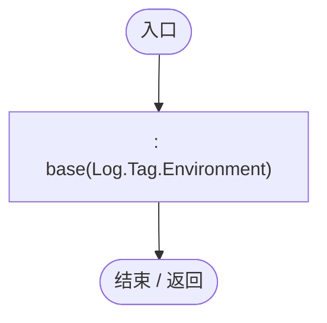

项目内调用/回调引用：

- [JsonResourceDatabase.JsonResourceDatabase.ctor · L17](Core.md#m8faa5713647c7cfe)（构造函数）

### ResourceFolder.get · L10

`protected override string ResourceFolder`

#### Editor / Player · 语法控制结构 / 声明（非CFG）

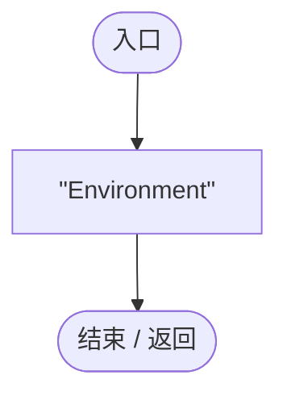

### GetId · L11

`protected override string GetId(EnvironmentConfig item)`

#### Editor / Player · Roslyn编译器控制流

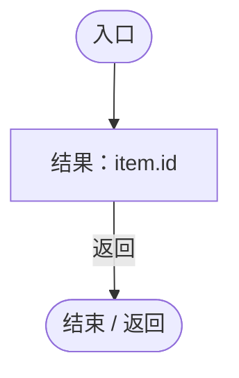

### ConvertFromJson · L13

`protected override EnvironmentConfig ConvertFromJson(string jsonText, string assetName)`

#### Editor / Player · Roslyn编译器控制流

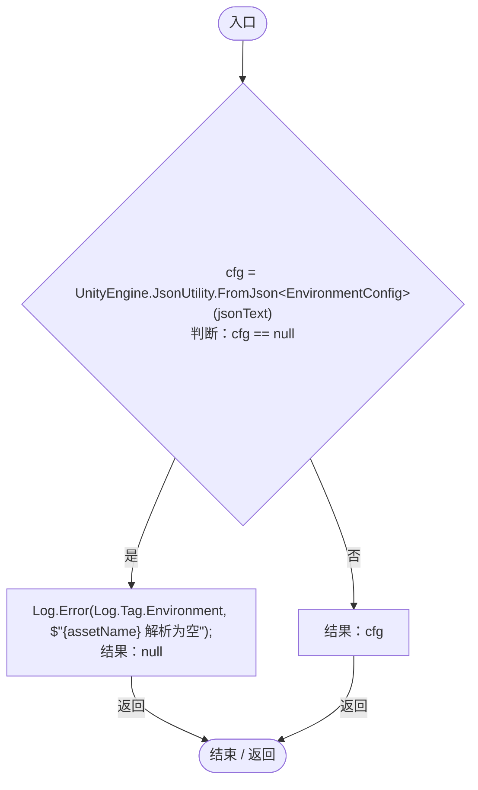

项目内调用/回调引用：

- [Log.Error · L43](Core.md#m2addd5e1d74b000d)（方法）

---

## EnvironmentSample.cs

`Runtime` · `Assets/DarwinPark/Environment/EnvironmentSample.cs`

[源文件](../../../Assets/DarwinPark/Environment/EnvironmentSample.cs) · 源码校验：`68dc21b3577c7609c7e5a8c237ef87d33dd05822bf554971e865514a5a831762`

方法按源文件位置排列。事件/回调引用不表示立即执行；完整源码与关系图请打开离线手册。

本文件没有显式方法体，属于数据/枚举/标记声明；字段与类型定义请在离线源码视图查看。

---

## EnvironmentSystem.cs

`Runtime` · `Assets/DarwinPark/Environment/EnvironmentSystem.cs`

[源文件](../../../Assets/DarwinPark/Environment/EnvironmentSystem.cs) · 源码校验：`e5535142f1de866baf4f69c7e82d8f2ac29a2731a6b0a2aecc6a5d759a8caf1b`

方法按源文件位置排列。事件/回调引用不表示立即执行；完整源码与关系图请打开离线手册。

### CurrentTemperature.get · L21

`get`

#### Editor / Player · 语法控制结构 / 声明（非CFG）

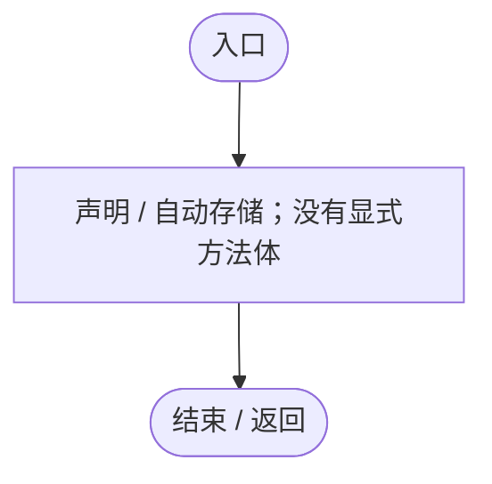

### CurrentTemperature.set · L21

`private set`

#### Editor / Player · 语法控制结构 / 声明（非CFG）

### CurrentHumidity.get · L22

`get`

#### Editor / Player · 语法控制结构 / 声明（非CFG）

### CurrentHumidity.set · L22

`private set`

#### Editor / Player · 语法控制结构 / 声明（非CFG）

### Config.get · L25

`get`

#### Editor / Player · 语法控制结构 / 声明（非CFG）

### Config.set · L25

`private set`

#### Editor / Player · 语法控制结构 / 声明（非CFG）

### Awake · L29

`private void Awake()`

#### Editor / Player · Roslyn编译器控制流

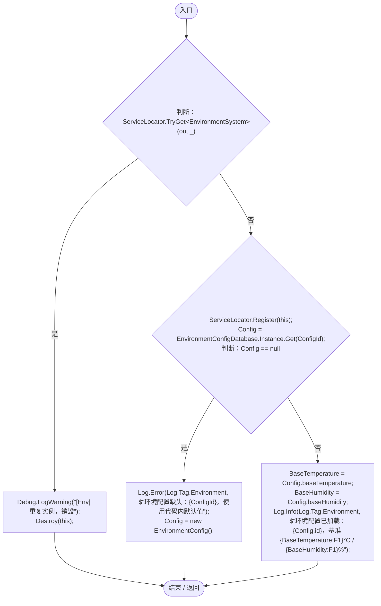

项目内调用/回调引用：

- [ServiceLocator.TryGet · L26](Core.md#m143b24e6d58471b0)（方法）
- [ServiceLocator.Register · L16](Core.md#m26753aeca74b231e)（方法）
- [EnvironmentSystem.Config.set · L25](Environment.md#mb6374e1af2989d78)（访问器）
- [JsonResourceDatabase.Get · L69](Core.md#m20bbd84a76422a9e)（方法）
- [EnvironmentSystem.Config.get · L25](Environment.md#m89db420c1afba8f5)（访问器）
- [Log.Error · L43](Core.md#m2addd5e1d74b000d)（方法）
- [Log.Info · L31](Core.md#md1fe08215a3ce4d3)（方法）

### Start · L54

`private void Start()`

#### Editor / Player · Roslyn编译器控制流

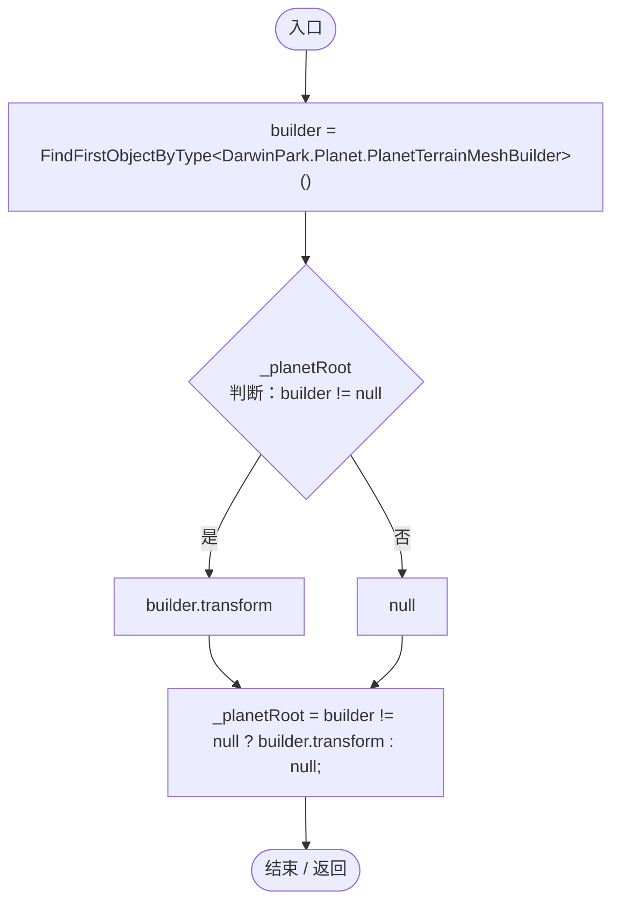

### Update · L61

`private void Update()`

#### Editor / Player · Roslyn编译器控制流

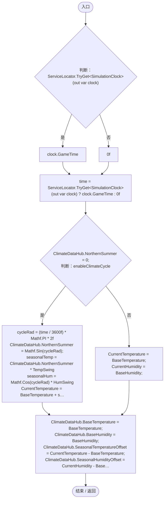

项目内调用/回调引用：

- [ServiceLocator.TryGet · L26](Core.md#m143b24e6d58471b0)（方法）
- [SimulationClock.GameTime.get · L23](Core.md#m74adfa39a896652f)（访问器）
- [EnvironmentSystem.CurrentTemperature.set · L21](Environment.md#m2074178aacc5c234)（访问器）
- [EnvironmentSystem.CurrentHumidity.set · L22](Environment.md#mba8a0c9b18e5c7d9)（访问器）
- [EnvironmentSystem.CurrentTemperature.get · L21](Environment.md#m3a0c2df48ae2c37d)（访问器）
- [EnvironmentSystem.CurrentHumidity.get · L22](Environment.md#me5d44e71ef36315f)（访问器）
- [EnvironmentSystem.UpdatePlanetShader · L92](Environment.md#mb7a4874958dc6258)（方法）

### UpdatePlanetShader · L92

`private void UpdatePlanetShader()`

#### Editor / Player · Roslyn编译器控制流

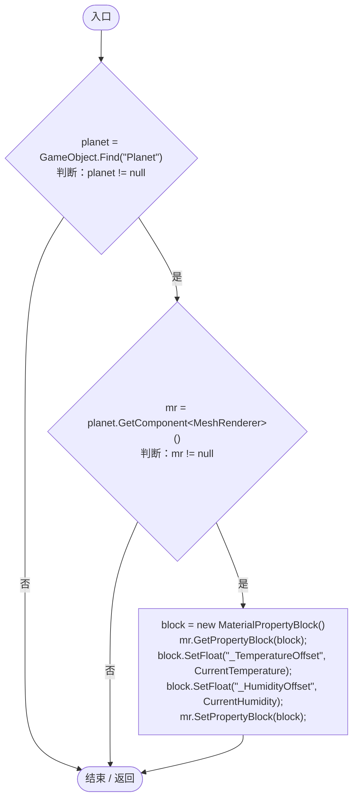

项目内调用/回调引用：

- [EnvironmentSystem.CurrentTemperature.get · L21](Environment.md#m3a0c2df48ae2c37d)（访问器）
- [EnvironmentSystem.CurrentHumidity.get · L22](Environment.md#me5d44e71ef36315f)（访问器）

### OnDisable · L109

`private void OnDisable()`

#### Editor / Player · Roslyn编译器控制流

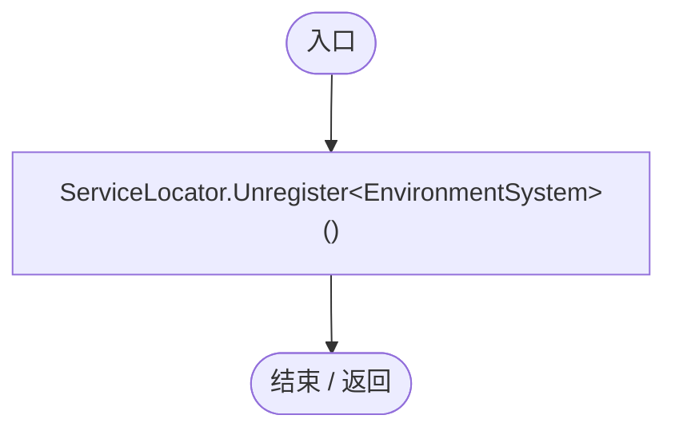

项目内调用/回调引用：

- [ServiceLocator.Unregister · L24](Core.md#m24b4fe5c1600b5cf)（方法）

### Sample · L111

`public EnvironmentSample Sample(Vector3 pos)`

#### Editor / Player · Roslyn编译器控制流

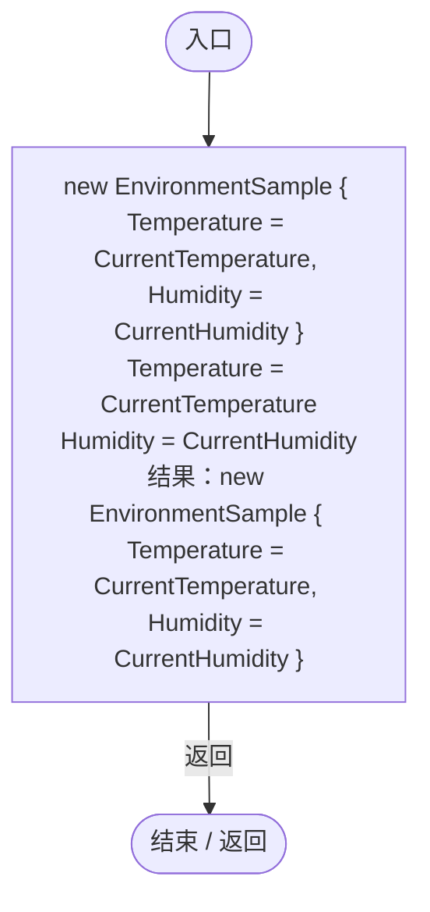

项目内调用/回调引用：

- [EnvironmentSystem.CurrentTemperature.get · L21](Environment.md#m3a0c2df48ae2c37d)（访问器）
- [EnvironmentSystem.CurrentHumidity.get · L22](Environment.md#me5d44e71ef36315f)（访问器）
