# GPU 模块流程

[返回总索引](../README.md) · [离线交互手册](../index.html)

## 脚本目录

- [Assets/DarwinPark/Planet/Atmosphere.shader](#s1cdf171274f22a47)（2个方法/回调）
- [Assets/DarwinPark/Planet/PlanetAtmosphere.shader](#s579772eb82fa97c6)（2个方法/回调）
- [Assets/DarwinPark/Planet/PlanetCloudVolume.shader](#s331b4344b269939a)（7个方法/回调）
- [Assets/DarwinPark/Planet/PlanetOcean.shader](#s1a99e47af42dcc82)（5个方法/回调）
- [Assets/DarwinPark/Planet/PlanetScattering.shader](#s8db291a769accf45)（2个方法/回调）
- [Assets/DarwinPark/Planet/PlanetSurface.shader](#s817e1c83de843c23)（2个方法/回调）
- [Assets/DarwinPark/Planet/PlanetURP.shader](#sbe668c1a6c88dc09)（3个方法/回调）
- [Assets/DarwinPark/Planet/Terrain/PlanetDayNight.hlsl](#s2381b27e8278e0d0)（2个方法/回调）
- [Assets/DarwinPark/Planet/Terrain/PlanetNearSurfaceDetail.hlsl](#s1b2299bfeb3c3590)（2个方法/回调）
- [Assets/DarwinPark/Planet/Terrain/PlanetSurfaceDetail.hlsl](#sbcbe3a3de96b1f72)（3个方法/回调）
- [Assets/DarwinPark/Planet/Terrain/PopulationRangeOverlay.hlsl](#s04884ff1984fea3f)（1个方法/回调）
- [Assets/DarwinPark/UI/OrganismParts.shader](#s2b18dedbbc6be19f)（2个方法/回调）
- [Assets/DarwinPark/UI/PlanetGlobeMinimap.shader](#s3e56421437ec671a)（2个方法/回调）

---

<a id="s1cdf171274f22a47"></a>

## Atmosphere.shader

`GPU` · `Assets/DarwinPark/Planet/Atmosphere.shader`

[源文件](../../../Assets/DarwinPark/Planet/Atmosphere.shader) · 源码校验：`d065791439cdd89fb03c9b3bb608d2bb027b30d6df3975c4764b1fd73e8bdad7`

方法按源文件位置排列。事件/回调引用不表示立即执行；完整源码与关系图请打开离线手册。

<a id="m443925de4c0f7cc1"></a>

### vert · L40

`Varyings vert(Attributes input)`


#### GPU · GPU控制结构（名称链接，不作C#类型推断）

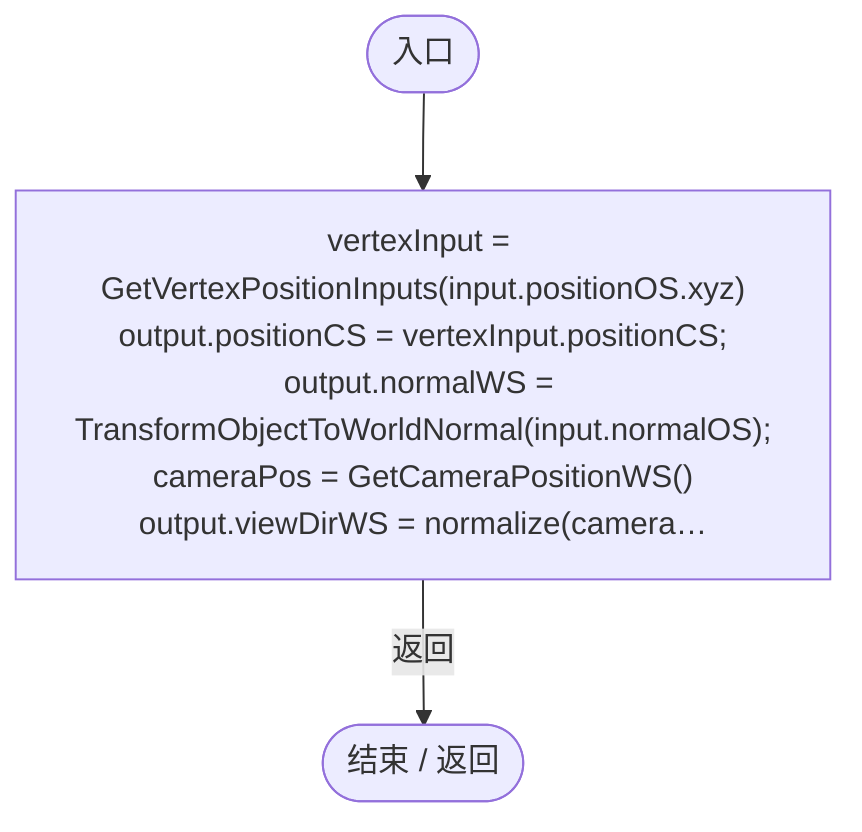

<a id="mea62b251a900e731"></a>

### frag · L52

`half4 frag(Varyings input) : SV_Target`


#### GPU · GPU控制结构（名称链接，不作C#类型推断）

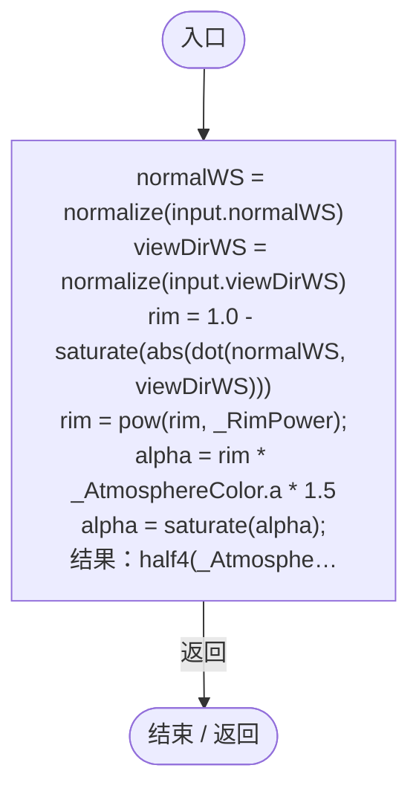


---

<a id="s579772eb82fa97c6"></a>

## PlanetAtmosphere.shader

`GPU` · `Assets/DarwinPark/Planet/PlanetAtmosphere.shader`

[源文件](../../../Assets/DarwinPark/Planet/PlanetAtmosphere.shader) · 源码校验：`361d4bfdaa30c93318b6a3be88799109d9c1d699f2e48b0cb4a163c4e0880222`

方法按源文件位置排列。事件/回调引用不表示立即执行；完整源码与关系图请打开离线手册。

<a id="ma68f131a83da9263"></a>

### vert · L40

`Varyings vert(Attributes input)`


#### GPU · GPU控制结构（名称链接，不作C#类型推断）


<a id="m61e131cdf2cd3660"></a>

### frag · L53

`half4 frag(Varyings input) : SV_Target`


#### GPU · GPU控制结构（名称链接，不作C#类型推断）

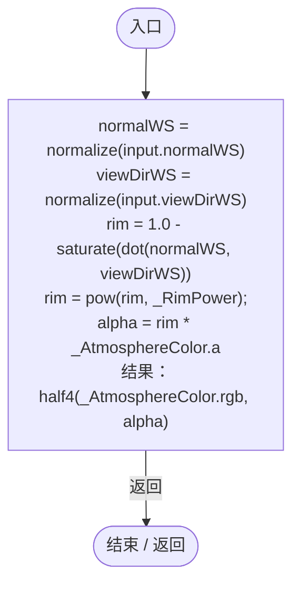


---

<a id="s331b4344b269939a"></a>

## PlanetCloudVolume.shader

`GPU` · `Assets/DarwinPark/Planet/PlanetCloudVolume.shader`

[源文件](../../../Assets/DarwinPark/Planet/PlanetCloudVolume.shader) · 源码校验：`96a27b80f2eac7f037289f3ccdf9d49f77365e0d22ae9dda5e57ee0c5cc707c6`

方法按源文件位置排列。事件/回调引用不表示立即执行；完整源码与关系图请打开离线手册。

<a id="maf14788383252742"></a>

### vert · L30

`V vert(A i)`


#### GPU · GPU控制结构（名称链接，不作C#类型推断）

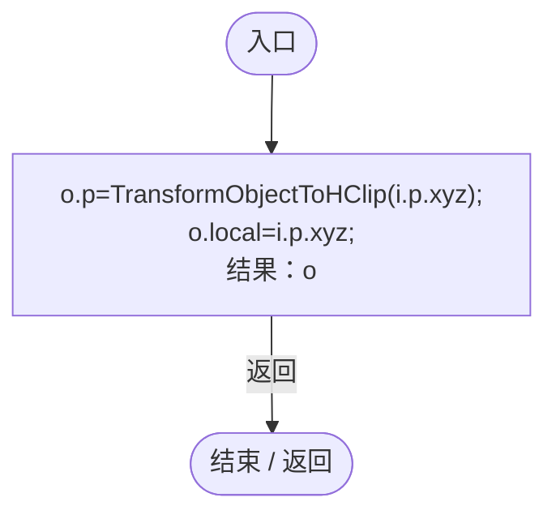

<a id="m290260ef6d0b1ac7"></a>

### hash · L31

`float hash(float3 p)`


#### GPU · GPU控制结构（名称链接，不作C#类型推断）

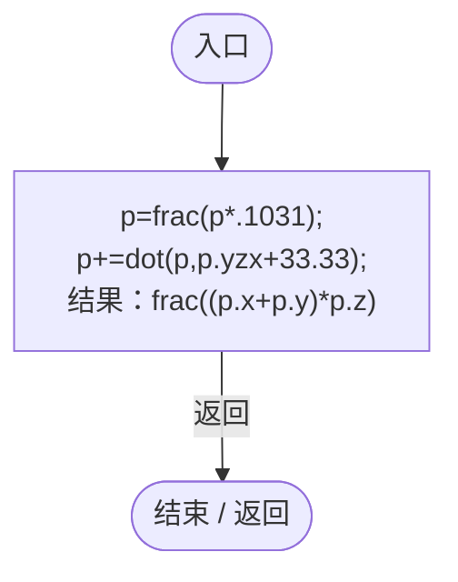

<a id="m76d0a10c0648651f"></a>

### noise · L32

`float noise(float3 p)`


#### GPU · GPU控制结构（名称链接，不作C#类型推断）

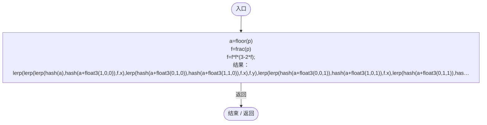

项目内调用/回调引用：

- [PlanetCloudVolume.hash · L31](GPU.md#m290260ef6d0b1ac7)（GPU函数）

<a id="m7d4342442f8667b1"></a>

### fbm · L33

`float fbm(float3 p)`


#### GPU · GPU控制结构（名称链接，不作C#类型推断）

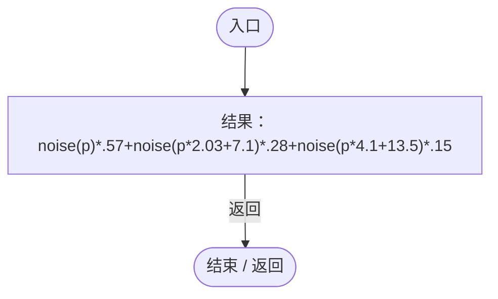

项目内调用/回调引用：

- [PlanetCloudVolume.noise · L32](GPU.md#m76d0a10c0648651f)（GPU函数）

<a id="m81fa2290c8b3e56d"></a>

### density · L34

`float density(float3 p)`


#### GPU · GPU控制结构（名称链接，不作C#类型推断）

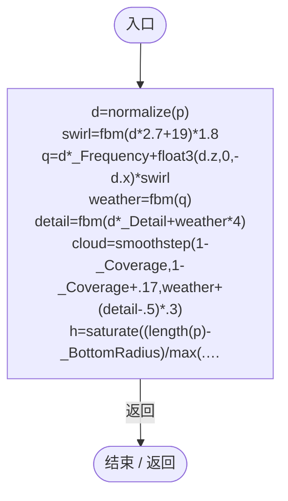

项目内调用/回调引用：

- [PlanetCloudVolume.fbm · L33](GPU.md#m7d4342442f8667b1)（GPU函数）

<a id="m50420b64a3a3cafe"></a>

### sphere · L45

`float2 sphere(float3 o,float3 d,float r)`


#### GPU · GPU控制结构（名称链接，不作C#类型推断）

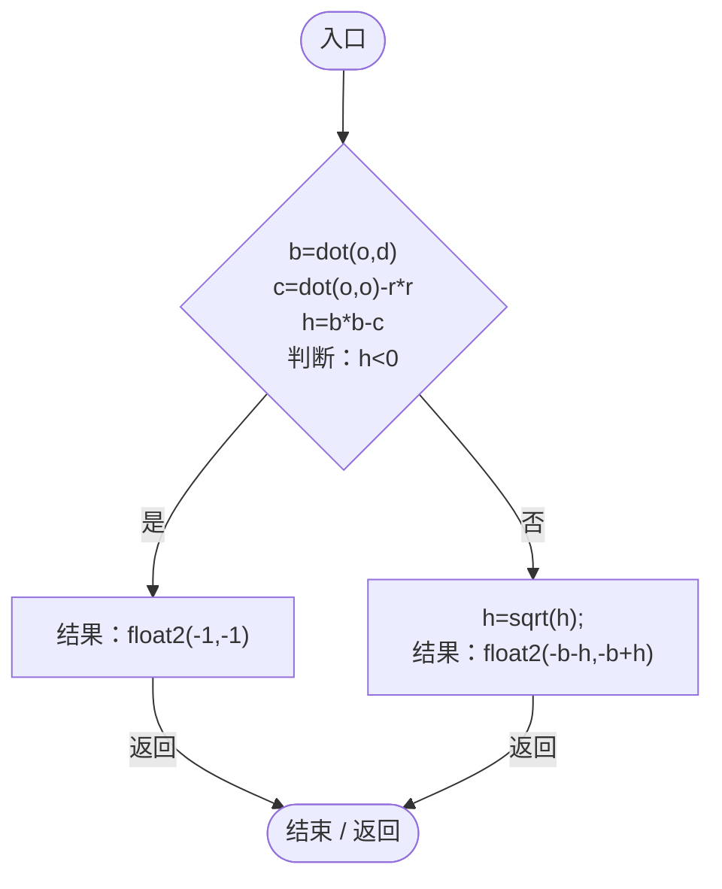

<a id="m008663e5f4bf70d0"></a>

### frag · L46

`half4 frag(V i):SV_Target`


#### GPU · GPU控制结构（名称链接，不作C#类型推断）

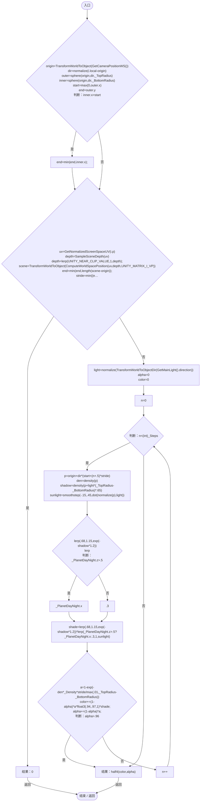

项目内调用/回调引用：

- [PlanetCloudVolume.sphere · L45](GPU.md#m50420b64a3a3cafe)（GPU函数）
- [PlanetCloudVolume.density · L34](GPU.md#m81fa2290c8b3e56d)（GPU函数）


---

<a id="s1a99e47af42dcc82"></a>

## PlanetOcean.shader

`GPU` · `Assets/DarwinPark/Planet/PlanetOcean.shader`

[源文件](../../../Assets/DarwinPark/Planet/PlanetOcean.shader) · 源码校验：`370695756d1c13031ac1fcc2eea35701a4e5b121969704bbc4cbe19981581c57`

方法按源文件位置排列。事件/回调引用不表示立即执行；完整源码与关系图请打开离线手册。

<a id="m42ee3f8143e2c63c"></a>

### vert · L44

`V vert(A i)`


#### GPU · GPU控制结构（名称链接，不作C#类型推断）

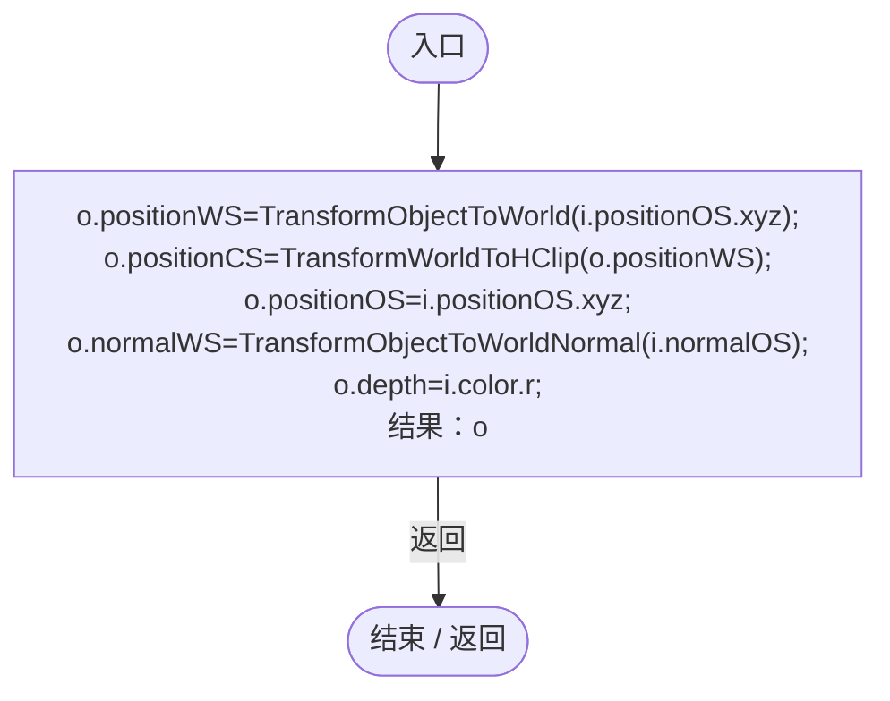

<a id="m1669decd9b3dfe03"></a>

### WaterNormal · L47

`float3 WaterNormal(V i,float3 radial)`


#### GPU · GPU控制结构（名称链接，不作C#类型推断）

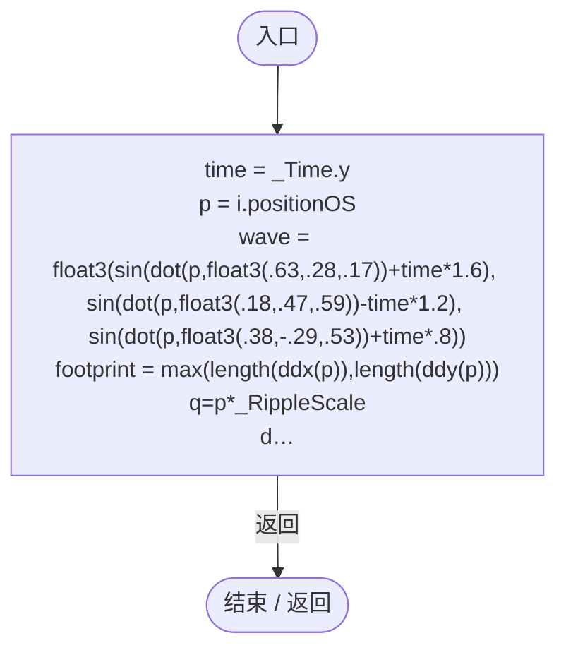

<a id="m936af97ccb30f001"></a>

### FreshWaterSurface · L66

`half4 FreshWaterSurface(V i)`


#### GPU · GPU控制结构（名称链接，不作C#类型推断）

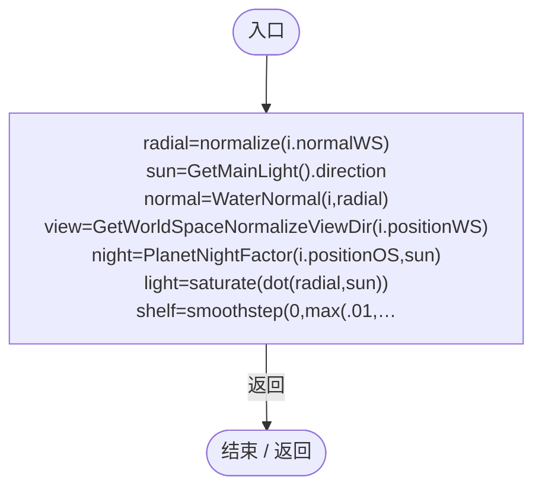

项目内调用/回调引用：

- [PlanetOcean.WaterNormal · L47](GPU.md#m1669decd9b3dfe03)（GPU函数）
- [PlanetDayNight.PlanetNightFactor · L11](GPU.md#m88de65ca0e150e96)（GPU函数）
- [PopulationRangeOverlay.ApplyPopulationRange · L6](GPU.md#m3763ac11c03eb812)（GPU函数）

<a id="md8539f1e7c06ee7a"></a>

### OceanSurface · L81

`half4 OceanSurface(V i, bool frontFace, bool freshWater)`


#### GPU · GPU控制结构（名称链接，不作C#类型推断）

```mermaid
flowchart TD
  b0(["入口"])
  b1["radial = normalize(i.normalWS)<br/>sun = GetMainLight().direction<br/>view = GetWorldSpaceNormalizeViewDir(i.positionWS)<br/>cameraOS = TransformWorldToObject(GetCameraPositionWS())"]
  b2{"判断：freshWater"}
  b3["!frontFace"]
  b4["dot(cameraOS,cameraOS) &lt; _SeaRadius*_SeaRadius"]
  b5["underwater = freshWater ? !frontFace : dot(cameraOS,cameraOS) &lt; _SeaRadius*_SeaRadius"]
  b6{"判断：!freshWater"}
  b7{"clip<br/>判断：frontFace == underwater"}
  b8["-1"]
  b9["1"]
  b10["clip(frontFace == underwater ? -1 : 1);"]
  b11{"screenUV = GetNormalizedScreenSpaceUV(i.positionCS)<br/>rawDepth = SampleSceneDepth(screenUV)<br/>rawDepth = lerp(UNITY_NEAR_CLIP_VALUE,1,rawDepth);<br/>behind = ComputeWorldSpacePosition(screenUV,rawDepth,UNITY_MATRIX_I_VP)<br/>path = distance(behind,i…"}
  b12["path = distance(GetCameraPositionWS(),i.positionWS);"]
  b13{"判断：freshWater"}
  b14["path = min(path,i.depth/max(.12,abs(dot(radial,view))));"]
  b15["opacity = 1-exp2(-2.3 * path / max(.01,_Visibility))<br/>normal = WaterNormal(i,radial)<br/>rippleLight = dot(normal-radial,sun)"]
  b16{"normal<br/>判断：underwater"}
  b17["-1"]
  b18["1"]
  b19["normal *= underwater ? -1 : 1;"]
  b20["fresnel = .025 + .8 * pow(1-saturate(dot(normal,view)),5)<br/>light = saturate(dot(radial,sun))<br/>night = PlanetNightFactor(i.positionOS,sun)<br/>shelf = smoothstep(0,max(.01,_ShelfDepth),i.depth)<br/>water = lerp(_ShallowColor.rgb,_DeepColor.rgb,shel…"]
  b21{"判断：underwater"}
  b22["0"]
  b23[".55*pow(saturate(dot(normal,halfDir)),100)*light*night"]
  b24["glint = underwater ? 0 : .55*pow(saturate(dot(normal,halfDir)),100)*light*night"]
  b25["alpha = saturate(opacity+(1-opacity)*fresnel)<br/>结果：half4(ApplyPopulationRange(lerp(water,reflection,fresnel),i.positionOS)*alpha+glint,alpha)"]
  b26(["结束 / 返回"])
  b0 --> b1
  b1 --> b2
  b2 -->|"是"| b3
  b2 -->|"否"| b4
  b3 --> b5
  b4 --> b5
  b5 --> b6
  b6 -->|"是"| b7
  b6 -->|"否"| b11
  b7 -->|"是"| b8
  b7 -->|"否"| b9
  b8 --> b10
  b9 --> b10
  b10 --> b11
  b11 -->|"是"| b12
  b11 -->|"否"| b13
  b12 --> b15
  b13 -->|"是"| b14
  b13 -->|"否"| b15
  b14 --> b15
  b15 --> b16
  b16 -->|"是"| b17
  b16 -->|"否"| b18
  b17 --> b19
  b18 --> b19
  b19 --> b20
  b20 --> b21
  b21 -->|"是"| b22
  b21 -->|"否"| b23
  b22 --> b24
  b23 --> b24
  b24 --> b25
  b25 -->|"返回"| b26

```

项目内调用/回调引用：

- [PlanetOcean.WaterNormal · L47](GPU.md#m1669decd9b3dfe03)（GPU函数）
- [PlanetDayNight.PlanetNightFactor · L11](GPU.md#m88de65ca0e150e96)（GPU函数）
- [PopulationRangeOverlay.ApplyPopulationRange · L6](GPU.md#m3763ac11c03eb812)（GPU函数）

<a id="me2834f37d2f5d40e"></a>

### frag · L117

`half4 frag(V i, FRONT_FACE_TYPE face : FRONT_FACE_SEMANTIC):SV_Target`


#### GPU · GPU控制结构（名称链接，不作C#类型推断）

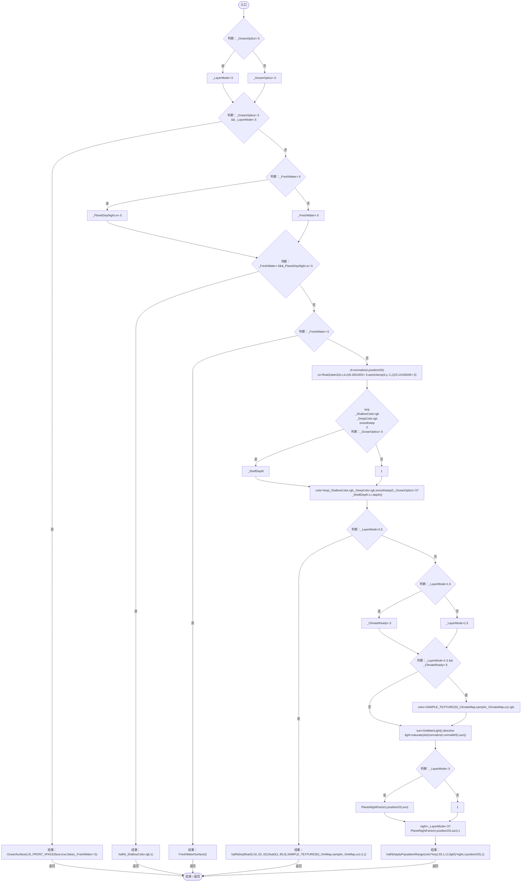

项目内调用/回调引用：

- [PlanetOcean.OceanSurface · L81](GPU.md#md8539f1e7c06ee7a)（GPU函数）
- [PlanetOcean.FreshWaterSurface · L66](GPU.md#m936af97ccb30f001)（GPU函数）
- [PlanetDayNight.PlanetNightFactor · L11](GPU.md#m88de65ca0e150e96)（GPU函数）
- [PopulationRangeOverlay.ApplyPopulationRange · L6](GPU.md#m3763ac11c03eb812)（GPU函数）


---

<a id="s8db291a769accf45"></a>

## PlanetScattering.shader

`GPU` · `Assets/DarwinPark/Planet/PlanetScattering.shader`

[源文件](../../../Assets/DarwinPark/Planet/PlanetScattering.shader) · 源码校验：`6b1410a500683b1f3479b47014c6cc80e6ab40ac15ef320e4f44e1ac334e9b52`

方法按源文件位置排列。事件/回调引用不表示立即执行；完整源码与关系图请打开离线手册。

<a id="mcf6ce14df7513bdd"></a>

### vert · L31

`V vert(A i)`


#### GPU · GPU控制结构（名称链接，不作C#类型推断）


<a id="mdd9c8ff59ccd46f9"></a>

### frag · L32

`half4 frag(V i):SV_Target`


#### GPU · GPU控制结构（名称链接，不作C#类型推断）

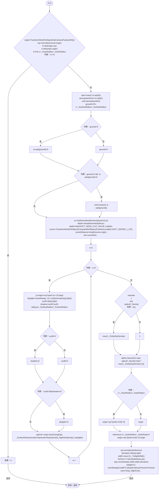


---

<a id="s817e1c83de843c23"></a>

## PlanetSurface.shader

`GPU` · `Assets/DarwinPark/Planet/PlanetSurface.shader`

[源文件](../../../Assets/DarwinPark/Planet/PlanetSurface.shader) · 源码校验：`31ff04f861087299bd7d66dcea424b0cf5a81abebf6f9003b4c5f378155be0cd`

方法按源文件位置排列。事件/回调引用不表示立即执行；完整源码与关系图请打开离线手册。

<a id="m21c6806802b33935"></a>

### vert · L32

`v2f vert (appdata v)`


#### GPU · GPU控制结构（名称链接，不作C#类型推断）

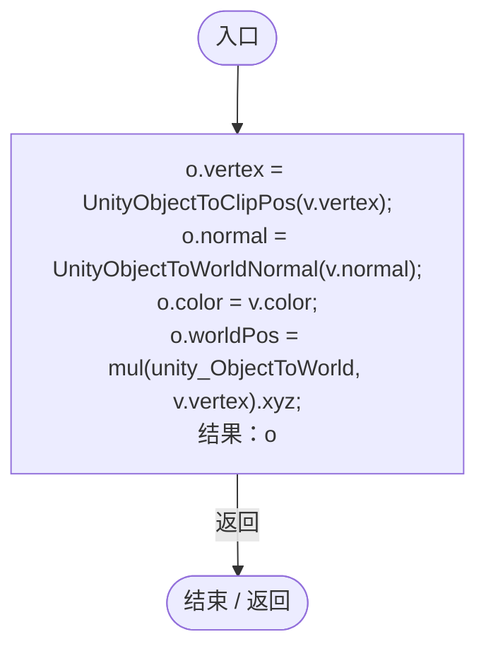

<a id="m2ada8ee433d41e53"></a>

### frag · L42

`fixed4 frag (v2f i) : SV_Target`


#### GPU · GPU控制结构（名称链接，不作C#类型推断）

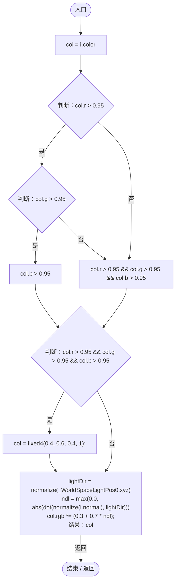


---

<a id="sbe668c1a6c88dc09"></a>

## PlanetURP.shader

`GPU` · `Assets/DarwinPark/Planet/PlanetURP.shader`

[源文件](../../../Assets/DarwinPark/Planet/PlanetURP.shader) · 源码校验：`eb39607a8a2a05e9206f3537e148787bfaf7bde53f9f15e5aedb65a69394b3b4`

方法按源文件位置排列。事件/回调引用不表示立即执行；完整源码与关系图请打开离线手册。

<a id="m2dd829e23ca5b5f4"></a>

### vert · L65

`Varyings vert(Attributes input)`


#### GPU · GPU控制结构（名称链接，不作C#类型推断）

```mermaid
flowchart TD
  b0(["入口"])
  b1["vertexInput = GetVertexPositionInputs(input.positionOS.xyz)<br/>normalInput = GetVertexNormalInputs(input.normalOS)<br/>output.positionCS = vertexInput.positionCS;<br/>output.normalWS = normalInput.normalWS;<br/>output.viewDirWS = GetCameraPositionWS() …"]
  b2(["结束 / 返回"])
  b0 --> b1
  b1 -->|"返回"| b2

```

<a id="m9f08404a3d8a82c5"></a>

### SphereUVFromDirection · L82

`float2 SphereUVFromDirection(float3 dir)`


#### GPU · GPU控制结构（名称链接，不作C#类型推断）

```mermaid
flowchart TD
  b0(["入口"])
  b1["dir = normalize(dir);<br/>u = atan2(dir.x, dir.z) / (2.0 * 3.14159265) + 0.5<br/>v = asin(clamp(dir.y, -1.0, 1.0)) / 3.14159265 + 0.5<br/>结果：float2(u, v)"]
  b2(["结束 / 返回"])
  b0 --> b1
  b1 -->|"返回"| b2

```

<a id="m256bb1aab072037a"></a>

### frag · L90

`half4 frag(Varyings input) : SV_Target`


#### GPU · GPU控制结构（名称链接，不作C#类型推断）

```mermaid
flowchart TD
  b0(["入口"])
  b1{"normalWS = normalize(input.normalWS)<br/>viewDirWS = normalize(input.viewDirWS)<br/>判断：dot(normalWS, viewDirWS) &lt; 0.0"}
  b2["normalWS = -normalWS;"]
  b3{"sphereUV = SphereUVFromDirection(input.positionOS)<br/>distanceToCenter = length(input.positionOS)<br/>heightRatio = (distanceToCenter - _PlanetRadius) / _HeightScale<br/>seaLevel = _SeaLevel<br/>surfaceColor = float3(0,0,0)<br/>isMapLayer = false<br/>判断：_Layer…"}
  b4{"判断：heightRatio &lt; seaLevel"}
  b5["surfaceColor = lerp(float3(0.1, 0.3, 0.6), float3(0.02, 0.05, 0.2), smoothstep(seaLevel, 0.0, heightRatio));"]
  b6["landH = saturate((heightRatio - seaLevel) / max(0.01, _MaxHeight - seaLevel))<br/>detail = SurfaceDetail(normalize(input.positionOS), _DetailScale)<br/>reliefH = saturate(landH + (detail - .5) * _DetailStrength * .22)<br/>surfaceColor = lerp(_Lowlan…"]
  b7{"判断：_LayerMode &lt; 1.5"}
  b8{"isMapLayer = true;<br/>判断：heightRatio &lt; seaLevel"}
  b9["surfaceColor = lerp(float3(0.0, 0.0, 0.4), float3(0.1, 0.4, 0.8), heightRatio / seaLevel);"]
  b10["t = saturate((heightRatio - seaLevel) / max(0.01, _MaxHeight - seaLevel))<br/>low = float3(0.2, 0.8, 0.2)<br/>mid = float3(0.8, 0.8, 0.2)<br/>high = float3(0.8, 0.4, 0.1)<br/>peak = float3(1.0, 1.0, 1.0)<br/>surfaceColor = lerp(low, mid, smoothstep(0.08, 0.…"]
  b11{"判断：_LayerMode &lt; 2.5"}
  b12{"isMapLayer = true;<br/>判断：_ClimateReady &gt; 0.5"}
  b13["surfaceColor = SAMPLE_TEXTURE2D(_ClimateMap, sampler_ClimateMap, sphereUV).rgb;"]
  b14["latAbs = abs(normalize(input.positionOS).y)<br/>temp = lerp(32.0, -35.0, pow(saturate(1.0 - latAbs), 1.2))<br/>temp -= saturate((heightRatio - seaLevel) / max(0.01, _MaxHeight - seaLevel)) * 25.0;<br/>hum = lerp(80.0, 40.0, latAbs)<br/>cold = 1.0 - smoo…"]
  b15["isMapLayer = true;<br/>oreAmount = SAMPLE_TEXTURE2D(_OreMap, sampler_OreMap, sphereUV).r<br/>surfaceColor = lerp(float3(0.02, 0.02, 0.02), float3(1.0, 0.85, 0.0), oreAmount);"]
  b16{"判断：_LayerMode &lt; .5"}
  b17["heightRatio &gt;= seaLevel"]
  b18["_LayerMode &lt; .5"]
  b19{"判断：_LayerMode &lt; .5 &amp;&amp; heightRatio &gt;= seaLevel"}
  b20["surfaceColor = ApplyNearSurfaceDetail(surfaceColor,input.positionOS,length(input.viewDirWS), _NearDetailDensity,_NearDetailStrength,_NearDetailFade.xy);"]
  b21{"mainLight = GetMainLight()<br/>ndl = saturate(dot(normalWS, mainLight.direction))<br/>判断：isMapLayer"}
  b22["mapShade = 0.78 + 0.22 * ndl<br/>结果：half4(surfaceColor * mapShade, 1.0)"]
  b23["litColor = surfaceColor * (0.60 + mainLight.color * ndl * 0.55)<br/>litColor *= PlanetNightFactor(input.positionOS,mainLight.direction);<br/>结果：half4(ApplyPopulationRange(litColor,input.positionOS), 1.0)"]
  b24(["结束 / 返回"])
  b0 --> b1
  b1 -->|"是"| b2
  b1 -->|"否"| b3
  b2 --> b3
  b3 -->|"是"| b4
  b3 -->|"否"| b7
  b4 -->|"是"| b5
  b4 -->|"否"| b6
  b5 --> b16
  b6 --> b16
  b7 -->|"是"| b8
  b7 -->|"否"| b11
  b8 -->|"是"| b9
  b8 -->|"否"| b10
  b9 --> b16
  b10 --> b16
  b11 -->|"是"| b12
  b11 -->|"否"| b15
  b12 -->|"是"| b13
  b12 -->|"否"| b14
  b13 --> b16
  b14 --> b16
  b15 --> b16
  b16 -->|"是"| b17
  b16 -->|"否"| b18
  b17 --> b19
  b18 --> b19
  b19 -->|"是"| b20
  b19 -->|"否"| b21
  b20 --> b21
  b21 -->|"是"| b22
  b21 -->|"否"| b23
  b22 -->|"返回"| b24
  b23 -->|"返回"| b24

```

项目内调用/回调引用：

- [PlanetURP.SphereUVFromDirection · L82](GPU.md#m9f08404a3d8a82c5)（GPU函数）
- [PlanetSurfaceDetail.SurfaceDetail · L19](GPU.md#mf71c1e43fd82f7c3)（GPU函数）
- [PlanetNearSurfaceDetail.ApplyNearSurfaceDetail · L11](GPU.md#m080d9dfdf11197c3)（GPU函数）
- [PlanetDayNight.PlanetNightFactor · L11](GPU.md#m88de65ca0e150e96)（GPU函数）
- [PopulationRangeOverlay.ApplyPopulationRange · L6](GPU.md#m3763ac11c03eb812)（GPU函数）


---

<a id="s2381b27e8278e0d0"></a>

## PlanetDayNight.hlsl

`GPU` · `Assets/DarwinPark/Planet/Terrain/PlanetDayNight.hlsl`

[源文件](../../../Assets/DarwinPark/Planet/Terrain/PlanetDayNight.hlsl) · 源码校验：`b6951bcbcfb38cc13ea084355acf715f8ab016b6e0f542133917e3c09dcb6c39`

方法按源文件位置排列。事件/回调引用不表示立即执行；完整源码与关系图请打开离线手册。

<a id="m1fac40a1ad71eb45"></a>

### PlanetDayAmount · L6

`float PlanetDayAmount(float elevation)`


#### GPU · GPU控制结构（名称链接，不作C#类型推断）

```mermaid
flowchart TD
  b0(["入口"])
  b1["width=max(.001,_PlanetDayNight.y)<br/>结果：smoothstep(-width,width,elevation)"]
  b2(["结束 / 返回"])
  b0 --> b1
  b1 -->|"返回"| b2

```

<a id="m88de65ca0e150e96"></a>

### PlanetNightFactor · L11

`float PlanetNightFactor(float3 localPosition,float3 lightDirectionWS)`


#### GPU · GPU控制结构（名称链接，不作C#类型推断）

```mermaid
flowchart TD
  b0(["入口"])
  b1{"判断：_PlanetDayNight.z&lt;.5"}
  b2["结果：1"]
  b3["lightLocal=TransformWorldToObjectDir(lightDirectionWS)<br/>结果：lerp(_PlanetDayNight.x,1,PlanetDayAmount(dot(normalize(localPosition),lightLocal)))"]
  b4(["结束 / 返回"])
  b0 --> b1
  b1 -->|"是"| b2
  b1 -->|"否"| b3
  b2 -->|"返回"| b4
  b3 -->|"返回"| b4

```

项目内调用/回调引用：

- [PlanetDayNight.PlanetDayAmount · L6](GPU.md#m1fac40a1ad71eb45)（GPU函数）


---

<a id="s1b2299bfeb3c3590"></a>

## PlanetNearSurfaceDetail.hlsl

`GPU` · `Assets/DarwinPark/Planet/Terrain/PlanetNearSurfaceDetail.hlsl`

[源文件](../../../Assets/DarwinPark/Planet/Terrain/PlanetNearSurfaceDetail.hlsl) · 源码校验：`aee8415c8e9dfe9d15b3b7a69ff17680b2bfb4f3c3f66b8a4da4d6c9026dbfc0`

方法按源文件位置排列。事件/回调引用不表示立即执行；完整源码与关系图请打开离线手册。

<a id="md8373b249ce00fb1"></a>

### NearSurfaceGrain · L4

`float NearSurfaceGrain(float3 p)`


#### GPU · GPU控制结构（名称链接，不作C#类型推断）

```mermaid
flowchart TD
  b0(["入口"])
  b1["footprint = max(length(ddx(p)), length(ddy(p)))<br/>fine = SurfaceNoise(p) - .5<br/>micro = SurfaceNoise(p * 3.07 + 11.3) - .5<br/>结果：fine * saturate(1 - footprint) + micro * .35 * saturate(1 - footprint * 3.07)"]
  b2(["结束 / 返回"])
  b0 --> b1
  b1 -->|"返回"| b2

```

项目内调用/回调引用：

- [PlanetSurfaceDetail.SurfaceNoise · L10](GPU.md#m932c128f3b0b9f2e)（GPU函数）

<a id="m080d9dfdf11197c3"></a>

### ApplyNearSurfaceDetail · L11

`float3 ApplyNearSurfaceDetail(float3 color, float3 positionOS, float distanceToCamera, float density, float strength, float2 fadeDistance)`


#### GPU · GPU控制结构（名称链接，不作C#类型推断）

```mermaid
flowchart TD
  b0(["入口"])
  b1["fade = 1 - smoothstep(fadeDistance.x, fadeDistance.y, distanceToCamera)<br/>grain = NearSurfaceGrain(positionOS * density)<br/>结果：color * (1 + grain * strength * fade)"]
  b2(["结束 / 返回"])
  b0 --> b1
  b1 -->|"返回"| b2

```

项目内调用/回调引用：

- [PlanetNearSurfaceDetail.NearSurfaceGrain · L4](GPU.md#md8373b249ce00fb1)（GPU函数）


---

<a id="sbcbe3a3de96b1f72"></a>

## PlanetSurfaceDetail.hlsl

`GPU` · `Assets/DarwinPark/Planet/Terrain/PlanetSurfaceDetail.hlsl`

[源文件](../../../Assets/DarwinPark/Planet/Terrain/PlanetSurfaceDetail.hlsl) · 源码校验：`806ee13209c90077e1c36ba89780821e305d014400e076b87fec593a2f268f98`

方法按源文件位置排列。事件/回调引用不表示立即执行；完整源码与关系图请打开离线手册。

<a id="m366638440cd34ebe"></a>

### SurfaceHash · L4

`float SurfaceHash(float3 p)`


#### GPU · GPU控制结构（名称链接，不作C#类型推断）

```mermaid
flowchart TD
  b0(["入口"])
  b1["p = frac(p * .1031);<br/>p += dot(p, p.yzx + 33.33);<br/>结果：frac((p.x + p.y) * p.z)"]
  b2(["结束 / 返回"])
  b0 --> b1
  b1 -->|"返回"| b2

```

<a id="m932c128f3b0b9f2e"></a>

### SurfaceNoise · L10

`float SurfaceNoise(float3 p)`


#### GPU · GPU控制结构（名称链接，不作C#类型推断）

```mermaid
flowchart TD
  b0(["入口"])
  b1["a = floor(p)<br/>f = frac(p)<br/>f = f * f * (3 - 2 * f);<br/>结果：lerp(lerp(lerp(SurfaceHash(a), SurfaceHash(a + float3(1,0,0)), f.x), lerp(SurfaceHash(a + float3(0,1,0)), SurfaceHash(a + float3(1,1,0)), f.x), f.y), lerp(lerp(SurfaceHash(a + float3(0…"]
  b2(["结束 / 返回"])
  b0 --> b1
  b1 -->|"返回"| b2

```

项目内调用/回调引用：

- [PlanetSurfaceDetail.SurfaceHash · L4](GPU.md#m366638440cd34ebe)（GPU函数）

<a id="mf71c1e43fd82f7c3"></a>

### SurfaceDetail · L19

`float SurfaceDetail(float3 direction, float scale)`


#### GPU · GPU控制结构（名称链接，不作C#类型推断）

```mermaid
flowchart TD
  b0(["入口"])
  b1["p = direction * scale<br/>结果：SurfaceNoise(p) * .57 + SurfaceNoise(p * 2.03 + 7.1) * .28 + SurfaceNoise(p * 4.1 + 13.5) * .15"]
  b2(["结束 / 返回"])
  b0 --> b1
  b1 -->|"返回"| b2

```

项目内调用/回调引用：

- [PlanetSurfaceDetail.SurfaceNoise · L10](GPU.md#m932c128f3b0b9f2e)（GPU函数）


---

<a id="s04884ff1984fea3f"></a>

## PopulationRangeOverlay.hlsl

`GPU` · `Assets/DarwinPark/Planet/Terrain/PopulationRangeOverlay.hlsl`

[源文件](../../../Assets/DarwinPark/Planet/Terrain/PopulationRangeOverlay.hlsl) · 源码校验：`e743ae342d0225b0a4832d6f963c09a898d99471c7319af72d071cdde14a96b1`

方法按源文件位置排列。事件/回调引用不表示立即执行；完整源码与关系图请打开离线手册。

<a id="m3763ac11c03eb812"></a>

### ApplyPopulationRange · L6

`float3 ApplyPopulationRange(float3 color,float3 positionOS)`


#### GPU · GPU控制结构（名称链接，不作C#类型推断）

```mermaid
flowchart TD
  b0(["入口"])
  b1{"判断：_PopulationStyle.x&lt;.5"}
  b2["_PopulationCount&lt;.5"]
  b3["_PopulationStyle.x&lt;.5"]
  b4{"判断：_PopulationStyle.x&lt;.5&#124;&#124;_PopulationCount&lt;.5"}
  b5["结果：color"]
  b6["direction=normalize(positionOS)<br/>distance=10<br/>group=-1<br/>opacity=0<br/>tint=0<br/>paint=0"]
  b7["i=0"]
  b8{"判断：i&lt;(int)_PopulationCount"}
  b9["circle=LOAD_TEXTURE2D(_PopulationData,int2(0,i))<br/>data=LOAD_TEXTURE2D(_PopulationData,int2(1,i))"]
  b10{"判断：data.w!=group"}
  b11["group&gt;=0"]
  b12["data.w!=group"]
  b13{"判断：data.w!=group&amp;&amp;group&gt;=0"}
  b14{"opacity<br/>判断：_PopulationStyle.x&lt;1.5"}
  b15{"判断：distance&lt;=0"}
  b16["1"]
  b17["0"]
  b18["1-smoothstep(_PopulationStyle.z,_PopulationStyle.z+max(fwidth(distance),.00001),abs(distance))"]
  b19["alpha=opacity*(_PopulationStyle.x&lt;1.5?(distance&lt;=0?1:0):1-smoothstep(_PopulationStyle.z,_PopulationStyle.z+max(fwidth(distance),.00001),abs(distance)))"]
  b20{"判断：alpha&gt;paint.a"}
  b21["paint=float4(tint,alpha);"]
  b22["distance=10;"]
  b23["group=data.w;<br/>tint=data.rgb;<br/>opacity=LOAD_TEXTURE2D(_PopulationData,int2(2,i)).r;<br/>distance=min(distance,(circle.w-dot(direction,circle.xyz))/max(sqrt(saturate(1-circle.w*circle.w)),.0001));"]
  b24["i++"]
  b25{"opacity<br/>判断：_PopulationStyle.x&lt;1.5"}
  b26{"判断：distance&lt;=0"}
  b27["1"]
  b28["0"]
  b29["1-smoothstep(_PopulationStyle.z,_PopulationStyle.z+max(fwidth(distance),.00001),abs(distance))"]
  b30["alpha=opacity*(_PopulationStyle.x&lt;1.5?(distance&lt;=0?1:0):1-smoothstep(_PopulationStyle.z,_PopulationStyle.z+max(fwidth(distance),.00001),abs(distance)))"]
  b31{"判断：alpha&gt;paint.a"}
  b32["paint=float4(tint,alpha);"]
  b33["结果：lerp(color,paint.rgb,paint.a)"]
  b34(["结束 / 返回"])
  b0 --> b1
  b1 -->|"否"| b2
  b1 -->|"是"| b3
  b2 --> b4
  b3 --> b4
  b4 -->|"是"| b5
  b4 -->|"否"| b6
  b5 -->|"返回"| b34
  b6 --> b7
  b7 --> b8
  b8 -->|"是"| b9
  b8 -->|"否"| b25
  b9 --> b10
  b10 -->|"是"| b11
  b10 -->|"否"| b12
  b11 --> b13
  b12 --> b13
  b13 -->|"是"| b14
  b13 -->|"否"| b23
  b14 -->|"是"| b15
  b14 -->|"否"| b18
  b15 -->|"是"| b16
  b15 -->|"否"| b17
  b16 --> b19
  b17 --> b19
  b18 --> b19
  b19 --> b20
  b20 -->|"是"| b21
  b20 -->|"否"| b22
  b21 --> b22
  b22 --> b23
  b23 --> b24
  b24 --> b8
  b25 -->|"是"| b26
  b25 -->|"否"| b29
  b26 -->|"是"| b27
  b26 -->|"否"| b28
  b27 --> b30
  b28 --> b30
  b29 --> b30
  b30 --> b31
  b31 -->|"是"| b32
  b31 -->|"否"| b33
  b32 --> b33
  b33 -->|"返回"| b34

```


---

<a id="s2b18dedbbc6be19f"></a>

## OrganismParts.shader

`GPU` · `Assets/DarwinPark/UI/OrganismParts.shader`

[源文件](../../../Assets/DarwinPark/UI/OrganismParts.shader) · 源码校验：`030fee52f43190df7e2c4fb17718ba2e1b8beb6c61a467c08f008eab170acae0`

方法按源文件位置排列。事件/回调引用不表示立即执行；完整源码与关系图请打开离线手册。

<a id="m3700f72ad2f6274b"></a>

### vert · L21

`V vert(A i)`


#### GPU · GPU控制结构（名称链接，不作C#类型推断）

```mermaid
flowchart TD
  b0(["入口"])
  b1["UNITY_SETUP_INSTANCE_ID(i);<br/>UNITY_TRANSFER_INSTANCE_ID(i,o);<br/>o.p=TransformObjectToHClip(i.positionOS.xyz);<br/>o.normal=TransformObjectToWorldNormal(i.normalOS);<br/>o.color=i.color;<br/>结果：o"]
  b2(["结束 / 返回"])
  b0 --> b1
  b1 -->|"返回"| b2

```

<a id="m206fec267c80a52b"></a>

### frag · L22

`half4 frag(V i):SV_Target`


#### GPU · GPU控制结构（名称链接，不作C#类型推断）

```mermaid
flowchart TD
  b0(["入口"])
  b1["UNITY_SETUP_INSTANCE_ID(i);<br/>tint=UNITY_ACCESS_INSTANCED_PROP(BodyProps,_BaseColor)<br/>color=lerp(i.color.rgb,UNITY_ACCESS_INSTANCED_PROP(BodyProps,_BodyColor).rgb,UNITY_ACCESS_INSTANCED_PROP(BodyProps,_FarBody))<br/>color=lerp(color,tint.rgb,sa…"]
  b2(["结束 / 返回"])
  b0 --> b1
  b1 -->|"返回"| b2

```


---

<a id="s3e56421437ec671a"></a>

## PlanetGlobeMinimap.shader

`GPU` · `Assets/DarwinPark/UI/PlanetGlobeMinimap.shader`

[源文件](../../../Assets/DarwinPark/UI/PlanetGlobeMinimap.shader) · 源码校验：`a470890946f89ad2702c6a94888e1af728ae045e922b0f20087f324edb78eb8d`

方法按源文件位置排列。事件/回调引用不表示立即执行；完整源码与关系图请打开离线手册。

<a id="m746b392cc02025d4"></a>

### vert · L31

`V vert(A i)`


#### GPU · GPU控制结构（名称链接，不作C#类型推断）

```mermaid
flowchart TD
  b0(["入口"])
  b1["o.local=i.vertex;<br/>o.position=UnityObjectToClipPos(i.vertex);<br/>o.color=i.color*_Color;<br/>o.uv=i.uv;<br/>结果：o"]
  b2(["结束 / 返回"])
  b0 --> b1
  b1 -->|"返回"| b2

```

<a id="m9bfa819d2b7cc68b"></a>

### frag · L33

`fixed4 frag(V i):SV_Target`


#### GPU · GPU控制结构（名称链接，不作C#类型推断）

```mermaid
flowchart TD
  b0(["入口"])
  b1["p=i.uv*2-1<br/>radius=dot(p,p)<br/>clip(1-radius);<br/>normal=float3(p,-sqrt(max(0,1-radius)))<br/>direction=mul((float3x3)_GlobeRotation,normal)<br/>uv=float2(frac(atan2(direction.x,direction.z)/6.28318530718+.5),asin(clamp(direction.y,-1,1))/3.14159265359…"]
  b2(["结束 / 返回"])
  b0 --> b1
  b1 -->|"返回"| b2

```
