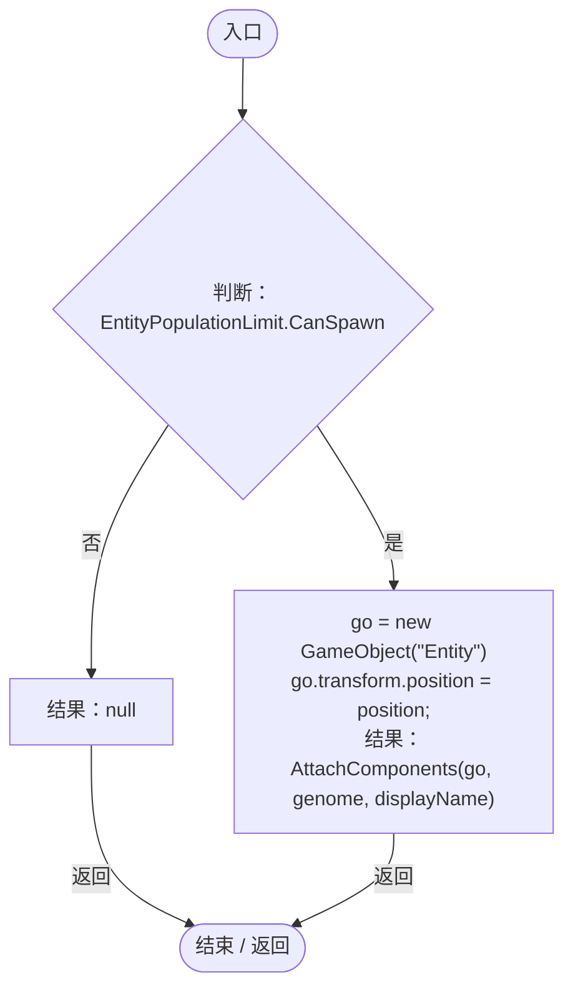
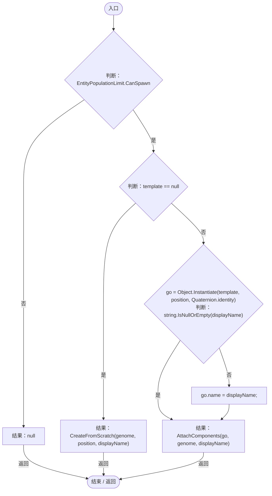
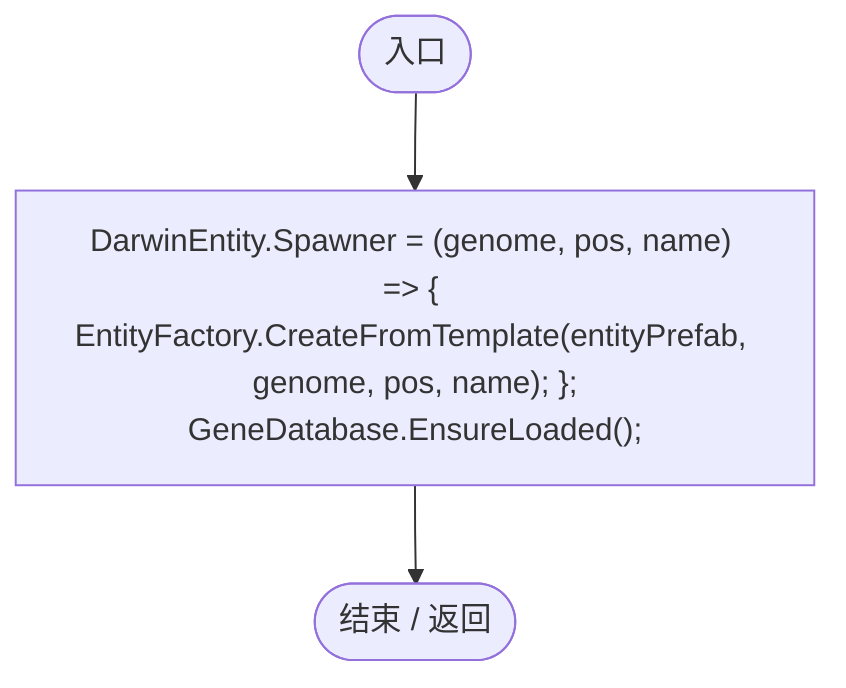
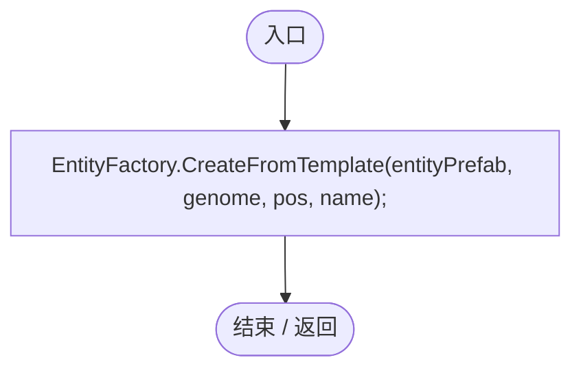
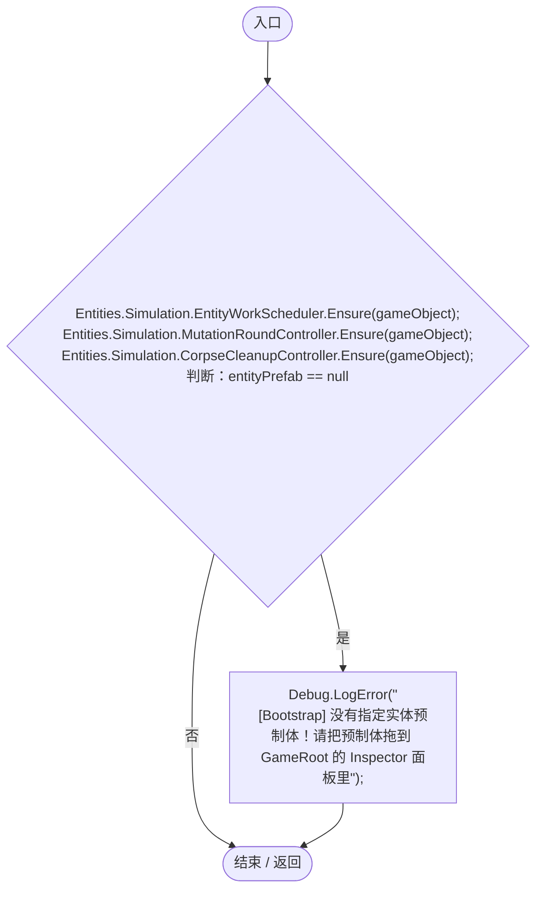
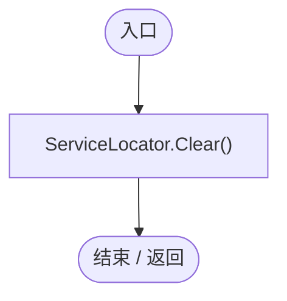

```mermaid
flowchart TD
  b0(["入口"])
  b1{"判断：genome!=null"}
  b2["MorphologyRegistry.ValidateGenome(genome);"]
  b3{"判断：DedicatedServerMode.Enabled"}
  b4["go.GetComponentsInChildren&lt;Renderer&gt;(true)"]
  b5{"判断：go.GetComponentsInChildren&lt;Renderer&gt;(true)"}
  b6["var<br/>renderer.enabled=false;<br/>Object.Destroy(renderer);"]
  b7{"go.GetComponentsInChildren&lt;Renderer&gt;(true)<br/>判断：go.GetComponentsInChildren&lt;Renderer&gt;(true)"}
  b8["go.GetComponentsInChildren&lt;Renderer&gt;(true)"]
  b9["连接 / 离开区域"]
  b10["go.GetComponentsInChildren&lt;MeshFilter&gt;(true)"]
  b11{"判断：go.GetComponentsInChildren&lt;MeshFilter&gt;(true)"}
  b12["var<br/>Object.Destroy(filter);"]
  b13{"go.GetComponentsInChildren&lt;MeshFilter&gt;(true)<br/>判断：go.GetComponentsInChildren&lt;MeshFilter&gt;(true)"}
  b14["go.GetComponentsInChildren&lt;MeshFilter&gt;(true)"]
  b15["连接 / 离开区域"]
  b16{"col = go.GetComponent&lt;Collider&gt;()<br/>判断：col == null"}
  b17["col = go.AddComponent&lt;SphereCollider&gt;();"]
  b18["col.isTrigger = false;"]
  b19{"go.GetComponent&lt;DarwinEntity&gt;()<br/>判断：go.GetComponent&lt;DarwinEntity&gt;()"}
  b20["go.GetComponent&lt;DarwinEntity&gt;()"]
  b21["go.AddComponent&lt;DarwinEntity&gt;()"]
  b22["entity = go.GetComponent&lt;DarwinEntity&gt;() ?? go.AddComponent&lt;DarwinEntity&gt;()"]
  b23{"genes = go.GetComponent&lt;EntityGeneController&gt;()<br/>判断：genes == null"}
  b24["genes = go.AddComponent&lt;EntityGeneController&gt;();"]
  b25{"判断：genome != null"}
  b26{"判断：genome.Genes.Count &gt; 0"}
  b27["genes.Genome = genome;"]
  b28{"判断：string.IsNullOrEmpty(displayName)"}
  b29["displayName = genes.GetRandomName();"]
  b30{"entity.DisplayName = displayName;<br/>判断：go.GetComponent&lt;EntityStats&gt;() == null"}
  b31["go.AddComponent&lt;EntityStats&gt;();"]
  b32{"判断：go.GetComponent&lt;EntityVitals&gt;() == null"}
  b33["go.AddComponent&lt;EntityVitals&gt;();"]
  b34{"判断：go.GetComponent&lt;EntityEnvironmentHazard&gt;() == null"}
  b35["go.AddComponent&lt;EntityEnvironmentHazard&gt;();"]
  b36{"判断：go.GetComponent&lt;EntityAIController&gt;() == null"}
  b37["go.AddComponent&lt;EntityAIController&gt;();"]
  b38{"rb = go.GetComponent&lt;Rigidbody&gt;()<br/>判断：rb == null"}
  b39["rb = go.AddComponent&lt;Rigidbody&gt;();"]
  b40{"rb.mass = 1f;<br/>rb.linearDamping = 0.5f;<br/>rb.angularDamping = 5f;<br/>gravity = go.GetComponent&lt;PlanetGravity&gt;()<br/>判断：gravity == null"}
  b41["gravity = go.AddComponent&lt;PlanetGravity&gt;();"]
  b42{"gravity.baseGravity = 15f;<br/>判断：go.GetComponent&lt;EntitySurfaceAnchor&gt;() == null"}
  b43["go.AddComponent&lt;EntitySurfaceAnchor&gt;();"]
  b44{"genes.Recalculate();<br/>判断：go.GetComponent&lt;EntityLifeCycle&gt;()==null"}
  b45["go.AddComponent&lt;EntityLifeCycle&gt;();"]
  b46{"DarwinEntity.PreparePresentation<br/>判断：DarwinEntity.PreparePresentation"}
  b47["DarwinEntity.PreparePresentation?.Invoke(entity);"]
  b48["结果：entity"]
  b49(["结束 / 返回"])
  b0 --> b1
  b1 -->|"是"| b2
  b1 -->|"否"| b3
  b2 --> b3
  b3 -->|"是"| b4
  b3 -->|"否"| b16
  b4 --> b5
  b5 -->|"是"| b6
  b5 -->|"否 · 经过finally 7"| b10
  b6 --> b5
  b7 -->|"否"| b8
  b7 -->|"是"| b9
  b8 --> b9
  b10 --> b11
  b11 -->|"是"| b12
  b11 -->|"否 · 经过finally 13"| b16
  b12 --> b11
  b13 -->|"否"| b14
  b13 -->|"是"| b15
  b14 --> b15
  b16 -->|"是"| b17
  b16 -->|"否"| b18
  b17 --> b18
  b18 --> b19
  b19 -->|"否"| b20
  b19 -->|"是"| b21
  b20 --> b22
  b21 --> b22
  b22 --> b23
  b23 -->|"是"| b24
  b23 -->|"否"| b25
  b24 --> b25
  b25 -->|"是"| b26
  b25 -->|"否"| b28
  b26 -->|"是"| b27
  b26 -->|"否"| b28
  b27 --> b28
  b28 -->|"是"| b29
  b28 -->|"否"| b30
  b29 --> b30
  b30 -->|"是"| b31
  b30 -->|"否"| b32
  b31 --> b32
  b32 -->|"是"| b33
  b32 -->|"否"| b34
  b33 --> b34
  b34 -->|"是"| b35
  b34 -->|"否"| b36
  b35 --> b36
  b36 -->|"是"| b37
  b36 -->|"否"| b38
  b37 --> b38
  b38 -->|"是"| b39
  b38 -->|"否"| b40
  b39 --> b40
  b40 -->|"是"| b41
  b40 -->|"否"| b42
  b41 --> b42
  b42 -->|"是"| b43
  b42 -->|"否"| b44
  b43 --> b44
  b44 -->|"是"| b45
  b44 -->|"否"| b46
  b45 --> b46
  b46 -->|"否"| b47
  b46 -->|"是"| b48
  b47 --> b48
  b48 -->|"返回"| b49
  b5 -. "退出保护区时 finally（示意）" .-> b7
  b11 -. "退出保护区时 finally（示意）" .-> b13

```

# GameRoot 模块流程

[返回总索引](../README.md) · [离线交互手册](../index.html)

## 脚本目录

- [Assets/DarwinPark/GameRoot/EntityFactory.cs](#s54fcd89ef79d04f6)（3个方法/回调）
- [Assets/DarwinPark/GameRoot/GameBootstrap.cs](#sb97bb0ddbd6571c6)（4个方法/回调）

---

## EntityFactory.cs

`Runtime` · `Assets/DarwinPark/GameRoot/EntityFactory.cs`

[源文件](../../../Assets/DarwinPark/GameRoot/EntityFactory.cs) · 源码校验：`2e277acb67e353609c507717ab21f2a75cb411eba42bc98b9ceda8547d67919e`

方法按源文件位置排列。事件/回调引用不表示立即执行；完整源码与关系图请打开离线手册。

### CreateFromScratch · L13

`public static DarwinEntity CreateFromScratch(Genome genome, Vector3 position, string displayName)`

#### Editor / Player · Roslyn编译器控制流

项目内调用/回调引用：

- [EntityFactory.AttachComponents · L33](GameRoot.md#mb3b9a103bd797020)（方法）

### CreateFromTemplate · L22

`public static DarwinEntity CreateFromTemplate(GameObject template, Genome genome, Vector3 position, string displayName)`

#### Editor / Player · Roslyn编译器控制流

项目内调用/回调引用：

- [EntityFactory.CreateFromScratch · L13](GameRoot.md#m2e808e57fb3995c8)（方法）
- [EntityFactory.AttachComponents · L33](GameRoot.md#mb3b9a103bd797020)（方法）

### AttachComponents · L33

`private static DarwinEntity AttachComponents(GameObject go, Genome genome, string displayName)`

#### Editor / Player · Roslyn编译器控制流

项目内调用/回调引用：

- [MorphologyRegistry.ValidateGenome · L51](Genetics.md#m6dcc52fce7aa3463)（方法）
- [DedicatedServerMode.Enabled.get · L11](Core.md#mbc77f72f83f4ad28)（访问器）
- [EntityGeneController.GetRandomName · L275](Entities.md#m78cde48e34fc2bc8)（方法）
- [EntityGeneController.Recalculate · L122](Entities.md#m0c8090b8014eb248)（方法）

---

## GameBootstrap.cs

`Runtime` · `Assets/DarwinPark/GameRoot/GameBootstrap.cs`

[源文件](../../../Assets/DarwinPark/GameRoot/GameBootstrap.cs) · 源码校验：`59615ab1f42f56904bcf68f11465c4688533c5cb03f021d87d3e4fa002de3b4b`

方法按源文件位置排列。事件/回调引用不表示立即执行；完整源码与关系图请打开离线手册。

### Awake · L14

`private void Awake()`

#### Editor / Player · Roslyn编译器控制流

项目内调用/回调引用：

- [GeneDatabase.EnsureLoaded · L12](Genetics.md#mc3e6357b9ca440f5)（方法）
- [GameBootstrap.回调@19 · L19](GameRoot.md#mfa8ee0a55fc3046b)（回调/委托）

### 回调@19 · L19

`( … => 回调`

#### Editor / Player · Roslyn编译器控制流

项目内调用/回调引用：

- [EntityFactory.CreateFromTemplate · L22](GameRoot.md#mbe8d73397453244c)（方法）

### Start · L27

`private void Start()`

#### Editor / Player · Roslyn编译器控制流

项目内调用/回调引用：

- [EntityWorkScheduler.Ensure · L36](Entities.md#mfc71789b953ffdd6)（方法）
- [MutationRoundController.Ensure · L24](Entities.md#md7f40ec1ade281ce)（方法）
- [CorpseCleanupController.Ensure · L16](Entities.md#mdc28e56427bcd8e8)（方法）

### OnDestroy · L42

`private void OnDestroy()`

#### Editor / Player · Roslyn编译器控制流

项目内调用/回调引用：

- [ServiceLocator.Clear · L41](Core.md#mc1c97e0c05315803)（方法）
