# Gameplay 模块流程

[返回总索引](../README.md) · [离线交互手册](../index.html)

## 脚本目录

- [Assets/DarwinPark/Gameplay/GameplayPresentation.cs](#sb959474649e97ab2)（1个方法/回调）
- [Assets/DarwinPark/Gameplay/Networking/LanEditActions.cs](#s3e0c0e065b3958ae)（9个方法/回调）
- [Assets/DarwinPark/Gameplay/Networking/LanProtocol.cs](#s93368f31a3944938)（2个方法/回调）
- [Assets/DarwinPark/Gameplay/Networking/LanRuntimeServices.cs](#sd3ecc3f1157363db)（20个方法/回调）
- [Assets/DarwinPark/Gameplay/Networking/LanSession.cs](#seca7d2ffea34e713)（54个方法/回调）
- [Assets/DarwinPark/Gameplay/Networking/ServerAssemblyAccess.cs](#s18f86314b77166f9)（0个方法/回调）
- [Assets/DarwinPark/Gameplay/Spawning/EntityGeneFilter.cs](#sf357e795d8e584ab)（10个方法/回调）
- [Assets/DarwinPark/Gameplay/Spawning/EntityTemplateManager.cs](#s43b3066dcde09aab)（20个方法/回调）
- [Assets/DarwinPark/Gameplay/Spawning/NaturalWorldSeeder.cs](#sf3a469796324dc99)（4个方法/回调）
- [Assets/DarwinPark/Gameplay/Spawning/RandomPlanetSpawner.cs](#sf81c18b476c33909)（26个方法/回调）
- [Assets/DarwinPark/Gameplay/Spawning/RandomSpawnPresetStore.cs](#s866647ad23066dc3)（8个方法/回调）
- [Assets/DarwinPark/Gameplay/World/WorldEntityActions.cs](#s1774658e1bccaa09)（3个方法/回调）
- [Assets/DarwinPark/Gameplay/World/WorldParameterUpdate.cs](#s73620e8f7ec303cb)（25个方法/回调）
- [Assets/DarwinPark/Gameplay/World/WorldSaveBackups.cs](#sec8728aa388dade7)（14个方法/回调）
- [Assets/DarwinPark/Gameplay/World/WorldSaveManagement.cs](#sf39cea18dd92e381)（6个方法/回调）
- [Assets/DarwinPark/Gameplay/World/WorldSaveStore.cs](#s22d43aac8c0212ee)（42个方法/回调）
- [Assets/DarwinPark/Gameplay/World/WorldSessionManager.cs](#s7fc95b34c7a43453)（29个方法/回调）

---

<a id="sb959474649e97ab2"></a>

## GameplayPresentation.cs

`Runtime` · `Assets/DarwinPark/Gameplay/GameplayPresentation.cs`

[源文件](../../../Assets/DarwinPark/Gameplay/GameplayPresentation.cs) · 源码校验：`6f0121b94567c10cc08b0f816c7918901ef2d83449d89fd6ac8eb3bc7499ead5`

方法按源文件位置排列。事件/回调引用不表示立即执行；完整源码与关系图请打开离线手册。

<a id="mef112955b12b248e"></a>

### Reset · L20

`[RuntimeInitializeOnLoadMethod(RuntimeInitializeLoadType.SubsystemRegistration)] private static void Reset()`


#### Editor / Player · Roslyn编译器控制流

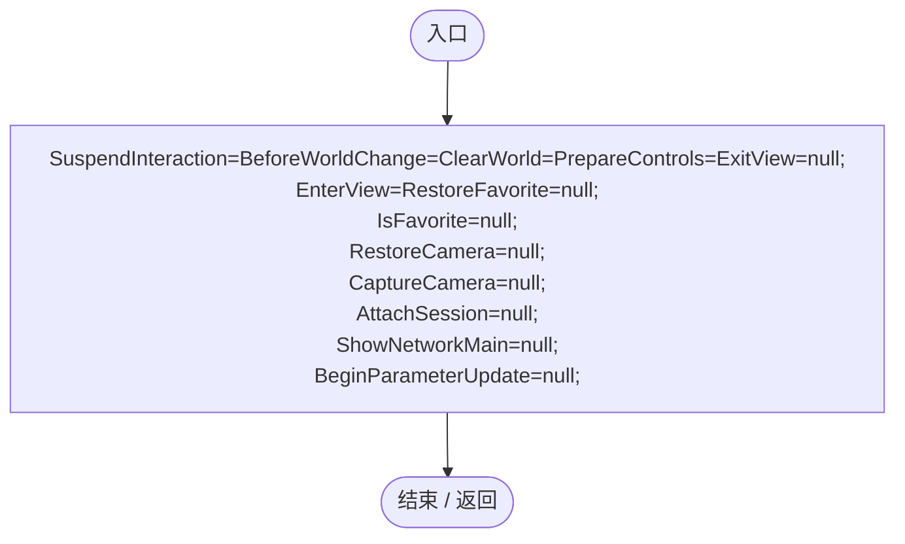


---

<a id="s3e0c0e065b3958ae"></a>

## LanEditActions.cs

`Runtime` · `Assets/DarwinPark/Gameplay/Networking/LanEditActions.cs`

[源文件](../../../Assets/DarwinPark/Gameplay/Networking/LanEditActions.cs) · 源码校验：`5c2a52500763b63b0f62d05651df728a0cf589ddc10a5dd7e1dbabe7084ae8f4`

方法按源文件位置排列。事件/回调引用不表示立即执行；完整源码与关系图请打开离线手册。

<a id="mdf4fa2d9e955869b"></a>

### Submit · L16

`public static bool Submit(LanCommand command)`


#### Editor / Player · Roslyn编译器控制流

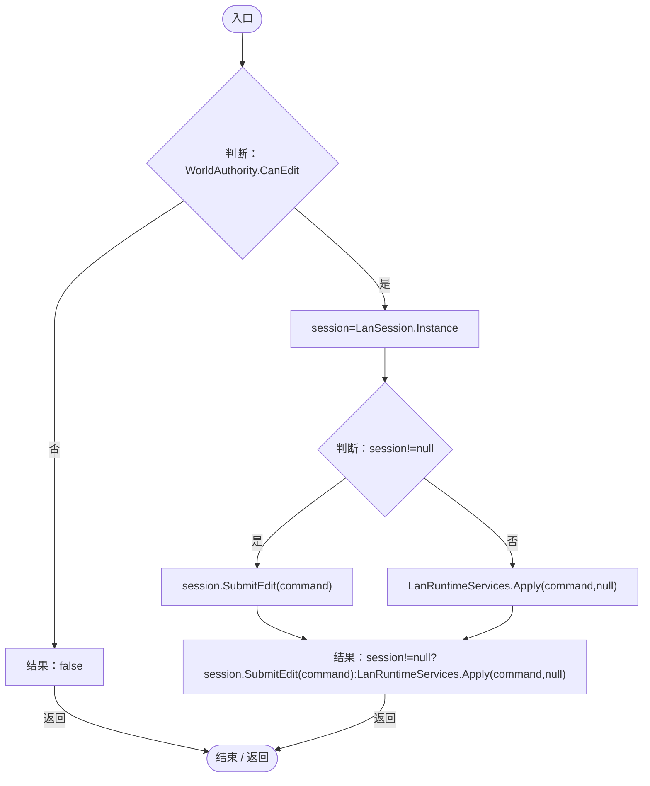

项目内调用/回调引用：

- [LanSession.Instance.get · L22](Gameplay.md#m7dfdbb06da9ac3a5)（访问器）
- [LanSession.SubmitEdit · L90](Gameplay.md#m6a49c530b5301a11)（方法）
- [LanRuntimeServices.Apply · L34](Gameplay.md#mab4f89806f18269a)（方法）

<a id="m91df352e21aecaf1"></a>

### SetGene · L18

`public static bool SetGene(DarwinEntity entity,string instance,float value)`


#### Editor / Player · Roslyn编译器控制流

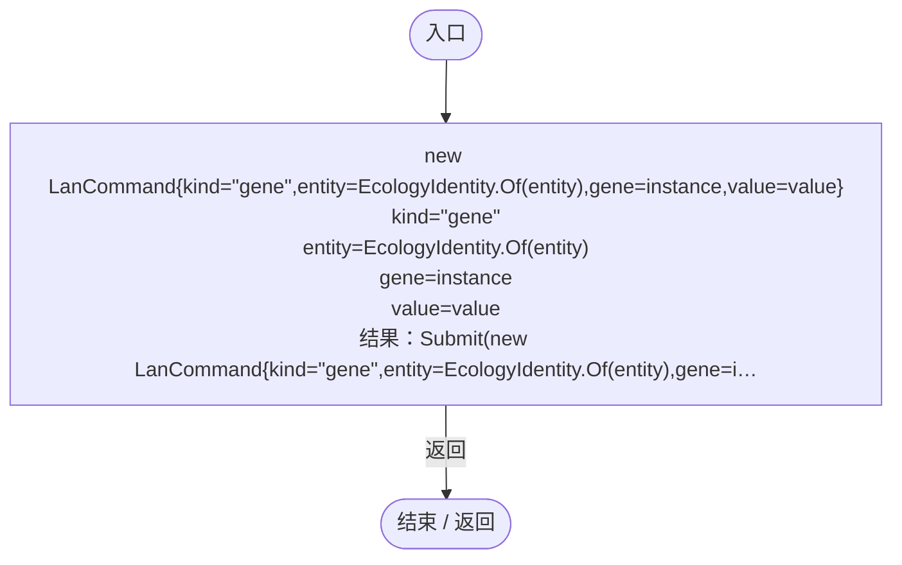

项目内调用/回调引用：

- [LanEditActions.Submit · L16](Gameplay.md#mdf4fa2d9e955869b)（方法）
- [EcologyIdentity.Of · L22](Entities.md#mb23020fe763aafd3)（方法）

<a id="mab3fa905dcb63140"></a>

### AddGene · L19

`public static bool AddGene(DarwinEntity entity,string definition)`


#### Editor / Player · Roslyn编译器控制流

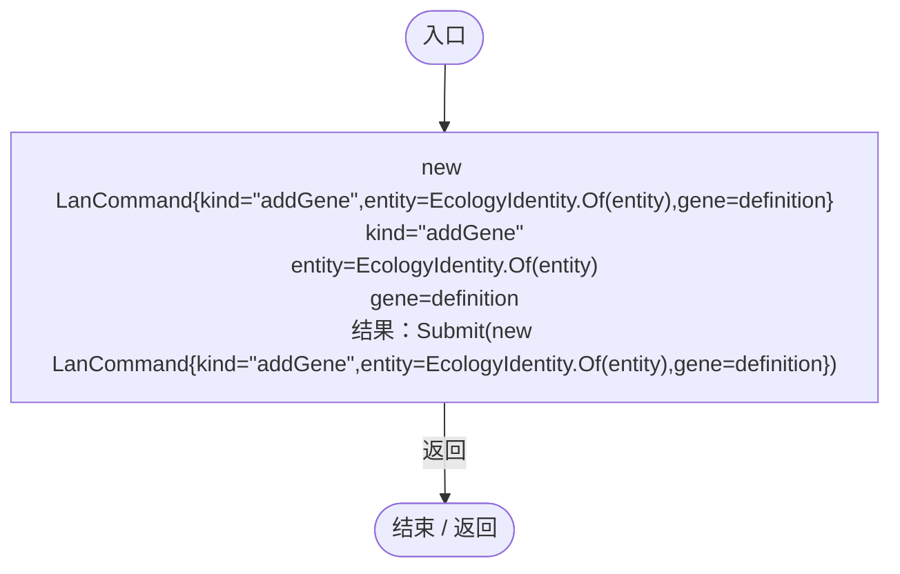

项目内调用/回调引用：

- [LanEditActions.Submit · L16](Gameplay.md#mdf4fa2d9e955869b)（方法）
- [EcologyIdentity.Of · L22](Entities.md#mb23020fe763aafd3)（方法）

<a id="m324ec56b239f0315"></a>

### SetGeneState · L21

`public static bool SetGeneState(DarwinEntity entity,string instance,string state)`

★ 新增：离散状态由权威端校验，不能借改强度绕过状态注册表。

#### Editor / Player · Roslyn编译器控制流

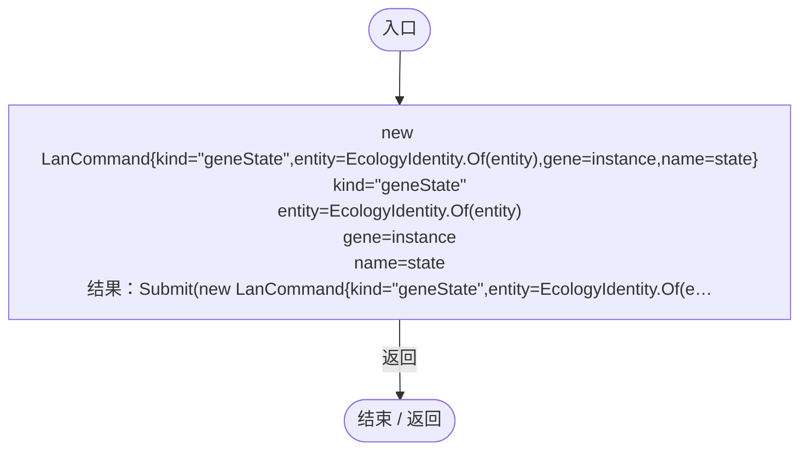

项目内调用/回调引用：

- [LanEditActions.Submit · L16](Gameplay.md#mdf4fa2d9e955869b)（方法）
- [EcologyIdentity.Of · L22](Entities.md#mb23020fe763aafd3)（方法）

<a id="m68a0c5e858a713e3"></a>

### Rename · L22

`public static bool Rename(DarwinEntity entity,string name)`


#### Editor / Player · Roslyn编译器控制流

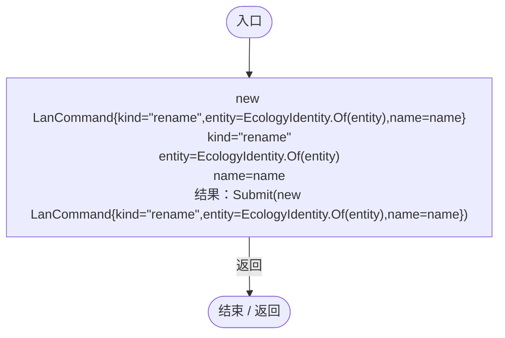

项目内调用/回调引用：

- [LanEditActions.Submit · L16](Gameplay.md#mdf4fa2d9e955869b)（方法）
- [EcologyIdentity.Of · L22](Entities.md#mb23020fe763aafd3)（方法）

<a id="mf625b046cfc83eee"></a>

### Spawn · L23

`public static bool Spawn(Genome genome,Vector3 point)`


#### Editor / Player · Roslyn编译器控制流

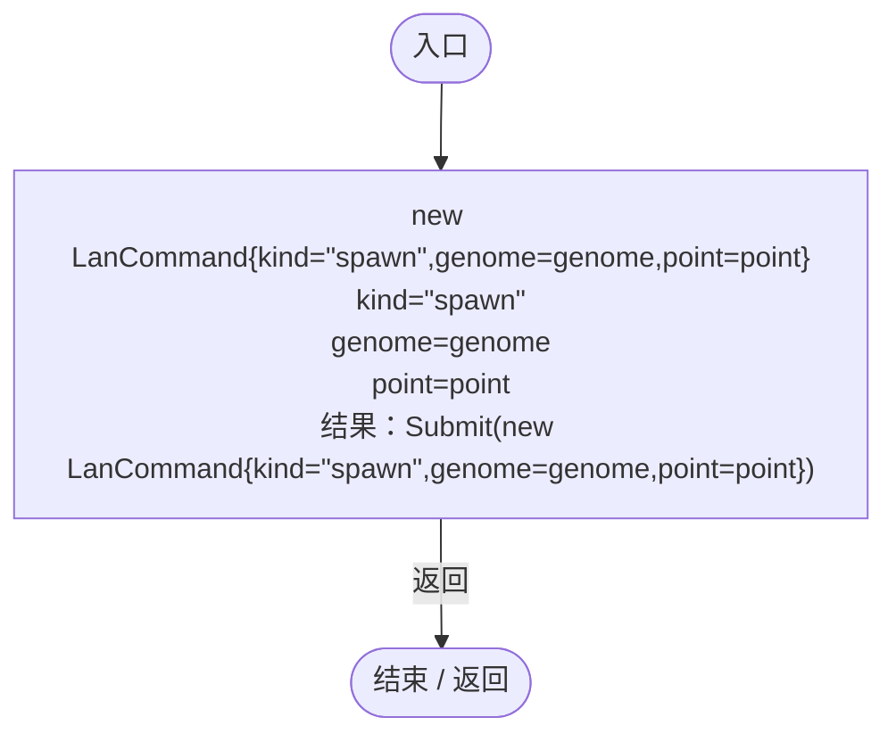

项目内调用/回调引用：

- [LanEditActions.Submit · L16](Gameplay.md#mdf4fa2d9e955869b)（方法）

<a id="mdbdbbd361ead6601"></a>

### Parameter · L24

`public static bool Parameter(string id,float value)`


#### Editor / Player · Roslyn编译器控制流

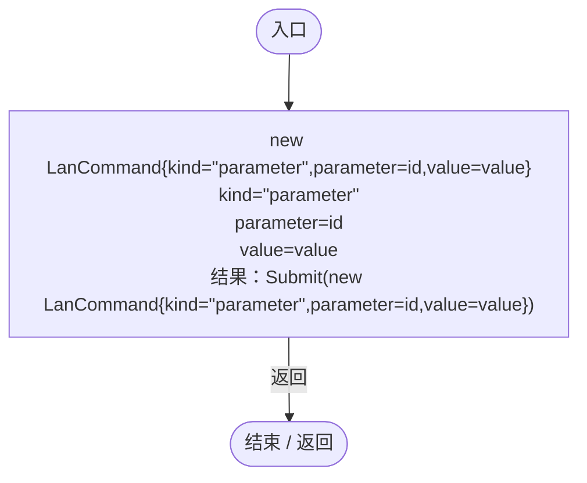

项目内调用/回调引用：

- [LanEditActions.Submit · L16](Gameplay.md#mdf4fa2d9e955869b)（方法）

<a id="m1b72ea9974235cb9"></a>

### Profile · L25

`public static bool Profile(Dictionary<string,string> catalog,GeneTreeDocument tree)`


#### Editor / Player · Roslyn编译器控制流

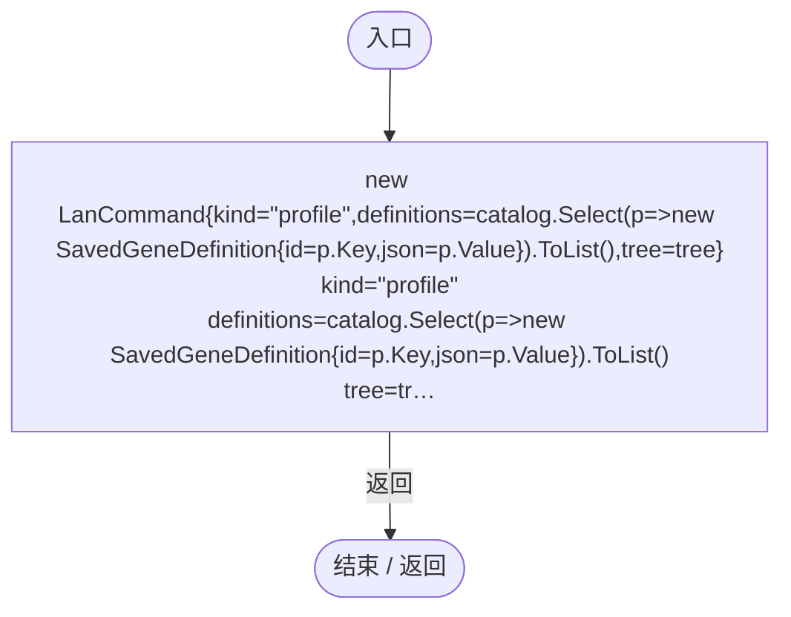

项目内调用/回调引用：

- [LanEditActions.Submit · L16](Gameplay.md#mdf4fa2d9e955869b)（方法）
- [LanEditActions.回调@25 · L25](Gameplay.md#m2ca189b9647a9873)（回调/委托）

<a id="m2ca189b9647a9873"></a>

### 回调@25 · L25

`p … => 回调`


#### Editor / Player · Roslyn编译器控制流

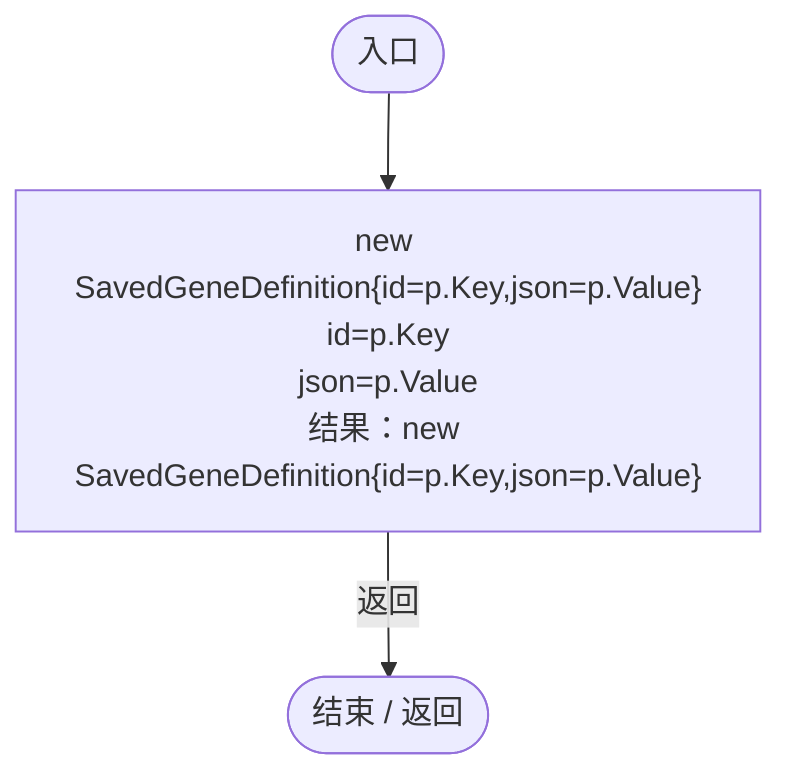


---

<a id="s93368f31a3944938"></a>

## LanProtocol.cs

`Runtime` · `Assets/DarwinPark/Gameplay/Networking/LanProtocol.cs`

[源文件](../../../Assets/DarwinPark/Gameplay/Networking/LanProtocol.cs) · 源码校验：`09be6dd30c4b75669d3a2512d359c956ad02f3e07c0c45e1116d4196778d28f2`

方法按源文件位置排列。事件/回调引用不表示立即执行；完整源码与关系图请打开离线手册。

<a id="m66eb45c03cc42f2d"></a>

### Current.get · L60

`get`


#### Editor / Player · Roslyn编译器控制流

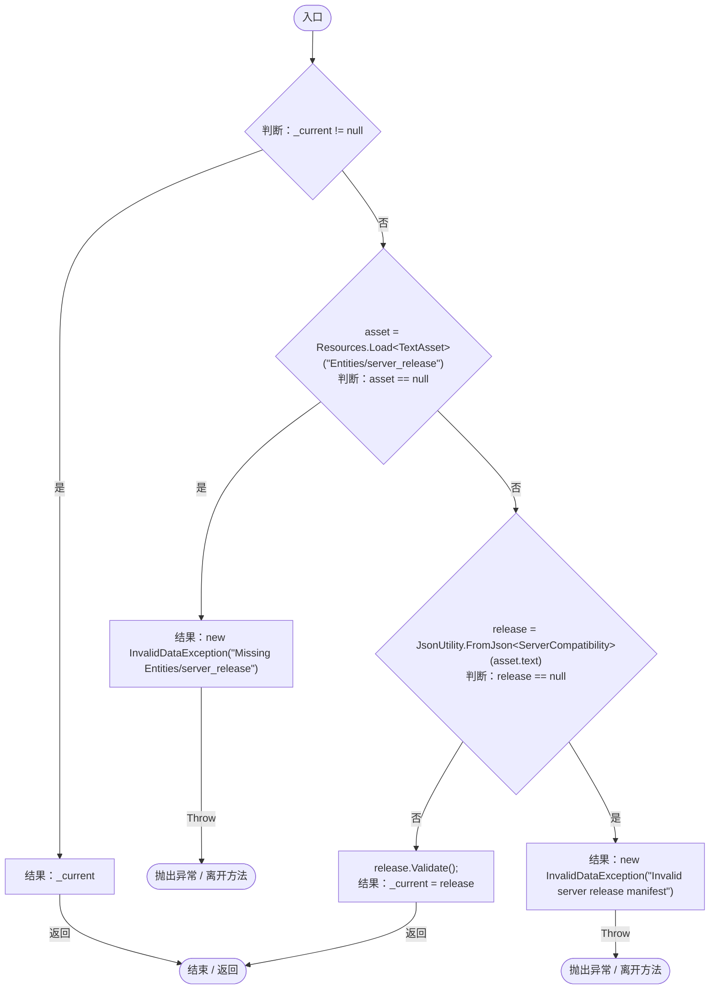

项目内调用/回调引用：

- [ServerCompatibility.Validate · L12](ServerCore.md#ma340a35e43a8f5b7)（方法）

<a id="m7c4ce1b7ac167a0c"></a>

### Current.get · L89

`get`


#### Editor / Player · Roslyn编译器控制流

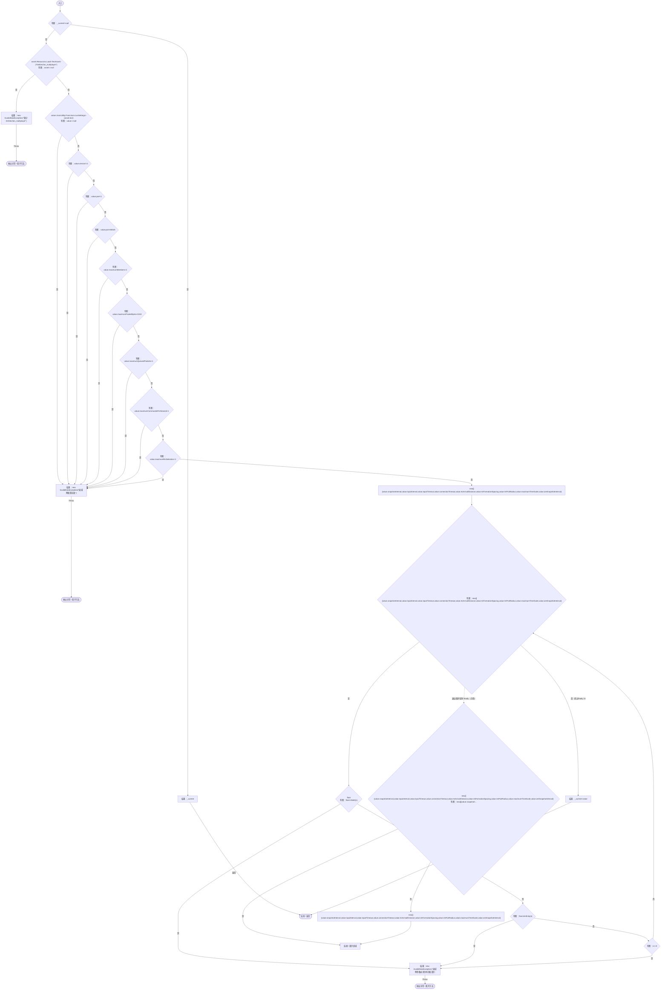


---

<a id="sd3ecc3f1157363db"></a>

## LanRuntimeServices.cs

`Runtime` · `Assets/DarwinPark/Gameplay/Networking/LanRuntimeServices.cs`

[源文件](../../../Assets/DarwinPark/Gameplay/Networking/LanRuntimeServices.cs) · 源码校验：`ab022133cf4d299378a719b5e6db2393987b0c1cdeb24e84d496d62180a5c6ff`

方法按源文件位置排列。事件/回调引用不表示立即执行；完整源码与关系图请打开离线手册。

<a id="m17c1d9487128bc2a"></a>

### Listening.get · L10

`get`


#### Editor / Player · 语法控制结构 / 声明（非CFG）


<a id="me2eff190fd2cebd2"></a>

### Port.get · L11

`get`


#### Editor / Player · 语法控制结构 / 声明（非CFG）


<a id="m292af195c1b01776"></a>

### MemberCount.get · L12

`get`


#### Editor / Player · 语法控制结构 / 声明（非CFG）


<a id="m0ea60bd59a283d90"></a>

### StartHost · L13

`bool StartHost(int port,bool cheats)`


#### Editor / Player · 语法控制结构 / 声明（非CFG）


<a id="m0a1d57db695791b6"></a>

### CloseHost · L14

`void CloseHost()`


#### Editor / Player · 语法控制结构 / 声明（非CFG）


<a id="m519131a168f5c2b4"></a>

### SetCheats · L15

`void SetCheats(bool enabled)`


#### Editor / Player · 语法控制结构 / 声明（非CFG）

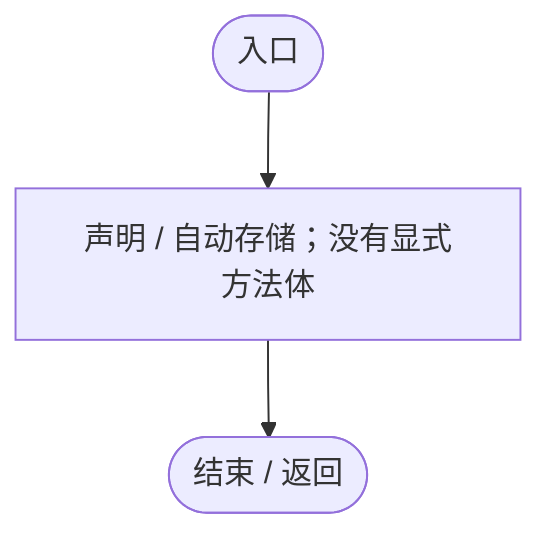

<a id="m01831c06fbd62404"></a>

### Accept · L16

`void Accept(LanConnection connection)`


#### Editor / Player · 语法控制结构 / 声明（非CFG）


<a id="mc6b1423a91c688c9"></a>

### Disconnect · L17

`bool Disconnect(LanConnection connection)`


#### Editor / Player · 语法控制结构 / 声明（非CFG）


<a id="m577396a2d076d38a"></a>

### Handle · L18

`bool Handle(LanConnection connection,LanMessage message)`


#### Editor / Player · 语法控制结构 / 声明（非CFG）

```mermaid
flowchart TD
  n2(["入口"])
  n1["声明 / 自动存储；没有显式方法体"]
  n0(["结束 / 返回"])
  n1 --> n0
  n2 --> n1

```

<a id="m2cda1c7320eb9068"></a>

### Tick · L19

`void Tick()`


#### Editor / Player · 语法控制结构 / 声明（非CFG）

```mermaid
flowchart TD
  n2(["入口"])
  n1["声明 / 自动存储；没有显式方法体"]
  n0(["结束 / 返回"])
  n1 --> n0
  n2 --> n1

```

<a id="m161b53ba669138bf"></a>

### AssignLocal · L20

`bool AssignLocal(string id)`


#### Editor / Player · 语法控制结构 / 声明（非CFG）

```mermaid
flowchart TD
  n2(["入口"])
  n1["声明 / 自动存储；没有显式方法体"]
  n0(["结束 / 返回"])
  n1 --> n0
  n2 --> n1

```

<a id="m6a764f3fdb0c63bd"></a>

### ProcessLocalCommand · L21

`void ProcessLocalCommand(LanCommand command)`


#### Editor / Player · 语法控制结构 / 声明（非CFG）

```mermaid
flowchart TD
  n2(["入口"])
  n1["声明 / 自动存储；没有显式方法体"]
  n0(["结束 / 返回"])
  n1 --> n0
  n2 --> n1

```

<a id="m41e4a420dac8a414"></a>

### ApplyLocalRts · L22

`bool ApplyLocalRts(LanCommand command)`


#### Editor / Player · 语法控制结构 / 声明（非CFG）

```mermaid
flowchart TD
  n2(["入口"])
  n1["声明 / 自动存储；没有显式方法体"]
  n0(["结束 / 返回"])
  n1 --> n0
  n2 --> n1

```

<a id="mf75f523a2698738a"></a>

### DisconnectReason.get · L26

`get`


#### Editor / Player · 语法控制结构 / 声明（非CFG）

```mermaid
flowchart TD
  n2(["入口"])
  n1["声明 / 自动存储；没有显式方法体"]
  n0(["结束 / 返回"])
  n1 --> n0
  n2 --> n1

```

<a id="m61bf265c52f7b68e"></a>

### Reset · L27

`void Reset()`


#### Editor / Player · 语法控制结构 / 声明（非CFG）

```mermaid
flowchart TD
  n2(["入口"])
  n1["声明 / 自动存储；没有显式方法体"]
  n0(["结束 / 返回"])
  n1 --> n0
  n2 --> n1

```

<a id="m221d2ee534ceec16"></a>

### OnLoaded · L27

`void OnLoaded()`


#### Editor / Player · 语法控制结构 / 声明（非CFG）

```mermaid
flowchart TD
  n2(["入口"])
  n1["声明 / 自动存储；没有显式方法体"]
  n0(["结束 / 返回"])
  n1 --> n0
  n2 --> n1

```

<a id="maf596aede65a09d9"></a>

### Tick · L27

`void Tick()`


#### Editor / Player · 语法控制结构 / 声明（非CFG）

```mermaid
flowchart TD
  n2(["入口"])
  n1["声明 / 自动存储；没有显式方法体"]
  n0(["结束 / 返回"])
  n1 --> n0
  n2 --> n1

```

<a id="m05eb8d221ecf5826"></a>

### Handle · L27

`void Handle(LanConnection connection,LanMessage message)`


#### Editor / Player · 语法控制结构 / 声明（非CFG）

```mermaid
flowchart TD
  n2(["入口"])
  n1["声明 / 自动存储；没有显式方法体"]
  n0(["结束 / 返回"])
  n1 --> n0
  n2 --> n1

```

<a id="mab4f89806f18269a"></a>

### Apply · L34

`public static bool Apply(LanCommand command,LanSession session)`


#### Editor / Player · Roslyn编译器控制流

```mermaid
flowchart TD
  b0(["入口"])
  b1{"判断：ApplyAuthority==null"}
  b2["结果：new InvalidOperationException(&quot;DarwinPark.Server.Unity runtime is not installed&quot;)"]
  x2(["抛出异常 / 离开方法"])
  b3["结果：ApplyAuthority(command,session)"]
  b4(["结束 / 返回"])
  b0 --> b1
  b1 -->|"是"| b2
  b1 -->|"否"| b3
  b2 -->|"Throw"| x2
  b3 -->|"返回"| b4

```

<a id="mdb0fe7e283b22b1e"></a>

### Reset · L39

`[RuntimeInitializeOnLoadMethod(RuntimeInitializeLoadType.SubsystemRegistration)] private static void Reset()`


#### Editor / Player · Roslyn编译器控制流

```mermaid
flowchart TD
  b0(["入口"])
  b1["CreateServer=null;<br/>CreateClient=null;<br/>ApplyAuthority=null;"]
  b2(["结束 / 返回"])
  b0 --> b1
  b1 --> b2

```


---

<a id="seca7d2ffea34e713"></a>

## LanSession.cs

`Runtime` · `Assets/DarwinPark/Gameplay/Networking/LanSession.cs`

[源文件](../../../Assets/DarwinPark/Gameplay/Networking/LanSession.cs) · 源码校验：`f1b4e1b2462662371d05709a8d2ccea5a8587063c037da7e4d2d41fcbbf7861f`

方法按源文件位置排列。事件/回调引用不表示立即执行；完整源码与关系图请打开离线手册。

<a id="m7dfdbb06da9ac3a5"></a>

### Instance.get · L22

`get`


#### Editor / Player · 语法控制结构 / 声明（非CFG）

```mermaid
flowchart TD
  n2(["入口"])
  n1["声明 / 自动存储；没有显式方法体"]
  n0(["结束 / 返回"])
  n1 --> n0
  n2 --> n1

```

<a id="mea40c930580c0f80"></a>

### Instance.set · L22

`private set`


#### Editor / Player · 语法控制结构 / 声明（非CFG）

```mermaid
flowchart TD
  n2(["入口"])
  n1["声明 / 自动存储；没有显式方法体"]
  n0(["结束 / 返回"])
  n1 --> n0
  n2 --> n1

```

<a id="m8861db906f3230f8"></a>

### IsHost.get · L23

`public bool IsHost`


#### Editor / Player · 语法控制结构 / 声明（非CFG）

```mermaid
flowchart TD
  n2(["入口"])
  n1["_host!=null&amp;&amp;_host.Listening"]
  n0(["结束 / 返回"])
  n1 --> n0
  n2 --> n1

```

项目内调用/回调引用：

- [ILanServerRuntime.Listening.get · L10](Gameplay.md#m17c1d9487128bc2a)（访问器）

<a id="m29dcf3afefda2de5"></a>

### IsClient.get · L24

`public bool IsClient`


#### Editor / Player · 语法控制结构 / 声明（非CFG）

```mermaid
flowchart TD
  n2(["入口"])
  n1["_server!=null"]
  n0(["结束 / 返回"])
  n1 --> n0
  n2 --> n1

```

<a id="m825d8f9ce55cd38f"></a>

### Online.get · L25

`public bool Online`


#### Editor / Player · 语法控制结构 / 声明（非CFG）

```mermaid
flowchart TD
  n2(["入口"])
  n1["IsHost&#124;&#124;IsClient&#124;&#124;_connecting"]
  n0(["结束 / 返回"])
  n1 --> n0
  n2 --> n1

```

<a id="mf5f562ecab6f9c3f"></a>

### Cheats.get · L26

`get`


#### Editor / Player · 语法控制结构 / 声明（非CFG）

```mermaid
flowchart TD
  n2(["入口"])
  n1["声明 / 自动存储；没有显式方法体"]
  n0(["结束 / 返回"])
  n1 --> n0
  n2 --> n1

```

<a id="mb721213f307caca7"></a>

### Cheats.set · L26

`internal set`


#### Editor / Player · 语法控制结构 / 声明（非CFG）

```mermaid
flowchart TD
  n2(["入口"])
  n1["声明 / 自动存储；没有显式方法体"]
  n0(["结束 / 返回"])
  n1 --> n0
  n2 --> n1

```

<a id="m1fde447e9c5f2fb2"></a>

### CanManage.get · L27

`public bool CanManage`


#### Editor / Player · 语法控制结构 / 声明（非CFG）

```mermaid
flowchart TD
  n2(["入口"])
  n1["!Online&#124;&#124;IsHost&#124;&#124;Cheats"]
  n0(["结束 / 返回"])
  n1 --> n0
  n2 --> n1

```

项目内调用/回调引用：

- [LanSession.Cheats.get · L26](Gameplay.md#mf5f562ecab6f9c3f)（访问器）

<a id="m88836972cec71f5a"></a>

### LocalId.get · L28

`get`


#### Editor / Player · 语法控制结构 / 声明（非CFG）

```mermaid
flowchart TD
  n2(["入口"])
  n1["声明 / 自动存储；没有显式方法体"]
  n0(["结束 / 返回"])
  n1 --> n0
  n2 --> n1

```

<a id="ma3049492ffc18f43"></a>

### LocalId.set · L28

`internal set`


#### Editor / Player · 语法控制结构 / 声明（非CFG）

```mermaid
flowchart TD
  n2(["入口"])
  n1["声明 / 自动存储；没有显式方法体"]
  n0(["结束 / 返回"])
  n1 --> n0
  n2 --> n1

```

<a id="m1804a7f0da3ea947"></a>

### OwnedEntityId.get · L29

`get`


#### Editor / Player · 语法控制结构 / 声明（非CFG）

```mermaid
flowchart TD
  n2(["入口"])
  n1["声明 / 自动存储；没有显式方法体"]
  n0(["结束 / 返回"])
  n1 --> n0
  n2 --> n1

```

<a id="mbb21c9071c8c786d"></a>

### OwnedEntityId.set · L29

`internal set`


#### Editor / Player · 语法控制结构 / 声明（非CFG）

```mermaid
flowchart TD
  n2(["入口"])
  n1["声明 / 自动存储；没有显式方法体"]
  n0(["结束 / 返回"])
  n1 --> n0
  n2 --> n1

```

<a id="mb0cf5b4a7385539a"></a>

### Status.get · L30

`get`


#### Editor / Player · 语法控制结构 / 声明（非CFG）

```mermaid
flowchart TD
  n2(["入口"])
  n1["声明 / 自动存储；没有显式方法体"]
  n0(["结束 / 返回"])
  n1 --> n0
  n2 --> n1

```

<a id="m9d966c9cb7ad134d"></a>

### Status.set · L30

`internal set`


#### Editor / Player · 语法控制结构 / 声明（非CFG）

```mermaid
flowchart TD
  n2(["入口"])
  n1["声明 / 自动存储；没有显式方法体"]
  n0(["结束 / 返回"])
  n1 --> n0
  n2 --> n1

```

<a id="m61d78ab3325ffb70"></a>

### Port.get · L31

`public int Port`


#### Editor / Player · 语法控制结构 / 声明（非CFG）

```mermaid
flowchart TD
  n2(["入口"])
  n1["_host?.Port??0"]
  n0(["结束 / 返回"])
  n1 --> n0
  n2 --> n1

```

项目内调用/回调引用：

- [ILanServerRuntime.Port.get · L11](Gameplay.md#me2eff190fd2cebd2)（访问器）

<a id="me7ba79c6a00eae4a"></a>

### RejectedCommands.get · L32

`get`


#### Editor / Player · 语法控制结构 / 声明（非CFG）

```mermaid
flowchart TD
  n2(["入口"])
  n1["声明 / 自动存储；没有显式方法体"]
  n0(["结束 / 返回"])
  n1 --> n0
  n2 --> n1

```

<a id="md66f079c077b6581"></a>

### RejectedCommands.set · L32

`internal set`


#### Editor / Player · 语法控制结构 / 声明（非CFG）

```mermaid
flowchart TD
  n2(["入口"])
  n1["声明 / 自动存储；没有显式方法体"]
  n0(["结束 / 返回"])
  n1 --> n0
  n2 --> n1

```

<a id="mf049be74012cfdde"></a>

### MemberCount.get · L33

`public int MemberCount`


#### Editor / Player · 语法控制结构 / 声明（非CFG）

```mermaid
flowchart TD
  n2(["入口"])
  n1["_host?.MemberCount??0"]
  n0(["结束 / 返回"])
  n1 --> n0
  n2 --> n1

```

项目内调用/回调引用：

- [ILanServerRuntime.MemberCount.get · L12](Gameplay.md#m292af195c1b01776)（访问器）

<a id="mae142e907ee7df88"></a>

### Players.get · L34

`public IReadOnlyList<LanPlayer> Players`


#### Editor / Player · 语法控制结构 / 声明（非CFG）

```mermaid
flowchart TD
  n2(["入口"])
  n1["_players"]
  n0(["结束 / 返回"])
  n1 --> n0
  n2 --> n1

```

<a id="m1697880211ef51a3"></a>

### Ensure · L43

`public static LanSession Ensure(GameObject host)`


#### Editor / Player · Roslyn编译器控制流

```mermaid
flowchart TD
  b0(["入口"])
  b1{"判断：Instance!=null"}
  b2["Instance"]
  b3{"host.GetComponent&lt;LanSession&gt;()<br/>判断：host.GetComponent&lt;LanSession&gt;()"}
  b4["host.GetComponent&lt;LanSession&gt;()"]
  b5["host.AddComponent&lt;LanSession&gt;()"]
  b6["结果：Instance!=null?Instance:host.GetComponent&lt;LanSession&gt;()??host.AddComponent&lt;LanSession&gt;()"]
  b7(["结束 / 返回"])
  b0 --> b1
  b1 -->|"是"| b2
  b1 -->|"否"| b3
  b2 --> b6
  b3 -->|"否"| b4
  b3 -->|"是"| b5
  b4 --> b6
  b5 --> b6
  b6 -->|"返回"| b7

```

项目内调用/回调引用：

- [LanSession.Instance.get · L22](Gameplay.md#m7dfdbb06da9ac3a5)（访问器）

<a id="m37ef3e01bd7157a8"></a>

### Awake · L44

`private void Awake()`


#### Editor / Player · Roslyn编译器控制流

```mermaid
flowchart TD
  b0(["入口"])
  b1{"判断：LanRuntimeServices.CreateServer==null"}
  b2["结果：new InvalidOperationException(&quot;Missing DarwinPark.Server.Unity registration&quot;)"]
  x2(["抛出异常 / 离开方法"])
  b3["_host=LanRuntimeServices.CreateServer(this);"]
  b4{"_replica<br/>判断：DedicatedServerMode.Enabled"}
  b5["null"]
  b6{"LanRuntimeServices.CreateClient<br/>判断：LanRuntimeServices.CreateClient"}
  b7[".Invoke(this)"]
  b8["LanRuntimeServices.CreateClient"]
  b9["_replica=DedicatedServerMode.Enabled?null:LanRuntimeServices.CreateClient?.Invoke(this);"]
  b10{"判断：DedicatedServerMode.Enabled"}
  b11{"判断：_replica==null"}
  b12["结果：new InvalidOperationException(&quot;Missing client presentation registration&quot;)"]
  x12(["抛出异常 / 离开方法"])
  b13["Instance=this;"]
  b14["_world"]
  b15{"GetComponent&lt;WorldSessionManager&gt;()<br/>判断：GetComponent&lt;WorldSessionManager&gt;()"}
  b16["GetComponent&lt;WorldSessionManager&gt;()"]
  b17["FindFirstObjectByType&lt;WorldSessionManager&gt;()"]
  b18["_world=GetComponent&lt;WorldSessionManager&gt;()??FindFirstObjectByType&lt;WorldSessionManager&gt;();"]
  b19{"_world.Loaded+=OnLoaded;<br/>判断：DedicatedServerMode.Enabled"}
  b20{"GameplayPresentation.AttachSession<br/>判断：GameplayPresentation.AttachSession"}
  b21["GameplayPresentation.AttachSession?.Invoke(this);"]
  b22(["结束 / 返回"])
  b0 --> b1
  b1 -->|"是"| b2
  b1 -->|"否"| b3
  b2 -->|"Throw"| x2
  b3 --> b4
  b4 -->|"是"| b5
  b4 -->|"否"| b6
  b5 --> b9
  b6 -->|"否"| b7
  b6 -->|"是"| b8
  b7 --> b9
  b8 --> b9
  b9 --> b10
  b10 -->|"否"| b11
  b10 -->|"是"| b13
  b11 -->|"是"| b12
  b11 -->|"否"| b13
  b12 -->|"Throw"| x12
  b13 --> b14
  b14 --> b15
  b15 -->|"否"| b16
  b15 -->|"是"| b17
  b16 --> b18
  b17 --> b18
  b18 --> b19
  b19 -->|"是"| b22
  b19 -->|"否"| b20
  b20 -->|"否"| b21
  b20 -->|"是"| b22
  b21 --> b22

```

项目内调用/回调引用：

- [DedicatedServerMode.Enabled.get · L11](Core.md#mbc77f72f83f4ad28)（访问器）
- [LanSession.Instance.set · L22](Gameplay.md#mea40c930580c0f80)（访问器）
- [LanSession.OnLoaded · L59](Gameplay.md#mb3eb6d4bd2f6314c)（方法）

<a id="m61bbfbb1c5e75794"></a>

### PublishAuthority · L53

`internal void PublishAuthority()`


#### Editor / Player · Roslyn编译器控制流

```mermaid
flowchart TD
  b0(["入口"])
  b1["WorldAuthority.Online=Online;"]
  b2{"WorldAuthority.IsReplica<br/>判断：IsClient"}
  b3["_connecting"]
  b4["IsClient"]
  b5["WorldAuthority.IsReplica=IsClient&#124;&#124;_connecting;"]
  b6["WorldAuthority.CanEdit=CanManage;<br/>WorldAuthority.RequestTime=(running,scale)=&gt;SubmitEdit(new LanCommand{kind=&quot;time&quot;,running=running,scale=scale});"]
  b7(["结束 / 返回"])
  b0 --> b1
  b1 --> b2
  b2 -->|"否"| b3
  b2 -->|"是"| b4
  b3 --> b5
  b4 --> b5
  b5 --> b6
  b6 --> b7

```

项目内调用/回调引用：

- [LanSession.回调@54 · L54](Gameplay.md#m07cb6a92a5a85846)（回调/委托）

<a id="m07cb6a92a5a85846"></a>

### 回调@54 · L54

`( … => 回调`


#### Editor / Player · Roslyn编译器控制流

```mermaid
flowchart TD
  b0(["入口"])
  b1["SubmitEdit<br/>new LanCommand{kind=&quot;time&quot;,running=running,scale=scale}<br/>kind=&quot;time&quot;<br/>running=running<br/>scale=scale<br/>结果：SubmitEdit(new LanCommand{kind=&quot;time&quot;,running=running,scale=scale})"]
  b2(["结束 / 返回"])
  b0 --> b1
  b1 -->|"返回"| b2

```

项目内调用/回调引用：

- [LanSession.SubmitEdit · L90](Gameplay.md#m6a49c530b5301a11)（方法）

<a id="m4ae187f2c037f2e0"></a>

### StartHost · L56

`public bool StartHost(int port=-1,bool cheats=false)`

✦ 补充：公共会话只编排生命周期，权威计算与副本显示在独立类型中。

#### Editor / Player · Roslyn编译器控制流

```mermaid
flowchart TD
  b0(["入口"])
  b1["结果：_host.StartHost(port,cheats)"]
  b2(["结束 / 返回"])
  b0 --> b1
  b1 -->|"返回"| b2

```

项目内调用/回调引用：

- [ILanServerRuntime.StartHost · L13](Gameplay.md#m0ea60bd59a283d90)（方法）

<a id="m19519c1a545bafef"></a>

### CloseHost · L57

`public void CloseHost()`


#### Editor / Player · Roslyn编译器控制流

```mermaid
flowchart TD
  b0(["入口"])
  b1["_host.CloseHost()"]
  b2(["结束 / 返回"])
  b0 --> b1
  b1 --> b2

```

项目内调用/回调引用：

- [ILanServerRuntime.CloseHost · L14](Gameplay.md#m0a1d57db695791b6)（方法）

<a id="m1f17cf57e74e022b"></a>

### SetCheats · L58

`public void SetCheats(bool enabled)`


#### Editor / Player · Roslyn编译器控制流

```mermaid
flowchart TD
  b0(["入口"])
  b1["_host.SetCheats(enabled)"]
  b2(["结束 / 返回"])
  b0 --> b1
  b1 --> b2

```

项目内调用/回调引用：

- [ILanServerRuntime.SetCheats · L15](Gameplay.md#m519131a168f5c2b4)（方法）

<a id="mb3eb6d4bd2f6314c"></a>

### OnLoaded · L59

`private void OnLoaded()`


#### Editor / Player · Roslyn编译器控制流

```mermaid
flowchart TD
  b0(["入口"])
  b1{"_replica<br/>判断：_replica"}
  b2["_replica?.OnLoaded()"]
  b3(["结束 / 返回"])
  b0 --> b1
  b1 -->|"否"| b2
  b1 -->|"是"| b3
  b2 --> b3

```

项目内调用/回调引用：

- [ILanClientRuntime.OnLoaded · L27](Gameplay.md#m221d2ee534ceec16)（方法）

<a id="mb2c39277c864c9b6"></a>

### Accept · L60

`internal void Accept(LanConnection connection)`


#### Editor / Player · Roslyn编译器控制流

```mermaid
flowchart TD
  b0(["入口"])
  b1["_accepted.Enqueue(connection)"]
  b2(["结束 / 返回"])
  b0 --> b1
  b1 --> b2

```

<a id="m2db72a976122c45e"></a>

### ReceiveClosed · L61

`internal void ReceiveClosed(LanConnection connection)`


#### Editor / Player · Roslyn编译器控制流

```mermaid
flowchart TD
  b0(["入口"])
  b1["_disconnected.Enqueue(connection)"]
  b2(["结束 / 返回"])
  b0 --> b1
  b1 --> b2

```

<a id="m20703bd0e16c4ecc"></a>

### ReceivePacket · L62

`internal void ReceivePacket(LanConnection connection,string text)`


#### Editor / Player · Roslyn编译器控制流

```mermaid
flowchart TD
  b0(["入口"])
  b1["Receive(connection,text)"]
  b2(["结束 / 返回"])
  b0 --> b1
  b1 --> b2

```

项目内调用/回调引用：

- [LanSession.Receive · L84](Gameplay.md#mba5f46c1d6b41e6e)（方法）

<a id="mcf57e29de5bc9808"></a>

### Join · L63

`public void Join(string address,int port,string name)`


#### Editor / Player · Roslyn编译器控制流

```mermaid
flowchart TD
  b0(["入口"])
  b1{"判断：_replica==null"}
  b2["结果：new InvalidOperationException(&quot;Dedicated server cannot join a remote world&quot;)"]
  x2(["抛出异常 / 离开方法"])
  b3{"判断：Online"}
  b4{"判断：port&lt;1"}
  b5{"判断：port&gt;65535"}
  b6{"判断：string.IsNullOrWhiteSpace(address)"}
  b7["Status=&quot;请输入有效地址和端口&quot;;"]
  b8{"_replica<br/>判断：_replica"}
  b9["_replica?.Reset();"]
  b10["_connecting=true;<br/>_leaving=false;<br/>Status=&quot;正在连接管理员…&quot;;<br/>PublishAuthority();<br/>settings=LanSettings.Current<br/>Debug.Log(&quot;[联机] 连接地址=&quot;+address.Trim()+&quot;，端口=&quot;+port);<br/>version=Interlocked.Increment(ref _joinVersion)<br/>client=new TcpClient()<br/>_joiningClie…"]
  b11(["结束 / 返回"])
  b0 --> b1
  b1 -->|"是"| b2
  b1 -->|"否"| b3
  b2 -->|"Throw"| x2
  b3 -->|"是"| b11
  b3 -->|"否"| b4
  b4 -->|"否"| b5
  b4 -->|"是"| b7
  b5 -->|"否"| b6
  b5 -->|"是"| b7
  b6 -->|"是"| b7
  b6 -->|"否"| b8
  b7 --> b11
  b8 -->|"否"| b9
  b8 -->|"是"| b10
  b9 --> b10
  b10 --> b11

```

项目内调用/回调引用：

- [LanSession.Status.set · L30](Gameplay.md#m9d966c9cb7ad134d)（访问器）
- [ILanClientRuntime.Reset · L27](Gameplay.md#m61bf265c52f7b68e)（方法）
- [LanSession.PublishAuthority · L53](Gameplay.md#m61bbfbb1c5e75794)（方法）
- [LanSettings.Current.get · L89](Gameplay.md#m7c4ce1b7ac167a0c)（访问器）
- [LanSession.回调@72 · L72](Gameplay.md#mb3ce2ba1c73e10cd)（回调/委托）

<a id="mb3ce2ba1c73e10cd"></a>

### 回调@72 · L72

`async async … => 回调`


#### Editor / Player · Roslyn编译器控制流

```mermaid
flowchart TD
  b0(["入口"])
  b1{"task=client.ConnectAsync(address.Trim(),port)<br/>判断：await Task.WhenAny(task,Task.Delay(TimeSpan.FromSeconds(settings.connectionTimeout)))!=task"}
  b2["结果：new TimeoutException(&quot;连接超时&quot;)"]
  x2(["抛出异常 / 离开方法"])
  b3{"await task;<br/>connection=new LanConnection(client,settings.maximumPacketBytes,settings.maximumQueuedPackets,Receive,c=&gt;_disconnected.Enqueue(c))<br/>判断：version!=Volatile.Read(ref _joinVersion)"}
  b4["connection.Dispose();"]
  b5["_main.Enqueue(()=&gt;{if(!_connecting&#124;&#124;version!=_joinVersion){connection.Dispose();return;}_joiningClient=null;_server=connection;_connecting=false;PublishAuthority();connection.Start();SendMessage(connection,new LanMessage{type=&quot;join&quot;,text…"]
  b6["(Exception ex)<br/>client.Close();<br/>_main.Enqueue(()=&gt;{if(version!=_joinVersion)return;_joiningClient=null;_connecting=false;Status=&quot;连接失败：&quot;+ex.Message;PublishAuthority();Debug.LogWarning(&quot;[联机] &quot;+Status);});"]
  b7(["结束 / 返回"])
  b0 --> b1
  b1 -->|"是"| b2
  b1 -->|"否"| b3
  b2 -->|"Throw"| x2
  b3 -->|"是"| b4
  b3 -->|"否"| b5
  b4 --> b7
  b5 --> b7
  b6 --> b7
  b1 -. "保护区可能异常（示意）" .-> b6

```

项目内调用/回调引用：

- [LanConnection.LanConnection.ctor · L21](ServerCore.md#m5e1f70bc7fd056b4)（构造函数）
- [LanConnection.Dispose · L68](ServerCore.md#m9c3fd25afe51cbe8)（方法）
- [LanSession.回调@77 · L77](Gameplay.md#mbfaae2f69f019b12)（回调/委托）
- [LanSession.回调@79 · L79](Gameplay.md#mb8c3d4757dc0566a)（回调/委托）
- [LanSession.回调@81 · L81](Gameplay.md#me16adb84a863ff04)（回调/委托）
- [LanSession.Receive · L84](Gameplay.md#mba5f46c1d6b41e6e)（方法）

<a id="mbfaae2f69f019b12"></a>

### 回调@77 · L77

`c … => 回调`


#### Editor / Player · Roslyn编译器控制流

```mermaid
flowchart TD
  b0(["入口"])
  b1["_disconnected.Enqueue(c)"]
  b2(["结束 / 返回"])
  b0 --> b1
  b1 --> b2

```

<a id="mb8c3d4757dc0566a"></a>

### 回调@79 · L79

`( … => 回调`


#### Editor / Player · Roslyn编译器控制流

```mermaid
flowchart TD
  b0(["入口"])
  b1{"判断：_connecting"}
  b2{"判断：version!=_joinVersion"}
  b3["connection.Dispose();"]
  b4["_joiningClient=null;<br/>_server=connection;<br/>_connecting=false;<br/>PublishAuthority();<br/>connection.Start();"]
  b5["connection<br/>new LanMessage{type=&quot;join&quot;,text=(name??&quot;成员&quot;).Trim(),compatibility=LanRelease.Current}<br/>type=&quot;join&quot;"]
  b6{"name<br/>判断：name"}
  b7["name"]
  b8["&quot;成员&quot;"]
  b9["text=(name??&quot;成员&quot;).Trim()"]
  b10["compatibility=LanRelease.Current<br/>SendMessage(connection,new LanMessage{type=&quot;join&quot;,text=(name??&quot;成员&quot;).Trim(),compatibility=LanRelease.Current});"]
  b11(["结束 / 返回"])
  b0 --> b1
  b1 -->|"是"| b2
  b1 -->|"否"| b3
  b2 -->|"是"| b3
  b2 -->|"否"| b4
  b3 --> b11
  b4 --> b5
  b5 --> b6
  b6 -->|"否"| b7
  b6 -->|"是"| b8
  b7 --> b9
  b8 --> b9
  b9 --> b10
  b10 --> b11

```

项目内调用/回调引用：

- [LanConnection.Dispose · L68](ServerCore.md#m9c3fd25afe51cbe8)（方法）
- [LanSession.PublishAuthority · L53](Gameplay.md#m61bbfbb1c5e75794)（方法）
- [LanConnection.Start · L23](ServerCore.md#mf12837a14b366c30)（方法）
- [LanSession.SendMessage · L87](Gameplay.md#m7507dbb8b567c698)（方法）
- [LanRelease.Current.get · L60](Gameplay.md#m66eb45c03cc42f2d)（访问器）

<a id="me16adb84a863ff04"></a>

### 回调@81 · L81

`( … => 回调`


#### Editor / Player · Roslyn编译器控制流

```mermaid
flowchart TD
  b0(["入口"])
  b1{"判断：version!=_joinVersion"}
  b2["_joiningClient=null;<br/>_connecting=false;<br/>Status=&quot;连接失败：&quot;+ex.Message;<br/>PublishAuthority();<br/>Debug.LogWarning(&quot;[联机] &quot;+Status);"]
  b3(["结束 / 返回"])
  b0 --> b1
  b1 -->|"是"| b3
  b1 -->|"否"| b2
  b2 --> b3

```

项目内调用/回调引用：

- [LanSession.Status.set · L30](Gameplay.md#m9d966c9cb7ad134d)（访问器）
- [LanSession.PublishAuthority · L53](Gameplay.md#m61bbfbb1c5e75794)（方法）
- [LanSession.Status.get · L30](Gameplay.md#mb0cf5b4a7385539a)（访问器）

<a id="mba5f46c1d6b41e6e"></a>

### Receive · L84

`private void Receive(LanConnection connection,string text)`


#### Editor / Player · Roslyn编译器控制流

```mermaid
flowchart TD
  b0(["入口"])
  b1{"判断：_incoming.Count&gt;=LanSettingsQueueLimit"}
  b2["connection.Dispose();"]
  b3["_incoming.Enqueue((connection,text));"]
  b4(["结束 / 返回"])
  b0 --> b1
  b1 -->|"是"| b2
  b1 -->|"否"| b3
  b2 --> b4
  b3 --> b4

```

项目内调用/回调引用：

- [LanConnection.Dispose · L68](ServerCore.md#m9c3fd25afe51cbe8)（方法）

<a id="m7507dbb8b567c698"></a>

### SendMessage · L87

`internal static void SendMessage(LanConnection connection,LanMessage message)`


#### Editor / Player · Roslyn编译器控制流

```mermaid
flowchart TD
  b0(["入口"])
  b1["connection.Send(JsonUtility.ToJson(message))"]
  b2(["结束 / 返回"])
  b0 --> b1
  b1 --> b2

```

项目内调用/回调引用：

- [LanConnection.Send · L24](ServerCore.md#mf6b30ad306eab539)（方法）

<a id="mc4992eb7b0300351"></a>

### SendCommand · L88

`public void SendCommand(LanCommand command)`


#### Editor / Player · Roslyn编译器控制流

```mermaid
flowchart TD
  b0(["入口"])
  b1{"判断：IsClient"}
  b2["_server<br/>new LanMessage{type=&quot;command&quot;,command=command}<br/>type=&quot;command&quot;<br/>command=command<br/>SendMessage(_server,new LanMessage{type=&quot;command&quot;,command=command});"]
  b3{"判断：IsHost"}
  b4["_host.ProcessLocalCommand(command);"]
  b5(["结束 / 返回"])
  b0 --> b1
  b1 -->|"是"| b2
  b1 -->|"否"| b3
  b2 --> b5
  b3 -->|"是"| b4
  b3 -->|"否"| b5
  b4 --> b5

```

项目内调用/回调引用：

- [LanSession.SendMessage · L87](Gameplay.md#m7507dbb8b567c698)（方法）
- [ILanServerRuntime.ProcessLocalCommand · L21](Gameplay.md#m6a764f3fdb0c63bd)（方法）

<a id="m6a49c530b5301a11"></a>

### SubmitEdit · L90

`public bool SubmitEdit(LanCommand command)`


#### Editor / Player · Roslyn编译器控制流

```mermaid
flowchart TD
  b0(["入口"])
  b1{"判断：CanManage"}
  b2["Status=&quot;只有管理员或开启作弊的成员可以修改世界&quot;;<br/>结果：false"]
  b3{"判断：IsClient"}
  b4["SendCommand(command);<br/>结果：true"]
  b5["结果：LanRuntimeServices.Apply(command,this)"]
  b6(["结束 / 返回"])
  b0 --> b1
  b1 -->|"否"| b2
  b1 -->|"是"| b3
  b2 -->|"返回"| b6
  b3 -->|"是"| b4
  b3 -->|"否"| b5
  b4 -->|"返回"| b6
  b5 -->|"返回"| b6

```

项目内调用/回调引用：

- [LanSession.Status.set · L30](Gameplay.md#m9d966c9cb7ad134d)（访问器）
- [LanSession.SendCommand · L88](Gameplay.md#mc4992eb7b0300351)（方法）
- [LanRuntimeServices.Apply · L34](Gameplay.md#mab4f89806f18269a)（方法）

<a id="m28bfa34bcac7fa38"></a>

### AllowView · L95

`public bool AllowView(DarwinEntity entity)`


#### Editor / Player · Roslyn编译器控制流

```mermaid
flowchart TD
  b0(["入口"])
  b1{"判断：Online"}
  b2["结果：true"]
  b3{"id=EcologyIdentity.Of(entity)<br/>判断：IsClient"}
  b4{"判断：OwnedEntityId!=id"}
  b5["SendCommand<br/>new LanCommand{kind=&quot;choose&quot;,entity=id}<br/>kind=&quot;choose&quot;<br/>entity=id<br/>SendCommand(new LanCommand{kind=&quot;choose&quot;,entity=id});"]
  b6["结果：false"]
  b7["SetRtsMode(false);<br/>结果：true"]
  b8["结果：_host.AssignLocal(id)"]
  b9(["结束 / 返回"])
  b0 --> b1
  b1 -->|"否"| b2
  b1 -->|"是"| b3
  b2 -->|"返回"| b9
  b3 -->|"是"| b4
  b3 -->|"否"| b8
  b4 -->|"是"| b5
  b4 -->|"否"| b7
  b5 --> b6
  b6 -->|"返回"| b9
  b7 -->|"返回"| b9
  b8 -->|"返回"| b9

```

项目内调用/回调引用：

- [EcologyIdentity.Of · L22](Entities.md#mb23020fe763aafd3)（方法）
- [LanSession.OwnedEntityId.get · L29](Gameplay.md#m1804a7f0da3ea947)（访问器）
- [LanSession.SendCommand · L88](Gameplay.md#mc4992eb7b0300351)（方法）
- [LanSession.SetRtsMode · L111](Gameplay.md#m76425e08a0956d8a)（方法）
- [ILanServerRuntime.AssignLocal · L20](Gameplay.md#m161b53ba669138bf)（方法）

<a id="mb2ca01b309040b24"></a>

### RequestEntity · L101

`public void RequestEntity(string id)`


#### Editor / Player · Roslyn编译器控制流

```mermaid
flowchart TD
  b0(["入口"])
  b1{"判断：IsClient"}
  b2["SendCommand<br/>new LanCommand{kind=&quot;choose&quot;,entity=id}<br/>kind=&quot;choose&quot;<br/>entity=id<br/>SendCommand(new LanCommand{kind=&quot;choose&quot;,entity=id});"]
  b3{"判断：_host.AssignLocal(id)"}
  b4{"判断：EcologyIdentity.Find(id) is DarwinEntity entity"}
  b5{"GameplayPresentation.EnterView<br/>判断：GameplayPresentation.EnterView"}
  b6["GameplayPresentation.EnterView?.Invoke(entity);"]
  b7(["结束 / 返回"])
  b0 --> b1
  b1 -->|"是"| b2
  b1 -->|"否"| b3
  b2 --> b7
  b3 -->|"是"| b4
  b3 -->|"否"| b7
  b4 -->|"是"| b5
  b4 -->|"否"| b7
  b5 -->|"否"| b6
  b5 -->|"是"| b7
  b6 --> b7

```

项目内调用/回调引用：

- [LanSession.SendCommand · L88](Gameplay.md#mc4992eb7b0300351)（方法）
- [ILanServerRuntime.AssignLocal · L20](Gameplay.md#m161b53ba669138bf)（方法）
- [EcologyIdentity.Find · L21](Entities.md#mb670b64dc2baff58)（方法）

<a id="m7a2e89fbec0cc052"></a>

### CanCommand · L103

`public bool CanCommand(DarwinEntity entity)`


#### Editor / Player · Roslyn编译器控制流

```mermaid
flowchart TD
  b0(["入口"])
  b1{"判断：CanManage"}
  b2["结果：true"]
  b3["结果：QueenControls(OwnedEntityId,entity)"]
  b4(["结束 / 返回"])
  b0 --> b1
  b1 -->|"是"| b2
  b1 -->|"否"| b3
  b2 -->|"返回"| b4
  b3 -->|"返回"| b4

```

项目内调用/回调引用：

- [LanSession.QueenControls · L105](Gameplay.md#m8b8be72d98997058)（方法）
- [LanSession.OwnedEntityId.get · L29](Gameplay.md#m1804a7f0da3ea947)（访问器）

<a id="m8b8be72d98997058"></a>

### QueenControls · L105

`internal static bool QueenControls(string owned,DarwinEntity entity)`


#### Editor / Player · Roslyn编译器控制流

```mermaid
flowchart TD
  b0(["入口"])
  b1{"EcologyIdentity.Find(owned)<br/>判断：EcologyIdentity.Find(owned)"}
  b2[".GetComponent&lt;AntColonyMember&gt;()"]
  b3["EcologyIdentity.Find(owned)"]
  b4["queen=EcologyIdentity.Find(owned)?.GetComponent&lt;AntColonyMember&gt;()"]
  b5{"判断：entity!=null"}
  b6["entity.GetComponent&lt;AntColonyMember&gt;()"]
  b7["null"]
  b8["ant=entity!=null?entity.GetComponent&lt;AntColonyMember&gt;():null"]
  b9{"判断：queen!=null"}
  b10{"判断：queen.Active"}
  b11{"判断：queen.Role==AntRole.Queen"}
  b12{"判断：ant!=null"}
  b13{"判断：ant.Active"}
  b14["ant.GroupId==queen.GroupId"]
  b15["queen!=null&amp;&amp;queen.Active&amp;&amp;queen.Role==AntRole.Queen&amp;&amp;ant!=null&amp;&amp;ant.Active&amp;&amp;ant.GroupId==queen.GroupId"]
  b16["结果：queen!=null&amp;&amp;queen.Active&amp;&amp;queen.Role==AntRole.Queen&amp;&amp;ant!=null&amp;&amp;ant.Active&amp;&amp;ant.GroupId==queen.GroupId"]
  b17(["结束 / 返回"])
  b0 --> b1
  b1 -->|"否"| b2
  b1 -->|"是"| b3
  b2 --> b4
  b3 --> b4
  b4 --> b5
  b5 -->|"是"| b6
  b5 -->|"否"| b7
  b6 --> b8
  b7 --> b8
  b8 --> b9
  b9 -->|"是"| b10
  b9 -->|"否"| b15
  b10 -->|"是"| b11
  b10 -->|"否"| b15
  b11 -->|"是"| b12
  b11 -->|"否"| b15
  b12 -->|"是"| b13
  b12 -->|"否"| b15
  b13 -->|"是"| b14
  b13 -->|"否"| b15
  b14 --> b16
  b15 --> b16
  b16 -->|"返回"| b17

```

项目内调用/回调引用：

- [EcologyIdentity.Find · L21](Entities.md#mb670b64dc2baff58)（方法）
- [AntColonyMember.Role.get · L40](Entities.md#m382545c3d4092bf1)（访问器）

<a id="m6f35a157512b7d07"></a>

### CanUseRts.get · L110

`public bool CanUseRts`


#### Editor / Player · 语法控制结构 / 声明（非CFG）

```mermaid
flowchart TD
  n2(["入口"])
  n1["CanManage&#124;&#124;QueenControls(OwnedEntityId,EcologyIdentity.Find(OwnedEntityId))"]
  n0(["结束 / 返回"])
  n1 --> n0
  n2 --> n1

```

项目内调用/回调引用：

- [LanSession.QueenControls · L105](Gameplay.md#m8b8be72d98997058)（方法）
- [LanSession.OwnedEntityId.get · L29](Gameplay.md#m1804a7f0da3ea947)（访问器）
- [EcologyIdentity.Find · L21](Entities.md#mb670b64dc2baff58)（方法）

<a id="m76425e08a0956d8a"></a>

### SetRtsMode · L111

`public void SetRtsMode(bool active)`


#### Editor / Player · Roslyn编译器控制流

```mermaid
flowchart TD
  b0(["入口"])
  b1{"判断：active"}
  b2{"判断：CanUseRts"}
  b3["Status=&quot;只有管理员或王后可以使用RTS&quot;;"]
  b4{"WorldAuthority.RtsMode=active;<br/>判断：active"}
  b5{"GameplayPresentation.ExitView<br/>判断：GameplayPresentation.ExitView"}
  b6["GameplayPresentation.ExitView?.Invoke();"]
  b7{"判断：IsClient"}
  b8["SendCommand<br/>new LanCommand{kind=&quot;mode&quot;,rts=active}<br/>kind=&quot;mode&quot;<br/>rts=active<br/>SendCommand(new LanCommand{kind=&quot;mode&quot;,rts=active});"]
  b9(["结束 / 返回"])
  b0 --> b1
  b1 -->|"是"| b2
  b1 -->|"否"| b4
  b2 -->|"否"| b3
  b2 -->|"是"| b4
  b3 --> b9
  b4 -->|"是"| b5
  b4 -->|"否"| b7
  b5 -->|"否"| b6
  b5 -->|"是"| b7
  b6 --> b7
  b7 -->|"是"| b8
  b7 -->|"否"| b9
  b8 --> b9

```

项目内调用/回调引用：

- [LanSession.Status.set · L30](Gameplay.md#m9d966c9cb7ad134d)（访问器）
- [LanSession.SendCommand · L88](Gameplay.md#mc4992eb7b0300351)（方法）

<a id="m5fa7ae94da8c41a2"></a>

### IssueRts · L117

`public bool IssueRts(string[] selection,RtsOrderKind kind,Vector3 point,DarwinEntity target=null,ColonyResource resource=null)`


#### Editor / Player · Roslyn编译器控制流

```mermaid
flowchart TD
  b0(["入口"])
  b1["new LanCommand{kind=&quot;rts&quot;,selection=selection,order=kind,point=point,target=target!=null?EcologyIdentity.Of(target):null,resource=resource?.State.id}<br/>kind=&quot;rts&quot;<br/>selection=selection<br/>order=kind<br/>point=point"]
  b2{"判断：target!=null"}
  b3["EcologyIdentity.Of(target)"]
  b4["null"]
  b5["target=target!=null?EcologyIdentity.Of(target):null"]
  b6{"resource<br/>判断：resource"}
  b7[".State.id"]
  b8["resource"]
  b9["resource=resource?.State.id"]
  b10["command=new LanCommand{kind=&quot;rts&quot;,selection=selection,order=kind,point=point,target=target!=null?EcologyIdentity.Of(target):null,resource=resource?.State.id}"]
  b11{"判断：IsClient"}
  b12["SendCommand(command);<br/>结果：true"]
  b13["结果：_host.ApplyLocalRts(command)"]
  b14(["结束 / 返回"])
  b0 --> b1
  b1 --> b2
  b2 -->|"是"| b3
  b2 -->|"否"| b4
  b3 --> b5
  b4 --> b5
  b5 --> b6
  b6 -->|"否"| b7
  b6 -->|"是"| b8
  b7 --> b9
  b8 --> b9
  b9 --> b10
  b10 --> b11
  b11 -->|"是"| b12
  b11 -->|"否"| b13
  b12 -->|"返回"| b14
  b13 -->|"返回"| b14

```

项目内调用/回调引用：

- [EcologyIdentity.Of · L22](Entities.md#mb23020fe763aafd3)（方法）
- [ColonyResource.State.get · L24](Entities.md#m41824f1a0e160aa5)（访问器）
- [LanSession.SendCommand · L88](Gameplay.md#mc4992eb7b0300351)（方法）
- [ILanServerRuntime.ApplyLocalRts · L22](Gameplay.md#m41e4a420dac8a414)（方法）

<a id="m17c932d26c5d8756"></a>

### Finite · L122

`public static bool Finite(Vector3 value)`


#### Editor / Player · Roslyn编译器控制流

```mermaid
flowchart TD
  b0(["入口"])
  b1{"判断：Finite(value.x)"}
  b2{"判断：Finite(value.y)"}
  b3["Finite(value.z)"]
  b4["Finite(value.x)&amp;&amp;Finite(value.y)&amp;&amp;Finite(value.z)"]
  b5["结果：Finite(value.x)&amp;&amp;Finite(value.y)&amp;&amp;Finite(value.z)"]
  b6(["结束 / 返回"])
  b0 --> b1
  b1 -->|"是"| b2
  b1 -->|"否"| b4
  b2 -->|"是"| b3
  b2 -->|"否"| b4
  b3 --> b5
  b4 --> b5
  b5 -->|"返回"| b6

```

项目内调用/回调引用：

- [LanSession.Finite · L123](Gameplay.md#m0211cb4a362fb2ce)（方法）

<a id="m0211cb4a362fb2ce"></a>

### Finite · L123

`public static bool Finite(float value)`


#### Editor / Player · Roslyn编译器控制流

```mermaid
flowchart TD
  b0(["入口"])
  b1{"判断：float.IsNaN(value)"}
  b2["!float.IsInfinity(value)"]
  b3["!float.IsNaN(value)"]
  b4["结果：!float.IsNaN(value)&amp;&amp;!float.IsInfinity(value)"]
  b5(["结束 / 返回"])
  b0 --> b1
  b1 -->|"否"| b2
  b1 -->|"是"| b3
  b2 --> b4
  b3 --> b4
  b4 -->|"返回"| b5

```

<a id="m95905bc9b1de692a"></a>

### Update · L124

`private void Update()`


#### Editor / Player · Roslyn编译器控制流

```mermaid
flowchart TD
  b0(["入口"])
  b1["LanSettingsQueueLimit=LanSettings.Current.maximumQueuedPackets;"]
  b2["连接 / 离开区域"]
  b3{"判断：_main.TryDequeue(out var action)"}
  b4["action();"]
  b5["连接 / 离开区域"]
  b6{"判断：_accepted.TryDequeue(out var connection)"}
  b7["_host.Accept(connection);"]
  b8["processed=0"]
  b9["连接 / 离开区域"]
  b10{"判断：processed++&lt;64"}
  b11{"判断：_incoming.TryDequeue(out var packet)"}
  b12{"message=JsonUtility.FromJson&lt;LanMessage&gt;(packet.text)<br/>判断：message==null"}
  b13["结果：new ArgumentException(&quot;联机消息为空&quot;)"]
  x13(["抛出异常 / 离开方法"])
  b14["Handle(packet.connection,message);"]
  b15["(Exception ex)<br/>Status=&quot;网络消息被拒绝：&quot;+ex.Message;<br/>Debug.LogWarning(&quot;[局域网] &quot;+Status);<br/>RejectedCommands++;"]
  b16["连接 / 离开区域"]
  b17{"判断：_disconnected.TryDequeue(out var closed)"}
  b18{"判断：_host.Disconnect(closed)"}
  b19{"判断：closed==_server"}
  b20{"判断：_leaving"}
  b21["LeaveToMenu"]
  b22{"_replica<br/>判断：_replica"}
  b23[".DisconnectReason"]
  b24["_replica"]
  b25{"判断：string.IsNullOrEmpty(_replica?.DisconnectReason)"}
  b26["&quot;服务端已关闭对局或连接中断&quot;"]
  b27{"_replica<br/>判断：_replica"}
  b28[".DisconnectReason"]
  b29["_replica"]
  b30["LeaveToMenu(string.IsNullOrEmpty(_replica?.DisconnectReason)?&quot;服务端已关闭对局或连接中断&quot;:_replica?.DisconnectReason);"]
  b31["_host.Tick();"]
  b32{"_replica<br/>判断：_replica"}
  b33["_replica?.Tick();"]
  b34(["结束 / 返回"])
  b0 --> b1
  b1 --> b2
  b2 --> b3
  b3 -->|"是"| b4
  b3 -->|"否"| b5
  b4 --> b2
  b5 --> b6
  b6 -->|"是"| b7
  b6 -->|"否"| b8
  b7 --> b5
  b8 --> b9
  b9 --> b10
  b10 -->|"是"| b11
  b10 -->|"否"| b16
  b11 -->|"是"| b12
  b11 -->|"否"| b16
  b12 -->|"是"| b13
  b12 -->|"否"| b14
  b13 -->|"Throw"| x13
  b14 --> b9
  b15 --> b9
  b16 --> b17
  b17 -->|"是"| b18
  b17 -->|"否"| b31
  b18 -->|"是"| b16
  b18 -->|"否"| b19
  b19 -->|"是"| b20
  b19 -->|"否"| b16
  b20 -->|"否"| b21
  b20 -->|"是"| b16
  b21 --> b22
  b22 -->|"否"| b23
  b22 -->|"是"| b24
  b23 --> b25
  b24 --> b25
  b25 -->|"是"| b26
  b25 -->|"否"| b27
  b26 --> b30
  b27 -->|"否"| b28
  b27 -->|"是"| b29
  b28 --> b30
  b29 --> b30
  b30 --> b34
  b31 --> b32
  b32 -->|"否"| b33
  b32 -->|"是"| b34
  b33 --> b34
  b12 -. "保护区可能异常（示意）" .-> b15

```

项目内调用/回调引用：

- [LanSettings.Current.get · L89](Gameplay.md#m7c4ce1b7ac167a0c)（访问器）
- [ILanServerRuntime.Accept · L16](Gameplay.md#m01831c06fbd62404)（方法）
- [LanSession.Handle · L145](Gameplay.md#mfe8332b5c67f25ef)（方法）
- [LanSession.Status.set · L30](Gameplay.md#m9d966c9cb7ad134d)（访问器）
- [LanSession.Status.get · L30](Gameplay.md#mb0cf5b4a7385539a)（访问器）
- [LanSession.RejectedCommands.set · L32](Gameplay.md#md66f079c077b6581)（访问器）
- [LanSession.RejectedCommands.get · L32](Gameplay.md#me7ba79c6a00eae4a)（访问器）
- [ILanServerRuntime.Disconnect · L17](Gameplay.md#mc6b1423a91c688c9)（方法）
- [LanSession.LeaveToMenu · L149](Gameplay.md#m9b5ebf33a2a85947)（方法）
- [ILanClientRuntime.DisconnectReason.get · L26](Gameplay.md#mf75f523a2698738a)（访问器）
- [ILanServerRuntime.Tick · L19](Gameplay.md#m2cda1c7320eb9068)（方法）
- [ILanClientRuntime.Tick · L27](Gameplay.md#maf596aede65a09d9)（方法）

<a id="mfe8332b5c67f25ef"></a>

### Handle · L145

`private void Handle(LanConnection connection,LanMessage message)`


#### Editor / Player · Roslyn编译器控制流

```mermaid
flowchart TD
  b0(["入口"])
  b1{"判断：_host.Handle(connection,message)"}
  b2{"_replica<br/>判断：_replica"}
  b3["_replica?.Handle(connection,message);"]
  b4(["结束 / 返回"])
  b0 --> b1
  b1 -->|"否"| b2
  b1 -->|"是"| b4
  b2 -->|"否"| b3
  b2 -->|"是"| b4
  b3 --> b4

```

项目内调用/回调引用：

- [ILanServerRuntime.Handle · L18](Gameplay.md#m577396a2d076d38a)（方法）
- [ILanClientRuntime.Handle · L27](Gameplay.md#m05eb8d221ecf5826)（方法）

<a id="m9b5ebf33a2a85947"></a>

### LeaveToMenu · L149

`public void LeaveToMenu(string reason="已离开局域网")`


#### Editor / Player · Roslyn编译器控制流

```mermaid
flowchart TD
  b0(["入口"])
  b1["_leaving=true;<br/>replica=IsClient<br/>CancelConnecting();"]
  b2{"_server<br/>判断：_server"}
  b3["_server?.Dispose();"]
  b4{"_server=null;<br/>判断：IsHost"}
  b5["CloseHost();"]
  b6{"判断：replica"}
  b7["WorldAuthority.IsReplica=true;<br/>_world.ReturnToMenu(false);"]
  b8{"_replica<br/>判断：_replica"}
  b9["_replica?.Reset();"]
  b10["OwnedEntityId=&quot;&quot;;<br/>_players.Clear();<br/>Cheats=false;<br/>WorldAuthority.Reset();<br/>Status=reason;<br/>Debug.Log(&quot;[联机] &quot;+reason);"]
  b11{"GameplayPresentation.ShowNetworkMain<br/>判断：GameplayPresentation.ShowNetworkMain"}
  b12["GameplayPresentation.ShowNetworkMain?.Invoke(reason);"]
  b13["_leaving=false;"]
  b14(["结束 / 返回"])
  b0 --> b1
  b1 --> b2
  b2 -->|"否"| b3
  b2 -->|"是"| b4
  b3 --> b4
  b4 -->|"是"| b5
  b4 -->|"否"| b6
  b5 --> b6
  b6 -->|"是"| b7
  b6 -->|"否"| b10
  b7 --> b8
  b8 -->|"否"| b9
  b8 -->|"是"| b10
  b9 --> b10
  b10 --> b11
  b11 -->|"否"| b12
  b11 -->|"是"| b13
  b12 --> b13
  b13 --> b14

```

项目内调用/回调引用：

- [LanSession.CancelConnecting · L156](Gameplay.md#m609d2f1df3ef22ab)（方法）
- [LanConnection.Dispose · L68](ServerCore.md#m9c3fd25afe51cbe8)（方法）
- [LanSession.CloseHost · L57](Gameplay.md#m19519c1a545bafef)（方法）
- [WorldSessionManager.ReturnToMenu · L151](Gameplay.md#mc046e715433213a8)（方法）
- [ILanClientRuntime.Reset · L27](Gameplay.md#m61bf265c52f7b68e)（方法）
- [LanSession.OwnedEntityId.set · L29](Gameplay.md#mbb21c9071c8c786d)（访问器）
- [LanSession.Cheats.set · L26](Gameplay.md#mb721213f307caca7)（访问器）
- [WorldAuthority.Reset · L18](Core.md#m85b42b819afac5cb)（方法）
- [LanSession.Status.set · L30](Gameplay.md#m9d966c9cb7ad134d)（访问器）

<a id="m609d2f1df3ef22ab"></a>

### CancelConnecting · L156

`private void CancelConnecting()`


#### Editor / Player · Roslyn编译器控制流

```mermaid
flowchart TD
  b0(["入口"])
  b1["Interlocked.Increment(ref _joinVersion);<br/>_connecting=false;"]
  b2{"_joiningClient<br/>判断：_joiningClient"}
  b3["_joiningClient?.Close();"]
  b4["_joiningClient=null;"]
  b5(["结束 / 返回"])
  b0 --> b1
  b1 --> b2
  b2 -->|"否"| b3
  b2 -->|"是"| b4
  b3 --> b4
  b4 --> b5

```

<a id="m5fd2fdd03cbad236"></a>

### OnApplicationQuit · L157

`private void OnApplicationQuit()`


#### Editor / Player · Roslyn编译器控制流

```mermaid
flowchart TD
  b0(["入口"])
  b1["_quitting=true;<br/>CancelConnecting();"]
  b2{"_server<br/>判断：_server"}
  b3["_server?.Dispose();"]
  b4{"_host<br/>判断：_host"}
  b5["_host?.Dispose();"]
  b6(["结束 / 返回"])
  b0 --> b1
  b1 --> b2
  b2 -->|"否"| b3
  b2 -->|"是"| b4
  b3 --> b4
  b4 -->|"否"| b5
  b4 -->|"是"| b6
  b5 --> b6

```

项目内调用/回调引用：

- [LanSession.CancelConnecting · L156](Gameplay.md#m609d2f1df3ef22ab)（方法）
- [LanConnection.Dispose · L68](ServerCore.md#m9c3fd25afe51cbe8)（方法）

<a id="m46fe1cc373c42abd"></a>

### OnDestroy · L158

`private void OnDestroy()`


#### Editor / Player · Roslyn编译器控制流

```mermaid
flowchart TD
  b0(["入口"])
  b1{"CancelConnecting();<br/>判断：_world!=null"}
  b2["_world.Loaded-=OnLoaded;"]
  b3{"_server<br/>判断：_server"}
  b4["_server?.Dispose();"]
  b5{"_host<br/>判断：_host"}
  b6["_host?.Dispose();"]
  b7{"判断：Instance==this"}
  b8["Instance=null;"]
  b9{"判断：_quitting"}
  b10["WorldAuthority.Reset();"]
  b11(["结束 / 返回"])
  b0 --> b1
  b1 -->|"是"| b2
  b1 -->|"否"| b3
  b2 --> b3
  b3 -->|"否"| b4
  b3 -->|"是"| b5
  b4 --> b5
  b5 -->|"否"| b6
  b5 -->|"是"| b7
  b6 --> b7
  b7 -->|"是"| b8
  b7 -->|"否"| b9
  b8 --> b9
  b9 -->|"否"| b10
  b9 -->|"是"| b11
  b10 --> b11

```

项目内调用/回调引用：

- [LanSession.CancelConnecting · L156](Gameplay.md#m609d2f1df3ef22ab)（方法）
- [LanConnection.Dispose · L68](ServerCore.md#m9c3fd25afe51cbe8)（方法）
- [LanSession.Instance.get · L22](Gameplay.md#m7dfdbb06da9ac3a5)（访问器）
- [LanSession.Instance.set · L22](Gameplay.md#mea40c930580c0f80)（访问器）
- [WorldAuthority.Reset · L18](Core.md#m85b42b819afac5cb)（方法）
- [LanSession.OnLoaded · L59](Gameplay.md#mb3eb6d4bd2f6314c)（方法）


---

<a id="s18f86314b77166f9"></a>

## ServerAssemblyAccess.cs

`Runtime` · `Assets/DarwinPark/Gameplay/Networking/ServerAssemblyAccess.cs`

[源文件](../../../Assets/DarwinPark/Gameplay/Networking/ServerAssemblyAccess.cs) · 源码校验：`3b953c62a5f8162edd798941b0e74851cfc0518f10b4a012feb45ffed07b30ae`

方法按源文件位置排列。事件/回调引用不表示立即执行；完整源码与关系图请打开离线手册。

本文件没有显式方法体，属于数据/枚举/标记声明；字段与类型定义请在离线源码视图查看。


---

<a id="sf357e795d8e584ab"></a>

## EntityGeneFilter.cs

`Runtime` · `Assets/DarwinPark/Gameplay/Spawning/EntityGeneFilter.cs`

[源文件](../../../Assets/DarwinPark/Gameplay/Spawning/EntityGeneFilter.cs) · 源码校验：`209a5c88399b10c02a73d9a9c6c36984f9e59643b46dad88910acdc30a8711f0`

方法按源文件位置排列。事件/回调引用不表示立即执行；完整源码与关系图请打开离线手册。

<a id="m4ba525d38e263dfa"></a>

### Included.get · L14

`public IReadOnlyCollection<string> Included`


#### Editor / Player · 语法控制结构 / 声明（非CFG）

```mermaid
flowchart TD
  n2(["入口"])
  n1["_included"]
  n0(["结束 / 返回"])
  n1 --> n0
  n2 --> n1

```

<a id="m1894c3c39bd43359"></a>

### Excluded.get · L15

`public IReadOnlyCollection<string> Excluded`


#### Editor / Player · 语法控制结构 / 声明（非CFG）

```mermaid
flowchart TD
  n2(["入口"])
  n1["_excluded"]
  n0(["结束 / 返回"])
  n1 --> n0
  n2 --> n1

```

<a id="mae5a575a0d2b7880"></a>

### Set · L16

`public void Set(string id,bool include,bool enabled)`


#### Editor / Player · Roslyn编译器控制流

```mermaid
flowchart TD
  b0(["入口"])
  b1{"判断：string.IsNullOrEmpty(id)"}
  b2{"判断：include"}
  b3["_included"]
  b4["_excluded"]
  b5["selected=include?_included:_excluded"]
  b6{"判断：include"}
  b7["_excluded"]
  b8["_included"]
  b9["other=include?_excluded:_included"]
  b10{"判断：enabled"}
  b11["selected.Add(id);<br/>other.Remove(id);"]
  b12["selected.Remove(id);"]
  b13(["结束 / 返回"])
  b0 --> b1
  b1 -->|"是"| b13
  b1 -->|"否"| b2
  b2 -->|"是"| b3
  b2 -->|"否"| b4
  b3 --> b5
  b4 --> b5
  b5 --> b6
  b6 -->|"是"| b7
  b6 -->|"否"| b8
  b7 --> b9
  b8 --> b9
  b9 --> b10
  b10 -->|"是"| b11
  b10 -->|"否"| b12
  b11 --> b13
  b12 --> b13

```

<a id="m73b18685fa31a618"></a>

### Clear · L22

`public void Clear()`


#### Editor / Player · Roslyn编译器控制流

```mermaid
flowchart TD
  b0(["入口"])
  b1["_included.Clear();<br/>_excluded.Clear();"]
  b2(["结束 / 返回"])
  b0 --> b1
  b1 --> b2

```

<a id="ma6fd3da0b42ee1d5"></a>

### Clear · L23

`public void Clear(bool include)`


#### Editor / Player · Roslyn编译器控制流

```mermaid
flowchart TD
  b0(["入口"])
  b1{"判断：include"}
  b2["_included.Clear();"]
  b3["_excluded.Clear();"]
  b4(["结束 / 返回"])
  b0 --> b1
  b1 -->|"是"| b2
  b1 -->|"否"| b3
  b2 --> b4
  b3 --> b4

```

<a id="m819fefc26b1e074d"></a>

### KeepKnown · L24

`public void KeepKnown(HashSet<string> known)`


#### Editor / Player · Roslyn编译器控制流

```mermaid
flowchart TD
  b0(["入口"])
  b1["_included.RemoveWhere(id=&gt;!known.Contains(id));<br/>_excluded.RemoveWhere(id=&gt;!known.Contains(id));"]
  b2(["结束 / 返回"])
  b0 --> b1
  b1 --> b2

```

项目内调用/回调引用：

- [EntityGeneFilter.回调@24 · L24](Gameplay.md#mda83f15539113dab)（回调/委托）
- [EntityGeneFilter.回调@24 · L24](Gameplay.md#m1f22e85c1e106f7b)（回调/委托）

<a id="mda83f15539113dab"></a>

### 回调@24 · L24

`id … => 回调`


#### Editor / Player · Roslyn编译器控制流

```mermaid
flowchart TD
  b0(["入口"])
  b1["结果：!known.Contains(id)"]
  b2(["结束 / 返回"])
  b0 --> b1
  b1 -->|"返回"| b2

```

<a id="m1f22e85c1e106f7b"></a>

### 回调@24 · L24

`id … => 回调`


#### Editor / Player · Roslyn编译器控制流

```mermaid
flowchart TD
  b0(["入口"])
  b1["结果：!known.Contains(id)"]
  b2(["结束 / 返回"])
  b0 --> b1
  b1 -->|"返回"| b2

```

<a id="mddcfde2c0b88b7bd"></a>

### Contains · L25

`public bool Contains(string id,bool include)`


#### Editor / Player · Roslyn编译器控制流

```mermaid
flowchart TD
  b0(["入口"])
  b1{"判断：include"}
  b2["_included.Contains(id)"]
  b3["_excluded.Contains(id)"]
  b4["结果：include?_included.Contains(id):_excluded.Contains(id)"]
  b5(["结束 / 返回"])
  b0 --> b1
  b1 -->|"是"| b2
  b1 -->|"否"| b3
  b2 --> b4
  b3 --> b4
  b4 -->|"返回"| b5

```

<a id="m1c2c8e64d2e32eed"></a>

### Matches · L27

`public bool Matches(DarwinEntity entity)`

只在UI主线程调用，复用去重集合，避免每个实体分配HashSet或复制完整基因组。

#### Editor / Player · Roslyn编译器控制流

```mermaid
flowchart TD
  b0(["入口"])
  b1{"判断：EcologyQueries.Alive(entity)"}
  b2{"entity.Genes<br/>判断：entity.Genes"}
  b3[".Genome"]
  b4["entity.Genes"]
  b5{"判断：entity.Genes?.Genome==null"}
  b6["结果：false"]
  b7{"判断：_included.Count==0"}
  b8{"判断：_excluded.Count==0"}
  b9["结果：true"]
  b10["required=0<br/>_seen.Clear();"]
  b11["entity.Genes.Genome.Genes"]
  b12{"判断：entity.Genes.Genome.Genes"}
  b13{"var<br/>判断：gene==null"}
  b14{"判断：string.IsNullOrEmpty(gene.DefinitionId)"}
  b15{"判断：_excluded.Contains(gene.DefinitionId)"}
  b16["结果：false"]
  b17{"判断：_included.Contains(gene.DefinitionId)"}
  b18{"判断：_seen.Add(gene.DefinitionId)"}
  b19["required++;"]
  b20["entity.Genes.Genome.Genes"]
  b21["结果：required==_included.Count"]
  b22(["结束 / 返回"])
  b0 --> b1
  b1 -->|"是"| b2
  b1 -->|"否"| b6
  b2 -->|"否"| b3
  b2 -->|"是"| b4
  b3 --> b5
  b4 --> b5
  b5 -->|"是"| b6
  b5 -->|"否"| b7
  b6 -->|"返回"| b22
  b7 -->|"是"| b8
  b7 -->|"否"| b10
  b8 -->|"是"| b9
  b8 -->|"否"| b10
  b9 -->|"返回"| b22
  b10 --> b11
  b11 --> b12
  b12 -->|"是"| b13
  b12 -->|"否 · 经过finally 20"| b21
  b13 -->|"否"| b14
  b13 -->|"是"| b12
  b14 -->|"是"| b12
  b14 -->|"否"| b15
  b15 -->|"是"| b16
  b15 -->|"否"| b17
  b16 -->|"返回 · 经过finally 20"| b22
  b17 -->|"是"| b18
  b17 -->|"否"| b12
  b18 -->|"是"| b19
  b18 -->|"否"| b12
  b19 --> b12
  b21 -->|"返回"| b22
  b12 -. "退出保护区时 finally（示意）" .-> b20

```

项目内调用/回调引用：

- [EcologyQueries.Alive · L39](Entities.md#m8352bfacbe2996a8)（方法）
- [DarwinEntity.Genes.get · L14](Entities.md#m622eb1adf401d431)（访问器）


---

<a id="s43b3066dcde09aab"></a>

## EntityTemplateManager.cs

`Runtime` · `Assets/DarwinPark/Gameplay/Spawning/EntityTemplateManager.cs`

[源文件](../../../Assets/DarwinPark/Gameplay/Spawning/EntityTemplateManager.cs) · 源码校验：`8c94418dfbe54f68c185a39643fc6a3228cc1b0076ad127bcf74131049b5e53a`

方法按源文件位置排列。事件/回调引用不表示立即执行；完整源码与关系图请打开离线手册。

<a id="maa87db2a4de4a725"></a>

### ToGenome · L16

`public Genome ToGenome()`


#### Editor / Player · Roslyn编译器控制流

```mermaid
flowchart TD
  b0(["入口"])
  b1["new Genome{BodyPlanId=bodyPlanId}<br/>BodyPlanId=bodyPlanId<br/>genome=new Genome{BodyPlanId=bodyPlanId}"]
  b2["bodyOverrides"]
  b3{"判断：bodyOverrides"}
  b4["var"]
  b5["genome.BodyOverrides<br/>new PartOverride{slotId=part.slotId,scale=part.scale,position=part.position,rotation=part.rotation}<br/>slotId=part.slotId<br/>scale=part.scale<br/>position=part.position<br/>rotation=part.rotation<br/>genome.BodyOverrides.Add(new PartO…"]
  b6["bodyOverrides"]
  b7["genes"]
  b8{"判断：genes"}
  b9["var<br/>genome.Add(gene.CreateInstance());"]
  b10["genes"]
  b11["结果：genome"]
  b12(["结束 / 返回"])
  b0 --> b1
  b1 --> b2
  b2 --> b3
  b3 -->|"是"| b4
  b3 -->|"否 · 经过finally 6"| b7
  b4 --> b5
  b5 --> b3
  b7 --> b8
  b8 -->|"是"| b9
  b8 -->|"否 · 经过finally 10"| b11
  b9 --> b8
  b11 -->|"返回"| b12
  b3 -. "退出保护区时 finally（示意）" .-> b6
  b8 -. "退出保护区时 finally（示意）" .-> b10

```

项目内调用/回调引用：

- [Genome.Add · L40](Genetics.md#m09a2a70d3adcbc14)（方法）
- [GeneInstanceData.CreateInstance · L31](Genetics.md#m828ef57681e01c11)（方法）

<a id="mfbf14a7aaef7a398"></a>

### WorldId.get · L25

`get`


#### Editor / Player · 语法控制结构 / 声明（非CFG）

```mermaid
flowchart TD
  n2(["入口"])
  n1["声明 / 自动存储；没有显式方法体"]
  n0(["结束 / 返回"])
  n1 --> n0
  n2 --> n1

```

<a id="m2b83215f965086ba"></a>

### WorldId.set · L25

`private set`


#### Editor / Player · 语法控制结构 / 声明（非CFG）

```mermaid
flowchart TD
  n2(["入口"])
  n1["声明 / 自动存储；没有显式方法体"]
  n0(["结束 / 返回"])
  n1 --> n0
  n2 --> n1

```

<a id="m06274657f4309e6c"></a>

### EnsureLoaded · L27

`private static void EnsureLoaded()`

★ 修复（防Bug回归）：模板归属当前世界；换档必须清空缓存，不能沿用上一个世界的模板列表。

#### Editor / Player · Roslyn编译器控制流

```mermaid
flowchart TD
  b0(["入口"])
  b1{"判断：_loaded"}
  b2{"_templates<br/>判断：WorldId==null"}
  b3["new List&lt;EntityTemplateData&gt;()"]
  b4["EntityTemplateStore.Load()"]
  b5["_templates=WorldId==null?new List&lt;EntityTemplateData&gt;():EntityTemplateStore.Load();"]
  b6["_loaded=true;"]
  b7(["结束 / 返回"])
  b0 --> b1
  b1 -->|"是"| b7
  b1 -->|"否"| b2
  b2 -->|"是"| b3
  b2 -->|"否"| b4
  b3 --> b5
  b4 --> b5
  b5 --> b6
  b6 --> b7

```

项目内调用/回调引用：

- [EntityTemplateManager.WorldId.get · L25](Gameplay.md#mfbf14a7aaef7a398)（访问器）
- [EntityTemplateStore.Load · L130](Gameplay.md#mb10cdd52825f9bb1)（方法）

<a id="m925f6c71a3eb92a2"></a>

### UseWorld · L28

`public static void UseWorld(string id)`


#### Editor / Player · Roslyn编译器控制流

```mermaid
flowchart TD
  b0(["入口"])
  b1{"判断：id!=null"}
  b2{"判断：System.Guid.TryParseExact(id,&quot;N&quot;,out _)"}
  b3["结果：new System.ArgumentException(&quot;模板所属世界标识无效&quot;)"]
  x3(["抛出异常 / 离开方法"])
  b4{"判断：WorldId==id"}
  b5["WorldId=id;<br/>_loaded=false;<br/>_templates=new List&lt;EntityTemplateData&gt;();<br/>NotifyChanged();"]
  b6(["结束 / 返回"])
  b0 --> b1
  b1 -->|"是"| b2
  b1 -->|"否"| b4
  b2 -->|"否"| b3
  b2 -->|"是"| b4
  b3 -->|"Throw"| x3
  b4 -->|"是"| b6
  b4 -->|"否"| b5
  b5 --> b6

```

项目内调用/回调引用：

- [EntityTemplateManager.WorldId.get · L25](Gameplay.md#mfbf14a7aaef7a398)（访问器）
- [EntityTemplateManager.WorldId.set · L25](Gameplay.md#m2b83215f965086ba)（访问器）
- [EntityTemplateManager.NotifyChanged · L33](Gameplay.md#m6cdd3c9d8791f36c)（方法）

<a id="m6cdd3c9d8791f36c"></a>

### NotifyChanged · L33

`private static void NotifyChanged()`


#### Editor / Player · Roslyn编译器控制流

```mermaid
flowchart TD
  b0(["入口"])
  b1{"判断：OnTemplatesChanged!=null"}
  b2["OnTemplatesChanged.GetInvocationList()"]
  b3{"判断：OnTemplatesChanged.GetInvocationList()"}
  b4["System.Action"]
  b5["listener();"]
  b6["(System.Exception error)<br/>Debug.LogException(error);"]
  b7{"OnTemplatesChanged.GetInvocationList()<br/>判断：OnTemplatesChanged.GetInvocationList()"}
  b8["OnTemplatesChanged.GetInvocationList()"]
  b9["连接 / 离开区域"]
  b10(["结束 / 返回"])
  b0 --> b1
  b1 -->|"是"| b2
  b1 -->|"否"| b10
  b2 --> b3
  b3 -->|"是"| b4
  b3 -->|"否 · 经过finally 7"| b10
  b4 --> b5
  b5 --> b3
  b6 --> b3
  b7 -->|"否"| b8
  b7 -->|"是"| b9
  b8 --> b9
  b5 -. "保护区可能异常（示意）" .-> b6
  b3 -. "退出保护区时 finally（示意）" .-> b7

```

<a id="me69c5a26ddfd2533"></a>

### Templates.get · L34

`get`


#### Editor / Player · Roslyn编译器控制流

```mermaid
flowchart TD
  b0(["入口"])
  b1["EnsureLoaded();<br/>结果：_templates"]
  b2(["结束 / 返回"])
  b0 --> b1
  b1 -->|"返回"| b2

```

项目内调用/回调引用：

- [EntityTemplateManager.EnsureLoaded · L27](Gameplay.md#m06274657f4309e6c)（方法）

<a id="m40d808bc28499756"></a>

### Reset · L35

`[RuntimeInitializeOnLoadMethod(RuntimeInitializeLoadType.SubsystemRegistration)] private static void Reset()`


#### Editor / Player · Roslyn编译器控制流

```mermaid
flowchart TD
  b0(["入口"])
  b1["_templates=new List&lt;EntityTemplateData&gt;();<br/>_loaded=false;<br/>WorldId=null;<br/>OnTemplatesChanged=null;"]
  b2(["结束 / 返回"])
  b0 --> b1
  b1 --> b2

```

项目内调用/回调引用：

- [EntityTemplateManager.WorldId.set · L25](Gameplay.md#m2b83215f965086ba)（访问器）

<a id="m4212f059d034af3b"></a>

### DeleteTemplate · L42

`public static bool DeleteTemplate(string name)`

★ 新增：先原子写盘再通知槽位刷新；仅删除模板资料，不删除已生成实体。

#### Editor / Player · Roslyn编译器控制流

```mermaid
flowchart TD
  b0(["入口"])
  b1{"判断：DarwinPark.Core.WorldAuthority.CanEdit"}
  b2{"判断：WorldId==null"}
  b3["结果：false"]
  b4{"EnsureLoaded();<br/>index=_templates.FindIndex(t=&gt;t.templateName==name)<br/>判断：index&lt;0"}
  b5["结果：false"]
  b6["next=new List&lt;EntityTemplateData&gt;(_templates)<br/>next.RemoveAt(index);<br/>EntityTemplateStore.Save(next);<br/>_templates=next;<br/>NotifyChanged();<br/>结果：true"]
  b7(["结束 / 返回"])
  b0 --> b1
  b1 -->|"是"| b2
  b1 -->|"否"| b3
  b2 -->|"是"| b3
  b2 -->|"否"| b4
  b3 -->|"返回"| b7
  b4 -->|"是"| b5
  b4 -->|"否"| b6
  b5 -->|"返回"| b7
  b6 -->|"返回"| b7

```

项目内调用/回调引用：

- [EntityTemplateManager.WorldId.get · L25](Gameplay.md#mfbf14a7aaef7a398)（访问器）
- [EntityTemplateManager.EnsureLoaded · L27](Gameplay.md#m06274657f4309e6c)（方法）
- [EntityTemplateStore.Save · L148](Gameplay.md#mc6d49c4f2fb2ca09)（方法）
- [EntityTemplateManager.NotifyChanged · L33](Gameplay.md#m6cdd3c9d8791f36c)（方法）
- [EntityTemplateManager.回调@45 · L45](Gameplay.md#m43213e3b86009ce5)（回调/委托）

<a id="m43213e3b86009ce5"></a>

### 回调@45 · L45

`t … => 回调`


#### Editor / Player · Roslyn编译器控制流

```mermaid
flowchart TD
  b0(["入口"])
  b1["结果：t.templateName==name"]
  b2(["结束 / 返回"])
  b0 --> b1
  b1 -->|"返回"| b2

```

<a id="me0f5aca5cf117aca"></a>

### SaveTemplate · L51

`public static void SaveTemplate(DarwinEntity entity)`


#### Editor / Player · Roslyn编译器控制流

```mermaid
flowchart TD
  b0(["入口"])
  b1{"判断：DarwinPark.Core.WorldAuthority.CanEdit"}
  b2{"判断：WorldId==null"}
  b3{"EnsureLoaded();<br/>判断：entity==null"}
  b4{"genes = entity.GetComponent&lt;EntityGeneController&gt;()<br/>判断：genes == null"}
  b5{"判断：genes.Genome == null"}
  b6["new EntityTemplateData { templateName = entity.DisplayName, bodyPlanId=genes.Genome.BodyPlanId,bodyOverrides=genes.Genome.BodyOverrides.ConvertAll(p=&gt;new PartOverride{slotId=p.slotId,scale=p.scale,position=p.position,rotation=p.rotation}…"]
  b7["genes.Genome.Genes"]
  b8{"判断：genes.Genome.Genes"}
  b9["var"]
  b10["data.genes<br/>new GeneInstanceData { definitionId = g.DefinitionId,stateId=g.StateId,enabled=g.Enabled,copyStrength=g.CopyStrength,missingStateIds=new List&lt;string&gt;(g.MissingStateIds), value = g.Value, tier = g.Tier }<br/>definitionId = g.Defini…"]
  b11["genes.Genome.Genes"]
  b12{"next=new List&lt;EntityTemplateData&gt;(_templates)<br/>index=next.FindIndex(t=&gt;t.templateName==data.templateName)<br/>判断：index&gt;=0"}
  b13["next[index]=data;"]
  b14["next.Add(data);"]
  b15["EntityTemplateStore.Save(next);"]
  b16{"(System.Exception ex)<br/>判断：ex is System.IO.IOException"}
  b17{"判断：ex is System.UnauthorizedAccessException"}
  b18{"判断：ex is System.ArgumentException"}
  b19["Debug.LogError(&quot;[Template] 模板保存失败，原模板保留：&quot;+ex.Message);"]
  b20["_templates=next;<br/>Debug.Log($&quot;[Template] 已保存模板：{data.templateName}&quot;);<br/>NotifyChanged();"]
  b21(["结束 / 返回"])
  b0 --> b1
  b1 -->|"是"| b2
  b1 -->|"否"| b21
  b2 -->|"是"| b21
  b2 -->|"否"| b3
  b3 -->|"是"| b21
  b3 -->|"否"| b4
  b4 -->|"否"| b5
  b4 -->|"是"| b21
  b5 -->|"是"| b21
  b5 -->|"否"| b6
  b6 --> b7
  b7 --> b8
  b8 -->|"是"| b9
  b8 -->|"否 · 经过finally 11"| b12
  b9 --> b10
  b10 --> b8
  b12 -->|"是"| b13
  b12 -->|"否"| b14
  b13 --> b15
  b14 --> b15
  b15 --> b20
  b16 -->|"否"| b17
  b16 -->|"是"| b19
  b17 -->|"否"| b18
  b17 -->|"是"| b19
  b18 -->|"是"| b19
  b19 --> b21
  b20 --> b21
  b8 -. "退出保护区时 finally（示意）" .-> b11

```

项目内调用/回调引用：

- [EntityTemplateManager.WorldId.get · L25](Gameplay.md#mfbf14a7aaef7a398)（访问器）
- [EntityTemplateManager.EnsureLoaded · L27](Gameplay.md#m06274657f4309e6c)（方法）
- [EntityTemplateStore.Save · L148](Gameplay.md#mc6d49c4f2fb2ca09)（方法）
- [EntityTemplateManager.NotifyChanged · L33](Gameplay.md#m6cdd3c9d8791f36c)（方法）
- [EntityTemplateManager.回调@62 · L62](Gameplay.md#m15c0ad44a96e587a)（回调/委托）
- [EntityTemplateManager.回调@79 · L79](Gameplay.md#m3af7e4663edce763)（回调/委托）

<a id="m15c0ad44a96e587a"></a>

### 回调@62 · L62

`p … => 回调`


#### Editor / Player · Roslyn编译器控制流

```mermaid
flowchart TD
  b0(["入口"])
  b1["new PartOverride{slotId=p.slotId,scale=p.scale,position=p.position,rotation=p.rotation}<br/>slotId=p.slotId<br/>scale=p.scale<br/>position=p.position<br/>rotation=p.rotation<br/>结果：new PartOverride{slotId=p.slotId,scale=p.scale,position=p.position,rotation=…"]
  b2(["结束 / 返回"])
  b0 --> b1
  b1 -->|"返回"| b2

```

<a id="m3af7e4663edce763"></a>

### 回调@79 · L79

`t … => 回调`


#### Editor / Player · Roslyn编译器控制流

```mermaid
flowchart TD
  b0(["入口"])
  b1["结果：t.templateName==data.templateName"]
  b2(["结束 / 返回"])
  b0 --> b1
  b1 -->|"返回"| b2

```

<a id="mb469726c16d80032"></a>

### ForWorld · L111

`public static string ForWorld(string id)`


#### Editor / Player · Roslyn编译器控制流

```mermaid
flowchart TD
  b0(["入口"])
  b1{"判断：Guid.TryParseExact(id,&quot;N&quot;,out _)"}
  b2["结果：new InvalidDataException(&quot;模板所属世界无效&quot;)"]
  x2(["抛出异常 / 离开方法"])
  b3["结果：Path.Combine(GamePaths.Saves,id,&quot;templates&quot;,&quot;entities.json&quot;)"]
  b4(["结束 / 返回"])
  b0 --> b1
  b1 -->|"否"| b2
  b1 -->|"是"| b3
  b2 -->|"Throw"| x2
  b3 -->|"返回"| b4

```

<a id="m97f052348bfce8f2"></a>

### FilePath.get · L112

`public static string FilePath`


#### Editor / Player · 语法控制结构 / 声明（非CFG）

```mermaid
flowchart TD
  n2(["入口"])
  n1["ForWorld(EntityTemplateManager.WorldId)"]
  n0(["结束 / 返回"])
  n1 --> n0
  n2 --> n1

```

项目内调用/回调引用：

- [EntityTemplateStore.ForWorld · L111](Gameplay.md#mb469726c16d80032)（方法）
- [EntityTemplateManager.WorldId.get · L25](Gameplay.md#mfbf14a7aaef7a398)（访问器）

<a id="m1457e26ed9326dc3"></a>

### Validate · L113

`private static void Validate(Document document)`


#### Editor / Player · Roslyn编译器控制流

```mermaid
flowchart TD
  b0(["入口"])
  b1{"判断：document==null"}
  b2{"判断：document.version!=2"}
  b3{"判断：document.templates==null"}
  b4["结果：new InvalidDataException(&quot;模板格式或版本无效&quot;)"]
  x4(["抛出异常 / 离开方法"])
  b5["names=new HashSet&lt;string&gt;()"]
  b6["document.templates"]
  b7{"判断：document.templates"}
  b8{"var<br/>判断：template==null"}
  b9{"判断：string.IsNullOrWhiteSpace(template.templateName)"}
  b10{"判断：names.Add(template.templateName)"}
  b11{"判断：template.genes==null"}
  b12["结果：new InvalidDataException(&quot;模板名称重复或数据缺失&quot;)"]
  x12(["抛出异常 / 离开方法"])
  b13["new Genome{BodyPlanId=template.bodyPlanId,BodyOverrides=template.bodyOverrides}<br/>BodyPlanId=template.bodyPlanId<br/>BodyOverrides=template.bodyOverrides<br/>MorphologyRegistry.ValidateGenome(new Genome{BodyPlanId=template.bodyPlanId,BodyOverrides…"]
  b14["template.genes"]
  b15{"判断：template.genes"}
  b16{"var<br/>判断：gene==null"}
  b17{"判断：string.IsNullOrWhiteSpace(gene.definitionId)"}
  b18{"判断：float.IsNaN(gene.value)"}
  b19{"判断：float.IsInfinity(gene.value)"}
  b20{"判断：GeneDatabase.Get(gene.definitionId)==null"}
  b21{"判断：GeneDatabase.Get(gene.definitionId).ExplicitState"}
  b22{"判断：GeneDatabase.Get(gene.definitionId).States.Exists(state=&gt;state.StateId==gene.stateId)"}
  b23["结果：new InvalidDataException(&quot;模板基因无效：&quot;+template.templateName)"]
  x23(["抛出异常 / 离开方法"])
  b24["template.genes"]
  b25["document.templates"]
  b26(["结束 / 返回"])
  b0 --> b1
  b1 -->|"否"| b2
  b1 -->|"是"| b4
  b2 -->|"否"| b3
  b2 -->|"是"| b4
  b3 -->|"是"| b4
  b3 -->|"否"| b5
  b4 -->|"Throw"| x4
  b5 --> b6
  b6 --> b7
  b7 -->|"是"| b8
  b7 -->|"否 · 经过finally 25"| b26
  b8 -->|"否"| b9
  b8 -->|"是"| b12
  b9 -->|"否"| b10
  b9 -->|"是"| b12
  b10 -->|"是"| b11
  b10 -->|"否"| b12
  b11 -->|"是"| b12
  b11 -->|"否"| b13
  b12 -->|"Throw"| x12
  b13 --> b14
  b14 --> b15
  b15 -->|"是"| b16
  b15 -->|"否 · 经过finally 24"| b7
  b16 -->|"否"| b17
  b16 -->|"是"| b23
  b17 -->|"否"| b18
  b17 -->|"是"| b23
  b18 -->|"否"| b19
  b18 -->|"是"| b23
  b19 -->|"否"| b20
  b19 -->|"是"| b23
  b20 -->|"否"| b21
  b20 -->|"是"| b23
  b21 -->|"是"| b22
  b21 -->|"否"| b15
  b22 -->|"否"| b23
  b22 -->|"是"| b15
  b23 -->|"Throw"| x23
  b15 -. "退出保护区时 finally（示意）" .-> b24
  b7 -. "退出保护区时 finally（示意）" .-> b25

```

项目内调用/回调引用：

- [MorphologyRegistry.ValidateGenome · L51](Genetics.md#m6dcc52fce7aa3463)（方法）
- [GeneDatabase.Get · L140](Genetics.md#me2c5590ce9e38ef7)（方法）
- [GeneDefinition.ExplicitState.get · L68](Genetics.md#mbadafa853048abf8)（访问器）
- [EntityTemplateStore.回调@123 · L123](Gameplay.md#m16fa1bbfe318eb0b)（回调/委托）

<a id="m16fa1bbfe318eb0b"></a>

### 回调@123 · L123

`state … => 回调`


#### Editor / Player · Roslyn编译器控制流

```mermaid
flowchart TD
  b0(["入口"])
  b1["结果：state.StateId==gene.stateId"]
  b2(["结束 / 返回"])
  b0 --> b1
  b1 -->|"返回"| b2

```

<a id="mcf952435ae17c7d3"></a>

### Read · L126

`private static List<EntityTemplateData> Read(string path)`


#### Editor / Player · Roslyn编译器控制流

```mermaid
flowchart TD
  b0(["入口"])
  b1["document=JsonUtility.FromJson&lt;Document&gt;(File.ReadAllText(path,Encoding.UTF8))<br/>Validate(document);<br/>结果：document.templates"]
  b2(["结束 / 返回"])
  b0 --> b1
  b1 -->|"返回"| b2

```

项目内调用/回调引用：

- [EntityTemplateStore.Validate · L113](Gameplay.md#m1457e26ed9326dc3)（方法）

<a id="mb10cdd52825f9bb1"></a>

### Load · L130

`public static List<EntityTemplateData> Load(string path=null)`


#### Editor / Player · Roslyn编译器控制流

```mermaid
flowchart TD
  b0(["入口"])
  b1{"判断：path==null"}
  b2{"判断：EntityTemplateManager.WorldId==null"}
  b3["结果：new List&lt;EntityTemplateData&gt;()"]
  b4["path"]
  b5{"path<br/>判断：path"}
  b6["path"]
  b7["FilePath"]
  b8["path=path??FilePath;"]
  b9{"判断：File.Exists(path)"}
  b10["结果：Read(path)"]
  b11{"(Exception ex)<br/>判断：ex is IOException"}
  b12{"判断：ex is UnauthorizedAccessException"}
  b13{"判断：ex is ArgumentException"}
  b14["Debug.LogWarning(&quot;[Template] 模板读取失败，尝试备份：&quot;+path+&quot;；&quot;+ex.Message);"]
  b15{"判断：File.Exists(path+&quot;.bak&quot;)"}
  b16["结果：Read(path+&quot;.bak&quot;)"]
  b17{"(Exception ex)<br/>判断：ex is IOException"}
  b18{"判断：ex is UnauthorizedAccessException"}
  b19{"判断：ex is ArgumentException"}
  b20["Debug.LogWarning(&quot;[Template] 备份读取失败，原文件已保留：&quot;+ex.Message);"]
  b21["结果：new List&lt;EntityTemplateData&gt;()"]
  b22(["结束 / 返回"])
  b0 --> b1
  b1 -->|"是"| b2
  b1 -->|"否"| b4
  b2 -->|"是"| b3
  b2 -->|"否"| b4
  b3 -->|"返回"| b22
  b4 --> b5
  b5 -->|"否"| b6
  b5 -->|"是"| b7
  b6 --> b8
  b7 --> b8
  b8 --> b9
  b9 -->|"是"| b10
  b9 -->|"否"| b15
  b10 -->|"返回"| b22
  b11 -->|"否"| b12
  b11 -->|"是"| b14
  b12 -->|"否"| b13
  b12 -->|"是"| b14
  b13 -->|"是"| b14
  b14 --> b15
  b15 -->|"是"| b16
  b15 -->|"否"| b21
  b16 -->|"返回"| b22
  b17 -->|"否"| b18
  b17 -->|"是"| b20
  b18 -->|"否"| b19
  b18 -->|"是"| b20
  b19 -->|"是"| b20
  b20 --> b21
  b21 -->|"返回"| b22

```

项目内调用/回调引用：

- [EntityTemplateManager.WorldId.get · L25](Gameplay.md#mfbf14a7aaef7a398)（访问器）
- [EntityTemplateStore.Read · L126](Gameplay.md#mcf952435ae17c7d3)（方法）

<a id="mc6d49c4f2fb2ca09"></a>

### Save · L148

`public static void Save(List<EntityTemplateData> templates,string path=null)`


#### Editor / Player · Roslyn编译器控制流

```mermaid
flowchart TD
  b0(["入口"])
  b1["new Document{version=2,templates=templates}<br/>version=2<br/>templates=templates<br/>document=new Document{version=2,templates=templates}"]
  b2["Validate(document);"]
  b3["path"]
  b4{"path<br/>判断：path"}
  b5["path"]
  b6["FilePath"]
  b7["path=path??FilePath;"]
  b8{"validPrimary=false<br/>判断：File.Exists(path)"}
  b9["Read(path);<br/>validPrimary=true;"]
  b10{"(Exception ex)<br/>判断：ex is IOException"}
  b11{"判断：ex is UnauthorizedAccessException"}
  b12{"判断：ex is ArgumentException"}
  b13["Debug.LogWarning(&quot;[Template] 覆盖损坏主文件，保留备份：&quot;+ex.Message);"]
  b14["Directory.CreateDirectory(Path.GetDirectoryName(Path.GetFullPath(path)));<br/>temporary=path+&quot;.tmp&quot;"]
  b15["stream=new FileStream(temporary,FileMode.Create,FileAccess.Write,FileShare.None)"]
  b16["writer=new StreamWriter(stream,new UTF8Encoding(false))"]
  b17["writer.Write(JsonUtility.ToJson(document,true));<br/>writer.Flush();<br/>stream.Flush(true);"]
  b18{"判断：writer=new StreamWriter(stream,new UTF8Encoding(false))"}
  b19["writer=new StreamWriter(stream,new UTF8Encoding(false))"]
  b20["连接 / 离开区域"]
  b21{"判断：stream=new FileStream(temporary,FileMode.Create,FileAccess.Write,FileShare.None)"}
  b22["stream=new FileStream(temporary,FileMode.Create,FileAccess.Write,FileShare.None)"]
  b23["连接 / 离开区域"]
  b24{"判断：File.Exists(path)"}
  b25{"temporary<br/>path<br/>判断：validPrimary"}
  b26["path+&quot;.bak&quot;"]
  b27["null"]
  b28["File.Replace(temporary,path,validPrimary?path+&quot;.bak&quot;:null);"]
  b29["File.Move(temporary,path);"]
  b30(["结束 / 返回"])
  b0 --> b1
  b1 --> b2
  b2 --> b3
  b3 --> b4
  b4 -->|"否"| b5
  b4 -->|"是"| b6
  b5 --> b7
  b6 --> b7
  b7 --> b8
  b8 -->|"是"| b9
  b8 -->|"否"| b14
  b9 --> b14
  b10 -->|"否"| b11
  b10 -->|"是"| b13
  b11 -->|"否"| b12
  b11 -->|"是"| b13
  b12 -->|"是"| b13
  b13 --> b14
  b14 --> b15
  b15 --> b16
  b16 --> b17
  b17 -->|"经过finally 18,21"| b24
  b18 -->|"否"| b19
  b18 -->|"是"| b20
  b19 --> b20
  b21 -->|"否"| b22
  b21 -->|"是"| b23
  b22 --> b23
  b24 -->|"是"| b25
  b24 -->|"否"| b29
  b25 -->|"是"| b26
  b25 -->|"否"| b27
  b26 --> b28
  b27 --> b28
  b28 --> b30
  b29 --> b30
  b17 -. "退出保护区时 finally（示意）" .-> b18
  b16 -. "退出保护区时 finally（示意）" .-> b21

```

项目内调用/回调引用：

- [EntityTemplateStore.Validate · L113](Gameplay.md#m1457e26ed9326dc3)（方法）
- [EntityTemplateStore.Read · L126](Gameplay.md#mcf952435ae17c7d3)（方法）


---

<a id="sf3a469796324dc99"></a>

## NaturalWorldSeeder.cs

`Runtime` · `Assets/DarwinPark/Gameplay/Spawning/NaturalWorldSeeder.cs`

[源文件](../../../Assets/DarwinPark/Gameplay/Spawning/NaturalWorldSeeder.cs) · 源码校验：`a712c1d22ac28042f3aa24f772e2d09f25f178a32a4dc06d39db91f436724c78`

方法按源文件位置排列。事件/回调引用不表示立即执行；完整源码与关系图请打开离线手册。

<a id="m9b05f663a76b682f"></a>

### Begin · L13

`public static void Begin(WorldSessionManager session)`


#### Editor / Player · Roslyn编译器控制流

```mermaid
flowchart TD
  b0(["入口"])
  b1{"判断：NaturalPopulationPace.Current.enabled"}
  b2{"判断：WorldAuthority.IsReplica"}
  b3{"session.GetComponent&lt;NaturalWorldSeeder&gt;()<br/>判断：session.GetComponent&lt;NaturalWorldSeeder&gt;()"}
  b4["session.GetComponent&lt;NaturalWorldSeeder&gt;()"]
  b5["session.gameObject.AddComponent&lt;NaturalWorldSeeder&gt;()"]
  b6["seed=session.GetComponent&lt;NaturalWorldSeeder&gt;()??session.gameObject.AddComponent&lt;NaturalWorldSeeder&gt;()"]
  b7["seed.StopAllCoroutines();<br/>seed.StartCoroutine(Seed(session));"]
  b8(["结束 / 返回"])
  b0 --> b1
  b1 -->|"是"| b2
  b1 -->|"否"| b8
  b2 -->|"是"| b8
  b2 -->|"否"| b3
  b3 -->|"否"| b4
  b3 -->|"是"| b5
  b4 --> b6
  b5 --> b6
  b6 --> b7
  b7 --> b8

```

项目内调用/回调引用：

- [NaturalPopulationPace.Current.get · L19](Entities.md#m902ff80ab222d2ce)（访问器）
- [NaturalWorldSeeder.Seed · L19](Gameplay.md#ma7f15a0b6061fcbd)（方法）

<a id="ma7f15a0b6061fcbd"></a>

### Seed · L19

`private static IEnumerator Seed(WorldSessionManager session)`


#### Editor / Player · Roslyn编译器控制流

```mermaid
flowchart TD
  b0(["入口"])
  b1["world=session.Current.id<br/>cfg=NaturalPopulationPace.Current<br/>planet=EcologyQueries.Planet<br/>home=Vector3.zero<br/>found=false"]
  b2["i=0"]
  b3{"判断：i&lt;512"}
  b4{"y=1-2*(i+.5f)/512<br/>angle=i*2.39996323f<br/>up=new Vector3(Mathf.Sqrt(1-y*y)*Mathf.Cos(angle),y,Mathf.Sqrt(1-y*y)*Mathf.Sin(angle))<br/>point=EcologyQueries.Surface(planet.transform.position+up*(planet.radius+planet.heightScale))<br/>climate=PlanetCli…"}
  b5{"判断：climate.Temperature&gt;8"}
  b6{"判断：climate.Temperature&lt;32"}
  b7["home=point;<br/>found=true;"]
  b8{"判断：i%32==31"}
  b9["yield return null;"]
  b10["i++"]
  b11{"判断：found"}
  b12["Debug.LogWarning(&quot;[自然种源] 没有适宜陆地，保留空世界供手动投放&quot;);"]
  b13["producers=Mathf.RoundToInt(cfg.initialPopulation*EcologyDefaults.Current.producerRatio)<br/>made=0<br/>templates=EcologyDefaults.Current.templates"]
  b14["attempt=0"]
  b15{"判断：made&lt;cfg.initialPopulation"}
  b16{"判断：attempt&lt;cfg.initialPopulation*64"}
  b17{"session.Current<br/>判断：session.Current"}
  b18[".id"]
  b19["session.Current"]
  b20{"判断：session.Current?.id!=world"}
  b21{"判断：WorldRuntimeGate.Ready"}
  b22{"判断：EntityPopulationLimit.CanSpawn"}
  b23{"判断：DarwinEntity.Spawner==null"}
  b24{"direction=EcologyQueries.Up(home)<br/>tangent=Vector3.ProjectOnPlane(Random.onUnitSphere,direction).normalized<br/>point=EcologyQueries.Surface(home+tangent*(4+Mathf.Sqrt(attempt+1)*3))<br/>判断：(point-planet.transform.position).magnitude&lt;=planet.Loca…"}
  b25{"判断：made&lt;producers"}
  b26["cfg.producerTemplate"]
  b27["cfg.mobileTemplate"]
  b28["id=made&lt;producers?cfg.producerTemplate:cfg.mobileTemplate"]
  b29{"template=templates.FirstOrDefault(x=&gt;x.id==id)<br/>判断：template==null"}
  b30["bundled=Resources.Load&lt;TextAsset&gt;(&quot;Entities/ecology_defaults&quot;)"]
  b31{"template<br/>判断：bundled==null"}
  b32["null"]
  b33["EcologyDefaults.Parse(bundled.text).templates.FirstOrDefault(x=&gt;x.id==id)"]
  b34["template=bundled==null?null:EcologyDefaults.Parse(bundled.text).templates.FirstOrDefault(x=&gt;x.id==id);"]
  b35{"判断：template==null"}
  b36["Debug.LogWarning(&quot;[自然种源] 缺少初始模板：&quot;+id);"]
  b37["Debug.LogWarning(&quot;[自然种源] 世界模板缺少&quot;+id+&quot;，使用内置同名种源；不覆盖世界模板&quot;);"]
  b38{"genome=template.Recipe().CreateGenome()<br/>child=EntitySpawnCapture.Create(genome,point,template.name)<br/>判断：child!=null"}
  b39["child.GetComponent&lt;EntityLifeCycle&gt;().RestoreProgress(0);<br/>child.Genes.RestoreStageState(DarwinPark.Entities.AgeState.Infant,1,1);<br/>child.Genes.Recalculate();<br/>made++;"]
  b40["yield return null;"]
  b41["attempt++"]
  b42{"session.Current<br/>判断：session.Current"}
  b43[".id"]
  b44["session.Current"]
  b45{"判断：session.Current?.id==world"}
  b46["session.SaveNow();<br/>Debug.Log(&quot;[自然种源] 已建立初始种源 &quot;+made+&quot;；后续依靠自然繁殖&quot;);"]
  b47(["结束 / 返回"])
  b0 --> b1
  b1 --> b2
  b2 --> b3
  b3 -->|"是"| b4
  b3 -->|"否"| b11
  b4 -->|"是"| b5
  b4 -->|"否"| b8
  b5 -->|"是"| b6
  b5 -->|"否"| b8
  b6 -->|"是"| b7
  b6 -->|"否"| b8
  b7 --> b11
  b8 -->|"是"| b9
  b8 -->|"否"| b10
  b9 --> b10
  b10 --> b3
  b11 -->|"否"| b12
  b11 -->|"是"| b13
  b12 --> b47
  b13 --> b14
  b14 --> b15
  b15 -->|"是"| b16
  b15 -->|"否"| b42
  b16 -->|"是"| b17
  b16 -->|"否"| b42
  b17 -->|"否"| b18
  b17 -->|"是"| b19
  b18 --> b20
  b19 --> b20
  b20 -->|"否"| b21
  b20 -->|"是"| b47
  b21 -->|"否"| b47
  b21 -->|"是"| b22
  b22 -->|"是"| b23
  b22 -->|"否"| b42
  b23 -->|"是"| b42
  b23 -->|"否"| b24
  b24 -->|"是"| b41
  b24 -->|"否"| b25
  b25 -->|"是"| b26
  b25 -->|"否"| b27
  b26 --> b28
  b27 --> b28
  b28 --> b29
  b29 -->|"是"| b30
  b29 -->|"否"| b38
  b30 --> b31
  b31 -->|"是"| b32
  b31 -->|"否"| b33
  b32 --> b34
  b33 --> b34
  b34 --> b35
  b35 -->|"是"| b36
  b35 -->|"否"| b37
  b36 --> b42
  b37 --> b38
  b38 -->|"是"| b39
  b38 -->|"否"| b40
  b39 --> b40
  b40 --> b41
  b41 --> b15
  b42 -->|"否"| b43
  b42 -->|"是"| b44
  b43 --> b45
  b44 --> b45
  b45 -->|"是"| b46
  b45 -->|"否"| b47
  b46 --> b47

```

项目内调用/回调引用：

- [WorldSessionManager.Current.get · L22](Gameplay.md#m6b2be994a0f48af8)（访问器）
- [NaturalPopulationPace.Current.get · L19](Entities.md#m902ff80ab222d2ce)（访问器）
- [EcologyQueries.Surface · L48](Entities.md#m40ee3e975d7f5137)（方法）
- [PlanetClimateSystem.GetClimateAt · L70](Planet.md#mbe769f9a547808a4)（方法）
- [PlanetClimateSystem.Instance.get · L33](Planet.md#md8b21cc929db37b1)（访问器）
- [PlanetTerrainMeshBuilder.LocalWaterRadius · L121](Planet.md#m0559db14ca7571d9)（方法）
- [EcologyDefaults.Current.get · L42](Entities.md#m68973cc24b73a92c)（访问器）
- [EcologyQueries.Up · L42](Entities.md#ma73e6bbbc726282f)（方法）
- [EcologyDefaults.Parse · L50](Entities.md#mf05a6560e1e4f40c)（方法）
- [RandomSpawnRecipe.CreateGenome · L25](Entities.md#m2612c79fe3848e08)（方法）
- [EcologyDefaultTemplate.Recipe · L16](Entities.md#mcfa71afd0b8a873b)（方法）
- [EntitySpawnCapture.Create · L11](Entities.md#m2adfeb24d77063b5)（方法）
- [EntityLifeCycle.RestoreProgress · L53](Entities.md#m9ac5190ce2d7c425)（方法）
- [EntityGeneController.RestoreStageState · L58](Entities.md#m89a02f44ce209b2f)（方法）
- [DarwinEntity.Genes.get · L14](Entities.md#m622eb1adf401d431)（访问器）
- [EntityGeneController.Recalculate · L122](Entities.md#m0c8090b8014eb248)（方法）
- [WorldSessionManager.SaveNow · L173](Gameplay.md#ma6331256b4d51423)（方法）
- [NaturalWorldSeeder.回调@34 · L34](Gameplay.md#m13e0c8e8b9cb4a45)（回调/委托）
- [NaturalWorldSeeder.回调@37 · L37](Gameplay.md#ma002ddb54b1a06fe)（回调/委托）

<a id="m13e0c8e8b9cb4a45"></a>

### 回调@34 · L34

`x … => 回调`


#### Editor / Player · Roslyn编译器控制流

```mermaid
flowchart TD
  b0(["入口"])
  b1["结果：x.id==id"]
  b2(["结束 / 返回"])
  b0 --> b1
  b1 -->|"返回"| b2

```

<a id="ma002ddb54b1a06fe"></a>

### 回调@37 · L37

`x … => 回调`


#### Editor / Player · Roslyn编译器控制流

```mermaid
flowchart TD
  b0(["入口"])
  b1["结果：x.id==id"]
  b2(["结束 / 返回"])
  b0 --> b1
  b1 -->|"返回"| b2

```


---

<a id="sf81c18b476c33909"></a>

## RandomPlanetSpawner.cs

`Runtime` · `Assets/DarwinPark/Gameplay/Spawning/RandomPlanetSpawner.cs`

[源文件](../../../Assets/DarwinPark/Gameplay/Spawning/RandomPlanetSpawner.cs) · 源码校验：`245392af3a0c9aeab73122dd76e0dafc5f62aa6332384e05c597de2a67b55fb0`

方法按源文件位置排列。事件/回调引用不表示立即执行；完整源码与关系图请打开离线手册。

<a id="m195b283a08efb99a"></a>

### IsBusy.get · L19

`get`


#### Editor / Player · 语法控制结构 / 声明（非CFG）

```mermaid
flowchart TD
  n2(["入口"])
  n1["声明 / 自动存储；没有显式方法体"]
  n0(["结束 / 返回"])
  n1 --> n0
  n2 --> n1

```

<a id="m7861620446180a7a"></a>

### IsBusy.set · L19

`private set`


#### Editor / Player · 语法控制结构 / 声明（非CFG）

```mermaid
flowchart TD
  n2(["入口"])
  n1["声明 / 自动存储；没有显式方法体"]
  n0(["结束 / 返回"])
  n1 --> n0
  n2 --> n1

```

<a id="mcfdced34b5b657a0"></a>

### Spawned.get · L20

`get`


#### Editor / Player · 语法控制结构 / 声明（非CFG）

```mermaid
flowchart TD
  n2(["入口"])
  n1["声明 / 自动存储；没有显式方法体"]
  n0(["结束 / 返回"])
  n1 --> n0
  n2 --> n1

```

<a id="m617db4147768deea"></a>

### Spawned.set · L20

`private set`


#### Editor / Player · 语法控制结构 / 声明（非CFG）

```mermaid
flowchart TD
  n2(["入口"])
  n1["声明 / 自动存储；没有显式方法体"]
  n0(["结束 / 返回"])
  n1 --> n0
  n2 --> n1

```

<a id="m49ac29268bffe009"></a>

### Requested.get · L21

`get`


#### Editor / Player · 语法控制结构 / 声明（非CFG）

```mermaid
flowchart TD
  n2(["入口"])
  n1["声明 / 自动存储；没有显式方法体"]
  n0(["结束 / 返回"])
  n1 --> n0
  n2 --> n1

```

<a id="m49f555bc2b23560d"></a>

### Requested.set · L21

`private set`


#### Editor / Player · 语法控制结构 / 声明（非CFG）

```mermaid
flowchart TD
  n2(["入口"])
  n1["声明 / 自动存储；没有显式方法体"]
  n0(["结束 / 返回"])
  n1 --> n0
  n2 --> n1

```

<a id="m3866698e674463a1"></a>

### PlacementAttempts.get · L22

`get`


#### Editor / Player · 语法控制结构 / 声明（非CFG）

```mermaid
flowchart TD
  n2(["入口"])
  n1["声明 / 自动存储；没有显式方法体"]
  n0(["结束 / 返回"])
  n1 --> n0
  n2 --> n1

```

<a id="m38ac34673b1f8f08"></a>

### PlacementAttempts.set · L22

`private set`


#### Editor / Player · 语法控制结构 / 声明（非CFG）

```mermaid
flowchart TD
  n2(["入口"])
  n1["声明 / 自动存储；没有显式方法体"]
  n0(["结束 / 返回"])
  n1 --> n0
  n2 --> n1

```

<a id="m7b85d3e1249f13f3"></a>

### GlobalFallbacks.get · L22

`get`


#### Editor / Player · 语法控制结构 / 声明（非CFG）

```mermaid
flowchart TD
  n2(["入口"])
  n1["声明 / 自动存储；没有显式方法体"]
  n0(["结束 / 返回"])
  n1 --> n0
  n2 --> n1

```

<a id="mc4acad8aec351d55"></a>

### GlobalFallbacks.set · L22

`private set`


#### Editor / Player · 语法控制结构 / 声明（非CFG）

```mermaid
flowchart TD
  n2(["入口"])
  n1["声明 / 自动存储；没有显式方法体"]
  n0(["结束 / 返回"])
  n1 --> n0
  n2 --> n1

```

<a id="m3eb86290e9487c47"></a>

### YieldedSlices.get · L22

`get`


#### Editor / Player · 语法控制结构 / 声明（非CFG）

```mermaid
flowchart TD
  n2(["入口"])
  n1["声明 / 自动存储；没有显式方法体"]
  n0(["结束 / 返回"])
  n1 --> n0
  n2 --> n1

```

<a id="m2323bfbcb44d3b67"></a>

### YieldedSlices.set · L22

`private set`


#### Editor / Player · 语法控制结构 / 声明（非CFG）

```mermaid
flowchart TD
  n2(["入口"])
  n1["声明 / 自动存储；没有显式方法体"]
  n0(["结束 / 返回"])
  n1 --> n0
  n2 --> n1

```

<a id="m8d7818585fa03425"></a>

### Status.get · L23

`get`


#### Editor / Player · 语法控制结构 / 声明（非CFG）

```mermaid
flowchart TD
  n2(["入口"])
  n1["声明 / 自动存储；没有显式方法体"]
  n0(["结束 / 返回"])
  n1 --> n0
  n2 --> n1

```

<a id="m5741efc0afe40db8"></a>

### Status.set · L23

`private set`


#### Editor / Player · 语法控制结构 / 声明（非CFG）

```mermaid
flowchart TD
  n2(["入口"])
  n1["声明 / 自动存储；没有显式方法体"]
  n0(["结束 / 返回"])
  n1 --> n0
  n2 --> n1

```

<a id="m51ea1761c0498ad8"></a>

### Ensure · L26

`public static RandomPlanetSpawner Ensure(GameObject host)`


#### Editor / Player · Roslyn编译器控制流

```mermaid
flowchart TD
  b0(["入口"])
  b1{"host.GetComponent&lt;RandomPlanetSpawner&gt;()<br/>判断：host.GetComponent&lt;RandomPlanetSpawner&gt;()"}
  b2["host.GetComponent&lt;RandomPlanetSpawner&gt;()"]
  b3["host.AddComponent&lt;RandomPlanetSpawner&gt;()"]
  b4["结果：host.GetComponent&lt;RandomPlanetSpawner&gt;()??host.AddComponent&lt;RandomPlanetSpawner&gt;()"]
  b5(["结束 / 返回"])
  b0 --> b1
  b1 -->|"否"| b2
  b1 -->|"是"| b3
  b2 --> b4
  b3 --> b4
  b4 -->|"返回"| b5

```

<a id="m03609545e01ea760"></a>

### StartBatch · L27

`public bool StartBatch(Genome genome,int count,bool landOnly)`


#### Editor / Player · Roslyn编译器控制流

```mermaid
flowchart TD
  b0(["入口"])
  b1["StartRecipe<br/>new RandomSpawnRecipe{template=RandomSpawnRecipe.Clone(genome)}<br/>template=RandomSpawnRecipe.Clone(genome)<br/>结果：StartRecipe(new RandomSpawnRecipe{template=RandomSpawnRecipe.Clone(genome)},count,landOnly)"]
  b2(["结束 / 返回"])
  b0 --> b1
  b1 -->|"返回"| b2

```

项目内调用/回调引用：

- [RandomPlanetSpawner.StartRecipe · L30](Gameplay.md#m9f0dd5a7aa5fd335)（方法）
- [RandomSpawnRecipe.Clone · L23](Entities.md#me0949958df9c70e0)（方法）

<a id="m9f0dd5a7aa5fd335"></a>

### StartRecipe · L30

`public bool StartRecipe(RandomSpawnRecipe source,int count,bool landOnly)`

★ 新增：每次实际出生重新生成受约束基因组，不能把一次随机结果复制整批。

#### Editor / Player · Roslyn编译器控制流

```mermaid
flowchart TD
  b0(["入口"])
  b1["结果：StartInternal(source,count,landOnly,null)"]
  b2(["结束 / 返回"])
  b0 --> b1
  b1 -->|"返回"| b2

```

项目内调用/回调引用：

- [RandomPlanetSpawner.StartInternal · L31](Gameplay.md#m480bdd85837c383c)（方法）

<a id="m480bdd85837c383c"></a>

### StartInternal · L31

`private bool StartInternal(RandomSpawnRecipe source,int count,bool landOnly,PopulationMaintenanceRule automatic)`


#### Editor / Player · Roslyn编译器控制流

```mermaid
flowchart TD
  b0(["入口"])
  b1{"判断：automatic!=null"}
  b2["结果：false"]
  b3{"判断：IsBusy"}
  b4{"判断：WorldRuntimeGate.Ready"}
  b5{"判断：WorldRuntimeGate.Loading"}
  b6{"判断：WorldAuthority.CanEdit"}
  b7{"判断：GameInputGate.Blocked"}
  b8{"判断：WorldAuthority.RemoteCommand"}
  b9["结果：false"]
  b10{"判断：source==null"}
  b11["结果：false"]
  b12["source.Validate(GeneDatabase.All.Select(d=&gt;d.Id).ToArray());"]
  b13["(Exception ex)<br/>Status=ex.Message;<br/>结果：false"]
  b14{"判断：WorldAuthority.IsReplica"}
  b15{"判断：EntityPopulationLimit.CanSpawn"}
  b16["Status=&quot;已达到存档实体上限&quot;;<br/>结果：false"]
  b17{"LanSession.Instance<br/>判断：LanSession.Instance"}
  b18[".IsClient"]
  b19["LanSession.Instance"]
  b20{"判断：LanSession.Instance?.IsClient==true"}
  b21["Requested=Mathf.Clamp(count,1,maxCount);<br/>Spawned=0;<br/>IsBusy=true;<br/>Status=&quot;已请求管理员生成…&quot;;"]
  b22["LanSession.Instance<br/>new LanCommand{kind=&quot;randomRecipe&quot;,recipe=source,count=Requested,landOnly=landOnly}<br/>kind=&quot;randomRecipe&quot;<br/>recipe=source<br/>count=Requested<br/>landOnly=landOnly<br/>LanSession.Instance.SendCommand(new LanCommand{kind=&quot;randomRecipe…"]
  b23["结果：true"]
  b24["planet=FindFirstObjectByType&lt;PlanetTerrainMeshBuilder&gt;()"]
  b25{"判断：planet!=null"}
  b26["planet.GetComponent&lt;MeshCollider&gt;()"]
  b27["null"]
  b28["surface=planet!=null?planet.GetComponent&lt;MeshCollider&gt;():null"]
  b29{"判断：planet==null"}
  b30{"判断：planet.Data==null"}
  b31{"判断：surface==null"}
  b32["Status=&quot;地表尚未就绪&quot;;<br/>结果：false"]
  b33{"GameplayPresentation.SuspendInteraction<br/>判断：GameplayPresentation.SuspendInteraction"}
  b34["GameplayPresentation.SuspendInteraction?.Invoke();"]
  b35["Requested=Mathf.Clamp(count,1,maxCount);<br/>Spawned=0;<br/>PlacementAttempts=GlobalFallbacks=YieldedSlices=0;<br/>IsBusy=true;<br/>Status=&quot;随机生成中…&quot;;"]
  b36["_automaticRule"]
  b37{"automatic<br/>判断：automatic"}
  b38[".id"]
  b39["automatic"]
  b40["_automaticRule=automatic?.id;"]
  b41["Debug.Log(&quot;[生成] 全星球随机生成，数量=&quot;+Requested+&quot;，仅陆地=&quot;+landOnly);<br/>snapshot=JsonUtility.FromJson&lt;RandomSpawnRecipe&gt;(JsonUtility.ToJson(source))<br/>_job=StartCoroutine(Generate(planet,surface,snapshot,landOnly));<br/>结果：true"]
  b42(["结束 / 返回"])
  b0 --> b1
  b1 -->|"是"| b2
  b1 -->|"否"| b3
  b2 -->|"返回"| b42
  b3 -->|"否"| b4
  b3 -->|"是"| b9
  b4 -->|"是"| b5
  b4 -->|"否"| b9
  b5 -->|"否"| b6
  b5 -->|"是"| b9
  b6 -->|"是"| b7
  b6 -->|"否"| b9
  b7 -->|"是"| b8
  b7 -->|"否"| b10
  b8 -->|"否"| b9
  b8 -->|"是"| b10
  b9 -->|"返回"| b42
  b10 -->|"是"| b11
  b10 -->|"否"| b12
  b11 -->|"返回"| b42
  b12 --> b14
  b13 -->|"返回"| b42
  b14 -->|"否"| b15
  b14 -->|"是"| b17
  b15 -->|"否"| b16
  b15 -->|"是"| b17
  b16 -->|"返回"| b42
  b17 -->|"否"| b18
  b17 -->|"是"| b19
  b18 --> b20
  b19 --> b20
  b20 -->|"是"| b21
  b20 -->|"否"| b24
  b21 --> b22
  b22 --> b23
  b23 -->|"返回"| b42
  b24 --> b25
  b25 -->|"是"| b26
  b25 -->|"否"| b27
  b26 --> b28
  b27 --> b28
  b28 --> b29
  b29 -->|"否"| b30
  b29 -->|"是"| b32
  b30 -->|"否"| b31
  b30 -->|"是"| b32
  b31 -->|"是"| b32
  b31 -->|"否"| b33
  b32 -->|"返回"| b42
  b33 -->|"否"| b34
  b33 -->|"是"| b35
  b34 --> b35
  b35 --> b36
  b36 --> b37
  b37 -->|"否"| b38
  b37 -->|"是"| b39
  b38 --> b40
  b39 --> b40
  b40 --> b41
  b41 -->|"返回"| b42
  b10 -. "保护区可能异常（示意）" .-> b13

```

项目内调用/回调引用：

- [RandomPlanetSpawner.IsBusy.get · L19](Gameplay.md#m195b283a08efb99a)（访问器）
- [GameInputGate.Blocked.get · L8](Core.md#m765763b665829633)（访问器）
- [RandomSpawnRecipe.Validate · L56](Entities.md#m4ac968c3ea314edb)（方法）
- [GeneDatabase.All.get · L133](Genetics.md#m85e4dda1780523a9)（访问器）
- [RandomPlanetSpawner.Status.set · L23](Gameplay.md#m5741efc0afe40db8)（访问器）
- [LanSession.Instance.get · L22](Gameplay.md#m7dfdbb06da9ac3a5)（访问器）
- [RandomPlanetSpawner.Requested.set · L21](Gameplay.md#m49f555bc2b23560d)（访问器）
- [RandomPlanetSpawner.Spawned.set · L20](Gameplay.md#m617db4147768deea)（访问器）
- [RandomPlanetSpawner.IsBusy.set · L19](Gameplay.md#m7861620446180a7a)（访问器）
- [LanSession.SendCommand · L88](Gameplay.md#mc4992eb7b0300351)（方法）
- [RandomPlanetSpawner.Requested.get · L21](Gameplay.md#m49ac29268bffe009)（访问器）
- [PlanetTerrainMeshBuilder.Data.get · L81](Planet.md#m1a65abfe0f34c5d8)（访问器）
- [RandomPlanetSpawner.PlacementAttempts.set · L22](Gameplay.md#m38ac34673b1f8f08)（访问器）
- [RandomPlanetSpawner.GlobalFallbacks.set · L22](Gameplay.md#mc4acad8aec351d55)（访问器）
- [RandomPlanetSpawner.YieldedSlices.set · L22](Gameplay.md#m2323bfbcb44d3b67)（访问器）
- [RandomPlanetSpawner.Generate · L50](Gameplay.md#m21159671a1a9825a)（方法）
- [RandomPlanetSpawner.回调@36 · L36](Gameplay.md#m5f2370a99ea46018)（回调/委托）

<a id="m5f2370a99ea46018"></a>

### 回调@36 · L36

`d … => 回调`


#### Editor / Player · Roslyn编译器控制流

```mermaid
flowchart TD
  b0(["入口"])
  b1["结果：d.Id"]
  b2(["结束 / 返回"])
  b0 --> b1
  b1 -->|"返回"| b2

```

<a id="m21159671a1a9825a"></a>

### Generate · L50

`private IEnumerator Generate(PlanetTerrainMeshBuilder planet,MeshCollider surface,RandomSpawnRecipe source,bool landOnly)`


#### Editor / Player · Roslyn编译器控制流

```mermaid
flowchart TD
  b0(["入口"])
  b1["attempted=0<br/>budget=Requested*Mathf.Max(1,attemptsPerEntity)<br/>slice=0<br/>sliceStart=Time.realtimeSinceStartupAsDouble"]
  b2{"判断：Spawned&lt;Requested"}
  b3{"判断：attempted&lt;budget"}
  b4{"判断：EntityPopulationLimit.CanSpawn"}
  b5["Finish(&quot;已达到存档实体上限，已生成 &quot;+Spawned+&quot; 个实体&quot;);"]
  b6{"判断：WorldRuntimeGate.Ready"}
  b7{"判断：WorldRuntimeGate.Loading"}
  b8{"判断：planet==null"}
  b9{"判断：surface==null"}
  b10["Finish(&quot;已停止：世界已切换&quot;);"]
  b11{"判断：_automaticRule!=null"}
  b12["Finish(&quot;比例调节不再直接生成实体&quot;);"]
  b13{"判断：GameInputGate.Blocked"}
  b14{"判断：WorldAuthority.Online"}
  b15["yield return null;"]
  b16["PerformanceTimings.Measure(PerformanceTimings.Area.AutomaticSpawn)"]
  b17{"判断：slice==0"}
  b18["sliceStart=Time.realtimeSinceStartupAsDouble;"]
  b19{"attempted++;<br/>slice++;<br/>PlacementAttempts++;<br/>direction=Random.onUnitSphere<br/>outside=surface.bounds.extents.magnitude+spawnHeight<br/>判断：surface.Raycast(new Ray(planet.transform.position+direction*outside,-direction),out var hit,outside*2)"}
  b20{"判断：landOnly"}
  b21{"判断：(hit.point-planet.transform.position).magnitude&gt;planet.LocalWaterRadius(hit.point)+landClearance"}
  b22{"判断：Spawn(source.CreateGenome(),hit.point+direction*spawnHeight)"}
  b23["Spawned++;"]
  b24["Status=&quot;已生成 &quot;+Spawned+&quot; / &quot;+Requested;"]
  b25["PerformanceTimings.Measure(PerformanceTimings.Area.AutomaticSpawn)"]
  b26{"判断：slice&gt;=Mathf.Max(1,attemptsPerFrame)"}
  b27{"判断：(Time.realtimeSinceStartupAsDouble-sliceStart)*1000&gt;=SimulationOptimization.Current.spawnFrameBudgetMilliseconds"}
  b28["YieldedSlices++;<br/>slice=0;<br/>yield return null;"]
  b29{"Finish<br/>判断：Spawned==Requested"}
  b30["&quot;已随机生成 &quot;+Spawned+&quot; 个实体&quot;"]
  b31["&quot;合适地表不足，已生成 &quot;+Spawned+&quot; / &quot;+Requested"]
  b32["Finish(Spawned==Requested?&quot;已随机生成 &quot;+Spawned+&quot; 个实体&quot;:&quot;合适地表不足，已生成 &quot;+Spawned+&quot; / &quot;+Requested);"]
  b33(["结束 / 返回"])
  b0 --> b1
  b1 --> b2
  b2 -->|"是"| b3
  b2 -->|"否"| b29
  b3 -->|"是"| b4
  b3 -->|"否"| b29
  b4 -->|"否"| b5
  b4 -->|"是"| b6
  b5 --> b33
  b6 -->|"是"| b7
  b6 -->|"否"| b10
  b7 -->|"否"| b8
  b7 -->|"是"| b10
  b8 -->|"否"| b9
  b8 -->|"是"| b10
  b9 -->|"是"| b10
  b9 -->|"否"| b11
  b10 --> b33
  b11 -->|"是"| b12
  b11 -->|"否"| b13
  b12 --> b33
  b13 -->|"是"| b14
  b13 -->|"否"| b16
  b14 -->|"否"| b15
  b14 -->|"是"| b16
  b15 --> b2
  b16 --> b17
  b17 -->|"是"| b18
  b17 -->|"否"| b19
  b18 --> b19
  b19 -->|"是"| b20
  b19 -->|"否"| b24
  b20 -->|"是"| b21
  b20 -->|"否"| b22
  b21 -->|"是"| b22
  b21 -->|"否"| b24
  b22 -->|"是"| b23
  b22 -->|"否"| b24
  b23 --> b24
  b24 -->|"经过finally 25"| b26
  b26 -->|"否"| b27
  b26 -->|"是"| b28
  b27 -->|"是"| b28
  b27 -->|"否"| b2
  b28 --> b2
  b29 -->|"是"| b30
  b29 -->|"否"| b31
  b30 --> b32
  b31 --> b32
  b32 --> b33
  b17 -. "退出保护区时 finally（示意）" .-> b25

```

项目内调用/回调引用：

- [RandomPlanetSpawner.Requested.get · L21](Gameplay.md#m49ac29268bffe009)（访问器）
- [RandomPlanetSpawner.Spawned.get · L20](Gameplay.md#mcfdced34b5b657a0)（访问器）
- [RandomPlanetSpawner.Finish · L91](Gameplay.md#m5a53696768c2e6c1)（方法）
- [GameInputGate.Blocked.get · L8](Core.md#m765763b665829633)（访问器）
- [PerformanceTimings.Measure · L25](Core.md#m36fde3c234084192)（方法）
- [RandomPlanetSpawner.PlacementAttempts.set · L22](Gameplay.md#m38ac34673b1f8f08)（访问器）
- [RandomPlanetSpawner.PlacementAttempts.get · L22](Gameplay.md#m3866698e674463a1)（访问器）
- [PlanetTerrainMeshBuilder.LocalWaterRadius · L121](Planet.md#m0559db14ca7571d9)（方法）
- [RandomPlanetSpawner.Spawn · L80](Gameplay.md#m5eaa143a65296fbf)（方法）
- [RandomSpawnRecipe.CreateGenome · L25](Entities.md#m2612c79fe3848e08)（方法）
- [RandomPlanetSpawner.Spawned.set · L20](Gameplay.md#m617db4147768deea)（访问器）
- [RandomPlanetSpawner.Status.set · L23](Gameplay.md#m5741efc0afe40db8)（访问器）
- [SimulationOptimization.Current.get · L33](Core.md#ma4d76456c2404208)（访问器）
- [RandomPlanetSpawner.YieldedSlices.set · L22](Gameplay.md#m2323bfbcb44d3b67)（访问器）
- [RandomPlanetSpawner.YieldedSlices.get · L22](Gameplay.md#m3eb86290e9487c47)（访问器）

<a id="m5eaa143a65296fbf"></a>

### Spawn · L80

`private bool Spawn(Genome genome,Vector3 point)`


#### Editor / Player · Roslyn编译器控制流

```mermaid
flowchart TD
  b0(["入口"])
  b1{"判断：WorldAuthority.IsReplica"}
  b2{"判断：WorldAuthority.CanEdit"}
  b3{"判断：DarwinEntity.Spawner==null"}
  b4{"判断：EntityPopulationLimit.CanSpawn"}
  b5["结果：false"]
  b6{"created=EntitySpawnCapture.Create(genome,point)<br/>判断：created==null"}
  b7["结果：false"]
  b8["created.GetComponent&lt;EntityLifeCycle&gt;().RestoreProgress(0);<br/>created.Genes.RestoreStageState(AgeState.Infant,1,1);<br/>created.Genes.Recalculate();<br/>结果：true"]
  b9(["结束 / 返回"])
  b0 --> b1
  b1 -->|"否"| b2
  b1 -->|"是"| b5
  b2 -->|"是"| b3
  b2 -->|"否"| b5
  b3 -->|"否"| b4
  b3 -->|"是"| b5
  b4 -->|"否"| b5
  b4 -->|"是"| b6
  b5 -->|"返回"| b9
  b6 -->|"是"| b7
  b6 -->|"否"| b8
  b7 -->|"返回"| b9
  b8 -->|"返回"| b9

```

项目内调用/回调引用：

- [EntitySpawnCapture.Create · L11](Entities.md#m2adfeb24d77063b5)（方法）
- [EntityLifeCycle.RestoreProgress · L53](Entities.md#m9ac5190ce2d7c425)（方法）
- [EntityGeneController.RestoreStageState · L58](Entities.md#m89a02f44ce209b2f)（方法）
- [DarwinEntity.Genes.get · L14](Entities.md#m622eb1adf401d431)（访问器）
- [EntityGeneController.Recalculate · L122](Entities.md#m0c8090b8014eb248)（方法）

<a id="m5a53696768c2e6c1"></a>

### Finish · L91

`private void Finish(string status)`

★ 修复（防Bug回归）：比例规则不再调用随机生成；仅保留显式手动生成入口。

#### Editor / Player · Roslyn编译器控制流

```mermaid
flowchart TD
  b0(["入口"])
  b1["Status=status;<br/>IsBusy=false;<br/>_job=null;<br/>_automaticRule=null;<br/>Debug.Log(&quot;[生成] &quot;+status);"]
  b2(["结束 / 返回"])
  b0 --> b1
  b1 --> b2

```

项目内调用/回调引用：

- [RandomPlanetSpawner.Status.set · L23](Gameplay.md#m5741efc0afe40db8)（访问器）
- [RandomPlanetSpawner.IsBusy.set · L19](Gameplay.md#m7861620446180a7a)（访问器）

<a id="m0f1b0b01737f1929"></a>

### Cancel · L92

`public void Cancel()`


#### Editor / Player · Roslyn编译器控制流

```mermaid
flowchart TD
  b0(["入口"])
  b1{"LanSession.Instance<br/>判断：LanSession.Instance"}
  b2[".IsClient"]
  b3["LanSession.Instance"]
  b4{"判断：LanSession.Instance?.IsClient==true"}
  b5{"判断：WorldAuthority.CanEdit"}
  b6["LanSession.Instance<br/>new LanCommand{kind=&quot;randomCancel&quot;}<br/>kind=&quot;randomCancel&quot;<br/>LanSession.Instance.SendCommand(new LanCommand{kind=&quot;randomCancel&quot;});"]
  b7{"判断：_job!=null"}
  b8["StopCoroutine(_job);"]
  b9{"_job=null;<br/>判断：IsBusy"}
  b10["Finish(&quot;已取消，保留已生成的 &quot;+Spawned+&quot; 个实体&quot;);"]
  b11(["结束 / 返回"])
  b0 --> b1
  b1 -->|"否"| b2
  b1 -->|"是"| b3
  b2 --> b4
  b3 --> b4
  b4 -->|"是"| b5
  b4 -->|"否"| b7
  b5 -->|"是"| b6
  b5 -->|"否"| b11
  b6 --> b11
  b7 -->|"是"| b8
  b7 -->|"否"| b9
  b8 --> b9
  b9 -->|"是"| b10
  b9 -->|"否"| b11
  b10 --> b11

```

项目内调用/回调引用：

- [LanSession.Instance.get · L22](Gameplay.md#m7dfdbb06da9ac3a5)（访问器）
- [LanSession.SendCommand · L88](Gameplay.md#mc4992eb7b0300351)（方法）
- [RandomPlanetSpawner.IsBusy.get · L19](Gameplay.md#m195b283a08efb99a)（访问器）
- [RandomPlanetSpawner.Finish · L91](Gameplay.md#m5a53696768c2e6c1)（方法）
- [RandomPlanetSpawner.Spawned.get · L20](Gameplay.md#mcfdced34b5b657a0)（访问器）

<a id="md2002446d6bdd515"></a>

### ApplyRemoteProgress · L93

`public void ApplyRemoteProgress(bool busy,int spawned,int requested,string status)`


#### Editor / Player · Roslyn编译器控制流

```mermaid
flowchart TD
  b0(["入口"])
  b1["IsBusy=busy;<br/>Spawned=spawned;<br/>Requested=requested;"]
  b2["Status"]
  b3{"status<br/>判断：status"}
  b4["status"]
  b5["&quot;&quot;"]
  b6["Status=status??&quot;&quot;;"]
  b7(["结束 / 返回"])
  b0 --> b1
  b1 --> b2
  b2 --> b3
  b3 -->|"否"| b4
  b3 -->|"是"| b5
  b4 --> b6
  b5 --> b6
  b6 --> b7

```

项目内调用/回调引用：

- [RandomPlanetSpawner.IsBusy.set · L19](Gameplay.md#m7861620446180a7a)（访问器）
- [RandomPlanetSpawner.Spawned.set · L20](Gameplay.md#m617db4147768deea)（访问器）
- [RandomPlanetSpawner.Requested.set · L21](Gameplay.md#m49f555bc2b23560d)（访问器）
- [RandomPlanetSpawner.Status.set · L23](Gameplay.md#m5741efc0afe40db8)（访问器）

<a id="m50d0ebf149185318"></a>

### ResetWorld · L94

`public void ResetWorld()`


#### Editor / Player · Roslyn编译器控制流

```mermaid
flowchart TD
  b0(["入口"])
  b1{"判断：_job!=null"}
  b2["StopCoroutine(_job);"]
  b3["_job=null;<br/>IsBusy=false;<br/>Spawned=Requested=0;<br/>_automaticRule=null;"]
  b4(["结束 / 返回"])
  b0 --> b1
  b1 -->|"是"| b2
  b1 -->|"否"| b3
  b2 --> b3
  b3 --> b4

```

项目内调用/回调引用：

- [RandomPlanetSpawner.IsBusy.set · L19](Gameplay.md#m7861620446180a7a)（访问器）
- [RandomPlanetSpawner.Spawned.set · L20](Gameplay.md#m617db4147768deea)（访问器）
- [RandomPlanetSpawner.Requested.set · L21](Gameplay.md#m49f555bc2b23560d)（访问器）

<a id="md2a7c3a3c6e8ef7d"></a>

### OnDisable · L95

`private void OnDisable()`


#### Editor / Player · Roslyn编译器控制流

```mermaid
flowchart TD
  b0(["入口"])
  b1["Cancel()"]
  b2(["结束 / 返回"])
  b0 --> b1
  b1 --> b2

```

项目内调用/回调引用：

- [RandomPlanetSpawner.Cancel · L92](Gameplay.md#m0f1b0b01737f1929)（方法）


---

<a id="s866647ad23066dc3"></a>

## RandomSpawnPresetStore.cs

`Runtime` · `Assets/DarwinPark/Gameplay/Spawning/RandomSpawnPresetStore.cs`

[源文件](../../../Assets/DarwinPark/Gameplay/Spawning/RandomSpawnPresetStore.cs) · 源码校验：`1fc902795c1ff41913a359504bdfc45d5ba08db96a8bc85b0930181866a9c2cc`

方法按源文件位置排列。事件/回调引用不表示立即执行；完整源码与关系图请打开离线手册。

<a id="m796b124b41be9981"></a>

### DirectoryPath.get · L18

`public static string DirectoryPath`


#### Editor / Player · 语法控制结构 / 声明（非CFG）

```mermaid
flowchart TD
  n2(["入口"])
  n1["Path.Combine(GamePaths.Root,&quot;templates&quot;,&quot;spawn-conditions&quot;)"]
  n0(["结束 / 返回"])
  n1 --> n0
  n2 --> n1

```

<a id="m85fad2f8236d25fa"></a>

### Save · L19

`public static Preset Save(RandomSpawnRecipe source,string id=null,string directory=null)`


#### Editor / Player · Roslyn编译器控制流

```mermaid
flowchart TD
  b0(["入口"])
  b1["new Preset{id=id??Guid.NewGuid().ToString(&quot;N&quot;),source=JsonUtility.FromJson&lt;RandomSpawnRecipe&gt;(JsonUtility.ToJson(source))}"]
  b2{"id<br/>判断：id"}
  b3["id"]
  b4["Guid.NewGuid().ToString(&quot;N&quot;)"]
  b5["id=id??Guid.NewGuid().ToString(&quot;N&quot;)"]
  b6["source=JsonUtility.FromJson&lt;RandomSpawnRecipe&gt;(JsonUtility.ToJson(source))<br/>preset=new Preset{id=id??Guid.NewGuid().ToString(&quot;N&quot;),source=JsonUtility.FromJson&lt;RandomSpawnRecipe&gt;(JsonUtility.ToJson(source))}"]
  b7["Validate(preset);"]
  b8{"directory<br/>判断：directory"}
  b9["directory"]
  b10["DirectoryPath"]
  b11["folder=directory??DirectoryPath"]
  b12["Directory.CreateDirectory(folder);<br/>path=Path.Combine(folder,preset.id+&quot;.json&quot;)<br/>temporary=path+&quot;.tmp&quot;"]
  b13["stream=new FileStream(temporary,FileMode.Create,FileAccess.Write,FileShare.None)"]
  b14["writer=new StreamWriter(stream,new UTF8Encoding(false))"]
  b15["writer.Write(JsonUtility.ToJson(preset,true));<br/>writer.Flush();<br/>stream.Flush(true);"]
  b16{"判断：writer=new StreamWriter(stream,new UTF8Encoding(false))"}
  b17["writer=new StreamWriter(stream,new UTF8Encoding(false))"]
  b18["连接 / 离开区域"]
  b19{"判断：stream=new FileStream(temporary,FileMode.Create,FileAccess.Write,FileShare.None)"}
  b20["stream=new FileStream(temporary,FileMode.Create,FileAccess.Write,FileShare.None)"]
  b21["连接 / 离开区域"]
  b22{"判断：File.Exists(path)"}
  b23["File.Replace(temporary,path,path+&quot;.bak&quot;);"]
  b24["File.Move(temporary,path);"]
  b25["结果：preset"]
  b26(["结束 / 返回"])
  b0 --> b1
  b1 --> b2
  b2 -->|"否"| b3
  b2 -->|"是"| b4
  b3 --> b5
  b4 --> b5
  b5 --> b6
  b6 --> b7
  b7 --> b8
  b8 -->|"否"| b9
  b8 -->|"是"| b10
  b9 --> b11
  b10 --> b11
  b11 --> b12
  b12 --> b13
  b13 --> b14
  b14 --> b15
  b15 -->|"经过finally 16,19"| b22
  b16 -->|"否"| b17
  b16 -->|"是"| b18
  b17 --> b18
  b19 -->|"否"| b20
  b19 -->|"是"| b21
  b20 --> b21
  b22 -->|"是"| b23
  b22 -->|"否"| b24
  b23 --> b25
  b24 --> b25
  b25 -->|"返回"| b26
  b15 -. "退出保护区时 finally（示意）" .-> b16
  b14 -. "退出保护区时 finally（示意）" .-> b19

```

项目内调用/回调引用：

- [RandomSpawnPresetStore.Validate · L42](Gameplay.md#m5e689768d7b0f23e)（方法）

<a id="mf9179748b07bc6b3"></a>

### Load · L27

`public static List<Preset> Load(string directory=null)`


#### Editor / Player · Roslyn编译器控制流

```mermaid
flowchart TD
  b0(["入口"])
  b1["result=new List&lt;Preset&gt;()"]
  b2{"directory<br/>判断：directory"}
  b3["directory"]
  b4["DirectoryPath"]
  b5["folder=directory??DirectoryPath"]
  b6{"判断：Directory.Exists(folder)"}
  b7["结果：result"]
  b8["Directory.GetFiles(folder,&quot;*.json&quot;).OrderBy(p=&gt;p,StringComparer.Ordinal)"]
  b9{"判断：Directory.GetFiles(folder,&quot;*.json&quot;).OrderBy(p=&gt;p,StringComparer.Ordinal)"}
  b10["var"]
  b11{"preset=JsonUtility.FromJson&lt;Preset&gt;(File.ReadAllText(file,Encoding.UTF8))<br/>Validate(preset);<br/>判断：Path.GetFileNameWithoutExtension(file)!=preset.id"}
  b12{"判断：result.Any(p=&gt;p.id==preset.id)"}
  b13["结果：new InvalidDataException(&quot;条件文件名与编号不一致或重复&quot;)"]
  x13(["抛出异常 / 离开方法"])
  b14["result.Add(preset);"]
  b15{"(Exception ex)<br/>判断：ex is IOException"}
  b16{"判断：ex is UnauthorizedAccessException"}
  b17{"判断：ex is ArgumentException"}
  b18["Debug.LogWarning(&quot;[生成条件] 无法加载，已保留原文件：&quot;+file+&quot;；&quot;+ex.Message);"]
  b19{"判断：Directory.GetFiles(folder,&quot;*.json&quot;).OrderBy(p=&gt;p,StringComparer.Ordinal)"}
  b20["Directory.GetFiles(folder,&quot;*.json&quot;).OrderBy(p=&gt;p,StringComparer.Ordinal)"]
  b21["连接 / 离开区域"]
  b22["结果：result.OrderBy(p=&gt;p.source.name,StringComparer.Ordinal).ToList()"]
  b23(["结束 / 返回"])
  b0 --> b1
  b1 --> b2
  b2 -->|"否"| b3
  b2 -->|"是"| b4
  b3 --> b5
  b4 --> b5
  b5 --> b6
  b6 -->|"否"| b7
  b6 -->|"是"| b8
  b7 -->|"返回"| b23
  b8 --> b9
  b9 -->|"是"| b10
  b9 -->|"否 · 经过finally 19"| b22
  b10 --> b11
  b11 -->|"否"| b12
  b11 -->|"是"| b13
  b12 -->|"是"| b13
  b12 -->|"否"| b14
  b13 -->|"Throw"| x13
  b14 --> b9
  b15 -->|"否"| b16
  b15 -->|"是"| b18
  b16 -->|"否"| b17
  b16 -->|"是"| b18
  b17 -->|"是"| b18
  b18 --> b9
  b19 -->|"否"| b20
  b19 -->|"是"| b21
  b20 --> b21
  b22 -->|"返回"| b23
  b9 -. "退出保护区时 finally（示意）" .-> b19

```

项目内调用/回调引用：

- [RandomSpawnPresetStore.Validate · L42](Gameplay.md#m5e689768d7b0f23e)（方法）
- [RandomSpawnPresetStore.回调@30 · L30](Gameplay.md#m20ba0bdb290e8e2d)（回调/委托）
- [RandomSpawnPresetStore.回调@35 · L35](Gameplay.md#m804f7f4c2b929ead)（回调/委托）
- [RandomSpawnPresetStore.回调@40 · L40](Gameplay.md#mdcdd93ddfbc300b9)（回调/委托）

<a id="m20ba0bdb290e8e2d"></a>

### 回调@30 · L30

`p … => 回调`


#### Editor / Player · Roslyn编译器控制流

```mermaid
flowchart TD
  b0(["入口"])
  b1["结果：p"]
  b2(["结束 / 返回"])
  b0 --> b1
  b1 -->|"返回"| b2

```

<a id="m804f7f4c2b929ead"></a>

### 回调@35 · L35

`p … => 回调`


#### Editor / Player · Roslyn编译器控制流

```mermaid
flowchart TD
  b0(["入口"])
  b1["结果：p.id==preset.id"]
  b2(["结束 / 返回"])
  b0 --> b1
  b1 -->|"返回"| b2

```

<a id="mdcdd93ddfbc300b9"></a>

### 回调@40 · L40

`p … => 回调`


#### Editor / Player · Roslyn编译器控制流

```mermaid
flowchart TD
  b0(["入口"])
  b1["结果：p.source.name"]
  b2(["结束 / 返回"])
  b0 --> b1
  b1 -->|"返回"| b2

```

<a id="m5e689768d7b0f23e"></a>

### Validate · L42

`private static void Validate(Preset preset)`


#### Editor / Player · Roslyn编译器控制流

```mermaid
flowchart TD
  b0(["入口"])
  b1{"判断：preset==null"}
  b2{"判断：preset.version!=1"}
  b3{"判断：Guid.TryParseExact(preset.id,&quot;N&quot;,out _)"}
  b4{"判断：preset.source==null"}
  b5{"判断：preset.source.method!=RandomSpawnMethod.Genes"}
  b6["结果：new InvalidDataException(&quot;基因条件JSON格式或版本无效&quot;)"]
  x6(["抛出异常 / 离开方法"])
  b7["preset.source.Validate(GeneDatabase.All.Select(g=&gt;g.Id).ToArray());"]
  b8(["结束 / 返回"])
  b0 --> b1
  b1 -->|"否"| b2
  b1 -->|"是"| b6
  b2 -->|"否"| b3
  b2 -->|"是"| b6
  b3 -->|"是"| b4
  b3 -->|"否"| b6
  b4 -->|"否"| b5
  b4 -->|"是"| b6
  b5 -->|"是"| b6
  b5 -->|"否"| b7
  b6 -->|"Throw"| x6
  b7 --> b8

```

项目内调用/回调引用：

- [RandomSpawnRecipe.Validate · L56](Entities.md#m4ac968c3ea314edb)（方法）
- [GeneDatabase.All.get · L133](Genetics.md#m85e4dda1780523a9)（访问器）
- [RandomSpawnPresetStore.回调@45 · L45](Gameplay.md#m969ad294aa538eac)（回调/委托）

<a id="m969ad294aa538eac"></a>

### 回调@45 · L45

`g … => 回调`


#### Editor / Player · Roslyn编译器控制流

```mermaid
flowchart TD
  b0(["入口"])
  b1["结果：g.Id"]
  b2(["结束 / 返回"])
  b0 --> b1
  b1 -->|"返回"| b2

```


---

<a id="s1774658e1bccaa09"></a>

## WorldEntityActions.cs

`Runtime` · `Assets/DarwinPark/Gameplay/World/WorldEntityActions.cs`

[源文件](../../../Assets/DarwinPark/Gameplay/World/WorldEntityActions.cs) · 源码校验：`8273a8651afd77e287d9e0e2755c1718da76779450fc3fdb734d965157def99f`

方法按源文件位置排列。事件/回调引用不表示立即执行；完整源码与关系图请打开离线手册。

<a id="m5e470fe01b70cdb5"></a>

### SetLimit · L14

`public static bool SetLimit(int limit,bool running)`


#### Editor / Player · Roslyn编译器控制流

```mermaid
flowchart TD
  b0(["入口"])
  b1{"world=Object.FindFirstObjectByType&lt;WorldSessionManager&gt;()<br/>判断：WorldAuthority.IsReplica"}
  b2{"判断：WorldAuthority.CanEdit"}
  b3{"判断：WorldRuntimeGate.Ready"}
  b4{"判断：WorldRuntimeGate.Loading"}
  b5{"判断：limit&lt;0"}
  b6{"world<br/>判断：world"}
  b7[".Current"]
  b8["world"]
  b9{"判断：world?.Current==null"}
  b10["结果：false"]
  b11["previous=EntityPopulationLimit.Capture()"]
  b12["new WorldGameSettings{entityLimit=limit}<br/>entityLimit=limit<br/>EntityPopulationLimit.UseSnapshot(new WorldGameSettings{entityLimit=limit});"]
  b13["world.Current.gameSettings=EntityPopulationLimit.Capture();<br/>world.SaveNow(running);<br/>结果：true"]
  b14["EntityPopulationLimit.UseSnapshot(previous);<br/>world.Current.gameSettings=previous;"]
  x14(["重新抛出异常"])
  b15(["结束 / 返回"])
  b0 --> b1
  b1 -->|"否"| b2
  b1 -->|"是"| b10
  b2 -->|"是"| b3
  b2 -->|"否"| b10
  b3 -->|"是"| b4
  b3 -->|"否"| b10
  b4 -->|"否"| b5
  b4 -->|"是"| b10
  b5 -->|"否"| b6
  b5 -->|"是"| b10
  b6 -->|"否"| b7
  b6 -->|"是"| b8
  b7 --> b9
  b8 --> b9
  b9 -->|"是"| b10
  b9 -->|"否"| b11
  b10 -->|"返回"| b15
  b11 --> b12
  b12 --> b13
  b13 -->|"返回"| b15
  b14 -->|"Rethrow"| x14
  b12 -. "保护区可能异常（示意）" .-> b14

```

项目内调用/回调引用：

- [WorldSessionManager.Current.get · L22](Gameplay.md#m6b2be994a0f48af8)（访问器）
- [EntityPopulationLimit.Capture · L29](Entities.md#m9d42f19642677139)（方法）
- [EntityPopulationLimit.UseSnapshot · L30](Entities.md#m735185cedc969868)（方法）
- [WorldSessionManager.SaveNow · L173](Gameplay.md#ma6331256b4d51423)（方法）

<a id="m02d9366d9ab2ddb6"></a>

### ClearAll · L25

`public static bool ClearAll()`


#### Editor / Player · Roslyn编译器控制流

```mermaid
flowchart TD
  b0(["入口"])
  b1{"判断：WorldAuthority.IsReplica"}
  b2{"判断：WorldAuthority.CanEdit"}
  b3{"判断：WorldRuntimeGate.Ready"}
  b4{"判断：WorldRuntimeGate.Loading"}
  b5["结果：false"]
  b6["Object.FindObjectsByType&lt;RandomPlanetSpawner&gt;(FindObjectsSortMode.None)"]
  b7{"判断：Object.FindObjectsByType&lt;RandomPlanetSpawner&gt;(FindObjectsSortMode.None)"}
  b8["var<br/>job.Cancel();"]
  b9{"Object.FindObjectsByType&lt;RandomPlanetSpawner&gt;(FindObjectsSortMode.None)<br/>判断：Object.FindObjectsByType&lt;RandomPlanetSpawner&gt;(FindObjectsSortMode.None)"}
  b10["Object.FindObjectsByType&lt;RandomPlanetSpawner&gt;(FindObjectsSortMode.None)"]
  b11["连接 / 离开区域"]
  b12["PopulationMaintenance.SuspendAll();"]
  b13{"GameplayPresentation.ClearWorld<br/>判断：GameplayPresentation.ClearWorld"}
  b14["GameplayPresentation.ClearWorld?.Invoke();"]
  b15["entities=EntityRegistry.All.ToArray()"]
  b16["entities"]
  b17{"判断：entities"}
  b18["var"]
  b19{"entity.GetComponent&lt;EntityManualControl&gt;()<br/>判断：entity.GetComponent&lt;EntityManualControl&gt;()"}
  b20["entity.GetComponent&lt;EntityManualControl&gt;()?.Release();"]
  b21{"member=entity.GetComponent&lt;AntColonyMember&gt;()<br/>判断：member!=null"}
  b22["AntColonyWorker.Release(member);"]
  b23{"entities<br/>判断：entities"}
  b24["entities"]
  b25["连接 / 离开区域"]
  b26["entities"]
  b27{"判断：entities"}
  b28{"var<br/>判断：entity!=null"}
  b29["entity.gameObject.SetActive(false);<br/>Object.Destroy(entity.gameObject);"]
  b30{"entities<br/>判断：entities"}
  b31["entities"]
  b32["连接 / 离开区域"]
  b33["EntityRegistry.Clear();<br/>world=Object.FindFirstObjectByType&lt;WorldSessionManager&gt;()"]
  b34{"world<br/>判断：world"}
  b35[".Current"]
  b36["world"]
  b37{"判断：world?.Current!=null"}
  b38["world.SaveNow(ServiceLocator.Get&lt;SimulationClock&gt;().IsRunning);"]
  b39["Debug.Log(&quot;[实体清理] 已清除全部实体：&quot;+entities.Length);<br/>结果：true"]
  b40(["结束 / 返回"])
  b0 --> b1
  b1 -->|"否"| b2
  b1 -->|"是"| b5
  b2 -->|"是"| b3
  b2 -->|"否"| b5
  b3 -->|"是"| b4
  b3 -->|"否"| b5
  b4 -->|"是"| b5
  b4 -->|"否"| b6
  b5 -->|"返回"| b40
  b6 --> b7
  b7 -->|"是"| b8
  b7 -->|"否 · 经过finally 9"| b12
  b8 --> b7
  b9 -->|"否"| b10
  b9 -->|"是"| b11
  b10 --> b11
  b12 --> b13
  b13 -->|"否"| b14
  b13 -->|"是"| b15
  b14 --> b15
  b15 --> b16
  b16 --> b17
  b17 -->|"是"| b18
  b17 -->|"否 · 经过finally 23"| b26
  b18 --> b19
  b19 -->|"否"| b20
  b19 -->|"是"| b21
  b20 --> b21
  b21 -->|"是"| b22
  b21 -->|"否"| b17
  b22 --> b17
  b23 -->|"否"| b24
  b23 -->|"是"| b25
  b24 --> b25
  b26 --> b27
  b27 -->|"是"| b28
  b27 -->|"否 · 经过finally 30"| b33
  b28 -->|"是"| b29
  b28 -->|"否"| b27
  b29 --> b27
  b30 -->|"否"| b31
  b30 -->|"是"| b32
  b31 --> b32
  b33 --> b34
  b34 -->|"否"| b35
  b34 -->|"是"| b36
  b35 --> b37
  b36 --> b37
  b37 -->|"是"| b38
  b37 -->|"否"| b39
  b38 --> b39
  b39 -->|"返回"| b40
  b7 -. "退出保护区时 finally（示意）" .-> b9
  b17 -. "退出保护区时 finally（示意）" .-> b23
  b27 -. "退出保护区时 finally（示意）" .-> b30

```

项目内调用/回调引用：

- [RandomPlanetSpawner.Cancel · L92](Gameplay.md#m0f1b0b01737f1929)（方法）
- [PopulationMaintenance.SuspendAll · L146](Entities.md#mb4574d7cc9afeb86)（方法）
- [EntityManualControl.Release · L37](Entities.md#m40fd112901a759d7)（方法）
- [AntColonyWorker.Release · L115](Entities.md#ma690c0beb4883222)（方法）
- [EntityRegistry.Clear · L39](Entities.md#m161c6cfd92989e72)（方法）
- [WorldSessionManager.Current.get · L22](Gameplay.md#m6b2be994a0f48af8)（访问器）
- [WorldSessionManager.SaveNow · L173](Gameplay.md#ma6331256b4d51423)（方法）
- [SimulationClock.IsRunning.get · L22](Core.md#m10f4fe307faca0f0)（访问器）
- [ServiceLocator.Get · L33](Core.md#m2ae625299520c56d)（方法）

<a id="m8ff16298503b0f52"></a>

### SpawnBatch · L39

`public static int SpawnBatch(Genome genome,Vector3 point,Vector3 outward,float height,int count,float spacing)`

★ 适配：批量落点和权限属于玩法服务，不由界面工具承担权威计算。

#### Editor / Player · Roslyn编译器控制流

```mermaid
flowchart TD
  b0(["入口"])
  b1{"判断：WorldAuthority.IsReplica"}
  b2{"判断：WorldAuthority.CanEdit"}
  b3["结果：0"]
  b4{"builder=Object.FindFirstObjectByType&lt;PlanetTerrainMeshBuilder&gt;()<br/>判断：builder==null"}
  b5["结果：0"]
  b6{"ground=builder.GetComponent&lt;MeshCollider&gt;()<br/>判断：ground==null"}
  b7["结果：0"]
  b8{"outward<br/>判断：Mathf.Abs(outward.y)&gt;.95f"}
  b9["Vector3.right"]
  b10["Vector3.up"]
  b11["a=Vector3.Cross(outward,Mathf.Abs(outward.y)&gt;.95f?Vector3.right:Vector3.up).normalized"]
  b12["b=Vector3.Cross(outward,a)<br/>spawned=0<br/>outer=ground.bounds.extents.magnitude+height"]
  b13["i=0"]
  b14{"判断：i&lt;count"}
  b15{"判断：EntityPopulationLimit.CanSpawn"}
  b16{"radius=spacing*Mathf.Sqrt(i)<br/>angle=i*2.39996323f<br/>dir=(point-builder.transform.position+a*(Mathf.Cos(angle)*radius)+b*(Mathf.Sin(angle)*radius)).normalized<br/>判断：ground.Raycast(new Ray(builder.transform.position+dir*outer,-dir),out var hit,o…"}
  b17{"判断：LanEditActions.Spawn(genome,hit.point+dir*height)"}
  b18["spawned++;"]
  b19["i++"]
  b20["结果：spawned"]
  b21(["结束 / 返回"])
  b0 --> b1
  b1 -->|"否"| b2
  b1 -->|"是"| b3
  b2 -->|"否"| b3
  b2 -->|"是"| b4
  b3 -->|"返回"| b21
  b4 -->|"是"| b5
  b4 -->|"否"| b6
  b5 -->|"返回"| b21
  b6 -->|"是"| b7
  b6 -->|"否"| b8
  b7 -->|"返回"| b21
  b8 -->|"是"| b9
  b8 -->|"否"| b10
  b9 --> b11
  b10 --> b11
  b11 --> b12
  b12 --> b13
  b13 --> b14
  b14 -->|"是"| b15
  b14 -->|"否"| b20
  b15 -->|"是"| b16
  b15 -->|"否"| b20
  b16 -->|"是"| b17
  b16 -->|"否"| b19
  b17 -->|"是"| b18
  b17 -->|"否"| b19
  b18 --> b19
  b19 --> b14
  b20 -->|"返回"| b21

```

项目内调用/回调引用：

- [LanEditActions.Spawn · L23](Gameplay.md#mf625b046cfc83eee)（方法）


---

<a id="s73620e8f7ec303cb"></a>

## WorldParameterUpdate.cs

`Runtime` · `Assets/DarwinPark/Gameplay/World/WorldParameterUpdate.cs`

[源文件](../../../Assets/DarwinPark/Gameplay/World/WorldParameterUpdate.cs) · 源码校验：`33d4684986e4af752ddde9f78f1656c3cac6f0a867c9d5f19fbb71cb3b032432`

方法按源文件位置排列。事件/回调引用不表示立即执行；完整源码与关系图请打开离线手册。

<a id="m30e07947ff23d5ca"></a>

### Instance.get · L20

`get`


#### Editor / Player · 语法控制结构 / 声明（非CFG）

```mermaid
flowchart TD
  n2(["入口"])
  n1["声明 / 自动存储；没有显式方法体"]
  n0(["结束 / 返回"])
  n1 --> n0
  n2 --> n1

```

<a id="m3f4b176c883c6cc0"></a>

### Instance.set · L20

`private set`


#### Editor / Player · 语法控制结构 / 声明（非CFG）

```mermaid
flowchart TD
  n2(["入口"])
  n1["声明 / 自动存储；没有显式方法体"]
  n0(["结束 / 返回"])
  n1 --> n0
  n2 --> n1

```

<a id="m97b8f2b0b6b777b1"></a>

### Busy.get · L21

`get`


#### Editor / Player · 语法控制结构 / 声明（非CFG）

```mermaid
flowchart TD
  n2(["入口"])
  n1["声明 / 自动存储；没有显式方法体"]
  n0(["结束 / 返回"])
  n1 --> n0
  n2 --> n1

```

<a id="mbede2cd11db60340"></a>

### Busy.set · L21

`private set`


#### Editor / Player · 语法控制结构 / 声明（非CFG）

```mermaid
flowchart TD
  n2(["入口"])
  n1["声明 / 自动存储；没有显式方法体"]
  n0(["结束 / 返回"])
  n1 --> n0
  n2 --> n1

```

<a id="mb978f3ca34f254d0"></a>

### Progress.get · L21

`get`


#### Editor / Player · 语法控制结构 / 声明（非CFG）

```mermaid
flowchart TD
  n2(["入口"])
  n1["声明 / 自动存储；没有显式方法体"]
  n0(["结束 / 返回"])
  n1 --> n0
  n2 --> n1

```

<a id="m1254a139d1de40c9"></a>

### Progress.set · L21

`private set`


#### Editor / Player · 语法控制结构 / 声明（非CFG）

```mermaid
flowchart TD
  n2(["入口"])
  n1["声明 / 自动存储；没有显式方法体"]
  n0(["结束 / 返回"])
  n1 --> n0
  n2 --> n1

```

<a id="m50146cb3649a601c"></a>

### Status.get · L21

`get`


#### Editor / Player · 语法控制结构 / 声明（非CFG）

```mermaid
flowchart TD
  n2(["入口"])
  n1["声明 / 自动存储；没有显式方法体"]
  n0(["结束 / 返回"])
  n1 --> n0
  n2 --> n1

```

<a id="md2fe1e53bb88ea47"></a>

### Status.set · L21

`private set`


#### Editor / Player · 语法控制结构 / 声明（非CFG）

```mermaid
flowchart TD
  n2(["入口"])
  n1["声明 / 自动存储；没有显式方法体"]
  n0(["结束 / 返回"])
  n1 --> n0
  n2 --> n1

```

<a id="m416eaf679720beb3"></a>

### LastBackupPath.get · L22

`get`


#### Editor / Player · 语法控制结构 / 声明（非CFG）

```mermaid
flowchart TD
  n2(["入口"])
  n1["声明 / 自动存储；没有显式方法体"]
  n0(["结束 / 返回"])
  n1 --> n0
  n2 --> n1

```

<a id="m9b73826f1b9a666c"></a>

### LastBackupPath.set · L22

`private set`


#### Editor / Player · 语法控制结构 / 声明（非CFG）

```mermaid
flowchart TD
  n2(["入口"])
  n1["声明 / 自动存储；没有显式方法体"]
  n0(["结束 / 返回"])
  n1 --> n0
  n2 --> n1

```

<a id="m64e6e9712cb737a5"></a>

### LastStatus.get · L23

`get`


#### Editor / Player · 语法控制结构 / 声明（非CFG）

```mermaid
flowchart TD
  n2(["入口"])
  n1["声明 / 自动存储；没有显式方法体"]
  n0(["结束 / 返回"])
  n1 --> n0
  n2 --> n1

```

<a id="m4d98ae876e1f2aaf"></a>

### LastStatus.set · L23

`private set`


#### Editor / Player · 语法控制结构 / 声明（非CFG）

```mermaid
flowchart TD
  n2(["入口"])
  n1["声明 / 自动存储；没有显式方法体"]
  n0(["结束 / 返回"])
  n1 --> n0
  n2 --> n1

```

<a id="m28e6d10e56373779"></a>

### Awake · L28

`private void Awake()`


#### Editor / Player · Roslyn编译器控制流

```mermaid
flowchart TD
  b0(["入口"])
  b1["Instance=this"]
  b2(["结束 / 返回"])
  b0 --> b1
  b1 --> b2

```

项目内调用/回调引用：

- [WorldParameterUpdate.Instance.set · L20](Gameplay.md#m3f4b176c883c6cc0)（访问器）

<a id="mb439c143dae38596"></a>

### Ensure · L29

`public static WorldParameterUpdate Ensure()`


#### Editor / Player · Roslyn编译器控制流

```mermaid
flowchart TD
  b0(["入口"])
  b1{"判断：Instance!=null"}
  b2["Instance"]
  b3["ServiceLocator.Get&lt;SimulationClock&gt;().gameObject.AddComponent&lt;WorldParameterUpdate&gt;()"]
  b4["结果：Instance!=null?Instance:ServiceLocator.Get&lt;SimulationClock&gt;().gameObject.AddComponent&lt;WorldParameterUpdate&gt;()"]
  b5(["结束 / 返回"])
  b0 --> b1
  b1 -->|"是"| b2
  b1 -->|"否"| b3
  b2 --> b4
  b3 --> b4
  b4 -->|"返回"| b5

```

项目内调用/回调引用：

- [WorldParameterUpdate.Instance.get · L20](Gameplay.md#m30e07947ff23d5ca)（访问器）
- [ServiceLocator.Get · L33](Core.md#m2ae625299520c56d)（方法）

<a id="m97dd6acbedb7c000"></a>

### Request · L30

`public bool Request(string id,string raw,out string message)`


#### Editor / Player · Roslyn编译器控制流

```mermaid
flowchart TD
  b0(["入口"])
  b1{"message=&quot;&quot;;<br/>world=Object.FindFirstObjectByType&lt;WorldSessionManager&gt;()<br/>builder=Object.FindFirstObjectByType&lt;PlanetTerrainMeshBuilder&gt;()<br/>判断：Busy"}
  b2{"判断：WorldRuntimeGate.Loading"}
  b3{"world<br/>判断：world"}
  b4[".Busy"]
  b5["world"]
  b6{"判断：world?.Busy==true"}
  b7["message=&quot;正在更新，请稍候&quot;;<br/>结果：false"]
  b8{"判断：WorldAuthority.CanEdit"}
  b9{"判断：WorldAuthority.IsReplica"}
  b10{"判断：WorldRuntimeGate.Ready"}
  b11{"builder<br/>判断：builder"}
  b12[".Data"]
  b13["builder"]
  b14{"判断：builder?.Data==null"}
  b15["message=&quot;当前世界不可修改&quot;;<br/>结果：false"]
  b16{"WorldLandformEdits.Kind(id)<br/>判断：WorldLandformEdits.Kind(id)"}
  b17["WorldLandformEdits.Kind(id)"]
  b18{"判断：id!=null"}
  b19{"判断：id.Contains(&quot;seed&quot;)"}
  b20["&quot;seed&quot;"]
  b21{"判断：id!=null"}
  b22{"判断：id.Contains(&quot;terrain&quot;)"}
  b23["&quot;terrain&quot;"]
  b24{"判断：id!=null"}
  b25{"判断：id.Contains(&quot;temp&quot;)"}
  b26["&quot;temp&quot;"]
  b27{"判断：id!=null"}
  b28{"判断：id.Contains(&quot;hum&quot;)"}
  b29["&quot;hum&quot;"]
  b30["null"]
  b31["kind=WorldLandformEdits.Kind(id)??(id!=null&amp;&amp;id.Contains(&quot;seed&quot;)?&quot;seed&quot;:id!=null&amp;&amp;id.Contains(&quot;terrain&quot;)?&quot;terrain&quot;:id!=null&amp;&amp;id.Contains(&quot;temp&quot;)?&quot;temp&quot;:id!=null&amp;&amp;id.Contains(&quot;hum&quot;)?&quot;hum&quot;:null)"]
  b32{"判断：kind==null"}
  b33["message=&quot;未知参数&quot;;<br/>结果：false"]
  b34{"seed=builder.seed<br/>判断：kind==&quot;seed&quot;"}
  b35{"判断：int.TryParse(raw,NumberStyles.Integer,CultureInfo.InvariantCulture,out seed)"}
  b36["message=&quot;请输入有效的32位整数种子&quot;;<br/>结果：false"]
  b37["value=0;"]
  b38{"判断：float.TryParse(raw,NumberStyles.Float,CultureInfo.InvariantCulture,out value)"}
  b39{"判断：float.IsFinite(value)"}
  b40["message=&quot;请输入有效数字&quot;;<br/>结果：false"]
  b41["environment=ServiceLocator.Get&lt;EnvironmentSystem&gt;()"]
  b42{"判断：kind==&quot;temp&quot;"}
  b43["temperatureRange"]
  b44{"判断：kind==&quot;hum&quot;"}
  b45["humidityRange"]
  b46["landPercentRange"]
  b47["range=kind==&quot;temp&quot;?temperatureRange:kind==&quot;hum&quot;?humidityRange:landPercentRange"]
  b48{"判断：kind==&quot;landforms&quot;"}
  b49{"判断：value!=0"}
  b50{"判断：value!=1"}
  b51["message=&quot;地貌开关只接受0或1&quot;;<br/>结果：false"]
  b52{"判断：kind!=&quot;seed&quot;"}
  b53{"判断：kind!=&quot;landforms&quot;"}
  b54{"判断：value&lt;range.x"}
  b55{"判断：value&gt;range.y"}
  b56["message=&quot;数值超出允许范围&quot;;<br/>结果：false"]
  b57{"判断：kind==&quot;landforms&quot;"}
  b58{"判断：builder.landforms.enabled==(value&gt;0)"}
  b59{"判断：value&lt;=0"}
  b60["builder.landforms.version==LandformSettings.CurrentVersion"]
  b61["value&lt;=0"]
  b62["builder.landforms.enabled==(value&gt;0)"]
  b63{"判断：kind==&quot;seed&quot;"}
  b64["seed==builder.seed"]
  b65{"判断：kind==&quot;terrain&quot;"}
  b66["Mathf.Approximately(value/100,builder.continentRatio)"]
  b67{"判断：kind==&quot;temp&quot;"}
  b68["Mathf.Approximately(value,environment.BaseTemperature)"]
  b69["Mathf.Approximately(value,environment.BaseHumidity)"]
  b70["unchanged=kind==&quot;landforms&quot;?builder.landforms.enabled==(value&gt;0)&amp;&amp;(value&lt;=0&#124;&#124;builder.landforms.version==LandformSettings.CurrentVersion):kind==&quot;seed&quot;?seed==builder.seed:kind==&quot;terrain&quot;?Mathf.Approximately(value/100,builder.continentRatio…"]
  b71{"判断：unchanged"}
  b72["message=&quot;参数未变化&quot;;<br/>LastStatus=message;<br/>结果：true"]
  b73["LastBackupPath=null;<br/>BeginCapture();<br/>Busy=true;<br/>Progress=0;<br/>Status=&quot;准备更新参数&quot;;<br/>LastStatus=&quot;正在更新&quot;;<br/>StartCoroutine(Guard(UpdateWorld(builder,environment,world,kind,seed,value)));<br/>message=&quot;正在更新&quot;;<br/>结果：true"]
  b74(["结束 / 返回"])
  b0 --> b1
  b1 -->|"否"| b2
  b1 -->|"是"| b7
  b2 -->|"否"| b3
  b2 -->|"是"| b7
  b3 -->|"否"| b4
  b3 -->|"是"| b5
  b4 --> b6
  b5 --> b6
  b6 -->|"是"| b7
  b6 -->|"否"| b8
  b7 -->|"返回"| b74
  b8 -->|"是"| b9
  b8 -->|"否"| b15
  b9 -->|"否"| b10
  b9 -->|"是"| b15
  b10 -->|"是"| b11
  b10 -->|"否"| b15
  b11 -->|"否"| b12
  b11 -->|"是"| b13
  b12 --> b14
  b13 --> b14
  b14 -->|"是"| b15
  b14 -->|"否"| b16
  b15 -->|"返回"| b74
  b16 -->|"否"| b17
  b16 -->|"是"| b18
  b17 --> b31
  b18 -->|"是"| b19
  b18 -->|"否"| b21
  b19 -->|"是"| b20
  b19 -->|"否"| b21
  b20 --> b31
  b21 -->|"是"| b22
  b21 -->|"否"| b24
  b22 -->|"是"| b23
  b22 -->|"否"| b24
  b23 --> b31
  b24 -->|"是"| b25
  b24 -->|"否"| b27
  b25 -->|"是"| b26
  b25 -->|"否"| b27
  b26 --> b31
  b27 -->|"是"| b28
  b27 -->|"否"| b30
  b28 -->|"是"| b29
  b28 -->|"否"| b30
  b29 --> b31
  b30 --> b31
  b31 --> b32
  b32 -->|"是"| b33
  b32 -->|"否"| b34
  b33 -->|"返回"| b74
  b34 -->|"是"| b35
  b34 -->|"否"| b38
  b35 -->|"否"| b36
  b35 -->|"是"| b37
  b36 -->|"返回"| b74
  b37 --> b41
  b38 -->|"是"| b39
  b38 -->|"否"| b40
  b39 -->|"否"| b40
  b39 -->|"是"| b41
  b40 -->|"返回"| b74
  b41 --> b42
  b42 -->|"是"| b43
  b42 -->|"否"| b44
  b43 --> b47
  b44 -->|"是"| b45
  b44 -->|"否"| b46
  b45 --> b47
  b46 --> b47
  b47 --> b48
  b48 -->|"是"| b49
  b48 -->|"否"| b52
  b49 -->|"是"| b50
  b49 -->|"否"| b52
  b50 -->|"是"| b51
  b50 -->|"否"| b52
  b51 -->|"返回"| b74
  b52 -->|"是"| b53
  b52 -->|"否"| b57
  b53 -->|"是"| b54
  b53 -->|"否"| b57
  b54 -->|"否"| b55
  b54 -->|"是"| b56
  b55 -->|"是"| b56
  b55 -->|"否"| b57
  b56 -->|"返回"| b74
  b57 -->|"是"| b58
  b57 -->|"否"| b63
  b58 -->|"是"| b59
  b58 -->|"否"| b62
  b59 -->|"否"| b60
  b59 -->|"是"| b61
  b60 --> b70
  b61 --> b70
  b62 --> b70
  b63 -->|"是"| b64
  b63 -->|"否"| b65
  b64 --> b70
  b65 -->|"是"| b66
  b65 -->|"否"| b67
  b66 --> b70
  b67 -->|"是"| b68
  b67 -->|"否"| b69
  b68 --> b70
  b69 --> b70
  b70 --> b71
  b71 -->|"是"| b72
  b71 -->|"否"| b73
  b72 -->|"返回"| b74
  b73 -->|"返回"| b74

```

项目内调用/回调引用：

- [WorldParameterUpdate.Busy.get · L21](Gameplay.md#m97b8f2b0b6b777b1)（访问器）
- [WorldSessionManager.Busy.get · L25](Gameplay.md#mcc5801b0afa73345)（访问器）
- [PlanetTerrainMeshBuilder.Data.get · L81](Planet.md#m1a65abfe0f34c5d8)（访问器）
- [WorldLandformEdits.Kind · L131](Gameplay.md#m8e772d71fa2d6b70)（方法）
- [ServiceLocator.Get · L33](Core.md#m2ae625299520c56d)（方法）
- [WorldParameterUpdate.LastStatus.set · L23](Gameplay.md#m4d98ae876e1f2aaf)（访问器）
- [WorldParameterUpdate.LastBackupPath.set · L22](Gameplay.md#m9b73826f1b9a666c)（访问器）
- [WorldParameterUpdate.BeginCapture · L50](Gameplay.md#md1b88ad0700fd31a)（方法）
- [WorldParameterUpdate.Busy.set · L21](Gameplay.md#mbede2cd11db60340)（访问器）
- [WorldParameterUpdate.Progress.set · L21](Gameplay.md#m1254a139d1de40c9)（访问器）
- [WorldParameterUpdate.Status.set · L21](Gameplay.md#md2fe1e53bb88ea47)（访问器）
- [WorldParameterUpdate.Guard · L62](Gameplay.md#ma0779e4a216bbcf9)（方法）
- [WorldParameterUpdate.UpdateWorld · L72](Gameplay.md#mf2b9e65235f700fd)（方法）

<a id="md1b88ad0700fd31a"></a>

### BeginCapture · L50

`private void BeginCapture()`


#### Editor / Player · Roslyn编译器控制流

```mermaid
flowchart TD
  b0(["入口"])
  b1["_blocked=GameInputGate.Blocked;<br/>_loading=WorldRuntimeGate.Loading;<br/>_running=ServiceLocator.Get&lt;SimulationClock&gt;().IsRunning;<br/>GameInputGate.Blocked=true;<br/>WorldRuntimeGate.Loading=true;<br/>ServiceLocator.Get&lt;SimulationClock&gt;().Pause();"]
  b2["_presentation"]
  b3{"GameplayPresentation.BeginParameterUpdate<br/>判断：GameplayPresentation.BeginParameterUpdate"}
  b4[".Invoke()"]
  b5["GameplayPresentation.BeginParameterUpdate"]
  b6["_presentation=GameplayPresentation.BeginParameterUpdate?.Invoke();"]
  b7["Object.FindObjectsByType&lt;RandomPlanetSpawner&gt;(FindObjectsSortMode.None)"]
  b8{"判断：Object.FindObjectsByType&lt;RandomPlanetSpawner&gt;(FindObjectsSortMode.None)"}
  b9["var<br/>job.Cancel();"]
  b10{"Object.FindObjectsByType&lt;RandomPlanetSpawner&gt;(FindObjectsSortMode.None)<br/>判断：Object.FindObjectsByType&lt;RandomPlanetSpawner&gt;(FindObjectsSortMode.None)"}
  b11["Object.FindObjectsByType&lt;RandomPlanetSpawner&gt;(FindObjectsSortMode.None)"]
  b12["连接 / 离开区域"]
  b13["_bodies.Clear();"]
  b14["EntityRegistry.All"]
  b15{"判断：EntityRegistry.All"}
  b16["var"]
  b17["body=entity.GetComponent&lt;Rigidbody&gt;()"]
  b18["_bodies<br/>new BodyState{entity=entity,body=body,position=entity.transform.position,velocity=body!=null&amp;&amp;!body.isKinematic?body.linearVelocity:Vector3.zero,angular=body!=null&amp;&amp;!body.isKinematic?body.angularVelocity:Vector3.zero}<br/>entity=enti…"]
  b19{"判断：body!=null"}
  b20{"判断：body.isKinematic"}
  b21["body.linearVelocity"]
  b22["Vector3.zero"]
  b23["velocity=body!=null&amp;&amp;!body.isKinematic?body.linearVelocity:Vector3.zero"]
  b24{"判断：body!=null"}
  b25{"判断：body.isKinematic"}
  b26["body.angularVelocity"]
  b27["Vector3.zero"]
  b28["angular=body!=null&amp;&amp;!body.isKinematic?body.angularVelocity:Vector3.zero"]
  b29["_bodies.Add(new BodyState{entity=entity,body=body,position=entity.transform.position,velocity=body!=null&amp;&amp;!body.isKinematic?body.linearVelocity:Vector3.zero,angular=body!=null&amp;&amp;!body.isKinematic?body.angularVelocity:Vector3.zero});"]
  b30{"判断：EntityRegistry.All"}
  b31["EntityRegistry.All"]
  b32["连接 / 离开区域"]
  b33(["结束 / 返回"])
  b0 --> b1
  b1 --> b2
  b2 --> b3
  b3 -->|"否"| b4
  b3 -->|"是"| b5
  b4 --> b6
  b5 --> b6
  b6 --> b7
  b7 --> b8
  b8 -->|"是"| b9
  b8 -->|"否 · 经过finally 10"| b13
  b9 --> b8
  b10 -->|"否"| b11
  b10 -->|"是"| b12
  b11 --> b12
  b13 --> b14
  b14 --> b15
  b15 -->|"是"| b16
  b15 -->|"否 · 经过finally 30"| b33
  b16 --> b17
  b17 --> b18
  b18 --> b19
  b19 -->|"是"| b20
  b19 -->|"否"| b22
  b20 -->|"否"| b21
  b20 -->|"是"| b22
  b21 --> b23
  b22 --> b23
  b23 --> b24
  b24 -->|"是"| b25
  b24 -->|"否"| b27
  b25 -->|"否"| b26
  b25 -->|"是"| b27
  b26 --> b28
  b27 --> b28
  b28 --> b29
  b29 --> b15
  b30 -->|"否"| b31
  b30 -->|"是"| b32
  b31 --> b32
  b8 -. "退出保护区时 finally（示意）" .-> b10
  b15 -. "退出保护区时 finally（示意）" .-> b30

```

项目内调用/回调引用：

- [GameInputGate.Blocked.get · L8](Core.md#m765763b665829633)（访问器）
- [SimulationClock.IsRunning.get · L22](Core.md#m10f4fe307faca0f0)（访问器）
- [ServiceLocator.Get · L33](Core.md#m2ae625299520c56d)（方法）
- [GameInputGate.Blocked.set · L8](Core.md#m578697f6379686f4)（访问器）
- [SimulationClock.Pause · L79](Core.md#m30929d45a885d0f1)（方法）
- [RandomPlanetSpawner.Cancel · L92](Gameplay.md#m0f1b0b01737f1929)（方法）

<a id="ma0779e4a216bbcf9"></a>

### Guard · L62

`private IEnumerator Guard(IEnumerator operation)`


#### Editor / Player · Roslyn编译器控制流

```mermaid
flowchart TD
  b0(["入口"])
  b1["error=null"]
  b2{"判断：true"}
  b3["next=false<br/>current=null"]
  b4{"next=operation.MoveNext();<br/>判断：next"}
  b5["current=operation.Current;"]
  b6["(Exception ex)<br/>error=ex.Message;<br/>Debug.LogException(ex);"]
  b7{"判断：error!=null"}
  b8{"判断：next"}
  b9["yield return current;"]
  b10{"LastStatus<br/>判断：error==null"}
  b11{"&quot;已应用&quot;<br/>判断：string.IsNullOrEmpty(LastBackupPath)"}
  b12["&quot;&quot;"]
  b13["&quot;；旧世界备份：&quot;+LastBackupPath"]
  b14["&quot;已应用&quot;+(string.IsNullOrEmpty(LastBackupPath)?&quot;&quot;:&quot;；旧世界备份：&quot;+LastBackupPath)"]
  b15["&quot;更新失败：&quot;+error"]
  b16["LastStatus=error==null?&quot;已应用&quot;+(string.IsNullOrEmpty(LastBackupPath)?&quot;&quot;:&quot;；旧世界备份：&quot;+LastBackupPath):&quot;更新失败：&quot;+error;"]
  b17["Finish();"]
  b18(["结束 / 返回"])
  b0 --> b1
  b1 --> b2
  b2 -->|"是"| b3
  b2 -->|"否"| b10
  b3 --> b4
  b4 -->|"是"| b5
  b4 -->|"否"| b7
  b5 --> b7
  b6 --> b7
  b7 -->|"否"| b8
  b7 -->|"是"| b10
  b8 -->|"否"| b10
  b8 -->|"是"| b9
  b9 --> b2
  b10 -->|"是"| b11
  b10 -->|"否"| b15
  b11 -->|"是"| b12
  b11 -->|"否"| b13
  b12 --> b14
  b13 --> b14
  b14 --> b16
  b15 --> b16
  b16 --> b17
  b17 --> b18
  b4 -. "保护区可能异常（示意）" .-> b6

```

项目内调用/回调引用：

- [WorldParameterUpdate.LastStatus.set · L23](Gameplay.md#m4d98ae876e1f2aaf)（访问器）
- [WorldParameterUpdate.LastBackupPath.get · L22](Gameplay.md#m416eaf679720beb3)（访问器）
- [WorldParameterUpdate.Finish · L118](Gameplay.md#m6e9ac37d229b4772)（方法）

<a id="mf2b9e65235f700fd"></a>

### UpdateWorld · L72

`private IEnumerator UpdateWorld(PlanetTerrainMeshBuilder builder,EnvironmentSystem environment,WorldSessionManager world,string kind,int seed,float value)`


#### Editor / Player · Roslyn编译器控制流

```mermaid
flowchart TD
  b0(["入口"])
  b1["yield return null;<br/>config=builder.CaptureConfiguration()<br/>oldData=builder.Data"]
  b2{"判断：kind==&quot;seed&quot;"}
  b3{"判断：kind==&quot;terrain&quot;"}
  b4["kind==&quot;landforms&quot;"]
  b5["kind==&quot;seed&quot;&#124;&#124;kind==&quot;terrain&quot;&#124;&#124;kind==&quot;landforms&quot;"]
  b6["terrain=kind==&quot;seed&quot;&#124;&#124;kind==&quot;terrain&quot;&#124;&#124;kind==&quot;landforms&quot;"]
  b7{"判断：kind==&quot;landforms&quot;"}
  b8{"world<br/>判断：world"}
  b9[".Current"]
  b10["world"]
  b11{"判断：world?.Current!=null"}
  b12["world.SaveNow(_running);<br/>original=WorldSaveStore.FileFor(world.Current.id)<br/>folder=Path.Combine(Path.GetDirectoryName(original),&quot;backups&quot;)<br/>Directory.CreateDirectory(folder);<br/>LastBackupPath=Path.Combine(folder,&quot;terrain-&quot;+DateTime.UtcNow.To…"]
  b13["WorldLandformEdits.Apply(config,kind,value);"]
  b14{"判断：terrain"}
  b15["new TerrainResourceRelocation(builder,minimumSurfaceOffset,maximumPreservedAltitude)"]
  b16["null"]
  b17["resources=terrain?new TerrainResourceRelocation(builder,minimumSurfaceOffset,maximumPreservedAltitude):null"]
  b18{"config.seed<br/>判断：kind==&quot;seed&quot;"}
  b19["seed"]
  b20["builder.seed"]
  b21["config.seed=kind==&quot;seed&quot;?seed:builder.seed;"]
  b22{"判断：kind==&quot;terrain&quot;"}
  b23["value/100"]
  b24["builder.continentRatio"]
  b25["land=kind==&quot;terrain&quot;?value/100:builder.continentRatio"]
  b26{"判断：kind==&quot;temp&quot;"}
  b27["value"]
  b28["environment.BaseTemperature"]
  b29["temp=kind==&quot;temp&quot;?value:environment.BaseTemperature"]
  b30{"判断：kind==&quot;hum&quot;"}
  b31["value"]
  b32["environment.BaseHumidity"]
  b33["humidity=kind==&quot;hum&quot;?value:environment.BaseHumidity"]
  b34{"data=oldData<br/>判断：terrain"}
  b35["_bodies"]
  b36{"判断：_bodies"}
  b37["var"]
  b38{"判断：body.entity==null"}
  b39["offset=body.position-builder.transform.position<br/>body.direction=offset.normalized;<br/>oldRadius=builder.radius+PlanetTerrainSampler.SampleHeight(oldData,builder.transform.InverseTransformDirection(body.direction))*builder.heightScale<br/>body.al…"]
  b40{"body.relocate<br/>判断：AntColonyWorker.IsCarried(body.entity)"}
  b41{"body.entity.GetComponent&lt;ParasiteBehavior&gt;()<br/>判断：body.entity.GetComponent&lt;ParasiteBehavior&gt;()"}
  b42[".Host"]
  b43["body.entity.GetComponent&lt;ParasiteBehavior&gt;()"]
  b44{"判断：body.entity.GetComponent&lt;ParasiteBehavior&gt;()?.Host==null"}
  b45{"body.entity.GetComponent&lt;NutritionParasite&gt;()<br/>判断：body.entity.GetComponent&lt;NutritionParasite&gt;()"}
  b46[".Host"]
  b47["body.entity.GetComponent&lt;NutritionParasite&gt;()"]
  b48["body.entity.GetComponent&lt;NutritionParasite&gt;()?.Host==null"]
  b49["!AntColonyWorker.IsCarried(body.entity)&amp;&amp;body.entity.GetComponent&lt;ParasiteBehavior&gt;()?.Host==null&amp;&amp;body.entity.GetComponent&lt;NutritionParasite&gt;()?.Host==null"]
  b50["body.relocate=!AntColonyWorker.IsCarried(body.entity)&amp;&amp;body.entity.GetComponent&lt;ParasiteBehavior&gt;()?.Host==null&amp;&amp;body.entity.GetComponent&lt;NutritionParasite&gt;()?.Host==null;"]
  b51["_bodies"]
  b52["Progress=.12f;<br/>Status=&quot;生成地形与山脉&quot;;<br/>sea=builder.seaLevelRatio<br/>task=Task.Run(()=&gt;PlanetTerrainGenerator.Generate(config,sea,land))"]
  b53{"判断：task.IsCompleted"}
  b54["yield return null;"]
  b55{"判断：task.IsFaulted"}
  b56["结果：task.Exception"]
  x56(["抛出异常 / 离开方法"])
  b57["data=task.Result;"]
  b58{"Progress<br/>判断：terrain"}
  b59[".58f"]
  b60[".2f"]
  b61["Progress=terrain ? .58f : .2f;"]
  b62["Status=&quot;计算温度、湿度与气候&quot;;<br/>climate=PlanetClimateMap.Instance<br/>climateConfig=JsonUtility.FromJson&lt;PlanetClimateConfig&gt;(JsonUtility.ToJson(PlanetClimateSystem.Instance.config))<br/>resolution=climate.mapResolution<br/>climateSeed=config.seed<br/>climateData=…"]
  b63{"判断：climateTask.IsCompleted"}
  b64["yield return null;"]
  b65{"判断：climateTask.IsFaulted"}
  b66["结果：climateTask.Exception"]
  x66(["抛出异常 / 离开方法"])
  b67{"Progress=.85f;<br/>Status=&quot;更新画面与地表碰撞&quot;;<br/>yield return null;<br/>判断：terrain"}
  b68["builder.seed=config.seed;<br/>builder.continentRatio=land;<br/>builder.landforms=config.landforms;<br/>builder.ApplyGeneratedData(data);<br/>StationaryBodyRest.Clear();"]
  b69["environment.BaseTemperature=temp;<br/>environment.BaseHumidity=humidity;<br/>ClimateDataHub.BaseTemperature=temp;<br/>ClimateDataHub.BaseHumidity=humidity;<br/>climate.ApplyGeneratedClimate(climateTask.Result);"]
  b70["_bodies"]
  b71{"判断：_bodies"}
  b72{"var<br/>判断：body.entity!=null"}
  b73{"position=body.position<br/>判断：terrain"}
  b74{"判断：body.relocate"}
  b75["radius=builder.radius+PlanetTerrainSampler.SampleHeight(data,builder.transform.InverseTransformDirection(body.direction))*builder.heightScale<br/>position=builder.transform.position+body.direction*(radius+body.altitude);"]
  b76{"body.entity.transform.position=position;<br/>判断：body.body!=null"}
  b77["body.body.position=position;"]
  b78["EntityNeighborhood.ObservePosition(body.entity.Genes);"]
  b79["_bodies"]
  b80{"resources<br/>判断：resources"}
  b81["resources?.Restore(builder);"]
  b82["Physics.SyncTransforms();<br/>Progress=.96f;<br/>Status=&quot;保存参数并恢复原世界&quot;;<br/>yield return null;"]
  b83{"world<br/>判断：world"}
  b84[".Current"]
  b85["world"]
  b86{"判断：world?.Current!=null"}
  b87["world.SaveNow(_running);"]
  b88["Progress=1;<br/>Status=&quot;更新完成&quot;;<br/>yield return null;<br/>Debug.Log(&quot;[世界参数] 原世界更新完成：&quot;+kind+&quot;，实体=&quot;+EntityRegistry.All.Count);"]
  b89(["结束 / 返回"])
  b0 --> b1
  b1 --> b2
  b2 -->|"否"| b3
  b2 -->|"是"| b5
  b3 -->|"否"| b4
  b3 -->|"是"| b5
  b4 --> b6
  b5 --> b6
  b6 --> b7
  b7 -->|"是"| b8
  b7 -->|"否"| b13
  b8 -->|"否"| b9
  b8 -->|"是"| b10
  b9 --> b11
  b10 --> b11
  b11 -->|"是"| b12
  b11 -->|"否"| b13
  b12 --> b13
  b13 --> b14
  b14 -->|"是"| b15
  b14 -->|"否"| b16
  b15 --> b17
  b16 --> b17
  b17 --> b18
  b18 -->|"是"| b19
  b18 -->|"否"| b20
  b19 --> b21
  b20 --> b21
  b21 --> b22
  b22 -->|"是"| b23
  b22 -->|"否"| b24
  b23 --> b25
  b24 --> b25
  b25 --> b26
  b26 -->|"是"| b27
  b26 -->|"否"| b28
  b27 --> b29
  b28 --> b29
  b29 --> b30
  b30 -->|"是"| b31
  b30 -->|"否"| b32
  b31 --> b33
  b32 --> b33
  b33 --> b34
  b34 -->|"是"| b35
  b34 -->|"否"| b58
  b35 --> b36
  b36 -->|"是"| b37
  b36 -->|"否 · 经过finally 51"| b52
  b37 --> b38
  b38 -->|"是"| b36
  b38 -->|"否"| b39
  b39 --> b40
  b40 -->|"否"| b41
  b40 -->|"是"| b49
  b41 -->|"否"| b42
  b41 -->|"是"| b43
  b42 --> b44
  b43 --> b44
  b44 -->|"是"| b45
  b44 -->|"否"| b49
  b45 -->|"否"| b46
  b45 -->|"是"| b47
  b46 --> b48
  b47 --> b48
  b48 --> b50
  b49 --> b50
  b50 --> b36
  b52 --> b53
  b53 -->|"否"| b54
  b53 -->|"是"| b55
  b54 --> b53
  b55 -->|"是"| b56
  b55 -->|"否"| b57
  b56 -->|"Throw"| x56
  b57 --> b58
  b58 -->|"是"| b59
  b58 -->|"否"| b60
  b59 --> b61
  b60 --> b61
  b61 --> b62
  b62 --> b63
  b63 -->|"否"| b64
  b63 -->|"是"| b65
  b64 --> b63
  b65 -->|"是"| b66
  b65 -->|"否"| b67
  b66 -->|"Throw"| x66
  b67 -->|"是"| b68
  b67 -->|"否"| b69
  b68 --> b69
  b69 --> b70
  b70 --> b71
  b71 -->|"是"| b72
  b71 -->|"否 · 经过finally 79"| b80
  b72 -->|"是"| b73
  b72 -->|"否"| b71
  b73 -->|"是"| b74
  b73 -->|"否"| b76
  b74 -->|"是"| b75
  b74 -->|"否"| b76
  b75 --> b76
  b76 -->|"是"| b77
  b76 -->|"否"| b78
  b77 --> b78
  b78 --> b71
  b80 -->|"否"| b81
  b80 -->|"是"| b82
  b81 --> b82
  b82 --> b83
  b83 -->|"否"| b84
  b83 -->|"是"| b85
  b84 --> b86
  b85 --> b86
  b86 -->|"是"| b87
  b86 -->|"否"| b88
  b87 --> b88
  b88 --> b89
  b36 -. "退出保护区时 finally（示意）" .-> b51
  b71 -. "退出保护区时 finally（示意）" .-> b79

```

项目内调用/回调引用：

- [PlanetTerrainMeshBuilder.CaptureConfiguration · L130](Planet.md#m15d24b57d319c47d)（方法）
- [PlanetTerrainMeshBuilder.Data.get · L81](Planet.md#m1a65abfe0f34c5d8)（访问器）
- [WorldSessionManager.Current.get · L22](Gameplay.md#m6b2be994a0f48af8)（访问器）
- [WorldSessionManager.SaveNow · L173](Gameplay.md#ma6331256b4d51423)（方法）
- [WorldSaveStore.FileFor · L54](Gameplay.md#ma1dd451e3efc92e1)（方法）
- [WorldParameterUpdate.LastBackupPath.set · L22](Gameplay.md#m9b73826f1b9a666c)（访问器）
- [WorldParameterUpdate.LastBackupPath.get · L22](Gameplay.md#m416eaf679720beb3)（访问器）
- [WorldLandformEdits.Apply · L132](Gameplay.md#m3ba70b4815ae3c3f)（方法）
- [TerrainResourceRelocation.TerrainResourceRelocation.ctor · L11](Entities.md#m1529160443086235)（构造函数）
- [PlanetTerrainSampler.SampleHeight · L32](Planet.md#m759508f0c5a04b21)（方法）
- [AntColonyWorker.IsCarried · L132](Entities.md#m0ec4e12a23e5a9fa)（方法）
- [ParasiteBehavior.Host.get · L18](Entities.md#m26d7e4af4cdffdbb)（访问器）
- [NutritionParasite.Host.get · L22](Entities.md#m5812c5feaf5f3103)（访问器）
- [WorldParameterUpdate.Progress.set · L21](Gameplay.md#m1254a139d1de40c9)（访问器）
- [WorldParameterUpdate.Status.set · L21](Gameplay.md#md2fe1e53bb88ea47)（访问器）
- [PlanetClimateMap.Instance.get · L16](Planet.md#m3add54a419aeef9f)（访问器）
- [PlanetClimateSystem.Instance.get · L33](Planet.md#md8b21cc929db37b1)（访问器）
- [PlanetTerrainMeshBuilder.ApplyGeneratedData · L184](Planet.md#m8ddf1f3f6df035da)（方法）
- [StationaryBodyRest.Clear · L45](Entities.md#mce574e90da1fb2d2)（方法）
- [PlanetClimateMap.ApplyGeneratedClimate · L115](Planet.md#md18223be9e33b823)（方法）
- [EntityNeighborhood.ObservePosition · L95](Entities.md#mb91def43ceb2e99d)（方法）
- [DarwinEntity.Genes.get · L14](Entities.md#m622eb1adf401d431)（访问器）
- [TerrainResourceRelocation.Restore · L13](Entities.md#m0120f3d738fc9a23)（方法）
- [WorldParameterUpdate.回调@96 · L96](Gameplay.md#mcb2619f558cc7799)（回调/委托）
- [WorldParameterUpdate.回调@101 · L101](Gameplay.md#m7407d9035cb8f4c5)（回调/委托）

<a id="mcb2619f558cc7799"></a>

### 回调@96 · L96

`( … => 回调`


#### Editor / Player · Roslyn编译器控制流

```mermaid
flowchart TD
  b0(["入口"])
  b1["结果：PlanetTerrainGenerator.Generate(config,sea,land)"]
  b2(["结束 / 返回"])
  b0 --> b1
  b1 -->|"返回"| b2

```

项目内调用/回调引用：

- [PlanetTerrainGenerator.Generate · L20](Planet.md#m7c6d74a69a660a78)（方法）

<a id="m7407d9035cb8f4c5"></a>

### 回调@101 · L101

`( … => 回调`


#### Editor / Player · Roslyn编译器控制流

```mermaid
flowchart TD
  b0(["入口"])
  b1["结果：new PlanetClimateModel(climateData,climateConfig,climateSeed).Generate(resolution,temp-climateConfig.baseTemperatureReference,humidity-climateConfig.baseHumidityReference)"]
  b2(["结束 / 返回"])
  b0 --> b1
  b1 -->|"返回"| b2

```

项目内调用/回调引用：

- [PlanetClimateModel.Generate · L35](Planet.md#mf105e37be68fe0f5)（方法）
- [PlanetClimateModel.PlanetClimateModel.ctor · L24](Planet.md#m3899df0cb0c86959)（构造函数）

<a id="m6e9ac37d229b4772"></a>

### Finish · L118

`private void Finish()`


#### Editor / Player · Roslyn编译器控制流

```mermaid
flowchart TD
  b0(["入口"])
  b1{"判断：Busy"}
  b2["_bodies"]
  b3{"判断：_bodies"}
  b4{"var<br/>判断：state.body!=null"}
  b5{"判断：state.body.isKinematic"}
  b6["state.body.linearVelocity=state.velocity;<br/>state.body.angularVelocity=state.angular;"]
  b7["_bodies"]
  b8["_bodies.Clear();"]
  b9{"_presentation<br/>判断：_presentation"}
  b10["_presentation?.Dispose();"]
  b11{"_presentation=null;<br/>GameInputGate.Blocked=_blocked;<br/>WorldRuntimeGate.Loading=_loading;<br/>Busy=false;<br/>判断：_running"}
  b12{"判断：WorldRuntimeGate.Ready"}
  b13{"判断：ServiceLocator.TryGet&lt;SimulationClock&gt;(out var clock)"}
  b14["clock.Play();"]
  b15(["结束 / 返回"])
  b0 --> b1
  b1 -->|"否"| b15
  b1 -->|"是"| b2
  b2 --> b3
  b3 -->|"是"| b4
  b3 -->|"否 · 经过finally 7"| b8
  b4 -->|"是"| b5
  b4 -->|"否"| b3
  b5 -->|"否"| b6
  b5 -->|"是"| b3
  b6 --> b3
  b8 --> b9
  b9 -->|"否"| b10
  b9 -->|"是"| b11
  b10 --> b11
  b11 -->|"是"| b12
  b11 -->|"否"| b15
  b12 -->|"是"| b13
  b12 -->|"否"| b15
  b13 -->|"是"| b14
  b13 -->|"否"| b15
  b14 --> b15
  b3 -. "退出保护区时 finally（示意）" .-> b7

```

项目内调用/回调引用：

- [WorldParameterUpdate.Busy.get · L21](Gameplay.md#m97b8f2b0b6b777b1)（访问器）
- [GameInputGate.Blocked.set · L8](Core.md#m578697f6379686f4)（访问器）
- [WorldParameterUpdate.Busy.set · L21](Gameplay.md#mbede2cd11db60340)（访问器）
- [ServiceLocator.TryGet · L26](Core.md#m143b24e6d58471b0)（方法）
- [SimulationClock.Play · L78](Core.md#m7aa9e64b7de60ed0)（方法）

<a id="m96ac2f8c6603b696"></a>

### OnDisable · L126

`private void OnDisable()`


#### Editor / Player · Roslyn编译器控制流

```mermaid
flowchart TD
  b0(["入口"])
  b1["StopAllCoroutines();<br/>Finish();"]
  b2(["结束 / 返回"])
  b0 --> b1
  b1 --> b2

```

项目内调用/回调引用：

- [WorldParameterUpdate.Finish · L118](Gameplay.md#m6e9ac37d229b4772)（方法）

<a id="m327758afc78de1a2"></a>

### OnDestroy · L127

`private void OnDestroy()`


#### Editor / Player · Roslyn编译器控制流

```mermaid
flowchart TD
  b0(["入口"])
  b1{"判断：Instance==this"}
  b2["Instance=null;"]
  b3(["结束 / 返回"])
  b0 --> b1
  b1 -->|"是"| b2
  b1 -->|"否"| b3
  b2 --> b3

```

项目内调用/回调引用：

- [WorldParameterUpdate.Instance.get · L20](Gameplay.md#m30e07947ff23d5ca)（访问器）
- [WorldParameterUpdate.Instance.set · L20](Gameplay.md#m3f4b176c883c6cc0)（访问器）

<a id="m8e772d71fa2d6b70"></a>

### Kind · L131

`public static string Kind(string id)`


#### Editor / Player · Roslyn编译器控制流

```mermaid
flowchart TD
  b0(["入口"])
  b1{"判断：id==&quot;landforms&quot;"}
  b2["&quot;landforms&quot;"]
  b3["null"]
  b4["结果：id==&quot;landforms&quot;?&quot;landforms&quot;:null"]
  b5(["结束 / 返回"])
  b0 --> b1
  b1 -->|"是"| b2
  b1 -->|"否"| b3
  b2 --> b4
  b3 --> b4
  b4 -->|"返回"| b5

```

<a id="m3ba70b4815ae3c3f"></a>

### Apply · L132

`public static void Apply(PlanetTerrainConfig config,string kind,float value)`


#### Editor / Player · Roslyn编译器控制流

```mermaid
flowchart TD
  b0(["入口"])
  b1{"判断：kind==&quot;landforms&quot;"}
  b2["config.landforms"]
  b3{"config.landforms<br/>判断：config.landforms"}
  b4["config.landforms??=new LandformSettings()"]
  b5{"config.landforms.enabled=value&gt;0;<br/>判断：value&gt;0"}
  b6{"判断：config.landforms.version&lt;2"}
  b7{"defaults=new LandformSettings()<br/>判断：config.landforms.basinTransition&lt;=0"}
  b8["config.landforms.basinTransition=defaults.basinTransition;<br/>config.landforms.basinThreshold=defaults.basinThreshold;"]
  b9{"判断：config.landforms.lakeMeshSubdivisions&lt;1"}
  b10["config.landforms.lakeMeshSubdivisions=defaults.lakeMeshSubdivisions;"]
  b11{"判断：config.landforms.version&lt;3"}
  b12["defaults=new LandformSettings()<br/>config.landforms.riverWidthExponent=defaults.riverWidthExponent;<br/>config.landforms.riverMaximumWidth=defaults.riverMaximumWidth;<br/>config.landforms.channelSmoothing=defaults.channelSmoothing;<br/>config.landforms…"]
  b13{"判断：config.landforms.version&lt;3"}
  b14["defaults=new LandformSettings()<br/>config.landforms.riverCurveSegments=defaults.riverCurveSegments;<br/>config.landforms.riverCurveStrength=defaults.riverCurveStrength;<br/>config.landforms.basinAspectRatio=defaults.basinAspectRatio;<br/>config.landfor…"]
  b15{"判断：config.landforms.version&lt;4"}
  b16["config.landforms.riverDepthMultiplier=new LandformSettings().riverDepthMultiplier;"]
  b17{"判断：config.landforms.version&lt;5"}
  b18["defaults=new LandformSettings()<br/>config.landforms.oceanDepthMultiplier=defaults.oceanDepthMultiplier;<br/>config.landforms.oceanShelfStart=defaults.oceanShelfStart;<br/>config.landforms.lakeDepthMultiplier=defaults.lakeDepthMultiplier;"]
  b19["config.landforms.version=LandformSettings.CurrentVersion;"]
  b20(["结束 / 返回"])
  b0 --> b1
  b1 -->|"是"| b2
  b1 -->|"否"| b20
  b2 --> b3
  b3 -->|"否"| b5
  b3 -->|"是"| b4
  b4 --> b5
  b5 -->|"是"| b6
  b5 -->|"否"| b20
  b6 -->|"是"| b7
  b6 -->|"否"| b11
  b7 -->|"是"| b8
  b7 -->|"否"| b9
  b8 --> b9
  b9 -->|"是"| b10
  b9 -->|"否"| b11
  b10 --> b11
  b11 -->|"是"| b12
  b11 -->|"否"| b13
  b12 --> b13
  b13 -->|"是"| b14
  b13 -->|"否"| b15
  b14 --> b15
  b15 -->|"是"| b16
  b15 -->|"否"| b17
  b16 --> b17
  b17 -->|"是"| b18
  b17 -->|"否"| b19
  b18 --> b19
  b19 --> b20

```


---

<a id="sec8728aa388dade7"></a>

## WorldSaveBackups.cs

`Runtime` · `Assets/DarwinPark/Gameplay/World/WorldSaveBackups.cs`

[源文件](../../../Assets/DarwinPark/Gameplay/World/WorldSaveBackups.cs) · 源码校验：`0361b72cebc620dfaa72bba6048ffe95e726b7adb3f9c3831c04736da7e41b1b`

方法按源文件位置排列。事件/回调引用不表示立即执行；完整源码与关系图请打开离线手册。

<a id="m591824dea0cf591d"></a>

### Hash · L17

`private static string Hash(string file)`


#### Editor / Player · Roslyn编译器控制流

```mermaid
flowchart TD
  b0(["入口"])
  b1["input=File.OpenRead(file)"]
  b2["sha=SHA256.Create()"]
  b3["结果：BitConverter.ToString(sha.ComputeHash(input)).Replace(&quot;-&quot;,&quot;&quot;)"]
  b4{"判断：sha=SHA256.Create()"}
  b5["sha=SHA256.Create()"]
  b6["连接 / 离开区域"]
  b7{"判断：input=File.OpenRead(file)"}
  b8["input=File.OpenRead(file)"]
  b9["连接 / 离开区域"]
  b10(["结束 / 返回"])
  b0 --> b1
  b1 --> b2
  b2 --> b3
  b3 -->|"返回 · 经过finally 4,7"| b10
  b4 -->|"否"| b5
  b4 -->|"是"| b6
  b5 --> b6
  b7 -->|"否"| b8
  b7 -->|"是"| b9
  b8 --> b9
  b3 -. "退出保护区时 finally（示意）" .-> b4
  b2 -. "退出保护区时 finally（示意）" .-> b7

```

<a id="m645a8316af4bc6bd"></a>

### Root · L18

`private static string Root(string root)`


#### Editor / Player · Roslyn编译器控制流

```mermaid
flowchart TD
  b0(["入口"])
  b1["结果：Path.GetFullPath(root).TrimEnd(Path.DirectorySeparatorChar,Path.AltDirectorySeparatorChar)"]
  b2(["结束 / 返回"])
  b0 --> b1
  b1 -->|"返回"| b2

```

<a id="m228342627f4eee2e"></a>

### CheckedUnder · L19

`private static string CheckedUnder(string root,string path)`


#### Editor / Player · Roslyn编译器控制流

```mermaid
flowchart TD
  b0(["入口"])
  b1{"path=Path.GetFullPath(path);<br/>判断：path.StartsWith(root+Path.DirectorySeparatorChar,StringComparison.OrdinalIgnoreCase)"}
  b2["结果：new IOException(&quot;备份路径越界&quot;)"]
  x2(["抛出异常 / 离开方法"])
  b3["结果：path"]
  b4(["结束 / 返回"])
  b0 --> b1
  b1 -->|"否"| b2
  b1 -->|"是"| b3
  b2 -->|"Throw"| x2
  b3 -->|"返回"| b4

```

<a id="m1a0b63f464bd5a0a"></a>

### Create · L21

`public static string Create(string path,string activeId=null)`


#### Editor / Player · Roslyn编译器控制流

```mermaid
flowchart TD
  b0(["入口"])
  b1["结果：CreateFrom(GamePaths.Saves,path,activeId)"]
  b2(["结束 / 返回"])
  b0 --> b1
  b1 -->|"返回"| b2

```

项目内调用/回调引用：

- [WorldSaveBackups.CreateFrom · L22](Gameplay.md#m86549e9fe99249c0)（方法）

<a id="m86549e9fe99249c0"></a>

### CreateFrom · L22

`public static string CreateFrom(string root,string path,string activeId=null)`


#### Editor / Player · Roslyn编译器控制流

```mermaid
flowchart TD
  b0(["入口"])
  b1{"root=Root(root);<br/>path=Path.GetFullPath(path);<br/>id=WorldSaveManagement.CheckTarget(root,path,activeId,out bool directory)<br/>backups=Path.Combine(root,&quot;.backups&quot;)<br/>Directory.CreateDirectory(backups);<br/>WorldSaveManagement.RejectLink(backups);<br/>ke…"}
  b2["CopyTree(Path.GetDirectoryName(path),world);"]
  b3["CopyFile(path,Path.Combine(world,&quot;world.json&quot;));"]
  b4["new[]{&quot;.bak&quot;,&quot;.tmp&quot;}"]
  b5{"判断：new[]{&quot;.bak&quot;,&quot;.tmp&quot;}"}
  b6{"string<br/>判断：File.Exists(path+suffix)"}
  b7["CopyFile(path+suffix,Path.Combine(world,&quot;world.json&quot;+suffix));"]
  b8{"new[]{&quot;.bak&quot;,&quot;.tmp&quot;}<br/>判断：new[]{&quot;.bak&quot;,&quot;.tmp&quot;}"}
  b9["new[]{&quot;.bak&quot;,&quot;.tmp&quot;}"]
  b10["连接 / 离开区域"]
  b11{"判断：Guid.TryParseExact(id,&quot;N&quot;,out _)"}
  b12{"sidecar=Path.Combine(root,id)<br/>判断：Directory.Exists(sidecar)"}
  b13["CopyTree(sidecar,world,true);"]
  b14["new Manifest{worldId=id,source=path,createdUtc=DateTime.UtcNow.ToString(&quot;O&quot;)}<br/>worldId=id<br/>source=path<br/>createdUtc=DateTime.UtcNow.ToString(&quot;O&quot;)<br/>manifest=new Manifest{worldId=id,source=path,createdUtc=DateTime.UtcNow.ToString(&quot;O&quot;)}"]
  b15["Files(world)"]
  b16{"判断：Files(world)"}
  b17["string"]
  b18["manifest.files<br/>new Item{name=Path.GetRelativePath(world,file).Replace('\\','/'),size=new FileInfo(file).Length,hash=Hash(file)}<br/>name=Path.GetRelativePath(world,file).Replace('\\','/')<br/>size=new FileInfo(file).Length<br/>hash=Hash(file)<br/>manife…"]
  b19{"判断：Files(world)"}
  b20["Files(world)"]
  b21["连接 / 离开区域"]
  b22["File.WriteAllText(Path.Combine(stage,&quot;backup.json&quot;),JsonUtility.ToJson(manifest,true),new UTF8Encoding(false));<br/>Verify(stage);<br/>Directory.Move(stage,destination);<br/>结果：destination"]
  b23(["结束 / 返回"])
  b0 --> b1
  b1 -->|"是"| b2
  b1 -->|"否"| b3
  b2 --> b14
  b3 --> b4
  b4 --> b5
  b5 -->|"是"| b6
  b5 -->|"否 · 经过finally 8"| b11
  b6 -->|"是"| b7
  b6 -->|"否"| b5
  b7 --> b5
  b8 -->|"否"| b9
  b8 -->|"是"| b10
  b9 --> b10
  b11 -->|"是"| b12
  b11 -->|"否"| b14
  b12 -->|"是"| b13
  b12 -->|"否"| b14
  b13 --> b14
  b14 --> b15
  b15 --> b16
  b16 -->|"是"| b17
  b16 -->|"否 · 经过finally 19"| b22
  b17 --> b18
  b18 --> b16
  b19 -->|"否"| b20
  b19 -->|"是"| b21
  b20 --> b21
  b22 -->|"返回"| b23
  b5 -. "退出保护区时 finally（示意）" .-> b8
  b16 -. "退出保护区时 finally（示意）" .-> b19

```

项目内调用/回调引用：

- [WorldSaveBackups.Root · L18](Gameplay.md#m645a8316af4bc6bd)（方法）
- [WorldSaveManagement.CheckTarget · L54](Gameplay.md#m3e3ee65545e6de5b)（方法）
- [WorldSaveManagement.RejectLink · L13](Gameplay.md#mf9a9ee40f9fd24f0)（方法）
- [WorldSaveBackups.CheckedUnder · L19](Gameplay.md#m228342627f4eee2e)（方法）
- [WorldSaveBackups.CopyTree · L51](Gameplay.md#m6ea7556607d7ef8e)（方法）
- [WorldSaveBackups.CopyFile · L46](Gameplay.md#m39eb4754079d929f)（方法）
- [WorldSaveBackups.Files · L41](Gameplay.md#m32f59ecfa0c04586)（方法）
- [WorldSaveBackups.Hash · L17](Gameplay.md#m591824dea0cf591d)（方法）
- [WorldSaveBackups.Verify · L53](Gameplay.md#mdd96a0ea0763ba80)（方法）

<a id="m32f59ecfa0c04586"></a>

### Files · L41

`private static IEnumerable<string> Files(string root)`


#### Editor / Player · Roslyn编译器控制流

```mermaid
flowchart TD
  b0(["入口"])
  b1["pending=new Stack&lt;string&gt;()<br/>pending.Push(root);"]
  b2{"判断：pending.Count&gt;0"}
  b3["directory=pending.Pop()<br/>WorldSaveManagement.RejectLink(directory);"]
  b4["Directory.GetDirectories(directory)"]
  b5{"判断：Directory.GetDirectories(directory)"}
  b6["string<br/>pending.Push(child);"]
  b7{"Directory.GetDirectories(directory)<br/>判断：Directory.GetDirectories(directory)"}
  b8["Directory.GetDirectories(directory)"]
  b9["连接 / 离开区域"]
  b10["Directory.GetFiles(directory)"]
  b11{"判断：Directory.GetFiles(directory)"}
  b12["string<br/>WorldSaveManagement.RejectLink(file);<br/>yield return file;"]
  b13{"Directory.GetFiles(directory)<br/>判断：Directory.GetFiles(directory)"}
  b14["Directory.GetFiles(directory)"]
  b15["连接 / 离开区域"]
  b16(["结束 / 返回"])
  b0 --> b1
  b1 --> b2
  b2 -->|"是"| b3
  b2 -->|"否"| b16
  b3 --> b4
  b4 --> b5
  b5 -->|"是"| b6
  b5 -->|"否 · 经过finally 7"| b10
  b6 --> b5
  b7 -->|"否"| b8
  b7 -->|"是"| b9
  b8 --> b9
  b10 --> b11
  b11 -->|"是"| b12
  b11 -->|"否 · 经过finally 13"| b2
  b12 --> b11
  b13 -->|"否"| b14
  b13 -->|"是"| b15
  b14 --> b15
  b5 -. "退出保护区时 finally（示意）" .-> b7
  b11 -. "退出保护区时 finally（示意）" .-> b13

```

项目内调用/回调引用：

- [WorldSaveManagement.RejectLink · L13](Gameplay.md#mf9a9ee40f9fd24f0)（方法）

<a id="m39eb4754079d929f"></a>

### CopyFile · L46

`private static void CopyFile(string source,string target)`


#### Editor / Player · Roslyn编译器控制流

```mermaid
flowchart TD
  b0(["入口"])
  b1["WorldSaveManagement.RejectLink(source);<br/>Directory.CreateDirectory(Path.GetDirectoryName(target));<br/>input=new FileStream(source,FileMode.Open,FileAccess.Read,FileShare.Read)"]
  b2["output=new FileStream(target,FileMode.CreateNew,FileAccess.Write,FileShare.None)"]
  b3["input.CopyTo(output);<br/>output.Flush(true);"]
  b4{"判断：output=new FileStream(target,FileMode.CreateNew,FileAccess.Write,FileShare.None)"}
  b5["output=new FileStream(target,FileMode.CreateNew,FileAccess.Write,FileShare.None)"]
  b6["连接 / 离开区域"]
  b7{"判断：input=new FileStream(source,FileMode.Open,FileAccess.Read,FileShare.Read)"}
  b8["input=new FileStream(source,FileMode.Open,FileAccess.Read,FileShare.Read)"]
  b9["连接 / 离开区域"]
  b10(["结束 / 返回"])
  b0 --> b1
  b1 --> b2
  b2 --> b3
  b3 -->|"经过finally 4,7"| b10
  b4 -->|"否"| b5
  b4 -->|"是"| b6
  b5 --> b6
  b7 -->|"否"| b8
  b7 -->|"是"| b9
  b8 --> b9
  b3 -. "退出保护区时 finally（示意）" .-> b4
  b2 -. "退出保护区时 finally（示意）" .-> b7

```

项目内调用/回调引用：

- [WorldSaveManagement.RejectLink · L13](Gameplay.md#mf9a9ee40f9fd24f0)（方法）

<a id="m6ea7556607d7ef8e"></a>

### CopyTree · L51

`private static void CopyTree(string source,string target,bool skipWorld=false)`


#### Editor / Player · Roslyn编译器控制流

```mermaid
flowchart TD
  b0(["入口"])
  b1["Files(source)"]
  b2{"判断：Files(source)"}
  b3["string"]
  b4{"relative=Path.GetRelativePath(source,file)<br/>判断：skipWorld"}
  b5{"判断：new[]{&quot;world.json&quot;,&quot;world.json.bak&quot;,&quot;world.json.tmp&quot;}.Contains(relative)"}
  b6["CopyFile(file,Path.Combine(target,relative));"]
  b7{"判断：Files(source)"}
  b8["Files(source)"]
  b9["连接 / 离开区域"]
  b10(["结束 / 返回"])
  b0 --> b1
  b1 --> b2
  b2 -->|"是"| b3
  b2 -->|"否 · 经过finally 7"| b10
  b3 --> b4
  b4 -->|"是"| b5
  b4 -->|"否"| b6
  b5 -->|"是"| b2
  b5 -->|"否"| b6
  b6 --> b2
  b7 -->|"否"| b8
  b7 -->|"是"| b9
  b8 --> b9
  b2 -. "退出保护区时 finally（示意）" .-> b7

```

项目内调用/回调引用：

- [WorldSaveBackups.Files · L41](Gameplay.md#m32f59ecfa0c04586)（方法）
- [WorldSaveBackups.CopyFile · L46](Gameplay.md#m39eb4754079d929f)（方法）

<a id="mdd96a0ea0763ba80"></a>

### Verify · L53

`private static Manifest Verify(string directory)`


#### Editor / Player · Roslyn编译器控制流

```mermaid
flowchart TD
  b0(["入口"])
  b1{"WorldSaveManagement.RejectLink(directory);<br/>manifest=JsonUtility.FromJson&lt;Manifest&gt;(File.ReadAllText(Path.Combine(directory,&quot;backup.json&quot;),Encoding.UTF8))<br/>判断：manifest==null"}
  b2{"判断：manifest.version!=1"}
  b3{"判断：manifest.files==null"}
  b4{"判断：manifest.files.Count==0"}
  b5["结果：new IOException(&quot;备份清单无效&quot;)"]
  x5(["抛出异常 / 离开方法"])
  b6{"world=Path.Combine(directory,&quot;world&quot;)<br/>actual=Files(world).ToArray()<br/>判断：actual.Length!=manifest.files.Count"}
  b7["结果：new IOException(&quot;备份文件数量不匹配&quot;)"]
  x7(["抛出异常 / 离开方法"])
  b8["seen=new HashSet&lt;string&gt;(StringComparer.OrdinalIgnoreCase)"]
  b9["manifest.files"]
  b10{"判断：manifest.files"}
  b11["var"]
  b12{"file=CheckedUnder(world,Path.Combine(world,item.name))<br/>判断：seen.Add(file)"}
  b13{"判断：File.Exists(file)"}
  b14{"判断：new FileInfo(file).Length!=item.size"}
  b15{"判断：Hash(file)!=item.hash"}
  b16["结果：new IOException(&quot;备份内容校验失败：&quot;+item.name)"]
  x16(["抛出异常 / 离开方法"])
  b17["manifest.files"]
  b18{"判断：File.Exists(Path.Combine(world,&quot;world.json&quot;))"}
  b19["结果：new IOException(&quot;备份缺少世界存档&quot;)"]
  x19(["抛出异常 / 离开方法"])
  b20["结果：manifest"]
  b21(["结束 / 返回"])
  b0 --> b1
  b1 -->|"否"| b2
  b1 -->|"是"| b5
  b2 -->|"否"| b3
  b2 -->|"是"| b5
  b3 -->|"否"| b4
  b3 -->|"是"| b5
  b4 -->|"是"| b5
  b4 -->|"否"| b6
  b5 -->|"Throw"| x5
  b6 -->|"是"| b7
  b6 -->|"否"| b8
  b7 -->|"Throw"| x7
  b8 --> b9
  b9 --> b10
  b10 -->|"是"| b11
  b10 -->|"否 · 经过finally 17"| b18
  b11 --> b12
  b12 -->|"是"| b13
  b12 -->|"否"| b16
  b13 -->|"是"| b14
  b13 -->|"否"| b16
  b14 -->|"否"| b15
  b14 -->|"是"| b16
  b15 -->|"是"| b16
  b15 -->|"否"| b10
  b16 -->|"Throw"| x16
  b18 -->|"否"| b19
  b18 -->|"是"| b20
  b19 -->|"Throw"| x19
  b20 -->|"返回"| b21
  b10 -. "退出保护区时 finally（示意）" .-> b17

```

项目内调用/回调引用：

- [WorldSaveManagement.RejectLink · L13](Gameplay.md#mf9a9ee40f9fd24f0)（方法）
- [WorldSaveBackups.Files · L41](Gameplay.md#m32f59ecfa0c04586)（方法）
- [WorldSaveBackups.CheckedUnder · L19](Gameplay.md#m228342627f4eee2e)（方法）
- [WorldSaveBackups.Hash · L17](Gameplay.md#m591824dea0cf591d)（方法）

<a id="m920fc003920996d3"></a>

### Latest · L66

`public static string Latest(string path,string id=null)`


#### Editor / Player · Roslyn编译器控制流

```mermaid
flowchart TD
  b0(["入口"])
  b1["结果：LatestFrom(GamePaths.Saves,path,id)"]
  b2(["结束 / 返回"])
  b0 --> b1
  b1 -->|"返回"| b2

```

项目内调用/回调引用：

- [WorldSaveBackups.LatestFrom · L67](Gameplay.md#ma5ca041e6a41db30)（方法）

<a id="ma5ca041e6a41db30"></a>

### LatestFrom · L67

`public static string LatestFrom(string root,string path,string id=null)`


#### Editor / Player · Roslyn编译器控制流

```mermaid
flowchart TD
  b0(["入口"])
  b1{"backups=Path.Combine(Root(root),&quot;.backups&quot;)<br/>判断：Directory.Exists(backups)"}
  b2["结果：null"]
  b3["WorldSaveManagement.RejectLink(backups);"]
  b4["Directory.GetDirectories(backups).Where(d=&gt;!Path.GetFileName(d).StartsWith(&quot;.&quot;)).OrderByDescending(Path.GetFileName)"]
  b5{"判断：Directory.GetDirectories(backups).Where(d=&gt;!Path.GetFileName(d).StartsWith(&quot;.&quot;)).OrderByDescending(Path.GetFileName)"}
  b6["string"]
  b7["WorldSaveManagement.RejectLink(directory);<br/>manifest=JsonUtility.FromJson&lt;Manifest&gt;(File.ReadAllText(Path.Combine(directory,&quot;backup.json&quot;)))"]
  b8{"manifest<br/>判断：manifest"}
  b9[".version"]
  b10["manifest"]
  b11{"判断：manifest?.version==1"}
  b12{"判断：string.IsNullOrEmpty(id)"}
  b13{"判断：manifest.worldId==id"}
  b14{"manifest<br/>判断：manifest"}
  b15[".source"]
  b16["manifest"]
  b17{"判断：string.Equals(manifest?.source,Path.GetFullPath(path),StringComparison.OrdinalIgnoreCase)"}
  b18["结果：directory"]
  b19{"(Exception error)<br/>判断：error is IOException"}
  b20{"判断：error is UnauthorizedAccessException"}
  b21{"判断：error is ArgumentException"}
  b22["Debug.LogWarning(&quot;[备份] 跳过损坏清单：&quot;+error.Message);"]
  b23{"判断：Directory.GetDirectories(backups).Where(d=&gt;!Path.GetFileName(d).StartsWith(&quot;.&quot;)).OrderByDescending(Path.GetFileName)"}
  b24["Directory.GetDirectories(backups).Where(d=&gt;!Path.GetFileName(d).StartsWith(&quot;.&quot;)).OrderByDescending(Path.GetFileName)"]
  b25["连接 / 离开区域"]
  b26["结果：null"]
  b27(["结束 / 返回"])
  b0 --> b1
  b1 -->|"否"| b2
  b1 -->|"是"| b3
  b2 -->|"返回"| b27
  b3 --> b4
  b4 --> b5
  b5 -->|"是"| b6
  b5 -->|"否 · 经过finally 23"| b26
  b6 --> b7
  b7 --> b8
  b8 -->|"否"| b9
  b8 -->|"是"| b10
  b9 --> b11
  b10 --> b11
  b11 -->|"是"| b12
  b11 -->|"否"| b5
  b12 -->|"否"| b13
  b12 -->|"是"| b14
  b13 -->|"是"| b18
  b13 -->|"否"| b5
  b14 -->|"否"| b15
  b14 -->|"是"| b16
  b15 --> b17
  b16 --> b17
  b17 -->|"是"| b18
  b17 -->|"否"| b5
  b18 -->|"返回 · 经过finally 23"| b27
  b19 -->|"否"| b20
  b19 -->|"是"| b22
  b20 -->|"否"| b21
  b20 -->|"是"| b22
  b21 -->|"是"| b22
  b22 --> b5
  b23 -->|"否"| b24
  b23 -->|"是"| b25
  b24 --> b25
  b26 -->|"返回"| b27
  b5 -. "退出保护区时 finally（示意）" .-> b23

```

项目内调用/回调引用：

- [WorldSaveBackups.Root · L18](Gameplay.md#m645a8316af4bc6bd)（方法）
- [WorldSaveManagement.RejectLink · L13](Gameplay.md#mf9a9ee40f9fd24f0)（方法）
- [WorldSaveBackups.回调@70 · L70](Gameplay.md#m2a645ae716563fac)（回调/委托）

<a id="m2a645ae716563fac"></a>

### 回调@70 · L70

`d … => 回调`


#### Editor / Player · Roslyn编译器控制流

```mermaid
flowchart TD
  b0(["入口"])
  b1["结果：!Path.GetFileName(d).StartsWith(&quot;.&quot;)"]
  b2(["结束 / 返回"])
  b0 --> b1
  b1 -->|"返回"| b2

```

<a id="m65eed9396c95672a"></a>

### RestoreCopy · L77

`public static WorldSaveData RestoreCopy(string backup)`


#### Editor / Player · Roslyn编译器控制流

```mermaid
flowchart TD
  b0(["入口"])
  b1["结果：RestoreCopyTo(GamePaths.Saves,backup)"]
  b2(["结束 / 返回"])
  b0 --> b1
  b1 -->|"返回"| b2

```

项目内调用/回调引用：

- [WorldSaveBackups.RestoreCopyTo · L78](Gameplay.md#mf4fa6cf33db91962)（方法）

<a id="mf4fa6cf33db91962"></a>

### RestoreCopyTo · L78

`public static WorldSaveData RestoreCopyTo(string root,string backup)`


#### Editor / Player · Roslyn编译器控制流

```mermaid
flowchart TD
  b0(["入口"])
  b1{"root=Root(root);<br/>WorldSaveManagement.RejectLink(root);<br/>backups=Path.Combine(root,&quot;.backups&quot;)<br/>WorldSaveManagement.RejectLink(backups);<br/>backup=CheckedUnder(backups,backup);<br/>判断：string.Equals(Path.GetDirectoryName(backup),backups,StringCompa…"}
  b2["结果：new IOException(&quot;只能恢复当前存档目录的完整备份&quot;)"]
  x2(["抛出异常 / 离开方法"])
  b3["Verify(backup);<br/>data=WorldSaveStore.Read(Path.Combine(backup,&quot;world&quot;,&quot;world.json&quot;))<br/>data.id=Guid.NewGuid().ToString(&quot;N&quot;);<br/>data.name+=&quot;（备份恢复副本）&quot;;<br/>data.running=false;<br/>stage=CheckedUnder(backups,Path.Combine(backups,&quot;.restore-&quot;+data.id))<br/>de…"]
  b4(["结束 / 返回"])
  b0 --> b1
  b1 -->|"否"| b2
  b1 -->|"是"| b3
  b2 -->|"Throw"| x2
  b3 -->|"返回"| b4

```

项目内调用/回调引用：

- [WorldSaveBackups.Root · L18](Gameplay.md#m645a8316af4bc6bd)（方法）
- [WorldSaveManagement.RejectLink · L13](Gameplay.md#mf9a9ee40f9fd24f0)（方法）
- [WorldSaveBackups.CheckedUnder · L19](Gameplay.md#m228342627f4eee2e)（方法）
- [WorldSaveBackups.Verify · L53](Gameplay.md#mdd96a0ea0763ba80)（方法）
- [WorldSaveStore.Read · L78](Gameplay.md#m929e1e4385af43eb)（方法）
- [WorldSaveBackups.CopyTree · L51](Gameplay.md#m6ea7556607d7ef8e)（方法）
- [WorldSaveStore.Write · L138](Gameplay.md#md2ef9805f1d38753)（方法）


---

<a id="sf39cea18dd92e381"></a>

## WorldSaveManagement.cs

`Runtime` · `Assets/DarwinPark/Gameplay/World/WorldSaveManagement.cs`

[源文件](../../../Assets/DarwinPark/Gameplay/World/WorldSaveManagement.cs) · 源码校验：`aa66c1627121e876dbdc8638ee9851755deb5ac711f37b1a56fbdb5ba3c95bf4`

方法按源文件位置排列。事件/回调引用不表示立即执行；完整源码与关系图请打开离线手册。

<a id="m3f0da7864be33e9b"></a>

### Same · L12

`private static bool Same(string a,string b)`


#### Editor / Player · Roslyn编译器控制流

```mermaid
flowchart TD
  b0(["入口"])
  b1["结果：string.Equals(a,b,StringComparison.OrdinalIgnoreCase)"]
  b2(["结束 / 返回"])
  b0 --> b1
  b1 -->|"返回"| b2

```

<a id="mf9a9ee40f9fd24f0"></a>

### RejectLink · L13

`internal static void RejectLink(string path)`


#### Editor / Player · Roslyn编译器控制流

```mermaid
flowchart TD
  b0(["入口"])
  b1{"判断：(File.GetAttributes(path)&amp;FileAttributes.ReparsePoint)!=0"}
  b2["结果：new IOException(&quot;存档路径不能是目录链接：&quot;+path)"]
  x2(["抛出异常 / 离开方法"])
  b3(["结束 / 返回"])
  b0 --> b1
  b1 -->|"是"| b2
  b1 -->|"否"| b3
  b2 -->|"Throw"| x2

```

<a id="m547c7374a5b83efe"></a>

### Archive · L15

`public static string Archive(string path,string activeId=null)`


#### Editor / Player · Roslyn编译器控制流

```mermaid
flowchart TD
  b0(["入口"])
  b1["结果：ArchiveFrom(DarwinPark.Core.GamePaths.Saves,path,activeId)"]
  b2(["结束 / 返回"])
  b0 --> b1
  b1 -->|"返回"| b2

```

项目内调用/回调引用：

- [WorldSaveManagement.ArchiveFrom · L16](Gameplay.md#mf144f891b3aa1bda)（方法）

<a id="mf144f891b3aa1bda"></a>

### ArchiveFrom · L16

`public static string ArchiveFrom(string root,string path,string activeId=null)`


#### Editor / Player · Roslyn编译器控制流

```mermaid
flowchart TD
  b0(["入口"])
  b1{"root=Path.GetFullPath(root).TrimEnd(Path.DirectorySeparatorChar,Path.AltDirectorySeparatorChar);<br/>path=Path.GetFullPath(path);<br/>id=CheckTarget(root,path,activeId,out bool directory)<br/>parent=Path.GetDirectoryName(path)<br/>sources=new List&lt;strin…"}
  b2["sources.Add(parent);"]
  b3["AddFiles(path,sources);"]
  b4{"判断：directory"}
  b5{"判断：Guid.TryParseExact(id,&quot;N&quot;,out _)"}
  b6{"sidecar=Path.Combine(root,id)<br/>判断：Directory.Exists(sidecar)"}
  b7{"判断：File.Exists(Path.Combine(sidecar,&quot;world.json&quot;))"}
  b8["RejectLink(sidecar);<br/>sources.Add(sidecar);"]
  b9{"判断：string.IsNullOrEmpty(id)"}
  b10["Directory.GetFiles(root,&quot;*.json&quot;)"]
  b11{"判断：Directory.GetFiles(root,&quot;*.json&quot;)"}
  b12{"string<br/>判断：Same(legacy,path)"}
  b13["RejectLink(legacy);"]
  b14{"JsonUtility.FromJson&lt;Identity&gt;(File.ReadAllText(legacy))<br/>判断：JsonUtility.FromJson&lt;Identity&gt;(File.ReadAllText(legacy))"}
  b15[".id"]
  b16["JsonUtility.FromJson&lt;Identity&gt;(File.ReadAllText(legacy))"]
  b17{"判断：Same(JsonUtility.FromJson&lt;Identity&gt;(File.ReadAllText(legacy))?.id,id)"}
  b18["AddFiles(legacy,sources);"]
  b19["连接 / 离开区域"]
  b20{"Directory.GetFiles(root,&quot;*.json&quot;)<br/>判断：Directory.GetFiles(root,&quot;*.json&quot;)"}
  b21["Directory.GetFiles(root,&quot;*.json&quot;)"]
  b22["连接 / 离开区域"]
  b23{"archiveRoot=Path.Combine(root,&quot;.deleted&quot;)<br/>判断：Directory.Exists(archiveRoot)"}
  b24["RejectLink(archiveRoot);"]
  b25["destination=Path.Combine(archiveRoot,DateTime.UtcNow.ToString(&quot;yyyyMMdd-HHmmss&quot;)+&quot;-&quot;+Guid.NewGuid().ToString(&quot;N&quot;))<br/>prefix=root+Path.DirectorySeparatorChar"]
  b26["sources"]
  b27{"判断：sources"}
  b28{"string<br/>判断：Path.GetFullPath(source).StartsWith(prefix,StringComparison.OrdinalIgnoreCase)"}
  b29["结果：new IOException(&quot;存档路径越界&quot;)"]
  x29(["抛出异常 / 离开方法"])
  b30["sources"]
  b31{"判断：Path.GetFullPath(destination).StartsWith(prefix,StringComparison.OrdinalIgnoreCase)"}
  b32["结果：new IOException(&quot;归档路径越界&quot;)"]
  x32(["抛出异常 / 离开方法"])
  b33["Directory.CreateDirectory(destination);<br/>moved=new List&lt;(string source,string target,bool directory)&gt;()"]
  b34["sources"]
  b35{"判断：sources"}
  b36["string"]
  b37{"RejectLink(source);<br/>target=Path.Combine(destination,Path.GetFileName(source))<br/>isDirectory=Directory.Exists(source)<br/>判断：isDirectory"}
  b38["Directory.Move(source,target);"]
  b39["File.Move(source,target);"]
  b40["moved.Add((source,target,isDirectory));"]
  b41["sources"]
  b42["(Exception error)"]
  b43["rollback=new List&lt;Exception&gt;()"]
  b44["i=moved.Count-1"]
  b45{"判断：i&gt;=0"}
  b46{"item=moved[i]<br/>判断：item.directory"}
  b47["Directory.Move(item.target,item.source);"]
  b48["File.Move(item.target,item.source);"]
  b49["(Exception failure)<br/>rollback.Add(failure);"]
  b50["i--"]
  b51{"判断：rollback.Count&gt;0"}
  b52["结果：new IOException(&quot;删除未完成，部分文件保留于：&quot;+destination,new AggregateException(rollback))"]
  x52(["抛出异常 / 离开方法"])
  b53["结果：new IOException(&quot;删除未完成，原存档已保留：&quot;+error.Message,error)"]
  x53(["抛出异常 / 离开方法"])
  b54["结果：destination"]
  b55(["结束 / 返回"])
  b0 --> b1
  b1 -->|"是"| b2
  b1 -->|"否"| b3
  b2 --> b4
  b3 --> b4
  b4 -->|"否"| b5
  b4 -->|"是"| b9
  b5 -->|"是"| b6
  b5 -->|"否"| b9
  b6 -->|"是"| b7
  b6 -->|"否"| b9
  b7 -->|"否"| b8
  b7 -->|"是"| b9
  b8 --> b9
  b9 -->|"否"| b10
  b9 -->|"是"| b23
  b10 --> b11
  b11 -->|"是"| b12
  b11 -->|"否 · 经过finally 20"| b23
  b12 -->|"是"| b11
  b12 -->|"否"| b13
  b13 --> b14
  b14 -->|"否"| b15
  b14 -->|"是"| b16
  b15 --> b17
  b16 --> b17
  b17 -->|"是"| b18
  b17 -->|"否"| b11
  b18 --> b11
  b19 --> b11
  b20 -->|"否"| b21
  b20 -->|"是"| b22
  b21 --> b22
  b23 -->|"是"| b24
  b23 -->|"否"| b25
  b24 --> b25
  b25 --> b26
  b26 --> b27
  b27 -->|"是"| b28
  b27 -->|"否 · 经过finally 30"| b31
  b28 -->|"否"| b29
  b28 -->|"是"| b27
  b29 -->|"Throw"| x29
  b31 -->|"否"| b32
  b31 -->|"是"| b33
  b32 -->|"Throw"| x32
  b33 --> b34
  b34 --> b35
  b35 -->|"是"| b36
  b35 -->|"否 · 经过finally 41"| b54
  b36 --> b37
  b37 -->|"是"| b38
  b37 -->|"否"| b39
  b38 --> b40
  b39 --> b40
  b40 --> b35
  b42 --> b43
  b43 --> b44
  b44 --> b45
  b45 -->|"是"| b46
  b45 -->|"否"| b51
  b46 -->|"是"| b47
  b46 -->|"否"| b48
  b47 --> b50
  b48 --> b50
  b49 --> b50
  b50 --> b45
  b51 -->|"是"| b52
  b51 -->|"否"| b53
  b52 -->|"Throw"| x52
  b53 -->|"Throw"| x53
  b54 -->|"返回"| b55
  b14 -. "保护区可能异常（示意）" .-> b19
  b11 -. "退出保护区时 finally（示意）" .-> b20
  b27 -. "退出保护区时 finally（示意）" .-> b30
  b35 -. "退出保护区时 finally（示意）" .-> b41
  b34 -. "保护区可能异常（示意）" .-> b42
  b46 -. "保护区可能异常（示意）" .-> b49

```

项目内调用/回调引用：

- [WorldSaveManagement.CheckTarget · L54](Gameplay.md#m3e3ee65545e6de5b)（方法）
- [WorldSaveManagement.AddFiles · L64](Gameplay.md#mfdcba24ccb33be2b)（方法）
- [WorldSaveManagement.RejectLink · L13](Gameplay.md#mf9a9ee40f9fd24f0)（方法）
- [WorldSaveManagement.Same · L12](Gameplay.md#m3f0da7864be33e9b)（方法）

<a id="m3e3ee65545e6de5b"></a>

### CheckTarget · L54

`internal static string CheckTarget(string root,string path,string activeId,out bool directory)`

★ 适配：备份和删除共用世界路径边界及使用中保护，不各自维护一套容易偏离的检查。

#### Editor / Player · Roslyn编译器控制流

```mermaid
flowchart TD
  b0(["入口"])
  b1["parent=Path.GetDirectoryName(path)"]
  b2{"directory<br/>判断：Same(Path.GetFileName(path),&quot;world.json&quot;)"}
  b3["Same(Path.GetDirectoryName(parent),root)"]
  b4["Same(Path.GetFileName(path),&quot;world.json&quot;)"]
  b5["directory=Same(Path.GetFileName(path),&quot;world.json&quot;)&amp;&amp;Same(Path.GetDirectoryName(parent),root);"]
  b6{"判断：directory"}
  b7{"判断：Same(Path.GetFileName(parent),&quot;.deleted&quot;)"}
  b8{"判断：Same(Path.GetFileName(parent),&quot;.backups&quot;)"}
  b9["结果：new IOException(&quot;备份目录不是世界存档&quot;)"]
  x9(["抛出异常 / 离开方法"])
  b10{"判断：directory"}
  b11{"判断：Same(parent,root)"}
  b12{"判断：Same(Path.GetExtension(path),&quot;.json&quot;)"}
  b13["结果：new IOException(&quot;只能操作存档列表中的世界文件&quot;)"]
  x13(["抛出异常 / 离开方法"])
  b14{"RejectLink(root);<br/>判断：directory"}
  b15["RejectLink(parent);"]
  b16["RejectLink(path);<br/>id=null"]
  b17["id"]
  b18{"JsonUtility.FromJson&lt;Identity&gt;(File.ReadAllText(path))<br/>判断：JsonUtility.FromJson&lt;Identity&gt;(File.ReadAllText(path))"}
  b19[".id"]
  b20["JsonUtility.FromJson&lt;Identity&gt;(File.ReadAllText(path))"]
  b21["id=JsonUtility.FromJson&lt;Identity&gt;(File.ReadAllText(path))?.id;"]
  b22["连接 / 离开区域"]
  b23{"判断：string.IsNullOrEmpty(activeId)"}
  b24{"判断：Same(activeId,id)"}
  b25{"activeId<br/>判断：directory"}
  b26["parent"]
  b27["path"]
  b28{"判断：Same(activeId,Path.GetFileNameWithoutExtension(directory?parent:path))"}
  b29["结果：new InvalidOperationException(&quot;请先保存并退出该世界，再操作其存档&quot;)"]
  x29(["抛出异常 / 离开方法"])
  b30["结果：id"]
  b31(["结束 / 返回"])
  b0 --> b1
  b1 --> b2
  b2 -->|"是"| b3
  b2 -->|"否"| b4
  b3 --> b5
  b4 --> b5
  b5 --> b6
  b6 -->|"是"| b7
  b6 -->|"否"| b10
  b7 -->|"否"| b8
  b7 -->|"是"| b9
  b8 -->|"是"| b9
  b8 -->|"否"| b10
  b9 -->|"Throw"| x9
  b10 -->|"否"| b11
  b10 -->|"是"| b14
  b11 -->|"是"| b12
  b11 -->|"否"| b13
  b12 -->|"否"| b13
  b12 -->|"是"| b14
  b13 -->|"Throw"| x13
  b14 -->|"是"| b15
  b14 -->|"否"| b16
  b15 --> b16
  b16 --> b17
  b17 --> b18
  b18 -->|"否"| b19
  b18 -->|"是"| b20
  b19 --> b21
  b20 --> b21
  b21 --> b23
  b22 --> b23
  b23 -->|"否"| b24
  b23 -->|"是"| b30
  b24 -->|"否"| b25
  b24 -->|"是"| b29
  b25 -->|"是"| b26
  b25 -->|"否"| b27
  b26 --> b28
  b27 --> b28
  b28 -->|"是"| b29
  b28 -->|"否"| b30
  b29 -->|"Throw"| x29
  b30 -->|"返回"| b31
  b17 -. "保护区可能异常（示意）" .-> b22

```

项目内调用/回调引用：

- [WorldSaveManagement.Same · L12](Gameplay.md#m3f0da7864be33e9b)（方法）
- [WorldSaveManagement.RejectLink · L13](Gameplay.md#mf9a9ee40f9fd24f0)（方法）

<a id="mfdcba24ccb33be2b"></a>

### AddFiles · L64

`private static void AddFiles(string file,List<string> files)`


#### Editor / Player · Roslyn编译器控制流

```mermaid
flowchart TD
  b0(["入口"])
  b1["new[]{&quot;&quot;,&quot;.bak&quot;,&quot;.tmp&quot;}"]
  b2{"判断：new[]{&quot;&quot;,&quot;.bak&quot;,&quot;.tmp&quot;}"}
  b3["string"]
  b4{"path=file+suffix<br/>判断：File.Exists(path)"}
  b5{"判断：files.Contains(path)"}
  b6["files.Add(path);"]
  b7{"new[]{&quot;&quot;,&quot;.bak&quot;,&quot;.tmp&quot;}<br/>判断：new[]{&quot;&quot;,&quot;.bak&quot;,&quot;.tmp&quot;}"}
  b8["new[]{&quot;&quot;,&quot;.bak&quot;,&quot;.tmp&quot;}"]
  b9["连接 / 离开区域"]
  b10(["结束 / 返回"])
  b0 --> b1
  b1 --> b2
  b2 -->|"是"| b3
  b2 -->|"否 · 经过finally 7"| b10
  b3 --> b4
  b4 -->|"是"| b5
  b4 -->|"否"| b2
  b5 -->|"否"| b6
  b5 -->|"是"| b2
  b6 --> b2
  b7 -->|"否"| b8
  b7 -->|"是"| b9
  b8 --> b9
  b2 -. "退出保护区时 finally（示意）" .-> b7

```


---

<a id="s22d43aac8c0212ee"></a>

## WorldSaveStore.cs

`Runtime` · `Assets/DarwinPark/Gameplay/World/WorldSaveStore.cs`

[源文件](../../../Assets/DarwinPark/Gameplay/World/WorldSaveStore.cs) · 源码校验：`c0fad96e56916361704668b84c990e9c914e1cbbb6e711b3b1221506737791d1`

方法按源文件位置排列。事件/回调引用不表示立即执行；完整源码与关系图请打开离线手册。

<a id="m7555486e0dadc1aa"></a>

### DefaultName · L46

`public static string DefaultName(int seed)`


#### Editor / Player · Roslyn编译器控制流

```mermaid
flowchart TD
  b0(["入口"])
  b1["结果：DateTime.Now.ToString(&quot;yyyy-MM-dd_HH-mm-ss&quot;)+&quot;_&quot;+seed"]
  b2(["结束 / 返回"])
  b0 --> b1
  b1 -->|"返回"| b2

```

<a id="m48a522a9fa6b5174"></a>

### SeedFromText · L48

`public static int SeedFromText(string text)`

★ 新增：文字种子使用稳定哈希，不能使用跨进程/平台会变化的 string.GetHashCode。

#### Editor / Player · Roslyn编译器控制流

```mermaid
flowchart TD
  b0(["入口"])
  b1{"判断：string.IsNullOrWhiteSpace(text)"}
  b2["结果：0"]
  b3{"text=text.Trim();<br/>判断：int.TryParse(text,out int value)"}
  b4["结果：value"]
  b5["hash=2166136261"]
  b6["text"]
  b7{"判断：text"}
  b8["char<br/>hash^=c;<br/>hash*=16777619;"]
  b9{"判断：text"}
  b10["text"]
  b11["连接 / 离开区域"]
  b12["结果：(int)hash"]
  b13(["结束 / 返回"])
  b0 --> b1
  b1 -->|"是"| b2
  b1 -->|"否"| b3
  b2 -->|"返回"| b13
  b3 -->|"是"| b4
  b3 -->|"否"| b5
  b4 -->|"返回"| b13
  b5 --> b6
  b6 --> b7
  b7 -->|"是"| b8
  b7 -->|"否 · 经过finally 9"| b12
  b8 --> b7
  b9 -->|"否"| b10
  b9 -->|"是"| b11
  b10 --> b11
  b12 -->|"返回"| b13
  b7 -. "退出保护区时 finally（示意）" .-> b9

```

<a id="ma1dd451e3efc92e1"></a>

### FileFor · L54

`public static string FileFor(string id)`


#### Editor / Player · Roslyn编译器控制流

```mermaid
flowchart TD
  b0(["入口"])
  b1{"判断：Guid.TryParseExact(id,&quot;N&quot;,out _)"}
  b2["结果：new InvalidDataException(&quot;存档标识无效&quot;)"]
  x2(["抛出异常 / 离开方法"])
  b3["结果：Path.Combine(GamePaths.Saves,id,&quot;world.json&quot;)"]
  b4(["结束 / 返回"])
  b0 --> b1
  b1 -->|"否"| b2
  b1 -->|"是"| b3
  b2 -->|"Throw"| x2
  b3 -->|"返回"| b4

```

<a id="md3d0660f9f24eff2"></a>

### List · L60

`public static List<WorldSaveEntry> List()`


#### Editor / Player · Roslyn编译器控制流

```mermaid
flowchart TD
  b0(["入口"])
  b1["结果：ListFrom(GamePaths.Saves)"]
  b2(["结束 / 返回"])
  b0 --> b1
  b1 -->|"返回"| b2

```

项目内调用/回调引用：

- [WorldSaveStore.ListFrom · L65](Gameplay.md#me07135f0c818577b)（方法）

<a id="me07135f0c818577b"></a>

### ListFrom · L65

`public static List<WorldSaveEntry> ListFrom(string root)`

★ 适配：同时发现新目录和旧单文件；同一世界优先显示新格式，损坏文件仍明确列出。

#### Editor / Player · Roslyn编译器控制流

```mermaid
flowchart TD
  b0(["入口"])
  b1{"list=new List&lt;WorldSaveEntry&gt;()<br/>判断：Directory.Exists(root)"}
  b2["结果：list"]
  b3["files=Directory.GetDirectories(root).Select(d=&gt;Path.Combine(d,&quot;world.json&quot;)).Where(File.Exists) .Concat(Directory.GetFiles(root,&quot;*.json&quot;))<br/>seen=new HashSet&lt;string&gt;()"]
  b4["files"]
  b5{"判断：files"}
  b6["var"]
  b7["new WorldSaveEntry{path=file,name=Path.GetFileNameWithoutExtension(file)}<br/>path=file<br/>name=Path.GetFileNameWithoutExtension(file)<br/>entry=new WorldSaveEntry{path=file,name=Path.GetFileNameWithoutExtension(file)}"]
  b8{"entry.data=Read(file);<br/>entry.name=entry.data.name;<br/>判断：seen.Add(entry.data.id)"}
  b9["(Exception ex)<br/>entry.error=ex.Message;<br/>Debug.LogWarning(&quot;[存档] &quot;+file+&quot;：&quot;+ex.Message);"]
  b10["list.Add(entry);"]
  b11{"判断：files"}
  b12["files"]
  b13["连接 / 离开区域"]
  b14["结果：list.OrderByDescending(e=&gt;File.GetLastWriteTimeUtc(e.path)).ToList()"]
  b15(["结束 / 返回"])
  b0 --> b1
  b1 -->|"否"| b2
  b1 -->|"是"| b3
  b2 -->|"返回"| b15
  b3 --> b4
  b4 --> b5
  b5 -->|"是"| b6
  b5 -->|"否 · 经过finally 11"| b14
  b6 --> b7
  b7 --> b8
  b8 -->|"否"| b5
  b8 -->|"是"| b10
  b9 --> b10
  b10 --> b5
  b11 -->|"否"| b12
  b11 -->|"是"| b13
  b12 --> b13
  b14 -->|"返回"| b15
  b8 -. "保护区可能异常（示意）" .-> b9
  b5 -. "退出保护区时 finally（示意）" .-> b11

```

项目内调用/回调引用：

- [WorldSaveStore.Read · L78](Gameplay.md#m929e1e4385af43eb)（方法）
- [WorldSaveStore.回调@68 · L68](Gameplay.md#m7aacb61264e8fbe1)（回调/委托）
- [WorldSaveStore.回调@76 · L76](Gameplay.md#ma662fbac8d141b62)（回调/委托）

<a id="m7aacb61264e8fbe1"></a>

### 回调@68 · L68

`d … => 回调`


#### Editor / Player · Roslyn编译器控制流

```mermaid
flowchart TD
  b0(["入口"])
  b1["结果：Path.Combine(d,&quot;world.json&quot;)"]
  b2(["结束 / 返回"])
  b0 --> b1
  b1 -->|"返回"| b2

```

<a id="ma662fbac8d141b62"></a>

### 回调@76 · L76

`e … => 回调`


#### Editor / Player · Roslyn编译器控制流

```mermaid
flowchart TD
  b0(["入口"])
  b1["结果：File.GetLastWriteTimeUtc(e.path)"]
  b2(["结束 / 返回"])
  b0 --> b1
  b1 -->|"返回"| b2

```

<a id="m929e1e4385af43eb"></a>

### Read · L78

`public static WorldSaveData Read(string path)`


#### Editor / Player · Roslyn编译器控制流

```mermaid
flowchart TD
  b0(["入口"])
  b1["data=JsonUtility.FromJson&lt;WorldSaveData&gt;(File.ReadAllText(path,Encoding.UTF8))<br/>Validate(data);<br/>结果：data"]
  b2(["结束 / 返回"])
  b0 --> b1
  b1 -->|"返回"| b2

```

项目内调用/回调引用：

- [WorldSaveStore.Validate · L79](Gameplay.md#m6f82d4a7eca35b1f)（方法）

<a id="m6f82d4a7eca35b1f"></a>

### Validate · L79

`public static void Validate(WorldSaveData data)`


#### Editor / Player · Roslyn编译器控制流

```mermaid
flowchart TD
  b0(["入口"])
  b1{"判断：data!=null"}
  b2["LanRelease.Current.RequireWorld(data.version,data.contentEpoch);"]
  b3{"判断：data==null"}
  b4{"判断：data.version!=2"}
  b5{"判断：Guid.TryParseExact(data.id,&quot;N&quot;,out _)"}
  b6{"判断：string.IsNullOrWhiteSpace(data.name)"}
  b7{"判断：string.IsNullOrWhiteSpace(data.terrainParameters)"}
  b8{"判断：string.IsNullOrWhiteSpace(data.environmentParameters)"}
  b9{"判断：data.entities==null"}
  b10{"判断：data.definitions==null"}
  b11{"判断：data.definitions.Any(d=&gt;d==null&#124;&#124;string.IsNullOrEmpty(d.id))"}
  b12["结果：new InvalidDataException(&quot;存档格式或版本无效&quot;)"]
  x12(["抛出异常 / 离开方法"])
  b13["MorphologyRegistry.ValidateSnapshot(data.morphology);<br/>data.gameSettings=WorldGameSettings.Normalize(data.gameSettings);<br/>data.colony=DarwinPark.Entities.Ecology.EcologyDefaults.PrepareSnapshot(data.colony);<br/>DarwinPark.Entities.Ecology.Col…"]
  b14["data.entities"]
  b15{"判断：data.entities"}
  b16["var"]
  b17{"entity<br/>判断：entity"}
  b18[".ecology"]
  b19{"判断：.ecology"}
  b20[".ant"]
  b21["entity?.ecology?.ant"]
  b22["DarwinPark.Entities.Ecology.ColonyWorldState.ValidateMember(entity?.ecology?.ant);"]
  b23["data.entities"]
  b24["data.entities"]
  b25{"判断：data.entities"}
  b26["var"]
  b27{"entity<br/>判断：entity"}
  b28[".ecology"]
  b29["entity"]
  b30["DarwinPark.Entities.Ecology.ColonyWorldState.ValidateMotion(entity?.ecology);"]
  b31["data.entities"]
  b32{"判断：float.IsNaN(data.gameTime)"}
  b33{"判断：float.IsInfinity(data.gameTime)"}
  b34{"判断：data.gameTime&lt;0"}
  b35["结果：new InvalidDataException(&quot;存档时间无效&quot;)"]
  x35(["抛出异常 / 离开方法"])
  b36{"判断：float.IsNaN(data.timeScale)"}
  b37{"判断：float.IsInfinity(data.timeScale)"}
  b38{"判断：data.timeScale&lt;0"}
  b39["结果：new InvalidDataException(&quot;存档时间倍率无效&quot;)"]
  x39(["抛出异常 / 离开方法"])
  b40{"DarwinPark.Entities.Simulation.MutationRoundController.Validate(data.mutationRounds);<br/>DarwinPark.Entities.Simulation.CorpseCleanupController.Validate(data.corpseCleanup);<br/>DarwinPark.Planet.LandformSaveCompatibility.Validate(data.terrainP…"}
  b41{"判断：terrain.subdivisions&lt;2"}
  b42{"判断：terrain.subdivisions&gt;1024"}
  b43{"判断：Finite(terrain.radius)"}
  b44{"判断：terrain.radius&lt;=0"}
  b45{"判断：Finite(terrain.heightScale)"}
  b46{"判断：Finite(terrain.continentRatio)"}
  b47{"判断：terrain.continentRatio&lt;=0"}
  b48{"判断：terrain.continentRatio&gt;=1"}
  b49["结果：new InvalidDataException(&quot;地形参数无效&quot;)"]
  x49(["抛出异常 / 离开方法"])
  b50{"environment=JsonUtility.FromJson&lt;EnvironmentSaveValidation&gt;(data.environmentParameters)<br/>判断：environment==null"}
  b51{"判断：Finite(environment.BaseTemperature)"}
  b52{"判断：Finite(environment.BaseHumidity)"}
  b53["结果：new InvalidDataException(&quot;环境参数无效&quot;)"]
  x53(["抛出异常 / 离开方法"])
  b54{"catalog=data.definitions.ToDictionary(d=&gt;d.id,d=&gt;d.json)<br/>判断：catalog.Count==0"}
  b55["结果：new InvalidDataException(&quot;存档基因配置为空&quot;)"]
  x55(["抛出异常 / 离开方法"])
  b56["GeneTreeStorage.Validate(data.tree,catalog);<br/>PopulationMaintenance.Validate(data.maintenance,catalog.Keys);"]
  b57{"data.colony<br/>判断：data.colony"}
  b58[".ecologyDefaults"]
  b59["data.colony"]
  b60["DarwinPark.Entities.Ecology.EcologyDefaults.ValidateCatalog(data.colony?.ecologyDefaults,catalog.Keys);"]
  b61["data.definitions"]
  b62{"判断：data.definitions"}
  b63["var<br/>definition.json=catalog[definition.id];"]
  b64["data.definitions"]
  b65["catalog"]
  b66{"判断：catalog"}
  b67{"var<br/>判断：data.definitions.All(d=&gt;d.id!=entry.Key)"}
  b68["data.definitions<br/>new SavedGeneDefinition{id=entry.Key,json=entry.Value}<br/>id=entry.Key<br/>json=entry.Value<br/>data.definitions.Add(new SavedGeneDefinition{id=entry.Key,json=entry.Value});"]
  b69["catalog"]
  b70["catalog"]
  b71{"判断：catalog"}
  b72["var"]
  b73{"gene=JsonUtility.FromJson&lt;GeneDefinitionJson&gt;(definition.Value)<br/>判断：gene==null"}
  b74{"判断：gene.id!=definition.Key"}
  b75{"判断：Enum.TryParse&lt;GeneCategory&gt;(gene.category,true,out _)"}
  b76["结果：new InvalidDataException(&quot;基因配置无效：&quot;+definition.Key)"]
  x76(["抛出异常 / 离开方法"])
  b77["catalog"]
  b78["EntityStateSaveValidation.Validate(data);"]
  b79{"判断：string.IsNullOrWhiteSpace(data.ecologyBalanceSettings)"}
  b80["DarwinPark.Entities.Ecology.EcologyBalanceSettings.ReadConfiguredJson()"]
  b81["data.ecologyBalanceSettings"]
  b82["DarwinPark.Entities.Ecology.EcologyBalanceSettings.Parse(string.IsNullOrWhiteSpace(data.ecologyBalanceSettings)?DarwinPark.Entities.Ecology.EcologyBalanceSettings.ReadConfiguredJson():data.ecologyBalanceSettings);"]
  b83["data.entities"]
  b84{"判断：data.entities"}
  b85["var"]
  b86{"entity<br/>判断：entity"}
  b87[".ecology"]
  b88{"判断：.ecology"}
  b89[".IsEmpty"]
  b90["entity?.ecology?.IsEmpty"]
  b91{"判断：entity?.ecology?.IsEmpty==true"}
  b92["entity.ecology=null;"]
  b93{"判断：entity.genome==null"}
  b94{"判断：entity.genome.Genes==null"}
  b95{"判断：entity.stats==null"}
  b96{"判断：entity.reproduction==null"}
  b97{"判断：entity.traits==null"}
  b98["结果：new InvalidDataException(&quot;实体存档不完整&quot;)"]
  x98(["抛出异常 / 离开方法"])
  b99{"判断：Finite(entity.pendingSimulationTime)"}
  b100{"判断：entity.pendingSimulationTime&lt;0"}
  b101["结果：new InvalidDataException(&quot;实体合并计算时间无效&quot;)"]
  x101(["抛出异常 / 离开方法"])
  b102["entity.reproduction"]
  b103{"判断：entity.reproduction"}
  b104["var"]
  b105{"reproduction<br/>判断：reproduction"}
  b106[".litter"]
  b107["reproduction"]
  b108["DarwinPark.Entities.Logic.MultipleBirthPolicy.Validate(reproduction?.litter);"]
  b109["entity.reproduction"]
  b110{"判断：entity.reproduction.Any(r=&gt;r==null&#124;&#124;!Finite(r.mateWait)&#124;&#124;r.mateWait&lt;0&#124;&#124;!Finite(r.maintenanceWait)&#124;&#124;r.maintenanceWait&lt;0&#124;&#124;r.parthenogenetic&amp;&amp;r.partner?.Genes?.Count&gt;0)"}
  b111["结果：new InvalidDataException(&quot;繁殖等待状态无效&quot;)"]
  x111(["抛出异常 / 离开方法"])
  b112{"判断：entity.genome.Genes.Any(g=&gt;!catalog.ContainsKey(g.DefinitionId))"}
  b113["结果：new InvalidDataException(&quot;实体引用缺失基因&quot;)"]
  x113(["抛出异常 / 离开方法"])
  b114{"DarwinPark.Entities.Ecology.NutritionSaveValidation.Validate(entity.ecology,catalog.Keys);<br/>判断：entity.ecology!=null"}
  b115{"判断：Guid.TryParseExact(entity.ecology.id,&quot;N&quot;,out _)"}
  b116{"判断：Finite(entity.ecology.evictionRemaining)"}
  b117{"判断：Finite(entity.ecology.commandRemaining)"}
  b118{"判断：Finite(entity.ecology.incubationRemaining)"}
  b119["结果：new InvalidDataException(&quot;生态状态或实体标识无效&quot;)"]
  x119(["抛出异常 / 离开方法"])
  b120["data.entities"]
  b121{"ids=data.entities.Where(e=&gt;e.ecology!=null).Select(e=&gt;e.ecology.id).ToList()<br/>判断：ids.Count!=ids.Distinct().Count()"}
  b122["结果：new InvalidDataException(&quot;实体持久化标识重复&quot;)"]
  x122(["抛出异常 / 离开方法"])
  b123{"判断：data.ore!=null"}
  b124{"判断：data.oreResolution&lt;1"}
  b125{"判断：data.ore.Length!=(long)data.oreResolution*data.oreResolution"}
  b126["结果：new InvalidDataException(&quot;矿脉数据不完整&quot;)"]
  x126(["抛出异常 / 离开方法"])
  b127(["结束 / 返回"])
  b0 --> b1
  b1 -->|"是"| b2
  b1 -->|"否"| b3
  b2 --> b3
  b3 -->|"否"| b4
  b3 -->|"是"| b12
  b4 -->|"否"| b5
  b4 -->|"是"| b12
  b5 -->|"是"| b6
  b5 -->|"否"| b12
  b6 -->|"否"| b7
  b6 -->|"是"| b12
  b7 -->|"否"| b8
  b7 -->|"是"| b12
  b8 -->|"否"| b9
  b8 -->|"是"| b12
  b9 -->|"否"| b10
  b9 -->|"是"| b12
  b10 -->|"否"| b11
  b10 -->|"是"| b12
  b11 -->|"是"| b12
  b11 -->|"否"| b13
  b12 -->|"Throw"| x12
  b13 --> b14
  b14 --> b15
  b15 -->|"是"| b16
  b15 -->|"否 · 经过finally 23"| b24
  b16 --> b17
  b17 -->|"否"| b18
  b17 -->|"是"| b21
  b18 --> b19
  b19 -->|"否"| b20
  b19 -->|"是"| b21
  b20 --> b22
  b21 --> b22
  b22 --> b15
  b24 --> b25
  b25 -->|"是"| b26
  b25 -->|"否 · 经过finally 31"| b32
  b26 --> b27
  b27 -->|"否"| b28
  b27 -->|"是"| b29
  b28 --> b30
  b29 --> b30
  b30 --> b25
  b32 -->|"否"| b33
  b32 -->|"是"| b35
  b33 -->|"否"| b34
  b33 -->|"是"| b35
  b34 -->|"是"| b35
  b34 -->|"否"| b36
  b35 -->|"Throw"| x35
  b36 -->|"否"| b37
  b36 -->|"是"| b39
  b37 -->|"否"| b38
  b37 -->|"是"| b39
  b38 -->|"是"| b39
  b38 -->|"否"| b40
  b39 -->|"Throw"| x39
  b40 -->|"否"| b41
  b40 -->|"是"| b49
  b41 -->|"否"| b42
  b41 -->|"是"| b49
  b42 -->|"否"| b43
  b42 -->|"是"| b49
  b43 -->|"是"| b44
  b43 -->|"否"| b49
  b44 -->|"否"| b45
  b44 -->|"是"| b49
  b45 -->|"是"| b46
  b45 -->|"否"| b49
  b46 -->|"是"| b47
  b46 -->|"否"| b49
  b47 -->|"否"| b48
  b47 -->|"是"| b49
  b48 -->|"是"| b49
  b48 -->|"否"| b50
  b49 -->|"Throw"| x49
  b50 -->|"否"| b51
  b50 -->|"是"| b53
  b51 -->|"是"| b52
  b51 -->|"否"| b53
  b52 -->|"否"| b53
  b52 -->|"是"| b54
  b53 -->|"Throw"| x53
  b54 -->|"是"| b55
  b54 -->|"否"| b56
  b55 -->|"Throw"| x55
  b56 --> b57
  b57 -->|"否"| b58
  b57 -->|"是"| b59
  b58 --> b60
  b59 --> b60
  b60 --> b61
  b61 --> b62
  b62 -->|"是"| b63
  b62 -->|"否 · 经过finally 64"| b65
  b63 --> b62
  b65 --> b66
  b66 -->|"是"| b67
  b66 -->|"否 · 经过finally 69"| b70
  b67 -->|"是"| b68
  b67 -->|"否"| b66
  b68 --> b66
  b70 --> b71
  b71 -->|"是"| b72
  b71 -->|"否 · 经过finally 77"| b78
  b72 --> b73
  b73 -->|"否"| b74
  b73 -->|"是"| b76
  b74 -->|"否"| b75
  b74 -->|"是"| b76
  b75 -->|"否"| b76
  b75 -->|"是"| b71
  b76 -->|"Throw"| x76
  b78 --> b79
  b79 -->|"是"| b80
  b79 -->|"否"| b81
  b80 --> b82
  b81 --> b82
  b82 --> b83
  b83 --> b84
  b84 -->|"是"| b85
  b84 -->|"否 · 经过finally 120"| b121
  b85 --> b86
  b86 -->|"否"| b87
  b86 -->|"是"| b90
  b87 --> b88
  b88 -->|"否"| b89
  b88 -->|"是"| b90
  b89 --> b91
  b90 --> b91
  b91 -->|"是"| b92
  b91 -->|"否"| b93
  b92 --> b93
  b93 -->|"否"| b94
  b93 -->|"是"| b98
  b94 -->|"否"| b95
  b94 -->|"是"| b98
  b95 -->|"否"| b96
  b95 -->|"是"| b98
  b96 -->|"否"| b97
  b96 -->|"是"| b98
  b97 -->|"是"| b98
  b97 -->|"否"| b99
  b98 -->|"Throw"| x98
  b99 -->|"是"| b100
  b99 -->|"否"| b101
  b100 -->|"是"| b101
  b100 -->|"否"| b102
  b101 -->|"Throw"| x101
  b102 --> b103
  b103 -->|"是"| b104
  b103 -->|"否 · 经过finally 109"| b110
  b104 --> b105
  b105 -->|"否"| b106
  b105 -->|"是"| b107
  b106 --> b108
  b107 --> b108
  b108 --> b103
  b110 -->|"是"| b111
  b110 -->|"否"| b112
  b111 -->|"Throw"| x111
  b112 -->|"是"| b113
  b112 -->|"否"| b114
  b113 -->|"Throw"| x113
  b114 -->|"是"| b115
  b114 -->|"否"| b84
  b115 -->|"是"| b116
  b115 -->|"否"| b119
  b116 -->|"是"| b117
  b116 -->|"否"| b119
  b117 -->|"是"| b118
  b117 -->|"否"| b119
  b118 -->|"否"| b119
  b118 -->|"是"| b84
  b119 -->|"Throw"| x119
  b121 -->|"是"| b122
  b121 -->|"否"| b123
  b122 -->|"Throw"| x122
  b123 -->|"是"| b124
  b123 -->|"否"| b127
  b124 -->|"否"| b125
  b124 -->|"是"| b126
  b125 -->|"是"| b126
  b125 -->|"否"| b127
  b126 -->|"Throw"| x126
  b15 -. "退出保护区时 finally（示意）" .-> b23
  b25 -. "退出保护区时 finally（示意）" .-> b31
  b62 -. "退出保护区时 finally（示意）" .-> b64
  b66 -. "退出保护区时 finally（示意）" .-> b69
  b71 -. "退出保护区时 finally（示意）" .-> b77
  b103 -. "退出保护区时 finally（示意）" .-> b109
  b84 -. "退出保护区时 finally（示意）" .-> b120

```

项目内调用/回调引用：

- [ServerCompatibility.RequireWorld · L36](ServerCore.md#m8e11cb32173288d5)（方法）
- [LanRelease.Current.get · L60](Gameplay.md#m66eb45c03cc42f2d)（访问器）
- [MorphologyRegistry.ValidateSnapshot · L49](Genetics.md#m970097bf5af25857)（方法）
- [WorldGameSettings.Normalize · L12](Entities.md#m61ad45483cbf0aa2)（方法）
- [EcologyDefaults.PrepareSnapshot · L63](Entities.md#ma631368218b7021f)（方法）
- [ColonyWorldState.Validate · L18](Entities.md#mfed2400744335199)（方法）
- [ColonyWorldState.ValidateMember · L41](Entities.md#m36cd5f82989daa78)（方法）
- [ColonyWorldState.ValidateMotion · L60](Entities.md#mb738866be3f25c30)（方法）
- [MutationRoundController.Validate · L62](Entities.md#m125e4d509d42348f)（方法）
- [CorpseCleanupController.Validate · L40](Entities.md#m881c458a99fc0e08)（方法）
- [LandformSaveCompatibility.Validate · L10](Planet.md#m5ccf1203a06d1f71)（方法）
- [WorldSaveStore.Finite · L137](Gameplay.md#m713800f67676d141)（方法）
- [GeneTreeStorage.Validate · L72](Genetics.md#maaa10b68c6b7c94b)（方法）
- [PopulationMaintenance.Validate · L148](Entities.md#m1e48b23c0e0ff3b0)（方法）
- [EcologyDefaults.ValidateCatalog · L69](Entities.md#m6120093a86dc3a86)（方法）
- [EntityStateSaveValidation.Validate · L179](Gameplay.md#m10e3bbcd40d0bd1e)（方法）
- [EcologyBalanceSettings.Parse · L31](Entities.md#m044d17a39c22d55a)（方法）
- [EcologyBalanceSettings.ReadConfiguredJson · L23](Entities.md#md3cac56b60832ffc)（方法）
- [MultipleBirthPolicy.Validate · L30](Entities.md#m643deacffd5fe977)（方法）
- [NutritionSaveValidation.Validate · L11](Entities.md#m7f56eaa9737e049c)（方法）
- [WorldSaveStore.回调@82 · L82](Gameplay.md#m03df72fdbfa0981d)（回调/委托）
- [WorldSaveStore.回调@104 · L104](Gameplay.md#ma733362eeab7bf98)（回调/委托）
- [WorldSaveStore.回调@104 · L104](Gameplay.md#md1c35121cdafc66f)（回调/委托）
- [WorldSaveStore.回调@111 · L111](Gameplay.md#m73b0266e871ba243)（回调/委托）
- [WorldSaveStore.回调@125 · L125](Gameplay.md#m27fd5eee816668e1)（回调/委托）
- [WorldSaveStore.回调@126 · L126](Gameplay.md#m8b96101928c7ea91)（回调/委托）
- [WorldSaveStore.回调@131 · L131](Gameplay.md#mf045922db0898193)（回调/委托）
- [WorldSaveStore.回调@131 · L131](Gameplay.md#mb7419d0c9ab114e4)（回调/委托）

<a id="m03df72fdbfa0981d"></a>

### 回调@82 · L82

`d … => 回调`


#### Editor / Player · Roslyn编译器控制流

```mermaid
flowchart TD
  b0(["入口"])
  b1{"判断：d==null"}
  b2["string.IsNullOrEmpty(d.id)"]
  b3["d==null"]
  b4["结果：d==null&#124;&#124;string.IsNullOrEmpty(d.id)"]
  b5(["结束 / 返回"])
  b0 --> b1
  b1 -->|"否"| b2
  b1 -->|"是"| b3
  b2 --> b4
  b3 --> b4
  b4 -->|"返回"| b5

```

<a id="ma733362eeab7bf98"></a>

### 回调@104 · L104

`d … => 回调`


#### Editor / Player · Roslyn编译器控制流

```mermaid
flowchart TD
  b0(["入口"])
  b1["结果：d.id"]
  b2(["结束 / 返回"])
  b0 --> b1
  b1 -->|"返回"| b2

```

<a id="md1c35121cdafc66f"></a>

### 回调@104 · L104

`d … => 回调`


#### Editor / Player · Roslyn编译器控制流

```mermaid
flowchart TD
  b0(["入口"])
  b1["结果：d.json"]
  b2(["结束 / 返回"])
  b0 --> b1
  b1 -->|"返回"| b2

```

<a id="m73b0266e871ba243"></a>

### 回调@111 · L111

`d … => 回调`


#### Editor / Player · Roslyn编译器控制流

```mermaid
flowchart TD
  b0(["入口"])
  b1["结果：d.id!=entry.Key"]
  b2(["结束 / 返回"])
  b0 --> b1
  b1 -->|"返回"| b2

```

<a id="m27fd5eee816668e1"></a>

### 回调@125 · L125

`r … => 回调`


#### Editor / Player · Roslyn编译器控制流

```mermaid
flowchart TD
  b0(["入口"])
  b1{"判断：r==null"}
  b2{"判断：Finite(r.mateWait)"}
  b3{"判断：r.mateWait&lt;0"}
  b4{"判断：Finite(r.maintenanceWait)"}
  b5{"判断：r.maintenanceWait&lt;0"}
  b6{"判断：r.parthenogenetic"}
  b7{"r.partner<br/>判断：r.partner"}
  b8[".Genes"]
  b9{"判断：.Genes"}
  b10[".Count"]
  b11["r.partner?.Genes?.Count"]
  b12["r.partner?.Genes?.Count&gt;0"]
  b13["r.parthenogenetic"]
  b14["r==null&#124;&#124;!Finite(r.mateWait)&#124;&#124;r.mateWait&lt;0&#124;&#124;!Finite(r.maintenanceWait)&#124;&#124;r.maintenanceWait&lt;0&#124;&#124;r.parthenogenetic&amp;&amp;r.partner?.Genes?.Count&gt;0"]
  b15["结果：r==null&#124;&#124;!Finite(r.mateWait)&#124;&#124;r.mateWait&lt;0&#124;&#124;!Finite(r.maintenanceWait)&#124;&#124;r.maintenanceWait&lt;0&#124;&#124;r.parthenogenetic&amp;&amp;r.partner?.Genes?.Count&gt;0"]
  b16(["结束 / 返回"])
  b0 --> b1
  b1 -->|"否"| b2
  b1 -->|"是"| b14
  b2 -->|"是"| b3
  b2 -->|"否"| b14
  b3 -->|"否"| b4
  b3 -->|"是"| b14
  b4 -->|"是"| b5
  b4 -->|"否"| b14
  b5 -->|"否"| b6
  b5 -->|"是"| b14
  b6 -->|"是"| b7
  b6 -->|"否"| b13
  b7 -->|"否"| b8
  b7 -->|"是"| b11
  b8 --> b9
  b9 -->|"否"| b10
  b9 -->|"是"| b11
  b10 --> b12
  b11 --> b12
  b12 --> b15
  b13 --> b15
  b14 --> b15
  b15 -->|"返回"| b16

```

项目内调用/回调引用：

- [WorldSaveStore.Finite · L137](Gameplay.md#m713800f67676d141)（方法）

<a id="m8b96101928c7ea91"></a>

### 回调@126 · L126

`g … => 回调`


#### Editor / Player · Roslyn编译器控制流

```mermaid
flowchart TD
  b0(["入口"])
  b1["结果：!catalog.ContainsKey(g.DefinitionId)"]
  b2(["结束 / 返回"])
  b0 --> b1
  b1 -->|"返回"| b2

```

<a id="mf045922db0898193"></a>

### 回调@131 · L131

`e … => 回调`


#### Editor / Player · Roslyn编译器控制流

```mermaid
flowchart TD
  b0(["入口"])
  b1["结果：e.ecology!=null"]
  b2(["结束 / 返回"])
  b0 --> b1
  b1 -->|"返回"| b2

```

<a id="mb7419d0c9ab114e4"></a>

### 回调@131 · L131

`e … => 回调`


#### Editor / Player · Roslyn编译器控制流

```mermaid
flowchart TD
  b0(["入口"])
  b1["结果：e.ecology.id"]
  b2(["结束 / 返回"])
  b0 --> b1
  b1 -->|"返回"| b2

```

<a id="m713800f67676d141"></a>

### Finite · L137

`private static bool Finite(float value)`


#### Editor / Player · Roslyn编译器控制流

```mermaid
flowchart TD
  b0(["入口"])
  b1{"判断：float.IsNaN(value)"}
  b2["!float.IsInfinity(value)"]
  b3["!float.IsNaN(value)"]
  b4["结果：!float.IsNaN(value)&amp;&amp;!float.IsInfinity(value)"]
  b5(["结束 / 返回"])
  b0 --> b1
  b1 -->|"否"| b2
  b1 -->|"是"| b3
  b2 --> b4
  b3 --> b4
  b4 -->|"返回"| b5

```

<a id="md2ef9805f1d38753"></a>

### Write · L138

`public static void Write(WorldSaveData data,string overridePath=null)`


#### Editor / Player · Roslyn编译器控制流

```mermaid
flowchart TD
  b0(["入口"])
  b1["Validate(data);<br/>data.contentEpoch=LanRelease.Current.contentEpoch;<br/>data.savedWithRelease=LanRelease.Current.release;<br/>data.savedUtc=DateTime.UtcNow.ToString(&quot;O&quot;);"]
  b2{"overridePath<br/>判断：overridePath"}
  b3["overridePath"]
  b4["FileFor(data.id)"]
  b5["path=overridePath??FileFor(data.id)"]
  b6["Directory.CreateDirectory(Path.GetDirectoryName(path));<br/>text=JsonUtility.ToJson(data)<br/>temporary=path+&quot;.tmp&quot;"]
  b7["stream=new FileStream(temporary,FileMode.Create,FileAccess.Write,FileShare.None)"]
  b8["writer=new StreamWriter(stream,new UTF8Encoding(false))"]
  b9["writer.Write(text);<br/>writer.Flush();<br/>stream.Flush(true);"]
  b10{"判断：writer=new StreamWriter(stream,new UTF8Encoding(false))"}
  b11["writer=new StreamWriter(stream,new UTF8Encoding(false))"]
  b12["连接 / 离开区域"]
  b13{"判断：stream=new FileStream(temporary,FileMode.Create,FileAccess.Write,FileShare.None)"}
  b14["stream=new FileStream(temporary,FileMode.Create,FileAccess.Write,FileShare.None)"]
  b15["连接 / 离开区域"]
  b16{"判断：File.Exists(path)"}
  b17["File.Replace(temporary,path,path+&quot;.bak&quot;);"]
  b18["File.Move(temporary,path);"]
  b19{"判断：overridePath==null"}
  b20["ArchiveLegacy(GamePaths.Saves,data.id);"]
  b21(["结束 / 返回"])
  b0 --> b1
  b1 --> b2
  b2 -->|"否"| b3
  b2 -->|"是"| b4
  b3 --> b5
  b4 --> b5
  b5 --> b6
  b6 --> b7
  b7 --> b8
  b8 --> b9
  b9 -->|"经过finally 10,13"| b16
  b10 -->|"否"| b11
  b10 -->|"是"| b12
  b11 --> b12
  b13 -->|"否"| b14
  b13 -->|"是"| b15
  b14 --> b15
  b16 -->|"是"| b17
  b16 -->|"否"| b18
  b17 --> b19
  b18 --> b19
  b19 -->|"是"| b20
  b19 -->|"否"| b21
  b20 --> b21
  b9 -. "退出保护区时 finally（示意）" .-> b10
  b8 -. "退出保护区时 finally（示意）" .-> b13

```

项目内调用/回调引用：

- [WorldSaveStore.Validate · L79](Gameplay.md#m6f82d4a7eca35b1f)（方法）
- [LanRelease.Current.get · L60](Gameplay.md#m66eb45c03cc42f2d)（访问器）
- [WorldSaveStore.FileFor · L54](Gameplay.md#ma1dd451e3efc92e1)（方法）
- [WorldSaveStore.ArchiveLegacy · L148](Gameplay.md#m444fce5b3a2736d7)（方法）

<a id="m444fce5b3a2736d7"></a>

### ArchiveLegacy · L148

`public static void ArchiveLegacy(string root,string id)`


#### Editor / Player · Roslyn编译器控制流

```mermaid
flowchart TD
  b0(["入口"])
  b1{"判断：Guid.TryParseExact(id,&quot;N&quot;,out _)"}
  b2["结果：new InvalidDataException(&quot;存档标识无效&quot;)"]
  x2(["抛出异常 / 离开方法"])
  b3{"folder=Path.Combine(root,id)<br/>legacy=Path.Combine(root,id+&quot;.json&quot;)<br/>判断：File.Exists(Path.Combine(folder,&quot;world.json&quot;))"}
  b4["new[]{&quot;&quot;,&quot;.bak&quot;}"]
  b5{"判断：new[]{&quot;&quot;,&quot;.bak&quot;}"}
  b6["string"]
  b7{"source=legacy+suffix<br/>target=Path.Combine(folder,&quot;legacy.json&quot;+suffix)<br/>判断：File.Exists(source)"}
  b8{"判断：File.Exists(target)"}
  b9["File.Move(source,target);"]
  b10{"new[]{&quot;&quot;,&quot;.bak&quot;}<br/>判断：new[]{&quot;&quot;,&quot;.bak&quot;}"}
  b11["new[]{&quot;&quot;,&quot;.bak&quot;}"]
  b12["连接 / 离开区域"]
  b13["(IOException ex)<br/>Debug.LogWarning(&quot;[存档] 新存档已保存，旧档保留在原处：&quot;+ex.Message);"]
  b14["(UnauthorizedAccessException ex)<br/>Debug.LogWarning(&quot;[存档] 新存档已保存，旧档保留在原处：&quot;+ex.Message);"]
  b15(["结束 / 返回"])
  b0 --> b1
  b1 -->|"否"| b2
  b1 -->|"是"| b3
  b2 -->|"Throw"| x2
  b3 -->|"否"| b15
  b3 -->|"是"| b4
  b4 --> b5
  b5 -->|"是"| b6
  b5 -->|"否 · 经过finally 10"| b15
  b6 --> b7
  b7 -->|"是"| b8
  b7 -->|"否"| b5
  b8 -->|"否"| b9
  b8 -->|"是"| b5
  b9 --> b5
  b10 -->|"否"| b11
  b10 -->|"是"| b12
  b11 --> b12
  b13 --> b15
  b14 --> b15
  b5 -. "退出保护区时 finally（示意）" .-> b10
  b4 -. "保护区可能异常（示意）" .-> b13
  b4 -. "保护区可能异常（示意）" .-> b14

```

<a id="m10e3bbcd40d0bd1e"></a>

### Validate · L179

`public static void Validate(WorldSaveData data)`


#### Editor / Player · Roslyn编译器控制流

```mermaid
flowchart TD
  b0(["入口"])
  b1{"判断：string.IsNullOrWhiteSpace(data.entityStateRegistry)"}
  b2["EntityStateRegistry.ReadConfiguredJson()"]
  b3["data.entityStateRegistry"]
  b4["registry=EntityStateRegistry.Parse(string.IsNullOrWhiteSpace(data.entityStateRegistry)?EntityStateRegistry.ReadConfiguredJson():data.entityStateRegistry)"]
  b5["catalog=new Dictionary&lt;string,GeneDefinitionJson&gt;()"]
  b6["data.definitions"]
  b7{"判断：data.definitions"}
  b8["var"]
  b9["gene=JsonUtility.FromJson&lt;GeneDefinitionJson&gt;(entry.json)<br/>MorphologyRegistry.ValidateGene(gene);<br/>GeneEntityStateTags.Validate(gene,registry);<br/>catalog.Add(entry.id,gene);"]
  b10["data.definitions"]
  b11["registry.states.SelectMany(s=&gt;s.entryAny.Concat(s.transitions.SelectMany(t=&gt;t.any))).SelectMany(r=&gt;r.all)"]
  b12{"判断：registry.states.SelectMany(s=&gt;s.entryAny.Concat(s.transitions.SelectMany(t=&gt;t.any))).SelectMany(r=&gt;r.all)"}
  b13["var"]
  b14{"判断：condition.kind==&quot;nearby_gene_state&quot;"}
  b15{"判断：catalog.TryGetValue(condition.geneId,out var gene)"}
  b16{"判断：gene.states.Any(s=&gt;s.stateId==condition.geneStateId)"}
  b17["结果：new InvalidDataException(&quot;实体状态条件引用缺失基因或基因状态：&quot;+condition.geneId+&quot; / &quot;+condition.geneStateId)"]
  x17(["抛出异常 / 离开方法"])
  b18{"判断：registry.states.SelectMany(s=&gt;s.entryAny.Concat(s.transitions.SelectMany(t=&gt;t.any))).SelectMany(r=&gt;r.all)"}
  b19["registry.states.SelectMany(s=&gt;s.entryAny.Concat(s.transitions.SelectMany(t=&gt;t.any))).SelectMany(r=&gt;r.all)"]
  b20["连接 / 离开区域"]
  b21["shapes=JsonUtility.FromJson&lt;MorphologySnapshot&gt;(data.morphology).bodies.ToDictionary(b=&gt;b.id)"]
  b22["data.entities"]
  b23{"判断：data.entities"}
  b24["var"]
  b25{"entity<br/>判断：entity"}
  b26[".genome"]
  b27["entity"]
  b28{"判断：entity?.genome==null"}
  b29{"判断：shapes.TryGetValue(entity.genome.BodyPlanId,out var shape)"}
  b30["结果：new InvalidDataException(&quot;实体形体未注册&quot;)"]
  x30(["抛出异常 / 离开方法"])
  b31["MorphologyRegistry.ValidateGenome(entity.genome,shape);"]
  b32["entity.genome.Genes"]
  b33{"判断：entity.genome.Genes"}
  b34["var"]
  b35{"判断：instance==null"}
  b36{"判断：catalog.TryGetValue(instance.DefinitionId,out var definition)"}
  b37{"判断：definition.explicitState"}
  b38{"判断：definition.states.Exists(s=&gt;s.stateId==instance.StateId)"}
  b39{"判断：definition.partBindings.Any(b=&gt;!shape.slots.Exists(s=&gt;s.id==b.slotId))"}
  b40["结果：new InvalidDataException(&quot;实体模式或部位引用无效&quot;)"]
  x40(["抛出异常 / 离开方法"])
  b41["entity.genome.Genes"]
  b42["data.entities"]
  b43["data.entities"]
  b44{"判断：data.entities"}
  b45["var"]
  b46{"entity<br/>判断：entity"}
  b47[".ecology"]
  b48{"判断：.ecology"}
  b49[".entityStateId"]
  b50["entity?.ecology?.entityStateId"]
  b51{"判断：string.IsNullOrEmpty(entity?.ecology?.entityStateId)"}
  b52{"判断：registry.Get(entity.ecology.entityStateId)==null"}
  b53["结果：new InvalidDataException(&quot;存档实体状态未注册：&quot;+entity.ecology.entityStateId)"]
  x53(["抛出异常 / 离开方法"])
  b54["data.entities"]
  b55(["结束 / 返回"])
  b0 --> b1
  b1 -->|"是"| b2
  b1 -->|"否"| b3
  b2 --> b4
  b3 --> b4
  b4 --> b5
  b5 --> b6
  b6 --> b7
  b7 -->|"是"| b8
  b7 -->|"否 · 经过finally 10"| b11
  b8 --> b9
  b9 --> b7
  b11 --> b12
  b12 -->|"是"| b13
  b12 -->|"否 · 经过finally 18"| b21
  b13 --> b14
  b14 -->|"是"| b15
  b14 -->|"否"| b12
  b15 -->|"是"| b16
  b15 -->|"否"| b17
  b16 -->|"否"| b17
  b16 -->|"是"| b12
  b17 -->|"Throw"| x17
  b18 -->|"否"| b19
  b18 -->|"是"| b20
  b19 --> b20
  b21 --> b22
  b22 --> b23
  b23 -->|"是"| b24
  b23 -->|"否 · 经过finally 42"| b43
  b24 --> b25
  b25 -->|"否"| b26
  b25 -->|"是"| b27
  b26 --> b28
  b27 --> b28
  b28 -->|"否"| b29
  b28 -->|"是"| b30
  b29 -->|"否"| b30
  b29 -->|"是"| b31
  b30 -->|"Throw"| x30
  b31 --> b32
  b32 --> b33
  b33 -->|"是"| b34
  b33 -->|"否 · 经过finally 41"| b23
  b34 --> b35
  b35 -->|"否"| b36
  b35 -->|"是"| b40
  b36 -->|"是"| b37
  b36 -->|"否"| b40
  b37 -->|"是"| b38
  b37 -->|"否"| b39
  b38 -->|"是"| b39
  b38 -->|"否"| b40
  b39 -->|"是"| b40
  b39 -->|"否"| b33
  b40 -->|"Throw"| x40
  b43 --> b44
  b44 -->|"是"| b45
  b44 -->|"否 · 经过finally 54"| b55
  b45 --> b46
  b46 -->|"否"| b47
  b46 -->|"是"| b50
  b47 --> b48
  b48 -->|"否"| b49
  b48 -->|"是"| b50
  b49 --> b51
  b50 --> b51
  b51 -->|"否"| b52
  b51 -->|"是"| b44
  b52 -->|"是"| b53
  b52 -->|"否"| b44
  b53 -->|"Throw"| x53
  b7 -. "退出保护区时 finally（示意）" .-> b10
  b12 -. "退出保护区时 finally（示意）" .-> b18
  b33 -. "退出保护区时 finally（示意）" .-> b41
  b23 -. "退出保护区时 finally（示意）" .-> b42
  b44 -. "退出保护区时 finally（示意）" .-> b54

```

项目内调用/回调引用：

- [EntityStateRegistry.Parse · L57](Genetics.md#m4543a04396bcbc54)（方法）
- [EntityStateRegistry.ReadConfiguredJson · L44](Genetics.md#mf18b710e5c3e8d7c)（方法）
- [MorphologyRegistry.ValidateGene · L56](Genetics.md#ma5b2ef6a3e9355ce)（方法）
- [GeneEntityStateTags.Validate · L24](Genetics.md#m07abded73ee4a80f)（方法）
- [MorphologyRegistry.ValidateGenome · L51](Genetics.md#m6dcc52fce7aa3463)（方法）
- [EntityStateDocument.Get · L32](Genetics.md#m52cb41ccf0c9d3c9)（方法）
- [EntityStateSaveValidation.回调@188 · L188](Gameplay.md#mcb71fbb2370d6d75)（回调/委托）
- [EntityStateSaveValidation.回调@188 · L188](Gameplay.md#m579d41fe91146ab4)（回调/委托）
- [EntityStateSaveValidation.回调@189 · L189](Gameplay.md#md06a91b66d6da902)（回调/委托）
- [EntityStateSaveValidation.回调@191 · L191](Gameplay.md#mef4a80ce95ccbfdb)（回调/委托）
- [EntityStateSaveValidation.回调@198 · L198](Gameplay.md#m90c4d2e43840b904)（回调/委托）
- [EntityStateSaveValidation.回调@198 · L198](Gameplay.md#mdc92830ef2b76c10)（回调/委托）

<a id="mcb71fbb2370d6d75"></a>

### 回调@188 · L188

`s … => 回调`


#### Editor / Player · Roslyn编译器控制流

```mermaid
flowchart TD
  b0(["入口"])
  b1["结果：s.entryAny.Concat(s.transitions.SelectMany(t=&gt;t.any))"]
  b2(["结束 / 返回"])
  b0 --> b1
  b1 -->|"返回"| b2

```

项目内调用/回调引用：

- [EntityStateSaveValidation.回调@188 · L188](Gameplay.md#me11ae77e5bfc5f00)（回调/委托）

<a id="me11ae77e5bfc5f00"></a>

### 回调@188 · L188

`t … => 回调`


#### Editor / Player · Roslyn编译器控制流

```mermaid
flowchart TD
  b0(["入口"])
  b1["结果：t.any"]
  b2(["结束 / 返回"])
  b0 --> b1
  b1 -->|"返回"| b2

```

<a id="m579d41fe91146ab4"></a>

### 回调@188 · L188

`r … => 回调`


#### Editor / Player · Roslyn编译器控制流

```mermaid
flowchart TD
  b0(["入口"])
  b1["结果：r.all"]
  b2(["结束 / 返回"])
  b0 --> b1
  b1 -->|"返回"| b2

```

<a id="md06a91b66d6da902"></a>

### 回调@189 · L189

`s … => 回调`


#### Editor / Player · Roslyn编译器控制流

```mermaid
flowchart TD
  b0(["入口"])
  b1["结果：s.stateId==condition.geneStateId"]
  b2(["结束 / 返回"])
  b0 --> b1
  b1 -->|"返回"| b2

```

<a id="mef4a80ce95ccbfdb"></a>

### 回调@191 · L191

`b … => 回调`


#### Editor / Player · Roslyn编译器控制流

```mermaid
flowchart TD
  b0(["入口"])
  b1["结果：b.id"]
  b2(["结束 / 返回"])
  b0 --> b1
  b1 -->|"返回"| b2

```

<a id="m90c4d2e43840b904"></a>

### 回调@198 · L198

`s … => 回调`


#### Editor / Player · Roslyn编译器控制流

```mermaid
flowchart TD
  b0(["入口"])
  b1["结果：s.stateId==instance.StateId"]
  b2(["结束 / 返回"])
  b0 --> b1
  b1 -->|"返回"| b2

```

<a id="mdc92830ef2b76c10"></a>

### 回调@198 · L198

`b … => 回调`


#### Editor / Player · Roslyn编译器控制流

```mermaid
flowchart TD
  b0(["入口"])
  b1["结果：!shape.slots.Exists(s=&gt;s.id==b.slotId)"]
  b2(["结束 / 返回"])
  b0 --> b1
  b1 -->|"返回"| b2

```

项目内调用/回调引用：

- [EntityStateSaveValidation.回调@198 · L198](Gameplay.md#m99b6772172b789f9)（回调/委托）

<a id="m99b6772172b789f9"></a>

### 回调@198 · L198

`s … => 回调`


#### Editor / Player · Roslyn编译器控制流

```mermaid
flowchart TD
  b0(["入口"])
  b1["结果：s.id==b.slotId"]
  b2(["结束 / 返回"])
  b0 --> b1
  b1 -->|"返回"| b2

```

<a id="md0e57b95c47a23dc"></a>

### Apply · L221

`public static int Apply(WorldSaveData world,IEnumerable<DarwinEntity> entities)`


#### Editor / Player · Roslyn编译器控制流

```mermaid
flowchart TD
  b0(["入口"])
  b1{"判断：string.IsNullOrWhiteSpace(world.ecologyBalanceSettings)"}
  b2["结果：0"]
  b3["settings=EcologyBalanceSettings.Current<br/>saved=world.entities.SelectMany(e=&gt;e.reproduction).ToLookup(r=&gt;r.gene)<br/>changed=0"]
  b4["entities"]
  b5{"判断：entities"}
  b6["var"]
  b7{"判断：entity==null"}
  b8{"genes=entity.Genes<br/>stats=entity.GetComponent&lt;EntityStats&gt;()<br/>判断：stats==null"}
  b9{"判断：stats.TryGet(settings.sizeAttribute,out float size)"}
  b10["size=Mathf.Max(settings.minimumReproductionSize,size);"]
  b11["genes.Genome.Genes"]
  b12{"判断：genes.Genome.Genes"}
  b13["var"]
  b14{"判断：genes.GetLogic(gene) is ReproductionGeneLogic logic"}
  b15{"state=logic.CaptureState()<br/>priorGestation=state.gestation<br/>priorCooldown=state.cooldown<br/>state.gestation=Mathf.Min(state.gestation,logic.CalculateGestationTime(size));<br/>state.cooldown=Mathf.Min(state.cooldown,EcologyReproductionTiming.Coold…"}
  b16{"判断：state.cooldown==priorCooldown"}
  b17["logic.RestoreState(state);<br/>changed++;"]
  b18["saved[state.gene]"]
  b19{"判断：saved[state.gene]"}
  b20["var<br/>record.gestation=state.gestation;<br/>record.cooldown=state.cooldown;"]
  b21{"判断：saved[state.gene]"}
  b22["saved[state.gene]"]
  b23["连接 / 离开区域"]
  b24["genes.Genome.Genes"]
  b25{"判断：entities"}
  b26["entities"]
  b27["连接 / 离开区域"]
  b28{"world.ecologyBalanceSettings=EcologyBalanceSettings.CurrentJson;<br/>判断：changed&gt;0"}
  b29["Debug.Log(&quot;[生态存档] 已收纳 &quot;+changed+&quot; 项旧孕育/休养计时，并登记世界规则快照。&quot;);"]
  b30["结果：changed"]
  b31(["结束 / 返回"])
  b0 --> b1
  b1 -->|"否"| b2
  b1 -->|"是"| b3
  b2 -->|"返回"| b31
  b3 --> b4
  b4 --> b5
  b5 -->|"是"| b6
  b5 -->|"否 · 经过finally 25"| b28
  b6 --> b7
  b7 -->|"是"| b5
  b7 -->|"否"| b8
  b8 -->|"否"| b9
  b8 -->|"是"| b5
  b9 -->|"否"| b5
  b9 -->|"是"| b10
  b10 --> b11
  b11 --> b12
  b12 -->|"是"| b13
  b12 -->|"否 · 经过finally 24"| b5
  b13 --> b14
  b14 -->|"否"| b12
  b14 -->|"是"| b15
  b15 -->|"是"| b16
  b15 -->|"否"| b17
  b16 -->|"是"| b12
  b16 -->|"否"| b17
  b17 --> b18
  b18 --> b19
  b19 -->|"是"| b20
  b19 -->|"否 · 经过finally 21"| b12
  b20 --> b19
  b21 -->|"否"| b22
  b21 -->|"是"| b23
  b22 --> b23
  b25 -->|"否"| b26
  b25 -->|"是"| b27
  b26 --> b27
  b28 -->|"是"| b29
  b28 -->|"否"| b30
  b29 --> b30
  b30 -->|"返回"| b31
  b19 -. "退出保护区时 finally（示意）" .-> b21
  b12 -. "退出保护区时 finally（示意）" .-> b24
  b5 -. "退出保护区时 finally（示意）" .-> b25

```

项目内调用/回调引用：

- [EcologyBalanceSettings.Current.get · L29](Entities.md#md33d4c4b8f82540b)（访问器）
- [DarwinEntity.Genes.get · L14](Entities.md#m622eb1adf401d431)（访问器）
- [EntityStats.TryGet · L98](Entities.md#m5037131730bc5166)（方法）
- [EntityGeneController.GetLogic · L244](Entities.md#mecc7e6f5f5a1ad9a)（方法）
- [ReproductionGeneLogic.CaptureState · L37](Entities.md#m56d6ec1f1c8b2072)（方法）
- [ReproductionGeneLogic.CalculateGestationTime · L158](Entities.md#mbad9322402be1dc1)（方法）
- [EcologyReproductionTiming.CooldownSeconds · L22](Entities.md#m4739e32bdedf6120)（方法）
- [ReproductionGeneLogic.RestoreState · L39](Entities.md#m024a77bf70fc78fe)（方法）
- [EcologyBalanceSettings.CurrentJson.get · L30](Entities.md#m4835e7fa2ac9560d)（访问器）
- [EcologyLegacySaveUpgrade.回调@225 · L225](Gameplay.md#me605d2fef0f5ea85)（回调/委托）
- [EcologyLegacySaveUpgrade.回调@225 · L225](Gameplay.md#m67770c5a3751d8d6)（回调/委托）

<a id="me605d2fef0f5ea85"></a>

### 回调@225 · L225

`e … => 回调`


#### Editor / Player · Roslyn编译器控制流

```mermaid
flowchart TD
  b0(["入口"])
  b1["结果：e.reproduction"]
  b2(["结束 / 返回"])
  b0 --> b1
  b1 -->|"返回"| b2

```

<a id="m67770c5a3751d8d6"></a>

### 回调@225 · L225

`r … => 回调`


#### Editor / Player · Roslyn编译器控制流

```mermaid
flowchart TD
  b0(["入口"])
  b1["结果：r.gene"]
  b2(["结束 / 返回"])
  b0 --> b1
  b1 -->|"返回"| b2

```

<a id="m1f90f620831cf539"></a>

### CreateCopy · L256

`public static WorldSaveData CreateCopy(WorldSaveData source,out int repairedEntities,out int addedGenes)`


#### Editor / Player · Roslyn编译器控制流

```mermaid
flowchart TD
  b0(["入口"])
  b1{"判断：source==null"}
  b2["结果：new System.ArgumentNullException(nameof(source))"]
  x2(["抛出异常 / 离开方法"])
  b3{"copy=UnityEngine.JsonUtility.FromJson&lt;WorldSaveData&gt;(UnityEngine.JsonUtility.ToJson(source))<br/>asset=UnityEngine.Resources.Load&lt;UnityEngine.TextAsset&gt;(&quot;Entities/entity_default&quot;)<br/>判断：asset==null"}
  b4["结果：new System.IO.InvalidDataException(&quot;缺少默认实体配置&quot;)"]
  x4(["抛出异常 / 离开方法"])
  b5["defaults=UnityEngine.JsonUtility.FromJson&lt;DarwinPark.Genetics.EntityGeneData&gt;(asset.text)<br/>protectedIds=DarwinPark.Genetics.Mutation.GeneMutationSettings.CreateDefault().ProtectedGeneIds<br/>entries=new System.Collections.Generic.Dictionary&lt;s…"]
  b6["protectedIds"]
  b7{"判断：protectedIds"}
  b8["string"]
  b9{"entry=defaults.genes.Find(g=&gt;g.definitionId==id)<br/>判断：entry==null"}
  b10{"判断：copy.definitions.Exists(d=&gt;d.id==id)"}
  b11["结果：new System.IO.InvalidDataException(&quot;缺少待恢复基础基因配置：&quot;+id)"]
  x11(["抛出异常 / 离开方法"])
  b12["entries.Add(id,entry);"]
  b13{"protectedIds<br/>判断：protectedIds"}
  b14["protectedIds"]
  b15["连接 / 离开区域"]
  b16["repairedEntities=addedGenes=0;"]
  b17["copy.entities"]
  b18{"判断：copy.entities"}
  b19["var"]
  b20{"count=Repair(entity.genome,entries)<br/>判断：count&gt;0"}
  b21["repairedEntities++;"]
  b22["addedGenes+=count;"]
  b23{"entity.ecology<br/>判断：entity.ecology"}
  b24[".ant"]
  b25["entity.ecology"]
  b26["ant=entity.ecology?.ant"]
  b27{"判断：ant!=null"}
  b28{"判断：string.IsNullOrEmpty(ant.lockedGenome)"}
  b29["locked=UnityEngine.JsonUtility.FromJson&lt;DarwinPark.Genetics.Genome&gt;(ant.lockedGenome)<br/>Repair(locked,entries);<br/>ant.lockedGenome=UnityEngine.JsonUtility.ToJson(locked);"]
  b30{"ant.partnerGenome<br/>判断：ant.partnerGenome"}
  b31[".Genes"]
  b32{"判断：.Genes"}
  b33[".Count"]
  b34["ant.partnerGenome?.Genes?.Count"]
  b35{"判断：ant.partnerGenome?.Genes?.Count&gt;0"}
  b36["Repair(ant.partnerGenome,entries);"]
  b37["entity.reproduction"]
  b38{"判断：entity.reproduction"}
  b39["var"]
  b40{"reproduction.partner<br/>判断：reproduction.partner"}
  b41[".Genes"]
  b42{"判断：.Genes"}
  b43[".Count"]
  b44["reproduction.partner?.Genes?.Count"]
  b45{"判断：reproduction.partner?.Genes?.Count&gt;0"}
  b46["Repair(reproduction.partner,entries);"]
  b47["entity.reproduction"]
  b48["copy.entities"]
  b49["RepairBuiltinSpawnSources(copy,entries);<br/>copy.id=System.Guid.NewGuid().ToString(&quot;N&quot;);<br/>copy.name=source.name+&quot;（基础基因修复副本）&quot;;<br/>copy.savedUtc=System.DateTime.UtcNow.ToString(&quot;O&quot;);<br/>WorldSaveStore.Validate(copy);<br/>结果：copy"]
  b50(["结束 / 返回"])
  b0 --> b1
  b1 -->|"是"| b2
  b1 -->|"否"| b3
  b2 -->|"Throw"| x2
  b3 -->|"是"| b4
  b3 -->|"否"| b5
  b4 -->|"Throw"| x4
  b5 --> b6
  b6 --> b7
  b7 -->|"是"| b8
  b7 -->|"否 · 经过finally 13"| b16
  b8 --> b9
  b9 -->|"否"| b10
  b9 -->|"是"| b11
  b10 -->|"否"| b11
  b10 -->|"是"| b12
  b11 -->|"Throw"| x11
  b12 --> b7
  b13 -->|"否"| b14
  b13 -->|"是"| b15
  b14 --> b15
  b16 --> b17
  b17 --> b18
  b18 -->|"是"| b19
  b18 -->|"否 · 经过finally 48"| b49
  b19 --> b20
  b20 -->|"是"| b21
  b20 -->|"否"| b22
  b21 --> b22
  b22 --> b23
  b23 -->|"否"| b24
  b23 -->|"是"| b25
  b24 --> b26
  b25 --> b26
  b26 --> b27
  b27 -->|"是"| b28
  b27 -->|"否"| b37
  b28 -->|"否"| b29
  b28 -->|"是"| b30
  b29 --> b30
  b30 -->|"否"| b31
  b30 -->|"是"| b34
  b31 --> b32
  b32 -->|"否"| b33
  b32 -->|"是"| b34
  b33 --> b35
  b34 --> b35
  b35 -->|"是"| b36
  b35 -->|"否"| b37
  b36 --> b37
  b37 --> b38
  b38 -->|"是"| b39
  b38 -->|"否 · 经过finally 47"| b18
  b39 --> b40
  b40 -->|"否"| b41
  b40 -->|"是"| b44
  b41 --> b42
  b42 -->|"否"| b43
  b42 -->|"是"| b44
  b43 --> b45
  b44 --> b45
  b45 -->|"是"| b46
  b45 -->|"否"| b38
  b46 --> b38
  b49 -->|"返回"| b50
  b7 -. "退出保护区时 finally（示意）" .-> b13
  b38 -. "退出保护区时 finally（示意）" .-> b47
  b18 -. "退出保护区时 finally（示意）" .-> b48

```

项目内调用/回调引用：

- [GeneMutationSettings.CreateDefault · L29](Genetics.md#m65ce51412c9dbc44)（方法）
- [WorldBaseGeneRepair.Repair · L337](Gameplay.md#mb5dc5db14f33006a)（方法）
- [WorldBaseGeneRepair.RepairBuiltinSpawnSources · L290](Gameplay.md#m9aaebe3b8fdb42e4)（方法）
- [WorldSaveStore.Validate · L79](Gameplay.md#m6f82d4a7eca35b1f)（方法）
- [WorldBaseGeneRepair.回调@267 · L267](Gameplay.md#me45c9c2cfc8a0802)（回调/委托）
- [WorldBaseGeneRepair.回调@268 · L268](Gameplay.md#mfb45949a00691ebb)（回调/委托）

<a id="me45c9c2cfc8a0802"></a>

### 回调@267 · L267

`g … => 回调`


#### Editor / Player · Roslyn编译器控制流

```mermaid
flowchart TD
  b0(["入口"])
  b1["结果：g.definitionId==id"]
  b2(["结束 / 返回"])
  b0 --> b1
  b1 -->|"返回"| b2

```

<a id="mfb45949a00691ebb"></a>

### 回调@268 · L268

`d … => 回调`


#### Editor / Player · Roslyn编译器控制流

```mermaid
flowchart TD
  b0(["入口"])
  b1["结果：d.id==id"]
  b2(["结束 / 返回"])
  b0 --> b1
  b1 -->|"返回"| b2

```

<a id="m9aaebe3b8fdb42e4"></a>

### RepairBuiltinSpawnSources · L290

`private static void RepairBuiltinSpawnSources(WorldSaveData copy, System.Collections.Generic.Dictionary<string,DarwinPark.Genetics.GeneInstanceData> defaults)`

★ 修复（防Bug回归）：旧内置模板和维持规则会继续生成同类缺失实体。只修复副本里的已知内置来源。

#### Editor / Player · Roslyn编译器控制流

```mermaid
flowchart TD
  b0(["入口"])
  b1{"asset=UnityEngine.Resources.Load&lt;UnityEngine.TextAsset&gt;(&quot;Entities/ecology_defaults&quot;)<br/>判断：asset==null"}
  b2["结果：new System.IO.InvalidDataException(&quot;缺少内置生态模板&quot;)"]
  x2(["抛出异常 / 离开方法"])
  b3["builtin=DarwinPark.Entities.Ecology.EcologyDefaults.Parse(asset.text)"]
  b4{"copy.colony<br/>判断：copy.colony"}
  b5[".ecologyDefaults"]
  b6["copy.colony"]
  b7{"判断：string.IsNullOrWhiteSpace(copy.colony?.ecologyDefaults)"}
  b8["saved=DarwinPark.Entities.Ecology.EcologyDefaults.Parse(copy.colony.ecologyDefaults)"]
  b9["saved.templates"]
  b10{"判断：saved.templates"}
  b11["var"]
  b12{"match=System.Array.Find(builtin.templates,item=&gt;item.id==template.id)<br/>判断：match==null"}
  b13["genes=new System.Collections.Generic.List&lt;DarwinPark.Entities.Ecology.EcologyDefaultGene&gt;(template.genes)"]
  b14["defaults"]
  b15{"判断：defaults"}
  b16["var"]
  b17{"判断：genes.Exists(gene=&gt;gene.id==entry.Key)"}
  b18["stock=System.Array.Find(match.genes,gene=&gt;gene.id==entry.Key)"]
  b19["genes"]
  b20{"stock<br/>判断：stock"}
  b21["stock"]
  b22["new DarwinPark.Entities.Ecology.EcologyDefaultGene {id=entry.Key,value=entry.Value.value,tier=entry.Value.tier}<br/>id=entry.Key<br/>value=entry.Value.value<br/>tier=entry.Value.tier"]
  b23["genes.Add(stock??new DarwinPark.Entities.Ecology.EcologyDefaultGene {id=entry.Key,value=entry.Value.value,tier=entry.Value.tier});"]
  b24["defaults"]
  b25["template.genes=genes.ToArray();"]
  b26{"saved.templates<br/>判断：saved.templates"}
  b27["saved.templates"]
  b28["连接 / 离开区域"]
  b29["copy.colony.ecologyDefaults=UnityEngine.JsonUtility.ToJson(saved);"]
  b30{"copy.maintenance<br/>判断：copy.maintenance"}
  b31[".rules"]
  b32["copy.maintenance"]
  b33{"判断：copy.maintenance?.rules==null"}
  b34["copy.maintenance.rules"]
  b35{"判断：copy.maintenance.rules"}
  b36["var"]
  b37{"rule.id<br/>判断：DarwinPark.Entities.Ecology.EcologyDefaults.ProducerRuleId=&gt;builtin.producerTemplate"}
  b38["builtin.producerTemplate"]
  b39{"判断：DarwinPark.Entities.Ecology.EcologyDefaults.MobileRuleId=&gt;builtin.mobileTemplate"}
  b40["builtin.mobileTemplate"]
  b41{"判断：_=&gt;null"}
  b42["null"]
  b43["结果：rule.id switch { DarwinPark.Entities.Ecology.EcologyDefaults.ProducerRuleId=&gt;builtin.producerTemplate, DarwinPark.Entities.Ecology.EcologyDefaults.MobileRuleId=&gt;builtin.mobileTemplate, _=&gt;null }"]
  x43(["抛出异常 / 离开方法"])
  b44["templateId=rule.id switch { DarwinPark.Entities.Ecology.EcologyDefaults.ProducerRuleId=&gt;builtin.producerTemplate, DarwinPark.Entities.Ecology.EcologyDefaults.MobileRuleId=&gt;builtin.mobileTemplate, _=&gt;null }"]
  b45{"rule.source<br/>判断：rule.source"}
  b46[".template"]
  b47["rule.source"]
  b48["genome=rule.source?.template"]
  b49{"判断：templateId==null"}
  b50{"判断：genome==null"}
  b51["stock=System.Array.Find(builtin.templates,template=&gt;template.id==templateId)"]
  b52["defaults"]
  b53{"判断：defaults"}
  b54["var"]
  b55{"判断：genome.HasDefinition(entry.Key)"}
  b56["gene=System.Array.Find(stock.genes,item=&gt;item.id==entry.Key)"]
  b57["genome<br/>entry.Key"]
  b58{"gene<br/>判断：gene"}
  b59[".value"]
  b60["gene"]
  b61{"判断：gene?.value"}
  b62["gene?.value"]
  b63["entry.Value.value"]
  b64{"gene<br/>判断：gene"}
  b65[".tier"]
  b66["gene"]
  b67{"判断：gene?.tier"}
  b68["gene?.tier"]
  b69["entry.Value.tier"]
  b70["genome.Add(DarwinPark.Genetics.GeneInstance.Create(entry.Key, gene?.value??entry.Value.value,gene?.tier??entry.Value.tier));"]
  b71["defaults"]
  b72["copy.maintenance.rules"]
  b73(["结束 / 返回"])
  b0 --> b1
  b1 -->|"是"| b2
  b1 -->|"否"| b3
  b2 -->|"Throw"| x2
  b3 --> b4
  b4 -->|"否"| b5
  b4 -->|"是"| b6
  b5 --> b7
  b6 --> b7
  b7 -->|"否"| b8
  b7 -->|"是"| b30
  b8 --> b9
  b9 --> b10
  b10 -->|"是"| b11
  b10 -->|"否 · 经过finally 26"| b29
  b11 --> b12
  b12 -->|"是"| b10
  b12 -->|"否"| b13
  b13 --> b14
  b14 --> b15
  b15 -->|"是"| b16
  b15 -->|"否 · 经过finally 24"| b25
  b16 --> b17
  b17 -->|"是"| b15
  b17 -->|"否"| b18
  b18 --> b19
  b19 --> b20
  b20 -->|"否"| b21
  b20 -->|"是"| b22
  b21 --> b23
  b22 --> b23
  b23 --> b15
  b25 --> b10
  b26 -->|"否"| b27
  b26 -->|"是"| b28
  b27 --> b28
  b29 --> b30
  b30 -->|"否"| b31
  b30 -->|"是"| b32
  b31 --> b33
  b32 --> b33
  b33 -->|"是"| b73
  b33 -->|"否"| b34
  b34 --> b35
  b35 -->|"是"| b36
  b35 -->|"否 · 经过finally 72"| b73
  b36 --> b37
  b37 -->|"是"| b38
  b37 -->|"否"| b39
  b38 --> b44
  b39 -->|"是"| b40
  b39 -->|"否"| b41
  b40 --> b44
  b41 -->|"是"| b42
  b41 -->|"否"| b43
  b42 --> b44
  b43 -->|"Throw"| x43
  b44 --> b45
  b45 -->|"否"| b46
  b45 -->|"是"| b47
  b46 --> b48
  b47 --> b48
  b48 --> b49
  b49 -->|"否"| b50
  b49 -->|"是"| b35
  b50 -->|"是"| b35
  b50 -->|"否"| b51
  b51 --> b52
  b52 --> b53
  b53 -->|"是"| b54
  b53 -->|"否 · 经过finally 71"| b35
  b54 --> b55
  b55 -->|"是"| b53
  b55 -->|"否"| b56
  b56 --> b57
  b57 --> b58
  b58 -->|"否"| b59
  b58 -->|"是"| b60
  b59 --> b61
  b60 --> b61
  b61 -->|"否"| b62
  b61 -->|"是"| b63
  b62 --> b64
  b63 --> b64
  b64 -->|"否"| b65
  b64 -->|"是"| b66
  b65 --> b67
  b66 --> b67
  b67 -->|"否"| b68
  b67 -->|"是"| b69
  b68 --> b70
  b69 --> b70
  b70 --> b53
  b15 -. "退出保护区时 finally（示意）" .-> b24
  b10 -. "退出保护区时 finally（示意）" .-> b26
  b53 -. "退出保护区时 finally（示意）" .-> b71
  b35 -. "退出保护区时 finally（示意）" .-> b72

```

项目内调用/回调引用：

- [EcologyDefaults.Parse · L50](Entities.md#mf05a6560e1e4f40c)（方法）
- [Genome.HasDefinition · L38](Genetics.md#m1128973299f1fad3)（方法）
- [Genome.Add · L40](Genetics.md#m09a2a70d3adcbc14)（方法）
- [GeneInstance.Create · L22](Genetics.md#mdb15a75920d735a5)（方法）
- [WorldBaseGeneRepair.回调@301 · L301](Gameplay.md#m0e62dddec826d39f)（回调/委托）
- [WorldBaseGeneRepair.回调@306 · L306](Gameplay.md#m758045d41dfed7dd)（回调/委托）
- [WorldBaseGeneRepair.回调@307 · L307](Gameplay.md#m5b4466b51e2de499)（回调/委托）
- [WorldBaseGeneRepair.回调@327 · L327](Gameplay.md#m14ce59f796af91b3)（回调/委托）
- [WorldBaseGeneRepair.回调@331 · L331](Gameplay.md#m04cc9e03697e03dc)（回调/委托）

<a id="m0e62dddec826d39f"></a>

### 回调@301 · L301

`item … => 回调`


#### Editor / Player · Roslyn编译器控制流

```mermaid
flowchart TD
  b0(["入口"])
  b1["结果：item.id==template.id"]
  b2(["结束 / 返回"])
  b0 --> b1
  b1 -->|"返回"| b2

```

<a id="m758045d41dfed7dd"></a>

### 回调@306 · L306

`gene … => 回调`


#### Editor / Player · Roslyn编译器控制流

```mermaid
flowchart TD
  b0(["入口"])
  b1["结果：gene.id==entry.Key"]
  b2(["结束 / 返回"])
  b0 --> b1
  b1 -->|"返回"| b2

```

<a id="m5b4466b51e2de499"></a>

### 回调@307 · L307

`gene … => 回调`


#### Editor / Player · Roslyn编译器控制流

```mermaid
flowchart TD
  b0(["入口"])
  b1["结果：gene.id==entry.Key"]
  b2(["结束 / 返回"])
  b0 --> b1
  b1 -->|"返回"| b2

```

<a id="m14ce59f796af91b3"></a>

### 回调@327 · L327

`template … => 回调`


#### Editor / Player · Roslyn编译器控制流

```mermaid
flowchart TD
  b0(["入口"])
  b1["结果：template.id==templateId"]
  b2(["结束 / 返回"])
  b0 --> b1
  b1 -->|"返回"| b2

```

<a id="m04cc9e03697e03dc"></a>

### 回调@331 · L331

`item … => 回调`


#### Editor / Player · Roslyn编译器控制流

```mermaid
flowchart TD
  b0(["入口"])
  b1["结果：item.id==entry.Key"]
  b2(["结束 / 返回"])
  b0 --> b1
  b1 -->|"返回"| b2

```

<a id="mb5dc5db14f33006a"></a>

### Repair · L337

`private static int Repair(DarwinPark.Genetics.Genome genome,System.Collections.Generic.Dictionary<string,DarwinPark.Genetics.GeneInstanceData> defaults)`


#### Editor / Player · Roslyn编译器控制流

```mermaid
flowchart TD
  b0(["入口"])
  b1{"genome<br/>判断：genome"}
  b2[".Genes"]
  b3["genome"]
  b4{"判断：genome?.Genes==null"}
  b5["结果：new System.IO.InvalidDataException(&quot;待恢复基因组无效&quot;)"]
  x5(["抛出异常 / 离开方法"])
  b6["added=0"]
  b7["defaults"]
  b8{"判断：defaults"}
  b9{"var<br/>判断：genome.HasDefinition(pair.Key)"}
  b10["gene=pair.Value<br/>genome.Add(DarwinPark.Genetics.GeneInstance.Create(gene.definitionId,gene.value,gene.tier));<br/>added++;"]
  b11["defaults"]
  b12["结果：added"]
  b13(["结束 / 返回"])
  b0 --> b1
  b1 -->|"否"| b2
  b1 -->|"是"| b3
  b2 --> b4
  b3 --> b4
  b4 -->|"是"| b5
  b4 -->|"否"| b6
  b5 -->|"Throw"| x5
  b6 --> b7
  b7 --> b8
  b8 -->|"是"| b9
  b8 -->|"否 · 经过finally 11"| b12
  b9 -->|"否"| b10
  b9 -->|"是"| b8
  b10 --> b8
  b12 -->|"返回"| b13
  b8 -. "退出保护区时 finally（示意）" .-> b11

```

项目内调用/回调引用：

- [Genome.HasDefinition · L38](Genetics.md#m1128973299f1fad3)（方法）
- [Genome.Add · L40](Genetics.md#m09a2a70d3adcbc14)（方法）
- [GeneInstance.Create · L22](Genetics.md#mdb15a75920d735a5)（方法）


---

<a id="s7fc95b34c7a43453"></a>

## WorldSessionManager.cs

`Runtime` · `Assets/DarwinPark/Gameplay/World/WorldSessionManager.cs`

[源文件](../../../Assets/DarwinPark/Gameplay/World/WorldSessionManager.cs) · 源码校验：`bc79a72765a1f28daa37a38d4c80d4a092980582dc7a7fdbd06fbb7a8f896c51`

方法按源文件位置排列。事件/回调引用不表示立即执行；完整源码与关系图请打开离线手册。

<a id="m6b2be994a0f48af8"></a>

### Current.get · L22

`get`


#### Editor / Player · 语法控制结构 / 声明（非CFG）

```mermaid
flowchart TD
  n2(["入口"])
  n1["声明 / 自动存储；没有显式方法体"]
  n0(["结束 / 返回"])
  n1 --> n0
  n2 --> n1

```

<a id="m1973807e7ad0fe0b"></a>

### Current.set · L22

`private set`


#### Editor / Player · 语法控制结构 / 声明（非CFG）

```mermaid
flowchart TD
  n2(["入口"])
  n1["声明 / 自动存储；没有显式方法体"]
  n0(["结束 / 返回"])
  n1 --> n0
  n2 --> n1

```

<a id="m11a381afa75ba79a"></a>

### Progress.get · L23

`get`


#### Editor / Player · 语法控制结构 / 声明（非CFG）

```mermaid
flowchart TD
  n2(["入口"])
  n1["声明 / 自动存储；没有显式方法体"]
  n0(["结束 / 返回"])
  n1 --> n0
  n2 --> n1

```

<a id="m3a4659478f424bb0"></a>

### Progress.set · L23

`private set`


#### Editor / Player · 语法控制结构 / 声明（非CFG）

```mermaid
flowchart TD
  n2(["入口"])
  n1["声明 / 自动存储；没有显式方法体"]
  n0(["结束 / 返回"])
  n1 --> n0
  n2 --> n1

```

<a id="m4799922038930e78"></a>

### Status.get · L24

`get`


#### Editor / Player · 语法控制结构 / 声明（非CFG）

```mermaid
flowchart TD
  n2(["入口"])
  n1["声明 / 自动存储；没有显式方法体"]
  n0(["结束 / 返回"])
  n1 --> n0
  n2 --> n1

```

<a id="m009cce180290c328"></a>

### Status.set · L24

`private set`


#### Editor / Player · 语法控制结构 / 声明（非CFG）

```mermaid
flowchart TD
  n2(["入口"])
  n1["声明 / 自动存储；没有显式方法体"]
  n0(["结束 / 返回"])
  n1 --> n0
  n2 --> n1

```

<a id="mcc5801b0afa73345"></a>

### Busy.get · L25

`get`


#### Editor / Player · 语法控制结构 / 声明（非CFG）

```mermaid
flowchart TD
  n2(["入口"])
  n1["声明 / 自动存储；没有显式方法体"]
  n0(["结束 / 返回"])
  n1 --> n0
  n2 --> n1

```

<a id="m95ad67ef70fd5142"></a>

### Busy.set · L25

`private set`


#### Editor / Player · 语法控制结构 / 声明（非CFG）

```mermaid
flowchart TD
  n2(["入口"])
  n1["声明 / 自动存储；没有显式方法体"]
  n0(["结束 / 返回"])
  n1 --> n0
  n2 --> n1

```

<a id="m1a1aa0fa826e6406"></a>

### SaveStatus.get · L26

`get`


#### Editor / Player · 语法控制结构 / 声明（非CFG）

```mermaid
flowchart TD
  n2(["入口"])
  n1["声明 / 自动存储；没有显式方法体"]
  n0(["结束 / 返回"])
  n1 --> n0
  n2 --> n1

```

<a id="me6484934e2ad6d85"></a>

### SaveStatus.set · L26

`private set`


#### Editor / Player · 语法控制结构 / 声明（非CFG）

```mermaid
flowchart TD
  n2(["入口"])
  n1["声明 / 自动存储；没有显式方法体"]
  n0(["结束 / 返回"])
  n1 --> n0
  n2 --> n1

```

<a id="mddb99fcbe548741a"></a>

### Start · L33

`private void Start()`


#### Editor / Player · Roslyn编译器控制流

```mermaid
flowchart TD
  b0(["入口"])
  b1["EnsureInitialized()"]
  b2(["结束 / 返回"])
  b0 --> b1
  b1 --> b2

```

项目内调用/回调引用：

- [WorldSessionManager.EnsureInitialized · L34](Gameplay.md#mea8927165ea3dd49)（方法）

<a id="mea8927165ea3dd49"></a>

### EnsureInitialized · L34

`private void EnsureInitialized()`


#### Editor / Player · Roslyn编译器控制流

```mermaid
flowchart TD
  b0(["入口"])
  b1{"判断：_builder!=null"}
  b2{"_builder=FindFirstObjectByType&lt;PlanetTerrainMeshBuilder&gt;();<br/>判断：_builder==null"}
  b3["结果：new InvalidOperationException(&quot;缺少星球地形组件&quot;)"]
  x3(["抛出异常 / 离开方法"])
  b4["_initialTerrain=JsonUtility.ToJson(_builder);<br/>_initialEnvironment=JsonUtility.ToJson(ServiceLocator.Get&lt;EnvironmentSystem&gt;());<br/>defaultLand=_builder.continentRatio;<br/>environment=ServiceLocator.Get&lt;EnvironmentSystem&gt;()<br/>defaultTemperature=en…"]
  b5(["结束 / 返回"])
  b0 --> b1
  b1 -->|"是"| b5
  b1 -->|"否"| b2
  b2 -->|"是"| b3
  b2 -->|"否"| b4
  b3 -->|"Throw"| x3
  b4 --> b5

```

项目内调用/回调引用：

- [ServiceLocator.Get · L33](Core.md#m2ae625299520c56d)（方法）

<a id="m622e74f5005e5fda"></a>

### Create · L43

`public void Create(string name,int seed,float land,float temperature,float humidity)`


#### Editor / Player · Roslyn编译器控制流

```mermaid
flowchart TD
  b0(["入口"])
  b1{"判断：Busy"}
  b2["EnsureInitialized();<br/>definitions=GeneTreeStorage.ReadCatalog()<br/>tree=GeneTreeStorage.Load()<br/>GeneTreeStorage.Validate(tree,definitions);<br/>material=_builder.TerrainMaterial<br/>JsonUtility.FromJsonOverwrite(_initialTerrain,_builder);<br/>_builder.Te…"]
  b3["new WorldSaveData{contentEpoch=LanRelease.Current.contentEpoch,morphology=MorphologyRegistry.CaptureDefaults(),id=Guid.NewGuid().ToString(&quot;N&quot;),name=string.IsNullOrWhiteSpace(name)?WorldSaveStore.DefaultName(seed):name.Trim(),seed=seed,cr…"]
  b4{"判断：string.IsNullOrWhiteSpace(name)"}
  b5["WorldSaveStore.DefaultName(seed)"]
  b6["name.Trim()"]
  b7["name=string.IsNullOrWhiteSpace(name)?WorldSaveStore.DefaultName(seed):name.Trim()"]
  b8["seed=seed<br/>createdUtc=DateTime.UtcNow.ToString(&quot;O&quot;)<br/>terrainParameters=JsonUtility.ToJson(_builder)<br/>environmentParameters=JsonUtility.ToJson(environment)<br/>planetRotation=Quaternion.identity<br/>sunAngle=45<br/>definitions=definitions.Select(d=&gt;new …"]
  b9["data.colony<br/>new DarwinPark.Entities.Ecology.ColonyWorldState{settings=DarwinPark.Entities.Ecology.AntColonySettings.ReadConfiguredJson(),ecologyDefaults=DarwinPark.Entities.Ecology.EcologyDefaults.ReadConfiguredJson()}<br/>settings=DarwinPar…"]
  b10["data.maintenance=DarwinPark.Entities.Ecology.EcologyDefaults.CreateRules(data.colony.ecologyDefaults);<br/>data.gameSettings=WorldGameSettings.Normalize(null);<br/>Begin(data,true);"]
  b11(["结束 / 返回"])
  b0 --> b1
  b1 -->|"是"| b11
  b1 -->|"否"| b2
  b2 --> b3
  b3 --> b4
  b4 -->|"是"| b5
  b4 -->|"否"| b6
  b5 --> b7
  b6 --> b7
  b7 --> b8
  b8 --> b9
  b9 --> b10
  b10 --> b11

```

项目内调用/回调引用：

- [WorldSessionManager.Busy.get · L25](Gameplay.md#mcc5801b0afa73345)（访问器）
- [WorldSessionManager.EnsureInitialized · L34](Gameplay.md#mea8927165ea3dd49)（方法）
- [GeneTreeStorage.ReadCatalog · L32](Genetics.md#m04d9422e75283851)（方法）
- [GeneTreeStorage.Load · L58](Genetics.md#m2d9f4684fdf76e69)（方法）
- [GeneTreeStorage.Validate · L72](Genetics.md#maaa10b68c6b7c94b)（方法）
- [ServiceLocator.Get · L33](Core.md#m2ae625299520c56d)（方法）
- [LanRelease.Current.get · L60](Gameplay.md#m66eb45c03cc42f2d)（访问器）
- [MorphologyRegistry.CaptureDefaults · L40](Genetics.md#mb6de2fe3449953c3)（方法）
- [WorldSaveStore.DefaultName · L46](Gameplay.md#m7555486e0dadc1aa)（方法）
- [EntityStateRegistry.ReadConfiguredJson · L44](Genetics.md#mf18b710e5c3e8d7c)（方法）
- [EcologyBalanceSettings.ReadConfiguredJson · L23](Entities.md#md3cac56b60832ffc)（方法）
- [AntColonySettings.ReadConfiguredJson · L33](Entities.md#mb07b1ffda39df5f5)（方法）
- [EcologyDefaults.ReadConfiguredJson · L44](Entities.md#mc77e4573131e3e5b)（方法）
- [EcologyDefaults.CreateRules · L76](Entities.md#maa97fc4377f7f3fc)（方法）
- [WorldGameSettings.Normalize · L12](Entities.md#m61ad45483cbf0aa2)（方法）
- [WorldSessionManager.Begin · L63](Gameplay.md#mf6aedede6eab74fb)（方法）
- [WorldSessionManager.回调@54 · L54](Gameplay.md#m17547738dbaac080)（回调/委托）

<a id="m17547738dbaac080"></a>

### 回调@54 · L54

`d … => 回调`


#### Editor / Player · Roslyn编译器控制流

```mermaid
flowchart TD
  b0(["入口"])
  b1["new SavedGeneDefinition{id=d.Key,json=d.Value}<br/>id=d.Key<br/>json=d.Value<br/>结果：new SavedGeneDefinition{id=d.Key,json=d.Value}"]
  b2(["结束 / 返回"])
  b0 --> b1
  b1 -->|"返回"| b2

```

<a id="m2810b58b13a0b127"></a>

### Open · L62

`public void Open(WorldSaveData data)`


#### Editor / Player · Roslyn编译器控制流

```mermaid
flowchart TD
  b0(["入口"])
  b1{"判断：Busy"}
  b2["EnsureInitialized();<br/>WorldSaveStore.Validate(data);<br/>Begin(data,false);"]
  b3(["结束 / 返回"])
  b0 --> b1
  b1 -->|"否"| b2
  b1 -->|"是"| b3
  b2 --> b3

```

项目内调用/回调引用：

- [WorldSessionManager.Busy.get · L25](Gameplay.md#mcc5801b0afa73345)（访问器）
- [WorldSessionManager.EnsureInitialized · L34](Gameplay.md#mea8927165ea3dd49)（方法）
- [WorldSaveStore.Validate · L79](Gameplay.md#m6f82d4a7eca35b1f)（方法）
- [WorldSessionManager.Begin · L63](Gameplay.md#mf6aedede6eab74fb)（方法）

<a id="mf6aedede6eab74fb"></a>

### Begin · L63

`private void Begin(WorldSaveData data,bool isNew)`


#### Editor / Player · Roslyn编译器控制流

```mermaid
flowchart TD
  b0(["入口"])
  b1["WorldSaveStore.Validate(data);<br/>Busy=true;<br/>WorldRuntimeGate.Ready=false;<br/>WorldRuntimeGate.Loading=true;<br/>Progress=0;<br/>Status=&quot;准备世界&quot;;<br/>ServiceLocator.Get&lt;SimulationClock&gt;().Pause();<br/>Debug.Log(&quot;[世界] 开始加载 id=&quot;+data.id+&quot;，seed=&quot;+data.seed+&quot;，新建=&quot;+…"]
  b2(["结束 / 返回"])
  b0 --> b1
  b1 --> b2

```

项目内调用/回调引用：

- [WorldSaveStore.Validate · L79](Gameplay.md#m6f82d4a7eca35b1f)（方法）
- [WorldSessionManager.Busy.set · L25](Gameplay.md#m95ad67ef70fd5142)（访问器）
- [WorldSessionManager.Progress.set · L23](Gameplay.md#m3a4659478f424bb0)（访问器）
- [WorldSessionManager.Status.set · L24](Gameplay.md#m009cce180290c328)（访问器）
- [SimulationClock.Pause · L79](Core.md#m30929d45a885d0f1)（方法）
- [ServiceLocator.Get · L33](Core.md#m2ae625299520c56d)（方法）
- [WorldSessionManager.SafeLoad · L71](Gameplay.md#m3ac769f4655daf6e)（方法）
- [WorldSessionManager.Load · L81](Gameplay.md#mb71091943c6d5f7a)（方法）

<a id="m3ac769f4655daf6e"></a>

### SafeLoad · L71

`private IEnumerator SafeLoad(IEnumerator operation)`


#### Editor / Player · Roslyn编译器控制流

```mermaid
flowchart TD
  b0(["入口"])
  b1{"判断：true"}
  b2["current=null"]
  b3{"next=operation.MoveNext();<br/>判断：next"}
  b4["current=operation.Current;"]
  b5["(Exception ex)<br/>Busy=false;<br/>Current=null;<br/>WorldRuntimeGate.Loading=false;<br/>WorldRuntimeGate.Ready=false;<br/>Status=&quot;加载失败：&quot;+ex.Message;<br/>Debug.LogException(ex);"]
  b6{"Failed<br/>判断：Failed"}
  b7["Failed?.Invoke(Status);"]
  b8{"判断：next"}
  b9["yield return current;"]
  b10(["结束 / 返回"])
  b0 --> b1
  b1 -->|"是"| b2
  b1 -->|"否"| b10
  b2 --> b3
  b3 -->|"是"| b4
  b3 -->|"否"| b8
  b4 --> b8
  b5 --> b6
  b6 -->|"否"| b7
  b6 -->|"是"| b10
  b7 --> b10
  b8 -->|"否"| b10
  b8 -->|"是"| b9
  b9 --> b1
  b3 -. "保护区可能异常（示意）" .-> b5

```

项目内调用/回调引用：

- [WorldSessionManager.Busy.set · L25](Gameplay.md#m95ad67ef70fd5142)（访问器）
- [WorldSessionManager.Current.set · L22](Gameplay.md#m1973807e7ad0fe0b)（访问器）
- [WorldSessionManager.Status.set · L24](Gameplay.md#m009cce180290c328)（访问器）
- [WorldSessionManager.Status.get · L24](Gameplay.md#m4799922038930e78)（访问器）

<a id="mb71091943c6d5f7a"></a>

### Load · L81

`private IEnumerator Load(WorldSaveData data,bool isNew)`


#### Editor / Player · Roslyn编译器控制流

```mermaid
flowchart TD
  b0(["入口"])
  b1["yield return null;"]
  b2{"GameplayPresentation.BeforeWorldChange<br/>判断：GameplayPresentation.BeforeWorldChange"}
  b3["GameplayPresentation.BeforeWorldChange?.Invoke();"]
  b4["_favoriteIds.Clear();<br/>DarwinPark.Entities.Ecology.ColonyWorldState.Prepare(data.colony);"]
  b5["EntityRegistry.All.ToArray()"]
  b6{"判断：EntityRegistry.All.ToArray()"}
  b7["var<br/>entity.gameObject.SetActive(false);<br/>Destroy(entity.gameObject);"]
  b8{"EntityRegistry.All.ToArray()<br/>判断：EntityRegistry.All.ToArray()"}
  b9["EntityRegistry.All.ToArray()"]
  b10["连接 / 离开区域"]
  b11["yield return null;<br/>MorphologyRegistry.UseSnapshot(data.morphology);<br/>EntityStateRegistry.UseSnapshot(data.entityStateRegistry);<br/>DarwinPark.Entities.Ecology.EcologyBalanceSettings.UseSnapshot(data.ecologyBalanceSettings);<br/>GeneRuntimeProfil…"]
  b12{"判断：terrainTask.IsCompleted"}
  b13["yield return null;"]
  b14{"判断：terrainTask.IsFaulted"}
  b15["结果：terrainTask.Exception"]
  x15(["抛出异常 / 离开方法"])
  b16["Progress=.52f;<br/>Status=&quot;装配地表、碰撞与天气&quot;;<br/>yield return null;<br/>_builder.ApplyGeneratedData(terrainTask.Result);<br/>_builder.transform.rotation=data.planetRotation;<br/>climate=PlanetClimateMap.Instance<br/>climateConfig=JsonUtility.FromJson&lt;PlanetClimateCo…"]
  b17{"判断：climateTask.IsCompleted"}
  b18["yield return null;"]
  b19{"判断：climateTask.IsFaulted"}
  b20["结果：climateTask.Exception"]
  x20(["抛出异常 / 离开方法"])
  b21{"Progress=.85f;<br/>Status=&quot;上传气候与恢复资源&quot;;<br/>yield return null;<br/>climate.ApplyGeneratedClimate(climateTask.Result);<br/>ore=PlanetOreSystem.Instance<br/>判断：data.ore!=null"}
  b22["ore.RestoreAmounts(data.ore,data.oreResolution);<br/>ore.RegenTimer=data.oreTimer;"]
  b23["ore.ResetWorld();"]
  b24["FindFirstObjectByType&lt;SunSystem&gt;().OrbitAngle=data.sunAngle;<br/>Progress=.9f;<br/>Status=&quot;恢复实体、基因与生命周期&quot;;<br/>yield return null;<br/>EntityPopulationLimit.UseSnapshot(data.gameSettings);<br/>restored=new Dictionary&lt;string,DarwinEntity&gt;()"]
  b25["i=0"]
  b26{"判断：i&lt;data.entities.Count"}
  b27{"saved=data.entities[i]<br/>判断：DarwinEntity.Spawner==null"}
  b28["结果：new InvalidOperationException(&quot;实体生成器尚未就绪&quot;)"]
  x28(["抛出异常 / 离开方法"])
  b29["EntityPopulationLimit.RestoreScope()"]
  b30{"spawned=EntitySpawnCapture.Create(saved.genome,saved.position,saved.name);<br/>判断：spawned==null"}
  b31["结果：new InvalidOperationException(&quot;实体生成失败&quot;)"]
  x31(["抛出异常 / 离开方法"])
  b32["saved.Restore(spawned);"]
  b33{"判断：EntityPopulationLimit.RestoreScope()"}
  b34["EntityPopulationLimit.RestoreScope()"]
  b35["连接 / 离开区域"]
  b36{"判断：saved.ecology!=null"}
  b37["restored[saved.ecology.id]=spawned;"]
  b38{"判断：saved.favorite"}
  b39["_favoriteIds.Add(EcologyIdentity.Of(spawned));"]
  b40{"GameplayPresentation.RestoreFavorite<br/>判断：GameplayPresentation.RestoreFavorite"}
  b41["GameplayPresentation.RestoreFavorite?.Invoke(spawned);"]
  b42{"判断：i%16==0"}
  b43["Progress=.9f+.06f*(i+1)/Mathf.Max(1,data.entities.Count);<br/>yield return null;"]
  b44["i++"]
  b45["data.entities"]
  b46{"判断：data.entities"}
  b47["var"]
  b48{"判断：saved.ecology!=null"}
  b49{"判断：restored.TryGetValue(saved.ecology.id,out var entity)"}
  b50["saved.ecology.Resolve(entity,restored);"]
  b51["data.entities"]
  b52["DarwinPark.Entities.Ecology.ColonyWorldState.Restore(data.colony);<br/>DarwinPark.Entities.Simulation.MutationRoundController.Ensure(ServiceLocator.Get&lt;SimulationClock&gt;().gameObject);<br/>DarwinPark.Entities.Simulation.MutationRoundController.Re…"]
  b53{"GameplayPresentation.RestoreCamera<br/>判断：GameplayPresentation.RestoreCamera"}
  b54["GameplayPresentation.RestoreCamera?.Invoke(data,isNew,_builder);"]
  b55["ServiceLocator.Get&lt;SimulationClock&gt;().RestoreState(data.gameTime,data.timeScale);<br/>EntityTemplateManager.UseWorld(data.id);"]
  b56{"GameplayPresentation.PrepareControls<br/>判断：GameplayPresentation.PrepareControls"}
  b57["GameplayPresentation.PrepareControls?.Invoke();"]
  b58{"Current=data;<br/>Progress=.98f;<br/>Status=&quot;完成画面与界面准备&quot;;<br/>yield return null;<br/>判断：isNew"}
  b59["SaveNow(data.running);"]
  b60["Progress=1;<br/>Status=&quot;加载完成&quot;;<br/>yield return null;<br/>Busy=false;<br/>WorldRuntimeGate.Loading=false;<br/>WorldRuntimeGate.Ready=true;<br/>_autoSave=0;<br/>Debug.Log(&quot;[世界] 加载完成 id=&quot;+data.id+&quot;，实体=&quot;+EntityRegistry.All.Count);"]
  b61{"Loaded<br/>判断：Loaded"}
  b62["Loaded?.Invoke();"]
  b63{"判断：isNew"}
  b64["NaturalWorldSeeder.Begin(this);"]
  b65(["结束 / 返回"])
  b0 --> b1
  b1 --> b2
  b2 -->|"否"| b3
  b2 -->|"是"| b4
  b3 --> b4
  b4 --> b5
  b5 --> b6
  b6 -->|"是"| b7
  b6 -->|"否 · 经过finally 8"| b11
  b7 --> b6
  b8 -->|"否"| b9
  b8 -->|"是"| b10
  b9 --> b10
  b11 --> b12
  b12 -->|"否"| b13
  b12 -->|"是"| b14
  b13 --> b12
  b14 -->|"是"| b15
  b14 -->|"否"| b16
  b15 -->|"Throw"| x15
  b16 --> b17
  b17 -->|"否"| b18
  b17 -->|"是"| b19
  b18 --> b17
  b19 -->|"是"| b20
  b19 -->|"否"| b21
  b20 -->|"Throw"| x20
  b21 -->|"是"| b22
  b21 -->|"否"| b23
  b22 --> b24
  b23 --> b24
  b24 --> b25
  b25 --> b26
  b26 -->|"是"| b27
  b26 -->|"否"| b45
  b27 -->|"是"| b28
  b27 -->|"否"| b29
  b28 -->|"Throw"| x28
  b29 --> b30
  b30 -->|"是"| b31
  b30 -->|"否"| b32
  b31 -->|"Throw"| x31
  b32 -->|"经过finally 33"| b36
  b33 -->|"否"| b34
  b33 -->|"是"| b35
  b34 --> b35
  b36 -->|"是"| b37
  b36 -->|"否"| b38
  b37 --> b38
  b38 -->|"是"| b39
  b38 -->|"否"| b42
  b39 --> b40
  b40 -->|"否"| b41
  b40 -->|"是"| b42
  b41 --> b42
  b42 -->|"是"| b43
  b42 -->|"否"| b44
  b43 --> b44
  b44 --> b26
  b45 --> b46
  b46 -->|"是"| b47
  b46 -->|"否 · 经过finally 51"| b52
  b47 --> b48
  b48 -->|"是"| b49
  b48 -->|"否"| b46
  b49 -->|"是"| b50
  b49 -->|"否"| b46
  b50 --> b46
  b52 --> b53
  b53 -->|"否"| b54
  b53 -->|"是"| b55
  b54 --> b55
  b55 --> b56
  b56 -->|"否"| b57
  b56 -->|"是"| b58
  b57 --> b58
  b58 -->|"是"| b59
  b58 -->|"否"| b60
  b59 --> b60
  b60 --> b61
  b61 -->|"否"| b62
  b61 -->|"是"| b63
  b62 --> b63
  b63 -->|"是"| b64
  b63 -->|"否"| b65
  b64 --> b65
  b6 -. "退出保护区时 finally（示意）" .-> b8
  b30 -. "退出保护区时 finally（示意）" .-> b33
  b46 -. "退出保护区时 finally（示意）" .-> b51

```

项目内调用/回调引用：

- [ColonyWorldState.Prepare · L34](Entities.md#m7226b57021eb53f9)（方法）
- [MorphologyRegistry.UseSnapshot · L44](Genetics.md#m16020aac471464c6)（方法）
- [EntityStateRegistry.UseSnapshot · L52](Genetics.md#m6013e583cbf33e79)（方法）
- [EcologyBalanceSettings.UseSnapshot · L43](Entities.md#mfb6d2d0cbc1cf33d)（方法）
- [GeneCatalogExpansion.Expand · L10](Genetics.md#mbc54a236ebee1b97)（方法）
- [GeneDatabase.Reload · L150](Genetics.md#m8c34c30b80be6588)（方法）
- [GeneDatabase.EnsureLoaded · L12](Genetics.md#mc3e6357b9ca440f5)（方法）
- [PopulationMaintenance.Restore · L162](Entities.md#m23ae054ef57d2624)（方法）
- [RandomPlanetSpawner.ResetWorld · L94](Gameplay.md#m50d0ebf149185318)（方法）
- [RandomPlanetSpawner.Ensure · L26](Gameplay.md#m51ea1761c0498ad8)（方法）
- [ServiceLocator.Get · L33](Core.md#m2ae625299520c56d)（方法）
- [LandformSaveCompatibility.Restore · L32](Planet.md#m783c96c7a588a3f9)（方法）
- [PlanetTerrainMeshBuilder.CaptureConfiguration · L130](Planet.md#m15d24b57d319c47d)（方法）
- [WorldSessionManager.Progress.set · L23](Gameplay.md#m3a4659478f424bb0)（访问器）
- [WorldSessionManager.Status.set · L24](Gameplay.md#m009cce180290c328)（访问器）
- [PlanetTerrainMeshBuilder.ApplyGeneratedData · L184](Planet.md#m8ddf1f3f6df035da)（方法）
- [PlanetClimateMap.Instance.get · L16](Planet.md#m3add54a419aeef9f)（访问器）
- [PlanetClimateSystem.Instance.get · L33](Planet.md#md8b21cc929db37b1)（访问器）
- [PlanetTerrainMeshBuilder.Data.get · L81](Planet.md#m1a65abfe0f34c5d8)（访问器）
- [PlanetClimateMap.ApplyGeneratedClimate · L115](Planet.md#md18223be9e33b823)（方法）
- [PlanetOreSystem.Instance.get · L8](Planet.md#m53f6a6af4b6dc252)（访问器）
- [PlanetOreSystem.RestoreAmounts · L113](Planet.md#m33d29a78484f1df8)（方法）
- [PlanetOreSystem.RegenTimer.set · L112](Planet.md#m1c5555fd967e2e8a)（访问器）
- [PlanetOreSystem.ResetWorld · L122](Planet.md#m4de496f4f1564657)（方法）
- [SunSystem.OrbitAngle.set · L30](Planet.md#m53f30bbeb27f3159)（访问器）
- [EntityPopulationLimit.UseSnapshot · L30](Entities.md#m735185cedc969868)（方法）
- [EntityPopulationLimit.RestoreScope · L32](Entities.md#m58883b4959fd76ed)（方法）
- [EntitySpawnCapture.Create · L11](Entities.md#m2adfeb24d77063b5)（方法）
- [EntitySaveState.Restore · L32](Entities.md#md1cca8b8dd3628a4)（方法）
- [EcologyIdentity.Of · L22](Entities.md#mb23020fe763aafd3)（方法）
- [EcologySaveState.Resolve · L64](Entities.md#me3a0954a9da18c83)（方法）
- [ColonyWorldState.Restore · L35](Entities.md#m69dc7ee48843e72a)（方法）
- [MutationRoundController.Ensure · L24](Entities.md#md7f40ec1ade281ce)（方法）
- [MutationRoundController.Restore · L57](Entities.md#mc47bff6f11459a1f)（方法）
- [CorpseCleanupController.Ensure · L16](Entities.md#mdc28e56427bcd8e8)（方法）
- [CorpseCleanupController.Restore · L38](Entities.md#m88264fca2e08063a)（方法）
- [SimulationClock.RestoreState · L74](Core.md#m8f617e95e1282846)（方法）
- [EntityTemplateManager.UseWorld · L28](Gameplay.md#m925f6c71a3eb92a2)（方法）
- [WorldSessionManager.Current.set · L22](Gameplay.md#m1973807e7ad0fe0b)（访问器）
- [WorldSessionManager.SaveNow · L173](Gameplay.md#ma6331256b4d51423)（方法）
- [WorldSessionManager.Busy.set · L25](Gameplay.md#m95ad67ef70fd5142)（访问器）
- [NaturalWorldSeeder.Begin · L13](Gameplay.md#m9b05f663a76b682f)（方法）
- [WorldSessionManager.回调@92 · L92](Gameplay.md#mdae817b9a680a3ad)（回调/委托）
- [WorldSessionManager.回调@92 · L92](Gameplay.md#mfaee64ec8ab3b321)（回调/委托）
- [WorldSessionManager.回调@103 · L103](Gameplay.md#md4d4e79db035aac6)（回调/委托）
- [WorldSessionManager.回调@110 · L110](Gameplay.md#mc8af0b015f9d464a)（回调/委托）

<a id="mdae817b9a680a3ad"></a>

### 回调@92 · L92

`d … => 回调`


#### Editor / Player · Roslyn编译器控制流

```mermaid
flowchart TD
  b0(["入口"])
  b1["结果：d.id"]
  b2(["结束 / 返回"])
  b0 --> b1
  b1 -->|"返回"| b2

```

<a id="mfaee64ec8ab3b321"></a>

### 回调@92 · L92

`d … => 回调`


#### Editor / Player · Roslyn编译器控制流

```mermaid
flowchart TD
  b0(["入口"])
  b1["结果：d.json"]
  b2(["结束 / 返回"])
  b0 --> b1
  b1 -->|"返回"| b2

```

<a id="md4d4e79db035aac6"></a>

### 回调@103 · L103

`( … => 回调`


#### Editor / Player · Roslyn编译器控制流

```mermaid
flowchart TD
  b0(["入口"])
  b1["结果：PlanetTerrainGenerator.Generate(config,sea,land)"]
  b2(["结束 / 返回"])
  b0 --> b1
  b1 -->|"返回"| b2

```

项目内调用/回调引用：

- [PlanetTerrainGenerator.Generate · L20](Planet.md#m7c6d74a69a660a78)（方法）

<a id="mc8af0b015f9d464a"></a>

### 回调@110 · L110

`( … => 回调`


#### Editor / Player · Roslyn编译器控制流

```mermaid
flowchart TD
  b0(["入口"])
  b1["结果：new PlanetClimateModel(terrain,climateConfig,seed).Generate(resolution,temp,hum)"]
  b2(["结束 / 返回"])
  b0 --> b1
  b1 -->|"返回"| b2

```

项目内调用/回调引用：

- [PlanetClimateModel.Generate · L35](Planet.md#mf105e37be68fe0f5)（方法）
- [PlanetClimateModel.PlanetClimateModel.ctor · L24](Planet.md#m3899df0cb0c86959)（构造函数）

<a id="mc046e715433213a8"></a>

### ReturnToMenu · L151

`public void ReturnToMenu(bool running)`

★ 新增：返回主界面先完成保存；失败直接抛回菜单，禁止先清场再丢失玩家进度。

#### Editor / Player · Roslyn编译器控制流

```mermaid
flowchart TD
  b0(["入口"])
  b1{"判断：WorldAuthority.IsReplica"}
  b2["StopAllCoroutines();<br/>Busy=false;"]
  b3{"判断：Busy"}
  b4{"判断：Current==null"}
  b5{"判断：WorldAuthority.IsReplica"}
  b6["结果：new InvalidOperationException(&quot;当前世界尚未就绪&quot;)"]
  x6(["抛出异常 / 离开方法"])
  b7["SaveNow(running);<br/>ServiceLocator.Get&lt;SimulationClock&gt;().Pause();<br/>WorldRuntimeGate.Ready=false;<br/>WorldRuntimeGate.Loading=false;<br/>GameInputGate.Blocked=true;"]
  b8{"GameplayPresentation.ClearWorld<br/>判断：GameplayPresentation.ClearWorld"}
  b9["GameplayPresentation.ClearWorld?.Invoke();"]
  b10["_favoriteIds.Clear();"]
  b11["EntityRegistry.All.ToArray()"]
  b12{"判断：EntityRegistry.All.ToArray()"}
  b13["var<br/>entity.gameObject.SetActive(false);<br/>Destroy(entity.gameObject);"]
  b14{"EntityRegistry.All.ToArray()<br/>判断：EntityRegistry.All.ToArray()"}
  b15["EntityRegistry.All.ToArray()"]
  b16["连接 / 离开区域"]
  b17["GeneRuntimeProfile.Clear();<br/>GeneDatabase.Reload();<br/>DarwinPark.Entities.Ecology.ColonyWorldState.Clear();<br/>DarwinPark.Entities.Ecology.EcologyBalanceSettings.Clear();"]
  b18["&quot;[世界] 返回主界面 id=&quot;"]
  b19{"Current<br/>判断：Current"}
  b20[".id"]
  b21["Current"]
  b22["Debug.Log(&quot;[世界] 返回主界面 id=&quot;+Current?.id+&quot;，联机副本=&quot;+WorldAuthority.IsReplica);"]
  b23["EntityPopulationLimit.Clear();<br/>DarwinPark.Entities.Simulation.MutationRoundController.Restore(null);<br/>DarwinPark.Entities.Simulation.CorpseCleanupController.Restore(null);<br/>PopulationMaintenance.Restore(null);"]
  b24{"FindFirstObjectByType&lt;RandomPlanetSpawner&gt;()<br/>判断：FindFirstObjectByType&lt;RandomPlanetSpawner&gt;()"}
  b25["FindFirstObjectByType&lt;RandomPlanetSpawner&gt;()?.ResetWorld();"]
  b26["Current=null;<br/>_autoSave=0;<br/>Progress=0;<br/>Status=&quot;&quot;;<br/>SaveStatus=&quot;&quot;;<br/>EntityTemplateManager.UseWorld(null);"]
  b27(["结束 / 返回"])
  b0 --> b1
  b1 -->|"是"| b2
  b1 -->|"否"| b3
  b2 --> b3
  b3 -->|"否"| b4
  b3 -->|"是"| b6
  b4 -->|"是"| b5
  b4 -->|"否"| b7
  b5 -->|"否"| b6
  b5 -->|"是"| b7
  b6 -->|"Throw"| x6
  b7 --> b8
  b8 -->|"否"| b9
  b8 -->|"是"| b10
  b9 --> b10
  b10 --> b11
  b11 --> b12
  b12 -->|"是"| b13
  b12 -->|"否 · 经过finally 14"| b17
  b13 --> b12
  b14 -->|"否"| b15
  b14 -->|"是"| b16
  b15 --> b16
  b17 --> b18
  b18 --> b19
  b19 -->|"否"| b20
  b19 -->|"是"| b21
  b20 --> b22
  b21 --> b22
  b22 --> b23
  b23 --> b24
  b24 -->|"否"| b25
  b24 -->|"是"| b26
  b25 --> b26
  b26 --> b27
  b12 -. "退出保护区时 finally（示意）" .-> b14

```

项目内调用/回调引用：

- [WorldSessionManager.Busy.set · L25](Gameplay.md#m95ad67ef70fd5142)（访问器）
- [WorldSessionManager.Busy.get · L25](Gameplay.md#mcc5801b0afa73345)（访问器）
- [WorldSessionManager.Current.get · L22](Gameplay.md#m6b2be994a0f48af8)（访问器）
- [WorldSessionManager.SaveNow · L173](Gameplay.md#ma6331256b4d51423)（方法）
- [SimulationClock.Pause · L79](Core.md#m30929d45a885d0f1)（方法）
- [ServiceLocator.Get · L33](Core.md#m2ae625299520c56d)（方法）
- [GameInputGate.Blocked.set · L8](Core.md#m578697f6379686f4)（访问器）
- [GeneRuntimeProfile.Clear · L9](Genetics.md#m3e3a434df6550039)（方法）
- [GeneDatabase.Reload · L150](Genetics.md#m8c34c30b80be6588)（方法）
- [ColonyWorldState.Clear · L40](Entities.md#m96c69358147b6541)（方法）
- [EcologyBalanceSettings.Clear · L44](Entities.md#mf955ed3911a25061)（方法）
- [EntityPopulationLimit.Clear · L34](Entities.md#mac536322c0371f18)（方法）
- [MutationRoundController.Restore · L57](Entities.md#mc47bff6f11459a1f)（方法）
- [CorpseCleanupController.Restore · L38](Entities.md#m88264fca2e08063a)（方法）
- [PopulationMaintenance.Restore · L162](Entities.md#m23ae054ef57d2624)（方法）
- [RandomPlanetSpawner.ResetWorld · L94](Gameplay.md#m50d0ebf149185318)（方法）
- [WorldSessionManager.Current.set · L22](Gameplay.md#m1973807e7ad0fe0b)（访问器）
- [WorldSessionManager.Progress.set · L23](Gameplay.md#m3a4659478f424bb0)（访问器）
- [WorldSessionManager.Status.set · L24](Gameplay.md#m009cce180290c328)（访问器）
- [WorldSessionManager.SaveStatus.set · L26](Gameplay.md#me6484934e2ad6d85)（访问器）
- [EntityTemplateManager.UseWorld · L28](Gameplay.md#m925f6c71a3eb92a2)（方法）

<a id="ma6331256b4d51423"></a>

### SaveNow · L173

`public void SaveNow(bool? running=null)`


#### Editor / Player · Roslyn编译器控制流

```mermaid
flowchart TD
  b0(["入口"])
  b1["measured=PerformanceTimings.Measure(PerformanceTimings.Area.WorldSave)"]
  b2{"判断：WorldAuthority.IsReplica"}
  b3["SaveStatus=&quot;联机世界由管理员保存&quot;;"]
  b4{"判断：Current==null"}
  b5["结果：new InvalidOperationException(&quot;没有可保存的世界&quot;)"]
  x5(["抛出异常 / 离开方法"])
  b6{"clock=ServiceLocator.Get&lt;SimulationClock&gt;()<br/>environment=ServiceLocator.Get&lt;EnvironmentSystem&gt;()<br/>Current.seed=_builder.seed;<br/>Current.terrainParameters=JsonUtility.ToJson(_builder);<br/>Current.environmentParameters=JsonUtility.ToJson(environm…"}
  b7["Current.running=running.Value;"]
  b8{"判断：GameInputGate.Blocked"}
  b9["Current.running=clock.IsRunning;"]
  b10{"GameplayPresentation.CaptureCamera<br/>判断：GameplayPresentation.CaptureCamera"}
  b11["GameplayPresentation.CaptureCamera?.Invoke(Current);"]
  b12["Current.planetRotation=_builder.transform.rotation;<br/>Current.sunAngle=FindFirstObjectByType&lt;SunSystem&gt;().OrbitAngle;<br/>Current.entities=EntityRegistry.All.Where(e=&gt;e!=null&amp;&amp;e.isActiveAndEnabled).Select(e=&gt;{var state=EntitySaveState.Capture(…"]
  b13{"GeneRuntimeProfile.Catalog<br/>判断：GeneRuntimeProfile.Catalog"}
  b14["GeneRuntimeProfile.Catalog"]
  b15["GeneTreeStorage.ReadCatalog()"]
  b16["catalog=GeneRuntimeProfile.Catalog??GeneTreeStorage.ReadCatalog()"]
  b17["Current.definitions=catalog.Select(d=&gt;new SavedGeneDefinition{id=d.Key,json=d.Value}).ToList();<br/>Current.tree=GeneTreeStorage.Active;<br/>Current.morphology=MorphologyRegistry.Capture();<br/>Current.entityStateRegistry=EntityStateRegistry.Current…"]
  b18["measured=PerformanceTimings.Measure(PerformanceTimings.Area.WorldSave)"]
  b19(["结束 / 返回"])
  b0 --> b1
  b1 --> b2
  b2 -->|"是"| b3
  b2 -->|"否"| b4
  b3 -->|"经过finally 18"| b19
  b4 -->|"是"| b5
  b4 -->|"否"| b6
  b5 -->|"Throw"| x5
  b6 -->|"是"| b7
  b6 -->|"否"| b8
  b7 --> b10
  b8 -->|"否"| b9
  b8 -->|"是"| b10
  b9 --> b10
  b10 -->|"否"| b11
  b10 -->|"是"| b12
  b11 --> b12
  b12 --> b13
  b13 -->|"否"| b14
  b13 -->|"是"| b15
  b14 --> b16
  b15 --> b16
  b16 --> b17
  b17 -->|"经过finally 18"| b19
  b2 -. "退出保护区时 finally（示意）" .-> b18

```

项目内调用/回调引用：

- [PerformanceTimings.Measure · L25](Core.md#m36fde3c234084192)（方法）
- [WorldSessionManager.SaveStatus.set · L26](Gameplay.md#me6484934e2ad6d85)（访问器）
- [WorldSessionManager.Current.get · L22](Gameplay.md#m6b2be994a0f48af8)（访问器）
- [ServiceLocator.Get · L33](Core.md#m2ae625299520c56d)（方法）
- [SimulationClock.GameTime.get · L23](Core.md#m74adfa39a896652f)（访问器）
- [GameInputGate.Blocked.get · L8](Core.md#m765763b665829633)（访问器）
- [SimulationClock.IsRunning.get · L22](Core.md#m10f4fe307faca0f0)（访问器）
- [SunSystem.OrbitAngle.get · L30](Planet.md#m94e741aeff1eebde)（访问器）
- [PlanetOreSystem.CaptureAmounts · L111](Planet.md#m71aac130e9500bee)（方法）
- [PlanetOreSystem.Instance.get · L8](Planet.md#m53f6a6af4b6dc252)（访问器）
- [PlanetOreSystem.RegenTimer.get · L112](Planet.md#mba47fb272223a92e)（访问器）
- [GeneTreeStorage.ReadCatalog · L32](Genetics.md#m04d9422e75283851)（方法）
- [GeneTreeStorage.Active.get · L31](Genetics.md#m584f0e253d266ec9)（访问器）
- [MorphologyRegistry.Capture · L39](Genetics.md#m60817427f5e941c3)（方法）
- [EntityStateRegistry.CurrentJson.get · L43](Genetics.md#m32449837062f8705)（访问器）
- [EcologyBalanceSettings.CurrentJson.get · L30](Entities.md#m4835e7fa2ac9560d)（访问器）
- [ColonyWorldState.Capture · L17](Entities.md#me5d65fe517781ed8)（方法）
- [EntityPopulationLimit.Capture · L29](Entities.md#m9d42f19642677139)（方法）
- [PopulationMaintenance.Capture · L147](Entities.md#m12f4b5c116f566f8)（方法）
- [MutationRoundController.Capture · L55](Entities.md#mdafda125b93d1a52)（方法）
- [CorpseCleanupController.Capture · L37](Entities.md#m62a8c47f3240774f)（方法）
- [WorldSaveStore.Write · L138](Gameplay.md#md2ef9805f1d38753)（方法）
- [WorldSaveStore.FileFor · L54](Gameplay.md#ma1dd451e3efc92e1)（方法）
- [WorldSessionManager.回调@186 · L186](Gameplay.md#m6890bf781235f2f1)（回调/委托）
- [WorldSessionManager.回调@186 · L186](Gameplay.md#m6c9d3b2ee7f5c7c2)（回调/委托）
- [WorldSessionManager.回调@189 · L189](Gameplay.md#m30da67dbc1168f94)（回调/委托）

<a id="m6890bf781235f2f1"></a>

### 回调@186 · L186

`e … => 回调`


#### Editor / Player · Roslyn编译器控制流

```mermaid
flowchart TD
  b0(["入口"])
  b1{"判断：e!=null"}
  b2["e.isActiveAndEnabled"]
  b3["e!=null"]
  b4["结果：e!=null&amp;&amp;e.isActiveAndEnabled"]
  b5(["结束 / 返回"])
  b0 --> b1
  b1 -->|"是"| b2
  b1 -->|"否"| b3
  b2 --> b4
  b3 --> b4
  b4 -->|"返回"| b5

```

<a id="m6c9d3b2ee7f5c7c2"></a>

### 回调@186 · L186

`e … => 回调`


#### Editor / Player · Roslyn编译器控制流

```mermaid
flowchart TD
  b0(["入口"])
  b1["state=EntitySaveState.Capture(e)"]
  b2["state.favorite"]
  b3{"GameplayPresentation.IsFavorite<br/>判断：GameplayPresentation.IsFavorite"}
  b4[".Invoke(e)"]
  b5["GameplayPresentation.IsFavorite"]
  b6{"判断：GameplayPresentation.IsFavorite?.Invoke(e)"}
  b7["GameplayPresentation.IsFavorite?.Invoke(e)"]
  b8["_favoriteIds.Contains(EcologyIdentity.Of(e))"]
  b9["state.favorite=GameplayPresentation.IsFavorite?.Invoke(e)??_favoriteIds.Contains(EcologyIdentity.Of(e));"]
  b10["结果：state"]
  b11(["结束 / 返回"])
  b0 --> b1
  b1 --> b2
  b2 --> b3
  b3 -->|"否"| b4
  b3 -->|"是"| b5
  b4 --> b6
  b5 --> b6
  b6 -->|"否"| b7
  b6 -->|"是"| b8
  b7 --> b9
  b8 --> b9
  b9 --> b10
  b10 -->|"返回"| b11

```

项目内调用/回调引用：

- [EntitySaveState.Capture · L22](Entities.md#md994065ded6697b7)（方法）
- [EcologyIdentity.Of · L22](Entities.md#mb23020fe763aafd3)（方法）

<a id="m30da67dbc1168f94"></a>

### 回调@189 · L189

`d … => 回调`


#### Editor / Player · Roslyn编译器控制流

```mermaid
flowchart TD
  b0(["入口"])
  b1["new SavedGeneDefinition{id=d.Key,json=d.Value}<br/>id=d.Key<br/>json=d.Value<br/>结果：new SavedGeneDefinition{id=d.Key,json=d.Value}"]
  b2(["结束 / 返回"])
  b0 --> b1
  b1 -->|"返回"| b2

```

<a id="m101f57f75e3a8a18"></a>

### Update · L202

`private void Update()`

★ 修复（防Bug回归）：离线录制的临时相机/星球相位不能被自动存档写入世界。

#### Editor / Player · Roslyn编译器控制流

```mermaid
flowchart TD
  b0(["入口"])
  b1{"判断：Busy"}
  b2{"判断：WorldRuntimeGate.Loading"}
  b3{"判断：WorldRuntimeGate.Recording"}
  b4{"判断：WorldRuntimeGate.Ready"}
  b5{"判断：Current!=null"}
  b6{"_autoSave+=Time.unscaledDeltaTime;<br/>判断：_autoSave&gt;=autoSaveInterval"}
  b7["_autoSave=0;"]
  b8["SaveNow();"]
  b9["(Exception ex)<br/>SaveStatus=&quot;自动保存失败：&quot;+ex.Message;<br/>Debug.LogException(ex);"]
  b10(["结束 / 返回"])
  b0 --> b1
  b1 -->|"否"| b2
  b1 -->|"是"| b10
  b2 -->|"否"| b3
  b2 -->|"是"| b10
  b3 -->|"否"| b4
  b3 -->|"是"| b10
  b4 -->|"是"| b5
  b4 -->|"否"| b10
  b5 -->|"是"| b6
  b5 -->|"否"| b10
  b6 -->|"是"| b7
  b6 -->|"否"| b10
  b7 --> b8
  b8 --> b10
  b9 --> b10
  b8 -. "保护区可能异常（示意）" .-> b9

```

项目内调用/回调引用：

- [WorldSessionManager.Busy.get · L25](Gameplay.md#mcc5801b0afa73345)（访问器）
- [WorldSessionManager.Current.get · L22](Gameplay.md#m6b2be994a0f48af8)（访问器）
- [WorldSessionManager.SaveNow · L173](Gameplay.md#ma6331256b4d51423)（方法）
- [WorldSessionManager.SaveStatus.set · L26](Gameplay.md#me6484934e2ad6d85)（访问器）

<a id="m449dca3d5b04d670"></a>

### OnApplicationQuit · L203

`private void OnApplicationQuit()`


#### Editor / Player · Roslyn编译器控制流

```mermaid
flowchart TD
  b0(["入口"])
  b1{"判断：Current!=null"}
  b2{"判断：Busy"}
  b3["SaveNow();"]
  b4["(Exception ex)<br/>Debug.LogException(ex);"]
  b5(["结束 / 返回"])
  b0 --> b1
  b1 -->|"是"| b2
  b1 -->|"否"| b5
  b2 -->|"否"| b3
  b2 -->|"是"| b5
  b3 --> b5
  b4 --> b5
  b3 -. "保护区可能异常（示意）" .-> b4

```

项目内调用/回调引用：

- [WorldSessionManager.Current.get · L22](Gameplay.md#m6b2be994a0f48af8)（访问器）
- [WorldSessionManager.Busy.get · L25](Gameplay.md#mcc5801b0afa73345)（访问器）
- [WorldSessionManager.SaveNow · L173](Gameplay.md#ma6331256b4d51423)（方法）
