# Genetics 模块流程

[返回总索引](../README.md) · [离线交互手册](../index.html)

## 脚本目录

- [Assets/DarwinPark/Genetics/Data/EntityGeneJson.cs](#sbfe753debd0165af)（2个方法/回调）
- [Assets/DarwinPark/Genetics/Data/GeneDatabase.cs](#sec0a03483435a863)（4个方法/回调）
- [Assets/DarwinPark/Genetics/Data/GeneDefinition.cs](#s07f99d5784e3dadb)（6个方法/回调）
- [Assets/DarwinPark/Genetics/Data/GeneDefinitionJson.cs](#s0a32c6350be1234e)（0个方法/回调）
- [Assets/DarwinPark/Genetics/Data/GeneInstance.cs](#sf82e1498d67f5afd)（1个方法/回调）
- [Assets/DarwinPark/Genetics/Data/Genome.cs](#sa2ef23f865bc7ee8)（9个方法/回调）
- [Assets/DarwinPark/Genetics/Data/NamePoolJson.cs](#sf52a77fa650f9c54)（0个方法/回调）
- [Assets/DarwinPark/Genetics/EcologyGeneDefaults.cs](#sce4f4683a31b001c)（6个方法/回调）
- [Assets/DarwinPark/Genetics/EntityStateRegistry.cs](#s440408d2db5c7d96)（13个方法/回调）
- [Assets/DarwinPark/Genetics/Evaluation/GeneExpressionCache.cs](#s769f6842770bce00)（9个方法/回调）
- [Assets/DarwinPark/Genetics/Evaluation/GeneValueResolver.cs](#s837eb9ce6eba3cc6)（5个方法/回调）
- [Assets/DarwinPark/Genetics/GeneAttributeInheritance.cs](#scbba0870e05d6571)（23个方法/回调）
- [Assets/DarwinPark/Genetics/GeneCatalogExpansion.cs](#s03ab59525607c3f7)（6个方法/回调）
- [Assets/DarwinPark/Genetics/GeneCatalogSnapshot.cs](#s97ea6cb5dbb38dfd)（4个方法/回调）
- [Assets/DarwinPark/Genetics/GeneEntityStateTags.cs](#sd87d75eb0b331d5c)（4个方法/回调）
- [Assets/DarwinPark/Genetics/GeneEvolutionRules.cs](#s95d3abc5e23f05d3)（6个方法/回调）
- [Assets/DarwinPark/Genetics/GeneFailureReasons.cs](#se611915e807d8990)（5个方法/回调）
- [Assets/DarwinPark/Genetics/GeneRuntimeProfile.cs](#sf1a7d6e7b41d5a91)（1个方法/回调）
- [Assets/DarwinPark/Genetics/GeneTreeStorage.cs](#sa885bad0d7dedee8)（24个方法/回调）
- [Assets/DarwinPark/Genetics/MorphologyDefinition.cs](#sbbf6e14289269133)（0个方法/回调）
- [Assets/DarwinPark/Genetics/MorphologyExpression.cs](#s6ecf39e7baa8ece9)（4个方法/回调）
- [Assets/DarwinPark/Genetics/MorphologyRegistry.cs](#s02c9378009383847)（19个方法/回调）
- [Assets/DarwinPark/Genetics/Mutation/GeneMutationSettings.cs](#s202f10318a181ae1)（3个方法/回调）
- [Assets/DarwinPark/Genetics/Mutation/GeneMutator.cs](#sf297edbfb98ef475)（5个方法/回调）
- [Assets/DarwinPark/Genetics/Mutation/JointGeneMutation.cs](#sd5754f9f56ca7251)（11个方法/回调）
- [Assets/DarwinPark/Genetics/Mutation/MutationResult.cs](#s5f57b52059148da9)（2个方法/回调）
- [Assets/DarwinPark/Genetics/NutrientUtilizationEvolutionUpgrade.cs](#s31507b5a0e171a28)（6个方法/回调）
- [Assets/DarwinPark/Genetics/NutritionEcologySettings.cs](#s846a17351dbd6aa4)（2个方法/回调）
- [Assets/DarwinPark/Genetics/NutritionEvolutionUpgrade.cs](#s02dbee4dabe4bc85)（8个方法/回调）
- [Assets/DarwinPark/Genetics/ObservationGeneUpgrade.cs](#s6a35b0da69b3773b)（3个方法/回调）
- [Assets/DarwinPark/Genetics/ObservationSettings.cs](#sfde4b9e3a289b4e6)（2个方法/回调）
- [Assets/DarwinPark/Genetics/ReproductionEvolutionUpgrades.cs](#sae1b5731b9720e34)（16个方法/回调）

---

<a id="sbfe753debd0165af"></a>

## EntityGeneJson.cs

`Runtime` · `Assets/DarwinPark/Genetics/Data/EntityGeneJson.cs`

[源文件](../../../Assets/DarwinPark/Genetics/Data/EntityGeneJson.cs) · 源码校验：`cfc9c1314ea17dfd361ce6f3ac6604b56cfdf687b4b812f52136c74e232ad9d1`

方法按源文件位置排列。事件/回调引用不表示立即执行；完整源码与关系图请打开离线手册。

<a id="m074f47c3030321b4"></a>

### ToGenome · L17

`public Genome ToGenome()`


#### Editor / Player · Roslyn编译器控制流

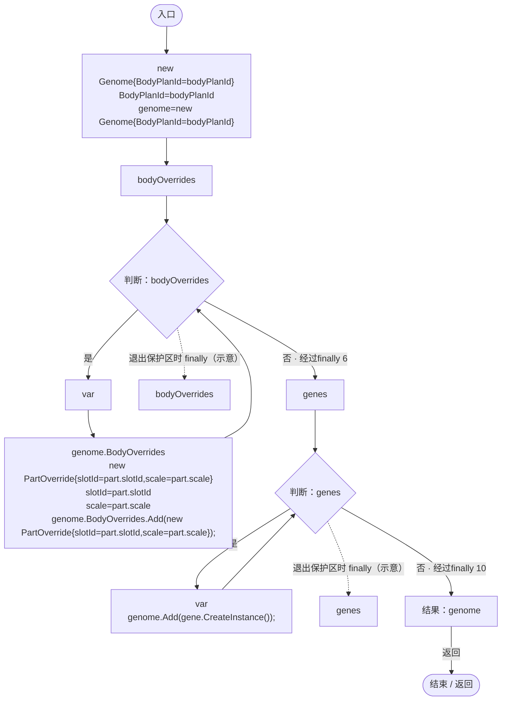

项目内调用/回调引用：

- [Genome.Add · L40](Genetics.md#m09a2a70d3adcbc14)（方法）
- [GeneInstanceData.CreateInstance · L31](Genetics.md#m828ef57681e01c11)（方法）

<a id="m828ef57681e01c11"></a>

### CreateInstance · L31

`public GeneInstance CreateInstance()`

★ 新增：模板、默认实体和放置统一恢复基因状态，不能把禁用、缺失状态或复制强度丢掉。

#### Editor / Player · Roslyn编译器控制流

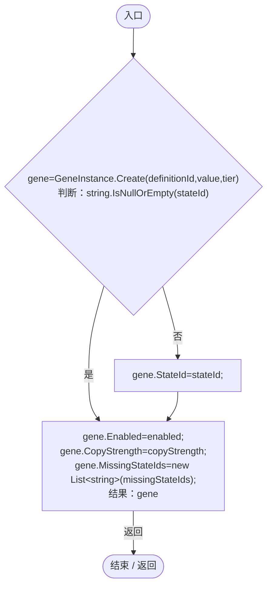

项目内调用/回调引用：

- [GeneInstance.Create · L22](Genetics.md#mdb15a75920d735a5)（方法）


---

<a id="sec0a03483435a863"></a>

## GeneDatabase.cs

`Runtime` · `Assets/DarwinPark/Genetics/Data/GeneDatabase.cs`

[源文件](../../../Assets/DarwinPark/Genetics/Data/GeneDatabase.cs) · 源码校验：`216ffc87eeda373d454e4910f74cd52a8e896c5605ac1b47a3c5c70aea7ec2c1`

方法按源文件位置排列。事件/回调引用不表示立即执行；完整源码与关系图请打开离线手册。

<a id="mc3e6357b9ca440f5"></a>

### EnsureLoaded · L12

`public static void EnsureLoaded()`


#### Editor / Player · Roslyn编译器控制流

```mermaid
flowchart TD
  b0(["入口"])
  b1{"判断：_initialized"}
  b2{"_definitions = new Dictionary&lt;string, GeneDefinition&gt;();<br/>assets = System.Linq.Enumerable.ToArray(GeneTreeStorage.RuntimeAssets())<br/>判断：assets == null"}
  b3{"判断：assets.Length == 0"}
  b4["Debug.LogError(&quot;[GeneDatabase] 致命错误：Resources/Genes 下找不到任何 JSON 文件！&quot;);"]
  b5["assets"]
  b6{"判断：assets"}
  b7["var"]
  b8{"json = JsonUtility.FromJson&lt;GeneDefinitionJson&gt;(asset.text)<br/>判断：json == null"}
  b9{"判断：string.IsNullOrEmpty(json.id)"}
  b10["Debug.LogError($&quot;[GeneDatabase] JSON 解析为空或缺少 id：{asset.name}&quot;);"]
  b11["new GeneDefinition { Id = json.id, ExplicitState=json.explicitState,DefaultStateId=json.defaultStateId,BodyColorWeight=json.bodyColorWeight, PartBindings=json.partBindings,PartModifiers=json.partModifiers,RequiresGenes=json.requiresGenes…"]
  b12{"判断：json.attributeCurves != null"}
  b13["json.attributeCurves"]
  b14{"判断：json.attributeCurves"}
  b15{"var<br/>判断：json.id == &quot;gene_locomotion&quot;"}
  b16{"判断：c.attributeId == &quot;swimSpeed&quot;"}
  b17["def.AttributeCurves<br/>new AttributeCurve { attributeId = c.attributeId, minValue = c.minValue, maxValue = c.maxValue }<br/>attributeId = c.attributeId<br/>minValue = c.minValue<br/>maxValue = c.maxValue<br/>def.AttributeCurves.Add(new AttributeCurve { att…"]
  b18["json.attributeCurves"]
  b19{"判断：json.states != null"}
  b20["json.states"]
  b21{"判断：json.states"}
  b22["var"]
  b23["def.States<br/>new GeneStateDefinition { StateId = s.stateId, DisplayName = s.displayName, Center = s.center, Color = (s.color != null &amp;&amp; s.color.Length &gt;= 3) ? new Color(s.color[0], s.color[1], s.color[2]) : Color.white, Tier = s.tier, Base…"]
  b24{"判断：s.color != null"}
  b25{"判断：s.color.Length &gt;= 3"}
  b26["new Color(s.color[0], s.color[1], s.color[2])"]
  b27["Color.white"]
  b28["Color = (s.color != null &amp;&amp; s.color.Length &gt;= 3) ? new Color(s.color[0], s.color[1], s.color[2]) : Color.white"]
  b29["Tier = s.tier<br/>BaseGeneId = s.baseGeneId<br/>AiModuleId = s.aiModuleId"]
  b30{"判断：s.allowedNextStates != null"}
  b31["new List&lt;string&gt;(s.allowedNextStates)"]
  b32["new List&lt;string&gt;()"]
  b33["AllowedNextStates = s.allowedNextStates != null ? new List&lt;string&gt;(s.allowedNextStates) : new List&lt;string&gt;()"]
  b34["def.States.Add(new GeneStateDefinition { StateId = s.stateId, DisplayName = s.displayName, Center = s.center, Color = (s.color != null &amp;&amp; s.color.Length &gt;= 3) ? new Color(s.color[0], s.color[1], s.color[2]) : Color.white, Tier = s.tier, …"]
  b35["json.states"]
  b36{"判断：json.suppressionRules != null"}
  b37["json.suppressionRules"]
  b38{"判断：json.suppressionRules"}
  b39["var"]
  b40["def.SuppressionRules<br/>new GeneSuppressionRule { TargetGeneId = r.targetGeneId, Coefficient = r.coefficient }<br/>TargetGeneId = r.targetGeneId<br/>Coefficient = r.coefficient<br/>def.SuppressionRules.Add(new GeneSuppressionRule { TargetGeneId = r.tar…"]
  b41["json.suppressionRules"]
  b42{"判断：json.attributeLinkages != null"}
  b43["def.Linkages.AddRange(json.attributeLinkages);"]
  b44["GeneTreeStorage.ApplyInfluences(def);<br/>_definitions[json.id] = def;"]
  b45["(Exception e)<br/>Debug.LogError($&quot;[GeneDatabase] 加载 {asset.name} 失败：{e.Message}&quot;);"]
  b46{"assets<br/>判断：assets"}
  b47["assets"]
  b48["连接 / 离开区域"]
  b49["_initialized = true;<br/>GeneAttributeInheritance.Prepare(_definitions);<br/>Debug.Log($&quot;[GeneDatabase] 初始化完成，共加载 {_definitions.Count} 个基因。&quot;);"]
  b50(["结束 / 返回"])
  b0 --> b1
  b1 -->|"是"| b50
  b1 -->|"否"| b2
  b2 -->|"否"| b3
  b2 -->|"是"| b4
  b3 -->|"是"| b4
  b3 -->|"否"| b5
  b4 --> b50
  b5 --> b6
  b6 -->|"是"| b7
  b6 -->|"否 · 经过finally 46"| b49
  b7 --> b8
  b8 -->|"否"| b9
  b8 -->|"是"| b10
  b9 -->|"是"| b10
  b9 -->|"否"| b11
  b10 --> b6
  b11 --> b12
  b12 -->|"是"| b13
  b12 -->|"否"| b19
  b13 --> b14
  b14 -->|"是"| b15
  b14 -->|"否 · 经过finally 18"| b19
  b15 -->|"是"| b16
  b15 -->|"否"| b17
  b16 -->|"是"| b14
  b16 -->|"否"| b17
  b17 --> b14
  b19 -->|"是"| b20
  b19 -->|"否"| b36
  b20 --> b21
  b21 -->|"是"| b22
  b21 -->|"否 · 经过finally 35"| b36
  b22 --> b23
  b23 --> b24
  b24 -->|"是"| b25
  b24 -->|"否"| b27
  b25 -->|"是"| b26
  b25 -->|"否"| b27
  b26 --> b28
  b27 --> b28
  b28 --> b29
  b29 --> b30
  b30 -->|"是"| b31
  b30 -->|"否"| b32
  b31 --> b33
  b32 --> b33
  b33 --> b34
  b34 --> b21
  b36 -->|"是"| b37
  b36 -->|"否"| b42
  b37 --> b38
  b38 -->|"是"| b39
  b38 -->|"否 · 经过finally 41"| b42
  b39 --> b40
  b40 --> b38
  b42 -->|"是"| b43
  b42 -->|"否"| b44
  b43 --> b44
  b44 --> b6
  b45 --> b6
  b46 -->|"否"| b47
  b46 -->|"是"| b48
  b47 --> b48
  b49 --> b50
  b14 -. "退出保护区时 finally（示意）" .-> b18
  b21 -. "退出保护区时 finally（示意）" .-> b35
  b38 -. "退出保护区时 finally（示意）" .-> b41
  b8 -. "保护区可能异常（示意）" .-> b45
  b6 -. "退出保护区时 finally（示意）" .-> b46

```

项目内调用/回调引用：

- [GeneTreeStorage.RuntimeAssets · L120](Genetics.md#m9f794153074f5367)（方法）
- [GeneDefinition.ExplicitState.set · L68](Genetics.md#med6f51800fcdec9f)（访问器）
- [GeneEntityStateTags.Read · L29](Genetics.md#m870acf111d189611)（方法）
- [GeneTreeStorage.ApplyInfluences · L127](Genetics.md#m1379a78e2e8fa8e7)（方法）
- [GeneAttributeInheritance.Prepare · L15](Genetics.md#m9242f311b1323506)（方法）

<a id="m85e4dda1780523a9"></a>

### All.get · L133

`get`


#### Editor / Player · Roslyn编译器控制流

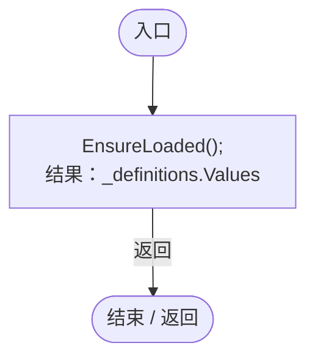

项目内调用/回调引用：

- [GeneDatabase.EnsureLoaded · L12](Genetics.md#mc3e6357b9ca440f5)（方法）

<a id="me2c5590ce9e38ef7"></a>

### Get · L140

`public static GeneDefinition Get(string id)`


#### Editor / Player · Roslyn编译器控制流

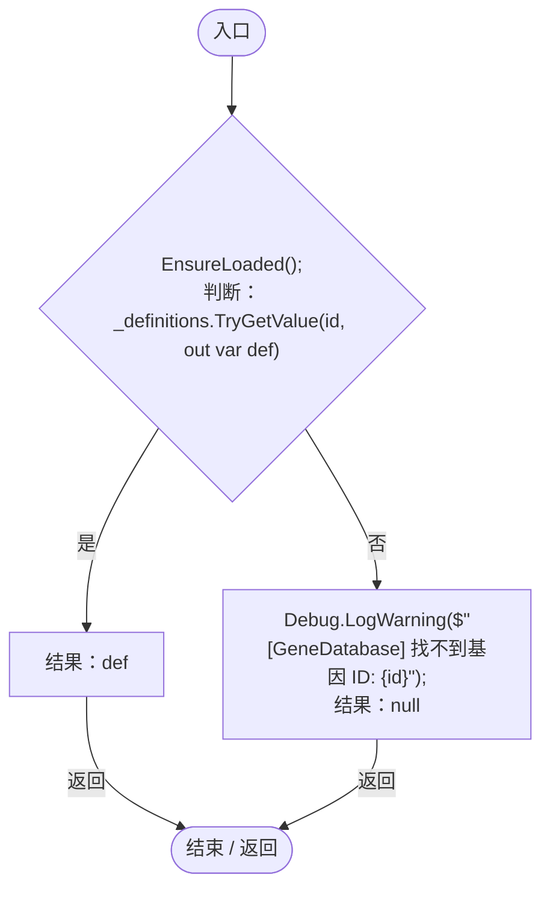

项目内调用/回调引用：

- [GeneDatabase.EnsureLoaded · L12](Genetics.md#mc3e6357b9ca440f5)（方法）

<a id="m8c34c30b80be6588"></a>

### Reload · L150

`public static void Reload()`


#### Editor / Player · Roslyn编译器控制流

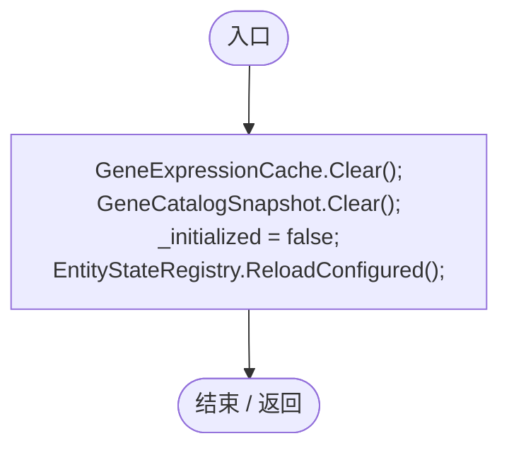

项目内调用/回调引用：

- [GeneExpressionCache.Clear · L33](Genetics.md#m5f07bf16a6816b2d)（方法）
- [GeneCatalogSnapshot.Clear · L11](Genetics.md#m86a961bd3e0077d5)（方法）
- [EntityStateRegistry.ReloadConfigured · L54](Genetics.md#m14e2f47d046d80ef)（方法）


---

<a id="s07f99d5784e3dadb"></a>

## GeneDefinition.cs

`Runtime` · `Assets/DarwinPark/Genetics/Data/GeneDefinition.cs`

[源文件](../../../Assets/DarwinPark/Genetics/Data/GeneDefinition.cs) · 源码校验：`39f976191676f5c95f9dfcb15ec7d35293b13d7fe5b352a42c0c6d66ded79183`

方法按源文件位置排列。事件/回调引用不表示立即执行；完整源码与关系图请打开离线手册。

<a id="mdc93487a6af1c363"></a>

### GetDisplayColor · L56

`public Color GetDisplayColor(float geneValue)`


#### Editor / Player · Roslyn编译器控制流

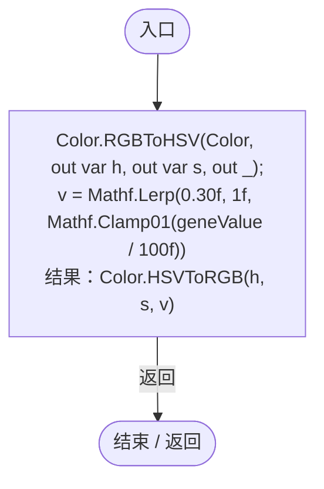

<a id="mbadafa853048abf8"></a>

### ExplicitState.get · L68

`get`


#### Editor / Player · Roslyn编译器控制流

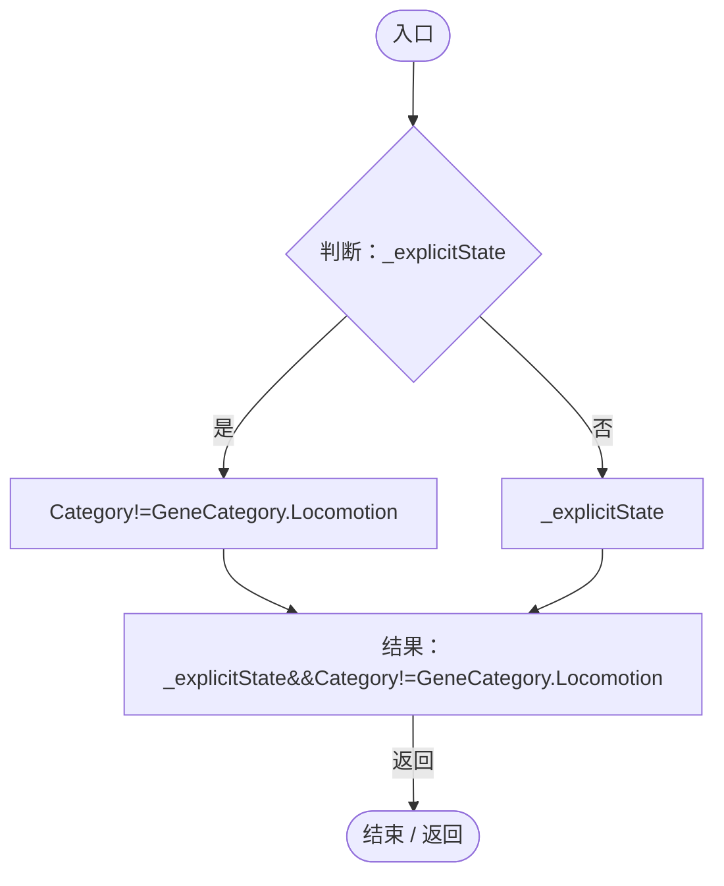

<a id="med6f51800fcdec9f"></a>

### ExplicitState.set · L68

`set`


#### Editor / Player · Roslyn编译器控制流

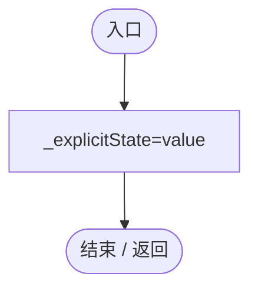

<a id="m64905a1654b1751c"></a>

### ResolveState · L95

`public GeneStateDefinition ResolveState(GeneInstance gene)`

★ 修复（防Bug回归）：运行求值与只读检查共用状态入口，行动基因随数值变化，禁用状态也不另猜模式。

#### Editor / Player · Roslyn编译器控制流

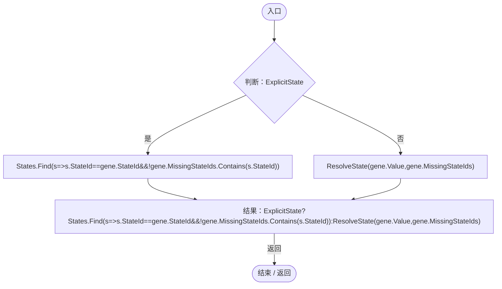

项目内调用/回调引用：

- [GeneDefinition.ExplicitState.get · L68](Genetics.md#mbadafa853048abf8)（访问器）
- [GeneDefinition.ResolveState · L97](Genetics.md#mc03e411bf8076ce1)（方法）
- [GeneDefinition.回调@95 · L95](Genetics.md#m5df6e61c82b8298d)（回调/委托）

<a id="m5df6e61c82b8298d"></a>

### 回调@95 · L95

`s … => 回调`


#### Editor / Player · Roslyn编译器控制流

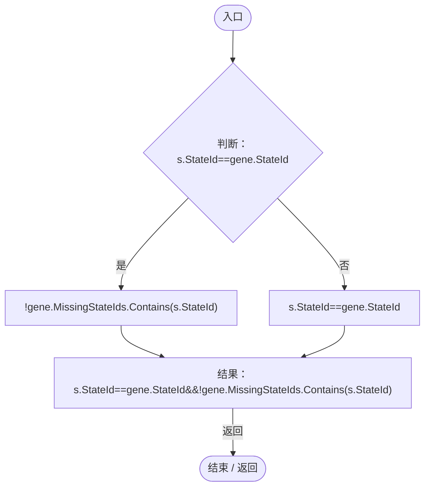

<a id="mc03e411bf8076ce1"></a>

### ResolveState · L97

`public GeneStateDefinition ResolveState(float value, ICollection<string> missingStates)`


#### Editor / Player · Roslyn编译器控制流

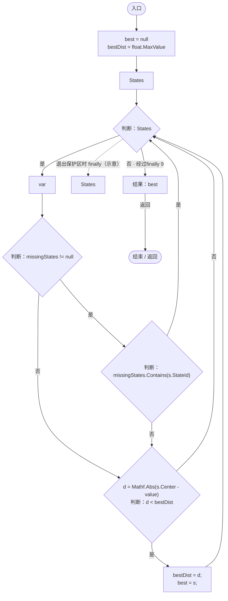


---

<a id="s0a32c6350be1234e"></a>

## GeneDefinitionJson.cs

`Runtime` · `Assets/DarwinPark/Genetics/Data/GeneDefinitionJson.cs`

[源文件](../../../Assets/DarwinPark/Genetics/Data/GeneDefinitionJson.cs) · 源码校验：`138a771fcc9f58436f581427fd461db6f88f864cfaa32d0731536160ecef0607`

方法按源文件位置排列。事件/回调引用不表示立即执行；完整源码与关系图请打开离线手册。

本文件没有显式方法体，属于数据/枚举/标记声明；字段与类型定义请在离线源码视图查看。


---

<a id="sf82e1498d67f5afd"></a>

## GeneInstance.cs

`Runtime` · `Assets/DarwinPark/Genetics/Data/GeneInstance.cs`

[源文件](../../../Assets/DarwinPark/Genetics/Data/GeneInstance.cs) · 源码校验：`283ec054c4c40af70768f95d05704e542f0735da12e955394b37a19030e330e3`

方法按源文件位置排列。事件/回调引用不表示立即执行；完整源码与关系图请打开离线手册。

<a id="mdb15a75920d735a5"></a>

### Create · L22

`public static GeneInstance Create(string defId, float value, int tier)`


#### Editor / Player · Roslyn编译器控制流

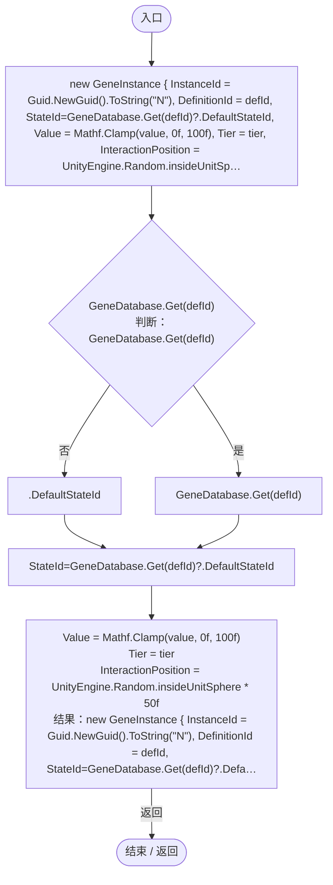

项目内调用/回调引用：

- [GeneDatabase.Get · L140](Genetics.md#me2c5590ce9e38ef7)（方法）


---

<a id="sa2ef23f865bc7ee8"></a>

## Genome.cs

`Runtime` · `Assets/DarwinPark/Genetics/Data/Genome.cs`

[源文件](../../../Assets/DarwinPark/Genetics/Data/Genome.cs) · 源码校验：`0bea93883b64633c123aafe8f2eb2093e91ad37e97b6691d5f18fa5f5a43fd18`

方法按源文件位置排列。事件/回调引用不表示立即执行；完整源码与关系图请打开离线手册。

<a id="m54609fcfa941d1f6"></a>

### Copy · L14

`public static Genome Copy(Genome source)`

★ 适配：复制遗传数据由基因模型统一负责；客户端预览与权威投放共用，保持每次投放生成独立实例 ID。

#### Editor / Player · Roslyn编译器控制流

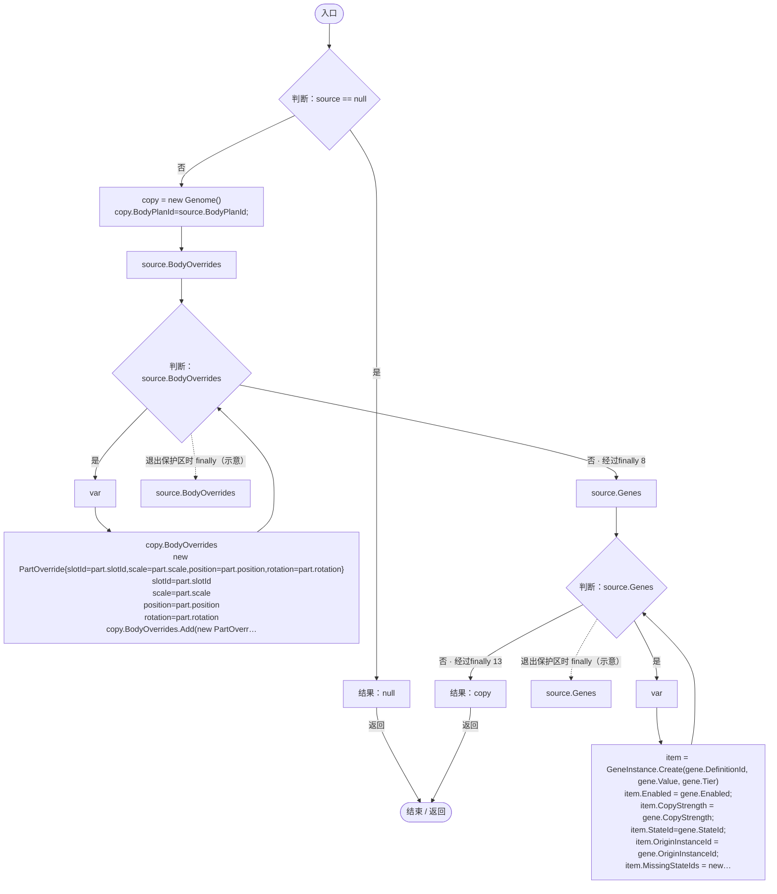

项目内调用/回调引用：

- [GeneInstance.Create · L22](Genetics.md#mdb15a75920d735a5)（方法）
- [Genome.Add · L40](Genetics.md#m09a2a70d3adcbc14)（方法）

<a id="ma10d2d4c9987b7f8"></a>

### Find · L32

`public GeneInstance Find(string instanceId)`


#### Editor / Player · Roslyn编译器控制流

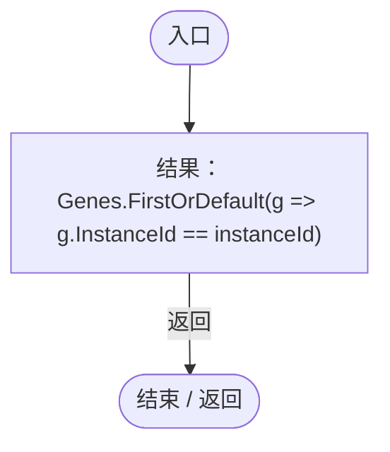

项目内调用/回调引用：

- [Genome.回调@33 · L33](Genetics.md#meecc34999bda6f5e)（回调/委托）

<a id="meecc34999bda6f5e"></a>

### 回调@33 · L33

`g … => 回调`


#### Editor / Player · Roslyn编译器控制流

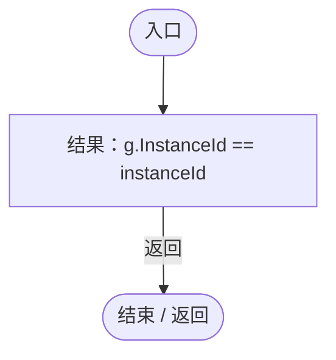

<a id="mb02c31bfc189419f"></a>

### FindByDefinition · L35

`public IEnumerable<GeneInstance> FindByDefinition(string defId)`


#### Editor / Player · Roslyn编译器控制流

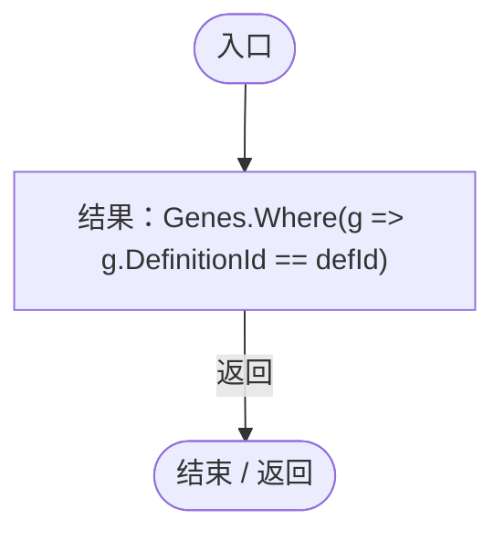

项目内调用/回调引用：

- [Genome.回调@36 · L36](Genetics.md#m1d6ba3a92e6db86c)（回调/委托）

<a id="m1d6ba3a92e6db86c"></a>

### 回调@36 · L36

`g … => 回调`


#### Editor / Player · Roslyn编译器控制流

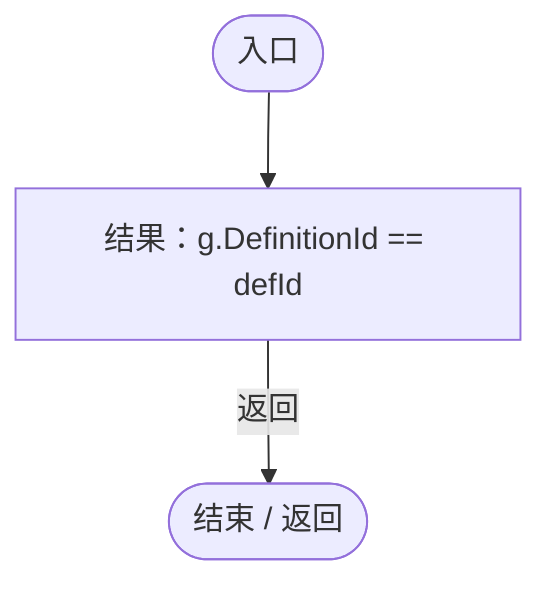

<a id="m1128973299f1fad3"></a>

### HasDefinition · L38

`public bool HasDefinition(string defId)`


#### Editor / Player · Roslyn编译器控制流

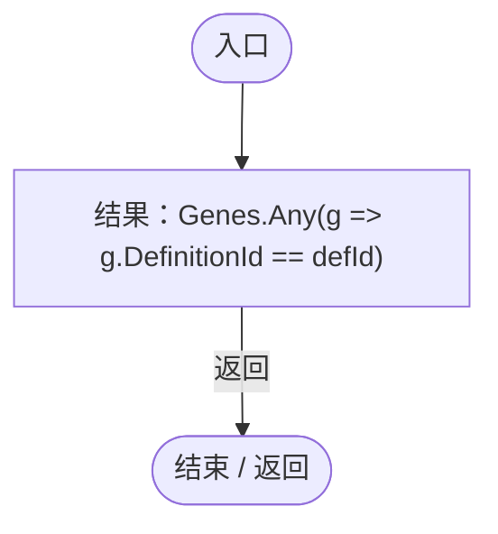

项目内调用/回调引用：

- [Genome.回调@38 · L38](Genetics.md#me6ff2289963d904b)（回调/委托）

<a id="me6ff2289963d904b"></a>

### 回调@38 · L38

`g … => 回调`


#### Editor / Player · Roslyn编译器控制流


<a id="m09a2a70d3adcbc14"></a>

### Add · L40

`public GeneInstance Add(GeneInstance gene)`


#### Editor / Player · Roslyn编译器控制流

```mermaid
flowchart TD
  b0(["入口"])
  b1["Genes.Add(gene);<br/>结果：gene"]
  b2(["结束 / 返回"])
  b0 --> b1
  b1 -->|"返回"| b2

```

<a id="m75d81f5ab08ca8cc"></a>

### Remove · L46

`public bool Remove(string instanceId)`


#### Editor / Player · Roslyn编译器控制流

```mermaid
flowchart TD
  b0(["入口"])
  b1["g = Find(instanceId)"]
  b2{"判断：g != null"}
  b3["Genes.Remove(g)"]
  b4["g != null"]
  b5["结果：g != null &amp;&amp; Genes.Remove(g)"]
  b6(["结束 / 返回"])
  b0 --> b1
  b1 --> b2
  b2 -->|"是"| b3
  b2 -->|"否"| b4
  b3 --> b5
  b4 --> b5
  b5 -->|"返回"| b6

```

项目内调用/回调引用：

- [Genome.Find · L32](Genetics.md#ma10d2d4c9987b7f8)（方法）


---

<a id="sf52a77fa650f9c54"></a>

## NamePoolJson.cs

`Runtime` · `Assets/DarwinPark/Genetics/Data/NamePoolJson.cs`

[源文件](../../../Assets/DarwinPark/Genetics/Data/NamePoolJson.cs) · 源码校验：`05e51d44467257d430e74700a500eb0e0012dd73fe72d683081215a5f9414027`

方法按源文件位置排列。事件/回调引用不表示立即执行；完整源码与关系图请打开离线手册。

本文件没有显式方法体，属于数据/枚举/标记声明；字段与类型定义请在离线源码视图查看。


---

<a id="sce4f4683a31b001c"></a>

## EcologyGeneDefaults.cs

`Runtime` · `Assets/DarwinPark/Genetics/EcologyGeneDefaults.cs`

[源文件](../../../Assets/DarwinPark/Genetics/EcologyGeneDefaults.cs) · 源码校验：`f51998afff5abf18d3a23960644c8a8f44b8c563f601220bfec6beca43b7519e`

方法按源文件位置排列。事件/回调引用不表示立即执行；完整源码与关系图请打开离线手册。

<a id="m0cb614734c6a2d00"></a>

### Upgrade · L14

`public static string Upgrade(string raw)`


#### Editor / Player · Roslyn编译器控制流

```mermaid
flowchart TD
  b0(["入口"])
  b1{"gene=JsonUtility.FromJson&lt;GeneDefinitionJson&gt;(raw)<br/>判断：gene==null"}
  b2{"判断：gene.ecologyBalanceVersion&gt;=1"}
  b3["结果：raw"]
  b4{"判断：_legacy==null"}
  b5{"asset=Resources.Load&lt;TextAsset&gt;(&quot;Genetics/ecology_legacy_defaults&quot;)<br/>判断：asset==null"}
  b6["结果：new System.IO.InvalidDataException(&quot;缺少 Genetics/ecology_legacy_defaults&quot;)"]
  x6(["抛出异常 / 离开方法"])
  b7["_legacy=JsonUtility.FromJson&lt;LegacyDocument&gt;(asset.text);"]
  b8{"prior=_legacy.genes.Find(e=&gt;e.geneId==gene.id)<br/>判断：prior==null"}
  b9["结果：raw"]
  b10{"builtin=Resources.Load&lt;TextAsset&gt;(&quot;Genes/&quot;+gene.id)<br/>判断：builtin==null"}
  b11["结果：new System.IO.InvalidDataException(&quot;缺少生态基因默认配置：&quot;+gene.id)"]
  x11(["抛出异常 / 离开方法"])
  b12{"current=JsonUtility.FromJson&lt;GeneDefinitionJson&gt;(builtin.text)<br/>判断：gene.suppressionRules!=null"}
  b13{"判断：gene.suppressionRules.Select(Key).OrderBy(x=&gt;x).SequenceEqual(prior.suppressionRules.Select(Key).OrderBy(x=&gt;x))"}
  b14["gene.suppressionRules=current.suppressionRules;"]
  b15["gene.ecologyBalanceVersion=1;<br/>结果：JsonUtility.ToJson(gene)"]
  b16(["结束 / 返回"])
  b0 --> b1
  b1 -->|"否"| b2
  b1 -->|"是"| b3
  b2 -->|"是"| b3
  b2 -->|"否"| b4
  b3 -->|"返回"| b16
  b4 -->|"是"| b5
  b4 -->|"否"| b8
  b5 -->|"是"| b6
  b5 -->|"否"| b7
  b6 -->|"Throw"| x6
  b7 --> b8
  b8 -->|"是"| b9
  b8 -->|"否"| b10
  b9 -->|"返回"| b16
  b10 -->|"是"| b11
  b10 -->|"否"| b12
  b11 -->|"Throw"| x11
  b12 -->|"是"| b13
  b12 -->|"否"| b15
  b13 -->|"是"| b14
  b13 -->|"否"| b15
  b14 --> b15
  b15 -->|"返回"| b16

```

项目内调用/回调引用：

- [EcologyGeneDefaults.回调@23 · L23](Genetics.md#maaecf3da010895b5)（回调/委托）
- [EcologyGeneDefaults.Key · L26](Genetics.md#m3d376e7b3363baca)（局部函数）
- [EcologyGeneDefaults.回调@27 · L27](Genetics.md#mfa7db83fd9e9967a)（回调/委托）
- [EcologyGeneDefaults.回调@27 · L27](Genetics.md#ma6336261ed31dd73)（回调/委托）

<a id="maaecf3da010895b5"></a>

### 回调@23 · L23

`e … => 回调`


#### Editor / Player · Roslyn编译器控制流

```mermaid
flowchart TD
  b0(["入口"])
  b1["结果：e.geneId==gene.id"]
  b2(["结束 / 返回"])
  b0 --> b1
  b1 -->|"返回"| b2

```

<a id="m3d376e7b3363baca"></a>

### Key · L26

`string Key(GeneSuppressionJson rule)`


#### Editor / Player · Roslyn编译器控制流

```mermaid
flowchart TD
  b0(["入口"])
  b1["结果：rule.targetGeneId+&quot;:&quot;+rule.coefficient.ToString(&quot;R&quot;,System.Globalization.CultureInfo.InvariantCulture)"]
  b2(["结束 / 返回"])
  b0 --> b1
  b1 -->|"返回"| b2

```

<a id="mfa7db83fd9e9967a"></a>

### 回调@27 · L27

`x … => 回调`


#### Editor / Player · Roslyn编译器控制流

```mermaid
flowchart TD
  b0(["入口"])
  b1["结果：x"]
  b2(["结束 / 返回"])
  b0 --> b1
  b1 -->|"返回"| b2

```

<a id="ma6336261ed31dd73"></a>

### 回调@27 · L27

`x … => 回调`


#### Editor / Player · Roslyn编译器控制流

```mermaid
flowchart TD
  b0(["入口"])
  b1["结果：x"]
  b2(["结束 / 返回"])
  b0 --> b1
  b1 -->|"返回"| b2

```

<a id="mf8204e9a94d6e72f"></a>

### UpgradeCatalog · L30

`public static void UpgradeCatalog(Dictionary<string,string> catalog)`


#### Editor / Player · Roslyn编译器控制流

```mermaid
flowchart TD
  b0(["入口"])
  b1["catalog.Keys.ToArray()"]
  b2{"判断：catalog.Keys.ToArray()"}
  b3["var<br/>catalog[id]=Upgrade(catalog[id]);"]
  b4{"catalog.Keys.ToArray()<br/>判断：catalog.Keys.ToArray()"}
  b5["catalog.Keys.ToArray()"]
  b6["连接 / 离开区域"]
  b7(["结束 / 返回"])
  b0 --> b1
  b1 --> b2
  b2 -->|"是"| b3
  b2 -->|"否 · 经过finally 4"| b7
  b3 --> b2
  b4 -->|"否"| b5
  b4 -->|"是"| b6
  b5 --> b6
  b2 -. "退出保护区时 finally（示意）" .-> b4

```

项目内调用/回调引用：

- [EcologyGeneDefaults.Upgrade · L14](Genetics.md#m0cb614734c6a2d00)（方法）


---

<a id="s440408d2db5c7d96"></a>

## EntityStateRegistry.cs

`Runtime` · `Assets/DarwinPark/Genetics/EntityStateRegistry.cs`

[源文件](../../../Assets/DarwinPark/Genetics/EntityStateRegistry.cs) · 源码校验：`e20bd8a7726c63e9e4feef9e0efb818d602206f413990a0267b5b8b05234567c`

方法按源文件位置排列。事件/回调引用不表示立即执行；完整源码与关系图请打开离线手册。

<a id="m40680c6370b26ed9"></a>

### Behavior.get · L25

`public EntityStateBehavior Behavior`


#### Editor / Player · 语法控制结构 / 声明（非CFG）

```mermaid
flowchart TD
  n2(["入口"])
  n1["(EntityStateBehavior)Enum.Parse(typeof(EntityStateBehavior),behavior)"]
  n0(["结束 / 返回"])
  n1 --> n0
  n2 --> n1

```

<a id="m52cb41ccf0c9d3c9"></a>

### Get · L32

`public EntityStateDefinition Get(string id)`


#### Editor / Player · Roslyn编译器控制流

```mermaid
flowchart TD
  b0(["入口"])
  b1["结果：states.FirstOrDefault(s=&gt;s.id==id)"]
  b2(["结束 / 返回"])
  b0 --> b1
  b1 -->|"返回"| b2

```

项目内调用/回调引用：

- [EntityStateDocument.回调@32 · L32](Genetics.md#m26cb8c644e460a22)（回调/委托）

<a id="m26cb8c644e460a22"></a>

### 回调@32 · L32

`s … => 回调`


#### Editor / Player · Roslyn编译器控制流

```mermaid
flowchart TD
  b0(["入口"])
  b1["结果：s.id==id"]
  b2(["结束 / 返回"])
  b0 --> b1
  b1 -->|"返回"| b2

```

<a id="m3b9b484d078c8934"></a>

### ConfiguredPath.get · L38

`public static string ConfiguredPath`


#### Editor / Player · 语法控制结构 / 声明（非CFG）

```mermaid
flowchart TD
  n2(["入口"])
  n1["Path.Combine(GeneTreeStorage.Folder,&quot;entity_states.json&quot;)"]
  n0(["结束 / 返回"])
  n1 --> n0
  n2 --> n1

```

<a id="m61b7aa1a54b9a56c"></a>

### Current.get · L41

`get`


#### Editor / Player · Roslyn编译器控制流

```mermaid
flowchart TD
  b0(["入口"])
  b1{"判断：_current==null"}
  b2["_json"]
  b3{"_snapshot<br/>判断：_snapshot"}
  b4["_snapshot"]
  b5["ReadConfiguredJson()"]
  b6["_json=_snapshot??ReadConfiguredJson();"]
  b7["_current=Parse(_json);"]
  b8["结果：_current"]
  b9(["结束 / 返回"])
  b0 --> b1
  b1 -->|"是"| b2
  b1 -->|"否"| b8
  b2 --> b3
  b3 -->|"否"| b4
  b3 -->|"是"| b5
  b4 --> b6
  b5 --> b6
  b6 --> b7
  b7 --> b8
  b8 -->|"返回"| b9

```

项目内调用/回调引用：

- [EntityStateRegistry.ReadConfiguredJson · L44](Genetics.md#mf18b710e5c3e8d7c)（方法）
- [EntityStateRegistry.Parse · L57](Genetics.md#m4543a04396bcbc54)（方法）

<a id="m32449837062f8705"></a>

### CurrentJson.get · L43

`get`


#### Editor / Player · Roslyn编译器控制流

```mermaid
flowchart TD
  b0(["入口"])
  b1["_=Current;<br/>结果：_json"]
  b2(["结束 / 返回"])
  b0 --> b1
  b1 -->|"返回"| b2

```

项目内调用/回调引用：

- [EntityStateRegistry.Current.get · L41](Genetics.md#m61b7aa1a54b9a56c)（访问器）

<a id="mf18b710e5c3e8d7c"></a>

### ReadConfiguredJson · L44

`public static string ReadConfiguredJson()`


#### Editor / Player · Roslyn编译器控制流

```mermaid
flowchart TD
  b0(["入口"])
  b1{"判断：File.Exists(ConfiguredPath)"}
  b2["结果：File.ReadAllText(ConfiguredPath)"]
  b3{"asset=Resources.Load&lt;TextAsset&gt;(&quot;Genetics/entity_states&quot;)<br/>判断：asset==null"}
  b4["结果：new InvalidDataException(&quot;缺少实体状态注册表 Genetics/entity_states&quot;)"]
  x4(["抛出异常 / 离开方法"])
  b5["结果：asset.text"]
  b6(["结束 / 返回"])
  b0 --> b1
  b1 -->|"是"| b2
  b1 -->|"否"| b3
  b2 -->|"返回"| b6
  b3 -->|"是"| b4
  b3 -->|"否"| b5
  b4 -->|"Throw"| x4
  b5 -->|"返回"| b6

```

<a id="m6013e583cbf33e79"></a>

### UseSnapshot · L52

`public static void UseSnapshot(string json)`

★ 适配：存档使用自己的注册表快照；缺少该字段的旧档使用当前配置，异常必须明确阻止加载。

#### Editor / Player · Roslyn编译器控制流

```mermaid
flowchart TD
  b0(["入口"])
  b1{"_snapshot<br/>判断：string.IsNullOrWhiteSpace(json)"}
  b2["null"]
  b3["json"]
  b4["_snapshot=string.IsNullOrWhiteSpace(json)?null:json;"]
  b5["_current=null;<br/>_json=null;"]
  b6(["结束 / 返回"])
  b0 --> b1
  b1 -->|"是"| b2
  b1 -->|"否"| b3
  b2 --> b4
  b3 --> b4
  b4 --> b5
  b5 --> b6

```

<a id="m14e2f47d046d80ef"></a>

### ReloadConfigured · L54

`public static void ReloadConfigured()`


#### Editor / Player · Roslyn编译器控制流

```mermaid
flowchart TD
  b0(["入口"])
  b1{"判断：_snapshot==null"}
  b2["_current=null;<br/>_json=null;"]
  b3(["结束 / 返回"])
  b0 --> b1
  b1 -->|"是"| b2
  b1 -->|"否"| b3
  b2 --> b3

```

<a id="m5fc8abc9b81cad68"></a>

### Clear · L55

`[RuntimeInitializeOnLoadMethod(RuntimeInitializeLoadType.SubsystemRegistration)] public static void Clear()`


#### Editor / Player · Roslyn编译器控制流

```mermaid
flowchart TD
  b0(["入口"])
  b1["UseSnapshot(null)"]
  b2(["结束 / 返回"])
  b0 --> b1
  b1 --> b2

```

项目内调用/回调引用：

- [EntityStateRegistry.UseSnapshot · L52](Genetics.md#m6013e583cbf33e79)（方法）

<a id="m4543a04396bcbc54"></a>

### Parse · L57

`public static EntityStateDocument Parse(string json)`


#### Editor / Player · Roslyn编译器控制流

```mermaid
flowchart TD
  b0(["入口"])
  b1{"doc=JsonUtility.FromJson&lt;EntityStateDocument&gt;(json)<br/>判断：doc==null"}
  b2{"判断：doc.version!=1"}
  b3{"判断：doc.states==null"}
  b4{"判断：doc.states.Count==0"}
  b5["结果：new InvalidDataException(&quot;实体状态注册表版本或内容无效&quot;)"]
  x5(["抛出异常 / 离开方法"])
  b6["ids=new HashSet&lt;string&gt;()"]
  b7["doc.states"]
  b8{"判断：doc.states"}
  b9["var"]
  b10{"判断：state==null"}
  b11{"state.id<br/>判断：state.id"}
  b12["state.id"]
  b13["&quot;&quot;"]
  b14{"判断：System.Text.RegularExpressions.Regex.IsMatch(state.id??&quot;&quot;,&quot;^[A-Za-z0-9_-]+$&quot;)"}
  b15{"判断：ids.Add(state.id)"}
  b16{"判断：string.IsNullOrWhiteSpace(state.displayName)"}
  b17{"判断：Enum.TryParse&lt;EntityStateBehavior&gt;(state.behavior,out var behavior)"}
  b18{"判断：Enum.IsDefined(typeof(EntityStateBehavior),behavior)"}
  b19{"判断：state.transitions==null"}
  b20["&quot;实体状态缺失、重复或行为未注册：&quot;"]
  b21{"state<br/>判断：state"}
  b22[".id"]
  b23["state"]
  b24["结果：new InvalidDataException(&quot;实体状态缺失、重复或行为未注册：&quot;+state?.id)"]
  x24(["抛出异常 / 离开方法"])
  b25{"ValidateRules(state.entryAny);<br/>判断：behavior==EntityStateBehavior.Hunt"}
  b26{"判断：string.IsNullOrEmpty(state.targetRangeAttributeId)"}
  b27["结果：new InvalidDataException(&quot;捕猎状态缺少目标感知属性：&quot;+state.id)"]
  x27(["抛出异常 / 离开方法"])
  b28["state.transitions"]
  b29{"判断：state.transitions"}
  b30{"var<br/>判断：transition==null"}
  b31["结果：new InvalidDataException(&quot;实体状态迁移为空&quot;)"]
  x31(["抛出异常 / 离开方法"])
  b32["ValidateRules(transition.any);"]
  b33["state.transitions"]
  b34["doc.states"]
  b35{"判断：ids.Contains(doc.defaultStateId)"}
  b36["结果：new InvalidDataException(&quot;实体默认状态未注册&quot;)"]
  x36(["抛出异常 / 离开方法"])
  b37["doc.states"]
  b38{"判断：doc.states"}
  b39["var"]
  b40["state.transitions"]
  b41{"判断：state.transitions"}
  b42{"var<br/>判断：ids.Contains(transition.to)"}
  b43["结果：new InvalidDataException(&quot;实体迁移目标未注册：&quot;+transition.to)"]
  x43(["抛出异常 / 离开方法"])
  b44["state.transitions"]
  b45["doc.states"]
  b46["结果：doc"]
  b47(["结束 / 返回"])
  b0 --> b1
  b1 -->|"否"| b2
  b1 -->|"是"| b5
  b2 -->|"否"| b3
  b2 -->|"是"| b5
  b3 -->|"否"| b4
  b3 -->|"是"| b5
  b4 -->|"是"| b5
  b4 -->|"否"| b6
  b5 -->|"Throw"| x5
  b6 --> b7
  b7 --> b8
  b8 -->|"是"| b9
  b8 -->|"否 · 经过finally 34"| b35
  b9 --> b10
  b10 -->|"否"| b11
  b10 -->|"是"| b20
  b11 -->|"否"| b12
  b11 -->|"是"| b13
  b12 --> b14
  b13 --> b14
  b14 -->|"是"| b15
  b14 -->|"否"| b20
  b15 -->|"是"| b16
  b15 -->|"否"| b20
  b16 -->|"否"| b17
  b16 -->|"是"| b20
  b17 -->|"是"| b18
  b17 -->|"否"| b20
  b18 -->|"是"| b19
  b18 -->|"否"| b20
  b19 -->|"是"| b20
  b19 -->|"否"| b25
  b20 --> b21
  b21 -->|"否"| b22
  b21 -->|"是"| b23
  b22 --> b24
  b23 --> b24
  b24 -->|"Throw"| x24
  b25 -->|"是"| b26
  b25 -->|"否"| b28
  b26 -->|"是"| b27
  b26 -->|"否"| b28
  b27 -->|"Throw"| x27
  b28 --> b29
  b29 -->|"是"| b30
  b29 -->|"否 · 经过finally 33"| b8
  b30 -->|"是"| b31
  b30 -->|"否"| b32
  b31 -->|"Throw"| x31
  b32 --> b29
  b35 -->|"否"| b36
  b35 -->|"是"| b37
  b36 -->|"Throw"| x36
  b37 --> b38
  b38 -->|"是"| b39
  b38 -->|"否 · 经过finally 45"| b46
  b39 --> b40
  b40 --> b41
  b41 -->|"是"| b42
  b41 -->|"否 · 经过finally 44"| b38
  b42 -->|"否"| b43
  b42 -->|"是"| b41
  b43 -->|"Throw"| x43
  b46 -->|"返回"| b47
  b29 -. "退出保护区时 finally（示意）" .-> b33
  b8 -. "退出保护区时 finally（示意）" .-> b34
  b41 -. "退出保护区时 finally（示意）" .-> b44
  b38 -. "退出保护区时 finally（示意）" .-> b45

```

项目内调用/回调引用：

- [EntityStateRegistry.ValidateRules · L74](Genetics.md#m03ea93b2a185d496)（方法）

<a id="m03ea93b2a185d496"></a>

### ValidateRules · L74

`private static void ValidateRules(List<EntityStateRule> rules)`


#### Editor / Player · Roslyn编译器控制流

```mermaid
flowchart TD
  b0(["入口"])
  b1{"判断：rules==null"}
  b2["结果：new InvalidDataException(&quot;实体状态条件列表为空&quot;)"]
  x2(["抛出异常 / 离开方法"])
  b3["rules"]
  b4{"判断：rules"}
  b5["var"]
  b6{"rule<br/>判断：rule"}
  b7[".all"]
  b8["rule"]
  b9{"判断：rule?.all==null"}
  b10{"判断：rule.all.Count==0"}
  b11["结果：new InvalidDataException(&quot;实体状态条件组不能为空&quot;)"]
  x11(["抛出异常 / 离开方法"])
  b12["rule.all"]
  b13{"判断：rule.all"}
  b14["var"]
  b15{"判断：condition==null"}
  b16["结果：new InvalidDataException(&quot;实体状态条件为空&quot;)"]
  x16(["抛出异常 / 离开方法"])
  b17{"判断：condition.kind==&quot;stat&quot;"}
  b18{"判断：string.IsNullOrEmpty(condition.attributeId)"}
  b19{"判断：new[]{&quot;gt&quot;,&quot;lte&quot;}.Contains(condition.comparison)"}
  b20{"判断：float.IsNaN(condition.value)"}
  b21{"判断：float.IsInfinity(condition.value)"}
  b22{"判断：condition.kind==&quot;nearby_gene_state&quot;"}
  b23{"判断：string.IsNullOrEmpty(condition.geneId)"}
  b24{"判断：string.IsNullOrEmpty(condition.geneStateId)"}
  b25{"判断：string.IsNullOrEmpty(condition.rangeAttributeId)"}
  b26["new[]{&quot;present&quot;,&quot;absent&quot;}.Contains(condition.comparison)"]
  b27["condition.kind==&quot;nearby_gene_state&quot;&amp;&amp;!string.IsNullOrEmpty(condition.geneId)&amp;&amp;!string.IsNullOrEmpty(condition.geneStateId)&amp;&amp;!string.IsNullOrEmpty(condition.rangeAttributeId)&amp;&amp;new[]{&quot;present&quot;,&quot;absent&quot;}.Contains(condition.comparison)"]
  b28["condition.kind==&quot;stat&quot;&amp;&amp;!string.IsNullOrEmpty(condition.attributeId)&amp;&amp;new[]{&quot;gt&quot;,&quot;lte&quot;}.Contains(condition.comparison)&amp;&amp;!float.IsNaN(condition.value)&amp;&amp;!float.IsInfinity(condition.value)"]
  b29["valid=condition.kind==&quot;stat&quot;&amp;&amp;!string.IsNullOrEmpty(condition.attributeId)&amp;&amp;new[]{&quot;gt&quot;,&quot;lte&quot;}.Contains(condition.comparison)&amp;&amp;!float.IsNaN(condition.value)&amp;&amp;!float.IsInfinity(condition.value)&#124;&#124; condition.kind==&quot;nearby_gene_state&quot;&amp;&amp;!strin…"]
  b30{"判断：valid"}
  b31["结果：new InvalidDataException(&quot;实体状态条件类型、比较方式或参数无效：&quot;+condition.kind)"]
  x31(["抛出异常 / 离开方法"])
  b32["rule.all"]
  b33["rules"]
  b34(["结束 / 返回"])
  b0 --> b1
  b1 -->|"是"| b2
  b1 -->|"否"| b3
  b2 -->|"Throw"| x2
  b3 --> b4
  b4 -->|"是"| b5
  b4 -->|"否 · 经过finally 33"| b34
  b5 --> b6
  b6 -->|"否"| b7
  b6 -->|"是"| b8
  b7 --> b9
  b8 --> b9
  b9 -->|"否"| b10
  b9 -->|"是"| b11
  b10 -->|"是"| b11
  b10 -->|"否"| b12
  b11 -->|"Throw"| x11
  b12 --> b13
  b13 -->|"是"| b14
  b13 -->|"否 · 经过finally 32"| b4
  b14 --> b15
  b15 -->|"是"| b16
  b15 -->|"否"| b17
  b16 -->|"Throw"| x16
  b17 -->|"是"| b18
  b17 -->|"否"| b22
  b18 -->|"否"| b19
  b18 -->|"是"| b22
  b19 -->|"是"| b20
  b19 -->|"否"| b22
  b20 -->|"否"| b21
  b20 -->|"是"| b22
  b21 -->|"是"| b22
  b21 -->|"否"| b28
  b22 -->|"是"| b23
  b22 -->|"否"| b27
  b23 -->|"否"| b24
  b23 -->|"是"| b27
  b24 -->|"否"| b25
  b24 -->|"是"| b27
  b25 -->|"否"| b26
  b25 -->|"是"| b27
  b26 --> b29
  b27 --> b29
  b28 --> b29
  b29 --> b30
  b30 -->|"否"| b31
  b30 -->|"是"| b13
  b31 -->|"Throw"| x31
  b13 -. "退出保护区时 finally（示意）" .-> b32
  b4 -. "退出保护区时 finally（示意）" .-> b33

```

<a id="m5528990748fa1dfb"></a>

### ExpandTags · L89

`public static HashSet<string> ExpandTags(IEnumerable<string> tags,EntityStateDocument doc)`


#### Editor / Player · Roslyn编译器控制流

```mermaid
flowchart TD
  b0(["入口"])
  b1["result=new HashSet&lt;string&gt;()<br/>pending=new Queue&lt;string&gt;(tags)"]
  b2{"判断：pending.Count&gt;0"}
  b3{"id=pending.Dequeue()<br/>definition=doc.Get(id)<br/>判断：definition==null"}
  b4["结果：new InvalidDataException(&quot;实体状态标签未注册：&quot;+id)"]
  x4(["抛出异常 / 离开方法"])
  b5{"判断：result.Add(id)"}
  b6["definition.transitions"]
  b7{"判断：definition.transitions"}
  b8["var<br/>pending.Enqueue(transition.to);"]
  b9["definition.transitions"]
  b10["result.Add(doc.defaultStateId);<br/>结果：result"]
  b11(["结束 / 返回"])
  b0 --> b1
  b1 --> b2
  b2 -->|"是"| b3
  b2 -->|"否"| b10
  b3 -->|"是"| b4
  b3 -->|"否"| b5
  b4 -->|"Throw"| x4
  b5 -->|"否"| b2
  b5 -->|"是"| b6
  b6 --> b7
  b7 -->|"是"| b8
  b7 -->|"否 · 经过finally 9"| b2
  b8 --> b7
  b10 -->|"返回"| b11
  b7 -. "退出保护区时 finally（示意）" .-> b9

```

项目内调用/回调引用：

- [EntityStateDocument.Get · L32](Genetics.md#m52cb41ccf0c9d3c9)（方法）


---

<a id="s769f6842770bce00"></a>

## GeneExpressionCache.cs

`Runtime` · `Assets/DarwinPark/Genetics/Evaluation/GeneExpressionCache.cs`

[源文件](../../../Assets/DarwinPark/Genetics/Evaluation/GeneExpressionCache.cs) · 源码校验：`d666029728e55a9ab3f57c9dcf936f5d17b1134ebe15d3ea2431730d7946cf31`

方法按源文件位置排列。事件/回调引用不表示立即执行；完整源码与关系图请打开离线手册。

<a id="m66ecc69d418130bb"></a>

### Hits.get · L15

`get`


#### Editor / Player · 语法控制结构 / 声明（非CFG）

```mermaid
flowchart TD
  n2(["入口"])
  n1["声明 / 自动存储；没有显式方法体"]
  n0(["结束 / 返回"])
  n1 --> n0
  n2 --> n1

```

<a id="mf16773e1614512b5"></a>

### Hits.set · L15

`private set`


#### Editor / Player · 语法控制结构 / 声明（非CFG）

```mermaid
flowchart TD
  n2(["入口"])
  n1["声明 / 自动存储；没有显式方法体"]
  n0(["结束 / 返回"])
  n1 --> n0
  n2 --> n1

```

<a id="m1bc32f99021a1f87"></a>

### Misses.get · L15

`get`


#### Editor / Player · 语法控制结构 / 声明（非CFG）

```mermaid
flowchart TD
  n2(["入口"])
  n1["声明 / 自动存储；没有显式方法体"]
  n0(["结束 / 返回"])
  n1 --> n0
  n2 --> n1

```

<a id="m8e9a2be3f93f63ff"></a>

### Misses.set · L15

`private set`


#### Editor / Player · 语法控制结构 / 声明（非CFG）

```mermaid
flowchart TD
  n2(["入口"])
  n1["声明 / 自动存储；没有显式方法体"]
  n0(["结束 / 返回"])
  n1 --> n0
  n2 --> n1

```

<a id="me3c8508ff874d36d"></a>

### Count.get · L15

`public static int Count`


#### Editor / Player · 语法控制结构 / 声明（非CFG）

```mermaid
flowchart TD
  n2(["入口"])
  n1["Values.Count"]
  n0(["结束 / 返回"])
  n1 --> n0
  n2 --> n1

```

<a id="m88e6419e3c958da7"></a>

### Text · L16

`private static void Text(string text)`


#### Editor / Player · Roslyn编译器控制流

```mermaid
flowchart TD
  b0(["入口"])
  b1["Key"]
  b2{"text<br/>判断：text"}
  b3[".Length"]
  b4["text"]
  b5{"判断：text?.Length"}
  b6["text?.Length"]
  b7["-1"]
  b8["Key.Append(text?.Length??-1).Append(':').Append(text).Append(';');"]
  b9(["结束 / 返回"])
  b0 --> b1
  b1 --> b2
  b2 -->|"否"| b3
  b2 -->|"是"| b4
  b3 --> b5
  b4 --> b5
  b5 -->|"否"| b6
  b5 -->|"是"| b7
  b6 --> b8
  b7 --> b8
  b8 --> b9

```

<a id="m48929ae1b64813e6"></a>

### Resolve · L17

`public static GenomeEvaluation Resolve(Genome genome,bool gestating,float suppression,string exempt,IReadOnlyDictionary<string,float> roles)`


#### Editor / Player · Roslyn编译器控制流

```mermaid
flowchart TD
  b0(["入口"])
  b1{"判断：SimulationOptimization.Current.expressionCache"}
  b2{"判断：genome==null"}
  b3["结果：GeneValueResolver.ResolveUncached(genome,gestating,suppression,exempt,roles)"]
  b4["GeneDatabase.EnsureLoaded();<br/>Key.Clear();<br/>Key.Append(gestating).Append(':').Append(suppression.ToString(&quot;R&quot;,CultureInfo.InvariantCulture));<br/>Text(exempt);"]
  b5["genome.Genes"]
  b6{"判断：genome.Genes"}
  b7["var"]
  b8{"Text(gene.DefinitionId);<br/>Text(gene.StateId);<br/>Key.Append(gene.Value.ToString(&quot;R&quot;,CultureInfo.InvariantCulture)).Append(':').Append(gene.CopyStrength.ToString(&quot;R&quot;,CultureInfo.InvariantCulture)).Append(':').Append(gene.Tier).Append(':').App…"}
  b9["gene.MissingStateIds"]
  b10{"判断：gene.MissingStateIds"}
  b11["var<br/>Text(id);"]
  b12["gene.MissingStateIds"]
  b13["Key.Append('&#124;');<br/>role=0"]
  b14{"roles<br/>判断：roles"}
  b15["roles?.TryGetValue(gene.DefinitionId,out role);"]
  b16["Key.Append(role.ToString(&quot;R&quot;,CultureInfo.InvariantCulture)).Append(';');"]
  b17["genome.Genes"]
  b18{"key=Key.ToString()<br/>判断：Values.TryGetValue(key,out var cached)"}
  b19["Hits++;"]
  b20["new GenomeEvaluation{Attributes=new Dictionary&lt;string,float&gt;(cached.attributes)}<br/>Attributes=new Dictionary&lt;string,float&gt;(cached.attributes)<br/>result=new GenomeEvaluation{Attributes=new Dictionary&lt;string,float&gt;(cached.attributes)}"]
  b21["cached.values"]
  b22{"判断：cached.values"}
  b23["var"]
  b24["result.Genes<br/>new GeneEvaluation{Gene=genome.Genes[value.index],GenomeIndex=value.index,Definition=value.definition,State=value.state,MissingRequirements=value.missingRequirements,SuppressionAmount=value.suppression,EffectiveStrength=valu…"]
  b25["cached.values"]
  b26["结果：result"]
  b27["Misses++;<br/>evaluated=GeneValueResolver.ResolveUncached(genome,gestating,suppression,exempt,roles)"]
  b28["new Snapshot{attributes=new Dictionary&lt;string,float&gt;(evaluated.Attributes)}<br/>attributes=new Dictionary&lt;string,float&gt;(evaluated.Attributes)<br/>snapshot=new Snapshot{attributes=new Dictionary&lt;string,float&gt;(evaluated.Attributes)}"]
  b29["evaluated.Genes"]
  b30{"判断：evaluated.Genes"}
  b31["var"]
  b32["snapshot.values<br/>new Value{index=value.GenomeIndex,definition=value.Definition,state=value.State,missingRequirements=value.MissingRequirements,suppression=value.SuppressionAmount,strength=value.EffectiveStrength,environment=value.Environm…"]
  b33["evaluated.Genes"]
  b34["limit=SimulationOptimization.Current.expressionCacheLimit"]
  b35{"判断：Order.Count&gt;=limit"}
  b36["Values.Remove(Order.Dequeue());"]
  b37["Values[key]=snapshot;<br/>Order.Enqueue(key);<br/>结果：evaluated"]
  b38(["结束 / 返回"])
  b0 --> b1
  b1 -->|"是"| b2
  b1 -->|"否"| b3
  b2 -->|"是"| b3
  b2 -->|"否"| b4
  b3 -->|"返回"| b38
  b4 --> b5
  b5 --> b6
  b6 -->|"是"| b7
  b6 -->|"否 · 经过finally 17"| b18
  b7 --> b8
  b8 -->|"是"| b9
  b8 -->|"否"| b13
  b9 --> b10
  b10 -->|"是"| b11
  b10 -->|"否 · 经过finally 12"| b13
  b11 --> b10
  b13 --> b14
  b14 -->|"否"| b15
  b14 -->|"是"| b16
  b15 --> b16
  b16 --> b6
  b18 -->|"是"| b19
  b18 -->|"否"| b27
  b19 --> b20
  b20 --> b21
  b21 --> b22
  b22 -->|"是"| b23
  b22 -->|"否 · 经过finally 25"| b26
  b23 --> b24
  b24 --> b22
  b26 -->|"返回"| b38
  b27 --> b28
  b28 --> b29
  b29 --> b30
  b30 -->|"是"| b31
  b30 -->|"否 · 经过finally 33"| b34
  b31 --> b32
  b32 --> b30
  b34 --> b35
  b35 -->|"是"| b36
  b35 -->|"否"| b37
  b36 --> b35
  b37 -->|"返回"| b38
  b10 -. "退出保护区时 finally（示意）" .-> b12
  b6 -. "退出保护区时 finally（示意）" .-> b17
  b22 -. "退出保护区时 finally（示意）" .-> b25
  b30 -. "退出保护区时 finally（示意）" .-> b33

```

项目内调用/回调引用：

- [SimulationOptimization.Current.get · L33](Core.md#ma4d76456c2404208)（访问器）
- [GeneValueResolver.ResolveUncached · L40](Genetics.md#m67765d89c297c154)（方法）
- [GeneDatabase.EnsureLoaded · L12](Genetics.md#mc3e6357b9ca440f5)（方法）
- [GeneExpressionCache.Text · L16](Genetics.md#m88e6419e3c958da7)（方法）
- [GeneExpressionCache.Hits.set · L15](Genetics.md#mf16773e1614512b5)（访问器）
- [GeneExpressionCache.Hits.get · L15](Genetics.md#m66ecc69d418130bb)（访问器）
- [GeneExpressionCache.Misses.set · L15](Genetics.md#m8e9a2be3f93f63ff)（访问器）
- [GeneExpressionCache.Misses.get · L15](Genetics.md#m1bc32f99021a1f87)（访问器）

<a id="m5f07bf16a6816b2d"></a>

### Clear · L33

`public static void Clear()`


#### Editor / Player · Roslyn编译器控制流

```mermaid
flowchart TD
  b0(["入口"])
  b1["Values.Clear();<br/>Order.Clear();<br/>Key.Clear();<br/>Hits=Misses=0;"]
  b2(["结束 / 返回"])
  b0 --> b1
  b1 --> b2

```

项目内调用/回调引用：

- [GeneExpressionCache.Hits.set · L15](Genetics.md#mf16773e1614512b5)（访问器）
- [GeneExpressionCache.Misses.set · L15](Genetics.md#m8e9a2be3f93f63ff)（访问器）

<a id="m9c7f6eecbd2ce66a"></a>

### Reset · L34

`[RuntimeInitializeOnLoadMethod(RuntimeInitializeLoadType.SubsystemRegistration)]private static void Reset()`


#### Editor / Player · Roslyn编译器控制流

```mermaid
flowchart TD
  b0(["入口"])
  b1["Clear()"]
  b2(["结束 / 返回"])
  b0 --> b1
  b1 --> b2

```

项目内调用/回调引用：

- [GeneExpressionCache.Clear · L33](Genetics.md#m5f07bf16a6816b2d)（方法）


---

<a id="s837eb9ce6eba3cc6"></a>

## GeneValueResolver.cs

`Runtime` · `Assets/DarwinPark/Genetics/Evaluation/GeneValueResolver.cs`

[源文件](../../../Assets/DarwinPark/Genetics/Evaluation/GeneValueResolver.cs) · 源码校验：`41995cae550ff41e9b7d356b0fa5753d5d700bb172325197e9a26998027a6c9a`

方法按源文件位置排列。事件/回调引用不表示立即执行；完整源码与关系图请打开离线手册。

<a id="ma094a4da4bc2fd52"></a>

### IsActive.get · L19

`public bool IsActive`


#### Editor / Player · 语法控制结构 / 声明（非CFG）

```mermaid
flowchart TD
  n2(["入口"])
  n1["EffectiveStrength &gt;= MinimumActiveStrength &amp;&amp; (Definition==null&#124;&#124;!Definition.ExplicitState&#124;&#124;State!=null)"]
  n0(["结束 / 返回"])
  n1 --> n0
  n2 --> n1

```

项目内调用/回调引用：

- [GeneDefinition.ExplicitState.get · L68](Genetics.md#mbadafa853048abf8)（访问器）

<a id="m03c53eac5d3439da"></a>

### Resolve · L34

`public static GenomeEvaluation Resolve(Genome genome, bool isGestating = false, float globalSuppression = 0f, string suppressExemptGeneId = null,IReadOnlyDictionary<string,float> additionalSuppression=null)`

<summary>  ★ 修复（防Bug回归）：默认把环境压力施加给所有基因；遗传值不受影响，  环境适应突变仍可发生。可选豁免参数仅供显式需要豁免的调用使用。  </summary>

#### Editor / Player · Roslyn编译器控制流

```mermaid
flowchart TD
  b0(["入口"])
  b1["结果：GeneExpressionCache.Resolve(genome,isGestating,globalSuppression,suppressExemptGeneId,additionalSuppression)"]
  b2(["结束 / 返回"])
  b0 --> b1
  b1 -->|"返回"| b2

```

项目内调用/回调引用：

- [GeneExpressionCache.Resolve · L17](Genetics.md#m48929ae1b64813e6)（方法）

<a id="m67765d89c297c154"></a>

### ResolveUncached · L40

`internal static GenomeEvaluation ResolveUncached(Genome genome,bool isGestating,float globalSuppression,string suppressExemptGeneId,IReadOnlyDictionary<string,float> additionalSuppression)`


#### Editor / Player · Roslyn编译器控制流

```mermaid
flowchart TD
  b0(["入口"])
  b1{"result = new GenomeEvaluation()<br/>判断：genome == null"}
  b2["结果：result"]
  b3["suppressions = new Dictionary&lt;string, float&gt;()<br/>definitions = new GeneDefinition[genome.Genes.Count]"]
  b4["index = 0"]
  b5{"判断：index &lt; genome.Genes.Count"}
  b6{"gene = genome.Genes[index]<br/>判断：gene.Enabled"}
  b7{"def = definitions[index] = GeneDatabase.Get(gene.DefinitionId)<br/>判断：def == null"}
  b8{"判断：def.SuppressionRules == null"}
  b9{"判断：gene.DefinitionId == &quot;gene_reproduction&quot;"}
  b10{"判断：def.SuppressionOnlyWhileGestating"}
  b11{"判断：isGestating"}
  b12["def.SuppressionRules"]
  b13{"判断：def.SuppressionRules"}
  b14["var"]
  b15{"判断：rule.TargetGeneId == null"}
  b16["suppressions.TryGetValue(rule.TargetGeneId, out float current);<br/>suppressions[rule.TargetGeneId] = current + gene.Value * rule.Coefficient / 1000f;"]
  b17["def.SuppressionRules"]
  b18["index++"]
  b19["index = 0"]
  b20{"判断：index &lt; genome.Genes.Count"}
  b21{"gene = genome.Genes[index]<br/>判断：gene.Enabled"}
  b22{"def = definitions[index]<br/>判断：def == null"}
  b23{"suppressions.TryGetValue(gene.DefinitionId, out var sup);<br/>role=0<br/>判断：additionalSuppression!=null"}
  b24{"判断：additionalSuppression.TryGetValue(gene.DefinitionId,out float extra)"}
  b25["role=Mathf.Max(0,extra);<br/>sup+=role;"]
  b26{"判断：string.IsNullOrEmpty(suppressExemptGeneId)"}
  b27["gene.DefinitionId == suppressExemptGeneId"]
  b28["!string.IsNullOrEmpty(suppressExemptGeneId)"]
  b29["exempt = !string.IsNullOrEmpty(suppressExemptGeneId) &amp;&amp; gene.DefinitionId == suppressExemptGeneId"]
  b30{"判断：exempt"}
  b31["0f"]
  b32["Mathf.Max(0f, globalSuppression)"]
  b33["global = exempt ? 0f : Mathf.Max(0f, globalSuppression)"]
  b34["effectiveValue = Mathf.Max(0f, gene.Value - sup - global)"]
  b35["new GeneEvaluation { Gene = gene, GenomeIndex = index, Definition = def, State = def.ResolveState(gene), // ★ 修复（防Bug回归）：面板同时显示环境抑制，保证有效值与抑制值一致。 SuppressionAmount = sup + global, // ★ 适配：仅记录来源数值供界面解释，不额外拼接字符串或改变求值。 EnvironmentSuppression…"]
  b36["result.Genes.Add(eval);"]
  b37["index++"]
  b38["RemoveUnsatisfiedExpressions(result.Genes);<br/>result.Attributes = GeneAttributeInheritance.Accumulate(result.Genes);<br/>结果：result"]
  b39(["结束 / 返回"])
  b0 --> b1
  b1 -->|"是"| b2
  b1 -->|"否"| b3
  b2 -->|"返回"| b39
  b3 --> b4
  b4 --> b5
  b5 -->|"是"| b6
  b5 -->|"否"| b19
  b6 -->|"否"| b18
  b6 -->|"是"| b7
  b7 -->|"否"| b8
  b7 -->|"是"| b18
  b8 -->|"是"| b18
  b8 -->|"否"| b9
  b9 -->|"否"| b10
  b9 -->|"是"| b11
  b10 -->|"是"| b11
  b10 -->|"否"| b12
  b11 -->|"否"| b18
  b11 -->|"是"| b12
  b12 --> b13
  b13 -->|"是"| b14
  b13 -->|"否 · 经过finally 17"| b18
  b14 --> b15
  b15 -->|"是"| b13
  b15 -->|"否"| b16
  b16 --> b13
  b18 --> b5
  b19 --> b20
  b20 -->|"是"| b21
  b20 -->|"否"| b38
  b21 -->|"否"| b37
  b21 -->|"是"| b22
  b22 -->|"是"| b37
  b22 -->|"否"| b23
  b23 -->|"是"| b24
  b23 -->|"否"| b26
  b24 -->|"是"| b25
  b24 -->|"否"| b26
  b25 --> b26
  b26 -->|"否"| b27
  b26 -->|"是"| b28
  b27 --> b29
  b28 --> b29
  b29 --> b30
  b30 -->|"是"| b31
  b30 -->|"否"| b32
  b31 --> b33
  b32 --> b33
  b33 --> b34
  b34 --> b35
  b35 --> b36
  b36 --> b37
  b37 --> b20
  b38 -->|"返回"| b39
  b13 -. "退出保护区时 finally（示意）" .-> b17

```

项目内调用/回调引用：

- [GeneDatabase.Get · L140](Genetics.md#me2c5590ce9e38ef7)（方法）
- [GeneDefinition.ResolveState · L95](Genetics.md#m64905a1654b1751c)（方法）
- [GeneValueResolver.RemoveUnsatisfiedExpressions · L110](Genetics.md#mdaa434fb867c0249)（方法）
- [GeneAttributeInheritance.Accumulate · L39](Genetics.md#m94b9ccbc18db141d)（方法）

<a id="mdaa434fb867c0249"></a>

### RemoveUnsatisfiedExpressions · L110

`private static void RemoveUnsatisfiedExpressions(List<GeneEvaluation> evaluations)`


#### Editor / Player · Roslyn编译器控制流

```mermaid
flowchart TD
  b0(["入口"])
  b1{"判断：evaluations.Exists(gene =&gt; gene.IsActive &amp;&amp; gene.Definition.RequiresGenes.Count &gt; 0)"}
  b2["activeCounts = new Dictionary&lt;string, int&gt;()"]
  b3["evaluations"]
  b4{"判断：evaluations"}
  b5["var"]
  b6{"判断：gene.IsActive"}
  b7["id = gene.Definition.Id<br/>activeCounts.TryGetValue(id, out int count);<br/>activeCounts[id] = count + 1;"]
  b8["evaluations"]
  b9["changed = false;"]
  b10["evaluations"]
  b11{"判断：evaluations"}
  b12{"var<br/>判断：gene.IsActive"}
  b13["gene.Definition.RequiresGenes"]
  b14{"判断：gene.Definition.RequiresGenes"}
  b15["string"]
  b16{"判断：required != null"}
  b17{"判断：activeCounts.ContainsKey(required)"}
  b18{"id = gene.Definition.Id<br/>判断：--activeCounts[id] == 0"}
  b19["activeCounts.Remove(id);"]
  b20["gene.MissingRequirements = true;<br/>gene.EffectiveStrength = 0;<br/>changed = true;"]
  b21["gene.Definition.RequiresGenes"]
  b22["evaluations"]
  b23{"判断：changed"}
  b24(["结束 / 返回"])
  b0 --> b1
  b1 -->|"否"| b24
  b1 -->|"是"| b2
  b2 --> b3
  b3 --> b4
  b4 -->|"是"| b5
  b4 -->|"否 · 经过finally 8"| b9
  b5 --> b6
  b6 -->|"否"| b4
  b6 -->|"是"| b7
  b7 --> b4
  b9 --> b10
  b10 --> b11
  b11 -->|"是"| b12
  b11 -->|"否 · 经过finally 22"| b23
  b12 -->|"否"| b11
  b12 -->|"是"| b13
  b13 --> b14
  b14 -->|"是"| b15
  b14 -->|"否 · 经过finally 21"| b11
  b15 --> b16
  b16 -->|"是"| b17
  b16 -->|"否"| b18
  b17 -->|"是"| b14
  b17 -->|"否"| b18
  b18 -->|"是"| b19
  b18 -->|"否"| b20
  b19 --> b20
  b20 -->|"经过finally 21"| b11
  b23 -->|"否"| b24
  b23 -->|"是"| b9
  b4 -. "退出保护区时 finally（示意）" .-> b8
  b14 -. "退出保护区时 finally（示意）" .-> b21
  b11 -. "退出保护区时 finally（示意）" .-> b22

```

项目内调用/回调引用：

- [GeneValueResolver.回调@112 · L112](Genetics.md#m40701e835c2caaf8)（回调/委托）

<a id="m40701e835c2caaf8"></a>

### 回调@112 · L112

`gene … => 回调`


#### Editor / Player · Roslyn编译器控制流

```mermaid
flowchart TD
  b0(["入口"])
  b1{"判断：gene.IsActive"}
  b2["gene.Definition.RequiresGenes.Count &gt; 0"]
  b3["gene.IsActive"]
  b4["结果：gene.IsActive &amp;&amp; gene.Definition.RequiresGenes.Count &gt; 0"]
  b5(["结束 / 返回"])
  b0 --> b1
  b1 -->|"是"| b2
  b1 -->|"否"| b3
  b2 --> b4
  b3 --> b4
  b4 -->|"返回"| b5

```


---

<a id="scbba0870e05d6571"></a>

## GeneAttributeInheritance.cs

`Runtime` · `Assets/DarwinPark/Genetics/GeneAttributeInheritance.cs`

[源文件](../../../Assets/DarwinPark/Genetics/GeneAttributeInheritance.cs) · 源码校验：`b20d418a30c36d6fbc028a6a5fc5f93318a458fc6712eae311568691e938dcb0`

方法按源文件位置排列。事件/回调引用不表示立即执行；完整源码与关系图请打开离线手册。

<a id="ma579d903bfc7580d"></a>

### Applies · L13

`public static bool Applies(GeneDefinition definition)`


#### Editor / Player · Roslyn编译器控制流

```mermaid
flowchart TD
  b0(["入口"])
  b1["结果：definition.Category==GeneCategory.Locomotion"]
  b2(["结束 / 返回"])
  b0 --> b1
  b1 -->|"返回"| b2

```

<a id="m6845f79005d13ac9"></a>

### Lineage · L14

`public static IEnumerable<GeneDefinition> Lineage(GeneDefinition definition)`


#### Editor / Player · Roslyn编译器控制流

```mermaid
flowchart TD
  b0(["入口"])
  b1{"判断：Chains.TryGetValue(definition.Id,out var chain)"}
  b2["chain"]
  b3["new[]{definition}.AsEnumerable()"]
  b4["结果：Chains.TryGetValue(definition.Id,out var chain)?chain:new[]{definition}.AsEnumerable()"]
  b5(["结束 / 返回"])
  b0 --> b1
  b1 -->|"是"| b2
  b1 -->|"否"| b3
  b2 --> b4
  b3 --> b4
  b4 -->|"返回"| b5

```

<a id="m9242f311b1323506"></a>

### Prepare · L15

`public static void Prepare(IReadOnlyDictionary<string,GeneDefinition> definitions)`


#### Editor / Player · Roslyn编译器控制流

```mermaid
flowchart TD
  b0(["入口"])
  b1["Chains.Clear();<br/>Curves.Clear();"]
  b2["definitions.Values.Where(Applies)"]
  b3{"判断：definitions.Values.Where(Applies)"}
  b4["var"]
  b5["chain=new List&lt;GeneDefinition&gt;()<br/>seen=new HashSet&lt;string&gt;()<br/>current=definition"]
  b6{"判断：current!=null"}
  b7{"判断：seen.Add(current.Id)"}
  b8["chain.Add(current);"]
  b9{"判断：string.IsNullOrEmpty(current.ParentGeneId)"}
  b10["current.ParentGeneId"]
  b11["current.BaseGeneId"]
  b12["parent=!string.IsNullOrEmpty(current.ParentGeneId)?current.ParentGeneId:current.BaseGeneId"]
  b13{"current<br/>判断：string.IsNullOrEmpty(parent)"}
  b14{"判断：definitions.TryGetValue(parent,out var ancestor)"}
  b15{"判断：Applies(ancestor)"}
  b16["ancestor"]
  b17["null"]
  b18["current=!string.IsNullOrEmpty(parent)&amp;&amp;definitions.TryGetValue(parent,out var ancestor)&amp;&amp;Applies(ancestor)?ancestor:null;"]
  b19["Chains[definition.Id]=chain;"]
  b20{"判断：definitions.Values.Where(Applies)"}
  b21["definitions.Values.Where(Applies)"]
  b22["连接 / 离开区域"]
  b23["Chains.OrderBy(p=&gt;p.Value.Count)"]
  b24{"判断：Chains.OrderBy(p=&gt;p.Value.Count)"}
  b25["var"]
  b26["definition=pair.Value[0]<br/>inherited=new Dictionary&lt;string,AttributeCurve&gt;()"]
  b27["pair.Value.Skip(1).Reverse()"]
  b28{"判断：pair.Value.Skip(1).Reverse()"}
  b29["var"]
  b30["ancestor.AttributeCurves"]
  b31{"判断：ancestor.AttributeCurves"}
  b32["var<br/>inherited[curve.attributeId]=curve;"]
  b33["ancestor.AttributeCurves"]
  b34{"判断：pair.Value.Skip(1).Reverse()"}
  b35["pair.Value.Skip(1).Reverse()"]
  b36["连接 / 离开区域"]
  b37["definition.AttributeCurves.RemoveAll(c=&gt;inherited.ContainsKey(c.attributeId));"]
  b38["definition.AttributeCurves"]
  b39{"判断：definition.AttributeCurves"}
  b40["var<br/>inherited[curve.attributeId]=curve;"]
  b41["definition.AttributeCurves"]
  b42["Curves[definition.Id]=inherited.Values.ToList();"]
  b43{"判断：Chains.OrderBy(p=&gt;p.Value.Count)"}
  b44["Chains.OrderBy(p=&gt;p.Value.Count)"]
  b45["连接 / 离开区域"]
  b46(["结束 / 返回"])
  b0 --> b1
  b1 --> b2
  b2 --> b3
  b3 -->|"是"| b4
  b3 -->|"否 · 经过finally 20"| b23
  b4 --> b5
  b5 --> b6
  b6 -->|"是"| b7
  b6 -->|"否"| b19
  b7 -->|"是"| b8
  b7 -->|"否"| b19
  b8 --> b9
  b9 -->|"否"| b10
  b9 -->|"是"| b11
  b10 --> b12
  b11 --> b12
  b12 --> b13
  b13 -->|"否"| b14
  b13 -->|"是"| b17
  b14 -->|"是"| b15
  b14 -->|"否"| b17
  b15 -->|"是"| b16
  b15 -->|"否"| b17
  b16 --> b18
  b17 --> b18
  b18 --> b6
  b19 --> b3
  b20 -->|"否"| b21
  b20 -->|"是"| b22
  b21 --> b22
  b23 --> b24
  b24 -->|"是"| b25
  b24 -->|"否 · 经过finally 43"| b46
  b25 --> b26
  b26 --> b27
  b27 --> b28
  b28 -->|"是"| b29
  b28 -->|"否 · 经过finally 34"| b37
  b29 --> b30
  b30 --> b31
  b31 -->|"是"| b32
  b31 -->|"否 · 经过finally 33"| b28
  b32 --> b31
  b34 -->|"否"| b35
  b34 -->|"是"| b36
  b35 --> b36
  b37 --> b38
  b38 --> b39
  b39 -->|"是"| b40
  b39 -->|"否 · 经过finally 41"| b42
  b40 --> b39
  b42 --> b24
  b43 -->|"否"| b44
  b43 -->|"是"| b45
  b44 --> b45
  b3 -. "退出保护区时 finally（示意）" .-> b20
  b31 -. "退出保护区时 finally（示意）" .-> b33
  b28 -. "退出保护区时 finally（示意）" .-> b34
  b39 -. "退出保护区时 finally（示意）" .-> b41
  b24 -. "退出保护区时 finally（示意）" .-> b43

```

项目内调用/回调引用：

- [GeneAttributeInheritance.Applies · L13](Genetics.md#ma579d903bfc7580d)（方法）
- [GeneAttributeInheritance.回调@29 · L29](Genetics.md#m8c10d6a9606c7183)（回调/委托）
- [GeneAttributeInheritance.回调@33 · L33](Genetics.md#m1006686b44cac67c)（回调/委托）

<a id="m8c10d6a9606c7183"></a>

### 回调@29 · L29

`p … => 回调`


#### Editor / Player · Roslyn编译器控制流

```mermaid
flowchart TD
  b0(["入口"])
  b1["结果：p.Value.Count"]
  b2(["结束 / 返回"])
  b0 --> b1
  b1 -->|"返回"| b2

```

<a id="m1006686b44cac67c"></a>

### 回调@33 · L33

`c … => 回调`


#### Editor / Player · Roslyn编译器控制流

```mermaid
flowchart TD
  b0(["入口"])
  b1["结果：inherited.ContainsKey(c.attributeId)"]
  b2(["结束 / 返回"])
  b0 --> b1
  b1 -->|"返回"| b2

```

<a id="m996d03d00c1b46a1"></a>

### Effective · L38

`private static IEnumerable<AttributeCurve> Effective(GeneDefinition definition)`


#### Editor / Player · Roslyn编译器控制流

```mermaid
flowchart TD
  b0(["入口"])
  b1{"判断：Curves.TryGetValue(definition.Id,out var curves)"}
  b2["curves"]
  b3["definition.AttributeCurves"]
  b4["结果：Curves.TryGetValue(definition.Id,out var curves)?curves:definition.AttributeCurves"]
  b5(["结束 / 返回"])
  b0 --> b1
  b1 -->|"是"| b2
  b1 -->|"否"| b3
  b2 --> b4
  b3 --> b4
  b4 -->|"返回"| b5

```

<a id="m94b9ccbc18db141d"></a>

### Accumulate · L39

`public static Dictionary<string,float> Accumulate(List<GeneEvaluation> genes)`


#### Editor / Player · Roslyn编译器控制流

```mermaid
flowchart TD
  b0(["入口"])
  b1["result=new Dictionary&lt;string,float&gt;()"]
  b2["genes.Where(g=&gt;g.IsActive&amp;&amp;!Applies(g.Definition))"]
  b3{"判断：genes.Where(g=&gt;g.IsActive&amp;&amp;!Applies(g.Definition))"}
  b4["var"]
  b5["gene.Definition.AttributeCurves"]
  b6{"判断：gene.Definition.AttributeCurves"}
  b7["var<br/>Add(gene,curve);"]
  b8["gene.Definition.AttributeCurves"]
  b9{"判断：genes.Where(g=&gt;g.IsActive&amp;&amp;!Applies(g.Definition))"}
  b10["genes.Where(g=&gt;g.IsActive&amp;&amp;!Applies(g.Definition))"]
  b11["连接 / 离开区域"]
  b12["genes.Where(g=&gt;g.IsActive&amp;&amp;Applies(g.Definition)).GroupBy(g=&gt;Lineage(g.Definition).Last().Id)"]
  b13{"判断：genes.Where(g=&gt;g.IsActive&amp;&amp;Applies(g.Definition)).GroupBy(g=&gt;Lineage(g.Definition).Last().Id)"}
  b14["var"]
  b15["family.SelectMany(g=&gt;Effective(g.Definition)).Select(c=&gt;c.attributeId).Distinct()"]
  b16{"判断：family.SelectMany(g=&gt;Effective(g.Definition)).Select(c=&gt;c.attributeId).Distinct()"}
  b17["string"]
  b18{"family.Where(g=&gt;g.Definition.AttributeCurves.Any(c=&gt;c.attributeId==attribute)).OrderBy(g=&gt;g.Definition.Tier).ThenBy(g=&gt;g.Definition.Id,StringComparer.Ordinal).FirstOrDefault()<br/>判断：family.Where(g=&gt;g.Definition.AttributeCurves.Any(c=&gt;c.attr…"}
  b19["family.Where(g=&gt;g.Definition.AttributeCurves.Any(c=&gt;c.attributeId==attribute)).OrderBy(g=&gt;g.Definition.Tier).ThenBy(g=&gt;g.Definition.Id,StringComparer.Ordinal).FirstOrDefault()"]
  b20["family.Where(g=&gt;Effective(g.Definition).Any(c=&gt;c.attributeId==attribute)).OrderByDescending(g=&gt;g.Definition.Tier).ThenBy(g=&gt;g.Definition.Id,StringComparer.Ordinal).First()"]
  b21["owner=family.Where(g=&gt;g.Definition.AttributeCurves.Any(c=&gt;c.attributeId==attribute)).OrderBy(g=&gt;g.Definition.Tier).ThenBy(g=&gt;g.Definition.Id,StringComparer.Ordinal).FirstOrDefault() ??family.Where(g=&gt;Effective(g.Definition).Any(c=&gt;c.attr…"]
  b22["family.Where(g=&gt;g.Definition.Id==owner.Definition.Id)"]
  b23{"判断：family.Where(g=&gt;g.Definition.Id==owner.Definition.Id)"}
  b24["var<br/>Add(gene,Effective(gene.Definition).First(c=&gt;c.attributeId==attribute));"]
  b25{"判断：family.Where(g=&gt;g.Definition.Id==owner.Definition.Id)"}
  b26["family.Where(g=&gt;g.Definition.Id==owner.Definition.Id)"]
  b27["连接 / 离开区域"]
  b28{"判断：family.SelectMany(g=&gt;Effective(g.Definition)).Select(c=&gt;c.attributeId).Distinct()"}
  b29["family.SelectMany(g=&gt;Effective(g.Definition)).Select(c=&gt;c.attributeId).Distinct()"]
  b30["连接 / 离开区域"]
  b31{"判断：genes.Where(g=&gt;g.IsActive&amp;&amp;Applies(g.Definition)).GroupBy(g=&gt;Lineage(g.Definition).Last().Id)"}
  b32["genes.Where(g=&gt;g.IsActive&amp;&amp;Applies(g.Definition)).GroupBy(g=&gt;Lineage(g.Definition).Last().Id)"]
  b33["连接 / 离开区域"]
  b34["结果：result"]
  b35(["结束 / 返回"])
  b0 --> b1
  b1 --> b2
  b2 --> b3
  b3 -->|"是"| b4
  b3 -->|"否 · 经过finally 9"| b12
  b4 --> b5
  b5 --> b6
  b6 -->|"是"| b7
  b6 -->|"否 · 经过finally 8"| b3
  b7 --> b6
  b9 -->|"否"| b10
  b9 -->|"是"| b11
  b10 --> b11
  b12 --> b13
  b13 -->|"是"| b14
  b13 -->|"否 · 经过finally 31"| b34
  b14 --> b15
  b15 --> b16
  b16 -->|"是"| b17
  b16 -->|"否 · 经过finally 28"| b13
  b17 --> b18
  b18 -->|"否"| b19
  b18 -->|"是"| b20
  b19 --> b21
  b20 --> b21
  b21 --> b22
  b22 --> b23
  b23 -->|"是"| b24
  b23 -->|"否 · 经过finally 25"| b16
  b24 --> b23
  b25 -->|"否"| b26
  b25 -->|"是"| b27
  b26 --> b27
  b28 -->|"否"| b29
  b28 -->|"是"| b30
  b29 --> b30
  b31 -->|"否"| b32
  b31 -->|"是"| b33
  b32 --> b33
  b34 -->|"返回"| b35
  b6 -. "退出保护区时 finally（示意）" .-> b8
  b3 -. "退出保护区时 finally（示意）" .-> b9
  b23 -. "退出保护区时 finally（示意）" .-> b25
  b16 -. "退出保护区时 finally（示意）" .-> b28
  b13 -. "退出保护区时 finally（示意）" .-> b31

```

项目内调用/回调引用：

- [GeneAttributeInheritance.Add · L42](Genetics.md#m13682a869ea04a3e)（局部函数）
- [GeneAttributeInheritance.Effective · L38](Genetics.md#m996d03d00c1b46a1)（方法）
- [GeneAttributeInheritance.回调@48 · L48](Genetics.md#m400603ad4288bae0)（回调/委托）
- [GeneAttributeInheritance.回调@49 · L49](Genetics.md#m3ab99caef42844d0)（回调/委托）
- [GeneAttributeInheritance.回调@49 · L49](Genetics.md#m5a684d3cdc8d3b45)（回调/委托）
- [GeneAttributeInheritance.回调@51 · L51](Genetics.md#mbc69817a29d782a0)（回调/委托）
- [GeneAttributeInheritance.回调@51 · L51](Genetics.md#m7e7293f8e3111d32)（回调/委托）
- [GeneAttributeInheritance.回调@53 · L53](Genetics.md#m91cee9bb4a32b892)（回调/委托）
- [GeneAttributeInheritance.回调@53 · L53](Genetics.md#mba8968de73e80452)（回调/委托）
- [GeneAttributeInheritance.回调@53 · L53](Genetics.md#mbeb8bc5686fef55a)（回调/委托）
- [GeneAttributeInheritance.回调@54 · L54](Genetics.md#m19cfcc2bdaa076b4)（回调/委托）
- [GeneAttributeInheritance.回调@54 · L54](Genetics.md#m28690001669e4142)（回调/委托）
- [GeneAttributeInheritance.回调@54 · L54](Genetics.md#me8c05fc3fd048d2d)（回调/委托）
- [GeneAttributeInheritance.回调@56 · L56](Genetics.md#m78b25d239d80264f)（回调/委托）
- [GeneAttributeInheritance.回调@56 · L56](Genetics.md#mb5914d43854821d5)（回调/委托）

<a id="m13682a869ea04a3e"></a>

### Add · L42

`void Add(GeneEvaluation gene,AttributeCurve curve)`


#### Editor / Player · Roslyn编译器控制流

```mermaid
flowchart TD
  b0(["入口"])
  b1["value=Mathf.Lerp(curve.minValue,curve.maxValue,Mathf.Clamp01(gene.EffectiveStrength/100f))*gene.Gene.CopyStrength<br/>gene.AttributeContributions[curve.attributeId]=value;<br/>result.TryGetValue(curve.attributeId,out float prior);<br/>result[curve.a…"]
  b2(["结束 / 返回"])
  b0 --> b1
  b1 --> b2

```

<a id="m400603ad4288bae0"></a>

### 回调@48 · L48

`g … => 回调`


#### Editor / Player · Roslyn编译器控制流

```mermaid
flowchart TD
  b0(["入口"])
  b1{"判断：g.IsActive"}
  b2["!Applies(g.Definition)"]
  b3["g.IsActive"]
  b4["结果：g.IsActive&amp;&amp;!Applies(g.Definition)"]
  b5(["结束 / 返回"])
  b0 --> b1
  b1 -->|"是"| b2
  b1 -->|"否"| b3
  b2 --> b4
  b3 --> b4
  b4 -->|"返回"| b5

```

项目内调用/回调引用：

- [GeneAttributeInheritance.Applies · L13](Genetics.md#ma579d903bfc7580d)（方法）

<a id="m3ab99caef42844d0"></a>

### 回调@49 · L49

`g … => 回调`


#### Editor / Player · Roslyn编译器控制流

```mermaid
flowchart TD
  b0(["入口"])
  b1{"判断：g.IsActive"}
  b2["Applies(g.Definition)"]
  b3["g.IsActive"]
  b4["结果：g.IsActive&amp;&amp;Applies(g.Definition)"]
  b5(["结束 / 返回"])
  b0 --> b1
  b1 -->|"是"| b2
  b1 -->|"否"| b3
  b2 --> b4
  b3 --> b4
  b4 -->|"返回"| b5

```

项目内调用/回调引用：

- [GeneAttributeInheritance.Applies · L13](Genetics.md#ma579d903bfc7580d)（方法）

<a id="m5a684d3cdc8d3b45"></a>

### 回调@49 · L49

`g … => 回调`


#### Editor / Player · Roslyn编译器控制流

```mermaid
flowchart TD
  b0(["入口"])
  b1["结果：Lineage(g.Definition).Last().Id"]
  b2(["结束 / 返回"])
  b0 --> b1
  b1 -->|"返回"| b2

```

项目内调用/回调引用：

- [GeneAttributeInheritance.Lineage · L14](Genetics.md#m6845f79005d13ac9)（方法）

<a id="mbc69817a29d782a0"></a>

### 回调@51 · L51

`g … => 回调`


#### Editor / Player · Roslyn编译器控制流

```mermaid
flowchart TD
  b0(["入口"])
  b1["结果：Effective(g.Definition)"]
  b2(["结束 / 返回"])
  b0 --> b1
  b1 -->|"返回"| b2

```

项目内调用/回调引用：

- [GeneAttributeInheritance.Effective · L38](Genetics.md#m996d03d00c1b46a1)（方法）

<a id="m7e7293f8e3111d32"></a>

### 回调@51 · L51

`c … => 回调`


#### Editor / Player · Roslyn编译器控制流

```mermaid
flowchart TD
  b0(["入口"])
  b1["结果：c.attributeId"]
  b2(["结束 / 返回"])
  b0 --> b1
  b1 -->|"返回"| b2

```

<a id="m91cee9bb4a32b892"></a>

### 回调@53 · L53

`g … => 回调`


#### Editor / Player · Roslyn编译器控制流

```mermaid
flowchart TD
  b0(["入口"])
  b1["结果：g.Definition.AttributeCurves.Any(c=&gt;c.attributeId==attribute)"]
  b2(["结束 / 返回"])
  b0 --> b1
  b1 -->|"返回"| b2

```

项目内调用/回调引用：

- [GeneAttributeInheritance.回调@53 · L53](Genetics.md#m14cb42cdde557f57)（回调/委托）

<a id="m14cb42cdde557f57"></a>

### 回调@53 · L53

`c … => 回调`


#### Editor / Player · Roslyn编译器控制流

```mermaid
flowchart TD
  b0(["入口"])
  b1["结果：c.attributeId==attribute"]
  b2(["结束 / 返回"])
  b0 --> b1
  b1 -->|"返回"| b2

```

<a id="mba8968de73e80452"></a>

### 回调@53 · L53

`g … => 回调`


#### Editor / Player · Roslyn编译器控制流

```mermaid
flowchart TD
  b0(["入口"])
  b1["结果：g.Definition.Tier"]
  b2(["结束 / 返回"])
  b0 --> b1
  b1 -->|"返回"| b2

```

<a id="mbeb8bc5686fef55a"></a>

### 回调@53 · L53

`g … => 回调`


#### Editor / Player · Roslyn编译器控制流

```mermaid
flowchart TD
  b0(["入口"])
  b1["结果：g.Definition.Id"]
  b2(["结束 / 返回"])
  b0 --> b1
  b1 -->|"返回"| b2

```

<a id="m19cfcc2bdaa076b4"></a>

### 回调@54 · L54

`g … => 回调`


#### Editor / Player · Roslyn编译器控制流

```mermaid
flowchart TD
  b0(["入口"])
  b1["结果：Effective(g.Definition).Any(c=&gt;c.attributeId==attribute)"]
  b2(["结束 / 返回"])
  b0 --> b1
  b1 -->|"返回"| b2

```

项目内调用/回调引用：

- [GeneAttributeInheritance.Effective · L38](Genetics.md#m996d03d00c1b46a1)（方法）
- [GeneAttributeInheritance.回调@54 · L54](Genetics.md#m0cafcfe04303713b)（回调/委托）

<a id="m0cafcfe04303713b"></a>

### 回调@54 · L54

`c … => 回调`


#### Editor / Player · Roslyn编译器控制流

```mermaid
flowchart TD
  b0(["入口"])
  b1["结果：c.attributeId==attribute"]
  b2(["结束 / 返回"])
  b0 --> b1
  b1 -->|"返回"| b2

```

<a id="m28690001669e4142"></a>

### 回调@54 · L54

`g … => 回调`


#### Editor / Player · Roslyn编译器控制流

```mermaid
flowchart TD
  b0(["入口"])
  b1["结果：g.Definition.Tier"]
  b2(["结束 / 返回"])
  b0 --> b1
  b1 -->|"返回"| b2

```

<a id="me8c05fc3fd048d2d"></a>

### 回调@54 · L54

`g … => 回调`


#### Editor / Player · Roslyn编译器控制流

```mermaid
flowchart TD
  b0(["入口"])
  b1["结果：g.Definition.Id"]
  b2(["结束 / 返回"])
  b0 --> b1
  b1 -->|"返回"| b2

```

<a id="m78b25d239d80264f"></a>

### 回调@56 · L56

`g … => 回调`


#### Editor / Player · Roslyn编译器控制流

```mermaid
flowchart TD
  b0(["入口"])
  b1["结果：g.Definition.Id==owner.Definition.Id"]
  b2(["结束 / 返回"])
  b0 --> b1
  b1 -->|"返回"| b2

```

<a id="mb5914d43854821d5"></a>

### 回调@56 · L56

`c … => 回调`


#### Editor / Player · Roslyn编译器控制流

```mermaid
flowchart TD
  b0(["入口"])
  b1["结果：c.attributeId==attribute"]
  b2(["结束 / 返回"])
  b0 --> b1
  b1 -->|"返回"| b2

```


---

<a id="s03ab59525607c3f7"></a>

## GeneCatalogExpansion.cs

`Runtime` · `Assets/DarwinPark/Genetics/GeneCatalogExpansion.cs`

[源文件](../../../Assets/DarwinPark/Genetics/GeneCatalogExpansion.cs) · 源码校验：`f8c1bb8429366aa4481a48b1554d93740b641f64aefc26868a3824ec55819631`

方法按源文件位置排列。事件/回调引用不表示立即执行；完整源码与关系图请打开离线手册。

<a id="mbc54a236ebee1b97"></a>

### Expand · L10

`public static int Expand(Dictionary<string,string> catalog,GeneTreeDocument tree,string onlyDefinitionId=null)`


#### Editor / Player · Roslyn编译器控制流

```mermaid
flowchart TD
  b0(["入口"])
  b1{"判断：onlyDefinitionId!=null"}
  b2{"判断：catalog.ContainsKey(onlyDefinitionId)"}
  b3["结果：0"]
  b4{"available=GeneTreeStorage.ReadCatalog()<br/>missing=new HashSet&lt;string&gt;(available.Keys.Where(id=&gt;(onlyDefinitionId==null&#124;&#124;onlyDefinitionId==id)&amp;&amp;!catalog.ContainsKey(id)))<br/>判断：missing.Count==0"}
  b5["结果：0"]
  b6["merged=new Dictionary&lt;string,string&gt;(catalog)"]
  b7["missing"]
  b8{"判断：missing"}
  b9["var<br/>merged.Add(id,available[id]);"]
  b10["missing"]
  b11{"result=JsonUtility.FromJson&lt;GeneTreeDocument&gt;(JsonUtility.ToJson(tree))<br/>builtin=Resources.Load&lt;TextAsset&gt;(&quot;Genetics/default_tree&quot;)<br/>判断：builtin==null"}
  b12["结果：new System.IO.InvalidDataException(&quot;缺少 Genetics/default_tree，无法补齐基因关系&quot;)"]
  x12(["抛出异常 / 离开方法"])
  b13["defaults=JsonUtility.FromJson&lt;GeneTreeDocument&gt;(builtin.text)<br/>nodes=new HashSet&lt;string&gt;(result.nodes.Select(n=&gt;n.id))<br/>newEdges=defaults.edges.Where(e=&gt;(missing.Contains(e.from)&#124;&#124;missing.Contains(e.to))&amp;&amp;merged.ContainsKey(e.from)&amp;&amp;merged…"]
  b14["defaults.nodes"]
  b15{"判断：defaults.nodes"}
  b16{"var<br/>判断：required.Contains(node.id)"}
  b17{"判断：nodes.Add(node.id)"}
  b18["result.nodes.Add(node);"]
  b19["defaults.nodes"]
  b20["newEdges"]
  b21{"判断：newEdges"}
  b22{"var<br/>判断：result.edges.Any(e=&gt;e.from==edge.from&amp;&amp;e.to==edge.to&amp;&amp;e.kind==edge.kind)"}
  b23["result.edges.Add(edge);"]
  b24["newEdges"]
  b25["GeneTreeStorage.Validate(result,merged);"]
  b26["merged"]
  b27{"判断：merged"}
  b28["var<br/>catalog[entry.Key]=entry.Value;"]
  b29["merged"]
  b30["tree.nodes=result.nodes;<br/>tree.edges=result.edges;<br/>tree.nutritionVersion=result.nutritionVersion;<br/>tree.parthenogenesisVersion=result.parthenogenesisVersion;<br/>tree.multipleBirthVersion=result.multipleBirthVersion;<br/>tree.observationVersion=re…"]
  b31(["结束 / 返回"])
  b0 --> b1
  b1 -->|"是"| b2
  b1 -->|"否"| b4
  b2 -->|"是"| b3
  b2 -->|"否"| b4
  b3 -->|"返回"| b31
  b4 -->|"是"| b5
  b4 -->|"否"| b6
  b5 -->|"返回"| b31
  b6 --> b7
  b7 --> b8
  b8 -->|"是"| b9
  b8 -->|"否 · 经过finally 10"| b11
  b9 --> b8
  b11 -->|"是"| b12
  b11 -->|"否"| b13
  b12 -->|"Throw"| x12
  b13 --> b14
  b14 --> b15
  b15 -->|"是"| b16
  b15 -->|"否 · 经过finally 19"| b20
  b16 -->|"是"| b17
  b16 -->|"否"| b15
  b17 -->|"是"| b18
  b17 -->|"否"| b15
  b18 --> b15
  b20 --> b21
  b21 -->|"是"| b22
  b21 -->|"否 · 经过finally 24"| b25
  b22 -->|"否"| b23
  b22 -->|"是"| b21
  b23 --> b21
  b25 --> b26
  b26 --> b27
  b27 -->|"是"| b28
  b27 -->|"否 · 经过finally 29"| b30
  b28 --> b27
  b30 -->|"返回"| b31
  b8 -. "退出保护区时 finally（示意）" .-> b10
  b15 -. "退出保护区时 finally（示意）" .-> b19
  b21 -. "退出保护区时 finally（示意）" .-> b24
  b27 -. "退出保护区时 finally（示意）" .-> b29

```

项目内调用/回调引用：

- [GeneTreeStorage.ReadCatalog · L32](Genetics.md#m04d9422e75283851)（方法）
- [GeneTreeStorage.Validate · L72](Genetics.md#maaa10b68c6b7c94b)（方法）
- [GeneCatalogExpansion.回调@14 · L14](Genetics.md#m2ad311c5676f3c7d)（回调/委托）
- [GeneCatalogExpansion.回调@22 · L22](Genetics.md#m7fddfe6c434a38c5)（回调/委托）
- [GeneCatalogExpansion.回调@23 · L23](Genetics.md#m57935ef5c68d7e32)（回调/委托）
- [GeneCatalogExpansion.回调@24 · L24](Genetics.md#m2b6599eea84472a4)（回调/委托）
- [GeneCatalogExpansion.回调@26 · L26](Genetics.md#mc257dac9cef85d37)（回调/委托）

<a id="m2ad311c5676f3c7d"></a>

### 回调@14 · L14

`id … => 回调`


#### Editor / Player · Roslyn编译器控制流

```mermaid
flowchart TD
  b0(["入口"])
  b1{"判断：onlyDefinitionId==null"}
  b2{"判断：onlyDefinitionId==id"}
  b3["!catalog.ContainsKey(id)"]
  b4["onlyDefinitionId==null&#124;&#124;onlyDefinitionId==id"]
  b5["结果：(onlyDefinitionId==null&#124;&#124;onlyDefinitionId==id)&amp;&amp;!catalog.ContainsKey(id)"]
  b6(["结束 / 返回"])
  b0 --> b1
  b1 -->|"否"| b2
  b1 -->|"是"| b3
  b2 -->|"是"| b3
  b2 -->|"否"| b4
  b3 --> b5
  b4 --> b5
  b5 -->|"返回"| b6

```

<a id="m7fddfe6c434a38c5"></a>

### 回调@22 · L22

`n … => 回调`


#### Editor / Player · Roslyn编译器控制流

```mermaid
flowchart TD
  b0(["入口"])
  b1["结果：n.id"]
  b2(["结束 / 返回"])
  b0 --> b1
  b1 -->|"返回"| b2

```

<a id="m57935ef5c68d7e32"></a>

### 回调@23 · L23

`e … => 回调`


#### Editor / Player · Roslyn编译器控制流

```mermaid
flowchart TD
  b0(["入口"])
  b1{"判断：missing.Contains(e.from)"}
  b2{"判断：missing.Contains(e.to)"}
  b3{"判断：merged.ContainsKey(e.from)"}
  b4["merged.ContainsKey(e.to)"]
  b5["(missing.Contains(e.from)&#124;&#124;missing.Contains(e.to))&amp;&amp;merged.ContainsKey(e.from)&amp;&amp;merged.ContainsKey(e.to)"]
  b6["结果：(missing.Contains(e.from)&#124;&#124;missing.Contains(e.to))&amp;&amp;merged.ContainsKey(e.from)&amp;&amp;merged.ContainsKey(e.to)"]
  b7(["结束 / 返回"])
  b0 --> b1
  b1 -->|"否"| b2
  b1 -->|"是"| b3
  b2 -->|"是"| b3
  b2 -->|"否"| b5
  b3 -->|"是"| b4
  b3 -->|"否"| b5
  b4 --> b6
  b5 --> b6
  b6 -->|"返回"| b7

```

<a id="m2b6599eea84472a4"></a>

### 回调@24 · L24

`e … => 回调`


#### Editor / Player · Roslyn编译器控制流

```mermaid
flowchart TD
  b0(["入口"])
  b1["结果：new[]{e.from,e.to}"]
  b2(["结束 / 返回"])
  b0 --> b1
  b1 -->|"返回"| b2

```

<a id="mc257dac9cef85d37"></a>

### 回调@26 · L26

`e … => 回调`


#### Editor / Player · Roslyn编译器控制流

```mermaid
flowchart TD
  b0(["入口"])
  b1{"判断：e.from==edge.from"}
  b2{"判断：e.to==edge.to"}
  b3["e.kind==edge.kind"]
  b4["e.from==edge.from&amp;&amp;e.to==edge.to&amp;&amp;e.kind==edge.kind"]
  b5["结果：e.from==edge.from&amp;&amp;e.to==edge.to&amp;&amp;e.kind==edge.kind"]
  b6(["结束 / 返回"])
  b0 --> b1
  b1 -->|"是"| b2
  b1 -->|"否"| b4
  b2 -->|"是"| b3
  b2 -->|"否"| b4
  b3 --> b5
  b4 --> b5
  b5 -->|"返回"| b6

```


---

<a id="s97ea6cb5dbb38dfd"></a>

## GeneCatalogSnapshot.cs

`Runtime` · `Assets/DarwinPark/Genetics/GeneCatalogSnapshot.cs`

[源文件](../../../Assets/DarwinPark/Genetics/GeneCatalogSnapshot.cs) · 源码校验：`c9103aa6406d76e9f5ccf963e75adfe6f5c05b71b4ca2aad871b183c964b2820`

方法按源文件位置排列。事件/回调引用不表示立即执行；完整源码与关系图请打开离线手册。

<a id="m641ff0c61b403bae"></a>

### Read · L9

`public static IReadOnlyList<GeneDefinition> Read()`


#### Editor / Player · Roslyn编译器控制流

```mermaid
flowchart TD
  b0(["入口"])
  b1{"判断：_catalog==null"}
  b2["_catalog=GeneDatabase.All.ToList();<br/>_signature=string.Join(&quot;&#124;&quot;,_catalog.Select(g=&gt;g.Id+&quot;:&quot;+g.DisplayName));"]
  b3["结果：_catalog"]
  b4(["结束 / 返回"])
  b0 --> b1
  b1 -->|"是"| b2
  b1 -->|"否"| b3
  b2 --> b3
  b3 -->|"返回"| b4

```

项目内调用/回调引用：

- [GeneDatabase.All.get · L133](Genetics.md#m85e4dda1780523a9)（访问器）
- [GeneCatalogSnapshot.回调@9 · L9](Genetics.md#m9421e1b0e17ea17c)（回调/委托）

<a id="m9421e1b0e17ea17c"></a>

### 回调@9 · L9

`g … => 回调`


#### Editor / Player · Roslyn编译器控制流

```mermaid
flowchart TD
  b0(["入口"])
  b1["结果：g.Id+&quot;:&quot;+g.DisplayName"]
  b2(["结束 / 返回"])
  b0 --> b1
  b1 -->|"返回"| b2

```

<a id="m1dcd7b19964fb222"></a>

### Signature.get · L10

`get`


#### Editor / Player · Roslyn编译器控制流

```mermaid
flowchart TD
  b0(["入口"])
  b1["Read();<br/>结果：_signature"]
  b2(["结束 / 返回"])
  b0 --> b1
  b1 -->|"返回"| b2

```

项目内调用/回调引用：

- [GeneCatalogSnapshot.Read · L9](Genetics.md#m641ff0c61b403bae)（方法）

<a id="m86a961bd3e0077d5"></a>

### Clear · L11

`public static void Clear()`


#### Editor / Player · Roslyn编译器控制流

```mermaid
flowchart TD
  b0(["入口"])
  b1["_catalog=null;<br/>_signature=null;"]
  b2(["结束 / 返回"])
  b0 --> b1
  b1 --> b2

```


---

<a id="sd87d75eb0b331d5c"></a>

## GeneEntityStateTags.cs

`Runtime` · `Assets/DarwinPark/Genetics/GeneEntityStateTags.cs`

[源文件](../../../Assets/DarwinPark/Genetics/GeneEntityStateTags.cs) · 源码校验：`5f0597854cf0bbe371488663bb4fb49361896f13811a0199a048cf7fac5402d5`

方法按源文件位置排列。事件/回调引用不表示立即执行；完整源码与关系图请打开离线手册。

<a id="m2462e83f788e9dea"></a>

### Upgrade · L11

`public static string Upgrade(string raw)`


#### Editor / Player · Roslyn编译器控制流

```mermaid
flowchart TD
  b0(["入口"])
  b1{"gene=JsonUtility.FromJson&lt;GeneDefinitionJson&gt;(raw)<br/>判断：gene==null"}
  b2["结果：new InvalidDataException(&quot;基因配置为空&quot;)"]
  x2(["抛出异常 / 离开方法"])
  b3{"判断：gene.entityStateTagVersion&gt;=1"}
  b4["结果：raw"]
  b5["asset=Resources.Load&lt;TextAsset&gt;(&quot;Genes/&quot;+gene.id)"]
  b6{"判断：asset!=null"}
  b7["JsonUtility.FromJson&lt;GeneDefinitionJson&gt;(asset.text)"]
  b8["null"]
  b9["builtin=asset!=null?JsonUtility.FromJson&lt;GeneDefinitionJson&gt;(asset.text):null"]
  b10["gene.entityStateTags"]
  b11{"builtin<br/>判断：builtin"}
  b12[".entityStateTags"]
  b13["builtin"]
  b14{"判断：builtin?.entityStateTags!=null"}
  b15["new List&lt;string&gt;(builtin.entityStateTags)"]
  b16["new List&lt;string&gt;()"]
  b17["gene.entityStateTags=builtin?.entityStateTags!=null?new List&lt;string&gt;(builtin.entityStateTags):new List&lt;string&gt;();"]
  b18["gene.entityStateTagVersion=1;<br/>结果：JsonUtility.ToJson(gene)"]
  b19(["结束 / 返回"])
  b0 --> b1
  b1 -->|"是"| b2
  b1 -->|"否"| b3
  b2 -->|"Throw"| x2
  b3 -->|"是"| b4
  b3 -->|"否"| b5
  b4 -->|"返回"| b19
  b5 --> b6
  b6 -->|"是"| b7
  b6 -->|"否"| b8
  b7 --> b9
  b8 --> b9
  b9 --> b10
  b10 --> b11
  b11 -->|"否"| b12
  b11 -->|"是"| b13
  b12 --> b14
  b13 --> b14
  b14 -->|"是"| b15
  b14 -->|"否"| b16
  b15 --> b17
  b16 --> b17
  b17 --> b18
  b18 -->|"返回"| b19

```

<a id="m648749d3ce7da216"></a>

### UpgradeCatalog · L22

`public static void UpgradeCatalog(Dictionary<string,string> catalog)`


#### Editor / Player · Roslyn编译器控制流

```mermaid
flowchart TD
  b0(["入口"])
  b1["catalog.Keys.ToArray()"]
  b2{"判断：catalog.Keys.ToArray()"}
  b3["var<br/>catalog[id]=Upgrade(catalog[id]);"]
  b4{"catalog.Keys.ToArray()<br/>判断：catalog.Keys.ToArray()"}
  b5["catalog.Keys.ToArray()"]
  b6["连接 / 离开区域"]
  b7(["结束 / 返回"])
  b0 --> b1
  b1 --> b2
  b2 -->|"是"| b3
  b2 -->|"否 · 经过finally 4"| b7
  b3 --> b2
  b4 -->|"否"| b5
  b4 -->|"是"| b6
  b5 --> b6
  b2 -. "退出保护区时 finally（示意）" .-> b4

```

项目内调用/回调引用：

- [GeneEntityStateTags.Upgrade · L11](Genetics.md#m2462e83f788e9dea)（方法）

<a id="m07abded73ee4a80f"></a>

### Validate · L24

`public static void Validate(GeneDefinitionJson gene,EntityStateDocument registry)`


#### Editor / Player · Roslyn编译器控制流

```mermaid
flowchart TD
  b0(["入口"])
  b1{"判断：gene.entityStateTagVersion&lt;0"}
  b2{"判断：gene.entityStateTagVersion&gt;1"}
  b3{"判断：gene.entityStateTags==null"}
  b4{"判断：gene.entityStateTags.Count!=gene.entityStateTags.Distinct().Count()"}
  b5["结果：new InvalidDataException(&quot;实体状态标签格式或版本无效：&quot;+gene.id)"]
  x5(["抛出异常 / 离开方法"])
  b6["EntityStateRegistry.ExpandTags(gene.entityStateTags,registry);"]
  b7(["结束 / 返回"])
  b0 --> b1
  b1 -->|"否"| b2
  b1 -->|"是"| b5
  b2 -->|"否"| b3
  b2 -->|"是"| b5
  b3 -->|"否"| b4
  b3 -->|"是"| b5
  b4 -->|"是"| b5
  b4 -->|"否"| b6
  b5 -->|"Throw"| x5
  b6 --> b7

```

项目内调用/回调引用：

- [EntityStateRegistry.ExpandTags · L89](Genetics.md#m5528990748fa1dfb)（方法）

<a id="m870acf111d189611"></a>

### Read · L29

`public static List<string> Read(string raw)`


#### Editor / Player · Roslyn编译器控制流

```mermaid
flowchart TD
  b0(["入口"])
  b1["gene=JsonUtility.FromJson&lt;GeneDefinitionJson&gt;(raw)<br/>Validate(gene,EntityStateRegistry.Current);<br/>结果：new List&lt;string&gt;(gene.entityStateTags)"]
  b2(["结束 / 返回"])
  b0 --> b1
  b1 -->|"返回"| b2

```

项目内调用/回调引用：

- [GeneEntityStateTags.Validate · L24](Genetics.md#m07abded73ee4a80f)（方法）
- [EntityStateRegistry.Current.get · L41](Genetics.md#m61b7aa1a54b9a56c)（访问器）


---

<a id="s95d3abc5e23f05d3"></a>

## GeneEvolutionRules.cs

`Runtime` · `Assets/DarwinPark/Genetics/GeneEvolutionRules.cs`

[源文件](../../../Assets/DarwinPark/Genetics/GeneEvolutionRules.cs) · 源码校验：`0d05caae8c7834503ff4f67c2bd0e840da894d29a8002c51867040ab360a1a62`

方法按源文件位置排列。事件/回调引用不表示立即执行；完整源码与关系图请打开离线手册。

<a id="m12ff68e2dee2f640"></a>

### Load · L18

`public static GeneEvolutionRules Load()`

★ 新增：特殊演化条件独立配置；工具连线与自然变异使用相同约束，不能把寄生连到任意基因。

#### Editor / Player · Roslyn编译器控制流

```mermaid
flowchart TD
  b0(["入口"])
  b1{"判断：_cached!=null"}
  b2["结果：_cached"]
  b3{"asset=Resources.Load&lt;TextAsset&gt;(&quot;Genetics/expansion_rules&quot;)<br/>判断：asset==null"}
  b4["结果：new InvalidOperationException(&quot;缺少 Genetics/expansion_rules&quot;)"]
  x4(["抛出异常 / 离开方法"])
  b5["结果：_cached=JsonUtility.FromJson&lt;GeneEvolutionRules&gt;(asset.text)"]
  b6(["结束 / 返回"])
  b0 --> b1
  b1 -->|"是"| b2
  b1 -->|"否"| b3
  b2 -->|"返回"| b6
  b3 -->|"是"| b4
  b3 -->|"否"| b5
  b4 -->|"Throw"| x4
  b5 -->|"返回"| b6

```

<a id="m56e7f05bb0fe9159"></a>

### Allows · L25

`public static bool Allows(string source,string target,string kind,float value,Genome genome=null)`


#### Editor / Player · Roslyn编译器控制流

```mermaid
flowchart TD
  b0(["入口"])
  b1{"rules=Load().requirements.Where(r=&gt;r.target==target).ToArray()<br/>判断：rules.Length==0"}
  b2["结果：true"]
  b3["结果：rules.Any(r=&gt;r.source==source&amp;&amp;r.kind==kind&amp;&amp;(float.IsNaN(value)&#124;&#124;((r.minExclusive?value&gt;r.minValue:value&gt;=r.minValue)&amp;&amp;value&lt;=r.maxValue))&amp;&amp; (genome==null&#124;&#124;r.requiredGenes.All(id=&gt;genome.Genes.Any(g=&gt;g.Enabled&amp;&amp;g.DefinitionId==id))))"]
  b4(["结束 / 返回"])
  b0 --> b1
  b1 -->|"是"| b2
  b1 -->|"否"| b3
  b2 -->|"返回"| b4
  b3 -->|"返回"| b4

```

项目内调用/回调引用：

- [GeneEvolutionRules.Load · L18](Genetics.md#m12ff68e2dee2f640)（方法）
- [GeneEvolutionRules.回调@27 · L27](Genetics.md#mfbba19bd0f26f764)（回调/委托）
- [GeneEvolutionRules.回调@29 · L29](Genetics.md#m16e3f3b27c9d0324)（回调/委托）

<a id="mfbba19bd0f26f764"></a>

### 回调@27 · L27

`r … => 回调`


#### Editor / Player · Roslyn编译器控制流

```mermaid
flowchart TD
  b0(["入口"])
  b1["结果：r.target==target"]
  b2(["结束 / 返回"])
  b0 --> b1
  b1 -->|"返回"| b2

```

<a id="m16e3f3b27c9d0324"></a>

### 回调@29 · L29

`r … => 回调`


#### Editor / Player · Roslyn编译器控制流

```mermaid
flowchart TD
  b0(["入口"])
  b1{"判断：r.source==source"}
  b2{"判断：r.kind==kind"}
  b3{"判断：float.IsNaN(value)"}
  b4{"判断：r.minExclusive"}
  b5{"判断：value&gt;r.minValue"}
  b6{"判断：value&gt;=r.minValue"}
  b7{"判断：value&lt;=r.maxValue"}
  b8{"判断：genome==null"}
  b9["r.requiredGenes.All(id=&gt;genome.Genes.Any(g=&gt;g.Enabled&amp;&amp;g.DefinitionId==id))"]
  b10["genome==null"]
  b11["r.source==source&amp;&amp;r.kind==kind&amp;&amp;(float.IsNaN(value)&#124;&#124;((r.minExclusive?value&gt;r.minValue:value&gt;=r.minValue)&amp;&amp;value&lt;=r.maxValue))&amp;&amp; (genome==null&#124;&#124;r.requiredGenes.All(id=&gt;genome.Genes.Any(g=&gt;g.Enabled&amp;&amp;g.DefinitionId==id)))"]
  b12["结果：r.source==source&amp;&amp;r.kind==kind&amp;&amp;(float.IsNaN(value)&#124;&#124;((r.minExclusive?value&gt;r.minValue:value&gt;=r.minValue)&amp;&amp;value&lt;=r.maxValue))&amp;&amp; (genome==null&#124;&#124;r.requiredGenes.All(id=&gt;genome.Genes.Any(g=&gt;g.Enabled&amp;&amp;g.DefinitionId==id)))"]
  b13(["结束 / 返回"])
  b0 --> b1
  b1 -->|"是"| b2
  b1 -->|"否"| b11
  b2 -->|"是"| b3
  b2 -->|"否"| b11
  b3 -->|"否"| b4
  b3 -->|"是"| b8
  b4 -->|"是"| b5
  b4 -->|"否"| b6
  b5 -->|"是"| b7
  b5 -->|"否"| b11
  b6 -->|"是"| b7
  b6 -->|"否"| b11
  b7 -->|"是"| b8
  b7 -->|"否"| b11
  b8 -->|"否"| b9
  b8 -->|"是"| b10
  b9 --> b12
  b10 --> b12
  b11 --> b12
  b12 -->|"返回"| b13

```

项目内调用/回调引用：

- [GeneEvolutionRules.回调@30 · L30](Genetics.md#m0854958d532f4d2b)（回调/委托）

<a id="m0854958d532f4d2b"></a>

### 回调@30 · L30

`id … => 回调`


#### Editor / Player · Roslyn编译器控制流

```mermaid
flowchart TD
  b0(["入口"])
  b1["结果：genome.Genes.Any(g=&gt;g.Enabled&amp;&amp;g.DefinitionId==id)"]
  b2(["结束 / 返回"])
  b0 --> b1
  b1 -->|"返回"| b2

```

项目内调用/回调引用：

- [GeneEvolutionRules.回调@30 · L30](Genetics.md#m2ef699361bdb5308)（回调/委托）

<a id="m2ef699361bdb5308"></a>

### 回调@30 · L30

`g … => 回调`


#### Editor / Player · Roslyn编译器控制流

```mermaid
flowchart TD
  b0(["入口"])
  b1{"判断：g.Enabled"}
  b2["g.DefinitionId==id"]
  b3["g.Enabled"]
  b4["结果：g.Enabled&amp;&amp;g.DefinitionId==id"]
  b5(["结束 / 返回"])
  b0 --> b1
  b1 -->|"是"| b2
  b1 -->|"否"| b3
  b2 --> b4
  b3 --> b4
  b4 -->|"返回"| b5

```


---

<a id="se611915e807d8990"></a>

## GeneFailureReasons.cs

`Runtime` · `Assets/DarwinPark/Genetics/GeneFailureReasons.cs`

[源文件](../../../Assets/DarwinPark/Genetics/GeneFailureReasons.cs) · 源码校验：`a3d3b9829528794c4ddb5109960f1b27e08b30826a4ef52388c2c78118167d16`

方法按源文件位置排列。事件/回调引用不表示立即执行；完整源码与关系图请打开离线手册。

<a id="m1b46661dcda38ded"></a>

### Inspect · L9

`public static List<GeneEvaluation> Inspect(Genome genome,GenomeEvaluation evaluation)`


#### Editor / Player · Roslyn编译器控制流

```mermaid
flowchart TD
  b0(["入口"])
  b1{"byGene = new Dictionary&lt;GeneInstance, GeneEvaluation&gt;()<br/>判断：evaluation != null"}
  b2["evaluation.Genes"]
  b3{"判断：evaluation.Genes"}
  b4{"var<br/>判断：byGene.ContainsKey(value.Gene)"}
  b5["byGene.Add(value.Gene, value);"]
  b6["evaluation.Genes"]
  b7["result = new List&lt;GeneEvaluation&gt;(genome.Genes.Count)"]
  b8["genome.Genes"]
  b9{"判断：genome.Genes"}
  b10["var"]
  b11{"判断：byGene.TryGetValue(gene, out var inspected)"}
  b12["inspected = InspectGene(gene, null);"]
  b13{"判断：inspected != null"}
  b14["result.Add(inspected);"]
  b15["genome.Genes"]
  b16["结果：result"]
  b17(["结束 / 返回"])
  b0 --> b1
  b1 -->|"是"| b2
  b1 -->|"否"| b7
  b2 --> b3
  b3 -->|"是"| b4
  b3 -->|"否 · 经过finally 6"| b7
  b4 -->|"否"| b5
  b4 -->|"是"| b3
  b5 --> b3
  b7 --> b8
  b8 --> b9
  b9 -->|"是"| b10
  b9 -->|"否 · 经过finally 15"| b16
  b10 --> b11
  b11 -->|"否"| b12
  b11 -->|"是"| b13
  b12 --> b13
  b13 -->|"是"| b14
  b13 -->|"否"| b9
  b14 --> b9
  b16 -->|"返回"| b17
  b3 -. "退出保护区时 finally（示意）" .-> b6
  b9 -. "退出保护区时 finally（示意）" .-> b15

```

项目内调用/回调引用：

- [GeneFailureReasons.InspectGene · L26](Genetics.md#me647134f18ca01fa)（方法）

<a id="me647134f18ca01fa"></a>

### InspectGene · L26

`public static GeneEvaluation InspectGene(GeneInstance gene, GenomeEvaluation evaluation)`


#### Editor / Player · Roslyn编译器控制流

```mermaid
flowchart TD
  b0(["入口"])
  b1{"判断：gene == null"}
  b2["结果：null"]
  b3{"evaluation<br/>判断：evaluation"}
  b4[".Genes.Find(value =&gt; value.Gene == gene)"]
  b5["evaluation"]
  b6["existing = evaluation?.Genes.Find(value =&gt; value.Gene == gene)"]
  b7{"判断：existing != null"}
  b8["结果：existing"]
  b9["definition = GeneDatabase.Get(gene.DefinitionId)"]
  b10{"判断：definition == null"}
  b11["null"]
  b12["new GeneEvaluation { Gene = gene, Definition = definition, State = definition.ResolveState(gene) }<br/>Gene = gene<br/>Definition = definition<br/>State = definition.ResolveState(gene)"]
  b13["结果：definition == null ? null : new GeneEvaluation { Gene = gene, Definition = definition, State = definition.ResolveState(gene) }"]
  b14(["结束 / 返回"])
  b0 --> b1
  b1 -->|"是"| b2
  b1 -->|"否"| b3
  b2 -->|"返回"| b14
  b3 -->|"否"| b4
  b3 -->|"是"| b5
  b4 --> b6
  b5 --> b6
  b6 --> b7
  b7 -->|"是"| b8
  b7 -->|"否"| b9
  b8 -->|"返回"| b14
  b9 --> b10
  b10 -->|"是"| b11
  b10 -->|"否"| b12
  b11 --> b13
  b12 --> b13
  b13 -->|"返回"| b14

```

项目内调用/回调引用：

- [GeneDatabase.Get · L140](Genetics.md#me2c5590ce9e38ef7)（方法）
- [GeneDefinition.ResolveState · L95](Genetics.md#m64905a1654b1751c)（方法）
- [GeneFailureReasons.回调@29 · L29](Genetics.md#m3d2c621b292929a4)（回调/委托）

<a id="m3d2c621b292929a4"></a>

### 回调@29 · L29

`value … => 回调`


#### Editor / Player · Roslyn编译器控制流

```mermaid
flowchart TD
  b0(["入口"])
  b1["结果：value.Gene == gene"]
  b2(["结束 / 返回"])
  b0 --> b1
  b1 -->|"返回"| b2

```

<a id="mc4d85ff4c4922512"></a>

### Explain · L37

`public static List<string> Explain(Genome genome,GeneEvaluation evaluation)`


#### Editor / Player · Roslyn编译器控制流

```mermaid
flowchart TD
  b0(["入口"])
  b1{"reasons=new List&lt;string&gt;()<br/>gene=evaluation.Gene<br/>判断：evaluation.MissingRequirements"}
  b2["reasons.Add(&quot;缺少组合能力的前置基因。&quot;);"]
  b3{"判断：gene.Enabled"}
  b4["reasons.Add(&quot;该基因已被手动禁用。&quot;);<br/>结果：reasons"]
  b5{"判断：gene.Value&lt;GeneEvaluation.MinimumActiveStrength"}
  b6["reasons.Add($&quot;原始值 {gene.Value:F1} 低于生效阈值 {GeneEvaluation.MinimumActiveStrength:F1}。&quot;);"]
  b7{"判断：evaluation.EnvironmentSuppression&gt;0"}
  b8["reasons.Add($&quot;环境不适应抑制 {evaluation.EnvironmentSuppression:F1}。&quot;);"]
  b9{"判断：evaluation.RoleSuppression&gt;0"}
  b10["reasons.Add($&quot;种群分工/角色表达抑制 {evaluation.RoleSuppression:F1}。&quot;);"]
  b11{"other=evaluation.SuppressionAmount-evaluation.EnvironmentSuppression-evaluation.RoleSuppression<br/>判断：other&gt;.0001f"}
  b12["genome.Genes"]
  b13{"判断：genome.Genes"}
  b14["var"]
  b15{"判断：source.Enabled"}
  b16["definition=GeneDatabase.Get(source.DefinitionId)"]
  b17{"definition<br/>判断：definition"}
  b18[".SuppressionRules"]
  b19["definition"]
  b20{"判断：definition?.SuppressionRules==null"}
  b21{"判断：evaluation.GestatingAtEvaluation"}
  b22{"判断：source.DefinitionId==&quot;gene_reproduction&quot;"}
  b23{"判断：definition.SuppressionOnlyWhileGestating"}
  b24["definition.SuppressionRules"]
  b25{"判断：definition.SuppressionRules"}
  b26{"var<br/>判断：rule.TargetGeneId==gene.DefinitionId"}
  b27{"判断：source.Value*rule.Coefficient&gt;0"}
  b28["reasons.Add($&quot;受到“{definition.DisplayName}”抑制 {source.Value*rule.Coefficient/1000f:F1}。&quot;);"]
  b29["definition.SuppressionRules"]
  b30["genome.Genes"]
  b31["reasons.Add($&quot;基因间抑制合计 {other:F1}。&quot;);"]
  b32{"判断：evaluation.IsActive"}
  b33["reasons.Add($&quot;有效值 = 原始值 {gene.Value:F1} − 抑制 {evaluation.SuppressionAmount:F1} = {evaluation.EffectiveStrength:F1}，未达到 {GeneEvaluation.MinimumActiveStrength:F1}。&quot;);"]
  b34{"判断：evaluation.State==null"}
  b35["reasons.Add(&quot;没有可用基因状态（状态缺失或定义未提供）。&quot;);"]
  b36{"判断：evaluation.IsActive"}
  b37{"判断：gene.CopyStrength&lt;=0"}
  b38["reasons.Add(&quot;表达值生效，但复制强度为0，不提供属性贡献。&quot;);"]
  b39["结果：reasons"]
  b40(["结束 / 返回"])
  b0 --> b1
  b1 -->|"是"| b2
  b1 -->|"否"| b3
  b2 --> b3
  b3 -->|"否"| b4
  b3 -->|"是"| b5
  b4 -->|"返回"| b40
  b5 -->|"是"| b6
  b5 -->|"否"| b7
  b6 --> b7
  b7 -->|"是"| b8
  b7 -->|"否"| b9
  b8 --> b9
  b9 -->|"是"| b10
  b9 -->|"否"| b11
  b10 --> b11
  b11 -->|"是"| b12
  b11 -->|"否"| b32
  b12 --> b13
  b13 -->|"是"| b14
  b13 -->|"否 · 经过finally 30"| b31
  b14 --> b15
  b15 -->|"否"| b13
  b15 -->|"是"| b16
  b16 --> b17
  b17 -->|"否"| b18
  b17 -->|"是"| b19
  b18 --> b20
  b19 --> b20
  b20 -->|"否"| b21
  b20 -->|"是"| b13
  b21 -->|"否"| b22
  b21 -->|"是"| b24
  b22 -->|"否"| b23
  b22 -->|"是"| b13
  b23 -->|"是"| b13
  b23 -->|"否"| b24
  b24 --> b25
  b25 -->|"是"| b26
  b25 -->|"否 · 经过finally 29"| b13
  b26 -->|"是"| b27
  b26 -->|"否"| b25
  b27 -->|"是"| b28
  b27 -->|"否"| b25
  b28 --> b25
  b31 --> b32
  b32 -->|"否"| b33
  b32 -->|"是"| b34
  b33 --> b34
  b34 -->|"是"| b35
  b34 -->|"否"| b36
  b35 --> b36
  b36 -->|"是"| b37
  b36 -->|"否"| b39
  b37 -->|"是"| b38
  b37 -->|"否"| b39
  b38 --> b39
  b39 -->|"返回"| b40
  b25 -. "退出保护区时 finally（示意）" .-> b29
  b13 -. "退出保护区时 finally（示意）" .-> b30

```

项目内调用/回调引用：

- [GeneDatabase.Get · L140](Genetics.md#me2c5590ce9e38ef7)（方法）

<a id="m199a45443a26536f"></a>

### Summary · L60

`public static string Summary(GeneEvaluation evaluation)`


#### Editor / Player · Roslyn编译器控制流

```mermaid
flowchart TD
  b0(["入口"])
  b1{"判断：evaluation.Definition.ExplicitState"}
  b2{"判断：evaluation.State==null"}
  b3["&quot;缺少可用模式&quot;"]
  b4{"判断：evaluation.MissingRequirements"}
  b5["&quot;缺少前置基因&quot;"]
  b6{"判断：evaluation.Gene.Enabled"}
  b7["&quot;已禁用&quot;"]
  b8{"判断：evaluation.EffectiveStrength&lt;GeneEvaluation.MinimumActiveStrength"}
  b9{"判断：evaluation.SuppressionAmount&gt;0"}
  b10["&quot;受抑制&quot;"]
  b11["&quot;数值不足&quot;"]
  b12{"判断：evaluation.State==null"}
  b13["&quot;无可用状态&quot;"]
  b14["&quot;生效中&quot;"]
  b15["结果：evaluation.Definition.ExplicitState&amp;&amp;evaluation.State==null?&quot;缺少可用模式&quot;:evaluation.MissingRequirements?&quot;缺少前置基因&quot;:!evaluation.Gene.Enabled?&quot;已禁用&quot;:evaluation.EffectiveStrength&lt;GeneEvaluation.MinimumActiveStrength?(evaluation.SuppressionAmoun…"]
  b16(["结束 / 返回"])
  b0 --> b1
  b1 -->|"是"| b2
  b1 -->|"否"| b4
  b2 -->|"是"| b3
  b2 -->|"否"| b4
  b3 --> b15
  b4 -->|"是"| b5
  b4 -->|"否"| b6
  b5 --> b15
  b6 -->|"否"| b7
  b6 -->|"是"| b8
  b7 --> b15
  b8 -->|"是"| b9
  b8 -->|"否"| b12
  b9 -->|"是"| b10
  b9 -->|"否"| b11
  b10 --> b15
  b11 --> b15
  b12 -->|"是"| b13
  b12 -->|"否"| b14
  b13 --> b15
  b14 --> b15
  b15 -->|"返回"| b16

```

项目内调用/回调引用：

- [GeneDefinition.ExplicitState.get · L68](Genetics.md#mbadafa853048abf8)（访问器）


---

<a id="sf1a7d6e7b41d5a91"></a>

## GeneRuntimeProfile.cs

`Runtime` · `Assets/DarwinPark/Genetics/GeneRuntimeProfile.cs`

[源文件](../../../Assets/DarwinPark/Genetics/GeneRuntimeProfile.cs) · 源码校验：`70cecdd3a8e02c1eddafc95f176faa7aecc4e58cca48258c5a2150558975a0c4`

方法按源文件位置排列。事件/回调引用不表示立即执行；完整源码与关系图请打开离线手册。

<a id="m3e3a434df6550039"></a>

### Clear · L9

`[UnityEngine.RuntimeInitializeOnLoadMethod(UnityEngine.RuntimeInitializeLoadType.SubsystemRegistration)] // ★ 适配：离开世界必须一起释放状态规则快照，下一世界不能串用上个世界的规则。 public static void Clear()`


#### Editor / Player · Roslyn编译器控制流

```mermaid
flowchart TD
  b0(["入口"])
  b1["Catalog=null;<br/>Tree=null;<br/>EntityStateRegistry.Clear();<br/>MorphologyRegistry.Clear();"]
  b2(["结束 / 返回"])
  b0 --> b1
  b1 --> b2

```

项目内调用/回调引用：

- [EntityStateRegistry.Clear · L55](Genetics.md#m5fc8abc9b81cad68)（方法）
- [MorphologyRegistry.Clear · L55](Genetics.md#ma4b7c6909a0d81fe)（方法）


---

<a id="sa885bad0d7dedee8"></a>

## GeneTreeStorage.cs

`Runtime` · `Assets/DarwinPark/Genetics/GeneTreeStorage.cs`

[源文件](../../../Assets/DarwinPark/Genetics/GeneTreeStorage.cs) · 源码校验：`04f6f0f82c2342e65cb8feb396553714b515e4ed82a38b100af385ea7c42c0ea`

方法按源文件位置排列。事件/回调引用不表示立即执行；完整源码与关系图请打开离线手册。

<a id="m87a02580324bf400"></a>

### Folder.get · L29

`public static string Folder`

★ 新增：新内容使用独立模组目录，旧文件原样保留但不加载、不自动改写。

#### Editor / Player · 语法控制结构 / 声明（非CFG）

```mermaid
flowchart TD
  n2(["入口"])
  n1["Path.Combine(DarwinPark.Core.GamePaths.Mods,&quot;BodyPartsV2&quot;)"]
  n0(["结束 / 返回"])
  n1 --> n0
  n2 --> n1

```

<a id="m0bd162ccb439f971"></a>

### GenesFolder.get · L30

`public static string GenesFolder`


#### Editor / Player · 语法控制结构 / 声明（非CFG）

```mermaid
flowchart TD
  n2(["入口"])
  n1["Path.Combine(Folder,&quot;Genes&quot;)"]
  n0(["结束 / 返回"])
  n1 --> n0
  n2 --> n1

```

<a id="m584f0e253d266ec9"></a>

### Active.get · L31

`get`


#### Editor / Player · 语法控制结构 / 声明（非CFG）

```mermaid
flowchart TD
  n2(["入口"])
  n1["声明 / 自动存储；没有显式方法体"]
  n0(["结束 / 返回"])
  n1 --> n0
  n2 --> n1

```

<a id="m15a63526c0501b98"></a>

### Active.set · L31

`private set`


#### Editor / Player · 语法控制结构 / 声明（非CFG）

```mermaid
flowchart TD
  n2(["入口"])
  n1["声明 / 自动存储；没有显式方法体"]
  n0(["结束 / 返回"])
  n1 --> n0
  n2 --> n1

```

<a id="m04d9422e75283851"></a>

### ReadCatalog · L32

`public static Dictionary<string,string> ReadCatalog(string directory=null)`


#### Editor / Player · Roslyn编译器控制流

```mermaid
flowchart TD
  b0(["入口"])
  b1{"result=new Dictionary&lt;string,string&gt;()<br/>判断：string.IsNullOrWhiteSpace(directory)"}
  b2["Resources.LoadAll&lt;TextAsset&gt;(&quot;Genes&quot;)"]
  b3{"判断：Resources.LoadAll&lt;TextAsset&gt;(&quot;Genes&quot;)"}
  b4["var<br/>Add(result,asset.text,asset.name);"]
  b5{"Resources.LoadAll&lt;TextAsset&gt;(&quot;Genes&quot;)<br/>判断：Resources.LoadAll&lt;TextAsset&gt;(&quot;Genes&quot;)"}
  b6["Resources.LoadAll&lt;TextAsset&gt;(&quot;Genes&quot;)"]
  b7["连接 / 离开区域"]
  b8["directory=GenesFolder;"]
  b9{"判断：Directory.Exists(directory)"}
  b10["Directory.GetFiles(directory,&quot;*.json&quot;,SearchOption.AllDirectories)"]
  b11{"判断：Directory.GetFiles(directory,&quot;*.json&quot;,SearchOption.AllDirectories)"}
  b12["var<br/>Add(result,File.ReadAllText(file),Path.GetFileNameWithoutExtension(file));"]
  b13{"Directory.GetFiles(directory,&quot;*.json&quot;,SearchOption.AllDirectories)<br/>判断：Directory.GetFiles(directory,&quot;*.json&quot;,SearchOption.AllDirectories)"}
  b14["Directory.GetFiles(directory,&quot;*.json&quot;,SearchOption.AllDirectories)"]
  b15["连接 / 离开区域"]
  b16{"判断：directory!=GenesFolder"}
  b17["结果：new IOException(&quot;文件夹不存在：&quot;+directory)"]
  x17(["抛出异常 / 离开方法"])
  b18["结果：result"]
  b19(["结束 / 返回"])
  b0 --> b1
  b1 -->|"是"| b2
  b1 -->|"否"| b9
  b2 --> b3
  b3 -->|"是"| b4
  b3 -->|"否 · 经过finally 5"| b8
  b4 --> b3
  b5 -->|"否"| b6
  b5 -->|"是"| b7
  b6 --> b7
  b8 --> b9
  b9 -->|"是"| b10
  b9 -->|"否"| b16
  b10 --> b11
  b11 -->|"是"| b12
  b11 -->|"否 · 经过finally 13"| b18
  b12 --> b11
  b13 -->|"否"| b14
  b13 -->|"是"| b15
  b14 --> b15
  b16 -->|"是"| b17
  b16 -->|"否"| b18
  b17 -->|"Throw"| x17
  b18 -->|"返回"| b19
  b3 -. "退出保护区时 finally（示意）" .-> b5
  b11 -. "退出保护区时 finally（示意）" .-> b13

```

项目内调用/回调引用：

- [GeneTreeStorage.Add · L45](Genetics.md#m025685a60b022832)（方法）

<a id="m025685a60b022832"></a>

### Add · L45

`private static void Add(Dictionary<string,string> map,string text,string name)`


#### Editor / Player · Roslyn编译器控制流

```mermaid
flowchart TD
  b0(["入口"])
  b1{"def=JsonUtility.FromJson&lt;GeneDefinitionJson&gt;(text)<br/>MorphologyRegistry.ValidateGene(def);<br/>判断：def==null"}
  b2{"判断：def.id!=name"}
  b3{"def.id<br/>判断：def.id"}
  b4["def.id"]
  b5["&quot;&quot;"]
  b6{"判断：System.Text.RegularExpressions.Regex.IsMatch(def.id??&quot;&quot;,&quot;^[A-Za-z0-9_-]+$&quot;)"}
  b7["结果：new InvalidDataException(&quot;文件名与基因 id 必须一致：&quot;+name)"]
  x7(["抛出异常 / 离开方法"])
  b8{"判断：Enum.TryParse&lt;GeneCategory&gt;(def.category,true,out _)"}
  b9["结果：new InvalidDataException(&quot;无效 category：&quot;+name)"]
  x9(["抛出异常 / 离开方法"])
  b10{"判断：def.attributeCurves==null"}
  b11{"判断：def.states==null"}
  b12{"判断：def.suppressionRules==null"}
  b13{"判断：def.attributeLinkages==null"}
  b14["结果：new InvalidDataException(&quot;基因列表字段不能为 null：&quot;+name)"]
  x14(["抛出异常 / 离开方法"])
  b15["def.attributeCurves"]
  b16{"判断：def.attributeCurves"}
  b17{"var<br/>判断：float.IsNaN(curve.minValue)"}
  b18{"判断：float.IsNaN(curve.maxValue)"}
  b19{"判断：float.IsInfinity(curve.minValue)"}
  b20{"判断：float.IsInfinity(curve.maxValue)"}
  b21["结果：new InvalidDataException(&quot;基因数值必须有限：&quot;+name)"]
  x21(["抛出异常 / 离开方法"])
  b22["def.attributeCurves"]
  b23["GeneEntityStateTags.Validate(def,EntityStateRegistry.Current);<br/>map[def.id]=text;"]
  b24(["结束 / 返回"])
  b0 --> b1
  b1 -->|"否"| b2
  b1 -->|"是"| b7
  b2 -->|"否"| b3
  b2 -->|"是"| b7
  b3 -->|"否"| b4
  b3 -->|"是"| b5
  b4 --> b6
  b5 --> b6
  b6 -->|"否"| b7
  b6 -->|"是"| b8
  b7 -->|"Throw"| x7
  b8 -->|"否"| b9
  b8 -->|"是"| b10
  b9 -->|"Throw"| x9
  b10 -->|"否"| b11
  b10 -->|"是"| b14
  b11 -->|"否"| b12
  b11 -->|"是"| b14
  b12 -->|"否"| b13
  b12 -->|"是"| b14
  b13 -->|"是"| b14
  b13 -->|"否"| b15
  b14 -->|"Throw"| x14
  b15 --> b16
  b16 -->|"是"| b17
  b16 -->|"否 · 经过finally 22"| b23
  b17 -->|"否"| b18
  b17 -->|"是"| b21
  b18 -->|"否"| b19
  b18 -->|"是"| b21
  b19 -->|"否"| b20
  b19 -->|"是"| b21
  b20 -->|"是"| b21
  b20 -->|"否"| b16
  b21 -->|"Throw"| x21
  b23 --> b24
  b16 -. "退出保护区时 finally（示意）" .-> b22

```

项目内调用/回调引用：

- [MorphologyRegistry.ValidateGene · L56](Genetics.md#ma5b2ef6a3e9355ce)（方法）
- [GeneEntityStateTags.Validate · L24](Genetics.md#m07abded73ee4a80f)（方法）
- [EntityStateRegistry.Current.get · L41](Genetics.md#m61b7aa1a54b9a56c)（访问器）

<a id="m2d9f4684fdf76e69"></a>

### Load · L58

`public static GeneTreeDocument Load()`


#### Editor / Player · Roslyn编译器控制流

```mermaid
flowchart TD
  b0(["入口"])
  b1["结果：Active=LoadFrom(Folder)"]
  b2(["结束 / 返回"])
  b0 --> b1
  b1 -->|"返回"| b2

```

项目内调用/回调引用：

- [GeneTreeStorage.Active.set · L31](Genetics.md#m15a63526c0501b98)（访问器）
- [GeneTreeStorage.LoadFrom · L59](Genetics.md#mac5fe062f7e7c7b1)（方法）

<a id="mac5fe062f7e7c7b1"></a>

### LoadFrom · L59

`public static GeneTreeDocument LoadFrom(string folder)`


#### Editor / Player · Roslyn编译器控制流

```mermaid
flowchart TD
  b0(["入口"])
  b1{"file=Path.Combine(folder,&quot;tree.json&quot;)<br/>判断：File.Exists(file)"}
  b2{"判断：Path.GetFullPath(folder)!=Path.GetFullPath(Folder)"}
  b3["结果：new GeneTreeDocument()"]
  b4{"builtin=Resources.Load&lt;TextAsset&gt;(&quot;Genetics/default_tree&quot;)<br/>判断：builtin==null"}
  b5["Debug.LogWarning(&quot;[GeneTree] 缺少 Genetics/default_tree&quot;);<br/>结果：new GeneTreeDocument()"]
  b6["结果：JsonUtility.FromJson&lt;GeneTreeDocument&gt;(builtin.text)"]
  b7{"raw=File.ReadAllText(file)<br/>判断：raw.Contains(&quot;\&quot;contentEpoch\&quot;&quot;)"}
  b8["结果：new InvalidDataException(&quot;不支持旧版本基因树，原文件保留&quot;)"]
  x8(["抛出异常 / 离开方法"])
  b9{"JsonUtility.FromJson&lt;GeneTreeDocument&gt;(raw)<br/>判断：JsonUtility.FromJson&lt;GeneTreeDocument&gt;(raw)"}
  b10["结果：new InvalidDataException(&quot;基因树为空&quot;)"]
  x10(["抛出异常 / 离开方法"])
  b11["结果：JsonUtility.FromJson&lt;GeneTreeDocument&gt;(raw)"]
  b12(["结束 / 返回"])
  b0 --> b1
  b1 -->|"否"| b2
  b1 -->|"是"| b7
  b2 -->|"是"| b3
  b2 -->|"否"| b4
  b3 -->|"返回"| b12
  b4 -->|"是"| b5
  b4 -->|"否"| b6
  b5 -->|"返回"| b12
  b6 -->|"返回"| b12
  b7 -->|"否"| b8
  b7 -->|"是"| b9
  b8 -->|"Throw"| x8
  b9 -->|"否"| b11
  b9 -->|"是"| b10
  b10 -->|"Throw"| x10
  b11 -->|"返回"| b12

```

<a id="maaa10b68c6b7c94b"></a>

### Validate · L72

`public static void Validate(GeneTreeDocument doc,Dictionary<string,string> catalog)`


#### Editor / Player · Roslyn编译器控制流

```mermaid
flowchart TD
  b0(["入口"])
  b1{"doc<br/>判断：doc"}
  b2[".contentEpoch"]
  b3["doc"]
  b4{"判断：doc?.contentEpoch!=2"}
  b5["结果：new InvalidDataException(&quot;基因树内容版本不兼容，需要BodyPartsV2配置&quot;)"]
  x5(["抛出异常 / 离开方法"])
  b6{"判断：doc==null"}
  b7{"判断：doc.nodes==null"}
  b8{"判断：doc.edges==null"}
  b9["结果：new InvalidDataException(&quot;无效基因树&quot;)"]
  x9(["抛出异常 / 离开方法"])
  b10["catalog"]
  b11{"判断：catalog"}
  b12["var"]
  b13{"gene=JsonUtility.FromJson&lt;GeneDefinitionJson&gt;(entry.Value)<br/>MorphologyRegistry.ValidateGene(gene);<br/>references=gene.requiresGenes.Concat(gene.partBindings.SelectMany(b=&gt;new[]{b.requireGene,b.forbidGene})).Concat(gene.partModifiers.SelectMa…"}
  b14{"判断：references.Any(id=&gt;!string.IsNullOrEmpty(id)&amp;&amp;!catalog.ContainsKey(id))"}
  b15["结果：new InvalidDataException(&quot;基因ID或组合引用无效：&quot;+entry.Key)"]
  x15(["抛出异常 / 离开方法"])
  b16["catalog"]
  b17["ids=new HashSet&lt;string&gt;()"]
  b18["doc.nodes"]
  b19{"判断：doc.nodes"}
  b20{"var<br/>判断：catalog.ContainsKey(n.id)"}
  b21{"判断：ids.Add(n.id)"}
  b22["结果：new InvalidDataException(&quot;缺失或重复节点：&quot;+n.id)"]
  x22(["抛出异常 / 离开方法"])
  b23["doc.nodes"]
  b24["doc.edges"]
  b25{"判断：doc.edges"}
  b26{"var<br/>判断：ids.Contains(e.from)"}
  b27{"判断：ids.Contains(e.to)"}
  b28{"判断：e.from==e.to"}
  b29["结果：new InvalidDataException(&quot;连线端点无效&quot;)"]
  x29(["抛出异常 / 离开方法"])
  b30{"判断：new[]{&quot;evolution&quot;,&quot;error&quot;,&quot;suppress&quot;,&quot;promote&quot;}.Contains(e.kind)"}
  b31{"判断：float.IsNaN(e.value)"}
  b32{"判断：float.IsInfinity(e.value)"}
  b33{"判断：e.value&lt;0"}
  b34["结果：new InvalidDataException(&quot;关系类型或数值无效&quot;)"]
  x34(["抛出异常 / 离开方法"])
  b35{"判断：e.kind==&quot;evolution&quot;"}
  b36{"判断：e.kind==&quot;error&quot;"}
  b37{"判断：GeneEvolutionRules.Allows(e.from,e.to,e.kind,float.NaN)"}
  b38["结果：new InvalidDataException(&quot;受限演化路径无效：&quot;+e.from+&quot; → &quot;+e.to)"]
  x38(["抛出异常 / 离开方法"])
  b39["doc.edges"]
  b40["ids"]
  b41{"判断：ids"}
  b42["var<br/>Visit(id,doc,new HashSet&lt;string&gt;(),new HashSet&lt;string&gt;());"]
  b43["ids"]
  b44(["结束 / 返回"])
  b0 --> b1
  b1 -->|"否"| b2
  b1 -->|"是"| b3
  b2 --> b4
  b3 --> b4
  b4 -->|"是"| b5
  b4 -->|"否"| b6
  b5 -->|"Throw"| x5
  b6 -->|"否"| b7
  b6 -->|"是"| b9
  b7 -->|"否"| b8
  b7 -->|"是"| b9
  b8 -->|"是"| b9
  b8 -->|"否"| b10
  b9 -->|"Throw"| x9
  b10 --> b11
  b11 -->|"是"| b12
  b11 -->|"否 · 经过finally 16"| b17
  b12 --> b13
  b13 -->|"否"| b14
  b13 -->|"是"| b15
  b14 -->|"是"| b15
  b14 -->|"否"| b11
  b15 -->|"Throw"| x15
  b17 --> b18
  b18 --> b19
  b19 -->|"是"| b20
  b19 -->|"否 · 经过finally 23"| b24
  b20 -->|"是"| b21
  b20 -->|"否"| b22
  b21 -->|"否"| b22
  b21 -->|"是"| b19
  b22 -->|"Throw"| x22
  b24 --> b25
  b25 -->|"是"| b26
  b25 -->|"否 · 经过finally 39"| b40
  b26 -->|"是"| b27
  b26 -->|"否"| b29
  b27 -->|"是"| b28
  b27 -->|"否"| b29
  b28 -->|"是"| b29
  b28 -->|"否"| b30
  b29 -->|"Throw"| x29
  b30 -->|"是"| b31
  b30 -->|"否"| b34
  b31 -->|"否"| b32
  b31 -->|"是"| b34
  b32 -->|"否"| b33
  b32 -->|"是"| b34
  b33 -->|"是"| b34
  b33 -->|"否"| b35
  b34 -->|"Throw"| x34
  b35 -->|"否"| b36
  b35 -->|"是"| b37
  b36 -->|"是"| b37
  b36 -->|"否"| b25
  b37 -->|"否"| b38
  b37 -->|"是"| b25
  b38 -->|"Throw"| x38
  b40 --> b41
  b41 -->|"是"| b42
  b41 -->|"否 · 经过finally 43"| b44
  b42 --> b41
  b11 -. "退出保护区时 finally（示意）" .-> b16
  b19 -. "退出保护区时 finally（示意）" .-> b23
  b25 -. "退出保护区时 finally（示意）" .-> b39
  b41 -. "退出保护区时 finally（示意）" .-> b43

```

项目内调用/回调引用：

- [MorphologyRegistry.ValidateGene · L56](Genetics.md#ma5b2ef6a3e9355ce)（方法）
- [GeneEvolutionRules.Allows · L25](Genetics.md#m56e7f05bb0fe9159)（方法）
- [GeneTreeStorage.Visit · L95](Genetics.md#m669149b37a0c7780)（方法）
- [GeneTreeStorage.回调@82 · L82](Genetics.md#m22d1ef3cecdf96ba)（回调/委托）
- [GeneTreeStorage.回调@82 · L82](Genetics.md#m1d48e560cada1a0c)（回调/委托）
- [GeneTreeStorage.回调@83 · L83](Genetics.md#m1cfbf62b09df3291)（回调/委托）

<a id="m22d1ef3cecdf96ba"></a>

### 回调@82 · L82

`b … => 回调`


#### Editor / Player · Roslyn编译器控制流

```mermaid
flowchart TD
  b0(["入口"])
  b1["结果：new[]{b.requireGene,b.forbidGene}"]
  b2(["结束 / 返回"])
  b0 --> b1
  b1 -->|"返回"| b2

```

<a id="m1d48e560cada1a0c"></a>

### 回调@82 · L82

`m … => 回调`


#### Editor / Player · Roslyn编译器控制流

```mermaid
flowchart TD
  b0(["入口"])
  b1["结果：new[]{m.requireGene,m.forbidGene}"]
  b2(["结束 / 返回"])
  b0 --> b1
  b1 -->|"返回"| b2

```

<a id="m1cfbf62b09df3291"></a>

### 回调@83 · L83

`id … => 回调`


#### Editor / Player · Roslyn编译器控制流

```mermaid
flowchart TD
  b0(["入口"])
  b1{"判断：string.IsNullOrEmpty(id)"}
  b2["!catalog.ContainsKey(id)"]
  b3["!string.IsNullOrEmpty(id)"]
  b4["结果：!string.IsNullOrEmpty(id)&amp;&amp;!catalog.ContainsKey(id)"]
  b5(["结束 / 返回"])
  b0 --> b1
  b1 -->|"否"| b2
  b1 -->|"是"| b3
  b2 --> b4
  b3 --> b4
  b4 -->|"返回"| b5

```

<a id="m669149b37a0c7780"></a>

### Visit · L95

`private static void Visit(string id,GeneTreeDocument doc,HashSet<string> path,HashSet<string> done)`


#### Editor / Player · Roslyn编译器控制流

```mermaid
flowchart TD
  b0(["入口"])
  b1{"判断：done.Contains(id)"}
  b2{"判断：path.Add(id)"}
  b3["结果：new InvalidDataException(&quot;进化关系不能成环&quot;)"]
  x3(["抛出异常 / 离开方法"])
  b4["doc.edges.Where(e=&gt;e.from==id&amp;&amp;e.kind==&quot;evolution&quot;)"]
  b5{"判断：doc.edges.Where(e=&gt;e.from==id&amp;&amp;e.kind==&quot;evolution&quot;)"}
  b6["var<br/>Visit(e.to,doc,path,done);"]
  b7{"判断：doc.edges.Where(e=&gt;e.from==id&amp;&amp;e.kind==&quot;evolution&quot;)"}
  b8["doc.edges.Where(e=&gt;e.from==id&amp;&amp;e.kind==&quot;evolution&quot;)"]
  b9["连接 / 离开区域"]
  b10["path.Remove(id);<br/>done.Add(id);"]
  b11(["结束 / 返回"])
  b0 --> b1
  b1 -->|"是"| b11
  b1 -->|"否"| b2
  b2 -->|"否"| b3
  b2 -->|"是"| b4
  b3 -->|"Throw"| x3
  b4 --> b5
  b5 -->|"是"| b6
  b5 -->|"否 · 经过finally 7"| b10
  b6 --> b5
  b7 -->|"否"| b8
  b7 -->|"是"| b9
  b8 --> b9
  b10 --> b11
  b5 -. "退出保护区时 finally（示意）" .-> b7

```

项目内调用/回调引用：

- [GeneTreeStorage.Visit · L95](Genetics.md#m669149b37a0c7780)（方法）
- [GeneTreeStorage.回调@99 · L99](Genetics.md#me4a99c310d3f4c31)（回调/委托）

<a id="me4a99c310d3f4c31"></a>

### 回调@99 · L99

`e … => 回调`


#### Editor / Player · Roslyn编译器控制流

```mermaid
flowchart TD
  b0(["入口"])
  b1{"判断：e.from==id"}
  b2["e.kind==&quot;evolution&quot;"]
  b3["e.from==id"]
  b4["结果：e.from==id&amp;&amp;e.kind==&quot;evolution&quot;"]
  b5(["结束 / 返回"])
  b0 --> b1
  b1 -->|"是"| b2
  b1 -->|"否"| b3
  b2 --> b4
  b3 --> b4
  b4 -->|"返回"| b5

```

<a id="m7167df8070b61fa3"></a>

### Save · L102

`public static void Save(GeneTreeDocument doc,Dictionary<string,string> catalog)`


#### Editor / Player · Roslyn编译器控制流

```mermaid
flowchart TD
  b0(["入口"])
  b1["SaveTo(Folder,doc,catalog);<br/>Active=doc;"]
  b2(["结束 / 返回"])
  b0 --> b1
  b1 --> b2

```

项目内调用/回调引用：

- [GeneTreeStorage.SaveTo · L106](Genetics.md#meaa06ea2eb2fcfe0)（方法）
- [GeneTreeStorage.Active.set · L31](Genetics.md#m15a63526c0501b98)（访问器）

<a id="meaa06ea2eb2fcfe0"></a>

### SaveTo · L106

`public static void SaveTo(string folder,GeneTreeDocument doc,Dictionary<string,string> catalog)`


#### Editor / Player · Roslyn编译器控制流

```mermaid
flowchart TD
  b0(["入口"])
  b1["Validate(doc,catalog);"]
  b2["catalog"]
  b3{"判断：catalog"}
  b4["var<br/>Add(new Dictionary&lt;string,string&gt;(),item.Value,item.Key);"]
  b5["catalog"]
  b6["genes=Path.Combine(folder,&quot;Genes&quot;)<br/>Directory.CreateDirectory(genes);"]
  b7["catalog"]
  b8{"判断：catalog"}
  b9["var<br/>Write(Path.Combine(genes,item.Key+&quot;.json&quot;),item.Value);"]
  b10["catalog"]
  b11["Write(Path.Combine(folder,&quot;tree.json&quot;),JsonUtility.ToJson(doc,true));<br/>Write(Path.Combine(folder,&quot;entity_states.json&quot;),EntityStateRegistry.CurrentJson);"]
  b12(["结束 / 返回"])
  b0 --> b1
  b1 --> b2
  b2 --> b3
  b3 -->|"是"| b4
  b3 -->|"否 · 经过finally 5"| b6
  b4 --> b3
  b6 --> b7
  b7 --> b8
  b8 -->|"是"| b9
  b8 -->|"否 · 经过finally 10"| b11
  b9 --> b8
  b11 --> b12
  b3 -. "退出保护区时 finally（示意）" .-> b5
  b8 -. "退出保护区时 finally（示意）" .-> b10

```

项目内调用/回调引用：

- [GeneTreeStorage.Validate · L72](Genetics.md#maaa10b68c6b7c94b)（方法）
- [GeneTreeStorage.Add · L45](Genetics.md#m025685a60b022832)（方法）
- [GeneTreeStorage.Write · L118](Genetics.md#mb0f4970d584d1061)（方法）
- [EntityStateRegistry.CurrentJson.get · L43](Genetics.md#m32449837062f8705)（访问器）

<a id="mb0f4970d584d1061"></a>

### Write · L118

`private static void Write(string path,string text)`


#### Editor / Player · Roslyn编译器控制流

```mermaid
flowchart TD
  b0(["入口"])
  b1{"File.WriteAllText(path+&quot;.tmp&quot;,text,new System.Text.UTF8Encoding(false));<br/>判断：File.Exists(path)"}
  b2["File.Delete(path);"]
  b3["File.Move(path+&quot;.tmp&quot;,path);"]
  b4(["结束 / 返回"])
  b0 --> b1
  b1 -->|"是"| b2
  b1 -->|"否"| b3
  b2 --> b3
  b3 --> b4

```

<a id="m9f794153074f5367"></a>

### RuntimeAssets · L120

`public static IEnumerable<TextAsset> RuntimeAssets()`


#### Editor / Player · Roslyn编译器控制流

```mermaid
flowchart TD
  b0(["入口"])
  b1{"判断：GeneRuntimeProfile.Catalog!=null"}
  b2["catalog=GeneRuntimeProfile.Catalog;<br/>Active=GeneRuntimeProfile.Tree;"]
  b3["catalog=ReadCatalog();<br/>Load();"]
  b4["Validate(Active,catalog);"]
  b5["(Exception ex)<br/>结果：new InvalidDataException(&quot;新内容配置加载失败，未使用旧版本兜底：&quot;+ex.Message,ex)"]
  x5(["抛出异常 / 离开方法"])
  b6["结果：catalog.Select(k=&gt;new TextAsset(k.Value){name=k.Key}).ToArray()"]
  b7(["结束 / 返回"])
  b0 --> b1
  b1 -->|"是"| b2
  b1 -->|"否"| b3
  b2 --> b4
  b3 --> b4
  b4 --> b6
  b5 -->|"Throw"| x5
  b6 -->|"返回"| b7
  b1 -. "保护区可能异常（示意）" .-> b5

```

项目内调用/回调引用：

- [GeneTreeStorage.Active.set · L31](Genetics.md#m15a63526c0501b98)（访问器）
- [GeneTreeStorage.ReadCatalog · L32](Genetics.md#m04d9422e75283851)（方法）
- [GeneTreeStorage.Load · L58](Genetics.md#m2d9f4684fdf76e69)（方法）
- [GeneTreeStorage.Validate · L72](Genetics.md#maaa10b68c6b7c94b)（方法）
- [GeneTreeStorage.Active.get · L31](Genetics.md#m584f0e253d266ec9)（访问器）
- [GeneTreeStorage.回调@125 · L125](Genetics.md#mc447c4e006bcc686)（回调/委托）

<a id="mc447c4e006bcc686"></a>

### 回调@125 · L125

`k … => 回调`


#### Editor / Player · Roslyn编译器控制流

```mermaid
flowchart TD
  b0(["入口"])
  b1["new TextAsset(k.Value){name=k.Key}<br/>name=k.Key<br/>结果：new TextAsset(k.Value){name=k.Key}"]
  b2(["结束 / 返回"])
  b0 --> b1
  b1 -->|"返回"| b2

```

<a id="m1379a78e2e8fa8e7"></a>

### ApplyInfluences · L127

`public static void ApplyInfluences(GeneDefinition definition)`


#### Editor / Player · Roslyn编译器控制流

```mermaid
flowchart TD
  b0(["入口"])
  b1["Active.edges.Where(e=&gt;e.from==definition.Id&amp;&amp;(e.kind==&quot;suppress&quot;&#124;&#124;e.kind==&quot;promote&quot;))"]
  b2{"判断：Active.edges.Where(e=&gt;e.from==definition.Id&amp;&amp;(e.kind==&quot;suppress&quot;&#124;&#124;e.kind==&quot;promote&quot;))"}
  b3["var"]
  b4["definition.SuppressionRules<br/>new GeneSuppressionRule{TargetGeneId=edge.to,Coefficient=(edge.kind==&quot;promote&quot;?-1:1)*edge.value}<br/>TargetGeneId=edge.to"]
  b5{"判断：edge.kind==&quot;promote&quot;"}
  b6["-1"]
  b7["1"]
  b8["Coefficient=(edge.kind==&quot;promote&quot;?-1:1)*edge.value"]
  b9["definition.SuppressionRules.Add(new GeneSuppressionRule{TargetGeneId=edge.to,Coefficient=(edge.kind==&quot;promote&quot;?-1:1)*edge.value});"]
  b10{"判断：Active.edges.Where(e=&gt;e.from==definition.Id&amp;&amp;(e.kind==&quot;suppress&quot;&#124;&#124;e.kind==&quot;promote&quot;))"}
  b11["Active.edges.Where(e=&gt;e.from==definition.Id&amp;&amp;(e.kind==&quot;suppress&quot;&#124;&#124;e.kind==&quot;promote&quot;))"]
  b12["连接 / 离开区域"]
  b13(["结束 / 返回"])
  b0 --> b1
  b1 --> b2
  b2 -->|"是"| b3
  b2 -->|"否 · 经过finally 10"| b13
  b3 --> b4
  b4 --> b5
  b5 -->|"是"| b6
  b5 -->|"否"| b7
  b6 --> b8
  b7 --> b8
  b8 --> b9
  b9 --> b2
  b10 -->|"否"| b11
  b10 -->|"是"| b12
  b11 --> b12
  b2 -. "退出保护区时 finally（示意）" .-> b10

```

项目内调用/回调引用：

- [GeneTreeStorage.Active.get · L31](Genetics.md#m584f0e253d266ec9)（访问器）
- [GeneTreeStorage.回调@129 · L129](Genetics.md#ma76c218ab139b1e7)（回调/委托）

<a id="ma76c218ab139b1e7"></a>

### 回调@129 · L129

`e … => 回调`


#### Editor / Player · Roslyn编译器控制流

```mermaid
flowchart TD
  b0(["入口"])
  b1{"判断：e.from==definition.Id"}
  b2{"判断：e.kind==&quot;suppress&quot;"}
  b3["e.kind==&quot;promote&quot;"]
  b4["e.kind==&quot;suppress&quot;"]
  b5["e.from==definition.Id"]
  b6["结果：e.from==definition.Id&amp;&amp;(e.kind==&quot;suppress&quot;&#124;&#124;e.kind==&quot;promote&quot;)"]
  b7(["结束 / 返回"])
  b0 --> b1
  b1 -->|"是"| b2
  b1 -->|"否"| b5
  b2 -->|"否"| b3
  b2 -->|"是"| b4
  b3 --> b6
  b4 --> b6
  b5 --> b6
  b6 -->|"返回"| b7

```

<a id="m250e49ece0255ede"></a>

### Successor · L132

`public static string Successor(string id,string kind,float sourceValue=float.NaN,Genome genome=null)`


#### Editor / Player · Roslyn编译器控制流

```mermaid
flowchart TD
  b0(["入口"])
  b1{"edges=Active.edges.Where(e=&gt;e.from==id&amp;&amp;e.kind==kind&amp;&amp;e.value&gt;0&amp;&amp;GeneEvolutionRules.Allows(id,e.to,kind,sourceValue,genome)).ToArray()<br/>sum=edges.Sum(e=&gt;e.value)<br/>判断：sum&lt;=0"}
  b2["结果：null"]
  b3["roll=UnityEngine.Random.value*sum"]
  b4["edges"]
  b5{"判断：edges"}
  b6{"var<br/>roll-=edge.value;<br/>判断：roll&lt;=0"}
  b7["结果：edge.to"]
  b8{"edges<br/>判断：edges"}
  b9["edges"]
  b10["连接 / 离开区域"]
  b11["结果：edges.Last().to"]
  b12(["结束 / 返回"])
  b0 --> b1
  b1 -->|"是"| b2
  b1 -->|"否"| b3
  b2 -->|"返回"| b12
  b3 --> b4
  b4 --> b5
  b5 -->|"是"| b6
  b5 -->|"否 · 经过finally 8"| b11
  b6 -->|"是"| b7
  b6 -->|"否"| b5
  b7 -->|"返回 · 经过finally 8"| b12
  b8 -->|"否"| b9
  b8 -->|"是"| b10
  b9 --> b10
  b11 -->|"返回"| b12
  b5 -. "退出保护区时 finally（示意）" .-> b8

```

项目内调用/回调引用：

- [GeneTreeStorage.Active.get · L31](Genetics.md#m584f0e253d266ec9)（访问器）
- [GeneTreeStorage.回调@134 · L134](Genetics.md#m896270cb6fb362be)（回调/委托）
- [GeneTreeStorage.回调@135 · L135](Genetics.md#m7aa7b2c6932f4c69)（回调/委托）

<a id="m896270cb6fb362be"></a>

### 回调@134 · L134

`e … => 回调`


#### Editor / Player · Roslyn编译器控制流

```mermaid
flowchart TD
  b0(["入口"])
  b1{"判断：e.from==id"}
  b2{"判断：e.kind==kind"}
  b3{"判断：e.value&gt;0"}
  b4["GeneEvolutionRules.Allows(id,e.to,kind,sourceValue,genome)"]
  b5["e.from==id&amp;&amp;e.kind==kind&amp;&amp;e.value&gt;0&amp;&amp;GeneEvolutionRules.Allows(id,e.to,kind,sourceValue,genome)"]
  b6["结果：e.from==id&amp;&amp;e.kind==kind&amp;&amp;e.value&gt;0&amp;&amp;GeneEvolutionRules.Allows(id,e.to,kind,sourceValue,genome)"]
  b7(["结束 / 返回"])
  b0 --> b1
  b1 -->|"是"| b2
  b1 -->|"否"| b5
  b2 -->|"是"| b3
  b2 -->|"否"| b5
  b3 -->|"是"| b4
  b3 -->|"否"| b5
  b4 --> b6
  b5 --> b6
  b6 -->|"返回"| b7

```

项目内调用/回调引用：

- [GeneEvolutionRules.Allows · L25](Genetics.md#m56e7f05bb0fe9159)（方法）

<a id="m7aa7b2c6932f4c69"></a>

### 回调@135 · L135

`e … => 回调`


#### Editor / Player · Roslyn编译器控制流

```mermaid
flowchart TD
  b0(["入口"])
  b1["结果：e.value"]
  b2(["结束 / 返回"])
  b0 --> b1
  b1 -->|"返回"| b2

```


---

<a id="sbbf6e14289269133"></a>

## MorphologyDefinition.cs

`Runtime` · `Assets/DarwinPark/Genetics/MorphologyDefinition.cs`

[源文件](../../../Assets/DarwinPark/Genetics/MorphologyDefinition.cs) · 源码校验：`2b9db8f2d48f8c78ab7c3ecc0eabd7effaebfe778cdc2d1fcd63cbdcccf38532`

方法按源文件位置排列。事件/回调引用不表示立即执行；完整源码与关系图请打开离线手册。

本文件没有显式方法体，属于数据/枚举/标记声明；字段与类型定义请在离线源码视图查看。


---

<a id="s6ecf39e7baa8ece9"></a>

## MorphologyExpression.cs

`Runtime` · `Assets/DarwinPark/Genetics/MorphologyExpression.cs`

[源文件](../../../Assets/DarwinPark/Genetics/MorphologyExpression.cs) · 源码校验：`eb719b123021a185288aa0e5f66087eb533b40c1db987be34597757584cb9204`

方法按源文件位置排列。事件/回调引用不表示立即执行；完整源码与关系图请打开离线手册。

<a id="mc8fe84f6aa00971b"></a>

### Resolve · L9

`public static List<ExpressedPart> Resolve(Genome genome,GenomeEvaluation evaluation)`


#### Editor / Player · Roslyn编译器控制流

```mermaid
flowchart TD
  b0(["入口"])
  b1["body=MorphologyRegistry.Body(genome.BodyPlanId)<br/>active=new HashSet&lt;string&gt;()"]
  b2["new Dictionary&lt;string,string&gt;{{&quot;body&quot;,body.slots.Find(s=&gt;s.id==&quot;body&quot;).partId}}<br/>{&quot;body&quot;,body.slots.Find(s=&gt;s.id==&quot;body&quot;).partId}<br/>requested=new Dictionary&lt;string,string&gt;{{&quot;body&quot;,body.slots.Find(s=&gt;s.id==&quot;body&quot;).partId}}"]
  b3["evaluation.Genes"]
  b4{"判断：evaluation.Genes"}
  b5{"var<br/>判断：gene.IsActive"}
  b6["active.Add(gene.Definition.Id);"]
  b7["evaluation.Genes"]
  b8["evaluation.Genes"]
  b9{"判断：evaluation.Genes"}
  b10{"var<br/>判断：gene.IsActive"}
  b11["gene.Definition.PartBindings"]
  b12{"判断：gene.Definition.PartBindings"}
  b13{"var<br/>判断：string.IsNullOrEmpty(binding.stateId)"}
  b14["binding.stateId"]
  b15{"gene.State<br/>判断：gene.State"}
  b16[".StateId"]
  b17["gene.State"]
  b18{"判断：binding.stateId==gene.State?.StateId"}
  b19{"判断：string.IsNullOrEmpty(binding.requireGene)"}
  b20{"判断：active.Contains(binding.requireGene)"}
  b21{"判断：string.IsNullOrEmpty(binding.forbidGene)"}
  b22{"判断：active.Contains(binding.forbidGene)"}
  b23{"判断：requested.TryGetValue(binding.slotId,out string prior)"}
  b24{"判断：prior!=binding.partId"}
  b25["结果：new InvalidDataException(&quot;同一槽位请求了不同部件：&quot;+binding.slotId)"]
  x25(["抛出异常 / 离开方法"])
  b26["requested[binding.slotId]=binding.partId;"]
  b27["gene.Definition.PartBindings"]
  b28["evaluation.Genes"]
  b29["new List&lt;string&gt;(requested.Keys)"]
  b30{"判断：new List&lt;string&gt;(requested.Keys)"}
  b31["string"]
  b32{"body.slots.Find(s=&gt;s.id==id)<br/>判断：body.slots.Find(s=&gt;s.id==id)"}
  b33["结果：new InvalidDataException(&quot;形体缺少槽位：&quot;+id)"]
  x33(["抛出异常 / 离开方法"])
  b34["slot=body.slots.Find(s=&gt;s.id==id)??throw new InvalidDataException(&quot;形体缺少槽位：&quot;+id)"]
  b35{"判断：string.IsNullOrEmpty(slot.parent)"}
  b36["slot=body.slots.Find(s=&gt;s.id==slot.parent);<br/>requested.TryAdd(slot.id,slot.partId);"]
  b37["new List&lt;string&gt;(requested.Keys)"]
  b38["result=new List&lt;ExpressedPart&gt;()<br/>placed=new Dictionary&lt;string,ExpressedPart&gt;()"]
  b39["body.slots"]
  b40{"判断：body.slots"}
  b41["var"]
  b42{"判断：requested.TryGetValue(slot.id,out string id)"}
  b43["definition=MorphologyRegistry.Part(id)<br/>scale=slot.scale"]
  b44["evaluation.Genes"]
  b45{"判断：evaluation.Genes"}
  b46{"var<br/>判断：gene.IsActive"}
  b47["gene.Definition.PartModifiers"]
  b48{"判断：gene.Definition.PartModifiers"}
  b49{"var<br/>判断：rule.slotId==slot.id"}
  b50{"判断：string.IsNullOrEmpty(rule.requireGene)"}
  b51{"判断：active.Contains(rule.requireGene)"}
  b52{"判断：string.IsNullOrEmpty(rule.forbidGene)"}
  b53{"判断：active.Contains(rule.forbidGene)"}
  b54{"value=gene.EffectiveStrength<br/>判断：string.IsNullOrEmpty(rule.attributeId)"}
  b55["evaluation.Attributes.TryGetValue(rule.attributeId,out value);"]
  b56{"factor=Mathf.Lerp(rule.minimum,rule.maximum,Mathf.InverseLerp(rule.rangeMin,rule.rangeMax,value))<br/>判断：rule.parameter==&quot;scaleX&quot;"}
  b57["scale.x*=factor;"]
  b58{"判断：rule.parameter==&quot;scaleY&quot;"}
  b59["scale.y*=factor;"]
  b60["scale.z*=factor;"]
  b61["gene.Definition.PartModifiers"]
  b62["evaluation.Genes"]
  b63["genome.BodyOverrides"]
  b64{"判断：genome.BodyOverrides"}
  b65{"var<br/>判断：change.slotId==slot.id"}
  b66["scale=Vector3.Scale(scale,change.scale);"]
  b67["genome.BodyOverrides"]
  b68{"scale=new Vector3(Mathf.Clamp(scale.x,definition.minimumScale.x,definition.maximumScale.x),Mathf.Clamp(scale.y,definition.minimumScale.y,definition.maximumScale.y),Mathf.Clamp(scale.z,definition.minimumScale.z,definition.maximumScale.z))…"}
  b69["evaluation.Attributes.TryGetValue(definition.efficiencyAttribute,out float efficiency);<br/>ColorUtility.TryParseHtmlString(definition.efficientColor,out Color efficient);<br/>color=Color.Lerp(color,efficient,Mathf.Clamp01(efficiency/definition.…"]
  b70{"判断：slot.id==&quot;body&quot;"}
  b71["mixed=Color.clear<br/>weight=0"]
  b72["evaluation.Genes"]
  b73{"判断：evaluation.Genes"}
  b74{"var<br/>判断：gene.IsActive"}
  b75{"判断：gene.Definition.BodyColorWeight&gt;0"}
  b76{"判断：gene.State!=null"}
  b77["amount=gene.Definition.BodyColorWeight*gene.Gene.CopyStrength<br/>mixed+=gene.State.GetDisplayColor(gene.EffectiveStrength)*amount;<br/>weight+=amount;"]
  b78["evaluation.Genes"]
  b79{"判断：weight&gt;0"}
  b80["color=mixed/weight;"]
  b81["new ExpressedPart{slotId=slot.id,partId=id,scale=scale,color=color,position=slot.position,rotation=Quaternion.Euler(slot.rotation)}<br/>slotId=slot.id<br/>partId=id<br/>scale=scale<br/>color=color<br/>position=slot.position<br/>rotation=Quaternion.Euler(slot.ro…"]
  b82{"判断：string.IsNullOrEmpty(slot.parent)"}
  b83{"parent=placed[slot.parent]<br/>offset=slot.position<br/>判断：slot.attachment==&quot;surface&quot;"}
  b84["direction=offset.normalized<br/>offset=Vector3.Scale(direction,parent.scale)*.5f;<br/>normal=new Vector3(direction.x/parent.scale.x,direction.y/parent.scale.y,direction.z/parent.scale.z).normalized<br/>offset+=normal*slot.surfaceOffset;"]
  b85{"part.rotation<br/>parent.rotation<br/>normal<br/>判断：Mathf.Abs(normal.y)&gt;.95f"}
  b86["Vector3.forward"]
  b87["Vector3.up"]
  b88["part.rotation=parent.rotation*Quaternion.LookRotation(normal,Mathf.Abs(normal.y)&gt;.95f?Vector3.forward:Vector3.up)*part.rotation;"]
  b89["part.rotation=parent.rotation*part.rotation;"]
  b90["part.position=parent.position+parent.rotation*offset;"]
  b91["genome.BodyOverrides"]
  b92{"判断：genome.BodyOverrides"}
  b93{"var<br/>判断：change.slotId==slot.id"}
  b94["part.position+=change.position;<br/>part.rotation*=Quaternion.Euler(change.rotation);"]
  b95["genome.BodyOverrides"]
  b96["placed.Add(slot.id,part);<br/>result.Add(part);"]
  b97["body.slots"]
  b98["结果：result"]
  b99(["结束 / 返回"])
  b0 --> b1
  b1 --> b2
  b2 --> b3
  b3 --> b4
  b4 -->|"是"| b5
  b4 -->|"否 · 经过finally 7"| b8
  b5 -->|"是"| b6
  b5 -->|"否"| b4
  b6 --> b4
  b8 --> b9
  b9 -->|"是"| b10
  b9 -->|"否 · 经过finally 28"| b29
  b10 -->|"是"| b11
  b10 -->|"否"| b9
  b11 --> b12
  b12 -->|"是"| b13
  b12 -->|"否 · 经过finally 27"| b9
  b13 -->|"否"| b14
  b13 -->|"是"| b19
  b14 --> b15
  b15 -->|"否"| b16
  b15 -->|"是"| b17
  b16 --> b18
  b17 --> b18
  b18 -->|"是"| b19
  b18 -->|"否"| b12
  b19 -->|"否"| b20
  b19 -->|"是"| b21
  b20 -->|"是"| b21
  b20 -->|"否"| b12
  b21 -->|"否"| b22
  b21 -->|"是"| b23
  b22 -->|"否"| b23
  b22 -->|"是"| b12
  b23 -->|"是"| b24
  b23 -->|"否"| b26
  b24 -->|"是"| b25
  b24 -->|"否"| b26
  b25 -->|"Throw"| x25
  b26 --> b12
  b29 --> b30
  b30 -->|"是"| b31
  b30 -->|"否 · 经过finally 37"| b38
  b31 --> b32
  b32 -->|"否"| b34
  b32 -->|"是"| b33
  b33 -->|"Throw"| x33
  b34 --> b35
  b35 -->|"否"| b36
  b35 -->|"是"| b30
  b36 --> b35
  b38 --> b39
  b39 --> b40
  b40 -->|"是"| b41
  b40 -->|"否 · 经过finally 97"| b98
  b41 --> b42
  b42 -->|"否"| b40
  b42 -->|"是"| b43
  b43 --> b44
  b44 --> b45
  b45 -->|"是"| b46
  b45 -->|"否 · 经过finally 62"| b63
  b46 -->|"是"| b47
  b46 -->|"否"| b45
  b47 --> b48
  b48 -->|"是"| b49
  b48 -->|"否 · 经过finally 61"| b45
  b49 -->|"是"| b50
  b49 -->|"否"| b48
  b50 -->|"否"| b51
  b50 -->|"是"| b52
  b51 -->|"是"| b52
  b51 -->|"否"| b48
  b52 -->|"否"| b53
  b52 -->|"是"| b54
  b53 -->|"否"| b54
  b53 -->|"是"| b48
  b54 -->|"否"| b55
  b54 -->|"是"| b56
  b55 --> b56
  b56 -->|"是"| b57
  b56 -->|"否"| b58
  b57 --> b48
  b58 -->|"是"| b59
  b58 -->|"否"| b60
  b59 --> b48
  b60 --> b48
  b63 --> b64
  b64 -->|"是"| b65
  b64 -->|"否 · 经过finally 67"| b68
  b65 -->|"是"| b66
  b65 -->|"否"| b64
  b66 --> b64
  b68 -->|"否"| b69
  b68 -->|"是"| b70
  b69 --> b70
  b70 -->|"是"| b71
  b70 -->|"否"| b81
  b71 --> b72
  b72 --> b73
  b73 -->|"是"| b74
  b73 -->|"否 · 经过finally 78"| b79
  b74 -->|"是"| b75
  b74 -->|"否"| b73
  b75 -->|"是"| b76
  b75 -->|"否"| b73
  b76 -->|"是"| b77
  b76 -->|"否"| b73
  b77 --> b73
  b79 -->|"是"| b80
  b79 -->|"否"| b81
  b80 --> b81
  b81 --> b82
  b82 -->|"否"| b83
  b82 -->|"是"| b91
  b83 -->|"是"| b84
  b83 -->|"否"| b89
  b84 --> b85
  b85 -->|"是"| b86
  b85 -->|"否"| b87
  b86 --> b88
  b87 --> b88
  b88 --> b90
  b89 --> b90
  b90 --> b91
  b91 --> b92
  b92 -->|"是"| b93
  b92 -->|"否 · 经过finally 95"| b96
  b93 -->|"是"| b94
  b93 -->|"否"| b92
  b94 --> b92
  b96 --> b40
  b98 -->|"返回"| b99
  b4 -. "退出保护区时 finally（示意）" .-> b7
  b12 -. "退出保护区时 finally（示意）" .-> b27
  b9 -. "退出保护区时 finally（示意）" .-> b28
  b30 -. "退出保护区时 finally（示意）" .-> b37
  b48 -. "退出保护区时 finally（示意）" .-> b61
  b45 -. "退出保护区时 finally（示意）" .-> b62
  b64 -. "退出保护区时 finally（示意）" .-> b67
  b73 -. "退出保护区时 finally（示意）" .-> b78
  b92 -. "退出保护区时 finally（示意）" .-> b95
  b40 -. "退出保护区时 finally（示意）" .-> b97

```

项目内调用/回调引用：

- [MorphologyRegistry.Body · L37](Genetics.md#m95b477d49090f25d)（方法）
- [MorphologyRegistry.Part · L36](Genetics.md#mb85f859ebd0cf80e)（方法）
- [GeneStateDefinition.GetDisplayColor · L56](Genetics.md#mdc93487a6af1c363)（方法）
- [MorphologyExpression.回调@11 · L11](Genetics.md#m494d443947710cbb)（回调/委托）
- [MorphologyExpression.回调@16 · L16](Genetics.md#md528a4071e416808)（回调/委托）
- [MorphologyExpression.回调@16 · L16](Genetics.md#m954021410d3f01ac)（回调/委托）

<a id="m494d443947710cbb"></a>

### 回调@11 · L11

`s … => 回调`


#### Editor / Player · Roslyn编译器控制流

```mermaid
flowchart TD
  b0(["入口"])
  b1["结果：s.id==&quot;body&quot;"]
  b2(["结束 / 返回"])
  b0 --> b1
  b1 -->|"返回"| b2

```

<a id="md528a4071e416808"></a>

### 回调@16 · L16

`s … => 回调`


#### Editor / Player · Roslyn编译器控制流

```mermaid
flowchart TD
  b0(["入口"])
  b1["结果：s.id==id"]
  b2(["结束 / 返回"])
  b0 --> b1
  b1 -->|"返回"| b2

```

<a id="m954021410d3f01ac"></a>

### 回调@16 · L16

`s … => 回调`


#### Editor / Player · Roslyn编译器控制流

```mermaid
flowchart TD
  b0(["入口"])
  b1["结果：s.id==slot.parent"]
  b2(["结束 / 返回"])
  b0 --> b1
  b1 -->|"返回"| b2

```


---

<a id="s02c9378009383847"></a>

## MorphologyRegistry.cs

`Runtime` · `Assets/DarwinPark/Genetics/MorphologyRegistry.cs`

[源文件](../../../Assets/DarwinPark/Genetics/MorphologyRegistry.cs) · 源码校验：`47998faa6f8ee91c3f29358724bb55d2b4447b9527463cd5c6890dedc7a51599`

方法按源文件位置排列。事件/回调引用不表示立即执行；完整源码与关系图请打开离线手册。

<a id="mdad8ec02f3374fda"></a>

### Identity.get · L13

`get`


#### Editor / Player · Roslyn编译器控制流

```mermaid
flowchart TD
  b0(["入口"])
  b1["Ensure();<br/>结果：_settings"]
  b2(["结束 / 返回"])
  b0 --> b1
  b1 -->|"返回"| b2

```

项目内调用/回调引用：

- [MorphologyRegistry.Ensure · L23](Genetics.md#md42d73ed0c832328)（方法）

<a id="m06f6b47f6404ecb0"></a>

### Settings.get · L14

`get`


#### Editor / Player · Roslyn编译器控制流

```mermaid
flowchart TD
  b0(["入口"])
  b1["Ensure();<br/>结果：_settings"]
  b2(["结束 / 返回"])
  b0 --> b1
  b1 -->|"返回"| b2

```

项目内调用/回调引用：

- [MorphologyRegistry.Ensure · L23](Genetics.md#md42d73ed0c832328)（方法）

<a id="m089c89b5792d3aee"></a>

### Read · L15

`private static T Read<T>(string path)`


#### Editor / Player · Roslyn编译器控制流

```mermaid
flowchart TD
  b0(["入口"])
  b1{"判断：_snapshot!=null"}
  b2{"判断：typeof(T)==typeof(PartCatalog)"}
  b3["_snapshot.settings"]
  b4{"判断：typeof(T)==typeof(PartDefinition)"}
  b5["_snapshot.parts.Find(p=&gt;p.id==Path.GetFileName(path))"]
  b6["(object)_snapshot.bodies.Find(b=&gt;b.id==Path.GetFileName(path))"]
  b7["value=typeof(T)==typeof(PartCatalog)?_snapshot.settings:typeof(T)==typeof(PartDefinition)?_snapshot.parts.Find(p=&gt;p.id==Path.GetFileName(path)):(object)_snapshot.bodies.Find(b=&gt;b.id==Path.GetFileName(path))"]
  b8{"判断：value==null"}
  b9["结果：new InvalidDataException(&quot;形体快照缺少：&quot;+path)"]
  x9(["抛出异常 / 离开方法"])
  b10["结果：(T)value"]
  b11{"external=Path.Combine(DarwinPark.Core.GamePaths.Mods,&quot;BodyPartsV2&quot;,path+&quot;.json&quot;)<br/>判断：File.Exists(external)"}
  b12["结果：JsonUtility.FromJson&lt;T&gt;(File.ReadAllText(external))"]
  b13{"asset=Resources.Load&lt;TextAsset&gt;(path)<br/>判断：asset==null"}
  b14["结果：new InvalidDataException(&quot;缺少形体配置：&quot;+path)"]
  x14(["抛出异常 / 离开方法"])
  b15["结果：JsonUtility.FromJson&lt;T&gt;(asset.text)"]
  b16(["结束 / 返回"])
  b0 --> b1
  b1 -->|"是"| b2
  b1 -->|"否"| b11
  b2 -->|"是"| b3
  b2 -->|"否"| b4
  b3 --> b7
  b4 -->|"是"| b5
  b4 -->|"否"| b6
  b5 --> b7
  b6 --> b7
  b7 --> b8
  b8 -->|"是"| b9
  b8 -->|"否"| b10
  b9 -->|"Throw"| x9
  b10 -->|"返回"| b16
  b11 -->|"是"| b12
  b11 -->|"否"| b13
  b12 -->|"返回"| b16
  b13 -->|"是"| b14
  b13 -->|"否"| b15
  b14 -->|"Throw"| x14
  b15 -->|"返回"| b16

```

项目内调用/回调引用：

- [MorphologyRegistry.回调@17 · L17](Genetics.md#m1dc52469bb2f1386)（回调/委托）
- [MorphologyRegistry.回调@17 · L17](Genetics.md#mdfa905efb0c07f91)（回调/委托）

<a id="m1dc52469bb2f1386"></a>

### 回调@17 · L17

`p … => 回调`


#### Editor / Player · Roslyn编译器控制流

```mermaid
flowchart TD
  b0(["入口"])
  b1["结果：p.id==Path.GetFileName(path)"]
  b2(["结束 / 返回"])
  b0 --> b1
  b1 -->|"返回"| b2

```

<a id="mdfa905efb0c07f91"></a>

### 回调@17 · L17

`b … => 回调`


#### Editor / Player · Roslyn编译器控制流

```mermaid
flowchart TD
  b0(["入口"])
  b1["结果：b.id==Path.GetFileName(path)"]
  b2(["结束 / 返回"])
  b0 --> b1
  b1 -->|"返回"| b2

```

<a id="mfb8f5b4dca1bdf2a"></a>

### Finite · L22

`private static bool Finite(Vector3 value)`


#### Editor / Player · Roslyn编译器控制流

```mermaid
flowchart TD
  b0(["入口"])
  b1{"判断：float.IsFinite(value.x)"}
  b2{"判断：float.IsFinite(value.y)"}
  b3["float.IsFinite(value.z)"]
  b4["float.IsFinite(value.x)&amp;&amp;float.IsFinite(value.y)&amp;&amp;float.IsFinite(value.z)"]
  b5["结果：float.IsFinite(value.x)&amp;&amp;float.IsFinite(value.y)&amp;&amp;float.IsFinite(value.z)"]
  b6(["结束 / 返回"])
  b0 --> b1
  b1 -->|"是"| b2
  b1 -->|"否"| b4
  b2 -->|"是"| b3
  b2 -->|"否"| b4
  b3 --> b5
  b4 --> b5
  b5 -->|"返回"| b6

```

<a id="md42d73ed0c832328"></a>

### Ensure · L23

`public static void Ensure()`


#### Editor / Player · Roslyn编译器控制流

```mermaid
flowchart TD
  b0(["入口"])
  b1{"判断：_parts!=null"}
  b2{"settings=Read&lt;PartCatalog&gt;(&quot;Morphology/registry&quot;)<br/>判断：settings.version!=2"}
  b3{"判断：settings.maximumParts&lt;1"}
  b4{"判断：settings.maximumParts&gt;64"}
  b5{"判断：float.IsFinite(settings.refreshMilliseconds)"}
  b6{"判断：settings.refreshMilliseconds&lt;=0"}
  b7{"判断：float.IsFinite(settings.farDistance)"}
  b8{"判断：settings.farDistance&lt;=0"}
  b9["结果：new InvalidDataException(&quot;形体注册表版本或预算无效&quot;)"]
  x9(["抛出异常 / 离开方法"])
  b10["parts=new Dictionary&lt;string,PartDefinition&gt;()<br/>bodies=new Dictionary&lt;string,BodyDefinition&gt;()"]
  b11["settings.parts"]
  b12{"判断：settings.parts"}
  b13["string"]
  b14{"id<br/>判断：id"}
  b15["id"]
  b16["&quot;&quot;"]
  b17{"判断：System.Text.RegularExpressions.Regex.IsMatch(id??&quot;&quot;,&quot;^[A-Za-z0-9_-]+$&quot;)"}
  b18["结果：new InvalidDataException(&quot;部件ID无效&quot;)"]
  x18(["抛出异常 / 离开方法"])
  b19{"part=Read&lt;PartDefinition&gt;(&quot;Morphology/Parts/&quot;+id)<br/>判断：part.id!=id"}
  b20{"判断：parts.ContainsKey(id)"}
  b21{"判断：ColorUtility.TryParseHtmlString(part.color,out _)"}
  b22{"判断：ColorUtility.TryParseHtmlString(part.efficientColor,out _)"}
  b23{"判断：Finite(part.minimumScale)"}
  b24{"判断：Finite(part.maximumScale)"}
  b25{"判断：part.minimumScale.x&lt;=0"}
  b26{"判断：part.minimumScale.y&lt;=0"}
  b27{"判断：part.minimumScale.z&lt;=0"}
  b28{"判断：part.maximumScale.x&lt;part.minimumScale.x"}
  b29{"判断：part.maximumScale.y&lt;part.minimumScale.y"}
  b30{"判断：part.maximumScale.z&lt;part.minimumScale.z"}
  b31{"判断：float.IsFinite(part.efficiencyMaximum)"}
  b32{"判断：part.efficiencyMaximum&lt;=0"}
  b33["结果：new InvalidDataException(&quot;部件定义无效：&quot;+id)"]
  x33(["抛出异常 / 离开方法"])
  b34{"判断：string.IsNullOrEmpty(part.modelResource)"}
  b35{"判断：part.primitive!=&quot;sphere&quot;"}
  b36{"判断：part.primitive!=&quot;cube&quot;"}
  b37{"判断：part.primitive!=&quot;capsule&quot;"}
  b38["结果：new InvalidDataException(&quot;部件模型类型无效：&quot;+id)"]
  x38(["抛出异常 / 离开方法"])
  b39["parts.Add(id,part);"]
  b40["settings.parts"]
  b41["settings.bodies"]
  b42{"判断：settings.bodies"}
  b43["string"]
  b44{"id<br/>判断：id"}
  b45["id"]
  b46["&quot;&quot;"]
  b47{"判断：System.Text.RegularExpressions.Regex.IsMatch(id??&quot;&quot;,&quot;^[A-Za-z0-9_-]+$&quot;)"}
  b48["结果：new InvalidDataException(&quot;形体ID无效&quot;)"]
  x48(["抛出异常 / 离开方法"])
  b49{"body=Read&lt;BodyDefinition&gt;(&quot;Morphology/Bodies/&quot;+id)<br/>判断：body.id!=id"}
  b50{"判断：body.version!=2"}
  b51{"判断：body.slots==null"}
  b52{"判断：body.slots.Count&gt;settings.maximumParts"}
  b53["结果：new InvalidDataException(&quot;实体形体无效：&quot;+id)"]
  x53(["抛出异常 / 离开方法"])
  b54["seen=new HashSet&lt;string&gt;()"]
  b55["body.slots"]
  b56{"判断：body.slots"}
  b57{"var<br/>判断：seen.Add(slot.id)"}
  b58{"判断：parts.ContainsKey(slot.partId)"}
  b59{"判断：Finite(slot.position)"}
  b60{"判断：Finite(slot.rotation)"}
  b61{"判断：Finite(slot.scale)"}
  b62{"判断：float.IsFinite(slot.surfaceOffset)"}
  b63{"判断：slot.attachment==&quot;surface&quot;"}
  b64{"判断：slot.position.sqrMagnitude&lt;1e-8f"}
  b65{"判断：slot.id!=&quot;body&quot;"}
  b66{"判断：string.IsNullOrEmpty(slot.parent)"}
  b67{"判断：slot.scale.x&lt;=0"}
  b68{"判断：slot.scale.y&lt;=0"}
  b69{"判断：slot.scale.z&lt;=0"}
  b70{"判断：slot.id==slot.parent"}
  b71{"判断：string.IsNullOrEmpty(slot.parent)"}
  b72{"判断：seen.Contains(slot.parent)"}
  b73{"判断：slot.attachment!=&quot;socket&quot;"}
  b74{"判断：slot.attachment!=&quot;surface&quot;"}
  b75["结果：new InvalidDataException(&quot;部位必须有序、有限且无父子环：&quot;+slot.id)"]
  x75(["抛出异常 / 离开方法"])
  b76["body.slots"]
  b77{"判断：seen.Contains(&quot;body&quot;)"}
  b78["结果：new InvalidDataException(&quot;缺少body根部位&quot;)"]
  x78(["抛出异常 / 离开方法"])
  b79["bodies.Add(id,body);"]
  b80["settings.bodies"]
  b81{"判断：parts.ContainsKey(settings.simplifiedPartId)"}
  b82["结果：new InvalidDataException(&quot;简化部件未注册&quot;)"]
  x82(["抛出异常 / 离开方法"])
  b83["_settings=settings;<br/>_parts=parts;<br/>_bodies=bodies;"]
  b84(["结束 / 返回"])
  b0 --> b1
  b1 -->|"是"| b84
  b1 -->|"否"| b2
  b2 -->|"否"| b3
  b2 -->|"是"| b9
  b3 -->|"否"| b4
  b3 -->|"是"| b9
  b4 -->|"否"| b5
  b4 -->|"是"| b9
  b5 -->|"是"| b6
  b5 -->|"否"| b9
  b6 -->|"否"| b7
  b6 -->|"是"| b9
  b7 -->|"是"| b8
  b7 -->|"否"| b9
  b8 -->|"是"| b9
  b8 -->|"否"| b10
  b9 -->|"Throw"| x9
  b10 --> b11
  b11 --> b12
  b12 -->|"是"| b13
  b12 -->|"否 · 经过finally 40"| b41
  b13 --> b14
  b14 -->|"否"| b15
  b14 -->|"是"| b16
  b15 --> b17
  b16 --> b17
  b17 -->|"否"| b18
  b17 -->|"是"| b19
  b18 -->|"Throw"| x18
  b19 -->|"否"| b20
  b19 -->|"是"| b33
  b20 -->|"否"| b21
  b20 -->|"是"| b33
  b21 -->|"是"| b22
  b21 -->|"否"| b33
  b22 -->|"是"| b23
  b22 -->|"否"| b33
  b23 -->|"是"| b24
  b23 -->|"否"| b33
  b24 -->|"是"| b25
  b24 -->|"否"| b33
  b25 -->|"否"| b26
  b25 -->|"是"| b33
  b26 -->|"否"| b27
  b26 -->|"是"| b33
  b27 -->|"否"| b28
  b27 -->|"是"| b33
  b28 -->|"否"| b29
  b28 -->|"是"| b33
  b29 -->|"否"| b30
  b29 -->|"是"| b33
  b30 -->|"否"| b31
  b30 -->|"是"| b33
  b31 -->|"是"| b32
  b31 -->|"否"| b33
  b32 -->|"是"| b33
  b32 -->|"否"| b34
  b33 -->|"Throw"| x33
  b34 -->|"是"| b35
  b34 -->|"否"| b39
  b35 -->|"是"| b36
  b35 -->|"否"| b39
  b36 -->|"是"| b37
  b36 -->|"否"| b39
  b37 -->|"是"| b38
  b37 -->|"否"| b39
  b38 -->|"Throw"| x38
  b39 --> b12
  b41 --> b42
  b42 -->|"是"| b43
  b42 -->|"否 · 经过finally 80"| b81
  b43 --> b44
  b44 -->|"否"| b45
  b44 -->|"是"| b46
  b45 --> b47
  b46 --> b47
  b47 -->|"否"| b48
  b47 -->|"是"| b49
  b48 -->|"Throw"| x48
  b49 -->|"否"| b50
  b49 -->|"是"| b53
  b50 -->|"否"| b51
  b50 -->|"是"| b53
  b51 -->|"否"| b52
  b51 -->|"是"| b53
  b52 -->|"是"| b53
  b52 -->|"否"| b54
  b53 -->|"Throw"| x53
  b54 --> b55
  b55 --> b56
  b56 -->|"是"| b57
  b56 -->|"否 · 经过finally 76"| b77
  b57 -->|"是"| b58
  b57 -->|"否"| b75
  b58 -->|"是"| b59
  b58 -->|"否"| b75
  b59 -->|"是"| b60
  b59 -->|"否"| b75
  b60 -->|"是"| b61
  b60 -->|"否"| b75
  b61 -->|"是"| b62
  b61 -->|"否"| b75
  b62 -->|"是"| b63
  b62 -->|"否"| b75
  b63 -->|"是"| b64
  b63 -->|"否"| b65
  b64 -->|"否"| b65
  b64 -->|"是"| b75
  b65 -->|"是"| b66
  b65 -->|"否"| b67
  b66 -->|"否"| b67
  b66 -->|"是"| b75
  b67 -->|"否"| b68
  b67 -->|"是"| b75
  b68 -->|"否"| b69
  b68 -->|"是"| b75
  b69 -->|"否"| b70
  b69 -->|"是"| b75
  b70 -->|"否"| b71
  b70 -->|"是"| b75
  b71 -->|"否"| b72
  b71 -->|"是"| b73
  b72 -->|"是"| b73
  b72 -->|"否"| b75
  b73 -->|"是"| b74
  b73 -->|"否"| b56
  b74 -->|"是"| b75
  b74 -->|"否"| b56
  b75 -->|"Throw"| x75
  b77 -->|"否"| b78
  b77 -->|"是"| b79
  b78 -->|"Throw"| x78
  b79 --> b42
  b81 -->|"否"| b82
  b81 -->|"是"| b83
  b82 -->|"Throw"| x82
  b83 --> b84
  b12 -. "退出保护区时 finally（示意）" .-> b40
  b56 -. "退出保护区时 finally（示意）" .-> b76
  b42 -. "退出保护区时 finally（示意）" .-> b80

```

项目内调用/回调引用：

- [MorphologyRegistry.Read · L15](Genetics.md#m089c89b5792d3aee)（方法）
- [MorphologyRegistry.Finite · L22](Genetics.md#mfb8f5b4dca1bdf2a)（方法）

<a id="mb85f859ebd0cf80e"></a>

### Part · L36

`public static PartDefinition Part(string id)`


#### Editor / Player · Roslyn编译器控制流

```mermaid
flowchart TD
  b0(["入口"])
  b1{"Ensure();<br/>判断：_parts.TryGetValue(id,out var part)"}
  b2["结果：new InvalidDataException(&quot;未注册部件：&quot;+id)"]
  x2(["抛出异常 / 离开方法"])
  b3["结果：part"]
  b4(["结束 / 返回"])
  b0 --> b1
  b1 -->|"是"| b3
  b1 -->|"否"| b2
  b2 -->|"Throw"| x2
  b3 -->|"返回"| b4

```

项目内调用/回调引用：

- [MorphologyRegistry.Ensure · L23](Genetics.md#md42d73ed0c832328)（方法）

<a id="m95b477d49090f25d"></a>

### Body · L37

`public static BodyDefinition Body(string id)`


#### Editor / Player · Roslyn编译器控制流

```mermaid
flowchart TD
  b0(["入口"])
  b1{"Ensure();<br/>判断：_bodies.TryGetValue(id,out var body)"}
  b2["结果：new InvalidDataException(&quot;未注册形体：&quot;+id)"]
  x2(["抛出异常 / 离开方法"])
  b3["结果：body"]
  b4(["结束 / 返回"])
  b0 --> b1
  b1 -->|"是"| b3
  b1 -->|"否"| b2
  b2 -->|"Throw"| x2
  b3 -->|"返回"| b4

```

项目内调用/回调引用：

- [MorphologyRegistry.Ensure · L23](Genetics.md#md42d73ed0c832328)（方法）

<a id="m60817427f5e941c3"></a>

### Capture · L39

`public static string Capture()`

★ 新增：形体/部件定义按世界只保存一份，不在每个活体重复写大量JSON，也不依赖后续资源文件变动。

#### Editor / Player · Roslyn编译器控制流

```mermaid
flowchart TD
  b0(["入口"])
  b1["Ensure();"]
  b2["new MorphologySnapshot{settings=_settings,parts=new List&lt;PartDefinition&gt;(_parts.Values),bodies=new List&lt;BodyDefinition&gt;(_bodies.Values)}<br/>settings=_settings<br/>parts=new List&lt;PartDefinition&gt;(_parts.Values)<br/>bodies=new List&lt;BodyDefinition&gt;(_bo…"]
  b3(["结束 / 返回"])
  b0 --> b1
  b1 --> b2
  b2 -->|"返回"| b3

```

项目内调用/回调引用：

- [MorphologyRegistry.Ensure · L23](Genetics.md#md42d73ed0c832328)（方法）

<a id="mb6de2fe3449953c3"></a>

### CaptureDefaults · L40

`public static string CaptureDefaults()`


#### Editor / Player · Roslyn编译器控制流

```mermaid
flowchart TD
  b0(["入口"])
  b1["source=_snapshot<br/>parts=_parts<br/>bodies=_bodies<br/>settings=_settings"]
  b2["_snapshot=null;<br/>_parts=null;<br/>_bodies=null;<br/>_settings=null;<br/>结果：Capture()"]
  b3["_snapshot=source;<br/>_parts=parts;<br/>_bodies=bodies;<br/>_settings=settings;"]
  b4(["结束 / 返回"])
  b0 --> b1
  b1 --> b2
  b2 -->|"返回 · 经过finally 3"| b4
  b2 -. "退出保护区时 finally（示意）" .-> b3

```

项目内调用/回调引用：

- [MorphologyRegistry.Capture · L39](Genetics.md#m60817427f5e941c3)（方法）

<a id="m16020aac471464c6"></a>

### UseSnapshot · L44

`public static void UseSnapshot(string raw)`


#### Editor / Player · Roslyn编译器控制流

```mermaid
flowchart TD
  b0(["入口"])
  b1["next=JsonUtility.FromJson&lt;MorphologySnapshot&gt;(raw)"]
  b2{"next<br/>判断：next"}
  b3[".version"]
  b4["next"]
  b5{"判断：next?.version!=2"}
  b6{"判断：next.settings==null"}
  b7{"判断：next.parts==null"}
  b8{"判断：next.bodies==null"}
  b9["结果：new InvalidDataException(&quot;形体快照版本或列表无效&quot;)"]
  x9(["抛出异常 / 离开方法"])
  b10["source=_snapshot<br/>parts=_parts<br/>bodies=_bodies<br/>settings=_settings"]
  b11["_snapshot=next;<br/>_parts=null;<br/>_bodies=null;<br/>_settings=null;<br/>Ensure();"]
  b12["_snapshot=source;<br/>_parts=parts;<br/>_bodies=bodies;<br/>_settings=settings;"]
  x12(["重新抛出异常"])
  b13(["结束 / 返回"])
  b0 --> b1
  b1 --> b2
  b2 -->|"否"| b3
  b2 -->|"是"| b4
  b3 --> b5
  b4 --> b5
  b5 -->|"否"| b6
  b5 -->|"是"| b9
  b6 -->|"否"| b7
  b6 -->|"是"| b9
  b7 -->|"否"| b8
  b7 -->|"是"| b9
  b8 -->|"是"| b9
  b8 -->|"否"| b10
  b9 -->|"Throw"| x9
  b10 --> b11
  b11 --> b13
  b12 -->|"Rethrow"| x12
  b11 -. "保护区可能异常（示意）" .-> b12

```

项目内调用/回调引用：

- [MorphologyRegistry.Ensure · L23](Genetics.md#md42d73ed0c832328)（方法）

<a id="m970097bf5af25857"></a>

### ValidateSnapshot · L49

`public static void ValidateSnapshot(string raw)`


#### Editor / Player · Roslyn编译器控制流

```mermaid
flowchart TD
  b0(["入口"])
  b1["source=_snapshot<br/>parts=_parts<br/>bodies=_bodies<br/>settings=_settings"]
  b2["UseSnapshot(raw);"]
  b3["_snapshot=source;<br/>_parts=parts;<br/>_bodies=bodies;<br/>_settings=settings;"]
  b4(["结束 / 返回"])
  b0 --> b1
  b1 --> b2
  b2 -->|"经过finally 3"| b4
  b2 -. "退出保护区时 finally（示意）" .-> b3

```

项目内调用/回调引用：

- [MorphologyRegistry.UseSnapshot · L44](Genetics.md#m16020aac471464c6)（方法）

<a id="m6dcc52fce7aa3463"></a>

### ValidateGenome · L51

`public static void ValidateGenome(Genome genome,BodyDefinition definition=null)`


#### Editor / Player · Roslyn编译器控制流

```mermaid
flowchart TD
  b0(["入口"])
  b1{"genome<br/>判断：genome"}
  b2[".Genes"]
  b3["genome"]
  b4{"判断：genome?.Genes==null"}
  b5{"判断：genome.BodyOverrides==null"}
  b6["结果：new InvalidDataException(&quot;实体形体数据缺失&quot;)"]
  x6(["抛出异常 / 离开方法"])
  b7{"definition<br/>判断：definition"}
  b8["definition"]
  b9["Body(genome.BodyPlanId)"]
  b10["body=definition??Body(genome.BodyPlanId)"]
  b11["seen=new HashSet&lt;string&gt;()"]
  b12["genome.BodyOverrides"]
  b13{"判断：genome.BodyOverrides"}
  b14{"var<br/>判断：change==null"}
  b15{"判断：seen.Add(change.slotId)"}
  b16{"判断：body.slots.Exists(s=&gt;s.id==change.slotId)"}
  b17{"判断：Finite(change.scale)"}
  b18{"判断：Finite(change.position)"}
  b19{"判断：Finite(change.rotation)"}
  b20{"判断：change.position.sqrMagnitude&gt;64"}
  b21{"判断：Mathf.Abs(change.rotation.x)&gt;360"}
  b22{"判断：Mathf.Abs(change.rotation.y)&gt;360"}
  b23{"判断：Mathf.Abs(change.rotation.z)&gt;360"}
  b24{"判断：change.scale.x&lt;=0"}
  b25{"判断：change.scale.y&lt;=0"}
  b26{"判断：change.scale.z&lt;=0"}
  b27{"判断：change.scale.x&gt;16"}
  b28{"判断：change.scale.y&gt;16"}
  b29{"判断：change.scale.z&gt;16"}
  b30["结果：new InvalidDataException(&quot;实体部位参数无效&quot;)"]
  x30(["抛出异常 / 离开方法"])
  b31["genome.BodyOverrides"]
  b32(["结束 / 返回"])
  b0 --> b1
  b1 -->|"否"| b2
  b1 -->|"是"| b3
  b2 --> b4
  b3 --> b4
  b4 -->|"否"| b5
  b4 -->|"是"| b6
  b5 -->|"是"| b6
  b5 -->|"否"| b7
  b6 -->|"Throw"| x6
  b7 -->|"否"| b8
  b7 -->|"是"| b9
  b8 --> b10
  b9 --> b10
  b10 --> b11
  b11 --> b12
  b12 --> b13
  b13 -->|"是"| b14
  b13 -->|"否 · 经过finally 31"| b32
  b14 -->|"否"| b15
  b14 -->|"是"| b30
  b15 -->|"是"| b16
  b15 -->|"否"| b30
  b16 -->|"是"| b17
  b16 -->|"否"| b30
  b17 -->|"是"| b18
  b17 -->|"否"| b30
  b18 -->|"是"| b19
  b18 -->|"否"| b30
  b19 -->|"是"| b20
  b19 -->|"否"| b30
  b20 -->|"否"| b21
  b20 -->|"是"| b30
  b21 -->|"否"| b22
  b21 -->|"是"| b30
  b22 -->|"否"| b23
  b22 -->|"是"| b30
  b23 -->|"否"| b24
  b23 -->|"是"| b30
  b24 -->|"否"| b25
  b24 -->|"是"| b30
  b25 -->|"否"| b26
  b25 -->|"是"| b30
  b26 -->|"否"| b27
  b26 -->|"是"| b30
  b27 -->|"否"| b28
  b27 -->|"是"| b30
  b28 -->|"否"| b29
  b28 -->|"是"| b30
  b29 -->|"是"| b30
  b29 -->|"否"| b13
  b30 -->|"Throw"| x30
  b13 -. "退出保护区时 finally（示意）" .-> b31

```

项目内调用/回调引用：

- [MorphologyRegistry.Body · L37](Genetics.md#m95b477d49090f25d)（方法）
- [MorphologyRegistry.Finite · L22](Genetics.md#mfb8f5b4dca1bdf2a)（方法）
- [MorphologyRegistry.回调@53 · L53](Genetics.md#m980cfb76ed6042e0)（回调/委托）

<a id="m980cfb76ed6042e0"></a>

### 回调@53 · L53

`s … => 回调`


#### Editor / Player · Roslyn编译器控制流

```mermaid
flowchart TD
  b0(["入口"])
  b1["结果：s.id==change.slotId"]
  b2(["结束 / 返回"])
  b0 --> b1
  b1 -->|"返回"| b2

```

<a id="ma4b7c6909a0d81fe"></a>

### Clear · L55

`public static void Clear()`


#### Editor / Player · Roslyn编译器控制流

```mermaid
flowchart TD
  b0(["入口"])
  b1["_snapshot=null;<br/>_parts=null;<br/>_bodies=null;<br/>_settings=null;"]
  b2(["结束 / 返回"])
  b0 --> b1
  b1 --> b2

```

<a id="ma5b2ef6a3e9355ce"></a>

### ValidateGene · L56

`public static void ValidateGene(GeneDefinitionJson gene)`


#### Editor / Player · Roslyn编译器控制流

```mermaid
flowchart TD
  b0(["入口"])
  b1{"Ensure();<br/>判断：gene.schemaVersion!=2"}
  b2["结果：new InvalidDataException(&quot;不支持旧版基因定义：&quot;+gene.id)"]
  x2(["抛出异常 / 离开方法"])
  b3{"判断：float.IsFinite(gene.bodyColorWeight)"}
  b4{"判断：gene.bodyColorWeight&lt;0"}
  b5{"判断：gene.bodyColorWeight&gt;1"}
  b6["结果：new InvalidDataException(&quot;基因配色权重无效&quot;)"]
  x6(["抛出异常 / 离开方法"])
  b7{"判断：gene.partBindings==null"}
  b8{"判断：gene.partModifiers==null"}
  b9{"判断：gene.requiresGenes==null"}
  b10["结果：new InvalidDataException(&quot;部位规则不能为空：&quot;+gene.id)"]
  x10(["抛出异常 / 离开方法"])
  b11{"判断：System.Enum.TryParse&lt;GeneCategory&gt;(gene.category,true,out var category)"}
  b12{"判断：category==GeneCategory.Reproduction"}
  b13{"判断：gene.partBindings.Count!=0"}
  b14["结果：new InvalidDataException(&quot;生殖类基因不生成器官：&quot;+gene.id)"]
  x14(["抛出异常 / 离开方法"])
  b15["gene.partBindings"]
  b16{"判断：gene.partBindings"}
  b17{"var<br/>Part(binding.partId);<br/>判断：string.IsNullOrEmpty(binding.slotId)"}
  b18["结果：new InvalidDataException(&quot;部位缺少槽位&quot;)"]
  x18(["抛出异常 / 离开方法"])
  b19["gene.partBindings"]
  b20["gene.partModifiers"]
  b21{"判断：gene.partModifiers"}
  b22{"var<br/>判断：modifier.parameter!=&quot;scaleX&quot;"}
  b23{"判断：modifier.parameter!=&quot;scaleY&quot;"}
  b24{"判断：modifier.parameter!=&quot;scaleZ&quot;"}
  b25{"判断：float.IsFinite(modifier.minimum)"}
  b26{"判断：float.IsFinite(modifier.maximum)"}
  b27{"判断：modifier.minimum&lt;=0"}
  b28{"判断：modifier.maximum&lt;modifier.minimum"}
  b29{"判断：float.IsFinite(modifier.rangeMin)"}
  b30{"判断：float.IsFinite(modifier.rangeMax)"}
  b31{"判断：modifier.rangeMax&lt;=modifier.rangeMin"}
  b32["结果：new InvalidDataException(&quot;形体参数曲线无效：&quot;+gene.id)"]
  x32(["抛出异常 / 离开方法"])
  b33["gene.partModifiers"]
  b34{"判断：gene.explicitState"}
  b35{"判断：string.IsNullOrEmpty(gene.defaultStateId)"}
  b36{"判断：gene.states.Exists(s=&gt;s.stateId==gene.defaultStateId)"}
  b37["结果：new InvalidDataException(&quot;离散基因缺少默认状态：&quot;+gene.id)"]
  x37(["抛出异常 / 离开方法"])
  b38(["结束 / 返回"])
  b0 --> b1
  b1 -->|"是"| b2
  b1 -->|"否"| b3
  b2 -->|"Throw"| x2
  b3 -->|"是"| b4
  b3 -->|"否"| b6
  b4 -->|"否"| b5
  b4 -->|"是"| b6
  b5 -->|"是"| b6
  b5 -->|"否"| b7
  b6 -->|"Throw"| x6
  b7 -->|"否"| b8
  b7 -->|"是"| b10
  b8 -->|"否"| b9
  b8 -->|"是"| b10
  b9 -->|"是"| b10
  b9 -->|"否"| b11
  b10 -->|"Throw"| x10
  b11 -->|"是"| b12
  b11 -->|"否"| b15
  b12 -->|"是"| b13
  b12 -->|"否"| b15
  b13 -->|"是"| b14
  b13 -->|"否"| b15
  b14 -->|"Throw"| x14
  b15 --> b16
  b16 -->|"是"| b17
  b16 -->|"否 · 经过finally 19"| b20
  b17 -->|"是"| b18
  b17 -->|"否"| b16
  b18 -->|"Throw"| x18
  b20 --> b21
  b21 -->|"是"| b22
  b21 -->|"否 · 经过finally 33"| b34
  b22 -->|"是"| b23
  b22 -->|"否"| b25
  b23 -->|"是"| b24
  b23 -->|"否"| b25
  b24 -->|"否"| b25
  b24 -->|"是"| b32
  b25 -->|"是"| b26
  b25 -->|"否"| b32
  b26 -->|"是"| b27
  b26 -->|"否"| b32
  b27 -->|"否"| b28
  b27 -->|"是"| b32
  b28 -->|"否"| b29
  b28 -->|"是"| b32
  b29 -->|"是"| b30
  b29 -->|"否"| b32
  b30 -->|"是"| b31
  b30 -->|"否"| b32
  b31 -->|"是"| b32
  b31 -->|"否"| b21
  b32 -->|"Throw"| x32
  b34 -->|"是"| b35
  b34 -->|"否"| b38
  b35 -->|"否"| b36
  b35 -->|"是"| b37
  b36 -->|"否"| b37
  b36 -->|"是"| b38
  b37 -->|"Throw"| x37
  b16 -. "退出保护区时 finally（示意）" .-> b19
  b21 -. "退出保护区时 finally（示意）" .-> b33

```

项目内调用/回调引用：

- [MorphologyRegistry.Ensure · L23](Genetics.md#md42d73ed0c832328)（方法）
- [MorphologyRegistry.Part · L36](Genetics.md#mb85f859ebd0cf80e)（方法）
- [MorphologyRegistry.回调@64 · L64](Genetics.md#mc58dd6b3d3da040c)（回调/委托）

<a id="mc58dd6b3d3da040c"></a>

### 回调@64 · L64

`s … => 回调`


#### Editor / Player · Roslyn编译器控制流

```mermaid
flowchart TD
  b0(["入口"])
  b1["结果：s.stateId==gene.defaultStateId"]
  b2(["结束 / 返回"])
  b0 --> b1
  b1 -->|"返回"| b2

```

<a id="m7202c753833d0d12"></a>

### Reset · L66

`[RuntimeInitializeOnLoadMethod(RuntimeInitializeLoadType.SubsystemRegistration)]private static void Reset()`


#### Editor / Player · Roslyn编译器控制流

```mermaid
flowchart TD
  b0(["入口"])
  b1["Clear()"]
  b2(["结束 / 返回"])
  b0 --> b1
  b1 --> b2

```

项目内调用/回调引用：

- [MorphologyRegistry.Clear · L55](Genetics.md#ma4b7c6909a0d81fe)（方法）


---

<a id="s202f10318a181ae1"></a>

## GeneMutationSettings.cs

`Runtime` · `Assets/DarwinPark/Genetics/Mutation/GeneMutationSettings.cs`

[源文件](../../../Assets/DarwinPark/Genetics/Mutation/GeneMutationSettings.cs) · 源码校验：`5c9dbffca22159661b69ad068c7d8bc9a8f14558141e539560727b46158e97ab`

方法按源文件位置排列。事件/回调引用不表示立即执行；完整源码与关系图请打开离线手册。

<a id="mfd507625ace06f93"></a>

### IsProtected · L18

`public static bool IsProtected(string id)`

★ 修复（防Bug回归）：必须保留的基础类型独立配置；树根标记也包含可演化的行动基因，不能混作保护名单。

#### Editor / Player · Roslyn编译器控制流

```mermaid
flowchart TD
  b0(["入口"])
  b1{"判断：_protectedGenes==null"}
  b2{"configured=CreateDefault().ProtectedGeneIds<br/>判断：configured==null"}
  b3{"判断：configured.Length==0"}
  b4{"判断：Array.Exists(configured,string.IsNullOrWhiteSpace)"}
  b5["结果：new InvalidOperationException(&quot;mutation_settings 缺少有效的 ProtectedGeneIds&quot;)"]
  x5(["抛出异常 / 离开方法"])
  b6["_protectedGenes=new HashSet&lt;string&gt;(configured,StringComparer.Ordinal);"]
  b7["结果：_protectedGenes.Contains(id)"]
  b8(["结束 / 返回"])
  b0 --> b1
  b1 -->|"是"| b2
  b1 -->|"否"| b7
  b2 -->|"否"| b3
  b2 -->|"是"| b5
  b3 -->|"否"| b4
  b3 -->|"是"| b5
  b4 -->|"是"| b5
  b4 -->|"否"| b6
  b5 -->|"Throw"| x5
  b6 --> b7
  b7 -->|"返回"| b8

```

项目内调用/回调引用：

- [GeneMutationSettings.CreateDefault · L29](Genetics.md#m65ce51412c9dbc44)（方法）

<a id="m810b4de0dde801cd"></a>

### Reset · L28

`[RuntimeInitializeOnLoadMethod(RuntimeInitializeLoadType.SubsystemRegistration)]private static void Reset()`


#### Editor / Player · Roslyn编译器控制流

```mermaid
flowchart TD
  b0(["入口"])
  b1["_protectedGenes=null"]
  b2(["结束 / 返回"])
  b0 --> b1
  b1 --> b2

```

<a id="m65ce51412c9dbc44"></a>

### CreateDefault · L29

`public static GeneMutationSettings CreateDefault()`


#### Editor / Player · Roslyn编译器控制流

```mermaid
flowchart TD
  b0(["入口"])
  b1{"json=Resources.Load&lt;TextAsset&gt;(&quot;Entities/mutation_settings&quot;)<br/>判断：json==null"}
  b2["Debug.LogError(&quot;缺少 Entities/mutation_settings，使用 90/5/5 默认权重&quot;);<br/>结果：new GeneMutationSettings()"]
  b3["结果：JsonUtility.FromJson&lt;GeneMutationSettings&gt;(json.text)"]
  b4(["结束 / 返回"])
  b0 --> b1
  b1 -->|"是"| b2
  b1 -->|"否"| b3
  b2 -->|"返回"| b4
  b3 -->|"返回"| b4

```


---

<a id="sf297edbfb98ef475"></a>

## GeneMutator.cs

`Runtime` · `Assets/DarwinPark/Genetics/Mutation/GeneMutator.cs`

[源文件](../../../Assets/DarwinPark/Genetics/Mutation/GeneMutator.cs) · 源码校验：`35a4ada3d6a574ba51996c23c2e20560662abe80abbabde34bbb77873e65e8db`

方法按源文件位置排列。事件/回调引用不表示立即执行；完整源码与关系图请打开离线手册。

<a id="md3926965177316e9"></a>

### CreateBaseGenome · L8

`public static Genome CreateBaseGenome()`


#### Editor / Player · Roslyn编译器控制流

```mermaid
flowchart TD
  b0(["入口"])
  b1{"asset=Resources.Load&lt;TextAsset&gt;(&quot;Entities/entity_default&quot;)<br/>判断：asset==null"}
  b2["结果：new System.InvalidOperationException(&quot;缺少 Entities/entity_default，无法创建完整基础基因组&quot;)"]
  x2(["抛出异常 / 离开方法"])
  b3["data=JsonUtility.FromJson&lt;EntityGeneData&gt;(asset.text)"]
  b4{"data<br/>判断：data"}
  b5[".genes"]
  b6["data"]
  b7{"判断：data?.genes==null"}
  b8{"判断：data.genes.Count==0"}
  b9["结果：new System.InvalidOperationException(&quot;默认实体基因配置为空&quot;)"]
  x9(["抛出异常 / 离开方法"])
  b10["结果：data.ToGenome()"]
  b11(["结束 / 返回"])
  b0 --> b1
  b1 -->|"是"| b2
  b1 -->|"否"| b3
  b2 -->|"Throw"| x2
  b3 --> b4
  b4 -->|"否"| b5
  b4 -->|"是"| b6
  b5 --> b7
  b6 --> b7
  b7 -->|"否"| b8
  b7 -->|"是"| b9
  b8 -->|"是"| b9
  b8 -->|"否"| b10
  b9 -->|"Throw"| x9
  b10 -->|"返回"| b11

```

项目内调用/回调引用：

- [EntityGeneData.ToGenome · L17](Genetics.md#m074f47c3030321b4)（方法）

<a id="me610782134fa30f3"></a>

### IsLastBaseCopy · L19

`private static bool IsLastBaseCopy(Genome genome,GeneInstance gene)`

★ 修复（防Bug回归）：替换 DefinitionId 同样会删除原类型；所有减少必要基础副本的路径共用配置中的保护名单。

#### Editor / Player · Roslyn编译器控制流

```mermaid
flowchart TD
  b0(["入口"])
  b1{"判断：GeneMutationSettings.IsProtected(gene.DefinitionId)"}
  b2["genome.Genes.Count(g=&gt;g.DefinitionId==gene.DefinitionId)&lt;=1"]
  b3["GeneMutationSettings.IsProtected(gene.DefinitionId)"]
  b4["结果：GeneMutationSettings.IsProtected(gene.DefinitionId)&amp;&amp;genome.Genes.Count(g=&gt;g.DefinitionId==gene.DefinitionId)&lt;=1"]
  b5(["结束 / 返回"])
  b0 --> b1
  b1 -->|"是"| b2
  b1 -->|"否"| b3
  b2 --> b4
  b3 --> b4
  b4 -->|"返回"| b5

```

项目内调用/回调引用：

- [GeneMutationSettings.IsProtected · L18](Genetics.md#mfd507625ace06f93)（方法）
- [GeneMutator.回调@20 · L20](Genetics.md#m49b1395582d7143f)（回调/委托）

<a id="m49b1395582d7143f"></a>

### 回调@20 · L20

`g … => 回调`


#### Editor / Player · Roslyn编译器控制流

```mermaid
flowchart TD
  b0(["入口"])
  b1["结果：g.DefinitionId==gene.DefinitionId"]
  b2(["结束 / 返回"])
  b0 --> b1
  b1 -->|"返回"| b2

```

<a id="m30d96809e47ce69c"></a>

### Mutate · L22

`public static MutationResult Mutate(Genome genome, GeneMutationSettings settings)`


#### Editor / Player · Roslyn编译器控制流

```mermaid
flowchart TD
  b0(["入口"])
  b1{"判断：genome.Genes.Count == 0"}
  b2["结果：MutationResult.Fail(&quot;基因组为空&quot;)"]
  b3{"判断：settings == null"}
  b4["settings = new GeneMutationSettings();"]
  b5["gene = null"]
  b6{"判断：string.IsNullOrEmpty(settings.AdaptationGeneId)"}
  b7{"判断：settings.AdaptationMutationChance &gt; 0f"}
  b8["Random.value &lt; settings.AdaptationMutationChance"]
  b9["!string.IsNullOrEmpty(settings.AdaptationGeneId) &amp;&amp; settings.AdaptationMutationChance &gt; 0f &amp;&amp; Random.value &lt; settings.AdaptationMutationChance"]
  b10["preferAdaptation = !string.IsNullOrEmpty(settings.AdaptationGeneId) &amp;&amp; settings.AdaptationMutationChance &gt; 0f &amp;&amp; Random.value &lt; settings.AdaptationMutationChance"]
  b11{"判断：preferAdaptation"}
  b12["gene=genome.Genes.Find(g=&gt;g.DefinitionId==settings.AdaptationGeneId);"]
  b13{"判断：gene == null"}
  b14["index = Random.Range(0, genome.Genes.Count)<br/>gene = genome.Genes[index];"]
  b15{"total=Mathf.Max(0,settings.ErrorWeight)+Mathf.Max(0,settings.DuplicateWeight)+Mathf.Max(0,settings.DeletionWeight)<br/>判断：total&lt;=0"}
  b16["结果：MutationResult.Fail(&quot;变异权重之和必须大于零&quot;)"]
  b17{"roll = Random.value*total<br/>判断：roll &lt; settings.ErrorWeight"}
  b18{"joint=JointGeneMutation.Try(genome)<br/>判断：joint!=null"}
  b19["结果：joint"]
  b20{"errorTarget=GeneTreeStorage.Successor(gene.DefinitionId,&quot;error&quot;,gene.Value,genome)<br/>判断：errorTarget!=null"}
  b21{"判断：IsLastBaseCopy(genome,gene)"}
  b22["gene.DefinitionId=errorTarget;<br/>gene.Tier=GeneDatabase.Get(errorTarget).Tier;<br/>gene.StateId=GeneDatabase.Get(errorTarget).DefaultStateId;"]
  b23{"delta = Random.Range(-settings.MaxErrorDelta, settings.MaxErrorDelta)<br/>判断：preferAdaptation"}
  b24{"判断：settings.AdaptationTargetValue&gt;=0"}
  b25{"判断：gene.DefinitionId==settings.AdaptationGeneId"}
  b26["delta=Mathf.Abs(delta)*Mathf.Sign(settings.AdaptationTargetValue-gene.Value);"]
  b27["gene.Value = Mathf.Clamp(gene.Value + delta, 0f, 100f);<br/>结果：MutationResult.Ok(MutationType.Error, $&quot;{gene.DefinitionId} 偏移到 {gene.Value:F1}&quot;)"]
  b28{"判断：roll &lt; settings.ErrorWeight+settings.DuplicateWeight"}
  b29{"copy = GeneInstance.Create(gene.DefinitionId, gene.Value, gene.Tier)<br/>copy.CopyStrength = Random.Range(settings.DuplicateMinStrength, settings.DuplicateMaxStrength);<br/>copy.StateId=gene.StateId;<br/>next=GeneTreeStorage.Successor(gene.Definitio…"}
  b30["copy.DefinitionId=next;<br/>copy.Tier=GeneDatabase.Get(next).Tier;<br/>copy.StateId=GeneDatabase.Get(next).DefaultStateId;"]
  b31["genome.Add(copy);<br/>结果：MutationResult.Ok(MutationType.Duplicate, $&quot;复制出了 {copy.DefinitionId}&quot;)"]
  b32{"判断：IsLastBaseCopy(genome,gene)"}
  b33["结果：MutationResult.Fail($&quot;{gene.DefinitionId} 是唯一的基础基因，无法缺失！&quot;)"]
  b34["genome.Remove(gene.InstanceId);<br/>结果：MutationResult.Ok(MutationType.Deletion, $&quot;缺失了 {gene.DefinitionId}&quot;)"]
  b35(["结束 / 返回"])
  b0 --> b1
  b1 -->|"是"| b2
  b1 -->|"否"| b3
  b2 -->|"返回"| b35
  b3 -->|"是"| b4
  b3 -->|"否"| b5
  b4 --> b5
  b5 --> b6
  b6 -->|"否"| b7
  b6 -->|"是"| b9
  b7 -->|"是"| b8
  b7 -->|"否"| b9
  b8 --> b10
  b9 --> b10
  b10 --> b11
  b11 -->|"是"| b12
  b11 -->|"否"| b13
  b12 --> b13
  b13 -->|"是"| b14
  b13 -->|"否"| b15
  b14 --> b15
  b15 -->|"是"| b16
  b15 -->|"否"| b17
  b16 -->|"返回"| b35
  b17 -->|"是"| b18
  b17 -->|"否"| b28
  b18 -->|"是"| b19
  b18 -->|"否"| b20
  b19 -->|"返回"| b35
  b20 -->|"是"| b21
  b20 -->|"否"| b23
  b21 -->|"否"| b22
  b21 -->|"是"| b23
  b22 --> b23
  b23 -->|"是"| b24
  b23 -->|"否"| b27
  b24 -->|"是"| b25
  b24 -->|"否"| b27
  b25 -->|"是"| b26
  b25 -->|"否"| b27
  b26 --> b27
  b27 -->|"返回"| b35
  b28 -->|"是"| b29
  b28 -->|"否"| b32
  b29 -->|"是"| b30
  b29 -->|"否"| b31
  b30 --> b31
  b31 -->|"返回"| b35
  b32 -->|"是"| b33
  b32 -->|"否"| b34
  b33 -->|"返回"| b35
  b34 -->|"返回"| b35

```

项目内调用/回调引用：

- [MutationResult.Fail · L21](Genetics.md#m635ceab031d275d1)（方法）
- [JointGeneMutation.Try · L30](Genetics.md#mea422628852896f3)（方法）
- [GeneTreeStorage.Successor · L132](Genetics.md#m250e49ece0255ede)（方法）
- [GeneMutator.IsLastBaseCopy · L19](Genetics.md#me610782134fa30f3)（方法）
- [GeneDatabase.Get · L140](Genetics.md#me2c5590ce9e38ef7)（方法）
- [MutationResult.Ok · L24](Genetics.md#m5bf9fca8f4bcc3ac)（方法）
- [GeneInstance.Create · L22](Genetics.md#mdb15a75920d735a5)（方法）
- [Genome.Add · L40](Genetics.md#m09a2a70d3adcbc14)（方法）
- [Genome.Remove · L46](Genetics.md#m75d81f5ab08ca8cc)（方法）
- [GeneMutator.回调@34 · L34](Genetics.md#mca6c583728a4ac92)（回调/委托）

<a id="mca6c583728a4ac92"></a>

### 回调@34 · L34

`g … => 回调`


#### Editor / Player · Roslyn编译器控制流

```mermaid
flowchart TD
  b0(["入口"])
  b1["结果：g.DefinitionId==settings.AdaptationGeneId"]
  b2(["结束 / 返回"])
  b0 --> b1
  b1 -->|"返回"| b2

```


---

<a id="sd5754f9f56ca7251"></a>

## JointGeneMutation.cs

`Runtime` · `Assets/DarwinPark/Genetics/Mutation/JointGeneMutation.cs`

[源文件](../../../Assets/DarwinPark/Genetics/Mutation/JointGeneMutation.cs) · 源码校验：`e2dd77e3295ea359e7d142d4b0af855de7fd920f02eb70946d6fdea850a63f63`

方法按源文件位置排列。事件/回调引用不表示立即执行；完整源码与关系图请打开离线手册。

<a id="m5bb16e1d717ca70a"></a>

### Settings.get · L15

`get`


#### Editor / Player · Roslyn编译器控制流

```mermaid
flowchart TD
  b0(["入口"])
  b1{"判断：_settings!=null"}
  b2["结果：_settings"]
  b3{"asset=Resources.Load&lt;TextAsset&gt;(&quot;Genetics/joint_mutations&quot;)<br/>判断：asset==null"}
  b4["结果：new InvalidDataException(&quot;缺少Genetics/joint_mutations&quot;)"]
  x4(["抛出异常 / 离开方法"])
  b5["settings=JsonUtility.FromJson&lt;JointMutationSettings&gt;(asset.text)"]
  b6{"settings<br/>判断：settings"}
  b7[".version"]
  b8["settings"]
  b9{"判断：settings?.version!=2"}
  b10{"判断：float.IsFinite(settings.chance)"}
  b11{"判断：settings.chance&lt;0"}
  b12{"判断：settings.chance&gt;1"}
  b13{"判断：settings.groups==null"}
  b14["结果：new InvalidDataException(&quot;联合变异配置无效&quot;)"]
  x14(["抛出异常 / 离开方法"])
  b15["settings.groups"]
  b16{"判断：settings.groups"}
  b17{"var<br/>判断：group.genes==null"}
  b18{"判断：group.genes.Length&lt;2"}
  b19{"判断：group.genes.Distinct().Count()!=group.genes.Length"}
  b20{"判断：float.IsFinite(group.maximumDelta)"}
  b21{"判断：group.maximumDelta&lt;=0"}
  b22{"判断：group.maximumDelta&gt;100"}
  b23{"判断：float.IsFinite(group.stateChangeChance)"}
  b24{"判断：group.stateChangeChance&lt;0"}
  b25{"判断：group.stateChangeChance&gt;1"}
  b26["结果：new InvalidDataException(&quot;联合变异组无效：&quot;+group.id)"]
  x26(["抛出异常 / 离开方法"])
  b27{"settings.groups<br/>判断：settings.groups"}
  b28["settings.groups"]
  b29["连接 / 离开区域"]
  b30["结果：_settings=settings"]
  b31(["结束 / 返回"])
  b0 --> b1
  b1 -->|"是"| b2
  b1 -->|"否"| b3
  b2 -->|"返回"| b31
  b3 -->|"是"| b4
  b3 -->|"否"| b5
  b4 -->|"Throw"| x4
  b5 --> b6
  b6 -->|"否"| b7
  b6 -->|"是"| b8
  b7 --> b9
  b8 --> b9
  b9 -->|"否"| b10
  b9 -->|"是"| b14
  b10 -->|"是"| b11
  b10 -->|"否"| b14
  b11 -->|"否"| b12
  b11 -->|"是"| b14
  b12 -->|"否"| b13
  b12 -->|"是"| b14
  b13 -->|"是"| b14
  b13 -->|"否"| b15
  b14 -->|"Throw"| x14
  b15 --> b16
  b16 -->|"是"| b17
  b16 -->|"否 · 经过finally 27"| b30
  b17 -->|"否"| b18
  b17 -->|"是"| b26
  b18 -->|"否"| b19
  b18 -->|"是"| b26
  b19 -->|"否"| b20
  b19 -->|"是"| b26
  b20 -->|"是"| b21
  b20 -->|"否"| b26
  b21 -->|"否"| b22
  b21 -->|"是"| b26
  b22 -->|"否"| b23
  b22 -->|"是"| b26
  b23 -->|"是"| b24
  b23 -->|"否"| b26
  b24 -->|"否"| b25
  b24 -->|"是"| b26
  b25 -->|"是"| b26
  b25 -->|"否"| b16
  b26 -->|"Throw"| x26
  b27 -->|"否"| b28
  b27 -->|"是"| b29
  b28 --> b29
  b30 -->|"返回"| b31
  b16 -. "退出保护区时 finally（示意）" .-> b27

```

<a id="md0c7f225714c1ce2"></a>

### Apply · L16

`public static MutationResult Apply(Genome genome,JointMutationGroup group)`


#### Editor / Player · Roslyn编译器控制流

```mermaid
flowchart TD
  b0(["入口"])
  b1{"判断：genome==null"}
  b2{"group<br/>判断：group"}
  b3[".genes"]
  b4["group"]
  b5{"判断：group?.genes==null"}
  b6{"判断：group.genes.Length&lt;2"}
  b7{"判断：group.genes.Distinct().Count()!=group.genes.Length"}
  b8{"判断：float.IsFinite(group.maximumDelta)"}
  b9{"判断：group.maximumDelta&lt;=0"}
  b10{"判断：group.maximumDelta&gt;100"}
  b11{"判断：float.IsFinite(group.stateChangeChance)"}
  b12{"判断：group.stateChangeChance&lt;0"}
  b13{"判断：group.stateChangeChance&gt;1"}
  b14["结果：MutationResult.Fail(&quot;联合变异组为空&quot;)"]
  b15["candidate=new List&lt;(GeneInstance gene,float value,string state)&gt;()<br/>shift=UnityEngine.Random.Range(-group.maximumDelta,group.maximumDelta)"]
  b16["group.genes"]
  b17{"判断：group.genes"}
  b18["string"]
  b19{"source=genome.Genes.FirstOrDefault(g=&gt;g.Enabled&amp;&amp;g.DefinitionId==id)<br/>判断：source==null"}
  b20["结果：MutationResult.Fail(&quot;联合变异缺少成员：&quot;+id)"]
  b21{"definition=GeneDatabase.Get(id)<br/>判断：definition==null"}
  b22["结果：MutationResult.Fail(&quot;联合变异定义不存在&quot;)"]
  b23{"state=source.StateId<br/>判断：definition.ExplicitState"}
  b24{"判断：UnityEngine.Random.value&lt;group.stateChangeChance"}
  b25{"available=definition.States.Where(s=&gt;!source.MissingStateIds.Contains(s.StateId)).ToArray()<br/>判断：available.Length==0"}
  b26["结果：MutationResult.Fail(&quot;联合变异无合法状态&quot;)"]
  b27["state=available[UnityEngine.Random.Range(0,available.Length)].StateId;"]
  b28{"判断：definition.ExplicitState"}
  b29{"判断：definition.States.Exists(s=&gt;s.StateId==state)"}
  b30["结果：MutationResult.Fail(&quot;联合变异状态无效&quot;)"]
  b31{"value=Mathf.Clamp(source.Value+shift,0,100)<br/>判断：float.IsFinite(value)"}
  b32["结果：MutationResult.Fail(&quot;联合变异数值无效&quot;)"]
  b33["candidate.Add((source,value,state));"]
  b34{"group.genes<br/>判断：group.genes"}
  b35["group.genes"]
  b36["连接 / 离开区域"]
  b37["candidate"]
  b38{"判断：candidate"}
  b39["var<br/>item.gene.Value=item.value;<br/>item.gene.StateId=item.state;"]
  b40["candidate"]
  b41["结果：MutationResult.Ok(MutationType.Error,&quot;联合变异：&quot;+group.id,candidate.Select(c=&gt;c.gene).ToArray())"]
  b42(["结束 / 返回"])
  b0 --> b1
  b1 -->|"否"| b2
  b1 -->|"是"| b14
  b2 -->|"否"| b3
  b2 -->|"是"| b4
  b3 --> b5
  b4 --> b5
  b5 -->|"否"| b6
  b5 -->|"是"| b14
  b6 -->|"否"| b7
  b6 -->|"是"| b14
  b7 -->|"否"| b8
  b7 -->|"是"| b14
  b8 -->|"是"| b9
  b8 -->|"否"| b14
  b9 -->|"否"| b10
  b9 -->|"是"| b14
  b10 -->|"否"| b11
  b10 -->|"是"| b14
  b11 -->|"是"| b12
  b11 -->|"否"| b14
  b12 -->|"否"| b13
  b12 -->|"是"| b14
  b13 -->|"是"| b14
  b13 -->|"否"| b15
  b14 -->|"返回"| b42
  b15 --> b16
  b16 --> b17
  b17 -->|"是"| b18
  b17 -->|"否 · 经过finally 34"| b37
  b18 --> b19
  b19 -->|"是"| b20
  b19 -->|"否"| b21
  b20 -->|"返回 · 经过finally 34"| b42
  b21 -->|"是"| b22
  b21 -->|"否"| b23
  b22 -->|"返回 · 经过finally 34"| b42
  b23 -->|"是"| b24
  b23 -->|"否"| b28
  b24 -->|"是"| b25
  b24 -->|"否"| b28
  b25 -->|"是"| b26
  b25 -->|"否"| b27
  b26 -->|"返回 · 经过finally 34"| b42
  b27 --> b28
  b28 -->|"是"| b29
  b28 -->|"否"| b31
  b29 -->|"否"| b30
  b29 -->|"是"| b31
  b30 -->|"返回 · 经过finally 34"| b42
  b31 -->|"否"| b32
  b31 -->|"是"| b33
  b32 -->|"返回 · 经过finally 34"| b42
  b33 --> b17
  b34 -->|"否"| b35
  b34 -->|"是"| b36
  b35 --> b36
  b37 --> b38
  b38 -->|"是"| b39
  b38 -->|"否 · 经过finally 40"| b41
  b39 --> b38
  b41 -->|"返回"| b42
  b17 -. "退出保护区时 finally（示意）" .-> b34
  b38 -. "退出保护区时 finally（示意）" .-> b40

```

项目内调用/回调引用：

- [MutationResult.Fail · L21](Genetics.md#m635ceab031d275d1)（方法）
- [GeneDatabase.Get · L140](Genetics.md#me2c5590ce9e38ef7)（方法）
- [GeneDefinition.ExplicitState.get · L68](Genetics.md#mbadafa853048abf8)（访问器）
- [MutationResult.Ok · L24](Genetics.md#m5bf9fca8f4bcc3ac)（方法）
- [JointGeneMutation.回调@22 · L22](Genetics.md#m990e74903a0b83ba)（回调/委托）
- [JointGeneMutation.回调@24 · L24](Genetics.md#m13b768883422cd10)（回调/委托）
- [JointGeneMutation.回调@25 · L25](Genetics.md#m4a0ad886f9cea371)（回调/委托）
- [JointGeneMutation.回调@28 · L28](Genetics.md#m5464595b57010c73)（回调/委托）

<a id="m990e74903a0b83ba"></a>

### 回调@22 · L22

`g … => 回调`


#### Editor / Player · Roslyn编译器控制流

```mermaid
flowchart TD
  b0(["入口"])
  b1{"判断：g.Enabled"}
  b2["g.DefinitionId==id"]
  b3["g.Enabled"]
  b4["结果：g.Enabled&amp;&amp;g.DefinitionId==id"]
  b5(["结束 / 返回"])
  b0 --> b1
  b1 -->|"是"| b2
  b1 -->|"否"| b3
  b2 --> b4
  b3 --> b4
  b4 -->|"返回"| b5

```

<a id="m13b768883422cd10"></a>

### 回调@24 · L24

`s … => 回调`


#### Editor / Player · Roslyn编译器控制流

```mermaid
flowchart TD
  b0(["入口"])
  b1["结果：!source.MissingStateIds.Contains(s.StateId)"]
  b2(["结束 / 返回"])
  b0 --> b1
  b1 -->|"返回"| b2

```

<a id="m4a0ad886f9cea371"></a>

### 回调@25 · L25

`s … => 回调`


#### Editor / Player · Roslyn编译器控制流

```mermaid
flowchart TD
  b0(["入口"])
  b1["结果：s.StateId==state"]
  b2(["结束 / 返回"])
  b0 --> b1
  b1 -->|"返回"| b2

```

<a id="m5464595b57010c73"></a>

### 回调@28 · L28

`c … => 回调`


#### Editor / Player · Roslyn编译器控制流

```mermaid
flowchart TD
  b0(["入口"])
  b1["结果：c.gene"]
  b2(["结束 / 返回"])
  b0 --> b1
  b1 -->|"返回"| b2

```

<a id="mea422628852896f3"></a>

### Try · L30

`public static MutationResult Try(Genome genome)`


#### Editor / Player · Roslyn编译器控制流

```mermaid
flowchart TD
  b0(["入口"])
  b1{"settings=Settings<br/>判断：UnityEngine.Random.value&gt;=settings.chance"}
  b2["结果：null"]
  b3["groups=settings.groups.Where(group=&gt;group.genes.All(id=&gt;genome.Genes.Exists(g=&gt;g.Enabled&amp;&amp;g.DefinitionId==id))).ToArray()"]
  b4{"判断：groups.Length==0"}
  b5["null"]
  b6["Apply(genome,groups[UnityEngine.Random.Range(0,groups.Length)])"]
  b7["结果：groups.Length==0?null:Apply(genome,groups[UnityEngine.Random.Range(0,groups.Length)])"]
  b8(["结束 / 返回"])
  b0 --> b1
  b1 -->|"是"| b2
  b1 -->|"否"| b3
  b2 -->|"返回"| b8
  b3 --> b4
  b4 -->|"是"| b5
  b4 -->|"否"| b6
  b5 --> b7
  b6 --> b7
  b7 -->|"返回"| b8

```

项目内调用/回调引用：

- [JointGeneMutation.Settings.get · L15](Genetics.md#m5bb16e1d717ca70a)（访问器）
- [JointGeneMutation.Apply · L16](Genetics.md#md0c7f225714c1ce2)（方法）
- [JointGeneMutation.回调@33 · L33](Genetics.md#m8bb99b537fc26c9c)（回调/委托）

<a id="m8bb99b537fc26c9c"></a>

### 回调@33 · L33

`group … => 回调`


#### Editor / Player · Roslyn编译器控制流

```mermaid
flowchart TD
  b0(["入口"])
  b1["结果：group.genes.All(id=&gt;genome.Genes.Exists(g=&gt;g.Enabled&amp;&amp;g.DefinitionId==id))"]
  b2(["结束 / 返回"])
  b0 --> b1
  b1 -->|"返回"| b2

```

项目内调用/回调引用：

- [JointGeneMutation.回调@33 · L33](Genetics.md#m18cd4997891bc5c8)（回调/委托）

<a id="m18cd4997891bc5c8"></a>

### 回调@33 · L33

`id … => 回调`


#### Editor / Player · Roslyn编译器控制流

```mermaid
flowchart TD
  b0(["入口"])
  b1["结果：genome.Genes.Exists(g=&gt;g.Enabled&amp;&amp;g.DefinitionId==id)"]
  b2(["结束 / 返回"])
  b0 --> b1
  b1 -->|"返回"| b2

```

项目内调用/回调引用：

- [JointGeneMutation.回调@33 · L33](Genetics.md#mf91bbcf5e3099d43)（回调/委托）

<a id="mf91bbcf5e3099d43"></a>

### 回调@33 · L33

`g … => 回调`


#### Editor / Player · Roslyn编译器控制流

```mermaid
flowchart TD
  b0(["入口"])
  b1{"判断：g.Enabled"}
  b2["g.DefinitionId==id"]
  b3["g.Enabled"]
  b4["结果：g.Enabled&amp;&amp;g.DefinitionId==id"]
  b5(["结束 / 返回"])
  b0 --> b1
  b1 -->|"是"| b2
  b1 -->|"否"| b3
  b2 --> b4
  b3 --> b4
  b4 -->|"返回"| b5

```

<a id="m08f98149c35b4686"></a>

### Reset · L35

`[RuntimeInitializeOnLoadMethod(RuntimeInitializeLoadType.SubsystemRegistration)]private static void Reset()`


#### Editor / Player · Roslyn编译器控制流

```mermaid
flowchart TD
  b0(["入口"])
  b1["_settings=null"]
  b2(["结束 / 返回"])
  b0 --> b1
  b1 --> b2

```


---

<a id="s5f57b52059148da9"></a>

## MutationResult.cs

`Runtime` · `Assets/DarwinPark/Genetics/Mutation/MutationResult.cs`

[源文件](../../../Assets/DarwinPark/Genetics/Mutation/MutationResult.cs) · 源码校验：`4c90f9a7787dcd517ae8af37d3a26859bb78b7dd8b3db5424a6d626df3db23b6`

方法按源文件位置排列。事件/回调引用不表示立即执行；完整源码与关系图请打开离线手册。

<a id="m635ceab031d275d1"></a>

### Fail · L21

`public static MutationResult Fail(string reason)`


#### Editor / Player · Roslyn编译器控制流

```mermaid
flowchart TD
  b0(["入口"])
  b1["new MutationResult { Success = false, Description = reason }<br/>Success = false<br/>Description = reason<br/>结果：new MutationResult { Success = false, Description = reason }"]
  b2(["结束 / 返回"])
  b0 --> b1
  b1 -->|"返回"| b2

```

<a id="m5bf9fca8f4bcc3ac"></a>

### Ok · L24

`public static MutationResult Ok(MutationType t, string desc, params GeneInstance[] affected)`


#### Editor / Player · Roslyn编译器控制流

```mermaid
flowchart TD
  b0(["入口"])
  b1["new MutationResult { Success = true, Type = t, Description = desc }<br/>Success = true<br/>Type = t<br/>Description = desc<br/>r = new MutationResult { Success = true, Type = t, Description = desc }"]
  b2{"判断：affected != null"}
  b3["r.Affected.AddRange(affected);"]
  b4["结果：r"]
  b5(["结束 / 返回"])
  b0 --> b1
  b1 --> b2
  b2 -->|"是"| b3
  b2 -->|"否"| b4
  b3 --> b4
  b4 -->|"返回"| b5

```


---

<a id="s31507b5a0e171a28"></a>

## NutrientUtilizationEvolutionUpgrade.cs

`Runtime` · `Assets/DarwinPark/Genetics/NutrientUtilizationEvolutionUpgrade.cs`

[源文件](../../../Assets/DarwinPark/Genetics/NutrientUtilizationEvolutionUpgrade.cs) · 源码校验：`f009c37a9d2ea9f0131b392778d7b63bfc41c1dd85e9b746a629833f69fd35e9`

方法按源文件位置排列。事件/回调引用不表示立即执行；完整源码与关系图请打开离线手册。

<a id="mc03cba57fe71e4fe"></a>

### Apply · L15

`public static void Apply(GeneTreeDocument tree,Dictionary<string,string> catalog)`


#### Editor / Player · Roslyn编译器控制流

```mermaid
flowchart TD
  b0(["入口"])
  b1{"tree<br/>判断：tree"}
  b2[".nodes"]
  b3["tree"]
  b4{"判断：tree?.nodes==null"}
  b5{"判断：tree.edges==null"}
  b6{"判断：catalog==null"}
  b7{"判断：_rule==null"}
  b8{"asset=Resources.Load&lt;TextAsset&gt;(&quot;Genetics/nutrient_utilization_upgrade&quot;)<br/>判断：asset==null"}
  b9["结果：new InvalidDataException(&quot;缺少营养利用演化迁移配置&quot;)"]
  x9(["抛出异常 / 离开方法"])
  b10{"_rule=JsonUtility.FromJson&lt;Rule&gt;(asset.text);<br/>判断：_rule==null"}
  b11{"判断：new[]{_rule.targetGeneId,_rule.previousParentGeneId,_rule.previousKind,_rule.parentGeneId,_rule.kind}.Any(string.IsNullOrWhiteSpace)"}
  b12["结果：new InvalidDataException(&quot;营养利用演化迁移配置无效&quot;)"]
  x12(["抛出异常 / 离开方法"])
  b13{"判断：catalog.TryGetValue(_rule.targetGeneId,out var raw)"}
  b14["definition=JsonUtility.FromJson&lt;GeneDefinitionJson&gt;(raw)"]
  b15{"definition<br/>判断：definition"}
  b16[".parentGeneId"]
  b17["definition"]
  b18{"判断：definition?.parentGeneId==_rule.previousParentGeneId"}
  b19["definition.parentGeneId=_rule.parentGeneId;<br/>catalog[_rule.targetGeneId]=JsonUtility.ToJson(definition);"]
  b20["prior=tree.edges.Where(e=&gt;e.from==_rule.previousParentGeneId&amp;&amp;e.to==_rule.targetGeneId&amp;&amp;e.kind==_rule.previousKind).ToArray()"]
  b21["prior"]
  b22{"判断：prior"}
  b23{"var<br/>tree.edges.Remove(edge);<br/>判断：catalog.ContainsKey(_rule.parentGeneId)"}
  b24["结果：new InvalidDataException(&quot;迁移营养利用关系缺少储存基因定义&quot;)"]
  x24(["抛出异常 / 离开方法"])
  b25{"判断：tree.nodes.All(n=&gt;n.id!=_rule.parentGeneId)"}
  b26["defaults=Resources.Load&lt;TextAsset&gt;(&quot;Genetics/default_tree&quot;)"]
  b27{"判断：defaults!=null"}
  b28["JsonUtility.FromJson&lt;GeneTreeDocument&gt;(defaults.text).nodes.Find(n=&gt;n.id==_rule.parentGeneId)"]
  b29["null"]
  b30["node=defaults!=null?JsonUtility.FromJson&lt;GeneTreeDocument&gt;(defaults.text).nodes.Find(n=&gt;n.id==_rule.parentGeneId):null"]
  b31{"判断：node==null"}
  b32["结果：new InvalidDataException(&quot;缺少储存基因默认节点&quot;)"]
  x32(["抛出异常 / 离开方法"])
  b33["tree.nodes.Add(node);"]
  b34{"判断：tree.edges.Any(e=&gt;e.from==_rule.parentGeneId&amp;&amp;e.to==_rule.targetGeneId&amp;&amp;e.kind==_rule.kind)"}
  b35["tree.edges<br/>new GeneTreeEdge{from=_rule.parentGeneId,to=_rule.targetGeneId,kind=_rule.kind,value=edge.value}<br/>from=_rule.parentGeneId<br/>to=_rule.targetGeneId<br/>kind=_rule.kind<br/>value=edge.value<br/>tree.edges.Add(new GeneTreeEdge{from=_rule.parentG…"]
  b36{"prior<br/>判断：prior"}
  b37["prior"]
  b38["连接 / 离开区域"]
  b39{"target=tree.nodes.Find(n=&gt;n.id==_rule.targetGeneId)<br/>判断：target!=null"}
  b40["target.error=true;"]
  b41(["结束 / 返回"])
  b0 --> b1
  b1 -->|"否"| b2
  b1 -->|"是"| b3
  b2 --> b4
  b3 --> b4
  b4 -->|"否"| b5
  b4 -->|"是"| b41
  b5 -->|"否"| b6
  b5 -->|"是"| b41
  b6 -->|"是"| b41
  b6 -->|"否"| b7
  b7 -->|"是"| b8
  b7 -->|"否"| b13
  b8 -->|"是"| b9
  b8 -->|"否"| b10
  b9 -->|"Throw"| x9
  b10 -->|"否"| b11
  b10 -->|"是"| b12
  b11 -->|"是"| b12
  b11 -->|"否"| b13
  b12 -->|"Throw"| x12
  b13 -->|"否"| b41
  b13 -->|"是"| b14
  b14 --> b15
  b15 -->|"否"| b16
  b15 -->|"是"| b17
  b16 --> b18
  b17 --> b18
  b18 -->|"是"| b19
  b18 -->|"否"| b20
  b19 --> b20
  b20 --> b21
  b21 --> b22
  b22 -->|"是"| b23
  b22 -->|"否 · 经过finally 36"| b39
  b23 -->|"否"| b24
  b23 -->|"是"| b25
  b24 -->|"Throw"| x24
  b25 -->|"是"| b26
  b25 -->|"否"| b34
  b26 --> b27
  b27 -->|"是"| b28
  b27 -->|"否"| b29
  b28 --> b30
  b29 --> b30
  b30 --> b31
  b31 -->|"是"| b32
  b31 -->|"否"| b33
  b32 -->|"Throw"| x32
  b33 --> b34
  b34 -->|"否"| b35
  b34 -->|"是"| b22
  b35 --> b22
  b36 -->|"否"| b37
  b36 -->|"是"| b38
  b37 --> b38
  b39 -->|"是"| b40
  b39 -->|"否"| b41
  b40 --> b41
  b22 -. "退出保护区时 finally（示意）" .-> b36

```

项目内调用/回调引用：

- [NutrientUtilizationEvolutionUpgrade.回调@27 · L27](Genetics.md#macdc33d489483e67)（回调/委托）
- [NutrientUtilizationEvolutionUpgrade.回调@33 · L33](Genetics.md#m57016a6cb8e24d44)（回调/委托）
- [NutrientUtilizationEvolutionUpgrade.回调@36 · L36](Genetics.md#mf2f433038fa079b0)（回调/委托）
- [NutrientUtilizationEvolutionUpgrade.回调@39 · L39](Genetics.md#mffc26055ed8e4a55)（回调/委托）
- [NutrientUtilizationEvolutionUpgrade.回调@41 · L41](Genetics.md#ma175cf5e4a52b6b0)（回调/委托）

<a id="macdc33d489483e67"></a>

### 回调@27 · L27

`e … => 回调`


#### Editor / Player · Roslyn编译器控制流

```mermaid
flowchart TD
  b0(["入口"])
  b1{"判断：e.from==_rule.previousParentGeneId"}
  b2{"判断：e.to==_rule.targetGeneId"}
  b3["e.kind==_rule.previousKind"]
  b4["e.from==_rule.previousParentGeneId&amp;&amp;e.to==_rule.targetGeneId&amp;&amp;e.kind==_rule.previousKind"]
  b5["结果：e.from==_rule.previousParentGeneId&amp;&amp;e.to==_rule.targetGeneId&amp;&amp;e.kind==_rule.previousKind"]
  b6(["结束 / 返回"])
  b0 --> b1
  b1 -->|"是"| b2
  b1 -->|"否"| b4
  b2 -->|"是"| b3
  b2 -->|"否"| b4
  b3 --> b5
  b4 --> b5
  b5 -->|"返回"| b6

```

<a id="m57016a6cb8e24d44"></a>

### 回调@33 · L33

`n … => 回调`


#### Editor / Player · Roslyn编译器控制流

```mermaid
flowchart TD
  b0(["入口"])
  b1["结果：n.id!=_rule.parentGeneId"]
  b2(["结束 / 返回"])
  b0 --> b1
  b1 -->|"返回"| b2

```

<a id="mf2f433038fa079b0"></a>

### 回调@36 · L36

`n … => 回调`


#### Editor / Player · Roslyn编译器控制流

```mermaid
flowchart TD
  b0(["入口"])
  b1["结果：n.id==_rule.parentGeneId"]
  b2(["结束 / 返回"])
  b0 --> b1
  b1 -->|"返回"| b2

```

<a id="mffc26055ed8e4a55"></a>

### 回调@39 · L39

`e … => 回调`


#### Editor / Player · Roslyn编译器控制流

```mermaid
flowchart TD
  b0(["入口"])
  b1{"判断：e.from==_rule.parentGeneId"}
  b2{"判断：e.to==_rule.targetGeneId"}
  b3["e.kind==_rule.kind"]
  b4["e.from==_rule.parentGeneId&amp;&amp;e.to==_rule.targetGeneId&amp;&amp;e.kind==_rule.kind"]
  b5["结果：e.from==_rule.parentGeneId&amp;&amp;e.to==_rule.targetGeneId&amp;&amp;e.kind==_rule.kind"]
  b6(["结束 / 返回"])
  b0 --> b1
  b1 -->|"是"| b2
  b1 -->|"否"| b4
  b2 -->|"是"| b3
  b2 -->|"否"| b4
  b3 --> b5
  b4 --> b5
  b5 -->|"返回"| b6

```

<a id="ma175cf5e4a52b6b0"></a>

### 回调@41 · L41

`n … => 回调`


#### Editor / Player · Roslyn编译器控制流

```mermaid
flowchart TD
  b0(["入口"])
  b1["结果：n.id==_rule.targetGeneId"]
  b2(["结束 / 返回"])
  b0 --> b1
  b1 -->|"返回"| b2

```


---

<a id="s846a17351dbd6aa4"></a>

## NutritionEcologySettings.cs

`Runtime` · `Assets/DarwinPark/Genetics/NutritionEcologySettings.cs`

[源文件](../../../Assets/DarwinPark/Genetics/NutritionEcologySettings.cs) · 源码校验：`5a7382fcd6008688cfa2b65a9b4ea77266e79bb5c5bb9389c37b2e874d15ecba`

方法按源文件位置排列。事件/回调引用不表示立即执行；完整源码与关系图请打开离线手册。

<a id="m91e840e1725f09bb"></a>

### Current.get · L20

`get`


#### Editor / Player · Roslyn编译器控制流

```mermaid
flowchart TD
  b0(["入口"])
  b1{"判断：_current!=null"}
  b2["结果：_current"]
  b3{"asset=Resources.Load&lt;TextAsset&gt;(&quot;Genetics/nutrition_ecology&quot;)<br/>判断：asset==null"}
  b4["结果：new InvalidDataException(&quot;缺少Genetics/nutrition_ecology&quot;)"]
  x4(["抛出异常 / 离开方法"])
  b5{"settings=JsonUtility.FromJson&lt;NutritionEcologySettings&gt;(asset.text)<br/>判断：settings==null"}
  b6{"判断：settings.version!=1"}
  b7{"判断：settings.maximumEggsPerHost&lt;1"}
  b8{"判断：new[]{settings.scanInterval,settings.searchRadius,settings.attachReach,settings.minimumHostSizeRatio,settings.hostProtectedNutrient,settings.feedingReach,settings.foodThreshold,settings.eggHostRadius,settings.eggIncubationSeconds}.Any…"}
  b9{"判断：new[]{settings.nutritionGene,settings.heterotrophyGene,settings.scavengerGene,settings.eggGene,settings.parasiteState,settings.digestState,settings.legacyEggLogic,settings.parasiteDrainAttribute,settings.digestionAttribute,settings.sc…"}
  b10["结果：new InvalidDataException(&quot;营养生态配置无效&quot;)"]
  x10(["抛出异常 / 离开方法"])
  b11["结果：_current=settings"]
  b12(["结束 / 返回"])
  b0 --> b1
  b1 -->|"是"| b2
  b1 -->|"否"| b3
  b2 -->|"返回"| b12
  b3 -->|"是"| b4
  b3 -->|"否"| b5
  b4 -->|"Throw"| x4
  b5 -->|"否"| b6
  b5 -->|"是"| b10
  b6 -->|"否"| b7
  b6 -->|"是"| b10
  b7 -->|"否"| b8
  b7 -->|"是"| b10
  b8 -->|"否"| b9
  b8 -->|"是"| b10
  b9 -->|"是"| b10
  b9 -->|"否"| b11
  b10 -->|"Throw"| x10
  b11 -->|"返回"| b12

```

项目内调用/回调引用：

- [NutritionEcologySettings.回调@27 · L27](Genetics.md#m84b475dd27d15adc)（回调/委托）

<a id="m84b475dd27d15adc"></a>

### 回调@27 · L27

`v … => 回调`


#### Editor / Player · Roslyn编译器控制流

```mermaid
flowchart TD
  b0(["入口"])
  b1{"判断：float.IsFinite(v)"}
  b2["v&lt;=0"]
  b3["!float.IsFinite(v)"]
  b4["结果：!float.IsFinite(v)&#124;&#124;v&lt;=0"]
  b5(["结束 / 返回"])
  b0 --> b1
  b1 -->|"是"| b2
  b1 -->|"否"| b3
  b2 --> b4
  b3 --> b4
  b4 -->|"返回"| b5

```


---

<a id="s02dbee4dabe4bc85"></a>

## NutritionEvolutionUpgrade.cs

`Runtime` · `Assets/DarwinPark/Genetics/NutritionEvolutionUpgrade.cs`

[源文件](../../../Assets/DarwinPark/Genetics/NutritionEvolutionUpgrade.cs) · 源码校验：`07e49dc2e669f16bbb0ce06f4d8458522f81e0f09cc1cd0723a8ef00051dfcaa`

方法按源文件位置排列。事件/回调引用不表示立即执行；完整源码与关系图请打开离线手册。

<a id="md1d08580fa5cdf72"></a>

### Apply · L10

`public static void Apply(GeneTreeDocument tree,Dictionary<string,string> catalog)`


#### Editor / Player · Roslyn编译器控制流

```mermaid
flowchart TD
  b0(["入口"])
  b1{"tree<br/>判断：tree"}
  b2[".nodes"]
  b3["tree"]
  b4{"判断：tree?.nodes==null"}
  b5{"判断：tree.edges==null"}
  b6{"判断：catalog==null"}
  b7{"settings=NutritionEcologySettings.Current<br/>builtin=JsonUtility.FromJson&lt;GeneTreeDocument&gt;(Resources.Load&lt;TextAsset&gt;(&quot;Genetics/default_tree&quot;).text)<br/>判断：catalog.ContainsKey(settings.nutritionGene)"}
  b8{"判断：tree.nutritionVersion&lt;1"}
  b9["new[]{settings.heterotrophyGene,settings.scavengerGene}"]
  b10{"判断：new[]{settings.heterotrophyGene,settings.scavengerGene}"}
  b11{"string<br/>判断：catalog.ContainsKey(id)"}
  b12["catalog[id]"]
  b13{"Resources.Load&lt;TextAsset&gt;(&quot;Genes/&quot;+id)<br/>判断：Resources.Load&lt;TextAsset&gt;(&quot;Genes/&quot;+id)"}
  b14[".text"]
  b15["Resources.Load&lt;TextAsset&gt;(&quot;Genes/&quot;+id)"]
  b16{"判断：Resources.Load&lt;TextAsset&gt;(&quot;Genes/&quot;+id)?.text"}
  b17["结果：new System.IO.InvalidDataException(&quot;缺少营养分支定义：&quot;+id)"]
  x17(["抛出异常 / 离开方法"])
  b18["catalog[id]=Resources.Load&lt;TextAsset&gt;(&quot;Genes/&quot;+id)?.text??throw new System.IO.InvalidDataException(&quot;缺少营养分支定义：&quot;+id);"]
  b19["builtin.edges.Where(e=&gt;e.to==id&#124;&#124;e.from==id)"]
  b20{"判断：builtin.edges.Where(e=&gt;e.to==id&#124;&#124;e.from==id)"}
  b21["var"]
  b22["new[]{edge.from,edge.to}"]
  b23{"判断：new[]{edge.from,edge.to}"}
  b24{"string<br/>判断：tree.nodes.All(n=&gt;n.id!=endpoint)"}
  b25["tree.nodes.Add(builtin.nodes.First(n=&gt;n.id==endpoint));"]
  b26{"new[]{edge.from,edge.to}<br/>判断：new[]{edge.from,edge.to}"}
  b27["new[]{edge.from,edge.to}"]
  b28["连接 / 离开区域"]
  b29{"判断：tree.edges.Any(e=&gt;e.from==edge.from&amp;&amp;e.to==edge.to&amp;&amp;e.kind==edge.kind)"}
  b30["tree.edges.Add(edge);"]
  b31{"判断：builtin.edges.Where(e=&gt;e.to==id&#124;&#124;e.from==id)"}
  b32["builtin.edges.Where(e=&gt;e.to==id&#124;&#124;e.from==id)"]
  b33["连接 / 离开区域"]
  b34{"new[]{settings.heterotrophyGene,settings.scavengerGene}<br/>判断：new[]{settings.heterotrophyGene,settings.scavengerGene}"}
  b35["new[]{settings.heterotrophyGene,settings.scavengerGene}"]
  b36["连接 / 离开区域"]
  b37["tree.nutritionVersion=1;"]
  b38{"判断：catalog.TryGetValue(settings.eggGene,out var raw)"}
  b39{"old=JsonUtility.FromJson&lt;GeneDefinitionJson&gt;(raw)<br/>判断：old.logicScriptId!=settings.legacyEggLogic"}
  b40["current=JsonUtility.FromJson&lt;GeneDefinitionJson&gt;(Resources.Load&lt;TextAsset&gt;(&quot;Genes/&quot;+settings.eggGene).text)<br/>old.displayName=current.displayName;<br/>old.logicScriptId=current.logicScriptId;<br/>old.states=current.states;<br/>old.attributeCurves=old.…"]
  b41["current.attributeCurves"]
  b42{"判断：current.attributeCurves"}
  b43{"var<br/>判断：old.attributeCurves.All(c=&gt;c.attributeId!=curve.attributeId)"}
  b44["old.attributeCurves.Add(curve);"]
  b45["current.attributeCurves"]
  b46["old.attributeLinkages=old.attributeLinkages.Where(l=&gt;l.sourceAttributeId!=settings.eggGene).ToList();<br/>catalog[settings.eggGene]=JsonUtility.ToJson(old);"]
  b47(["结束 / 返回"])
  b0 --> b1
  b1 -->|"否"| b2
  b1 -->|"是"| b3
  b2 --> b4
  b3 --> b4
  b4 -->|"否"| b5
  b4 -->|"是"| b47
  b5 -->|"否"| b6
  b5 -->|"是"| b47
  b6 -->|"是"| b47
  b6 -->|"否"| b7
  b7 -->|"是"| b8
  b7 -->|"否"| b38
  b8 -->|"是"| b9
  b8 -->|"否"| b38
  b9 --> b10
  b10 -->|"是"| b11
  b10 -->|"否 · 经过finally 34"| b37
  b11 -->|"否"| b12
  b11 -->|"是"| b19
  b12 --> b13
  b13 -->|"否"| b14
  b13 -->|"是"| b15
  b14 --> b16
  b15 --> b16
  b16 -->|"否"| b18
  b16 -->|"是"| b17
  b17 -->|"Throw"| x17
  b18 --> b19
  b19 --> b20
  b20 -->|"是"| b21
  b20 -->|"否 · 经过finally 31"| b10
  b21 --> b22
  b22 --> b23
  b23 -->|"是"| b24
  b23 -->|"否 · 经过finally 26"| b29
  b24 -->|"是"| b25
  b24 -->|"否"| b23
  b25 --> b23
  b26 -->|"否"| b27
  b26 -->|"是"| b28
  b27 --> b28
  b29 -->|"否"| b30
  b29 -->|"是"| b20
  b30 --> b20
  b31 -->|"否"| b32
  b31 -->|"是"| b33
  b32 --> b33
  b34 -->|"否"| b35
  b34 -->|"是"| b36
  b35 --> b36
  b37 --> b38
  b38 -->|"否"| b47
  b38 -->|"是"| b39
  b39 -->|"是"| b47
  b39 -->|"否"| b40
  b40 --> b41
  b41 --> b42
  b42 -->|"是"| b43
  b42 -->|"否 · 经过finally 45"| b46
  b43 -->|"是"| b44
  b43 -->|"否"| b42
  b44 --> b42
  b46 --> b47
  b23 -. "退出保护区时 finally（示意）" .-> b26
  b20 -. "退出保护区时 finally（示意）" .-> b31
  b10 -. "退出保护区时 finally（示意）" .-> b34
  b42 -. "退出保护区时 finally（示意）" .-> b45

```

项目内调用/回调引用：

- [NutritionEcologySettings.Current.get · L20](Genetics.md#m91e840e1725f09bb)（访问器）
- [NutritionEvolutionUpgrade.回调@21 · L21](Genetics.md#m3e3ccf5399425f2b)（回调/委托）
- [NutritionEvolutionUpgrade.回调@23 · L23](Genetics.md#med24bfd96d79db46)（回调/委托）
- [NutritionEvolutionUpgrade.回调@23 · L23](Genetics.md#m7ce34f7d5e61da3c)（回调/委托）
- [NutritionEvolutionUpgrade.回调@24 · L24](Genetics.md#m6b6964c87c70e450)（回调/委托）
- [NutritionEvolutionUpgrade.回调@33 · L33](Genetics.md#mdb9818e3c2dbb059)（回调/委托）
- [NutritionEvolutionUpgrade.回调@34 · L34](Genetics.md#ma9621fb556dfbd8b)（回调/委托）
- [NutritionEvolutionUpgrade.回调@35 · L35](Genetics.md#m2391a4ebeaa85ed1)（回调/委托）

<a id="m3e3ccf5399425f2b"></a>

### 回调@21 · L21

`e … => 回调`


#### Editor / Player · Roslyn编译器控制流

```mermaid
flowchart TD
  b0(["入口"])
  b1{"判断：e.to==id"}
  b2["e.from==id"]
  b3["e.to==id"]
  b4["结果：e.to==id&#124;&#124;e.from==id"]
  b5(["结束 / 返回"])
  b0 --> b1
  b1 -->|"否"| b2
  b1 -->|"是"| b3
  b2 --> b4
  b3 --> b4
  b4 -->|"返回"| b5

```

<a id="med24bfd96d79db46"></a>

### 回调@23 · L23

`n … => 回调`


#### Editor / Player · Roslyn编译器控制流

```mermaid
flowchart TD
  b0(["入口"])
  b1["结果：n.id!=endpoint"]
  b2(["结束 / 返回"])
  b0 --> b1
  b1 -->|"返回"| b2

```

<a id="m7ce34f7d5e61da3c"></a>

### 回调@23 · L23

`n … => 回调`


#### Editor / Player · Roslyn编译器控制流

```mermaid
flowchart TD
  b0(["入口"])
  b1["结果：n.id==endpoint"]
  b2(["结束 / 返回"])
  b0 --> b1
  b1 -->|"返回"| b2

```

<a id="m6b6964c87c70e450"></a>

### 回调@24 · L24

`e … => 回调`


#### Editor / Player · Roslyn编译器控制流

```mermaid
flowchart TD
  b0(["入口"])
  b1{"判断：e.from==edge.from"}
  b2{"判断：e.to==edge.to"}
  b3["e.kind==edge.kind"]
  b4["e.from==edge.from&amp;&amp;e.to==edge.to&amp;&amp;e.kind==edge.kind"]
  b5["结果：e.from==edge.from&amp;&amp;e.to==edge.to&amp;&amp;e.kind==edge.kind"]
  b6(["结束 / 返回"])
  b0 --> b1
  b1 -->|"是"| b2
  b1 -->|"否"| b4
  b2 -->|"是"| b3
  b2 -->|"否"| b4
  b3 --> b5
  b4 --> b5
  b5 -->|"返回"| b6

```

<a id="mdb9818e3c2dbb059"></a>

### 回调@33 · L33

`c … => 回调`


#### Editor / Player · Roslyn编译器控制流

```mermaid
flowchart TD
  b0(["入口"])
  b1{"判断：c.attributeId!=settings.parasiteDrainAttribute"}
  b2["c.attributeId!=&quot;hide_from_host&quot;"]
  b3["c.attributeId!=settings.parasiteDrainAttribute"]
  b4["结果：c.attributeId!=settings.parasiteDrainAttribute&amp;&amp;c.attributeId!=&quot;hide_from_host&quot;"]
  b5(["结束 / 返回"])
  b0 --> b1
  b1 -->|"是"| b2
  b1 -->|"否"| b3
  b2 --> b4
  b3 --> b4
  b4 -->|"返回"| b5

```

<a id="ma9621fb556dfbd8b"></a>

### 回调@34 · L34

`c … => 回调`


#### Editor / Player · Roslyn编译器控制流

```mermaid
flowchart TD
  b0(["入口"])
  b1["结果：c.attributeId!=curve.attributeId"]
  b2(["结束 / 返回"])
  b0 --> b1
  b1 -->|"返回"| b2

```

<a id="m2391a4ebeaa85ed1"></a>

### 回调@35 · L35

`l … => 回调`


#### Editor / Player · Roslyn编译器控制流

```mermaid
flowchart TD
  b0(["入口"])
  b1["结果：l.sourceAttributeId!=settings.eggGene"]
  b2(["结束 / 返回"])
  b0 --> b1
  b1 -->|"返回"| b2

```


---

<a id="s6a35b0da69b3773b"></a>

## ObservationGeneUpgrade.cs

`Runtime` · `Assets/DarwinPark/Genetics/ObservationGeneUpgrade.cs`

[源文件](../../../Assets/DarwinPark/Genetics/ObservationGeneUpgrade.cs) · 源码校验：`51b2ed02aa7e4ed7925f46446baaf588bc695c18fb1f84394e291ed232b007ec`

方法按源文件位置排列。事件/回调引用不表示立即执行；完整源码与关系图请打开离线手册。

<a id="m765b760eaa2f7b59"></a>

### Apply · L10

`public static void Apply(GeneTreeDocument tree,Dictionary<string,string> catalog)`


#### Editor / Player · Roslyn编译器控制流

```mermaid
flowchart TD
  b0(["入口"])
  b1{"tree<br/>判断：tree"}
  b2[".nodes"]
  b3["tree"]
  b4{"判断：tree?.nodes==null"}
  b5{"判断：catalog==null"}
  b6{"判断：tree.observationVersion&gt;=1"}
  b7{"判断：catalog.ContainsKey(ObservationSettings.Current.migrationSource)"}
  b8{"id=ObservationSettings.Current.geneId<br/>definition=Resources.Load&lt;TextAsset&gt;(&quot;Genes/&quot;+id)<br/>defaults=Resources.Load&lt;TextAsset&gt;(&quot;Genetics/default_tree&quot;)<br/>判断：definition==null"}
  b9{"判断：defaults==null"}
  b10["结果：new InvalidDataException(&quot;缺少观察基因默认资源&quot;)"]
  x10(["抛出异常 / 离开方法"])
  b11{"判断：catalog.ContainsKey(id)"}
  b12["catalog[id]=definition.text;"]
  b13{"判断：tree.nodes.All(n=&gt;n.id!=id)"}
  b14["node=JsonUtility.FromJson&lt;GeneTreeDocument&gt;(defaults.text).nodes.First(n=&gt;n.id==id)<br/>tree.nodes.Add(node);"]
  b15["tree.observationVersion=1;"]
  b16(["结束 / 返回"])
  b0 --> b1
  b1 -->|"否"| b2
  b1 -->|"是"| b3
  b2 --> b4
  b3 --> b4
  b4 -->|"否"| b5
  b4 -->|"是"| b16
  b5 -->|"否"| b6
  b5 -->|"是"| b16
  b6 -->|"否"| b7
  b6 -->|"是"| b16
  b7 -->|"否"| b16
  b7 -->|"是"| b8
  b8 -->|"否"| b9
  b8 -->|"是"| b10
  b9 -->|"是"| b10
  b9 -->|"否"| b11
  b10 -->|"Throw"| x10
  b11 -->|"否"| b12
  b11 -->|"是"| b13
  b12 --> b13
  b13 -->|"是"| b14
  b13 -->|"否"| b15
  b14 --> b15
  b15 --> b16

```

项目内调用/回调引用：

- [ObservationSettings.Current.get · L20](Genetics.md#mad4909e1e5171529)（访问器）
- [ObservationGeneUpgrade.回调@15 · L15](Genetics.md#m195b2ff97ca3320b)（回调/委托）
- [ObservationGeneUpgrade.回调@15 · L15](Genetics.md#m0d39afda205f0240)（回调/委托）

<a id="m195b2ff97ca3320b"></a>

### 回调@15 · L15

`n … => 回调`


#### Editor / Player · Roslyn编译器控制流

```mermaid
flowchart TD
  b0(["入口"])
  b1["结果：n.id!=id"]
  b2(["结束 / 返回"])
  b0 --> b1
  b1 -->|"返回"| b2

```

<a id="m0d39afda205f0240"></a>

### 回调@15 · L15

`n … => 回调`


#### Editor / Player · Roslyn编译器控制流

```mermaid
flowchart TD
  b0(["入口"])
  b1["结果：n.id==id"]
  b2(["结束 / 返回"])
  b0 --> b1
  b1 -->|"返回"| b2

```


---

<a id="sfde4b9e3a289b4e6"></a>

## ObservationSettings.cs

`Runtime` · `Assets/DarwinPark/Genetics/ObservationSettings.cs`

[源文件](../../../Assets/DarwinPark/Genetics/ObservationSettings.cs) · 源码校验：`53c51be3454a3169ee168f46b6872bf7f1dd5e680c0107f08cd85116526ab3ff`

方法按源文件位置排列。事件/回调引用不表示立即执行；完整源码与关系图请打开离线手册。

<a id="mad4909e1e5171529"></a>

### Current.get · L20

`get`


#### Editor / Player · Roslyn编译器控制流

```mermaid
flowchart TD
  b0(["入口"])
  b1{"判断：_current!=null"}
  b2["结果：_current"]
  b3{"asset=Resources.Load&lt;TextAsset&gt;(&quot;Entities/observation&quot;)<br/>判断：asset==null"}
  b4["结果：new InvalidDataException(&quot;缺少Entities/observation&quot;)"]
  x4(["抛出异常 / 离开方法"])
  b5{"value=JsonUtility.FromJson&lt;ObservationSettings&gt;(asset.text)<br/>判断：value==null"}
  b6{"判断：string.IsNullOrWhiteSpace(value.geneId)"}
  b7{"判断：string.IsNullOrWhiteSpace(value.rangeAttribute)"}
  b8{"判断：string.IsNullOrWhiteSpace(value.wideState)"}
  b9{"判断：string.IsNullOrWhiteSpace(value.attentionState)"}
  b10{"判断：value.wideState==value.attentionState"}
  b11["结果：new InvalidDataException(&quot;观察状态配置无效&quot;)"]
  x11(["抛出异常 / 离开方法"])
  b12["new[]{value.wideRangeMultiplier,value.attentionRangeMultiplier,value.wideRefreshSeconds,value.attentionRefreshSeconds,value.coordinateCellSize}"]
  b13{"判断：new[]{value.wideRangeMultiplier,value.attentionRangeMultiplier,value.wideRefreshSeconds,value.attentionRefreshSeconds,value.coordinateCellSize}"}
  b14{"float<br/>判断：float.IsFinite(number)"}
  b15{"判断：number&lt;=0"}
  b16["结果：new InvalidDataException(&quot;观察范围、周期和坐标格须为正有限数&quot;)"]
  x16(["抛出异常 / 离开方法"])
  b17{"new[]{value.wideRangeMultiplier,value.attentionRangeMultiplier,value.wideRefreshSeconds,value.attentionRefreshSeconds,value.coordinateCellSize}<br/>判断：new[]{value.wideRangeMultiplier,value.attentionRangeMultiplier,value.wideRefreshSeconds,va…"}
  b18["new[]{value.wideRangeMultiplier,value.attentionRangeMultiplier,value.wideRefreshSeconds,value.attentionRefreshSeconds,value.coordinateCellSize}"]
  b19["连接 / 离开区域"]
  b20{"判断：value.maximumCellsPerQuery&lt;1"}
  b21{"判断：value.maximumCellsPerQuery&gt;1000000"}
  b22["结果：new InvalidDataException(&quot;视野格查询上限无效&quot;)"]
  x22(["抛出异常 / 离开方法"])
  b23{"判断：value.coordinateRevisionCellLimit&lt;256"}
  b24{"判断：value.coordinateRevisionCellLimit&gt;1000000"}
  b25["结果：new InvalidDataException(&quot;coordinateRevisionCellLimit must be between 256 and 1000000&quot;)"]
  x25(["抛出异常 / 离开方法"])
  b26{"判断：value.perceptionBudgetMilliseconds&lt;=0"}
  b27{"判断：float.IsFinite(value.perceptionBudgetMilliseconds)"}
  b28{"判断：value.minimumRealRefreshSeconds&lt;=0"}
  b29{"判断：float.IsFinite(value.minimumRealRefreshSeconds)"}
  b30{"判断：value.memorySeconds&lt;=0"}
  b31{"判断：float.IsFinite(value.memorySeconds)"}
  b32{"判断：value.perceptionScansPerFrame&lt;1"}
  b33{"判断：value.perceptionScansPerFrame&gt;4096"}
  b34{"判断：value.maximumRememberedTargets&lt;1"}
  b35{"判断：value.maximumRememberedTargets&gt;65536"}
  b36["结果：new InvalidDataException(&quot;Invalid perception budget or memory settings&quot;)"]
  x36(["抛出异常 / 离开方法"])
  b37["结果：_current=value"]
  b38(["结束 / 返回"])
  b0 --> b1
  b1 -->|"是"| b2
  b1 -->|"否"| b3
  b2 -->|"返回"| b38
  b3 -->|"是"| b4
  b3 -->|"否"| b5
  b4 -->|"Throw"| x4
  b5 -->|"否"| b6
  b5 -->|"是"| b11
  b6 -->|"否"| b7
  b6 -->|"是"| b11
  b7 -->|"否"| b8
  b7 -->|"是"| b11
  b8 -->|"否"| b9
  b8 -->|"是"| b11
  b9 -->|"否"| b10
  b9 -->|"是"| b11
  b10 -->|"是"| b11
  b10 -->|"否"| b12
  b11 -->|"Throw"| x11
  b12 --> b13
  b13 -->|"是"| b14
  b13 -->|"否 · 经过finally 17"| b20
  b14 -->|"是"| b15
  b14 -->|"否"| b16
  b15 -->|"是"| b16
  b15 -->|"否"| b13
  b16 -->|"Throw"| x16
  b17 -->|"否"| b18
  b17 -->|"是"| b19
  b18 --> b19
  b20 -->|"否"| b21
  b20 -->|"是"| b22
  b21 -->|"是"| b22
  b21 -->|"否"| b23
  b22 -->|"Throw"| x22
  b23 -->|"否"| b24
  b23 -->|"是"| b25
  b24 -->|"是"| b25
  b24 -->|"否"| b26
  b25 -->|"Throw"| x25
  b26 -->|"否"| b27
  b26 -->|"是"| b36
  b27 -->|"是"| b28
  b27 -->|"否"| b36
  b28 -->|"否"| b29
  b28 -->|"是"| b36
  b29 -->|"是"| b30
  b29 -->|"否"| b36
  b30 -->|"否"| b31
  b30 -->|"是"| b36
  b31 -->|"是"| b32
  b31 -->|"否"| b36
  b32 -->|"否"| b33
  b32 -->|"是"| b36
  b33 -->|"否"| b34
  b33 -->|"是"| b36
  b34 -->|"否"| b35
  b34 -->|"是"| b36
  b35 -->|"是"| b36
  b35 -->|"否"| b37
  b36 -->|"Throw"| x36
  b37 -->|"返回"| b38
  b13 -. "退出保护区时 finally（示意）" .-> b17

```

<a id="m7137ddf3738bef0d"></a>

### Reset · L32

`[RuntimeInitializeOnLoadMethod(RuntimeInitializeLoadType.SubsystemRegistration)]private static void Reset()`


#### Editor / Player · Roslyn编译器控制流

```mermaid
flowchart TD
  b0(["入口"])
  b1["_current=null"]
  b2(["结束 / 返回"])
  b0 --> b1
  b1 --> b2

```


---

<a id="sae1b5731b9720e34"></a>

## ReproductionEvolutionUpgrades.cs

`Runtime` · `Assets/DarwinPark/Genetics/ReproductionEvolutionUpgrades.cs`

[源文件](../../../Assets/DarwinPark/Genetics/ReproductionEvolutionUpgrades.cs) · 源码校验：`7a5a99cfcfc376bced12d1ba47463bcf224e63d8369bc00ff7b3c6c2efda7c3a`

方法按源文件位置排列。事件/回调引用不表示立即执行；完整源码与关系图请打开离线手册。

<a id="m150acc3adc1fa023"></a>

### Upgrade.get · L12

`private static ReproductionEvolutionUpgrade Upgrade`


#### Editor / Player · 语法控制结构 / 声明（非CFG）

```mermaid
flowchart TD
  n2(["入口"])
  n1["_upgrade ??= new ReproductionEvolutionUpgrade(&quot;Genetics/multiple_birth&quot;)"]
  n0(["结束 / 返回"])
  n1 --> n0
  n2 --> n1

```

项目内调用/回调引用：

- [ReproductionEvolutionUpgrade.ReproductionEvolutionUpgrade.ctor · L42](Genetics.md#mffa88fdfe45e6133)（构造函数）

<a id="m4ee28f6fc988ab28"></a>

### GeneId.get · L13

`public static string GeneId`


#### Editor / Player · 语法控制结构 / 声明（非CFG）

```mermaid
flowchart TD
  n2(["入口"])
  n1["Upgrade.GeneId"]
  n0(["结束 / 返回"])
  n1 --> n0
  n2 --> n1

```

<a id="mb9c9fc0e8a3700ff"></a>

### SourceGeneId.get · L14

`public static string SourceGeneId`


#### Editor / Player · 语法控制结构 / 声明（非CFG）

```mermaid
flowchart TD
  n2(["入口"])
  n1["Upgrade.SourceGeneId"]
  n0(["结束 / 返回"])
  n1 --> n0
  n2 --> n1

```

<a id="mdc042053e336877b"></a>

### Apply · L16

`public static void Apply(GeneTreeDocument tree, Dictionary<string, string> catalog)`


#### Editor / Player · Roslyn编译器控制流

```mermaid
flowchart TD
  b0(["入口"])
  b1{"tree<br/>判断：tree"}
  b2[".nodes"]
  b3["tree"]
  b4{"判断：tree?.nodes == null"}
  b5{"判断：tree.edges == null"}
  b6{"判断：catalog == null"}
  b7{"判断：tree.multipleBirthVersion &gt;= 1"}
  b8{"判断：Upgrade.Apply(tree, catalog)"}
  b9["tree.multipleBirthVersion = 1;"]
  b10(["结束 / 返回"])
  b0 --> b1
  b1 -->|"否"| b2
  b1 -->|"是"| b3
  b2 --> b4
  b3 --> b4
  b4 -->|"否"| b5
  b4 -->|"是"| b10
  b5 -->|"否"| b6
  b5 -->|"是"| b10
  b6 -->|"否"| b7
  b6 -->|"是"| b10
  b7 -->|"是"| b10
  b7 -->|"否"| b8
  b8 -->|"是"| b9
  b8 -->|"否"| b10
  b9 --> b10

```

项目内调用/回调引用：

- [ReproductionEvolutionUpgrade.Apply · L55](Genetics.md#m89ff497d74ed5ae6)（方法）

<a id="m850bc092a9f7d490"></a>

### Upgrade.get · L26

`private static ReproductionEvolutionUpgrade Upgrade`


#### Editor / Player · 语法控制结构 / 声明（非CFG）

```mermaid
flowchart TD
  n2(["入口"])
  n1["_upgrade ??= new ReproductionEvolutionUpgrade(&quot;Genetics/parthenogenesis&quot;)"]
  n0(["结束 / 返回"])
  n1 --> n0
  n2 --> n1

```

项目内调用/回调引用：

- [ReproductionEvolutionUpgrade.ReproductionEvolutionUpgrade.ctor · L42](Genetics.md#mffa88fdfe45e6133)（构造函数）

<a id="m8414ab6baab60377"></a>

### GeneId.get · L27

`public static string GeneId`


#### Editor / Player · 语法控制结构 / 声明（非CFG）

```mermaid
flowchart TD
  n2(["入口"])
  n1["Upgrade.GeneId"]
  n0(["结束 / 返回"])
  n1 --> n0
  n2 --> n1

```

<a id="m9227aea98b329184"></a>

### SourceGeneId.get · L28

`public static string SourceGeneId`


#### Editor / Player · 语法控制结构 / 声明（非CFG）

```mermaid
flowchart TD
  n2(["入口"])
  n1["Upgrade.SourceGeneId"]
  n0(["结束 / 返回"])
  n1 --> n0
  n2 --> n1

```

<a id="me48ad38307e59a99"></a>

### Apply · L30

`public static void Apply(GeneTreeDocument tree, Dictionary<string, string> catalog)`


#### Editor / Player · Roslyn编译器控制流

```mermaid
flowchart TD
  b0(["入口"])
  b1{"tree<br/>判断：tree"}
  b2[".nodes"]
  b3["tree"]
  b4{"判断：tree?.nodes == null"}
  b5{"判断：tree.edges == null"}
  b6{"判断：catalog == null"}
  b7{"判断：tree.parthenogenesisVersion &gt;= 1"}
  b8{"判断：Upgrade.Apply(tree, catalog)"}
  b9["tree.parthenogenesisVersion = 1;"]
  b10(["结束 / 返回"])
  b0 --> b1
  b1 -->|"否"| b2
  b1 -->|"是"| b3
  b2 --> b4
  b3 --> b4
  b4 -->|"否"| b5
  b4 -->|"是"| b10
  b5 -->|"否"| b6
  b5 -->|"是"| b10
  b6 -->|"否"| b7
  b6 -->|"是"| b10
  b7 -->|"是"| b10
  b7 -->|"否"| b8
  b8 -->|"是"| b9
  b8 -->|"否"| b10
  b9 --> b10

```

项目内调用/回调引用：

- [ReproductionEvolutionUpgrade.Apply · L55](Genetics.md#m89ff497d74ed5ae6)（方法）

<a id="mffa88fdfe45e6133"></a>

### ReproductionEvolutionUpgrade.ctor · L42

`public ReproductionEvolutionUpgrade(string resource)`


#### Editor / Player · Roslyn编译器控制流

```mermaid
flowchart TD
  b0(["入口"])
  b1["public ReproductionEvolutionUpgrade(string resource) { var asset = Resources.Load&lt;TextAsset&gt;(resource); if (asset == null) throw new InvalidDataException(&quot;缺少 &quot; + resource); _settings = JsonUtility.FromJson&lt;Settings&gt;(asset.text); if (_set…"]
  b2{"asset = Resources.Load&lt;TextAsset&gt;(resource)<br/>判断：asset == null"}
  b3["结果：new InvalidDataException(&quot;缺少 &quot; + resource)"]
  x3(["抛出异常 / 离开方法"])
  b4{"_settings = JsonUtility.FromJson&lt;Settings&gt;(asset.text);<br/>判断：_settings == null"}
  b5{"判断：string.IsNullOrWhiteSpace(SourceGeneId)"}
  b6{"判断：string.IsNullOrWhiteSpace(GeneId)"}
  b7{"判断：SourceGeneId == GeneId"}
  b8["结果：new InvalidDataException(&quot;繁殖演化配置无效：&quot; + resource)"]
  x8(["抛出异常 / 离开方法"])
  b9(["结束 / 返回"])
  b0 --> b1
  b1 --> b2
  b2 -->|"是"| b3
  b2 -->|"否"| b4
  b3 -->|"Throw"| x3
  b4 -->|"否"| b5
  b4 -->|"是"| b8
  b5 -->|"否"| b6
  b5 -->|"是"| b8
  b6 -->|"否"| b7
  b6 -->|"是"| b8
  b7 -->|"是"| b8
  b7 -->|"否"| b9
  b8 -->|"Throw"| x8

```

<a id="m3453ee9b32d7afbd"></a>

### GeneId.get · L52

`public string GeneId`


#### Editor / Player · 语法控制结构 / 声明（非CFG）

```mermaid
flowchart TD
  n2(["入口"])
  n1["_settings.gene"]
  n0(["结束 / 返回"])
  n1 --> n0
  n2 --> n1

```

<a id="mafdd21d50d6092dd"></a>

### SourceGeneId.get · L53

`public string SourceGeneId`


#### Editor / Player · 语法控制结构 / 声明（非CFG）

```mermaid
flowchart TD
  n2(["入口"])
  n1["_settings.sourceGene"]
  n0(["结束 / 返回"])
  n1 --> n0
  n2 --> n1

```

<a id="m89ff497d74ed5ae6"></a>

### Apply · L55

`public bool Apply(GeneTreeDocument tree, Dictionary<string, string> catalog)`


#### Editor / Player · Roslyn编译器控制流

```mermaid
flowchart TD
  b0(["入口"])
  b1{"判断：catalog.ContainsKey(SourceGeneId)"}
  b2["结果：false"]
  b3{"builtin = Resources.Load&lt;TextAsset&gt;(&quot;Genetics/default_tree&quot;)<br/>definition = Resources.Load&lt;TextAsset&gt;(&quot;Genes/&quot; + GeneId)<br/>判断：builtin == null"}
  b4{"判断：definition == null"}
  b5["结果：new InvalidDataException(&quot;缺少基因或默认树资源：&quot; + GeneId)"]
  x5(["抛出异常 / 离开方法"])
  b6{"判断：catalog.ContainsKey(GeneId)"}
  b7["catalog.Add(GeneId, definition.text);"]
  b8["defaults = JsonUtility.FromJson&lt;GeneTreeDocument&gt;(builtin.text)"]
  b9["defaults.edges"]
  b10{"判断：defaults.edges"}
  b11{"var<br/>判断：edge.from != SourceGeneId"}
  b12{"判断：edge.to != GeneId"}
  b13{"判断：edge.kind != &quot;error&quot;"}
  b14{"AddMissingNode(tree, defaults, edge.from);<br/>AddMissingNode(tree, defaults, edge.to);<br/>判断：tree.edges.Exists(item =&gt; item.from == edge.from &amp;&amp; item.to == edge.to &amp;&amp; item.kind == edge.kind)"}
  b15["tree.edges.Add(edge);"]
  b16["defaults.edges"]
  b17["结果：true"]
  b18(["结束 / 返回"])
  b0 --> b1
  b1 -->|"否"| b2
  b1 -->|"是"| b3
  b2 -->|"返回"| b18
  b3 -->|"否"| b4
  b3 -->|"是"| b5
  b4 -->|"是"| b5
  b4 -->|"否"| b6
  b5 -->|"Throw"| x5
  b6 -->|"否"| b7
  b6 -->|"是"| b8
  b7 --> b8
  b8 --> b9
  b9 --> b10
  b10 -->|"是"| b11
  b10 -->|"否 · 经过finally 16"| b17
  b11 -->|"否"| b12
  b11 -->|"是"| b10
  b12 -->|"否"| b13
  b12 -->|"是"| b10
  b13 -->|"是"| b10
  b13 -->|"否"| b14
  b14 -->|"否"| b15
  b14 -->|"是"| b10
  b15 --> b10
  b17 -->|"返回"| b18
  b10 -. "退出保护区时 finally（示意）" .-> b16

```

项目内调用/回调引用：

- [ReproductionEvolutionUpgrade.AddMissingNode · L75](Genetics.md#me8eebd567a3c1153)（方法）
- [ReproductionEvolutionUpgrade.回调@69 · L69](Genetics.md#mc911eab7ce2a7768)（回调/委托）

<a id="mc911eab7ce2a7768"></a>

### 回调@69 · L69

`item … => 回调`


#### Editor / Player · Roslyn编译器控制流

```mermaid
flowchart TD
  b0(["入口"])
  b1{"判断：item.from == edge.from"}
  b2{"判断：item.to == edge.to"}
  b3["item.kind == edge.kind"]
  b4["item.from == edge.from &amp;&amp; item.to == edge.to &amp;&amp; item.kind == edge.kind"]
  b5["结果：item.from == edge.from &amp;&amp; item.to == edge.to &amp;&amp; item.kind == edge.kind"]
  b6(["结束 / 返回"])
  b0 --> b1
  b1 -->|"是"| b2
  b1 -->|"否"| b4
  b2 -->|"是"| b3
  b2 -->|"否"| b4
  b3 --> b5
  b4 --> b5
  b5 -->|"返回"| b6

```

<a id="me8eebd567a3c1153"></a>

### AddMissingNode · L75

`private static void AddMissingNode(GeneTreeDocument tree, GeneTreeDocument defaults, string id)`


#### Editor / Player · Roslyn编译器控制流

```mermaid
flowchart TD
  b0(["入口"])
  b1{"判断：tree.nodes.Exists(item =&gt; item.id == id)"}
  b2{"node = defaults.nodes.Find(item =&gt; item.id == id)<br/>判断：node == null"}
  b3["结果：new InvalidDataException(&quot;默认基因树缺少节点：&quot; + id)"]
  x3(["抛出异常 / 离开方法"])
  b4["tree.nodes.Add(node);"]
  b5(["结束 / 返回"])
  b0 --> b1
  b1 -->|"是"| b5
  b1 -->|"否"| b2
  b2 -->|"是"| b3
  b2 -->|"否"| b4
  b3 -->|"Throw"| x3
  b4 --> b5

```

项目内调用/回调引用：

- [ReproductionEvolutionUpgrade.回调@77 · L77](Genetics.md#me9a6bd13db0ac899)（回调/委托）
- [ReproductionEvolutionUpgrade.回调@78 · L78](Genetics.md#md22337159348c8b6)（回调/委托）

<a id="me9a6bd13db0ac899"></a>

### 回调@77 · L77

`item … => 回调`


#### Editor / Player · Roslyn编译器控制流

```mermaid
flowchart TD
  b0(["入口"])
  b1["结果：item.id == id"]
  b2(["结束 / 返回"])
  b0 --> b1
  b1 -->|"返回"| b2

```

<a id="md22337159348c8b6"></a>

### 回调@78 · L78

`item … => 回调`


#### Editor / Player · Roslyn编译器控制流

```mermaid
flowchart TD
  b0(["入口"])
  b1["结果：item.id == id"]
  b2(["结束 / 返回"])
  b0 --> b1
  b1 -->|"返回"| b2

```
