# Planet 模块流程

[返回总索引](../README.md) · [离线交互手册](../index.html)

## 脚本目录

- [Assets/DarwinPark/Planet/AtmospherePalette.cs](#s374a64ebfada2ca9)（13个方法/回调）
- [Assets/DarwinPark/Planet/AtmosphereViewPolicy.cs](#s77ad1469df9525fa)（2个方法/回调）
- [Assets/DarwinPark/Planet/Climate/ClimateAtmosphere.cs](#sb255987e9edc611f)（6个方法/回调）
- [Assets/DarwinPark/Planet/Climate/ClimateCirculation.cs](#s65ef9af96476459b)（9个方法/回调）
- [Assets/DarwinPark/Planet/Climate/PlanetClimateResult.cs](#s50cc1bad8d28d347)（0个方法/回调）
- [Assets/DarwinPark/Planet/EarthClimateRules.cs](#s6a91ff043f0ebb5f)（6个方法/回调）
- [Assets/DarwinPark/Planet/Erosion/HydraulicErosion.cs](#s8ec387cb4eb3fa28)（1个方法/回调）
- [Assets/DarwinPark/Planet/Erosion/ThermalErosion.cs](#s6648fb3132139fb8)（2个方法/回调）
- [Assets/DarwinPark/Planet/Legacy/OreGenerator.cs](#s2ea4ea93bd165819)（6个方法/回调）
- [Assets/DarwinPark/Planet/Legacy/OreNode.cs](#sa3b9c930d9c71aee)（1个方法/回调）
- [Assets/DarwinPark/Planet/Noise/DeterministicRandom.cs](#s0c2b60ffd3650bfd)（6个方法/回调）
- [Assets/DarwinPark/Planet/Noise/FBMNoise.cs](#s8e4c1118f3935129)（2个方法/回调）
- [Assets/DarwinPark/Planet/Noise/ImprovedNoise.cs](#sa8f42417442eeb03)（6个方法/回调）
- [Assets/DarwinPark/Planet/OreTextureUploadBatch.cs](#s0ecb91fe75dc1609)（9个方法/回调）
- [Assets/DarwinPark/Planet/PlanetClimateConfig.cs](#scaa5d97c52b00485)（2个方法/回调）
- [Assets/DarwinPark/Planet/PlanetClimateMap.cs](#sb4e9726c1bcf4c37)（21个方法/回调）
- [Assets/DarwinPark/Planet/PlanetClimateModel.cs](#s0249d34bf86f4fa3)（8个方法/回调）
- [Assets/DarwinPark/Planet/PlanetClimateSystem.cs](#sba86e31da9b7d0a5)（7个方法/回调）
- [Assets/DarwinPark/Planet/PlanetOreSystem.cs](#s86b3fbb4d9436121)（18个方法/回调）
- [Assets/DarwinPark/Planet/PlanetRotator.cs](#scd89e9011c5a5106)（1个方法/回调）
- [Assets/DarwinPark/Planet/PlanetVisuals.cs](#sd17f79d136e52f84)（2个方法/回调）
- [Assets/DarwinPark/Planet/PlanetWeatherVisuals.cs](#s2d18e9bc2efd11b8)（7个方法/回调）
- [Assets/DarwinPark/Planet/SunSystem.cs](#s15af8ca97f781b7f)（7个方法/回调）
- [Assets/DarwinPark/Planet/Terrain/FreshWaterSurfaceMesher.cs](#s414aa2d9bba06a1f)（7个方法/回调）
- [Assets/DarwinPark/Planet/Terrain/LandNavigationGraph.cs](#s6f2590f045ea5d3f)（13个方法/回调）
- [Assets/DarwinPark/Planet/Terrain/LandPathScheduler.cs](#sd357e13967229560)（14个方法/回调）
- [Assets/DarwinPark/Planet/Terrain/LandformSaveCompatibility.cs](#s06c65833631e42f5)（2个方法/回调）
- [Assets/DarwinPark/Planet/Terrain/LandformSettings.cs](#s06e95093a95bb60f)（0个方法/回调）
- [Assets/DarwinPark/Planet/Terrain/PlanetCoordinate.cs](#s8247a7cb93936efc)（12个方法/回调）
- [Assets/DarwinPark/Planet/Terrain/PlanetDrainageNetwork.cs](#s5332e0b4b21e9ee0)（5个方法/回调）
- [Assets/DarwinPark/Planet/Terrain/PlanetFreshWaterMesh.cs](#s01b7a8db72030731)（4个方法/回调）
- [Assets/DarwinPark/Planet/Terrain/PlanetHeightField.cs](#s32d9d8770923d6c3)（5个方法/回调）
- [Assets/DarwinPark/Planet/Terrain/PlanetHydrology.cs](#s282937bf06cb5f2a)（28个方法/回调）
- [Assets/DarwinPark/Planet/Terrain/PlanetMeshTopology.cs](#sa561079dc7786744)（1个方法/回调）
- [Assets/DarwinPark/Planet/Terrain/PlanetMountainField.cs](#sc498fd5cb2934213)（2个方法/回调）
- [Assets/DarwinPark/Planet/Terrain/PlanetSeamContinuity.cs](#sb45fffad7e3300e3)（3个方法/回调）
- [Assets/DarwinPark/Planet/Terrain/PlanetTerrainConfig.cs](#s36474ec3fdbc9667)（0个方法/回调）
- [Assets/DarwinPark/Planet/Terrain/PlanetTerrainData.cs](#s9103feaaf8361c9d)（0个方法/回调）
- [Assets/DarwinPark/Planet/Terrain/PlanetTerrainGenerator.cs](#scde9e7b164fab46e)（6个方法/回调）
- [Assets/DarwinPark/Planet/Terrain/PlanetTerrainMeshBuilder.cs](#s415285cf043354a9)（11个方法/回调）
- [Assets/DarwinPark/Planet/Terrain/PlanetTerrainSampler.cs](#sfd5c1d83b88a7c8b)（4个方法/回调）
- [Assets/DarwinPark/Planet/Terrain/RadialTerrainSurface.cs](#s4eb5c0c8143bed20)（4个方法/回调）
- [Assets/DarwinPark/Planet/Terrain/SurfaceMinHeap.cs](#s958cbffd86775bce)（6个方法/回调）
- [Assets/DarwinPark/Planet/Terrain/WeatherShellGeometry.cs](#sdf19ec02d4bd3618)（1个方法/回调）

---

<a id="s374a64ebfada2ca9"></a>

## AtmospherePalette.cs

`Runtime` · `Assets/DarwinPark/Planet/AtmospherePalette.cs`

[源文件](../../../Assets/DarwinPark/Planet/AtmospherePalette.cs) · 源码校验：`e5d7277364530be9575a0dd85594fd646372581a241d4313eeaa46def00ffc4c`

方法按源文件位置排列。事件/回调引用不表示立即执行；完整源码与关系图请打开离线手册。

<a id="m733091d8401d5a84"></a>

### Day.get · L16

`get`


#### Editor / Player · 语法控制结构 / 声明（非CFG）


<a id="m7ef15c33262672e9"></a>

### Day.set · L16

`private set`


#### Editor / Player · 语法控制结构 / 声明（非CFG）

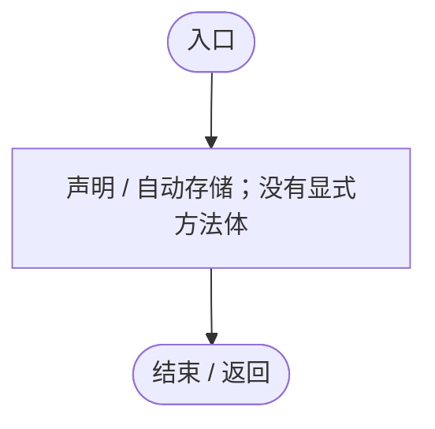

<a id="mc671110decd9b4c9"></a>

### Twilight.get · L17

`get`


#### Editor / Player · 语法控制结构 / 声明（非CFG）


<a id="m9e4910c9d503044c"></a>

### Twilight.set · L17

`private set`


#### Editor / Player · 语法控制结构 / 声明（非CFG）


<a id="mb277901c1b524df1"></a>

### Night.get · L18

`get`


#### Editor / Player · 语法控制结构 / 声明（非CFG）


<a id="mfcef88abecb2b4aa"></a>

### Night.set · L18

`private set`


#### Editor / Player · 语法控制结构 / 声明（非CFG）


<a id="m3027dd4ce0e075fb"></a>

### FilePath.get · L20

`public static string FilePath`


#### Editor / Player · 语法控制结构 / 声明（非CFG）

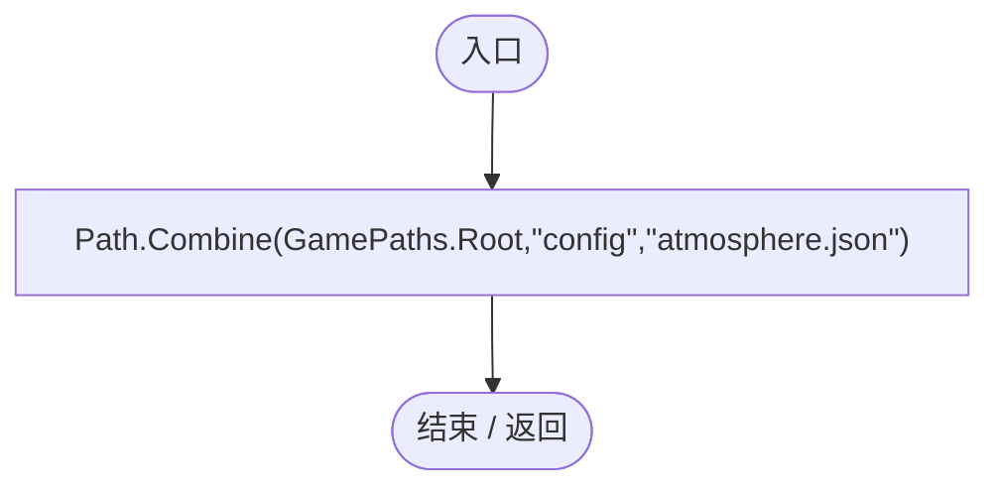

<a id="m1583452f6247ba9a"></a>

### Current.get · L21

`get`


#### Editor / Player · Roslyn编译器控制流

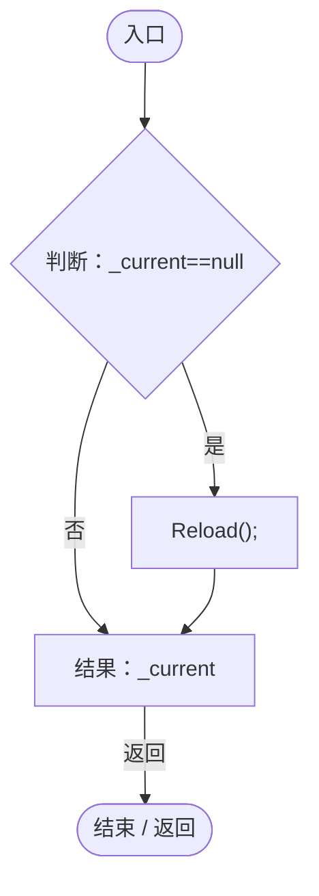

项目内调用/回调引用：

- [AtmospherePalette.Reload · L34](Planet.md#mffcf12136d01f33f)（方法）

<a id="m54690b9970bcf33d"></a>

### ParseColor · L22

`private static Color ParseColor(string value)`


#### Editor / Player · Roslyn编译器控制流

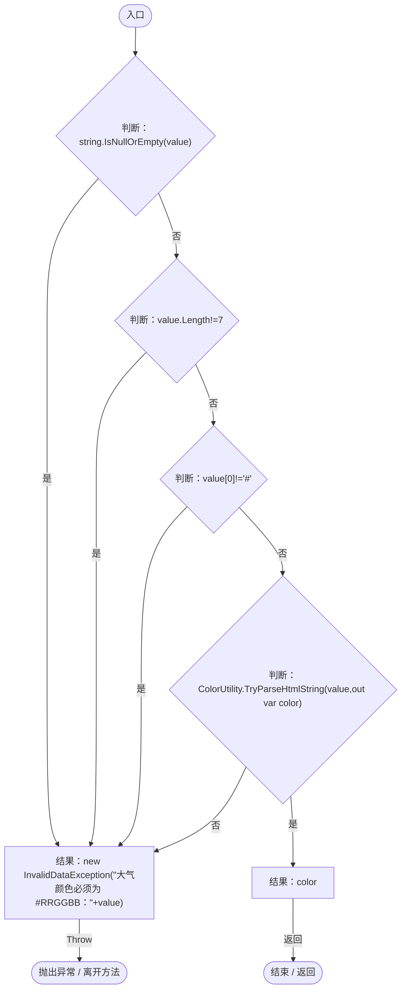

<a id="m3639fcecdd3ed9aa"></a>

### Parse · L27

`public static AtmospherePalette Parse(string text)`


#### Editor / Player · Roslyn编译器控制流

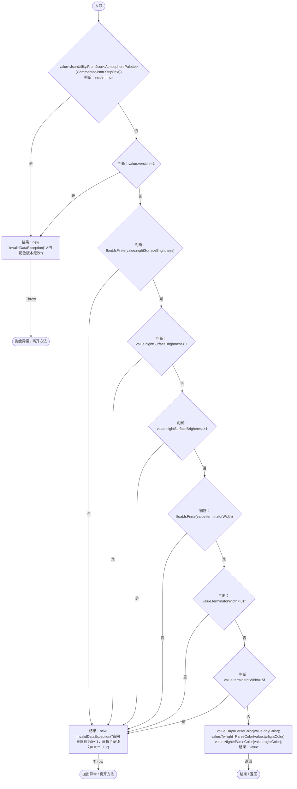

项目内调用/回调引用：

- [CommentedJson.Strip · L9](Core.md#mc9c02edd5a7f0a4d)（方法）
- [AtmospherePalette.Day.set · L16](Planet.md#m7ef15c33262672e9)（访问器）
- [AtmospherePalette.ParseColor · L22](Planet.md#m54690b9970bcf33d)（方法）
- [AtmospherePalette.Twilight.set · L17](Planet.md#m9e4910c9d503044c)（访问器）
- [AtmospherePalette.Night.set · L18](Planet.md#mfcef88abecb2b4aa)（访问器）

<a id="mffcf12136d01f33f"></a>

### Reload · L34

`public static void Reload()`


#### Editor / Player · Roslyn编译器控制流

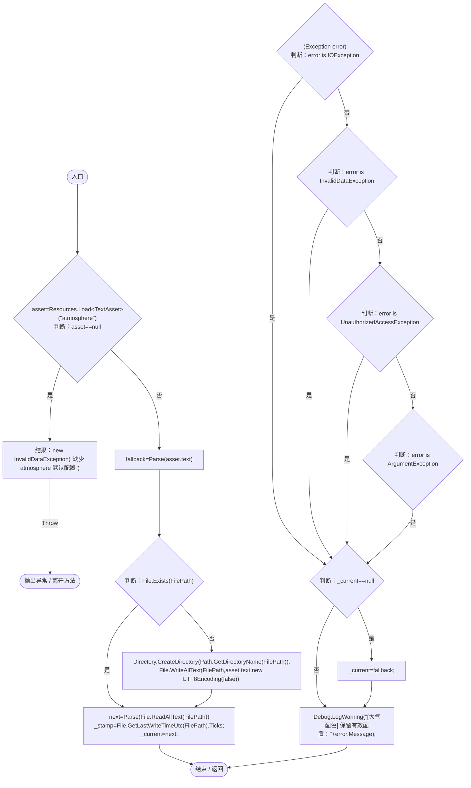

项目内调用/回调引用：

- [AtmospherePalette.Parse · L27](Planet.md#m3639fcecdd3ed9aa)（方法）

<a id="mc6c76a36693e9f2a"></a>

### Poll · L45

`public static void Poll()`


#### Editor / Player · Roslyn编译器控制流

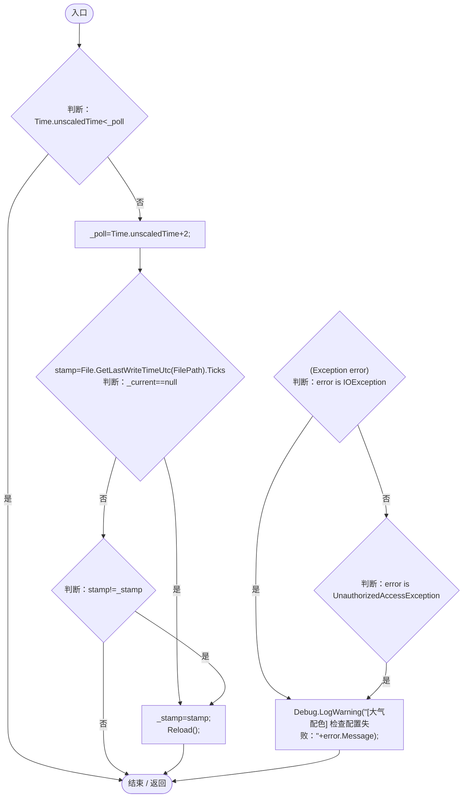

项目内调用/回调引用：

- [AtmospherePalette.Reload · L34](Planet.md#mffcf12136d01f33f)（方法）

<a id="m54dc6de5bb13c890"></a>

### Reset · L51

`[RuntimeInitializeOnLoadMethod(RuntimeInitializeLoadType.SubsystemRegistration)]private static void Reset()`


#### Editor / Player · Roslyn编译器控制流

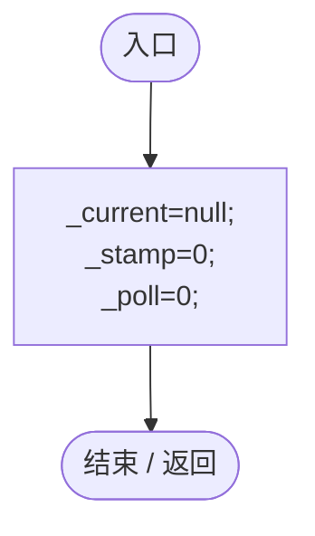


---

<a id="s77ad1469df9525fa"></a>

## AtmosphereViewPolicy.cs

`Runtime` · `Assets/DarwinPark/Planet/AtmosphereViewPolicy.cs`

[源文件](../../../Assets/DarwinPark/Planet/AtmosphereViewPolicy.cs) · 源码校验：`731ab313e934ce279cad3c354f10b478cfa897bdea5629b3d7ae3b642c6a6ad0`

方法按源文件位置排列。事件/回调引用不表示立即执行；完整源码与关系图请打开离线手册。

<a id="m40521f3c999c1a8b"></a>

### OuterRadius · L8

`public static float OuterRadius(PlanetTerrainData data,float original,float clearance)`


#### Editor / Player · Roslyn编译器控制流

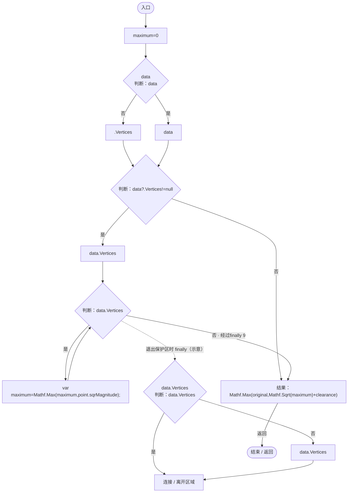

<a id="m214bc119bec45f2d"></a>

### Apply · L10

`public static void Apply(Material material,Camera camera)`


#### Editor / Player · Roslyn编译器控制流

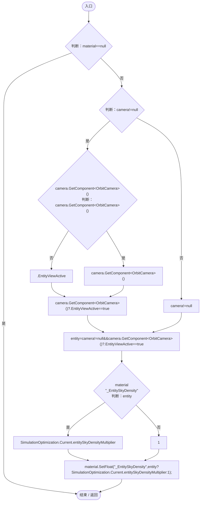

项目内调用/回调引用：

- [OrbitCamera.EntityViewActive.get · L45](Core.md#m2cf55ed95d873598)（访问器）
- [SimulationOptimization.Current.get · L33](Core.md#ma4d76456c2404208)（访问器）


---

<a id="sb255987e9edc611f"></a>

## ClimateAtmosphere.cs

`Runtime` · `Assets/DarwinPark/Planet/Climate/ClimateAtmosphere.cs`

[源文件](../../../Assets/DarwinPark/Planet/Climate/ClimateAtmosphere.cs) · 源码校验：`0c5447e51a3d060f037056bf5f1cc788f0149db2d95d68a3f41e83e23a338a01`

方法按源文件位置排列。事件/回调引用不表示立即执行；完整源码与关系图请打开离线手册。

<a id="m236c91aaad01ef5a"></a>

### ClimateAtmosphere.ctor · L11

`public ClimateAtmosphere(PlanetTerrainData data,PlanetClimateConfig config,int seed)`


#### Editor / Player · Roslyn编译器控制流

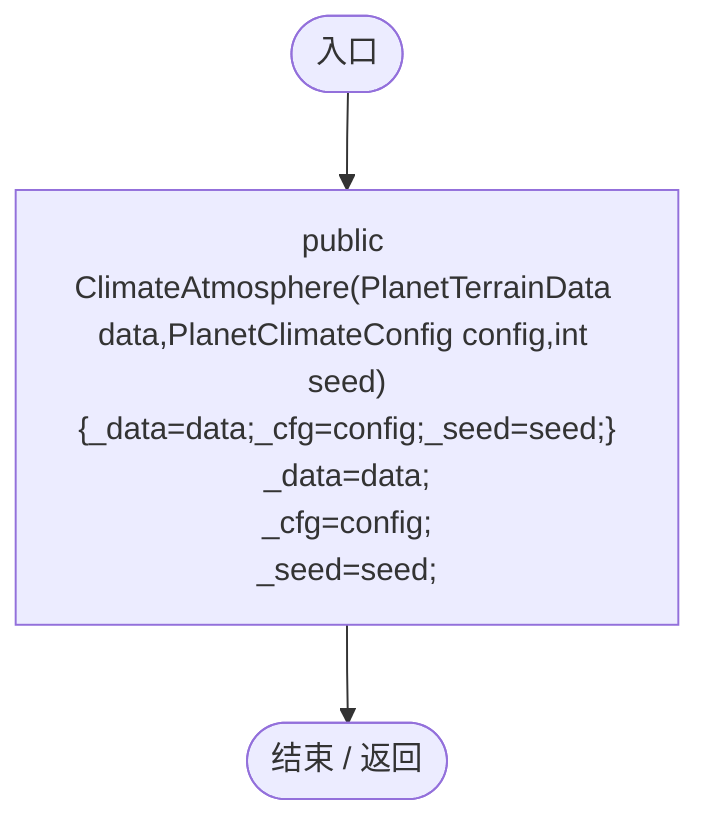

<a id="m742af3e5a15e8116"></a>

### Build · L12

`public void Build(PlanetClimateResult output,int[] coast,float[] fetch,int coarse,float coastFalloff,float heightRange,float temperatureOffset,float moistureOffset)`


#### Editor / Player · Roslyn编译器控制流

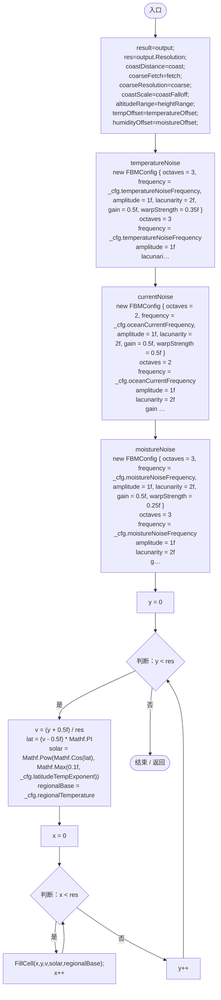

项目内调用/回调引用：

- [FBMNoise.FBMNoise.ctor · L12](Planet.md#m008bcd375f95dd84)（构造函数）
- [ClimateAtmosphere.FillCell · L61](Planet.md#m6fef124957e5577c)（方法）

<a id="m6fef124957e5577c"></a>

### FillCell · L61

`private void FillCell(int x,int y,float v,float solar,float regionalBase)`


#### Editor / Player · Roslyn编译器控制流

```mermaid
flowchart TD
  b0(["入口"])
  b1["i = y * res + x<br/>u = (x + 0.5f) / res<br/>dir = PlanetTerrainSampler.DirectionFromUV(u, v)<br/>isOcean = result.Ocean[i]<br/>height = result.Height[i]<br/>altitudeNorm = Mathf.Clamp01((height - _data.SeaLevel) / altitudeRange)<br/>coastProximity = Mathf.Exp(…"]
  b2["Mathf.Lerp(regionalBase, Mathf.Lerp(_cfg.oceanPoleTemp, _cfg.oceanEquatorTemp, solar), EarthClimateRules.SolarWeight(_cfg))"]
  b3{"result.Circulation<br/>判断：result.Circulation"}
  b4[".Heat(u,v)"]
  b5["result.Circulation"]
  b6{"判断：result.Circulation?.Heat(u,v)"}
  b7["result.Circulation?.Heat(u,v)"]
  b8["currentNoise.Sample(dir)"]
  b9["oceanTemperature = Mathf.Lerp(regionalBase, Mathf.Lerp(_cfg.oceanPoleTemp, _cfg.oceanEquatorTemp, solar), EarthClimateRules.SolarWeight(_cfg)) + (result.Circulation?.Heat(u,v) ?? currentNoise.Sample(dir)) * _cfg.oceanCurrentAmplitude + t…"]
  b10{"temperature = Mathf.Lerp(regionalBase, Mathf.Lerp(_cfg.poleTemp, _cfg.equatorTemp, solar), EarthClimateRules.SolarWeight(_cfg)) + tempOffset - altitudeNorm * _cfg.altitudeTempDrop + temperatureNoise.Sample(dir) * _cfg.temperatureNoiseAmp…"}
  b11["temperature = Mathf.Lerp(temperature, oceanTemperature, _cfg.oceanTempModeration);"]
  b12["temperature = Mathf.Lerp(temperature, oceanTemperature, _cfg.coastalTempModeration * Mathf.Pow(coastProximity, 1.5f));"]
  b13{"relief = 0f<br/>windLift = 0f<br/>判断：isOcean"}
  b14["humidity = 100f;"]
  b15["SampleNeighbourhood(dir, height, out relief, out float coldPool);<br/>result.Relief[i] = relief;<br/>temperature -= coldPool * _cfg.basinColdPoolDrop;<br/>fetchMoisture = Mathf.Exp(-fetch / Mathf.Max(0.05f, _cfg.windFetchScale))<br/>ComputeWindExposure(…"]
  b16["humidity<br/>EarthClimateRules.Humidity(dir,_cfg)"]
  b17{"_data.Hydrology<br/>判断：_data.Hydrology"}
  b18[".Moisture(dir)"]
  b19["_data.Hydrology"]
  b20{"判断：_data.Hydrology?.Moisture(dir)"}
  b21["_data.Hydrology?.Moisture(dir)"]
  b22["0"]
  b23["humidity+=EarthClimateRules.Humidity(dir,_cfg)+(_data.Hydrology?.Moisture(dir)??0);"]
  b24{"判断：isOcean"}
  b25["100f"]
  b26["Mathf.Clamp(humidity - altitudeNorm * _cfg.altitudePrecipitationPenalty + windLift * _cfg.orographicMoistureBonus * 0.3f, 0f, 100f)"]
  b27["precipitation = isOcean ? 100f : Mathf.Clamp(humidity - altitudeNorm * _cfg.altitudePrecipitationPenalty + windLift * _cfg.orographicMoistureBonus * 0.3f, 0f, 100f)"]
  b28{"判断：isOcean"}
  b29["dryHeat = Mathf.SmoothStep(0f, 1f, Mathf.InverseLerp(55f, 15f, humidity))<br/>temperature += dryHeat * _cfg.aridHeatBonus * Mathf.Max(0f, solar);"]
  b30["result.Temperature[i] = Mathf.Clamp(temperature, -60f, 60f);<br/>result.Humidity[i] = Mathf.Clamp(humidity, 4f, 100f);<br/>result.Precipitation[i] = precipitation;"]
  b31(["结束 / 返回"])
  b0 --> b1
  b1 --> b2
  b2 --> b3
  b3 -->|"否"| b4
  b3 -->|"是"| b5
  b4 --> b6
  b5 --> b6
  b6 -->|"否"| b7
  b6 -->|"是"| b8
  b7 --> b9
  b8 --> b9
  b9 --> b10
  b10 -->|"是"| b11
  b10 -->|"否"| b12
  b11 --> b13
  b12 --> b13
  b13 -->|"是"| b14
  b13 -->|"否"| b15
  b14 --> b24
  b15 --> b16
  b16 --> b17
  b17 -->|"否"| b18
  b17 -->|"是"| b19
  b18 --> b20
  b19 --> b20
  b20 -->|"否"| b21
  b20 -->|"是"| b22
  b21 --> b23
  b22 --> b23
  b23 --> b24
  b24 -->|"是"| b25
  b24 -->|"否"| b26
  b25 --> b27
  b26 --> b27
  b27 --> b28
  b28 -->|"否"| b29
  b28 -->|"是"| b30
  b29 --> b30
  b30 --> b31

```

项目内调用/回调引用：

- [PlanetTerrainSampler.DirectionFromUV · L13](Planet.md#mbb90aecec23f2a42)（方法）
- [ClimateAtmosphere.SampleCoarseBilinear · L158](Planet.md#m348dbdb7a8ab0169)（方法）
- [EarthClimateRules.SolarWeight · L17](Planet.md#mddd0e3e2097caeb8)（方法）
- [ClimateCirculation.Heat · L64](Planet.md#m89624170fbe03bfb)（方法）
- [FBMNoise.Sample · L24](Planet.md#m3997a25fbe63e25e)（方法）
- [ClimateAtmosphere.SampleNeighbourhood · L197](Planet.md#mbca0cda4d5bbc64a)（方法）
- [ClimateAtmosphere.ComputeWindExposure · L175](Planet.md#m49aa27945b3f644f)（方法）
- [EarthClimateRules.Wind · L21](Planet.md#m64ef59df02483848)（方法）
- [EarthClimateRules.Humidity · L19](Planet.md#m3ccd8e918a887249)（方法）
- [PlanetHydrology.Moisture · L147](Planet.md#m0e5d452efd58b970)（方法）

<a id="m348dbdb7a8ab0169"></a>

### SampleCoarseBilinear · L158

`private static float SampleCoarseBilinear(float[] data, int coarse, float u, float v)`


#### Editor / Player · Roslyn编译器控制流

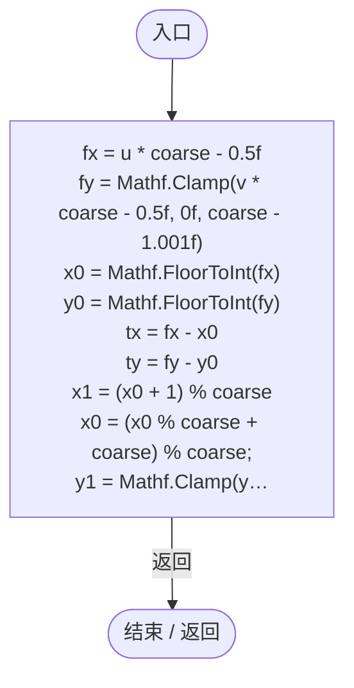

<a id="m49aa27945b3f644f"></a>

### ComputeWindExposure · L175

`private void ComputeWindExposure(Vector3 dir, float height, Vector3 windDir, out float lift01, out float rainShadow01)`


#### Editor / Player · Roslyn编译器控制流

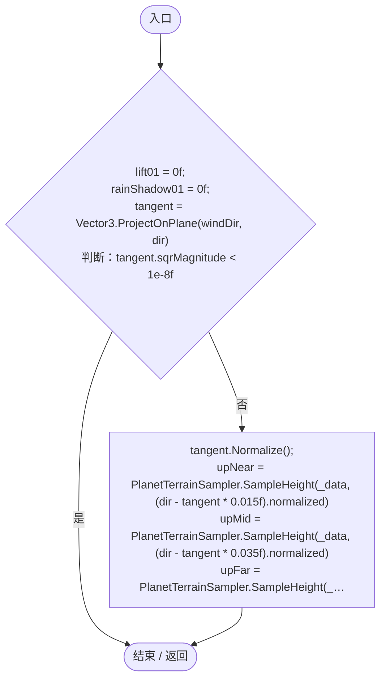

项目内调用/回调引用：

- [PlanetTerrainSampler.SampleHeight · L32](Planet.md#m759508f0c5a04b21)（方法）

<a id="mbca0cda4d5bbc64a"></a>

### SampleNeighbourhood · L197

`private void SampleNeighbourhood(Vector3 dir, float centerHeight, out float relief01, out float coldPool01)`


#### Editor / Player · Roslyn编译器控制流

```mermaid
flowchart TD
  b0(["入口"])
  b1{"判断：Mathf.Abs(Vector3.Dot(dir, Vector3.up)) &gt; 0.99f"}
  b2["Vector3.right"]
  b3["Vector3.up"]
  b4["axis = Mathf.Abs(Vector3.Dot(dir, Vector3.up)) &gt; 0.99f ? Vector3.right : Vector3.up"]
  b5["tangent = Vector3.Cross(dir, axis).normalized<br/>bitangent = Vector3.Cross(dir, tangent).normalized<br/>reliefStep = 0.006f<br/>basinStep = 0.018f<br/>h1 = PlanetTerrainSampler.SampleHeight(_data, (dir + tangent * reliefStep).normalized)<br/>h2 = PlanetTer…"]
  b6(["结束 / 返回"])
  b0 --> b1
  b1 -->|"是"| b2
  b1 -->|"否"| b3
  b2 --> b4
  b3 --> b4
  b4 --> b5
  b5 --> b6

```

项目内调用/回调引用：

- [PlanetTerrainSampler.SampleHeight · L32](Planet.md#m759508f0c5a04b21)（方法）


---

<a id="s65ef9af96476459b"></a>

## ClimateCirculation.cs

`Runtime` · `Assets/DarwinPark/Planet/Climate/ClimateCirculation.cs`

[源文件](../../../Assets/DarwinPark/Planet/Climate/ClimateCirculation.cs) · 源码校验：`bc407e5b7a0d2248180d659023cdd3b21fe468fa23091b61e3f6e1d47f304ea3`

方法按源文件位置排列。事件/回调引用不表示立即执行；完整源码与关系图请打开离线手册。

<a id="m3af81e557055525c"></a>

### ClimateCirculation.ctor · L12

`internal ClimateCirculation(PlanetTerrainData terrain, PlanetClimateConfig config, int width)`


#### Editor / Player · Roslyn编译器控制流

```mermaid
flowchart TD
  b0(["入口"])
  b1["internal ClimateCirculation(PlanetTerrainData terrain, PlanetClimateConfig config, int width) { _width = width; _height = width / 2; int count = _width * _height; _onshore = new Vector3[count]; _current = new Vector3[count]; _heat = new …"]
  b2["_width = width;<br/>_height = width / 2;<br/>count = _width * _height<br/>_onshore = new Vector3[count];<br/>_current = new Vector3[count];<br/>_heat = new float[count];<br/>_seasonalMoisture = new float[count];<br/>settings = config.earth"]
  b3{"settings<br/>判断：settings"}
  b4[".enabled"]
  b5["settings"]
  b6{"判断：settings?.enabled != true"}
  b7["y = 0"]
  b8{"判断：y &lt; _height"}
  b9["x = 0"]
  b10{"判断：x &lt; _width"}
  b11["index = y * _width + x<br/>dir = PlanetTerrainSampler.DirectionFromUV((x + .5f) / _width, (y + .5f) / _height)<br/>east = Vector3.Cross(Vector3.up, dir).normalized<br/>north = Vector3.Cross(dir, east)<br/>sea = Ocean(dir)<br/>wind = EarthClimateRules.Wind(d…"]
  b12["side = 0"]
  b13{"判断：side &lt; 8"}
  b14{"angle = side * Mathf.PI / 4<br/>heading = east * Mathf.Cos(angle) + north * Mathf.Sin(angle)<br/>判断：Ocean((dir + heading * settings.circulationCoastReach).normalized)"}
  b15["towardLand -= heading;"]
  b16["towardLand += heading;<br/>landContacts++;"]
  b17["side++"]
  b18{"判断：sea"}
  b19{"判断：landContacts &gt; 0"}
  b20{"判断：landContacts &lt; 8"}
  b21["seasonalLatitude = Mathf.Clamp01((.72f - Mathf.Abs(dir.y)) / .3f)<br/>coastStrength = Mathf.Clamp01(towardLand.magnitude / 4)<br/>_onshore[index] = towardLand.normalized * (seasonalLatitude * coastStrength);<br/>_seasonalMoisture[index] = seasonalLa…"]
  b22{"current = (wind + Vector3.Cross(dir, wind) * (-dir.y * settings.currentDeflection)).normalized<br/>判断：Ocean((dir + current * settings.circulationCoastReach).normalized)"}
  b23{"判断：towardLand.sqrMagnitude &gt; .001f"}
  b24["current = Vector3.ProjectOnPlane(current, towardLand.normalized).normalized;"]
  b25{"判断：sea"}
  b26["_current[index] = current * settings.surfaceCurrentSpeed;<br/>sourceLatitude = Mathf.Abs((dir - current * settings.currentHeatReach).normalized.y)<br/>_heat[index] = Mathf.Clamp((Mathf.Abs(dir.y) - sourceLatitude) / Mathf.Max(.01f,settings.curre…"]
  b27["x++"]
  b28["y++"]
  b29(["结束 / 返回"])
  b0 --> b1
  b1 --> b2
  b2 --> b3
  b3 -->|"否"| b4
  b3 -->|"是"| b5
  b4 --> b6
  b5 --> b6
  b6 -->|"是"| b29
  b6 -->|"否"| b7
  b7 --> b8
  b8 -->|"是"| b9
  b8 -->|"否"| b29
  b9 --> b10
  b10 -->|"是"| b11
  b10 -->|"否"| b28
  b11 --> b12
  b12 --> b13
  b13 -->|"是"| b14
  b13 -->|"否"| b18
  b14 -->|"是"| b15
  b14 -->|"否"| b16
  b15 --> b17
  b16 --> b17
  b17 --> b13
  b18 -->|"否"| b19
  b18 -->|"是"| b22
  b19 -->|"是"| b20
  b19 -->|"否"| b22
  b20 -->|"是"| b21
  b20 -->|"否"| b22
  b21 --> b22
  b22 -->|"否"| b23
  b22 -->|"是"| b25
  b23 -->|"是"| b24
  b23 -->|"否"| b25
  b24 --> b25
  b25 -->|"否"| b27
  b25 -->|"是"| b26
  b26 --> b27
  b27 --> b10
  b28 --> b8

```

项目内调用/回调引用：

- [PlanetTerrainSampler.DirectionFromUV · L13](Planet.md#mbb90aecec23f2a42)（方法）
- [ClimateCirculation.Ocean · L24](Planet.md#m5518f493accd3c4c)（局部函数）
- [EarthClimateRules.Wind · L21](Planet.md#m64ef59df02483848)（方法）

<a id="m5518f493accd3c4c"></a>

### Ocean · L24

`bool Ocean(Vector3 dir)`


#### Editor / Player · Roslyn编译器控制流

```mermaid
flowchart TD
  b0(["入口"])
  b1["结果：PlanetTerrainSampler.SampleHeight(terrain, dir) &lt; terrain.SeaLevel"]
  b2(["结束 / 返回"])
  b0 --> b1
  b1 -->|"返回"| b2

```

项目内调用/回调引用：

- [PlanetTerrainSampler.SampleHeight · L32](Planet.md#m759508f0c5a04b21)（方法）

<a id="m89624170fbe03bfb"></a>

### Heat · L64

`internal float Heat(float u,float v)`


#### Editor / Player · Roslyn编译器控制流

```mermaid
flowchart TD
  b0(["入口"])
  b1["结果：Read(_heat,u,v)"]
  b2(["结束 / 返回"])
  b0 --> b1
  b1 -->|"返回"| b2

```

项目内调用/回调引用：

- [ClimateCirculation.Read · L91](Planet.md#md57452f3e51a532b)（方法）

<a id="mf1c1a498e5999db8"></a>

### Monsoon · L65

`internal float Monsoon(float u,float v,float northernSummer)`


#### Editor / Player · Roslyn编译器控制流

```mermaid
flowchart TD
  b0(["入口"])
  b1["hemisphere = Mathf.Clamp((v - .5f) * 16, -1, 1)<br/>结果：Read(_seasonalMoisture,u,v) * hemisphere * northernSummer"]
  b2(["结束 / 返回"])
  b0 --> b1
  b1 -->|"返回"| b2

```

项目内调用/回调引用：

- [ClimateCirculation.Read · L91](Planet.md#md57452f3e51a532b)（方法）

<a id="m09eed389a8033c6d"></a>

### SurfaceCurrent · L71

`public Vector3 SurfaceCurrent(Vector2 uv)`


#### Editor / Player · Roslyn编译器控制流

```mermaid
flowchart TD
  b0(["入口"])
  b1["结果：Read(_current,uv.x,uv.y)"]
  b2(["结束 / 返回"])
  b0 --> b1
  b1 -->|"返回"| b2

```

项目内调用/回调引用：

- [ClimateCirculation.Read · L97](Planet.md#mbde70fe9b7b758af)（方法）

<a id="mb4de370c929900e7"></a>

### Wind · L72

`public Vector3 Wind(Vector3 direction,Vector2 uv,PlanetClimateConfig config,float northernSummer)`


#### Editor / Player · Roslyn编译器控制流

```mermaid
flowchart TD
  b0(["入口"])
  b1["summer = Mathf.Clamp((uv.y - .5f) * 16, -1, 1) * northernSummer<br/>结果：(EarthClimateRules.Wind(direction,config) + Read(_onshore,uv.x,uv.y) * (summer * config.earth.monsoonWindStrength)).normalized"]
  b2(["结束 / 返回"])
  b0 --> b1
  b1 -->|"返回"| b2

```

项目内调用/回调引用：

- [EarthClimateRules.Wind · L21](Planet.md#m64ef59df02483848)（方法）
- [ClimateCirculation.Read · L97](Planet.md#mbde70fe9b7b758af)（方法）

<a id="m12ae45c3b4163ec9"></a>

### Corners · L79

`private void Corners(float u,float v,out int a,out int b,out int c,out int d,out float tx,out float ty)`


#### Editor / Player · Roslyn编译器控制流

```mermaid
flowchart TD
  b0(["入口"])
  b1["x = Mathf.Repeat(u,1) * _width - .5f<br/>y = Mathf.Clamp(v * _height - .5f, 0, _height - 1)<br/>x0 = Mathf.FloorToInt(x)<br/>y0 = Mathf.FloorToInt(y)<br/>nextX = (x0+1+_width)%_width<br/>nextY = Mathf.Min(y0+1,_height-1)<br/>firstX = (x0+_width)%_width<br/>a=y0*_wi…"]
  b2(["结束 / 返回"])
  b0 --> b1
  b1 --> b2

```

<a id="md57452f3e51a532b"></a>

### Read · L91

`private float Read(float[] values,float u,float v)`


#### Editor / Player · Roslyn编译器控制流

```mermaid
flowchart TD
  b0(["入口"])
  b1["Corners(u,v,out int a,out int b,out int c,out int d,out float x,out float y);<br/>结果：Mathf.Lerp(Mathf.Lerp(values[a],values[b],x),Mathf.Lerp(values[c],values[d],x),y)"]
  b2(["结束 / 返回"])
  b0 --> b1
  b1 -->|"返回"| b2

```

项目内调用/回调引用：

- [ClimateCirculation.Corners · L79](Planet.md#m12ae45c3b4163ec9)（方法）

<a id="mbde70fe9b7b758af"></a>

### Read · L97

`private Vector3 Read(Vector3[] values,float u,float v)`


#### Editor / Player · Roslyn编译器控制流

```mermaid
flowchart TD
  b0(["入口"])
  b1["Corners(u,v,out int a,out int b,out int c,out int d,out float x,out float y);<br/>结果：Vector3.Lerp(Vector3.Lerp(values[a],values[b],x),Vector3.Lerp(values[c],values[d],x),y)"]
  b2(["结束 / 返回"])
  b0 --> b1
  b1 -->|"返回"| b2

```

项目内调用/回调引用：

- [ClimateCirculation.Corners · L79](Planet.md#m12ae45c3b4163ec9)（方法）


---

<a id="s50cc1bad8d28d347"></a>

## PlanetClimateResult.cs

`Runtime` · `Assets/DarwinPark/Planet/Climate/PlanetClimateResult.cs`

[源文件](../../../Assets/DarwinPark/Planet/Climate/PlanetClimateResult.cs) · 源码校验：`57241f56693eecee417f4fb3e64b36111ad228322a5713edec912ec97033ca84`

方法按源文件位置排列。事件/回调引用不表示立即执行；完整源码与关系图请打开离线手册。

本文件没有显式方法体，属于数据/枚举/标记声明；字段与类型定义请在离线源码视图查看。


---

<a id="s6a91ff043f0ebb5f"></a>

## EarthClimateRules.cs

`Runtime` · `Assets/DarwinPark/Planet/EarthClimateRules.cs`

[源文件](../../../Assets/DarwinPark/Planet/EarthClimateRules.cs) · 源码校验：`194040561d1338a80d83fd8df874a4d48da8f3b8d84cfb5fb5a5e7b0aa3b3f5c`

方法按源文件位置排列。事件/回调引用不表示立即执行；完整源码与关系图请打开离线手册。

<a id="mddd0e3e2097caeb8"></a>

### SolarWeight · L17

`public static float SolarWeight(PlanetClimateConfig cfg)`


#### Editor / Player · Roslyn编译器控制流

```mermaid
flowchart TD
  b0(["入口"])
  b1{"cfg.earth<br/>判断：cfg.earth"}
  b2[".enabled"]
  b3["cfg.earth"]
  b4{"判断：cfg.earth?.enabled==true"}
  b5["cfg.earth.solarWeight"]
  b6["cfg.solarTemperatureWeight"]
  b7["结果：cfg.earth?.enabled==true?cfg.earth.solarWeight:cfg.solarTemperatureWeight"]
  b8(["结束 / 返回"])
  b0 --> b1
  b1 -->|"否"| b2
  b1 -->|"是"| b3
  b2 --> b4
  b3 --> b4
  b4 -->|"是"| b5
  b4 -->|"否"| b6
  b5 --> b7
  b6 --> b7
  b7 -->|"返回"| b8

```

<a id="m5bded9bd25ad0acf"></a>

### Bell · L18

`private static float Bell(float value,float center,float width)`


#### Editor / Player · Roslyn编译器控制流

```mermaid
flowchart TD
  b0(["入口"])
  b1["d=(value-center)/Mathf.Max(.1f,width)<br/>结果：Mathf.Exp(-d*d)"]
  b2(["结束 / 返回"])
  b0 --> b1
  b1 -->|"返回"| b2

```

<a id="m3ccd8e918a887249"></a>

### Humidity · L19

`public static float Humidity(Vector3 direction,PlanetClimateConfig cfg)`


#### Editor / Player · Roslyn编译器控制流

```mermaid
flowchart TD
  b0(["入口"])
  b1["e=cfg.earth"]
  b2{"e<br/>判断：e"}
  b3[".enabled"]
  b4["e"]
  b5{"判断：e?.enabled!=true"}
  b6["结果：0"]
  b7["latitude=Mathf.Abs(Mathf.Asin(Mathf.Clamp(direction.y,-1,1))*Mathf.Rad2Deg)<br/>结果：e.equatorialRain*Bell(latitude,0,e.equatorialWidth)-e.subtropicalDryness*Bell(latitude,e.subtropicalLatitude,e.subtropicalWidth)+e.frontRain*Bell(latitude,e.f…"]
  b8(["结束 / 返回"])
  b0 --> b1
  b1 --> b2
  b2 -->|"否"| b3
  b2 -->|"是"| b4
  b3 --> b5
  b4 --> b5
  b5 -->|"是"| b6
  b5 -->|"否"| b7
  b6 -->|"返回"| b8
  b7 -->|"返回"| b8

```

项目内调用/回调引用：

- [EarthClimateRules.Bell · L18](Planet.md#m5bded9bd25ad0acf)（方法）

<a id="m64ef59df02483848"></a>

### Wind · L21

`public static Vector3 Wind(Vector3 direction,PlanetClimateConfig cfg)`


#### Editor / Player · Roslyn编译器控制流

```mermaid
flowchart TD
  b0(["入口"])
  b1{"cfg.earth<br/>判断：cfg.earth"}
  b2[".enabled"]
  b3["cfg.earth"]
  b4{"判断：cfg.earth?.enabled!=true"}
  b5["结果：cfg.GetWindDirection()"]
  b6{"latitude=Mathf.Asin(Mathf.Clamp(direction.y,-1,1))*Mathf.Rad2Deg<br/>east=Vector3.Cross(Vector3.up,direction)<br/>判断：east.sqrMagnitude&lt;1e-8f"}
  b7["east=Vector3.right;"]
  b8["east.Normalize();<br/>north=Vector3.ProjectOnPlane(Vector3.up,direction).normalized<br/>mid=Mathf.SmoothStep(0,1,Mathf.InverseLerp(25,35,Mathf.Abs(latitude)))*(1-Mathf.SmoothStep(0,1,Mathf.InverseLerp(55,65,Mathf.Abs(latitude))))<br/>结果：(east*Mathf.…"]
  b9(["结束 / 返回"])
  b0 --> b1
  b1 -->|"否"| b2
  b1 -->|"是"| b3
  b2 --> b4
  b3 --> b4
  b4 -->|"是"| b5
  b4 -->|"否"| b6
  b5 -->|"返回"| b9
  b6 -->|"是"| b7
  b6 -->|"否"| b8
  b7 --> b8
  b8 -->|"返回"| b9

```

项目内调用/回调引用：

- [PlanetClimateConfig.GetWindDirection · L117](Planet.md#m0440487b6defbca3)（方法）

<a id="m06cb7a317dfd280c"></a>

### Classify · L23

`public static ClimateType Classify(float t,float h,PlanetClimateConfig cfg)`


#### Editor / Player · Roslyn编译器控制流

```mermaid
flowchart TD
  b0(["入口"])
  b1{"e=cfg.earth<br/>判断：t&lt;=cfg.polarIceTemp"}
  b2["结果：ClimateType.PolarIce"]
  b3{"判断：t&lt;e.tundraTemperature"}
  b4{"判断：h&lt;=cfg.desertHumidity"}
  b5["ClimateType.ColdDesert"]
  b6["ClimateType.Tundra"]
  b7["结果：h&lt;=cfg.desertHumidity?ClimateType.ColdDesert:ClimateType.Tundra"]
  b8{"判断：h&lt;=cfg.desertHumidity"}
  b9{"判断：t&lt;cfg.desertTemp"}
  b10["ClimateType.ColdDesert"]
  b11["ClimateType.Desert"]
  b12["结果：t&lt;cfg.desertTemp?ClimateType.ColdDesert:ClimateType.Desert"]
  b13{"判断：h&lt;e.steppeHumidity"}
  b14["结果：ClimateType.Steppe"]
  b15{"判断：t&gt;=cfg.tropicalTemp"}
  b16{"判断：h&gt;=cfg.tropicalHumidity"}
  b17["ClimateType.TropicalRain"]
  b18["ClimateType.Savanna"]
  b19["结果：h&gt;=cfg.tropicalHumidity?ClimateType.TropicalRain:ClimateType.Savanna"]
  b20{"判断：h&gt;=cfg.forestHumidity"}
  b21{"判断：t&lt;e.taigaTemperature"}
  b22["ClimateType.Taiga"]
  b23["ClimateType.Forest"]
  b24["结果：t&lt;e.taigaTemperature?ClimateType.Taiga:ClimateType.Forest"]
  b25["结果：ClimateType.Grassland"]
  b26(["结束 / 返回"])
  b0 --> b1
  b1 -->|"是"| b2
  b1 -->|"否"| b3
  b2 -->|"返回"| b26
  b3 -->|"是"| b4
  b3 -->|"否"| b8
  b4 -->|"是"| b5
  b4 -->|"否"| b6
  b5 --> b7
  b6 --> b7
  b7 -->|"返回"| b26
  b8 -->|"是"| b9
  b8 -->|"否"| b13
  b9 -->|"是"| b10
  b9 -->|"否"| b11
  b10 --> b12
  b11 --> b12
  b12 -->|"返回"| b26
  b13 -->|"是"| b14
  b13 -->|"否"| b15
  b14 -->|"返回"| b26
  b15 -->|"是"| b16
  b15 -->|"否"| b20
  b16 -->|"是"| b17
  b16 -->|"否"| b18
  b17 --> b19
  b18 --> b19
  b19 -->|"返回"| b26
  b20 -->|"是"| b21
  b20 -->|"否"| b25
  b21 -->|"是"| b22
  b21 -->|"否"| b23
  b22 --> b24
  b23 --> b24
  b24 -->|"返回"| b26
  b25 -->|"返回"| b26

```

<a id="m1c0dcbcca16fdece"></a>

### Color · L26

`public static Color Color(float t,float h,PlanetClimateConfig cfg)`

独立色板以较窄连续过渡区混合，雨林深青绿、热带草原金黄、森林鲜绿易区分。

#### Editor / Player · Roslyn编译器控制流

```mermaid
flowchart TD
  b0(["入口"])
  b1["e=cfg.earth<br/>tropical=Mathf.SmoothStep(0,1,Mathf.InverseLerp(cfg.tropicalTemp-2,cfg.tropicalTemp+2,t))<br/>color=UnityEngine.Color.Lerp(e.grassland,e.forest,Mathf.SmoothStep(0,1,Mathf.InverseLerp(cfg.forestHumidity-4,cfg.forestHumidity+4,h)))…"]
  b2{"color<br/>判断：t&lt;cfg.desertTemp"}
  b3["e.coldDesert"]
  b4["cfg.desert"]
  b5["color=UnityEngine.Color.Lerp(color,t&lt;cfg.desertTemp?e.coldDesert:cfg.desert,1-Mathf.SmoothStep(0,1,Mathf.InverseLerp(cfg.desertHumidity-3,cfg.desertHumidity+3,h)));"]
  b6["color=UnityEngine.Color.Lerp(color,cfg.tundra,1-Mathf.SmoothStep(0,1,Mathf.InverseLerp(e.tundraTemperature-2,e.tundraTemperature+2,t)));<br/>结果：UnityEngine.Color.Lerp(color,cfg.polarIce,1-Mathf.SmoothStep(0,1,Mathf.InverseLerp(cfg.polarIceTe…"]
  b7(["结束 / 返回"])
  b0 --> b1
  b1 --> b2
  b2 -->|"是"| b3
  b2 -->|"否"| b4
  b3 --> b5
  b4 --> b5
  b5 --> b6
  b6 -->|"返回"| b7

```


---

<a id="s8ec387cb4eb3fa28"></a>

## HydraulicErosion.cs

`Runtime` · `Assets/DarwinPark/Planet/Erosion/HydraulicErosion.cs`

[源文件](../../../Assets/DarwinPark/Planet/Erosion/HydraulicErosion.cs) · 源码校验：`3093fba211deaa2aecc9cf0839cf12ae5be309b8ed6c161e4e7aefa007d025d0`

方法按源文件位置排列。事件/回调引用不表示立即执行；完整源码与关系图请打开离线手册。

<a id="m45b3f13be397f937"></a>

### Apply · L12

`public static void Apply(float[,] height, int resolution, int iterations, float strength, DeterministicRandom rng)`


#### Editor / Player · Roslyn编译器控制流

```mermaid
flowchart TD
  b0(["入口"])
  b1["size = resolution"]
  b2["iter = 0"]
  b3{"判断：iter &lt; iterations"}
  b4["px = rng.Next(size + 1)<br/>py = rng.Next(size + 1)<br/>water = 1f<br/>speed = 0f<br/>sediment = 0f<br/>depositRate = 0.3f<br/>erosionRate = 0.3f<br/>evaporation = 0.05f"]
  b5["step = 0"]
  b6{"判断：step &lt; 30"}
  b7{"cx = Mathf.Clamp(px, 0, size - 1)<br/>cy = Mathf.Clamp(py, 0, size - 1)<br/>h00 = height[cx, cy]<br/>h10 = height[cx + 1, cy]<br/>h01 = height[cx, cy + 1]<br/>h11 = height[cx + 1, cy + 1]<br/>gx = (h10 + h11 - h00 - h01) * 0.5f<br/>gy = (h01 + h11 - h00 - h10) * 0.…"}
  b8{"dx = -gx / mag<br/>dy = -gy / mag<br/>nx = Mathf.Clamp(px + Mathf.RoundToInt(dx), 0, size)<br/>ny = Mathf.Clamp(py + Mathf.RoundToInt(dy), 0, size)<br/>sxp = Mathf.Clamp(px, 0, size)<br/>syp = Mathf.Clamp(py, 0, size)<br/>deltaH = height[nx, ny] - height[sxp, s…"}
  b9["erode = Mathf.Min(carry * erosionRate, Mathf.Max(0f, -deltaH))<br/>height[sxp, syp] -= erode * strength;<br/>sediment += erode * strength;"]
  b10{"downhill = Mathf.Max(0f, -deltaH)<br/>speed = Mathf.Sqrt(Mathf.Max(0f, speed * speed + downhill));<br/>判断：float.IsNaN(speed)"}
  b11{"判断：float.IsInfinity(speed)"}
  b12["speed = 0f;"]
  b13{"water *= (1f - evaporation);<br/>判断：carry &lt; sediment * depositRate"}
  b14["deposit = sediment * depositRate<br/>height[nx, ny] += deposit;<br/>sediment -= deposit;"]
  b15{"px = nx;<br/>py = ny;<br/>判断：water &lt; 0.01f"}
  b16["step++"]
  b17["iter++"]
  b18(["结束 / 返回"])
  b0 --> b1
  b1 --> b2
  b2 --> b3
  b3 -->|"是"| b4
  b3 -->|"否"| b18
  b4 --> b5
  b5 --> b6
  b6 -->|"是"| b7
  b6 -->|"否"| b17
  b7 -->|"是"| b17
  b7 -->|"否"| b8
  b8 -->|"是"| b9
  b8 -->|"否"| b10
  b9 --> b10
  b10 -->|"否"| b11
  b10 -->|"是"| b12
  b11 -->|"是"| b12
  b11 -->|"否"| b13
  b12 --> b13
  b13 -->|"是"| b14
  b13 -->|"否"| b15
  b14 --> b15
  b15 -->|"是"| b17
  b15 -->|"否"| b16
  b16 --> b6
  b17 --> b3

```

项目内调用/回调引用：

- [DeterministicRandom.Next · L32](Planet.md#m5fab9b9b1a9df9bf)（方法）


---

<a id="s6648fb3132139fb8"></a>

## ThermalErosion.cs

`Runtime` · `Assets/DarwinPark/Planet/Erosion/ThermalErosion.cs`

[源文件](../../../Assets/DarwinPark/Planet/Erosion/ThermalErosion.cs) · 源码校验：`cdb4d29a4671cb93e6a30f69b0aa60bd78eb5343e256a454a0d917152e42c93e`

方法按源文件位置排列。事件/回调引用不表示立即执行；完整源码与关系图请打开离线手册。

<a id="m2992e195e77e1a49"></a>

### Apply · L11

`public static void Apply(float[,] height, int resolution, int iterations, float talusAngle, float strength)`


#### Editor / Player · Roslyn编译器控制流

```mermaid
flowchart TD
  b0(["入口"])
  b1["size = resolution"]
  b2["iter = 0"]
  b3{"判断：iter &lt; iterations"}
  b4["y = 0"]
  b5{"判断：y &lt;= size"}
  b6["x = 0"]
  b7{"判断：x &lt;= size"}
  b8{"h = height[x, y]<br/>hmax = h<br/>tx = x<br/>ty = y<br/>Check(height, size, x + 1, y, ref hmax, ref tx, ref ty);<br/>Check(height, size, x - 1, y, ref hmax, ref tx, ref ty);<br/>Check(height, size, x, y + 1, ref hmax, ref tx, ref ty);<br/>Check(height, size, x, y -…"}
  b9["move = (diff - talusAngle) * 0.5f * strength<br/>height[x, y] += move;<br/>height[tx, ty] -= move;"]
  b10["x++"]
  b11["y++"]
  b12["iter++"]
  b13(["结束 / 返回"])
  b0 --> b1
  b1 --> b2
  b2 --> b3
  b3 -->|"是"| b4
  b3 -->|"否"| b13
  b4 --> b5
  b5 -->|"是"| b6
  b5 -->|"否"| b12
  b6 --> b7
  b7 -->|"是"| b8
  b7 -->|"否"| b11
  b8 -->|"是"| b9
  b8 -->|"否"| b10
  b9 --> b10
  b10 --> b7
  b11 --> b5
  b12 --> b3

```

项目内调用/回调引用：

- [ThermalErosion.Check · L39](Planet.md#m45a51fc893b01346)（方法）

<a id="m45a51fc893b01346"></a>

### Check · L39

`private static void Check(float[,] h, int size, int nx, int ny, ref float hmax, ref int tx, ref int ty)`


#### Editor / Player · Roslyn编译器控制流

```mermaid
flowchart TD
  b0(["入口"])
  b1{"判断：nx &lt; 0"}
  b2{"判断：ny &lt; 0"}
  b3{"判断：nx &gt; size"}
  b4{"判断：ny &gt; size"}
  b5{"判断：h[nx, ny] &gt; hmax"}
  b6["hmax = h[nx, ny];<br/>tx = nx;<br/>ty = ny;"]
  b7(["结束 / 返回"])
  b0 --> b1
  b1 -->|"否"| b2
  b1 -->|"是"| b7
  b2 -->|"否"| b3
  b2 -->|"是"| b7
  b3 -->|"否"| b4
  b3 -->|"是"| b7
  b4 -->|"是"| b7
  b4 -->|"否"| b5
  b5 -->|"是"| b6
  b5 -->|"否"| b7
  b6 --> b7

```


---

<a id="s2ea4ea93bd165819"></a>

## OreGenerator.cs

`Runtime` · `Assets/DarwinPark/Planet/Legacy/OreGenerator.cs`

[源文件](../../../Assets/DarwinPark/Planet/Legacy/OreGenerator.cs) · 源码校验：`70e316a7a6e122096a2b959dfc1ae4f16f4563d8ae9deb83c9c1b4da29b5adf9`

方法按源文件位置排列。事件/回调引用不表示立即执行；完整源码与关系图请打开离线手册。

<a id="m2224b3a9e51b6d80"></a>

### Start · L24

`private IEnumerator Start()`


#### Editor / Player · Roslyn编译器控制流

```mermaid
flowchart TD
  b0(["入口"])
  b1{"builder = GetComponent&lt;PlanetTerrainMeshBuilder&gt;()<br/>判断：builder != null"}
  b2["_planetRadius = builder.radius;"]
  b3["yield return null;<br/>_isReady = true;"]
  b4["i = 0"]
  b5{"判断：i &lt; maxOreCount / 2"}
  b6["GenerateSingleOre();<br/>i++"]
  b7["Debug.Log($&quot;[OreGen] 初始生成了一半矿石 (共 {maxOreCount / 2} 块)&quot;);"]
  b8(["结束 / 返回"])
  b0 --> b1
  b1 -->|"是"| b2
  b1 -->|"否"| b3
  b2 --> b3
  b3 --> b4
  b4 --> b5
  b5 -->|"是"| b6
  b5 -->|"否"| b7
  b6 --> b5
  b7 --> b8

```

项目内调用/回调引用：

- [OreGenerator.GenerateSingleOre · L66](Planet.md#mfafa03f8c4b95cd5)（方法）

<a id="me5dc192fd97a2d3f"></a>

### Update · L40

`private void Update()`


#### Editor / Player · Roslyn编译器控制流

```mermaid
flowchart TD
  b0(["入口"])
  b1{"判断：_isReady"}
  b2{"_timer += Time.deltaTime;<br/>判断：_timer &gt;= refreshInterval"}
  b3["_timer = 0;<br/>RefreshOres();"]
  b4(["结束 / 返回"])
  b0 --> b1
  b1 -->|"否"| b4
  b1 -->|"是"| b2
  b2 -->|"是"| b3
  b2 -->|"否"| b4
  b3 --> b4

```

项目内调用/回调引用：

- [OreGenerator.RefreshOres · L52](Planet.md#m113fc1f33b4928e2)（方法）

<a id="m113fc1f33b4928e2"></a>

### RefreshOres · L52

`private void RefreshOres()`


#### Editor / Player · Roslyn编译器控制流

```mermaid
flowchart TD
  b0(["入口"])
  b1{"_activeOres.RemoveAll(ore =&gt; ore == null);<br/>判断：_activeOres.Count &lt; maxOreCount"}
  b2["countToSpawn = Mathf.Min(refreshAmount, maxOreCount - _activeOres.Count)"]
  b3["i = 0"]
  b4{"判断：i &lt; countToSpawn"}
  b5["GenerateSingleOre();<br/>i++"]
  b6(["结束 / 返回"])
  b0 --> b1
  b1 -->|"是"| b2
  b1 -->|"否"| b6
  b2 --> b3
  b3 --> b4
  b4 -->|"是"| b5
  b4 -->|"否"| b6
  b5 --> b4

```

项目内调用/回调引用：

- [OreGenerator.GenerateSingleOre · L66](Planet.md#mfafa03f8c4b95cd5)（方法）
- [OreGenerator.回调@54 · L54](Planet.md#m5b004644d914a662)（回调/委托）

<a id="m5b004644d914a662"></a>

### 回调@54 · L54

`ore … => 回调`


#### Editor / Player · Roslyn编译器控制流

```mermaid
flowchart TD
  b0(["入口"])
  b1["结果：ore == null"]
  b2(["结束 / 返回"])
  b0 --> b1
  b1 -->|"返回"| b2

```

<a id="mfafa03f8c4b95cd5"></a>

### GenerateSingleOre · L66

`private void GenerateSingleOre()`


#### Editor / Player · Roslyn编译器控制流

```mermaid
flowchart TD
  b0(["入口"])
  b1{"randomDir = Random.onUnitSphere<br/>ray = new Ray(transform.position, randomDir)<br/>判断：Physics.Raycast(ray, out RaycastHit hit, _planetRadius * 2f)"}
  b2{"判断：hit.collider is MeshCollider"}
  b3["CreateOre(hit.point, hit.normal);"]
  b4(["结束 / 返回"])
  b0 --> b1
  b1 -->|"是"| b2
  b1 -->|"否"| b4
  b2 -->|"是"| b3
  b2 -->|"否"| b4
  b3 --> b4

```

项目内调用/回调引用：

- [OreGenerator.CreateOre · L81](Planet.md#mec4c191662146ce0)（方法）

<a id="mec4c191662146ce0"></a>

### CreateOre · L81

`private void CreateOre(Vector3 position, Vector3 normal)`


#### Editor / Player · Roslyn编译器控制流

```mermaid
flowchart TD
  b0(["入口"])
  b1{"ore = GameObject.CreatePrimitive(PrimitiveType.Cube)<br/>ore.name = &quot;OreNode&quot;;<br/>ore.transform.position = position;<br/>ore.transform.rotation = Quaternion.FromToRotation(Vector3.up, normal) * Quaternion.Euler(Random.Range(-15, 15), Random.Range(0…"}
  b2["renderer.material = oreMaterial;"]
  b3["mat = new Material(Shader.Find(&quot;Universal Render Pipeline/Lit&quot;))"]
  b4{"判断：Random.value &gt; 0.5f"}
  b5["new Color(0.6f, 0.5f, 0.2f)"]
  b6["new Color(0.3f, 0.6f, 0.6f)"]
  b7["defaultColor = Random.value &gt; 0.5f ? new Color(0.6f, 0.5f, 0.2f) : new Color(0.3f, 0.6f, 0.6f)"]
  b8{"判断：mat.HasProperty(&quot;_BaseColor&quot;)"}
  b9["mat.SetColor(&quot;_BaseColor&quot;, defaultColor);"]
  b10["mat.color = defaultColor;"]
  b11["renderer.material = mat;"]
  b12["node = ore.AddComponent&lt;OreNode&gt;()<br/>node.maxNutrient = Random.Range(50f, 150f);<br/>node.currentNutrient = node.maxNutrient;<br/>_activeOres.Add(ore);"]
  b13(["结束 / 返回"])
  b0 --> b1
  b1 -->|"是"| b2
  b1 -->|"否"| b3
  b2 --> b12
  b3 --> b4
  b4 -->|"是"| b5
  b4 -->|"否"| b6
  b5 --> b7
  b6 --> b7
  b7 --> b8
  b8 -->|"是"| b9
  b8 -->|"否"| b10
  b9 --> b11
  b10 --> b11
  b11 --> b12
  b12 --> b13

```


---

<a id="sa3b9c930d9c71aee"></a>

## OreNode.cs

`Runtime` · `Assets/DarwinPark/Planet/Legacy/OreNode.cs`

[源文件](../../../Assets/DarwinPark/Planet/Legacy/OreNode.cs) · 源码校验：`eb64e4203861d11ede7bfeffc741d707cbe319a117598b49f4508442955c2de5`

方法按源文件位置排列。事件/回调引用不表示立即执行；完整源码与关系图请打开离线手册。

<a id="m9124d7bcb6d7efb4"></a>

### Extract · L11

`public float Extract(float amount)`


#### Editor / Player · Roslyn编译器控制流

```mermaid
flowchart TD
  b0(["入口"])
  b1{"判断：currentNutrient &lt;= 0"}
  b2["结果：0f"]
  b3{"actualExtract = Mathf.Min(amount, currentNutrient)<br/>currentNutrient -= actualExtract;<br/>scale = Mathf.Max(0.1f, currentNutrient / maxNutrient)<br/>transform.localScale = Vector3.one * scale;<br/>判断：currentNutrient &lt;= 0.1f"}
  b4["Destroy(gameObject);"]
  b5["结果：actualExtract"]
  b6(["结束 / 返回"])
  b0 --> b1
  b1 -->|"是"| b2
  b1 -->|"否"| b3
  b2 -->|"返回"| b6
  b3 -->|"是"| b4
  b3 -->|"否"| b5
  b4 --> b5
  b5 -->|"返回"| b6

```


---

<a id="s0c2b60ffd3650bfd"></a>

## DeterministicRandom.cs

`Runtime` · `Assets/DarwinPark/Planet/Noise/DeterministicRandom.cs`

[源文件](../../../Assets/DarwinPark/Planet/Noise/DeterministicRandom.cs) · 源码校验：`de23ed645459f73f229e46732d1db3ed25e3b264a2e1d4f9f7fcd88e4fce6df4`

方法按源文件位置排列。事件/回调引用不表示立即执行；完整源码与关系图请打开离线手册。

<a id="mc863035084287113"></a>

### DeterministicRandom.ctor · L15

`public DeterministicRandom(int seed)`


#### Editor / Player · Roslyn编译器控制流

```mermaid
flowchart TD
  b0(["入口"])
  b1["public DeterministicRandom(int seed) { // SplitMix64 初始化，避免相邻种子产生高度相关的序列。 _state = unchecked((ulong)(uint)seed * 0x9E3779B97F4A7C15UL + 0xD1B54A32D192ED03UL); for (int i = 0; i &lt; 4; i++) NextUInt64(); }<br/>_state = unchecked((ulong)(uint)se…"]
  b2["i = 0"]
  b3{"判断：i &lt; 4"}
  b4["NextUInt64();<br/>i++"]
  b5(["结束 / 返回"])
  b0 --> b1
  b1 --> b2
  b2 --> b3
  b3 -->|"是"| b4
  b3 -->|"否"| b5
  b4 --> b3

```

项目内调用/回调引用：

- [DeterministicRandom.NextUInt64 · L22](Planet.md#mb417047833c02194)（方法）

<a id="mb417047833c02194"></a>

### NextUInt64 · L22

`private ulong NextUInt64()`


#### Editor / Player · Roslyn编译器控制流

```mermaid
flowchart TD
  b0(["入口"])
  b1["_state += 0x9E3779B97F4A7C15UL;<br/>z = _state<br/>z = (z ^ (z &gt;&gt; 30)) * 0xBF58476D1CE4E5B9UL;<br/>z = (z ^ (z &gt;&gt; 27)) * 0x94D049BB133111EBUL;<br/>结果：z ^ (z &gt;&gt; 31)"]
  b2(["结束 / 返回"])
  b0 --> b1
  b1 -->|"返回"| b2

```

<a id="m5fab9b9b1a9df9bf"></a>

### Next · L32

`public int Next(int maxValue)`

<summary>返回 [0, maxValue) 的整数；maxValue &lt;= 0 时返回 0。</summary>

#### Editor / Player · Roslyn编译器控制流

```mermaid
flowchart TD
  b0(["入口"])
  b1{"判断：maxValue &lt;= 0"}
  b2["结果：0"]
  b3["结果：(int)(NextDouble() * maxValue)"]
  b4(["结束 / 返回"])
  b0 --> b1
  b1 -->|"是"| b2
  b1 -->|"否"| b3
  b2 -->|"返回"| b4
  b3 -->|"返回"| b4

```

项目内调用/回调引用：

- [DeterministicRandom.NextDouble · L46](Planet.md#m7c9d5cbe73395eca)（方法）

<a id="mc347a80733fa54ab"></a>

### Next · L39

`public int Next(int minValue, int maxValue)`

<summary>返回 [minValue, maxValue) 的整数。</summary>

#### Editor / Player · Roslyn编译器控制流

```mermaid
flowchart TD
  b0(["入口"])
  b1{"判断：maxValue &lt;= minValue"}
  b2["结果：minValue"]
  b3["结果：minValue + Next(maxValue - minValue)"]
  b4(["结束 / 返回"])
  b0 --> b1
  b1 -->|"是"| b2
  b1 -->|"否"| b3
  b2 -->|"返回"| b4
  b3 -->|"返回"| b4

```

项目内调用/回调引用：

- [DeterministicRandom.Next · L32](Planet.md#m5fab9b9b1a9df9bf)（方法）

<a id="m7c9d5cbe73395eca"></a>

### NextDouble · L46

`public double NextDouble()`

<summary>返回 [0,1) 的浮点数。</summary>

#### Editor / Player · Roslyn编译器控制流

```mermaid
flowchart TD
  b0(["入口"])
  b1["结果：(NextUInt64() &gt;&gt; 11) * (1.0 / 9007199254740992.0)"]
  b2(["结束 / 返回"])
  b0 --> b1
  b1 -->|"返回"| b2

```

项目内调用/回调引用：

- [DeterministicRandom.NextUInt64 · L22](Planet.md#mb417047833c02194)（方法）

<a id="m82a0aa33c82724fb"></a>

### NextFloat · L53

`public float NextFloat()`

<summary>返回 [0,1) 的浮点数。</summary>

#### Editor / Player · Roslyn编译器控制流

```mermaid
flowchart TD
  b0(["入口"])
  b1["结果：(float)NextDouble()"]
  b2(["结束 / 返回"])
  b0 --> b1
  b1 -->|"返回"| b2

```

项目内调用/回调引用：

- [DeterministicRandom.NextDouble · L46](Planet.md#m7c9d5cbe73395eca)（方法）


---

<a id="s8e4c1118f3935129"></a>

## FBMNoise.cs

`Runtime` · `Assets/DarwinPark/Planet/Noise/FBMNoise.cs`

[源文件](../../../Assets/DarwinPark/Planet/Noise/FBMNoise.cs) · 源码校验：`f018e3b063fd0dffcf07e7ef0e4953b2784085f79a1e567f6dc930751dd29782`

方法按源文件位置排列。事件/回调引用不表示立即执行；完整源码与关系图请打开离线手册。

<a id="m008bcd375f95dd84"></a>

### FBMNoise.ctor · L12

`public FBMNoise(FBMConfig cfg, int seed)`


#### Editor / Player · Roslyn编译器控制流

```mermaid
flowchart TD
  b0(["入口"])
  b1["public FBMNoise(FBMConfig cfg, int seed) { _noise = new ImprovedNoise(seed); Octaves = cfg.octaves; Frequency = cfg.frequency; Amplitude = cfg.amplitude; Lacunarity = cfg.lacunarity; Gain = cfg.gain; WarpStrength = cfg.warpStrength; Seed…"]
  b2(["结束 / 返回"])
  b0 --> b1
  b1 --> b2

```

项目内调用/回调引用：

- [ImprovedNoise.ImprovedNoise.ctor · L13](Planet.md#m6f027a607146cc3e)（构造函数）

<a id="m3997a25fbe63e25e"></a>

### Sample · L24

`public float Sample(Vector3 unitDir)`


#### Editor / Player · Roslyn编译器控制流

```mermaid
flowchart TD
  b0(["入口"])
  b1["amp = Amplitude<br/>freq = Frequency<br/>sum = 0f<br/>norm = 0f<br/>p = unitDir * freq"]
  b2["i = 0"]
  b3{"判断：i &lt; Octaves"}
  b4{"判断：WarpStrength &gt; 0f"}
  b5["_noise.WarpedNoise(p, WarpStrength, (Seed &amp; 255) + i * 17)"]
  b6["_noise.Noise(p)"]
  b7["n = WarpStrength &gt; 0f ? _noise.WarpedNoise(p, WarpStrength, (Seed &amp; 255) + i * 17) : _noise.Noise(p)"]
  b8["sum += n * amp;<br/>norm += amp;<br/>p *= Lacunarity;<br/>amp *= Gain;"]
  b9["i++"]
  b10{"判断：norm &gt; 0f"}
  b11["sum / norm"]
  b12["0f"]
  b13["结果：norm &gt; 0f ? sum / norm : 0f"]
  b14(["结束 / 返回"])
  b0 --> b1
  b1 --> b2
  b2 --> b3
  b3 -->|"是"| b4
  b3 -->|"否"| b10
  b4 -->|"是"| b5
  b4 -->|"否"| b6
  b5 --> b7
  b6 --> b7
  b7 --> b8
  b8 --> b9
  b9 --> b3
  b10 -->|"是"| b11
  b10 -->|"否"| b12
  b11 --> b13
  b12 --> b13
  b13 -->|"返回"| b14

```

项目内调用/回调引用：

- [ImprovedNoise.WarpedNoise · L58](Planet.md#md848757b285fdff8)（方法）
- [ImprovedNoise.Noise · L39](Planet.md#m683c13216672e25c)（方法）


---

<a id="sa8f42417442eeb03"></a>

## ImprovedNoise.cs

`Runtime` · `Assets/DarwinPark/Planet/Noise/ImprovedNoise.cs`

[源文件](../../../Assets/DarwinPark/Planet/Noise/ImprovedNoise.cs) · 源码校验：`dd4f41fa5d3aaebeb445e4208e3d7467643c4b270641d69711415ca91d8f613d`

方法按源文件位置排列。事件/回调引用不表示立即执行；完整源码与关系图请打开离线手册。

<a id="m6f027a607146cc3e"></a>

### ImprovedNoise.ctor · L13

`public ImprovedNoise(int seed)`


#### Editor / Player · Roslyn编译器控制流

```mermaid
flowchart TD
  b0(["入口"])
  b1["public ImprovedNoise(int seed) { // ★ 修复：改用跨平台确定性随机，避免不同运行时的 System.Random 算法差异 // 导致同一种子在 Editor 与打包版本生成不同地形（山脉位置漂移）。 var rng = new DeterministicRandom(seed); var p = new int[256]; for (int i = 0; i &lt; 256; i++) p[i] = i; for (int i = 25…"]
  b2["rng = new DeterministicRandom(seed)<br/>p = new int[256]"]
  b3["i = 0"]
  b4{"判断：i &lt; 256"}
  b5["p[i] = i;<br/>i++"]
  b6["i = 255"]
  b7{"判断：i &gt; 0"}
  b8["j = rng.Next(i + 1)<br/>(p[i], p[j]) = (p[j], p[i]);"]
  b9["i--"]
  b10["i = 0"]
  b11{"判断：i &lt; 512"}
  b12["_perm[i] = p[i &amp; 255];<br/>i++"]
  b13(["结束 / 返回"])
  b0 --> b1
  b1 --> b2
  b2 --> b3
  b3 --> b4
  b4 -->|"是"| b5
  b4 -->|"否"| b6
  b5 --> b4
  b6 --> b7
  b7 -->|"是"| b8
  b7 -->|"否"| b10
  b8 --> b9
  b9 --> b7
  b10 --> b11
  b11 -->|"是"| b12
  b11 -->|"否"| b13
  b12 --> b11

```

项目内调用/回调引用：

- [DeterministicRandom.DeterministicRandom.ctor · L15](Planet.md#mc863035084287113)（构造函数）
- [DeterministicRandom.Next · L32](Planet.md#m5fab9b9b1a9df9bf)（方法）

<a id="m973539c613d76bc3"></a>

### Fade · L28

`private static float Fade(float t)`


#### Editor / Player · Roslyn编译器控制流

```mermaid
flowchart TD
  b0(["入口"])
  b1["结果：t * t * t * (t * (t * 6 - 15) + 10)"]
  b2(["结束 / 返回"])
  b0 --> b1
  b1 -->|"返回"| b2

```

<a id="mc4aa61bd08c627ba"></a>

### Lerp · L29

`private static float Lerp(float a, float b, float t)`


#### Editor / Player · Roslyn编译器控制流

```mermaid
flowchart TD
  b0(["入口"])
  b1["结果：a + t * (b - a)"]
  b2(["结束 / 返回"])
  b0 --> b1
  b1 -->|"返回"| b2

```

<a id="m60bdcb50bfede923"></a>

### Grad · L31

`private float Grad(int hash, float x, float y, float z)`


#### Editor / Player · Roslyn编译器控制流

```mermaid
flowchart TD
  b0(["入口"])
  b1["h = hash &amp; 15"]
  b2{"判断：h &lt; 8"}
  b3["x"]
  b4["y"]
  b5["u = h &lt; 8 ? x : y"]
  b6{"判断：h &lt; 4"}
  b7["y"]
  b8{"判断：h == 12"}
  b9{"判断：h == 14"}
  b10["x"]
  b11["z"]
  b12["v = h &lt; 4 ? y : (h == 12 &#124;&#124; h == 14 ? x : z)"]
  b13{"判断：(h &amp; 1) == 0"}
  b14["u"]
  b15["-u"]
  b16{"判断：(h &amp; 2) == 0"}
  b17["v"]
  b18["-v"]
  b19["结果：((h &amp; 1) == 0 ? u : -u) + ((h &amp; 2) == 0 ? v : -v)"]
  b20(["结束 / 返回"])
  b0 --> b1
  b1 --> b2
  b2 -->|"是"| b3
  b2 -->|"否"| b4
  b3 --> b5
  b4 --> b5
  b5 --> b6
  b6 -->|"是"| b7
  b6 -->|"否"| b8
  b7 --> b12
  b8 -->|"否"| b9
  b8 -->|"是"| b10
  b9 -->|"是"| b10
  b9 -->|"否"| b11
  b10 --> b12
  b11 --> b12
  b12 --> b13
  b13 -->|"是"| b14
  b13 -->|"否"| b15
  b14 --> b16
  b15 --> b16
  b16 -->|"是"| b17
  b16 -->|"否"| b18
  b17 --> b19
  b18 --> b19
  b19 -->|"返回"| b20

```

<a id="m683c13216672e25c"></a>

### Noise · L39

`public float Noise(Vector3 p)`


#### Editor / Player · Roslyn编译器控制流

```mermaid
flowchart TD
  b0(["入口"])
  b1["X = Mathf.FloorToInt(p.x) &amp; 255<br/>Y = Mathf.FloorToInt(p.y) &amp; 255<br/>Z = Mathf.FloorToInt(p.z) &amp; 255<br/>x = p.x - Mathf.Floor(p.x)<br/>y = p.y - Mathf.Floor(p.y)<br/>z = p.z - Mathf.Floor(p.z)<br/>u = Fade(x)<br/>v = Fade(y)<br/>w = Fade(z)<br/>A = _perm[X] + Y<br/>AA = _p…"]
  b2(["结束 / 返回"])
  b0 --> b1
  b1 -->|"返回"| b2

```

项目内调用/回调引用：

- [ImprovedNoise.Fade · L28](Planet.md#m973539c613d76bc3)（方法）
- [ImprovedNoise.Lerp · L29](Planet.md#mc4aa61bd08c627ba)（方法）
- [ImprovedNoise.Grad · L31](Planet.md#m60bdcb50bfede923)（方法）

<a id="md848757b285fdff8"></a>

### WarpedNoise · L58

`public float WarpedNoise(Vector3 p, float warpStrength, int seedOffset)`


#### Editor / Player · Roslyn编译器控制流

```mermaid
flowchart TD
  b0(["入口"])
  b1["offset = new Vector3( Noise(p + Vector3.one * seedOffset), Noise(p + Vector3.one * (seedOffset + 31.4f)), Noise(p + Vector3.one * (seedOffset + 61.8f)) ) * warpStrength<br/>结果：Noise(p + offset)"]
  b2(["结束 / 返回"])
  b0 --> b1
  b1 -->|"返回"| b2

```

项目内调用/回调引用：

- [ImprovedNoise.Noise · L39](Planet.md#m683c13216672e25c)（方法）


---

<a id="s0ecb91fe75dc1609"></a>

## OreTextureUploadBatch.cs

`Runtime` · `Assets/DarwinPark/Planet/OreTextureUploadBatch.cs`

[源文件](../../../Assets/DarwinPark/Planet/OreTextureUploadBatch.cs) · 源码校验：`ea6bb35e31adebf60dc84fe9e4c850bda5260eb915bd4d981abd121bc66eebd4`

方法按源文件位置排列。事件/回调引用不表示立即执行；完整源码与关系图请打开离线手册。

<a id="me55be5611dfc0f2c"></a>

### Uploads.get · L8

`get`


#### Editor / Player · 语法控制结构 / 声明（非CFG）

```mermaid
flowchart TD
  n2(["入口"])
  n1["声明 / 自动存储；没有显式方法体"]
  n0(["结束 / 返回"])
  n1 --> n0
  n2 --> n1

```

<a id="mc792f270de9588ad"></a>

### Uploads.set · L8

`private set`


#### Editor / Player · 语法控制结构 / 声明（非CFG）

```mermaid
flowchart TD
  n2(["入口"])
  n1["声明 / 自动存储；没有显式方法体"]
  n0(["结束 / 返回"])
  n1 --> n0
  n2 --> n1

```

<a id="m5f3fa4bf63001ec0"></a>

### Changes.get · L8

`get`


#### Editor / Player · 语法控制结构 / 声明（非CFG）

```mermaid
flowchart TD
  n2(["入口"])
  n1["声明 / 自动存储；没有显式方法体"]
  n0(["结束 / 返回"])
  n1 --> n0
  n2 --> n1

```

<a id="mdef14bfad2edb734"></a>

### Changes.set · L8

`private set`


#### Editor / Player · 语法控制结构 / 声明（非CFG）

```mermaid
flowchart TD
  n2(["入口"])
  n1["声明 / 自动存储；没有显式方法体"]
  n0(["结束 / 返回"])
  n1 --> n0
  n2 --> n1

```

<a id="m4b61529e8c0737d5"></a>

### Mark · L9

`public void Mark(Texture2D texture,Color[] pixels)`


#### Editor / Player · Roslyn编译器控制流

```mermaid
flowchart TD
  b0(["入口"])
  b1["_texture=texture;<br/>_pixels=pixels;<br/>_dirty=true;<br/>Changes++;"]
  b2(["结束 / 返回"])
  b0 --> b1
  b1 --> b2

```

项目内调用/回调引用：

- [OreTextureUploadBatch.Changes.set · L8](Planet.md#mdef14bfad2edb734)（访问器）
- [OreTextureUploadBatch.Changes.get · L8](Planet.md#m5f3fa4bf63001ec0)（访问器）

<a id="m45a3db85e23fb5f1"></a>

### Cancel · L11

`public void Cancel()`

★ 修复（防Bug回归）：切世界或恢复矿图后不能把旧像素上传到已替换的纹理。

#### Editor / Player · Roslyn编译器控制流

```mermaid
flowchart TD
  b0(["入口"])
  b1["_dirty=false;<br/>_texture=null;<br/>_pixels=null;"]
  b2(["结束 / 返回"])
  b0 --> b1
  b1 --> b2

```

<a id="m6533165daec93325"></a>

### Flush · L12

`public void Flush()`


#### Editor / Player · Roslyn编译器控制流

```mermaid
flowchart TD
  b0(["入口"])
  b1{"判断：_dirty"}
  b2{"_dirty=false;<br/>判断：_texture==null"}
  b3{"判断：_pixels==null"}
  b4["_texture.SetPixels(_pixels);<br/>_texture.Apply(false,false);<br/>Uploads++;<br/>_texture=null;<br/>_pixels=null;"]
  b5(["结束 / 返回"])
  b0 --> b1
  b1 -->|"否"| b5
  b1 -->|"是"| b2
  b2 -->|"否"| b3
  b2 -->|"是"| b5
  b3 -->|"是"| b5
  b3 -->|"否"| b4
  b4 --> b5

```

项目内调用/回调引用：

- [OreTextureUploadBatch.Uploads.set · L8](Planet.md#mc792f270de9588ad)（访问器）
- [OreTextureUploadBatch.Uploads.get · L8](Planet.md#me55be5611dfc0f2c)（访问器）

<a id="mff77f381051eacf7"></a>

### LateUpdate · L13

`private void LateUpdate()`


#### Editor / Player · Roslyn编译器控制流

```mermaid
flowchart TD
  b0(["入口"])
  b1["Flush()"]
  b2(["结束 / 返回"])
  b0 --> b1
  b1 --> b2

```

项目内调用/回调引用：

- [OreTextureUploadBatch.Flush · L12](Planet.md#m6533165daec93325)（方法）

<a id="m1f699789e357647f"></a>

### OnDisable · L14

`private void OnDisable()`


#### Editor / Player · Roslyn编译器控制流

```mermaid
flowchart TD
  b0(["入口"])
  b1["Flush()"]
  b2(["结束 / 返回"])
  b0 --> b1
  b1 --> b2

```

项目内调用/回调引用：

- [OreTextureUploadBatch.Flush · L12](Planet.md#m6533165daec93325)（方法）


---

<a id="scaa5d97c52b00485"></a>

## PlanetClimateConfig.cs

`Runtime` · `Assets/DarwinPark/Planet/PlanetClimateConfig.cs`

[源文件](../../../Assets/DarwinPark/Planet/PlanetClimateConfig.cs) · 源码校验：`540a34940a2ba07dc3847796ecdc3031bf75e5a0218a3f03276d9c533fb705eb`

方法按源文件位置排列。事件/回调引用不表示立即执行；完整源码与关系图请打开离线手册。

<a id="m0440487b6defbca3"></a>

### GetWindDirection · L117

`public Vector3 GetWindDirection()`


#### Editor / Player · Roslyn编译器控制流

```mermaid
flowchart TD
  b0(["入口"])
  b1["lon = prevailingWindLongitudeDeg * Mathf.Deg2Rad<br/>lat = prevailingWindLatitudeDeg * Mathf.Deg2Rad<br/>结果：new Vector3( Mathf.Cos(lat) * Mathf.Sin(lon), Mathf.Sin(lat), Mathf.Cos(lat) * Mathf.Cos(lon)).normalized"]
  b2(["结束 / 返回"])
  b0 --> b1
  b1 -->|"返回"| b2

```

<a id="m2ea247704d158dca"></a>

### Classify · L131

`public ClimateType Classify(float temperature, float humidity, bool isOcean)`

<summary>  用于玩法（环境伤害）的离散气候分类。  图层颜色走连续混色，不依赖这里的硬阈值，因此不会产生色块断层。  </summary>

#### Editor / Player · Roslyn编译器控制流

```mermaid
flowchart TD
  b0(["入口"])
  b1{"判断：isOcean"}
  b2["结果：ClimateType.Ocean"]
  b3{"earth<br/>判断：earth"}
  b4[".enabled"]
  b5["earth"]
  b6{"判断：earth?.enabled==true"}
  b7["结果：EarthClimateRules.Classify(temperature,humidity,this)"]
  b8{"判断：temperature &lt;= polarIceTemp"}
  b9["结果：ClimateType.PolarIce"]
  b10{"判断：temperature &lt;= tundraTemp"}
  b11["结果：ClimateType.Tundra"]
  b12{"判断：temperature &gt;= desertTemp"}
  b13{"判断：humidity &lt;= desertHumidity"}
  b14["结果：ClimateType.Desert"]
  b15{"判断：temperature &gt;= tropicalTemp"}
  b16{"判断：humidity &gt;= tropicalHumidity"}
  b17["结果：ClimateType.TropicalRain"]
  b18{"判断：humidity &gt;= forestHumidity"}
  b19["结果：ClimateType.Forest"]
  b20["结果：ClimateType.Grassland"]
  b21(["结束 / 返回"])
  b0 --> b1
  b1 -->|"是"| b2
  b1 -->|"否"| b3
  b2 -->|"返回"| b21
  b3 -->|"否"| b4
  b3 -->|"是"| b5
  b4 --> b6
  b5 --> b6
  b6 -->|"是"| b7
  b6 -->|"否"| b8
  b7 -->|"返回"| b21
  b8 -->|"是"| b9
  b8 -->|"否"| b10
  b9 -->|"返回"| b21
  b10 -->|"是"| b11
  b10 -->|"否"| b12
  b11 -->|"返回"| b21
  b12 -->|"是"| b13
  b12 -->|"否"| b15
  b13 -->|"是"| b14
  b13 -->|"否"| b15
  b14 -->|"返回"| b21
  b15 -->|"是"| b16
  b15 -->|"否"| b18
  b16 -->|"是"| b17
  b16 -->|"否"| b18
  b17 -->|"返回"| b21
  b18 -->|"是"| b19
  b18 -->|"否"| b20
  b19 -->|"返回"| b21
  b20 -->|"返回"| b21

```

项目内调用/回调引用：

- [EarthClimateRules.Classify · L23](Planet.md#m06cb7a317dfd280c)（方法）


---

<a id="sb4e9726c1bcf4c37"></a>

## PlanetClimateMap.cs

`Runtime` · `Assets/DarwinPark/Planet/PlanetClimateMap.cs`

[源文件](../../../Assets/DarwinPark/Planet/PlanetClimateMap.cs) · 源码校验：`a34ce21375a1ad6dd6a78931305f9078d55d9b7a8652236ad66b9210065be373`

方法按源文件位置排列。事件/回调引用不表示立即执行；完整源码与关系图请打开离线手册。

<a id="m3add54a419aeef9f"></a>

### Instance.get · L16

`get`


#### Editor / Player · 语法控制结构 / 声明（非CFG）

```mermaid
flowchart TD
  n2(["入口"])
  n1["声明 / 自动存储；没有显式方法体"]
  n0(["结束 / 返回"])
  n1 --> n0
  n2 --> n1

```

<a id="mbbd66d0dd7d04e53"></a>

### Instance.set · L16

`private set`


#### Editor / Player · 语法控制结构 / 声明（非CFG）

```mermaid
flowchart TD
  n2(["入口"])
  n1["声明 / 自动存储；没有显式方法体"]
  n0(["结束 / 返回"])
  n1 --> n0
  n2 --> n1

```

<a id="m4542608e8858e330"></a>

### ClimateTexture.get · L23

`get`


#### Editor / Player · 语法控制结构 / 声明（非CFG）

```mermaid
flowchart TD
  n2(["入口"])
  n1["声明 / 自动存储；没有显式方法体"]
  n0(["结束 / 返回"])
  n1 --> n0
  n2 --> n1

```

<a id="md50c7e6431c42025"></a>

### ClimateTexture.set · L23

`private set`


#### Editor / Player · 语法控制结构 / 声明（非CFG）

```mermaid
flowchart TD
  n2(["入口"])
  n1["声明 / 自动存储；没有显式方法体"]
  n0(["结束 / 返回"])
  n1 --> n0
  n2 --> n1

```

<a id="m0ab54e1cef9b13e9"></a>

### IsReady.get · L24

`get`


#### Editor / Player · 语法控制结构 / 声明（非CFG）

```mermaid
flowchart TD
  n2(["入口"])
  n1["声明 / 自动存储；没有显式方法体"]
  n0(["结束 / 返回"])
  n1 --> n0
  n2 --> n1

```

<a id="mf83470e1851baf5d"></a>

### IsReady.set · L24

`private set`


#### Editor / Player · 语法控制结构 / 声明（非CFG）

```mermaid
flowchart TD
  n2(["入口"])
  n1["声明 / 自动存储；没有显式方法体"]
  n0(["结束 / 返回"])
  n1 --> n0
  n2 --> n1

```

<a id="m4fa0aef42a4097ab"></a>

### Circulation.get · L28

`get`


#### Editor / Player · 语法控制结构 / 声明（非CFG）

```mermaid
flowchart TD
  n2(["入口"])
  n1["声明 / 自动存储；没有显式方法体"]
  n0(["结束 / 返回"])
  n1 --> n0
  n2 --> n1

```

<a id="m9c6168a88fe2e44d"></a>

### Circulation.set · L28

`private set`


#### Editor / Player · 语法控制结构 / 声明（非CFG）

```mermaid
flowchart TD
  n2(["入口"])
  n1["声明 / 自动存储；没有显式方法体"]
  n0(["结束 / 返回"])
  n1 --> n0
  n2 --> n1

```

<a id="m5fa56751aa17e8fd"></a>

### Awake · L41

`private void Awake()`


#### Editor / Player · Roslyn编译器控制流

```mermaid
flowchart TD
  b0(["入口"])
  b1{"判断：Instance != null"}
  b2{"判断：Instance != this"}
  b3["Destroy(this);"]
  b4["Instance = this;"]
  b5(["结束 / 返回"])
  b0 --> b1
  b1 -->|"是"| b2
  b1 -->|"否"| b4
  b2 -->|"是"| b3
  b2 -->|"否"| b4
  b3 --> b5
  b4 --> b5

```

项目内调用/回调引用：

- [PlanetClimateMap.Instance.get · L16](Planet.md#m3add54a419aeef9f)（访问器）
- [PlanetClimateMap.Instance.set · L16](Planet.md#mbbd66d0dd7d04e53)（访问器）

<a id="m512759732ea74485"></a>

### OnDestroy · L47

`private void OnDestroy()`


#### Editor / Player · Roslyn编译器控制流

```mermaid
flowchart TD
  b0(["入口"])
  b1{"判断：Instance == this"}
  b2["Instance = null;"]
  b3(["结束 / 返回"])
  b0 --> b1
  b1 -->|"是"| b2
  b1 -->|"否"| b3
  b2 --> b3

```

项目内调用/回调引用：

- [PlanetClimateMap.Instance.get · L16](Planet.md#m3add54a419aeef9f)（访问器）
- [PlanetClimateMap.Instance.set · L16](Planet.md#mbbd66d0dd7d04e53)（访问器）

<a id="m225f5c2a35a95014"></a>

### Start · L52

`private void Start()`


#### Editor / Player · Roslyn编译器控制流

```mermaid
flowchart TD
  b0(["入口"])
  b1{"_terrainBuilder = GetComponent&lt;PlanetTerrainMeshBuilder&gt;();<br/>_climateSystem = GetComponent&lt;PlanetClimateSystem&gt;();<br/>判断：_terrainBuilder == null"}
  b2["Log.Error(Log.Tag.Planet, &quot;PlanetClimateMap 需要同一星球上的 PlanetTerrainMeshBuilder&quot;);"]
  b3{"判断：_climateSystem == null"}
  b4["Log.Error(Log.Tag.Planet, &quot;PlanetClimateMap 需要同一星球上的 PlanetClimateSystem，气候参数将使用默认值&quot;);"]
  b5["Invoke(nameof(InitialGenerate), 0.25f);"]
  b6(["结束 / 返回"])
  b0 --> b1
  b1 -->|"是"| b2
  b1 -->|"否"| b3
  b2 --> b3
  b3 -->|"是"| b4
  b3 -->|"否"| b5
  b4 --> b5
  b5 --> b6

```

项目内调用/回调引用：

- [Log.Error · L43](Core.md#m2addd5e1d74b000d)（方法）

<a id="m4a19b407f93d1636"></a>

### InitialGenerate · L65

`private void InitialGenerate()`


#### Editor / Player · Roslyn编译器控制流

```mermaid
flowchart TD
  b0(["入口"])
  b1{"判断：WorldRuntimeGate.Managed"}
  b2{"判断：WorldRuntimeGate.Ready"}
  b3["GenerateClimateMap();"]
  b4(["结束 / 返回"])
  b0 --> b1
  b1 -->|"是"| b2
  b1 -->|"否"| b3
  b2 -->|"是"| b3
  b2 -->|"否"| b4
  b3 --> b4

```

项目内调用/回调引用：

- [PlanetClimateMap.GenerateClimateMap · L79](Planet.md#m9fab515960624f2e)（方法）

<a id="m0972e52714f9bf54"></a>

### MarkDirty · L66

`public void MarkDirty()`


#### Editor / Player · Roslyn编译器控制流

```mermaid
flowchart TD
  b0(["入口"])
  b1["_isDirty = true"]
  b2(["结束 / 返回"])
  b0 --> b1
  b1 --> b2

```

<a id="md414506a211b2bfc"></a>

### Update · L68

`private void Update()`


#### Editor / Player · Roslyn编译器控制流

```mermaid
flowchart TD
  b0(["入口"])
  b1{"判断：WorldRuntimeGate.Managed"}
  b2{"判断：WorldRuntimeGate.Ready"}
  b3{"判断：_isDirty"}
  b4{"判断：Time.unscaledTime - _lastGenerateTime &lt; MinRegenerateInterval"}
  b5["_isDirty = false;<br/>GenerateClimateMap();"]
  b6(["结束 / 返回"])
  b0 --> b1
  b1 -->|"是"| b2
  b1 -->|"否"| b3
  b2 -->|"否"| b6
  b2 -->|"是"| b3
  b3 -->|"否"| b6
  b3 -->|"是"| b4
  b4 -->|"是"| b6
  b4 -->|"否"| b5
  b5 --> b6

```

项目内调用/回调引用：

- [PlanetClimateMap.GenerateClimateMap · L79](Planet.md#m9fab515960624f2e)（方法）

<a id="m9fab515960624f2e"></a>

### GenerateClimateMap · L79

`public void GenerateClimateMap()`


#### Editor / Player · Roslyn编译器控制流

```mermaid
flowchart TD
  b0(["入口"])
  b1{"_lastGenerateTime = Time.unscaledTime;<br/>判断：_terrainBuilder == null"}
  b2{"判断：_terrainBuilder.Data == null"}
  b3{"_isDirty = true;<br/>判断：Time.unscaledTime - _lastLogTime &gt;= 1f"}
  b4["_lastLogTime = Time.unscaledTime;<br/>Log.Warn(Log.Tag.Planet, &quot;气候图生成跳过：地形数据尚未就绪&quot;);"]
  b5["res = Mathf.Clamp(mapResolution, 64, 1024)<br/>mapResolution = res;<br/>data = _terrainBuilder.Data"]
  b6{"判断：_climateSystem != null"}
  b7{"判断：_climateSystem.config != null"}
  b8["_climateSystem.config"]
  b9["new PlanetClimateConfig()"]
  b10["cfg = _climateSystem != null &amp;&amp; _climateSystem.config != null ? _climateSystem.config : new PlanetClimateConfig()"]
  b11{"判断：_climateSystem == null"}
  b12["Log.Warn(Log.Tag.Planet, &quot;PlanetClimateSystem 缺失，气候图使用默认配置&quot;);"]
  b13["baseTempOffset = ClimateDataHub.BaseTemperature - cfg.baseTemperatureReference<br/>baseHumidityOffset = ClimateDataHub.BaseHumidity - cfg.baseHumidityReference<br/>model = new PlanetClimateModel(data, cfg, _terrainBuilder.seed)<br/>result = model.Ge…"]
  b14(["结束 / 返回"])
  b0 --> b1
  b1 -->|"否"| b2
  b1 -->|"是"| b3
  b2 -->|"是"| b3
  b2 -->|"否"| b5
  b3 -->|"是"| b4
  b3 -->|"否"| b14
  b4 --> b14
  b5 --> b6
  b6 -->|"是"| b7
  b6 -->|"否"| b9
  b7 -->|"是"| b8
  b7 -->|"否"| b9
  b8 --> b10
  b9 --> b10
  b10 --> b11
  b11 -->|"是"| b12
  b11 -->|"否"| b13
  b12 --> b13
  b13 --> b14

```

项目内调用/回调引用：

- [PlanetTerrainMeshBuilder.Data.get · L81](Planet.md#m1a65abfe0f34c5d8)（访问器）
- [Log.Warn · L37](Core.md#m25a5d11252901de1)（方法）
- [PlanetClimateModel.PlanetClimateModel.ctor · L24](Planet.md#m3899df0cb0c86959)（构造函数）
- [PlanetClimateModel.Generate · L35](Planet.md#mf105e37be68fe0f5)（方法）
- [PlanetClimateMap.ApplyGeneratedClimate · L115](Planet.md#md18223be9e33b823)（方法）

<a id="md18223be9e33b823"></a>

### ApplyGeneratedClimate · L115

`public void ApplyGeneratedClimate(PlanetClimateResult result)`

★ 适配：气候纯数据可后台计算，纹理与材质必须主线程上传。

#### Editor / Player · Roslyn编译器控制流

```mermaid
flowchart TD
  b0(["入口"])
  b1{"res=result.Resolution<br/>_isDirty=false;<br/>_lastGenerateTime=Time.unscaledTime;<br/>Circulation = result.Circulation;<br/>_pixels = result.Pixels;<br/>_heightMap = result.Height;<br/>_temperatureMap = result.Temperature;<br/>_humidityMap = result.Humidity;<br/>_prec…"}
  b2{"判断：ClimateTexture.width != res"}
  b3["ClimateTexture<br/>new Texture2D(res, res, TextureFormat.RGBA32, false, false) { name = &quot;PlanetClimateMap&quot;, filterMode = FilterMode.Bilinear }<br/>name = &quot;PlanetClimateMap&quot;<br/>filterMode = FilterMode.Bilinear<br/>ClimateTexture = new Texture2D(res, res…"]
  b4{"ClimateTexture.wrapModeU = TextureWrapMode.Repeat;<br/>ClimateTexture.wrapModeV = TextureWrapMode.Clamp;<br/>ClimateTexture.SetPixels(_pixels);<br/>ClimateTexture.Apply(false, false);<br/>IsReady = true;<br/>BindToPlanet();<br/>判断：Time.unscaledTime - _lastLogTi…"}
  b5["_lastLogTime = Time.unscaledTime;<br/>landPercent = result.LandCells / Mathf.Max(1f, res * res) * 100f<br/>desertPercent = result.DesertCells / Mathf.Max(1f, result.LandCells) * 100f<br/>snowPercent = result.SnowCells / Mathf.Max(1f, result.LandCell…"]
  b6(["结束 / 返回"])
  b0 --> b1
  b1 -->|"否"| b2
  b1 -->|"是"| b3
  b2 -->|"是"| b3
  b2 -->|"否"| b4
  b3 --> b4
  b4 -->|"是"| b5
  b4 -->|"否"| b6
  b5 --> b6

```

项目内调用/回调引用：

- [PlanetClimateMap.Circulation.set · L28](Planet.md#m9c6168a88fe2e44d)（访问器）
- [PlanetClimateMap.ClimateTexture.get · L23](Planet.md#m4542608e8858e330)（访问器）
- [PlanetClimateMap.ClimateTexture.set · L23](Planet.md#md50c7e6431c42025)（访问器）
- [PlanetClimateMap.IsReady.set · L24](Planet.md#mf83470e1851baf5d)（访问器）
- [PlanetClimateMap.BindToPlanet · L167](Planet.md#m48c60a856489e04a)（方法）
- [Log.Info · L31](Core.md#md1fe08215a3ce4d3)（方法）

<a id="md8d7cddd8dc59b9c"></a>

### ApplyToBlock · L160

`public void ApplyToBlock(MaterialPropertyBlock block)`

<summary>★ 适配：把气候贴图写入指定 MaterialPropertyBlock，供图层按钮复用。</summary>

#### Editor / Player · Roslyn编译器控制流

```mermaid
flowchart TD
  b0(["入口"])
  b1{"判断：block == null"}
  b2{"判断：ClimateTexture != null"}
  b3["block.SetTexture(&quot;_ClimateMap&quot;, ClimateTexture);"]
  b4{"block<br/>&quot;_ClimateReady&quot;<br/>判断：IsReady"}
  b5{"判断：ClimateTexture != null"}
  b6["1f"]
  b7["0f"]
  b8["block.SetFloat(&quot;_ClimateReady&quot;, IsReady &amp;&amp; ClimateTexture != null ? 1f : 0f);"]
  b9(["结束 / 返回"])
  b0 --> b1
  b1 -->|"是"| b9
  b1 -->|"否"| b2
  b2 -->|"是"| b3
  b2 -->|"否"| b4
  b3 --> b4
  b4 -->|"是"| b5
  b4 -->|"否"| b7
  b5 -->|"是"| b6
  b5 -->|"否"| b7
  b6 --> b8
  b7 --> b8
  b8 --> b9

```

项目内调用/回调引用：

- [PlanetClimateMap.ClimateTexture.get · L23](Planet.md#m4542608e8858e330)（访问器）
- [PlanetClimateMap.IsReady.get · L24](Planet.md#m0ab54e1cef9b13e9)（访问器）

<a id="m48c60a856489e04a"></a>

### BindToPlanet · L167

`private void BindToPlanet()`


#### Editor / Player · Roslyn编译器控制流

```mermaid
flowchart TD
  b0(["入口"])
  b1{"mr = GetComponent&lt;MeshRenderer&gt;()<br/>判断：mr == null"}
  b2["block = new MaterialPropertyBlock()<br/>mr.GetPropertyBlock(block);<br/>block.SetTexture(&quot;_ClimateMap&quot;, ClimateTexture);<br/>block.SetFloat(&quot;_ClimateReady&quot;, 1f);<br/>mr.SetPropertyBlock(block);"]
  b3(["结束 / 返回"])
  b0 --> b1
  b1 -->|"是"| b3
  b1 -->|"否"| b2
  b2 --> b3

```

项目内调用/回调引用：

- [PlanetClimateMap.ClimateTexture.get · L23](Planet.md#m4542608e8858e330)（访问器）

<a id="me4a8ef0d6594867e"></a>

### SampleClimate · L182

`public bool SampleClimate(Vector3 worldPos, float tempOffset, float humidityOffset, out ClimateData data)`

<summary>  世界坐标采样气候。气候系统和 UI 共用，保证“看到的图层”和“实体感受到的气候”一致。  </summary>

#### Editor / Player · Roslyn编译器控制流

```mermaid
flowchart TD
  b0(["入口"])
  b1{"data = default;<br/>判断：IsReady"}
  b2{"判断：_temperatureMap == null"}
  b3["结果：false"]
  b4{"dir = transform.InverseTransformDirection(worldPos - transform.position).normalized<br/>判断：dir.sqrMagnitude &lt; 1e-6f"}
  b5["结果：false"]
  b6{"判断：_generatedResolution &gt; 0"}
  b7["_generatedResolution"]
  b8["mapResolution"]
  b9["res = _generatedResolution &gt; 0 ? _generatedResolution : mapResolution"]
  b10["uv = PlanetTerrainSampler.DirectionToUV(dir)<br/>fx = uv.x * res - 0.5f<br/>fy = uv.y * res - 0.5f<br/>x0 = Mathf.FloorToInt(fx)<br/>y0 = Mathf.FloorToInt(fy)<br/>tx = fx - x0<br/>ty = fy - y0<br/>x1 = WrapIndex(x0 + 1, res)<br/>y1 = Mathf.Clamp(y0 + 1, 0, res - 1)<br/>x0 …"]
  b11{"判断：_oceanMap[i00]"}
  b12{"判断：_oceanMap[i10]"}
  b13{"判断：_oceanMap[i01]"}
  b14["_oceanMap[i11]"]
  b15["_oceanMap[i00] &amp;&amp; _oceanMap[i10] &amp;&amp; _oceanMap[i01] &amp;&amp; _oceanMap[i11]"]
  b16["isOcean = _oceanMap[i00] &amp;&amp; _oceanMap[i10] &amp;&amp; _oceanMap[i01] &amp;&amp; _oceanMap[i11]"]
  b17{"判断：_climateSystem != null"}
  b18{"判断：_climateSystem.config != null"}
  b19["_climateSystem.config"]
  b20["new PlanetClimateConfig()"]
  b21["cfg = _climateSystem != null &amp;&amp; _climateSystem.config != null ? _climateSystem.config : new PlanetClimateConfig()"]
  b22["temp = Mathf.Clamp(temp + tempOffset, -60f, 70f);"]
  b23{"判断：isOcean"}
  b24["0"]
  b25{"Circulation<br/>判断：Circulation"}
  b26[".Monsoon(uv.x,uv.y,ClimateDataHub.NorthernSummer)"]
  b27["Circulation"]
  b28{"判断：Circulation?.Monsoon(uv.x,uv.y,ClimateDataHub.NorthernSummer)"}
  b29["Circulation?.Monsoon(uv.x,uv.y,ClimateDataHub.NorthernSummer)"]
  b30["0"]
  b31["monsoon = isOcean ? 0 : Circulation?.Monsoon(uv.x,uv.y,ClimateDataHub.NorthernSummer) ?? 0"]
  b32["humidity = Mathf.Clamp(humidity + humidityOffset + monsoon, 0f, 100f);<br/>precipitation = Mathf.Clamp(precipitation + monsoon, 0f, 100f);"]
  b33["data<br/>new ClimateData { Temperature = temp, Humidity = humidity, Precipitation = precipitation, Type = cfg.Classify(temp, humidity, isOcean) }<br/>Temperature = temp<br/>Humidity = humidity<br/>Precipitation = precipitation<br/>Type = cfg.Classify(temp, …"]
  b34["结果：true"]
  b35(["结束 / 返回"])
  b0 --> b1
  b1 -->|"是"| b2
  b1 -->|"否"| b3
  b2 -->|"是"| b3
  b2 -->|"否"| b4
  b3 -->|"返回"| b35
  b4 -->|"是"| b5
  b4 -->|"否"| b6
  b5 -->|"返回"| b35
  b6 -->|"是"| b7
  b6 -->|"否"| b8
  b7 --> b9
  b8 --> b9
  b9 --> b10
  b10 --> b11
  b11 -->|"是"| b12
  b11 -->|"否"| b15
  b12 -->|"是"| b13
  b12 -->|"否"| b15
  b13 -->|"是"| b14
  b13 -->|"否"| b15
  b14 --> b16
  b15 --> b16
  b16 --> b17
  b17 -->|"是"| b18
  b17 -->|"否"| b20
  b18 -->|"是"| b19
  b18 -->|"否"| b20
  b19 --> b21
  b20 --> b21
  b21 --> b22
  b22 --> b23
  b23 -->|"是"| b24
  b23 -->|"否"| b25
  b24 --> b31
  b25 -->|"否"| b26
  b25 -->|"是"| b27
  b26 --> b28
  b27 --> b28
  b28 -->|"否"| b29
  b28 -->|"是"| b30
  b29 --> b31
  b30 --> b31
  b31 --> b32
  b32 --> b33
  b33 --> b34
  b34 -->|"返回"| b35

```

项目内调用/回调引用：

- [PlanetClimateMap.IsReady.get · L24](Planet.md#m0ab54e1cef9b13e9)（访问器）
- [PlanetTerrainSampler.DirectionToUV · L24](Planet.md#m3ef2b43aabed9098)（方法）
- [PlanetClimateMap.WrapIndex · L238](Planet.md#m99a276cd9a36e9f6)（方法）
- [PlanetClimateMap.Bilerp · L233](Planet.md#m8ad2e72356f81968)（方法）
- [PlanetClimateMap.Circulation.get · L28](Planet.md#m4fa0aef42a4097ab)（访问器）
- [ClimateCirculation.Monsoon · L65](Planet.md#mf1c1a498e5999db8)（方法）
- [PlanetClimateConfig.Classify · L131](Planet.md#m2ea247704d158dca)（方法）

<a id="m8ad2e72356f81968"></a>

### Bilerp · L233

`private static float Bilerp(float v00, float v10, float v01, float v11, float tx, float ty)`


#### Editor / Player · Roslyn编译器控制流

```mermaid
flowchart TD
  b0(["入口"])
  b1["结果：Mathf.Lerp(Mathf.Lerp(v00, v10, tx), Mathf.Lerp(v01, v11, tx), ty)"]
  b2(["结束 / 返回"])
  b0 --> b1
  b1 -->|"返回"| b2

```

<a id="m99a276cd9a36e9f6"></a>

### WrapIndex · L238

`private static int WrapIndex(int index, int size)`


#### Editor / Player · Roslyn编译器控制流

```mermaid
flowchart TD
  b0(["入口"])
  b1["wrapped = index % size"]
  b2{"判断：wrapped &lt; 0"}
  b3["wrapped + size"]
  b4["wrapped"]
  b5["结果：wrapped &lt; 0 ? wrapped + size : wrapped"]
  b6(["结束 / 返回"])
  b0 --> b1
  b1 --> b2
  b2 -->|"是"| b3
  b2 -->|"否"| b4
  b3 --> b5
  b4 --> b5
  b5 -->|"返回"| b6

```


---

<a id="s0249d34bf86f4fa3"></a>

## PlanetClimateModel.cs

`Runtime` · `Assets/DarwinPark/Planet/PlanetClimateModel.cs`

[源文件](../../../Assets/DarwinPark/Planet/PlanetClimateModel.cs) · 源码校验：`2f9a671a5b23fc5806140b445c616188bfcd68815fd3af6f0627090f33a7c70e`

方法按源文件位置排列。事件/回调引用不表示立即执行；完整源码与关系图请打开离线手册。

<a id="m3899df0cb0c86959"></a>

### PlanetClimateModel.ctor · L24

`public PlanetClimateModel(PlanetTerrainData data, PlanetClimateConfig cfg, int seed)`


#### Editor / Player · Roslyn编译器控制流

```mermaid
flowchart TD
  b0(["入口"])
  b1["public PlanetClimateModel(PlanetTerrainData data, PlanetClimateConfig cfg, int seed) { _data = data ?? throw new ArgumentNullException(nameof(data)); _cfg = cfg ?? new PlanetClimateConfig(); _seed = seed; }"]
  b2{"_data<br/>data<br/>判断：data"}
  b3["结果：new ArgumentNullException(nameof(data))"]
  x3(["抛出异常 / 离开方法"])
  b4["_data = data ?? throw new ArgumentNullException(nameof(data));"]
  b5["_cfg"]
  b6{"cfg<br/>判断：cfg"}
  b7["cfg"]
  b8["new PlanetClimateConfig()"]
  b9["_cfg = cfg ?? new PlanetClimateConfig();"]
  b10["_seed = seed;"]
  b11(["结束 / 返回"])
  b0 --> b1
  b1 --> b2
  b2 -->|"否"| b4
  b2 -->|"是"| b3
  b3 -->|"Throw"| x3
  b4 --> b5
  b5 --> b6
  b6 -->|"否"| b7
  b6 -->|"是"| b8
  b7 --> b9
  b8 --> b9
  b9 --> b10
  b10 --> b11

```

<a id="mf105e37be68fe0f5"></a>

### Generate · L35

`public PlanetClimateResult Generate(int resolution, float tempOffset, float humidityOffset)`

<summary>  生成气候图。tempOffset/humidityOffset 来自环境系统滑条与季节偏移，  每次重生成都叠加，保证“看到的图层”和“实体感受到的气候”一致。  </summary>

#### Editor / Player · Roslyn编译器控制流

```mermaid
flowchart TD
  b0(["入口"])
  b1["res = Mathf.Clamp(resolution, 64, 2048)<br/>count = res * res"]
  b2["new PlanetClimateResult { Resolution = res, SeaLevel = _data.SeaLevel, Height = new float[count], Temperature = new float[count], Humidity = new float[count], Precipitation = new float[count], CoastProximity = new float[count], WindFetch…"]
  b3["y = 0"]
  b4{"判断：y &lt; res"}
  b5["v = (y + 0.5f) / res"]
  b6["x = 0"]
  b7{"判断：x &lt; res"}
  b8["u = (x + 0.5f) / res<br/>dir = PlanetTerrainSampler.DirectionFromUV(u, v)<br/>i = y * res + x<br/>h = PlanetTerrainSampler.SampleHeight(_data, dir)<br/>result.Height[i] = h;<br/>result.Ocean[i] = h &lt; _data.SeaLevel;"]
  b9["x++"]
  b10["y++"]
  b11["coastDistance = BuildCoastDistance(result.Ocean, res)<br/>coastScale = Mathf.Max(1f, res * Mathf.Max(0.01f, _cfg.coastFalloffFraction))<br/>coarseResolution = Mathf.Clamp(res / 4, 48, 256)<br/>coarseFetch = BuildCoarseWindFetch(coarseResolution)"]
  b12{"_cfg.earth<br/>判断：_cfg.earth"}
  b13[".enabled"]
  b14["_cfg.earth"]
  b15{"判断：_cfg.earth?.enabled == true"}
  b16["result.Circulation = new ClimateCirculation(_data,_cfg,Mathf.Clamp(coarseResolution,48,128));"]
  b17["altitudeRange = Mathf.Max(0.01f, PlanetTerrainData.MaxNormalizedHeight - _data.SeaLevel)<br/>new ClimateAtmosphere(_data,_cfg,_seed).Build(result,coastDistance,coarseFetch,coarseResolution,coastScale,altitudeRange,tempOffset,humidityOffset);…"]
  b18(["结束 / 返回"])
  b0 --> b1
  b1 --> b2
  b2 --> b3
  b3 --> b4
  b4 -->|"是"| b5
  b4 -->|"否"| b11
  b5 --> b6
  b6 --> b7
  b7 -->|"是"| b8
  b7 -->|"否"| b10
  b8 --> b9
  b9 --> b7
  b10 --> b4
  b11 --> b12
  b12 -->|"否"| b13
  b12 -->|"是"| b14
  b13 --> b15
  b14 --> b15
  b15 -->|"是"| b16
  b15 -->|"否"| b17
  b16 --> b17
  b17 -->|"返回"| b18

```

项目内调用/回调引用：

- [PlanetTerrainSampler.DirectionFromUV · L13](Planet.md#mbb90aecec23f2a42)（方法）
- [PlanetTerrainSampler.SampleHeight · L32](Planet.md#m759508f0c5a04b21)（方法）
- [PlanetClimateModel.BuildCoastDistance · L164](Planet.md#meb38b895a079d339)（方法）
- [PlanetClimateModel.BuildCoarseWindFetch · L208](Planet.md#m165651255dabfcbe)（方法）
- [ClimateCirculation.ClimateCirculation.ctor · L12](Planet.md#m3af81e557055525c)（构造函数）
- [ClimateAtmosphere.Build · L12](Planet.md#m742af3e5a15e8116)（方法）
- [ClimateAtmosphere.ClimateAtmosphere.ctor · L11](Planet.md#m236c91aaad01ef5a)（构造函数）
- [PlanetClimateModel.SmoothLandField · L99](Planet.md#m2ce8791d7a5f2371)（方法）
- [PlanetClimateModel.BuildColorsAndStats · L132](Planet.md#mc64b4be556a74478)（方法）

<a id="m2ce8791d7a5f2371"></a>

### SmoothLandField · L99

`private static void SmoothLandField(PlanetClimateResult result, int res, float[] field, int iterations)`

<summary>只对陆地像元做 3x3 平均，避免把海洋 100% 湿度扩散到海岸。</summary>

#### Editor / Player · Roslyn编译器控制流

```mermaid
flowchart TD
  b0(["入口"])
  b1["buffer = new float[field.Length]"]
  b2["pass = 0"]
  b3{"判断：pass &lt; iterations"}
  b4["y = 0"]
  b5{"判断：y &lt; res"}
  b6["x = 0"]
  b7{"判断：x &lt; res"}
  b8{"i = y * res + x<br/>判断：result.Ocean[i]"}
  b9["buffer[i] = field[i];"]
  b10["sum = 0f<br/>n = 0"]
  b11["dy = -1"]
  b12{"判断：dy &lt;= 1"}
  b13["ny = Mathf.Clamp(y + dy, 0, res - 1)"]
  b14["dx = -1"]
  b15{"判断：dx &lt;= 1"}
  b16{"nx = (x + dx + res) % res<br/>ni = ny * res + nx<br/>判断：result.Ocean[ni]"}
  b17["sum += field[ni];<br/>n++;"]
  b18["dx++"]
  b19["dy++"]
  b20{"buffer[i]<br/>判断：n &gt; 0"}
  b21["sum / n"]
  b22["field[i]"]
  b23["buffer[i] = n &gt; 0 ? sum / n : field[i];"]
  b24["x++"]
  b25["y++"]
  b26["System.Array.Copy(buffer, field, field.Length);<br/>pass++"]
  b27(["结束 / 返回"])
  b0 --> b1
  b1 --> b2
  b2 --> b3
  b3 -->|"是"| b4
  b3 -->|"否"| b27
  b4 --> b5
  b5 -->|"是"| b6
  b5 -->|"否"| b26
  b6 --> b7
  b7 -->|"是"| b8
  b7 -->|"否"| b25
  b8 -->|"是"| b9
  b8 -->|"否"| b10
  b9 --> b24
  b10 --> b11
  b11 --> b12
  b12 -->|"是"| b13
  b12 -->|"否"| b20
  b13 --> b14
  b14 --> b15
  b15 -->|"是"| b16
  b15 -->|"否"| b19
  b16 -->|"是"| b18
  b16 -->|"否"| b17
  b17 --> b18
  b18 --> b15
  b19 --> b12
  b20 -->|"是"| b21
  b20 -->|"否"| b22
  b21 --> b23
  b22 --> b23
  b23 --> b24
  b24 --> b7
  b25 --> b5
  b26 --> b3

```

<a id="mc64b4be556a74478"></a>

### BuildColorsAndStats · L132

`private void BuildColorsAndStats(PlanetClimateResult result, int res, float altitudeRange)`


#### Editor / Player · Roslyn编译器控制流

```mermaid
flowchart TD
  b0(["入口"])
  b1["y = 0"]
  b2{"判断：y &lt; res"}
  b3["x = 0"]
  b4{"判断：x &lt; res"}
  b5["i = y * res + x<br/>isOcean = result.Ocean[i]<br/>temperature = result.Temperature[i]<br/>humidity = result.Humidity[i]"]
  b6{"判断：isOcean"}
  b7["0f"]
  b8["Mathf.Clamp01((result.Height[i] - _data.SeaLevel) / altitudeRange)"]
  b9["altitudeNorm = isOcean ? 0f : Mathf.Clamp01((result.Height[i] - _data.SeaLevel) / altitudeRange)"]
  b10{"type = _cfg.Classify(temperature, humidity, isOcean)<br/>result.Types[i] = type;<br/>result.Pixels[i] = EvaluateBiomeColor(temperature, humidity, altitudeNorm, result.CoastProximity[i], result.Relief[i], isOcean);<br/>判断：isOcean"}
  b11{"result.LandCells++;<br/>判断：type == ClimateType.Desert"}
  b12["result.DesertCells++;"]
  b13{"判断：type == ClimateType.PolarIce"}
  b14{"判断：type == ClimateType.Tundra"}
  b15["result.SnowCells++;"]
  b16{"判断：temperature &lt; result.MinTemperature"}
  b17["result.MinTemperature = temperature;"]
  b18{"判断：temperature &gt; result.MaxTemperature"}
  b19["result.MaxTemperature = temperature;"]
  b20{"判断：humidity &lt; result.MinHumidity"}
  b21["result.MinHumidity = humidity;"]
  b22{"判断：humidity &gt; result.MaxHumidity"}
  b23["result.MaxHumidity = humidity;"]
  b24["x++"]
  b25["y++"]
  b26(["结束 / 返回"])
  b0 --> b1
  b1 --> b2
  b2 -->|"是"| b3
  b2 -->|"否"| b26
  b3 --> b4
  b4 -->|"是"| b5
  b4 -->|"否"| b25
  b5 --> b6
  b6 -->|"是"| b7
  b6 -->|"否"| b8
  b7 --> b9
  b8 --> b9
  b9 --> b10
  b10 -->|"是"| b24
  b10 -->|"否"| b11
  b11 -->|"是"| b12
  b11 -->|"否"| b13
  b12 --> b16
  b13 -->|"否"| b14
  b13 -->|"是"| b15
  b14 -->|"是"| b15
  b14 -->|"否"| b16
  b15 --> b16
  b16 -->|"是"| b17
  b16 -->|"否"| b18
  b17 --> b18
  b18 -->|"是"| b19
  b18 -->|"否"| b20
  b19 --> b20
  b20 -->|"是"| b21
  b20 -->|"否"| b22
  b21 --> b22
  b22 -->|"是"| b23
  b22 -->|"否"| b24
  b23 --> b24
  b24 --> b4
  b25 --> b2

```

项目内调用/回调引用：

- [PlanetClimateConfig.Classify · L131](Planet.md#m2ea247704d158dca)（方法）
- [PlanetClimateModel.EvaluateBiomeColor · L300](Planet.md#m43dfbec682b72944)（方法）

<a id="meb38b895a079d339"></a>

### BuildCoastDistance · L164

`private static int[] BuildCoastDistance(bool[] ocean, int res)`

<summary>多源 BFS 求到最近海洋的像素距离（x 方向环绕）。</summary>

#### Editor / Player · Roslyn编译器控制流

```mermaid
flowchart TD
  b0(["入口"])
  b1["count = res * res<br/>distance = new int[count]<br/>queue = new System.Collections.Generic.Queue&lt;int&gt;(count / 4)"]
  b2["i = 0"]
  b3{"判断：i &lt; count"}
  b4{"判断：ocean[i]"}
  b5["distance[i] = 0;<br/>queue.Enqueue(i);"]
  b6["distance[i] = -1;"]
  b7["i++"]
  b8{"判断：queue.Count &gt; 0"}
  b9["index = queue.Dequeue()<br/>x = index % res<br/>y = index / res<br/>next = distance[index] + 1"]
  b10{"判断：x == 0"}
  b11["res - 1"]
  b12["x - 1"]
  b13["Try(x == 0 ? res - 1 : x - 1, y);"]
  b14{"判断：x == res - 1"}
  b15["0"]
  b16["x + 1"]
  b17["Try(x == res - 1 ? 0 : x + 1, y);"]
  b18["Try(x, y - 1);<br/>Try(x, y + 1);"]
  b19["i = 0"]
  b20{"判断：i &lt; count"}
  b21{"判断：distance[i] &lt; 0"}
  b22["distance[i] = res;"]
  b23["i++"]
  b24["结果：distance"]
  b25(["结束 / 返回"])
  b0 --> b1
  b1 --> b2
  b2 --> b3
  b3 -->|"是"| b4
  b3 -->|"否"| b8
  b4 -->|"是"| b5
  b4 -->|"否"| b6
  b5 --> b7
  b6 --> b7
  b7 --> b3
  b8 -->|"是"| b9
  b8 -->|"否"| b19
  b9 --> b10
  b10 -->|"是"| b11
  b10 -->|"否"| b12
  b11 --> b13
  b12 --> b13
  b13 --> b14
  b14 -->|"是"| b15
  b14 -->|"否"| b16
  b15 --> b17
  b16 --> b17
  b17 --> b18
  b18 --> b8
  b19 --> b20
  b20 -->|"是"| b21
  b20 -->|"否"| b24
  b21 -->|"是"| b22
  b21 -->|"否"| b23
  b22 --> b23
  b23 --> b20
  b24 -->|"返回"| b25

```

项目内调用/回调引用：

- [PlanetClimateModel.Try · L188](Planet.md#mef3b9fa1f922d539)（局部函数）

<a id="mef3b9fa1f922d539"></a>

### Try · L188

`void Try(int nx, int ny)`


#### Editor / Player · Roslyn编译器控制流

```mermaid
flowchart TD
  b0(["入口"])
  b1{"判断：ny &lt; 0"}
  b2{"判断：ny &gt;= res"}
  b3{"ni = ny * res + nx<br/>判断：distance[ni] &gt;= 0"}
  b4["distance[ni] = next;<br/>queue.Enqueue(ni);"]
  b5(["结束 / 返回"])
  b0 --> b1
  b1 -->|"否"| b2
  b1 -->|"是"| b5
  b2 -->|"是"| b5
  b2 -->|"否"| b3
  b3 -->|"是"| b5
  b3 -->|"否"| b4
  b4 --> b5

```

<a id="m165651255dabfcbe"></a>

### BuildCoarseWindFetch · L208

`private float[] BuildCoarseWindFetch(int coarse)`

<summary>  在 coarse 分辨率上，从每个陆地格沿上风方向步进，找到海洋为止。  返回值 0=紧邻海洋，1=上风方向一直是陆地（最干燥）。  </summary>

#### Editor / Player · Roslyn编译器控制流

```mermaid
flowchart TD
  b0(["入口"])
  b1["count = coarse * coarse<br/>fetch = new float[count]<br/>windDir = _cfg.GetWindDirection()<br/>steps = Mathf.Clamp(_cfg.windFetchSteps, 16, 160)<br/>stepAngle = 2.0f / coarse<br/>heights = new float[count]<br/>ocean = new bool[count]"]
  b2["y = 0"]
  b3{"判断：y &lt; coarse"}
  b4["v = (y + 0.5f) / coarse"]
  b5["x = 0"]
  b6{"判断：x &lt; coarse"}
  b7["i = y * coarse + x<br/>dir = PlanetTerrainSampler.DirectionFromUV((x + 0.5f) / coarse, v)<br/>heights[i] = PlanetTerrainSampler.SampleHeight(_data, dir);<br/>ocean[i] = heights[i] &lt; _data.SeaLevel;"]
  b8["x++"]
  b9["y++"]
  b10["y = 0"]
  b11{"判断：y &lt; coarse"}
  b12["v = (y + 0.5f) / coarse"]
  b13["x = 0"]
  b14{"判断：x &lt; coarse"}
  b15{"i = y * coarse + x<br/>判断：ocean[i]"}
  b16["fetch[i] = 0f;"]
  b17["p = PlanetTerrainSampler.DirectionFromUV((x + 0.5f) / coarse, v)<br/>found = 1f"]
  b18["step = 1"]
  b19{"判断：step &lt;= steps"}
  b20{"tangent = Vector3.ProjectOnPlane(EarthClimateRules.Wind(p,_cfg), p)<br/>判断：tangent.sqrMagnitude &lt; 1e-8f"}
  b21{"tangent.Normalize();<br/>p = (p * Mathf.Cos(stepAngle) - tangent * Mathf.Sin(stepAngle)).normalized;<br/>判断：PlanetTerrainSampler.SampleHeight(_data, p) &lt; _data.SeaLevel"}
  b22["found = (float)step / steps;"]
  b23["step++"]
  b24["fetch[i] = found;"]
  b25["x++"]
  b26["y++"]
  b27["smoothed = new float[count]"]
  b28["y = 0"]
  b29{"判断：y &lt; coarse"}
  b30["x = 0"]
  b31{"判断：x &lt; coarse"}
  b32["sum = 0f<br/>n = 0"]
  b33["dy = -1"]
  b34{"判断：dy &lt;= 1"}
  b35["ny = Mathf.Clamp(y + dy, 0, coarse - 1)<br/>row = ny * coarse"]
  b36["dx = -1"]
  b37{"判断：dx &lt;= 1"}
  b38["nx = (x + dx + coarse) % coarse<br/>sum += fetch[row + nx];<br/>n++;"]
  b39["dx++"]
  b40["dy++"]
  b41["smoothed[y * coarse + x] = sum / n;"]
  b42["x++"]
  b43["y++"]
  b44["结果：smoothed"]
  b45(["结束 / 返回"])
  b0 --> b1
  b1 --> b2
  b2 --> b3
  b3 -->|"是"| b4
  b3 -->|"否"| b10
  b4 --> b5
  b5 --> b6
  b6 -->|"是"| b7
  b6 -->|"否"| b9
  b7 --> b8
  b8 --> b6
  b9 --> b3
  b10 --> b11
  b11 -->|"是"| b12
  b11 -->|"否"| b27
  b12 --> b13
  b13 --> b14
  b14 -->|"是"| b15
  b14 -->|"否"| b26
  b15 -->|"是"| b16
  b15 -->|"否"| b17
  b16 --> b25
  b17 --> b18
  b18 --> b19
  b19 -->|"是"| b20
  b19 -->|"否"| b24
  b20 -->|"是"| b24
  b20 -->|"否"| b21
  b21 -->|"是"| b22
  b21 -->|"否"| b23
  b22 --> b24
  b23 --> b19
  b24 --> b25
  b25 --> b14
  b26 --> b11
  b27 --> b28
  b28 --> b29
  b29 -->|"是"| b30
  b29 -->|"否"| b44
  b30 --> b31
  b31 -->|"是"| b32
  b31 -->|"否"| b43
  b32 --> b33
  b33 --> b34
  b34 -->|"是"| b35
  b34 -->|"否"| b41
  b35 --> b36
  b36 --> b37
  b37 -->|"是"| b38
  b37 -->|"否"| b40
  b38 --> b39
  b39 --> b37
  b40 --> b34
  b41 --> b42
  b42 --> b31
  b43 --> b29
  b44 -->|"返回"| b45

```

项目内调用/回调引用：

- [PlanetClimateConfig.GetWindDirection · L117](Planet.md#m0440487b6defbca3)（方法）
- [PlanetTerrainSampler.DirectionFromUV · L13](Planet.md#mbb90aecec23f2a42)（方法）
- [PlanetTerrainSampler.SampleHeight · L32](Planet.md#m759508f0c5a04b21)（方法）
- [EarthClimateRules.Wind · L21](Planet.md#m64ef59df02483848)（方法）

<a id="m43dfbec682b72944"></a>

### EvaluateBiomeColor · L300

`private Color EvaluateBiomeColor(float temperature, float humidity, float altitudeNorm, float coastProximity, float relief, bool isOcean)`

<summary>  迎风抬升 / 背风雨影，都写成连续权重 0~1。  旧版用 max(0, ±局部坡度) 在 1 像素内从 +26 翻到 -24，正是山区  湿度图出现狭长“断层”的原因；这里改为在上风方 8~30 像素窗口内  采样，让过渡自然铺开。  </summary> <summary>  一次采样四邻域，同时得到局部起伏（山地更干）和盆地冷空气堆积。  ★ 优化：旧版把这两件事拆成两次四邻域采样，气候图每像元多跑 4 次高度插值。  </summary> <summary>连续混色：所有生态色都按权重叠加，没有离散 if/else。</summary>

#### Editor / Player · Roslyn编译器控制流

```mermaid
flowchart TD
  b0(["入口"])
  b1{"判断：isOcean"}
  b2["oceanWarmT = Mathf.InverseLerp(-5f, 30f, temperature)<br/>结果：Color.Lerp(_cfg.oceanCold, _cfg.oceanWarm, oceanWarmT)"]
  b3["wet = Mathf.SmoothStep(0f, 1f, Mathf.InverseLerp(18f, 85f, humidity))<br/>warm = Mathf.SmoothStep(0f, 1f, Mathf.InverseLerp(4f, 30f, temperature))<br/>arid = Mathf.SmoothStep(0f, 1f, Mathf.InverseLerp(38f, 14f, humidity)) * Mathf.SmoothStep(0f, …"]
  b4{"_cfg.earth<br/>判断：_cfg.earth"}
  b5[".enabled"]
  b6["_cfg.earth"]
  b7{"判断：_cfg.earth?.enabled==true"}
  b8["color=EarthClimateRules.Color(temperature,humidity,_cfg);"]
  b9["rock = Mathf.SmoothStep(0f, 1f, Mathf.InverseLerp(0.35f, 0.75f, altitudeNorm)) * Mathf.SmoothStep(0f, 1f, Mathf.InverseLerp(0.1f, 0.5f, relief))<br/>color = Color.Lerp(color, _cfg.rock, rock * 0.75f);<br/>snowLine = Mathf.SmoothStep(0f, 1f, Math…"]
  b10(["结束 / 返回"])
  b0 --> b1
  b1 -->|"是"| b2
  b1 -->|"否"| b3
  b2 -->|"返回"| b10
  b3 --> b4
  b4 -->|"否"| b5
  b4 -->|"是"| b6
  b5 --> b7
  b6 --> b7
  b7 -->|"是"| b8
  b7 -->|"否"| b9
  b8 --> b9
  b9 -->|"返回"| b10

```

项目内调用/回调引用：

- [EarthClimateRules.Color · L26](Planet.md#m1c0dcbcca16fdece)（方法）


---

<a id="sba86e31da9b7d0a5"></a>

## PlanetClimateSystem.cs

`Runtime` · `Assets/DarwinPark/Planet/PlanetClimateSystem.cs`

[源文件](../../../Assets/DarwinPark/Planet/PlanetClimateSystem.cs) · 源码校验：`a000bb7f3eb3164f5c43fc1037ad148ccea2eb769c911a2f9aecff4d740f2914`

方法按源文件位置排列。事件/回调引用不表示立即执行；完整源码与关系图请打开离线手册。

<a id="md8b21cc929db37b1"></a>

### Instance.get · L33

`get`


#### Editor / Player · 语法控制结构 / 声明（非CFG）

```mermaid
flowchart TD
  n2(["入口"])
  n1["声明 / 自动存储；没有显式方法体"]
  n0(["结束 / 返回"])
  n1 --> n0
  n2 --> n1

```

<a id="m286081d8d1592ea2"></a>

### Instance.set · L33

`private set`


#### Editor / Player · 语法控制结构 / 声明（非CFG）

```mermaid
flowchart TD
  n2(["入口"])
  n1["声明 / 自动存储；没有显式方法体"]
  n0(["结束 / 返回"])
  n1 --> n0
  n2 --> n1

```

<a id="m20a2fad395b65d9f"></a>

### Awake · L43

`private void Awake()`


#### Editor / Player · Roslyn编译器控制流

```mermaid
flowchart TD
  b0(["入口"])
  b1{"判断：Instance != null"}
  b2{"判断：Instance != this"}
  b3["Destroy(this);"]
  b4{"Instance = this;<br/>判断：config == null"}
  b5["Log.Error(Log.Tag.Planet, &quot;PlanetClimateConfig 为空，使用代码默认气候参数&quot;);<br/>config = new PlanetClimateConfig();"]
  b6(["结束 / 返回"])
  b0 --> b1
  b1 -->|"是"| b2
  b1 -->|"否"| b4
  b2 -->|"是"| b3
  b2 -->|"否"| b4
  b3 --> b6
  b4 -->|"是"| b5
  b4 -->|"否"| b6
  b5 --> b6

```

项目内调用/回调引用：

- [PlanetClimateSystem.Instance.get · L33](Planet.md#md8b21cc929db37b1)（访问器）
- [PlanetClimateSystem.Instance.set · L33](Planet.md#m286081d8d1592ea2)（访问器）
- [Log.Error · L43](Core.md#m2addd5e1d74b000d)（方法）

<a id="m32ce5ca8565eaf38"></a>

### OnDestroy · L55

`private void OnDestroy()`


#### Editor / Player · Roslyn编译器控制流

```mermaid
flowchart TD
  b0(["入口"])
  b1{"判断：Instance == this"}
  b2["Instance = null;"]
  b3(["结束 / 返回"])
  b0 --> b1
  b1 -->|"是"| b2
  b1 -->|"否"| b3
  b2 --> b3

```

项目内调用/回调引用：

- [PlanetClimateSystem.Instance.get · L33](Planet.md#md8b21cc929db37b1)（访问器）
- [PlanetClimateSystem.Instance.set · L33](Planet.md#m286081d8d1592ea2)（访问器）

<a id="me92382f142be2fc5"></a>

### Start · L60

`private void Start()`


#### Editor / Player · Roslyn编译器控制流

```mermaid
flowchart TD
  b0(["入口"])
  b1{"_builder = GetComponent&lt;PlanetTerrainMeshBuilder&gt;();<br/>判断：_builder == null"}
  b2["Log.Error(Log.Tag.Planet, &quot;PlanetClimateSystem 找不到 PlanetTerrainMeshBuilder，海陆判断将回退为球面半径&quot;);"]
  b3(["结束 / 返回"])
  b0 --> b1
  b1 -->|"是"| b2
  b1 -->|"否"| b3
  b2 --> b3

```

项目内调用/回调引用：

- [Log.Error · L43](Core.md#m2addd5e1d74b000d)（方法）

<a id="mbe769f9a547808a4"></a>

### GetClimateAt · L70

`public ClimateData GetClimateAt(Vector3 worldPos)`

<summary>  获取世界坐标处的气候数据。  </summary>

#### Editor / Player · Roslyn编译器控制流

```mermaid
flowchart TD
  b0(["入口"])
  b1{"seasonalTempOffset = ClimateDataHub.SeasonalTemperatureOffset<br/>seasonalHumidityOffset = ClimateDataHub.SeasonalHumidityOffset<br/>判断：PlanetClimateMap.Instance != null"}
  b2{"判断：PlanetClimateMap.Instance.SampleClimate(worldPos, seasonalTempOffset, seasonalHumidityOffset, out var mapped)"}
  b3["结果：mapped"]
  b4["结果：ComputeFallback(worldPos, seasonalTempOffset, seasonalHumidityOffset)"]
  b5(["结束 / 返回"])
  b0 --> b1
  b1 -->|"是"| b2
  b1 -->|"否"| b4
  b2 -->|"是"| b3
  b2 -->|"否"| b4
  b3 -->|"返回"| b5
  b4 -->|"返回"| b5

```

项目内调用/回调引用：

- [PlanetClimateMap.Instance.get · L16](Planet.md#m3add54a419aeef9f)（访问器）
- [PlanetClimateMap.SampleClimate · L182](Planet.md#me4a8ef0d6594867e)（方法）
- [PlanetClimateSystem.ComputeFallback · L87](Planet.md#me2e8f83205a19803)（方法）

<a id="me2e8f83205a19803"></a>

### ComputeFallback · L87

`private ClimateData ComputeFallback(Vector3 worldPos, float tempOffset, float humidityOffset)`


#### Editor / Player · Roslyn编译器控制流

```mermaid
flowchart TD
  b0(["入口"])
  b1{"判断：_builder == null"}
  b2["_builder = GetComponent&lt;PlanetTerrainMeshBuilder&gt;();"]
  b3{"判断：_builder == null"}
  b4["_builder = FindFirstObjectByType&lt;PlanetTerrainMeshBuilder&gt;();"]
  b5["localPos = worldPos - transform.position<br/>distance = localPos.magnitude<br/>unitDir = transform.InverseTransformDirection(localPos).normalized<br/>latDeg = Mathf.Asin(Mathf.Clamp(Mathf.Abs(unitDir.y), 0f, 1f)) * Mathf.Rad2Deg"]
  b6{"判断：_builder != null"}
  b7{"判断：_builder.Data != null"}
  b8["_builder.Data.SeaLevel"]
  b9["0.45f"]
  b10["seaLevel = _builder != null &amp;&amp; _builder.Data != null ? _builder.Data.SeaLevel : 0.45f"]
  b11["height = 0f"]
  b12{"判断：_builder != null"}
  b13["_builder.WaterRadius"]
  b14["planetRadius"]
  b15["waterRadius = _builder != null ? _builder.WaterRadius : planetRadius"]
  b16{"isOcean = distance &lt; waterRadius<br/>判断：_builder != null"}
  b17{"判断：_builder.Data != null"}
  b18["height = PlanetTerrainSampler.SampleHeight(_builder.Data, unitDir);"]
  b19["altitudeNorm = Mathf.Clamp01( (height - seaLevel) / Mathf.Max(0.01f, PlanetTerrainData.MaxNormalizedHeight - seaLevel))"]
  b20{"config<br/>判断：config"}
  b21["config"]
  b22["new PlanetClimateConfig()"]
  b23["cfg = config ?? new PlanetClimateConfig()"]
  b24{"latCurve = Mathf.Pow(Mathf.Cos(latDeg * Mathf.Deg2Rad), Mathf.Max(0.1f, cfg.latitudeTempExponent))<br/>temp = Mathf.Lerp(cfg.regionalTemperature, Mathf.Lerp(cfg.poleTemp, cfg.equatorTemp, latCurve), EarthClimateRules.SolarWeight(cfg))<br/>temp +…"}
  b25["oceanTarget = Mathf.Lerp(cfg.regionalTemperature, Mathf.Lerp(cfg.oceanPoleTemp, cfg.oceanEquatorTemp, latCurve), EarthClimateRules.SolarWeight(cfg))<br/>temp = Mathf.Lerp(temp, oceanTarget, cfg.oceanTempModeration);<br/>humidity = 100f;"]
  b26["temp = Mathf.Clamp(temp + tempOffset, -60f, 70f);<br/>humidity = Mathf.Clamp(humidity + humidityOffset, 0f, 100f);<br/>precipitation = Mathf.Clamp(humidity - altitudeNorm * cfg.altitudePrecipitationPenalty, 0f, 100f)"]
  b27["new ClimateData { Temperature = temp, Humidity = humidity, Precipitation = precipitation, Type = cfg.Classify(temp, humidity, isOcean) }<br/>Temperature = temp<br/>Humidity = humidity<br/>Precipitation = precipitation<br/>Type = cfg.Classify(temp, humid…"]
  b28(["结束 / 返回"])
  b0 --> b1
  b1 -->|"是"| b2
  b1 -->|"否"| b3
  b2 --> b3
  b3 -->|"是"| b4
  b3 -->|"否"| b5
  b4 --> b5
  b5 --> b6
  b6 -->|"是"| b7
  b6 -->|"否"| b9
  b7 -->|"是"| b8
  b7 -->|"否"| b9
  b8 --> b10
  b9 --> b10
  b10 --> b11
  b11 --> b12
  b12 -->|"是"| b13
  b12 -->|"否"| b14
  b13 --> b15
  b14 --> b15
  b15 --> b16
  b16 -->|"是"| b17
  b16 -->|"否"| b19
  b17 -->|"是"| b18
  b17 -->|"否"| b19
  b18 --> b19
  b19 --> b20
  b20 -->|"否"| b21
  b20 -->|"是"| b22
  b21 --> b23
  b22 --> b23
  b23 --> b24
  b24 -->|"是"| b25
  b24 -->|"否"| b26
  b25 --> b26
  b26 --> b27
  b27 -->|"返回"| b28

```

项目内调用/回调引用：

- [PlanetTerrainMeshBuilder.Data.get · L81](Planet.md#m1a65abfe0f34c5d8)（访问器）
- [PlanetTerrainMeshBuilder.WaterRadius.get · L99](Planet.md#m76719c213b06ba56)（访问器）
- [PlanetTerrainSampler.SampleHeight · L32](Planet.md#m759508f0c5a04b21)（方法）
- [EarthClimateRules.SolarWeight · L17](Planet.md#mddd0e3e2097caeb8)（方法）
- [PlanetClimateConfig.Classify · L131](Planet.md#m2ea247704d158dca)（方法）


---

<a id="s86b3fbb4d9436121"></a>

## PlanetOreSystem.cs

`Runtime` · `Assets/DarwinPark/Planet/PlanetOreSystem.cs`

[源文件](../../../Assets/DarwinPark/Planet/PlanetOreSystem.cs) · 源码校验：`a429c7a13028a058c209a3cb046b8c6977082fa848e1e2206272e0a85869413c`

方法按源文件位置排列。事件/回调引用不表示立即执行；完整源码与关系图请打开离线手册。

<a id="m53f6a6af4b6dc252"></a>

### Instance.get · L8

`get`


#### Editor / Player · 语法控制结构 / 声明（非CFG）

```mermaid
flowchart TD
  n2(["入口"])
  n1["声明 / 自动存储；没有显式方法体"]
  n0(["结束 / 返回"])
  n1 --> n0
  n2 --> n1

```

<a id="m1b5f0ec7c88e20d4"></a>

### Instance.set · L8

`private set`


#### Editor / Player · 语法控制结构 / 声明（非CFG）

```mermaid
flowchart TD
  n2(["入口"])
  n1["声明 / 自动存储；没有显式方法体"]
  n0(["结束 / 返回"])
  n1 --> n0
  n2 --> n1

```

<a id="ma477eb055a23d504"></a>

### OreMapTexture.get · L17

`get`


#### Editor / Player · 语法控制结构 / 声明（非CFG）

```mermaid
flowchart TD
  n2(["入口"])
  n1["声明 / 自动存储；没有显式方法体"]
  n0(["结束 / 返回"])
  n1 --> n0
  n2 --> n1

```

<a id="mbf709d1893d86165"></a>

### OreMapTexture.set · L17

`private set`


#### Editor / Player · 语法控制结构 / 声明（非CFG）

```mermaid
flowchart TD
  n2(["入口"])
  n1["声明 / 自动存储；没有显式方法体"]
  n0(["结束 / 返回"])
  n1 --> n0
  n2 --> n1

```

<a id="m452714e1f8faac54"></a>

### QueueUpload · L21

`private void QueueUpload()`


#### Editor / Player · Roslyn编译器控制流

```mermaid
flowchart TD
  b0(["入口"])
  b1{"判断：_uploads==null"}
  b2["_uploads"]
  b3{"GetComponent&lt;OreTextureUploadBatch&gt;()<br/>判断：GetComponent&lt;OreTextureUploadBatch&gt;()"}
  b4["GetComponent&lt;OreTextureUploadBatch&gt;()"]
  b5["gameObject.AddComponent&lt;OreTextureUploadBatch&gt;()"]
  b6["_uploads=GetComponent&lt;OreTextureUploadBatch&gt;()??gameObject.AddComponent&lt;OreTextureUploadBatch&gt;();"]
  b7["_uploads.Mark(OreMapTexture,_oreMapPixels);"]
  b8(["结束 / 返回"])
  b0 --> b1
  b1 -->|"是"| b2
  b1 -->|"否"| b7
  b2 --> b3
  b3 -->|"否"| b4
  b3 -->|"是"| b5
  b4 --> b6
  b5 --> b6
  b6 --> b7
  b7 --> b8

```

项目内调用/回调引用：

- [OreTextureUploadBatch.Mark · L9](Planet.md#m4b61529e8c0737d5)（方法）
- [PlanetOreSystem.OreMapTexture.get · L17](Planet.md#ma477eb055a23d504)（访问器）

<a id="mb4c23e7c3b5b0ccb"></a>

### Awake · L23

`private void Awake()`


#### Editor / Player · Roslyn编译器控制流

```mermaid
flowchart TD
  b0(["入口"])
  b1{"判断：Instance != null"}
  b2{"判断：Instance != this"}
  b3["Destroy(this);"]
  b4["Instance = this;"]
  b5(["结束 / 返回"])
  b0 --> b1
  b1 -->|"是"| b2
  b1 -->|"否"| b4
  b2 -->|"是"| b3
  b2 -->|"否"| b4
  b3 --> b5
  b4 --> b5

```

项目内调用/回调引用：

- [PlanetOreSystem.Instance.get · L8](Planet.md#m53f6a6af4b6dc252)（访问器）
- [PlanetOreSystem.Instance.set · L8](Planet.md#m1b5f0ec7c88e20d4)（访问器）

<a id="m02b76f6ed02b4b37"></a>

### OnDestroy · L30

`private void OnDestroy()`

★ 修复（防Bug回归）：重进场景后不能沿用已经销毁的静态实例与纹理。

#### Editor / Player · Roslyn编译器控制流

```mermaid
flowchart TD
  b0(["入口"])
  b1{"判断：Instance == this"}
  b2["Instance = null;"]
  b3{"判断：OreMapTexture != null"}
  b4["Destroy(OreMapTexture);"]
  b5(["结束 / 返回"])
  b0 --> b1
  b1 -->|"是"| b2
  b1 -->|"否"| b3
  b2 --> b3
  b3 -->|"是"| b4
  b3 -->|"否"| b5
  b4 --> b5

```

项目内调用/回调引用：

- [PlanetOreSystem.Instance.get · L8](Planet.md#m53f6a6af4b6dc252)（访问器）
- [PlanetOreSystem.Instance.set · L8](Planet.md#m1b5f0ec7c88e20d4)（访问器）
- [PlanetOreSystem.OreMapTexture.get · L17](Planet.md#ma477eb055a23d504)（访问器）

<a id="m8194de000bcc82bc"></a>

### Start · L36

`private void Start()`


#### Editor / Player · Roslyn编译器控制流

```mermaid
flowchart TD
  b0(["入口"])
  b1["GenerateOreMap();"]
  b2(["结束 / 返回"])
  b0 --> b1
  b1 --> b2

```

项目内调用/回调引用：

- [PlanetOreSystem.GenerateOreMap · L41](Planet.md#m60d687de7210bf42)（方法）

<a id="m60d687de7210bf42"></a>

### GenerateOreMap · L41

`private void GenerateOreMap()`


#### Editor / Player · Roslyn编译器控制流

```mermaid
flowchart TD
  b0(["入口"])
  b1{"_uploads<br/>判断：_uploads"}
  b2["_uploads?.Cancel();"]
  b3["OreMapTexture = new Texture2D(mapResolution, mapResolution, TextureFormat.RGBA32, false, true);<br/>OreMapTexture.wrapModeU = TextureWrapMode.Repeat;<br/>OreMapTexture.wrapModeV = TextureWrapMode.Clamp;<br/>OreMapTexture.filterMode = FilterMode.Bili…"]
  b4["y = 0"]
  b5{"判断：y &lt; mapResolution"}
  b6["x = 0"]
  b7{"判断：x &lt; mapResolution"}
  b8{"nx = (float)x / mapResolution * noiseScale<br/>ny = (float)y / mapResolution * noiseScale<br/>noise1 = Mathf.PerlinNoise(nx + 100f, ny + 100f)<br/>noise2 = Mathf.PerlinNoise(nx * 3f + 50f, ny * 3f + 50f) * 0.4f<br/>finalNoise = (noise1 + noise2) / 1.4f<br/>…"}
  b9["amount = Mathf.Clamp01((finalNoise - threshold) / (1f - threshold));<br/>amount = Mathf.Pow(amount, 1.5f);"]
  b10["_oreMapPixels[y * mapResolution + x] = new Color(amount, 0, 0, 1);"]
  b11["x++"]
  b12["y++"]
  b13["OreMapTexture.SetPixels(_oreMapPixels);<br/>OreMapTexture.Apply();<br/>Debug.Log(&quot;[OreSystem] 矿石分布图生成完毕。&quot;);"]
  b14(["结束 / 返回"])
  b0 --> b1
  b1 -->|"否"| b2
  b1 -->|"是"| b3
  b2 --> b3
  b3 --> b4
  b4 --> b5
  b5 -->|"是"| b6
  b5 -->|"否"| b13
  b6 --> b7
  b7 -->|"是"| b8
  b7 -->|"否"| b12
  b8 -->|"是"| b9
  b8 -->|"否"| b10
  b9 --> b10
  b10 --> b11
  b11 --> b7
  b12 --> b5
  b13 --> b14

```

项目内调用/回调引用：

- [OreTextureUploadBatch.Cancel · L11](Planet.md#m45a3db85e23fb5f1)（方法）
- [PlanetOreSystem.OreMapTexture.set · L17](Planet.md#mbf709d1893d86165)（访问器）
- [PlanetOreSystem.OreMapTexture.get · L17](Planet.md#ma477eb055a23d504)（访问器）

<a id="m607154526ac43ae3"></a>

### Update · L83

`private void Update()`


#### Editor / Player · Roslyn编译器控制流

```mermaid
flowchart TD
  b0(["入口"])
  b1{"判断：_oreMapPixels == null"}
  b2{"判断：OreMapTexture == null"}
  b3{"dt = Time.deltaTime<br/>判断：ServiceLocator.TryGet&lt;SimulationClock&gt;(out var clock)"}
  b4{"判断：clock.IsRunning"}
  b5["dt = clock.GameDeltaTime;"]
  b6{"_regenTimer += dt;<br/>判断：_regenTimer &gt;= 1f"}
  b7["_regenTimer = 0;"]
  b8["i = 0"]
  b9{"判断：i &lt; _oreMapPixels.Length"}
  b10{"判断：_oreMapPixels[i].r &lt; 1f"}
  b11{"判断：_oreMapPixels[i].r &gt; 0f"}
  b12["r = _oreMapPixels[i].r + (regenRate / maxOreAmount)<br/>_oreMapPixels[i] = new Color(Mathf.Min(1f, r), 0, 0, 1);"]
  b13["i++"]
  b14["QueueUpload();"]
  b15(["结束 / 返回"])
  b0 --> b1
  b1 -->|"否"| b2
  b1 -->|"是"| b15
  b2 -->|"是"| b15
  b2 -->|"否"| b3
  b3 -->|"是"| b4
  b3 -->|"否"| b6
  b4 -->|"否"| b15
  b4 -->|"是"| b5
  b5 --> b6
  b6 -->|"是"| b7
  b6 -->|"否"| b15
  b7 --> b8
  b8 --> b9
  b9 -->|"是"| b10
  b9 -->|"否"| b14
  b10 -->|"是"| b11
  b10 -->|"否"| b13
  b11 -->|"是"| b12
  b11 -->|"否"| b13
  b12 --> b13
  b13 --> b9
  b14 --> b15

```

项目内调用/回调引用：

- [PlanetOreSystem.OreMapTexture.get · L17](Planet.md#ma477eb055a23d504)（访问器）
- [ServiceLocator.TryGet · L26](Core.md#m143b24e6d58471b0)（方法）
- [SimulationClock.IsRunning.get · L22](Core.md#m10f4fe307faca0f0)（访问器）
- [SimulationClock.GameDeltaTime.get · L26](Core.md#me7f11abae18a4f2d)（访问器）
- [PlanetOreSystem.QueueUpload · L21](Planet.md#m452714e1f8faac54)（方法）

<a id="m71aac130e9500bee"></a>

### CaptureAmounts · L111

`public float[] CaptureAmounts()`

★ 适配：矿脉消耗与再生状态必须存档，不能只按种子重建资源。

#### Editor / Player · Roslyn编译器控制流

```mermaid
flowchart TD
  b0(["入口"])
  b1{"判断：_oreMapPixels==null"}
  b2["结果：null"]
  b3["values=new float[_oreMapPixels.Length]"]
  b4["i=0"]
  b5{"判断：i&lt;values.Length"}
  b6["values[i]=_oreMapPixels[i].r;<br/>i++"]
  b7["结果：values"]
  b8(["结束 / 返回"])
  b0 --> b1
  b1 -->|"是"| b2
  b1 -->|"否"| b3
  b2 -->|"返回"| b8
  b3 --> b4
  b4 --> b5
  b5 -->|"是"| b6
  b5 -->|"否"| b7
  b6 --> b5
  b7 -->|"返回"| b8

```

<a id="mba47fb272223a92e"></a>

### RegenTimer.get · L112

`get`


#### Editor / Player · Roslyn编译器控制流

```mermaid
flowchart TD
  b0(["入口"])
  b1["结果：_regenTimer"]
  b2(["结束 / 返回"])
  b0 --> b1
  b1 -->|"返回"| b2

```

<a id="m1c5555fd967e2e8a"></a>

### RegenTimer.set · L112

`set`


#### Editor / Player · Roslyn编译器控制流

```mermaid
flowchart TD
  b0(["入口"])
  b1["_regenTimer=value"]
  b2(["结束 / 返回"])
  b0 --> b1
  b1 --> b2

```

<a id="m33d29a78484f1df8"></a>

### RestoreAmounts · L113

`public void RestoreAmounts(float[] values,int resolution)`


#### Editor / Player · Roslyn编译器控制流

```mermaid
flowchart TD
  b0(["入口"])
  b1{"判断：values==null"}
  b2{"判断：values.Length!=resolution*resolution"}
  b3["结果：new System.IO.InvalidDataException(&quot;矿脉存档尺寸无效&quot;)"]
  x3(["抛出异常 / 离开方法"])
  b4{"_uploads<br/>判断：_uploads"}
  b5["_uploads?.Cancel();"]
  b6{"判断：OreMapTexture!=null"}
  b7["Destroy(OreMapTexture);"]
  b8["mapResolution=resolution;"]
  b9["OreMapTexture<br/>new Texture2D(resolution,resolution,TextureFormat.RGBA32,false,true){wrapModeU=TextureWrapMode.Repeat,wrapModeV=TextureWrapMode.Clamp,filterMode=FilterMode.Bilinear}<br/>wrapModeU=TextureWrapMode.Repeat<br/>wrapModeV=TextureWrapMod…"]
  b10["_oreMapPixels=new Color[values.Length];"]
  b11["i=0"]
  b12{"判断：i&lt;values.Length"}
  b13["_oreMapPixels[i]=new Color(values[i],0,0,1);<br/>i++"]
  b14["OreMapTexture.SetPixels(_oreMapPixels);<br/>OreMapTexture.Apply();"]
  b15(["结束 / 返回"])
  b0 --> b1
  b1 -->|"否"| b2
  b1 -->|"是"| b3
  b2 -->|"是"| b3
  b2 -->|"否"| b4
  b3 -->|"Throw"| x3
  b4 -->|"否"| b5
  b4 -->|"是"| b6
  b5 --> b6
  b6 -->|"是"| b7
  b6 -->|"否"| b8
  b7 --> b8
  b8 --> b9
  b9 --> b10
  b10 --> b11
  b11 --> b12
  b12 -->|"是"| b13
  b12 -->|"否"| b14
  b13 --> b12
  b14 --> b15

```

项目内调用/回调引用：

- [OreTextureUploadBatch.Cancel · L11](Planet.md#m45a3db85e23fb5f1)（方法）
- [PlanetOreSystem.OreMapTexture.get · L17](Planet.md#ma477eb055a23d504)（访问器）
- [PlanetOreSystem.OreMapTexture.set · L17](Planet.md#mbf709d1893d86165)（访问器）

<a id="m4de496f4f1564657"></a>

### ResetWorld · L122

`public void ResetWorld()`


#### Editor / Player · Roslyn编译器控制流

```mermaid
flowchart TD
  b0(["入口"])
  b1{"判断：OreMapTexture!=null"}
  b2["Destroy(OreMapTexture);"]
  b3["_regenTimer=0;<br/>GenerateOreMap();"]
  b4(["结束 / 返回"])
  b0 --> b1
  b1 -->|"是"| b2
  b1 -->|"否"| b3
  b2 --> b3
  b3 --> b4

```

项目内调用/回调引用：

- [PlanetOreSystem.OreMapTexture.get · L17](Planet.md#ma477eb055a23d504)（访问器）
- [PlanetOreSystem.GenerateOreMap · L41](Planet.md#m60d687de7210bf42)（方法）

<a id="mfe27f5f77b4bbcb2"></a>

### WorldToUV · L126

`private Vector2 WorldToUV(Vector3 worldPos)`

<summary>  世界坐标转 UV  </summary>

#### Editor / Player · Roslyn编译器控制流

```mermaid
flowchart TD
  b0(["入口"])
  b1["localPos = transform.InverseTransformPoint(worldPos).normalized<br/>u = (Mathf.Atan2(localPos.x, localPos.z) / (2f * Mathf.PI)) + 0.5f<br/>v = (Mathf.Asin(localPos.y) / Mathf.PI) + 0.5f<br/>结果：new Vector2(u, v)"]
  b2(["结束 / 返回"])
  b0 --> b1
  b1 -->|"返回"| b2

```

<a id="mc06b6a6f613fc632"></a>

### GetOreAmount · L134

`public float GetOreAmount(Vector3 worldPos)`


#### Editor / Player · Roslyn编译器控制流

```mermaid
flowchart TD
  b0(["入口"])
  b1{"判断：OreMapTexture == null"}
  b2["结果：0f"]
  b3["uv = WorldToUV(worldPos)<br/>x = Mathf.Clamp((int)(uv.x * mapResolution), 0, mapResolution - 1)<br/>y = Mathf.Clamp((int)(uv.y * mapResolution), 0, mapResolution - 1)<br/>结果：_oreMapPixels[y * mapResolution + x].r * maxOreAmount"]
  b4(["结束 / 返回"])
  b0 --> b1
  b1 -->|"是"| b2
  b1 -->|"否"| b3
  b2 -->|"返回"| b4
  b3 -->|"返回"| b4

```

项目内调用/回调引用：

- [PlanetOreSystem.OreMapTexture.get · L17](Planet.md#ma477eb055a23d504)（访问器）
- [PlanetOreSystem.WorldToUV · L126](Planet.md#mfe27f5f77b4bbcb2)（方法）

<a id="m3ea9baf2479d16a6"></a>

### ConsumeOre · L143

`public float ConsumeOre(Vector3 worldPos, float amount)`


#### Editor / Player · Roslyn编译器控制流

```mermaid
flowchart TD
  b0(["入口"])
  b1{"判断：OreMapTexture == null"}
  b2["结果：0f"]
  b3{"uv = WorldToUV(worldPos)<br/>x = Mathf.Clamp((int)(uv.x * mapResolution), 0, mapResolution - 1)<br/>y = Mathf.Clamp((int)(uv.y * mapResolution), 0, mapResolution - 1)<br/>index = y * mapResolution + x<br/>current = _oreMapPixels[index].r * maxOreAmount<br/>…"}
  b4["newValue = (current - actualConsume) / maxOreAmount<br/>_oreMapPixels[index] = new Color(newValue, 0, 0, 1);<br/>QueueUpload();"]
  b5["结果：actualConsume"]
  b6(["结束 / 返回"])
  b0 --> b1
  b1 -->|"是"| b2
  b1 -->|"否"| b3
  b2 -->|"返回"| b6
  b3 -->|"是"| b4
  b3 -->|"否"| b5
  b4 --> b5
  b5 -->|"返回"| b6

```

项目内调用/回调引用：

- [PlanetOreSystem.OreMapTexture.get · L17](Planet.md#ma477eb055a23d504)（访问器）
- [PlanetOreSystem.WorldToUV · L126](Planet.md#mfe27f5f77b4bbcb2)（方法）
- [PlanetOreSystem.QueueUpload · L21](Planet.md#m452714e1f8faac54)（方法）


---

<a id="scd89e9011c5a5106"></a>

## PlanetRotator.cs

`Runtime` · `Assets/DarwinPark/Planet/PlanetRotator.cs`

[源文件](../../../Assets/DarwinPark/Planet/PlanetRotator.cs) · 源码校验：`0c4ca2df20a70f85f6a71fbda97f03119de254bc945ad6dcb415e58e2c8e9e07`

方法按源文件位置排列。事件/回调引用不表示立即执行；完整源码与关系图请打开离线手册。

<a id="mcba57b86dad1991a"></a>

### Update · L10

`private void Update()`


#### Editor / Player · Roslyn编译器控制流

```mermaid
flowchart TD
  b0(["入口"])
  b1{"判断：DarwinPark.Core.ServiceLocator.TryGet&lt;DarwinPark.Core.SimulationClock&gt;(out var clock)"}
  b2["clock.GameDeltaTime"]
  b3["Time.deltaTime"]
  b4["dt=DarwinPark.Core.ServiceLocator.TryGet&lt;DarwinPark.Core.SimulationClock&gt;(out var clock)?clock.GameDeltaTime:Time.deltaTime"]
  b5["transform.Rotate(Vector3.up, rotationSpeed * dt);"]
  b6(["结束 / 返回"])
  b0 --> b1
  b1 -->|"是"| b2
  b1 -->|"否"| b3
  b2 --> b4
  b3 --> b4
  b4 --> b5
  b5 --> b6

```

项目内调用/回调引用：

- [ServiceLocator.TryGet · L26](Core.md#m143b24e6d58471b0)（方法）
- [SimulationClock.GameDeltaTime.get · L26](Core.md#me7f11abae18a4f2d)（访问器）


---

<a id="sd17f79d136e52f84"></a>

## PlanetVisuals.cs

`Runtime` · `Assets/DarwinPark/Planet/PlanetVisuals.cs`

[源文件](../../../Assets/DarwinPark/Planet/PlanetVisuals.cs) · 源码校验：`5f33400cb2ad45b4c8aff2f944fc53bc4fa0247c74f8cf88470a1bc9f374723b`

方法按源文件位置排列。事件/回调引用不表示立即执行；完整源码与关系图请打开离线手册。

<a id="mc1b1c2b5306c725c"></a>

### Start · L12

`void Start()`


#### Editor / Player · Roslyn编译器控制流

```mermaid
flowchart TD
  b0(["入口"])
  b1["SetupStars();"]
  b2(["结束 / 返回"])
  b0 --> b1
  b1 --> b2

```

项目内调用/回调引用：

- [PlanetVisuals.SetupStars · L18](Planet.md#m1f0d51c30e444a17)（方法）

<a id="m1f0d51c30e444a17"></a>

### SetupStars · L18

`private void SetupStars()`


#### Editor / Player · Roslyn编译器控制流

```mermaid
flowchart TD
  b0(["入口"])
  b1{"判断：GameObject.Find(&quot;Starfield&quot;) != null"}
  b2["starfield = new GameObject(&quot;Starfield&quot;)<br/>ps = starfield.AddComponent&lt;ParticleSystem&gt;()<br/>main = ps.main<br/>main.startColor = Color.white;<br/>main.startSize = starSize;<br/>main.startLifetime = float.MaxValue;<br/>main.loop = false;<br/>main.startSpeed = 0f;<br/>…"]
  b3(["结束 / 返回"])
  b0 --> b1
  b1 -->|"是"| b3
  b1 -->|"否"| b2
  b2 --> b3

```


---

<a id="s2d18e9bc2efd11b8"></a>

## PlanetWeatherVisuals.cs

`Runtime` · `Assets/DarwinPark/Planet/PlanetWeatherVisuals.cs`

[源文件](../../../Assets/DarwinPark/Planet/PlanetWeatherVisuals.cs) · 源码校验：`586042bd275bb4fadda6cf4cc778c5592dae77dba06d63e0ed6ba0e0ecfe91b6`

方法按源文件位置排列。事件/回调引用不表示立即执行；完整源码与关系图请打开离线手册。

<a id="m5024d49216ec6526"></a>

### ApplyPalette · L45

`private void ApplyPalette()`


#### Editor / Player · Roslyn编译器控制流

```mermaid
flowchart TD
  b0(["入口"])
  b1{"palette=AtmospherePalette.Current<br/>判断：_atmosphereMaterial==null"}
  b2{"判断：ReferenceEquals(_palette,palette)"}
  b3["_palette=palette;<br/>atmosphereColor=palette.Day;<br/>twilightColor=palette.Twilight;<br/>nightSkyColor=palette.Night;<br/>_atmosphereMaterial.SetColor(&quot;_ScatterColor&quot;,atmosphereColor);<br/>_atmosphereMaterial.SetColor(&quot;_TwilightColor&quot;,twilightColor);<br/>_atm…"]
  b4{"&quot;_PlanetDayNight&quot;<br/>palette.nightSurfaceBrightness<br/>palette.terminatorWidth<br/>判断：palette.enableDayNight"}
  b5["1"]
  b6["0"]
  b7["Shader.SetGlobalVector(&quot;_PlanetDayNight&quot;,new Vector4(palette.nightSurfaceBrightness,palette.terminatorWidth,palette.enableDayNight?1:0,_displayLayer));"]
  b8(["结束 / 返回"])
  b0 --> b1
  b1 -->|"否"| b2
  b1 -->|"是"| b8
  b2 -->|"是"| b8
  b2 -->|"否"| b3
  b3 --> b4
  b4 -->|"是"| b5
  b4 -->|"否"| b6
  b5 --> b7
  b6 --> b7
  b7 --> b8

```

项目内调用/回调引用：

- [AtmospherePalette.Current.get · L21](Planet.md#m1583452f6247ba9a)（访问器）
- [AtmospherePalette.Day.get · L16](Planet.md#m733091d8401d5a84)（访问器）
- [AtmospherePalette.Twilight.get · L17](Planet.md#mc671110decd9b4c9)（访问器）
- [AtmospherePalette.Night.get · L18](Planet.md#mb277901c1b524df1)（访问器）

<a id="mc2705d3d75a4ccef"></a>

### Rebuild · L54

`public void Rebuild()`


#### Editor / Player · Roslyn编译器控制流

```mermaid
flowchart TD
  b0(["入口"])
  b1{"_builder = GetComponent&lt;PlanetTerrainMeshBuilder&gt;();<br/>data = _builder.Data<br/>判断：data == null"}
  b2["Release();<br/>sea = _builder.WaterRadius"]
  b3{"判断：Camera.main != null"}
  b4["Camera.main.GetComponent&lt;OrbitCamera&gt;()"]
  b5["null"]
  b6["orbit=Camera.main != null ? Camera.main.GetComponent&lt;OrbitCamera&gt;() : null"]
  b7{"判断：orbit != null"}
  b8["orbit.minimumSurfaceRadius=sea;"]
  b9{"cloudBottom = sea + cloudClearance<br/>cloudTop = cloudBottom + cloudThickness<br/>atmosphereTop = AtmosphereViewPolicy.OuterRadius(data,cloudTop+atmosphereThickness,atmosphereThickness)<br/>_ocean = CreateShell(&quot;OceanSurface&quot;, data, sea, oceanShade…"}
  b10["depth = new Color[data.Vertices.Length]"]
  b11["i = 0"]
  b12{"判断：i &lt; depth.Length"}
  b13["depth[i] = new Color(Mathf.Max(0, sea - data.Vertices[i].magnitude), 0, 0, 1);<br/>i++"]
  b14["_oceanMesh.colors = depth;<br/>_oceanMaterial.SetColor(&quot;_ShallowColor&quot;, shallowWater);<br/>_oceanMaterial.SetColor(&quot;_DeepColor&quot;, deepWater);<br/>_oceanMaterial.SetFloat(&quot;_OceanOptics&quot;, 1);<br/>_oceanMaterial.SetFloat(&quot;_ShelfDepth&quot;, Mathf.Max(.1f, shelfD…"]
  b15{"_clouds = CreateShell(&quot;CloudVolume&quot;, data, cloudTop, cloudShader, ref _cloudMesh, out _cloudMaterial);<br/>判断：_cloudMaterial != null"}
  b16["_cloudMaterial.SetFloat(&quot;_BottomRadius&quot;, cloudBottom);<br/>_cloudMaterial.SetFloat(&quot;_TopRadius&quot;, cloudTop);<br/>_cloudMaterial.SetFloat(&quot;_Coverage&quot;, cloudCoverage);<br/>_cloudMaterial.SetFloat(&quot;_Frequency&quot;, cloudFrequency);<br/>_cloudMaterial.SetFloat(&quot;…"]
  b17{"_atmosphere = CreateShell(&quot;AtmosphericScattering&quot;, data, atmosphereTop, atmosphereShader, ref _atmosphereMesh, out _atmosphereMaterial);<br/>判断：_atmosphereMaterial != null"}
  b18["_atmosphereMaterial.SetFloat(&quot;_SurfaceRadius&quot;, sea);<br/>_atmosphereMaterial.SetFloat(&quot;_OuterRadius&quot;, atmosphereTop);<br/>_atmosphereMaterial.SetFloat(&quot;_Density&quot;, atmosphereDensity);<br/>_atmosphereMaterial.SetColor(&quot;_ScatterColor&quot;, atmosphereColor)…"]
  b19["_sourceBlock = new MaterialPropertyBlock();<br/>_displayLayer = 0;<br/>_palette=null;<br/>ApplyPalette();"]
  b20(["结束 / 返回"])
  b0 --> b1
  b1 -->|"是"| b20
  b1 -->|"否"| b2
  b2 --> b3
  b3 -->|"是"| b4
  b3 -->|"否"| b5
  b4 --> b6
  b5 --> b6
  b6 --> b7
  b7 -->|"是"| b8
  b7 -->|"否"| b9
  b8 --> b9
  b9 -->|"是"| b10
  b9 -->|"否"| b15
  b10 --> b11
  b11 --> b12
  b12 -->|"是"| b13
  b12 -->|"否"| b14
  b13 --> b12
  b14 --> b15
  b15 -->|"是"| b16
  b15 -->|"否"| b17
  b16 --> b17
  b17 -->|"是"| b18
  b17 -->|"否"| b19
  b18 --> b19
  b19 --> b20

```

项目内调用/回调引用：

- [PlanetTerrainMeshBuilder.Data.get · L81](Planet.md#m1a65abfe0f34c5d8)（访问器）
- [PlanetWeatherVisuals.Release · L177](Planet.md#m921d51e27f21a9cc)（方法）
- [PlanetTerrainMeshBuilder.WaterRadius.get · L99](Planet.md#m76719c213b06ba56)（访问器）
- [AtmosphereViewPolicy.OuterRadius · L8](Planet.md#m40521f3c999c1a8b)（方法）
- [PlanetWeatherVisuals.CreateShell · L116](Planet.md#m9ffcddcc69fb31b3)（方法）
- [PlanetWeatherVisuals.ApplyOceanLayer · L165](Planet.md#m800a2c3ccc34477e)（方法）
- [PlanetWeatherVisuals.ApplyPalette · L45](Planet.md#m5024d49216ec6526)（方法）

<a id="m9ffcddcc69fb31b3"></a>

### CreateShell · L116

`private GameObject CreateShell(string name, PlanetTerrainData data, float radius, Shader shader, ref Mesh mesh, out Material material)`


#### Editor / Player · Roslyn编译器控制流

```mermaid
flowchart TD
  b0(["入口"])
  b1{"material = null;<br/>判断：shader == null"}
  b2{"判断：shader.isSupported"}
  b3["Debug.LogError($&quot;[PlanetWeather] {name} 缺少可用 Shader，请检查场景引用。&quot;, this);<br/>结果：null"]
  b4["mesh=WeatherShellGeometry.Create(data,radius,name);<br/>go = new GameObject(name, typeof(MeshFilter), typeof(MeshRenderer))<br/>go.layer = gameObject.layer;<br/>go.transform.SetParent(transform, false);<br/>go.GetComponent&lt;MeshFilter&gt;().sharedMesh = mes…"]
  b5["material<br/>new Material(shader) { name = name + &quot; (Runtime)&quot; }<br/>name = name + &quot; (Runtime)&quot;<br/>material = new Material(shader) { name = name + &quot; (Runtime)&quot; };"]
  b6["renderer.sharedMaterial = material;<br/>renderer.shadowCastingMode = ShadowCastingMode.Off;<br/>renderer.receiveShadows = false;<br/>结果：go"]
  b7(["结束 / 返回"])
  b0 --> b1
  b1 -->|"否"| b2
  b1 -->|"是"| b3
  b2 -->|"否"| b3
  b2 -->|"是"| b4
  b3 -->|"返回"| b7
  b4 --> b5
  b5 --> b6
  b6 -->|"返回"| b7

```

项目内调用/回调引用：

- [WeatherShellGeometry.Create · L9](Planet.md#mca8d6c5809fec1e3)（方法）

<a id="m4608d3035644a103"></a>

### LateUpdate · L139

`private void LateUpdate()`


#### Editor / Player · Roslyn编译器控制流

```mermaid
flowchart TD
  b0(["入口"])
  b1{"判断：_builder == null"}
  b2{"判断：_sourceBlock == null"}
  b3{"GetComponent&lt;MeshRenderer&gt;().GetPropertyBlock(_sourceBlock);<br/>layer = _sourceBlock.GetFloat(&quot;_LayerMode&quot;)<br/>判断：layer!=_displayLayer"}
  b4["_displayLayer=layer;<br/>_palette=null;<br/>ApplyOceanLayer(layer);"]
  b5["camera = Camera.main<br/>AtmospherePalette.Poll();<br/>ApplyPalette();<br/>AtmosphereViewPolicy.Apply(_atmosphereMaterial,camera);"]
  b6{"判断：camera != null"}
  b7["transform.InverseTransformPoint(camera.transform.position).magnitude - _builder.WaterRadius"]
  b8["float.MaxValue"]
  b9["altitude = camera != null ? transform.InverseTransformPoint(camera.transform.position).magnitude - _builder.WaterRadius : float.MaxValue"]
  b10{"判断：_clouds != null"}
  b11{"_clouds<br/>判断：showClouds"}
  b12{"判断：layer &lt; 0.5f"}
  b13["altitude &gt; hideCloudsBelowAltitude"]
  b14["showClouds &amp;&amp; layer &lt; 0.5f &amp;&amp; altitude &gt; hideCloudsBelowAltitude"]
  b15["_clouds.SetActive(showClouds &amp;&amp; layer &lt; 0.5f &amp;&amp; altitude &gt; hideCloudsBelowAltitude);"]
  b16{"判断：_oceanMaterial != null"}
  b17["_oceanMaterial.SetFloat(&quot;_LayerMode&quot;, layer);<br/>_oceanMaterial.SetFloat(&quot;_ClimateReady&quot;, _sourceBlock.GetFloat(&quot;_ClimateReady&quot;));<br/>_oceanMaterial.SetTexture(&quot;_ClimateMap&quot;, _sourceBlock.GetTexture(&quot;_ClimateMap&quot;));<br/>_oceanMaterial.SetTexture(&quot;…"]
  b18{"判断：_clouds != null"}
  b19{"判断：_clouds.activeSelf"}
  b20["_clouds.transform.Rotate(Vector3.up, cloudSpeed * Time.deltaTime, Space.Self);"]
  b21(["结束 / 返回"])
  b0 --> b1
  b1 -->|"否"| b2
  b1 -->|"是"| b21
  b2 -->|"是"| b21
  b2 -->|"否"| b3
  b3 -->|"是"| b4
  b3 -->|"否"| b5
  b4 --> b5
  b5 --> b6
  b6 -->|"是"| b7
  b6 -->|"否"| b8
  b7 --> b9
  b8 --> b9
  b9 --> b10
  b10 -->|"是"| b11
  b10 -->|"否"| b16
  b11 -->|"是"| b12
  b11 -->|"否"| b14
  b12 -->|"是"| b13
  b12 -->|"否"| b14
  b13 --> b15
  b14 --> b15
  b15 --> b16
  b16 -->|"是"| b17
  b16 -->|"否"| b18
  b17 --> b18
  b18 -->|"是"| b19
  b18 -->|"否"| b21
  b19 -->|"是"| b20
  b19 -->|"否"| b21
  b20 --> b21

```

项目内调用/回调引用：

- [PlanetWeatherVisuals.ApplyOceanLayer · L165](Planet.md#m800a2c3ccc34477e)（方法）
- [AtmospherePalette.Poll · L45](Planet.md#mc6c76a36693e9f2a)（方法）
- [PlanetWeatherVisuals.ApplyPalette · L45](Planet.md#m5024d49216ec6526)（方法）
- [AtmosphereViewPolicy.Apply · L10](Planet.md#m214bc119bec45f2d)（方法）
- [PlanetTerrainMeshBuilder.WaterRadius.get · L99](Planet.md#m76719c213b06ba56)（访问器）

<a id="m800a2c3ccc34477e"></a>

### ApplyOceanLayer · L165

`private void ApplyOceanLayer(float layer)`


#### Editor / Player · Roslyn编译器控制流

```mermaid
flowchart TD
  b0(["入口"])
  b1{"GetComponent&lt;PlanetFreshWaterMesh&gt;()<br/>判断：GetComponent&lt;PlanetFreshWaterMesh&gt;()"}
  b2["GetComponent&lt;PlanetFreshWaterMesh&gt;()?.ApplyLayer(layer);"]
  b3{"判断：_oceanMaterial == null"}
  b4["optical = layer &lt; .5f"]
  b5{"_oceanMaterial.renderQueue<br/>判断：optical"}
  b6["(int)RenderQueue.Transparent - 20"]
  b7["(int)RenderQueue.Geometry + 1"]
  b8["_oceanMaterial.renderQueue = optical ? (int)RenderQueue.Transparent - 20 : (int)RenderQueue.Geometry + 1;"]
  b9{"_oceanMaterial<br/>&quot;_WaterDepthWrite&quot;<br/>判断：optical"}
  b10["0"]
  b11["1"]
  b12["_oceanMaterial.SetFloat(&quot;_WaterDepthWrite&quot;, optical ? 0 : 1);"]
  b13{"_oceanMaterial<br/>&quot;_WaterDstBlend&quot;<br/>判断：optical"}
  b14["(int)BlendMode.OneMinusSrcAlpha"]
  b15["(int)BlendMode.Zero"]
  b16["_oceanMaterial.SetFloat(&quot;_WaterDstBlend&quot;, optical ? (int)BlendMode.OneMinusSrcAlpha : (int)BlendMode.Zero);"]
  b17{"_oceanMaterial<br/>&quot;_Cull&quot;<br/>判断：optical"}
  b18["(int)CullMode.Off"]
  b19["(int)CullMode.Back"]
  b20["_oceanMaterial.SetFloat(&quot;_Cull&quot;, optical ? (int)CullMode.Off : (int)CullMode.Back);"]
  b21(["结束 / 返回"])
  b0 --> b1
  b1 -->|"否"| b2
  b1 -->|"是"| b3
  b2 --> b3
  b3 -->|"是"| b21
  b3 -->|"否"| b4
  b4 --> b5
  b5 -->|"是"| b6
  b5 -->|"否"| b7
  b6 --> b8
  b7 --> b8
  b8 --> b9
  b9 -->|"是"| b10
  b9 -->|"否"| b11
  b10 --> b12
  b11 --> b12
  b12 --> b13
  b13 -->|"是"| b14
  b13 -->|"否"| b15
  b14 --> b16
  b15 --> b16
  b16 --> b17
  b17 -->|"是"| b18
  b17 -->|"否"| b19
  b18 --> b20
  b19 --> b20
  b20 --> b21

```

项目内调用/回调引用：

- [PlanetFreshWaterMesh.ApplyLayer · L24](Planet.md#mef531ecfed35f111)（方法）

<a id="m921d51e27f21a9cc"></a>

### Release · L177

`private void Release()`


#### Editor / Player · Roslyn编译器控制流

```mermaid
flowchart TD
  b0(["入口"])
  b1["new[] { _ocean, _clouds, _atmosphere }"]
  b2{"判断：new[] { _ocean, _clouds, _atmosphere }"}
  b3{"var<br/>判断：go != null"}
  b4["go.SetActive(false);<br/>Destroy(go);"]
  b5{"new[] { _ocean, _clouds, _atmosphere }<br/>判断：new[] { _ocean, _clouds, _atmosphere }"}
  b6["new[] { _ocean, _clouds, _atmosphere }"]
  b7["连接 / 离开区域"]
  b8["new[] { _oceanMesh, _cloudMesh, _atmosphereMesh }"]
  b9{"判断：new[] { _oceanMesh, _cloudMesh, _atmosphereMesh }"}
  b10{"var<br/>判断：mesh != null"}
  b11["Destroy(mesh);"]
  b12{"new[] { _oceanMesh, _cloudMesh, _atmosphereMesh }<br/>判断：new[] { _oceanMesh, _cloudMesh, _atmosphereMesh }"}
  b13["new[] { _oceanMesh, _cloudMesh, _atmosphereMesh }"]
  b14["连接 / 离开区域"]
  b15["new[] { _oceanMaterial, _cloudMaterial, _atmosphereMaterial }"]
  b16{"判断：new[] { _oceanMaterial, _cloudMaterial, _atmosphereMaterial }"}
  b17{"var<br/>判断：mat != null"}
  b18["Destroy(mat);"]
  b19{"new[] { _oceanMaterial, _cloudMaterial, _atmosphereMaterial }<br/>判断：new[] { _oceanMaterial, _cloudMaterial, _atmosphereMaterial }"}
  b20["new[] { _oceanMaterial, _cloudMaterial, _atmosphereMaterial }"]
  b21["连接 / 离开区域"]
  b22(["结束 / 返回"])
  b0 --> b1
  b1 --> b2
  b2 -->|"是"| b3
  b2 -->|"否 · 经过finally 5"| b8
  b3 -->|"是"| b4
  b3 -->|"否"| b2
  b4 --> b2
  b5 -->|"否"| b6
  b5 -->|"是"| b7
  b6 --> b7
  b8 --> b9
  b9 -->|"是"| b10
  b9 -->|"否 · 经过finally 12"| b15
  b10 -->|"是"| b11
  b10 -->|"否"| b9
  b11 --> b9
  b12 -->|"否"| b13
  b12 -->|"是"| b14
  b13 --> b14
  b15 --> b16
  b16 -->|"是"| b17
  b16 -->|"否 · 经过finally 19"| b22
  b17 -->|"是"| b18
  b17 -->|"否"| b16
  b18 --> b16
  b19 -->|"否"| b20
  b19 -->|"是"| b21
  b20 --> b21
  b2 -. "退出保护区时 finally（示意）" .-> b5
  b9 -. "退出保护区时 finally（示意）" .-> b12
  b16 -. "退出保护区时 finally（示意）" .-> b19

```

<a id="m355a07ca47413d0b"></a>

### OnDestroy · L187

`private void OnDestroy()`


#### Editor / Player · Roslyn编译器控制流

```mermaid
flowchart TD
  b0(["入口"])
  b1["Release()"]
  b2(["结束 / 返回"])
  b0 --> b1
  b1 --> b2

```

项目内调用/回调引用：

- [PlanetWeatherVisuals.Release · L177](Planet.md#m921d51e27f21a9cc)（方法）


---

<a id="s15af8ca97f781b7f"></a>

## SunSystem.cs

`Runtime` · `Assets/DarwinPark/Planet/SunSystem.cs`

[源文件](../../../Assets/DarwinPark/Planet/SunSystem.cs) · 源码校验：`b51c92fe6da827b587d1ffb98937eb3f29adac1449a109d2119c7078fc5a28cb`

方法按源文件位置排列。事件/回调引用不表示立即执行；完整源码与关系图请打开离线手册。

<a id="ma463124e320e51c1"></a>

### LightDirection.get · L13

`get`


#### Editor / Player · 语法控制结构 / 声明（非CFG）

```mermaid
flowchart TD
  n2(["入口"])
  n1["声明 / 自动存储；没有显式方法体"]
  n0(["结束 / 返回"])
  n1 --> n0
  n2 --> n1

```

<a id="m2939ef3001174446"></a>

### LightDirection.set · L13

`private set`


#### Editor / Player · 语法控制结构 / 声明（非CFG）

```mermaid
flowchart TD
  n2(["入口"])
  n1["声明 / 自动存储；没有显式方法体"]
  n0(["结束 / 返回"])
  n1 --> n0
  n2 --> n1

```

<a id="m94e741aeff1eebde"></a>

### OrbitAngle.get · L30

`get`


#### Editor / Player · Roslyn编译器控制流

```mermaid
flowchart TD
  b0(["入口"])
  b1["结果：_angle"]
  b2(["结束 / 返回"])
  b0 --> b1
  b1 -->|"返回"| b2

```

<a id="m53f30bbeb27f3159"></a>

### OrbitAngle.set · L30

`set`


#### Editor / Player · Roslyn编译器控制流

```mermaid
flowchart TD
  b0(["入口"])
  b1["_angle=Mathf.Repeat(value,360)"]
  b2(["结束 / 返回"])
  b0 --> b1
  b1 --> b2

```

<a id="md368087441cf22c4"></a>

### Start · L32

`void Start()`


#### Editor / Player · Roslyn编译器控制流

```mermaid
flowchart TD
  b0(["入口"])
  b1{"判断：planet == null"}
  b2["planet"]
  b3{"GameObject.Find(&quot;Planet&quot;)<br/>判断：GameObject.Find(&quot;Planet&quot;)"}
  b4[".transform"]
  b5["GameObject.Find(&quot;Planet&quot;)"]
  b6["planet = GameObject.Find(&quot;Planet&quot;)?.transform;"]
  b7{"判断：DedicatedServerMode.Enabled"}
  b8{"_sunLight = GetComponent&lt;Light&gt;();<br/>判断：_sunLight == null"}
  b9["_sunLight = gameObject.AddComponent&lt;Light&gt;();"]
  b10["_sunLight.type = LightType.Directional;<br/>_sunLight.color = Color.white;<br/>_sunLight.shadows = LightShadows.Soft;<br/>sunGO = GameObject.CreatePrimitive(PrimitiveType.Sphere)<br/>sunGO.name = &quot;Sun_Visual_Model&quot;;<br/>Destroy(sunGO.GetComponent&lt;Collider&gt;(…"]
  b11(["结束 / 返回"])
  b0 --> b1
  b1 -->|"是"| b2
  b1 -->|"否"| b7
  b2 --> b3
  b3 -->|"否"| b4
  b3 -->|"是"| b5
  b4 --> b6
  b5 --> b6
  b6 --> b7
  b7 -->|"是"| b11
  b7 -->|"否"| b8
  b8 -->|"是"| b9
  b8 -->|"否"| b10
  b9 --> b10
  b10 --> b11

```

项目内调用/回调引用：

- [DedicatedServerMode.Enabled.get · L11](Core.md#mbc77f72f83f4ad28)（访问器）
- [SunSystem.ApplyLighting · L85](Planet.md#m4e182370b5238e02)（方法）

<a id="ma785c0c2e74aed47"></a>

### Update · L57

`void Update()`


#### Editor / Player · Roslyn编译器控制流

```mermaid
flowchart TD
  b0(["入口"])
  b1{"判断：planet == null"}
  b2{"dt = 0f<br/>判断：ServiceLocator.TryGet&lt;SimulationClock&gt;(out var clock)"}
  b3["dt = clock.GameDeltaTime;"]
  b4{"判断：dt &gt; 0"}
  b5{"_angle += (360f / 10f) * dt;<br/>判断：_angle &gt;= 360f"}
  b6["_angle -= 360f;"]
  b7{"rot = Quaternion.Euler(23.5f, _angle, 0)<br/>transform.position = planet.position + rot * (Vector3.back * distanceToPlanet);<br/>transform.LookAt(planet.position);<br/>LightDirection=-transform.forward;<br/>判断：_sunVisual != null"}
  b8["_sunVisual.position = transform.position + transform.forward * 300f;"]
  b9["ApplyLighting();"]
  b10(["结束 / 返回"])
  b0 --> b1
  b1 -->|"是"| b10
  b1 -->|"否"| b2
  b2 -->|"是"| b3
  b2 -->|"否"| b4
  b3 --> b4
  b4 -->|"是"| b5
  b4 -->|"否"| b7
  b5 -->|"是"| b6
  b5 -->|"否"| b7
  b6 --> b7
  b7 -->|"是"| b8
  b7 -->|"否"| b9
  b8 --> b9
  b9 --> b10

```

项目内调用/回调引用：

- [ServiceLocator.TryGet · L26](Core.md#m143b24e6d58471b0)（方法）
- [SimulationClock.GameDeltaTime.get · L26](Core.md#me7f11abae18a4f2d)（访问器）
- [SunSystem.LightDirection.set · L13](Planet.md#m2939ef3001174446)（访问器）
- [SunSystem.ApplyLighting · L85](Planet.md#m4e182370b5238e02)（方法）

<a id="m4e182370b5238e02"></a>

### ApplyLighting · L85

`private void ApplyLighting()`


#### Editor / Player · Roslyn编译器控制流

```mermaid
flowchart TD
  b0(["入口"])
  b1{"判断：_sunLight != null"}
  b2["_sunLight.intensity = sunLightIntensity;"]
  b3["RenderSettings.ambientMode = UnityEngine.Rendering.AmbientMode.Trilight;<br/>RenderSettings.ambientSkyColor = ambientSkyColor;<br/>RenderSettings.ambientEquatorColor = ambientEquatorColor;<br/>RenderSettings.ambientGroundColor = ambientGroundColor;<br/>…"]
  b4(["结束 / 返回"])
  b0 --> b1
  b1 -->|"是"| b2
  b1 -->|"否"| b3
  b2 --> b3
  b3 --> b4

```


---

<a id="s414aa2d9bba06a1f"></a>

## FreshWaterSurfaceMesher.cs

`Runtime` · `Assets/DarwinPark/Planet/Terrain/FreshWaterSurfaceMesher.cs`

[源文件](../../../Assets/DarwinPark/Planet/Terrain/FreshWaterSurfaceMesher.cs) · 源码校验：`3735b9dd62d4add217c6c590aa4902b40d9a2958f45fe6f5c6027c9a00d67c2c`

方法按源文件位置排列。事件/回调引用不表示立即执行；完整源码与关系图请打开离线手册。

<a id="mff3e67c8c4b1b5e9"></a>

### Equals · L14

`public bool Equals(ulong a,ulong b)`


#### Editor / Player · Roslyn编译器控制流

```mermaid
flowchart TD
  b0(["入口"])
  b1["结果：a==b"]
  b2(["结束 / 返回"])
  b0 --> b1
  b1 -->|"返回"| b2

```

<a id="m61cad9bf8a0e7bf5"></a>

### GetHashCode · L15

`public int GetHashCode(ulong key)`


#### Editor / Player · Roslyn编译器控制流

```mermaid
flowchart TD
  b0(["入口"])
  b1["key^=key&gt;&gt;33;<br/>key*=0xff51afd7ed558ccdUL;<br/>key*=0xc4ceb9fe1a85ec53UL;<br/>结果：(int)key"]
  b2(["结束 / 返回"])
  b0 --> b1
  b1 -->|"返回"| b2

```

<a id="m30d2acd8b7e162fa"></a>

### Build · L17

`public static Mesh Build(PlanetTerrainData data,float spacing,int maximumCuts,float lift)`


#### Editor / Player · Roslyn编译器控制流

```mermaid
flowchart TD
  b0(["入口"])
  b1["hydro=data.Hydrology<br/>radius=data.Radius+data.SeaLevel*data.HeightScale<br/>step=Mathf.Min(Mathf.Max(.05f,spacing),hydro.Settings.riverHalfWidth*.75f)<br/>cuts=Mathf.Clamp(Mathf.CeilToInt(Mathf.Max(2*Mathf.PI*radius/hydro.Width,Mathf.PI*radius/hy…"]
  b2{"判断：hydro.Settings.version&gt;=3"}
  b3["Mathf.Max(radius*1.5f/data.Subdivisions,hydro.Settings.riverMaximumWidth+hydro.Settings.bankWidth)"]
  b4["hydro.Settings.riverHalfWidth"]
  b5["width=hydro.Settings.version&gt;=3?Mathf.Max(radius*1.5f/data.Subdivisions,hydro.Settings.riverMaximumWidth+hydro.Settings.bankWidth):hydro.Settings.riverHalfWidth"]
  b6["ry=Mathf.Min(hydro.Height-1,2+Mathf.CeilToInt(width/(Mathf.PI*radius/hydro.Height)))"]
  b7["cell=0"]
  b8{"判断：cell&lt;hydro.Bed.Length"}
  b9["column=cell%hydro.Width<br/>row=cell/hydro.Width<br/>cosine=Mathf.Sqrt(Mathf.Max(0,1-hydro.Directions[cell].y*hydro.Directions[cell].y))<br/>rx=Mathf.Min(hydro.Width/2,2+Mathf.CeilToInt(width/Mathf.Max(.001f,2*Mathf.PI*radius/hydro.Width*cosine)))<br/>n…"]
  b10["dy=-ry"]
  b11{"判断：dy&lt;=ry"}
  b12{"判断：nearby"}
  b13["dx=-rx"]
  b14{"判断：dx&lt;=rx"}
  b15{"判断：row+dy&lt;0"}
  b16{"判断：row+dy&gt;=hydro.Height"}
  b17{"index=(row+dy)*hydro.Width+(column+dx+hydro.Width)%hydro.Width<br/>判断：hydro.River[index]"}
  b18{"判断：hydro.Lake[index]"}
  b19["nearby=true;"]
  b20["dx++"]
  b21["dy++"]
  b22{"判断：nearby"}
  b23["y=0"]
  b24{"判断：y&lt;cuts"}
  b25["x=0"]
  b26{"判断：x&lt;cuts"}
  b27["gx=column*cuts+x<br/>gy=row*cuts+y<br/>a=At(gx,gy)<br/>b=At(gx+1,gy)<br/>c=At(gx+1,gy+1)<br/>d=At(gx,gy+1)<br/>Triangle(a,b,c);<br/>Triangle(a,c,d);"]
  b28["x++"]
  b29["y++"]
  b30["cell++"]
  b31["new Mesh{name=&quot;PlanetRiversAndLakes&quot;,indexFormat=UnityEngine.Rendering.IndexFormat.UInt32}<br/>name=&quot;PlanetRiversAndLakes&quot;<br/>indexFormat=UnityEngine.Rendering.IndexFormat.UInt32<br/>mesh=new Mesh{name=&quot;PlanetRiversAndLakes&quot;,indexFormat=UnityEngine…"]
  b32["mesh.SetVertices(vertices);<br/>mesh.SetColors(colors);<br/>mesh.SetTriangles(triangles,0);<br/>mesh.RecalculateBounds();<br/>mesh.RecalculateNormals();<br/>结果：mesh"]
  b33(["结束 / 返回"])
  b0 --> b1
  b1 --> b2
  b2 -->|"是"| b3
  b2 -->|"否"| b4
  b3 --> b5
  b4 --> b5
  b5 --> b6
  b6 --> b7
  b7 --> b8
  b8 -->|"是"| b9
  b8 -->|"否"| b31
  b9 --> b10
  b10 --> b11
  b11 -->|"是"| b12
  b11 -->|"否"| b22
  b12 -->|"否"| b13
  b12 -->|"是"| b22
  b13 --> b14
  b14 -->|"是"| b15
  b14 -->|"否"| b21
  b15 -->|"否"| b16
  b15 -->|"是"| b20
  b16 -->|"是"| b20
  b16 -->|"否"| b17
  b17 -->|"否"| b18
  b17 -->|"是"| b19
  b18 -->|"是"| b19
  b18 -->|"否"| b20
  b19 --> b21
  b20 --> b14
  b21 --> b11
  b22 -->|"否"| b30
  b22 -->|"是"| b23
  b23 --> b24
  b24 -->|"是"| b25
  b24 -->|"否"| b30
  b25 --> b26
  b26 -->|"是"| b27
  b26 -->|"否"| b29
  b27 --> b28
  b28 --> b26
  b29 --> b24
  b30 --> b8
  b31 --> b32
  b32 -->|"返回"| b33

```

项目内调用/回调引用：

- [FreshWaterSurfaceMesher.At · L24](Planet.md#m5233693c800c391f)（局部函数）
- [FreshWaterSurfaceMesher.Triangle · L40](Planet.md#m97fc17e3d8fd7bb0)（局部函数）
- [FreshWaterSurfaceMesher.Vertex · L32](Planet.md#mf3fd9d1a2b92a9b4)（局部函数）
- [FreshWaterSurfaceMesher.Edge · L34](Planet.md#m08d7eef24c7f4851)（局部函数）

<a id="m5233693c800c391f"></a>

### At · L24

`Sample At(int x,int y)`


#### Editor / Player · Roslyn编译器控制流

```mermaid
flowchart TD
  b0(["入口"])
  b1{"x=(x+columns)%columns;<br/>判断：y==0"}
  b2{"判断：y==rows"}
  b3["x=0;"]
  b4{"key=(uint)(y*columns+x)<br/>判断：samples.TryGetValue(key,out var cached)"}
  b5["结果：cached"]
  b6["direction=PlanetTerrainSampler.DirectionFromUV(x/(float)columns,y/(float)rows)<br/>water=hydro.SurfaceWater(direction,out float coverage)<br/>waterRadius=data.Radius+water*data.HeightScale"]
  b7{"判断：RadialTerrainSurface.TrySampleLocal(data,direction,out var hit)"}
  b8["hit.point.magnitude"]
  b9["data.Radius+PlanetTerrainSampler.SampleHeight(data,direction)*data.HeightScale"]
  b10["ground=RadialTerrainSurface.TrySampleLocal(data,direction,out var hit)?hit.point.magnitude:data.Radius+PlanetTerrainSampler.SampleHeight(data,direction)*data.HeightScale"]
  b11["new Sample{key=key,surface=direction*(waterRadius+lift),waterDepth=Mathf.Max(0,waterRadius-ground),depth=Mathf.Min(coverage,Mathf.Min(waterRadius-ground,(water-data.SeaLevel)*data.HeightScale-lift))}<br/>key=key<br/>surface=direction*(waterRadiu…"]
  b12["samples.Add(key,point);<br/>结果：point"]
  b13(["结束 / 返回"])
  b0 --> b1
  b1 -->|"否"| b2
  b1 -->|"是"| b3
  b2 -->|"是"| b3
  b2 -->|"否"| b4
  b3 --> b4
  b4 -->|"是"| b5
  b4 -->|"否"| b6
  b5 -->|"返回"| b13
  b6 --> b7
  b7 -->|"是"| b8
  b7 -->|"否"| b9
  b8 --> b10
  b9 --> b10
  b10 --> b11
  b11 --> b12
  b12 -->|"返回"| b13

```

项目内调用/回调引用：

- [PlanetTerrainSampler.DirectionFromUV · L13](Planet.md#mbb90aecec23f2a42)（方法）
- [PlanetHydrology.SurfaceWater · L84](Planet.md#m4849ac3fdb4220c5)（方法）
- [RadialTerrainSurface.TrySampleLocal · L23](Planet.md#m40e797fdadbf4b35)（方法）
- [PlanetTerrainSampler.SampleHeight · L32](Planet.md#m759508f0c5a04b21)（方法）

<a id="mf3fd9d1a2b92a9b4"></a>

### Vertex · L32

`int Vertex(Sample point)`


#### Editor / Player · Roslyn编译器控制流

```mermaid
flowchart TD
  b0(["入口"])
  b1{"判断：indices.TryGetValue(point.key,out int index)"}
  b2["结果：index"]
  b3["index=vertices.Count;<br/>vertices.Add(point.surface);<br/>colors.Add(new Color(point.waterDepth,0,0,1));<br/>indices.Add(point.key,index);<br/>结果：index"]
  b4(["结束 / 返回"])
  b0 --> b1
  b1 -->|"是"| b2
  b1 -->|"否"| b3
  b2 -->|"返回"| b4
  b3 -->|"返回"| b4

```

<a id="m08d7eef24c7f4851"></a>

### Edge · L34

`int Edge(Sample a,Sample b)`


#### Editor / Player · Roslyn编译器控制流

```mermaid
flowchart TD
  b0(["入口"])
  b1{"key=((ulong)Math.Min(a.key,b.key)&lt;&lt;32)&#124;Math.Max(a.key,b.key)<br/>判断：edgeIndices.TryGetValue(key,out int index)"}
  b2["结果：index"]
  b3["t=a.depth/(a.depth-b.depth)<br/>index=vertices.Count;<br/>vertices.Add(Vector3.Lerp(a.surface,b.surface,t));<br/>colors.Add(new Color(Mathf.Lerp(a.waterDepth,b.waterDepth,t),0,0,1));<br/>edgeIndices.Add(key,index);<br/>结果：index"]
  b4(["结束 / 返回"])
  b0 --> b1
  b1 -->|"是"| b2
  b1 -->|"否"| b3
  b2 -->|"返回"| b4
  b3 -->|"返回"| b4

```

<a id="m97fc17e3d8fd7bb0"></a>

### Triangle · L40

`void Triangle(Sample a,Sample b,Sample c)`


#### Editor / Player · Roslyn编译器控制流

```mermaid
flowchart TD
  b0(["入口"])
  b1["input[0]=a;<br/>input[1]=b;<br/>input[2]=c;<br/>count=0"]
  b2["i=0"]
  b3{"判断：i&lt;3"}
  b4{"start=input[(i+2)%3]<br/>end=input[i]<br/>inside=end.depth&gt;0<br/>判断：(start.depth&gt;0)!=inside"}
  b5["polygon[count++]=Edge(start,end);"]
  b6{"判断：inside"}
  b7["polygon[count++]=Vertex(end);"]
  b8["i++"]
  b9["i=1"]
  b10{"判断：i&lt;count-1"}
  b11{"a0=polygon[0]<br/>b0=polygon[i]<br/>c0=polygon[i+1]<br/>normal=Vector3.Cross(vertices[b0]-vertices[a0],vertices[c0]-vertices[a0])<br/>判断：normal.sqrMagnitude&lt;1e-10f"}
  b12["reverse=Vector3.Dot(normal,vertices[a0])&lt;0<br/>triangles.Add(a0);"]
  b13{"triangles<br/>判断：reverse"}
  b14["c0"]
  b15["b0"]
  b16["triangles.Add(reverse?c0:b0);"]
  b17{"triangles<br/>判断：reverse"}
  b18["b0"]
  b19["c0"]
  b20["triangles.Add(reverse?b0:c0);"]
  b21["i++"]
  b22(["结束 / 返回"])
  b0 --> b1
  b1 --> b2
  b2 --> b3
  b3 -->|"是"| b4
  b3 -->|"否"| b9
  b4 -->|"是"| b5
  b4 -->|"否"| b6
  b5 --> b6
  b6 -->|"是"| b7
  b6 -->|"否"| b8
  b7 --> b8
  b8 --> b3
  b9 --> b10
  b10 -->|"是"| b11
  b10 -->|"否"| b22
  b11 -->|"是"| b21
  b11 -->|"否"| b12
  b12 --> b13
  b13 -->|"是"| b14
  b13 -->|"否"| b15
  b14 --> b16
  b15 --> b16
  b16 --> b17
  b17 -->|"是"| b18
  b17 -->|"否"| b19
  b18 --> b20
  b19 --> b20
  b20 --> b21
  b21 --> b10

```

项目内调用/回调引用：

- [FreshWaterSurfaceMesher.Edge · L34](Planet.md#m08d7eef24c7f4851)（局部函数）
- [FreshWaterSurfaceMesher.Vertex · L32](Planet.md#mf3fd9d1a2b92a9b4)（局部函数）


---

<a id="s6f2590f045ea5d3f"></a>

## LandNavigationGraph.cs

`Runtime` · `Assets/DarwinPark/Planet/Terrain/LandNavigationGraph.cs`

[源文件](../../../Assets/DarwinPark/Planet/Terrain/LandNavigationGraph.cs) · 源码校验：`991f955360805825a9f04a9e08b15a75b5feea8a9f44dd5c6adb367605716750`

方法按源文件位置排列。事件/回调引用不表示立即执行；完整源码与关系图请打开离线手册。

<a id="m794557f03686eee9"></a>

### LandNavigationGraph.ctor · L24

`public LandNavigationGraph(PlanetTerrainData data,LandNavigationSettings settings)`


#### Editor / Player · Roslyn编译器控制流

```mermaid
flowchart TD
  b0(["入口"])
  b1["public LandNavigationGraph(PlanetTerrainData data,LandNavigationSettings settings) { Terrain=data;Settings=settings;Width=Mathf.Clamp(settings.longitudeCells,32,512);Height=Mathf.Clamp(settings.latitudeCells,16,256);int n=Width*Height;Po…"]
  b2["Terrain=data;<br/>Settings=settings;<br/>Width=Mathf.Clamp(settings.longitudeCells,32,512);<br/>Height=Mathf.Clamp(settings.latitudeCells,16,256);<br/>n=Width*Height<br/>Points=new Vector3[n];<br/>Directions=new Vector3[n];<br/>Walkable=new bool[n];<br/>Regions=new int…"]
  b3["i=0"]
  b4{"判断：i&lt;n"}
  b5["dir=PlanetTerrainSampler.DirectionFromUV((i%Width+.5f)/Width,(i/Width+.5f)/Height)<br/>Directions[i]=dir;<br/>surface=PlanetCoordinate.SurfaceRadius(data,dir)<br/>Points[i]=dir*surface;<br/>Walkable[i]=HasDryClearance(dir,surface);"]
  b6["i++"]
  b7["i=0"]
  b8{"判断：i&lt;n"}
  b9{"判断：Walkable[i]"}
  b10["edge=0"]
  b11{"判断：edge&lt;8"}
  b12{"next=Neighbour(i,edge)<br/>判断：next&lt;0"}
  b13{"判断：Walkable[next]"}
  b14{"判断：Segment(Directions[i],Directions[next])"}
  b15["_edges[i]&#124;=(byte)(1&lt;&lt;edge);"]
  b16["edge++"]
  b17["i++"]
  b18["region=0<br/>queue=new Queue&lt;int&gt;()"]
  b19["i=0"]
  b20{"判断：i&lt;n"}
  b21{"判断：Walkable[i]"}
  b22{"判断：Regions[i]==0"}
  b23["Regions[i]=++region;<br/>queue.Enqueue(i);"]
  b24{"判断：queue.Count&gt;0"}
  b25["node=queue.Dequeue()"]
  b26["e=0"]
  b27{"判断：e&lt;8"}
  b28{"判断：Linked(node,e)"}
  b29{"next=Neighbour(node,e)<br/>判断：Regions[next]==0"}
  b30["Regions[next]=region;<br/>queue.Enqueue(next);"]
  b31["e++"]
  b32["i++"]
  b33["_shoreSamples=new ShoreSample[8192];"]
  b34(["结束 / 返回"])
  b0 --> b1
  b1 --> b2
  b2 --> b3
  b3 --> b4
  b4 -->|"是"| b5
  b4 -->|"否"| b7
  b5 --> b6
  b6 --> b4
  b7 --> b8
  b8 -->|"是"| b9
  b8 -->|"否"| b18
  b9 -->|"是"| b10
  b9 -->|"否"| b17
  b10 --> b11
  b11 -->|"是"| b12
  b11 -->|"否"| b17
  b12 -->|"否"| b13
  b12 -->|"是"| b16
  b13 -->|"否"| b16
  b13 -->|"是"| b14
  b14 -->|"是"| b15
  b14 -->|"否"| b16
  b15 --> b16
  b16 --> b11
  b17 --> b8
  b18 --> b19
  b19 --> b20
  b20 -->|"是"| b21
  b20 -->|"否"| b33
  b21 -->|"是"| b22
  b21 -->|"否"| b32
  b22 -->|"是"| b23
  b22 -->|"否"| b32
  b23 --> b24
  b24 -->|"是"| b25
  b24 -->|"否"| b32
  b25 --> b26
  b26 --> b27
  b27 -->|"是"| b28
  b27 -->|"否"| b24
  b28 -->|"是"| b29
  b28 -->|"否"| b31
  b29 -->|"是"| b30
  b29 -->|"否"| b31
  b30 --> b31
  b31 --> b27
  b32 --> b20
  b33 --> b34

```

项目内调用/回调引用：

- [PlanetTerrainSampler.DirectionFromUV · L13](Planet.md#mbb90aecec23f2a42)（方法）
- [PlanetCoordinate.SurfaceRadius · L36](Planet.md#mafcabc1adc958d40)（方法）
- [LandNavigationGraph.HasDryClearance · L73](Planet.md#m10caa5a9df976a2c)（方法）
- [LandNavigationGraph.Neighbour · L95](Planet.md#m9a0272aee886b683)（方法）
- [LandNavigationGraph.Segment · L75](Planet.md#md4d5edc760d8784f)（方法）
- [LandNavigationGraph.Linked · L94](Planet.md#mcb9aca0e0e6618d5)（方法）

<a id="m754ed5ccfd96be2f"></a>

### Slot · L34

`private ref ShoreSample Slot(Vector3 direction)`

★ 适配：只按精确方向缓存实测地形和水位；格子碰撞覆盖，不拿相邻点的水位替代细河。

#### Editor / Player · Roslyn编译器控制流

```mermaid
flowchart TD
  b0(["入口"])
  b1{"hash=(uint)direction.GetHashCode()<br/>hash^=hash&gt;&gt;16;<br/>hash*=0x7feb352d;<br/>hash^=hash&gt;&gt;15;<br/>slot=ref _shoreSamples[hash&amp;(uint)(_shoreSamples.Length-1)]<br/>判断：slot.direction.Equals(direction)"}
  b2["slot<br/>new ShoreSample{direction=direction}<br/>direction=direction<br/>slot=new ShoreSample{direction=direction};"]
  b3["结果：slot"]
  b4(["结束 / 返回"])
  b0 --> b1
  b1 -->|"否"| b2
  b1 -->|"是"| b3
  b2 --> b3
  b3 -->|"返回"| b4

```

<a id="md3a4b4965ac19e73"></a>

### WaterRadius · L43

`public float WaterRadius(Vector3 direction)`


#### Editor / Player · Roslyn编译器控制流

```mermaid
flowchart TD
  b0(["入口"])
  b1{"判断：_shoreSamples==null"}
  b2{"判断：Terrain.Hydrology==null"}
  b3{"判断：DarwinPark.Core.SimulationOptimization.Current.shoreSampleReuse"}
  b4["结果：PlanetCoordinate.WaterSurfaceRadius(Terrain,direction)"]
  b5{"slot=ref Slot(direction)<br/>判断：slot.hasWater"}
  b6["slot.water=PlanetCoordinate.WaterSurfaceRadius(Terrain,direction);<br/>slot.hasWater=true;"]
  b7["结果：slot.water"]
  b8(["结束 / 返回"])
  b0 --> b1
  b1 -->|"否"| b2
  b1 -->|"是"| b4
  b2 -->|"否"| b3
  b2 -->|"是"| b4
  b3 -->|"否"| b4
  b3 -->|"是"| b5
  b4 -->|"返回"| b8
  b5 -->|"否"| b6
  b5 -->|"是"| b7
  b6 --> b7
  b7 -->|"返回"| b8

```

项目内调用/回调引用：

- [SimulationOptimization.Current.get · L33](Core.md#ma4d76456c2404208)（访问器）
- [PlanetCoordinate.WaterSurfaceRadius · L41](Planet.md#m27391c19f63ed646)（方法）
- [LandNavigationGraph.Slot · L34](Planet.md#m754ed5ccfd96be2f)（方法）

<a id="m1a333fd8f55f7b74"></a>

### GroundRadius · L56

`private float GroundRadius(Vector3 direction)`


#### Editor / Player · Roslyn编译器控制流

```mermaid
flowchart TD
  b0(["入口"])
  b1{"判断：_shoreSamples==null"}
  b2{"判断：DarwinPark.Core.SimulationOptimization.Current.shoreSampleReuse"}
  b3["结果：PlanetCoordinate.SurfaceRadius(Terrain,direction)"]
  b4{"slot=ref Slot(direction)<br/>判断：slot.hasGround"}
  b5["slot.ground=PlanetCoordinate.SurfaceRadius(Terrain,direction);<br/>slot.hasGround=true;"]
  b6["结果：slot.ground"]
  b7(["结束 / 返回"])
  b0 --> b1
  b1 -->|"否"| b2
  b1 -->|"是"| b3
  b2 -->|"否"| b3
  b2 -->|"是"| b4
  b3 -->|"返回"| b7
  b4 -->|"否"| b5
  b4 -->|"是"| b6
  b5 --> b6
  b6 -->|"返回"| b7

```

项目内调用/回调引用：

- [SimulationOptimization.Current.get · L33](Core.md#ma4d76456c2404208)（访问器）
- [PlanetCoordinate.SurfaceRadius · L36](Planet.md#mafcabc1adc958d40)（方法）
- [LandNavigationGraph.Slot · L34](Planet.md#m754ed5ccfd96be2f)（方法）

<a id="m6063c88ddf3a4ebf"></a>

### SurfaceHeight · L69

`public float SurfaceHeight(Vector3 direction)`

★ 适配：真实生成数据用三角形高度；仅无网格的工具/测试数据回退到高度图。

#### Editor / Player · Roslyn编译器控制流

```mermaid
flowchart TD
  b0(["入口"])
  b1["结果：(PlanetCoordinate.SurfaceRadius(Terrain,direction)-Terrain.Radius)/Mathf.Max(.001f,Terrain.HeightScale)"]
  b2(["结束 / 返回"])
  b0 --> b1
  b1 -->|"返回"| b2

```

项目内调用/回调引用：

- [PlanetCoordinate.SurfaceRadius · L36](Planet.md#mafcabc1adc958d40)（方法）

<a id="mdb03e5d5c890ba1c"></a>

### Dry · L70

`public bool Dry(Vector3 direction)`


#### Editor / Player · Roslyn编译器控制流

```mermaid
flowchart TD
  b0(["入口"])
  b1["结果：HasDryClearance(direction, GroundRadius(direction))"]
  b2(["结束 / 返回"])
  b0 --> b1
  b1 -->|"返回"| b2

```

项目内调用/回调引用：

- [LandNavigationGraph.HasDryClearance · L73](Planet.md#m10caa5a9df976a2c)（方法）
- [LandNavigationGraph.GroundRadius · L56](Planet.md#m1a333fd8f55f7b74)（方法）

<a id="m10caa5a9df976a2c"></a>

### HasDryClearance · L73

`private bool HasDryClearance(Vector3 direction,float ground)`

★ 适配：真实水位和地形半径只采样一次；即使岸线余量设置为零也不能走入浅水。

#### Editor / Player · Roslyn编译器控制流

```mermaid
flowchart TD
  b0(["入口"])
  b1["结果：ground - WaterRadius(direction) &gt; Settings.shoreClearance"]
  b2(["结束 / 返回"])
  b0 --> b1
  b1 -->|"返回"| b2

```

项目内调用/回调引用：

- [LandNavigationGraph.WaterRadius · L43](Planet.md#md3a4b4965ac19e73)（方法）

<a id="md4d5edc760d8784f"></a>

### Segment · L75

`public bool Segment(Vector3 a,Vector3 b)`


#### Editor / Player · Roslyn编译器控制流

```mermaid
flowchart TD
  b0(["入口"])
  b1["a=a.normalized;<br/>b=b.normalized;<br/>distance=2*Mathf.Atan2((a-b).magnitude,(a+b).magnitude)*(Terrain.Radius+Terrain.SeaLevel*Terrain.HeightScale)"]
  b2{"1<br/>distance<br/>.2f<br/>判断：Terrain.Hydrology!=null"}
  b3["Mathf.Min(Settings.segmentStep,Terrain.Hydrology.Settings.riverHalfWidth)"]
  b4["Settings.segmentStep"]
  b5["steps=Mathf.Max(1,Mathf.CeilToInt(distance/Mathf.Max(.2f,Terrain.Hydrology!=null?Mathf.Min(Settings.segmentStep,Terrain.Hydrology.Settings.riverHalfWidth):Settings.segmentStep)))"]
  b6["previous=0<br/>riseLimit = Mathf.Tan(Settings.maximumSlopeDegrees * Mathf.Deg2Rad) * Mathf.Max(.001f, distance / steps)"]
  b7["i = 0"]
  b8{"判断：i &lt;= steps"}
  b9{"判断：i == 0"}
  b10["a"]
  b11{"判断：i == steps"}
  b12["b"]
  b13["Vector3.Slerp(a,b,i/(float)steps)"]
  b14["direction = i == 0 ? a : i == steps ? b : Vector3.Slerp(a,b,i/(float)steps)"]
  b15{"ground = GroundRadius(direction)<br/>判断：HasDryClearance(direction,ground)"}
  b16{"判断：i &gt; 0"}
  b17{"判断：Mathf.Abs(ground-previous)&gt;riseLimit"}
  b18["结果：false"]
  b19["previous = ground;"]
  b20["i++"]
  b21["结果：true"]
  b22(["结束 / 返回"])
  b0 --> b1
  b1 --> b2
  b2 -->|"是"| b3
  b2 -->|"否"| b4
  b3 --> b5
  b4 --> b5
  b5 --> b6
  b6 --> b7
  b7 --> b8
  b8 -->|"是"| b9
  b8 -->|"否"| b21
  b9 -->|"是"| b10
  b9 -->|"否"| b11
  b10 --> b14
  b11 -->|"是"| b12
  b11 -->|"否"| b13
  b12 --> b14
  b13 --> b14
  b14 --> b15
  b15 -->|"是"| b16
  b15 -->|"否"| b18
  b16 -->|"是"| b17
  b16 -->|"否"| b19
  b17 -->|"是"| b18
  b17 -->|"否"| b19
  b18 -->|"返回"| b22
  b19 --> b20
  b20 --> b8
  b21 -->|"返回"| b22

```

项目内调用/回调引用：

- [LandNavigationGraph.GroundRadius · L56](Planet.md#m1a333fd8f55f7b74)（方法）
- [LandNavigationGraph.HasDryClearance · L73](Planet.md#m10caa5a9df976a2c)（方法）

<a id="ma0adcfc0c76ba95a"></a>

### Cell · L90

`public int Cell(Vector3 direction)`


#### Editor / Player · Roslyn编译器控制流

```mermaid
flowchart TD
  b0(["入口"])
  b1["uv=PlanetTerrainSampler.DirectionToUV(direction)<br/>结果：Mathf.Min(Height-1,(int)(uv.y*Height))*Width+Mathf.Min(Width-1,(int)(uv.x*Width))"]
  b2(["结束 / 返回"])
  b0 --> b1
  b1 -->|"返回"| b2

```

项目内调用/回调引用：

- [PlanetTerrainSampler.DirectionToUV · L24](Planet.md#m3ef2b43aabed9098)（方法）

<a id="m37d2a61898a73698"></a>

### Closest · L91

`public int Closest(Vector3 direction)`


#### Editor / Player · Roslyn编译器控制流

```mermaid
flowchart TD
  b0(["入口"])
  b1{"判断：Dry(direction)"}
  b2["结果：-1"]
  b3{"cell=Cell(direction)<br/>判断：Walkable[cell]"}
  b4{"判断：Segment(direction,Directions[cell])"}
  b5["结果：cell"]
  b6["best=-1<br/>distance=float.PositiveInfinity<br/>x=cell%Width<br/>y=cell/Width"]
  b7["dy=-2"]
  b8{"判断：dy&lt;=2"}
  b9["dx=-2"]
  b10{"判断：dx&lt;=2"}
  b11{"判断：y+dy&lt;0"}
  b12{"判断：y+dy&gt;=Height"}
  b13{"i=(y+dy)*Width+(x+dx+Width)%Width<br/>判断：Walkable[i]"}
  b14{"d=(Directions[i]-direction).sqrMagnitude<br/>判断：d&lt;distance"}
  b15{"判断：Segment(direction,Directions[i])"}
  b16["best=i;<br/>distance=d;"]
  b17["dx++"]
  b18["dy++"]
  b19["结果：best"]
  b20(["结束 / 返回"])
  b0 --> b1
  b1 -->|"否"| b2
  b1 -->|"是"| b3
  b2 -->|"返回"| b20
  b3 -->|"是"| b4
  b3 -->|"否"| b6
  b4 -->|"是"| b5
  b4 -->|"否"| b6
  b5 -->|"返回"| b20
  b6 --> b7
  b7 --> b8
  b8 -->|"是"| b9
  b8 -->|"否"| b19
  b9 --> b10
  b10 -->|"是"| b11
  b10 -->|"否"| b18
  b11 -->|"否"| b12
  b11 -->|"是"| b17
  b12 -->|"是"| b17
  b12 -->|"否"| b13
  b13 -->|"否"| b17
  b13 -->|"是"| b14
  b14 -->|"是"| b15
  b14 -->|"否"| b17
  b15 -->|"是"| b16
  b15 -->|"否"| b17
  b16 --> b17
  b17 --> b10
  b18 --> b8
  b19 -->|"返回"| b20

```

项目内调用/回调引用：

- [LandNavigationGraph.Dry · L70](Planet.md#mdb03e5d5c890ba1c)（方法）
- [LandNavigationGraph.Cell · L90](Planet.md#ma0adcfc0c76ba95a)（方法）
- [LandNavigationGraph.Segment · L75](Planet.md#md4d5edc760d8784f)（方法）

<a id="m535e7ecedf8714a3"></a>

### Connected · L93

`public bool Connected(Vector3 a,Vector3 b)`


#### Editor / Player · Roslyn编译器控制流

```mermaid
flowchart TD
  b0(["入口"])
  b1["start=Closest(a)<br/>goal=Closest(b)"]
  b2{"判断：start&gt;=0"}
  b3{"判断：goal&gt;=0"}
  b4["Regions[start]==Regions[goal]"]
  b5["start&gt;=0&amp;&amp;goal&gt;=0&amp;&amp;Regions[start]==Regions[goal]"]
  b6["结果：start&gt;=0&amp;&amp;goal&gt;=0&amp;&amp;Regions[start]==Regions[goal]"]
  b7(["结束 / 返回"])
  b0 --> b1
  b1 --> b2
  b2 -->|"是"| b3
  b2 -->|"否"| b5
  b3 -->|"是"| b4
  b3 -->|"否"| b5
  b4 --> b6
  b5 --> b6
  b6 -->|"返回"| b7

```

项目内调用/回调引用：

- [LandNavigationGraph.Closest · L91](Planet.md#m37d2a61898a73698)（方法）

<a id="mcb9aca0e0e6618d5"></a>

### Linked · L94

`public bool Linked(int cell,int edge)`


#### Editor / Player · Roslyn编译器控制流

```mermaid
flowchart TD
  b0(["入口"])
  b1["结果：(_edges[cell]&amp;(1&lt;&lt;edge))!=0"]
  b2(["结束 / 返回"])
  b0 --> b1
  b1 -->|"返回"| b2

```

<a id="m9a0272aee886b683"></a>

### Neighbour · L95

`public int Neighbour(int cell,int edge)`


#### Editor / Player · Roslyn编译器控制流

```mermaid
flowchart TD
  b0(["入口"])
  b1["y=cell/Width+DY[edge]"]
  b2{"判断：y&lt;0"}
  b3{"判断：y&gt;=Height"}
  b4["-1"]
  b5["y*Width+(cell%Width+DX[edge]+Width)%Width"]
  b6["结果：y&lt;0&#124;&#124;y&gt;=Height?-1:y*Width+(cell%Width+DX[edge]+Width)%Width"]
  b7(["结束 / 返回"])
  b0 --> b1
  b1 --> b2
  b2 -->|"否"| b3
  b2 -->|"是"| b4
  b3 -->|"是"| b4
  b3 -->|"否"| b5
  b4 --> b6
  b5 --> b6
  b6 -->|"返回"| b7

```


---

<a id="sd357e13967229560"></a>

## LandPathScheduler.cs

`Runtime` · `Assets/DarwinPark/Planet/Terrain/LandPathScheduler.cs`

[源文件](../../../Assets/DarwinPark/Planet/Terrain/LandPathScheduler.cs) · 源码校验：`c1b41a72b7e37b3837e815d8dffab48dea5758dc63e408fd8b10b09753419269`

方法按源文件位置排列。事件/回调引用不表示立即执行；完整源码与关系图请打开离线手册。

<a id="m1a619fa8acb9d2f6"></a>

### Instance.get · L11

`get`


#### Editor / Player · 语法控制结构 / 声明（非CFG）

```mermaid
flowchart TD
  n2(["入口"])
  n1["声明 / 自动存储；没有显式方法体"]
  n0(["结束 / 返回"])
  n1 --> n0
  n2 --> n1

```

<a id="m6085aa9212de5c65"></a>

### Instance.set · L11

`private set`


#### Editor / Player · 语法控制结构 / 声明（非CFG）

```mermaid
flowchart TD
  n2(["入口"])
  n1["声明 / 自动存储；没有显式方法体"]
  n0(["结束 / 返回"])
  n1 --> n0
  n2 --> n1

```

<a id="mf10aa173bb801c91"></a>

### Configure · L12

`public static void Configure(PlanetTerrainMeshBuilder planet)`


#### Editor / Player · Roslyn编译器控制流

```mermaid
flowchart TD
  b0(["入口"])
  b1{"planet.GetComponent&lt;LandPathScheduler&gt;()<br/>判断：planet.GetComponent&lt;LandPathScheduler&gt;()"}
  b2["planet.GetComponent&lt;LandPathScheduler&gt;()"]
  b3["planet.gameObject.AddComponent&lt;LandPathScheduler&gt;()"]
  b4["owner=planet.GetComponent&lt;LandPathScheduler&gt;()??planet.gameObject.AddComponent&lt;LandPathScheduler&gt;()"]
  b5{"Instance=owner;<br/>owner._graph=planet.Data.Navigation;<br/>owner._queue.Clear();<br/>owner._cache.Clear();<br/>owner._busy=false;<br/>判断：owner._graph==null"}
  b6["n=owner._graph.Points.Length<br/>owner._seen=new int[n];<br/>owner._closed=new int[n];<br/>owner._parent=new int[n];<br/>owner._cost=new float[n];"]
  b7(["结束 / 返回"])
  b0 --> b1
  b1 -->|"否"| b2
  b1 -->|"是"| b3
  b2 --> b4
  b3 --> b4
  b4 --> b5
  b5 -->|"是"| b7
  b5 -->|"否"| b6
  b6 --> b7

```

项目内调用/回调引用：

- [LandPathScheduler.Instance.set · L11](Planet.md#m6085aa9212de5c65)（访问器）
- [PlanetTerrainMeshBuilder.Data.get · L81](Planet.md#m1a65abfe0f34c5d8)（访问器）

<a id="mf21a35457d750af6"></a>

### RequestPath · L14

`public void RequestPath(LandRoutePlan route,int serial,int start,int goal)`


#### Editor / Player · Roslyn编译器控制流

```mermaid
flowchart TD
  b0(["入口"])
  b1{"判断：_graph==null"}
  b2{"判断：start&lt;0"}
  b3{"判断：goal&lt;0"}
  b4["route.Complete(serial,null);"]
  b5{"判断：_cache.TryGetValue((start,goal),out var path)"}
  b6["CacheHits++;<br/>route.Complete(serial,path);"]
  b7["_queue<br/>new Request{route=route,serial=serial,start=start,goal=goal}<br/>route=route<br/>serial=serial<br/>start=start<br/>goal=goal<br/>_queue.Enqueue(new Request{route=route,serial=serial,start=start,goal=goal});"]
  b8(["结束 / 返回"])
  b0 --> b1
  b1 -->|"否"| b2
  b1 -->|"是"| b4
  b2 -->|"否"| b3
  b2 -->|"是"| b4
  b3 -->|"是"| b4
  b3 -->|"否"| b5
  b4 --> b8
  b5 -->|"是"| b6
  b5 -->|"否"| b7
  b6 --> b8
  b7 --> b8

```

项目内调用/回调引用：

- [LandRoutePlan.Complete · L57](Planet.md#m54ec923248e886b5)（方法）

<a id="m3e64ed5d02870d68"></a>

### Begin · L16

`private void Begin(Request request)`


#### Editor / Player · Roslyn编译器控制流

```mermaid
flowchart TD
  b0(["入口"])
  b1{"_job=request;<br/>_busy=true;<br/>_open.Clear();<br/>判断：++_stamp==int.MaxValue"}
  b2["Array.Clear(_seen,0,_seen.Length);<br/>Array.Clear(_closed,0,_closed.Length);<br/>_stamp=1;"]
  b3["_seen[request.start]=_stamp;<br/>_cost[request.start]=0;<br/>_parent[request.start]=-1;<br/>_open.Push(request.start,0);<br/>Searches++;"]
  b4(["结束 / 返回"])
  b0 --> b1
  b1 -->|"是"| b2
  b1 -->|"否"| b3
  b2 --> b3
  b3 --> b4

```

项目内调用/回调引用：

- [SurfaceMinHeap.Clear · L9](Planet.md#m403a4144b0775039)（方法）
- [SurfaceMinHeap.Push · L11](Planet.md#mffe915cc449c4148)（方法）

<a id="m36cce1b9d70bafd2"></a>

### Finish · L18

`private void Finish(int[] path)`


#### Editor / Player · Roslyn编译器控制流

```mermaid
flowchart TD
  b0(["入口"])
  b1{"判断：path!=null"}
  b2{"判断：_cache.Count&gt;=_graph.Settings.routeCacheCount"}
  b3["_cache.Clear();"]
  b4["_cache[(_job.start,_job.goal)]=path;"]
  b5["_job.route.Complete(_job.serial,path);<br/>_busy=false;"]
  b6(["结束 / 返回"])
  b0 --> b1
  b1 -->|"是"| b2
  b1 -->|"否"| b5
  b2 -->|"是"| b3
  b2 -->|"否"| b4
  b3 --> b4
  b4 --> b5
  b5 --> b6

```

项目内调用/回调引用：

- [LandRoutePlan.Complete · L57](Planet.md#m54ec923248e886b5)（方法）

<a id="mf40cebc1d7185679"></a>

### LateUpdate · L20

`private void LateUpdate()`


#### Editor / Player · Roslyn编译器控制流

```mermaid
flowchart TD
  b0(["入口"])
  b1["measuredCost=DarwinPark.Core.PerformanceTimings.Measure(DarwinPark.Core.PerformanceTimings.Area.LandPathSearch)"]
  b2{"判断：DarwinPark.Core.WorldRuntimeGate.Ready"}
  b3{"判断：_graph==null"}
  b4["began=Time.realtimeSinceStartupAsDouble<br/>budget=Mathf.Max(1,_graph.Settings.expansionsPerFrame)"]
  b5{"判断：budget&gt;0"}
  b6{"判断：(Time.realtimeSinceStartupAsDouble-began)*1000&lt;Mathf.Max(.1f,_graph.Settings.pathMilliseconds)"}
  b7{"判断：_busy"}
  b8{"判断：_queue.Count==0"}
  b9{"request=_queue.Dequeue()<br/>判断：request.route.IsCurrent(request.serial)"}
  b10{"判断：_graph.Regions[request.start]!=_graph.Regions[request.goal]"}
  b11["request.route.Complete(request.serial,null);"]
  b12{"判断：_graph.Segment(_graph.Directions[request.start],_graph.Directions[request.goal])"}
  b13{"direct=new[]{request.start,request.goal}<br/>判断：_cache.Count&gt;=_graph.Settings.routeCacheCount"}
  b14["_cache.Clear();"]
  b15["_cache[(request.start,request.goal)]=direct;<br/>request.route.Complete(request.serial,direct);"]
  b16["Begin(request);"]
  b17{"判断：_job.route.IsCurrent(_job.serial)"}
  b18["_busy=false;"]
  b19{"判断：_open.Count==0"}
  b20["Finish(null);"]
  b21{"node=_open.Pop()<br/>判断：_closed[node]==_stamp"}
  b22{"_closed[node]=_stamp;<br/>budget--;<br/>Expanded++;<br/>判断：node==_job.goal"}
  b23["path=new List&lt;int&gt;()"]
  b24["i=node"]
  b25{"判断：i&gt;=0"}
  b26["path.Add(i);<br/>i=_parent[i]"]
  b27["path.Reverse();<br/>Finish(path.ToArray());"]
  b28["e=0"]
  b29{"判断：e&lt;8"}
  b30{"判断：_graph.Linked(node,e)"}
  b31{"next=_graph.Neighbour(node,e)<br/>判断：_closed[next]==_stamp"}
  b32{"cost=_cost[node]+Vector3.Distance(_graph.Points[node],_graph.Points[next])<br/>判断：_seen[next]==_stamp"}
  b33{"判断：cost&gt;=_cost[next]"}
  b34["_seen[next]=_stamp;<br/>_cost[next]=cost;<br/>_parent[next]=node;<br/>_open.Push(next,cost+Vector3.Distance(_graph.Points[next],_graph.Points[_job.goal]));"]
  b35["e++"]
  b36["measuredCost=DarwinPark.Core.PerformanceTimings.Measure(DarwinPark.Core.PerformanceTimings.Area.LandPathSearch)"]
  b37(["结束 / 返回"])
  b0 --> b1
  b1 --> b2
  b2 -->|"是"| b3
  b2 -->|"否 · 经过finally 36"| b37
  b3 -->|"是 · 经过finally 36"| b37
  b3 -->|"否"| b4
  b4 --> b5
  b5 -->|"是"| b6
  b5 -->|"否 · 经过finally 36"| b37
  b6 -->|"是"| b7
  b6 -->|"否 · 经过finally 36"| b37
  b7 -->|"否"| b8
  b7 -->|"是"| b17
  b8 -->|"是 · 经过finally 36"| b37
  b8 -->|"否"| b9
  b9 -->|"否"| b5
  b9 -->|"是"| b10
  b10 -->|"是"| b11
  b10 -->|"否"| b12
  b11 --> b5
  b12 -->|"是"| b13
  b12 -->|"否"| b16
  b13 -->|"是"| b14
  b13 -->|"否"| b15
  b14 --> b15
  b15 --> b5
  b16 --> b17
  b17 -->|"否"| b18
  b17 -->|"是"| b19
  b18 --> b5
  b19 -->|"是"| b20
  b19 -->|"否"| b21
  b20 --> b5
  b21 -->|"是"| b5
  b21 -->|"否"| b22
  b22 -->|"是"| b23
  b22 -->|"否"| b28
  b23 --> b24
  b24 --> b25
  b25 -->|"是"| b26
  b25 -->|"否"| b27
  b26 --> b25
  b27 --> b5
  b28 --> b29
  b29 -->|"是"| b30
  b29 -->|"否"| b5
  b30 -->|"是"| b31
  b30 -->|"否"| b35
  b31 -->|"是"| b35
  b31 -->|"否"| b32
  b32 -->|"是"| b33
  b32 -->|"否"| b34
  b33 -->|"是"| b35
  b33 -->|"否"| b34
  b34 --> b35
  b35 --> b29
  b2 -. "退出保护区时 finally（示意）" .-> b36

```

项目内调用/回调引用：

- [PerformanceTimings.Measure · L25](Core.md#m36fde3c234084192)（方法）
- [LandRoutePlan.IsCurrent · L56](Planet.md#mab91aa0d7dee4093)（方法）
- [LandRoutePlan.Complete · L57](Planet.md#m54ec923248e886b5)（方法）
- [LandNavigationGraph.Segment · L75](Planet.md#md4d5edc760d8784f)（方法）
- [LandPathScheduler.Begin · L16](Planet.md#m3e64ed5d02870d68)（方法）
- [LandPathScheduler.Finish · L18](Planet.md#m36cce1b9d70bafd2)（方法）
- [SurfaceMinHeap.Pop · L12](Planet.md#m70941e2003a2c395)（方法）
- [LandNavigationGraph.Linked · L94](Planet.md#mcb9aca0e0e6618d5)（方法）
- [LandNavigationGraph.Neighbour · L95](Planet.md#m9a0272aee886b683)（方法）
- [SurfaceMinHeap.Push · L11](Planet.md#mffe915cc449c4148)（方法）

<a id="me8f325178fffe1b0"></a>

### OnDestroy · L34

`private void OnDestroy()`


#### Editor / Player · Roslyn编译器控制流

```mermaid
flowchart TD
  b0(["入口"])
  b1{"判断：Instance==this"}
  b2["Instance=null;"]
  b3(["结束 / 返回"])
  b0 --> b1
  b1 -->|"是"| b2
  b1 -->|"否"| b3
  b2 --> b3

```

项目内调用/回调引用：

- [LandPathScheduler.Instance.get · L11](Planet.md#m1a619fa8acb9d2f6)（访问器）
- [LandPathScheduler.Instance.set · L11](Planet.md#m6085aa9212de5c65)（访问器）

<a id="me44d1c1048a58406"></a>

### Invalidate · L42

`public void Invalidate()`


#### Editor / Player · Roslyn编译器控制流

```mermaid
flowchart TD
  b0(["入口"])
  b1["_verified=false;<br/>_failed=true;"]
  b2["_retry<br/>Time.unscaledTime"]
  b3{"_graph<br/>判断：_graph"}
  b4[".Settings.repathSeconds"]
  b5["_graph"]
  b6{"判断：_graph?.Settings.repathSeconds"}
  b7["_graph?.Settings.repathSeconds"]
  b8["0"]
  b9["_retry=Time.unscaledTime+(_graph?.Settings.repathSeconds??0);"]
  b10(["结束 / 返回"])
  b0 --> b1
  b1 --> b2
  b2 --> b3
  b3 -->|"否"| b4
  b3 -->|"是"| b5
  b4 --> b6
  b5 --> b6
  b6 -->|"否"| b7
  b6 -->|"是"| b8
  b7 --> b9
  b8 --> b9
  b9 --> b10

```

<a id="m53817b790d4c95c6"></a>

### Traversable · L44

`private bool Traversable(Vector3 a,Vector3 b)`

✦ 修复（Bug回归）：已验证路段在同一大圆走廊内复用；碰撞推离或航点改变必须重验。

#### Editor / Player · Roslyn编译器控制流

```mermaid
flowchart TD
  b0(["入口"])
  b1{"radius=_graph.Terrain.Radius+_graph.Terrain.SeaLevel*_graph.Terrain.HeightScale<br/>判断：_verified"}
  b2{"判断：b==_verifiedEnd"}
  b3["delta=b-_verifiedStart<br/>length=delta.sqrMagnitude<br/>normal=Vector3.Cross(_verifiedStart,b)<br/>t=Vector3.Dot(a-_verifiedStart,delta)/Mathf.Max(1e-12f,length)"]
  b4{"判断：normal.sqrMagnitude&gt;1e-12f"}
  b5["Mathf.Abs(Vector3.Dot(a,normal.normalized))*radius"]
  b6["Vector3.Distance(a,_verifiedStart)*radius"]
  b7["cross=normal.sqrMagnitude&gt;1e-12f?Mathf.Abs(Vector3.Dot(a,normal.normalized))*radius:Vector3.Distance(a,_verifiedStart)*radius"]
  b8{"判断：t&gt;=0"}
  b9{"判断：t&lt;=1"}
  b10{"判断：cross&lt;=_graph.Settings.routeDeviationTolerance"}
  b11{"判断：_graph.Dry(a)"}
  b12["SegmentReuses++;<br/>结果：true"]
  b13["SegmentValidations++;<br/>_verified=_graph.Segment(a,b);<br/>_verifiedStart=a;<br/>_verifiedEnd=b;<br/>结果：_verified"]
  b14(["结束 / 返回"])
  b0 --> b1
  b1 -->|"是"| b2
  b1 -->|"否"| b13
  b2 -->|"是"| b3
  b2 -->|"否"| b13
  b3 --> b4
  b4 -->|"是"| b5
  b4 -->|"否"| b6
  b5 --> b7
  b6 --> b7
  b7 --> b8
  b8 -->|"是"| b9
  b8 -->|"否"| b13
  b9 -->|"是"| b10
  b9 -->|"否"| b13
  b10 -->|"是"| b11
  b10 -->|"否"| b13
  b11 -->|"是"| b12
  b11 -->|"否"| b13
  b12 -->|"返回"| b14
  b13 -->|"返回"| b14

```

项目内调用/回调引用：

- [LandNavigationGraph.Dry · L70](Planet.md#mdb03e5d5c890ba1c)（方法）
- [LandNavigationGraph.Segment · L75](Planet.md#md4d5edc760d8784f)（方法）

<a id="mab91aa0d7dee4093"></a>

### IsCurrent · L56

`public bool IsCurrent(int serial)`


#### Editor / Player · Roslyn编译器控制流

```mermaid
flowchart TD
  b0(["入口"])
  b1["结果：serial==_serial"]
  b2(["结束 / 返回"])
  b0 --> b1
  b1 -->|"返回"| b2

```

<a id="m54ec923248e886b5"></a>

### Complete · L57

`public void Complete(int serial,int[] path)`


#### Editor / Player · Roslyn编译器控制流

```mermaid
flowchart TD
  b0(["入口"])
  b1{"判断：IsCurrent(serial)"}
  b2["_path=path;<br/>_cursor=0;<br/>_pending=false;<br/>_failed=path==null;<br/>_verified=false;"]
  b3["_retry<br/>Time.unscaledTime"]
  b4{"_graph<br/>判断：_graph"}
  b5[".Settings.failureRetrySeconds"]
  b6["_graph"]
  b7{"判断：_graph?.Settings.failureRetrySeconds"}
  b8["_graph?.Settings.failureRetrySeconds"]
  b9["2"]
  b10["_retry=Time.unscaledTime+(_graph?.Settings.failureRetrySeconds??2);"]
  b11(["结束 / 返回"])
  b0 --> b1
  b1 -->|"否"| b11
  b1 -->|"是"| b2
  b2 --> b3
  b3 --> b4
  b4 -->|"否"| b5
  b4 -->|"是"| b6
  b5 --> b7
  b6 --> b7
  b7 -->|"否"| b8
  b7 -->|"是"| b9
  b8 --> b10
  b9 --> b10
  b10 --> b11

```

项目内调用/回调引用：

- [LandRoutePlan.IsCurrent · L56](Planet.md#mab91aa0d7dee4093)（方法）

<a id="me21cc1173b8e7e5e"></a>

### Resolve · L58

`public bool Resolve(PlanetTerrainMeshBuilder planet,Vector3 current,Vector3 destination,out Vector3 waypoint)`


#### Editor / Player · Roslyn编译器控制流

```mermaid
flowchart TD
  b0(["入口"])
  b1["measuredCost=DarwinPark.Core.PerformanceTimings.Measure(DarwinPark.Core.PerformanceTimings.Area.LandRouteFollow)"]
  b2["waypoint=current;"]
  b3{"planet<br/>判断：planet"}
  b4[".Data"]
  b5{"判断：.Data"}
  b6[".Navigation"]
  b7["planet?.Data?.Navigation"]
  b8["graph=planet?.Data?.Navigation"]
  b9{"判断：graph==null"}
  b10["结果：false"]
  b11{"a=PlanetTerrainSampler.WorldToLocalDirection(planet.transform,current)<br/>b=PlanetTerrainSampler.WorldToLocalDirection(planet.transform,destination)<br/>判断：graph.Dry(b)"}
  b12["结果：false"]
  b13{"goal=graph.Cell(b)<br/>判断：_graph!=graph"}
  b14{"判断：_goal!=goal"}
  b15{"判断：_failed"}
  b16{"判断：Time.unscaledTime&gt;=_retry"}
  b17{"_graph=graph;<br/>_goal=goal;<br/>_serial++;<br/>_verified=false;<br/>_path=null;<br/>_pending=true;<br/>_failed=false;<br/>判断：LandPathScheduler.Instance!=null"}
  b18["LandPathScheduler.Instance.RequestPath(this,_serial,graph.Closest(a),graph.Closest(b));"]
  b19["Complete(_serial,null);"]
  b20{"判断：_pending"}
  b21{"判断：_failed"}
  b22{"判断：_path==null"}
  b23["结果：false"]
  b24{"判断：_cursor&lt;_path.Length"}
  b25{"判断：planet.transform.TransformVector(a-graph.Directions[_path[_cursor]]).magnitude*(planet.Data.Radius+planet.Data.SeaLevel*planet.Data.HeightScale)&lt;graph.Settings.waypointArrival"}
  b26["_cursor++;"]
  b27{"判断：_cursor&gt;=_path.Length"}
  b28{"判断：Traversable(a,b)"}
  b29["_failed=true;<br/>_retry=Time.unscaledTime+graph.Settings.repathSeconds;<br/>结果：false"]
  b30["waypoint=destination;<br/>结果：true"]
  b31{"判断：Traversable(a,graph.Directions[_path[_cursor]])"}
  b32["_failed=true;<br/>_retry=Time.unscaledTime+graph.Settings.repathSeconds;<br/>结果：false"]
  b33["waypoint=planet.transform.TransformPoint(graph.Points[_path[_cursor]]);<br/>结果：true"]
  b34["measuredCost=DarwinPark.Core.PerformanceTimings.Measure(DarwinPark.Core.PerformanceTimings.Area.LandRouteFollow)"]
  b35(["结束 / 返回"])
  b0 --> b1
  b1 --> b2
  b2 --> b3
  b3 -->|"否"| b4
  b3 -->|"是"| b7
  b4 --> b5
  b5 -->|"否"| b6
  b5 -->|"是"| b7
  b6 --> b8
  b7 --> b8
  b8 --> b9
  b9 -->|"是"| b10
  b9 -->|"否"| b11
  b10 -->|"返回 · 经过finally 34"| b35
  b11 -->|"否"| b12
  b11 -->|"是"| b13
  b12 -->|"返回 · 经过finally 34"| b35
  b13 -->|"否"| b14
  b13 -->|"是"| b17
  b14 -->|"否"| b15
  b14 -->|"是"| b17
  b15 -->|"是"| b16
  b15 -->|"否"| b20
  b16 -->|"是"| b17
  b16 -->|"否"| b20
  b17 -->|"是"| b18
  b17 -->|"否"| b19
  b18 --> b20
  b19 --> b20
  b20 -->|"否"| b21
  b20 -->|"是"| b23
  b21 -->|"否"| b22
  b21 -->|"是"| b23
  b22 -->|"是"| b23
  b22 -->|"否"| b24
  b23 -->|"返回 · 经过finally 34"| b35
  b24 -->|"是"| b25
  b24 -->|"否"| b27
  b25 -->|"是"| b26
  b25 -->|"否"| b27
  b26 --> b24
  b27 -->|"是"| b28
  b27 -->|"否"| b31
  b28 -->|"否"| b29
  b28 -->|"是"| b30
  b29 -->|"返回 · 经过finally 34"| b35
  b30 -->|"返回 · 经过finally 34"| b35
  b31 -->|"否"| b32
  b31 -->|"是"| b33
  b32 -->|"返回 · 经过finally 34"| b35
  b33 -->|"返回 · 经过finally 34"| b35
  b2 -. "退出保护区时 finally（示意）" .-> b34

```

项目内调用/回调引用：

- [PerformanceTimings.Measure · L25](Core.md#m36fde3c234084192)（方法）
- [PlanetTerrainMeshBuilder.Data.get · L81](Planet.md#m1a65abfe0f34c5d8)（访问器）
- [PlanetTerrainSampler.WorldToLocalDirection · L76](Planet.md#m463193acae2d5044)（方法）
- [LandNavigationGraph.Dry · L70](Planet.md#mdb03e5d5c890ba1c)（方法）
- [LandNavigationGraph.Cell · L90](Planet.md#ma0adcfc0c76ba95a)（方法）
- [LandPathScheduler.Instance.get · L11](Planet.md#m1a619fa8acb9d2f6)（访问器）
- [LandPathScheduler.RequestPath · L14](Planet.md#mf21a35457d750af6)（方法）
- [LandNavigationGraph.Closest · L91](Planet.md#m37d2a61898a73698)（方法）
- [LandRoutePlan.Complete · L57](Planet.md#m54ec923248e886b5)（方法）
- [LandRoutePlan.Traversable · L44](Planet.md#m53817b790d4c95c6)（方法）

<a id="mef56a5f979380105"></a>

### SafeVelocity · L73

`public static Vector3 SafeVelocity(PlanetTerrainMeshBuilder planet, Vector3 point, Vector3 velocity, float bodyRadius = 0)`


#### Editor / Player · Roslyn编译器控制流

```mermaid
flowchart TD
  b0(["入口"])
  b1["measuredCost = DarwinPark.Core.PerformanceTimings.Measure(DarwinPark.Core.PerformanceTimings.Area.ShoreGuard)"]
  b2{"判断：velocity.sqrMagnitude &lt; 1e-8f"}
  b3["结果：velocity"]
  b4{"planet<br/>判断：planet"}
  b5[".Data"]
  b6{"判断：.Data"}
  b7[".Navigation"]
  b8["planet?.Data?.Navigation"]
  b9["graph = planet?.Data?.Navigation"]
  b10{"判断：graph == null"}
  b11["结果：Vector3.zero"]
  b12{"transform = planet.transform<br/>matrix = transform.worldToLocalMatrix<br/>start = matrix.MultiplyPoint3x4(point)<br/>motion = matrix.MultiplyVector(velocity)<br/>end = start + motion * Mathf.Max(.0001f, Time.fixedDeltaTime)<br/>判断：graph.Segment(start, end)"}
  b13["结果：Vector3.zero"]
  b14{"判断：bodyRadius &lt;= 0"}
  b15["结果：velocity"]
  b16["axis = Vector3.Cross(end, motion).normalized<br/>side = axis * (bodyRadius / Mathf.Max(.0001f, transform.TransformVector(axis).magnitude))"]
  b17{"判断：graph.Dry((end + side).normalized)"}
  b18{"判断：graph.Dry((end - side).normalized)"}
  b19["velocity"]
  b20["Vector3.zero"]
  b21["结果：graph.Dry((end + side).normalized) &amp;&amp; graph.Dry((end - side).normalized) ? velocity : Vector3.zero"]
  b22["measuredCost = DarwinPark.Core.PerformanceTimings.Measure(DarwinPark.Core.PerformanceTimings.Area.ShoreGuard)"]
  b23(["结束 / 返回"])
  b0 --> b1
  b1 --> b2
  b2 -->|"是"| b3
  b2 -->|"否"| b4
  b3 -->|"返回 · 经过finally 22"| b23
  b4 -->|"否"| b5
  b4 -->|"是"| b8
  b5 --> b6
  b6 -->|"否"| b7
  b6 -->|"是"| b8
  b7 --> b9
  b8 --> b9
  b9 --> b10
  b10 -->|"是"| b11
  b10 -->|"否"| b12
  b11 -->|"返回 · 经过finally 22"| b23
  b12 -->|"否"| b13
  b12 -->|"是"| b14
  b13 -->|"返回 · 经过finally 22"| b23
  b14 -->|"是"| b15
  b14 -->|"否"| b16
  b15 -->|"返回 · 经过finally 22"| b23
  b16 --> b17
  b17 -->|"是"| b18
  b17 -->|"否"| b20
  b18 -->|"是"| b19
  b18 -->|"否"| b20
  b19 --> b21
  b20 --> b21
  b21 -->|"返回 · 经过finally 22"| b23
  b2 -. "退出保护区时 finally（示意）" .-> b22

```

项目内调用/回调引用：

- [PerformanceTimings.Measure · L25](Core.md#m36fde3c234084192)（方法）
- [PlanetTerrainMeshBuilder.Data.get · L81](Planet.md#m1a65abfe0f34c5d8)（访问器）
- [LandNavigationGraph.Segment · L75](Planet.md#md4d5edc760d8784f)（方法）
- [LandNavigationGraph.Dry · L70](Planet.md#mdb03e5d5c890ba1c)（方法）


---

<a id="s06c65833631e42f5"></a>

## LandformSaveCompatibility.cs

`Runtime` · `Assets/DarwinPark/Planet/Terrain/LandformSaveCompatibility.cs`

[源文件](../../../Assets/DarwinPark/Planet/Terrain/LandformSaveCompatibility.cs) · 源码校验：`b7469c3f0dd6bd471ebbcb3c77f95cbfe9007f8a15611e243bda4e8b2dc7f026`

方法按源文件位置排列。事件/回调引用不表示立即执行；完整源码与关系图请打开离线手册。

<a id="m5ccf1203a06d1f71"></a>

### Validate · L10

`public static void Validate(string json)`


#### Editor / Player · Roslyn编译器控制流

```mermaid
flowchart TD
  b0(["入口"])
  b1{"判断：json.Contains(&quot;\&quot;navigation\&quot;&quot;)"}
  b2{"JsonUtility.FromJson&lt;Envelope&gt;(json)<br/>判断：JsonUtility.FromJson&lt;Envelope&gt;(json)"}
  b3[".navigation"]
  b4["JsonUtility.FromJson&lt;Envelope&gt;(json)"]
  b5["nav=JsonUtility.FromJson&lt;Envelope&gt;(json)?.navigation"]
  b6{"判断：nav==null"}
  b7{"判断：nav.longitudeCells&lt;32"}
  b8{"判断：nav.longitudeCells&gt;512"}
  b9{"判断：nav.latitudeCells&lt;16"}
  b10{"判断：nav.latitudeCells&gt;256"}
  b11{"判断：nav.expansionsPerFrame&lt;1"}
  b12{"判断：nav.expansionsPerFrame&gt;8192"}
  b13{"判断：nav.routeCacheCount&lt;1"}
  b14{"判断：nav.routeCacheCount&gt;8192"}
  b15["结果：new InvalidDataException(&quot;陆地寻路配置无效&quot;)"]
  x15(["抛出异常 / 离开方法"])
  b16["typeof(LandNavigationSettings).GetFields()"]
  b17{"判断：typeof(LandNavigationSettings).GetFields()"}
  b18{"var<br/>判断：field.FieldType==typeof(float)"}
  b19{"n=(float)field.GetValue(nav)<br/>判断：float.IsFinite(n)"}
  b20{"判断：n&lt;0"}
  b21["结果：new InvalidDataException(&quot;寻路参数须为非负有限数：&quot;+field.Name)"]
  x21(["抛出异常 / 离开方法"])
  b22{"typeof(LandNavigationSettings).GetFields()<br/>判断：typeof(LandNavigationSettings).GetFields()"}
  b23["typeof(LandNavigationSettings).GetFields()"]
  b24["连接 / 离开区域"]
  b25{"判断：nav.maximumSlopeDegrees&gt;85"}
  b26{"判断：nav.segmentStep&lt;=0"}
  b27{"判断：nav.pathMilliseconds&lt;=0"}
  b28{"判断：nav.pathMilliseconds&gt;10"}
  b29{"判断：nav.waypointArrival&lt;=0"}
  b30["结果：new InvalidDataException(&quot;寻路精度/时间预算无效&quot;)"]
  x30(["抛出异常 / 离开方法"])
  b31{"判断：json.Contains(&quot;\&quot;landforms\&quot;&quot;)"}
  b32{"JsonUtility.FromJson&lt;Envelope&gt;(json)<br/>判断：JsonUtility.FromJson&lt;Envelope&gt;(json)"}
  b33[".landforms"]
  b34["JsonUtility.FromJson&lt;Envelope&gt;(json)"]
  b35["value=JsonUtility.FromJson&lt;Envelope&gt;(json)?.landforms"]
  b36{"判断：value==null"}
  b37["结果：new InvalidDataException(&quot;地貌配置为空&quot;)"]
  x37(["抛出异常 / 离开方法"])
  b38{"判断：value.version&lt;1"}
  b39{"判断：value.version&gt;LandformSettings.CurrentVersion"}
  b40{"判断：value.longitudeCells&lt;32"}
  b41{"判断：value.longitudeCells&gt;512"}
  b42{"判断：value.latitudeCells&lt;16"}
  b43{"判断：value.latitudeCells&gt;256"}
  b44["结果：new InvalidDataException(&quot;地貌版本或水系分辨率无效&quot;)"]
  x44(["抛出异常 / 离开方法"])
  b45["typeof(LandformSettings).GetFields()"]
  b46{"判断：typeof(LandformSettings).GetFields()"}
  b47{"var<br/>判断：field.FieldType==typeof(float)"}
  b48{"n=(float)field.GetValue(value)<br/>判断：float.IsFinite(n)"}
  b49{"判断：n&lt;0"}
  b50["结果：new InvalidDataException(&quot;地貌参数须为非负有限数：&quot;+field.Name)"]
  x50(["抛出异常 / 离开方法"])
  b51{"typeof(LandformSettings).GetFields()<br/>判断：typeof(LandformSettings).GetFields()"}
  b52["typeof(LandformSettings).GetFields()"]
  b53["连接 / 离开区域"]
  b54{"判断：value.riverCatchment&lt;=0"}
  b55{"判断：value.riverHalfWidth&lt;=0"}
  b56{"判断：value.riverBedDepth&lt;=0"}
  b57{"判断：value.bankWidth&lt;value.riverHalfWidth"}
  b58{"判断：value.plateauStrength&gt;1"}
  b59{"判断：value.plateauThreshold&gt;=1"}
  b60{"判断：value.plateauTransition&lt;=0"}
  b61{"判断：value.version&gt;=2"}
  b62{"判断：value.basinThreshold&gt;1"}
  b63{"判断：value.basinTransition&lt;=0"}
  b64{"判断：value.lakeMeshSubdivisions&lt;1"}
  b65{"判断：value.lakeMeshSubdivisions&gt;8"}
  b66["结果：new InvalidDataException(&quot;河道或高原配置无效&quot;)"]
  x66(["抛出异常 / 离开方法"])
  b67{"判断：value.version&gt;=5"}
  b68{"判断：value.oceanDepthMultiplier&lt;1"}
  b69{"判断：value.oceanDepthMultiplier&gt;4"}
  b70{"判断：value.oceanShelfStart&lt;=0"}
  b71{"判断：value.oceanShelfStart&gt;=1"}
  b72{"判断：value.lakeDepthMultiplier&lt;1"}
  b73{"判断：value.lakeDepthMultiplier&gt;4"}
  b74["结果：new InvalidDataException(&quot;海床或湖床深度参数无效&quot;)"]
  x74(["抛出异常 / 离开方法"])
  b75{"判断：value.version&gt;=4"}
  b76{"判断：value.riverDepthMultiplier&lt;1"}
  b77{"判断：value.riverDepthMultiplier&gt;8"}
  b78["结果：new InvalidDataException(&quot;河床深度倍率无效&quot;)"]
  x78(["抛出异常 / 离开方法"])
  b79{"判断：value.version&gt;=3"}
  b80{"判断：value.riverMaximumWidth&lt;value.riverHalfWidth"}
  b81{"判断：value.riverWidthExponent&gt;1"}
  b82{"判断：value.channelSmoothing&gt;.5f"}
  b83{"判断：value.basinCount&lt;0"}
  b84{"判断：value.basinCount&gt;128"}
  b85{"判断：value.basinCandidates&lt;value.basinCount"}
  b86{"判断：value.basinCandidates&gt;16384"}
  b87{"判断：value.basinRadius&lt;=0"}
  b88{"判断：value.basinLakeDepth&lt;=value.lakeMinimumDepth"}
  b89{"判断：value.basinSeparation&lt;2"}
  b90["结果：new InvalidDataException(&quot;新版水系或盆地配置无效&quot;)"]
  x90(["抛出异常 / 离开方法"])
  b91{"判断：value.version&gt;=3"}
  b92{"判断：value.riverCurveSegments&lt;1"}
  b93{"判断：value.riverCurveSegments&gt;8"}
  b94{"判断：value.riverCurveStrength&gt;.4f"}
  b95["结果：new InvalidDataException(&quot;河道曲线细分或弯曲强度无效&quot;)"]
  x95(["抛出异常 / 离开方法"])
  b96{"判断：value.version&gt;=3"}
  b97{"判断：value.basinAspectRatio&lt;.25f"}
  b98{"判断：value.basinAspectRatio&gt;1"}
  b99{"判断：value.basinIrregularity&gt;.4f"}
  b100["结果：new InvalidDataException(&quot;盆地长宽比或岸线扰动无效&quot;)"]
  x100(["抛出异常 / 离开方法"])
  b101(["结束 / 返回"])
  b0 --> b1
  b1 -->|"是"| b2
  b1 -->|"否"| b31
  b2 -->|"否"| b3
  b2 -->|"是"| b4
  b3 --> b5
  b4 --> b5
  b5 --> b6
  b6 -->|"否"| b7
  b6 -->|"是"| b15
  b7 -->|"否"| b8
  b7 -->|"是"| b15
  b8 -->|"否"| b9
  b8 -->|"是"| b15
  b9 -->|"否"| b10
  b9 -->|"是"| b15
  b10 -->|"否"| b11
  b10 -->|"是"| b15
  b11 -->|"否"| b12
  b11 -->|"是"| b15
  b12 -->|"否"| b13
  b12 -->|"是"| b15
  b13 -->|"否"| b14
  b13 -->|"是"| b15
  b14 -->|"是"| b15
  b14 -->|"否"| b16
  b15 -->|"Throw"| x15
  b16 --> b17
  b17 -->|"是"| b18
  b17 -->|"否 · 经过finally 22"| b25
  b18 -->|"是"| b19
  b18 -->|"否"| b17
  b19 -->|"是"| b20
  b19 -->|"否"| b21
  b20 -->|"是"| b21
  b20 -->|"否"| b17
  b21 -->|"Throw"| x21
  b22 -->|"否"| b23
  b22 -->|"是"| b24
  b23 --> b24
  b25 -->|"否"| b26
  b25 -->|"是"| b30
  b26 -->|"否"| b27
  b26 -->|"是"| b30
  b27 -->|"否"| b28
  b27 -->|"是"| b30
  b28 -->|"否"| b29
  b28 -->|"是"| b30
  b29 -->|"是"| b30
  b29 -->|"否"| b31
  b30 -->|"Throw"| x30
  b31 -->|"否"| b101
  b31 -->|"是"| b32
  b32 -->|"否"| b33
  b32 -->|"是"| b34
  b33 --> b35
  b34 --> b35
  b35 --> b36
  b36 -->|"是"| b37
  b36 -->|"否"| b38
  b37 -->|"Throw"| x37
  b38 -->|"否"| b39
  b38 -->|"是"| b44
  b39 -->|"否"| b40
  b39 -->|"是"| b44
  b40 -->|"否"| b41
  b40 -->|"是"| b44
  b41 -->|"否"| b42
  b41 -->|"是"| b44
  b42 -->|"否"| b43
  b42 -->|"是"| b44
  b43 -->|"是"| b44
  b43 -->|"否"| b45
  b44 -->|"Throw"| x44
  b45 --> b46
  b46 -->|"是"| b47
  b46 -->|"否 · 经过finally 51"| b54
  b47 -->|"是"| b48
  b47 -->|"否"| b46
  b48 -->|"是"| b49
  b48 -->|"否"| b50
  b49 -->|"是"| b50
  b49 -->|"否"| b46
  b50 -->|"Throw"| x50
  b51 -->|"否"| b52
  b51 -->|"是"| b53
  b52 --> b53
  b54 -->|"否"| b55
  b54 -->|"是"| b66
  b55 -->|"否"| b56
  b55 -->|"是"| b66
  b56 -->|"否"| b57
  b56 -->|"是"| b66
  b57 -->|"否"| b58
  b57 -->|"是"| b66
  b58 -->|"否"| b59
  b58 -->|"是"| b66
  b59 -->|"否"| b60
  b59 -->|"是"| b66
  b60 -->|"否"| b61
  b60 -->|"是"| b66
  b61 -->|"是"| b62
  b61 -->|"否"| b67
  b62 -->|"否"| b63
  b62 -->|"是"| b66
  b63 -->|"否"| b64
  b63 -->|"是"| b66
  b64 -->|"否"| b65
  b64 -->|"是"| b66
  b65 -->|"是"| b66
  b65 -->|"否"| b67
  b66 -->|"Throw"| x66
  b67 -->|"是"| b68
  b67 -->|"否"| b75
  b68 -->|"否"| b69
  b68 -->|"是"| b74
  b69 -->|"否"| b70
  b69 -->|"是"| b74
  b70 -->|"否"| b71
  b70 -->|"是"| b74
  b71 -->|"否"| b72
  b71 -->|"是"| b74
  b72 -->|"否"| b73
  b72 -->|"是"| b74
  b73 -->|"是"| b74
  b73 -->|"否"| b75
  b74 -->|"Throw"| x74
  b75 -->|"是"| b76
  b75 -->|"否"| b79
  b76 -->|"否"| b77
  b76 -->|"是"| b78
  b77 -->|"是"| b78
  b77 -->|"否"| b79
  b78 -->|"Throw"| x78
  b79 -->|"是"| b80
  b79 -->|"否"| b91
  b80 -->|"否"| b81
  b80 -->|"是"| b90
  b81 -->|"否"| b82
  b81 -->|"是"| b90
  b82 -->|"否"| b83
  b82 -->|"是"| b90
  b83 -->|"否"| b84
  b83 -->|"是"| b90
  b84 -->|"否"| b85
  b84 -->|"是"| b90
  b85 -->|"否"| b86
  b85 -->|"是"| b90
  b86 -->|"否"| b87
  b86 -->|"是"| b90
  b87 -->|"否"| b88
  b87 -->|"是"| b90
  b88 -->|"否"| b89
  b88 -->|"是"| b90
  b89 -->|"是"| b90
  b89 -->|"否"| b91
  b90 -->|"Throw"| x90
  b91 -->|"是"| b92
  b91 -->|"否"| b96
  b92 -->|"否"| b93
  b92 -->|"是"| b95
  b93 -->|"否"| b94
  b93 -->|"是"| b95
  b94 -->|"是"| b95
  b94 -->|"否"| b96
  b95 -->|"Throw"| x95
  b96 -->|"是"| b97
  b96 -->|"否"| b101
  b97 -->|"否"| b98
  b97 -->|"是"| b100
  b98 -->|"否"| b99
  b98 -->|"是"| b100
  b99 -->|"是"| b100
  b99 -->|"否"| b101
  b100 -->|"Throw"| x100
  b17 -. "退出保护区时 finally（示意）" .-> b22
  b46 -. "退出保护区时 finally（示意）" .-> b51

```

<a id="m783c96c7a588a3f9"></a>

### Restore · L32

`public static void Restore(PlanetTerrainMeshBuilder builder,string json)`


#### Editor / Player · Roslyn编译器控制流

```mermaid
flowchart TD
  b0(["入口"])
  b1{"判断：json.Contains(&quot;\&quot;landforms\&quot;&quot;)"}
  b2["builder.landforms<br/>new LandformSettings{enabled=false}<br/>enabled=false<br/>builder.landforms=new LandformSettings{enabled=false};"]
  b3{"判断：json.Contains(&quot;\&quot;navigation\&quot;&quot;)"}
  b4["builder.navigation=new LandNavigationSettings();"]
  b5(["结束 / 返回"])
  b0 --> b1
  b1 -->|"否"| b2
  b1 -->|"是"| b3
  b2 --> b3
  b3 -->|"否"| b4
  b3 -->|"是"| b5
  b4 --> b5

```


---

<a id="s06e95093a95bb60f"></a>

## LandformSettings.cs

`Runtime` · `Assets/DarwinPark/Planet/Terrain/LandformSettings.cs`

[源文件](../../../Assets/DarwinPark/Planet/Terrain/LandformSettings.cs) · 源码校验：`e55a8ec6d937e1d8ed1db0fc56aeff083b0417b873aaa8f02669b8556cf73064`

方法按源文件位置排列。事件/回调引用不表示立即执行；完整源码与关系图请打开离线手册。

本文件没有显式方法体，属于数据/枚举/标记声明；字段与类型定义请在离线源码视图查看。


---

<a id="s8247a7cb93936efc"></a>

## PlanetCoordinate.cs

`Runtime` · `Assets/DarwinPark/Planet/Terrain/PlanetCoordinate.cs`

[源文件](../../../Assets/DarwinPark/Planet/Terrain/PlanetCoordinate.cs) · 源码校验：`50dfcfe842c6a5922ebccdb7749d8fd9ff09265d7abe26a112067ca5a44a915a`

方法按源文件位置排列。事件/回调引用不表示立即执行；完整源码与关系图请打开离线手册。

<a id="mf01cdef82e1a5a62"></a>

### UV.get · L11

`public Vector2 UV`


#### Editor / Player · 语法控制结构 / 声明（非CFG）

```mermaid
flowchart TD
  n2(["入口"])
  n1["PlanetTerrainSampler.DirectionToUV(Direction)"]
  n0(["结束 / 返回"])
  n1 --> n0
  n2 --> n1

```

项目内调用/回调引用：

- [PlanetTerrainSampler.DirectionToUV · L24](Planet.md#m3ef2b43aabed9098)（方法）

<a id="ma736b6a4716d824d"></a>

### Longitude.get · L12

`public float Longitude`


#### Editor / Player · 语法控制结构 / 声明（非CFG）

```mermaid
flowchart TD
  n2(["入口"])
  n1["(UV.x - .5f) * 360f"]
  n0(["结束 / 返回"])
  n1 --> n0
  n2 --> n1

```

<a id="mec1d174f06907753"></a>

### Latitude.get · L13

`public float Latitude`


#### Editor / Player · 语法控制结构 / 声明（非CFG）

```mermaid
flowchart TD
  n2(["入口"])
  n1["(UV.y - .5f) * 180f"]
  n0(["结束 / 返回"])
  n1 --> n0
  n2 --> n1

```

<a id="mc311b4978a7f5fe9"></a>

### Altitude.get · L14

`public float Altitude`


#### Editor / Player · 语法控制结构 / 声明（非CFG）

```mermaid
flowchart TD
  n2(["入口"])
  n1["LocalPosition.magnitude - GroundRadius"]
  n0(["结束 / 返回"])
  n1 --> n0
  n2 --> n1

```

<a id="m283101d59bea0a49"></a>

### WaterDepth.get · L15

`public float WaterDepth`


#### Editor / Player · 语法控制结构 / 声明（非CFG）

```mermaid
flowchart TD
  n2(["入口"])
  n1["Mathf.Max(0, WaterRadius - GroundRadius)"]
  n0(["结束 / 返回"])
  n1 --> n0
  n2 --> n1

```

<a id="m7eab0c0414aa77ab"></a>

### Immersion.get · L16

`public float Immersion`


#### Editor / Player · 语法控制结构 / 声明（非CFG）

```mermaid
flowchart TD
  n2(["入口"])
  n1["WaterRadius - LocalPosition.magnitude"]
  n0(["结束 / 返回"])
  n1 --> n0
  n2 --> n1

```

<a id="m57cdf751fd4df09b"></a>

### IsWater.get · L17

`public bool IsWater`


#### Editor / Player · 语法控制结构 / 声明（非CFG）

```mermaid
flowchart TD
  n2(["入口"])
  n1["WaterDepth &gt; 0"]
  n0(["结束 / 返回"])
  n1 --> n0
  n2 --> n1

```

<a id="mab6150be1e49f9f5"></a>

### PlanetCoordinate.ctor · L19

`private PlanetCoordinate(PlanetTerrainData data, Vector3 local)`


#### Editor / Player · Roslyn编译器控制流

```mermaid
flowchart TD
  b0(["入口"])
  b1["LocalPosition = local;"]
  b2{"Direction<br/>判断：local.sqrMagnitude &gt; 1e-12f"}
  b3["local.normalized"]
  b4["Vector3.up"]
  b5["Direction = local.sqrMagnitude &gt; 1e-12f ? local.normalized : Vector3.up;"]
  b6["GroundRadius = SurfaceRadius(data, Direction);<br/>WaterRadius = WaterSurfaceRadius(data, Direction);"]
  b7{"Cell<br/>判断：data.Navigation != null"}
  b8["data.Navigation.Cell(Direction)"]
  b9["-1"]
  b10["Cell = data.Navigation != null ? data.Navigation.Cell(Direction) : -1;"]
  b11{"Region<br/>判断：Cell &gt;= 0"}
  b12["data.Navigation.Regions[Cell]"]
  b13["0"]
  b14["Region = Cell &gt;= 0 ? data.Navigation.Regions[Cell] : 0;"]
  b15(["结束 / 返回"])
  b0 --> b1
  b1 --> b2
  b2 -->|"是"| b3
  b2 -->|"否"| b4
  b3 --> b5
  b4 --> b5
  b5 --> b6
  b6 --> b7
  b7 -->|"是"| b8
  b7 -->|"否"| b9
  b8 --> b10
  b9 --> b10
  b10 --> b11
  b11 -->|"是"| b12
  b11 -->|"否"| b13
  b12 --> b14
  b13 --> b14
  b14 --> b15

```

项目内调用/回调引用：

- [PlanetCoordinate.SurfaceRadius · L36](Planet.md#mafcabc1adc958d40)（方法）
- [PlanetCoordinate.WaterSurfaceRadius · L41](Planet.md#m27391c19f63ed646)（方法）
- [LandNavigationGraph.Cell · L90](Planet.md#ma0adcfc0c76ba95a)（方法）

<a id="m2cff4c5c5b4cc792"></a>

### At · L29

`public static PlanetCoordinate At(PlanetTerrainMeshBuilder planet, Vector3 worldPosition)`


#### Editor / Player · Roslyn编译器控制流

```mermaid
flowchart TD
  b0(["入口"])
  b1["结果：AtLocal(planet.Data, planet.transform.InverseTransformPoint(worldPosition))"]
  b2(["结束 / 返回"])
  b0 --> b1
  b1 -->|"返回"| b2

```

项目内调用/回调引用：

- [PlanetCoordinate.AtLocal · L32](Planet.md#m86f4bc9cea333796)（方法）
- [PlanetTerrainMeshBuilder.Data.get · L81](Planet.md#m1a65abfe0f34c5d8)（访问器）

<a id="m86f4bc9cea333796"></a>

### AtLocal · L32

`public static PlanetCoordinate AtLocal(PlanetTerrainData data, Vector3 localPosition)`


#### Editor / Player · Roslyn编译器控制流

```mermaid
flowchart TD
  b0(["入口"])
  b1["结果：new PlanetCoordinate(data, localPosition)"]
  b2(["结束 / 返回"])
  b0 --> b1
  b1 -->|"返回"| b2

```

项目内调用/回调引用：

- [PlanetCoordinate.PlanetCoordinate.ctor · L19](Planet.md#mab6150be1e49f9f5)（构造函数）

<a id="mafcabc1adc958d40"></a>

### SurfaceRadius · L36

`public static float SurfaceRadius(PlanetTerrainData data, Vector3 direction)`

✦ 修复（Bug回归）：寻路和受伤都取实际三角面，避免海底插值高度被误认为陆地。

#### Editor / Player · Roslyn编译器控制流

```mermaid
flowchart TD
  b0(["入口"])
  b1{"判断：RadialTerrainSurface.TrySampleLocal(data, direction, out var hit)"}
  b2["hit.point.magnitude"]
  b3["data.Radius + PlanetTerrainSampler.SampleHeight(data, direction) * data.HeightScale"]
  b4["结果：RadialTerrainSurface.TrySampleLocal(data, direction, out var hit) ? hit.point.magnitude : data.Radius + PlanetTerrainSampler.SampleHeight(data, direction) * data.HeightScale"]
  b5(["结束 / 返回"])
  b0 --> b1
  b1 -->|"是"| b2
  b1 -->|"否"| b3
  b2 --> b4
  b3 --> b4
  b4 -->|"返回"| b5

```

项目内调用/回调引用：

- [RadialTerrainSurface.TrySampleLocal · L23](Planet.md#m40e797fdadbf4b35)（方法）
- [PlanetTerrainSampler.SampleHeight · L32](Planet.md#m759508f0c5a04b21)（方法）

<a id="m27391c19f63ed646"></a>

### WaterSurfaceRadius · L41

`public static float WaterSurfaceRadius(PlanetTerrainData data, Vector3 direction)`


#### Editor / Player · Roslyn编译器控制流

```mermaid
flowchart TD
  b0(["入口"])
  b1["data.Radius"]
  b2{"data.Hydrology<br/>判断：data.Hydrology"}
  b3[".Water(direction)"]
  b4["data.Hydrology"]
  b5{"判断：data.Hydrology?.Water(direction)"}
  b6["data.Hydrology?.Water(direction)"]
  b7["data.SeaLevel"]
  b8["结果：data.Radius + (data.Hydrology?.Water(direction) ?? data.SeaLevel) * data.HeightScale"]
  b9(["结束 / 返回"])
  b0 --> b1
  b1 --> b2
  b2 -->|"否"| b3
  b2 -->|"是"| b4
  b3 --> b5
  b4 --> b5
  b5 -->|"否"| b6
  b5 -->|"是"| b7
  b6 --> b8
  b7 --> b8
  b8 -->|"返回"| b9

```

项目内调用/回调引用：

- [PlanetHydrology.Water · L81](Planet.md#m2fa9dd9a94917647)（方法）


---

<a id="s5332e0b4b21e9ee0"></a>

## PlanetDrainageNetwork.cs

`Runtime` · `Assets/DarwinPark/Planet/Terrain/PlanetDrainageNetwork.cs`

[源文件](../../../Assets/DarwinPark/Planet/Terrain/PlanetDrainageNetwork.cs) · 源码校验：`5b52286cc07a91b9686a7e247880f6ed3b2adc0bdb527f908916aaca6965ebd0`

方法按源文件位置排列。事件/回调引用不表示立即执行；完整源码与关系图请打开离线手册。

<a id="m6137a2559f6cd4ee"></a>

### Route · L9

`public static void Route(PlanetHydrology hydro,List<int> order,PlanetTerrainData data)`


#### Editor / Player · Roslyn编译器控制流

```mermaid
flowchart TD
  b0(["入口"])
  b1["rank=new int[order.Count]"]
  b2["i=0"]
  b3{"判断：i&lt;order.Count"}
  b4["rank[order[i]]=i;<br/>i++"]
  b5["i=0"]
  b6{"判断：i&lt;hydro.Bed.Length"}
  b7{"判断：hydro.Bed[i]&lt;=data.SeaLevel"}
  b8["x=i%hydro.Width<br/>y=i/hydro.Width<br/>best=hydro.Downstream[i]<br/>steepest=0"]
  b9["dy=-1"]
  b10{"判断：dy&lt;=1"}
  b11["dx=-1"]
  b12{"判断：dx&lt;=1"}
  b13{"判断：dx==0"}
  b14{"判断：dy==0"}
  b15{"判断：y+dy&lt;0"}
  b16{"判断：y+dy&gt;=hydro.Height"}
  b17{"next=(y+dy)*hydro.Width+(x+dx+hydro.Width)%hydro.Width<br/>drop=hydro.Spill[i]-hydro.Spill[next]<br/>判断：drop&lt;=0"}
  b18{"判断：rank[next]&gt;=rank[i]"}
  b19{"slope=drop/Mathf.Max(1e-7f,Vector3.Distance(hydro.Directions[i],hydro.Directions[next]))<br/>判断：slope&gt;steepest"}
  b20["steepest=slope;<br/>best=next;"]
  b21["dx++"]
  b22["dy++"]
  b23["hydro.Downstream[i]=best;"]
  b24["i++"]
  b25(["结束 / 返回"])
  b0 --> b1
  b1 --> b2
  b2 --> b3
  b3 -->|"是"| b4
  b3 -->|"否"| b5
  b4 --> b3
  b5 --> b6
  b6 -->|"是"| b7
  b6 -->|"否"| b25
  b7 -->|"是"| b24
  b7 -->|"否"| b8
  b8 --> b9
  b9 --> b10
  b10 -->|"是"| b11
  b10 -->|"否"| b23
  b11 --> b12
  b12 -->|"是"| b13
  b12 -->|"否"| b22
  b13 -->|"是"| b14
  b13 -->|"否"| b15
  b14 -->|"否"| b15
  b14 -->|"是"| b21
  b15 -->|"否"| b16
  b15 -->|"是"| b21
  b16 -->|"是"| b21
  b16 -->|"否"| b17
  b17 -->|"否"| b18
  b17 -->|"是"| b21
  b18 -->|"是"| b21
  b18 -->|"否"| b19
  b19 -->|"是"| b20
  b19 -->|"否"| b21
  b20 --> b21
  b21 --> b12
  b22 --> b10
  b23 --> b24
  b24 --> b6

```

<a id="m493e08e27ea01ef6"></a>

### Smooth · L28

`public static Vector3[] Smooth(PlanetHydrology hydro,PlanetTerrainData data)`


#### Editor / Player · Roslyn编译器控制流

```mermaid
flowchart TD
  b0(["入口"])
  b1["result=(Vector3[])hydro.Directions.Clone()<br/>incoming=new Vector3[result.Length]<br/>weights=new float[result.Length]"]
  b2["i=0"]
  b3{"判断：i&lt;result.Length"}
  b4{"判断：hydro.River[i]"}
  b5["next=hydro.Downstream[i]<br/>incoming[next]+=hydro.Directions[i]*hydro.Accumulation[i];<br/>weights[next]+=hydro.Accumulation[i];"]
  b6["i++"]
  b7["i=0"]
  b8{"判断：i&lt;result.Length"}
  b9{"判断：hydro.River[i]"}
  b10{"判断：weights[i]&lt;=0"}
  b11{"next=hydro.Downstream[i]<br/>target=(incoming[i]/weights[i]+hydro.Directions[next]).normalized<br/>candidate=Vector3.Lerp(result[i],target,hydro.Settings.channelSmoothing).normalized<br/>判断：PlanetTerrainSampler.SampleHeight(data,candidate)&lt;=hydro.Sp…"}
  b12["result[i]=candidate;"]
  b13["i++"]
  b14["结果：result"]
  b15(["结束 / 返回"])
  b0 --> b1
  b1 --> b2
  b2 --> b3
  b3 -->|"是"| b4
  b3 -->|"否"| b7
  b4 -->|"是"| b5
  b4 -->|"否"| b6
  b5 --> b6
  b6 --> b3
  b7 --> b8
  b8 -->|"是"| b9
  b8 -->|"否"| b14
  b9 -->|"是"| b10
  b9 -->|"否"| b13
  b10 -->|"是"| b13
  b10 -->|"否"| b11
  b11 -->|"是"| b12
  b11 -->|"否"| b13
  b12 --> b13
  b13 --> b8
  b14 -->|"返回"| b15

```

项目内调用/回调引用：

- [PlanetTerrainSampler.SampleHeight · L32](Planet.md#m759508f0c5a04b21)（方法）

<a id="m0c00c55d368a6c80"></a>

### CarveBasins · L42

`public static int CarveBasins(PlanetTerrainData data,LandformSettings settings,int seed)`


#### Editor / Player · Roslyn编译器控制流

```mermaid
flowchart TD
  b0(["入口"])
  b1["centers=new List&lt;Vector3&gt;()<br/>bottoms=new List&lt;float&gt;()<br/>axes=new List&lt;Vector3&gt;()<br/>radius=data.Radius+data.SeaLevel*data.HeightScale<br/>angular=settings.basinRadius/radius<br/>random=new DeterministicRandom(seed+51437)"]
  b2["attempt=0"]
  b3{"判断：attempt&lt;settings.basinCandidates"}
  b4{"判断：centers.Count&lt;settings.basinCount"}
  b5["y=random.NextFloat()*2-1<br/>phi=random.NextFloat()*Mathf.PI*2<br/>direction=new Vector3(Mathf.Sqrt(1-y*y)*Mathf.Cos(phi),y,Mathf.Sqrt(1-y*y)*Mathf.Sin(phi))<br/>close=false"]
  b6["centers"]
  b7{"判断：centers"}
  b8{"var<br/>判断：Vector3.Distance(center,direction)&lt;angular*settings.basinSeparation"}
  b9["close=true;"]
  b10["centers"]
  b11{"判断：close"}
  b12["ground=PlanetTerrainSampler.SampleHeight(data,direction)<br/>minimum=ground<br/>maximum=ground"]
  b13{"direction<br/>判断：Mathf.Abs(direction.y)&lt;.9f"}
  b14["Vector3.up"]
  b15["Vector3.right"]
  b16["side=Vector3.Cross(direction,Mathf.Abs(direction.y)&lt;.9f?Vector3.up:Vector3.right).normalized"]
  b17["up=Vector3.Cross(direction,side)"]
  b18["sample=0"]
  b19{"判断：sample&lt;8"}
  b20["a=sample*Mathf.PI*.25f<br/>h=PlanetTerrainSampler.SampleHeight(data,(direction+(side*Mathf.Cos(a)+up*Mathf.Sin(a))*angular).normalized)<br/>minimum=Mathf.Min(minimum,h);<br/>maximum=Mathf.Max(maximum,h);"]
  b21["sample++"]
  b22{"判断：minimum&lt;=data.SeaLevel+(settings.lakeMinimumDepth+settings.basinLakeDepth)/data.HeightScale"}
  b23{"判断：maximum-minimum&gt;settings.basinMaximumRelief/data.HeightScale"}
  b24["centers.Add(direction);<br/>bottoms.Add(minimum-settings.basinLakeDepth/data.HeightScale);<br/>orientation=random.NextFloat()*Mathf.PI*2<br/>axes.Add(side*Mathf.Cos(orientation)+up*Mathf.Sin(orientation));"]
  b25["attempt++"]
  b26["sub=data.Subdivisions"]
  b27["face=0"]
  b28{"判断：face&lt;6"}
  b29["y=0"]
  b30{"判断：y&lt;=sub"}
  b31["x=0"]
  b32{"判断：x&lt;=sub"}
  b33["u=x*2f/sub-1<br/>v=y*2f/sub-1"]
  b34{"判断：face&lt;2"}
  b35{"判断：face==0"}
  b36["1"]
  b37["-1"]
  b38["new Vector3(face==0?1:-1,v,u)"]
  b39{"判断：face&lt;4"}
  b40{"u<br/>判断：face==2"}
  b41["1"]
  b42["-1"]
  b43["new Vector3(u,face==2?1:-1,v)"]
  b44{"u<br/>v<br/>判断：face==4"}
  b45["1"]
  b46["-1"]
  b47["new Vector3(u,v,face==4?1:-1)"]
  b48["dir=(face&lt;2?new Vector3(face==0?1:-1,v,u):face&lt;4?new Vector3(u,face==2?1:-1,v):new Vector3(u,v,face==4?1:-1)).normalized"]
  b49["index=y*(sub+1)+x<br/>height=data.FaceHeights[face][index]"]
  b50["basin=0"]
  b51{"判断：basin&lt;centers.Count"}
  b52{"delta=dir-centers[basin]<br/>判断：delta.sqrMagnitude&gt;angular*angular*(1+settings.basinIrregularity)*(1+settings.basinIrregularity)"}
  b53{"a=Vector3.Dot(delta,axes[basin])/angular<br/>b=Vector3.Dot(delta,Vector3.Cross(centers[basin],axes[basin]))/(angular*settings.basinAspectRatio)<br/>angle=Mathf.Atan2(b,a)<br/>edge=1+settings.basinIrregularity*(Mathf.Sin(angle*3)+Mathf.Cos(angle*5))*…"}
  b54["bowl=Mathf.SmoothStep(0,1,t)<br/>height=Mathf.Min(height,Mathf.Lerp(bottoms[basin],height,bowl));"]
  b55["basin++"]
  b56["data.FaceHeights[face][index]=height;"]
  b57["x++"]
  b58["y++"]
  b59["face++"]
  b60["结果：centers.Count"]
  b61(["结束 / 返回"])
  b0 --> b1
  b1 --> b2
  b2 --> b3
  b3 -->|"是"| b4
  b3 -->|"否"| b26
  b4 -->|"是"| b5
  b4 -->|"否"| b26
  b5 --> b6
  b6 --> b7
  b7 -->|"是"| b8
  b7 -->|"否 · 经过finally 10"| b11
  b8 -->|"是"| b9
  b8 -->|"否"| b7
  b9 -->|"经过finally 10"| b11
  b11 -->|"是"| b25
  b11 -->|"否"| b12
  b12 --> b13
  b13 -->|"是"| b14
  b13 -->|"否"| b15
  b14 --> b16
  b15 --> b16
  b16 --> b17
  b17 --> b18
  b18 --> b19
  b19 -->|"是"| b20
  b19 -->|"否"| b22
  b20 --> b21
  b21 --> b19
  b22 -->|"否"| b23
  b22 -->|"是"| b25
  b23 -->|"是"| b25
  b23 -->|"否"| b24
  b24 --> b25
  b25 --> b3
  b26 --> b27
  b27 --> b28
  b28 -->|"是"| b29
  b28 -->|"否"| b60
  b29 --> b30
  b30 -->|"是"| b31
  b30 -->|"否"| b59
  b31 --> b32
  b32 -->|"是"| b33
  b32 -->|"否"| b58
  b33 --> b34
  b34 -->|"是"| b35
  b34 -->|"否"| b39
  b35 -->|"是"| b36
  b35 -->|"否"| b37
  b36 --> b38
  b37 --> b38
  b38 --> b48
  b39 -->|"是"| b40
  b39 -->|"否"| b44
  b40 -->|"是"| b41
  b40 -->|"否"| b42
  b41 --> b43
  b42 --> b43
  b43 --> b48
  b44 -->|"是"| b45
  b44 -->|"否"| b46
  b45 --> b47
  b46 --> b47
  b47 --> b48
  b48 --> b49
  b49 --> b50
  b50 --> b51
  b51 -->|"是"| b52
  b51 -->|"否"| b56
  b52 -->|"是"| b55
  b52 -->|"否"| b53
  b53 -->|"是"| b55
  b53 -->|"否"| b54
  b54 --> b55
  b55 --> b51
  b56 --> b57
  b57 --> b32
  b58 --> b30
  b59 --> b28
  b60 -->|"返回"| b61
  b7 -. "退出保护区时 finally（示意）" .-> b10

```

项目内调用/回调引用：

- [DeterministicRandom.DeterministicRandom.ctor · L15](Planet.md#mc863035084287113)（构造函数）
- [DeterministicRandom.NextFloat · L53](Planet.md#m82a0aa33c82724fb)（方法）
- [PlanetTerrainSampler.SampleHeight · L32](Planet.md#m759508f0c5a04b21)（方法）

<a id="ma95b12376c990af0"></a>

### Curves · L75

`public static Vector3[][] Curves(PlanetHydrology hydro,PlanetTerrainData data)`


#### Editor / Player · Roslyn编译器控制流

```mermaid
flowchart TD
  b0(["入口"])
  b1["incoming=new Vector3[hydro.Bed.Length]<br/>weight=new float[incoming.Length]"]
  b2["i=0"]
  b3{"判断：i&lt;incoming.Length"}
  b4{"判断：hydro.River[i]"}
  b5["next=hydro.Downstream[i]<br/>incoming[next]+=hydro.Channel(i)*hydro.Accumulation[i];<br/>weight[next]+=hydro.Accumulation[i];"]
  b6["i++"]
  b7["paths=new Vector3[incoming.Length][]<br/>segments=hydro.Settings.riverCurveSegments"]
  b8["i=0"]
  b9{"判断：i&lt;paths.Length"}
  b10{"判断：hydro.River[i]"}
  b11{"next=hydro.Downstream[i]<br/>a=hydro.Channel(i)<br/>b=hydro.Channel(next)<br/>delta=b-a<br/>length=delta.magnitude*hydro.Settings.riverCurveStrength<br/>start=Tangent(i)<br/>end=Tangent(next)<br/>判断：Vector3.Dot(start,delta)&lt;=0"}
  b12["start=delta.normalized;"]
  b13{"判断：Vector3.Dot(end,delta)&lt;=0"}
  b14["end=delta.normalized;"]
  b15["c=a+start*length<br/>d=b-end*length<br/>path=new Vector3[segments+1]<br/>valley=true"]
  b16["step=0"]
  b17{"判断：step&lt;=segments"}
  b18{"t=step/(float)segments<br/>s=1-t<br/>point=(a*(s*s*s)+c*(3*s*s*t)+d*(3*s*t*t)+b*(t*t*t)).normalized<br/>path[step]=point;<br/>判断：PlanetTerrainSampler.SampleHeight(data,point)&gt;Mathf.Lerp(hydro.Spill[i],hydro.Spill[next],t)+hydro.Settings.riverBedDepth/da…"}
  b19["valley=false;"]
  b20["step++"]
  b21{"判断：valley"}
  b22["step=0"]
  b23{"判断：step&lt;=segments"}
  b24["path[step]=Vector3.Lerp(a,b,step/(float)segments).normalized;<br/>step++"]
  b25["paths[i]=path;"]
  b26["i++"]
  b27["结果：paths"]
  b28(["结束 / 返回"])
  b0 --> b1
  b1 --> b2
  b2 --> b3
  b3 -->|"是"| b4
  b3 -->|"否"| b7
  b4 -->|"是"| b5
  b4 -->|"否"| b6
  b5 --> b6
  b6 --> b3
  b7 --> b8
  b8 --> b9
  b9 -->|"是"| b10
  b9 -->|"否"| b27
  b10 -->|"否"| b26
  b10 -->|"是"| b11
  b11 -->|"是"| b12
  b11 -->|"否"| b13
  b12 --> b13
  b13 -->|"是"| b14
  b13 -->|"否"| b15
  b14 --> b15
  b15 --> b16
  b16 --> b17
  b17 -->|"是"| b18
  b17 -->|"否"| b21
  b18 -->|"是"| b19
  b18 -->|"否"| b20
  b19 --> b20
  b20 --> b17
  b21 -->|"否"| b22
  b21 -->|"是"| b25
  b22 --> b23
  b23 -->|"是"| b24
  b23 -->|"否"| b25
  b24 --> b23
  b25 --> b26
  b26 --> b9
  b27 -->|"返回"| b28

```

项目内调用/回调引用：

- [PlanetHydrology.Channel · L76](Planet.md#mcdb699974b961a2a)（方法）
- [PlanetDrainageNetwork.Tangent · L79](Planet.md#m2e2d13252ff67256)（局部函数）
- [PlanetTerrainSampler.SampleHeight · L32](Planet.md#m759508f0c5a04b21)（方法）

<a id="m2e2d13252ff67256"></a>

### Tangent · L79

`Vector3 Tangent(int cell)`


#### Editor / Player · Roslyn编译器控制流

```mermaid
flowchart TD
  b0(["入口"])
  b1["next=hydro.Downstream[cell]"]
  b2{"判断：next&gt;=0"}
  b3["hydro.Channel(next)"]
  b4["hydro.Channel(cell)"]
  b5{"判断：weight[cell]&gt;0"}
  b6["incoming[cell]/weight[cell]"]
  b7["hydro.Channel(cell)"]
  b8["结果：((next&gt;=0?hydro.Channel(next):hydro.Channel(cell))-(weight[cell]&gt;0?incoming[cell]/weight[cell]:hydro.Channel(cell))).normalized"]
  b9(["结束 / 返回"])
  b0 --> b1
  b1 --> b2
  b2 -->|"是"| b3
  b2 -->|"否"| b4
  b3 --> b5
  b4 --> b5
  b5 -->|"是"| b6
  b5 -->|"否"| b7
  b6 --> b8
  b7 --> b8
  b8 -->|"返回"| b9

```

项目内调用/回调引用：

- [PlanetHydrology.Channel · L76](Planet.md#mcdb699974b961a2a)（方法）


---

<a id="s01b7a8db72030731"></a>

## PlanetFreshWaterMesh.cs

`Runtime` · `Assets/DarwinPark/Planet/Terrain/PlanetFreshWaterMesh.cs`

[源文件](../../../Assets/DarwinPark/Planet/Terrain/PlanetFreshWaterMesh.cs) · 源码校验：`76e995f8e572735d5fa22b19bb4db97d2920ba8f4fa0dc8d2ae90687bcf9e14b`

方法按源文件位置排列。事件/回调引用不表示立即执行；完整源码与关系图请打开离线手册。

<a id="mff97f7f0e9a1c8b6"></a>

### Rebuild · L11

`public static void Rebuild(PlanetTerrainMeshBuilder planet)`


#### Editor / Player · Roslyn编译器控制流

```mermaid
flowchart TD
  b0(["入口"])
  b1{"planet.GetComponent&lt;PlanetFreshWaterMesh&gt;()<br/>判断：planet.GetComponent&lt;PlanetFreshWaterMesh&gt;()"}
  b2["planet.GetComponent&lt;PlanetFreshWaterMesh&gt;()"]
  b3["planet.gameObject.AddComponent&lt;PlanetFreshWaterMesh&gt;()"]
  b4["visual=planet.GetComponent&lt;PlanetFreshWaterMesh&gt;()??planet.gameObject.AddComponent&lt;PlanetFreshWaterMesh&gt;()"]
  b5["visual.Build(planet.Data);"]
  b6(["结束 / 返回"])
  b0 --> b1
  b1 -->|"否"| b2
  b1 -->|"是"| b3
  b2 --> b4
  b3 --> b4
  b4 --> b5
  b5 --> b6

```

项目内调用/回调引用：

- [PlanetFreshWaterMesh.Build · L13](Planet.md#m64431ef64ece3c19)（方法）
- [PlanetTerrainMeshBuilder.Data.get · L81](Planet.md#m1a65abfe0f34c5d8)（访问器）

<a id="m64431ef64ece3c19"></a>

### Build · L13

`private void Build(PlanetTerrainData data)`


#### Editor / Player · Roslyn编译器控制流

```mermaid
flowchart TD
  b0(["入口"])
  b1{"判断：_surface!=null"}
  b2["_surface.SetActive(false);<br/>Destroy(_surface);<br/>_surface=null;"]
  b3{"判断：_mesh!=null"}
  b4["Destroy(_mesh);"]
  b5{"判断：_material!=null"}
  b6["Destroy(_material);"]
  b7{"data<br/>判断：data"}
  b8[".Hydrology"]
  b9["data"]
  b10["hydro=data?.Hydrology"]
  b11{"判断：hydro==null"}
  b12{"_mesh=FreshWaterSurfaceMesher.Build(data,surfaceSpacing,maximumCellCuts,surfaceLift);<br/>判断：_mesh.vertexCount==0"}
  b13{"go=new GameObject(&quot;RiversAndLakes&quot;,typeof(MeshFilter),typeof(MeshRenderer))<br/>_surface=go;<br/>go.transform.SetParent(transform,false);<br/>go.GetComponent&lt;MeshFilter&gt;().sharedMesh=_mesh;<br/>shader=Shader.Find(&quot;DarwinPark/PlanetOcean&quot;)<br/>判断：shader==null"}
  b14["Debug.LogError(&quot;[水系] 缺少已打包的PlanetOcean Shader&quot;);"]
  b15["_material<br/>new Material(shader){name=&quot;FreshWater&quot;}<br/>name=&quot;FreshWater&quot;<br/>_material=new Material(shader){name=&quot;FreshWater&quot;};"]
  b16["_material.SetColor(&quot;_ShallowColor&quot;,hydro.Settings.waterColor);<br/>_material.SetColor(&quot;_DeepColor&quot;,deepWaterColor);<br/>_material.SetFloat(&quot;_Cull&quot;,0);<br/>_material.SetFloat(&quot;_FreshWater&quot;,1);<br/>_material.SetFloat(&quot;_ShelfDepth&quot;,shelfDepth);<br/>_material.S…"]
  b17(["结束 / 返回"])
  b0 --> b1
  b1 -->|"是"| b2
  b1 -->|"否"| b3
  b2 --> b3
  b3 -->|"是"| b4
  b3 -->|"否"| b5
  b4 --> b5
  b5 -->|"是"| b6
  b5 -->|"否"| b7
  b6 --> b7
  b7 -->|"否"| b8
  b7 -->|"是"| b9
  b8 --> b10
  b9 --> b10
  b10 --> b11
  b11 -->|"是"| b17
  b11 -->|"否"| b12
  b12 -->|"是"| b17
  b12 -->|"否"| b13
  b13 -->|"是"| b14
  b13 -->|"否"| b15
  b14 --> b17
  b15 --> b16
  b16 --> b17

```

项目内调用/回调引用：

- [FreshWaterSurfaceMesher.Build · L17](Planet.md#m30d2acd8b7e162fa)（方法）
- [PlanetFreshWaterMesh.ApplyLayer · L24](Planet.md#mef531ecfed35f111)（方法）

<a id="mef531ecfed35f111"></a>

### ApplyLayer · L24

`internal void ApplyLayer(float layer)`


#### Editor / Player · Roslyn编译器控制流

```mermaid
flowchart TD
  b0(["入口"])
  b1{"判断：_material == null"}
  b2["optical = layer &lt; .5f"]
  b3{"_material.renderQueue<br/>判断：optical"}
  b4["(int)UnityEngine.Rendering.RenderQueue.Transparent-19"]
  b5["(int)UnityEngine.Rendering.RenderQueue.Geometry+1"]
  b6["_material.renderQueue = optical ? (int)UnityEngine.Rendering.RenderQueue.Transparent-19 : (int)UnityEngine.Rendering.RenderQueue.Geometry+1;"]
  b7{"_material<br/>&quot;_WaterDepthWrite&quot;<br/>判断：optical"}
  b8["0"]
  b9["1"]
  b10["_material.SetFloat(&quot;_WaterDepthWrite&quot;,optical?0:1);"]
  b11{"_material<br/>&quot;_WaterDstBlend&quot;<br/>判断：optical"}
  b12["(int)UnityEngine.Rendering.BlendMode.OneMinusSrcAlpha"]
  b13["0"]
  b14["_material.SetFloat(&quot;_WaterDstBlend&quot;,optical?(int)UnityEngine.Rendering.BlendMode.OneMinusSrcAlpha:0);"]
  b15["_material.SetFloat(&quot;_LayerMode&quot;,layer);"]
  b16(["结束 / 返回"])
  b0 --> b1
  b1 -->|"是"| b16
  b1 -->|"否"| b2
  b2 --> b3
  b3 -->|"是"| b4
  b3 -->|"否"| b5
  b4 --> b6
  b5 --> b6
  b6 --> b7
  b7 -->|"是"| b8
  b7 -->|"否"| b9
  b8 --> b10
  b9 --> b10
  b10 --> b11
  b11 -->|"是"| b12
  b11 -->|"否"| b13
  b12 --> b14
  b13 --> b14
  b14 --> b15
  b15 --> b16

```

<a id="m72b0721fe7290e09"></a>

### OnDestroy · L36

`private void OnDestroy()`


#### Editor / Player · Roslyn编译器控制流

```mermaid
flowchart TD
  b0(["入口"])
  b1{"判断：_mesh!=null"}
  b2["Destroy(_mesh);"]
  b3{"判断：_material!=null"}
  b4["Destroy(_material);"]
  b5(["结束 / 返回"])
  b0 --> b1
  b1 -->|"是"| b2
  b1 -->|"否"| b3
  b2 --> b3
  b3 -->|"是"| b4
  b3 -->|"否"| b5
  b4 --> b5

```


---

<a id="s32d9d8770923d6c3"></a>

## PlanetHeightField.cs

`Runtime` · `Assets/DarwinPark/Planet/Terrain/PlanetHeightField.cs`

[源文件](../../../Assets/DarwinPark/Planet/Terrain/PlanetHeightField.cs) · 源码校验：`6249fb6b156aeb1d4519270328de3aff2424b87ab3f12a3e6dc077fb28cebef7`

方法按源文件位置排列。事件/回调引用不表示立即执行；完整源码与关系图请打开离线手册。

<a id="m0aeaa048d5ba83f8"></a>

### PlanetHeightField.ctor · L13

`public PlanetHeightField(PlanetTerrainConfig config)`


#### Editor / Player · Roslyn编译器控制流

```mermaid
flowchart TD
  b0(["入口"])
  b1["public PlanetHeightField(PlanetTerrainConfig config) { cfg = config; // 每种地貌使用独立种子，避免山脉、盆地、峡谷全部叠在同一位置。 continentNoise = new FBMNoise(cfg.baseNoise, cfg.seed); detailNoise = new FBMNoise(cfg.detailNoise, cfg.seed + 1337); // ★ 适配：由独立造山带模型…"]
  b2["cfg = config;<br/>continentNoise = new FBMNoise(cfg.baseNoise, cfg.seed);<br/>detailNoise = new FBMNoise(cfg.detailNoise, cfg.seed + 1337);<br/>mountains = new PlanetMountainField(cfg);"]
  b3["landforms"]
  b4{"cfg.landforms<br/>判断：cfg.landforms"}
  b5["cfg.landforms"]
  b6["new LandformSettings{enabled=false}<br/>enabled=false"]
  b7["landforms=new PlanetLandformField(cfg.landforms??new LandformSettings{enabled=false},cfg.seed);"]
  b8["new FBMConfig { octaves = 3, frequency = cfg.basinFrequency, amplitude = 1f, lacunarity = 2f, gain = 0.5f, warpStrength = 0.15f }<br/>octaves = 3<br/>frequency = cfg.basinFrequency<br/>amplitude = 1f<br/>lacunarity = 2f<br/>gain = 0.5f<br/>warpStrength = 0.15f<br/>…"]
  b9["basinNoise = new FBMNoise(basinCfg, cfg.seed + 1777);"]
  b10["new FBMConfig { octaves = 4, frequency = cfg.valleyFrequency, amplitude = 1f, lacunarity = 2f, gain = 0.5f, warpStrength = 0.25f }<br/>octaves = 4<br/>frequency = cfg.valleyFrequency<br/>amplitude = 1f<br/>lacunarity = 2f<br/>gain = 0.5f<br/>warpStrength = 0.25…"]
  b11["valleyNoise = new FBMNoise(valleyCfg, cfg.seed + 2663);"]
  b12(["结束 / 返回"])
  b0 --> b1
  b1 --> b2
  b2 --> b3
  b3 --> b4
  b4 -->|"否"| b5
  b4 -->|"是"| b6
  b5 --> b7
  b6 --> b7
  b7 --> b8
  b8 --> b9
  b9 --> b10
  b10 --> b11
  b11 --> b12

```

项目内调用/回调引用：

- [FBMNoise.FBMNoise.ctor · L12](Planet.md#m008bcd375f95dd84)（构造函数）
- [PlanetMountainField.PlanetMountainField.ctor · L11](Planet.md#m01b09f6e87580131)（构造函数）
- [PlanetLandformField.PlanetLandformField.ctor · L168](Planet.md#m0de10077a6a5382e)（构造函数）

<a id="md25ce08eb33c050f"></a>

### Build · L48

`public PlanetTerrainData Build(float continentRatio)`


#### Editor / Player · Roslyn编译器控制流

```mermaid
flowchart TD
  b0(["入口"])
  b1["sub = Mathf.Max(2, cfg.subdivisions)<br/>vertsPerFace = (sub + 1) * (sub + 1)"]
  b2["new PlanetTerrainData { Subdivisions = sub, Radius = cfg.radius, HeightScale = cfg.heightScale, FaceHeights = new float[6][] }<br/>Subdivisions = sub<br/>Radius = cfg.radius<br/>HeightScale = cfg.heightScale<br/>FaceHeights = new float[6][]<br/>data = new P…"]
  b3["rawHeights = SampleContinents(sub, vertsPerFace, out var allHeights)<br/>allHeights.Sort();<br/>landFraction = Mathf.Clamp01(continentRatio)<br/>seaIndex = Mathf.FloorToInt((1.0f - landFraction) * allHeights.Count)<br/>seaIndex = Mathf.Clamp(seaIndex, 0…"]
  b4(["结束 / 返回"])
  b0 --> b1
  b1 --> b2
  b2 --> b3
  b3 -->|"返回"| b4

```

项目内调用/回调引用：

- [PlanetHeightField.SampleContinents · L74](Planet.md#m89fa8cd46f225676)（方法）
- [PlanetHeightField.ShapeFaces · L101](Planet.md#m90233173ea910bda)（方法）

<a id="m89fa8cd46f225676"></a>

### SampleContinents · L74

`private float[][] SampleContinents(int sub, int vertsPerFace, out List<float> allHeights)`


#### Editor / Player · Roslyn编译器控制流

```mermaid
flowchart TD
  b0(["入口"])
  b1["rawHeights = new float[6][]<br/>allHeights = new List&lt;float&gt;(6 * vertsPerFace);"]
  b2["face = 0"]
  b3{"判断：face &lt; 6"}
  b4["heights = new float[vertsPerFace]"]
  b5["y = 0"]
  b6{"判断：y &lt;= sub"}
  b7["x = 0"]
  b8{"判断：x &lt;= sub"}
  b9["u = (float)x / sub * 2f - 1f<br/>v = (float)y / sub * 2f - 1f<br/>dir = PlanetTerrainGenerator.FacePoint(PlanetTerrainGenerator.FaceNormal(face), u, v).normalized<br/>c = Noise01(continentNoise, dir)<br/>heights[y * (sub + 1) + x] = c;<br/>allHeights.Add(c);"]
  b10["x++"]
  b11["y++"]
  b12["rawHeights[face] = heights;"]
  b13["face++"]
  b14["结果：rawHeights"]
  b15(["结束 / 返回"])
  b0 --> b1
  b1 --> b2
  b2 --> b3
  b3 -->|"是"| b4
  b3 -->|"否"| b14
  b4 --> b5
  b5 --> b6
  b6 -->|"是"| b7
  b6 -->|"否"| b12
  b7 --> b8
  b8 -->|"是"| b9
  b8 -->|"否"| b11
  b9 --> b10
  b10 --> b8
  b11 --> b6
  b12 --> b13
  b13 --> b3
  b14 -->|"返回"| b15

```

项目内调用/回调引用：

- [PlanetTerrainGenerator.FacePoint · L199](Planet.md#m0e8376b09adbc533)（方法）
- [PlanetTerrainGenerator.FaceNormal · L51](Planet.md#m90a49e56808dab7a)（方法）
- [PlanetHeightField.Noise01 · L184](Planet.md#mde81ca99bdab1f99)（方法）

<a id="m90233173ea910bda"></a>

### ShapeFaces · L101

`private void ShapeFaces(PlanetTerrainData data, float[][] rawHeights, float seaLevelThreshold, float landRange)`


#### Editor / Player · Roslyn编译器控制流

```mermaid
flowchart TD
  b0(["入口"])
  b1["sub = data.Subdivisions<br/>vertsPerFace = (sub + 1) * (sub + 1)"]
  b2["face = 0"]
  b3{"判断：face &lt; 6"}
  b4["heights = new float[vertsPerFace]"]
  b5["y = 0"]
  b6{"判断：y &lt;= sub"}
  b7["x = 0"]
  b8{"判断：x &lt;= sub"}
  b9{"i = y * (sub + 1) + x<br/>c = rawHeights[face][i]<br/>u = (float)x / sub * 2f - 1f<br/>v = (float)y / sub * 2f - 1f<br/>dir = PlanetTerrainGenerator.FacePoint(PlanetTerrainGenerator.FaceNormal(face), u, v).normalized<br/>判断：c &lt; seaLevelThreshold"}
  b10{"判断：seaLevelThreshold &gt; 1e-5f"}
  b11["Mathf.Clamp01(c / seaLevelThreshold)"]
  b12["0f"]
  b13["oceanT = seaLevelThreshold &gt; 1e-5f ? Mathf.Clamp01(c / seaLevelThreshold) : 0f"]
  b14{"floor = Mathf.Lerp( seaLevelThreshold * cfg.oceanFloorRatio, seaLevelThreshold, Mathf.Pow(oceanT, 1.8f))<br/>floor += detailNoise.Sample(dir) * cfg.detailStrength * 0.4f * (1f - oceanT);<br/>判断：cfg.landforms is {enabled:true,version:&gt;=5} water"}
  b15["offshore = Mathf.SmoothStep(0, 1, Mathf.InverseLerp(1f, water.oceanShelfStart, oceanT))<br/>depth = Mathf.Max(0, seaLevelThreshold - floor)<br/>floor = seaLevelThreshold - depth * Mathf.Lerp(1, water.oceanDepthMultiplier, offshore);"]
  b16["height = floor;"]
  b17["land = Mathf.Clamp01((c - seaLevelThreshold) / landRange)<br/>baseHeight = seaLevelThreshold + cfg.coastalRise + cfg.inlandRise * Mathf.Pow(land, Mathf.Max(0.1f, cfg.inlandCurve))<br/>baseHeight += detailNoise.Sample(dir) * cfg.detailStrength * …"]
  b18["heights[i] = Mathf.Clamp(height, 0f, PlanetTerrainData.MaxNormalizedHeight);"]
  b19["x++"]
  b20["y++"]
  b21["data.FaceHeights[face] = heights;"]
  b22["face++"]
  b23(["结束 / 返回"])
  b0 --> b1
  b1 --> b2
  b2 --> b3
  b3 -->|"是"| b4
  b3 -->|"否"| b23
  b4 --> b5
  b5 --> b6
  b6 -->|"是"| b7
  b6 -->|"否"| b21
  b7 --> b8
  b8 -->|"是"| b9
  b8 -->|"否"| b20
  b9 -->|"是"| b10
  b9 -->|"否"| b17
  b10 -->|"是"| b11
  b10 -->|"否"| b12
  b11 --> b13
  b12 --> b13
  b13 --> b14
  b14 -->|"是"| b15
  b14 -->|"否"| b16
  b15 --> b16
  b16 --> b18
  b17 --> b18
  b18 --> b19
  b19 --> b8
  b20 --> b6
  b21 --> b22
  b22 --> b3

```

项目内调用/回调引用：

- [PlanetTerrainGenerator.FacePoint · L199](Planet.md#m0e8376b09adbc533)（方法）
- [PlanetTerrainGenerator.FaceNormal · L51](Planet.md#m90a49e56808dab7a)（方法）
- [FBMNoise.Sample · L24](Planet.md#m3997a25fbe63e25e)（方法）
- [PlanetLandformField.Shape · L169](Planet.md#m94cd32d7efc522b9)（方法）
- [PlanetMountainField.Sample · L19](Planet.md#m75c89d630c47707c)（方法）
- [PlanetHeightField.Noise01 · L184](Planet.md#mde81ca99bdab1f99)（方法）

<a id="mde81ca99bdab1f99"></a>

### Noise01 · L184

`private static float Noise01(FBMNoise noise, Vector3 dir)`


#### Editor / Player · Roslyn编译器控制流

```mermaid
flowchart TD
  b0(["入口"])
  b1["结果：Mathf.Clamp01((noise.Sample(dir) + 1f) * 0.5f)"]
  b2(["结束 / 返回"])
  b0 --> b1
  b1 -->|"返回"| b2

```

项目内调用/回调引用：

- [FBMNoise.Sample · L24](Planet.md#m3997a25fbe63e25e)（方法）


---

<a id="s282937bf06cb5f2a"></a>

## PlanetHydrology.cs

`Runtime` · `Assets/DarwinPark/Planet/Terrain/PlanetHydrology.cs`

[源文件](../../../Assets/DarwinPark/Planet/Terrain/PlanetHydrology.cs) · 源码校验：`f4ec1b77ede3e023e7b9dcebd94493ca795d6768717f18db4dc1fb6f8f6dac9e`

方法按源文件位置排列。事件/回调引用不表示立即执行；完整源码与关系图请打开离线手册。

<a id="mf8d72c4fc504ddfa"></a>

### RiverCells.get · L13

`get`


#### Editor / Player · 语法控制结构 / 声明（非CFG）

```mermaid
flowchart TD
  n2(["入口"])
  n1["声明 / 自动存储；没有显式方法体"]
  n0(["结束 / 返回"])
  n1 --> n0
  n2 --> n1

```

<a id="m6a04f5c45ca50a70"></a>

### RiverCells.set · L13

`private set`


#### Editor / Player · 语法控制结构 / 声明（非CFG）

```mermaid
flowchart TD
  n2(["入口"])
  n1["声明 / 自动存储；没有显式方法体"]
  n0(["结束 / 返回"])
  n1 --> n0
  n2 --> n1

```

<a id="m10f104824c46cde3"></a>

### LakeCells.get · L13

`get`


#### Editor / Player · 语法控制结构 / 声明（非CFG）

```mermaid
flowchart TD
  n2(["入口"])
  n1["声明 / 自动存储；没有显式方法体"]
  n0(["结束 / 返回"])
  n1 --> n0
  n2 --> n1

```

<a id="mb447fe939412fa3e"></a>

### LakeCells.set · L13

`private set`


#### Editor / Player · 语法控制结构 / 声明（非CFG）

```mermaid
flowchart TD
  n2(["入口"])
  n1["声明 / 自动存储；没有显式方法体"]
  n0(["结束 / 返回"])
  n1 --> n0
  n2 --> n1

```

<a id="m29c34f612edc2d8e"></a>

### ChannelDirections.get · L14

`get`


#### Editor / Player · 语法控制结构 / 声明（非CFG）

```mermaid
flowchart TD
  n2(["入口"])
  n1["声明 / 自动存储；没有显式方法体"]
  n0(["结束 / 返回"])
  n1 --> n0
  n2 --> n1

```

<a id="mde6f7b38972c6ac8"></a>

### ChannelDirections.set · L14

`private set`


#### Editor / Player · 语法控制结构 / 声明（非CFG）

```mermaid
flowchart TD
  n2(["入口"])
  n1["声明 / 自动存储；没有显式方法体"]
  n0(["结束 / 返回"])
  n1 --> n0
  n2 --> n1

```

<a id="m10ea7b0c592987ac"></a>

### ChannelWidths.get · L15

`get`


#### Editor / Player · 语法控制结构 / 声明（非CFG）

```mermaid
flowchart TD
  n2(["入口"])
  n1["声明 / 自动存储；没有显式方法体"]
  n0(["结束 / 返回"])
  n1 --> n0
  n2 --> n1

```

<a id="md589aca6ef17ef58"></a>

### ChannelWidths.set · L15

`private set`


#### Editor / Player · 语法控制结构 / 声明（非CFG）

```mermaid
flowchart TD
  n2(["入口"])
  n1["声明 / 自动存储；没有显式方法体"]
  n0(["结束 / 返回"])
  n1 --> n0
  n2 --> n1

```

<a id="mca4a98144a231d71"></a>

### ChannelPaths.get · L16

`get`


#### Editor / Player · 语法控制结构 / 声明（非CFG）

```mermaid
flowchart TD
  n2(["入口"])
  n1["声明 / 自动存储；没有显式方法体"]
  n0(["结束 / 返回"])
  n1 --> n0
  n2 --> n1

```

<a id="mcf10ad22af9497a3"></a>

### ChannelPaths.set · L16

`private set`


#### Editor / Player · 语法控制结构 / 声明（非CFG）

```mermaid
flowchart TD
  n2(["入口"])
  n1["声明 / 自动存储；没有显式方法体"]
  n0(["结束 / 返回"])
  n1 --> n0
  n2 --> n1

```

<a id="m5e742303bab4e91e"></a>

### PlanetHydrology.ctor · L17

`private PlanetHydrology(PlanetTerrainData data,LandformSettings settings)`


#### Editor / Player · Roslyn编译器控制流

```mermaid
flowchart TD
  b0(["入口"])
  b1["private PlanetHydrology(PlanetTerrainData data,LandformSettings settings) { Settings=settings;Width=Mathf.Clamp(settings.longitudeCells,32,512);Height=Mathf.Clamp(settings.latitudeCells,16,256);int n=Width*Height;_sea=data.SeaLevel;_radi…"]
  b2["Settings=settings;<br/>Width=Mathf.Clamp(settings.longitudeCells,32,512);<br/>Height=Mathf.Clamp(settings.latitudeCells,16,256);<br/>n=Width*Height<br/>_sea=data.SeaLevel;<br/>_radius=data.Radius+_sea*data.HeightScale;<br/>_scale=Mathf.Max(.001f,data.HeightScal…"]
  b3["i=0"]
  b4{"判断：i&lt;n"}
  b5["Directions[i]=PlanetTerrainSampler.DirectionFromUV((i%Width+.5f)/Width,(i/Width+.5f)/Height);<br/>Bed[i]=PlanetTerrainSampler.SampleHeight(data,Directions[i]);<br/>Downstream[i]=-1;<br/>i++"]
  b6(["结束 / 返回"])
  b0 --> b1
  b1 --> b2
  b2 --> b3
  b3 --> b4
  b4 -->|"是"| b5
  b4 -->|"否"| b6
  b5 --> b4

```

项目内调用/回调引用：

- [PlanetTerrainSampler.DirectionFromUV · L13](Planet.md#mbb90aecec23f2a42)（方法）
- [PlanetTerrainSampler.SampleHeight · L32](Planet.md#m759508f0c5a04b21)（方法）

<a id="m63f67889bbc7686c"></a>

### Build · L23

`public static PlanetHydrology Build(PlanetTerrainData data,LandformSettings settings)`


#### Editor / Player · Roslyn编译器控制流

```mermaid
flowchart TD
  b0(["入口"])
  b1["result=new PlanetHydrology(data,settings)<br/>heap=new SurfaceMinHeap()<br/>seen=new bool[result.Bed.Length]<br/>order=new List&lt;int&gt;(seen.Length)<br/>lowest=0"]
  b2["i=0"]
  b3{"判断：i&lt;seen.Length"}
  b4{"判断：result.Bed[i]&lt;result.Bed[lowest]"}
  b5["lowest=i;"]
  b6{"判断：result.Bed[i]&lt;=data.SeaLevel"}
  b7["seen[i]=true;<br/>result.Spill[i]=data.SeaLevel;<br/>heap.Push(i,data.SeaLevel);"]
  b8["i++"]
  b9{"判断：heap.Count==0"}
  b10["seen[lowest]=true;<br/>result.Spill[lowest]=result.Bed[lowest];<br/>heap.Push(lowest,result.Bed[lowest]);"]
  b11{"判断：heap.Count&gt;0"}
  b12["cell=heap.Pop()<br/>order.Add(cell);<br/>x=cell%result.Width<br/>y=cell/result.Width"]
  b13["dy=-1"]
  b14{"判断：dy&lt;=1"}
  b15["dx=-1"]
  b16{"判断：dx&lt;=1"}
  b17{"判断：dx==0"}
  b18{"判断：dy==0"}
  b19{"判断：y+dy&lt;0"}
  b20{"判断：y+dy&gt;=result.Height"}
  b21{"next=(y+dy)*result.Width+(x+dx+result.Width)%result.Width<br/>判断：seen[next]"}
  b22["seen[next]=true;<br/>result.Downstream[next]=cell;<br/>result.Spill[next]=Mathf.Max(result.Bed[next],result.Spill[cell]);<br/>heap.Push(next,result.Spill[next]);"]
  b23["dx++"]
  b24["dy++"]
  b25{"判断：settings.version&gt;=3"}
  b26["PlanetDrainageNetwork.Route(result,order,data);"]
  b27["i=0"]
  b28{"判断：i&lt;seen.Length"}
  b29["result.Accumulation[i]=Mathf.Max(.01f,Mathf.Sqrt(1-result.Directions[i].y*result.Directions[i].y));<br/>i++"]
  b30["i=order.Count-1"]
  b31{"判断：i&gt;=0"}
  b32{"cell=order[i]<br/>down=result.Downstream[cell]<br/>判断：down&gt;=0"}
  b33["result.Accumulation[down]+=result.Accumulation[cell];"]
  b34["i--"]
  b35["i=0"]
  b36{"判断：i&lt;seen.Length"}
  b37{"result.Lake[i]<br/>判断：result.Bed[i]&gt;data.SeaLevel"}
  b38["result.Spill[i]-result.Bed[i]&gt;=settings.lakeMinimumDepth/result._scale"]
  b39["result.Bed[i]&gt;data.SeaLevel"]
  b40["result.Lake[i]=result.Bed[i]&gt;data.SeaLevel&amp;&amp;result.Spill[i]-result.Bed[i]&gt;=settings.lakeMinimumDepth/result._scale;"]
  b41{"result.River[i]<br/>判断：result.Bed[i]&gt;data.SeaLevel"}
  b42{"判断：result.Downstream[i]&gt;=0"}
  b43["result.Accumulation[i]&gt;=settings.riverCatchment"]
  b44["result.Bed[i]&gt;data.SeaLevel&amp;&amp;result.Downstream[i]&gt;=0&amp;&amp;result.Accumulation[i]&gt;=settings.riverCatchment"]
  b45["result.River[i]=result.Bed[i]&gt;data.SeaLevel&amp;&amp;result.Downstream[i]&gt;=0&amp;&amp;result.Accumulation[i]&gt;=settings.riverCatchment;"]
  b46{"判断：result.Lake[i]"}
  b47["result.LakeCells++;"]
  b48{"判断：result.River[i]"}
  b49["result.RiverCells++;"]
  b50["i++"]
  b51{"判断：settings.version&gt;=2"}
  b52["fringe=new Queue&lt;int&gt;()"]
  b53["i=0"]
  b54{"判断：i&lt;seen.Length"}
  b55{"判断：result.Lake[i]"}
  b56["fringe.Enqueue(i);"]
  b57["i++"]
  b58{"判断：fringe.Count&gt;0"}
  b59["cell=fringe.Dequeue()<br/>x=cell%result.Width<br/>y=cell/result.Width"]
  b60["dy=-1"]
  b61{"判断：dy&lt;=1"}
  b62["dx=-1"]
  b63{"判断：dx&lt;=1"}
  b64{"判断：y+dy&lt;0"}
  b65{"判断：y+dy&gt;=result.Height"}
  b66{"next=(y+dy)*result.Width+(x+dx+result.Width)%result.Width<br/>判断：result.Lake[next]"}
  b67{"判断：result.Bed[next]&lt;=data.SeaLevel"}
  b68{"判断：result.Spill[next]&lt;=result.Bed[next]"}
  b69{"判断：Mathf.Abs(result.Spill[cell]-result.Spill[next])&gt;1e-5f"}
  b70["result.Lake[next]=true;<br/>result.LakeCells++;<br/>fringe.Enqueue(next);"]
  b71["dx++"]
  b72["dy++"]
  b73{"判断：settings.version&gt;=3"}
  b74["result.RiverCells=0;"]
  b75["i=0"]
  b76{"判断：i&lt;seen.Length"}
  b77{"result.River[i]&amp;=!result.Lake[i];<br/>判断：result.River[i]"}
  b78["result.RiverCells++;"]
  b79["i++"]
  b80["result.ChannelDirections=PlanetDrainageNetwork.Smooth(result,data);<br/>result.ChannelPaths=PlanetDrainageNetwork.Curves(result,data);<br/>result.ChannelWidths=new float[seen.Length];"]
  b81["i=0"]
  b82{"判断：i&lt;seen.Length"}
  b83["result.ChannelWidths[i]=Mathf.Min(settings.riverMaximumWidth,settings.riverHalfWidth*Mathf.Pow(Mathf.Max(1,result.Accumulation[i]/settings.riverCatchment),settings.riverWidthExponent));<br/>i++"]
  b84["result.IndexPotentialRivers();<br/>结果：result"]
  b85(["结束 / 返回"])
  b0 --> b1
  b1 --> b2
  b2 --> b3
  b3 -->|"是"| b4
  b3 -->|"否"| b9
  b4 -->|"是"| b5
  b4 -->|"否"| b6
  b5 --> b6
  b6 -->|"是"| b7
  b6 -->|"否"| b8
  b7 --> b8
  b8 --> b3
  b9 -->|"是"| b10
  b9 -->|"否"| b11
  b10 --> b11
  b11 -->|"是"| b12
  b11 -->|"否"| b25
  b12 --> b13
  b13 --> b14
  b14 -->|"是"| b15
  b14 -->|"否"| b11
  b15 --> b16
  b16 -->|"是"| b17
  b16 -->|"否"| b24
  b17 -->|"是"| b18
  b17 -->|"否"| b19
  b18 -->|"否"| b19
  b18 -->|"是"| b23
  b19 -->|"否"| b20
  b19 -->|"是"| b23
  b20 -->|"是"| b23
  b20 -->|"否"| b21
  b21 -->|"是"| b23
  b21 -->|"否"| b22
  b22 --> b23
  b23 --> b16
  b24 --> b14
  b25 -->|"是"| b26
  b25 -->|"否"| b27
  b26 --> b27
  b27 --> b28
  b28 -->|"是"| b29
  b28 -->|"否"| b30
  b29 --> b28
  b30 --> b31
  b31 -->|"是"| b32
  b31 -->|"否"| b35
  b32 -->|"是"| b33
  b32 -->|"否"| b34
  b33 --> b34
  b34 --> b31
  b35 --> b36
  b36 -->|"是"| b37
  b36 -->|"否"| b51
  b37 -->|"是"| b38
  b37 -->|"否"| b39
  b38 --> b40
  b39 --> b40
  b40 --> b41
  b41 -->|"是"| b42
  b41 -->|"否"| b44
  b42 -->|"是"| b43
  b42 -->|"否"| b44
  b43 --> b45
  b44 --> b45
  b45 --> b46
  b46 -->|"是"| b47
  b46 -->|"否"| b48
  b47 --> b48
  b48 -->|"是"| b49
  b48 -->|"否"| b50
  b49 --> b50
  b50 --> b36
  b51 -->|"是"| b52
  b51 -->|"否"| b73
  b52 --> b53
  b53 --> b54
  b54 -->|"是"| b55
  b54 -->|"否"| b58
  b55 -->|"是"| b56
  b55 -->|"否"| b57
  b56 --> b57
  b57 --> b54
  b58 -->|"是"| b59
  b58 -->|"否"| b73
  b59 --> b60
  b60 --> b61
  b61 -->|"是"| b62
  b61 -->|"否"| b58
  b62 --> b63
  b63 -->|"是"| b64
  b63 -->|"否"| b72
  b64 -->|"否"| b65
  b64 -->|"是"| b71
  b65 -->|"是"| b71
  b65 -->|"否"| b66
  b66 -->|"否"| b67
  b66 -->|"是"| b71
  b67 -->|"否"| b68
  b67 -->|"是"| b71
  b68 -->|"否"| b69
  b68 -->|"是"| b71
  b69 -->|"是"| b71
  b69 -->|"否"| b70
  b70 --> b71
  b71 --> b63
  b72 --> b61
  b73 -->|"是"| b74
  b73 -->|"否"| b84
  b74 --> b75
  b75 --> b76
  b76 -->|"是"| b77
  b76 -->|"否"| b80
  b77 -->|"是"| b78
  b77 -->|"否"| b79
  b78 --> b79
  b79 --> b76
  b80 --> b81
  b81 --> b82
  b82 -->|"是"| b83
  b82 -->|"否"| b84
  b83 --> b82
  b84 -->|"返回"| b85

```

项目内调用/回调引用：

- [PlanetHydrology.PlanetHydrology.ctor · L17](Planet.md#m5e742303bab4e91e)（构造函数）
- [SurfaceMinHeap.Push · L11](Planet.md#mffe915cc449c4148)（方法）
- [SurfaceMinHeap.Pop · L12](Planet.md#m70941e2003a2c395)（方法）
- [PlanetDrainageNetwork.Route · L9](Planet.md#m6137a2559f6cd4ee)（方法）
- [PlanetHydrology.LakeCells.set · L13](Planet.md#mb447fe939412fa3e)（访问器）
- [PlanetHydrology.LakeCells.get · L13](Planet.md#m10f104824c46cde3)（访问器）
- [PlanetHydrology.RiverCells.set · L13](Planet.md#m6a04f5c45ca50a70)（访问器）
- [PlanetHydrology.RiverCells.get · L13](Planet.md#mf8d72c4fc504ddfa)（访问器）
- [PlanetHydrology.ChannelDirections.set · L14](Planet.md#mde6f7b38972c6ac8)（访问器）
- [PlanetDrainageNetwork.Smooth · L28](Planet.md#m493e08e27ea01ef6)（方法）
- [PlanetHydrology.ChannelPaths.set · L16](Planet.md#mcf10ad22af9497a3)（访问器）
- [PlanetDrainageNetwork.Curves · L75](Planet.md#ma95b12376c990af0)（方法）
- [PlanetHydrology.ChannelWidths.set · L15](Planet.md#md589aca6ef17ef58)（访问器）
- [PlanetHydrology.ChannelWidths.get · L15](Planet.md#m10ea7b0c592987ac)（访问器）
- [PlanetHydrology.IndexPotentialRivers · L53](Planet.md#maddf1be56b0b5e38)（方法）

<a id="maddf1be56b0b5e38"></a>

### IndexPotentialRivers · L53

`private void IndexPotentialRivers()`

★ 适配：按纬度行建立保守上界。只有整个查询范围不可能含河段时，水位才走无河快速路径。

#### Editor / Player · Roslyn编译器控制流

```mermaid
flowchart TD
  b0(["入口"])
  b1["_possibleRiver=new bool[River.Length];<br/>SearchRange(Vector3.right,out _,out int latitudeReach);<br/>longitudeReach=new int[Height]"]
  b2["row=0"]
  b3{"判断：row&lt;Height"}
  b4{"判断：row&lt;Height/2"}
  b5["row"]
  b6["row+1"]
  b7["edge=(row&lt;Height/2?row:row+1)/(float)Height"]
  b8["direction=PlanetTerrainSampler.DirectionFromUV(.5f,edge)<br/>SearchRange(direction,out int maxReach,out _);<br/>longitudeReach[row]=Mathf.Min(Width/2,maxReach+1);"]
  b9["row++"]
  b10["cell=0"]
  b11{"判断：cell&lt;River.Length"}
  b12{"判断：River[cell]"}
  b13["column=cell%Width<br/>row=cell/Width"]
  b14["y=Mathf.Max(0,row-latitudeReach)"]
  b15{"判断：y&lt;=Mathf.Min(Height-1,row+latitudeReach)"}
  b16["x=-longitudeReach[y]"]
  b17{"判断：x&lt;=longitudeReach[y]"}
  b18["_possibleRiver[y*Width+(column+x+Width)%Width]=true;<br/>x++"]
  b19["y++"]
  b20["cell++"]
  b21(["结束 / 返回"])
  b0 --> b1
  b1 --> b2
  b2 --> b3
  b3 -->|"是"| b4
  b3 -->|"否"| b10
  b4 -->|"是"| b5
  b4 -->|"否"| b6
  b5 --> b7
  b6 --> b7
  b7 --> b8
  b8 --> b9
  b9 --> b3
  b10 --> b11
  b11 -->|"是"| b12
  b11 -->|"否"| b21
  b12 -->|"否"| b20
  b12 -->|"是"| b13
  b13 --> b14
  b14 --> b15
  b15 -->|"是"| b16
  b15 -->|"否"| b20
  b16 --> b17
  b17 -->|"是"| b18
  b17 -->|"否"| b19
  b18 --> b17
  b19 --> b15
  b20 --> b11

```

项目内调用/回调引用：

- [PlanetHydrology.SearchRange · L149](Planet.md#mf2b2f358921f8355)（方法）
- [PlanetTerrainSampler.DirectionFromUV · L13](Planet.md#mbb90aecec23f2a42)（方法）

<a id="mcdb699974b961a2a"></a>

### Channel · L76

`public Vector3 Channel(int cell)`


#### Editor / Player · Roslyn编译器控制流

```mermaid
flowchart TD
  b0(["入口"])
  b1{"判断：ChannelDirections!=null"}
  b2["ChannelDirections[cell]"]
  b3["Directions[cell]"]
  b4["结果：ChannelDirections!=null?ChannelDirections[cell]:Directions[cell]"]
  b5(["结束 / 返回"])
  b0 --> b1
  b1 -->|"是"| b2
  b1 -->|"否"| b3
  b2 --> b4
  b3 --> b4
  b4 -->|"返回"| b5

```

项目内调用/回调引用：

- [PlanetHydrology.ChannelDirections.get · L14](Planet.md#m29c34f612edc2d8e)（访问器）

<a id="m20e7bc9d11d65fb3"></a>

### ChannelWidth · L77

`public float ChannelWidth(int cell)`


#### Editor / Player · Roslyn编译器控制流

```mermaid
flowchart TD
  b0(["入口"])
  b1{"判断：ChannelWidths!=null"}
  b2["ChannelWidths[cell]"]
  b3["Settings.riverHalfWidth"]
  b4["结果：ChannelWidths!=null?ChannelWidths[cell]:Settings.riverHalfWidth"]
  b5(["结束 / 返回"])
  b0 --> b1
  b1 -->|"是"| b2
  b1 -->|"否"| b3
  b2 --> b4
  b3 --> b4
  b4 -->|"返回"| b5

```

项目内调用/回调引用：

- [PlanetHydrology.ChannelWidths.get · L15](Planet.md#m10ea7b0c592987ac)（访问器）

<a id="m6fd1cc5a384d8d40"></a>

### Cell · L79

`public int Cell(Vector3 dir)`

★ 修复（防Bug回归）：一次水位查询复用球面坐标，不重复计算 atan2/asin。

#### Editor / Player · Roslyn编译器控制流

```mermaid
flowchart TD
  b0(["入口"])
  b1["结果：Cell(PlanetTerrainSampler.DirectionToUV(dir))"]
  b2(["结束 / 返回"])
  b0 --> b1
  b1 -->|"返回"| b2

```

项目内调用/回调引用：

- [PlanetHydrology.Cell · L80](Planet.md#m37a101301280ddd9)（方法）
- [PlanetTerrainSampler.DirectionToUV · L24](Planet.md#m3ef2b43aabed9098)（方法）

<a id="m37a101301280ddd9"></a>

### Cell · L80

`private int Cell(Vector2 uv)`


#### Editor / Player · Roslyn编译器控制流

```mermaid
flowchart TD
  b0(["入口"])
  b1["结果：Mathf.Min(Height-1,(int)(uv.y*Height))*Width+Mathf.Min(Width-1,(int)(uv.x*Width))"]
  b2(["结束 / 返回"])
  b0 --> b1
  b1 -->|"返回"| b2

```

<a id="m2fa9dd9a94917647"></a>

### Water · L81

`public float Water(Vector3 dir)`


#### Editor / Player · Roslyn编译器控制流

```mermaid
flowchart TD
  b0(["入口"])
  b1["level=SurfaceWater(dir,out float coverage)"]
  b2{"判断：coverage&gt;=0"}
  b3["level"]
  b4["_sea"]
  b5["结果：coverage&gt;=0?level:_sea"]
  b6(["结束 / 返回"])
  b0 --> b1
  b1 --> b2
  b2 -->|"是"| b3
  b2 -->|"否"| b4
  b3 --> b5
  b4 --> b5
  b5 -->|"返回"| b6

```

项目内调用/回调引用：

- [PlanetHydrology.SurfaceWater · L84](Planet.md#m4849ac3fdb4220c5)（方法）

<a id="m4849ac3fdb4220c5"></a>

### SurfaceWater · L84

`public float SurfaceWater(Vector3 dir,out float coverage)`

★ 修复（防Bug回归）：岸外采样仍保留相邻河面的高度，用单独覆盖距离裁切；否则边缘插值会把高处河面拉向海平面，形成斜三角。

#### Editor / Player · Roslyn编译器控制流

```mermaid
flowchart TD
  b0(["入口"])
  b1{"uv=PlanetTerrainSampler.DirectionToUV(dir)<br/>cell=Cell(uv)<br/>water=LakeWater(uv,cell)<br/>判断：_possibleRiver!=null"}
  b2{"判断：_possibleRiver[cell]"}
  b3{"判断：Mathf.Abs(dir.sqrMagnitude-1)&lt;.00001f"}
  b4{"coverage<br/>判断：water&gt;_sea"}
  b5["float.PositiveInfinity"]
  b6["-_radius"]
  b7["coverage=water&gt;_sea?float.PositiveInfinity:-_radius;"]
  b8["结果：water"]
  b9{"coverage<br/>判断：water&gt;_sea"}
  b10["float.PositiveInfinity"]
  b11["float.NegativeInfinity"]
  b12["coverage=water&gt;_sea?float.PositiveInfinity:float.NegativeInfinity;"]
  b13["extended=_sea<br/>extendedCoverage=float.NegativeInfinity<br/>SearchRange(dir,out int rx,out int ry);<br/>x=cell%Width<br/>y=cell/Width"]
  b14["dy=-ry"]
  b15{"判断：dy&lt;=ry"}
  b16["dx=-rx"]
  b17{"判断：dx&lt;=rx"}
  b18{"判断：y+dy&lt;0"}
  b19{"判断：y+dy&gt;=Height"}
  b20{"i=(y+dy)*Width+(x+dx+Width)%Width<br/>判断：River[i]"}
  b21{"distance=SegmentDistance(dir,i,out float t)<br/>width=Mathf.Lerp(ChannelWidth(i),ChannelWidth(Downstream[i]),t)<br/>判断：Settings.version&gt;=3"}
  b22["width=Mathf.Max(_bankWidth,width+Settings.bankWidth-Settings.riverHalfWidth);"]
  b23{"mask=width-distance<br/>level=Mathf.Lerp(Spill[i],Spill[Downstream[i]],t)-Settings.riverSurfaceInset/_scale<br/>判断：mask&gt;=0"}
  b24{"判断：level&gt;water"}
  b25["water=level;<br/>coverage=mask;"]
  b26{"判断：mask&lt;0"}
  b27{"判断：mask&gt;extendedCoverage"}
  b28{"判断：level&gt;_sea"}
  b29["extended=level;<br/>extendedCoverage=mask;"]
  b30["dx++"]
  b31["dy++"]
  b32{"判断：water&lt;=_sea"}
  b33["water=extended;"]
  b34{"coverage<br/>判断：float.IsNegativeInfinity(extendedCoverage)"}
  b35["-_radius"]
  b36["extendedCoverage"]
  b37["coverage=float.IsNegativeInfinity(extendedCoverage)?-_radius:extendedCoverage;"]
  b38["结果：water"]
  b39(["结束 / 返回"])
  b0 --> b1
  b1 -->|"是"| b2
  b1 -->|"否"| b9
  b2 -->|"否"| b3
  b2 -->|"是"| b9
  b3 -->|"是"| b4
  b3 -->|"否"| b9
  b4 -->|"是"| b5
  b4 -->|"否"| b6
  b5 --> b7
  b6 --> b7
  b7 --> b8
  b8 -->|"返回"| b39
  b9 -->|"是"| b10
  b9 -->|"否"| b11
  b10 --> b12
  b11 --> b12
  b12 --> b13
  b13 --> b14
  b14 --> b15
  b15 -->|"是"| b16
  b15 -->|"否"| b32
  b16 --> b17
  b17 -->|"是"| b18
  b17 -->|"否"| b31
  b18 -->|"否"| b19
  b18 -->|"是"| b30
  b19 -->|"是"| b30
  b19 -->|"否"| b20
  b20 -->|"否"| b30
  b20 -->|"是"| b21
  b21 -->|"是"| b22
  b21 -->|"否"| b23
  b22 --> b23
  b23 -->|"是"| b24
  b23 -->|"否"| b26
  b24 -->|"是"| b25
  b24 -->|"否"| b26
  b25 --> b30
  b26 -->|"是"| b27
  b26 -->|"否"| b30
  b27 -->|"是"| b28
  b27 -->|"否"| b30
  b28 -->|"是"| b29
  b28 -->|"否"| b30
  b29 --> b30
  b30 --> b17
  b31 --> b15
  b32 -->|"是"| b33
  b32 -->|"否"| b38
  b33 --> b34
  b34 -->|"是"| b35
  b34 -->|"否"| b36
  b35 --> b37
  b36 --> b37
  b37 --> b38
  b38 -->|"返回"| b39

```

项目内调用/回调引用：

- [PlanetTerrainSampler.DirectionToUV · L24](Planet.md#m3ef2b43aabed9098)（方法）
- [PlanetHydrology.Cell · L80](Planet.md#m37a101301280ddd9)（方法）
- [PlanetHydrology.LakeWater · L110](Planet.md#mf6a972afbd61a107)（方法）
- [PlanetHydrology.SearchRange · L149](Planet.md#mf2b2f358921f8355)（方法）
- [PlanetHydrology.SegmentDistance · L116](Planet.md#m994cd2466d628d53)（方法）
- [PlanetHydrology.ChannelWidth · L77](Planet.md#m20e7bc9d11d65fb3)（方法）

<a id="mae26be2e9d4cf2eb"></a>

### LakeWater · L106

`public float LakeWater(Vector3 dir)`

★ 新增：显示和玩法共用湖水位；新版从相邻格中心延展到真实山坡，边缘由地形裁切而非格子边裁切。

#### Editor / Player · Roslyn编译器控制流

```mermaid
flowchart TD
  b0(["入口"])
  b1["uv=PlanetTerrainSampler.DirectionToUV(dir)<br/>结果：LakeWater(uv,Cell(uv))"]
  b2(["结束 / 返回"])
  b0 --> b1
  b1 -->|"返回"| b2

```

项目内调用/回调引用：

- [PlanetTerrainSampler.DirectionToUV · L24](Planet.md#m3ef2b43aabed9098)（方法）
- [PlanetHydrology.LakeWater · L110](Planet.md#mf6a972afbd61a107)（方法）
- [PlanetHydrology.Cell · L80](Planet.md#m37a101301280ddd9)（方法）

<a id="mf6a972afbd61a107"></a>

### LakeWater · L110

`private float LakeWater(Vector2 uv,int cell)`


#### Editor / Player · Roslyn编译器控制流

```mermaid
flowchart TD
  b0(["入口"])
  b1{"判断：Settings.version&lt;2"}
  b2{"判断：Lake[cell]"}
  b3["Spill[cell]"]
  b4["_sea"]
  b5["结果：Lake[cell]?Spill[cell]:_sea"]
  b6["x=uv.x*Width-.5f<br/>y=uv.y*Height-.5f<br/>ix=Mathf.FloorToInt(x)<br/>iy=Mathf.FloorToInt(y)<br/>best=float.PositiveInfinity<br/>water=_sea"]
  b7["dy=0"]
  b8{"判断：dy&lt;=1"}
  b9["dx=0"]
  b10{"判断：dx&lt;=1"}
  b11{"row=Mathf.Clamp(iy+dy,0,Height-1)<br/>column=(ix+dx+Width)%Width<br/>i=row*Width+column<br/>判断：Lake[i]"}
  b12{"distance=(ix+dx-x)*(ix+dx-x)+(iy+dy-y)*(iy+dy-y)<br/>判断：distance&gt;=best"}
  b13["best=distance;<br/>water=Spill[i];"]
  b14["dx++"]
  b15["dy++"]
  b16["结果：water"]
  b17(["结束 / 返回"])
  b0 --> b1
  b1 -->|"是"| b2
  b1 -->|"否"| b6
  b2 -->|"是"| b3
  b2 -->|"否"| b4
  b3 --> b5
  b4 --> b5
  b5 -->|"返回"| b17
  b6 --> b7
  b7 --> b8
  b8 -->|"是"| b9
  b8 -->|"否"| b16
  b9 --> b10
  b10 -->|"是"| b11
  b10 -->|"否"| b15
  b11 -->|"否"| b14
  b11 -->|"是"| b12
  b12 -->|"是"| b14
  b12 -->|"否"| b13
  b13 --> b14
  b14 --> b10
  b15 --> b8
  b16 -->|"返回"| b17

```

<a id="m994cd2466d628d53"></a>

### SegmentDistance · L116

`public float SegmentDistance(Vector3 direction,int river,out float t)`


#### Editor / Player · Roslyn编译器控制流

```mermaid
flowchart TD
  b0(["入口"])
  b1{"ChannelPaths<br/>判断：ChannelPaths"}
  b2["[river]"]
  b3["ChannelPaths"]
  b4["path=ChannelPaths?[river]"]
  b5{"判断：path!=null"}
  b6["path.Length-1"]
  b7["1"]
  b8["count=path!=null?path.Length-1:1"]
  b9["closest=float.PositiveInfinity<br/>t=0;"]
  b10["step=0"]
  b11{"判断：step&lt;count"}
  b12{"判断：path!=null"}
  b13["path[step]"]
  b14["Channel(river)"]
  b15["a=path!=null?path[step]:Channel(river)"]
  b16{"判断：path!=null"}
  b17["path[step+1]"]
  b18["Channel(Downstream[river])"]
  b19["b=path!=null?path[step+1]:Channel(Downstream[river])"]
  b20{"delta=b-a<br/>along=Mathf.Clamp01(Vector3.Dot(direction-a,delta)/Mathf.Max(1e-10f,delta.sqrMagnitude))<br/>d=(direction-Vector3.Lerp(a,b,along).normalized).sqrMagnitude<br/>判断：d&lt;closest"}
  b21["closest=d;<br/>t=(step+along)/count;"]
  b22["step++"]
  b23["结果：Mathf.Sqrt(closest)*_radius"]
  b24(["结束 / 返回"])
  b0 --> b1
  b1 -->|"否"| b2
  b1 -->|"是"| b3
  b2 --> b4
  b3 --> b4
  b4 --> b5
  b5 -->|"是"| b6
  b5 -->|"否"| b7
  b6 --> b8
  b7 --> b8
  b8 --> b9
  b9 --> b10
  b10 --> b11
  b11 -->|"是"| b12
  b11 -->|"否"| b23
  b12 -->|"是"| b13
  b12 -->|"否"| b14
  b13 --> b15
  b14 --> b15
  b15 --> b16
  b16 -->|"是"| b17
  b16 -->|"否"| b18
  b17 --> b19
  b18 --> b19
  b19 --> b20
  b20 -->|"是"| b21
  b20 -->|"否"| b22
  b21 --> b22
  b22 --> b11
  b23 -->|"返回"| b24

```

项目内调用/回调引用：

- [PlanetHydrology.ChannelPaths.get · L16](Planet.md#mca4a98144a231d71)（访问器）
- [PlanetHydrology.Channel · L76](Planet.md#mcdb699974b961a2a)（方法）

<a id="m163e62b5d650589a"></a>

### Carved · L123

`public float Carved(Vector3 dir,float original)`


#### Editor / Player · Roslyn编译器控制流

```mermaid
flowchart TD
  b0(["入口"])
  b1{"uv = PlanetTerrainSampler.DirectionToUV(dir)<br/>cell = Cell(uv)<br/>x = cell % Width<br/>y = cell / Width<br/>height = original<br/>判断：Settings.version &gt;= 5"}
  b2{"判断：original &gt; _sea"}
  b3{"lake = LakeWater(uv,cell)<br/>depth = lake - original<br/>判断：depth &gt; 0"}
  b4["shore = Mathf.SmoothStep(0, 1, Mathf.Clamp01(depth * _scale / Settings.lakeMinimumDepth))<br/>height = Mathf.Max(_sea, original - depth * (Settings.lakeDepthMultiplier - 1) * shore);"]
  b5["SearchRange(dir,out int rx,out int ry);"]
  b6["dy=-ry"]
  b7{"判断：dy&lt;=ry"}
  b8["dx=-rx"]
  b9{"判断：dx&lt;=rx"}
  b10{"判断：y+dy&lt;0"}
  b11{"判断：y+dy&gt;=Height"}
  b12{"i=(y+dy)*Width+(x+dx+Width)%Width<br/>判断：River[i]"}
  b13{"d=SegmentDistance(dir,i,out t)<br/>bank=Mathf.Max(Settings.riverHalfWidth,_bankWidth)<br/>判断：Settings.version&lt;3"}
  b14{"判断：d&gt;bank"}
  b15{"Mathf.Lerp(Spill[i],Spill[Downstream[i]],t)<br/>Settings.riverSurfaceInset<br/>Settings.riverBedDepth<br/>判断：Settings.version&gt;=4"}
  b16["Settings.riverDepthMultiplier"]
  b17["1"]
  b18["bottom=Mathf.Lerp(Spill[i],Spill[Downstream[i]],t)-(Settings.riverSurfaceInset+Settings.riverBedDepth*(Settings.version&gt;=4?Settings.riverDepthMultiplier:1))/_scale"]
  b19{"width=Mathf.Lerp(ChannelWidth(i),ChannelWidth(Downstream[i]),t)<br/>bank=Mathf.Max(bank,width+Settings.bankWidth-Settings.riverHalfWidth);<br/>判断：d&gt;bank"}
  b20["weight=1-Mathf.SmoothStep(0,1,Mathf.InverseLerp(width,bank,d))<br/>height=Mathf.Min(height,Mathf.Lerp(original,bottom,weight));"]
  b21["dx++"]
  b22["dy++"]
  b23["结果：Mathf.Max(0,height)"]
  b24(["结束 / 返回"])
  b0 --> b1
  b1 -->|"是"| b2
  b1 -->|"否"| b5
  b2 -->|"是"| b3
  b2 -->|"否"| b5
  b3 -->|"是"| b4
  b3 -->|"否"| b5
  b4 --> b5
  b5 --> b6
  b6 --> b7
  b7 -->|"是"| b8
  b7 -->|"否"| b23
  b8 --> b9
  b9 -->|"是"| b10
  b9 -->|"否"| b22
  b10 -->|"否"| b11
  b10 -->|"是"| b21
  b11 -->|"是"| b21
  b11 -->|"否"| b12
  b12 -->|"否"| b21
  b12 -->|"是"| b13
  b13 -->|"是"| b14
  b13 -->|"否"| b15
  b14 -->|"是"| b21
  b14 -->|"否"| b15
  b15 -->|"是"| b16
  b15 -->|"否"| b17
  b16 --> b18
  b17 --> b18
  b18 --> b19
  b19 -->|"是"| b21
  b19 -->|"否"| b20
  b20 --> b21
  b21 --> b9
  b22 --> b7
  b23 -->|"返回"| b24

```

项目内调用/回调引用：

- [PlanetTerrainSampler.DirectionToUV · L24](Planet.md#m3ef2b43aabed9098)（方法）
- [PlanetHydrology.Cell · L80](Planet.md#m37a101301280ddd9)（方法）
- [PlanetHydrology.LakeWater · L110](Planet.md#mf6a972afbd61a107)（方法）
- [PlanetHydrology.SearchRange · L149](Planet.md#mf2b2f358921f8355)（方法）
- [PlanetHydrology.SegmentDistance · L116](Planet.md#m994cd2466d628d53)（方法）
- [PlanetHydrology.ChannelWidth · L77](Planet.md#m20e7bc9d11d65fb3)（方法）

<a id="m0e5d452efd58b970"></a>

### Moisture · L147

`public float Moisture(Vector3 dir)`


#### Editor / Player · Roslyn编译器控制流

```mermaid
flowchart TD
  b0(["入口"])
  b1{"cell=Cell(dir)<br/>判断：Lake[cell]"}
  b2["结果：Settings.moistureBonus"]
  b3["SearchRange(dir,out int rx,out int ry,true);<br/>x=cell%Width<br/>y=cell/Width<br/>distance=Settings.moistureDistance"]
  b4["dy=-ry"]
  b5{"判断：dy&lt;=ry"}
  b6["dx=-rx"]
  b7{"判断：dx&lt;=rx"}
  b8{"判断：y+dy&lt;0"}
  b9{"判断：y+dy&gt;=Height"}
  b10{"i=(y+dy)*Width+(x+dx+Width)%Width<br/>判断：River[i]"}
  b11["distance=Mathf.Min(distance,SegmentDistance(dir,i,out t));"]
  b12["dx++"]
  b13["dy++"]
  b14["结果：Settings.moistureBonus*(1-Mathf.Clamp01(distance/Mathf.Max(.01f,Settings.moistureDistance)))"]
  b15(["结束 / 返回"])
  b0 --> b1
  b1 -->|"是"| b2
  b1 -->|"否"| b3
  b2 -->|"返回"| b15
  b3 --> b4
  b4 --> b5
  b5 -->|"是"| b6
  b5 -->|"否"| b14
  b6 --> b7
  b7 -->|"是"| b8
  b7 -->|"否"| b13
  b8 -->|"否"| b9
  b8 -->|"是"| b12
  b9 -->|"是"| b12
  b9 -->|"否"| b10
  b10 -->|"是"| b11
  b10 -->|"否"| b12
  b11 --> b12
  b12 --> b7
  b13 --> b5
  b14 -->|"返回"| b15

```

项目内调用/回调引用：

- [PlanetHydrology.Cell · L79](Planet.md#m6fd1cc5a384d8d40)（方法）
- [PlanetHydrology.SearchRange · L149](Planet.md#mf2b2f358921f8355)（方法）
- [PlanetHydrology.SegmentDistance · L116](Planet.md#m994cd2466d628d53)（方法）

<a id="mf2b2f358921f8355"></a>

### SearchRange · L149

`private void SearchRange(Vector3 dir,out int rx,out int ry,bool moisture=false)`


#### Editor / Player · Roslyn编译器控制流

```mermaid
flowchart TD
  b0(["入口"])
  b1{"rx=ry=1;<br/>判断：Settings.version&lt;3"}
  b2{"判断：moisture"}
  b3["Settings.moistureDistance"]
  b4["Mathf.Max(_bankWidth,Settings.riverMaximumWidth+Settings.bankWidth)"]
  b5["reach=moisture?Settings.moistureDistance:Mathf.Max(_bankWidth,Settings.riverMaximumWidth+Settings.bankWidth)"]
  b6["ry=Mathf.Min(Height-1,1+Mathf.CeilToInt(reach/(_radius*Mathf.PI/Height)));<br/>cosine=Mathf.Sqrt(Mathf.Max(0,1-dir.y*dir.y))<br/>rx=Mathf.Min(Width/2,1+Mathf.CeilToInt(reach/Mathf.Max(.001f,_radius*2*Mathf.PI/Width*cosine)));"]
  b7(["结束 / 返回"])
  b0 --> b1
  b1 -->|"是"| b7
  b1 -->|"否"| b2
  b2 -->|"是"| b3
  b2 -->|"否"| b4
  b3 --> b5
  b4 --> b5
  b5 --> b6
  b6 --> b7

```

<a id="ma70f236e8c59a515"></a>

### Carve · L158

`public void Carve(PlanetTerrainData data)`


#### Editor / Player · Roslyn编译器控制流

```mermaid
flowchart TD
  b0(["入口"])
  b1["sub=data.Subdivisions"]
  b2["f=0"]
  b3{"判断：f&lt;6"}
  b4["y=0"]
  b5{"判断：y&lt;=sub"}
  b6["x=0"]
  b7{"判断：x&lt;=sub"}
  b8["u=x*2f/sub-1<br/>v=y*2f/sub-1"]
  b9{"判断：f&lt;2"}
  b10{"判断：f==0"}
  b11["1"]
  b12["-1"]
  b13["new Vector3(f==0?1:-1,v,u)"]
  b14{"判断：f&lt;4"}
  b15{"u<br/>判断：f==2"}
  b16["1"]
  b17["-1"]
  b18["new Vector3(u,f==2?1:-1,v)"]
  b19{"u<br/>v<br/>判断：f==4"}
  b20["1"]
  b21["-1"]
  b22["new Vector3(u,v,f==4?1:-1)"]
  b23["dir=(f&lt;2?new Vector3(f==0?1:-1,v,u):f&lt;4?new Vector3(u,f==2?1:-1,v):new Vector3(u,v,f==4?1:-1)).normalized"]
  b24["i=y*(sub+1)+x<br/>data.FaceHeights[f][i]=Carved(dir,data.FaceHeights[f][i]);"]
  b25["x++"]
  b26["y++"]
  b27["f++"]
  b28(["结束 / 返回"])
  b0 --> b1
  b1 --> b2
  b2 --> b3
  b3 -->|"是"| b4
  b3 -->|"否"| b28
  b4 --> b5
  b5 -->|"是"| b6
  b5 -->|"否"| b27
  b6 --> b7
  b7 -->|"是"| b8
  b7 -->|"否"| b26
  b8 --> b9
  b9 -->|"是"| b10
  b9 -->|"否"| b14
  b10 -->|"是"| b11
  b10 -->|"否"| b12
  b11 --> b13
  b12 --> b13
  b13 --> b23
  b14 -->|"是"| b15
  b14 -->|"否"| b19
  b15 -->|"是"| b16
  b15 -->|"否"| b17
  b16 --> b18
  b17 --> b18
  b18 --> b23
  b19 -->|"是"| b20
  b19 -->|"否"| b21
  b20 --> b22
  b21 --> b22
  b22 --> b23
  b23 --> b24
  b24 --> b25
  b25 --> b7
  b26 --> b5
  b27 --> b3

```

项目内调用/回调引用：

- [PlanetHydrology.Carved · L123](Planet.md#m163e62b5d650589a)（方法）

<a id="m0de10077a6a5382e"></a>

### PlanetLandformField.ctor · L168

`public PlanetLandformField(LandformSettings settings,int seed)`


#### Editor / Player · Roslyn编译器控制流

```mermaid
flowchart TD
  b0(["入口"])
  b1["public PlanetLandformField(LandformSettings settings,int seed){_settings=settings;var cfg=new FBMConfig{frequency=settings.plateauFrequency,octaves=3,warpStrength=.2f};_plateau=new FBMNoise(cfg,seed+6397);_basin=new FBMNoise(cfg,seed+941…"]
  b2["_settings=settings;"]
  b3["new FBMConfig{frequency=settings.plateauFrequency,octaves=3,warpStrength=.2f}<br/>frequency=settings.plateauFrequency<br/>octaves=3<br/>warpStrength=.2f<br/>cfg=new FBMConfig{frequency=settings.plateauFrequency,octaves=3,warpStrength=.2f}"]
  b4["_plateau=new FBMNoise(cfg,seed+6397);<br/>_basin=new FBMNoise(cfg,seed+9413);"]
  b5(["结束 / 返回"])
  b0 --> b1
  b1 --> b2
  b2 --> b3
  b3 --> b4
  b4 --> b5

```

项目内调用/回调引用：

- [FBMNoise.FBMNoise.ctor · L12](Planet.md#m008bcd375f95dd84)（构造函数）

<a id="m94cd32d7efc522b9"></a>

### Shape · L169

`public float Shape(float height,Vector3 dir,float sea)`


#### Editor / Player · Roslyn编译器控制流

```mermaid
flowchart TD
  b0(["入口"])
  b1{"判断：_settings.enabled"}
  b2["结果：height"]
  b3["a=(_plateau.Sample(dir)+1)*.5f<br/>b=(_basin.Sample(dir)+1)*.5f<br/>mask=Mathf.SmoothStep(0,1,Mathf.InverseLerp(_settings.plateauThreshold,_settings.plateauThreshold+_settings.plateauTransition,a))<br/>land=Mathf.SmoothStep(0,1,Mathf.InverseLerp(sea…"]
  b4{"判断：_settings.version&lt;2"}
  b5["Mathf.Pow(Mathf.Clamp01((.5f-b)*2),2)"]
  b6["1-Mathf.SmoothStep(0,1,Mathf.InverseLerp(_settings.basinThreshold-_settings.basinTransition,_settings.basinThreshold,b))"]
  b7["bowl=_settings.version&lt;2?Mathf.Pow(Mathf.Clamp01((.5f-b)*2),2):1-Mathf.SmoothStep(0,1,Mathf.InverseLerp(_settings.basinThreshold-_settings.basinTransition,_settings.basinThreshold,b))"]
  b8["结果：Mathf.Lerp(height,sea+_settings.plateauHeight,mask*_settings.plateauStrength*land)-_settings.basinStrength*bowl*land"]
  b9(["结束 / 返回"])
  b0 --> b1
  b1 -->|"否"| b2
  b1 -->|"是"| b3
  b2 -->|"返回"| b9
  b3 --> b4
  b4 -->|"是"| b5
  b4 -->|"否"| b6
  b5 --> b7
  b6 --> b7
  b7 --> b8
  b8 -->|"返回"| b9

```

项目内调用/回调引用：

- [FBMNoise.Sample · L24](Planet.md#m3997a25fbe63e25e)（方法）


---

<a id="sa561079dc7786744"></a>

## PlanetMeshTopology.cs

`Runtime` · `Assets/DarwinPark/Planet/Terrain/PlanetMeshTopology.cs`

[源文件](../../../Assets/DarwinPark/Planet/Terrain/PlanetMeshTopology.cs) · 源码校验：`1a7855b1ffd263e4546bc3bf785d70fae8ec9d2452d1d8b6653c824b3d6dac2d`

方法按源文件位置排列。事件/回调引用不表示立即执行；完整源码与关系图请打开离线手册。

<a id="md9a5bdc8ae62f315"></a>

### Weld · L9

`public static void Weld(PlanetTerrainData data)`


#### Editor / Player · Roslyn编译器控制流

```mermaid
flowchart TD
  b0(["入口"])
  b1["lookup = new Dictionary&lt;Vector3Int, int&gt;()<br/>vertices = new List&lt;Vector3&gt;()<br/>remap = new int[data.Vertices.Length]"]
  b2["i = 0"]
  b3{"判断：i &lt; remap.Length"}
  b4{"p = data.Vertices[i]<br/>d = p.normalized<br/>key = new Vector3Int(Mathf.RoundToInt(d.x * 100000f), Mathf.RoundToInt(d.y * 100000f), Mathf.RoundToInt(d.z * 100000f))<br/>判断：lookup.TryGetValue(key, out int index)"}
  b5["index = vertices.Count;<br/>lookup.Add(key, index);<br/>vertices.Add(p);"]
  b6["remap[i] = index;"]
  b7["i++"]
  b8["i = 0"]
  b9{"判断：i &lt; data.Triangles.Length"}
  b10["data.Triangles[i] = remap[data.Triangles[i]];<br/>i++"]
  b11["data.Vertices = vertices.ToArray();"]
  b12(["结束 / 返回"])
  b0 --> b1
  b1 --> b2
  b2 --> b3
  b3 -->|"是"| b4
  b3 -->|"否"| b8
  b4 -->|"否"| b5
  b4 -->|"是"| b6
  b5 --> b6
  b6 --> b7
  b7 --> b3
  b8 --> b9
  b9 -->|"是"| b10
  b9 -->|"否"| b11
  b10 --> b9
  b11 --> b12

```


---

<a id="sc498fd5cb2934213"></a>

## PlanetMountainField.cs

`Runtime` · `Assets/DarwinPark/Planet/Terrain/PlanetMountainField.cs`

[源文件](../../../Assets/DarwinPark/Planet/Terrain/PlanetMountainField.cs) · 源码校验：`de6940d554551f295c1a018dbfd39449cc57089f7bde8c133b39b2cd31701d5c`

方法按源文件位置排列。事件/回调引用不表示立即执行；完整源码与关系图请打开离线手册。

<a id="m01b09f6e87580131"></a>

### PlanetMountainField.ctor · L11

`public PlanetMountainField(PlanetTerrainConfig config)`


#### Editor / Player · Roslyn编译器控制流

```mermaid
flowchart TD
  b0(["入口"])
  b1["public PlanetMountainField(PlanetTerrainConfig config) { _config = config; _belt = new FBMNoise(new FBMConfig { frequency = config.mountainFrequency, octaves = config.mountainOctaves, warpStrength = config.mountainWarp }, config.seed + 5…"]
  b2["_belt<br/>new FBMConfig { frequency = config.mountainFrequency, octaves = config.mountainOctaves, warpStrength = config.mountainWarp }<br/>frequency = config.mountainFrequency<br/>octaves = config.mountainOctaves<br/>warpStrength = config.mountainWarp<br/>_…"]
  b3["_detail<br/>new FBMConfig { frequency = config.mountainFrequency * 18f, octaves = 4, warpStrength = config.mountainWarp }<br/>frequency = config.mountainFrequency * 18f<br/>octaves = 4<br/>warpStrength = config.mountainWarp<br/>_detail = new FBMNoise(new FB…"]
  b4(["结束 / 返回"])
  b0 --> b1
  b1 --> b2
  b2 --> b3
  b3 --> b4

```

项目内调用/回调引用：

- [FBMNoise.FBMNoise.ctor · L12](Planet.md#m008bcd375f95dd84)（构造函数）

<a id="m75c89d630c47707c"></a>

### Sample · L19

`public float Sample(Vector3 direction)`


#### Editor / Player · Roslyn编译器控制流

```mermaid
flowchart TD
  b0(["入口"])
  b1["fine = _detail.Sample(direction)<br/>distance = Mathf.Abs(_belt.Sample(direction) + fine * 0.06f)<br/>belt = 1f - Mathf.SmoothStep(0f, 1f, Mathf.InverseLerp(_config.mountainCoreWidth, _config.mountainBeltWidth, distance))<br/>ridge = Mathf.Pow(belt,…"]
  b2(["结束 / 返回"])
  b0 --> b1
  b1 -->|"返回"| b2

```

项目内调用/回调引用：

- [FBMNoise.Sample · L24](Planet.md#m3997a25fbe63e25e)（方法）


---

<a id="sb45fffad7e3300e3"></a>

## PlanetSeamContinuity.cs

`Runtime` · `Assets/DarwinPark/Planet/Terrain/PlanetSeamContinuity.cs`

[源文件](../../../Assets/DarwinPark/Planet/Terrain/PlanetSeamContinuity.cs) · 源码校验：`da8cc4a6c4475c388fbf5bbe57a9c85bfaa9e242d62b39fb3a29bdc3bfa76361`

方法按源文件位置排列。事件/回调引用不表示立即执行；完整源码与关系图请打开离线手册。

<a id="m8e8308fbbdc4322e"></a>

### Smooth · L9

`public static void Smooth(PlanetTerrainData data, ErosionConfig config)`


#### Editor / Player · Roslyn编译器控制流

```mermaid
flowchart TD
  b0(["入口"])
  b1{"判断：config==null"}
  b2{"判断：config.seamSmoothIterations&lt;=0"}
  b3{"判断：config.seamSmoothCells&lt;=0"}
  b4["before=MeanCurvature(data)<br/>sub=data.Subdivisions<br/>stride=sub+1<br/>step=2f/sub"]
  b5["pass=0"]
  b6{"判断：pass&lt;config.seamSmoothIterations"}
  b7["next=new float[6][]"]
  b8["face=0"]
  b9{"判断：face&lt;6"}
  b10["next[face]=(float[])data.FaceHeights[face].Clone();"]
  b11["y=0"]
  b12{"判断：y&lt;=sub"}
  b13["x=0"]
  b14{"判断：x&lt;=sub"}
  b15{"edge=Mathf.Min(Mathf.Min(x,y),Mathf.Min(sub-x,sub-y))<br/>判断：edge&gt;=config.seamSmoothCells"}
  b16["dir=Direction(face,x,y,sub)"]
  b17{"dir<br/>判断：Mathf.Abs(dir.y)&gt;.95f"}
  b18["Vector3.right"]
  b19["Vector3.up"]
  b20["a=Vector3.Cross(dir,Mathf.Abs(dir.y)&gt;.95f?Vector3.right:Vector3.up).normalized*step"]
  b21["b=Vector3.Cross(dir,a).normalized*step<br/>average=(PlanetTerrainSampler.SampleHeight(data,(dir+a).normalized)+PlanetTerrainSampler.SampleHeight(data,(dir-a).normalized) +PlanetTerrainSampler.SampleHeight(data,(dir+b).normalized)+PlanetTerra…"]
  b22["x++"]
  b23["y++"]
  b24["face++"]
  b25["data.FaceHeights=next;"]
  b26["pass++"]
  b27["Log.Info(Log.Tag.Planet,$&quot;跨面坡度平滑：接缝曲率 {before:F6} → {MeanCurvature(data):F6}&quot;);"]
  b28(["结束 / 返回"])
  b0 --> b1
  b1 -->|"否"| b2
  b1 -->|"是"| b28
  b2 -->|"否"| b3
  b2 -->|"是"| b28
  b3 -->|"是"| b28
  b3 -->|"否"| b4
  b4 --> b5
  b5 --> b6
  b6 -->|"是"| b7
  b6 -->|"否"| b27
  b7 --> b8
  b8 --> b9
  b9 -->|"是"| b10
  b9 -->|"否"| b25
  b10 --> b11
  b11 --> b12
  b12 -->|"是"| b13
  b12 -->|"否"| b24
  b13 --> b14
  b14 -->|"是"| b15
  b14 -->|"否"| b23
  b15 -->|"是"| b22
  b15 -->|"否"| b16
  b16 --> b17
  b17 -->|"是"| b18
  b17 -->|"否"| b19
  b18 --> b20
  b19 --> b20
  b20 --> b21
  b21 --> b22
  b22 --> b14
  b23 --> b12
  b24 --> b9
  b25 --> b26
  b26 --> b6
  b27 --> b28

```

项目内调用/回调引用：

- [PlanetSeamContinuity.MeanCurvature · L46](Planet.md#mcacd4832135628d3)（方法）
- [PlanetSeamContinuity.Direction · L40](Planet.md#mb2cb3d81d0d467ec)（方法）
- [PlanetTerrainSampler.SampleHeight · L32](Planet.md#m759508f0c5a04b21)（方法）
- [Log.Info · L31](Core.md#md1fe08215a3ce4d3)（方法）

<a id="mb2cb3d81d0d467ec"></a>

### Direction · L40

`public static Vector3 Direction(int face,int x,int y,int sub)`


#### Editor / Player · Roslyn编译器控制流

```mermaid
flowchart TD
  b0(["入口"])
  b1["u=2f*x/sub-1<br/>v=2f*y/sub-1"]
  b2{"判断：face==0"}
  b3["new Vector3(1,v,u)"]
  b4{"判断：face==1"}
  b5["new Vector3(-1,v,u)"]
  b6{"判断：face==2"}
  b7["new Vector3(u,1,v)"]
  b8{"判断：face==3"}
  b9["new Vector3(u,-1,v)"]
  b10{"判断：face==4"}
  b11["new Vector3(u,v,1)"]
  b12["new Vector3(u,v,-1)"]
  b13["结果：(face==0?new Vector3(1,v,u):face==1?new Vector3(-1,v,u):face==2?new Vector3(u,1,v) :face==3?new Vector3(u,-1,v):face==4?new Vector3(u,v,1):new Vector3(u,v,-1)).normalized"]
  b14(["结束 / 返回"])
  b0 --> b1
  b1 --> b2
  b2 -->|"是"| b3
  b2 -->|"否"| b4
  b3 --> b13
  b4 -->|"是"| b5
  b4 -->|"否"| b6
  b5 --> b13
  b6 -->|"是"| b7
  b6 -->|"否"| b8
  b7 --> b13
  b8 -->|"是"| b9
  b8 -->|"否"| b10
  b9 --> b13
  b10 -->|"是"| b11
  b10 -->|"否"| b12
  b11 --> b13
  b12 --> b13
  b13 -->|"返回"| b14

```

<a id="mcacd4832135628d3"></a>

### MeanCurvature · L46

`public static float MeanCurvature(PlanetTerrainData data)`


#### Editor / Player · Roslyn编译器控制流

```mermaid
flowchart TD
  b0(["入口"])
  b1["sum=0<br/>step=2f/data.Subdivisions<br/>count=0"]
  b2["face=0"]
  b3{"判断：face&lt;6"}
  b4["edge=0"]
  b5{"判断：edge&lt;4"}
  b6["i=1"]
  b7{"判断：i&lt;data.Subdivisions"}
  b8{"判断：edge==0"}
  b9["0"]
  b10{"判断：edge==1"}
  b11["data.Subdivisions"]
  b12["i"]
  b13["x=edge==0?0:edge==1?data.Subdivisions:i"]
  b14{"判断：edge==2"}
  b15["0"]
  b16{"判断：edge==3"}
  b17["data.Subdivisions"]
  b18["i"]
  b19["y=edge==2?0:edge==3?data.Subdivisions:i"]
  b20["d=Direction(face,x,y,data.Subdivisions)"]
  b21["face"]
  b22{"x<br/>判断：edge==0"}
  b23["1"]
  b24{"判断：edge==1"}
  b25["-1"]
  b26["0"]
  b27["Mathf.Clamp(x+(edge==0?1:edge==1?-1:0),0,data.Subdivisions)"]
  b28{"y<br/>判断：edge==2"}
  b29["1"]
  b30{"判断：edge==3"}
  b31["-1"]
  b32["0"]
  b33["inside=Direction(face,Mathf.Clamp(x+(edge==0?1:edge==1?-1:0),0,data.Subdivisions), Mathf.Clamp(y+(edge==2?1:edge==3?-1:0),0,data.Subdivisions),data.Subdivisions)"]
  b34["t=Vector3.ProjectOnPlane(inside-d,d).normalized*step<br/>sum+=Mathf.Abs(PlanetTerrainSampler.SampleHeight(data,(d+t).normalized)+PlanetTerrainSampler.SampleHeight(data,(d-t).normalized)-2*PlanetTerrainSampler.SampleHeight(data,d));<br/>count++;"]
  b35["i++"]
  b36["edge++"]
  b37["face++"]
  b38["结果：sum/Mathf.Max(1,count)"]
  b39(["结束 / 返回"])
  b0 --> b1
  b1 --> b2
  b2 --> b3
  b3 -->|"是"| b4
  b3 -->|"否"| b38
  b4 --> b5
  b5 -->|"是"| b6
  b5 -->|"否"| b37
  b6 --> b7
  b7 -->|"是"| b8
  b7 -->|"否"| b36
  b8 -->|"是"| b9
  b8 -->|"否"| b10
  b9 --> b13
  b10 -->|"是"| b11
  b10 -->|"否"| b12
  b11 --> b13
  b12 --> b13
  b13 --> b14
  b14 -->|"是"| b15
  b14 -->|"否"| b16
  b15 --> b19
  b16 -->|"是"| b17
  b16 -->|"否"| b18
  b17 --> b19
  b18 --> b19
  b19 --> b20
  b20 --> b21
  b21 --> b22
  b22 -->|"是"| b23
  b22 -->|"否"| b24
  b23 --> b27
  b24 -->|"是"| b25
  b24 -->|"否"| b26
  b25 --> b27
  b26 --> b27
  b27 --> b28
  b28 -->|"是"| b29
  b28 -->|"否"| b30
  b29 --> b33
  b30 -->|"是"| b31
  b30 -->|"否"| b32
  b31 --> b33
  b32 --> b33
  b33 --> b34
  b34 --> b35
  b35 --> b7
  b36 --> b5
  b37 --> b3
  b38 -->|"返回"| b39

```

项目内调用/回调引用：

- [PlanetSeamContinuity.Direction · L40](Planet.md#mb2cb3d81d0d467ec)（方法）
- [PlanetTerrainSampler.SampleHeight · L32](Planet.md#m759508f0c5a04b21)（方法）


---

<a id="s36474ec3fdbc9667"></a>

## PlanetTerrainConfig.cs

`Runtime` · `Assets/DarwinPark/Planet/Terrain/PlanetTerrainConfig.cs`

[源文件](../../../Assets/DarwinPark/Planet/Terrain/PlanetTerrainConfig.cs) · 源码校验：`0e952861431c36feba526bc0c8f070cc65ba12ce89ceb69257d8493d0a99415d`

方法按源文件位置排列。事件/回调引用不表示立即执行；完整源码与关系图请打开离线手册。

本文件没有显式方法体，属于数据/枚举/标记声明；字段与类型定义请在离线源码视图查看。


---

<a id="s9103feaaf8361c9d"></a>

## PlanetTerrainData.cs

`Runtime` · `Assets/DarwinPark/Planet/Terrain/PlanetTerrainData.cs`

[源文件](../../../Assets/DarwinPark/Planet/Terrain/PlanetTerrainData.cs) · 源码校验：`3230ac3bee1f1b08e7380bce59d202011d0b6099c3a5966b2d5da8f062dcbc6e`

方法按源文件位置排列。事件/回调引用不表示立即执行；完整源码与关系图请打开离线手册。

本文件没有显式方法体，属于数据/枚举/标记声明；字段与类型定义请在离线源码视图查看。


---

<a id="scde9e7b164fab46e"></a>

## PlanetTerrainGenerator.cs

`Runtime` · `Assets/DarwinPark/Planet/Terrain/PlanetTerrainGenerator.cs`

[源文件](../../../Assets/DarwinPark/Planet/Terrain/PlanetTerrainGenerator.cs) · 源码校验：`3d290152479251600cd93d03da455f844c50a740ca06d8e7cfbbd33fe5ec8ffb`

方法按源文件位置排列。事件/回调引用不表示立即执行；完整源码与关系图请打开离线手册。

<a id="m7c6d74a69a660a78"></a>

### Generate · L20

`public static PlanetTerrainData Generate(PlanetTerrainConfig cfg, float seaLevelRatio, float continentRatio)`


#### Editor / Player · Roslyn编译器控制流

```mermaid
flowchart TD
  b0(["入口"])
  b1{"判断：cfg == null"}
  b2["结果：null"]
  b3["data = new PlanetHeightField(cfg).Build(continentRatio)<br/>sub = data.Subdivisions<br/>ApplyErosion(cfg, data.FaceHeights, sub);<br/>MergeSeamVertices(data.FaceHeights, sub);<br/>PlanetSeamContinuity.Smooth(data,cfg.erosion);<br/>MergeSeamVertices(data.Fac…"]
  b4{"cfg.landforms<br/>判断：cfg.landforms"}
  b5[".enabled"]
  b6["cfg.landforms"]
  b7{"判断：cfg.landforms?.enabled==true"}
  b8{"判断：cfg.landforms.version&gt;=3"}
  b9["PlanetDrainageNetwork.CarveBasins(data,cfg.landforms,cfg.seed);"]
  b10["data.Hydrology=PlanetHydrology.Build(data,cfg.landforms);<br/>data.Hydrology.Carve(data);<br/>MergeSeamVertices(data.FaceHeights,sub);"]
  b11["BuildMesh(data);<br/>PlanetMeshTopology.Weld(data);"]
  b12["data.Navigation<br/>data"]
  b13{"cfg.navigation<br/>判断：cfg.navigation"}
  b14["cfg.navigation"]
  b15["new LandNavigationSettings()"]
  b16["data.Navigation=new LandNavigationGraph(data,cfg.navigation??new LandNavigationSettings());"]
  b17["结果：data"]
  b18(["结束 / 返回"])
  b0 --> b1
  b1 -->|"是"| b2
  b1 -->|"否"| b3
  b2 -->|"返回"| b18
  b3 --> b4
  b4 -->|"否"| b5
  b4 -->|"是"| b6
  b5 --> b7
  b6 --> b7
  b7 -->|"是"| b8
  b7 -->|"否"| b11
  b8 -->|"是"| b9
  b8 -->|"否"| b10
  b9 --> b10
  b10 --> b11
  b11 --> b12
  b12 --> b13
  b13 -->|"否"| b14
  b13 -->|"是"| b15
  b14 --> b16
  b15 --> b16
  b16 --> b17
  b17 -->|"返回"| b18

```

项目内调用/回调引用：

- [PlanetHeightField.Build · L48](Planet.md#md25ce08eb33c050f)（方法）
- [PlanetHeightField.PlanetHeightField.ctor · L13](Planet.md#m0aeaa048d5ba83f8)（构造函数）
- [PlanetTerrainGenerator.ApplyErosion · L53](Planet.md#md38d524ee0e65a65)（方法）
- [PlanetTerrainGenerator.MergeSeamVertices · L104](Planet.md#m5f502de2b2016d78)（方法）
- [PlanetSeamContinuity.Smooth · L9](Planet.md#m8e8308fbbdc4322e)（方法）
- [PlanetDrainageNetwork.CarveBasins · L42](Planet.md#m0c00c55d368a6c80)（方法）
- [PlanetHydrology.Build · L23](Planet.md#m63f67889bbc7686c)（方法）
- [PlanetHydrology.Carve · L158](Planet.md#ma70f236e8c59a515)（方法）
- [PlanetTerrainGenerator.BuildMesh · L146](Planet.md#mb5bdf102b7b5f04e)（方法）
- [PlanetMeshTopology.Weld · L9](Planet.md#md9a5bdc8ae62f315)（方法）
- [LandNavigationGraph.LandNavigationGraph.ctor · L24](Planet.md#m794557f03686eee9)（构造函数）

<a id="m90a49e56808dab7a"></a>

### FaceNormal · L51

`internal static Vector3 FaceNormal(int face)`


#### Editor / Player · Roslyn编译器控制流

```mermaid
flowchart TD
  b0(["入口"])
  b1["结果：FaceNormals[face]"]
  b2(["结束 / 返回"])
  b0 --> b1
  b1 -->|"返回"| b2

```

<a id="md38d524ee0e65a65"></a>

### ApplyErosion · L53

`private static void ApplyErosion(PlanetTerrainConfig cfg, float[][] faceHeights, int sub)`


#### Editor / Player · Roslyn编译器控制流

```mermaid
flowchart TD
  b0(["入口"])
  b1{"判断：cfg.erosion == null"}
  b2["face = 0"]
  b3{"判断：face &lt; 6"}
  b4["grid = new float[sub + 1, sub + 1]"]
  b5["y = 0"]
  b6{"判断：y &lt;= sub"}
  b7["x = 0"]
  b8{"判断：x &lt;= sub"}
  b9["grid[x, y] = faceHeights[face][y * (sub + 1) + x];<br/>x++"]
  b10["y++"]
  b11{"rng = new DeterministicRandom(cfg.seed + face * 7919 + 17)<br/>判断：cfg.erosion.enableHydraulic"}
  b12{"判断：cfg.erosion.hydraulicIterations &gt; 0"}
  b13["HydraulicErosion.Apply(grid, sub, cfg.erosion.hydraulicIterations, cfg.erosion.hydraulicStrength, rng);"]
  b14{"判断：cfg.erosion.enableThermal"}
  b15{"判断：cfg.erosion.thermalIterations &gt; 0"}
  b16["ThermalErosion.Apply(grid, sub, cfg.erosion.thermalIterations, cfg.erosion.thermalTalusAngle, cfg.erosion.thermalStrength);"]
  b17["y = 0"]
  b18{"判断：y &lt;= sub"}
  b19["x = 0"]
  b20{"判断：x &lt;= sub"}
  b21{"eroded = grid[x, y]<br/>判断：float.IsNaN(eroded)"}
  b22{"判断：float.IsInfinity(eroded)"}
  b23["eroded = 0f;"]
  b24["edge = Mathf.Min(Mathf.Min(x, y), Mathf.Min(sub - x, sub - y))<br/>weight = Mathf.SmoothStep(0f, 1f, edge / Mathf.Max(1f, cfg.erosion.seamBlendCells))<br/>index = y * (sub + 1) + x<br/>faceHeights[face][index] = Mathf.Clamp( Mathf.Lerp(faceHeights[f…"]
  b25["x++"]
  b26["y++"]
  b27["face++"]
  b28(["结束 / 返回"])
  b0 --> b1
  b1 -->|"是"| b28
  b1 -->|"否"| b2
  b2 --> b3
  b3 -->|"是"| b4
  b3 -->|"否"| b28
  b4 --> b5
  b5 --> b6
  b6 -->|"是"| b7
  b6 -->|"否"| b11
  b7 --> b8
  b8 -->|"是"| b9
  b8 -->|"否"| b10
  b9 --> b8
  b10 --> b6
  b11 -->|"是"| b12
  b11 -->|"否"| b14
  b12 -->|"是"| b13
  b12 -->|"否"| b14
  b13 --> b14
  b14 -->|"是"| b15
  b14 -->|"否"| b17
  b15 -->|"是"| b16
  b15 -->|"否"| b17
  b16 --> b17
  b17 --> b18
  b18 -->|"是"| b19
  b18 -->|"否"| b27
  b19 --> b20
  b20 -->|"是"| b21
  b20 -->|"否"| b26
  b21 -->|"否"| b22
  b21 -->|"是"| b23
  b22 -->|"是"| b23
  b22 -->|"否"| b24
  b23 --> b24
  b24 --> b25
  b25 --> b20
  b26 --> b18
  b27 --> b3

```

项目内调用/回调引用：

- [DeterministicRandom.DeterministicRandom.ctor · L15](Planet.md#mc863035084287113)（构造函数）
- [HydraulicErosion.Apply · L12](Planet.md#m45b3f13be397f937)（方法）
- [ThermalErosion.Apply · L11](Planet.md#m2992e195e77e1a49)（方法）

<a id="m5f502de2b2016d78"></a>

### MergeSeamVertices · L104

`private static void MergeSeamVertices(float[][] faceHeights, int sub)`

<summary>  侵蚀会分别修改 6 个面；接缝处是重复顶点，如果不取平均会出现裂缝。  </summary>

#### Editor / Player · Roslyn编译器控制流

```mermaid
flowchart TD
  b0(["入口"])
  b1["perFace = (sub + 1) * (sub + 1)<br/>keys = new Vector3Int[6][]<br/>sums = new Dictionary&lt;Vector3Int, float&gt;(6 * perFace)<br/>counts = new Dictionary&lt;Vector3Int, int&gt;(6 * perFace)"]
  b2["face = 0"]
  b3{"判断：face &lt; 6"}
  b4["keys[face] = new Vector3Int[perFace];"]
  b5["y = 0"]
  b6{"判断：y &lt;= sub"}
  b7["x = 0"]
  b8{"判断：x &lt;= sub"}
  b9["i = y * (sub + 1) + x<br/>u = (float)x / sub * 2f - 1f<br/>v = (float)y / sub * 2f - 1f<br/>dir = FacePoint(FaceNormals[face], u, v).normalized<br/>key = new Vector3Int( Mathf.RoundToInt(dir.x * SeamQuantizeScale), Mathf.RoundToInt(dir.y * SeamQuantizeS…"]
  b10["x++"]
  b11["y++"]
  b12["face++"]
  b13["face = 0"]
  b14{"判断：face &lt; 6"}
  b15["i = 0"]
  b16{"判断：i &lt; perFace"}
  b17["key = keys[face][i]<br/>faceHeights[face][i] = sums[key] / Mathf.Max(1, counts[key]);"]
  b18["i++"]
  b19["face++"]
  b20(["结束 / 返回"])
  b0 --> b1
  b1 --> b2
  b2 --> b3
  b3 -->|"是"| b4
  b3 -->|"否"| b13
  b4 --> b5
  b5 --> b6
  b6 -->|"是"| b7
  b6 -->|"否"| b12
  b7 --> b8
  b8 -->|"是"| b9
  b8 -->|"否"| b11
  b9 --> b10
  b10 --> b8
  b11 --> b6
  b12 --> b3
  b13 --> b14
  b14 -->|"是"| b15
  b14 -->|"否"| b20
  b15 --> b16
  b16 -->|"是"| b17
  b16 -->|"否"| b19
  b17 --> b18
  b18 --> b16
  b19 --> b14

```

项目内调用/回调引用：

- [PlanetTerrainGenerator.FacePoint · L199](Planet.md#m0e8376b09adbc533)（方法）

<a id="mb5bdf102b7b5f04e"></a>

### BuildMesh · L146

`private static void BuildMesh(PlanetTerrainData data)`


#### Editor / Player · Roslyn编译器控制流

```mermaid
flowchart TD
  b0(["入口"])
  b1["sub = data.Subdivisions<br/>perFace = (sub + 1) * (sub + 1)<br/>data.Vertices = new Vector3[perFace * 6];<br/>tris = new List&lt;int&gt;(sub * sub * 36)"]
  b2["face = 0"]
  b3{"判断：face &lt; 6"}
  b4["baseIdx = face * perFace"]
  b5["y = 0"]
  b6{"判断：y &lt;= sub"}
  b7["x = 0"]
  b8{"判断：x &lt;= sub"}
  b9["i = baseIdx + y * (sub + 1) + x<br/>u = (float)x / sub * 2f - 1f<br/>v = (float)y / sub * 2f - 1f<br/>dir = FacePoint(FaceNormals[face], u, v).normalized<br/>h = data.FaceHeights[face][y * (sub + 1) + x]<br/>r = data.Radius + h * data.HeightScale<br/>data.Verti…"]
  b10["x++"]
  b11["y++"]
  b12["first_i00 = baseIdx<br/>first_i10 = first_i00 + 1<br/>first_i11 = first_i00 + (sub + 1) + 1<br/>p0 = data.Vertices[first_i00].normalized<br/>p1 = data.Vertices[first_i10].normalized<br/>p2 = data.Vertices[first_i11].normalized<br/>calcNormal = Vector3.Cross(p1 …"]
  b13["y = 0"]
  b14{"判断：y &lt; sub"}
  b15["x = 0"]
  b16{"判断：x &lt; sub"}
  b17{"i00 = baseIdx + y * (sub + 1) + x<br/>i10 = i00 + 1<br/>i01 = baseIdx + (y + 1) * (sub + 1) + x<br/>i11 = i01 + 1<br/>判断：flip"}
  b18["tris.Add(i00);<br/>tris.Add(i10);<br/>tris.Add(i11);<br/>tris.Add(i01);"]
  b19["tris.Add(i00);<br/>tris.Add(i11);<br/>tris.Add(i10);<br/>tris.Add(i01);"]
  b20["x++"]
  b21["y++"]
  b22["face++"]
  b23["data.Triangles = tris.ToArray();"]
  b24(["结束 / 返回"])
  b0 --> b1
  b1 --> b2
  b2 --> b3
  b3 -->|"是"| b4
  b3 -->|"否"| b23
  b4 --> b5
  b5 --> b6
  b6 -->|"是"| b7
  b6 -->|"否"| b12
  b7 --> b8
  b8 -->|"是"| b9
  b8 -->|"否"| b11
  b9 --> b10
  b10 --> b8
  b11 --> b6
  b12 --> b13
  b13 --> b14
  b14 -->|"是"| b15
  b14 -->|"否"| b22
  b15 --> b16
  b16 -->|"是"| b17
  b16 -->|"否"| b21
  b17 -->|"否"| b18
  b17 -->|"是"| b19
  b18 --> b20
  b19 --> b20
  b20 --> b16
  b21 --> b14
  b22 --> b3
  b23 --> b24

```

项目内调用/回调引用：

- [PlanetTerrainGenerator.FacePoint · L199](Planet.md#m0e8376b09adbc533)（方法）

<a id="m0e8376b09adbc533"></a>

### FacePoint · L199

`internal static Vector3 FacePoint(Vector3 n, float u, float v)`


#### Editor / Player · Roslyn编译器控制流

```mermaid
flowchart TD
  b0(["入口"])
  b1{"判断：Mathf.Abs(n.x) &gt; 0.5f"}
  b2["结果：new Vector3(n.x, v, u)"]
  b3{"判断：Mathf.Abs(n.y) &gt; 0.5f"}
  b4["结果：new Vector3(u, n.y, v)"]
  b5["结果：new Vector3(u, v, n.z)"]
  b6(["结束 / 返回"])
  b0 --> b1
  b1 -->|"是"| b2
  b1 -->|"否"| b3
  b2 -->|"返回"| b6
  b3 -->|"是"| b4
  b3 -->|"否"| b5
  b4 -->|"返回"| b6
  b5 -->|"返回"| b6

```


---

<a id="s415285cf043354a9"></a>

## PlanetTerrainMeshBuilder.cs

`Runtime` · `Assets/DarwinPark/Planet/Terrain/PlanetTerrainMeshBuilder.cs`

[源文件](../../../Assets/DarwinPark/Planet/Terrain/PlanetTerrainMeshBuilder.cs) · 源码校验：`e9542d2d07111ca08623fa5396dccce05f833e0db316089f3afbdb293ff21744`

方法按源文件位置排列。事件/回调引用不表示立即执行；完整源码与关系图请打开离线手册。

<a id="m1a65abfe0f34c5d8"></a>

### Data.get · L81

`get`


#### Editor / Player · 语法控制结构 / 声明（非CFG）

```mermaid
flowchart TD
  n2(["入口"])
  n1["声明 / 自动存储；没有显式方法体"]
  n0(["结束 / 返回"])
  n1 --> n0
  n2 --> n1

```

<a id="mb6503e503409cf6a"></a>

### Data.set · L81

`private set`


#### Editor / Player · 语法控制结构 / 声明（非CFG）

```mermaid
flowchart TD
  n2(["入口"])
  n1["声明 / 自动存储；没有显式方法体"]
  n0(["结束 / 返回"])
  n1 --> n0
  n2 --> n1

```

<a id="m07b71bd0c239edbc"></a>

### GeneratedMesh.get · L84

`public Mesh GeneratedMesh`

★ 适配：直接接地查询只接受当前生成网格，外部替换碰撞网格仍回退PhysX。

#### Editor / Player · 语法控制结构 / 声明（非CFG）

```mermaid
flowchart TD
  n2(["入口"])
  n1["_mesh"]
  n0(["结束 / 返回"])
  n1 --> n0
  n2 --> n1

```

<a id="md94b4f52186a7f00"></a>

### Start · L87

`private void Start()`

★ 适配：有世界选择流程时延迟生成，避免菜单出现前阻塞。

#### Editor / Player · Roslyn编译器控制流

```mermaid
flowchart TD
  b0(["入口"])
  b1{"判断：WorldRuntimeGate.Managed"}
  b2["Build();"]
  b3(["结束 / 返回"])
  b0 --> b1
  b1 -->|"否"| b2
  b1 -->|"是"| b3
  b2 --> b3

```

项目内调用/回调引用：

- [PlanetTerrainMeshBuilder.Build · L182](Planet.md#m1024d9db64ca6f0c)（方法）

<a id="m76719c213b06ba56"></a>

### WaterRadius.get · L99

`get`


#### Editor / Player · Roslyn编译器控制流

```mermaid
flowchart TD
  b0(["入口"])
  b1{"判断：Data == null"}
  b2["结果：radius"]
  b3["结果：radius + Data.SeaLevel * heightScale"]
  b4(["结束 / 返回"])
  b0 --> b1
  b1 -->|"是"| b2
  b1 -->|"否"| b3
  b2 -->|"返回"| b4
  b3 -->|"返回"| b4

```

项目内调用/回调引用：

- [PlanetTerrainMeshBuilder.Data.get · L81](Planet.md#m1a65abfe0f34c5d8)（访问器）

<a id="m77993fefee27a702"></a>

### IsSubmerged · L107

`public bool IsSubmerged(Vector3 worldPosition, float depthMargin = 0f)`

<summary>★ 适配：判断世界坐标是否位于海平面以下。</summary>

#### Editor / Player · Roslyn编译器控制流

```mermaid
flowchart TD
  b0(["入口"])
  b1{"判断：Data == null"}
  b2["结果：false"]
  b3["local = transform.InverseTransformPoint(worldPosition)<br/>radius = local.magnitude"]
  b4{"判断：local.sqrMagnitude &gt; 1e-12f"}
  b5["local / radius"]
  b6["Vector3.up"]
  b7["direction = local.sqrMagnitude &gt; 1e-12f ? local / radius : Vector3.up"]
  b8{"Data.Navigation<br/>判断：Data.Navigation"}
  b9[".WaterRadius(direction)"]
  b10["Data.Navigation"]
  b11{"判断：Data.Navigation?.WaterRadius(direction)"}
  b12["Data.Navigation?.WaterRadius(direction)"]
  b13["PlanetCoordinate.WaterSurfaceRadius(Data,direction)"]
  b14["water = Data.Navigation?.WaterRadius(direction) ?? PlanetCoordinate.WaterSurfaceRadius(Data,direction)"]
  b15{"判断：depthMargin &lt;= 0"}
  b16["结果：water &gt; radius"]
  b17["结果：(water - radius) * transform.TransformVector(direction).magnitude &gt; depthMargin"]
  b18(["结束 / 返回"])
  b0 --> b1
  b1 -->|"是"| b2
  b1 -->|"否"| b3
  b2 -->|"返回"| b18
  b3 --> b4
  b4 -->|"是"| b5
  b4 -->|"否"| b6
  b5 --> b7
  b6 --> b7
  b7 --> b8
  b8 -->|"否"| b9
  b8 -->|"是"| b10
  b9 --> b11
  b10 --> b11
  b11 -->|"否"| b12
  b11 -->|"是"| b13
  b12 --> b14
  b13 --> b14
  b14 --> b15
  b15 -->|"是"| b16
  b15 -->|"否"| b17
  b16 -->|"返回"| b18
  b17 -->|"返回"| b18

```

项目内调用/回调引用：

- [PlanetTerrainMeshBuilder.Data.get · L81](Planet.md#m1a65abfe0f34c5d8)（访问器）
- [LandNavigationGraph.WaterRadius · L43](Planet.md#md3a4b4965ac19e73)（方法）
- [PlanetCoordinate.WaterSurfaceRadius · L41](Planet.md#m27391c19f63ed646)（方法）

<a id="m0559db14ca7571d9"></a>

### LocalWaterRadius · L121

`public float LocalWaterRadius(Vector3 position)`

★ 适配：海洋、湖泊和河流共用真实局部水面，避免看得见河水却按无水陆地寻路。

#### Editor / Player · Roslyn编译器控制流

```mermaid
flowchart TD
  b0(["入口"])
  b1{"判断：Data == null"}
  b2["结果：WaterRadius"]
  b3["direction = transform.InverseTransformPoint(position).normalized<br/>结果：transform.TransformVector(direction * PlanetCoordinate.WaterSurfaceRadius(Data, direction)).magnitude"]
  b4(["结束 / 返回"])
  b0 --> b1
  b1 -->|"是"| b2
  b1 -->|"否"| b3
  b2 -->|"返回"| b4
  b3 -->|"返回"| b4

```

项目内调用/回调引用：

- [PlanetTerrainMeshBuilder.Data.get · L81](Planet.md#m1a65abfe0f34c5d8)（访问器）
- [PlanetTerrainMeshBuilder.WaterRadius.get · L99](Planet.md#m76719c213b06ba56)（访问器）
- [PlanetCoordinate.WaterSurfaceRadius · L41](Planet.md#m27391c19f63ed646)（方法）

<a id="m15d24b57d319c47d"></a>

### CaptureConfiguration · L130

`public PlanetTerrainConfig CaptureConfiguration()`

★ 适配：纯参数快照供后台计算；网格上传留在主线程。

#### Editor / Player · Roslyn编译器控制流

```mermaid
flowchart TD
  b0(["入口"])
  b1["new PlanetTerrainConfig { id = &quot;dynamic&quot;, navigation=JsonUtility.FromJson&lt;LandNavigationSettings&gt;(JsonUtility.ToJson(navigation??new LandNavigationSettings())), landforms=JsonUtility.FromJson&lt;LandformSettings&gt;(JsonUtility.ToJson(landform…"]
  b2{"navigation<br/>判断：navigation"}
  b3["navigation"]
  b4["new LandNavigationSettings()"]
  b5["navigation=JsonUtility.FromJson&lt;LandNavigationSettings&gt;(JsonUtility.ToJson(navigation??new LandNavigationSettings()))"]
  b6{"landforms<br/>判断：landforms"}
  b7["landforms"]
  b8["new LandformSettings{enabled=false}<br/>enabled=false"]
  b9["landforms=JsonUtility.FromJson&lt;LandformSettings&gt;(JsonUtility.ToJson(landforms??new LandformSettings{enabled=false}))"]
  b10["subdivisions = this.subdivisions<br/>radius = this.radius<br/>heightScale = this.heightScale<br/>seed = this.seed<br/>coastalRise = this.coastalRise<br/>inlandRise = this.inlandRise<br/>inlandCurve = this.inlandCurve<br/>mountainHeight = this.mountainHeight<br/>mountai…"]
  b11{"this.erosion<br/>判断：this.erosion"}
  b12["this.erosion"]
  b13["new ErosionConfig()"]
  b14["erosion = this.erosion ?? new ErosionConfig()"]
  b15["cfg = new PlanetTerrainConfig { id = &quot;dynamic&quot;, navigation=JsonUtility.FromJson&lt;LandNavigationSettings&gt;(JsonUtility.ToJson(navigation??new LandNavigationSettings())), landforms=JsonUtility.FromJson&lt;LandformSettings&gt;(JsonUtility.ToJson(la…"]
  b16["cfg.baseNoise.frequency = baseFrequency;<br/>cfg.baseNoise.amplitude = baseAmplitude;<br/>cfg.baseNoise.octaves = baseOctaves;<br/>cfg.detailNoise.frequency = detailFrequency;<br/>cfg.detailNoise.amplitude = detailAmplitude;<br/>cfg.detailNoise.octaves = de…"]
  b17(["结束 / 返回"])
  b0 --> b1
  b1 --> b2
  b2 -->|"否"| b3
  b2 -->|"是"| b4
  b3 --> b5
  b4 --> b5
  b5 --> b6
  b6 -->|"否"| b7
  b6 -->|"是"| b8
  b7 --> b9
  b8 --> b9
  b9 --> b10
  b10 --> b11
  b11 -->|"否"| b12
  b11 -->|"是"| b13
  b12 --> b14
  b13 --> b14
  b14 --> b15
  b15 --> b16
  b16 -->|"返回"| b17

```

<a id="m1024d9db64ca6f0c"></a>

### Build · L182

`public void Build()`


#### Editor / Player · Roslyn编译器控制流

```mermaid
flowchart TD
  b0(["入口"])
  b1["ApplyGeneratedData(PlanetTerrainGenerator.Generate(CaptureConfiguration(),seaLevelRatio,continentRatio))"]
  b2(["结束 / 返回"])
  b0 --> b1
  b1 --> b2

```

项目内调用/回调引用：

- [PlanetTerrainMeshBuilder.ApplyGeneratedData · L184](Planet.md#m8ddf1f3f6df035da)（方法）
- [PlanetTerrainGenerator.Generate · L20](Planet.md#m7c6d74a69a660a78)（方法）
- [PlanetTerrainMeshBuilder.CaptureConfiguration · L130](Planet.md#m15d24b57d319c47d)（方法）

<a id="m8ddf1f3f6df035da"></a>

### ApplyGeneratedData · L184

`public void ApplyGeneratedData(PlanetTerrainData data)`

★ 适配：后台计算完成后一次接入原网格/碰撞/天气装配链路。

#### Editor / Player · Roslyn编译器控制流

```mermaid
flowchart TD
  b0(["入口"])
  b1{"Data=data;<br/>判断：Data == null"}
  b2["Log.Error(Log.Tag.Planet, &quot;地形生成失败：生成器返回空数据&quot;);"]
  b3{"mc = GetComponent&lt;MeshCollider&gt;()<br/>判断：mc == null"}
  b4["mc = gameObject.AddComponent&lt;MeshCollider&gt;();"]
  b5{"mc.sharedMesh = null;<br/>判断：_mesh == null"}
  b6["_mesh<br/>new Mesh { name = &quot;PlanetTerrain&quot; }<br/>name = &quot;PlanetTerrain&quot;<br/>_mesh = new Mesh { name = &quot;PlanetTerrain&quot; };"]
  b7["_mesh.indexFormat = UnityEngine.Rendering.IndexFormat.UInt32;"]
  b8{"_mesh.Clear();<br/>_mesh.vertices = Data.Vertices;<br/>_mesh.triangles = Data.Triangles;<br/>_mesh.RecalculateNormals();<br/>SmoothSeamNormals(_mesh);<br/>_mesh.RecalculateBounds();<br/>GetComponent&lt;MeshFilter&gt;().mesh = _mesh;<br/>mr = GetComponent&lt;MeshRenderer&gt;()<br/>…"}
  b9["mr.sharedMaterial = TerrainMaterial;"]
  b10{"block = new MaterialPropertyBlock()<br/>mr.GetPropertyBlock(block);<br/>block.SetFloat(&quot;_PlanetRadius&quot;, radius);<br/>block.SetFloat(&quot;_HeightScale&quot;, heightScale);<br/>block.SetFloat(&quot;_SeaLevel&quot;, Data.SeaLevel);<br/>block.SetFloat(&quot;_MaxHeight&quot;, PlanetTerrainD…"}
  b11{"判断：Data.Triangles.Length / 3 &lt;= FastMidphaseTriangleLimit"}
  b12["cooking &#124;= MeshColliderCookingOptions.UseFastMidphase;"]
  b13["mc.cookingOptions = cooking;<br/>mc.sharedMesh = _mesh;"]
  b14{"GetComponent&lt;PlanetWeatherVisuals&gt;()<br/>判断：GetComponent&lt;PlanetWeatherVisuals&gt;()"}
  b15["GetComponent&lt;PlanetWeatherVisuals&gt;()?.Rebuild();"]
  b16["PlanetFreshWaterMesh.Rebuild(this);<br/>LandPathScheduler.Configure(this);<br/>minHeight = float.MaxValue<br/>maxHeight = float.MinValue<br/>mountainCells = 0<br/>totalCells = 0"]
  b17["face = 0"]
  b18{"判断：face &lt; 6"}
  b19{"hs = Data.FaceHeights[face]<br/>判断：hs == null"}
  b20["i = 0"]
  b21{"判断：i &lt; hs.Length"}
  b22{"h = hs[i]<br/>判断：h &lt; minHeight"}
  b23["minHeight = h;"]
  b24{"判断：h &gt; maxHeight"}
  b25["maxHeight = h;"]
  b26{"判断：h &gt; Data.SeaLevel + 0.10f"}
  b27["mountainCells++;"]
  b28["totalCells++;"]
  b29["i++"]
  b30["face++"]
  b31["peakAboveSea = (maxHeight - Data.SeaLevel) * heightScale<br/>oceanDepth = (Data.SeaLevel - minHeight) * heightScale<br/>Log.Info(Log.Tag.Planet, $&quot;地形生成完成：vert={Data.Vertices.Length}, seaLevel={Data.SeaLevel:F3}, waterRadius={WaterRadius:F1}, &quot; +…"]
  b32(["结束 / 返回"])
  b0 --> b1
  b1 -->|"是"| b2
  b1 -->|"否"| b3
  b2 --> b32
  b3 -->|"是"| b4
  b3 -->|"否"| b5
  b4 --> b5
  b5 -->|"是"| b6
  b5 -->|"否"| b8
  b6 --> b7
  b7 --> b8
  b8 -->|"是"| b9
  b8 -->|"否"| b10
  b9 --> b10
  b10 -->|"是"| b11
  b10 -->|"否"| b13
  b11 -->|"是"| b12
  b11 -->|"否"| b13
  b12 --> b13
  b13 --> b14
  b14 -->|"否"| b15
  b14 -->|"是"| b16
  b15 --> b16
  b16 --> b17
  b17 --> b18
  b18 -->|"是"| b19
  b18 -->|"否"| b31
  b19 -->|"是"| b30
  b19 -->|"否"| b20
  b20 --> b21
  b21 -->|"是"| b22
  b21 -->|"否"| b30
  b22 -->|"是"| b23
  b22 -->|"否"| b24
  b23 --> b24
  b24 -->|"是"| b25
  b24 -->|"否"| b26
  b25 --> b26
  b26 -->|"是"| b27
  b26 -->|"否"| b28
  b27 --> b28
  b28 --> b29
  b29 --> b21
  b30 --> b18
  b31 --> b32

```

项目内调用/回调引用：

- [PlanetTerrainMeshBuilder.Data.set · L81](Planet.md#mb6503e503409cf6a)（访问器）
- [PlanetTerrainMeshBuilder.Data.get · L81](Planet.md#m1a65abfe0f34c5d8)（访问器）
- [Log.Error · L43](Core.md#m2addd5e1d74b000d)（方法）
- [PlanetTerrainMeshBuilder.SmoothSeamNormals · L269](Planet.md#md973025dc5699dae)（方法）
- [PlanetWeatherVisuals.Rebuild · L54](Planet.md#mc2705d3d75a4ccef)（方法）
- [PlanetFreshWaterMesh.Rebuild · L11](Planet.md#mff97f7f0e9a1c8b6)（方法）
- [LandPathScheduler.Configure · L12](Planet.md#mf10aa173bb801c91)（方法）
- [Log.Info · L31](Core.md#md1fe08215a3ce4d3)（方法）
- [PlanetTerrainMeshBuilder.WaterRadius.get · L99](Planet.md#m76719c213b06ba56)（访问器）

<a id="md973025dc5699dae"></a>

### SmoothSeamNormals · L269

`private static void SmoothSeamNormals(Mesh mesh)`

<summary>把同一位置（主要是 6 面接缝）的重复顶点法线取平均并归一化。</summary>

#### Editor / Player · Roslyn编译器控制流

```mermaid
flowchart TD
  b0(["入口"])
  b1{"vertices = mesh.vertices<br/>normals = mesh.normals<br/>判断：vertices == null"}
  b2{"判断：normals == null"}
  b3{"判断：vertices.Length != normals.Length"}
  b4["sums = new System.Collections.Generic.Dictionary&lt;Vector3Int, Vector3&gt;(vertices.Length)<br/>counts = new System.Collections.Generic.Dictionary&lt;Vector3Int, int&gt;(vertices.Length)<br/>keys = new Vector3Int[vertices.Length]<br/>posScale = 10000f"]
  b5["i = 0"]
  b6{"判断：i &lt; vertices.Length"}
  b7["p = vertices[i]<br/>key = new Vector3Int( Mathf.RoundToInt(p.x * posScale), Mathf.RoundToInt(p.y * posScale), Mathf.RoundToInt(p.z * posScale))<br/>keys[i] = key;<br/>sums.TryGetValue(key, out var sum);<br/>counts.TryGetValue(key, out var count);<br/>sums[k…"]
  b8["i++"]
  b9["i = 0"]
  b10{"判断：i &lt; vertices.Length"}
  b11{"key = keys[i]<br/>判断：counts[key] &lt;= 1"}
  b12{"normal = sums[key]<br/>判断：normal.sqrMagnitude &gt; 1e-8f"}
  b13["normals[i] = normal.normalized;"]
  b14["i++"]
  b15["mesh.normals = normals;"]
  b16(["结束 / 返回"])
  b0 --> b1
  b1 -->|"否"| b2
  b1 -->|"是"| b16
  b2 -->|"否"| b3
  b2 -->|"是"| b16
  b3 -->|"是"| b16
  b3 -->|"否"| b4
  b4 --> b5
  b5 --> b6
  b6 -->|"是"| b7
  b6 -->|"否"| b9
  b7 --> b8
  b8 --> b6
  b9 --> b10
  b10 -->|"是"| b11
  b10 -->|"否"| b15
  b11 -->|"是"| b14
  b11 -->|"否"| b12
  b12 -->|"是"| b13
  b12 -->|"否"| b14
  b13 --> b14
  b14 --> b10
  b15 --> b16

```


---

<a id="sfd5c1d83b88a7c8b"></a>

## PlanetTerrainSampler.cs

`Runtime` · `Assets/DarwinPark/Planet/Terrain/PlanetTerrainSampler.cs`

[源文件](../../../Assets/DarwinPark/Planet/Terrain/PlanetTerrainSampler.cs) · 源码校验：`73fda8375a66ba7bf3374e4dc6ef50b6c2c40df4641a76b3c9e242670e967355`

方法按源文件位置排列。事件/回调引用不表示立即执行；完整源码与关系图请打开离线手册。

<a id="mbb90aecec23f2a42"></a>

### DirectionFromUV · L13

`public static Vector3 DirectionFromUV(float u, float v)`

<summary>等距柱状投影 UV → 球面单位方向。u=0/1 为同一条经线。</summary>

#### Editor / Player · Roslyn编译器控制流

```mermaid
flowchart TD
  b0(["入口"])
  b1["lon = (u - 0.5f) * 2f * Mathf.PI<br/>lat = (v - 0.5f) * Mathf.PI<br/>结果：new Vector3( Mathf.Cos(lat) * Mathf.Sin(lon), Mathf.Sin(lat), Mathf.Cos(lat) * Mathf.Cos(lon)).normalized"]
  b2(["结束 / 返回"])
  b0 --> b1
  b1 -->|"返回"| b2

```

<a id="m3ef2b43aabed9098"></a>

### DirectionToUV · L24

`public static Vector2 DirectionToUV(Vector3 dir)`

<summary>球面单位方向 → 等距柱状投影 UV（与 Shader 的 sphereUV 对齐）。</summary>

#### Editor / Player · Roslyn编译器控制流

```mermaid
flowchart TD
  b0(["入口"])
  b1["u = Mathf.Atan2(dir.x, dir.z) / (2f * Mathf.PI) + 0.5f<br/>v = Mathf.Asin(Mathf.Clamp(dir.y, -1f, 1f)) / Mathf.PI + 0.5f<br/>结果：new Vector2(Mathf.Repeat(u, 1f), Mathf.Clamp01(v))"]
  b2(["结束 / 返回"])
  b0 --> b1
  b1 -->|"返回"| b2

```

<a id="m759508f0c5a04b21"></a>

### SampleHeight · L32

`public static float SampleHeight(PlanetTerrainData data, Vector3 dir)`

<summary>按世界方向双线性采样 Cube-Sphere 高度。</summary>

#### Editor / Player · Roslyn编译器控制流

```mermaid
flowchart TD
  b0(["入口"])
  b1{"判断：data == null"}
  b2{"判断：data.FaceHeights == null"}
  b3["结果：0f"]
  b4{"ax = Mathf.Abs(dir.x)<br/>ay = Mathf.Abs(dir.y)<br/>az = Mathf.Abs(dir.z)<br/>判断：ax &gt;= ay"}
  b5{"判断：ax &gt;= az"}
  b6["maxDot = ax;"]
  b7{"face<br/>判断：dir.x &gt;= 0f"}
  b8["0"]
  b9["1"]
  b10["face = dir.x &gt;= 0f ? 0 : 1;"]
  b11{"判断：ay &gt;= az"}
  b12["maxDot = ay;"]
  b13{"face<br/>判断：dir.y &gt;= 0f"}
  b14["2"]
  b15["3"]
  b16["face = dir.y &gt;= 0f ? 2 : 3;"]
  b17["maxDot = az;"]
  b18{"face<br/>判断：dir.z &gt;= 0f"}
  b19["4"]
  b20["5"]
  b21["face = dir.z &gt;= 0f ? 4 : 5;"]
  b22{"判断：maxDot &lt;= 0.001f"}
  b23["结果：0f"]
  b24{"local = dir * (1f / maxDot)<br/>判断：face &lt;= 1"}
  b25["u = local.z;<br/>v = local.y;"]
  b26{"判断：face &lt;= 3"}
  b27["u = local.x;<br/>v = local.z;"]
  b28["u = local.x;<br/>v = local.y;"]
  b29{"sub = data.Subdivisions<br/>fx = (u + 1f) * 0.5f * sub<br/>fy = (v + 1f) * 0.5f * sub<br/>ix = Mathf.Clamp(Mathf.FloorToInt(fx), 0, sub - 1)<br/>iy = Mathf.Clamp(Mathf.FloorToInt(fy), 0, sub - 1)<br/>tx = Mathf.Clamp01(fx - ix)<br/>ty = Mathf.Clamp01(fy - iy)<br/>h…"}
  b30["结果：0f"]
  b31["stride = sub + 1<br/>h00 = heights[iy * stride + ix]<br/>h10 = heights[iy * stride + ix + 1]<br/>h01 = heights[(iy + 1) * stride + ix]<br/>h11 = heights[(iy + 1) * stride + ix + 1]<br/>结果：Mathf.Lerp(Mathf.Lerp(h00, h10, tx), Mathf.Lerp(h01, h11, tx), ty)"]
  b32(["结束 / 返回"])
  b0 --> b1
  b1 -->|"否"| b2
  b1 -->|"是"| b3
  b2 -->|"是"| b3
  b2 -->|"否"| b4
  b3 -->|"返回"| b32
  b4 -->|"是"| b5
  b4 -->|"否"| b11
  b5 -->|"是"| b6
  b5 -->|"否"| b11
  b6 --> b7
  b7 -->|"是"| b8
  b7 -->|"否"| b9
  b8 --> b10
  b9 --> b10
  b10 --> b22
  b11 -->|"是"| b12
  b11 -->|"否"| b17
  b12 --> b13
  b13 -->|"是"| b14
  b13 -->|"否"| b15
  b14 --> b16
  b15 --> b16
  b16 --> b22
  b17 --> b18
  b18 -->|"是"| b19
  b18 -->|"否"| b20
  b19 --> b21
  b20 --> b21
  b21 --> b22
  b22 -->|"是"| b23
  b22 -->|"否"| b24
  b23 -->|"返回"| b32
  b24 -->|"是"| b25
  b24 -->|"否"| b26
  b25 --> b29
  b26 -->|"是"| b27
  b26 -->|"否"| b28
  b27 --> b29
  b28 --> b29
  b29 -->|"是"| b30
  b29 -->|"否"| b31
  b30 -->|"返回"| b32
  b31 -->|"返回"| b32

```

<a id="m463193acae2d5044"></a>

### WorldToLocalDirection · L76

`public static Vector3 WorldToLocalDirection(Transform planet, Vector3 worldPos)`

<summary>把世界坐标转成星球局部方向（兼容星球被旋转/移动）。</summary>

#### Editor / Player · Roslyn编译器控制流

```mermaid
flowchart TD
  b0(["入口"])
  b1{"判断：planet == null"}
  b2["结果：Vector3.up"]
  b3["结果：planet.InverseTransformPoint(worldPos).normalized"]
  b4(["结束 / 返回"])
  b0 --> b1
  b1 -->|"是"| b2
  b1 -->|"否"| b3
  b2 -->|"返回"| b4
  b3 -->|"返回"| b4

```


---

<a id="s4eb5c0c8143bed20"></a>

## RadialTerrainSurface.cs

`Runtime` · `Assets/DarwinPark/Planet/Terrain/RadialTerrainSurface.cs`

[源文件](../../../Assets/DarwinPark/Planet/Terrain/RadialTerrainSurface.cs) · 源码校验：`ef1de1bad43bc1ac2826bd9e1e07bc55d493b742fcc628110589e59848b93e52`

方法按源文件位置排列。事件/回调引用不表示立即执行；完整源码与关系图请打开离线手册。

<a id="m734a493927f55e4f"></a>

### RadialSurfaceHit.ctor · L7

`public RadialSurfaceHit(Vector3 point,Vector3 normal,int triangle)`


#### Editor / Player · Roslyn编译器控制流

```mermaid
flowchart TD
  b0(["入口"])
  b1["this.point=point;<br/>this.normal=normal;<br/>this.triangle=triangle;"]
  b2(["结束 / 返回"])
  b0 --> b1
  b1 --> b2

```

<a id="m994c30d4296dac34"></a>

### TrySample · L12

`public static bool TrySample(PlanetTerrainMeshBuilder builder,MeshCollider ground,Vector3 point,out RadialSurfaceHit hit)`


#### Editor / Player · Roslyn编译器控制流

```mermaid
flowchart TD
  b0(["入口"])
  b1["hit=default;"]
  b2{"判断：builder!=null"}
  b3["builder.Data"]
  b4["null"]
  b5["data=builder!=null?builder.Data:null"]
  b6{"判断：data==null"}
  b7{"判断：ground==null"}
  b8{"判断：ground.enabled"}
  b9{"判断：ground.sharedMesh!=builder.GeneratedMesh"}
  b10{"判断：data.Subdivisions&lt;2"}
  b11{"判断：data.Triangles==null"}
  b12{"判断：data.Vertices==null"}
  b13{"判断：data.Triangles.Length!=36*data.Subdivisions*data.Subdivisions"}
  b14["结果：false"]
  b15{"transform=builder.transform<br/>scale=transform.lossyScale<br/>判断：scale.x&lt;=0"}
  b16{"判断：Mathf.Abs(scale.x-scale.y)&gt;.00001f"}
  b17{"判断：Mathf.Abs(scale.x-scale.z)&gt;.00001f"}
  b18["结果：false"]
  b19{"判断：TrySampleLocal(data,transform.InverseTransformPoint(point),out var localHit)"}
  b20["结果：false"]
  b21["hit=new RadialSurfaceHit(transform.TransformPoint(localHit.point),transform.TransformDirection(localHit.normal).normalized,localHit.triangle);<br/>结果：true"]
  b22(["结束 / 返回"])
  b0 --> b1
  b1 --> b2
  b2 -->|"是"| b3
  b2 -->|"否"| b4
  b3 --> b5
  b4 --> b5
  b5 --> b6
  b6 -->|"否"| b7
  b6 -->|"是"| b14
  b7 -->|"否"| b8
  b7 -->|"是"| b14
  b8 -->|"是"| b9
  b8 -->|"否"| b14
  b9 -->|"否"| b10
  b9 -->|"是"| b14
  b10 -->|"否"| b11
  b10 -->|"是"| b14
  b11 -->|"否"| b12
  b11 -->|"是"| b14
  b12 -->|"否"| b13
  b12 -->|"是"| b14
  b13 -->|"是"| b14
  b13 -->|"否"| b15
  b14 -->|"返回"| b22
  b15 -->|"否"| b16
  b15 -->|"是"| b18
  b16 -->|"否"| b17
  b16 -->|"是"| b18
  b17 -->|"是"| b18
  b17 -->|"否"| b19
  b18 -->|"返回"| b22
  b19 -->|"否"| b20
  b19 -->|"是"| b21
  b20 -->|"返回"| b22
  b21 -->|"返回"| b22

```

项目内调用/回调引用：

- [PlanetTerrainMeshBuilder.Data.get · L81](Planet.md#m1a65abfe0f34c5d8)（访问器）
- [RadialTerrainSurface.TrySampleLocal · L23](Planet.md#m40e797fdadbf4b35)（方法）
- [RadialSurfaceHit.RadialSurfaceHit.ctor · L7](Planet.md#m734a493927f55e4f)（构造函数）

<a id="m40e797fdadbf4b35"></a>

### TrySampleLocal · L23

`public static bool TrySampleLocal(PlanetTerrainData data,Vector3 local,out RadialSurfaceHit hit)`

★ 新增：后台建导航图也查询最终三角形，与实际接地共用几何；双线性高度在陡岸可能把水下判为陆地。

#### Editor / Player · Roslyn编译器控制流

```mermaid
flowchart TD
  b0(["入口"])
  b1["hit=default;"]
  b2{"data<br/>判断：data"}
  b3[".Triangles"]
  b4["data"]
  b5{"判断：data?.Triangles==null"}
  b6{"判断：data.Vertices==null"}
  b7{"判断：data.Subdivisions&lt;2"}
  b8{"判断：data.Triangles.Length!=36*data.Subdivisions*data.Subdivisions"}
  b9["结果：false"]
  b10{"ax=Mathf.Abs(local.x)<br/>ay=Mathf.Abs(local.y)<br/>az=Mathf.Abs(local.z)<br/>判断：ax&gt;=ay"}
  b11{"判断：ax&gt;=az"}
  b12["largest=ax;"]
  b13{"face<br/>判断：local.x&gt;=0"}
  b14["0"]
  b15["1"]
  b16["face=local.x&gt;=0?0:1;"]
  b17["u=local.z;<br/>v=local.y;"]
  b18{"判断：ay&gt;=az"}
  b19["largest=ay;"]
  b20{"face<br/>判断：local.y&gt;=0"}
  b21["2"]
  b22["3"]
  b23["face=local.y&gt;=0?2:3;"]
  b24["u=local.x;<br/>v=local.z;"]
  b25["largest=az;"]
  b26{"face<br/>判断：local.z&gt;=0"}
  b27["4"]
  b28["5"]
  b29["face=local.z&gt;=0?4:5;"]
  b30["u=local.x;<br/>v=local.y;"]
  b31{"判断：largest&lt;.00001f"}
  b32["结果：false"]
  b33["n=data.Subdivisions<br/>x=Mathf.Clamp(Mathf.FloorToInt((u/largest+1)*.5f*n),0,n-1)<br/>y=Mathf.Clamp(Mathf.FloorToInt((v/largest+1)*.5f*n),0,n-1)<br/>index=(face*n*n+y*n+x)*6<br/>direction=local.normalized"]
  b34["i=0"]
  b35{"判断：i&lt;2"}
  b36{"判断：Triangle(data,index+i*3,direction,out var surface,out var normal)"}
  b37["hit=new RadialSurfaceHit(surface,normal,index/3+i);<br/>结果：true"]
  b38["i++"]
  b39["结果：false"]
  b40(["结束 / 返回"])
  b0 --> b1
  b1 --> b2
  b2 -->|"否"| b3
  b2 -->|"是"| b4
  b3 --> b5
  b4 --> b5
  b5 -->|"否"| b6
  b5 -->|"是"| b9
  b6 -->|"否"| b7
  b6 -->|"是"| b9
  b7 -->|"否"| b8
  b7 -->|"是"| b9
  b8 -->|"是"| b9
  b8 -->|"否"| b10
  b9 -->|"返回"| b40
  b10 -->|"是"| b11
  b10 -->|"否"| b18
  b11 -->|"是"| b12
  b11 -->|"否"| b18
  b12 --> b13
  b13 -->|"是"| b14
  b13 -->|"否"| b15
  b14 --> b16
  b15 --> b16
  b16 --> b17
  b17 --> b31
  b18 -->|"是"| b19
  b18 -->|"否"| b25
  b19 --> b20
  b20 -->|"是"| b21
  b20 -->|"否"| b22
  b21 --> b23
  b22 --> b23
  b23 --> b24
  b24 --> b31
  b25 --> b26
  b26 -->|"是"| b27
  b26 -->|"否"| b28
  b27 --> b29
  b28 --> b29
  b29 --> b30
  b30 --> b31
  b31 -->|"是"| b32
  b31 -->|"否"| b33
  b32 -->|"返回"| b40
  b33 --> b34
  b34 --> b35
  b35 -->|"是"| b36
  b35 -->|"否"| b39
  b36 -->|"是"| b37
  b36 -->|"否"| b38
  b37 -->|"返回"| b40
  b38 --> b35
  b39 -->|"返回"| b40

```

项目内调用/回调引用：

- [RadialTerrainSurface.Triangle · L37](Planet.md#mf2672373c7ee16f5)（方法）
- [RadialSurfaceHit.RadialSurfaceHit.ctor · L7](Planet.md#m734a493927f55e4f)（构造函数）

<a id="mf2672373c7ee16f5"></a>

### Triangle · L37

`private static bool Triangle(PlanetTerrainData data,int index,Vector3 direction,out Vector3 point,out Vector3 normal)`


#### Editor / Player · Roslyn编译器控制流

```mermaid
flowchart TD
  b0(["入口"])
  b1{"point=normal=default;<br/>ia=data.Triangles[index]<br/>ib=data.Triangles[index+1]<br/>ic=data.Triangles[index+2]<br/>判断：(uint)ia&gt;=(uint)data.Vertices.Length"}
  b2{"判断：(uint)ib&gt;=(uint)data.Vertices.Length"}
  b3{"判断：(uint)ic&gt;=(uint)data.Vertices.Length"}
  b4["结果：false"]
  b5{"a=data.Vertices[ia]<br/>e1=data.Vertices[ib]-a<br/>e2=data.Vertices[ic]-a<br/>p=Vector3.Cross(direction,e2)<br/>det=Vector3.Dot(e1,p)<br/>判断：Mathf.Abs(det)&lt;1e-12f"}
  b6["结果：false"]
  b7{"inverse=1/det<br/>origin=-a<br/>u=Vector3.Dot(origin,p)*inverse<br/>判断：u&lt;-.00001f"}
  b8{"判断：u&gt;1.00001f"}
  b9["结果：false"]
  b10{"q=Vector3.Cross(origin,e1)<br/>v=Vector3.Dot(direction,q)*inverse<br/>判断：v&lt;-.00001f"}
  b11{"判断：u+v&gt;1.00001f"}
  b12["结果：false"]
  b13{"distance=Vector3.Dot(e2,q)*inverse<br/>判断：distance&lt;=0"}
  b14["结果：false"]
  b15["point=direction*distance;<br/>normal=Vector3.Cross(e1,e2).normalized;<br/>结果：normal.sqrMagnitude&gt;.5f"]
  b16(["结束 / 返回"])
  b0 --> b1
  b1 -->|"否"| b2
  b1 -->|"是"| b4
  b2 -->|"否"| b3
  b2 -->|"是"| b4
  b3 -->|"是"| b4
  b3 -->|"否"| b5
  b4 -->|"返回"| b16
  b5 -->|"是"| b6
  b5 -->|"否"| b7
  b6 -->|"返回"| b16
  b7 -->|"否"| b8
  b7 -->|"是"| b9
  b8 -->|"是"| b9
  b8 -->|"否"| b10
  b9 -->|"返回"| b16
  b10 -->|"否"| b11
  b10 -->|"是"| b12
  b11 -->|"是"| b12
  b11 -->|"否"| b13
  b12 -->|"返回"| b16
  b13 -->|"是"| b14
  b13 -->|"否"| b15
  b14 -->|"返回"| b16
  b15 -->|"返回"| b16

```


---

<a id="s958cbffd86775bce"></a>

## SurfaceMinHeap.cs

`Runtime` · `Assets/DarwinPark/Planet/Terrain/SurfaceMinHeap.cs`

[源文件](../../../Assets/DarwinPark/Planet/Terrain/SurfaceMinHeap.cs) · 源码校验：`4da27a87517e04f63d0ea094255bbc10e42b33992e23736cee1408530c8a7ee3`

方法按源文件位置排列。事件/回调引用不表示立即执行；完整源码与关系图请打开离线手册。

<a id="m4591d0422b7e61d8"></a>

### Item.ctor · L7

`public Item(int i,float v)`


#### Editor / Player · Roslyn编译器控制流

```mermaid
flowchart TD
  b0(["入口"])
  b1["id=i;<br/>value=v;"]
  b2(["结束 / 返回"])
  b0 --> b1
  b1 --> b2

```

<a id="m0fafd252383c7820"></a>

### Count.get · L8

`public int Count`


#### Editor / Player · 语法控制结构 / 声明（非CFG）

```mermaid
flowchart TD
  n2(["入口"])
  n1["_items.Count"]
  n0(["结束 / 返回"])
  n1 --> n0
  n2 --> n1

```

<a id="m403a4144b0775039"></a>

### Clear · L9

`public void Clear()`


#### Editor / Player · Roslyn编译器控制流

```mermaid
flowchart TD
  b0(["入口"])
  b1["_items.Clear()"]
  b2(["结束 / 返回"])
  b0 --> b1
  b1 --> b2

```

<a id="md271c23e688f7d03"></a>

### Less · L10

`private static bool Less(Item a,Item b)`


#### Editor / Player · Roslyn编译器控制流

```mermaid
flowchart TD
  b0(["入口"])
  b1{"判断：a.value&lt;b.value"}
  b2{"判断：a.value==b.value"}
  b3["a.id&lt;b.id"]
  b4["a.value==b.value"]
  b5["a.value&lt;b.value"]
  b6["结果：a.value&lt;b.value&#124;&#124;a.value==b.value&amp;&amp;a.id&lt;b.id"]
  b7(["结束 / 返回"])
  b0 --> b1
  b1 -->|"否"| b2
  b1 -->|"是"| b5
  b2 -->|"是"| b3
  b2 -->|"否"| b4
  b3 --> b6
  b4 --> b6
  b5 --> b6
  b6 -->|"返回"| b7

```

<a id="mffe915cc449c4148"></a>

### Push · L11

`public void Push(int id,float value)`


#### Editor / Player · Roslyn编译器控制流

```mermaid
flowchart TD
  b0(["入口"])
  b1["item=new Item(id,value)<br/>index=_items.Count<br/>_items.Add(item);"]
  b2{"判断：index&gt;0"}
  b3{"parent=(index-1)/2<br/>判断：Less(item,_items[parent])"}
  b4["_items[index]=_items[parent];<br/>index=parent;"]
  b5["_items[index]=item;"]
  b6(["结束 / 返回"])
  b0 --> b1
  b1 --> b2
  b2 -->|"是"| b3
  b2 -->|"否"| b5
  b3 -->|"否"| b5
  b3 -->|"是"| b4
  b4 --> b2
  b5 --> b6

```

项目内调用/回调引用：

- [SurfaceMinHeap.Item.Item.ctor · L7](Planet.md#m4591d0422b7e61d8)（构造函数）
- [SurfaceMinHeap.Less · L10](Planet.md#md271c23e688f7d03)（方法）

<a id="m70941e2003a2c395"></a>

### Pop · L12

`public int Pop()`


#### Editor / Player · Roslyn编译器控制流

```mermaid
flowchart TD
  b0(["入口"])
  b1{"result=_items[0]<br/>last=_items[_items.Count-1]<br/>_items.RemoveAt(_items.Count-1);<br/>判断：_items.Count==0"}
  b2["结果：result.id"]
  b3["index=0"]
  b4{"判断：index*2+1&lt;_items.Count"}
  b5{"child=index*2+1<br/>判断：child+1&lt;_items.Count"}
  b6{"判断：Less(_items[child+1],_items[child])"}
  b7["child++;"]
  b8{"判断：Less(_items[child],last)"}
  b9["_items[index]=_items[child];<br/>index=child;"]
  b10["_items[index]=last;<br/>结果：result.id"]
  b11(["结束 / 返回"])
  b0 --> b1
  b1 -->|"是"| b2
  b1 -->|"否"| b3
  b2 -->|"返回"| b11
  b3 --> b4
  b4 -->|"是"| b5
  b4 -->|"否"| b10
  b5 -->|"是"| b6
  b5 -->|"否"| b8
  b6 -->|"是"| b7
  b6 -->|"否"| b8
  b7 --> b8
  b8 -->|"否"| b10
  b8 -->|"是"| b9
  b9 --> b4
  b10 -->|"返回"| b11

```

项目内调用/回调引用：

- [SurfaceMinHeap.Less · L10](Planet.md#md271c23e688f7d03)（方法）


---

<a id="sdf19ec02d4bd3618"></a>

## WeatherShellGeometry.cs

`Runtime` · `Assets/DarwinPark/Planet/Terrain/WeatherShellGeometry.cs`

[源文件](../../../Assets/DarwinPark/Planet/Terrain/WeatherShellGeometry.cs) · 源码校验：`3f498e0151ae732bf77dbd7db3b267954a14ecc0a0ea0fe44a895ba6b612214e`

方法按源文件位置排列。事件/回调引用不表示立即执行；完整源码与关系图请打开离线手册。

<a id="mca8d6c5809fec1e3"></a>

### Create · L9

`public static Mesh Create(PlanetTerrainData data,float radius,string name)`


#### Editor / Player · Roslyn编译器控制流

```mermaid
flowchart TD
  b0(["入口"])
  b1["settings=SimulationOptimization.Current"]
  b2{"判断：name!=&quot;OceanSurface&quot;"}
  b3["settings.weatherProxyMeshes"]
  b4["name!=&quot;OceanSurface&quot;"]
  b5["proxy=name!=&quot;OceanSurface&quot;&amp;&amp;settings.weatherProxyMeshes"]
  b6{"判断：proxy"}
  b7["n=settings.weatherProxySubdivisions<br/>stride=n+1<br/>vertices=new Vector3[6*stride*stride];<br/>triangles=new int[36*n*n];<br/>offset=0<br/>axes=new[]{Vector3.right,Vector3.left,Vector3.up,Vector3.down,Vector3.forward,Vector3.back}"]
  b8["face=0"]
  b9{"判断：face&lt;6"}
  b10["normal=axes[face]"]
  b11{"判断：Mathf.Abs(normal.y)&gt;.5f"}
  b12["Vector3.right"]
  b13["Vector3.up"]
  b14["u=Mathf.Abs(normal.y)&gt;.5f?Vector3.right:Vector3.up"]
  b15["v=Vector3.Cross(normal,u)<br/>baseIndex=face*stride*stride"]
  b16["y=0"]
  b17{"判断：y&lt;=n"}
  b18["x=0"]
  b19{"判断：x&lt;=n"}
  b20["vertices[baseIndex+y*stride+x]=(normal+u*(2f*x/n-1)+v*(2f*y/n-1)).normalized;<br/>x++"]
  b21["y++"]
  b22["y=0"]
  b23{"判断：y&lt;n"}
  b24["x=0"]
  b25{"判断：x&lt;n"}
  b26["a=baseIndex+y*stride+x<br/>triangles[offset++]=a;<br/>triangles[offset++]=a+1;<br/>triangles[offset++]=a+stride;<br/>triangles[offset++]=a+stride+1;"]
  b27["x++"]
  b28["y++"]
  b29["face++"]
  b30["vertices=new Vector3[data.Vertices.Length];"]
  b31["i=0"]
  b32{"判断：i&lt;vertices.Length"}
  b33["vertices[i]=data.Vertices[i].normalized;<br/>i++"]
  b34["triangles=(int[])data.Triangles.Clone();"]
  b35["minimumPlane=1"]
  b36["i=0"]
  b37{"判断：i&lt;triangles.Length"}
  b38{"a=vertices[triangles[i]]<br/>b=vertices[triangles[i+1]]<br/>c=vertices[triangles[i+2]]<br/>normal=Vector3.Cross(b-a,c-a)<br/>判断：Vector3.Dot(normal,a+b+c)&lt;0"}
  b39["(triangles[i+1],triangles[i+2])=(triangles[i+2],triangles[i+1]);<br/>normal=-normal;"]
  b40{"判断：proxy"}
  b41["minimumPlane=Mathf.Min(minimumPlane,Vector3.Dot(normal.normalized,a));"]
  b42["i+=3"]
  b43{"判断：proxy"}
  b44["radius/Mathf.Max(.1f,minimumPlane)"]
  b45["radius"]
  b46["scale=proxy?radius/Mathf.Max(.1f,minimumPlane):radius"]
  b47["normals=new Vector3[vertices.Length];"]
  b48["i=0"]
  b49{"判断：i&lt;vertices.Length"}
  b50["normals[i]=vertices[i];<br/>vertices[i]*=scale;<br/>i++"]
  b51["new Mesh{name=name,indexFormat=vertices.Length&gt;65535?IndexFormat.UInt32:IndexFormat.UInt16}<br/>name=name"]
  b52{"判断：vertices.Length&gt;65535"}
  b53["IndexFormat.UInt32"]
  b54["IndexFormat.UInt16"]
  b55["indexFormat=vertices.Length&gt;65535?IndexFormat.UInt32:IndexFormat.UInt16"]
  b56["mesh=new Mesh{name=name,indexFormat=vertices.Length&gt;65535?IndexFormat.UInt32:IndexFormat.UInt16}"]
  b57["mesh.vertices=vertices;<br/>mesh.normals=normals;<br/>mesh.triangles=triangles;<br/>mesh.RecalculateBounds();<br/>结果：mesh"]
  b58(["结束 / 返回"])
  b0 --> b1
  b1 --> b2
  b2 -->|"是"| b3
  b2 -->|"否"| b4
  b3 --> b5
  b4 --> b5
  b5 --> b6
  b6 -->|"是"| b7
  b6 -->|"否"| b30
  b7 --> b8
  b8 --> b9
  b9 -->|"是"| b10
  b9 -->|"否"| b35
  b10 --> b11
  b11 -->|"是"| b12
  b11 -->|"否"| b13
  b12 --> b14
  b13 --> b14
  b14 --> b15
  b15 --> b16
  b16 --> b17
  b17 -->|"是"| b18
  b17 -->|"否"| b22
  b18 --> b19
  b19 -->|"是"| b20
  b19 -->|"否"| b21
  b20 --> b19
  b21 --> b17
  b22 --> b23
  b23 -->|"是"| b24
  b23 -->|"否"| b29
  b24 --> b25
  b25 -->|"是"| b26
  b25 -->|"否"| b28
  b26 --> b27
  b27 --> b25
  b28 --> b23
  b29 --> b9
  b30 --> b31
  b31 --> b32
  b32 -->|"是"| b33
  b32 -->|"否"| b34
  b33 --> b32
  b34 --> b35
  b35 --> b36
  b36 --> b37
  b37 -->|"是"| b38
  b37 -->|"否"| b43
  b38 -->|"是"| b39
  b38 -->|"否"| b40
  b39 --> b40
  b40 -->|"是"| b41
  b40 -->|"否"| b42
  b41 --> b42
  b42 --> b37
  b43 -->|"是"| b44
  b43 -->|"否"| b45
  b44 --> b46
  b45 --> b46
  b46 --> b47
  b47 --> b48
  b48 --> b49
  b49 -->|"是"| b50
  b49 -->|"否"| b51
  b50 --> b49
  b51 --> b52
  b52 -->|"是"| b53
  b52 -->|"否"| b54
  b53 --> b55
  b54 --> b55
  b55 --> b56
  b56 --> b57
  b57 -->|"返回"| b58

```

项目内调用/回调引用：

- [SimulationOptimization.Current.get · L33](Core.md#ma4d76456c2404208)（访问器）
