# ServerCore 模块流程

[返回总索引](../README.md) · [离线交互手册](../index.html)

## 脚本目录

- [Assets/DarwinPark/ServerCore/LanTransport.cs](#sfd148adcbfd4d09d)（15个方法/回调）
- [Assets/DarwinPark/ServerCore/ServerCompatibility.cs](#s9acebbb485f3dc57)（21个方法/回调）

---

<a id="sfd148adcbfd4d09d"></a>

## LanTransport.cs

`Runtime` · `Assets/DarwinPark/ServerCore/LanTransport.cs`

[源文件](../../../Assets/DarwinPark/ServerCore/LanTransport.cs) · 源码校验：`bd3c5713d9fd85e6390080dbc02ad4c9ff1f647af9def2f9bd18405f26487d68`

方法按源文件位置排列。事件/回调引用不表示立即执行；完整源码与关系图请打开离线手册。

<a id="mf3757b5881d55a12"></a>

### Id.get · L19

`get`


#### Editor / Player · 语法控制结构 / 声明（非CFG）


<a id="m8e3890eb44d392e7"></a>

### Connected.get · L20

`public bool Connected`


#### Editor / Player · 语法控制结构 / 声明（非CFG）

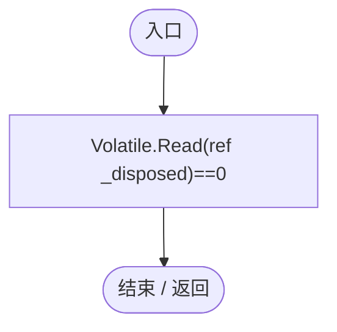

<a id="m5e1f70bc7fd056b4"></a>

### LanConnection.ctor · L21

`public LanConnection(TcpClient client,int maxBytes,int maxQueue,Action<LanConnection,string> received,Action<LanConnection> closed)`


#### Editor / Player · Roslyn编译器控制流

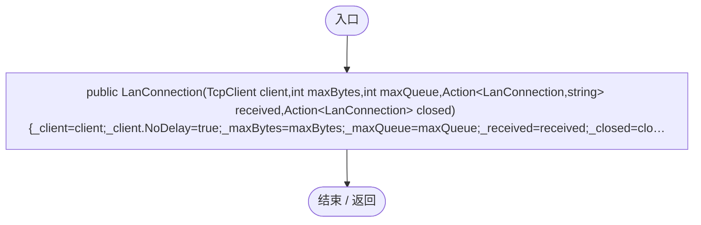

<a id="mf12837a14b366c30"></a>

### Start · L23

`public void Start()`


#### Editor / Player · Roslyn编译器控制流

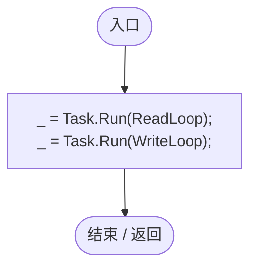

项目内调用/回调引用：

- [LanConnection.ReadLoop · L33](ServerCore.md#me89dc1948395f53b)（方法）
- [LanConnection.WriteLoop · L50](ServerCore.md#m452d6ca2ea06f150)（方法）

<a id="mf6b30ad306eab539"></a>

### Send · L24

`public void Send(string json)`


#### Editor / Player · Roslyn编译器控制流

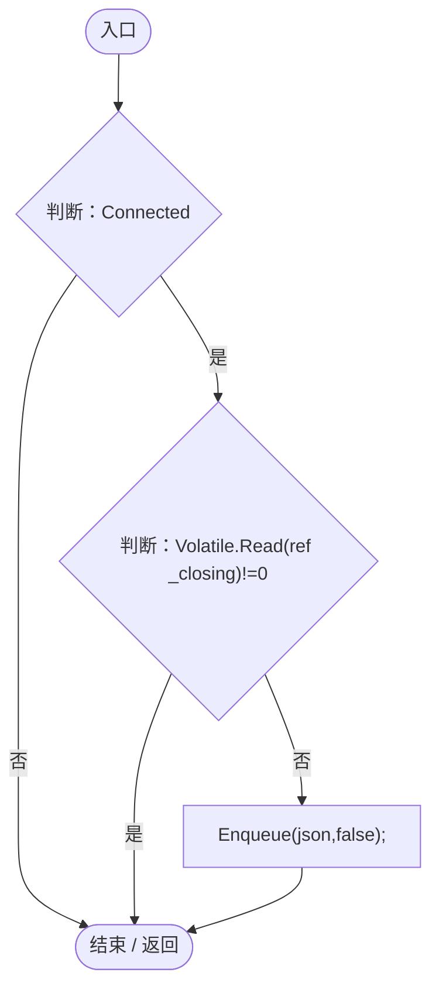

项目内调用/回调引用：

- [LanConnection.Enqueue · L31](ServerCore.md#mc7a684db22463eec)（方法）

<a id="m0e2d60a2a0c1b6ea"></a>

### SendAndClose · L29

`public void SendAndClose(string json)`

✦ 新增：拒绝原因写完再断开，避免客户端只看到不明确的网络中断。

#### Editor / Player · Roslyn编译器控制流

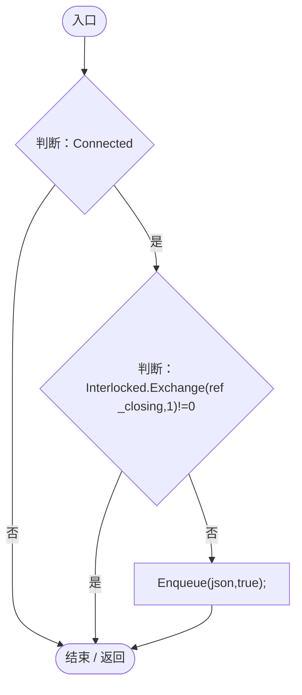

项目内调用/回调引用：

- [LanConnection.Enqueue · L31](ServerCore.md#mc7a684db22463eec)（方法）

<a id="mc7a684db22463eec"></a>

### Enqueue · L31

`private void Enqueue(string json,bool close)`


#### Editor / Player · Roslyn编译器控制流

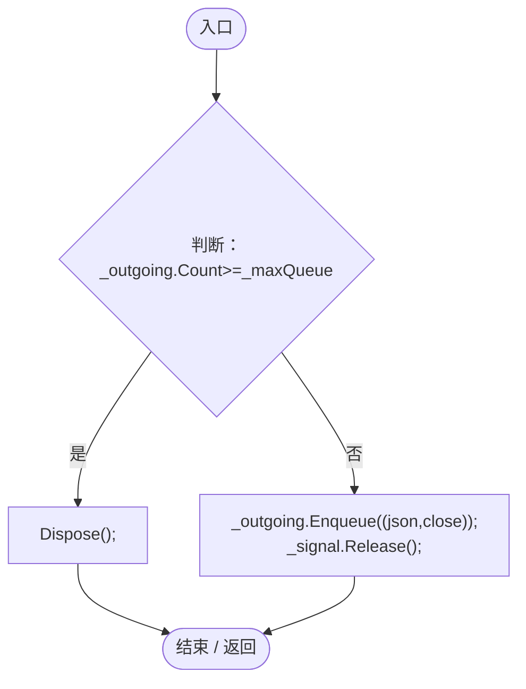

项目内调用/回调引用：

- [LanConnection.Dispose · L68](ServerCore.md#m9c3fd25afe51cbe8)（方法）

<a id="me89dc1948395f53b"></a>

### ReadLoop · L33

`private async Task ReadLoop()`


#### Editor / Player · Roslyn编译器控制流

```mermaid
flowchart TD
  b0(["入口"])
  b1["stream=_client.GetStream()<br/>header=new byte[4]"]
  b2{"判断：Connected"}
  b3{"await Exact(stream,header);<br/>length=header[0]&#124;header[1]&lt;&lt;8&#124;header[2]&lt;&lt;16&#124;header[3]&lt;&lt;24<br/>判断：length&lt;=0"}
  b4{"判断：length&gt;_maxBytes"}
  b5["结果：new InvalidDataException(&quot;网络数据包长度无效&quot;)"]
  x5(["抛出异常 / 离开方法"])
  b6["bytes=new byte[length]<br/>await Exact(stream,bytes);<br/>_received(this,Encoding.UTF8.GetString(bytes));"]
  b7{"(Exception ex)<br/>判断：ex is IOException"}
  b8{"判断：ex is SocketException"}
  b9{"判断：ex is ObjectDisposedException"}
  b10{"判断：ex is InvalidOperationException"}
  b11["连接 / 离开区域"]
  b12["Dispose();"]
  b13(["结束 / 返回"])
  b0 --> b1
  b1 --> b2
  b2 -->|"是"| b3
  b2 -->|"否 · 经过finally 12"| b13
  b3 -->|"否"| b4
  b3 -->|"是"| b5
  b4 -->|"是"| b5
  b4 -->|"否"| b6
  b5 -->|"Throw"| x5
  b6 --> b2
  b7 -->|"否"| b8
  b7 -->|"是"| b11
  b8 -->|"否"| b9
  b8 -->|"是"| b11
  b9 -->|"否"| b10
  b9 -->|"是"| b11
  b10 -->|"是"| b11
  b11 -->|"经过finally 12"| b13
  b1 -. "退出保护区时 finally（示意）" .-> b12

```

项目内调用/回调引用：

- [LanConnection.Exact · L48](ServerCore.md#m119708237969637a)（方法）
- [LanConnection.Dispose · L68](ServerCore.md#m9c3fd25afe51cbe8)（方法）

<a id="m119708237969637a"></a>

### Exact · L48

`private static async Task Exact(NetworkStream stream,byte[] bytes)`


#### Editor / Player · Roslyn编译器控制流

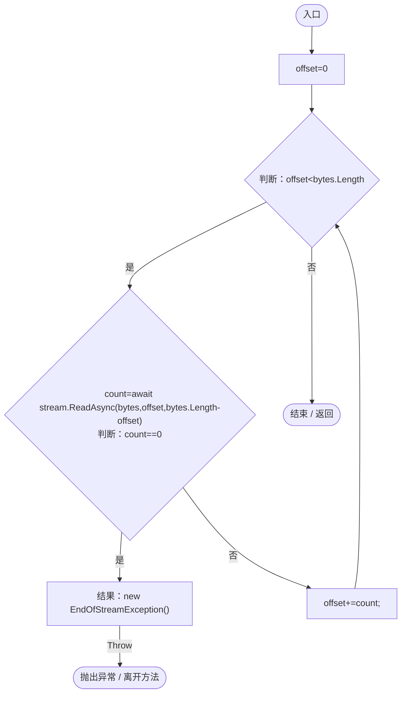

<a id="m452d6ca2ea06f150"></a>

### WriteLoop · L50

`private async Task WriteLoop()`


#### Editor / Player · Roslyn编译器控制流

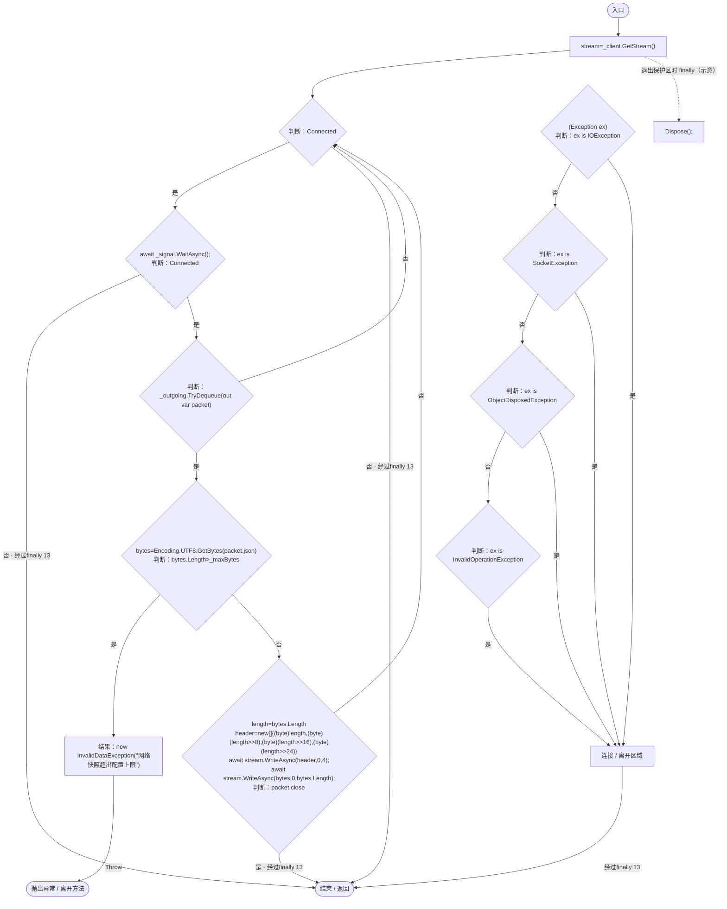

项目内调用/回调引用：

- [LanConnection.Dispose · L68](ServerCore.md#m9c3fd25afe51cbe8)（方法）

<a id="m9c3fd25afe51cbe8"></a>

### Dispose · L68

`public void Dispose()`


#### Editor / Player · Roslyn编译器控制流

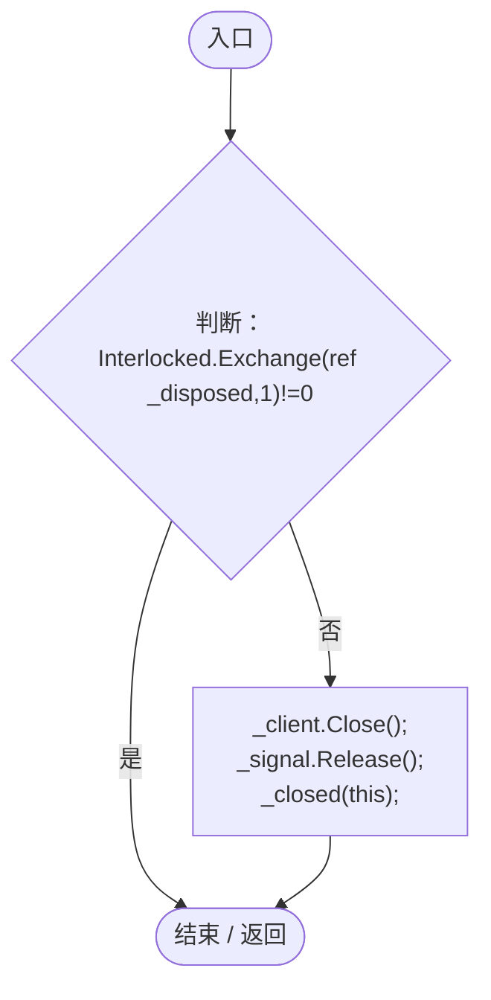

<a id="mf09084b18b6f501d"></a>

### Port.get · L73

`public int Port`


#### Editor / Player · 语法控制结构 / 声明（非CFG）

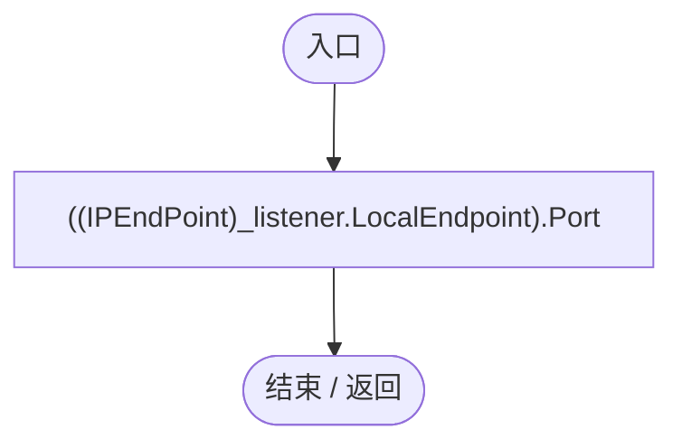

<a id="mdb9ae5e8d236eb67"></a>

### LanListener.ctor · L74

`public LanListener(int port,Action<TcpClient> accept)`


#### Editor / Player · Roslyn编译器控制流

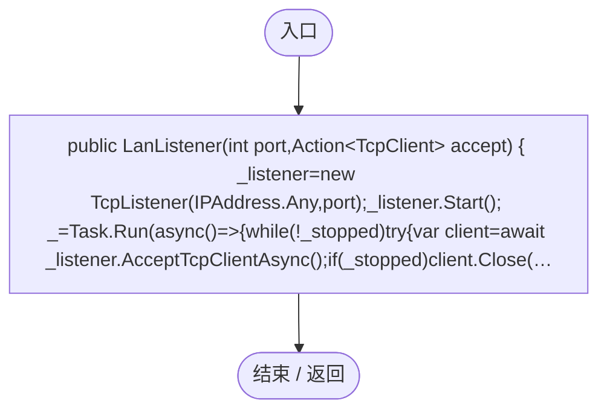

项目内调用/回调引用：

- [LanListener.回调@77 · L77](ServerCore.md#m48970e09ef771235)（回调/委托）

<a id="m48970e09ef771235"></a>

### 回调@77 · L77

`async async … => 回调`


#### Editor / Player · Roslyn编译器控制流

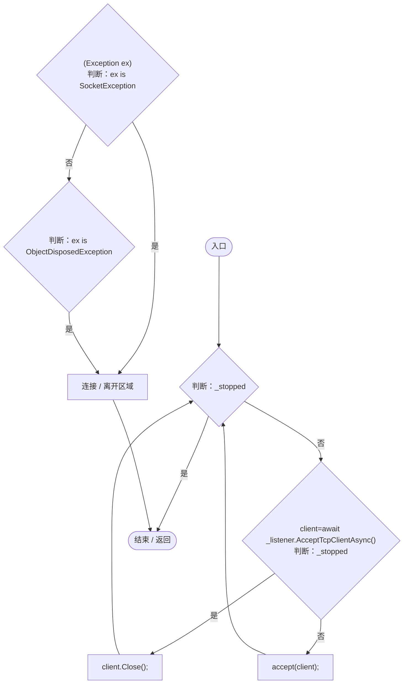

<a id="m7e2bf004b3f3a8f7"></a>

### Dispose · L79

`public void Dispose()`


#### Editor / Player · Roslyn编译器控制流

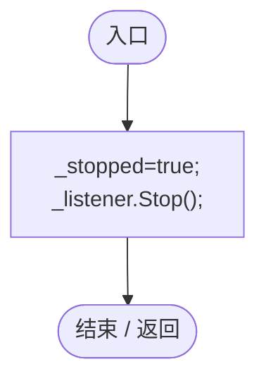


---

<a id="s9acebbb485f3dc57"></a>

## ServerCompatibility.cs

`Runtime` · `Assets/DarwinPark/ServerCore/ServerCompatibility.cs`

[源文件](../../../Assets/DarwinPark/ServerCore/ServerCompatibility.cs) · 源码校验：`f6cecefe9e444a7a697acb025df0b59e680efc0899687ea79d349534eb1e8920`

方法按源文件位置排列。事件/回调引用不表示立即执行；完整源码与关系图请打开离线手册。

<a id="ma340a35e43a8f5b7"></a>

### Validate · L12

`public void Validate()`


#### Editor / Player · Roslyn编译器控制流

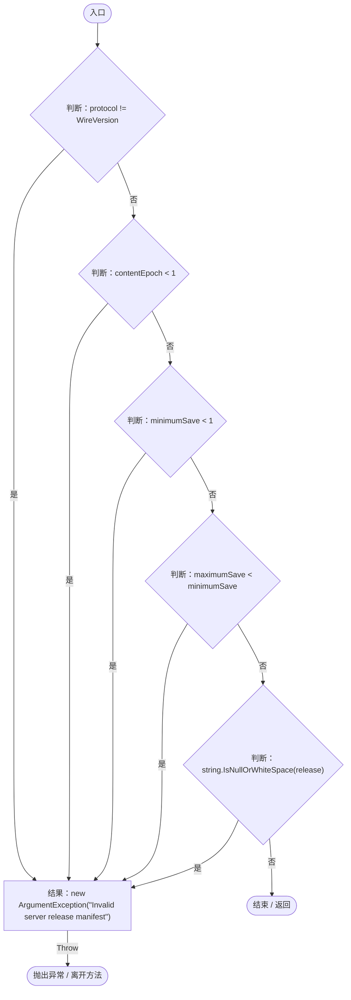

<a id="mf9d29c649406b0f5"></a>

### Reject · L18

`public string Reject(ServerCompatibility remote)`


#### Editor / Player · Roslyn编译器控制流

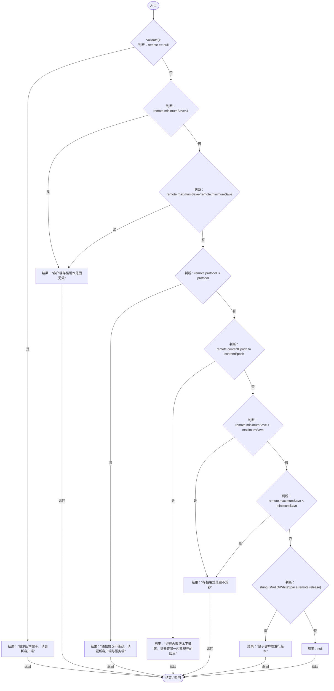

项目内调用/回调引用：

- [ServerCompatibility.Validate · L12](ServerCore.md#ma340a35e43a8f5b7)（方法）

<a id="md74a190ee8a489bc"></a>

### RequireSave · L30

`public void RequireSave(int version)`


#### Editor / Player · Roslyn编译器控制流

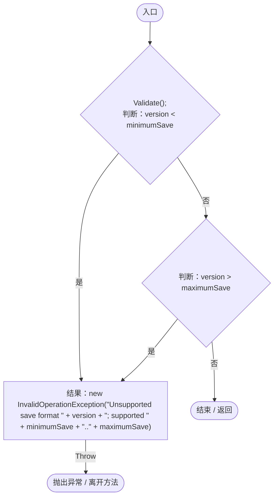

项目内调用/回调引用：

- [ServerCompatibility.Validate · L12](ServerCore.md#ma340a35e43a8f5b7)（方法）

<a id="m8e11cb32173288d5"></a>

### RequireWorld · L36

`public void RequireWorld(int saveVersion,int savedContentEpoch)`


#### Editor / Player · Roslyn编译器控制流

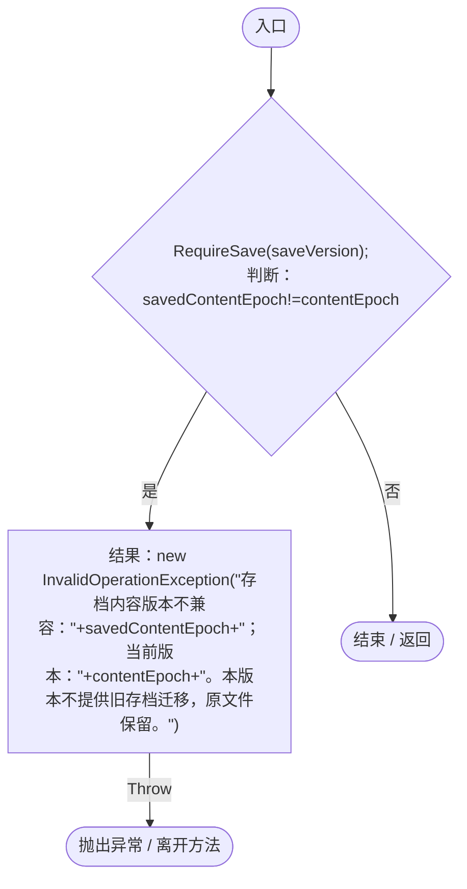

项目内调用/回调引用：

- [ServerCompatibility.RequireSave · L30](ServerCore.md#md74a190ee8a489bc)（方法）

<a id="m01d1a7c89e89072f"></a>

### Joined.get · L47

`get`


#### Editor / Player · 语法控制结构 / 声明（非CFG）

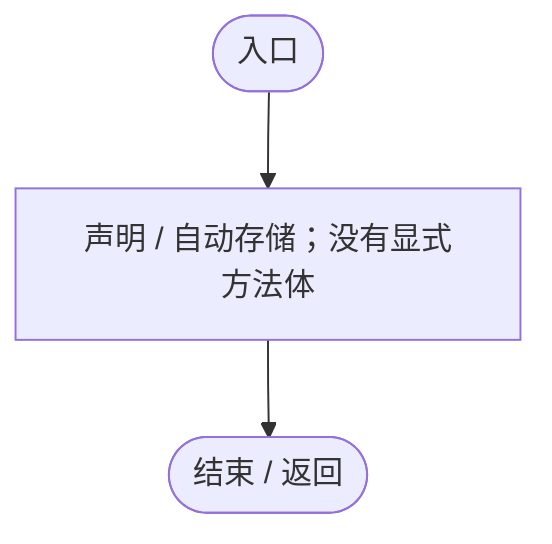

<a id="mcc3a692021d1f37e"></a>

### Joined.set · L47

`private set`


#### Editor / Player · 语法控制结构 / 声明（非CFG）

```mermaid
flowchart TD
  n2(["入口"])
  n1["声明 / 自动存储；没有显式方法体"]
  n0(["结束 / 返回"])
  n1 --> n0
  n2 --> n1

```

<a id="md945894d2516ff50"></a>

### Ready.get · L48

`get`


#### Editor / Player · 语法控制结构 / 声明（非CFG）

```mermaid
flowchart TD
  n2(["入口"])
  n1["声明 / 自动存储；没有显式方法体"]
  n0(["结束 / 返回"])
  n1 --> n0
  n2 --> n1

```

<a id="me58001927e7e77d5"></a>

### Ready.set · L48

`private set`


#### Editor / Player · 语法控制结构 / 声明（非CFG）

```mermaid
flowchart TD
  n2(["入口"])
  n1["声明 / 自动存储；没有显式方法体"]
  n0(["结束 / 返回"])
  n1 --> n0
  n2 --> n1

```

<a id="mcfe5fbfd32c5fb43"></a>

### Rejected.get · L49

`get`


#### Editor / Player · 语法控制结构 / 声明（非CFG）

```mermaid
flowchart TD
  n2(["入口"])
  n1["声明 / 自动存储；没有显式方法体"]
  n0(["结束 / 返回"])
  n1 --> n0
  n2 --> n1

```

<a id="m1d8fae951f4e1822"></a>

### Rejected.set · L49

`private set`


#### Editor / Player · 语法控制结构 / 声明（非CFG）

```mermaid
flowchart TD
  n2(["入口"])
  n1["声明 / 自动存储；没有显式方法体"]
  n0(["结束 / 返回"])
  n1 --> n0
  n2 --> n1

```

<a id="mb1408164390abf62"></a>

### Since.get · L50

`get`


#### Editor / Player · 语法控制结构 / 声明（非CFG）

```mermaid
flowchart TD
  n2(["入口"])
  n1["声明 / 自动存储；没有显式方法体"]
  n0(["结束 / 返回"])
  n1 --> n0
  n2 --> n1

```

<a id="me7dfb8dc81f5ccf0"></a>

### Since.set · L50

`private set`


#### Editor / Player · 语法控制结构 / 声明（非CFG）

```mermaid
flowchart TD
  n2(["入口"])
  n1["声明 / 自动存储；没有显式方法体"]
  n0(["结束 / 返回"])
  n1 --> n0
  n2 --> n1

```

<a id="m866299fb7c4ec453"></a>

### WorldRevision.get · L51

`get`


#### Editor / Player · 语法控制结构 / 声明（非CFG）

```mermaid
flowchart TD
  n2(["入口"])
  n1["声明 / 自动存储；没有显式方法体"]
  n0(["结束 / 返回"])
  n1 --> n0
  n2 --> n1

```

<a id="m5a4cfefae0ea59a8"></a>

### WorldRevision.set · L51

`private set`


#### Editor / Player · 语法控制结构 / 声明（非CFG）

```mermaid
flowchart TD
  n2(["入口"])
  n1["声明 / 自动存储；没有显式方法体"]
  n0(["结束 / 返回"])
  n1 --> n0
  n2 --> n1

```

<a id="m084a9a108efbcf9f"></a>

### ServerAdmission.ctor · L52

`public ServerAdmission(double now)`


#### Editor / Player · Roslyn编译器控制流

```mermaid
flowchart TD
  b0(["入口"])
  b1["public ServerAdmission(double now) { Since = now; }<br/>Since = now;"]
  b2(["结束 / 返回"])
  b0 --> b1
  b1 --> b2

```

项目内调用/回调引用：

- [ServerAdmission.Since.set · L50](ServerCore.md#me7dfb8dc81f5ccf0)（访问器）

<a id="m03e456fd38a36135"></a>

### Join · L53

`public string Join(ServerCompatibility local, ServerCompatibility remote, double now)`


#### Editor / Player · Roslyn编译器控制流

```mermaid
flowchart TD
  b0(["入口"])
  b1{"判断：Joined"}
  b2{"判断：Rejected"}
  b3["结果：&quot;重复入服握手&quot;"]
  b4{"reason = local.Reject(remote)<br/>判断：reason != null"}
  b5["Rejected = true;<br/>结果：reason"]
  b6["Joined = true;<br/>Since = now;<br/>结果：null"]
  b7(["结束 / 返回"])
  b0 --> b1
  b1 -->|"否"| b2
  b1 -->|"是"| b3
  b2 -->|"是"| b3
  b2 -->|"否"| b4
  b3 -->|"返回"| b7
  b4 -->|"是"| b5
  b4 -->|"否"| b6
  b5 -->|"返回"| b7
  b6 -->|"返回"| b7

```

项目内调用/回调引用：

- [ServerAdmission.Joined.get · L47](ServerCore.md#m01d1a7c89e89072f)（访问器）
- [ServerAdmission.Rejected.get · L49](ServerCore.md#mcfe5fbfd32c5fb43)（访问器）
- [ServerCompatibility.Reject · L18](ServerCore.md#mf9d29c649406b0f5)（方法）
- [ServerAdmission.Rejected.set · L49](ServerCore.md#m1d8fae951f4e1822)（访问器）
- [ServerAdmission.Joined.set · L47](ServerCore.md#mcc3a692021d1f37e)（访问器）
- [ServerAdmission.Since.set · L50](ServerCore.md#me7dfb8dc81f5ccf0)（访问器）

<a id="m65f266b34fa1ac4b"></a>

### AcknowledgeWorld · L60

`public bool AcknowledgeWorld(long revision)`


#### Editor / Player · Roslyn编译器控制流

```mermaid
flowchart TD
  b0(["入口"])
  b1{"判断：Joined"}
  b2{"判断：Rejected"}
  b3{"判断：WorldRevision==0"}
  b4{"判断：revision!=WorldRevision"}
  b5["结果：false"]
  b6["Ready = true;<br/>结果：true"]
  b7(["结束 / 返回"])
  b0 --> b1
  b1 -->|"是"| b2
  b1 -->|"否"| b5
  b2 -->|"否"| b3
  b2 -->|"是"| b5
  b3 -->|"否"| b4
  b3 -->|"是"| b5
  b4 -->|"是"| b5
  b4 -->|"否"| b6
  b5 -->|"返回"| b7
  b6 -->|"返回"| b7

```

项目内调用/回调引用：

- [ServerAdmission.Joined.get · L47](ServerCore.md#m01d1a7c89e89072f)（访问器）
- [ServerAdmission.Rejected.get · L49](ServerCore.md#mcfe5fbfd32c5fb43)（访问器）
- [ServerAdmission.WorldRevision.get · L51](ServerCore.md#m866299fb7c4ec453)（访问器）
- [ServerAdmission.Ready.set · L48](ServerCore.md#me58001927e7e77d5)（访问器）

<a id="m109240af8cd4a29e"></a>

### Loading · L65

`public void Loading(double now)`


#### Editor / Player · Roslyn编译器控制流

```mermaid
flowchart TD
  b0(["入口"])
  b1["Ready = false;<br/>Since = now;<br/>WorldRevision++;"]
  b2(["结束 / 返回"])
  b0 --> b1
  b1 --> b2

```

项目内调用/回调引用：

- [ServerAdmission.Ready.set · L48](ServerCore.md#me58001927e7e77d5)（访问器）
- [ServerAdmission.Since.set · L50](ServerCore.md#me7dfb8dc81f5ccf0)（访问器）
- [ServerAdmission.WorldRevision.set · L51](ServerCore.md#m5a4cfefae0ea59a8)（访问器）
- [ServerAdmission.WorldRevision.get · L51](ServerCore.md#m866299fb7c4ec453)（访问器）

<a id="mf9b00ea83f84329b"></a>

### Expired · L66

`public bool Expired(double now, double handshakeTimeout, double loadingTimeout)`


#### Editor / Player · Roslyn编译器控制流

```mermaid
flowchart TD
  b0(["入口"])
  b1{"判断：Ready"}
  b2{"now - Since<br/>判断：Joined"}
  b3["loadingTimeout"]
  b4["handshakeTimeout"]
  b5["now - Since &gt; (Joined ? loadingTimeout : handshakeTimeout)"]
  b6["!Ready"]
  b7["结果：!Ready &amp;&amp; now - Since &gt; (Joined ? loadingTimeout : handshakeTimeout)"]
  b8(["结束 / 返回"])
  b0 --> b1
  b1 -->|"否"| b2
  b1 -->|"是"| b6
  b2 -->|"是"| b3
  b2 -->|"否"| b4
  b3 --> b5
  b4 --> b5
  b5 --> b7
  b6 --> b7
  b7 -->|"返回"| b8

```

项目内调用/回调引用：

- [ServerAdmission.Ready.get · L48](ServerCore.md#md945894d2516ff50)（访问器）
- [ServerAdmission.Since.get · L50](ServerCore.md#mb1408164390abf62)（访问器）
- [ServerAdmission.Joined.get · L47](ServerCore.md#m01d1a7c89e89072f)（访问器）

<a id="m15197a3de713a7c8"></a>

### CanCommand.get · L68

`public bool CanCommand`


#### Editor / Player · 语法控制结构 / 声明（非CFG）

```mermaid
flowchart TD
  n2(["入口"])
  n1["Joined &amp;&amp; Ready &amp;&amp; !Rejected"]
  n0(["结束 / 返回"])
  n1 --> n0
  n2 --> n1

```

项目内调用/回调引用：

- [ServerAdmission.Joined.get · L47](ServerCore.md#m01d1a7c89e89072f)（访问器）
- [ServerAdmission.Ready.get · L48](ServerCore.md#md945894d2516ff50)（访问器）
- [ServerAdmission.Rejected.get · L49](ServerCore.md#mcfe5fbfd32c5fb43)（访问器）

<a id="m2e2a407706678d36"></a>

### Block · L69

`public void Block()`


#### Editor / Player · Roslyn编译器控制流

```mermaid
flowchart TD
  b0(["入口"])
  b1["Rejected=true;<br/>Ready=false;"]
  b2(["结束 / 返回"])
  b0 --> b1
  b1 --> b2

```

项目内调用/回调引用：

- [ServerAdmission.Rejected.set · L49](ServerCore.md#m1d8fae951f4e1822)（访问器）
- [ServerAdmission.Ready.set · L48](ServerCore.md#me58001927e7e77d5)（访问器）
