# ServerUnity 模块流程

[返回总索引](../README.md) · [离线交互手册](../index.html)

## 脚本目录

- [Assets/DarwinPark/ServerUnity/DedicatedServerBootstrap.cs](#s1bd587546988f02f)（12个方法/回调）
- [Assets/DarwinPark/ServerUnity/DedicatedServerHealth.cs](#see98352dcad837a8)（1个方法/回调）
- [Assets/DarwinPark/ServerUnity/LanEditExecutor.cs](#s939769558256231b)（11个方法/回调）
- [Assets/DarwinPark/ServerUnity/LanServerRuntime.cs](#sf63fbb9b89850fc4)（46个方法/回调）
- [Assets/DarwinPark/ServerUnity/LanWorldSnapshot.cs](#s2d33024e65aac853)（8个方法/回调）
- [Assets/DarwinPark/ServerUnity/ServerRuntimeRegistration.cs](#s0a01611594871963)（2个方法/回调）

---

<a id="s1bd587546988f02f"></a>

## DedicatedServerBootstrap.cs

`Runtime` · `Assets/DarwinPark/ServerUnity/DedicatedServerBootstrap.cs`

[源文件](../../../Assets/DarwinPark/ServerUnity/DedicatedServerBootstrap.cs) · 源码校验：`a88cfb14f08a86cb30cbb6acbbb7786dd5e49bf2db6a63caad5d362ca3057532`

方法按源文件位置排列。事件/回调引用不表示立即执行；完整源码与关系图请打开离线手册。

<a id="m53fdb4e9fd40ab7e"></a>

### Validate · L19

`public void Validate()`


#### Editor / Player · Roslyn编译器控制流

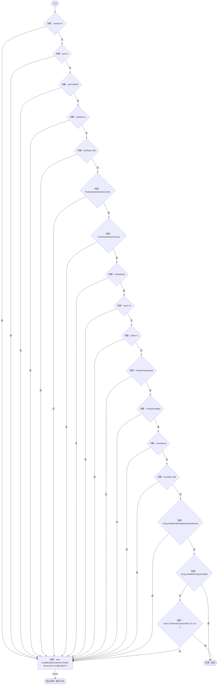

项目内调用/回调引用：

- [DedicatedServerBootstrap.Settings.Positive · L25](ServerUnity.md#mabfc6e8d3edb2b6a)（方法）
- [DedicatedServerBootstrap.Settings.Finite · L24](ServerUnity.md#m9fff7e9c3a810314)（方法）

<a id="m9fff7e9c3a810314"></a>

### Finite · L24

`private static bool Finite(float n)`


#### Editor / Player · Roslyn编译器控制流

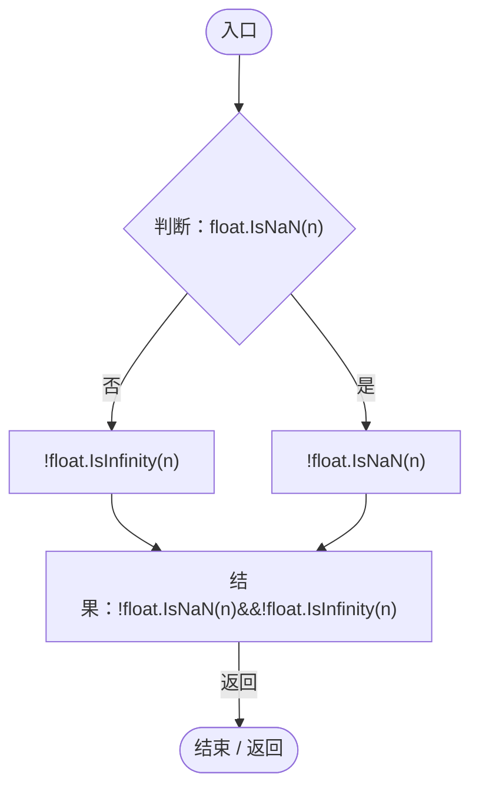

<a id="mabfc6e8d3edb2b6a"></a>

### Positive · L25

`private static bool Positive(float n)`


#### Editor / Player · Roslyn编译器控制流

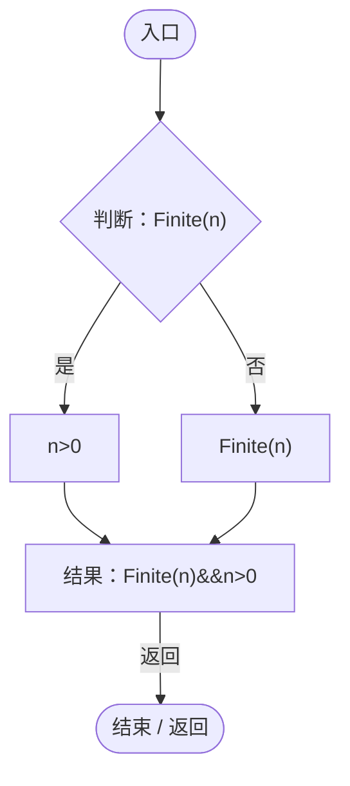

项目内调用/回调引用：

- [DedicatedServerBootstrap.Settings.Finite · L24](ServerUnity.md#m9fff7e9c3a810314)（方法）

<a id="m1aebb01588606791"></a>

### Pointer.get · L31

`private string Pointer`


#### Editor / Player · 语法控制结构 / 声明（非CFG）

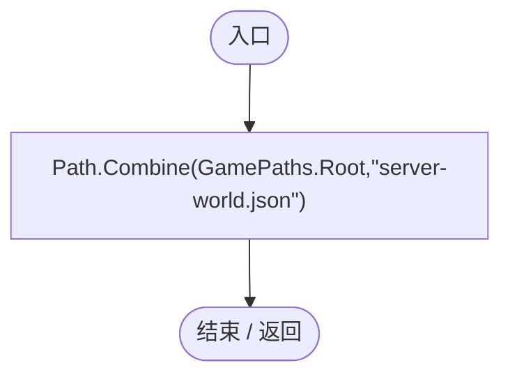

<a id="m21ddb914309361c4"></a>

### StopRequest.get · L32

`private string StopRequest`


#### Editor / Player · 语法控制结构 / 声明（非CFG）

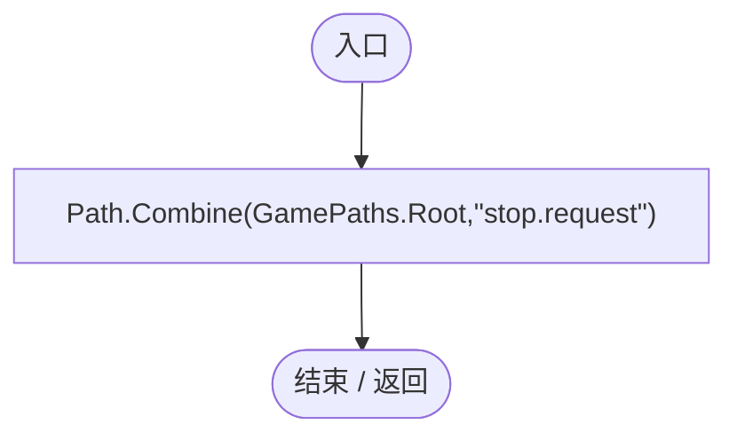

<a id="m62ff13260960a129"></a>

### Awake · L33

`private void Awake()`


#### Editor / Player · Roslyn编译器控制流

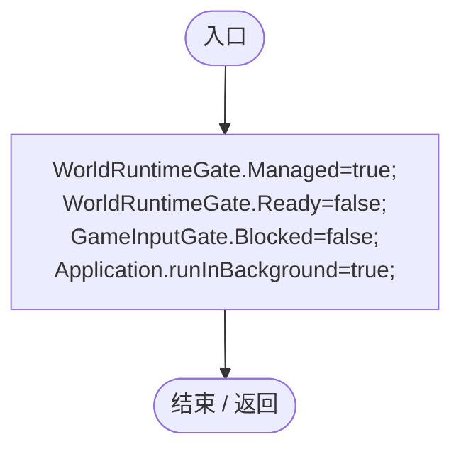

项目内调用/回调引用：

- [GameInputGate.Blocked.set · L8](Core.md#m578697f6379686f4)（访问器）

<a id="m7ad2c52b2013dff1"></a>

### Start · L38

`private IEnumerator Start()`


#### Editor / Player · Roslyn编译器控制流

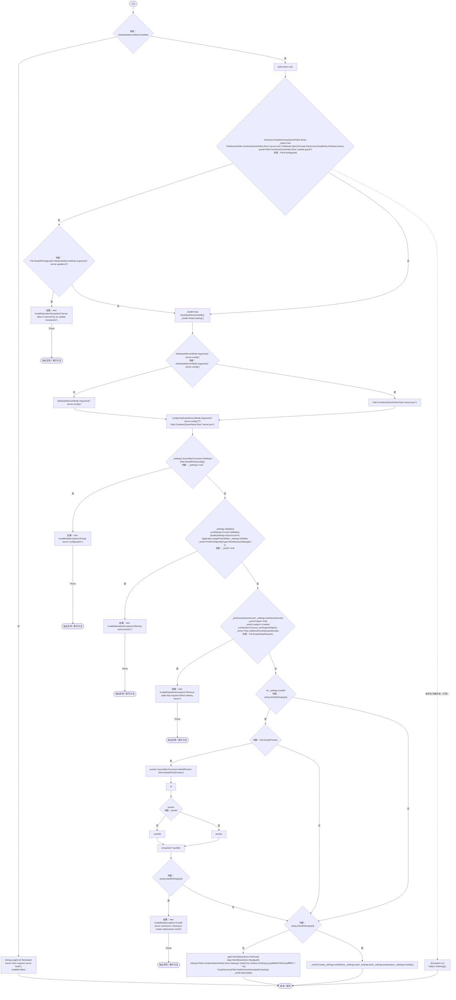

项目内调用/回调引用：

- [DedicatedServerMode.Enabled.get · L11](Core.md#mbc77f72f83f4ad28)（访问器）
- [DedicatedServerMode.Argument · L20](Core.md#m61adefccc181dfa8)（方法）
- [DedicatedServerHealth.Write · L19](ServerUnity.md#m47b22a56fda9d92a)（方法）
- [DedicatedServerBootstrap.Settings.Validate · L19](ServerUnity.md#m53fdb4e9fd40ab7e)（方法）
- [ServerCompatibility.Validate · L12](ServerCore.md#ma340a35e43a8f5b7)（方法）
- [LanRelease.Current.get · L60](Gameplay.md#m66eb45c03cc42f2d)（访问器）
- [LanSession.Ensure · L43](Gameplay.md#m1697880211ef51a3)（方法）
- [WorldSaveStore.FileFor · L54](Gameplay.md#ma1dd451e3efc92e1)（方法）
- [WorldSaveStore.Read · L78](Gameplay.md#m929e1e4385af43eb)（方法）
- [DedicatedServerBootstrap.CopyDirectory · L78](ServerUnity.md#m36f3dab32776276d)（方法）
- [WorldSessionManager.Open · L62](Gameplay.md#m2810b58b13a0b127)（方法）
- [WorldSessionManager.Create · L43](Gameplay.md#m622e74f5005e5fda)（方法）
- [DedicatedServerBootstrap.Fail · L109](ServerUnity.md#mbde006bd9b101862)（方法）
- [DedicatedServerBootstrap.Loaded · L84](ServerUnity.md#ma3c43b85d99da2e1)（方法）

<a id="m36f3dab32776276d"></a>

### CopyDirectory · L78

`private static void CopyDirectory(string source,string target)`


#### Editor / Player · Roslyn编译器控制流

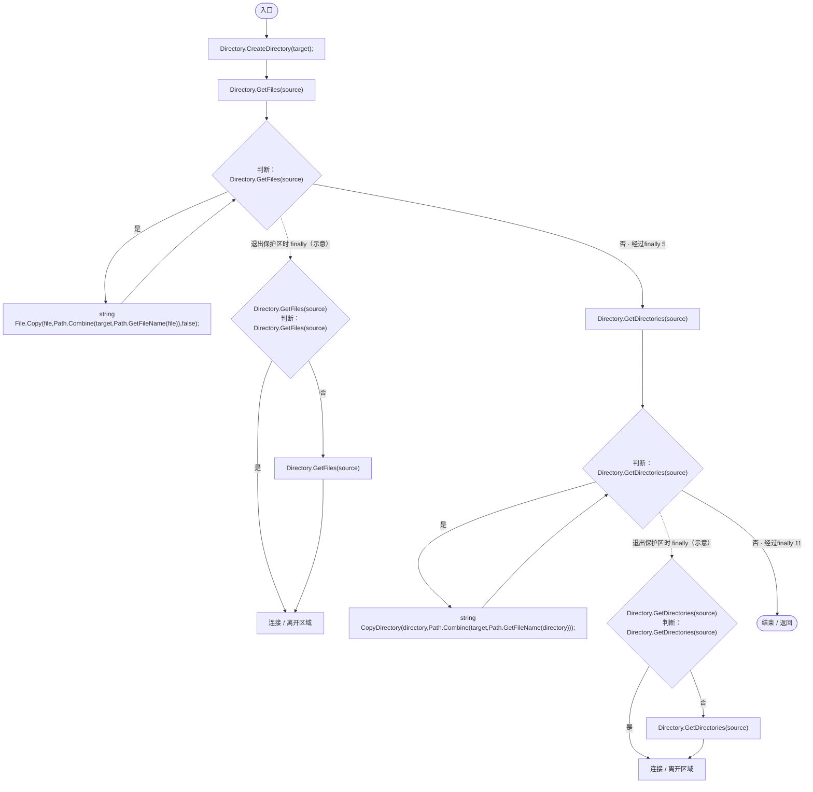

项目内调用/回调引用：

- [DedicatedServerBootstrap.CopyDirectory · L78](ServerUnity.md#m36f3dab32776276d)（方法）

<a id="ma3c43b85d99da2e1"></a>

### Loaded · L84

`private void Loaded()`


#### Editor / Player · Roslyn编译器控制流

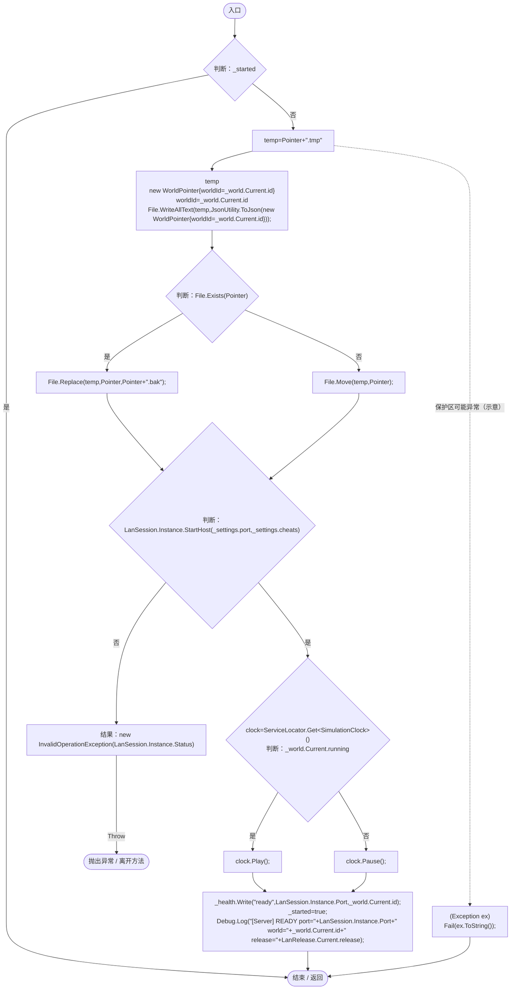

项目内调用/回调引用：

- [WorldSessionManager.Current.get · L22](Gameplay.md#m6b2be994a0f48af8)（访问器）
- [LanSession.StartHost · L56](Gameplay.md#m4ae187f2c037f2e0)（方法）
- [LanSession.Instance.get · L22](Gameplay.md#m7dfdbb06da9ac3a5)（访问器）
- [LanSession.Status.get · L30](Gameplay.md#mb0cf5b4a7385539a)（访问器）
- [ServiceLocator.Get · L33](Core.md#m2ae625299520c56d)（方法）
- [SimulationClock.Play · L78](Core.md#m7aa9e64b7de60ed0)（方法）
- [SimulationClock.Pause · L79](Core.md#m30929d45a885d0f1)（方法）
- [DedicatedServerHealth.Write · L19](ServerUnity.md#m47b22a56fda9d92a)（方法）
- [LanRelease.Current.get · L60](Gameplay.md#m66eb45c03cc42f2d)（访问器）
- [DedicatedServerBootstrap.Fail · L109](ServerUnity.md#mbde006bd9b101862)（方法）

<a id="m86674c42bf684e62"></a>

### Update · L98

`private void Update()`


#### Editor / Player · Roslyn编译器控制流

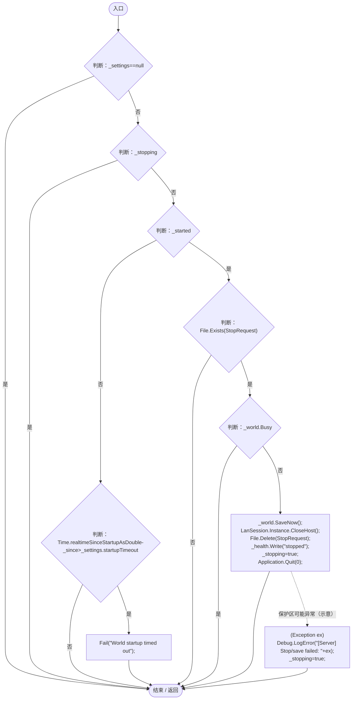

项目内调用/回调引用：

- [DedicatedServerBootstrap.Fail · L109](ServerUnity.md#mbde006bd9b101862)（方法）
- [WorldSessionManager.Busy.get · L25](Gameplay.md#mcc5801b0afa73345)（访问器）
- [WorldSessionManager.SaveNow · L173](Gameplay.md#ma6331256b4d51423)（方法）
- [LanSession.CloseHost · L57](Gameplay.md#m19519c1a545bafef)（方法）
- [LanSession.Instance.get · L22](Gameplay.md#m7dfdbb06da9ac3a5)（访问器）
- [DedicatedServerHealth.Write · L19](ServerUnity.md#m47b22a56fda9d92a)（方法）

<a id="mbde006bd9b101862"></a>

### Fail · L109

`private void Fail(string error)`


#### Editor / Player · Roslyn编译器控制流

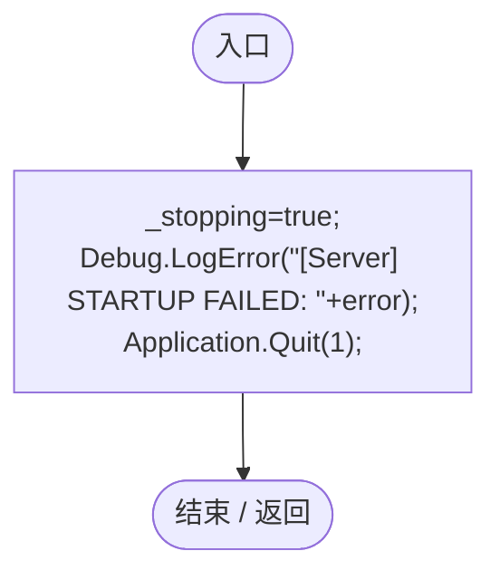

<a id="m43ad678807e9cb44"></a>

### OnDestroy · L110

`private void OnDestroy()`


#### Editor / Player · Roslyn编译器控制流

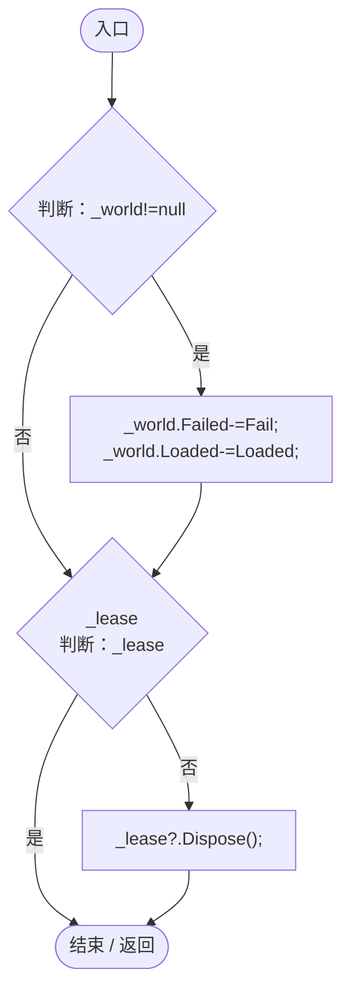

项目内调用/回调引用：

- [DedicatedServerBootstrap.Fail · L109](ServerUnity.md#mbde006bd9b101862)（方法）
- [DedicatedServerBootstrap.Loaded · L84](ServerUnity.md#ma3c43b85d99da2e1)（方法）


---

<a id="see98352dcad837a8"></a>

## DedicatedServerHealth.cs

`Runtime` · `Assets/DarwinPark/ServerUnity/DedicatedServerHealth.cs`

[源文件](../../../Assets/DarwinPark/ServerUnity/DedicatedServerHealth.cs) · 源码校验：`828440eb1b34b61b6e2f1eeb13a787a4a4388fc405b91adcc39399ee44f52ba9`

方法按源文件位置排列。事件/回调引用不表示立即执行；完整源码与关系图请打开离线手册。

<a id="m47b22a56fda9d92a"></a>

### Write · L19

`public void Write(string state, int port = 0, string worldId = "")`


#### Editor / Player · Roslyn编译器控制流

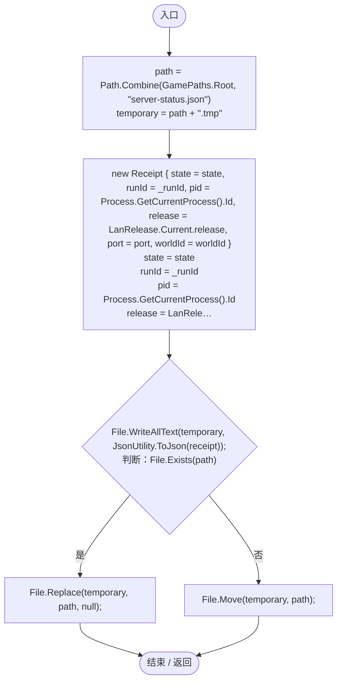

项目内调用/回调引用：

- [LanRelease.Current.get · L60](Gameplay.md#m66eb45c03cc42f2d)（访问器）


---

<a id="s939769558256231b"></a>

## LanEditExecutor.cs

`Runtime` · `Assets/DarwinPark/ServerUnity/LanEditExecutor.cs`

[源文件](../../../Assets/DarwinPark/ServerUnity/LanEditExecutor.cs) · 源码校验：`939f461aebccb6d504c5fe35873d66d268930a68b6f1a2bf0a416c9572172cbc`

方法按源文件位置排列。事件/回调引用不表示立即执行；完整源码与关系图请打开离线手册。

<a id="ma7b8740cc353a594"></a>

### Apply · L16

`public static bool Apply(LanCommand command,LanSession session)`


#### Editor / Player · Roslyn编译器控制流

```mermaid
flowchart TD
  b0(["入口"])
  b1{"判断：command==null"}
  b2{"判断：WorldRuntimeGate.Loading"}
  b3["结果：false"]
  b4["entity=EcologyIdentity.Find(command.entity)"]
  b5["command.kind"]
  b6{"判断：&quot;entityStage&quot;"}
  b7["结果：EntityStateEditor.SetStage(entity,(AgeState)command.count)"]
  b8{"判断：&quot;entityStat&quot;"}
  b9["结果：EntityStateEditor.SetStat(entity,command.parameter,command.value)"]
  b10{"判断：&quot;bodyPart&quot;"}
  b11["结果：EntityBodyEditor.Apply(entity,command.bodyPart,!command.enabled)"]
  b12{"判断：&quot;activityPlan&quot;"}
  b13["结果：EntityActivityPlan.Apply(entity,command.activityPlan)"]
  b14{"判断：&quot;worldSettings&quot;"}
  b15["结果：WorldEntityActions.SetLimit(command.count,command.running)"]
  b16{"判断：&quot;clearEntities&quot;"}
  b17["结果：WorldEntityActions.ClearAll()"]
  b18{"判断：&quot;gene&quot;"}
  b19{"判断：EcologyQueries.Alive(entity)"}
  b20{"判断：LanSession.Finite(command.value)"}
  b21["结果：false"]
  b22{"gene=entity.Genes.Genome.Find(command.gene)<br/>判断：gene==null"}
  b23["结果：false"]
  b24["gene.Value=Mathf.Clamp(command.value,0,100);<br/>entity.Genes.Recalculate();<br/>结果：true"]
  b25{"判断：&quot;addGene&quot;"}
  b26{"判断：EcologyQueries.Alive(entity)"}
  b27{"判断：entity.Genes.Genome.Genes.Count&gt;=LanSettings.Current.maximumGenomeGenes"}
  b28["结果：false"]
  b29{"definition=GeneDatabase.All.FirstOrDefault(g=&gt;g.Id==command.gene)<br/>判断：definition==null"}
  b30["结果：false"]
  b31["entity.Genes.Genome.Add(GeneInstance.Create(definition.Id,50,definition.Tier));<br/>entity.Genes.Recalculate();<br/>结果：true"]
  b32{"判断：&quot;geneState&quot;"}
  b33{"判断：EcologyQueries.Alive(entity)"}
  b34{"entity.GetComponent&lt;AntColonyMember&gt;()<br/>判断：entity.GetComponent&lt;AntColonyMember&gt;()"}
  b35[".Frozen"]
  b36["entity.GetComponent&lt;AntColonyMember&gt;()"]
  b37{"判断：entity.GetComponent&lt;AntColonyMember&gt;()?.Frozen==true"}
  b38["结果：false"]
  b39["modeGene=entity.Genes.Genome.Find(command.gene)"]
  b40{"判断：modeGene!=null"}
  b41["GeneDatabase.Get(modeGene.DefinitionId)"]
  b42["null"]
  b43["modeDefinition=modeGene!=null?GeneDatabase.Get(modeGene.DefinitionId):null"]
  b44{"modeDefinition<br/>判断：modeDefinition"}
  b45[".ExplicitState"]
  b46["modeDefinition"]
  b47{"判断：modeDefinition?.ExplicitState!=true"}
  b48{"判断：modeDefinition.States.Any(s=&gt;s.StateId==command.name)"}
  b49{"判断：modeGene.MissingStateIds.Contains(command.name)"}
  b50["结果：false"]
  b51["modeGene.StateId=command.name;<br/>entity.Genes.Recalculate();<br/>结果：true"]
  b52{"判断：&quot;rename&quot;"}
  b53{"判断：EcologyQueries.Alive(entity)"}
  b54["结果：false"]
  b55{"entity.DisplayName<br/>判断：string.IsNullOrWhiteSpace(command.name)"}
  b56["entity.Genes.GetRandomName()"]
  b57["command.name.Trim().Substring(0,Mathf.Min(command.name.Trim().Length,64))"]
  b58["entity.DisplayName=string.IsNullOrWhiteSpace(command.name)?entity.Genes.GetRandomName():command.name.Trim().Substring(0,Mathf.Min(command.name.Trim().Length,64));"]
  b59["结果：true"]
  b60{"判断：&quot;spawn&quot;"}
  b61{"判断：EntityPopulationLimit.CanSpawn"}
  b62{"判断：LanSession.Finite(command.point)"}
  b63{"判断：ValidGenome(command.genome)"}
  b64{"判断：DarwinEntity.Spawner==null"}
  b65["结果：false"]
  b66{"surfacePoint=EcologyQueries.Surface(command.point)<br/>altitude=Vector3.Dot(command.point-surfacePoint,EcologyQueries.Up(surfacePoint))<br/>判断：LanSession.Finite(altitude)"}
  b67["结果：false"]
  b68["DarwinEntity.Spawner(Genome.Copy(command.genome),surfacePoint+EcologyQueries.Up(surfacePoint)*Mathf.Clamp(altitude,0,EcologyQueries.Planet.heightScale),&quot;&quot;);<br/>结果：true"]
  b69{"判断：&quot;batch&quot;"}
  b70{"判断：LanSession.Finite(command.point)"}
  b71{"判断：LanSession.Finite(command.value)"}
  b72{"判断：LanSession.Finite(command.scale)"}
  b73{"判断：ValidGenome(command.genome)"}
  b74["结果：false"]
  b75{"planet=Object.FindFirstObjectByType&lt;PlanetTerrainMeshBuilder&gt;()<br/>判断：planet==null"}
  b76["结果：false"]
  b77["point=EcologyQueries.Surface(command.point)<br/>结果：WorldEntityActions.SpawnBatch(command.genome,point,EcologyQueries.Up(point),Mathf.Clamp(command.value,0,planet.heightScale),Mathf.Clamp(command.count,1,RandomPlanetSpawner.Ensure(ServiceLoca…"]
  b78{"判断：&quot;random&quot;"}
  b79{"判断：ValidGenome(command.genome)"}
  b80["RandomPlanetSpawner.Ensure(ServiceLocator.Get&lt;SimulationClock&gt;().gameObject).StartBatch(command.genome,command.count,command.landOnly)"]
  b81["ValidGenome(command.genome)"]
  b82["结果：ValidGenome(command.genome)&amp;&amp;RandomPlanetSpawner.Ensure(ServiceLocator.Get&lt;SimulationClock&gt;().gameObject).StartBatch(command.genome,command.count,command.landOnly)"]
  b83{"判断：&quot;randomRecipe&quot;"}
  b84["结果：RandomPlanetSpawner.Ensure(ServiceLocator.Get&lt;SimulationClock&gt;().gameObject).StartRecipe(command.recipe,command.count,command.landOnly)"]
  b85{"判断：&quot;maintenanceSet&quot;"}
  b86["结果：PopulationMaintenance.Set(command.maintenanceRule)"]
  b87{"判断：&quot;maintenanceRemove&quot;"}
  b88["结果：PopulationMaintenance.Remove(command.target)"]
  b89{"判断：&quot;ecologyDefaults&quot;"}
  b90["结果：EcologyDefaults.ApplyRules()"]
  b91{"判断：&quot;randomCancel&quot;"}
  b92["RandomPlanetSpawner.Ensure(ServiceLocator.Get&lt;SimulationClock&gt;().gameObject).Cancel();<br/>结果：true"]
  b93{"判断：&quot;time&quot;"}
  b94{"判断：LanSession.Finite(command.scale)"}
  b95{"判断：command.scale&lt;0"}
  b96{"判断：command.scale&gt;LanSettings.Current.maximumTimeScale"}
  b97["结果：false"]
  b98{"clock=ServiceLocator.Get&lt;SimulationClock&gt;()<br/>clock.SetTimeScale(command.scale);<br/>判断：command.running"}
  b99["clock.Play();"]
  b100["clock.Pause();"]
  b101["结果：true"]
  b102{"判断：&quot;parameter&quot;"}
  b103{"判断：command.name==null"}
  b104{"判断：LanSession.Finite(command.value)"}
  b105["结果：false"]
  b106["WorldParameterUpdate.Ensure()<br/>command.parameter"]
  b107{"command.name<br/>判断：command.name"}
  b108["command.name"]
  b109["command.value.ToString(&quot;R&quot;,System.Globalization.CultureInfo.InvariantCulture)"]
  b110["结果：WorldParameterUpdate.Ensure().Request(command.parameter,command.name??command.value.ToString(&quot;R&quot;,System.Globalization.CultureInfo.InvariantCulture),out _)"]
  b111{"判断：&quot;profile&quot;"}
  b112{"判断：command.definitions==null"}
  b113{"判断：command.definitions.Count&gt;LanSettings.Current.maximumGeneDefinitions"}
  b114{"判断：command.tree==null"}
  b115["结果：false"]
  b116["catalog=command.definitions.ToDictionary(d=&gt;d.id,d=&gt;d.json)"]
  b117["catalog"]
  b118{"判断：catalog"}
  b119["var"]
  b120{"parsed=JsonUtility.FromJson&lt;GeneDefinitionJson&gt;(pair.Value)<br/>判断：System.Text.RegularExpressions.Regex.IsMatch(pair.Key,&quot;^[A-Za-z0-9_-]+$&quot;)"}
  b121{"判断：parsed==null"}
  b122{"判断：parsed.id!=pair.Key"}
  b123{"判断：System.Enum.TryParse&lt;GeneCategory&gt;(parsed.category,true,out _)"}
  b124["结果：false"]
  b125["catalog"]
  b126{"判断：catalog.Count==0"}
  b127{"判断：EntityRegistry.All.Any(e=&gt;e.Genes.Genome.Genes.Any(g=&gt;!catalog.ContainsKey(g.DefinitionId)))"}
  b128["结果：false"]
  b129["GeneTreeStorage.Validate(command.tree,catalog);<br/>PopulationMaintenance.Validate(PopulationMaintenance.Capture(),catalog.Keys);<br/>GeneRuntimeProfile.Catalog=catalog;<br/>GeneRuntimeProfile.Tree=command.tree;<br/>GeneDatabase.Reload();<br/>GeneDatabase.E…"]
  b130["EntityRegistry.All"]
  b131{"判断：EntityRegistry.All"}
  b132["var<br/>current.Genes.Recalculate();"]
  b133{"判断：EntityRegistry.All"}
  b134["EntityRegistry.All"]
  b135["连接 / 离开区域"]
  b136["结果：true"]
  b137{"判断：&quot;save&quot;"}
  b138["Object.FindFirstObjectByType&lt;WorldSessionManager&gt;().SaveNow();<br/>结果：true"]
  b139["结果：false"]
  b140(["结束 / 返回"])
  b0 --> b1
  b1 -->|"否"| b2
  b1 -->|"是"| b3
  b2 -->|"是"| b3
  b2 -->|"否"| b4
  b3 -->|"返回"| b140
  b4 --> b5
  b5 --> b6
  b6 -->|"是"| b7
  b6 -->|"否"| b8
  b7 -->|"返回"| b140
  b8 -->|"是"| b9
  b8 -->|"否"| b10
  b9 -->|"返回"| b140
  b10 -->|"是"| b11
  b10 -->|"否"| b12
  b11 -->|"返回"| b140
  b12 -->|"是"| b13
  b12 -->|"否"| b14
  b13 -->|"返回"| b140
  b14 -->|"是"| b15
  b14 -->|"否"| b16
  b15 -->|"返回"| b140
  b16 -->|"是"| b17
  b16 -->|"否"| b18
  b17 -->|"返回"| b140
  b18 -->|"是"| b19
  b18 -->|"否"| b25
  b19 -->|"是"| b20
  b19 -->|"否"| b21
  b20 -->|"否"| b21
  b20 -->|"是"| b22
  b21 -->|"返回"| b140
  b22 -->|"是"| b23
  b22 -->|"否"| b24
  b23 -->|"返回"| b140
  b24 -->|"返回"| b140
  b25 -->|"是"| b26
  b25 -->|"否"| b32
  b26 -->|"是"| b27
  b26 -->|"否"| b28
  b27 -->|"是"| b28
  b27 -->|"否"| b29
  b28 -->|"返回"| b140
  b29 -->|"是"| b30
  b29 -->|"否"| b31
  b30 -->|"返回"| b140
  b31 -->|"返回"| b140
  b32 -->|"是"| b33
  b32 -->|"否"| b52
  b33 -->|"是"| b34
  b33 -->|"否"| b38
  b34 -->|"否"| b35
  b34 -->|"是"| b36
  b35 --> b37
  b36 --> b37
  b37 -->|"是"| b38
  b37 -->|"否"| b39
  b38 -->|"返回"| b140
  b39 --> b40
  b40 -->|"是"| b41
  b40 -->|"否"| b42
  b41 --> b43
  b42 --> b43
  b43 --> b44
  b44 -->|"否"| b45
  b44 -->|"是"| b46
  b45 --> b47
  b46 --> b47
  b47 -->|"否"| b48
  b47 -->|"是"| b50
  b48 -->|"是"| b49
  b48 -->|"否"| b50
  b49 -->|"是"| b50
  b49 -->|"否"| b51
  b50 -->|"返回"| b140
  b51 -->|"返回"| b140
  b52 -->|"是"| b53
  b52 -->|"否"| b60
  b53 -->|"否"| b54
  b53 -->|"是"| b55
  b54 -->|"返回"| b140
  b55 -->|"是"| b56
  b55 -->|"否"| b57
  b56 --> b58
  b57 --> b58
  b58 --> b59
  b59 -->|"返回"| b140
  b60 -->|"是"| b61
  b60 -->|"否"| b69
  b61 -->|"是"| b62
  b61 -->|"否"| b65
  b62 -->|"是"| b63
  b62 -->|"否"| b65
  b63 -->|"是"| b64
  b63 -->|"否"| b65
  b64 -->|"是"| b65
  b64 -->|"否"| b66
  b65 -->|"返回"| b140
  b66 -->|"否"| b67
  b66 -->|"是"| b68
  b67 -->|"返回"| b140
  b68 -->|"返回"| b140
  b69 -->|"是"| b70
  b69 -->|"否"| b78
  b70 -->|"是"| b71
  b70 -->|"否"| b74
  b71 -->|"是"| b72
  b71 -->|"否"| b74
  b72 -->|"是"| b73
  b72 -->|"否"| b74
  b73 -->|"否"| b74
  b73 -->|"是"| b75
  b74 -->|"返回"| b140
  b75 -->|"是"| b76
  b75 -->|"否"| b77
  b76 -->|"返回"| b140
  b77 -->|"返回"| b140
  b78 -->|"是"| b79
  b78 -->|"否"| b83
  b79 -->|"是"| b80
  b79 -->|"否"| b81
  b80 --> b82
  b81 --> b82
  b82 -->|"返回"| b140
  b83 -->|"是"| b84
  b83 -->|"否"| b85
  b84 -->|"返回"| b140
  b85 -->|"是"| b86
  b85 -->|"否"| b87
  b86 -->|"返回"| b140
  b87 -->|"是"| b88
  b87 -->|"否"| b89
  b88 -->|"返回"| b140
  b89 -->|"是"| b90
  b89 -->|"否"| b91
  b90 -->|"返回"| b140
  b91 -->|"是"| b92
  b91 -->|"否"| b93
  b92 -->|"返回"| b140
  b93 -->|"是"| b94
  b93 -->|"否"| b102
  b94 -->|"是"| b95
  b94 -->|"否"| b97
  b95 -->|"否"| b96
  b95 -->|"是"| b97
  b96 -->|"是"| b97
  b96 -->|"否"| b98
  b97 -->|"返回"| b140
  b98 -->|"是"| b99
  b98 -->|"否"| b100
  b99 --> b101
  b100 --> b101
  b101 -->|"返回"| b140
  b102 -->|"是"| b103
  b102 -->|"否"| b111
  b103 -->|"是"| b104
  b103 -->|"否"| b106
  b104 -->|"否"| b105
  b104 -->|"是"| b106
  b105 -->|"返回"| b140
  b106 --> b107
  b107 -->|"否"| b108
  b107 -->|"是"| b109
  b108 --> b110
  b109 --> b110
  b110 -->|"返回"| b140
  b111 -->|"是"| b112
  b111 -->|"否"| b137
  b112 -->|"否"| b113
  b112 -->|"是"| b115
  b113 -->|"否"| b114
  b113 -->|"是"| b115
  b114 -->|"是"| b115
  b114 -->|"否"| b116
  b115 -->|"返回"| b140
  b116 --> b117
  b117 --> b118
  b118 -->|"是"| b119
  b118 -->|"否 · 经过finally 125"| b126
  b119 --> b120
  b120 -->|"是"| b121
  b120 -->|"否"| b124
  b121 -->|"否"| b122
  b121 -->|"是"| b124
  b122 -->|"否"| b123
  b122 -->|"是"| b124
  b123 -->|"否"| b124
  b123 -->|"是"| b118
  b124 -->|"返回 · 经过finally 125"| b140
  b126 -->|"否"| b127
  b126 -->|"是"| b128
  b127 -->|"是"| b128
  b127 -->|"否"| b129
  b128 -->|"返回"| b140
  b129 --> b130
  b130 --> b131
  b131 -->|"是"| b132
  b131 -->|"否 · 经过finally 133"| b136
  b132 --> b131
  b133 -->|"否"| b134
  b133 -->|"是"| b135
  b134 --> b135
  b136 -->|"返回"| b140
  b137 -->|"是"| b138
  b137 -->|"否"| b139
  b138 -->|"返回"| b140
  b139 -->|"返回"| b140
  b118 -. "退出保护区时 finally（示意）" .-> b125
  b131 -. "退出保护区时 finally（示意）" .-> b133

```

项目内调用/回调引用：

- [EcologyIdentity.Find · L21](Entities.md#mb670b64dc2baff58)（方法）
- [EntityStateEditor.SetStage · L12](Entities.md#m5de8f77a2f5b1645)（方法）
- [EntityStateEditor.SetStat · L21](Entities.md#m6f132303f64ec122)（方法）
- [EntityBodyEditor.Apply · L8](Entities.md#mb6dbe82b466361cb)（方法）
- [EntityActivityPlan.Apply · L30](Entities.md#mf8d54b95739fdf36)（方法）
- [WorldEntityActions.SetLimit · L14](Gameplay.md#m5e470fe01b70cdb5)（方法）
- [WorldEntityActions.ClearAll · L25](Gameplay.md#m02d9366d9ab2ddb6)（方法）
- [EcologyQueries.Alive · L39](Entities.md#m8352bfacbe2996a8)（方法）
- [LanSession.Finite · L123](Gameplay.md#m0211cb4a362fb2ce)（方法）
- [Genome.Find · L32](Genetics.md#ma10d2d4c9987b7f8)（方法）
- [DarwinEntity.Genes.get · L14](Entities.md#m622eb1adf401d431)（访问器）
- [EntityGeneController.Recalculate · L122](Entities.md#m0c8090b8014eb248)（方法）
- [LanSettings.Current.get · L89](Gameplay.md#m7c4ce1b7ac167a0c)（访问器）
- [GeneDatabase.All.get · L133](Genetics.md#m85e4dda1780523a9)（访问器）
- [Genome.Add · L40](Genetics.md#m09a2a70d3adcbc14)（方法）
- [GeneInstance.Create · L22](Genetics.md#mdb15a75920d735a5)（方法）
- [GeneDatabase.Get · L140](Genetics.md#me2c5590ce9e38ef7)（方法）
- [GeneDefinition.ExplicitState.get · L68](Genetics.md#mbadafa853048abf8)（访问器）
- [EntityGeneController.GetRandomName · L275](Entities.md#m78cde48e34fc2bc8)（方法）
- [LanSession.Finite · L122](Gameplay.md#m17c932d26c5d8756)（方法）
- [LanEditExecutor.ValidGenome · L75](ServerUnity.md#m9bbe2c47af3244ff)（方法）
- [EcologyQueries.Surface · L48](Entities.md#m40ee3e975d7f5137)（方法）
- [EcologyQueries.Up · L42](Entities.md#ma73e6bbbc726282f)（方法）
- [Genome.Copy · L14](Genetics.md#m54609fcfa941d1f6)（方法）
- [WorldEntityActions.SpawnBatch · L39](Gameplay.md#m8ff16298503b0f52)（方法）
- [RandomPlanetSpawner.Ensure · L26](Gameplay.md#m51ea1761c0498ad8)（方法）
- [ServiceLocator.Get · L33](Core.md#m2ae625299520c56d)（方法）
- [RandomPlanetSpawner.StartBatch · L27](Gameplay.md#m03609545e01ea760)（方法）
- [RandomPlanetSpawner.StartRecipe · L30](Gameplay.md#m9f0dd5a7aa5fd335)（方法）
- [PopulationMaintenance.Set · L139](Entities.md#m6800c4aec7cf8971)（方法）
- [PopulationMaintenance.Remove · L145](Entities.md#m95f8623404ba6453)（方法）
- [EcologyDefaults.ApplyRules · L84](Entities.md#m8c1c92ac4ad8ade5)（方法）
- [RandomPlanetSpawner.Cancel · L92](Gameplay.md#m0f1b0b01737f1929)（方法）
- [SimulationClock.SetTimeScale · L81](Core.md#mecaa463a0561aca3)（方法）
- [SimulationClock.Play · L78](Core.md#m7aa9e64b7de60ed0)（方法）
- [SimulationClock.Pause · L79](Core.md#m30929d45a885d0f1)（方法）
- [WorldParameterUpdate.Request · L30](Gameplay.md#m97dd6acbedb7c000)（方法）
- [WorldParameterUpdate.Ensure · L29](Gameplay.md#mb439c143dae38596)（方法）
- [GeneTreeStorage.Validate · L72](Genetics.md#maaa10b68c6b7c94b)（方法）
- [PopulationMaintenance.Validate · L148](Entities.md#m1e48b23c0e0ff3b0)（方法）
- [PopulationMaintenance.Capture · L147](Entities.md#m12f4b5c116f566f8)（方法）
- [GeneDatabase.Reload · L150](Genetics.md#m8c34c30b80be6588)（方法）
- [GeneDatabase.EnsureLoaded · L12](Genetics.md#mc3e6357b9ca440f5)（方法）
- [WorldSessionManager.SaveNow · L173](Gameplay.md#ma6331256b4d51423)（方法）
- [LanEditExecutor.回调@34 · L34](ServerUnity.md#m499fac781ead6fe6)（回调/委托）
- [LanEditExecutor.回调@39 · L39](ServerUnity.md#m290502764444782c)（回调/委托）
- [LanEditExecutor.回调@65 · L65](ServerUnity.md#mb4085ded4094e300)（回调/委托）
- [LanEditExecutor.回调@65 · L65](ServerUnity.md#mc8f398d725b88b5d)（回调/委托）
- [LanEditExecutor.回调@67 · L67](ServerUnity.md#m02a4c21d7c38ea60)（回调/委托）

<a id="m499fac781ead6fe6"></a>

### 回调@34 · L34

`g … => 回调`


#### Editor / Player · Roslyn编译器控制流

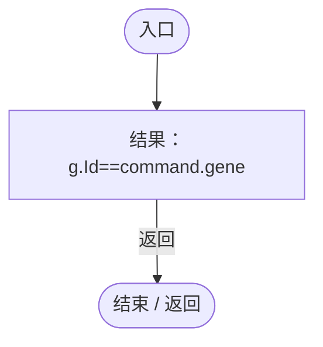

<a id="m290502764444782c"></a>

### 回调@39 · L39

`s … => 回调`


#### Editor / Player · Roslyn编译器控制流

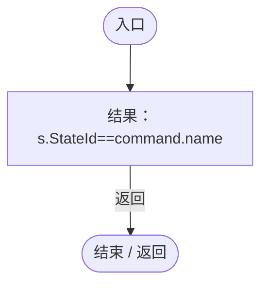

<a id="mb4085ded4094e300"></a>

### 回调@65 · L65

`d … => 回调`


#### Editor / Player · Roslyn编译器控制流

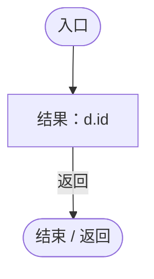

<a id="mc8f398d725b88b5d"></a>

### 回调@65 · L65

`d … => 回调`


#### Editor / Player · Roslyn编译器控制流

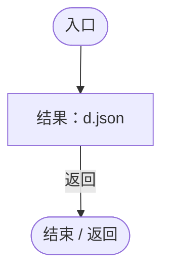

<a id="m02a4c21d7c38ea60"></a>

### 回调@67 · L67

`e … => 回调`


#### Editor / Player · Roslyn编译器控制流

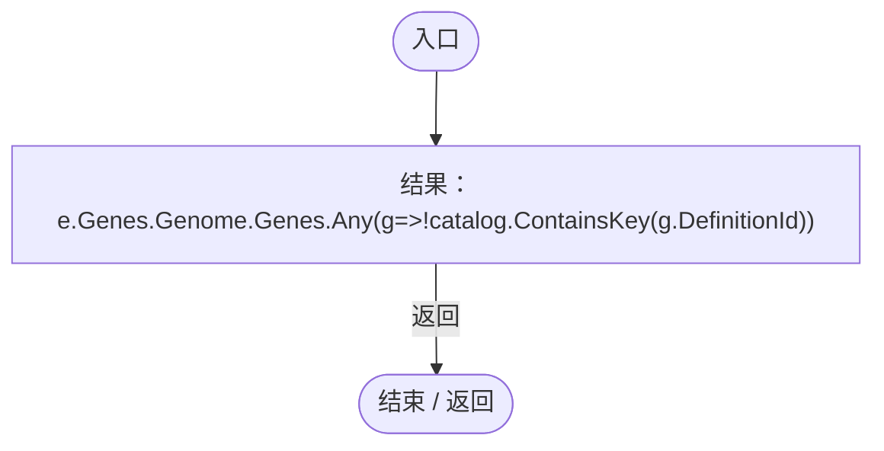

项目内调用/回调引用：

- [DarwinEntity.Genes.get · L14](Entities.md#m622eb1adf401d431)（访问器）
- [LanEditExecutor.回调@67 · L67](ServerUnity.md#m916983d370c43cf3)（回调/委托）

<a id="m916983d370c43cf3"></a>

### 回调@67 · L67

`g … => 回调`


#### Editor / Player · Roslyn编译器控制流

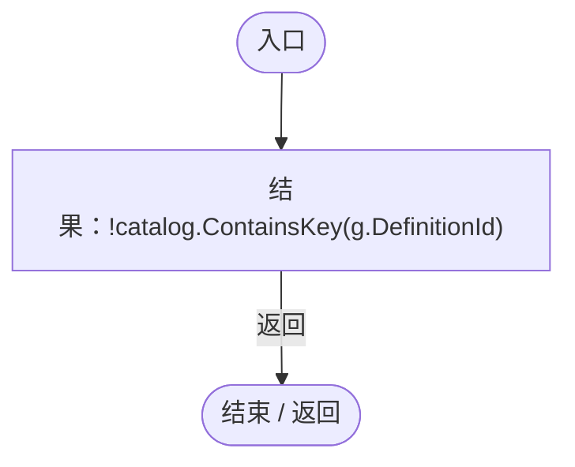

<a id="m9bbe2c47af3244ff"></a>

### ValidGenome · L75

`private static bool ValidGenome(Genome genome)`


#### Editor / Player · Roslyn编译器控制流

```mermaid
flowchart TD
  b0(["入口"])
  b1{"判断：genome==null"}
  b2["结果：true"]
  b3{"判断：genome.Genes==null"}
  b4{"判断：genome.Genes.Count&gt;LanSettings.Current.maximumGenomeGenes"}
  b5["结果：false"]
  b6["MorphologyRegistry.ValidateGenome(genome);"]
  b7["结果：false"]
  b8["结果：genome.Genes.All(g=&gt;g!=null&amp;&amp;g.MissingStateIds!=null&amp;&amp;LanSession.Finite(g.CopyStrength)&amp;&amp;g.CopyStrength&gt;=0&amp;&amp;LanSession.Finite(g.Value)&amp;&amp;g.Value&gt;=0&amp;&amp;g.Value&lt;=100&amp;&amp;GeneDatabase.All.Any(d=&gt;d.Id==g.DefinitionId&amp;&amp;(!d.ExplicitState&#124;&#124;d.State…"]
  b9(["结束 / 返回"])
  b0 --> b1
  b1 -->|"是"| b2
  b1 -->|"否"| b3
  b2 -->|"返回"| b9
  b3 -->|"否"| b4
  b3 -->|"是"| b5
  b4 -->|"是"| b5
  b4 -->|"否"| b6
  b5 -->|"返回"| b9
  b6 --> b8
  b7 -->|"返回"| b9
  b8 -->|"返回"| b9
  b6 -. "保护区可能异常（示意）" .-> b7

```

项目内调用/回调引用：

- [LanSettings.Current.get · L89](Gameplay.md#m7c4ce1b7ac167a0c)（访问器）
- [MorphologyRegistry.ValidateGenome · L51](Genetics.md#m6dcc52fce7aa3463)（方法）
- [LanEditExecutor.回调@80 · L80](ServerUnity.md#mb5bcbaba6b34dd88)（回调/委托）

<a id="mb5bcbaba6b34dd88"></a>

### 回调@80 · L80

`g … => 回调`


#### Editor / Player · Roslyn编译器控制流

```mermaid
flowchart TD
  b0(["入口"])
  b1{"判断：g!=null"}
  b2{"判断：g.MissingStateIds!=null"}
  b3{"判断：LanSession.Finite(g.CopyStrength)"}
  b4{"判断：g.CopyStrength&gt;=0"}
  b5{"判断：LanSession.Finite(g.Value)"}
  b6{"判断：g.Value&gt;=0"}
  b7{"判断：g.Value&lt;=100"}
  b8["GeneDatabase.All.Any(d=&gt;d.Id==g.DefinitionId&amp;&amp;(!d.ExplicitState&#124;&#124;d.States.Exists(s=&gt;s.StateId==g.StateId)))"]
  b9["g!=null&amp;&amp;g.MissingStateIds!=null&amp;&amp;LanSession.Finite(g.CopyStrength)&amp;&amp;g.CopyStrength&gt;=0&amp;&amp;LanSession.Finite(g.Value)&amp;&amp;g.Value&gt;=0&amp;&amp;g.Value&lt;=100&amp;&amp;GeneDatabase.All.Any(d=&gt;d.Id==g.DefinitionId&amp;&amp;(!d.ExplicitState&#124;&#124;d.States.Exists(s=&gt;s.StateId==…"]
  b10["结果：g!=null&amp;&amp;g.MissingStateIds!=null&amp;&amp;LanSession.Finite(g.CopyStrength)&amp;&amp;g.CopyStrength&gt;=0&amp;&amp;LanSession.Finite(g.Value)&amp;&amp;g.Value&gt;=0&amp;&amp;g.Value&lt;=100&amp;&amp;GeneDatabase.All.Any(d=&gt;d.Id==g.DefinitionId&amp;&amp;(!d.ExplicitState&#124;&#124;d.States.Exists(s=&gt;s.StateI…"]
  b11(["结束 / 返回"])
  b0 --> b1
  b1 -->|"是"| b2
  b1 -->|"否"| b9
  b2 -->|"是"| b3
  b2 -->|"否"| b9
  b3 -->|"是"| b4
  b3 -->|"否"| b9
  b4 -->|"是"| b5
  b4 -->|"否"| b9
  b5 -->|"是"| b6
  b5 -->|"否"| b9
  b6 -->|"是"| b7
  b6 -->|"否"| b9
  b7 -->|"是"| b8
  b7 -->|"否"| b9
  b8 --> b10
  b9 --> b10
  b10 -->|"返回"| b11

```

项目内调用/回调引用：

- [LanSession.Finite · L123](Gameplay.md#m0211cb4a362fb2ce)（方法）
- [GeneDatabase.All.get · L133](Genetics.md#m85e4dda1780523a9)（访问器）
- [LanEditExecutor.回调@80 · L80](ServerUnity.md#mf9a0f5c61ad12dbc)（回调/委托）

<a id="mf9a0f5c61ad12dbc"></a>

### 回调@80 · L80

`d … => 回调`


#### Editor / Player · Roslyn编译器控制流

```mermaid
flowchart TD
  b0(["入口"])
  b1{"判断：d.Id==g.DefinitionId"}
  b2{"判断：d.ExplicitState"}
  b3["d.States.Exists(s=&gt;s.StateId==g.StateId)"]
  b4["!d.ExplicitState"]
  b5["d.Id==g.DefinitionId"]
  b6["结果：d.Id==g.DefinitionId&amp;&amp;(!d.ExplicitState&#124;&#124;d.States.Exists(s=&gt;s.StateId==g.StateId))"]
  b7(["结束 / 返回"])
  b0 --> b1
  b1 -->|"是"| b2
  b1 -->|"否"| b5
  b2 -->|"是"| b3
  b2 -->|"否"| b4
  b3 --> b6
  b4 --> b6
  b5 --> b6
  b6 -->|"返回"| b7

```

项目内调用/回调引用：

- [GeneDefinition.ExplicitState.get · L68](Genetics.md#mbadafa853048abf8)（访问器）
- [LanEditExecutor.回调@80 · L80](ServerUnity.md#m0fd67900674c1efa)（回调/委托）

<a id="m0fd67900674c1efa"></a>

### 回调@80 · L80

`s … => 回调`


#### Editor / Player · Roslyn编译器控制流

```mermaid
flowchart TD
  b0(["入口"])
  b1["结果：s.StateId==g.StateId"]
  b2(["结束 / 返回"])
  b0 --> b1
  b1 -->|"返回"| b2

```


---

<a id="sf63fbb9b89850fc4"></a>

## LanServerRuntime.cs

`Runtime` · `Assets/DarwinPark/ServerUnity/LanServerRuntime.cs`

[源文件](../../../Assets/DarwinPark/ServerUnity/LanServerRuntime.cs) · 源码校验：`c46b70ceec2b3c279966c0f3c0de074a436d55e4b17d4fe02d0433410e3b62b6`

方法按源文件位置排列。事件/回调引用不表示立即执行；完整源码与关系图请打开离线手册。

<a id="m708ad0bed02e5d45"></a>

### Listener.get · L26

`get`


#### Editor / Player · 语法控制结构 / 声明（非CFG）

```mermaid
flowchart TD
  n2(["入口"])
  n1["声明 / 自动存储；没有显式方法体"]
  n0(["结束 / 返回"])
  n1 --> n0
  n2 --> n1

```

<a id="ma2acdec4b9b0c16b"></a>

### Listener.set · L26

`private set`


#### Editor / Player · 语法控制结构 / 声明（非CFG）

```mermaid
flowchart TD
  n2(["入口"])
  n1["声明 / 自动存储；没有显式方法体"]
  n0(["结束 / 返回"])
  n1 --> n0
  n2 --> n1

```

<a id="m019b7226384fc41b"></a>

### Listening.get · L27

`public bool Listening`


#### Editor / Player · 语法控制结构 / 声明（非CFG）

```mermaid
flowchart TD
  n2(["入口"])
  n1["Listener!=null"]
  n0(["结束 / 返回"])
  n1 --> n0
  n2 --> n1

```

项目内调用/回调引用：

- [LanServerRuntime.Listener.get · L26](ServerUnity.md#m708ad0bed02e5d45)（访问器）

<a id="m07478bb6d6f7fc69"></a>

### Port.get · L28

`public int Port`


#### Editor / Player · 语法控制结构 / 声明（非CFG）

```mermaid
flowchart TD
  n2(["入口"])
  n1["Listener?.Port??0"]
  n0(["结束 / 返回"])
  n1 --> n0
  n2 --> n1

```

项目内调用/回调引用：

- [LanServerRuntime.Listener.get · L26](ServerUnity.md#m708ad0bed02e5d45)（访问器）

<a id="m79bcadd2dd7b48c4"></a>

### MemberCount.get · L29

`public int MemberCount`


#### Editor / Player · 语法控制结构 / 声明（非CFG）

```mermaid
flowchart TD
  n2(["入口"])
  n1["_peers.Count"]
  n0(["结束 / 返回"])
  n1 --> n0
  n2 --> n1

```

<a id="m6eb877fc650d419f"></a>

### IsHost.get · L30

`private bool IsHost`


#### Editor / Player · 语法控制结构 / 声明（非CFG）

```mermaid
flowchart TD
  n2(["入口"])
  n1["Listening"]
  n0(["结束 / 返回"])
  n1 --> n0
  n2 --> n1

```

<a id="m60b4352a5456a8a8"></a>

### Online.get · L31

`private bool Online`


#### Editor / Player · 语法控制结构 / 声明（非CFG）

```mermaid
flowchart TD
  n2(["入口"])
  n1["session.Online"]
  n0(["结束 / 返回"])
  n1 --> n0
  n2 --> n1

```

<a id="m4dffc10b5c3c89b8"></a>

### _world.get · L32

`private WorldSessionManager _world`


#### Editor / Player · 语法控制结构 / 声明（非CFG）

```mermaid
flowchart TD
  n2(["入口"])
  n1["session._world"]
  n0(["结束 / 返回"])
  n1 --> n0
  n2 --> n1

```

<a id="mbb799390b60b4ff7"></a>

### _players.get · L33

`private List<LanPlayer> _players`


#### Editor / Player · 语法控制结构 / 声明（非CFG）

```mermaid
flowchart TD
  n2(["入口"])
  n1["session._players"]
  n0(["结束 / 返回"])
  n1 --> n0
  n2 --> n1

```

<a id="ma4c778f459e42c17"></a>

### Cheats.get · L34

`get`


#### Editor / Player · Roslyn编译器控制流

```mermaid
flowchart TD
  b0(["入口"])
  b1["结果：session.Cheats"]
  b2(["结束 / 返回"])
  b0 --> b1
  b1 -->|"返回"| b2

```

项目内调用/回调引用：

- [LanSession.Cheats.get · L26](Gameplay.md#mf5f562ecab6f9c3f)（访问器）

<a id="m2c7010661ccce222"></a>

### Cheats.set · L34

`set`


#### Editor / Player · Roslyn编译器控制流

```mermaid
flowchart TD
  b0(["入口"])
  b1["session.Cheats=value"]
  b2(["结束 / 返回"])
  b0 --> b1
  b1 --> b2

```

项目内调用/回调引用：

- [LanSession.Cheats.set · L26](Gameplay.md#mb721213f307caca7)（访问器）

<a id="me2950943543e1c36"></a>

### LocalId.get · L35

`get`


#### Editor / Player · Roslyn编译器控制流

```mermaid
flowchart TD
  b0(["入口"])
  b1["结果：session.LocalId"]
  b2(["结束 / 返回"])
  b0 --> b1
  b1 -->|"返回"| b2

```

项目内调用/回调引用：

- [LanSession.LocalId.get · L28](Gameplay.md#m88836972cec71f5a)（访问器）

<a id="m31bd59ca02791f21"></a>

### LocalId.set · L35

`set`


#### Editor / Player · Roslyn编译器控制流

```mermaid
flowchart TD
  b0(["入口"])
  b1["session.LocalId=value"]
  b2(["结束 / 返回"])
  b0 --> b1
  b1 --> b2

```

项目内调用/回调引用：

- [LanSession.LocalId.set · L28](Gameplay.md#ma3049492ffc18f43)（访问器）

<a id="m7395390b485e39e1"></a>

### OwnedEntityId.get · L36

`get`


#### Editor / Player · Roslyn编译器控制流

```mermaid
flowchart TD
  b0(["入口"])
  b1["结果：session.OwnedEntityId"]
  b2(["结束 / 返回"])
  b0 --> b1
  b1 -->|"返回"| b2

```

项目内调用/回调引用：

- [LanSession.OwnedEntityId.get · L29](Gameplay.md#m1804a7f0da3ea947)（访问器）

<a id="mc59ce8dd19cf936e"></a>

### OwnedEntityId.set · L36

`set`


#### Editor / Player · Roslyn编译器控制流

```mermaid
flowchart TD
  b0(["入口"])
  b1["session.OwnedEntityId=value"]
  b2(["结束 / 返回"])
  b0 --> b1
  b1 --> b2

```

项目内调用/回调引用：

- [LanSession.OwnedEntityId.set · L29](Gameplay.md#mbb21c9071c8c786d)（访问器）

<a id="mc35915c980e10b62"></a>

### Status.get · L37

`get`


#### Editor / Player · Roslyn编译器控制流

```mermaid
flowchart TD
  b0(["入口"])
  b1["结果：session.Status"]
  b2(["结束 / 返回"])
  b0 --> b1
  b1 -->|"返回"| b2

```

项目内调用/回调引用：

- [LanSession.Status.get · L30](Gameplay.md#mb0cf5b4a7385539a)（访问器）

<a id="m781458b96b058e45"></a>

### Status.set · L37

`set`


#### Editor / Player · Roslyn编译器控制流

```mermaid
flowchart TD
  b0(["入口"])
  b1["session.Status=value"]
  b2(["结束 / 返回"])
  b0 --> b1
  b1 --> b2

```

项目内调用/回调引用：

- [LanSession.Status.set · L30](Gameplay.md#m9d966c9cb7ad134d)（访问器）

<a id="m48fae6897b8a66f3"></a>

### RejectedCommands.get · L38

`get`


#### Editor / Player · Roslyn编译器控制流

```mermaid
flowchart TD
  b0(["入口"])
  b1["结果：session.RejectedCommands"]
  b2(["结束 / 返回"])
  b0 --> b1
  b1 -->|"返回"| b2

```

项目内调用/回调引用：

- [LanSession.RejectedCommands.get · L32](Gameplay.md#me7ba79c6a00eae4a)（访问器）

<a id="m11983f9bc21752a9"></a>

### RejectedCommands.set · L38

`set`


#### Editor / Player · Roslyn编译器控制流

```mermaid
flowchart TD
  b0(["入口"])
  b1["session.RejectedCommands=value"]
  b2(["结束 / 返回"])
  b0 --> b1
  b1 --> b2

```

项目内调用/回调引用：

- [LanSession.RejectedCommands.set · L32](Gameplay.md#md66f079c077b6581)（访问器）

<a id="m5c6c73870436d083"></a>

### PublishAuthority · L39

`private void PublishAuthority()`


#### Editor / Player · Roslyn编译器控制流

```mermaid
flowchart TD
  b0(["入口"])
  b1["session.PublishAuthority()"]
  b2(["结束 / 返回"])
  b0 --> b1
  b1 --> b2

```

项目内调用/回调引用：

- [LanSession.PublishAuthority · L53](Gameplay.md#m61bbfbb1c5e75794)（方法）

<a id="m22b292ad650d0e04"></a>

### LanServerRuntime.ctor · L42

`public LanServerRuntime(LanSession owner)`


#### Editor / Player · Roslyn编译器控制流

```mermaid
flowchart TD
  b0(["入口"])
  b1["public LanServerRuntime(LanSession owner){session=owner;}<br/>session=owner;"]
  b2(["结束 / 返回"])
  b0 --> b1
  b1 --> b2

```

<a id="maea878068e5cbe36"></a>

### AssignLocal · L43

`public bool AssignLocal(string id)`


#### Editor / Player · Roslyn编译器控制流

```mermaid
flowchart TD
  b0(["入口"])
  b1["结果：Assign(null,id)"]
  b2(["结束 / 返回"])
  b0 --> b1
  b1 -->|"返回"| b2

```

项目内调用/回调引用：

- [LanServerRuntime.Assign · L61](ServerUnity.md#mdeb11d6a34fd5d4d)（方法）

<a id="mbd5b64dfa7d13465"></a>

### ProcessLocalCommand · L44

`public void ProcessLocalCommand(LanCommand command)`


#### Editor / Player · Roslyn编译器控制流

```mermaid
flowchart TD
  b0(["入口"])
  b1["ProcessCommand(null,command)"]
  b2(["结束 / 返回"])
  b0 --> b1
  b1 --> b2

```

项目内调用/回调引用：

- [LanServerRuntime.ProcessCommand · L77](ServerUnity.md#m595706cc3f8ac2c3)（方法）

<a id="m8ab660cfb18b8a49"></a>

### ApplyLocalRts · L45

`public bool ApplyLocalRts(LanCommand command)`


#### Editor / Player · Roslyn编译器控制流

```mermaid
flowchart TD
  b0(["入口"])
  b1["结果：ApplyRts(null,command)"]
  b2(["结束 / 返回"])
  b0 --> b1
  b1 -->|"返回"| b2

```

项目内调用/回调引用：

- [LanServerRuntime.ApplyRts · L103](ServerUnity.md#ma649eb93d1134cb4)（方法）

<a id="m98a9d0495008d3ab"></a>

### StartHost · L46

`public bool StartHost(int port=-1,bool cheats=false)`


#### Editor / Player · Roslyn编译器控制流

```mermaid
flowchart TD
  b0(["入口"])
  b1{"判断：Online"}
  b2{"判断：WorldRuntimeGate.Ready"}
  b3{"判断：_world.Current==null"}
  b4["Status=&quot;请先进入一个单人世界&quot;;<br/>结果：false"]
  b5["LanRelease.Current.RequireWorld(_world.Current.version,_world.Current.contentEpoch);<br/>settings=LanSettings.Current"]
  b6{"Listener<br/>判断：port&lt;0"}
  b7["settings.port"]
  b8["port"]
  b9["Listener=new LanListener(port&lt;0?settings.port:port,client=&gt; { var connection=new LanConnection(client,settings.maximumPacketBytes,settings.maximumQueuedPackets,session.ReceivePacket,session.ReceiveClosed);session.Accept(connection); });"]
  b10["Cheats=cheats;<br/>LocalId=&quot;host&quot;;<br/>_configuration=LanWorldSnapshot.Configuration();<br/>Status=&quot;已对局域网开放，端口 &quot;+Port;<br/>PublishAuthority();<br/>Roster();<br/>Debug.Log(&quot;[联机] 房主开放端口=&quot;+Port+&quot;，作弊=&quot;+Cheats);<br/>结果：true"]
  b11{"(Exception ex)<br/>判断：ex is SocketException"}
  b12{"判断：ex is InvalidOperationException"}
  b13{"Listener<br/>判断：Listener"}
  b14["Listener?.Dispose();"]
  b15["Listener=null;<br/>Status=&quot;开放失败：&quot;+ex.Message;<br/>Debug.LogWarning(&quot;[联机] &quot;+Status);<br/>结果：false"]
  b16(["结束 / 返回"])
  b0 --> b1
  b1 -->|"否"| b2
  b1 -->|"是"| b4
  b2 -->|"是"| b3
  b2 -->|"否"| b4
  b3 -->|"是"| b4
  b3 -->|"否"| b5
  b4 -->|"返回"| b16
  b5 --> b6
  b6 -->|"是"| b7
  b6 -->|"否"| b8
  b7 --> b9
  b8 --> b9
  b9 --> b10
  b10 -->|"返回"| b16
  b11 -->|"否"| b12
  b11 -->|"是"| b13
  b12 -->|"是"| b13
  b13 -->|"否"| b14
  b13 -->|"是"| b15
  b14 --> b15
  b15 -->|"返回"| b16

```

项目内调用/回调引用：

- [WorldSessionManager.Current.get · L22](Gameplay.md#m6b2be994a0f48af8)（访问器）
- [LanServerRuntime.Status.set · L37](ServerUnity.md#m781458b96b058e45)（访问器）
- [ServerCompatibility.RequireWorld · L36](ServerCore.md#m8e11cb32173288d5)（方法）
- [LanRelease.Current.get · L60](Gameplay.md#m66eb45c03cc42f2d)（访问器）
- [LanSettings.Current.get · L89](Gameplay.md#m7c4ce1b7ac167a0c)（访问器）
- [LanServerRuntime.Listener.set · L26](ServerUnity.md#ma2acdec4b9b0c16b)（访问器）
- [LanListener.LanListener.ctor · L74](ServerCore.md#mdb9ae5e8d236eb67)（构造函数）
- [LanServerRuntime.Cheats.set · L34](ServerUnity.md#m2c7010661ccce222)（访问器）
- [LanServerRuntime.LocalId.set · L35](ServerUnity.md#m31bd59ca02791f21)（访问器）
- [LanWorldSnapshot.Configuration · L27](ServerUnity.md#mddec61e4c1517f5b)（方法）
- [LanServerRuntime.PublishAuthority · L39](ServerUnity.md#m5c6c73870436d083)（方法）
- [LanServerRuntime.Roster · L119](ServerUnity.md#mf160777c6b6db59c)（方法）
- [LanServerRuntime.Cheats.get · L34](ServerUnity.md#ma4c778f459e42c17)（访问器）
- [LanServerRuntime.Listener.get · L26](ServerUnity.md#m708ad0bed02e5d45)（访问器）
- [LanListener.Dispose · L79](ServerCore.md#m7e2bf004b3f3a8f7)（方法）
- [LanServerRuntime.Status.get · L37](ServerUnity.md#mc35915c980e10b62)（访问器）
- [LanServerRuntime.回调@52 · L52](ServerUnity.md#mfc5821b649b9fcff)（回调/委托）

<a id="mfc5821b649b9fcff"></a>

### 回调@52 · L52

`client … => 回调`


#### Editor / Player · Roslyn编译器控制流

```mermaid
flowchart TD
  b0(["入口"])
  b1["connection=new LanConnection(client,settings.maximumPacketBytes,settings.maximumQueuedPackets,session.ReceivePacket,session.ReceiveClosed)<br/>session.Accept(connection);"]
  b2(["结束 / 返回"])
  b0 --> b1
  b1 --> b2

```

项目内调用/回调引用：

- [LanConnection.LanConnection.ctor · L21](ServerCore.md#m5e1f70bc7fd056b4)（构造函数）
- [LanSession.Accept · L60](Gameplay.md#mb2c39277c864c9b6)（方法）
- [LanSession.ReceivePacket · L62](Gameplay.md#m20703bd0e16c4ecc)（方法）
- [LanSession.ReceiveClosed · L61](Gameplay.md#m2db72a976122c45e)（方法）

<a id="mbec45a9f5660bd8f"></a>

### SetCheats · L59

`public void SetCheats(bool enabled)`


#### Editor / Player · Roslyn编译器控制流

```mermaid
flowchart TD
  b0(["入口"])
  b1{"判断：IsHost"}
  b2["Cheats=enabled;<br/>PublishAuthority();<br/>Roster();"]
  b3{"Status<br/>判断：enabled"}
  b4["&quot;作弊模式已开启&quot;"]
  b5["&quot;作弊模式已关闭&quot;"]
  b6["Status=enabled?&quot;作弊模式已开启&quot;:&quot;作弊模式已关闭&quot;;"]
  b7["Debug.Log(&quot;[联机] &quot;+Status);"]
  b8(["结束 / 返回"])
  b0 --> b1
  b1 -->|"否"| b8
  b1 -->|"是"| b2
  b2 --> b3
  b3 -->|"是"| b4
  b3 -->|"否"| b5
  b4 --> b6
  b5 --> b6
  b6 --> b7
  b7 --> b8

```

项目内调用/回调引用：

- [LanServerRuntime.Cheats.set · L34](ServerUnity.md#m2c7010661ccce222)（访问器）
- [LanServerRuntime.PublishAuthority · L39](ServerUnity.md#m5c6c73870436d083)（方法）
- [LanServerRuntime.Roster · L119](ServerUnity.md#mf160777c6b6db59c)（方法）
- [LanServerRuntime.Status.set · L37](ServerUnity.md#m781458b96b058e45)（访问器）
- [LanServerRuntime.Status.get · L37](ServerUnity.md#mc35915c980e10b62)（访问器）

<a id="mdeb11d6a34fd5d4d"></a>

### Assign · L61

`public bool Assign(Peer peer,string id)`


#### Editor / Player · Roslyn编译器控制流

```mermaid
flowchart TD
  b0(["入口"])
  b1{"entity=EcologyIdentity.Find(id)<br/>判断：EcologyQueries.Alive(entity)"}
  b2{"判断：AntColonyWorker.IsCarried(entity)"}
  b3{"entity.GetComponent&lt;EggIncubation&gt;()<br/>判断：entity.GetComponent&lt;EggIncubation&gt;()"}
  b4[".Incubating"]
  b5["entity.GetComponent&lt;EggIncubation&gt;()"]
  b6{"判断：entity.GetComponent&lt;EggIncubation&gt;()?.Incubating==true"}
  b7["Reply(peer,&quot;该实体无法操控&quot;,false);<br/>结果：false"]
  b8{"判断：peer!=null"}
  b9["peer.player.entity"]
  b10["OwnedEntityId"]
  b11["previous=peer!=null?peer.player.entity:OwnedEntityId"]
  b12{"判断：peer!=null"}
  b13{"判断：Cheats"}
  b14{"判断：string.IsNullOrEmpty(previous)"}
  b15{"判断：previous!=id"}
  b16{"判断：EcologyQueries.Alive(EcologyIdentity.Find(previous))"}
  b17["Reply(peer,&quot;成员只能在进入游戏或实体死亡后选择&quot;,false);<br/>结果：false"]
  b18{"判断：_peers.Values.Any(p=&gt;p!=peer&amp;&amp;p.player.entity==id)"}
  b19{"判断：peer!=null"}
  b20{"判断：OwnedEntityId==id"}
  b21["Reply(peer,&quot;该实体已由其他玩家操控&quot;,false);<br/>结果：false"]
  b22{"判断：previous!=id"}
  b23{"EcologyIdentity.Find(previous)<br/>判断：EcologyIdentity.Find(previous)"}
  b24[".GetComponent&lt;EntityManualControl&gt;()"]
  b25{"判断：.GetComponent&lt;EntityManualControl&gt;()"}
  b26["EcologyIdentity.Find(previous)?.GetComponent&lt;EntityManualControl&gt;()?.Release();"]
  b27{"判断：peer==null"}
  b28["OwnedEntityId=id;"]
  b29["peer.player.entity=id;<br/>peer.rts=false;<br/>peer.inputTime=Time.unscaledTime;"]
  b30{"entity.GetComponent&lt;EntityManualControl&gt;()<br/>判断：entity.GetComponent&lt;EntityManualControl&gt;()"}
  b31["entity.GetComponent&lt;EntityManualControl&gt;()"]
  b32["entity.gameObject.AddComponent&lt;EntityManualControl&gt;()"]
  b33["manual=entity.GetComponent&lt;EntityManualControl&gt;()??entity.gameObject.AddComponent&lt;EntityManualControl&gt;()"]
  b34["manual.BeginControl(EcologyQueries.Planet.transform);"]
  b35["peer.connection<br/>new LanMessage{type=&quot;selected&quot;,entity=id}<br/>type=&quot;selected&quot;<br/>entity=id<br/>SendMessage(peer.connection,new LanMessage{type=&quot;selected&quot;,entity=id});"]
  b36["&quot;[联机] 分配实体 player=&quot;"]
  b37{"peer<br/>判断：peer"}
  b38[".player.id"]
  b39["peer"]
  b40{"判断：peer?.player.id"}
  b41["peer?.player.id"]
  b42["&quot;host&quot;"]
  b43["Debug.Log(&quot;[联机] 分配实体 player=&quot;+(peer?.player.id??&quot;host&quot;)+&quot;，entity=&quot;+id);"]
  b44["Roster();<br/>结果：true"]
  b45(["结束 / 返回"])
  b0 --> b1
  b1 -->|"是"| b2
  b1 -->|"否"| b7
  b2 -->|"否"| b3
  b2 -->|"是"| b7
  b3 -->|"否"| b4
  b3 -->|"是"| b5
  b4 --> b6
  b5 --> b6
  b6 -->|"是"| b7
  b6 -->|"否"| b8
  b7 -->|"返回"| b45
  b8 -->|"是"| b9
  b8 -->|"否"| b10
  b9 --> b11
  b10 --> b11
  b11 --> b12
  b12 -->|"是"| b13
  b12 -->|"否"| b18
  b13 -->|"否"| b14
  b13 -->|"是"| b18
  b14 -->|"否"| b15
  b14 -->|"是"| b18
  b15 -->|"是"| b16
  b15 -->|"否"| b18
  b16 -->|"是"| b17
  b16 -->|"否"| b18
  b17 -->|"返回"| b45
  b18 -->|"否"| b19
  b18 -->|"是"| b21
  b19 -->|"是"| b20
  b19 -->|"否"| b22
  b20 -->|"是"| b21
  b20 -->|"否"| b22
  b21 -->|"返回"| b45
  b22 -->|"是"| b23
  b22 -->|"否"| b27
  b23 -->|"否"| b24
  b23 -->|"是"| b27
  b24 --> b25
  b25 -->|"否"| b26
  b25 -->|"是"| b27
  b26 --> b27
  b27 -->|"是"| b28
  b27 -->|"否"| b29
  b28 --> b36
  b29 --> b30
  b30 -->|"否"| b31
  b30 -->|"是"| b32
  b31 --> b33
  b32 --> b33
  b33 --> b34
  b34 --> b35
  b35 --> b36
  b36 --> b37
  b37 -->|"否"| b38
  b37 -->|"是"| b39
  b38 --> b40
  b39 --> b40
  b40 -->|"否"| b41
  b40 -->|"是"| b42
  b41 --> b43
  b42 --> b43
  b43 --> b44
  b44 -->|"返回"| b45

```

项目内调用/回调引用：

- [EcologyIdentity.Find · L21](Entities.md#mb670b64dc2baff58)（方法）
- [EcologyQueries.Alive · L39](Entities.md#m8352bfacbe2996a8)（方法）
- [AntColonyWorker.IsCarried · L132](Entities.md#m0ec4e12a23e5a9fa)（方法）
- [LanServerRuntime.Reply · L117](ServerUnity.md#mb60089623bf4b0e4)（方法）
- [LanServerRuntime.OwnedEntityId.get · L36](ServerUnity.md#m7395390b485e39e1)（访问器）
- [LanServerRuntime.Cheats.get · L34](ServerUnity.md#ma4c778f459e42c17)（访问器）
- [EntityManualControl.Release · L37](Entities.md#m40fd112901a759d7)（方法）
- [LanServerRuntime.OwnedEntityId.set · L36](ServerUnity.md#mc59ce8dd19cf936e)（访问器）
- [EntityManualControl.BeginControl · L32](Entities.md#mf0dadf914f9961c7)（方法）
- [LanSession.SendMessage · L87](Gameplay.md#m7507dbb8b567c698)（方法）
- [LanServerRuntime.Roster · L119](ServerUnity.md#mf160777c6b6db59c)（方法）
- [LanServerRuntime.回调@66 · L66](ServerUnity.md#m3c47908446a04581)（回调/委托）

<a id="m3c47908446a04581"></a>

### 回调@66 · L66

`p … => 回调`


#### Editor / Player · Roslyn编译器控制流

```mermaid
flowchart TD
  b0(["入口"])
  b1{"判断：p!=peer"}
  b2["p.player.entity==id"]
  b3["p!=peer"]
  b4["结果：p!=peer&amp;&amp;p.player.entity==id"]
  b5(["结束 / 返回"])
  b0 --> b1
  b1 -->|"是"| b2
  b1 -->|"否"| b3
  b2 --> b4
  b3 --> b4
  b4 -->|"返回"| b5

```

<a id="m595706cc3f8ac2c3"></a>

### ProcessCommand · L77

`public void ProcessCommand(Peer peer,LanCommand command)`


#### Editor / Player · Roslyn编译器控制流

```mermaid
flowchart TD
  b0(["入口"])
  b1{"判断：command==null"}
  b2{"判断：peer!=null"}
  b3{"判断：Time.unscaledTime-peer.window&gt;=1"}
  b4["peer.window=Time.unscaledTime;<br/>peer.commands=0;"]
  b5{"判断：++peer.commands&gt;LanSettings.Current.maximumCommandsPerSecond"}
  b6["Reply(peer,&quot;指令过于频繁&quot;,false);"]
  b7{"判断：command.kind==&quot;choose&quot;"}
  b8["Assign(peer,command.entity);"]
  b9{"判断：command.kind==&quot;rts&quot;"}
  b10["ApplyRts(peer,command);"]
  b11{"判断：command.kind==&quot;mode&quot;"}
  b12{"判断：peer!=null"}
  b13{"peer.rts=command.rts;<br/>entity=EcologyIdentity.Find(peer.player.entity)<br/>判断：command.rts"}
  b14{"entity<br/>判断：entity"}
  b15[".GetComponent&lt;EntityManualControl&gt;()"]
  b16{"判断：.GetComponent&lt;EntityManualControl&gt;()"}
  b17["entity?.GetComponent&lt;EntityManualControl&gt;()?.Release();"]
  b18{"判断：entity!=null"}
  b19{"entity.GetComponent&lt;EntityManualControl&gt;()<br/>判断：entity.GetComponent&lt;EntityManualControl&gt;()"}
  b20["entity.GetComponent&lt;EntityManualControl&gt;()"]
  b21["entity.gameObject.AddComponent&lt;EntityManualControl&gt;()"]
  b22["(entity.GetComponent&lt;EntityManualControl&gt;()??entity.gameObject.AddComponent&lt;EntityManualControl&gt;()).BeginControl(EcologyQueries.Planet.transform);"]
  b23{"判断：command.kind==&quot;input&quot;"}
  b24{"判断：command.kind==&quot;release&quot;"}
  b25{"判断：peer==null"}
  b26{"entity=EcologyIdentity.Find(peer.player.entity)<br/>判断：EcologyQueries.Alive(entity)"}
  b27{"判断：peer.rts"}
  b28{"判断：Finite(command.direction)"}
  b29{"判断：Finite(command.aim)"}
  b30["Reply(peer,&quot;无有效操控目标&quot;,false);"]
  b31{"判断：command.kind==&quot;release&quot;"}
  b32{"entity.GetComponent&lt;EnergyBlockMetabolism&gt;()<br/>判断：entity.GetComponent&lt;EnergyBlockMetabolism&gt;()"}
  b33["entity.GetComponent&lt;EnergyBlockMetabolism&gt;()?.TryRelease(command.aim,out _);"]
  b34{"peer.inputTime=Time.unscaledTime;<br/>manual=entity.GetComponent&lt;EntityManualControl&gt;()<br/>判断：manual==null"}
  b35{"manual.SetInput(Vector3.ClampMagnitude(command.direction,1),command.attack);<br/>判断：command.attack"}
  b36["manual.QueueAttack();"]
  b37{"判断：command.aim.sqrMagnitude&gt;.1f"}
  b38["command.aim.normalized"]
  b39["entity.transform.forward"]
  b40["aim=command.aim.sqrMagnitude&gt;.1f?command.aim.normalized:entity.transform.forward"]
  b41{"manual.SetAim(new Ray(entity.transform.position+EcologyQueries.Up(entity.transform.position)*.25f,aim));<br/>判断：command.jump"}
  b42{"entity.GetComponent&lt;EntityJumpMotor&gt;()<br/>判断：entity.GetComponent&lt;EntityJumpMotor&gt;()"}
  b43["entity.GetComponent&lt;EntityJumpMotor&gt;()"]
  b44["entity.gameObject.AddComponent&lt;EntityJumpMotor&gt;()"]
  b45["jump=entity.GetComponent&lt;EntityJumpMotor&gt;()??entity.gameObject.AddComponent&lt;EntityJumpMotor&gt;()"]
  b46["jump.Bind(EcologyQueries.Planet.transform);<br/>jump.TryJump(manual.CanMove);"]
  b47{"判断：peer!=null"}
  b48{"判断：Cheats"}
  b49["Reply(peer,&quot;需要管理员权限&quot;,false);"]
  b50["applied=LanEditExecutor.Apply(command,session)"]
  b51{"Reply<br/>peer<br/>判断：applied"}
  b52["&quot;操作已应用：&quot;"]
  b53["&quot;操作被拒绝：&quot;"]
  b54["Reply(peer,(applied?&quot;操作已应用：&quot;:&quot;操作被拒绝：&quot;)+command.kind,applied);"]
  b55(["结束 / 返回"])
  b0 --> b1
  b1 -->|"是"| b55
  b1 -->|"否"| b2
  b2 -->|"是"| b3
  b2 -->|"否"| b7
  b3 -->|"是"| b4
  b3 -->|"否"| b5
  b4 --> b5
  b5 -->|"是"| b6
  b5 -->|"否"| b7
  b6 --> b55
  b7 -->|"是"| b8
  b7 -->|"否"| b9
  b8 --> b55
  b9 -->|"是"| b10
  b9 -->|"否"| b11
  b10 --> b55
  b11 -->|"是"| b12
  b11 -->|"否"| b23
  b12 -->|"是"| b13
  b12 -->|"否"| b55
  b13 -->|"是"| b14
  b13 -->|"否"| b18
  b14 -->|"否"| b15
  b14 -->|"是"| b55
  b15 --> b16
  b16 -->|"否"| b17
  b16 -->|"是"| b55
  b17 --> b55
  b18 -->|"是"| b19
  b18 -->|"否"| b55
  b19 -->|"否"| b20
  b19 -->|"是"| b21
  b20 --> b22
  b21 --> b22
  b22 --> b55
  b23 -->|"否"| b24
  b23 -->|"是"| b25
  b24 -->|"是"| b25
  b24 -->|"否"| b47
  b25 -->|"是"| b55
  b25 -->|"否"| b26
  b26 -->|"是"| b27
  b26 -->|"否"| b30
  b27 -->|"否"| b28
  b27 -->|"是"| b30
  b28 -->|"是"| b29
  b28 -->|"否"| b30
  b29 -->|"否"| b30
  b29 -->|"是"| b31
  b30 --> b55
  b31 -->|"是"| b32
  b31 -->|"否"| b34
  b32 -->|"否"| b33
  b32 -->|"是"| b55
  b33 --> b55
  b34 -->|"是"| b55
  b34 -->|"否"| b35
  b35 -->|"是"| b36
  b35 -->|"否"| b37
  b36 --> b37
  b37 -->|"是"| b38
  b37 -->|"否"| b39
  b38 --> b40
  b39 --> b40
  b40 --> b41
  b41 -->|"是"| b42
  b41 -->|"否"| b55
  b42 -->|"否"| b43
  b42 -->|"是"| b44
  b43 --> b45
  b44 --> b45
  b45 --> b46
  b46 --> b55
  b47 -->|"是"| b48
  b47 -->|"否"| b50
  b48 -->|"否"| b49
  b48 -->|"是"| b50
  b49 --> b55
  b50 --> b51
  b51 -->|"是"| b52
  b51 -->|"否"| b53
  b52 --> b54
  b53 --> b54
  b54 --> b55

```

项目内调用/回调引用：

- [LanSettings.Current.get · L89](Gameplay.md#m7c4ce1b7ac167a0c)（访问器）
- [LanServerRuntime.Reply · L117](ServerUnity.md#mb60089623bf4b0e4)（方法）
- [LanServerRuntime.Assign · L61](ServerUnity.md#mdeb11d6a34fd5d4d)（方法）
- [LanServerRuntime.ApplyRts · L103](ServerUnity.md#ma649eb93d1134cb4)（方法）
- [EcologyIdentity.Find · L21](Entities.md#mb670b64dc2baff58)（方法）
- [EntityManualControl.Release · L37](Entities.md#m40fd112901a759d7)（方法）
- [EntityManualControl.BeginControl · L32](Entities.md#mf0dadf914f9961c7)（方法）
- [EcologyQueries.Alive · L39](Entities.md#m8352bfacbe2996a8)（方法）
- [LanSession.Finite · L122](Gameplay.md#m17c932d26c5d8756)（方法）
- [EnergyBlockMetabolism.TryRelease · L41](Entities.md#mf49f990f4e1cf720)（方法）
- [EntityManualControl.SetInput · L33](Entities.md#mb1079fe9e2dced13)（方法）
- [EntityManualControl.QueueAttack · L24](Entities.md#md160ef2315358c16)（方法）
- [EntityManualControl.SetAim · L27](Entities.md#m70f09d0090a1fa41)（方法）
- [EcologyQueries.Up · L42](Entities.md#ma73e6bbbc726282f)（方法）
- [EntityJumpMotor.Bind · L22](Entities.md#mc6171e335b954dd5)（方法）
- [EntityJumpMotor.TryJump · L24](Entities.md#mce353a96ea1e5aac)（方法）
- [LanServerRuntime.Cheats.get · L34](ServerUnity.md#ma4c778f459e42c17)（访问器）
- [LanEditExecutor.Apply · L16](ServerUnity.md#ma7b8740cc353a594)（方法）

<a id="ma649eb93d1134cb4"></a>

### ApplyRts · L103

`public bool ApplyRts(Peer peer,LanCommand command)`


#### Editor / Player · Roslyn编译器控制流

```mermaid
flowchart TD
  b0(["入口"])
  b1{"判断：command.selection==null"}
  b2{"判断：command.selection.Length==0"}
  b3{"判断：command.selection.Length&gt;LanSettings.Current.maximumRtsSelection"}
  b4{"判断：Finite(command.point)"}
  b5{"判断：Enum.IsDefined(typeof(RtsOrderKind),command.order)"}
  b6["Reply(peer,&quot;RTS指令无效&quot;,false);<br/>结果：false"]
  b7["entities=command.selection.Distinct().Select(EcologyIdentity.Find).ToArray()"]
  b8{"peer<br/>判断：peer"}
  b9[".player.entity"]
  b10["peer"]
  b11{"判断：peer?.player.entity"}
  b12["peer?.player.entity"]
  b13["OwnedEntityId"]
  b14["owner=peer?.player.entity??OwnedEntityId"]
  b15{"判断：entities.Any(e=&gt;!EcologyQueries.Alive(e)&#124;&#124;(peer!=null&amp;&amp;!Cheats&amp;&amp;!QueenControls(owner,e))&#124;&#124;_peers.Values.Any(p=&gt;p!=peer&amp;&amp;p.player.entity==EcologyIdentity.Of(e)))"}
  b16["Reply(peer,&quot;不能指挥此实体或外群&quot;,false);<br/>结果：false"]
  b17["target=EcologyIdentity.Find(command.target)<br/>resource=ColonyResource.Find(command.resource)<br/>applied=0"]
  b18["entities"]
  b19{"判断：entities"}
  b20["var"]
  b21{"point=command.point<br/>判断：command.order==RtsOrderKind.Move"}
  b22{"判断：entities.Length&gt;1"}
  b23{"up=EcologyQueries.Up(point)<br/>axis=Vector3.Cross(up,Vector3.forward).normalized<br/>判断：axis.sqrMagnitude&lt;.1f"}
  b24["axis=Vector3.Cross(up,Vector3.right).normalized;"]
  b25["point=EcologyQueries.Surface(point+Quaternion.AngleAxis(applied*137.5f,up)*axis*LanSettings.Current.rtsFormationSpacing*Mathf.Sqrt(applied));"]
  b26{"order=RtsOrderController.Ensure(entity)<br/>order.arrivalDistance=LanSettings.Current.rtsArrivalDistance;<br/>判断：order.Issue(command.order,point,target,resource)"}
  b27["applied++;"]
  b28{"entities<br/>判断：entities"}
  b29["entities"]
  b30["连接 / 离开区域"]
  b31["Reply(peer,&quot;已向 &quot;+applied+&quot; 个实体下达指令&quot;,applied&gt;0);<br/>结果：applied&gt;0"]
  b32(["结束 / 返回"])
  b0 --> b1
  b1 -->|"否"| b2
  b1 -->|"是"| b6
  b2 -->|"否"| b3
  b2 -->|"是"| b6
  b3 -->|"否"| b4
  b3 -->|"是"| b6
  b4 -->|"是"| b5
  b4 -->|"否"| b6
  b5 -->|"否"| b6
  b5 -->|"是"| b7
  b6 -->|"返回"| b32
  b7 --> b8
  b8 -->|"否"| b9
  b8 -->|"是"| b10
  b9 --> b11
  b10 --> b11
  b11 -->|"否"| b12
  b11 -->|"是"| b13
  b12 --> b14
  b13 --> b14
  b14 --> b15
  b15 -->|"是"| b16
  b15 -->|"否"| b17
  b16 -->|"返回"| b32
  b17 --> b18
  b18 --> b19
  b19 -->|"是"| b20
  b19 -->|"否 · 经过finally 28"| b31
  b20 --> b21
  b21 -->|"是"| b22
  b21 -->|"否"| b26
  b22 -->|"是"| b23
  b22 -->|"否"| b26
  b23 -->|"是"| b24
  b23 -->|"否"| b25
  b24 --> b25
  b25 --> b26
  b26 -->|"是"| b27
  b26 -->|"否"| b19
  b27 --> b19
  b28 -->|"否"| b29
  b28 -->|"是"| b30
  b29 --> b30
  b31 -->|"返回"| b32
  b19 -. "退出保护区时 finally（示意）" .-> b28

```

项目内调用/回调引用：

- [LanSettings.Current.get · L89](Gameplay.md#m7c4ce1b7ac167a0c)（访问器）
- [LanSession.Finite · L122](Gameplay.md#m17c932d26c5d8756)（方法）
- [LanServerRuntime.Reply · L117](ServerUnity.md#mb60089623bf4b0e4)（方法）
- [LanServerRuntime.OwnedEntityId.get · L36](ServerUnity.md#m7395390b485e39e1)（访问器）
- [EcologyIdentity.Find · L21](Entities.md#mb670b64dc2baff58)（方法）
- [ColonyResource.Find · L28](Entities.md#m1324285ab40ac6f4)（方法）
- [EcologyQueries.Up · L42](Entities.md#ma73e6bbbc726282f)（方法）
- [EcologyQueries.Surface · L48](Entities.md#m40ee3e975d7f5137)（方法）
- [RtsOrderController.Ensure · L19](Entities.md#mb6925942cada4db0)（方法）
- [RtsOrderController.Issue · L29](Entities.md#m400d3b80cc5f6dec)（方法）
- [LanServerRuntime.回调@107 · L107](ServerUnity.md#mf3bba15c1de7a197)（回调/委托）

<a id="mf3bba15c1de7a197"></a>

### 回调@107 · L107

`e … => 回调`


#### Editor / Player · Roslyn编译器控制流

```mermaid
flowchart TD
  b0(["入口"])
  b1{"判断：EcologyQueries.Alive(e)"}
  b2{"判断：peer!=null"}
  b3{"判断：Cheats"}
  b4{"判断：QueenControls(owner,e)"}
  b5["_peers.Values.Any(p=&gt;p!=peer&amp;&amp;p.player.entity==EcologyIdentity.Of(e))"]
  b6["!EcologyQueries.Alive(e)&#124;&#124;(peer!=null&amp;&amp;!Cheats&amp;&amp;!QueenControls(owner,e))&#124;&#124;_peers.Values.Any(p=&gt;p!=peer&amp;&amp;p.player.entity==EcologyIdentity.Of(e))"]
  b7["结果：!EcologyQueries.Alive(e)&#124;&#124;(peer!=null&amp;&amp;!Cheats&amp;&amp;!QueenControls(owner,e))&#124;&#124;_peers.Values.Any(p=&gt;p!=peer&amp;&amp;p.player.entity==EcologyIdentity.Of(e))"]
  b8(["结束 / 返回"])
  b0 --> b1
  b1 -->|"是"| b2
  b1 -->|"否"| b6
  b2 -->|"是"| b3
  b2 -->|"否"| b5
  b3 -->|"否"| b4
  b3 -->|"是"| b5
  b4 -->|"是"| b5
  b4 -->|"否"| b6
  b5 --> b7
  b6 --> b7
  b7 -->|"返回"| b8

```

项目内调用/回调引用：

- [EcologyQueries.Alive · L39](Entities.md#m8352bfacbe2996a8)（方法）
- [LanServerRuntime.Cheats.get · L34](ServerUnity.md#ma4c778f459e42c17)（访问器）
- [LanSession.QueenControls · L105](Gameplay.md#m8b8be72d98997058)（方法）
- [LanServerRuntime.回调@107 · L107](ServerUnity.md#mc054c755f78ef12b)（回调/委托）

<a id="mc054c755f78ef12b"></a>

### 回调@107 · L107

`p … => 回调`


#### Editor / Player · Roslyn编译器控制流

```mermaid
flowchart TD
  b0(["入口"])
  b1{"判断：p!=peer"}
  b2["p.player.entity==EcologyIdentity.Of(e)"]
  b3["p!=peer"]
  b4["结果：p!=peer&amp;&amp;p.player.entity==EcologyIdentity.Of(e)"]
  b5(["结束 / 返回"])
  b0 --> b1
  b1 -->|"是"| b2
  b1 -->|"否"| b3
  b2 --> b4
  b3 --> b4
  b4 -->|"返回"| b5

```

项目内调用/回调引用：

- [EcologyIdentity.Of · L22](Entities.md#mb23020fe763aafd3)（方法）

<a id="mb60089623bf4b0e4"></a>

### Reply · L117

`private void Reply(Peer peer,string text,bool success)`


#### Editor / Player · Roslyn编译器控制流

```mermaid
flowchart TD
  b0(["入口"])
  b1{"Status=text;<br/>判断：success"}
  b2["RejectedCommands++;"]
  b3{"判断：success"}
  b4["&quot;[联机] player=&quot;"]
  b5{"peer<br/>判断：peer"}
  b6[".player.id"]
  b7["peer"]
  b8{"判断：peer?.player.id"}
  b9["peer?.player.id"]
  b10["&quot;host&quot;"]
  b11["Debug.Log(&quot;[联机] player=&quot;+(peer?.player.id??&quot;host&quot;)+&quot;，&quot;+text);"]
  b12["&quot;[联机] 拒绝 player=&quot;"]
  b13{"peer<br/>判断：peer"}
  b14[".player.id"]
  b15["peer"]
  b16{"判断：peer?.player.id"}
  b17["peer?.player.id"]
  b18["&quot;host&quot;"]
  b19["Debug.LogWarning(&quot;[联机] 拒绝 player=&quot;+(peer?.player.id??&quot;host&quot;)+&quot;，&quot;+text);"]
  b20{"判断：peer!=null"}
  b21["peer.connection<br/>new LanMessage{type=&quot;result&quot;,text=text}<br/>type=&quot;result&quot;<br/>text=text<br/>SendMessage(peer.connection,new LanMessage{type=&quot;result&quot;,text=text});"]
  b22(["结束 / 返回"])
  b0 --> b1
  b1 -->|"否"| b2
  b1 -->|"是"| b3
  b2 --> b3
  b3 -->|"是"| b4
  b3 -->|"否"| b12
  b4 --> b5
  b5 -->|"否"| b6
  b5 -->|"是"| b7
  b6 --> b8
  b7 --> b8
  b8 -->|"否"| b9
  b8 -->|"是"| b10
  b9 --> b11
  b10 --> b11
  b11 --> b20
  b12 --> b13
  b13 -->|"否"| b14
  b13 -->|"是"| b15
  b14 --> b16
  b15 --> b16
  b16 -->|"否"| b17
  b16 -->|"是"| b18
  b17 --> b19
  b18 --> b19
  b19 --> b20
  b20 -->|"是"| b21
  b20 -->|"否"| b22
  b21 --> b22

```

项目内调用/回调引用：

- [LanServerRuntime.Status.set · L37](ServerUnity.md#m781458b96b058e45)（访问器）
- [LanServerRuntime.RejectedCommands.set · L38](ServerUnity.md#m11983f9bc21752a9)（访问器）
- [LanServerRuntime.RejectedCommands.get · L38](ServerUnity.md#m48fae6897b8a66f3)（访问器）
- [LanSession.SendMessage · L87](Gameplay.md#m7507dbb8b567c698)（方法）

<a id="mf160777c6b6db59c"></a>

### Roster · L119

`private void Roster()`


#### Editor / Player · Roslyn编译器控制流

```mermaid
flowchart TD
  b0(["入口"])
  b1["_players.Clear();"]
  b2["_players<br/>new LanPlayer{id=&quot;host&quot;,name=&quot;管理员&quot;,administrator=true,entity=OwnedEntityId}<br/>id=&quot;host&quot;<br/>name=&quot;管理员&quot;<br/>administrator=true<br/>entity=OwnedEntityId<br/>_players.Add(new LanPlayer{id=&quot;host&quot;,name=&quot;管理员&quot;,administrator=true,entity=OwnedEntityId});"]
  b3["_players.AddRange(_peers.Values.Where(p=&gt;p.admission.Joined).Select(p=&gt;p.player));"]
  b4["new LanMessage{type=&quot;roster&quot;,players=_players,cheats=Cheats}<br/>type=&quot;roster&quot;<br/>players=_players<br/>cheats=Cheats<br/>message=new LanMessage{type=&quot;roster&quot;,players=_players,cheats=Cheats}"]
  b5["_peers.Values"]
  b6{"判断：_peers.Values"}
  b7{"var<br/>判断：peer.admission.Joined"}
  b8["SendMessage(peer.connection,message);"]
  b9["_peers.Values"]
  b10(["结束 / 返回"])
  b0 --> b1
  b1 --> b2
  b2 --> b3
  b3 --> b4
  b4 --> b5
  b5 --> b6
  b6 -->|"是"| b7
  b6 -->|"否 · 经过finally 9"| b10
  b7 -->|"是"| b8
  b7 -->|"否"| b6
  b8 --> b6
  b6 -. "退出保护区时 finally（示意）" .-> b9

```

项目内调用/回调引用：

- [LanServerRuntime.OwnedEntityId.get · L36](ServerUnity.md#m7395390b485e39e1)（访问器）
- [LanServerRuntime.Cheats.get · L34](ServerUnity.md#ma4c778f459e42c17)（访问器）
- [ServerAdmission.Joined.get · L47](ServerCore.md#m01d1a7c89e89072f)（访问器）
- [LanSession.SendMessage · L87](Gameplay.md#m7507dbb8b567c698)（方法）
- [LanServerRuntime.回调@121 · L121](ServerUnity.md#m73f6b028e9aa0287)（回调/委托）
- [LanServerRuntime.回调@121 · L121](ServerUnity.md#m17b61d64e423f84c)（回调/委托）

<a id="m73f6b028e9aa0287"></a>

### 回调@121 · L121

`p … => 回调`


#### Editor / Player · Roslyn编译器控制流

```mermaid
flowchart TD
  b0(["入口"])
  b1["结果：p.admission.Joined"]
  b2(["结束 / 返回"])
  b0 --> b1
  b1 -->|"返回"| b2

```

项目内调用/回调引用：

- [ServerAdmission.Joined.get · L47](ServerCore.md#m01d1a7c89e89072f)（访问器）

<a id="m17b61d64e423f84c"></a>

### 回调@121 · L121

`p … => 回调`


#### Editor / Player · Roslyn编译器控制流

```mermaid
flowchart TD
  b0(["入口"])
  b1["结果：p.player"]
  b2(["结束 / 返回"])
  b0 --> b1
  b1 -->|"返回"| b2

```

<a id="m65eaad29d40c9257"></a>

### SendWorld · L124

`private void SendWorld(Peer peer)`


#### Editor / Player · Roslyn编译器控制流

```mermaid
flowchart TD
  b0(["入口"])
  b1["peer.admission.Loading(Time.unscaledTimeAsDouble);"]
  b2["peer.connection<br/>new LanMessage{type=&quot;world&quot;,world=LanWorldSnapshot.Capture(_world),worldRevision=peer.admission.WorldRevision}<br/>type=&quot;world&quot;<br/>world=LanWorldSnapshot.Capture(_world)<br/>worldRevision=peer.admission.WorldRevision<br/>SendMessage(pee…"]
  b3(["结束 / 返回"])
  b0 --> b1
  b1 --> b2
  b2 --> b3

```

项目内调用/回调引用：

- [ServerAdmission.Loading · L65](ServerCore.md#m109240af8cd4a29e)（方法）
- [LanSession.SendMessage · L87](Gameplay.md#m7507dbb8b567c698)（方法）
- [LanWorldSnapshot.Capture · L15](ServerUnity.md#m321e0486e1129075)（方法）
- [ServerAdmission.WorldRevision.get · L51](ServerCore.md#m866299fb7c4ec453)（访问器）

<a id="m4ae91072b6f16a62"></a>

### CloseHost · L126

`public void CloseHost()`


#### Editor / Player · Roslyn编译器控制流

```mermaid
flowchart TD
  b0(["入口"])
  b1{"判断：IsHost"}
  b2["_peers.Values"]
  b3{"判断：_peers.Values"}
  b4["var"]
  b5{"EcologyIdentity.Find(peer.player.entity)<br/>判断：EcologyIdentity.Find(peer.player.entity)"}
  b6[".GetComponent&lt;EntityManualControl&gt;()"]
  b7{"判断：.GetComponent&lt;EntityManualControl&gt;()"}
  b8["EcologyIdentity.Find(peer.player.entity)?.GetComponent&lt;EntityManualControl&gt;()?.Release();"]
  b9["peer.connection.Dispose();"]
  b10["_peers.Values"]
  b11["_peers.Clear();<br/>Listener.Dispose();<br/>Listener=null;<br/>_players.Clear();<br/>Cheats=false;<br/>OwnedEntityId=&quot;&quot;;<br/>WorldAuthority.Reset();<br/>Status=&quot;局域网已关闭，继续单人游戏&quot;;<br/>Debug.Log(&quot;[联机] &quot;+Status);"]
  b12(["结束 / 返回"])
  b0 --> b1
  b1 -->|"否"| b12
  b1 -->|"是"| b2
  b2 --> b3
  b3 -->|"是"| b4
  b3 -->|"否 · 经过finally 10"| b11
  b4 --> b5
  b5 -->|"否"| b6
  b5 -->|"是"| b9
  b6 --> b7
  b7 -->|"否"| b8
  b7 -->|"是"| b9
  b8 --> b9
  b9 --> b3
  b11 --> b12
  b3 -. "退出保护区时 finally（示意）" .-> b10

```

项目内调用/回调引用：

- [EcologyIdentity.Find · L21](Entities.md#mb670b64dc2baff58)（方法）
- [EntityManualControl.Release · L37](Entities.md#m40fd112901a759d7)（方法）
- [LanConnection.Dispose · L68](ServerCore.md#m9c3fd25afe51cbe8)（方法）
- [LanListener.Dispose · L79](ServerCore.md#m7e2bf004b3f3a8f7)（方法）
- [LanServerRuntime.Listener.get · L26](ServerUnity.md#m708ad0bed02e5d45)（访问器）
- [LanServerRuntime.Listener.set · L26](ServerUnity.md#ma2acdec4b9b0c16b)（访问器）
- [LanServerRuntime.Cheats.set · L34](ServerUnity.md#m2c7010661ccce222)（访问器）
- [LanServerRuntime.OwnedEntityId.set · L36](ServerUnity.md#mc59ce8dd19cf936e)（访问器）
- [WorldAuthority.Reset · L18](Core.md#m85b42b819afac5cb)（方法）
- [LanServerRuntime.Status.set · L37](ServerUnity.md#m781458b96b058e45)（访问器）
- [LanServerRuntime.Status.get · L37](ServerUnity.md#mc35915c980e10b62)（访问器）

<a id="m1cdf7c221e75417a"></a>

### Tick · L130

`public void Tick()`


#### Editor / Player · Roslyn编译器控制流

```mermaid
flowchart TD
  b0(["入口"])
  b1["_peers.Values"]
  b2{"判断：_peers.Values"}
  b3{"var<br/>判断：peer.admission.Expired(Time.unscaledTimeAsDouble,LanSettings.Current.connectionTimeout,LanSettings.Current.worldLoadTimeout)"}
  b4["peer.connection.Dispose();"]
  b5["_peers.Values"]
  b6{"判断：IsHost"}
  b7{"判断：WorldRuntimeGate.Ready"}
  b8{"判断：WorldRuntimeGate.Loading"}
  b9{"判断：_world.Busy"}
  b10["roster=false"]
  b11["_peers.Values"]
  b12{"判断：_peers.Values"}
  b13["var"]
  b14{"entity=EcologyIdentity.Find(peer.player.entity)<br/>判断：string.IsNullOrEmpty(peer.player.entity)"}
  b15{"判断：EcologyQueries.Alive(entity)"}
  b16["peer.player.entity=&quot;&quot;;<br/>peer.rts=false;"]
  b17["peer.connection<br/>new LanMessage{type=&quot;selected&quot;,entity=&quot;&quot;}<br/>type=&quot;selected&quot;<br/>entity=&quot;&quot;<br/>SendMessage(peer.connection,new LanMessage{type=&quot;selected&quot;,entity=&quot;&quot;});"]
  b18["roster=true;"]
  b19{"判断：entity!=null"}
  b20{"判断：Time.unscaledTime-peer.inputTime&gt;LanSettings.Current.inputTimeout"}
  b21{"entity.GetComponent&lt;EntityManualControl&gt;()<br/>判断：entity.GetComponent&lt;EntityManualControl&gt;()"}
  b22["entity.GetComponent&lt;EntityManualControl&gt;()?.SetInput(Vector3.zero,false);"]
  b23{"entity.GetComponent&lt;EntityManualControl&gt;()<br/>判断：entity.GetComponent&lt;EntityManualControl&gt;()"}
  b24["entity.GetComponent&lt;EntityManualControl&gt;()?.ClearAttack();"]
  b25["_peers.Values"]
  b26{"判断：string.IsNullOrEmpty(OwnedEntityId)"}
  b27{"判断：EcologyQueries.Alive(EcologyIdentity.Find(OwnedEntityId))"}
  b28["OwnedEntityId=&quot;&quot;;<br/>roster=true;"]
  b29{"判断：roster"}
  b30["Roster();"]
  b31{"判断：Time.unscaledTime-_lastConfig&gt;1"}
  b32{"_lastConfig=Time.unscaledTime;<br/>config=LanWorldSnapshot.Configuration()<br/>判断：config!=_configuration"}
  b33["_configuration=config;"]
  b34["_peers.Values"]
  b35{"判断：_peers.Values"}
  b36{"var<br/>判断：peer.admission.Joined"}
  b37["SendWorld(peer);"]
  b38["_peers.Values"]
  b39{"判断：_peers.Values.Any(p=&gt;p.admission.Ready)"}
  b40{"判断：Time.unscaledTime-_lastFrame&gt;=LanSettings.Current.snapshotInterval"}
  b41{"_lastFrame=Time.unscaledTime;<br/>ore=Time.unscaledTime-_lastOre&gt;=LanSettings.Current.oreSnapshotInterval<br/>判断：ore"}
  b42["_lastOre=Time.unscaledTime;"]
  b43["new LanMessage{type=&quot;frame&quot;,frame=LanWorldSnapshot.Frame(++_sequence,ore)}<br/>type=&quot;frame&quot;<br/>frame=LanWorldSnapshot.Frame(++_sequence,ore)<br/>json=JsonUtility.ToJson(new LanMessage{type=&quot;frame&quot;,frame=LanWorldSnapshot.Frame(++_sequence,ore)})"]
  b44["_peers.Values"]
  b45{"判断：_peers.Values"}
  b46{"var<br/>判断：peer.admission.Ready"}
  b47["peer.connection.Send(json);"]
  b48["_peers.Values"]
  b49(["结束 / 返回"])
  b0 --> b1
  b1 --> b2
  b2 -->|"是"| b3
  b2 -->|"否 · 经过finally 5"| b6
  b3 -->|"是"| b4
  b3 -->|"否"| b2
  b4 --> b2
  b6 -->|"是"| b7
  b6 -->|"否"| b49
  b7 -->|"是"| b8
  b7 -->|"否"| b49
  b8 -->|"否"| b9
  b8 -->|"是"| b49
  b9 -->|"否"| b10
  b9 -->|"是"| b49
  b10 --> b11
  b11 --> b12
  b12 -->|"是"| b13
  b12 -->|"否 · 经过finally 25"| b26
  b13 --> b14
  b14 -->|"否"| b15
  b14 -->|"是"| b19
  b15 -->|"否"| b16
  b15 -->|"是"| b19
  b16 --> b17
  b17 --> b18
  b18 --> b19
  b19 -->|"是"| b20
  b19 -->|"否"| b12
  b20 -->|"是"| b21
  b20 -->|"否"| b12
  b21 -->|"否"| b22
  b21 -->|"是"| b23
  b22 --> b23
  b23 -->|"否"| b24
  b23 -->|"是"| b12
  b24 --> b12
  b26 -->|"否"| b27
  b26 -->|"是"| b29
  b27 -->|"否"| b28
  b27 -->|"是"| b29
  b28 --> b29
  b29 -->|"是"| b30
  b29 -->|"否"| b31
  b30 --> b31
  b31 -->|"是"| b32
  b31 -->|"否"| b39
  b32 -->|"是"| b33
  b32 -->|"否"| b39
  b33 --> b34
  b34 --> b35
  b35 -->|"是"| b36
  b35 -->|"否 · 经过finally 38"| b39
  b36 -->|"是"| b37
  b36 -->|"否"| b35
  b37 --> b35
  b39 -->|"是"| b40
  b39 -->|"否"| b49
  b40 -->|"是"| b41
  b40 -->|"否"| b49
  b41 -->|"是"| b42
  b41 -->|"否"| b43
  b42 --> b43
  b43 --> b44
  b44 --> b45
  b45 -->|"是"| b46
  b45 -->|"否 · 经过finally 48"| b49
  b46 -->|"是"| b47
  b46 -->|"否"| b45
  b47 --> b45
  b2 -. "退出保护区时 finally（示意）" .-> b5
  b12 -. "退出保护区时 finally（示意）" .-> b25
  b35 -. "退出保护区时 finally（示意）" .-> b38
  b45 -. "退出保护区时 finally（示意）" .-> b48

```

项目内调用/回调引用：

- [ServerAdmission.Expired · L66](ServerCore.md#mf9b00ea83f84329b)（方法）
- [LanSettings.Current.get · L89](Gameplay.md#m7c4ce1b7ac167a0c)（访问器）
- [LanConnection.Dispose · L68](ServerCore.md#m9c3fd25afe51cbe8)（方法）
- [WorldSessionManager.Busy.get · L25](Gameplay.md#mcc5801b0afa73345)（访问器）
- [EcologyIdentity.Find · L21](Entities.md#mb670b64dc2baff58)（方法）
- [EcologyQueries.Alive · L39](Entities.md#m8352bfacbe2996a8)（方法）
- [LanSession.SendMessage · L87](Gameplay.md#m7507dbb8b567c698)（方法）
- [EntityManualControl.SetInput · L33](Entities.md#mb1079fe9e2dced13)（方法）
- [EntityManualControl.ClearAttack · L26](Entities.md#m9a16d6f4efae7238)（方法）
- [LanServerRuntime.OwnedEntityId.get · L36](ServerUnity.md#m7395390b485e39e1)（访问器）
- [LanServerRuntime.OwnedEntityId.set · L36](ServerUnity.md#mc59ce8dd19cf936e)（访问器）
- [LanServerRuntime.Roster · L119](ServerUnity.md#mf160777c6b6db59c)（方法）
- [LanWorldSnapshot.Configuration · L27](ServerUnity.md#mddec61e4c1517f5b)（方法）
- [ServerAdmission.Joined.get · L47](ServerCore.md#m01d1a7c89e89072f)（访问器）
- [LanServerRuntime.SendWorld · L124](ServerUnity.md#m65eaad29d40c9257)（方法）
- [LanWorldSnapshot.Frame · L32](ServerUnity.md#m5c70f28a1109436b)（方法）
- [ServerAdmission.Ready.get · L48](ServerCore.md#md945894d2516ff50)（访问器）
- [LanConnection.Send · L24](ServerCore.md#mf6b30ad306eab539)（方法）
- [LanServerRuntime.回调@144 · L144](ServerUnity.md#ma013f7389da3ea4c)（回调/委托）

<a id="ma013f7389da3ea4c"></a>

### 回调@144 · L144

`p … => 回调`


#### Editor / Player · Roslyn编译器控制流

```mermaid
flowchart TD
  b0(["入口"])
  b1["结果：p.admission.Ready"]
  b2(["结束 / 返回"])
  b0 --> b1
  b1 -->|"返回"| b2

```

项目内调用/回调引用：

- [ServerAdmission.Ready.get · L48](ServerCore.md#md945894d2516ff50)（访问器）

<a id="m52ff489528b2cf5c"></a>

### Handle · L147

`public bool Handle(LanConnection connection,LanMessage message)`


#### Editor / Player · Roslyn编译器控制流

```mermaid
flowchart TD
  b0(["入口"])
  b1{"判断：IsHost"}
  b2{"判断：_peers.TryGetValue(connection.Id,out var peer)"}
  b3{"判断：peer.admission.Rejected"}
  b4["结果：true"]
  b5{"判断：message.version!=ServerCompatibility.WireVersion"}
  b6["Reject(peer,&quot;通信协议不兼容，请更新客户端&quot;);<br/>结果：true"]
  b7{"判断：message.type==&quot;join&quot;"}
  b8{"reason=peer.admission.Join(LanRelease.Current,message.compatibility,Time.unscaledTimeAsDouble)<br/>判断：reason!=null"}
  b9["Reject(peer,reason);<br/>结果：true"]
  b10{"判断：_world.Current.version&lt;message.compatibility.minimumSave"}
  b11{"判断：_world.Current.version&gt;message.compatibility.maximumSave"}
  b12["Reject(peer,&quot;客户端不支持当前世界存档格式&quot;);<br/>结果：true"]
  b13{"peer.player.name<br/>判断：string.IsNullOrWhiteSpace(message.text)"}
  b14["&quot;成员&quot;"]
  b15["message.text.Substring(0,Mathf.Min(24,message.text.Length))"]
  b16["peer.player.name=string.IsNullOrWhiteSpace(message.text)?&quot;成员&quot;:message.text.Substring(0,Mathf.Min(24,message.text.Length));"]
  b17["connection<br/>new LanMessage{type=&quot;welcome&quot;,id=connection.Id,cheats=Cheats,compatibility=LanRelease.Current}<br/>type=&quot;welcome&quot;<br/>id=connection.Id<br/>cheats=Cheats<br/>compatibility=LanRelease.Current<br/>SendMessage(connection,new LanMessage{type=&quot;welcome&quot;…"]
  b18["Roster();<br/>SendWorld(peer);"]
  b19{"判断：message.type==&quot;ready&quot;"}
  b20{"判断：peer.admission.AcknowledgeWorld(message.worldRevision)"}
  b21{"判断：message.type==&quot;command&quot;"}
  b22{"判断：peer.admission.CanCommand"}
  b23{"判断：WorldRuntimeGate.Ready"}
  b24["WorldAuthority.RemoteCommand=true;"]
  b25["ProcessCommand(peer,message.command);"]
  b26["WorldAuthority.RemoteCommand=false;"]
  b27["Reply(peer,&quot;不允许客户端上传此类状态&quot;,false);"]
  b28["结果：true"]
  b29["结果：false"]
  b30(["结束 / 返回"])
  b0 --> b1
  b1 -->|"是"| b2
  b1 -->|"否"| b29
  b2 -->|"是"| b3
  b2 -->|"否"| b29
  b3 -->|"是"| b4
  b3 -->|"否"| b5
  b4 -->|"返回"| b30
  b5 -->|"是"| b6
  b5 -->|"否"| b7
  b6 -->|"返回"| b30
  b7 -->|"是"| b8
  b7 -->|"否"| b19
  b8 -->|"是"| b9
  b8 -->|"否"| b10
  b9 -->|"返回"| b30
  b10 -->|"否"| b11
  b10 -->|"是"| b12
  b11 -->|"是"| b12
  b11 -->|"否"| b13
  b12 -->|"返回"| b30
  b13 -->|"是"| b14
  b13 -->|"否"| b15
  b14 --> b16
  b15 --> b16
  b16 --> b17
  b17 --> b18
  b18 --> b28
  b19 -->|"是"| b20
  b19 -->|"否"| b21
  b20 -->|"是"| b28
  b20 -->|"否"| b21
  b21 -->|"是"| b22
  b21 -->|"否"| b27
  b22 -->|"是"| b23
  b22 -->|"否"| b27
  b23 -->|"是"| b24
  b23 -->|"否"| b27
  b24 --> b25
  b25 -->|"经过finally 26"| b28
  b27 --> b28
  b28 -->|"返回"| b30
  b29 -->|"返回"| b30
  b25 -. "退出保护区时 finally（示意）" .-> b26

```

项目内调用/回调引用：

- [LanConnection.Id.get · L19](ServerCore.md#mf3757b5881d55a12)（访问器）
- [ServerAdmission.Rejected.get · L49](ServerCore.md#mcfe5fbfd32c5fb43)（访问器）
- [LanServerRuntime.Reject · L180](ServerUnity.md#mb9eb5445d3cd0784)（方法）
- [ServerAdmission.Join · L53](ServerCore.md#m03e456fd38a36135)（方法）
- [LanRelease.Current.get · L60](Gameplay.md#m66eb45c03cc42f2d)（访问器）
- [WorldSessionManager.Current.get · L22](Gameplay.md#m6b2be994a0f48af8)（访问器）
- [LanSession.SendMessage · L87](Gameplay.md#m7507dbb8b567c698)（方法）
- [LanServerRuntime.Cheats.get · L34](ServerUnity.md#ma4c778f459e42c17)（访问器）
- [LanServerRuntime.Roster · L119](ServerUnity.md#mf160777c6b6db59c)（方法）
- [LanServerRuntime.SendWorld · L124](ServerUnity.md#m65eaad29d40c9257)（方法）
- [ServerAdmission.AcknowledgeWorld · L60](ServerCore.md#m65f266b34fa1ac4b)（方法）
- [LanServerRuntime.ProcessCommand · L77](ServerUnity.md#m595706cc3f8ac2c3)（方法）
- [LanServerRuntime.Reply · L117](ServerUnity.md#mb60089623bf4b0e4)（方法）

<a id="meeb708e235b61c25"></a>

### Accept · L167

`public void Accept(LanConnection connection)`


#### Editor / Player · Roslyn编译器控制流

```mermaid
flowchart TD
  b0(["入口"])
  b1{"判断：Listening"}
  b2{"判断：_peers.Count&gt;=LanSettings.Current.maximumMembers"}
  b3["connection.Dispose();"]
  b4["new Peer{connection=connection,player=new LanPlayer{id=connection.Id,name=&quot;成员&quot;,entity=&quot;&quot;},window=Time.unscaledTime,admission=new ServerAdmission(Time.unscaledTimeAsDouble)}<br/>connection=connection"]
  b5["new LanPlayer{id=connection.Id,name=&quot;成员&quot;,entity=&quot;&quot;}<br/>id=connection.Id<br/>name=&quot;成员&quot;<br/>entity=&quot;&quot;<br/>player=new LanPlayer{id=connection.Id,name=&quot;成员&quot;,entity=&quot;&quot;}"]
  b6["window=Time.unscaledTime<br/>admission=new ServerAdmission(Time.unscaledTimeAsDouble)<br/>peer=new Peer{connection=connection,player=new LanPlayer{id=connection.Id,name=&quot;成员&quot;,entity=&quot;&quot;},window=Time.unscaledTime,admission=new ServerAdmission(Time.…"]
  b7["_peers.Add(connection.Id,peer);<br/>connection.Start();"]
  b8(["结束 / 返回"])
  b0 --> b1
  b1 -->|"是"| b2
  b1 -->|"否"| b3
  b2 -->|"是"| b3
  b2 -->|"否"| b4
  b3 --> b8
  b4 --> b5
  b5 --> b6
  b6 --> b7
  b7 --> b8

```

项目内调用/回调引用：

- [LanSettings.Current.get · L89](Gameplay.md#m7c4ce1b7ac167a0c)（访问器）
- [LanConnection.Dispose · L68](ServerCore.md#m9c3fd25afe51cbe8)（方法）
- [LanConnection.Id.get · L19](ServerCore.md#mf3757b5881d55a12)（访问器）
- [ServerAdmission.ServerAdmission.ctor · L52](ServerCore.md#m084a9a108efbcf9f)（构造函数）
- [LanConnection.Start · L23](ServerCore.md#mf12837a14b366c30)（方法）

<a id="m3ca99f28220c812f"></a>

### Disconnect · L173

`public bool Disconnect(LanConnection connection)`


#### Editor / Player · Roslyn编译器控制流

```mermaid
flowchart TD
  b0(["入口"])
  b1{"判断：_peers.TryGetValue(connection.Id,out var peer)"}
  b2["结果：false"]
  b3{"EcologyIdentity.Find(peer.player.entity)<br/>判断：EcologyIdentity.Find(peer.player.entity)"}
  b4[".GetComponent&lt;EntityManualControl&gt;()"]
  b5{"判断：.GetComponent&lt;EntityManualControl&gt;()"}
  b6["EcologyIdentity.Find(peer.player.entity)?.GetComponent&lt;EntityManualControl&gt;()?.Release();"]
  b7{"_peers.Remove(connection.Id);<br/>判断：Listening"}
  b8["Roster();"]
  b9["结果：true"]
  b10(["结束 / 返回"])
  b0 --> b1
  b1 -->|"否"| b2
  b1 -->|"是"| b3
  b2 -->|"返回"| b10
  b3 -->|"否"| b4
  b3 -->|"是"| b7
  b4 --> b5
  b5 -->|"否"| b6
  b5 -->|"是"| b7
  b6 --> b7
  b7 -->|"是"| b8
  b7 -->|"否"| b9
  b8 --> b9
  b9 -->|"返回"| b10

```

项目内调用/回调引用：

- [LanConnection.Id.get · L19](ServerCore.md#mf3757b5881d55a12)（访问器）
- [EcologyIdentity.Find · L21](Entities.md#mb670b64dc2baff58)（方法）
- [EntityManualControl.Release · L37](Entities.md#m40fd112901a759d7)（方法）
- [LanServerRuntime.Roster · L119](ServerUnity.md#mf160777c6b6db59c)（方法）

<a id="mf4cb16bd97a2c248"></a>

### Dispose · L179

`public void Dispose()`


#### Editor / Player · Roslyn编译器控制流

```mermaid
flowchart TD
  b0(["入口"])
  b1["_peers.Values"]
  b2{"判断：_peers.Values"}
  b3["var<br/>peer.connection.Dispose();"]
  b4["_peers.Values"]
  b5["_peers.Clear();"]
  b6{"Listener<br/>判断：Listener"}
  b7["Listener?.Dispose();"]
  b8["Listener=null;"]
  b9(["结束 / 返回"])
  b0 --> b1
  b1 --> b2
  b2 -->|"是"| b3
  b2 -->|"否 · 经过finally 4"| b5
  b3 --> b2
  b5 --> b6
  b6 -->|"否"| b7
  b6 -->|"是"| b8
  b7 --> b8
  b8 --> b9
  b2 -. "退出保护区时 finally（示意）" .-> b4

```

项目内调用/回调引用：

- [LanConnection.Dispose · L68](ServerCore.md#m9c3fd25afe51cbe8)（方法）
- [LanServerRuntime.Listener.get · L26](ServerUnity.md#m708ad0bed02e5d45)（访问器）
- [LanListener.Dispose · L79](ServerCore.md#m7e2bf004b3f3a8f7)（方法）
- [LanServerRuntime.Listener.set · L26](ServerUnity.md#ma2acdec4b9b0c16b)（访问器）

<a id="mb9eb5445d3cd0784"></a>

### Reject · L180

`private void Reject(Peer peer,string reason)`


#### Editor / Player · Roslyn编译器控制流

```mermaid
flowchart TD
  b0(["入口"])
  b1["peer.admission.Block();<br/>RejectedCommands++;"]
  b2["peer.connection<br/>new LanMessage{type=&quot;reject&quot;,text=reason,compatibility=LanRelease.Current}<br/>type=&quot;reject&quot;<br/>text=reason<br/>compatibility=LanRelease.Current<br/>peer.connection.SendAndClose(JsonUtility.ToJson(new LanMessage{type=&quot;reject&quot;,text=reaso…"]
  b3(["结束 / 返回"])
  b0 --> b1
  b1 --> b2
  b2 --> b3

```

项目内调用/回调引用：

- [ServerAdmission.Block · L69](ServerCore.md#m2e2a407706678d36)（方法）
- [LanServerRuntime.RejectedCommands.set · L38](ServerUnity.md#m11983f9bc21752a9)（访问器）
- [LanServerRuntime.RejectedCommands.get · L38](ServerUnity.md#m48fae6897b8a66f3)（访问器）
- [LanConnection.SendAndClose · L29](ServerCore.md#m0e2d60a2a0c1b6ea)（方法）
- [LanRelease.Current.get · L60](Gameplay.md#m66eb45c03cc42f2d)（访问器）


---

<a id="s2d33024e65aac853"></a>

## LanWorldSnapshot.cs

`Runtime` · `Assets/DarwinPark/ServerUnity/LanWorldSnapshot.cs`

[源文件](../../../Assets/DarwinPark/ServerUnity/LanWorldSnapshot.cs) · 源码校验：`63b3f1f15018c342f5029f4482b9f659e26d25070c57948cca851db61594f920`

方法按源文件位置排列。事件/回调引用不表示立即执行；完整源码与关系图请打开离线手册。

<a id="m321e0486e1129075"></a>

### Capture · L15

`public static WorldSaveData Capture(WorldSessionManager session)`


#### Editor / Player · Roslyn编译器控制流

```mermaid
flowchart TD
  b0(["入口"])
  b1["data=JsonUtility.FromJson&lt;WorldSaveData&gt;(JsonUtility.ToJson(session.Current))<br/>planet=Object.FindFirstObjectByType&lt;PlanetTerrainMeshBuilder&gt;()<br/>clock=ServiceLocator.Get&lt;SimulationClock&gt;()<br/>data.seed=planet.seed;<br/>data.terrainParameters=JsonU…"]
  b2["data.definitions"]
  b3{"GeneRuntimeProfile.Catalog<br/>判断：GeneRuntimeProfile.Catalog"}
  b4["GeneRuntimeProfile.Catalog"]
  b5["GeneTreeStorage.ReadCatalog()"]
  b6["data.definitions=(GeneRuntimeProfile.Catalog??GeneTreeStorage.ReadCatalog()).Select(p=&gt;new SavedGeneDefinition{id=p.Key,json=p.Value}).ToList();"]
  b7["data.tree=GeneTreeStorage.Active;<br/>data.morphology=MorphologyRegistry.Capture();<br/>data.entityStateRegistry=EntityStateRegistry.CurrentJson;<br/>data.ecologyBalanceSettings=EcologyBalanceSettings.CurrentJson;<br/>结果：data"]
  b8(["结束 / 返回"])
  b0 --> b1
  b1 --> b2
  b2 --> b3
  b3 -->|"否"| b4
  b3 -->|"是"| b5
  b4 --> b6
  b5 --> b6
  b6 --> b7
  b7 -->|"返回"| b8

```

项目内调用/回调引用：

- [WorldSessionManager.Current.get · L22](Gameplay.md#m6b2be994a0f48af8)（访问器）
- [ServiceLocator.Get · L33](Core.md#m2ae625299520c56d)（方法）
- [SimulationClock.GameTime.get · L23](Core.md#m74adfa39a896652f)（访问器）
- [SimulationClock.IsRunning.get · L22](Core.md#m10f4fe307faca0f0)（访问器）
- [SunSystem.OrbitAngle.get · L30](Planet.md#m94e741aeff1eebde)（访问器）
- [ColonyWorldState.Capture · L17](Entities.md#me5d65fe517781ed8)（方法）
- [PopulationMaintenance.Capture · L147](Entities.md#m12f4b5c116f566f8)（方法）
- [PlanetOreSystem.CaptureAmounts · L111](Planet.md#m71aac130e9500bee)（方法）
- [PlanetOreSystem.Instance.get · L8](Planet.md#m53f6a6af4b6dc252)（访问器）
- [PlanetOreSystem.RegenTimer.get · L112](Planet.md#mba47fb272223a92e)（访问器）
- [GeneTreeStorage.ReadCatalog · L32](Genetics.md#m04d9422e75283851)（方法）
- [GeneTreeStorage.Active.get · L31](Genetics.md#m584f0e253d266ec9)（访问器）
- [MorphologyRegistry.Capture · L39](Genetics.md#m60817427f5e941c3)（方法）
- [EntityStateRegistry.CurrentJson.get · L43](Genetics.md#m32449837062f8705)（访问器）
- [EcologyBalanceSettings.CurrentJson.get · L30](Entities.md#m4835e7fa2ac9560d)（访问器）
- [LanWorldSnapshot.回调@24 · L24](ServerUnity.md#m664f90432b27ff2a)（回调/委托）
- [EcologyQueries.Alive · L39](Entities.md#m8352bfacbe2996a8)（方法）
- [EntitySaveState.Capture · L22](Entities.md#md994065ded6697b7)（方法）

<a id="m664f90432b27ff2a"></a>

### 回调@24 · L24

`p … => 回调`


#### Editor / Player · Roslyn编译器控制流

```mermaid
flowchart TD
  b0(["入口"])
  b1["new SavedGeneDefinition{id=p.Key,json=p.Value}<br/>id=p.Key<br/>json=p.Value<br/>结果：new SavedGeneDefinition{id=p.Key,json=p.Value}"]
  b2(["结束 / 返回"])
  b0 --> b1
  b1 -->|"返回"| b2

```

<a id="mddec61e4c1517f5b"></a>

### Configuration · L27

`public static string Configuration()`


#### Editor / Player · Roslyn编译器控制流

```mermaid
flowchart TD
  b0(["入口"])
  b1["JsonUtility.ToJson(Object.FindFirstObjectByType&lt;PlanetTerrainMeshBuilder&gt;())+&quot;&#124;&quot;+JsonUtility.ToJson(ServiceLocator.Get&lt;EnvironmentSystem&gt;())+&quot;&#124;&quot;<br/>&quot;&#124;&quot;"]
  b2{"GeneRuntimeProfile.Catalog<br/>判断：GeneRuntimeProfile.Catalog"}
  b3["GeneRuntimeProfile.Catalog"]
  b4["GeneTreeStorage.ReadCatalog()"]
  b5["结果：JsonUtility.ToJson(Object.FindFirstObjectByType&lt;PlanetTerrainMeshBuilder&gt;())+&quot;&#124;&quot;+JsonUtility.ToJson(ServiceLocator.Get&lt;EnvironmentSystem&gt;())+&quot;&#124;&quot;+ string.Join(&quot;&#124;&quot;,(GeneRuntimeProfile.Catalog??GeneTreeStorage.ReadCatalog()).OrderBy(p=&gt;p…"]
  b6(["结束 / 返回"])
  b0 --> b1
  b1 --> b2
  b2 -->|"否"| b3
  b2 -->|"是"| b4
  b3 --> b5
  b4 --> b5
  b5 -->|"返回"| b6

```

项目内调用/回调引用：

- [ServiceLocator.Get · L33](Core.md#m2ae625299520c56d)（方法）
- [GeneTreeStorage.ReadCatalog · L32](Genetics.md#m04d9422e75283851)（方法）
- [GeneTreeStorage.Active.get · L31](Genetics.md#m584f0e253d266ec9)（访问器）
- [LanWorldSnapshot.回调@30 · L30](ServerUnity.md#m5499d7ed333b14f9)（回调/委托）
- [LanWorldSnapshot.回调@30 · L30](ServerUnity.md#mcc0cc5155f8b16e0)（回调/委托）

<a id="m5499d7ed333b14f9"></a>

### 回调@30 · L30

`p … => 回调`


#### Editor / Player · Roslyn编译器控制流

```mermaid
flowchart TD
  b0(["入口"])
  b1["结果：p.Key"]
  b2(["结束 / 返回"])
  b0 --> b1
  b1 -->|"返回"| b2

```

<a id="mcc0cc5155f8b16e0"></a>

### 回调@30 · L30

`p … => 回调`


#### Editor / Player · Roslyn编译器控制流

```mermaid
flowchart TD
  b0(["入口"])
  b1["结果：p.Value"]
  b2(["结束 / 返回"])
  b0 --> b1
  b1 -->|"返回"| b2

```

<a id="m5c70f28a1109436b"></a>

### Frame · L32

`public static LanFrame Frame(long sequence,bool includeOre=false)`


#### Editor / Player · Roslyn编译器控制流

```mermaid
flowchart TD
  b0(["入口"])
  b1["clock=ServiceLocator.Get&lt;SimulationClock&gt;()<br/>planet=Object.FindFirstObjectByType&lt;PlanetTerrainMeshBuilder&gt;()"]
  b2["new LanFrame{sequence=sequence,time=clock.GameTime,scale=clock.ConfiguredTimeScale,running=clock.IsRunning,sun=Object.FindFirstObjectByType&lt;SunSystem&gt;().OrbitAngle,rotation=planet.transform.rotation, actors=EntityRegistry.All.Where(Ecolo…"]
  b3{"frame.maintenance=PopulationMaintenance.Capture();<br/>random=Object.FindFirstObjectByType&lt;RandomPlanetSpawner&gt;()<br/>判断：random!=null"}
  b4["frame.randomBusy=random.IsBusy;<br/>frame.randomSpawned=random.Spawned;<br/>frame.randomRequested=random.Requested;<br/>frame.randomStatus=random.Status;"]
  b5{"判断：includeOre"}
  b6["frame.ecologyDefaults=EcologyDefaults.CurrentJson;<br/>frame.population=PopulationArchive.Capture();<br/>frame.ore=PlanetOreSystem.Instance.CaptureAmounts();<br/>frame.oreResolution=PlanetOreSystem.Instance.mapResolution;<br/>frame.oreTimer=PlanetOreSys…"]
  b7["结果：frame"]
  b8(["结束 / 返回"])
  b0 --> b1
  b1 --> b2
  b2 --> b3
  b3 -->|"是"| b4
  b3 -->|"否"| b5
  b4 --> b5
  b5 -->|"是"| b6
  b5 -->|"否"| b7
  b6 --> b7
  b7 -->|"返回"| b8

```

项目内调用/回调引用：

- [ServiceLocator.Get · L33](Core.md#m2ae625299520c56d)（方法）
- [SimulationClock.GameTime.get · L23](Core.md#m74adfa39a896652f)（访问器）
- [SimulationClock.IsRunning.get · L22](Core.md#m10f4fe307faca0f0)（访问器）
- [SunSystem.OrbitAngle.get · L30](Planet.md#m94e741aeff1eebde)（访问器）
- [EntityPopulationLimit.Capture · L29](Entities.md#m9d42f19642677139)（方法）
- [PopulationMaintenance.Capture · L147](Entities.md#m12f4b5c116f566f8)（方法）
- [RandomPlanetSpawner.IsBusy.get · L19](Gameplay.md#m195b283a08efb99a)（访问器）
- [RandomPlanetSpawner.Spawned.get · L20](Gameplay.md#mcfdced34b5b657a0)（访问器）
- [RandomPlanetSpawner.Requested.get · L21](Gameplay.md#m49ac29268bffe009)（访问器）
- [RandomPlanetSpawner.Status.get · L23](Gameplay.md#m8d7818585fa03425)（访问器）
- [EcologyDefaults.CurrentJson.get · L43](Entities.md#mcdaac7da9c60d5d3)（访问器）
- [PopulationArchive.Capture · L113](Entities.md#m4bbe3a09897d04ab)（方法）
- [PlanetOreSystem.CaptureAmounts · L111](Planet.md#m71aac130e9500bee)（方法）
- [PlanetOreSystem.Instance.get · L8](Planet.md#m53f6a6af4b6dc252)（访问器）
- [PlanetOreSystem.RegenTimer.get · L112](Planet.md#mba47fb272223a92e)（访问器）
- [LanWorldSnapshot.回调@36 · L36](ServerUnity.md#m55e5ffbfe09660ee)（回调/委托）
- [LanWorldSnapshot.回调@36 · L36](ServerUnity.md#m81edf3b20fddbb5a)（回调/委托）
- [EcologyQueries.Alive · L39](Entities.md#m8352bfacbe2996a8)（方法）

<a id="m55e5ffbfe09660ee"></a>

### 回调@36 · L36

`e … => 回调`


#### Editor / Player · Roslyn编译器控制流

```mermaid
flowchart TD
  b0(["入口"])
  b1["new LanActor{state=EntitySaveState.Capture(e),suppression=e.Genes.EnvironmentGeneSuppression}<br/>state=EntitySaveState.Capture(e)<br/>suppression=e.Genes.EnvironmentGeneSuppression<br/>结果：new LanActor{state=EntitySaveState.Capture(e),suppression=e.…"]
  b2(["结束 / 返回"])
  b0 --> b1
  b1 -->|"返回"| b2

```

项目内调用/回调引用：

- [EntitySaveState.Capture · L22](Entities.md#md994065ded6697b7)（方法）
- [DarwinEntity.Genes.get · L14](Entities.md#m622eb1adf401d431)（访问器）

<a id="m81edf3b20fddbb5a"></a>

### 回调@36 · L36

`r … => 回调`


#### Editor / Player · Roslyn编译器控制流

```mermaid
flowchart TD
  b0(["入口"])
  b1["结果：r.Capture()"]
  b2(["结束 / 返回"])
  b0 --> b1
  b1 -->|"返回"| b2

```

项目内调用/回调引用：

- [ColonyResource.Capture · L110](Entities.md#m9ca8100b999762fe)（方法）


---

<a id="s0a01611594871963"></a>

## ServerRuntimeRegistration.cs

`Runtime` · `Assets/DarwinPark/ServerUnity/ServerRuntimeRegistration.cs`

[源文件](../../../Assets/DarwinPark/ServerUnity/ServerRuntimeRegistration.cs) · 源码校验：`57a6d32e60590708d279dd98b263d08eab5568d386bc541369541093dc257084`

方法按源文件位置排列。事件/回调引用不表示立即执行；完整源码与关系图请打开离线手册。

<a id="m1d20f779834a1712"></a>

### Install · L9

`[RuntimeInitializeOnLoadMethod(RuntimeInitializeLoadType.BeforeSceneLoad)] private static void Install()`


#### Editor / Player · Roslyn编译器控制流

```mermaid
flowchart TD
  b0(["入口"])
  b1["LanRuntimeServices.CreateServer=session=&gt;new LanServerRuntime(session);<br/>LanRuntimeServices.ApplyAuthority=LanEditExecutor.Apply;"]
  b2(["结束 / 返回"])
  b0 --> b1
  b1 --> b2

```

项目内调用/回调引用：

- [ServerRuntimeRegistration.回调@12 · L12](ServerUnity.md#m0ca12b008bc4d21e)（回调/委托）
- [LanEditExecutor.Apply · L16](ServerUnity.md#ma7b8740cc353a594)（方法）

<a id="m0ca12b008bc4d21e"></a>

### 回调@12 · L12

`session … => 回调`


#### Editor / Player · Roslyn编译器控制流

```mermaid
flowchart TD
  b0(["入口"])
  b1["结果：new LanServerRuntime(session)"]
  b2(["结束 / 返回"])
  b0 --> b1
  b1 -->|"返回"| b2

```

项目内调用/回调引用：

- [LanServerRuntime.LanServerRuntime.ctor · L42](ServerUnity.md#m22b292ad650d0e04)（构造函数）
