# UI 模块流程

[返回总索引](../README.md) · [离线交互手册](../index.html)

## 脚本目录

- [Assets/DarwinPark/UI/ControlSettingsPage.cs](#s110505a600a95d59)（6个方法/回调）
- [Assets/DarwinPark/UI/EnergyBlockInput.cs](#scbc301144604182a)（3个方法/回调）
- [Assets/DarwinPark/UI/EntityBodyView.cs](#s2c9eb7566fedbc6d)（38个方法/回调）
- [Assets/DarwinPark/UI/EntityEditPopup.BodyTasks.cs](#sdaaaeef4d22171d6)（9个方法/回调）
- [Assets/DarwinPark/UI/EntityEditPopup.cs](#s79ed73ecd9855f79)（15个方法/回调）
- [Assets/DarwinPark/UI/EntityFavoriteHighlight.cs](#s2af216812259d790)（7个方法/回调）
- [Assets/DarwinPark/UI/EntityFavoritesManager.cs](#sb60fb973e9d3815a)（18个方法/回调）
- [Assets/DarwinPark/UI/EntityFilterResultsUI.cs](#s1376ad45671e7435)（21个方法/回调）
- [Assets/DarwinPark/UI/EntityFirstPersonCamera.cs](#s5ebdca1d5bf05886)（5个方法/回调）
- [Assets/DarwinPark/UI/EntityPlacementTool.cs](#s2ca993947b0a7e7a)（13个方法/回调）
- [Assets/DarwinPark/UI/EntityPlacementUtility.cs](#s6d2c32e632b9c147)（8个方法/回调）
- [Assets/DarwinPark/UI/EntityPossessionInput.cs](#s4c12d3ae76941d37)（21个方法/回调）
- [Assets/DarwinPark/UI/EntitySpawnPanel.cs](#s37e6224e1618ceb4)（11个方法/回调）
- [Assets/DarwinPark/UI/EntitySpawnerUI.cs](#s35e73bec7584e677)（5个方法/回调）
- [Assets/DarwinPark/UI/EntitySummaryView.cs](#s64394436d1ceb729)（8个方法/回调）
- [Assets/DarwinPark/UI/EntityViewController.cs](#s0ad0345f83229ef0)（13个方法/回调）
- [Assets/DarwinPark/UI/FarBodyBatchRenderer.cs](#sa49b1ea3e8d68fca)（8个方法/回调）
- [Assets/DarwinPark/UI/FramePacingSettings.cs](#s8a946f816b77d4b6)（10个方法/回调）
- [Assets/DarwinPark/UI/FrameRateDisplay.cs](#s4e898f3c11cb4578)（15个方法/回调）
- [Assets/DarwinPark/UI/GameMainMenu.cs](#sa1f1791f9e7a8035)（39个方法/回调）
- [Assets/DarwinPark/UI/GeneEntityStateTagEditor.cs](#sd1c0ab279fe0493c)（1个方法/回调）
- [Assets/DarwinPark/UI/GeneGraphViewport.cs](#s744cdf6c09e0913f)（5个方法/回调）
- [Assets/DarwinPark/UI/GeneHoverSurface.cs](#s81dabe18446b0bf1)（6个方法/回调）
- [Assets/DarwinPark/UI/GeneInspectorUI.AddGenes.cs](#s234bc323d4f34c56)（12个方法/回调）
- [Assets/DarwinPark/UI/GeneInspectorUI.Corpse.cs](#s226a6835af361a0e)（4个方法/回调）
- [Assets/DarwinPark/UI/GeneInspectorUI.Rows.cs](#s4f29de0e1f783b00)（11个方法/回调）
- [Assets/DarwinPark/UI/GeneInspectorUI.cs](#s924e27c34e7b1f0a)（19个方法/回调）
- [Assets/DarwinPark/UI/GeneTreeWorkbench.cs](#s7b98ef3da23a85cb)（40个方法/回调）
- [Assets/DarwinPark/UI/GeneValueForm.cs](#s1a57b2a63a2f76d5)（4个方法/回调）
- [Assets/DarwinPark/UI/HudRegressionInput.cs](#s95e6aef4a5b1bb2e)（10个方法/回调）
- [Assets/DarwinPark/UI/LanLobbyUI.cs](#s8878a8bd4aace59a)（9个方法/回调）
- [Assets/DarwinPark/UI/LandformUpgradeControl.cs](#sa492c83bf894e14d)（4个方法/回调）
- [Assets/DarwinPark/UI/MainMenuBackground.cs](#sd7e7fc6417a3da62)（9个方法/回调）
- [Assets/DarwinPark/UI/MapEntityActions.cs](#s8771182d89246414)（5个方法/回调）
- [Assets/DarwinPark/UI/MapEntityGeneFilterUI.cs](#sc2cd33111de06171)（34个方法/回调）
- [Assets/DarwinPark/UI/MapEntityStatisticsUI.cs](#sda03211264cb6014)（26个方法/回调）
- [Assets/DarwinPark/UI/MapPopulationListUI.cs](#s628d691916fbb56b)（22个方法/回调）
- [Assets/DarwinPark/UI/Networking/Client/LanClientRuntime.cs](#s6c6e54a1ca67bfb3)（23个方法/回调）
- [Assets/DarwinPark/UI/Networking/Client/LanReplicaActor.cs](#s531e7fbfa2dd62c3)（3个方法/回调）
- [Assets/DarwinPark/UI/NutritionReplicaPresentation.cs](#sa956a3ed597cf878)（1个方法/回调）
- [Assets/DarwinPark/UI/PerformanceCaptureNotice.cs](#s9586755aef05e502)（5个方法/回调）
- [Assets/DarwinPark/UI/PlacementQuantityPopup.cs](#s8e55f714deb963c4)（10个方法/回调）
- [Assets/DarwinPark/UI/PlanetGlobeMinimap.cs](#sa083c62606d130d8)（22个方法/回调）
- [Assets/DarwinPark/UI/PlanetParameterEditor.cs](#sac36b95043305d58)（6个方法/回调）
- [Assets/DarwinPark/UI/PopulationCharts.cs](#seed554ca8394b767)（18个方法/回调）
- [Assets/DarwinPark/UI/PopulationCommandPanel.cs](#sbe52342abb2dced2)（9个方法/回调）
- [Assets/DarwinPark/UI/PopulationRangeLayer.cs](#s7ad316e94c5af908)（16个方法/回调）
- [Assets/DarwinPark/UI/PopulationRatioRulePage.cs](#sfbcf38a1243f31af)（9个方法/回调）
- [Assets/DarwinPark/UI/PopulationWorkbench.cs](#s6ca6fcae89e529ec)（45个方法/回调）
- [Assets/DarwinPark/UI/Presentation/EntityInfoText.cs](#s998e6e7e7c35e218)（10个方法/回调）
- [Assets/DarwinPark/UI/Presentation/GeneInspectorLayout.cs](#s592fdb03f216b3a8)（5个方法/回调）
- [Assets/DarwinPark/UI/Presentation/SimulationAuthorityView.cs](#sba3f3acd21dfee22)（2个方法/回调）
- [Assets/DarwinPark/UI/RandomSpawnPanel.cs](#sff6518313bce61e2)（18个方法/回调）
- [Assets/DarwinPark/UI/RandomSpawnWorkbench.cs](#s0763b7475b3c75db)（87个方法/回调）
- [Assets/DarwinPark/UI/RightClickHandler.cs](#s889ceb71f450c954)（1个方法/回调）
- [Assets/DarwinPark/UI/RtsSelectionInput.cs](#s3c8b37f7bbd7a10f)（17个方法/回调）
- [Assets/DarwinPark/UI/RuleCardExtensions.cs](#s92d59cd12a5696c3)（26个方法/回调）
- [Assets/DarwinPark/UI/RuntimeDiagnosticWorldState.cs](#s7bd14a39565df6a0)（2个方法/回调）
- [Assets/DarwinPark/UI/RuntimeDiagnosticsUI.cs](#scb25084667099cf5)（9个方法/回调）
- [Assets/DarwinPark/UI/RuntimeDropdownDismissal.cs](#sbab72c915cc299c5)（13个方法/回调）
- [Assets/DarwinPark/UI/RuntimeDropdownSkin.cs](#s4e9d66f8395f54ec)（1个方法/回调）
- [Assets/DarwinPark/UI/RuntimeMenuTheme.cs](#sb9d8455882f2a532)（24个方法/回调）
- [Assets/DarwinPark/UI/RuntimePerformanceCapture.cs](#s8709e073518085cd)（17个方法/回调）
- [Assets/DarwinPark/UI/SimulationControlPanel.Layers.cs](#s46373f1658863b78)（6个方法/回调）
- [Assets/DarwinPark/UI/SimulationControlPanel.Parameters.cs](#s7a5b10a6144e3d1b)（4个方法/回调）
- [Assets/DarwinPark/UI/SimulationControlPanel.Time.cs](#s87b806fb0b3d8dda)（6个方法/回调）
- [Assets/DarwinPark/UI/SimulationControlPanel.cs](#s76bc7add9187fd1f)（20个方法/回调）
- [Assets/DarwinPark/UI/SimulationRuleList.cs](#s8e0c9b70cd52abbf)（7个方法/回调）
- [Assets/DarwinPark/UI/SimulationRulesPanel.cs](#sdd1021765f4bd253)（16个方法/回调）
- [Assets/DarwinPark/UI/SimulationTimeHelp.cs](#sa6e8ca06f4cafa96)（5个方法/回调）
- [Assets/DarwinPark/UI/WorldGameSettingsPanel.cs](#s6df051f7f7177d08)（13个方法/回调）
- [Assets/DarwinPark/UI/WorldHudInputLifecycle.cs](#sf3fd2d972c3899f1)（9个方法/回调）
- [Assets/DarwinPark/UI/WorldInspectablePicker.cs](#sb30f6db5375f9436)（3个方法/回调）
- [Assets/DarwinPark/UI/WorldLoadingView.cs](#s4db2e9fa805980b7)（1个方法/回调）
- [Assets/DarwinPark/UI/WorldParameterUpdatePresentation.cs](#s5acdb3d2b9dd4308)（17个方法/回调）
- [Assets/DarwinPark/UI/WorldResourceInspector.cs](#s044d7e948b6de8b7)（15个方法/回调）
- [Assets/DarwinPark/UI/WorldSaveDetailsPage.cs](#s7b930733d09ef15e)（16个方法/回调）

---

<a id="s110505a600a95d59"></a>

## ControlSettingsPage.cs

`Runtime` · `Assets/DarwinPark/UI/ControlSettingsPage.cs`

[源文件](../../../Assets/DarwinPark/UI/ControlSettingsPage.cs) · 源码校验：`bbe74ae1b5ef929b87aaa4506766212e29399ef56431b119aa241bb13ab9e98b`

方法按源文件位置排列。事件/回调引用不表示立即执行；完整源码与关系图请打开离线手册。

<a id="m2fe9f8e5114b53d5"></a>

### Waiting.get · L10

`get`


#### Editor / Player · 语法控制结构 / 声明（非CFG）


<a id="mca0e60ec11c83dcc"></a>

### Waiting.set · L10

`private set`


#### Editor / Player · 语法控制结构 / 声明（非CFG）

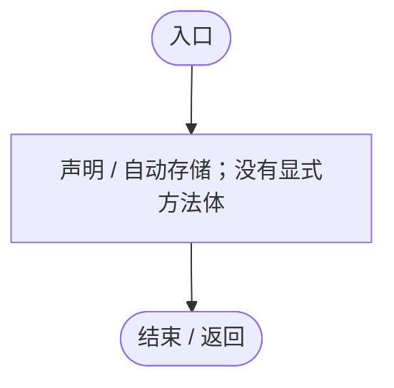

<a id="mffa6612111e4cbb5"></a>

### Cancel · L13

`public void Cancel()`


#### Editor / Player · Roslyn编译器控制流

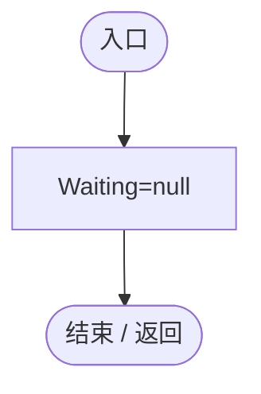

项目内调用/回调引用：

- [ControlSettingsPage.Waiting.set · L10](UI.md#mca0e60ec11c83dcc)（访问器）

<a id="m62a5c699fcaaadd5"></a>

### Begin · L14

`public void Begin(ControlAction action)`


#### Editor / Player · Roslyn编译器控制流

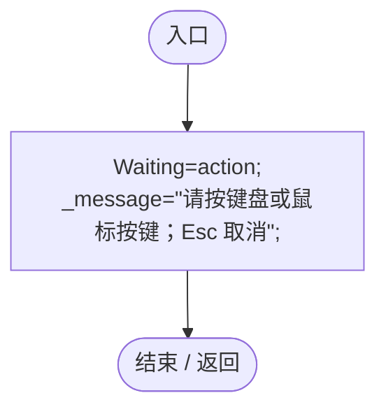

项目内调用/回调引用：

- [ControlSettingsPage.Waiting.set · L10](UI.md#mca0e60ec11c83dcc)（访问器）

<a id="m6ee8437eb0993617"></a>

### HandleEvent · L15

`public bool HandleEvent(Event evt)`


#### Editor / Player · Roslyn编译器控制流

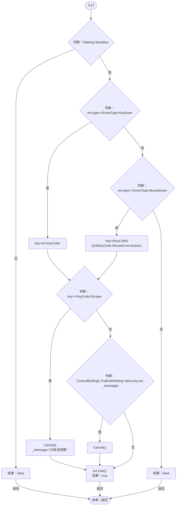

项目内调用/回调引用：

- [ControlSettingsPage.Waiting.get · L10](UI.md#m2fe9f8e5114b53d5)（访问器）
- [ControlSettingsPage.Cancel · L13](UI.md#mffa6612111e4cbb5)（方法）
- [ControlBindings.TryBind · L55](Core.md#m2724f096eee115f2)（方法）

<a id="m14996c10915bb285"></a>

### Draw · L26

`public void Draw()`


#### Editor / Player · Roslyn编译器控制流

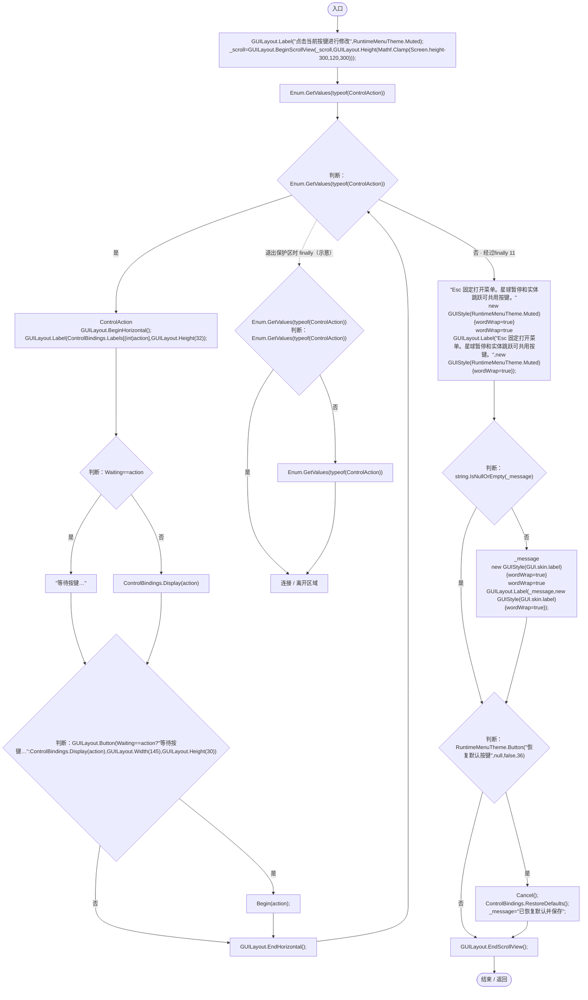

项目内调用/回调引用：

- [RuntimeMenuTheme.Muted.get · L13](UI.md#meeaba271eb4ad2ed)（访问器）
- [ControlSettingsPage.Waiting.get · L10](UI.md#m2fe9f8e5114b53d5)（访问器）
- [ControlBindings.Display · L68](Core.md#m9bd4296160207463)（方法）
- [ControlSettingsPage.Begin · L14](UI.md#m62a5c699fcaaadd5)（方法）
- [RuntimeMenuTheme.Button · L90](UI.md#mc7e1580ab0f51b0b)（方法）
- [ControlSettingsPage.Cancel · L13](UI.md#mffa6612111e4cbb5)（方法）
- [ControlBindings.RestoreDefaults · L67](Core.md#m479d8e9c3bd1b890)（方法）


---

<a id="scbc301144604182a"></a>

## EnergyBlockInput.cs

`Runtime` · `Assets/DarwinPark/UI/EnergyBlockInput.cs`

[源文件](../../../Assets/DarwinPark/UI/EnergyBlockInput.cs) · 源码校验：`bdaa9812f733d3d1978f61e31b689cc042ddafc8c98e22df7f881ccc15fe8f76`

方法按源文件位置排列。事件/回调引用不表示立即执行；完整源码与关系图请打开离线手册。

<a id="m5851201e1d7b865c"></a>

### releaseKey.get · L13

`public KeyCode releaseKey`

★ 适配：改键后的能力输入与释放鼠标门控共用设置配置。

#### Editor / Player · 语法控制结构 / 声明（非CFG）

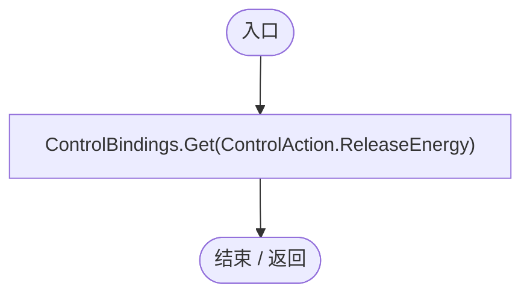

项目内调用/回调引用：

- [ControlBindings.Get · L45](Core.md#mb5707e6e63a56689)（方法）

<a id="m6d93f027fb7e64d4"></a>

### Update · L14

`private void Update()`


#### Editor / Player · Roslyn编译器控制流

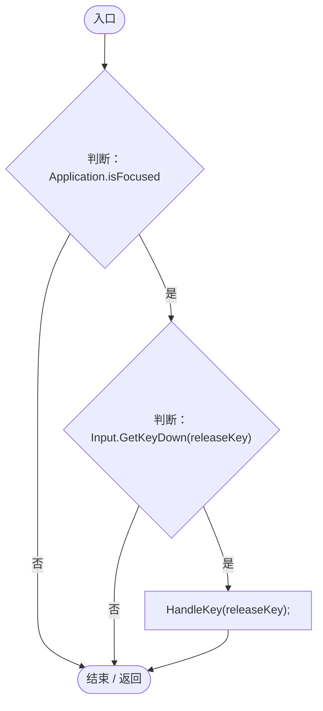

项目内调用/回调引用：

- [EnergyBlockInput.HandleKey · L15](UI.md#m53f5b1a382b8417d)（方法）

<a id="m53f5b1a382b8417d"></a>

### HandleKey · L15

`public bool HandleKey(KeyCode key)`


#### Editor / Player · Roslyn编译器控制流

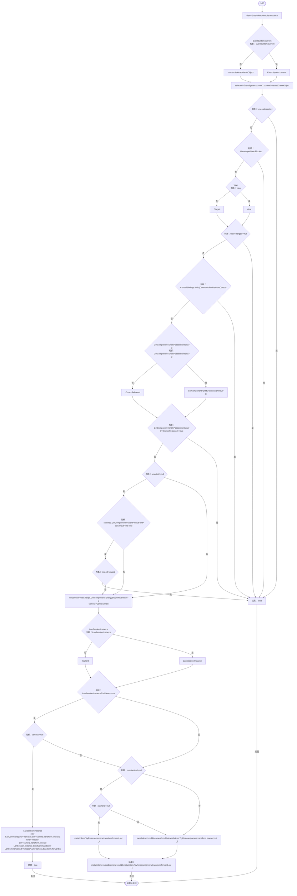

项目内调用/回调引用：

- [EntityViewController.Instance.get · L15](UI.md#mb3b8144b56e80842)（访问器）
- [GameInputGate.Blocked.get · L8](Core.md#m765763b665829633)（访问器）
- [EntityViewController.Target.get · L16](UI.md#m87ca090092a884ab)（访问器）
- [ControlBindings.Held · L46](Core.md#md4244ab88aa8af27)（方法）
- [EntityPossessionInput.CursorReleased.get · L18](UI.md#m4c0ff7787f8b0aa3)（访问器）
- [LanSession.Instance.get · L22](Gameplay.md#m7dfdbb06da9ac3a5)（访问器）
- [LanSession.SendCommand · L88](Gameplay.md#mc4992eb7b0300351)（方法）
- [EnergyBlockMetabolism.TryRelease · L41](Entities.md#mf49f990f4e1cf720)（方法）


---

<a id="s2c9eb7566fedbc6d"></a>

## EntityBodyView.cs

`Runtime` · `Assets/DarwinPark/UI/EntityBodyView.cs`

[源文件](../../../Assets/DarwinPark/UI/EntityBodyView.cs) · 源码校验：`b4f80cd99b3eca90ca20bc3c3282e8fddda7802d7e76e212ddb17d7949b76363`

方法按源文件位置排列。事件/回调引用不表示立即执行；完整源码与关系图请打开离线手册。

<a id="madbf6e489e7573c4"></a>

### MeshBuilds.get · L18

`get`


#### Editor / Player · 语法控制结构 / 声明（非CFG）


<a id="m3735ea017767ed6b"></a>

### MeshBuilds.set · L18

`private set`


#### Editor / Player · 语法控制结构 / 声明（非CFG）


<a id="m7cb3079e34b0b6f8"></a>

### MeshReuses.get · L18

`get`


#### Editor / Player · 语法控制结构 / 声明（非CFG）


<a id="m3d8d6b2b0683aa3c"></a>

### MeshReuses.set · L18

`private set`


#### Editor / Player · 语法控制结构 / 声明（非CFG）


<a id="m26f1a95d03de483a"></a>

### PartCount.get · L20

`get`


#### Editor / Player · 语法控制结构 / 声明（非CFG）


<a id="m9d8f9e120674622d"></a>

### PartCount.set · L20

`private set`


#### Editor / Player · 语法控制结构 / 声明（非CFG）


<a id="m853bdfe9889093bf"></a>

### Parts.get · L20

`get`


#### Editor / Player · 语法控制结构 / 声明（非CFG）


<a id="mafba4e19ec2130f5"></a>

### Parts.set · L20

`private set`


#### Editor / Player · 语法控制结构 / 声明（非CFG）


<a id="m27d53849de9f1db0"></a>

### Attach · L21

`public static void Attach(DarwinEntity entity)`


#### Editor / Player · Roslyn编译器控制流

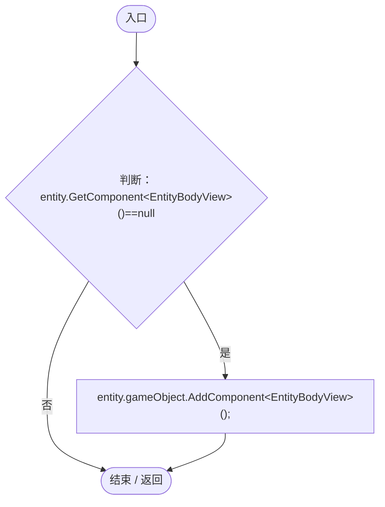

<a id="ma073f2dbaa7b0023"></a>

### Awake · L22

`private void Awake()`


#### Editor / Player · Roslyn编译器控制流

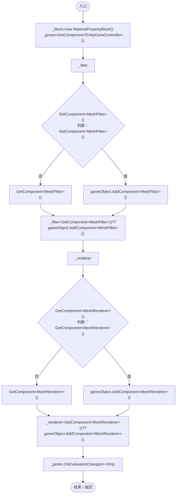

项目内调用/回调引用：

- [EntityBodyView.Dirty · L24](UI.md#m78265d0d4f9d55ae)（方法）

<a id="m6c41204b191ac1ef"></a>

### OnEnable · L23

`private void OnEnable()`


#### Editor / Player · Roslyn编译器控制流

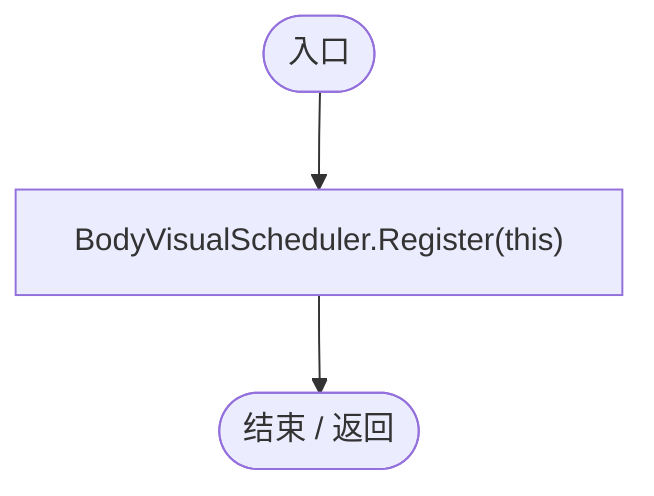

项目内调用/回调引用：

- [BodyVisualScheduler.Register · L129](UI.md#ma17d5bf2c11c3e39)（方法）

<a id="m78265d0d4f9d55ae"></a>

### Dirty · L24

`private void Dirty(GenomeEvaluation evaluation)`


#### Editor / Player · Roslyn编译器控制流

```mermaid
flowchart TD
  b0(["入口"])
  b1["BodyVisualScheduler.Enqueue(this)"]
  b2(["结束 / 返回"])
  b0 --> b1
  b1 --> b2

```

项目内调用/回调引用：

- [BodyVisualScheduler.Enqueue · L131](UI.md#m29d82be4941bd078)（方法）

<a id="mec853241f08c6e49"></a>

### Model · L25

`private static Mesh Model(PartDefinition part)`


#### Editor / Player · Roslyn编译器控制流

```mermaid
flowchart TD
  b0(["入口"])
  b1{"判断：string.IsNullOrEmpty(part.modelResource)"}
  b2["part.primitive"]
  b3["part.modelResource"]
  b4["key=string.IsNullOrEmpty(part.modelResource)?part.primitive:part.modelResource"]
  b5{"判断：Models.TryGetValue(key,out var mesh)"}
  b6{"判断：mesh!=null"}
  b7["结果：mesh"]
  b8{"判断：string.IsNullOrEmpty(part.modelResource)"}
  b9{"mesh=Resources.Load&lt;Mesh&gt;(part.modelResource);<br/>判断：mesh==null"}
  b10["结果：new InvalidOperationException(&quot;部件模型资源不存在：&quot;+part.modelResource)"]
  x10(["抛出异常 / 离开方法"])
  b11["sides=8<br/>rings=6<br/>vertices=new List&lt;Vector3&gt;()<br/>triangles=new List&lt;int&gt;()"]
  b12["y=0"]
  b13{"判断：y&lt;=rings"}
  b14["latitude=Mathf.PI*y/rings"]
  b15["x=0"]
  b16{"判断：x&lt;=sides"}
  b17{"angle=2*Mathf.PI*x/sides<br/>p=new Vector3(Mathf.Sin(latitude)*Mathf.Cos(angle),Mathf.Cos(latitude),Mathf.Sin(latitude)*Mathf.Sin(angle))*.5f<br/>判断：part.primitive==&quot;capsule&quot;"}
  b18["p.y+=Mathf.Sign(p.y)*.2f;"]
  b19{"判断：part.primitive==&quot;cube&quot;"}
  b20["p=p.normalized*.5f/Mathf.Max(Mathf.Abs(p.normalized.x),Mathf.Abs(p.normalized.y),Mathf.Abs(p.normalized.z));"]
  b21["vertices.Add(p);"]
  b22["x++"]
  b23["y++"]
  b24["y=0"]
  b25{"判断：y&lt;rings"}
  b26["x=0"]
  b27{"判断：x&lt;sides"}
  b28["a=y*(sides+1)+x<br/>b=a+sides+1<br/>triangles.AddRange(new[]{a,a+1,b,a+1,b+1,b});"]
  b29["x++"]
  b30["y++"]
  b31["mesh<br/>new Mesh{name=&quot;BodyPart-&quot;+key}<br/>name=&quot;BodyPart-&quot;+key<br/>mesh=new Mesh{name=&quot;BodyPart-&quot;+key};"]
  b32["mesh.SetVertices(vertices);<br/>mesh.SetTriangles(triangles,0);<br/>mesh.RecalculateNormals();<br/>mesh.RecalculateBounds();<br/>OwnedModels.Add(mesh);"]
  b33["Models.Add(key,mesh);<br/>结果：mesh"]
  b34(["结束 / 返回"])
  b0 --> b1
  b1 -->|"是"| b2
  b1 -->|"否"| b3
  b2 --> b4
  b3 --> b4
  b4 --> b5
  b5 -->|"是"| b6
  b5 -->|"否"| b8
  b6 -->|"是"| b7
  b6 -->|"否"| b8
  b7 -->|"返回"| b34
  b8 -->|"否"| b9
  b8 -->|"是"| b11
  b9 -->|"是"| b10
  b9 -->|"否"| b33
  b10 -->|"Throw"| x10
  b11 --> b12
  b12 --> b13
  b13 -->|"是"| b14
  b13 -->|"否"| b24
  b14 --> b15
  b15 --> b16
  b16 -->|"是"| b17
  b16 -->|"否"| b23
  b17 -->|"是"| b18
  b17 -->|"否"| b19
  b18 --> b21
  b19 -->|"是"| b20
  b19 -->|"否"| b21
  b20 --> b21
  b21 --> b22
  b22 --> b16
  b23 --> b13
  b24 --> b25
  b25 -->|"是"| b26
  b25 -->|"否"| b31
  b26 --> b27
  b27 -->|"是"| b28
  b27 -->|"否"| b30
  b28 --> b29
  b29 --> b27
  b30 --> b25
  b31 --> b32
  b32 --> b33
  b33 -->|"返回"| b34

```

<a id="m1c58deaa60902937"></a>

### Rebuild · L39

`public void Rebuild()`


#### Editor / Player · Roslyn编译器控制流

```mermaid
flowchart TD
  b0(["入口"])
  b1{"_genes<br/>判断：_genes"}
  b2[".Evaluation"]
  b3["_genes"]
  b4{"判断：_genes?.Evaluation==null"}
  b5["Parts=MorphologyExpression.Resolve(_genes.Genome,_genes.Evaluation);<br/>PartCount=Parts.Count;<br/>signature=17"]
  b6["Parts"]
  b7{"判断：Parts"}
  b8["var<br/>signature=signature*31+part.slotId.GetHashCode();<br/>signature=signature*31+part.partId.GetHashCode();<br/>_signatureValues.Clear();<br/>_signatureValues.Add(part.scale.x);<br/>_signatureValues.Add(part.scale.y);<br/>_signatureValues.Add(part.scale.z);…"]
  b9["_signatureValues"]
  b10{"判断：_signatureValues"}
  b11["float<br/>signature=signature*31+Mathf.RoundToInt(value*64);"]
  b12["_signatureValues"]
  b13{"判断：Parts"}
  b14["Parts"]
  b15["连接 / 离开区域"]
  b16{"判断：_hasSignature"}
  b17{"判断：signature==_signature"}
  b18{"判断：Matches(_entry,Parts)"}
  b19{"SetDetail<br/>判断：Camera.main!=null"}
  b20["Camera.main.transform.position"]
  b21["transform.position"]
  b22["SetDetail(Camera.main!=null?Camera.main.transform.position:transform.position);"]
  b23["Parts"]
  b24{"判断：Parts"}
  b25{"var<br/>判断：part.slotId==&quot;body&quot;"}
  b26["_bodyColor=part.color;"]
  b27{"判断：Parts"}
  b28["Parts"]
  b29["连接 / 离开区域"]
  b30{"entry=null<br/>判断：Meshes.TryGetValue(signature,out var choices)"}
  b31["choices"]
  b32{"判断：choices"}
  b33{"var<br/>判断：Matches(choice,Parts)"}
  b34["entry=choice;<br/>MeshReuses++;"]
  b35["choices"]
  b36{"判断：entry==null"}
  b37["vertices=new List&lt;Vector3&gt;()<br/>normals=new List&lt;Vector3&gt;()<br/>colors=new List&lt;Color&gt;()<br/>indices=new List&lt;int&gt;()"]
  b38["Parts"]
  b39{"判断：Parts"}
  b40["var"]
  b41["model=Model(MorphologyRegistry.Part(part.partId))<br/>points=model.vertices<br/>sourceNormals=model.normals<br/>first=vertices.Count<br/>matrix=Matrix4x4.TRS(part.position,part.rotation,part.scale)<br/>normalMatrix=matrix.inverse.transpose"]
  b42["i=0"]
  b43{"判断：i&lt;points.Length"}
  b44["vertices.Add(matrix.MultiplyPoint3x4(points[i]));<br/>normals.Add(normalMatrix.MultiplyVector(sourceNormals[i]).normalized);<br/>colors.Add(part.color);<br/>i++"]
  b45["model.triangles"]
  b46{"判断：model.triangles"}
  b47["int<br/>indices.Add(first+index);"]
  b48{"model.triangles<br/>判断：model.triangles"}
  b49["model.triangles"]
  b50["连接 / 离开区域"]
  b51{"判断：part.slotId==&quot;body&quot;"}
  b52["_bodyColor=part.color;"]
  b53{"判断：Parts"}
  b54["Parts"]
  b55["连接 / 离开区域"]
  b56["new Mesh{name=&quot;OrganismBody&quot;,indexFormat=IndexFormat.UInt32}<br/>name=&quot;OrganismBody&quot;<br/>indexFormat=IndexFormat.UInt32<br/>mesh=new Mesh{name=&quot;OrganismBody&quot;,indexFormat=IndexFormat.UInt32}"]
  b57["mesh.SetVertices(vertices);<br/>mesh.SetNormals(normals);<br/>mesh.SetColors(colors);<br/>mesh.SetTriangles(indices,0);<br/>mesh.RecalculateBounds();<br/>MeshBuilds++;"]
  b58["entry<br/>new MeshEntry{mesh=mesh,parts=new List&lt;ExpressedPart&gt;(Parts),catalog=MorphologyRegistry.Identity}<br/>mesh=mesh<br/>parts=new List&lt;ExpressedPart&gt;(Parts)<br/>catalog=MorphologyRegistry.Identity<br/>entry=new MeshEntry{mesh=mesh,parts=new List&lt;Expre…"]
  b59{"判断：Meshes.TryGetValue(signature,out choices)"}
  b60["Meshes[signature]=choices=new();"]
  b61["choices.Add(entry);"]
  b62{"ReleaseMesh();<br/>_entry=entry;<br/>entry.users++;<br/>_mesh=entry.mesh;<br/>_hasSignature=true;<br/>_signature=signature;<br/>_filter.sharedMesh=_mesh;<br/>判断：_material==null"}
  b63{"_material=Resources.Load&lt;Material&gt;(&quot;Morphology/body&quot;);<br/>判断：_material==null"}
  b64["结果：new InvalidOperationException(&quot;缺少Morphology/body材质&quot;)"]
  x64(["抛出异常 / 离开方法"])
  b65["_material.enableInstancing=true;<br/>_renderer.sharedMaterial=_material;<br/>_renderer.shadowCastingMode=ShadowCastingMode.Off;<br/>_renderer.receiveShadows=false;<br/>_far=false;<br/>_appearanceDirty=true;"]
  b66{"SetDetail<br/>判断：Camera.main!=null"}
  b67["Camera.main.transform.position"]
  b68["transform.position"]
  b69["SetDetail(Camera.main!=null?Camera.main.transform.position:transform.position);"]
  b70(["结束 / 返回"])
  b0 --> b1
  b1 -->|"否"| b2
  b1 -->|"是"| b3
  b2 --> b4
  b3 --> b4
  b4 -->|"是"| b70
  b4 -->|"否"| b5
  b5 --> b6
  b6 --> b7
  b7 -->|"是"| b8
  b7 -->|"否 · 经过finally 13"| b16
  b8 --> b9
  b9 --> b10
  b10 -->|"是"| b11
  b10 -->|"否 · 经过finally 12"| b7
  b11 --> b10
  b13 -->|"否"| b14
  b13 -->|"是"| b15
  b14 --> b15
  b16 -->|"是"| b17
  b16 -->|"否"| b23
  b17 -->|"是"| b18
  b17 -->|"否"| b23
  b18 -->|"是"| b19
  b18 -->|"否"| b23
  b19 -->|"是"| b20
  b19 -->|"否"| b21
  b20 --> b22
  b21 --> b22
  b22 --> b70
  b23 --> b24
  b24 -->|"是"| b25
  b24 -->|"否 · 经过finally 27"| b30
  b25 -->|"是"| b26
  b25 -->|"否"| b24
  b26 --> b24
  b27 -->|"否"| b28
  b27 -->|"是"| b29
  b28 --> b29
  b30 -->|"是"| b31
  b30 -->|"否"| b36
  b31 --> b32
  b32 -->|"是"| b33
  b32 -->|"否 · 经过finally 35"| b36
  b33 -->|"是"| b34
  b33 -->|"否"| b32
  b34 -->|"经过finally 35"| b36
  b36 -->|"是"| b37
  b36 -->|"否"| b62
  b37 --> b38
  b38 --> b39
  b39 -->|"是"| b40
  b39 -->|"否 · 经过finally 53"| b56
  b40 --> b41
  b41 --> b42
  b42 --> b43
  b43 -->|"是"| b44
  b43 -->|"否"| b45
  b44 --> b43
  b45 --> b46
  b46 -->|"是"| b47
  b46 -->|"否 · 经过finally 48"| b51
  b47 --> b46
  b48 -->|"否"| b49
  b48 -->|"是"| b50
  b49 --> b50
  b51 -->|"是"| b52
  b51 -->|"否"| b39
  b52 --> b39
  b53 -->|"否"| b54
  b53 -->|"是"| b55
  b54 --> b55
  b56 --> b57
  b57 --> b58
  b58 --> b59
  b59 -->|"否"| b60
  b59 -->|"是"| b61
  b60 --> b61
  b61 --> b62
  b62 -->|"是"| b63
  b62 -->|"否"| b65
  b63 -->|"是"| b64
  b63 -->|"否"| b65
  b64 -->|"Throw"| x64
  b65 --> b66
  b66 -->|"是"| b67
  b66 -->|"否"| b68
  b67 --> b69
  b68 --> b69
  b69 --> b70
  b10 -. "退出保护区时 finally（示意）" .-> b12
  b7 -. "退出保护区时 finally（示意）" .-> b13
  b24 -. "退出保护区时 finally（示意）" .-> b27
  b32 -. "退出保护区时 finally（示意）" .-> b35
  b46 -. "退出保护区时 finally（示意）" .-> b48
  b39 -. "退出保护区时 finally（示意）" .-> b53

```

项目内调用/回调引用：

- [EntityGeneController.Evaluation.get · L20](Entities.md#mf275f100ea21601a)（访问器）
- [EntityBodyView.Parts.set · L20](UI.md#mafba4e19ec2130f5)（访问器）
- [MorphologyExpression.Resolve · L9](Genetics.md#mc8fe84f6aa00971b)（方法）
- [EntityBodyView.PartCount.set · L20](UI.md#m9d8f9e120674622d)（访问器）
- [EntityBodyView.Parts.get · L20](UI.md#m853bdfe9889093bf)（访问器）
- [EntityBodyView.Matches · L82](UI.md#m1f3991d6afa4c070)（方法）
- [EntityBodyView.SetDetail · L62](UI.md#m5b54bc89df5d7456)（方法）
- [EntityBodyView.MeshReuses.set · L18](UI.md#m3d8d6b2b0683aa3c)（访问器）
- [EntityBodyView.MeshReuses.get · L18](UI.md#m7cb3079e34b0b6f8)（访问器）
- [EntityBodyView.Model · L25](UI.md#mec853241f08c6e49)（方法）
- [MorphologyRegistry.Part · L36](Genetics.md#mb85f859ebd0cf80e)（方法）
- [EntityBodyView.MeshBuilds.set · L18](UI.md#m3735ea017767ed6b)（访问器）
- [EntityBodyView.MeshBuilds.get · L18](UI.md#madbf6e489e7573c4)（访问器）
- [MorphologyRegistry.Identity.get · L13](Genetics.md#mdad8ec02f3374fda)（访问器）
- [EntityBodyView.ReleaseMesh · L87](UI.md#m69efa7bd7d841155)（方法）

<a id="m5b54bc89df5d7456"></a>

### SetDetail · L62

`internal void SetDetail(Vector3 cameraPosition)`


#### Editor / Player · Roslyn编译器控制流

```mermaid
flowchart TD
  b0(["入口"])
  b1{"判断：_mesh==null"}
  b2{"far=(cameraPosition-transform.position).sqrMagnitude&gt;MorphologyRegistry.Settings.farDistance*MorphologyRegistry.Settings.farDistance<br/>判断：far==_far"}
  b3{"判断：_appearanceDirty"}
  b4{"_appearanceDirty=false;<br/>判断：far!=_far"}
  b5{"判断：_filter.sharedMesh==null"}
  b6{"_filter.sharedMesh<br/>判断：far"}
  b7["Model(MorphologyRegistry.Part(MorphologyRegistry.Settings.simplifiedPartId))"]
  b8["_mesh"]
  b9["_filter.sharedMesh=far?Model(MorphologyRegistry.Part(MorphologyRegistry.Settings.simplifiedPartId)):_mesh;"]
  b10["_far=far;"]
  b11["_renderer.GetPropertyBlock(_block);"]
  b12{"_block<br/>&quot;_FarBody&quot;<br/>判断：far"}
  b13["1"]
  b14["0"]
  b15["_block.SetFloat(&quot;_FarBody&quot;,far?1:0);"]
  b16["_block.SetColor(&quot;_BodyColor&quot;,_bodyColor);<br/>_renderer.SetPropertyBlock(_block);"]
  b17(["结束 / 返回"])
  b0 --> b1
  b1 -->|"是"| b17
  b1 -->|"否"| b2
  b2 -->|"是"| b3
  b2 -->|"否"| b4
  b3 -->|"否"| b17
  b3 -->|"是"| b4
  b4 -->|"否"| b5
  b4 -->|"是"| b6
  b5 -->|"是"| b6
  b5 -->|"否"| b11
  b6 -->|"是"| b7
  b6 -->|"否"| b8
  b7 --> b9
  b8 --> b9
  b9 --> b10
  b10 --> b11
  b11 --> b12
  b12 -->|"是"| b13
  b12 -->|"否"| b14
  b13 --> b15
  b14 --> b15
  b15 --> b16
  b16 --> b17

```

项目内调用/回调引用：

- [MorphologyRegistry.Settings.get · L14](Genetics.md#m06f6b47f6404ecb0)（访问器）
- [EntityBodyView.Model · L25](UI.md#mec853241f08c6e49)（方法）
- [MorphologyRegistry.Part · L36](Genetics.md#mb85f859ebd0cf80e)（方法）

<a id="m90aa8052405c5e93"></a>

### BodyRenderer.get · L69

`internal MeshRenderer BodyRenderer`


#### Editor / Player · 语法控制结构 / 声明（非CFG）

```mermaid
flowchart TD
  n2(["入口"])
  n1["_renderer"]
  n0(["结束 / 返回"])
  n1 --> n0
  n2 --> n1

```

<a id="m30924e3688af244e"></a>

### TryFarInstance · L70

`internal bool TryFarInstance(out MeshRenderer renderer,out Mesh mesh,out Color color)`


#### Editor / Player · Roslyn编译器控制流

```mermaid
flowchart TD
  b0(["入口"])
  b1{"renderer=_renderer;<br/>mesh=null;<br/>color=_bodyColor;<br/>判断：_mesh==null"}
  b2{"判断：renderer==null"}
  b3{"判断：renderer.enabled"}
  b4{"判断：renderer.sharedMaterial!=_material"}
  b5{"判断：_material==null"}
  b6{"判断：_material.enableInstancing"}
  b7["结果：false"]
  b8["mesh=Model(MorphologyRegistry.Part(MorphologyRegistry.Settings.simplifiedPartId));<br/>结果：mesh!=null"]
  b9(["结束 / 返回"])
  b0 --> b1
  b1 -->|"否"| b2
  b1 -->|"是"| b7
  b2 -->|"否"| b3
  b2 -->|"是"| b7
  b3 -->|"是"| b4
  b3 -->|"否"| b7
  b4 -->|"否"| b5
  b4 -->|"是"| b7
  b5 -->|"否"| b6
  b5 -->|"是"| b7
  b6 -->|"否"| b7
  b6 -->|"是"| b8
  b7 -->|"返回"| b9
  b8 -->|"返回"| b9

```

项目内调用/回调引用：

- [EntityBodyView.Model · L25](UI.md#mec853241f08c6e49)（方法）
- [MorphologyRegistry.Part · L36](Genetics.md#mb85f859ebd0cf80e)（方法）
- [MorphologyRegistry.Settings.get · L14](Genetics.md#m06f6b47f6404ecb0)（访问器）

<a id="m7a1f46204b37719d"></a>

### Same · L78

`private static bool Same(float a,float b)`


#### Editor / Player · Roslyn编译器控制流

```mermaid
flowchart TD
  b0(["入口"])
  b1["结果：Mathf.RoundToInt(a*64)==Mathf.RoundToInt(b*64)"]
  b2(["结束 / 返回"])
  b0 --> b1
  b1 -->|"返回"| b2

```

<a id="mdb4f2542aca38a22"></a>

### Same · L79

`private static bool Same(Vector3 a,Vector3 b)`


#### Editor / Player · Roslyn编译器控制流

```mermaid
flowchart TD
  b0(["入口"])
  b1{"判断：Same(a.x,b.x)"}
  b2{"判断：Same(a.y,b.y)"}
  b3["Same(a.z,b.z)"]
  b4["Same(a.x,b.x)&amp;&amp;Same(a.y,b.y)&amp;&amp;Same(a.z,b.z)"]
  b5["结果：Same(a.x,b.x)&amp;&amp;Same(a.y,b.y)&amp;&amp;Same(a.z,b.z)"]
  b6(["结束 / 返回"])
  b0 --> b1
  b1 -->|"是"| b2
  b1 -->|"否"| b4
  b2 -->|"是"| b3
  b2 -->|"否"| b4
  b3 --> b5
  b4 --> b5
  b5 -->|"返回"| b6

```

项目内调用/回调引用：

- [EntityBodyView.Same · L78](UI.md#m7a1f46204b37719d)（方法）

<a id="m6c2252bd5243f7e4"></a>

### Same · L80

`private static bool Same(Quaternion a,Quaternion b)`


#### Editor / Player · Roslyn编译器控制流

```mermaid
flowchart TD
  b0(["入口"])
  b1{"判断：Same(a.x,b.x)"}
  b2{"判断：Same(a.y,b.y)"}
  b3{"判断：Same(a.z,b.z)"}
  b4["Same(a.w,b.w)"]
  b5["Same(a.x,b.x)&amp;&amp;Same(a.y,b.y)&amp;&amp;Same(a.z,b.z)&amp;&amp;Same(a.w,b.w)"]
  b6["结果：Same(a.x,b.x)&amp;&amp;Same(a.y,b.y)&amp;&amp;Same(a.z,b.z)&amp;&amp;Same(a.w,b.w)"]
  b7(["结束 / 返回"])
  b0 --> b1
  b1 -->|"是"| b2
  b1 -->|"否"| b5
  b2 -->|"是"| b3
  b2 -->|"否"| b5
  b3 -->|"是"| b4
  b3 -->|"否"| b5
  b4 --> b6
  b5 --> b6
  b6 -->|"返回"| b7

```

项目内调用/回调引用：

- [EntityBodyView.Same · L78](UI.md#m7a1f46204b37719d)（方法）

<a id="m52a36bc084609f5b"></a>

### Same · L81

`private static bool Same(Color a,Color b)`


#### Editor / Player · Roslyn编译器控制流

```mermaid
flowchart TD
  b0(["入口"])
  b1{"判断：Same(a.r,b.r)"}
  b2{"判断：Same(a.g,b.g)"}
  b3["Same(a.b,b.b)"]
  b4["Same(a.r,b.r)&amp;&amp;Same(a.g,b.g)&amp;&amp;Same(a.b,b.b)"]
  b5["结果：Same(a.r,b.r)&amp;&amp;Same(a.g,b.g)&amp;&amp;Same(a.b,b.b)"]
  b6(["结束 / 返回"])
  b0 --> b1
  b1 -->|"是"| b2
  b1 -->|"否"| b4
  b2 -->|"是"| b3
  b2 -->|"否"| b4
  b3 --> b5
  b4 --> b5
  b5 -->|"返回"| b6

```

项目内调用/回调引用：

- [EntityBodyView.Same · L78](UI.md#m7a1f46204b37719d)（方法）

<a id="m1f3991d6afa4c070"></a>

### Matches · L82

`private static bool Matches(MeshEntry entry,IReadOnlyList<ExpressedPart> parts)`


#### Editor / Player · Roslyn编译器控制流

```mermaid
flowchart TD
  b0(["入口"])
  b1{"判断：entry==null"}
  b2{"判断：entry.mesh==null"}
  b3{"判断：entry.catalog!=MorphologyRegistry.Identity"}
  b4{"判断：entry.parts.Count!=parts.Count"}
  b5["结果：false"]
  b6["i=0"]
  b7{"判断：i&lt;parts.Count"}
  b8{"a=entry.parts[i]<br/>b=parts[i]<br/>判断：a.partId!=b.partId"}
  b9{"判断：a.slotId!=b.slotId"}
  b10{"判断：Same(a.scale,b.scale)"}
  b11{"判断：Same(a.position,b.position)"}
  b12{"判断：Same(a.rotation,b.rotation)"}
  b13{"判断：Same(a.color,b.color)"}
  b14["结果：false"]
  b15["i++"]
  b16["结果：true"]
  b17(["结束 / 返回"])
  b0 --> b1
  b1 -->|"否"| b2
  b1 -->|"是"| b5
  b2 -->|"否"| b3
  b2 -->|"是"| b5
  b3 -->|"否"| b4
  b3 -->|"是"| b5
  b4 -->|"是"| b5
  b4 -->|"否"| b6
  b5 -->|"返回"| b17
  b6 --> b7
  b7 -->|"是"| b8
  b7 -->|"否"| b16
  b8 -->|"否"| b9
  b8 -->|"是"| b14
  b9 -->|"否"| b10
  b9 -->|"是"| b14
  b10 -->|"是"| b11
  b10 -->|"否"| b14
  b11 -->|"是"| b12
  b11 -->|"否"| b14
  b12 -->|"是"| b13
  b12 -->|"否"| b14
  b13 -->|"否"| b14
  b13 -->|"是"| b15
  b14 -->|"返回"| b17
  b15 --> b7
  b16 -->|"返回"| b17

```

项目内调用/回调引用：

- [MorphologyRegistry.Identity.get · L13](Genetics.md#mdad8ec02f3374fda)（访问器）
- [EntityBodyView.Same · L79](UI.md#mdb4f2542aca38a22)（方法）
- [EntityBodyView.Same · L80](UI.md#m6c2252bd5243f7e4)（方法）
- [EntityBodyView.Same · L81](UI.md#m52a36bc084609f5b)（方法）

<a id="m69efa7bd7d841155"></a>

### ReleaseMesh · L87

`private void ReleaseMesh()`


#### Editor / Player · Roslyn编译器控制流

```mermaid
flowchart TD
  b0(["入口"])
  b1{"判断：_entry==null"}
  b2{"判断：--_entry.users==0"}
  b3{"判断：Meshes.TryGetValue(_signature,out var choices)"}
  b4{"choices.Remove(_entry);<br/>判断：choices.Count==0"}
  b5["Meshes.Remove(_signature);"]
  b6{"判断：_entry.mesh!=null"}
  b7["Destroy(_entry.mesh);"]
  b8["_entry=null;"]
  b9(["结束 / 返回"])
  b0 --> b1
  b1 -->|"是"| b9
  b1 -->|"否"| b2
  b2 -->|"是"| b3
  b2 -->|"否"| b8
  b3 -->|"是"| b4
  b3 -->|"否"| b6
  b4 -->|"是"| b5
  b4 -->|"否"| b6
  b5 --> b6
  b6 -->|"是"| b7
  b6 -->|"否"| b8
  b7 --> b8
  b8 --> b9

```

<a id="m94c774f04c433dfb"></a>

### OnDisable · L91

`private void OnDisable()`


#### Editor / Player · Roslyn编译器控制流

```mermaid
flowchart TD
  b0(["入口"])
  b1["BodyVisualScheduler.Unregister(this)"]
  b2(["结束 / 返回"])
  b0 --> b1
  b1 --> b2

```

项目内调用/回调引用：

- [BodyVisualScheduler.Unregister · L130](UI.md#m280cbbb6ab077b39)（方法）

<a id="md90cf51e137221e4"></a>

### OnDestroy · L92

`private void OnDestroy()`


#### Editor / Player · Roslyn编译器控制流

```mermaid
flowchart TD
  b0(["入口"])
  b1{"判断：_genes!=null"}
  b2["_genes.OnEvaluationChanged-=Dirty;"]
  b3["ReleaseMesh();"]
  b4(["结束 / 返回"])
  b0 --> b1
  b1 -->|"是"| b2
  b1 -->|"否"| b3
  b2 --> b3
  b3 --> b4

```

项目内调用/回调引用：

- [EntityBodyView.ReleaseMesh · L87](UI.md#m69efa7bd7d841155)（方法）
- [EntityBodyView.Dirty · L24](UI.md#m78265d0d4f9d55ae)（方法）

<a id="mf3d71551858e95c3"></a>

### Reset · L93

`[RuntimeInitializeOnLoadMethod(RuntimeInitializeLoadType.SubsystemRegistration)]private static void Reset()`


#### Editor / Player · Roslyn编译器控制流

```mermaid
flowchart TD
  b0(["入口"])
  b1["Meshes.Values"]
  b2{"判断：Meshes.Values"}
  b3["var"]
  b4["choices"]
  b5{"判断：choices"}
  b6{"var<br/>判断：entry.mesh!=null"}
  b7{"判断：Application.isPlaying"}
  b8["Destroy(entry.mesh);"]
  b9["DestroyImmediate(entry.mesh);"]
  b10["choices"]
  b11["Meshes.Values"]
  b12["Meshes.Clear();<br/>MeshBuilds=MeshReuses=0;"]
  b13["OwnedModels"]
  b14{"判断：OwnedModels"}
  b15{"var<br/>判断：mesh!=null"}
  b16{"判断：Application.isPlaying"}
  b17["Destroy(mesh);"]
  b18["DestroyImmediate(mesh);"]
  b19["OwnedModels"]
  b20["OwnedModels.Clear();<br/>Models.Clear();<br/>_material=null;"]
  b21(["结束 / 返回"])
  b0 --> b1
  b1 --> b2
  b2 -->|"是"| b3
  b2 -->|"否 · 经过finally 11"| b12
  b3 --> b4
  b4 --> b5
  b5 -->|"是"| b6
  b5 -->|"否 · 经过finally 10"| b2
  b6 -->|"是"| b7
  b6 -->|"否"| b5
  b7 -->|"是"| b8
  b7 -->|"否"| b9
  b8 --> b5
  b9 --> b5
  b12 --> b13
  b13 --> b14
  b14 -->|"是"| b15
  b14 -->|"否 · 经过finally 19"| b20
  b15 -->|"是"| b16
  b15 -->|"否"| b14
  b16 -->|"是"| b17
  b16 -->|"否"| b18
  b17 --> b14
  b18 --> b14
  b20 --> b21
  b5 -. "退出保护区时 finally（示意）" .-> b10
  b2 -. "退出保护区时 finally（示意）" .-> b11
  b14 -. "退出保护区时 finally（示意）" .-> b19

```

项目内调用/回调引用：

- [EntityBodyView.MeshBuilds.set · L18](UI.md#m3735ea017767ed6b)（访问器）
- [EntityBodyView.MeshReuses.set · L18](UI.md#m3d8d6b2b0683aa3c)（访问器）

<a id="m2f70c3967141c8ad"></a>

### Awake · L101

`private void Awake()`


#### Editor / Player · Roslyn编译器控制流

```mermaid
flowchart TD
  b0(["入口"])
  b1["_batches=new FarBodyBatchRenderer()"]
  b2(["结束 / 返回"])
  b0 --> b1
  b1 --> b2

```

<a id="m8b58c6a29382ca14"></a>

### FarInstances.get · L104

`public static int FarInstances`


#### Editor / Player · 语法控制结构 / 声明（非CFG）

```mermaid
flowchart TD
  n2(["入口"])
  n1["_instance!=null?(_instance._batches?.LastInstances??0):0"]
  n0(["结束 / 返回"])
  n1 --> n0
  n2 --> n1

```

项目内调用/回调引用：

- [FarBodyBatchRenderer.LastInstances.get · L23](UI.md#me68e100f0ec718ce)（访问器）

<a id="m38aaa6b89b9fc6fd"></a>

### FarBatches.get · L105

`public static int FarBatches`


#### Editor / Player · 语法控制结构 / 声明（非CFG）

```mermaid
flowchart TD
  n2(["入口"])
  n1["_instance!=null?(_instance._batches?.LastBatches??0):0"]
  n0(["结束 / 返回"])
  n1 --> n0
  n2 --> n1

```

项目内调用/回调引用：

- [FarBodyBatchRenderer.LastBatches.get · L24](UI.md#mb4eea1fe7ca96487)（访问器）

<a id="m6217ea3e20beb59f"></a>

### OnEnable · L106

`private void OnEnable()`


#### Editor / Player · Roslyn编译器控制流

```mermaid
flowchart TD
  b0(["入口"])
  b1["RenderPipelineManager.beginCameraRendering+=Draw;"]
  b2(["结束 / 返回"])
  b0 --> b1
  b1 --> b2

```

项目内调用/回调引用：

- [BodyVisualScheduler.Draw · L115](UI.md#mc41d7974cac2bd11)（方法）

<a id="mde8c5b9bbfcaa441"></a>

### OnDisable · L110

`private void OnDisable()`


#### Editor / Player · Roslyn编译器控制流

```mermaid
flowchart TD
  b0(["入口"])
  b1["RenderPipelineManager.beginCameraRendering-=Draw;"]
  b2{"_batches<br/>判断：_batches"}
  b3["_batches?.Restore();"]
  b4(["结束 / 返回"])
  b0 --> b1
  b1 --> b2
  b2 -->|"否"| b3
  b2 -->|"是"| b4
  b3 --> b4

```

项目内调用/回调引用：

- [FarBodyBatchRenderer.Restore · L112](UI.md#mcc7e7e6251705ec0)（方法）
- [BodyVisualScheduler.Draw · L115](UI.md#mc41d7974cac2bd11)（方法）

<a id="mc41d7974cac2bd11"></a>

### Draw · L115

`private void Draw(ScriptableRenderContext context,Camera camera)`


#### Editor / Player · Roslyn编译器控制流

```mermaid
flowchart TD
  b0(["入口"])
  b1{"判断：_inspector==null"}
  b2{"判断：Time.unscaledTime&gt;=_nextInspectorLookup"}
  b3["_nextInspectorLookup=Time.unscaledTime+2;<br/>_inspector=FindFirstObjectByType&lt;GeneInspectorUI&gt;();"]
  b4{"判断：_inspector!=null"}
  b5["_inspector.CurrentEntity"]
  b6["null"]
  b7["selected=_inspector!=null?_inspector.CurrentEntity:null"]
  b8{"判断：_batchFailure"}
  b9{"_batches<br/>判断：_batches"}
  b10{"camera<br/>Views<br/>判断：selected!=null"}
  b11["selected.GetComponent&lt;EntityBodyView&gt;()"]
  b12["null"]
  b13["_batches?.Draw(camera,Views,selected!=null?selected.GetComponent&lt;EntityBodyView&gt;():null);"]
  b14["(Exception error)<br/>_batchFailure=true;"]
  b15{"_batches<br/>判断：_batches"}
  b16["_batches?.Restore();"]
  b17["Debug.LogException(error,this);"]
  b18(["结束 / 返回"])
  b0 --> b1
  b1 -->|"是"| b2
  b1 -->|"否"| b4
  b2 -->|"是"| b3
  b2 -->|"否"| b4
  b3 --> b4
  b4 -->|"是"| b5
  b4 -->|"否"| b6
  b5 --> b7
  b6 --> b7
  b7 --> b8
  b8 -->|"是"| b18
  b8 -->|"否"| b9
  b9 -->|"否"| b10
  b9 -->|"是"| b18
  b10 -->|"是"| b11
  b10 -->|"否"| b12
  b11 --> b13
  b12 --> b13
  b13 --> b18
  b14 --> b15
  b15 -->|"否"| b16
  b15 -->|"是"| b17
  b16 --> b17
  b17 --> b18
  b9 -. "保护区可能异常（示意）" .-> b14

```

项目内调用/回调引用：

- [FarBodyBatchRenderer.Draw · L26](UI.md#m9e7213d977df67f8)（方法）
- [FarBodyBatchRenderer.Restore · L112](UI.md#mcc7e7e6251705ec0)（方法）

<a id="ma8e0ece60ad1b3a2"></a>

### Release · L127

`internal static void Release(Renderer renderer)`


#### Editor / Player · Roslyn编译器控制流

```mermaid
flowchart TD
  b0(["入口"])
  b1{"判断：renderer is MeshRenderer mesh"}
  b2{"_instance<br/>判断：_instance"}
  b3["._batches"]
  b4{"判断：._batches"}
  b5["_instance?._batches?.Release(mesh);"]
  b6(["结束 / 返回"])
  b0 --> b1
  b1 -->|"是"| b2
  b1 -->|"否"| b6
  b2 -->|"否"| b3
  b2 -->|"是"| b6
  b3 --> b4
  b4 -->|"否"| b5
  b4 -->|"是"| b6
  b5 --> b6

```

项目内调用/回调引用：

- [FarBodyBatchRenderer.Release · L107](UI.md#m3d288334672ac61d)（方法）

<a id="ma17d5bf2c11c3e39"></a>

### Register · L129

`public static void Register(EntityBodyView view)`


#### Editor / Player · Roslyn编译器控制流

```mermaid
flowchart TD
  b0(["入口"])
  b1{"判断：Views.Contains(view)"}
  b2["Views.Add(view);"]
  b3{"判断：_instance==null"}
  b4["_instance=new GameObject(&quot;BodyVisualScheduler&quot;).AddComponent&lt;BodyVisualScheduler&gt;();"]
  b5["Enqueue(view);"]
  b6(["结束 / 返回"])
  b0 --> b1
  b1 -->|"否"| b2
  b1 -->|"是"| b3
  b2 --> b3
  b3 -->|"是"| b4
  b3 -->|"否"| b5
  b4 --> b5
  b5 --> b6

```

项目内调用/回调引用：

- [BodyVisualScheduler.Enqueue · L131](UI.md#m29d82be4941bd078)（方法）

<a id="m280cbbb6ab077b39"></a>

### Unregister · L130

`public static void Unregister(EntityBodyView view)`


#### Editor / Player · Roslyn编译器控制流

```mermaid
flowchart TD
  b0(["入口"])
  b1["Release(view.BodyRenderer);<br/>Views.Remove(view);<br/>Queued.Remove(view);"]
  b2(["结束 / 返回"])
  b0 --> b1
  b1 --> b2

```

项目内调用/回调引用：

- [BodyVisualScheduler.Release · L127](UI.md#ma8e0ece60ad1b3a2)（方法）

<a id="m29d82be4941bd078"></a>

### Enqueue · L131

`public static void Enqueue(EntityBodyView view)`


#### Editor / Player · Roslyn编译器控制流

```mermaid
flowchart TD
  b0(["入口"])
  b1{"判断：Queued.Add(view)"}
  b2["Dirty.Enqueue(view);"]
  b3(["结束 / 返回"])
  b0 --> b1
  b1 -->|"是"| b2
  b1 -->|"否"| b3
  b2 --> b3

```

<a id="m717fc15073700968"></a>

### LateUpdate · L132

`private void LateUpdate()`


#### Editor / Player · Roslyn编译器控制流

```mermaid
flowchart TD
  b0(["入口"])
  b1{"判断：WorldRuntimeGate.Loading"}
  b2["end=Time.realtimeSinceStartupAsDouble+MorphologyRegistry.Settings.refreshMilliseconds/1000"]
  b3{"判断：Dirty.Count&gt;0"}
  b4{"判断：Time.realtimeSinceStartupAsDouble&lt;end"}
  b5{"view=Dirty.Dequeue()<br/>判断：view==null"}
  b6{"判断：Queued.Remove(view)"}
  b7{"判断：view.isActiveAndEnabled"}
  b8["view.Rebuild();"]
  b9["(Exception error)<br/>Debug.LogError(&quot;[实体部件] &quot;+error.Message,view);"]
  b10{"判断：Camera.main!=null"}
  b11["Camera.main.transform.position"]
  b12["Vector3.zero"]
  b13["point=Camera.main!=null?Camera.main.transform.position:Vector3.zero"]
  b14["count=Views.Count"]
  b15{"判断：count--&gt;0"}
  b16{"判断：Views.Count&gt;0"}
  b17{"判断：Time.realtimeSinceStartupAsDouble&lt;end"}
  b18{"判断：_cursor&gt;=Views.Count"}
  b19["_cursor=0;"]
  b20{"view=Views[_cursor++]<br/>判断：view!=null"}
  b21["view.SetDetail(point);"]
  b22(["结束 / 返回"])
  b0 --> b1
  b1 -->|"是"| b22
  b1 -->|"否"| b2
  b2 --> b3
  b3 -->|"是"| b4
  b3 -->|"否"| b10
  b4 -->|"是"| b5
  b4 -->|"否"| b10
  b5 -->|"否"| b6
  b5 -->|"是"| b3
  b6 -->|"是"| b7
  b6 -->|"否"| b3
  b7 -->|"否"| b3
  b7 -->|"是"| b8
  b8 --> b3
  b9 --> b3
  b10 -->|"是"| b11
  b10 -->|"否"| b12
  b11 --> b13
  b12 --> b13
  b13 --> b14
  b14 --> b15
  b15 -->|"是"| b16
  b15 -->|"否"| b22
  b16 -->|"是"| b17
  b16 -->|"否"| b22
  b17 -->|"是"| b18
  b17 -->|"否"| b22
  b18 -->|"是"| b19
  b18 -->|"否"| b20
  b19 --> b20
  b20 -->|"是"| b21
  b20 -->|"否"| b15
  b21 --> b15
  b8 -. "保护区可能异常（示意）" .-> b9

```

项目内调用/回调引用：

- [MorphologyRegistry.Settings.get · L14](Genetics.md#m06f6b47f6404ecb0)（访问器）
- [EntityBodyView.Rebuild · L39](UI.md#m1c58deaa60902937)（方法）
- [EntityBodyView.SetDetail · L62](UI.md#m5b54bc89df5d7456)（方法）

<a id="m7809d382f10f4ca9"></a>

### Reset · L139

`[RuntimeInitializeOnLoadMethod(RuntimeInitializeLoadType.SubsystemRegistration)]private static void Reset()`


#### Editor / Player · Roslyn编译器控制流

```mermaid
flowchart TD
  b0(["入口"])
  b1["Views.Clear();<br/>Dirty.Clear();<br/>Queued.Clear();<br/>_instance=null;"]
  b2(["结束 / 返回"])
  b0 --> b1
  b1 --> b2

```


---

<a id="sdaaaeef4d22171d6"></a>

## EntityEditPopup.BodyTasks.cs

`Runtime` · `Assets/DarwinPark/UI/EntityEditPopup.BodyTasks.cs`

[源文件](../../../Assets/DarwinPark/UI/EntityEditPopup.BodyTasks.cs) · 源码校验：`62447ed8f037e532d9336c31d76262ea6f78148d85df5ce0473a640d730636ec`

方法按源文件位置排列。事件/回调引用不表示立即执行；完整源码与关系图请打开离线手册。

<a id="macdfa560902b59eb"></a>

### LoadBodyAndTasks · L18

`private void LoadBodyAndTasks()`


#### Editor / Player · Roslyn编译器控制流

```mermaid
flowchart TD
  b0(["入口"])
  b1["_parts=MorphologyExpression.Resolve(_entity.Genes.Genome,_entity.Genes.Evaluation);<br/>_partNames=_parts.Select(p=&gt;{var slot=MorphologyRegistry.Body(_entity.Genes.Genome.BodyPlanId).slots.Find(b=&gt;b.id==p.slotId);return string.IsNullOrEmpty(…"]
  b2["_taskDraft"]
  b3{"OptionalComponent.Read&lt;EntityActivityPlan&gt;(_entity)<br/>判断：OptionalComponent.Read&lt;EntityActivityPlan&gt;(_entity)"}
  b4[".Capture()"]
  b5["OptionalComponent.Read&lt;EntityActivityPlan&gt;(_entity)"]
  b6{"判断：OptionalComponent.Read&lt;EntityActivityPlan&gt;(_entity)?.Capture()"}
  b7["OptionalComponent.Read&lt;EntityActivityPlan&gt;(_entity)?.Capture()"]
  b8["new EntityActivityPlanSave()"]
  b9["_taskDraft=OptionalComponent.Read&lt;EntityActivityPlan&gt;(_entity)?.Capture()??new EntityActivityPlanSave();"]
  b10(["结束 / 返回"])
  b0 --> b1
  b1 --> b2
  b2 --> b3
  b3 -->|"否"| b4
  b3 -->|"是"| b5
  b4 --> b6
  b5 --> b6
  b6 -->|"否"| b7
  b6 -->|"是"| b8
  b7 --> b9
  b8 --> b9
  b9 --> b10

```

项目内调用/回调引用：

- [MorphologyExpression.Resolve · L9](Genetics.md#mc8fe84f6aa00971b)（方法）
- [DarwinEntity.Genes.get · L14](Entities.md#m622eb1adf401d431)（访问器）
- [EntityGeneController.Evaluation.get · L20](Entities.md#mf275f100ea21601a)（访问器）
- [EntityEditPopup.LoadPartFields · L23](UI.md#m1ffb6df10d35fa1e)（方法）
- [OptionalComponent.Read · L7](Core.md#m69622a4dee165c5a)（方法）
- [EntityActivityPlan.Capture · L29](Entities.md#m5087f04a1b294ddd)（方法）
- [EntityEditPopup.回调@20 · L20](UI.md#m015a9d397dfe72af)（回调/委托）

<a id="m015a9d397dfe72af"></a>

### 回调@20 · L20

`p … => 回调`


#### Editor / Player · Roslyn编译器控制流

```mermaid
flowchart TD
  b0(["入口"])
  b1["slot=MorphologyRegistry.Body(_entity.Genes.Genome.BodyPlanId).slots.Find(b=&gt;b.id==p.slotId)"]
  b2{"判断：string.IsNullOrEmpty(slot.displayName)"}
  b3["p.slotId"]
  b4["slot.displayName"]
  b5["结果：string.IsNullOrEmpty(slot.displayName)?p.slotId:slot.displayName"]
  b6(["结束 / 返回"])
  b0 --> b1
  b1 --> b2
  b2 -->|"是"| b3
  b2 -->|"否"| b4
  b3 --> b5
  b4 --> b5
  b5 -->|"返回"| b6

```

项目内调用/回调引用：

- [MorphologyRegistry.Body · L37](Genetics.md#m95b477d49090f25d)（方法）
- [DarwinEntity.Genes.get · L14](Entities.md#m622eb1adf401d431)（访问器）
- [EntityEditPopup.回调@20 · L20](UI.md#m233468b591f84407)（回调/委托）

<a id="m233468b591f84407"></a>

### 回调@20 · L20

`b … => 回调`


#### Editor / Player · Roslyn编译器控制流

```mermaid
flowchart TD
  b0(["入口"])
  b1["结果：b.id==p.slotId"]
  b2(["结束 / 返回"])
  b0 --> b1
  b1 -->|"返回"| b2

```

<a id="m1ffb6df10d35fa1e"></a>

### LoadPartFields · L23

`private void LoadPartFields()`


#### Editor / Player · Roslyn编译器控制流

```mermaid
flowchart TD
  b0(["入口"])
  b1{"判断：_parts.Count==0"}
  b2["item=_entity.Genes.Genome.BodyOverrides.Find(p=&gt;p.slotId==_parts[_partIndex].slotId)"]
  b3{"item<br/>判断：item"}
  b4[".scale"]
  b5["item"]
  b6{"判断：item?.scale"}
  b7["item?.scale"]
  b8["Vector3.one"]
  b9["scale=item?.scale??Vector3.one"]
  b10{"item<br/>判断：item"}
  b11[".position"]
  b12["item"]
  b13{"判断：item?.position"}
  b14["item?.position"]
  b15["Vector3.zero"]
  b16["position=item?.position??Vector3.zero"]
  b17{"item<br/>判断：item"}
  b18[".rotation"]
  b19["item"]
  b20{"判断：item?.rotation"}
  b21["item?.rotation"]
  b22["Vector3.zero"]
  b23["rotation=item?.rotation??Vector3.zero"]
  b24["i=0"]
  b25{"判断：i&lt;3"}
  b26["_partValues[i]=scale[i].ToString(&quot;0.###&quot;);<br/>_partValues[i+3]=position[i].ToString(&quot;0.###&quot;);<br/>_partValues[i+6]=rotation[i].ToString(&quot;0.###&quot;);<br/>i++"]
  b27(["结束 / 返回"])
  b0 --> b1
  b1 -->|"是"| b27
  b1 -->|"否"| b2
  b2 --> b3
  b3 -->|"否"| b4
  b3 -->|"是"| b5
  b4 --> b6
  b5 --> b6
  b6 -->|"否"| b7
  b6 -->|"是"| b8
  b7 --> b9
  b8 --> b9
  b9 --> b10
  b10 -->|"否"| b11
  b10 -->|"是"| b12
  b11 --> b13
  b12 --> b13
  b13 -->|"否"| b14
  b13 -->|"是"| b15
  b14 --> b16
  b15 --> b16
  b16 --> b17
  b17 -->|"否"| b18
  b17 -->|"是"| b19
  b18 --> b20
  b19 --> b20
  b20 -->|"否"| b21
  b20 -->|"是"| b22
  b21 --> b23
  b22 --> b23
  b23 --> b24
  b24 --> b25
  b25 -->|"是"| b26
  b25 -->|"否"| b27
  b26 --> b25

```

项目内调用/回调引用：

- [DarwinEntity.Genes.get · L14](Entities.md#m622eb1adf401d431)（访问器）
- [EntityEditPopup.回调@25 · L25](UI.md#ma4b77b90cf74f0ab)（回调/委托）

<a id="ma4b77b90cf74f0ab"></a>

### 回调@25 · L25

`p … => 回调`


#### Editor / Player · Roslyn编译器控制流

```mermaid
flowchart TD
  b0(["入口"])
  b1["结果：p.slotId==_parts[_partIndex].slotId"]
  b2(["结束 / 返回"])
  b0 --> b1
  b1 -->|"返回"| b2

```

<a id="mb61f169fa353daf9"></a>

### ApplyPart · L28

`public bool ApplyPart(PartOverride part,bool reset=false)`


#### Editor / Player · Roslyn编译器控制流

```mermaid
flowchart TD
  b0(["入口"])
  b1{"判断：_entity!=null"}
  b2["new LanCommand{kind=&quot;bodyPart&quot;,entity=EcologyIdentity.Of(_entity),bodyPart=part,enabled=!reset}<br/>kind=&quot;bodyPart&quot;<br/>entity=EcologyIdentity.Of(_entity)<br/>bodyPart=part<br/>enabled=!reset<br/>LanEditActions.Submit(new LanCommand{kind=&quot;bodyPart&quot;,entity=E…"]
  b3["_entity!=null"]
  b4["ok=_entity!=null&amp;&amp;LanEditActions.Submit(new LanCommand{kind=&quot;bodyPart&quot;,entity=EcologyIdentity.Of(_entity),bodyPart=part,enabled=!reset})"]
  b5{"_status<br/>判断：ok"}
  b6{"判断：WorldAuthority.IsReplica"}
  b7["&quot;部位修改已提交&quot;"]
  b8["&quot;部位已更新&quot;"]
  b9["&quot;无法修改：检查数值范围、权限及固定分工锁定&quot;"]
  b10["_status=ok?(WorldAuthority.IsReplica?&quot;部位修改已提交&quot;:&quot;部位已更新&quot;):&quot;无法修改：检查数值范围、权限及固定分工锁定&quot;;"]
  b11["结果：ok"]
  b12(["结束 / 返回"])
  b0 --> b1
  b1 -->|"是"| b2
  b1 -->|"否"| b3
  b2 --> b4
  b3 --> b4
  b4 --> b5
  b5 -->|"是"| b6
  b5 -->|"否"| b9
  b6 -->|"是"| b7
  b6 -->|"否"| b8
  b7 --> b10
  b8 --> b10
  b9 --> b10
  b10 --> b11
  b11 -->|"返回"| b12

```

项目内调用/回调引用：

- [LanEditActions.Submit · L16](Gameplay.md#mdf4fa2d9e955869b)（方法）
- [EcologyIdentity.Of · L22](Entities.md#mb23020fe763aafd3)（方法）

<a id="m7577951ce1ec0bc0"></a>

### ApplyTasks · L33

`public bool ApplyTasks(EntityActivityPlanSave plan)`


#### Editor / Player · Roslyn编译器控制流

```mermaid
flowchart TD
  b0(["入口"])
  b1{"判断：_entity!=null"}
  b2["new LanCommand{kind=&quot;activityPlan&quot;,entity=EcologyIdentity.Of(_entity),activityPlan=plan}<br/>kind=&quot;activityPlan&quot;<br/>entity=EcologyIdentity.Of(_entity)<br/>activityPlan=plan<br/>LanEditActions.Submit(new LanCommand{kind=&quot;activityPlan&quot;,entity=EcologyIden…"]
  b3["_entity!=null"]
  b4["ok=_entity!=null&amp;&amp;LanEditActions.Submit(new LanCommand{kind=&quot;activityPlan&quot;,entity=EcologyIdentity.Of(_entity),activityPlan=plan})"]
  b5{"_status<br/>判断：ok"}
  b6{"判断：WorldAuthority.IsReplica"}
  b7["&quot;任务已提交&quot;"]
  b8["&quot;任务顺序已应用&quot;"]
  b9["&quot;任务无效或没有编辑权限&quot;"]
  b10["_status=ok?(WorldAuthority.IsReplica?&quot;任务已提交&quot;:&quot;任务顺序已应用&quot;):&quot;任务无效或没有编辑权限&quot;;"]
  b11["结果：ok"]
  b12(["结束 / 返回"])
  b0 --> b1
  b1 -->|"是"| b2
  b1 -->|"否"| b3
  b2 --> b4
  b3 --> b4
  b4 --> b5
  b5 -->|"是"| b6
  b5 -->|"否"| b9
  b6 -->|"是"| b7
  b6 -->|"否"| b8
  b7 --> b10
  b8 --> b10
  b9 --> b10
  b10 --> b11
  b11 -->|"返回"| b12

```

项目内调用/回调引用：

- [LanEditActions.Submit · L16](Gameplay.md#mdf4fa2d9e955869b)（方法）
- [EcologyIdentity.Of · L22](Entities.md#mb23020fe763aafd3)（方法）

<a id="m8023f8e3b7fc665e"></a>

### VectorFields · L38

`private void VectorFields(string label,int start)`


#### Editor / Player · Roslyn编译器控制流

```mermaid
flowchart TD
  b0(["入口"])
  b1["GUILayout.BeginHorizontal();<br/>GUILayout.Label(label,GUILayout.Width(80));"]
  b2["i=0"]
  b3{"判断：i&lt;3"}
  b4["GUILayout.Label(Axes[i],GUILayout.Width(14));<br/>_partValues[start+i]=GUILayout.TextField(_partValues[start+i],20,GUILayout.MinWidth(35));<br/>i++"]
  b5["GUILayout.EndHorizontal();"]
  b6(["结束 / 返回"])
  b0 --> b1
  b1 --> b2
  b2 --> b3
  b3 -->|"是"| b4
  b3 -->|"否"| b5
  b4 --> b3
  b5 --> b6

```

<a id="m54047d22f2869d1e"></a>

### DrawBodyAndTasks · L42

`private void DrawBodyAndTasks()`


#### Editor / Player · Roslyn编译器控制流

```mermaid
flowchart TD
  b0(["入口"])
  b1["GUILayout.Space(10);<br/>_editTab=GUILayout.Toolbar(_editTab,new[]{&quot;实体部位&quot;,&quot;任务列表&quot;});<br/>GUILayout.Space(6);<br/>previous=GUI.enabled"]
  b2{"GUI.enabled<br/>判断：previous"}
  b3["WorldAuthority.CanEdit"]
  b4["previous"]
  b5["GUI.enabled=previous&amp;&amp;WorldAuthority.CanEdit;"]
  b6{"判断：_editTab==0"}
  b7{"判断：_parts.Count&gt;0"}
  b8{"GUILayout.BeginHorizontal();<br/>判断：GUILayout.Button(&quot;‹&quot;,GUILayout.Width(32))"}
  b9["_partIndex=(_partIndex+_parts.Count-1)%_parts.Count;<br/>LoadPartFields();"]
  b10{"GUILayout.Label(_partNames[_partIndex]+&quot; · &quot;+(_partIndex+1)+&quot;/&quot;+_parts.Count);<br/>判断：GUILayout.Button(&quot;›&quot;,GUILayout.Width(32))"}
  b11["_partIndex=(_partIndex+1)%_parts.Count;<br/>LoadPartFields();"]
  b12{"GUILayout.EndHorizontal();<br/>VectorFields(&quot;形状倍率&quot;,0);<br/>VectorFields(&quot;身体偏移&quot;,3);<br/>VectorFields(&quot;旋转角度&quot;,6);<br/>GUILayout.Label(&quot;部位受基因尺寸范围约束；修改父部位后子部位跟随。&quot;,RuntimeMenuTheme.Muted);<br/>GUILayout.BeginHorizontal();<br/>判断：GUILayout.Button(&quot;应用此部位&quot;)"}
  b13["values=new float[9]<br/>valid=true"]
  b14["i=0"]
  b15{"判断：i&lt;9"}
  b16{"valid<br/>判断：float.TryParse(_partValues[i],out values[i])"}
  b17["float.IsFinite(values[i])"]
  b18["float.TryParse(_partValues[i],out values[i])"]
  b19["valid&amp;=float.TryParse(_partValues[i],out values[i])&amp;&amp;float.IsFinite(values[i]);"]
  b20["i++"]
  b21{"判断：valid"}
  b22["ApplyPart<br/>new PartOverride{slotId=_parts[_partIndex].slotId,scale=new Vector3(values[0],values[1],values[2]),position=new Vector3(values[3],values[4],values[5]),rotation=new Vector3(values[6],values[7],values[8])}<br/>slotId=_parts[_partInde…"]
  b23["_status=&quot;请输入有限的数值&quot;;"]
  b24{"判断：GUILayout.Button(&quot;恢复基因形态&quot;)"}
  b25{"ApplyPart<br/>new PartOverride{slotId=_parts[_partIndex].slotId}<br/>slotId=_parts[_partIndex].slotId<br/>判断：ApplyPart(new PartOverride{slotId=_parts[_partIndex].slotId},true)"}
  b26["LoadPartFields();"]
  b27["GUILayout.EndHorizontal();"]
  b28{"判断：_editTab==1"}
  b29["GUILayout.Label(&quot;实体任务列表&quot;,RuntimeMenuTheme.Title);<br/>runtime=OptionalComponent.Read&lt;EntityActivityPlan&gt;(_entity)"]
  b30{"runtime<br/>判断：runtime"}
  b31[".Status"]
  b32["runtime"]
  b33{"判断：runtime?.Status"}
  b34["runtime?.Status"]
  b35["&quot;当前由基因及种群自动安排&quot;"]
  b36["GUILayout.Label(runtime?.Status??&quot;当前由基因及种群自动安排&quot;,RuntimeMenuTheme.Muted);"]
  b37["_taskDraft.enabled=GUILayout.Toggle(_taskDraft.enabled,&quot;执行此任务列表（关闭则恢复自动行为）&quot;);"]
  b38["i=0"]
  b39{"判断：i&lt;_taskDraft.tasks.Count"}
  b40["task=_taskDraft.tasks[i]<br/>GUILayout.BeginHorizontal();<br/>GUILayout.Label((i+1)+&quot;. &quot;+EntityActivityPlan.Name(task.kind),GUILayout.Width(100));<br/>limitation=EntityActivityPlan.Limitation(_entity,task.kind)"]
  b41{"判断：string.IsNullOrEmpty(limitation)"}
  b42["&quot;完成后继续下一项&quot;"]
  b43["limitation"]
  b44["GUILayout.Label(string.IsNullOrEmpty(limitation)?&quot;完成后继续下一项&quot;:limitation,RuntimeMenuTheme.Muted);"]
  b45{"action=0<br/>判断：GUILayout.Button(&quot;↑&quot;,GUILayout.Width(28))"}
  b46["action=-1;"]
  b47{"判断：GUILayout.Button(&quot;↓&quot;,GUILayout.Width(28))"}
  b48["action=1;"]
  b49{"remove=GUILayout.Button(&quot;×&quot;,GUILayout.Width(28))<br/>GUILayout.EndHorizontal();<br/>判断：remove"}
  b50["_taskDraft.tasks.RemoveAt(i);"]
  b51{"判断：action!=0"}
  b52{"判断：i+action&gt;=0"}
  b53{"判断：i+action&lt;_taskDraft.tasks.Count"}
  b54["other=_taskDraft.tasks[i+action]<br/>_taskDraft.tasks[i+action]=task;<br/>_taskDraft.tasks[i]=other;"]
  b55["i++"]
  b56["_newTask=(EntityActivityKind)GUILayout.SelectionGrid((int)_newTask,Enum.GetValues(typeof(EntityActivityKind)).Cast&lt;EntityActivityKind&gt;().Select(EntityActivityPlan.Name).ToArray(),4);<br/>GUILayout.BeginHorizontal();<br/>enabled=GUI.enabled"]
  b57{"GUI.enabled<br/>判断：enabled"}
  b58["_taskDraft.tasks.Count&lt;SimulationOptimization.Current.workerQueueLimit"]
  b59["enabled"]
  b60["GUI.enabled=enabled&amp;&amp;_taskDraft.tasks.Count&lt;SimulationOptimization.Current.workerQueueLimit;"]
  b61{"判断：GUILayout.Button(&quot;添加任务&quot;)"}
  b62["_taskDraft.tasks<br/>new EntityActivityTask<br/>kind=_newTask<br/>_taskDraft.tasks.Add(new EntityActivityTask);"]
  b63{"GUI.enabled=enabled;<br/>判断：GUILayout.Button(&quot;清空草稿&quot;)"}
  b64["_taskDraft.tasks.Clear();"]
  b65{"判断：GUILayout.Button(&quot;应用任务列表&quot;)"}
  b66["ApplyTasks(_taskDraft);"]
  b67["GUILayout.EndHorizontal();<br/>GUILayout.Label(&quot;按顺序执行；目标自动寻找。运输需要成年工匠，编辑不会赠送能力。&quot;,RuntimeMenuTheme.Muted);"]
  b68["GUI.enabled=previous;"]
  b69(["结束 / 返回"])
  b0 --> b1
  b1 --> b2
  b2 -->|"是"| b3
  b2 -->|"否"| b4
  b3 --> b5
  b4 --> b5
  b5 --> b6
  b6 -->|"是"| b7
  b6 -->|"否"| b28
  b7 -->|"是"| b8
  b7 -->|"否"| b28
  b8 -->|"是"| b9
  b8 -->|"否"| b10
  b9 --> b10
  b10 -->|"是"| b11
  b10 -->|"否"| b12
  b11 --> b12
  b12 -->|"是"| b13
  b12 -->|"否"| b24
  b13 --> b14
  b14 --> b15
  b15 -->|"是"| b16
  b15 -->|"否"| b21
  b16 -->|"是"| b17
  b16 -->|"否"| b18
  b17 --> b19
  b18 --> b19
  b19 --> b20
  b20 --> b15
  b21 -->|"是"| b22
  b21 -->|"否"| b23
  b22 --> b24
  b23 --> b24
  b24 -->|"是"| b25
  b24 -->|"否"| b27
  b25 -->|"是"| b26
  b25 -->|"否"| b27
  b26 --> b27
  b27 --> b28
  b28 -->|"是"| b29
  b28 -->|"否"| b68
  b29 --> b30
  b30 -->|"否"| b31
  b30 -->|"是"| b32
  b31 --> b33
  b32 --> b33
  b33 -->|"否"| b34
  b33 -->|"是"| b35
  b34 --> b36
  b35 --> b36
  b36 --> b37
  b37 --> b38
  b38 --> b39
  b39 -->|"是"| b40
  b39 -->|"否"| b56
  b40 --> b41
  b41 -->|"是"| b42
  b41 -->|"否"| b43
  b42 --> b44
  b43 --> b44
  b44 --> b45
  b45 -->|"是"| b46
  b45 -->|"否"| b47
  b46 --> b47
  b47 -->|"是"| b48
  b47 -->|"否"| b49
  b48 --> b49
  b49 -->|"是"| b50
  b49 -->|"否"| b51
  b50 --> b56
  b51 -->|"是"| b52
  b51 -->|"否"| b55
  b52 -->|"是"| b53
  b52 -->|"否"| b55
  b53 -->|"是"| b54
  b53 -->|"否"| b55
  b54 --> b56
  b55 --> b39
  b56 --> b57
  b57 -->|"是"| b58
  b57 -->|"否"| b59
  b58 --> b60
  b59 --> b60
  b60 --> b61
  b61 -->|"是"| b62
  b61 -->|"否"| b63
  b62 --> b63
  b63 -->|"是"| b64
  b63 -->|"否"| b65
  b64 --> b65
  b65 -->|"是"| b66
  b65 -->|"否"| b67
  b66 --> b67
  b67 --> b68
  b68 --> b69

```

项目内调用/回调引用：

- [EntityEditPopup.LoadPartFields · L23](UI.md#m1ffb6df10d35fa1e)（方法）
- [EntityEditPopup.VectorFields · L38](UI.md#m8023f8e3b7fc665e)（方法）
- [RuntimeMenuTheme.Muted.get · L13](UI.md#meeaba271eb4ad2ed)（访问器）
- [EntityEditPopup.ApplyPart · L28](UI.md#mb61f169fa353daf9)（方法）
- [RuntimeMenuTheme.Title.get · L14](UI.md#m0b3a4a9f7e8e69ae)（访问器）
- [OptionalComponent.Read · L7](Core.md#m69622a4dee165c5a)（方法）
- [EntityActivityPlan.Status.get · L18](Entities.md#m2b1d9405f1317016)（访问器）
- [EntityActivityPlan.Name · L38](Entities.md#m5b2e8f5e7c3617da)（方法）
- [EntityActivityPlan.Limitation · L39](Entities.md#mebbaa48a09d9c6bc)（方法）
- [SimulationOptimization.Current.get · L33](Core.md#ma4d76456c2404208)（访问器）
- [EntityEditPopup.ApplyTasks · L33](UI.md#m7577951ce1ec0bc0)（方法）


---

<a id="s79ed73ecd9855f79"></a>

## EntityEditPopup.cs

`Runtime` · `Assets/DarwinPark/UI/EntityEditPopup.cs`

[源文件](../../../Assets/DarwinPark/UI/EntityEditPopup.cs) · 源码校验：`e9f2a2e57076d3ad6f7938a573af862bd26d3a552c65592a2bb9e3ce692214bb`

方法按源文件位置排列。事件/回调引用不表示立即执行；完整源码与关系图请打开离线手册。

<a id="m5b397a5db5163777"></a>

### Instance.get · L13

`get`


#### Editor / Player · 语法控制结构 / 声明（非CFG）

```mermaid
flowchart TD
  n2(["入口"])
  n1["声明 / 自动存储；没有显式方法体"]
  n0(["结束 / 返回"])
  n1 --> n0
  n2 --> n1

```

<a id="m509ff3c01ace410f"></a>

### Instance.set · L13

`private set`


#### Editor / Player · 语法控制结构 / 声明（非CFG）

```mermaid
flowchart TD
  n2(["入口"])
  n1["声明 / 自动存储；没有显式方法体"]
  n0(["结束 / 返回"])
  n1 --> n0
  n2 --> n1

```

<a id="ma9c8a8d9c2d5d78e"></a>

### Visible.get · L13

`public bool Visible`


#### Editor / Player · 语法控制结构 / 声明（非CFG）

```mermaid
flowchart TD
  n2(["入口"])
  n1["_overlay!=null"]
  n0(["结束 / 返回"])
  n1 --> n0
  n2 --> n1

```

<a id="m4c2067f0b187e81d"></a>

### Awake · L17

`private void Awake()`


#### Editor / Player · Roslyn编译器控制流

```mermaid
flowchart TD
  b0(["入口"])
  b1["Instance=this"]
  b2(["结束 / 返回"])
  b0 --> b1
  b1 --> b2

```

项目内调用/回调引用：

- [EntityEditPopup.Instance.set · L13](UI.md#m509ff3c01ace410f)（访问器）

<a id="m31c836789243b58e"></a>

### Ensure · L18

`public static EntityEditPopup Ensure()`


#### Editor / Player · Roslyn编译器控制流

```mermaid
flowchart TD
  b0(["入口"])
  b1["root=ServiceLocator.Get&lt;UIRoot&gt;()"]
  b2{"root.GetComponent&lt;EntityEditPopup&gt;()<br/>判断：root.GetComponent&lt;EntityEditPopup&gt;()"}
  b3["root.GetComponent&lt;EntityEditPopup&gt;()"]
  b4["root.gameObject.AddComponent&lt;EntityEditPopup&gt;()"]
  b5["结果：root.GetComponent&lt;EntityEditPopup&gt;()??root.gameObject.AddComponent&lt;EntityEditPopup&gt;()"]
  b6(["结束 / 返回"])
  b0 --> b1
  b1 --> b2
  b2 -->|"否"| b3
  b2 -->|"是"| b4
  b3 --> b5
  b4 --> b5
  b5 -->|"返回"| b6

```

项目内调用/回调引用：

- [ServiceLocator.Get · L33](Core.md#m2ae625299520c56d)（方法）

<a id="mcb63d0a6a0126abc"></a>

### AddEntry · L19

`public static void AddEntry(Transform parent,DarwinEntity entity,ColonyResource corpse=null)`


#### Editor / Player · Roslyn编译器控制流

```mermaid
flowchart TD
  b0(["入口"])
  b1["button=UIFactory.NewButton(&quot;EntityEdit&quot;,parent,&quot;编辑&quot;,()=&gt;Ensure().Open(entity,corpse),new Vector2(124,24))<br/>button.GetComponent&lt;Button&gt;().interactable=entity!=null;<br/>rect=button.GetComponent&lt;RectTransform&gt;()<br/>rect.anchorMin=rect.anchorMax=ne…"]
  b2(["结束 / 返回"])
  b0 --> b1
  b1 --> b2

```

项目内调用/回调引用：

- [UIFactory.NewButton · L86](Core.md#mf776dba08914dd46)（方法）
- [EntityEditPopup.回调@21 · L21](UI.md#mafb25ac418d27093)（回调/委托）

<a id="mafb25ac418d27093"></a>

### 回调@21 · L21

`( … => 回调`


#### Editor / Player · Roslyn编译器控制流

```mermaid
flowchart TD
  b0(["入口"])
  b1["Ensure().Open(entity,corpse)"]
  b2(["结束 / 返回"])
  b0 --> b1
  b1 --> b2

```

项目内调用/回调引用：

- [EntityEditPopup.Open · L23](UI.md#m39a3bf9d50fbc739)（方法）
- [EntityEditPopup.Ensure · L18](UI.md#m31c836789243b58e)（方法）

<a id="m39a3bf9d50fbc739"></a>

### Open · L23

`public void Open(DarwinEntity entity,ColonyResource corpse=null)`


#### Editor / Player · Roslyn编译器控制流

```mermaid
flowchart TD
  b0(["入口"])
  b1{"判断：Visible"}
  b2{"判断：WorldRuntimeGate.Ready"}
  b3{"判断：entity==null"}
  b4{"_entity=entity;<br/>_status=&quot;&quot;;<br/>_cursor=Cursor.lockState;<br/>_cursorVisible=Cursor.visible;<br/>Cursor.lockState=CursorLockMode.None;<br/>Cursor.visible=true;<br/>_scroll=Vector2.zero;<br/>_blocked=GameInputGate.Blocked;<br/>_running=ServiceLocator.Get&lt;SimulationC…"}
  b5["ServiceLocator.Get&lt;SimulationClock&gt;().Pause();"]
  b6["GameInputGate.Blocked=true;<br/>_overlay=UIFactory.NewRect(&quot;EntityEditOverlay&quot;,ServiceLocator.Get&lt;UIRoot&gt;().MainCanvas.transform,typeof(Image));<br/>UIFactory.Stretch(_overlay.GetComponent&lt;RectTransform&gt;());<br/>_overlay.GetComponent&lt;Image&gt;().color=…"]
  b7["i=0"]
  b8{"判断：i&lt;StatIds.Length"}
  b9["value=0"]
  b10{"entity<br/>判断：entity"}
  b11[".GetComponent&lt;EntityStats&gt;()"]
  b12{"判断：.GetComponent&lt;EntityStats&gt;()"}
  b13["entity?.GetComponent&lt;EntityStats&gt;()?.TryGet(StatIds[i],out value);"]
  b14["_values[i]=value.ToString(&quot;F2&quot;);"]
  b15["i++"]
  b16["LoadBodyAndTasks();"]
  b17(["结束 / 返回"])
  b0 --> b1
  b1 -->|"否"| b2
  b1 -->|"是"| b17
  b2 -->|"是"| b3
  b2 -->|"否"| b17
  b3 -->|"是"| b17
  b3 -->|"否"| b4
  b4 -->|"否"| b5
  b4 -->|"是"| b6
  b5 --> b6
  b6 --> b7
  b7 --> b8
  b8 -->|"是"| b9
  b8 -->|"否"| b16
  b9 --> b10
  b10 -->|"否"| b11
  b10 -->|"是"| b14
  b11 --> b12
  b12 -->|"否"| b13
  b12 -->|"是"| b14
  b13 --> b14
  b14 --> b15
  b15 --> b8
  b16 --> b17

```

项目内调用/回调引用：

- [GameInputGate.Blocked.get · L8](Core.md#m765763b665829633)（访问器）
- [SimulationClock.IsRunning.get · L22](Core.md#m10f4fe307faca0f0)（访问器）
- [ServiceLocator.Get · L33](Core.md#m2ae625299520c56d)（方法）
- [SimulationClock.Pause · L79](Core.md#m30929d45a885d0f1)（方法）
- [GameInputGate.Blocked.set · L8](Core.md#m578697f6379686f4)（访问器）
- [UIFactory.NewRect · L46](Core.md#m7a97ba29f58ef04b)（方法）
- [UIRoot.MainCanvas.get · L14](Core.md#maa2cc9baf1248477)（访问器）
- [UIFactory.Stretch · L163](Core.md#md12aa800823df467)（方法）
- [EntityStats.TryGet · L98](Entities.md#m5037131730bc5166)（方法）
- [EntityEditPopup.LoadBodyAndTasks · L18](UI.md#macdfa560902b59eb)（方法）

<a id="m571841cb4881e842"></a>

### ApplyStage · L31

`public bool ApplyStage(AgeState age)`


#### Editor / Player · Roslyn编译器控制流

```mermaid
flowchart TD
  b0(["入口"])
  b1{"判断：_entity!=null"}
  b2["new LanCommand{kind=&quot;entityStage&quot;,entity=EcologyIdentity.Of(_entity),count=(int)age}<br/>kind=&quot;entityStage&quot;<br/>entity=EcologyIdentity.Of(_entity)<br/>count=(int)age<br/>LanEditActions.Submit(new LanCommand{kind=&quot;entityStage&quot;,entity=EcologyIdentity.Of(_…"]
  b3["_entity!=null"]
  b4["ok=_entity!=null&amp;&amp;LanEditActions.Submit(new LanCommand{kind=&quot;entityStage&quot;,entity=EcologyIdentity.Of(_entity),count=(int)age})"]
  b5{"_status<br/>判断：ok"}
  b6{"判断：WorldAuthority.IsReplica"}
  b7["&quot;已提交，等待房主确认&quot;"]
  b8["&quot;生命阶段已应用&quot;"]
  b9["&quot;无法修改：请检查权限和实体状态&quot;"]
  b10["_status=ok?(WorldAuthority.IsReplica?&quot;已提交，等待房主确认&quot;:&quot;生命阶段已应用&quot;):&quot;无法修改：请检查权限和实体状态&quot;;"]
  b11{"Object.FindFirstObjectByType&lt;GeneInspectorUI&gt;()<br/>判断：Object.FindFirstObjectByType&lt;GeneInspectorUI&gt;()"}
  b12["Object.FindFirstObjectByType&lt;GeneInspectorUI&gt;()?.RefreshDisplayedInfo();"]
  b13["结果：ok"]
  b14(["结束 / 返回"])
  b0 --> b1
  b1 -->|"是"| b2
  b1 -->|"否"| b3
  b2 --> b4
  b3 --> b4
  b4 --> b5
  b5 -->|"是"| b6
  b5 -->|"否"| b9
  b6 -->|"是"| b7
  b6 -->|"否"| b8
  b7 --> b10
  b8 --> b10
  b9 --> b10
  b10 --> b11
  b11 -->|"否"| b12
  b11 -->|"是"| b13
  b12 --> b13
  b13 -->|"返回"| b14

```

项目内调用/回调引用：

- [LanEditActions.Submit · L16](Gameplay.md#mdf4fa2d9e955869b)（方法）
- [EcologyIdentity.Of · L22](Entities.md#mb23020fe763aafd3)（方法）
- [GeneInspectorUI.RefreshDisplayedInfo · L203](UI.md#m40bd23ee6b0f25a6)（方法）

<a id="maad83532a7cabd32"></a>

### ApplyStat · L33

`public bool ApplyStat(string id,float value)`


#### Editor / Player · Roslyn编译器控制流

```mermaid
flowchart TD
  b0(["入口"])
  b1{"判断：_entity!=null"}
  b2["new LanCommand{kind=&quot;entityStat&quot;,entity=EcologyIdentity.Of(_entity),parameter=id,value=value}<br/>kind=&quot;entityStat&quot;<br/>entity=EcologyIdentity.Of(_entity)<br/>parameter=id<br/>value=value<br/>LanEditActions.Submit(new LanCommand{kind=&quot;entityStat&quot;,entity=Eco…"]
  b3["_entity!=null"]
  b4["ok=_entity!=null&amp;&amp;LanEditActions.Submit(new LanCommand{kind=&quot;entityStat&quot;,entity=EcologyIdentity.Of(_entity),parameter=id,value=value})"]
  b5{"_status<br/>判断：ok"}
  b6{"判断：WorldAuthority.IsReplica"}
  b7["&quot;已提交，等待房主确认&quot;"]
  b8["&quot;数值已应用&quot;"]
  b9["&quot;请输入有效范围内的数值，并检查编辑权限&quot;"]
  b10["_status=ok?(WorldAuthority.IsReplica?&quot;已提交，等待房主确认&quot;:&quot;数值已应用&quot;):&quot;请输入有效范围内的数值，并检查编辑权限&quot;;"]
  b11["结果：ok"]
  b12(["结束 / 返回"])
  b0 --> b1
  b1 -->|"是"| b2
  b1 -->|"否"| b3
  b2 --> b4
  b3 --> b4
  b4 --> b5
  b5 -->|"是"| b6
  b5 -->|"否"| b9
  b6 -->|"是"| b7
  b6 -->|"否"| b8
  b7 --> b10
  b8 --> b10
  b9 --> b10
  b10 --> b11
  b11 -->|"返回"| b12

```

项目内调用/回调引用：

- [LanEditActions.Submit · L16](Gameplay.md#mdf4fa2d9e955869b)（方法）
- [EcologyIdentity.Of · L22](Entities.md#mb23020fe763aafd3)（方法）

<a id="m2a60c1c8ef86fe92"></a>

### Close · L35

`public void Close()`


#### Editor / Player · Roslyn编译器控制流

```mermaid
flowchart TD
  b0(["入口"])
  b1{"判断：Visible"}
  b2["_overlay.SetActive(false);<br/>Destroy(_overlay);<br/>_overlay=null;"]
  b3{"GameInputGate.Blocked<br/>判断：WorldRuntimeGate.Ready"}
  b4["_blocked"]
  b5["true"]
  b6["GameInputGate.Blocked=WorldRuntimeGate.Ready?_blocked:true;"]
  b7{"判断：_running"}
  b8{"判断：WorldAuthority.Online"}
  b9{"判断：WorldRuntimeGate.Ready"}
  b10{"判断：WorldRuntimeGate.Loading"}
  b11["ServiceLocator.Get&lt;SimulationClock&gt;().Play();"]
  b12["_entity=null;<br/>Cursor.lockState=_cursor;<br/>Cursor.visible=_cursorVisible;"]
  b13(["结束 / 返回"])
  b0 --> b1
  b1 -->|"否"| b13
  b1 -->|"是"| b2
  b2 --> b3
  b3 -->|"是"| b4
  b3 -->|"否"| b5
  b4 --> b6
  b5 --> b6
  b6 --> b7
  b7 -->|"是"| b8
  b7 -->|"否"| b12
  b8 -->|"否"| b9
  b8 -->|"是"| b12
  b9 -->|"是"| b10
  b9 -->|"否"| b12
  b10 -->|"否"| b11
  b10 -->|"是"| b12
  b11 --> b12
  b12 --> b13

```

项目内调用/回调引用：

- [GameInputGate.Blocked.set · L8](Core.md#m578697f6379686f4)（访问器）
- [SimulationClock.Play · L78](Core.md#m7aa9e64b7de60ed0)（方法）
- [ServiceLocator.Get · L33](Core.md#m2ae625299520c56d)（方法）

<a id="m16d3e787294f1b4c"></a>

### Update · L37

`private void Update()`


#### Editor / Player · Roslyn编译器控制流

```mermaid
flowchart TD
  b0(["入口"])
  b1{"判断：Visible"}
  b2{"判断：WorldRuntimeGate.Ready"}
  b3{"判断：WorldRuntimeGate.Loading"}
  b4{"判断：_entity==null"}
  b5["Close();"]
  b6{"判断：Input.GetKeyDown(KeyCode.Escape)"}
  b7["GameInputGate.ConsumeEscape();<br/>Close();"]
  b8(["结束 / 返回"])
  b0 --> b1
  b1 -->|"否"| b8
  b1 -->|"是"| b2
  b2 -->|"是"| b3
  b2 -->|"否"| b5
  b3 -->|"否"| b4
  b3 -->|"是"| b5
  b4 -->|"是"| b5
  b4 -->|"否"| b6
  b5 --> b8
  b6 -->|"是"| b7
  b6 -->|"否"| b8
  b7 --> b8

```

项目内调用/回调引用：

- [EntityEditPopup.Close · L35](UI.md#m2a60c1c8ef86fe92)（方法）
- [GameInputGate.ConsumeEscape · L9](Core.md#m5b050ac6f014de67)（方法）

<a id="ma1e566c692050538"></a>

### OnDisable · L38

`private void OnDisable()`


#### Editor / Player · Roslyn编译器控制流

```mermaid
flowchart TD
  b0(["入口"])
  b1["Close()"]
  b2(["结束 / 返回"])
  b0 --> b1
  b1 --> b2

```

项目内调用/回调引用：

- [EntityEditPopup.Close · L35](UI.md#m2a60c1c8ef86fe92)（方法）

<a id="m6c7166d7bd55cc02"></a>

### OnDestroy · L38

`private void OnDestroy()`


#### Editor / Player · Roslyn编译器控制流

```mermaid
flowchart TD
  b0(["入口"])
  b1{"判断：Instance==this"}
  b2["Instance=null;"]
  b3(["结束 / 返回"])
  b0 --> b1
  b1 -->|"是"| b2
  b1 -->|"否"| b3
  b2 --> b3

```

项目内调用/回调引用：

- [EntityEditPopup.Instance.get · L13](UI.md#m5b397a5db5163777)（访问器）
- [EntityEditPopup.Instance.set · L13](UI.md#m509ff3c01ace410f)（访问器）

<a id="m3a113fe67a1bc7aa"></a>

### OnGUI · L39

`private void OnGUI()`


#### Editor / Player · Roslyn编译器控制流

```mermaid
flowchart TD
  b0(["入口"])
  b1{"判断：Visible"}
  b2["GUI.depth=-960;<br/>RuntimeMenuTheme.Apply();<br/>rect=new Rect((Screen.width-Mathf.Min(600,Screen.width-24))/2,(Screen.height-Mathf.Min(620,Screen.height-24))/2,Mathf.Min(600,Screen.width-24),Mathf.Min(620,Screen.height-24))<br/>GUI.Box(rect,GUICon…"]
  b3{"判断：_entity!=null"}
  b4["&quot;编辑实体 · &quot;+_entity.DisplayName"]
  b5["&quot;实体已失效&quot;"]
  b6["GUILayout.Label(_entity!=null?&quot;编辑实体 · &quot;+_entity.DisplayName:&quot;实体已失效&quot;,RuntimeMenuTheme.Title);"]
  b7{"判断：GUILayout.Button(&quot;关闭&quot;,GUILayout.Width(64))"}
  b8["Close();"]
  b9{"GUILayout.EndHorizontal();<br/>_scroll=GUILayout.BeginScrollView(_scroll);<br/>判断：_entity!=null"}
  b10["GUILayout.Label(&quot;生命阶段&quot;);<br/>previous=GUI.enabled"]
  b11{"GUI.enabled<br/>判断：previous"}
  b12["WorldAuthority.CanEdit"]
  b13["previous"]
  b14["GUI.enabled=previous&amp;&amp;WorldAuthority.CanEdit;"]
  b15{"GUILayout.BeginHorizontal();<br/>判断：GUILayout.Button(&quot;幼年&quot;)"}
  b16["ApplyStage(AgeState.Infant);"]
  b17{"判断：GUILayout.Button(&quot;成年&quot;)"}
  b18["ApplyStage(AgeState.Adult);"]
  b19{"判断：GUILayout.Button(&quot;老年&quot;)"}
  b20["ApplyStage(AgeState.Elder);"]
  b21["GUILayout.EndHorizontal();"]
  b22["i=0"]
  b23{"判断：i&lt;StatIds.Length"}
  b24{"GUILayout.BeginHorizontal();<br/>GUILayout.Label(StatNames[i],GUILayout.Width(80));<br/>_values[i]=GUILayout.TextField(_values[i],32);<br/>判断：GUILayout.Button(&quot;应用&quot;,GUILayout.Width(64))"}
  b25{"判断：float.TryParse(_values[i],out var value)"}
  b26["ApplyStat(StatIds[i],value);"]
  b27["_status=&quot;请输入有效数值&quot;;"]
  b28["GUILayout.EndHorizontal();<br/>i++"]
  b29["GUI.enabled=previous;<br/>DrawBodyAndTasks();"]
  b30{"判断：string.IsNullOrEmpty(_status)"}
  b31["GUILayout.Label(_status);"]
  b32["GUILayout.EndScrollView();<br/>GUILayout.EndArea();"]
  b33(["结束 / 返回"])
  b0 --> b1
  b1 -->|"否"| b33
  b1 -->|"是"| b2
  b2 --> b3
  b3 -->|"是"| b4
  b3 -->|"否"| b5
  b4 --> b6
  b5 --> b6
  b6 --> b7
  b7 -->|"是"| b8
  b7 -->|"否"| b9
  b8 --> b9
  b9 -->|"是"| b10
  b9 -->|"否"| b30
  b10 --> b11
  b11 -->|"是"| b12
  b11 -->|"否"| b13
  b12 --> b14
  b13 --> b14
  b14 --> b15
  b15 -->|"是"| b16
  b15 -->|"否"| b17
  b16 --> b17
  b17 -->|"是"| b18
  b17 -->|"否"| b19
  b18 --> b19
  b19 -->|"是"| b20
  b19 -->|"否"| b21
  b20 --> b21
  b21 --> b22
  b22 --> b23
  b23 -->|"是"| b24
  b23 -->|"否"| b29
  b24 -->|"是"| b25
  b24 -->|"否"| b28
  b25 -->|"是"| b26
  b25 -->|"否"| b27
  b26 --> b28
  b27 --> b28
  b28 --> b23
  b29 --> b30
  b30 -->|"否"| b31
  b30 -->|"是"| b32
  b31 --> b32
  b32 --> b33

```

项目内调用/回调引用：

- [RuntimeMenuTheme.Apply · L39](UI.md#m587a63eff5a85605)（方法）
- [RuntimeMenuTheme.Title.get · L14](UI.md#m0b3a4a9f7e8e69ae)（访问器）
- [EntityEditPopup.Close · L35](UI.md#m2a60c1c8ef86fe92)（方法）
- [EntityEditPopup.ApplyStage · L31](UI.md#m571841cb4881e842)（方法）
- [EntityEditPopup.ApplyStat · L33](UI.md#maad83532a7cabd32)（方法）
- [EntityEditPopup.DrawBodyAndTasks · L42](UI.md#m54047d22f2869d1e)（方法）


---

<a id="s2af216812259d790"></a>

## EntityFavoriteHighlight.cs

`Runtime` · `Assets/DarwinPark/UI/EntityFavoriteHighlight.cs`

[源文件](../../../Assets/DarwinPark/UI/EntityFavoriteHighlight.cs) · 源码校验：`452ed27685d0df70b7d953194fd7c4164f24cf8fc6e63f30e4545480265d3f65`

方法按源文件位置排列。事件/回调引用不表示立即执行；完整源码与关系图请打开离线手册。

<a id="m959142ec190af428"></a>

### Awake · L29

`private void Awake()`


#### Editor / Player · Roslyn编译器控制流

```mermaid
flowchart TD
  b0(["入口"])
  b1["BuildIfNeeded();"]
  b2(["结束 / 返回"])
  b0 --> b1
  b1 --> b2

```

项目内调用/回调引用：

- [EntityFavoriteHighlight.BuildIfNeeded · L69](UI.md#mea59e80a2261c8a0)（方法）

<a id="m086e072249aec904"></a>

### OnEnable · L34

`private void OnEnable()`


#### Editor / Player · Roslyn编译器控制流

```mermaid
flowchart TD
  b0(["入口"])
  b1["BuildIfNeeded();"]
  b2(["结束 / 返回"])
  b0 --> b1
  b1 --> b2

```

项目内调用/回调引用：

- [EntityFavoriteHighlight.BuildIfNeeded · L69](UI.md#mea59e80a2261c8a0)（方法）

<a id="m4f4527bc5779a8bc"></a>

### LateUpdate · L39

`private void LateUpdate()`


#### Editor / Player · Roslyn编译器控制流

```mermaid
flowchart TD
  b0(["入口"])
  b1{"判断：_built"}
  b2{"判断：_ringRoot == null"}
  b3{"判断：_planet == null"}
  b4{"planetGO = GameObject.Find(&quot;Planet&quot;)<br/>判断：planetGO != null"}
  b5["_planet = planetGO.transform;"]
  b6{"outward = transform.up<br/>判断：_planet != null"}
  b7["outward = (transform.position - _planet.position).normalized;"]
  b8{"判断：outward.sqrMagnitude &lt; 1e-6f"}
  b9["outward = Vector3.up;"]
  b10{"_ringRoot.position = transform.position + outward * 0.45f;<br/>_ringRoot.rotation = Quaternion.FromToRotation(Vector3.up, outward);<br/>pulse = 1f + Mathf.Sin(Time.unscaledTime * pulseSpeed) * pulseAmount<br/>_ringRoot.localScale = Vector3.one * _ba…"}
  b11["color = ringColor<br/>color.a = 0.75f + Mathf.Sin(Time.unscaledTime * pulseSpeed) * 0.2f;<br/>_ring.startColor = color;<br/>_ring.endColor = color;"]
  b12(["结束 / 返回"])
  b0 --> b1
  b1 -->|"是"| b2
  b1 -->|"否"| b12
  b2 -->|"是"| b12
  b2 -->|"否"| b3
  b3 -->|"是"| b4
  b3 -->|"否"| b6
  b4 -->|"是"| b5
  b4 -->|"否"| b6
  b5 --> b6
  b6 -->|"是"| b7
  b6 -->|"否"| b8
  b7 --> b8
  b8 -->|"是"| b9
  b8 -->|"否"| b10
  b9 --> b10
  b10 -->|"是"| b11
  b10 -->|"否"| b12
  b11 --> b12

```

<a id="mea59e80a2261c8a0"></a>

### BuildIfNeeded · L69

`private void BuildIfNeeded()`


#### Editor / Player · Roslyn编译器控制流

```mermaid
flowchart TD
  b0(["入口"])
  b1{"判断：_built"}
  b2{"_built = true;<br/>_ringGO = new GameObject(&quot;FavHighlightRing&quot;);<br/>_ringGO.transform.SetParent(transform, false);<br/>_ringRoot = _ringGO.transform;<br/>_ring = _ringGO.AddComponent&lt;LineRenderer&gt;();<br/>_ring.useWorldSpace = false;<br/>_ring.loop = true;<br/>_rin…"}
  b3["shader = Shader.Find(&quot;Universal Render Pipeline/Unlit&quot;);"]
  b4{"判断：shader == null"}
  b5["shader = Shader.Find(&quot;Unlit/Color&quot;);"]
  b6{"判断：shader != null"}
  b7["new Material(shader) { name = &quot;FavHighlightMat&quot; }<br/>name = &quot;FavHighlightMat&quot;<br/>mat = new Material(shader) { name = &quot;FavHighlightMat&quot; }"]
  b8{"判断：mat.HasProperty(&quot;_Color&quot;)"}
  b9["mat.SetColor(&quot;_Color&quot;, ringColor);"]
  b10{"判断：mat.HasProperty(&quot;_BaseColor&quot;)"}
  b11["mat.SetColor(&quot;_BaseColor&quot;, ringColor);"]
  b12["_ring.material = mat;"]
  b13{"_baseRadius = Mathf.Max(1f, ringRadius);<br/>col = GetComponent&lt;Collider&gt;()<br/>判断：col != null"}
  b14["extent = Mathf.Max(col.bounds.extents.x, col.bounds.extents.z)<br/>_baseRadius = Mathf.Max(_baseRadius, extent * 2.2f);"]
  b15["positions = new Vector3[_ring.positionCount]"]
  b16["i = 0"]
  b17{"判断：i &lt; positions.Length"}
  b18["angle = (float)i / positions.Length * Mathf.PI * 2f<br/>positions[i] = new Vector3(Mathf.Cos(angle), 0f, Mathf.Sin(angle));"]
  b19["i++"]
  b20["_ring.SetPositions(positions);"]
  b21(["结束 / 返回"])
  b0 --> b1
  b1 -->|"是"| b21
  b1 -->|"否"| b2
  b2 -->|"是"| b3
  b2 -->|"否"| b4
  b3 --> b4
  b4 -->|"是"| b5
  b4 -->|"否"| b6
  b5 --> b6
  b6 -->|"是"| b7
  b6 -->|"否"| b13
  b7 --> b8
  b8 -->|"是"| b9
  b8 -->|"否"| b10
  b9 --> b10
  b10 -->|"是"| b11
  b10 -->|"否"| b12
  b11 --> b12
  b12 --> b13
  b13 -->|"是"| b14
  b13 -->|"否"| b15
  b14 --> b15
  b15 --> b16
  b16 --> b17
  b17 -->|"是"| b18
  b17 -->|"否"| b20
  b18 --> b19
  b19 --> b17
  b20 --> b21

```

<a id="m61250e549aa29f43"></a>

### OnDestroy · L118

`private void OnDestroy()`


#### Editor / Player · Roslyn编译器控制流

```mermaid
flowchart TD
  b0(["入口"])
  b1{"判断：_ringGO != null"}
  b2["Destroy(_ringGO);"]
  b3(["结束 / 返回"])
  b0 --> b1
  b1 -->|"是"| b2
  b1 -->|"否"| b3
  b2 --> b3

```

<a id="mc7e5796d8de1cd0f"></a>

### Attach · L124

`public static void Attach(DarwinEntity entity)`


#### Editor / Player · Roslyn编译器控制流

```mermaid
flowchart TD
  b0(["入口"])
  b1{"判断：entity == null"}
  b2{"highlight = entity.GetComponent&lt;EntityFavoriteHighlight&gt;()<br/>判断：highlight == null"}
  b3["highlight = entity.gameObject.AddComponent&lt;EntityFavoriteHighlight&gt;();"]
  b4["highlight.enabled = true;<br/>highlight.BuildIfNeeded();"]
  b5(["结束 / 返回"])
  b0 --> b1
  b1 -->|"是"| b5
  b1 -->|"否"| b2
  b2 -->|"是"| b3
  b2 -->|"否"| b4
  b3 --> b4
  b4 --> b5

```

项目内调用/回调引用：

- [EntityFavoriteHighlight.BuildIfNeeded · L69](UI.md#mea59e80a2261c8a0)（方法）

<a id="mb93210152772aff3"></a>

### Detach · L133

`public static void Detach(DarwinEntity entity)`


#### Editor / Player · Roslyn编译器控制流

```mermaid
flowchart TD
  b0(["入口"])
  b1{"判断：entity == null"}
  b2{"highlight = entity.GetComponent&lt;EntityFavoriteHighlight&gt;()<br/>判断：highlight != null"}
  b3["Destroy(highlight);"]
  b4(["结束 / 返回"])
  b0 --> b1
  b1 -->|"是"| b4
  b1 -->|"否"| b2
  b2 -->|"是"| b3
  b2 -->|"否"| b4
  b3 --> b4

```


---

<a id="sb60fb973e9d3815a"></a>

## EntityFavoritesManager.cs

`Runtime` · `Assets/DarwinPark/UI/EntityFavoritesManager.cs`

[源文件](../../../Assets/DarwinPark/UI/EntityFavoritesManager.cs) · 源码校验：`7c8f51e35bb30f41dc3cff8f395e2e48aa16e8bc047c0418ff133ee8bca62764`

方法按源文件位置排列。事件/回调引用不表示立即执行；完整源码与关系图请打开离线手册。

<a id="m0dac2feb106bac97"></a>

### Instance.get · L10

`get`


#### Editor / Player · 语法控制结构 / 声明（非CFG）

```mermaid
flowchart TD
  n2(["入口"])
  n1["声明 / 自动存储；没有显式方法体"]
  n0(["结束 / 返回"])
  n1 --> n0
  n2 --> n1

```

<a id="me8c0398e19c78246"></a>

### Instance.set · L10

`private set`


#### Editor / Player · 语法控制结构 / 声明（非CFG）

```mermaid
flowchart TD
  n2(["入口"])
  n1["声明 / 自动存储；没有显式方法体"]
  n0(["结束 / 返回"])
  n1 --> n0
  n2 --> n1

```

<a id="m6e816de4e758a828"></a>

### Awake · L16

`private void Awake()`


#### Editor / Player · Roslyn编译器控制流

```mermaid
flowchart TD
  b0(["入口"])
  b1{"判断：Instance != null"}
  b2{"判断：Instance != this"}
  b3["Destroy(this);"]
  b4["Instance = this;"]
  b5(["结束 / 返回"])
  b0 --> b1
  b1 -->|"是"| b2
  b1 -->|"否"| b4
  b2 -->|"是"| b3
  b2 -->|"否"| b4
  b3 --> b5
  b4 --> b5

```

项目内调用/回调引用：

- [EntityFavoritesManager.Instance.get · L10](UI.md#m0dac2feb106bac97)（访问器）
- [EntityFavoritesManager.Instance.set · L10](UI.md#me8c0398e19c78246)（访问器）

<a id="m2ac16e1fbb67dae9"></a>

### OnDestroy · L26

`private void OnDestroy()`


#### Editor / Player · Roslyn编译器控制流

```mermaid
flowchart TD
  b0(["入口"])
  b1{"判断：Instance == this"}
  b2["Instance = null;"]
  b3(["结束 / 返回"])
  b0 --> b1
  b1 -->|"是"| b2
  b1 -->|"否"| b3
  b2 --> b3

```

项目内调用/回调引用：

- [EntityFavoritesManager.Instance.get · L10](UI.md#m0dac2feb106bac97)（访问器）
- [EntityFavoritesManager.Instance.set · L10](UI.md#me8c0398e19c78246)（访问器）

<a id="m5ae62d349865000d"></a>

### Start · L28

`private void Start()`


#### Editor / Player · Roslyn编译器控制流

```mermaid
flowchart TD
  b0(["入口"])
  b1{"BuildUI();<br/>判断：_listPanel != null"}
  b2["_listPanel.SetActive(false);"]
  b3(["结束 / 返回"])
  b0 --> b1
  b1 -->|"是"| b2
  b1 -->|"否"| b3
  b2 --> b3

```

项目内调用/回调引用：

- [EntityFavoritesManager.BuildUI · L84](UI.md#mac5b828059ced1d0)（方法）

<a id="ma95fb9dcce4925e2"></a>

### TogglePanel · L36

`public void TogglePanel()`

★ 新增：供按钮调用的显隐切换

#### Editor / Player · Roslyn编译器控制流

```mermaid
flowchart TD
  b0(["入口"])
  b1{"判断：_listPanel == null"}
  b2["BuildUI();"]
  b3{"判断：_listPanel == null"}
  b4{"show = !_listPanel.activeSelf<br/>判断：show"}
  b5["RefreshList();<br/>_listPanel.transform.SetAsLastSibling();"]
  b6["_listPanel.SetActive(show);"]
  b7(["结束 / 返回"])
  b0 --> b1
  b1 -->|"是"| b2
  b1 -->|"否"| b3
  b2 --> b3
  b3 -->|"是"| b7
  b3 -->|"否"| b4
  b4 -->|"是"| b5
  b4 -->|"否"| b6
  b5 --> b6
  b6 --> b7

```

项目内调用/回调引用：

- [EntityFavoritesManager.BuildUI · L84](UI.md#mac5b828059ced1d0)（方法）
- [EntityFavoritesManager.RefreshList · L128](UI.md#m991f1395ef54cb58)（方法）

<a id="m441337ce7ee05333"></a>

### IsFavorite · L46

`public bool IsFavorite(DarwinEntity entity)`


#### Editor / Player · Roslyn编译器控制流

```mermaid
flowchart TD
  b0(["入口"])
  b1["结果：_favorites.Contains(entity)"]
  b2(["结束 / 返回"])
  b0 --> b1
  b1 -->|"返回"| b2

```

<a id="m4954d3e7fcdfe6b3"></a>

### ClearWorld · L49

`public void ClearWorld()`

★ 适配：离开世界清除引用和旧列表，避免下一世界继承失效收藏。

#### Editor / Player · Roslyn编译器控制流

```mermaid
flowchart TD
  b0(["入口"])
  b1{"_favorites.Clear();<br/>判断：_listPanel!=null"}
  b2["RefreshList();<br/>_listPanel.SetActive(false);"]
  b3(["结束 / 返回"])
  b0 --> b1
  b1 -->|"是"| b2
  b1 -->|"否"| b3
  b2 --> b3

```

项目内调用/回调引用：

- [EntityFavoritesManager.RefreshList · L128](UI.md#m991f1395ef54cb58)（方法）

<a id="m20d366a69a0f5fdd"></a>

### ToggleFavorite · L55

`public void ToggleFavorite(DarwinEntity entity)`


#### Editor / Player · Roslyn编译器控制流

```mermaid
flowchart TD
  b0(["入口"])
  b1{"判断：entity == null"}
  b2{"判断：_favorites.Contains(entity)"}
  b3["_favorites.Remove(entity);<br/>RemoveHighlight(entity);"]
  b4["_favorites.Add(entity);<br/>AddHighlight(entity);"]
  b5["RefreshList();"]
  b6(["结束 / 返回"])
  b0 --> b1
  b1 -->|"是"| b6
  b1 -->|"否"| b2
  b2 -->|"是"| b3
  b2 -->|"否"| b4
  b3 --> b5
  b4 --> b5
  b5 --> b6

```

项目内调用/回调引用：

- [EntityFavoritesManager.RemoveHighlight · L79](UI.md#m525709da9e9ca690)（方法）
- [EntityFavoritesManager.AddHighlight · L73](UI.md#m80358a348b4b4c8b)（方法）
- [EntityFavoritesManager.RefreshList · L128](UI.md#m991f1395ef54cb58)（方法）

<a id="m80358a348b4b4c8b"></a>

### AddHighlight · L73

`private void AddHighlight(DarwinEntity entity)`


#### Editor / Player · Roslyn编译器控制流

```mermaid
flowchart TD
  b0(["入口"])
  b1["EntityFavoriteHighlight.Attach(entity);"]
  b2(["结束 / 返回"])
  b0 --> b1
  b1 --> b2

```

项目内调用/回调引用：

- [EntityFavoriteHighlight.Attach · L124](UI.md#mc7e5796d8de1cd0f)（方法）

<a id="m525709da9e9ca690"></a>

### RemoveHighlight · L79

`private void RemoveHighlight(DarwinEntity entity)`


#### Editor / Player · Roslyn编译器控制流

```mermaid
flowchart TD
  b0(["入口"])
  b1["EntityFavoriteHighlight.Detach(entity);"]
  b2(["结束 / 返回"])
  b0 --> b1
  b1 --> b2

```

项目内调用/回调引用：

- [EntityFavoriteHighlight.Detach · L133](UI.md#mb93210152772aff3)（方法）

<a id="mac5b828059ced1d0"></a>

### BuildUI · L84

`private void BuildUI()`


#### Editor / Player · Roslyn编译器控制流

```mermaid
flowchart TD
  b0(["入口"])
  b1{"判断：_listPanel != null"}
  b2{"root = ServiceLocator.Get&lt;UIRoot&gt;(&quot;收藏列表需要 UIRoot&quot;)<br/>判断：root == null"}
  b3{"判断：root.MainCanvas == null"}
  b4["_listPanel = UIFactory.NewRect(&quot;FavoritesPanel&quot;, root.MainCanvas.transform, typeof(UnityEngine.UI.Image));<br/>rt = _listPanel.GetComponent&lt;RectTransform&gt;()<br/>rt.anchorMin = new Vector2(0, 0.5f);<br/>rt.anchorMax = new Vector2(0, 0.5f);<br/>rt.pivot =…"]
  b5(["结束 / 返回"])
  b0 --> b1
  b1 -->|"是"| b5
  b1 -->|"否"| b2
  b2 -->|"否"| b3
  b2 -->|"是"| b5
  b3 -->|"是"| b5
  b3 -->|"否"| b4
  b4 --> b5

```

项目内调用/回调引用：

- [ServiceLocator.Get · L33](Core.md#m2ae625299520c56d)（方法）
- [UIRoot.MainCanvas.get · L14](Core.md#maa2cc9baf1248477)（访问器）
- [UIFactory.NewRect · L46](Core.md#m7a97ba29f58ef04b)（方法）
- [UIVisualTheme.Paint · L58](Core.md#m2d61a6b26ab24980)（方法）
- [UIFactory.NewText · L70](Core.md#m03289d3c8c48fc9e)（方法）
- [UIVisualTheme.AddIcon · L79](Core.md#mcae965e84a38acc6)（方法）

<a id="m70fce06ba0f299ca"></a>

### NotifyEntityRenamed · L126

`public void NotifyEntityRenamed()`

★ 适配：实体改名后，已经打开的收藏列表不能保留旧标签。

#### Editor / Player · Roslyn编译器控制流

```mermaid
flowchart TD
  b0(["入口"])
  b1{"判断：_listPanel != null"}
  b2{"判断：_listPanel.activeSelf"}
  b3["RefreshList();"]
  b4(["结束 / 返回"])
  b0 --> b1
  b1 -->|"是"| b2
  b1 -->|"否"| b4
  b2 -->|"是"| b3
  b2 -->|"否"| b4
  b3 --> b4

```

项目内调用/回调引用：

- [EntityFavoritesManager.RefreshList · L128](UI.md#m991f1395ef54cb58)（方法）

<a id="m991f1395ef54cb58"></a>

### RefreshList · L128

`private void RefreshList()`


#### Editor / Player · Roslyn编译器控制流

```mermaid
flowchart TD
  b0(["入口"])
  b1{"判断：_contentParent == null"}
  b2["_contentParent"]
  b3{"判断：_contentParent"}
  b4["Transform<br/>child.gameObject.SetActive(false);<br/>Destroy(child.gameObject);"]
  b5{"_contentParent<br/>判断：_contentParent"}
  b6["_contentParent"]
  b7["连接 / 离开区域"]
  b8{"_favorites.RemoveWhere(e =&gt; e == null);<br/>判断：_favorites.Count == 0"}
  b9["empty = UIFactory.NewText(&quot;Empty&quot;, _contentParent, &quot;暂无收藏\n右键实体查看面板，点击 ☆ 收藏&quot;, 13, TextAnchor.MiddleCenter)<br/>empty.gameObject.AddComponent&lt;UnityEngine.UI.LayoutElement&gt;().preferredHeight = 60;"]
  b10["_favorites"]
  b11{"判断：_favorites"}
  b12["var"]
  b13{"判断：entity == null"}
  b14["btn = UIFactory.NewButton(&quot;Fav_&quot; + entity.DisplayName, _contentParent, entity.DisplayName, () =&gt; { LocateEntity(entity); // 打开实体详细面板 (找到场景中的 GeneInspectorUI) var inspector = FindFirstObjectByType&lt;GeneInspectorUI&gt;(); if (inspector != null…"]
  b15["_favorites"]
  b16(["结束 / 返回"])
  b0 --> b1
  b1 -->|"是"| b16
  b1 -->|"否"| b2
  b2 --> b3
  b3 -->|"是"| b4
  b3 -->|"否 · 经过finally 5"| b8
  b4 --> b3
  b5 -->|"否"| b6
  b5 -->|"是"| b7
  b6 --> b7
  b8 -->|"是"| b9
  b8 -->|"否"| b10
  b9 --> b10
  b10 --> b11
  b11 -->|"是"| b12
  b11 -->|"否 · 经过finally 15"| b16
  b12 --> b13
  b13 -->|"是"| b11
  b13 -->|"否"| b14
  b14 --> b11
  b3 -. "退出保护区时 finally（示意）" .-> b5
  b11 -. "退出保护区时 finally（示意）" .-> b15

```

项目内调用/回调引用：

- [UIFactory.NewText · L70](Core.md#m03289d3c8c48fc9e)（方法）
- [UIFactory.NewButton · L86](Core.md#mf776dba08914dd46)（方法）
- [EntityFavoritesManager.回调@137 · L137](UI.md#m459d61efe091036a)（回调/委托）
- [EntityFavoritesManager.回调@150 · L150](UI.md#m9f8a6af8139ca968)（回调/委托）
- [EntityFavoritesManager.回调@163 · L163](UI.md#m605ef005887876f6)（回调/委托）

<a id="m459d61efe091036a"></a>

### 回调@137 · L137

`e … => 回调`


#### Editor / Player · Roslyn编译器控制流

```mermaid
flowchart TD
  b0(["入口"])
  b1["结果：e == null"]
  b2(["结束 / 返回"])
  b0 --> b1
  b1 -->|"返回"| b2

```

<a id="m9f8a6af8139ca968"></a>

### 回调@150 · L150

`( … => 回调`


#### Editor / Player · Roslyn编译器控制流

```mermaid
flowchart TD
  b0(["入口"])
  b1{"LocateEntity(entity);<br/>inspector = FindFirstObjectByType&lt;GeneInspectorUI&gt;()<br/>判断：inspector != null"}
  b2["inspector.ShowEntityInfo(entity);"]
  b3(["结束 / 返回"])
  b0 --> b1
  b1 -->|"是"| b2
  b1 -->|"否"| b3
  b2 --> b3

```

项目内调用/回调引用：

- [EntityFavoritesManager.LocateEntity · L171](UI.md#m7e796ac1f8f26878)（方法）
- [GeneInspectorUI.ShowEntityInfo · L222](UI.md#m31bb42c012f068b0)（方法）

<a id="m605ef005887876f6"></a>

### 回调@163 · L163

`( … => 回调`


#### Editor / Player · Roslyn编译器控制流

```mermaid
flowchart TD
  b0(["入口"])
  b1["LocateEntity(entity)"]
  b2(["结束 / 返回"])
  b0 --> b1
  b1 --> b2

```

项目内调用/回调引用：

- [EntityFavoritesManager.LocateEntity · L171](UI.md#m7e796ac1f8f26878)（方法）

<a id="m7e796ac1f8f26878"></a>

### LocateEntity · L171

`private void LocateEntity(DarwinEntity entity)`

<summary>  ★ 修复：定位实体时把相机放到实体所在球面法线方向，  旧版 OrbitCamera.FocusOn 计算到了球心背面，且固定 180 距离会钻进星球内部。  </summary>

#### Editor / Player · Roslyn编译器控制流

```mermaid
flowchart TD
  b0(["入口"])
  b1{"判断：entity == null"}
  b2{"EntityViewController.Instance<br/>判断：EntityViewController.Instance"}
  b3["EntityViewController.Instance?.ExitView();"]
  b4{"判断：Camera.main != null"}
  b5["Camera.main.GetComponent&lt;OrbitCamera&gt;()"]
  b6["null"]
  b7["cam = Camera.main != null ? Camera.main.GetComponent&lt;OrbitCamera&gt;() : null"]
  b8{"判断：cam == null"}
  b9["Log.Error(Log.Tag.UI, &quot;收藏定位失败：主相机缺少 OrbitCamera&quot;);"]
  b10["col = entity.GetComponent&lt;Collider&gt;()"]
  b11{"判断：col != null"}
  b12["col.bounds.center"]
  b13["entity.transform.position"]
  b14["focusPoint = col != null ? col.bounds.center : entity.transform.position"]
  b15["cam.FocusOn(focusPoint);"]
  b16(["结束 / 返回"])
  b0 --> b1
  b1 -->|"是"| b16
  b1 -->|"否"| b2
  b2 -->|"否"| b3
  b2 -->|"是"| b4
  b3 --> b4
  b4 -->|"是"| b5
  b4 -->|"否"| b6
  b5 --> b7
  b6 --> b7
  b7 --> b8
  b8 -->|"是"| b9
  b8 -->|"否"| b10
  b9 --> b16
  b10 --> b11
  b11 -->|"是"| b12
  b11 -->|"否"| b13
  b12 --> b14
  b13 --> b14
  b14 --> b15
  b15 --> b16

```

项目内调用/回调引用：

- [EntityViewController.Instance.get · L15](UI.md#mb3b8144b56e80842)（访问器）
- [EntityViewController.ExitView · L104](UI.md#m0cf818c4da48bfca)（方法）
- [Log.Error · L43](Core.md#m2addd5e1d74b000d)（方法）
- [OrbitCamera.FocusOn · L235](Core.md#m457f6a7060f144fc)（方法）


---

<a id="s1376ad45671e7435"></a>

## EntityFilterResultsUI.cs

`Runtime` · `Assets/DarwinPark/UI/EntityFilterResultsUI.cs`

[源文件](../../../Assets/DarwinPark/UI/EntityFilterResultsUI.cs) · 源码校验：`f0347b03ef0457d254ae0d9df9188e7fea2d15c20fa9a2bb1e638981b2608c3a`

方法按源文件位置排列。事件/回调引用不表示立即执行；完整源码与关系图请打开离线手册。

<a id="m32e9a65166812869"></a>

### Page.get · L15

`get`


#### Editor / Player · 语法控制结构 / 声明（非CFG）

```mermaid
flowchart TD
  n2(["入口"])
  n1["声明 / 自动存储；没有显式方法体"]
  n0(["结束 / 返回"])
  n1 --> n0
  n2 --> n1

```

<a id="ma785882cf0f59a47"></a>

### Page.set · L15

`private set`


#### Editor / Player · 语法控制结构 / 声明（非CFG）

```mermaid
flowchart TD
  n2(["入口"])
  n1["声明 / 自动存储；没有显式方法体"]
  n0(["结束 / 返回"])
  n1 --> n0
  n2 --> n1

```

<a id="m961867966ccb08a5"></a>

### PageCount.get · L16

`public int PageCount`


#### Editor / Player · 语法控制结构 / 声明（非CFG）

```mermaid
flowchart TD
  n2(["入口"])
  n1["Mathf.Max(1,Mathf.CeilToInt((_owner?.Matches.Count??0)/(float)_perPage))"]
  n0(["结束 / 返回"])
  n1 --> n0
  n2 --> n1

```

<a id="mba03fbccdafe971d"></a>

### VisibleRowCount.get · L17

`get`


#### Editor / Player · 语法控制结构 / 声明（非CFG）

```mermaid
flowchart TD
  n2(["入口"])
  n1["声明 / 自动存储；没有显式方法体"]
  n0(["结束 / 返回"])
  n1 --> n0
  n2 --> n1

```

<a id="mcceb574229de2896"></a>

### VisibleRowCount.set · L17

`private set`


#### Editor / Player · 语法控制结构 / 声明（非CFG）

```mermaid
flowchart TD
  n2(["入口"])
  n1["声明 / 自动存储；没有显式方法体"]
  n0(["结束 / 返回"])
  n1 --> n0
  n2 --> n1

```

<a id="m9797eccf7c356982"></a>

### Visible.get · L18

`public bool Visible`


#### Editor / Player · 语法控制结构 / 声明（非CFG）

```mermaid
flowchart TD
  n2(["入口"])
  n1["gameObject.activeSelf"]
  n0(["结束 / 返回"])
  n1 --> n0
  n2 --> n1

```

<a id="m3619466dbcbdd0b5"></a>

### Create · L19

`public static EntityFilterResultsUI Create(MapEntityGeneFilterUI owner)`


#### Editor / Player · Roslyn编译器控制流

```mermaid
flowchart TD
  b0(["入口"])
  b1{"判断：ServiceLocator.TryGet&lt;UIRoot&gt;(out var root)"}
  b2{"判断：root.MainCanvas==null"}
  b3["结果：null"]
  b4["go=UIFactory.NewRect(&quot;EntityFilterResults&quot;,root.MainCanvas.transform,typeof(Image))<br/>view=go.AddComponent&lt;EntityFilterResultsUI&gt;()<br/>view.Build(owner);<br/>结果：view"]
  b5(["结束 / 返回"])
  b0 --> b1
  b1 -->|"是"| b2
  b1 -->|"否"| b3
  b2 -->|"是"| b3
  b2 -->|"否"| b4
  b3 -->|"返回"| b5
  b4 -->|"返回"| b5

```

项目内调用/回调引用：

- [ServiceLocator.TryGet · L26](Core.md#m143b24e6d58471b0)（方法）
- [UIRoot.MainCanvas.get · L14](Core.md#maa2cc9baf1248477)（访问器）
- [UIFactory.NewRect · L46](Core.md#m7a97ba29f58ef04b)（方法）
- [EntityFilterResultsUI.Build · L25](UI.md#m0afcec84dbef1d53)（方法）

<a id="m0afcec84dbef1d53"></a>

### Build · L25

`private void Build(MapEntityGeneFilterUI owner)`


#### Editor / Player · Roslyn编译器控制流

```mermaid
flowchart TD
  b0(["入口"])
  b1["_owner=owner;<br/>_rect=(RectTransform)transform;<br/>UIVisualTheme.Paint(GetComponent&lt;Image&gt;());<br/>_rect.anchorMin=_rect.anchorMax=Vector2.zero;<br/>_rect.pivot=Vector2.zero;<br/>_title=Label(&quot;Heading&quot;,&quot;筛选实体列表&quot;,8,24,15);<br/>Place(_title.rectTransform,8,24,0…"]
  b2["i=0"]
  b3{"判断：i&lt;Mathf.Clamp(owner.resultsPerPage,1,64)"}
  b4["row=i<br/>button=UIFactory.NewButton(&quot;EntityRow&quot;+i,transform,&quot;实体&quot;,()=&gt;LocateRow(row),new Vector2(280,owner.resultRowHeight))<br/>button.GetComponentInChildren&lt;Text&gt;().resizeTextForBestFit=true;<br/>button.GetComponentInChildren&lt;Text&gt;().resizeTextMin…"]
  b5["i++"]
  b6["_empty=Label(&quot;Empty&quot;,&quot;没有符合条件的实体&quot;,66,32,14);<br/>_empty.color=UIVisualTheme.Muted;<br/>_previous=UIFactory.NewButton(&quot;Previous&quot;,transform,&quot;上一页&quot;,()=&gt;ChangePage(-1),new Vector2(80,26));<br/>_next=UIFactory.NewButton(&quot;Next&quot;,transform,&quot;下一页&quot;,()=&gt;ChangePag…"]
  b7["new[]{_previous,_next}"]
  b8{"判断：new[]{_previous,_next}"}
  b9["var<br/>button.GetComponentInChildren&lt;Text&gt;().fontSize=12;"]
  b10{"new[]{_previous,_next}<br/>判断：new[]{_previous,_next}"}
  b11["new[]{_previous,_next}"]
  b12["连接 / 离开区域"]
  b13["Reposition();<br/>Refresh();"]
  b14(["结束 / 返回"])
  b0 --> b1
  b1 --> b2
  b2 --> b3
  b3 -->|"是"| b4
  b3 -->|"否"| b6
  b4 --> b5
  b5 --> b3
  b6 --> b7
  b7 --> b8
  b8 -->|"是"| b9
  b8 -->|"否 · 经过finally 10"| b13
  b9 --> b8
  b10 -->|"否"| b11
  b10 -->|"是"| b12
  b11 --> b12
  b13 --> b14
  b8 -. "退出保护区时 finally（示意）" .-> b10

```

项目内调用/回调引用：

- [UIVisualTheme.Paint · L58](Core.md#m2d61a6b26ab24980)（方法）
- [EntityFilterResultsUI.Label · L45](UI.md#m613a4be7851b87b4)（方法）
- [EntityFilterResultsUI.Place · L47](UI.md#m52652fb8f1d2783a)（方法）
- [UIFactory.NewButton · L86](Core.md#mf776dba08914dd46)（方法）
- [EntityFilterResultsUI.Reposition · L75](UI.md#m2e1594deac610fe5)（方法）
- [EntityFilterResultsUI.Refresh · L57](UI.md#m9fdc9b5605562307)（方法）
- [EntityFilterResultsUI.回调@35 · L35](UI.md#ma93b49d0864758c1)（回调/委托）
- [EntityFilterResultsUI.回调@37 · L37](UI.md#m774ce5f8890400a1)（回调/委托）
- [EntityFilterResultsUI.回调@40 · L40](UI.md#m99209e01c1ff122a)（回调/委托）
- [EntityFilterResultsUI.回调@41 · L41](UI.md#m872df60dfbbfce90)（回调/委托）
- [EntityFilterResultsUI.Hide · L50](UI.md#m55f0ffeb5db522f3)（方法）

<a id="ma93b49d0864758c1"></a>

### 回调@35 · L35

`( … => 回调`


#### Editor / Player · Roslyn编译器控制流

```mermaid
flowchart TD
  b0(["入口"])
  b1["LocateRow(row)"]
  b2(["结束 / 返回"])
  b0 --> b1
  b1 --> b2

```

项目内调用/回调引用：

- [EntityFilterResultsUI.LocateRow · L52](UI.md#m8fb9e38900bf1247)（方法）

<a id="m774ce5f8890400a1"></a>

### 回调@37 · L37

`( … => 回调`


#### Editor / Player · Roslyn编译器控制流

```mermaid
flowchart TD
  b0(["入口"])
  b1["LocateRow(row,true)"]
  b2(["结束 / 返回"])
  b0 --> b1
  b1 --> b2

```

项目内调用/回调引用：

- [EntityFilterResultsUI.LocateRow · L52](UI.md#m8fb9e38900bf1247)（方法）

<a id="m99209e01c1ff122a"></a>

### 回调@40 · L40

`( … => 回调`


#### Editor / Player · Roslyn编译器控制流

```mermaid
flowchart TD
  b0(["入口"])
  b1["ChangePage(-1)"]
  b2(["结束 / 返回"])
  b0 --> b1
  b1 --> b2

```

项目内调用/回调引用：

- [EntityFilterResultsUI.ChangePage · L51](UI.md#m460425c12a49288e)（方法）

<a id="m872df60dfbbfce90"></a>

### 回调@41 · L41

`( … => 回调`


#### Editor / Player · Roslyn编译器控制流

```mermaid
flowchart TD
  b0(["入口"])
  b1["ChangePage(1)"]
  b2(["结束 / 返回"])
  b0 --> b1
  b1 --> b2

```

项目内调用/回调引用：

- [EntityFilterResultsUI.ChangePage · L51](UI.md#m460425c12a49288e)（方法）

<a id="m613a4be7851b87b4"></a>

### Label · L45

`private Text Label(string name,string text,float y,float height,int size)`


#### Editor / Player · Roslyn编译器控制流

```mermaid
flowchart TD
  b0(["入口"])
  b1["result=UIFactory.NewText(name,transform,text,size)<br/>Place(result.rectTransform,y,height);<br/>结果：result"]
  b2(["结束 / 返回"])
  b0 --> b1
  b1 -->|"返回"| b2

```

项目内调用/回调引用：

- [UIFactory.NewText · L70](Core.md#m03289d3c8c48fc9e)（方法）
- [EntityFilterResultsUI.Place · L47](UI.md#m52652fb8f1d2783a)（方法）

<a id="m52652fb8f1d2783a"></a>

### Place · L47

`private static void Place(RectTransform rect,float y,float height,float left=0,float right=1)`


#### Editor / Player · Roslyn编译器控制流

```mermaid
flowchart TD
  b0(["入口"])
  b1["rect.anchorMin=new Vector2(left,1);<br/>rect.anchorMax=new Vector2(right,1);<br/>rect.pivot=new Vector2(.5f,1);<br/>rect.offsetMin=new Vector2(10,-y-height);<br/>rect.offsetMax=new Vector2(-10,-y);"]
  b2(["结束 / 返回"])
  b0 --> b1
  b1 --> b2

```

<a id="m914d9f8df129e6c5"></a>

### Show · L49

`public void Show()`


#### Editor / Player · Roslyn编译器控制流

```mermaid
flowchart TD
  b0(["入口"])
  b1["gameObject.SetActive(true);<br/>transform.SetAsLastSibling();<br/>Reposition();<br/>Refresh();"]
  b2(["结束 / 返回"])
  b0 --> b1
  b1 --> b2

```

项目内调用/回调引用：

- [EntityFilterResultsUI.Reposition · L75](UI.md#m2e1594deac610fe5)（方法）
- [EntityFilterResultsUI.Refresh · L57](UI.md#m9fdc9b5605562307)（方法）

<a id="m55f0ffeb5db522f3"></a>

### Hide · L50

`public void Hide()`


#### Editor / Player · Roslyn编译器控制流

```mermaid
flowchart TD
  b0(["入口"])
  b1["gameObject.SetActive(false)"]
  b2(["结束 / 返回"])
  b0 --> b1
  b1 --> b2

```

<a id="m460425c12a49288e"></a>

### ChangePage · L51

`public void ChangePage(int delta)`


#### Editor / Player · Roslyn编译器控制流

```mermaid
flowchart TD
  b0(["入口"])
  b1["Page=Mathf.Clamp(Page+delta,0,PageCount-1);<br/>Refresh();"]
  b2(["结束 / 返回"])
  b0 --> b1
  b1 --> b2

```

项目内调用/回调引用：

- [EntityFilterResultsUI.Page.set · L15](UI.md#ma785882cf0f59a47)（访问器）
- [EntityFilterResultsUI.Page.get · L15](UI.md#m32e9a65166812869)（访问器）
- [EntityFilterResultsUI.Refresh · L57](UI.md#m9fdc9b5605562307)（方法）

<a id="m8fb9e38900bf1247"></a>

### LocateRow · L52

`public bool LocateRow(int row,bool inspect=false)`


#### Editor / Player · Roslyn编译器控制流

```mermaid
flowchart TD
  b0(["入口"])
  b1{"index=Page*_perPage+row<br/>判断：row&lt;0"}
  b2{"判断：row&gt;=VisibleRowCount"}
  b3{"判断：index&gt;=_owner.Matches.Count"}
  b4["结果：false"]
  b5["结果：_owner.Locate(_owner.Matches[index],inspect)"]
  b6(["结束 / 返回"])
  b0 --> b1
  b1 -->|"否"| b2
  b1 -->|"是"| b4
  b2 -->|"否"| b3
  b2 -->|"是"| b4
  b3 -->|"是"| b4
  b3 -->|"否"| b5
  b4 -->|"返回"| b6
  b5 -->|"返回"| b6

```

项目内调用/回调引用：

- [EntityFilterResultsUI.Page.get · L15](UI.md#m32e9a65166812869)（访问器）
- [EntityFilterResultsUI.VisibleRowCount.get · L17](UI.md#mba03fbccdafe971d)（访问器）
- [MapEntityGeneFilterUI.Locate · L122](UI.md#m0e8e5b255af71c69)（方法）

<a id="m9fdc9b5605562307"></a>

### Refresh · L57

`public void Refresh()`


#### Editor / Player · Roslyn编译器控制流

```mermaid
flowchart TD
  b0(["入口"])
  b1{"判断：_owner==null"}
  b2{"判断：_title==null"}
  b3["rowHeight=Mathf.Max(20,_owner.resultRowHeight)<br/>_perPage=Mathf.Clamp(Mathf.FloorToInt((_rect.rect.height-92)/rowHeight),1,_rows.Count);<br/>Page=Mathf.Clamp(Page,0,PageCount-1);<br/>count=_owner.Matches.Count<br/>_title.text=&quot;筛选实体列表 &quot;+count;<br/>VisibleR…"]
  b4["i=0"]
  b5{"判断：i&lt;_rows.Count"}
  b6{"visible=i&lt;VisibleRowCount<br/>_rows[i].gameObject.SetActive(visible);<br/>判断：visible"}
  b7["entity=_owner.Matches[Page*_perPage+i]<br/>label=_rows[i].GetComponentInChildren&lt;Text&gt;()"]
  b8{"label.text<br/>(Page*_perPage+i+1)+&quot;. &quot;<br/>判断：entity!=null"}
  b9["entity.DisplayName"]
  b10["&quot;实体已移除&quot;"]
  b11["label.text=(Page*_perPage+i+1)+&quot;. &quot;+(entity!=null?entity.DisplayName:&quot;实体已移除&quot;);"]
  b12{"label.color<br/>判断：entity==_owner.LocatedEntity"}
  b13["UIVisualTheme.Accent"]
  b14["UIVisualTheme.Text"]
  b15["label.color=entity==_owner.LocatedEntity?UIVisualTheme.Accent:UIVisualTheme.Text;"]
  b16["Place(_rows[i].GetComponent&lt;RectTransform&gt;(),60+i*rowHeight,rowHeight-3);"]
  b17["i++"]
  b18["_empty.gameObject.SetActive(count==0);<br/>_pageLabel.text=(Page+1)+&quot; / &quot;+PageCount+&quot; 页&quot;;<br/>y=_rect.rect.height-34<br/>Place(_previous.GetComponent&lt;RectTransform&gt;(),y,26,0,.31f);<br/>Place(_pageLabel.rectTransform,y,26,.31f,.69f);<br/>Place(_next.GetCompo…"]
  b19(["结束 / 返回"])
  b0 --> b1
  b1 -->|"否"| b2
  b1 -->|"是"| b19
  b2 -->|"是"| b19
  b2 -->|"否"| b3
  b3 --> b4
  b4 --> b5
  b5 -->|"是"| b6
  b5 -->|"否"| b18
  b6 -->|"否"| b17
  b6 -->|"是"| b7
  b7 --> b8
  b8 -->|"是"| b9
  b8 -->|"否"| b10
  b9 --> b11
  b10 --> b11
  b11 --> b12
  b12 -->|"是"| b13
  b12 -->|"否"| b14
  b13 --> b15
  b14 --> b15
  b15 --> b16
  b16 --> b17
  b17 --> b5
  b18 --> b19

```

项目内调用/回调引用：

- [EntityFilterResultsUI.Page.set · L15](UI.md#ma785882cf0f59a47)（访问器）
- [EntityFilterResultsUI.Page.get · L15](UI.md#m32e9a65166812869)（访问器）
- [EntityFilterResultsUI.VisibleRowCount.set · L17](UI.md#mcceb574229de2896)（访问器）
- [EntityFilterResultsUI.VisibleRowCount.get · L17](UI.md#mba03fbccdafe971d)（访问器）
- [MapEntityGeneFilterUI.LocatedEntity.get · L23](UI.md#m9a27ea7a4096dfb8)（访问器）
- [EntityFilterResultsUI.Place · L47](UI.md#m52652fb8f1d2783a)（方法）

<a id="m1724e3ca3271d6e1"></a>

### LateUpdate · L74

`private void LateUpdate()`


#### Editor / Player · Roslyn编译器控制流

```mermaid
flowchart TD
  b0(["入口"])
  b1{"判断：_owner==null"}
  b2{"判断：_owner.isActiveAndEnabled"}
  b3{"判断：WorldRuntimeGate.Ready"}
  b4["Hide();"]
  b5{"判断：Reposition()"}
  b6["Refresh();"]
  b7(["结束 / 返回"])
  b0 --> b1
  b1 -->|"否"| b2
  b1 -->|"是"| b4
  b2 -->|"是"| b3
  b2 -->|"否"| b4
  b3 -->|"否"| b4
  b3 -->|"是"| b5
  b4 --> b7
  b5 -->|"是"| b6
  b5 -->|"否"| b7
  b6 --> b7

```

项目内调用/回调引用：

- [EntityFilterResultsUI.Hide · L50](UI.md#m55f0ffeb5db522f3)（方法）
- [EntityFilterResultsUI.Reposition · L75](UI.md#m2e1594deac610fe5)（方法）
- [EntityFilterResultsUI.Refresh · L57](UI.md#m9fdc9b5605562307)（方法）

<a id="m2e1594deac610fe5"></a>

### Reposition · L75

`private bool Reposition()`


#### Editor / Player · Roslyn编译器控制流

```mermaid
flowchart TD
  b0(["入口"])
  b1["height=Mathf.Min(_owner.resultWindowSize.y,Mathf.Max(_owner.minimumResultHeight,92+Mathf.Min(_owner.Matches.Count,_owner.resultsPerPage)*Mathf.Max(20,_owner.resultRowHeight)))<br/>canvas=(RectTransform)transform.parent<br/>size=Vector2.Min(new V…"]
  b2{"判断：_owner.WideLayout"}
  b3{"判断：_owner.Card!=null"}
  b4["_owner.Card"]
  b5["(RectTransform)_owner.transform"]
  b6["source=_owner.WideLayout&amp;&amp;_owner.Card!=null?_owner.Card:(RectTransform)_owner.transform"]
  b7{"source.GetWorldCorners(_corners);<br/>corner=(Vector2)canvas.InverseTransformPoint(_corners[1])-canvas.rect.min<br/>point=new Vector2(Mathf.Clamp(corner.x,12,Mathf.Max(12,canvas.rect.width-size.x-12)),Mathf.Clamp(corner.y+_owner.gap,12,Mathf.Max…"}
  b8["_rect.sizeDelta=size;"]
  b9{"判断：_rect.anchoredPosition!=point"}
  b10["_rect.anchoredPosition=point;"]
  b11["结果：changed"]
  b12(["结束 / 返回"])
  b0 --> b1
  b1 --> b2
  b2 -->|"是"| b3
  b2 -->|"否"| b5
  b3 -->|"是"| b4
  b3 -->|"否"| b5
  b4 --> b6
  b5 --> b6
  b6 --> b7
  b7 -->|"是"| b8
  b7 -->|"否"| b9
  b8 --> b9
  b9 -->|"是"| b10
  b9 -->|"否"| b11
  b10 --> b11
  b11 -->|"返回"| b12

```

项目内调用/回调引用：

- [MapEntityGeneFilterUI.WideLayout.get · L24](UI.md#ma8c402e62800f362)（访问器）


---

<a id="s5ebdca1d5bf05886"></a>

## EntityFirstPersonCamera.cs

`Runtime` · `Assets/DarwinPark/UI/EntityFirstPersonCamera.cs`

[源文件](../../../Assets/DarwinPark/UI/EntityFirstPersonCamera.cs) · 源码校验：`fbc6a2cc28c803f0350b64cbce5715f79dbbe4105547b61743373c7bed051c25`

方法按源文件位置排列。事件/回调引用不表示立即执行；完整源码与关系图请打开离线手册。

<a id="mbbfaf846c039856c"></a>

### Begin · L15

`public void Begin(DarwinEntity target, Camera camera)`


#### Editor / Player · Roslyn编译器控制流

```mermaid
flowchart TD
  b0(["入口"])
  b1["End();<br/>_target = target;<br/>_camera = camera;<br/>_oldNear = camera.nearClipPlane;<br/>camera.nearClipPlane = nearClip;<br/>_renderers = target.GetComponentsInChildren&lt;Renderer&gt;();<br/>_hidden = new bool[_renderers.Length];"]
  b2["i=0"]
  b3{"判断：i&lt;_renderers.Length"}
  b4["BodyVisualScheduler.Release(_renderers[i]);<br/>_hidden[i]=_renderers[i].forceRenderingOff;<br/>_renderers[i].forceRenderingOff=true;<br/>i++"]
  b5(["结束 / 返回"])
  b0 --> b1
  b1 --> b2
  b2 --> b3
  b3 -->|"是"| b4
  b3 -->|"否"| b5
  b4 --> b3

```

项目内调用/回调引用：

- [EntityFirstPersonCamera.End · L39](UI.md#mac52931259e93ddc)（方法）
- [BodyVisualScheduler.Release · L127](UI.md#ma8e0ece60ad1b3a2)（方法）

<a id="m2313031c80a4dd6a"></a>

### Apply · L22

`public void Apply(Vector3 up, Vector3 forward, float pitch, EntityManualControl manual)`


#### Editor / Player · Roslyn编译器控制流

```mermaid
flowchart TD
  b0(["入口"])
  b1{"判断：_target == null"}
  b2{"判断：_camera == null"}
  b3["collider = _target.GetComponent&lt;Collider&gt;()"]
  b4{"判断：collider != null"}
  b5["Mathf.Min(collider.bounds.extents.x, collider.bounds.extents.y, collider.bounds.extents.z)"]
  b6[".5f"]
  b7["radius = collider != null ? Mathf.Min(collider.bounds.extents.x, collider.bounds.extents.y, collider.bounds.extents.z) : .5f"]
  b8["eye = _target.transform.position + up * radius * eyeHeightRatio<br/>direction = LookDirection(up,forward,pitch)<br/>_camera.transform.SetPositionAndRotation(eye, Quaternion.LookRotation(direction,up));<br/>manual.SetAim(new Ray(eye,direction));"]
  b9(["结束 / 返回"])
  b0 --> b1
  b1 -->|"否"| b2
  b1 -->|"是"| b9
  b2 -->|"是"| b9
  b2 -->|"否"| b3
  b3 --> b4
  b4 -->|"是"| b5
  b4 -->|"否"| b6
  b5 --> b7
  b6 --> b7
  b7 --> b8
  b8 --> b9

```

项目内调用/回调引用：

- [EntityFirstPersonCamera.LookDirection · L33](UI.md#m171213308ddce7ea)（方法）
- [EntityManualControl.SetAim · L27](Entities.md#m70f09d0090a1fa41)（方法）

<a id="m171213308ddce7ea"></a>

### LookDirection · L33

`public static Vector3 LookDirection(Vector3 up,Vector3 forward,float pitch)`

★ 修复（防Bug回归）：经纬极点或初始方向恰好朝天时，投影不能留下零向量，导致俯仰轴消失。

#### Editor / Player · Roslyn编译器控制流

```mermaid
flowchart TD
  b0(["入口"])
  b1{"up=up.normalized;<br/>forward=Vector3.ProjectOnPlane(forward,up).normalized;<br/>判断：forward.sqrMagnitude&lt;1e-8f"}
  b2{"forward<br/>up<br/>判断：Mathf.Abs(up.y)&lt;.9f"}
  b3["Vector3.up"]
  b4["Vector3.right"]
  b5["forward=Vector3.Cross(up,Mathf.Abs(up.y)&lt;.9f?Vector3.up:Vector3.right).normalized;"]
  b6["结果：(Quaternion.AngleAxis(pitch,Vector3.Cross(up,forward).normalized)*forward).normalized"]
  b7(["结束 / 返回"])
  b0 --> b1
  b1 -->|"是"| b2
  b1 -->|"否"| b6
  b2 -->|"是"| b3
  b2 -->|"否"| b4
  b3 --> b5
  b4 --> b5
  b5 --> b6
  b6 -->|"返回"| b7

```

<a id="mac52931259e93ddc"></a>

### End · L39

`public void End()`


#### Editor / Player · Roslyn编译器控制流

```mermaid
flowchart TD
  b0(["入口"])
  b1{"判断：_renderers != null"}
  b2["i=0"]
  b3{"判断：i&lt;_renderers.Length"}
  b4{"判断：_renderers[i]!=null"}
  b5["_renderers[i].forceRenderingOff=_hidden[i];"]
  b6["i++"]
  b7{"判断：_camera!=null"}
  b8["_camera.nearClipPlane=_oldNear;"]
  b9["_renderers=null;<br/>_camera=null;<br/>_target=null;"]
  b10(["结束 / 返回"])
  b0 --> b1
  b1 -->|"是"| b2
  b1 -->|"否"| b7
  b2 --> b3
  b3 -->|"是"| b4
  b3 -->|"否"| b7
  b4 -->|"是"| b5
  b4 -->|"否"| b6
  b5 --> b6
  b6 --> b3
  b7 -->|"是"| b8
  b7 -->|"否"| b9
  b8 --> b9
  b9 --> b10

```

<a id="md30fa2be45111af5"></a>

### OnDisable · L45

`private void OnDisable()`


#### Editor / Player · Roslyn编译器控制流

```mermaid
flowchart TD
  b0(["入口"])
  b1["End()"]
  b2(["结束 / 返回"])
  b0 --> b1
  b1 --> b2

```

项目内调用/回调引用：

- [EntityFirstPersonCamera.End · L39](UI.md#mac52931259e93ddc)（方法）


---

<a id="s2ca993947b0a7e7a"></a>

## EntityPlacementTool.cs

`Runtime` · `Assets/DarwinPark/UI/EntityPlacementTool.cs`

[源文件](../../../Assets/DarwinPark/UI/EntityPlacementTool.cs) · 源码校验：`01f14bcdf318badc74e6c1d2f79f03b040171904cf7c4daa74e582c4e1ad7c5a`

方法按源文件位置排列。事件/回调引用不表示立即执行；完整源码与关系图请打开离线手册。

<a id="mafb26991c0dfcb86"></a>

### Instance.get · L13

`get`


#### Editor / Player · 语法控制结构 / 声明（非CFG）

```mermaid
flowchart TD
  n2(["入口"])
  n1["声明 / 自动存储；没有显式方法体"]
  n0(["结束 / 返回"])
  n1 --> n0
  n2 --> n1

```

<a id="m6f99b165fbf7a5e3"></a>

### Instance.set · L13

`private set`


#### Editor / Player · 语法控制结构 / 声明（非CFG）

```mermaid
flowchart TD
  n2(["入口"])
  n1["声明 / 自动存储；没有显式方法体"]
  n0(["结束 / 返回"])
  n1 --> n0
  n2 --> n1

```

<a id="ma73d17b3db4aa719"></a>

### IsPlacing.get · L14

`get`


#### Editor / Player · 语法控制结构 / 声明（非CFG）

```mermaid
flowchart TD
  n2(["入口"])
  n1["声明 / 自动存储；没有显式方法体"]
  n0(["结束 / 返回"])
  n1 --> n0
  n2 --> n1

```

<a id="mde2fe18a16f3901f"></a>

### IsPlacing.set · L14

`private set`


#### Editor / Player · 语法控制结构 / 声明（非CFG）

```mermaid
flowchart TD
  n2(["入口"])
  n1["声明 / 自动存储；没有显式方法体"]
  n0(["结束 / 返回"])
  n1 --> n0
  n2 --> n1

```

<a id="m7c137204abc02672"></a>

### PlacementCount.get · L19

`get`


#### Editor / Player · 语法控制结构 / 声明（非CFG）

```mermaid
flowchart TD
  n2(["入口"])
  n1["声明 / 自动存储；没有显式方法体"]
  n0(["结束 / 返回"])
  n1 --> n0
  n2 --> n1

```

<a id="ma2978337e869768b"></a>

### PlacementCount.set · L19

`private set`


#### Editor / Player · 语法控制结构 / 声明（非CFG）

```mermaid
flowchart TD
  n2(["入口"])
  n1["声明 / 自动存储；没有显式方法体"]
  n0(["结束 / 返回"])
  n1 --> n0
  n2 --> n1

```

<a id="m45d55d7d97455063"></a>

### Awake · L25

`private void Awake()`


#### Editor / Player · Roslyn编译器控制流

```mermaid
flowchart TD
  b0(["入口"])
  b1["Instance = this;"]
  b2(["结束 / 返回"])
  b0 --> b1
  b1 --> b2

```

项目内调用/回调引用：

- [EntityPlacementTool.Instance.set · L13](UI.md#m6f99b165fbf7a5e3)（访问器）

<a id="m6e111ed92099dcf2"></a>

### BeginPlacement · L27

`public void BeginPlacement(GameObject prefab, Genome genome, int count=1)`


#### Editor / Player · Roslyn编译器控制流

```mermaid
flowchart TD
  b0(["入口"])
  b1{"判断：WorldAuthority.CanEdit"}
  b2{"判断：IsPlacing"}
  b3{"判断：_prefab==prefab"}
  b4{"判断：ReferenceEquals(_genome,genome)"}
  b5["CancelPlacement();"]
  b6{"EntityViewController.Instance<br/>判断：EntityViewController.Instance"}
  b7["EntityViewController.Instance?.ExitView();"]
  b8{"CancelPlacement();<br/>判断：prefab == null"}
  b9["Log.Error(Log.Tag.UI, &quot;默认实体预制体未配置，无法投放&quot;);"]
  b10["_genome = genome;<br/>_prefab=prefab;<br/>IsPlacing = true;<br/>OrbitCamera.IsDraggingUI = true;<br/>_beginFrame = Time.frameCount;<br/>PlacementCount=Mathf.Max(1,count);<br/>_preview = EntityPlacementUtility.CreatePreview(prefab);"]
  b11{"_preview<br/>判断：_preview"}
  b12["_preview?.SetActive(false);"]
  b13{"判断：ServiceLocator.TryGet&lt;UIRoot&gt;(out var root)"}
  b14{"判断：root.MainCanvas != null"}
  b15["text = UIFactory.NewText(&quot;PlacementHint&quot;, root.MainCanvas.transform, $&quot;{placementHint}（每次 {PlacementCount} 个）&quot;, 18, TextAnchor.MiddleCenter)<br/>text.raycastTarget=false;<br/>rt = text.rectTransform<br/>rt.anchorMin = rt.anchorMax = new Vector2(.5f,…"]
  b16(["结束 / 返回"])
  b0 --> b1
  b1 -->|"否"| b16
  b1 -->|"是"| b2
  b2 -->|"是"| b3
  b2 -->|"否"| b6
  b3 -->|"是"| b4
  b3 -->|"否"| b6
  b4 -->|"是"| b5
  b4 -->|"否"| b6
  b5 --> b16
  b6 -->|"否"| b7
  b6 -->|"是"| b8
  b7 --> b8
  b8 -->|"是"| b9
  b8 -->|"否"| b10
  b9 --> b16
  b10 --> b11
  b11 -->|"否"| b12
  b11 -->|"是"| b13
  b12 --> b13
  b13 -->|"是"| b14
  b13 -->|"否"| b16
  b14 -->|"是"| b15
  b14 -->|"否"| b16
  b15 --> b16

```

项目内调用/回调引用：

- [EntityPlacementTool.IsPlacing.get · L14](UI.md#ma73d17b3db4aa719)（访问器）
- [EntityPlacementTool.CancelPlacement · L81](UI.md#m5a9374d2c71f0a2d)（方法）
- [EntityViewController.Instance.get · L15](UI.md#mb3b8144b56e80842)（访问器）
- [EntityViewController.ExitView · L104](UI.md#m0cf818c4da48bfca)（方法）
- [Log.Error · L43](Core.md#m2addd5e1d74b000d)（方法）
- [EntityPlacementTool.IsPlacing.set · L14](UI.md#mde2fe18a16f3901f)（访问器）
- [EntityPlacementTool.PlacementCount.set · L19](UI.md#ma2978337e869768b)（访问器）
- [EntityPlacementUtility.CreatePreview · L63](UI.md#meaf8fc289227f6e5)（方法）
- [ServiceLocator.TryGet · L26](Core.md#m143b24e6d58471b0)（方法）
- [UIRoot.MainCanvas.get · L14](Core.md#maa2cc9baf1248477)（访问器）
- [UIFactory.NewText · L70](Core.md#m03289d3c8c48fc9e)（方法）
- [EntityPlacementTool.PlacementCount.get · L19](UI.md#m7c137204abc02672)（访问器）

<a id="m9f08c3e0b8b3d87d"></a>

### Update · L51

`private void Update()`


#### Editor / Player · Roslyn编译器控制流

```mermaid
flowchart TD
  b0(["入口"])
  b1{"判断：DarwinPark.Core.GameInputGate.Blocked"}
  b2{"判断：IsPlacing"}
  b3{"判断：Time.frameCount == _beginFrame"}
  b4{"判断：Input.GetKeyDown(KeyCode.Escape)"}
  b5{"判断：Input.GetMouseButtonDown(1)"}
  b6["CancelPlacement();"]
  b7["overUI = EntityPlacementUtility.IsPointerOverUI(Input.mousePosition)"]
  b8{"判断：overUI"}
  b9["EntityPlacementUtility.TryGetSurface(Camera.main, Input.mousePosition, out _, out _)"]
  b10["!overUI"]
  b11["valid = !overUI &amp;&amp; EntityPlacementUtility.TryGetSurface(Camera.main, Input.mousePosition, out _, out _)"]
  b12{"判断：_preview != null"}
  b13["_preview.SetActive(valid);"]
  b14{"判断：valid"}
  b15{"EntityPlacementUtility.TryGetSurface(Camera.main, Input.mousePosition, out var point, out var outward);<br/>判断：_preview != null"}
  b16["_preview.transform.position = point + outward * previewHeight;<br/>_preview.transform.up = outward;"]
  b17{"判断：Input.GetMouseButtonDown(0)"}
  b18["TryPlaceAt(Input.mousePosition);"]
  b19(["结束 / 返回"])
  b0 --> b1
  b1 -->|"是"| b19
  b1 -->|"否"| b2
  b2 -->|"是"| b3
  b2 -->|"否"| b19
  b3 -->|"是"| b19
  b3 -->|"否"| b4
  b4 -->|"否"| b5
  b4 -->|"是"| b6
  b5 -->|"是"| b6
  b5 -->|"否"| b7
  b6 --> b19
  b7 --> b8
  b8 -->|"否"| b9
  b8 -->|"是"| b10
  b9 --> b11
  b10 --> b11
  b11 --> b12
  b12 -->|"是"| b13
  b12 -->|"否"| b14
  b13 --> b14
  b14 -->|"否"| b19
  b14 -->|"是"| b15
  b15 -->|"是"| b16
  b15 -->|"否"| b17
  b16 --> b17
  b17 -->|"是"| b18
  b17 -->|"否"| b19
  b18 --> b19

```

项目内调用/回调引用：

- [GameInputGate.Blocked.get · L8](Core.md#m765763b665829633)（访问器）
- [EntityPlacementTool.IsPlacing.get · L14](UI.md#ma73d17b3db4aa719)（访问器）
- [EntityPlacementTool.CancelPlacement · L81](UI.md#m5a9374d2c71f0a2d)（方法）
- [EntityPlacementUtility.IsPointerOverUI · L16](UI.md#m126e7f8ff0d0a893)（方法）
- [EntityPlacementUtility.TryGetSurface · L23](UI.md#mcaf74a1c76576237)（方法）
- [EntityPlacementTool.TryPlaceAt · L73](UI.md#m3ad1295309fe99b0)（方法）

<a id="m3ad1295309fe99b0"></a>

### TryPlaceAt · L73

`public bool TryPlaceAt(Vector2 screen)`

★ 修复（防Bug回归）：确认投放共用实时 UI/正面射线判定，失败可重新选位置，成功保持连续模式。

#### Editor / Player · Roslyn编译器控制流

```mermaid
flowchart TD
  b0(["入口"])
  b1{"判断：WorldAuthority.CanEdit"}
  b2{"判断：IsPlacing"}
  b3{"判断：EntityPlacementUtility.IsPointerOverUI(screen)"}
  b4{"判断：EntityPlacementUtility.TryGetSurface(Camera.main,screen,out var point,out var outward)"}
  b5["结果：false"]
  b6["结果：EntityPlacementUtility.SpawnBatch(_genome,point,outward,spawnHeight,PlacementCount,batchSpacing)&gt;0"]
  b7(["结束 / 返回"])
  b0 --> b1
  b1 -->|"是"| b2
  b1 -->|"否"| b5
  b2 -->|"是"| b3
  b2 -->|"否"| b5
  b3 -->|"否"| b4
  b3 -->|"是"| b5
  b4 -->|"否"| b5
  b4 -->|"是"| b6
  b5 -->|"返回"| b7
  b6 -->|"返回"| b7

```

项目内调用/回调引用：

- [EntityPlacementTool.IsPlacing.get · L14](UI.md#ma73d17b3db4aa719)（访问器）
- [EntityPlacementUtility.IsPointerOverUI · L16](UI.md#m126e7f8ff0d0a893)（方法）
- [EntityPlacementUtility.TryGetSurface · L23](UI.md#mcaf74a1c76576237)（方法）
- [EntityPlacementUtility.SpawnBatch · L41](UI.md#m19dfca56b6218af1)（方法）
- [EntityPlacementTool.PlacementCount.get · L19](UI.md#m7c137204abc02672)（访问器）

<a id="m5a9374d2c71f0a2d"></a>

### CancelPlacement · L81

`public void CancelPlacement()`


#### Editor / Player · Roslyn编译器控制流

```mermaid
flowchart TD
  b0(["入口"])
  b1{"判断：IsPlacing"}
  b2["OrbitCamera.IsDraggingUI = false;"]
  b3{"IsPlacing = false;<br/>_genome = null;<br/>_prefab=null;<br/>EntityPlacementUtility.DestroyPreview(_preview);<br/>_preview = null;<br/>判断：_hint != null"}
  b4["Destroy(_hint);"]
  b5["_hint = null;"]
  b6(["结束 / 返回"])
  b0 --> b1
  b1 -->|"是"| b2
  b1 -->|"否"| b3
  b2 --> b3
  b3 -->|"是"| b4
  b3 -->|"否"| b5
  b4 --> b5
  b5 --> b6

```

项目内调用/回调引用：

- [EntityPlacementTool.IsPlacing.get · L14](UI.md#ma73d17b3db4aa719)（访问器）
- [EntityPlacementTool.IsPlacing.set · L14](UI.md#mde2fe18a16f3901f)（访问器）
- [EntityPlacementUtility.DestroyPreview · L108](UI.md#m723cc07175274006)（方法）

<a id="med419651b8d14f2c"></a>

### OnDisable · L88

`private void OnDisable()`


#### Editor / Player · Roslyn编译器控制流

```mermaid
flowchart TD
  b0(["入口"])
  b1["CancelPlacement()"]
  b2(["结束 / 返回"])
  b0 --> b1
  b1 --> b2

```

项目内调用/回调引用：

- [EntityPlacementTool.CancelPlacement · L81](UI.md#m5a9374d2c71f0a2d)（方法）

<a id="m1979b09bdb5a9708"></a>

### OnDestroy · L89

`private void OnDestroy()`


#### Editor / Player · Roslyn编译器控制流

```mermaid
flowchart TD
  b0(["入口"])
  b1{"判断：Instance == this"}
  b2["Instance = null;"]
  b3(["结束 / 返回"])
  b0 --> b1
  b1 -->|"是"| b2
  b1 -->|"否"| b3
  b2 --> b3

```

项目内调用/回调引用：

- [EntityPlacementTool.Instance.get · L13](UI.md#mafb26991c0dfcb86)（访问器）
- [EntityPlacementTool.Instance.set · L13](UI.md#m6f99b165fbf7a5e3)（访问器）


---

<a id="s6d2c32e632b9c147"></a>

## EntityPlacementUtility.cs

`Runtime` · `Assets/DarwinPark/UI/EntityPlacementUtility.cs`

[源文件](../../../Assets/DarwinPark/UI/EntityPlacementUtility.cs) · 源码校验：`758244129c189ee9bc1a4b340bd0ddae89ab00d7daec610bb0ba7b63ced74aa4`

方法按源文件位置排列。事件/回调引用不表示立即执行；完整源码与关系图请打开离线手册。

<a id="m126e7f8ff0d0a893"></a>

### IsPointerOverUI · L16

`public static bool IsPointerOverUI(Vector2 screen)`

★ 修复（防Bug回归）：拖拽松手不能读取缓存的 pointerEnter，按释放坐标重做 UI 命中。

#### Editor / Player · Roslyn编译器控制流

```mermaid
flowchart TD
  b0(["入口"])
  b1{"判断：EventSystem.current==null"}
  b2["结果：false"]
  b3["hits=new List&lt;RaycastResult&gt;()"]
  b4["EventSystem.current<br/>new PointerEventData(EventSystem.current){position=screen}<br/>position=screen<br/>EventSystem.current.RaycastAll(new PointerEventData(EventSystem.current){position=screen},hits);"]
  b5["结果：hits.Exists(h=&gt;h.module is UnityEngine.UI.GraphicRaycaster)"]
  b6(["结束 / 返回"])
  b0 --> b1
  b1 -->|"是"| b2
  b1 -->|"否"| b3
  b2 -->|"返回"| b6
  b3 --> b4
  b4 --> b5
  b5 -->|"返回"| b6

```

项目内调用/回调引用：

- [EntityPlacementUtility.回调@21 · L21](UI.md#md54856ccfa46ea9c)（回调/委托）

<a id="md54856ccfa46ea9c"></a>

### 回调@21 · L21

`h … => 回调`


#### Editor / Player · Roslyn编译器控制流

```mermaid
flowchart TD
  b0(["入口"])
  b1["结果：h.module is UnityEngine.UI.GraphicRaycaster"]
  b2(["结束 / 返回"])
  b0 --> b1
  b1 -->|"返回"| b2

```

<a id="mcaf74a1c76576237"></a>

### TryGetSurface · L23

`public static bool TryGetSurface(Camera camera, Vector2 screen, out Vector3 point, out Vector3 outward)`


#### Editor / Player · Roslyn编译器控制流

```mermaid
flowchart TD
  b0(["入口"])
  b1{"point = default;<br/>outward = Vector3.up;<br/>判断：camera == null"}
  b2["结果：false"]
  b3{"builder = Object.FindFirstObjectByType&lt;PlanetTerrainMeshBuilder&gt;()<br/>判断：builder == null"}
  b4{"判断：builder.Data == null"}
  b5["结果：false"]
  b6{"collider = builder.GetComponent&lt;MeshCollider&gt;()<br/>ray=camera.ScreenPointToRay(screen)<br/>判断：collider == null"}
  b7{"判断：collider.Raycast(ray, out var hit, camera.farClipPlane)"}
  b8["结果：false"]
  b9{"判断：Vector3.Dot(hit.normal,-ray.direction)&lt;=0"}
  b10["结果：false"]
  b11["point = hit.point;<br/>outward = (point - builder.transform.position).normalized;<br/>结果：true"]
  b12(["结束 / 返回"])
  b0 --> b1
  b1 -->|"是"| b2
  b1 -->|"否"| b3
  b2 -->|"返回"| b12
  b3 -->|"否"| b4
  b3 -->|"是"| b5
  b4 -->|"是"| b5
  b4 -->|"否"| b6
  b5 -->|"返回"| b12
  b6 -->|"否"| b7
  b6 -->|"是"| b8
  b7 -->|"否"| b8
  b7 -->|"是"| b9
  b8 -->|"返回"| b12
  b9 -->|"是"| b10
  b9 -->|"否"| b11
  b10 -->|"返回"| b12
  b11 -->|"返回"| b12

```

项目内调用/回调引用：

- [PlanetTerrainMeshBuilder.Data.get · L81](Planet.md#m1a65abfe0f34c5d8)（访问器）

<a id="m19dfca56b6218af1"></a>

### SpawnBatch · L41

`public static int SpawnBatch(Genome genome,Vector3 point,Vector3 outward,float height,int count,float spacing)`

★ 新增：批量投放按球面邻域散开，每个位置重新查询真实地面，避免重叠或落进山体。

#### Editor / Player · Roslyn编译器控制流

```mermaid
flowchart TD
  b0(["入口"])
  b1{"判断：WorldAuthority.CanEdit"}
  b2["结果：0"]
  b3{"LanSession.Instance<br/>判断：LanSession.Instance"}
  b4[".IsClient"]
  b5["LanSession.Instance"]
  b6{"判断：LanSession.Instance?.IsClient==true"}
  b7{"new LanCommand{kind=&quot;batch&quot;,genome=genome,point=point,value=height,count=count,scale=spacing}<br/>kind=&quot;batch&quot;<br/>genome=genome<br/>point=point<br/>value=height<br/>count=count<br/>scale=spacing<br/>判断：LanEditActions.Submit(new LanCommand{kind=&quot;batch&quot;,genome=genom…"}
  b8["count"]
  b9["0"]
  b10["结果：LanEditActions.Submit(new LanCommand{kind=&quot;batch&quot;,genome=genome,point=point,value=height,count=count,scale=spacing})?count:0"]
  b11["结果：WorldEntityActions.SpawnBatch(genome,point,outward,height,count,spacing)"]
  b12(["结束 / 返回"])
  b0 --> b1
  b1 -->|"否"| b2
  b1 -->|"是"| b3
  b2 -->|"返回"| b12
  b3 -->|"否"| b4
  b3 -->|"是"| b5
  b4 --> b6
  b5 --> b6
  b6 -->|"是"| b7
  b6 -->|"否"| b11
  b7 -->|"是"| b8
  b7 -->|"否"| b9
  b8 --> b10
  b9 --> b10
  b10 -->|"返回"| b12
  b11 -->|"返回"| b12

```

项目内调用/回调引用：

- [LanSession.Instance.get · L22](Gameplay.md#m7dfdbb06da9ac3a5)（访问器）
- [LanEditActions.Submit · L16](Gameplay.md#mdf4fa2d9e955869b)（方法）
- [WorldEntityActions.SpawnBatch · L39](Gameplay.md#m8ff16298503b0f52)（方法）

<a id="m339121408419ab1c"></a>

### CopyGenome · L49

`public static Genome CopyGenome(Genome source)`


#### Editor / Player · Roslyn编译器控制流

```mermaid
flowchart TD
  b0(["入口"])
  b1["结果：Genome.Copy(source)"]
  b2(["结束 / 返回"])
  b0 --> b1
  b1 -->|"返回"| b2

```

项目内调用/回调引用：

- [Genome.Copy · L14](Genetics.md#m54609fcfa941d1f6)（方法）

<a id="m6498407bd0a31cb9"></a>

### Spawn · L51

`public static bool Spawn(Genome genome, Vector3 position)`


#### Editor / Player · Roslyn编译器控制流

```mermaid
flowchart TD
  b0(["入口"])
  b1{"判断：WorldAuthority.CanEdit"}
  b2["结果：false"]
  b3{"判断：DarwinEntity.Spawner == null"}
  b4["Debug.LogError(&quot;[EntityPlacement] 生成器未初始化，请检查 GameBootstrap。&quot;);<br/>结果：false"]
  b5["结果：LanEditActions.Spawn(genome,position)"]
  b6(["结束 / 返回"])
  b0 --> b1
  b1 -->|"否"| b2
  b1 -->|"是"| b3
  b2 -->|"返回"| b6
  b3 -->|"是"| b4
  b3 -->|"否"| b5
  b4 -->|"返回"| b6
  b5 -->|"返回"| b6

```

项目内调用/回调引用：

- [LanEditActions.Spawn · L23](Gameplay.md#mf625b046cfc83eee)（方法）

<a id="meaf8fc289227f6e5"></a>

### CreatePreview · L63

`public static GameObject CreatePreview(GameObject prefab)`


#### Editor / Player · Roslyn编译器控制流

```mermaid
flowchart TD
  b0(["入口"])
  b1{"判断：prefab == null"}
  b2["结果：null"]
  b3["preview = new GameObject(&quot;EntityPlacementPreview&quot;)<br/>preview.transform.localScale = prefab.transform.localScale;"]
  b4["prefab.GetComponentsInChildren&lt;MeshFilter&gt;(true)"]
  b5{"判断：prefab.GetComponentsInChildren&lt;MeshFilter&gt;(true)"}
  b6["var"]
  b7{"判断：source.sharedMesh == null"}
  b8{"sourceRenderer = source.GetComponent&lt;MeshRenderer&gt;()<br/>判断：sourceRenderer == null"}
  b9["child = new GameObject(source.name, typeof(MeshFilter), typeof(MeshRenderer))<br/>child.transform.SetParent(preview.transform, false);<br/>child.transform.localPosition = prefab.transform.InverseTransformPoint(source.transform.position);<br/>child.t…"]
  b10["i = 0"]
  b11{"判断：i &lt; materials.Length"}
  b12{"sourceMaterial = sourceRenderer.sharedMaterials[i]<br/>判断：sourceMaterial == null"}
  b13{"material = new Material(sourceMaterial)<br/>判断：material.HasProperty(&quot;_BaseColor&quot;)"}
  b14["color = material.GetColor(&quot;_BaseColor&quot;)<br/>color.a = .45f;<br/>material.SetColor(&quot;_BaseColor&quot;, color);"]
  b15["material.SetFloat(&quot;_Surface&quot;, 1f);<br/>material.SetFloat(&quot;_ZWrite&quot;, 0f);<br/>material.SetFloat(&quot;_SrcBlend&quot;, (float)BlendMode.SrcAlpha);<br/>material.SetFloat(&quot;_DstBlend&quot;, (float)BlendMode.OneMinusSrcAlpha);<br/>material.EnableKeyword(&quot;_SURFACE_TYPE_TRAN…"]
  b16["i++"]
  b17["renderer.sharedMaterials = materials;<br/>renderer.shadowCastingMode = ShadowCastingMode.Off;"]
  b18{"prefab.GetComponentsInChildren&lt;MeshFilter&gt;(true)<br/>判断：prefab.GetComponentsInChildren&lt;MeshFilter&gt;(true)"}
  b19["prefab.GetComponentsInChildren&lt;MeshFilter&gt;(true)"]
  b20["连接 / 离开区域"]
  b21["结果：preview"]
  b22(["结束 / 返回"])
  b0 --> b1
  b1 -->|"是"| b2
  b1 -->|"否"| b3
  b2 -->|"返回"| b22
  b3 --> b4
  b4 --> b5
  b5 -->|"是"| b6
  b5 -->|"否 · 经过finally 18"| b21
  b6 --> b7
  b7 -->|"是"| b5
  b7 -->|"否"| b8
  b8 -->|"是"| b5
  b8 -->|"否"| b9
  b9 --> b10
  b10 --> b11
  b11 -->|"是"| b12
  b11 -->|"否"| b17
  b12 -->|"是"| b16
  b12 -->|"否"| b13
  b13 -->|"是"| b14
  b13 -->|"否"| b15
  b14 --> b15
  b15 --> b16
  b16 --> b11
  b17 --> b5
  b18 -->|"否"| b19
  b18 -->|"是"| b20
  b19 --> b20
  b21 -->|"返回"| b22
  b5 -. "退出保护区时 finally（示意）" .-> b18

```

<a id="m723cc07175274006"></a>

### DestroyPreview · L108

`public static void DestroyPreview(GameObject preview)`


#### Editor / Player · Roslyn编译器控制流

```mermaid
flowchart TD
  b0(["入口"])
  b1{"判断：preview == null"}
  b2["preview.SetActive(false);<br/>materials = new HashSet&lt;Material&gt;()"]
  b3["preview.GetComponentsInChildren&lt;Renderer&gt;(true)"]
  b4{"判断：preview.GetComponentsInChildren&lt;Renderer&gt;(true)"}
  b5["var"]
  b6["renderer.sharedMaterials"]
  b7{"判断：renderer.sharedMaterials"}
  b8{"var<br/>判断：material != null"}
  b9["materials.Add(material);"]
  b10{"renderer.sharedMaterials<br/>判断：renderer.sharedMaterials"}
  b11["renderer.sharedMaterials"]
  b12["连接 / 离开区域"]
  b13{"preview.GetComponentsInChildren&lt;Renderer&gt;(true)<br/>判断：preview.GetComponentsInChildren&lt;Renderer&gt;(true)"}
  b14["preview.GetComponentsInChildren&lt;Renderer&gt;(true)"]
  b15["连接 / 离开区域"]
  b16["materials"]
  b17{"判断：materials"}
  b18["var<br/>Object.Destroy(material);"]
  b19["materials"]
  b20["Object.Destroy(preview);"]
  b21(["结束 / 返回"])
  b0 --> b1
  b1 -->|"是"| b21
  b1 -->|"否"| b2
  b2 --> b3
  b3 --> b4
  b4 -->|"是"| b5
  b4 -->|"否 · 经过finally 13"| b16
  b5 --> b6
  b6 --> b7
  b7 -->|"是"| b8
  b7 -->|"否 · 经过finally 10"| b4
  b8 -->|"是"| b9
  b8 -->|"否"| b7
  b9 --> b7
  b10 -->|"否"| b11
  b10 -->|"是"| b12
  b11 --> b12
  b13 -->|"否"| b14
  b13 -->|"是"| b15
  b14 --> b15
  b16 --> b17
  b17 -->|"是"| b18
  b17 -->|"否 · 经过finally 19"| b20
  b18 --> b17
  b20 --> b21
  b7 -. "退出保护区时 finally（示意）" .-> b10
  b4 -. "退出保护区时 finally（示意）" .-> b13
  b17 -. "退出保护区时 finally（示意）" .-> b19

```


---

<a id="s4c12d3ae76941d37"></a>

## EntityPossessionInput.cs

`Runtime` · `Assets/DarwinPark/UI/EntityPossessionInput.cs`

[源文件](../../../Assets/DarwinPark/UI/EntityPossessionInput.cs) · 源码校验：`2a1afd347cb0e40065be16eb9af6bf10f025243b3b343bc91df9adc023dafa88`

方法按源文件位置排列。事件/回调引用不表示立即执行；完整源码与关系图请打开离线手册。

<a id="m367115e37afe0734"></a>

### forwardKey.get · L12

`public KeyCode forwardKey`

★ 适配：设置中的绑定直接用于输入，不保留另一套Inspector按键导致界面修改无效。

#### Editor / Player · 语法控制结构 / 声明（非CFG）

```mermaid
flowchart TD
  n2(["入口"])
  n1["ControlBindings.Get(ControlAction.Forward)"]
  n0(["结束 / 返回"])
  n1 --> n0
  n2 --> n1

```

项目内调用/回调引用：

- [ControlBindings.Get · L45](Core.md#mb5707e6e63a56689)（方法）

<a id="m40639a10dda25d4f"></a>

### backKey.get · L13

`public KeyCode backKey`


#### Editor / Player · 语法控制结构 / 声明（非CFG）

```mermaid
flowchart TD
  n2(["入口"])
  n1["ControlBindings.Get(ControlAction.Back)"]
  n0(["结束 / 返回"])
  n1 --> n0
  n2 --> n1

```

项目内调用/回调引用：

- [ControlBindings.Get · L45](Core.md#mb5707e6e63a56689)（方法）

<a id="m8c48ab98c9dc630c"></a>

### leftKey.get · L14

`public KeyCode leftKey`


#### Editor / Player · 语法控制结构 / 声明（非CFG）

```mermaid
flowchart TD
  n2(["入口"])
  n1["ControlBindings.Get(ControlAction.Left)"]
  n0(["结束 / 返回"])
  n1 --> n0
  n2 --> n1

```

项目内调用/回调引用：

- [ControlBindings.Get · L45](Core.md#mb5707e6e63a56689)（方法）

<a id="m273befca419d273b"></a>

### rightKey.get · L15

`public KeyCode rightKey`


#### Editor / Player · 语法控制结构 / 声明（非CFG）

```mermaid
flowchart TD
  n2(["入口"])
  n1["ControlBindings.Get(ControlAction.Right)"]
  n0(["结束 / 返回"])
  n1 --> n0
  n2 --> n1

```

项目内调用/回调引用：

- [ControlBindings.Get · L45](Core.md#mb5707e6e63a56689)（方法）

<a id="m832b2be1bb00c5b3"></a>

### jumpKey.get · L16

`public KeyCode jumpKey`


#### Editor / Player · 语法控制结构 / 声明（非CFG）

```mermaid
flowchart TD
  n2(["入口"])
  n1["ControlBindings.Get(ControlAction.Jump)"]
  n0(["结束 / 返回"])
  n1 --> n0
  n2 --> n1

```

项目内调用/回调引用：

- [ControlBindings.Get · L45](Core.md#mb5707e6e63a56689)（方法）

<a id="m3ebeaa6df5fb29c3"></a>

### cursorKey.get · L17

`public KeyCode cursorKey`


#### Editor / Player · 语法控制结构 / 声明（非CFG）

```mermaid
flowchart TD
  n2(["入口"])
  n1["ControlBindings.Get(ControlAction.ReleaseCursor)"]
  n0(["结束 / 返回"])
  n1 --> n0
  n2 --> n1

```

项目内调用/回调引用：

- [ControlBindings.Get · L45](Core.md#mb5707e6e63a56689)（方法）

<a id="m4c0ff7787f8b0aa3"></a>

### CursorReleased.get · L18

`get`


#### Editor / Player · 语法控制结构 / 声明（非CFG）

```mermaid
flowchart TD
  n2(["入口"])
  n1["声明 / 自动存储；没有显式方法体"]
  n0(["结束 / 返回"])
  n1 --> n0
  n2 --> n1

```

<a id="m6c8af4eda9eef4d1"></a>

### CursorReleased.set · L18

`private set`


#### Editor / Player · 语法控制结构 / 声明（非CFG）

```mermaid
flowchart TD
  n2(["入口"])
  n1["声明 / 自动存储；没有显式方法体"]
  n0(["结束 / 返回"])
  n1 --> n0
  n2 --> n1

```

<a id="mda620ce32188987e"></a>

### attackMouseButton.get · L19

`public int attackMouseButton`


#### Editor / Player · 语法控制结构 / 声明（非CFG）

```mermaid
flowchart TD
  n2(["入口"])
  n1["(int)ControlBindings.Get(ControlAction.Attack)-(int)KeyCode.Mouse0"]
  n0(["结束 / 返回"])
  n1 --> n0
  n2 --> n1

```

项目内调用/回调引用：

- [ControlBindings.Get · L45](Core.md#mb5707e6e63a56689)（方法）

<a id="m8aece171b1967bd8"></a>

### Pitch.get · L28

`public float Pitch`


#### Editor / Player · 语法控制结构 / 声明（非CFG）

```mermaid
flowchart TD
  n2(["入口"])
  n1["_pitch"]
  n0(["结束 / 返回"])
  n1 --> n0
  n2 --> n1

```

<a id="m2ab733b61d036d88"></a>

### Begin · L31

`public void Begin(EntityManualControl manual, Transform planet, float height, float distance)`


#### Editor / Player · Roslyn编译器控制流

```mermaid
flowchart TD
  b0(["入口"])
  b1["_manual = manual;"]
  b2["_jump"]
  b3{"manual.GetComponent&lt;EntityJumpMotor&gt;()<br/>判断：manual.GetComponent&lt;EntityJumpMotor&gt;()"}
  b4["manual.GetComponent&lt;EntityJumpMotor&gt;()"]
  b5["manual.gameObject.AddComponent&lt;EntityJumpMotor&gt;()"]
  b6["_jump = manual.GetComponent&lt;EntityJumpMotor&gt;() ?? manual.gameObject.AddComponent&lt;EntityJumpMotor&gt;();"]
  b7{"_jump.Bind(planet);<br/>_pitch = 0;<br/>判断：minPitch&gt;=0"}
  b8["minPitch=-Mathf.Abs(maxPitch);<br/>Debug.LogWarning(&quot;[控制] 已迁移旧俯仰范围，恢复抬头&quot;);"]
  b9{"_savedLock = Cursor.lockState;<br/>_savedVisible = Cursor.visible;<br/>_active = true;<br/>CursorReleased=false;<br/>SetCaptured(true);<br/>判断：ServiceLocator.TryGet&lt;UIRoot&gt;(out var root)"}
  b10{"判断：root.MainCanvas != null"}
  b11["_crosshair = UIFactory.NewRect(&quot;EntityCrosshair&quot;, root.MainCanvas.transform);<br/>rt = _crosshair.GetComponent&lt;RectTransform&gt;()<br/>rt.anchorMin = rt.anchorMax = rt.pivot = new Vector2(.5f, .5f);<br/>rt.sizeDelta = new Vector2(crosshairSize, crossha…"]
  b12(["结束 / 返回"])
  b0 --> b1
  b1 --> b2
  b2 --> b3
  b3 -->|"否"| b4
  b3 -->|"是"| b5
  b4 --> b6
  b5 --> b6
  b6 --> b7
  b7 -->|"是"| b8
  b7 -->|"否"| b9
  b8 --> b9
  b9 -->|"是"| b10
  b9 -->|"否"| b12
  b10 -->|"是"| b11
  b10 -->|"否"| b12
  b11 --> b12

```

项目内调用/回调引用：

- [EntityJumpMotor.Bind · L22](Entities.md#mc6171e335b954dd5)（方法）
- [EntityPossessionInput.CursorReleased.set · L18](UI.md#m6c8af4eda9eef4d1)（访问器）
- [EntityPossessionInput.SetCaptured · L95](UI.md#mbe1ca3472a21e3bc)（方法）
- [ServiceLocator.TryGet · L26](Core.md#m143b24e6d58471b0)（方法）
- [UIRoot.MainCanvas.get · L14](Core.md#maa2cc9baf1248477)（访问器）
- [UIFactory.NewRect · L46](Core.md#m7a97ba29f58ef04b)（方法）
- [EntityPossessionInput.AddLine · L51](UI.md#mf26f925b1126712c)（方法）

<a id="mf26f925b1126712c"></a>

### AddLine · L51

`private void AddLine(string name, Vector2 size)`


#### Editor / Player · Roslyn编译器控制流

```mermaid
flowchart TD
  b0(["入口"])
  b1["line = UIFactory.NewRect(name, _crosshair.transform, typeof(Image))<br/>rt = line.GetComponent&lt;RectTransform&gt;()<br/>rt.anchorMin = rt.anchorMax = new Vector2(.5f,.5f);<br/>rt.sizeDelta = size;<br/>line.GetComponent&lt;Image&gt;().color = Color.white;<br/>line.Get…"]
  b2(["结束 / 返回"])
  b0 --> b1
  b1 --> b2

```

项目内调用/回调引用：

- [UIFactory.NewRect · L46](Core.md#m7a97ba29f58ef04b)（方法）

<a id="mf2931021a06661e1"></a>

### Tick · L57

`public void Tick(bool blocked, Vector3 up, ref Vector3 forward, ref float height, ref float distance, float minDistance, float maxDistance)`


#### Editor / Player · Roslyn编译器控制流

```mermaid
flowchart TD
  b0(["入口"])
  b1{"判断：_active"}
  b2["SetCursorReleased(ControlBindings.Held(ControlAction.ReleaseCursor));"]
  b3{"判断：ServiceLocator.TryGet&lt;SimulationClock&gt;(out var clock)"}
  b4["clock.IsRunning"]
  b5["!ServiceLocator.TryGet&lt;SimulationClock&gt;(out var clock)"]
  b6["running=!ServiceLocator.TryGet&lt;SimulationClock&gt;(out var clock)&#124;&#124;clock.IsRunning"]
  b7{"blocked<br/>判断：Application.isFocused"}
  b8{"判断：GameInputGate.Blocked"}
  b9["CursorReleased"]
  b10["!Application.isFocused &#124;&#124; GameInputGate.Blocked &#124;&#124; CursorReleased"]
  b11["blocked &#124;= !Application.isFocused &#124;&#124; GameInputGate.Blocked &#124;&#124; CursorReleased;"]
  b12{"SetCaptured(!blocked);<br/>判断：_crosshair != null"}
  b13{"_crosshair<br/>判断：blocked"}
  b14["running"]
  b15["!blocked"]
  b16["_crosshair.SetActive(!blocked&amp;&amp;running);"]
  b17{"_acceptAttack<br/>判断：blocked"}
  b18{"判断：running"}
  b19["Time.frameCount&gt;_captureFrame+1"]
  b20["!blocked&amp;&amp;running&amp;&amp;Time.frameCount&gt;_captureFrame+1"]
  b21["_acceptAttack=!blocked&amp;&amp;running&amp;&amp;Time.frameCount&gt;_captureFrame+1;"]
  b22{"判断：blocked"}
  b23["_manual.SetInput(Vector3.zero, false);<br/>_manual.ClearAttack();"]
  b24{"判断：Time.frameCount &gt; _captureFrame + 1"}
  b25["ApplyLook(new Vector2(Input.GetAxis(&quot;Mouse X&quot;),Input.GetAxis(&quot;Mouse Y&quot;)),up,ref forward);"]
  b26{"判断：running"}
  b27["_manual.SetInput(Vector3.zero,false);<br/>_manual.ClearAttack();"]
  b28{"判断：Input.GetKey(forwardKey)"}
  b29["1"]
  b30["0"]
  b31{"判断：Input.GetKey(backKey)"}
  b32["1"]
  b33["0"]
  b34["y = (Input.GetKey(forwardKey) ? 1 : 0) - (Input.GetKey(backKey) ? 1 : 0)"]
  b35{"判断：Input.GetKey(rightKey)"}
  b36["1"]
  b37["0"]
  b38{"判断：Input.GetKey(leftKey)"}
  b39["1"]
  b40["0"]
  b41["x = (Input.GetKey(rightKey) ? 1 : 0) - (Input.GetKey(leftKey) ? 1 : 0)"]
  b42{"判断：_acceptAttack"}
  b43{"判断：ControlBindings.Down(ControlAction.Attack)"}
  b44["_manual.QueueAttack();"]
  b45{"判断：running"}
  b46["_manual.ClearAttack();"]
  b47{"判断：Camera.main!=null"}
  b48["_manual.SetAim(Camera.main.ViewportPointToRay(new Vector3(.5f,.5f,0)));"]
  b49{"_manual<br/>forward * y + Vector3.Cross(up, forward) * x<br/>判断：_acceptAttack"}
  b50["ControlBindings.Held(ControlAction.Attack)"]
  b51["_acceptAttack"]
  b52["_manual.SetInput(forward * y + Vector3.Cross(up, forward) * x, _acceptAttack &amp;&amp; ControlBindings.Held(ControlAction.Attack));"]
  b53{"判断：running"}
  b54{"判断：Input.GetKeyDown(jumpKey)"}
  b55["_jump.TryJump(_manual.CanMove);"]
  b56(["结束 / 返回"])
  b0 --> b1
  b1 -->|"否"| b56
  b1 -->|"是"| b2
  b2 --> b3
  b3 -->|"是"| b4
  b3 -->|"否"| b5
  b4 --> b6
  b5 --> b6
  b6 --> b7
  b7 -->|"是"| b8
  b7 -->|"否"| b10
  b8 -->|"否"| b9
  b8 -->|"是"| b10
  b9 --> b11
  b10 --> b11
  b11 --> b12
  b12 -->|"是"| b13
  b12 -->|"否"| b17
  b13 -->|"否"| b14
  b13 -->|"是"| b15
  b14 --> b16
  b15 --> b16
  b16 --> b17
  b17 -->|"否"| b18
  b17 -->|"是"| b20
  b18 -->|"是"| b19
  b18 -->|"否"| b20
  b19 --> b21
  b20 --> b21
  b21 --> b22
  b22 -->|"是"| b23
  b22 -->|"否"| b24
  b23 --> b56
  b24 -->|"是"| b25
  b24 -->|"否"| b26
  b25 --> b26
  b26 -->|"否"| b27
  b26 -->|"是"| b28
  b27 --> b56
  b28 -->|"是"| b29
  b28 -->|"否"| b30
  b29 --> b31
  b30 --> b31
  b31 -->|"是"| b32
  b31 -->|"否"| b33
  b32 --> b34
  b33 --> b34
  b34 --> b35
  b35 -->|"是"| b36
  b35 -->|"否"| b37
  b36 --> b38
  b37 --> b38
  b38 -->|"是"| b39
  b38 -->|"否"| b40
  b39 --> b41
  b40 --> b41
  b41 --> b42
  b42 -->|"是"| b43
  b42 -->|"否"| b45
  b43 -->|"是"| b44
  b43 -->|"否"| b45
  b44 --> b45
  b45 -->|"否"| b46
  b45 -->|"是"| b47
  b46 --> b47
  b47 -->|"是"| b48
  b47 -->|"否"| b49
  b48 --> b49
  b49 -->|"是"| b50
  b49 -->|"否"| b51
  b50 --> b52
  b51 --> b52
  b52 --> b53
  b53 -->|"是"| b54
  b53 -->|"否"| b56
  b54 -->|"是"| b55
  b54 -->|"否"| b56
  b55 --> b56

```

项目内调用/回调引用：

- [EntityPossessionInput.SetCursorReleased · L85](UI.md#ma709d488421a1e2d)（方法）
- [ControlBindings.Held · L46](Core.md#md4244ab88aa8af27)（方法）
- [ServiceLocator.TryGet · L26](Core.md#m143b24e6d58471b0)（方法）
- [SimulationClock.IsRunning.get · L22](Core.md#m10f4fe307faca0f0)（访问器）
- [GameInputGate.Blocked.get · L8](Core.md#m765763b665829633)（访问器）
- [EntityPossessionInput.CursorReleased.get · L18](UI.md#m4c0ff7787f8b0aa3)（访问器）
- [EntityPossessionInput.SetCaptured · L95](UI.md#mbe1ca3472a21e3bc)（方法）
- [EntityManualControl.SetInput · L33](Entities.md#mb1079fe9e2dced13)（方法）
- [EntityManualControl.ClearAttack · L26](Entities.md#m9a16d6f4efae7238)（方法）
- [EntityPossessionInput.ApplyLook · L86](UI.md#m73f97b1f35d5f1c6)（方法）
- [ControlBindings.Down · L50](Core.md#mdf834c82033aa362)（方法）
- [EntityManualControl.QueueAttack · L24](Entities.md#md160ef2315358c16)（方法）
- [EntityManualControl.SetAim · L27](Entities.md#m70f09d0090a1fa41)（方法）
- [EntityJumpMotor.TryJump · L24](Entities.md#mce353a96ea1e5aac)（方法）

<a id="ma709d488421a1e2d"></a>

### SetCursorReleased · L85

`public void SetCursorReleased(bool held)`


#### Editor / Player · Roslyn编译器控制流

```mermaid
flowchart TD
  b0(["入口"])
  b1{"判断：_active"}
  b2{"判断：CursorReleased==held"}
  b3["CursorReleased=held;"]
  b4{"_manual<br/>判断：_manual"}
  b5["_manual?.SetInput(Vector3.zero,false);"]
  b6{"_manual<br/>判断：_manual"}
  b7["_manual?.ClearAttack();"]
  b8["SetCaptured(!held);"]
  b9(["结束 / 返回"])
  b0 --> b1
  b1 -->|"是"| b2
  b1 -->|"否"| b9
  b2 -->|"是"| b9
  b2 -->|"否"| b3
  b3 --> b4
  b4 -->|"否"| b5
  b4 -->|"是"| b6
  b5 --> b6
  b6 -->|"否"| b7
  b6 -->|"是"| b8
  b7 --> b8
  b8 --> b9

```

项目内调用/回调引用：

- [EntityPossessionInput.CursorReleased.get · L18](UI.md#m4c0ff7787f8b0aa3)（访问器）
- [EntityPossessionInput.CursorReleased.set · L18](UI.md#m6c8af4eda9eef4d1)（访问器）
- [EntityManualControl.SetInput · L33](Entities.md#mb1079fe9e2dced13)（方法）
- [EntityManualControl.ClearAttack · L26](Entities.md#m9a16d6f4efae7238)（方法）
- [EntityPossessionInput.SetCaptured · L95](UI.md#mbe1ca3472a21e3bc)（方法）

<a id="m73f97b1f35d5f1c6"></a>

### ApplyLook · L86

`public void ApplyLook(Vector2 delta,Vector3 up,ref Vector3 forward)`


#### Editor / Player · Roslyn编译器控制流

```mermaid
flowchart TD
  b0(["入口"])
  b1["forward=Quaternion.AngleAxis(delta.x*lookSensitivity,up)*forward;<br/>_pitch=Mathf.Clamp(_pitch-delta.y*lookSensitivity,minPitch,maxPitch);"]
  b2(["结束 / 返回"])
  b0 --> b1
  b1 --> b2

```

<a id="m17395961675dbb15"></a>

### OnGUI · L88

`private void OnGUI()`


#### Editor / Player · Roslyn编译器控制流

```mermaid
flowchart TD
  b0(["入口"])
  b1{"evt=Event.current<br/>attack=ControlBindings.Get(ControlAction.Attack)<br/>判断：_active"}
  b2{"判断：_acceptAttack"}
  b3{"判断：GameInputGate.Blocked"}
  b4{"判断：Application.isFocused"}
  b5{"判断：evt.type==EventType.MouseDown"}
  b6{"判断：evt.button==attackMouseButton"}
  b7{"判断：evt.type==EventType.KeyDown"}
  b8{"判断：evt.keyCode==attack"}
  b9{"_manual<br/>判断：_manual"}
  b10["_manual?.QueueAttack();"]
  b11(["结束 / 返回"])
  b0 --> b1
  b1 -->|"是"| b2
  b1 -->|"否"| b11
  b2 -->|"是"| b3
  b2 -->|"否"| b11
  b3 -->|"否"| b4
  b3 -->|"是"| b11
  b4 -->|"是"| b5
  b4 -->|"否"| b11
  b5 -->|"是"| b6
  b5 -->|"否"| b7
  b6 -->|"否"| b7
  b6 -->|"是"| b9
  b7 -->|"是"| b8
  b7 -->|"否"| b11
  b8 -->|"是"| b9
  b8 -->|"否"| b11
  b9 -->|"否"| b10
  b9 -->|"是"| b11
  b10 --> b11

```

项目内调用/回调引用：

- [ControlBindings.Get · L45](Core.md#mb5707e6e63a56689)（方法）
- [GameInputGate.Blocked.get · L8](Core.md#m765763b665829633)（访问器）
- [EntityManualControl.QueueAttack · L24](Entities.md#md160ef2315358c16)（方法）

<a id="mbe1ca3472a21e3bc"></a>

### SetCaptured · L95

`private void SetCaptured(bool captured)`


#### Editor / Player · Roslyn编译器控制流

```mermaid
flowchart TD
  b0(["入口"])
  b1{"判断：captured"}
  b2["CursorLockMode.Locked"]
  b3["CursorLockMode.None"]
  b4["desired = captured ? CursorLockMode.Locked : CursorLockMode.None"]
  b5{"判断：Cursor.lockState != desired"}
  b6{"Cursor.lockState = desired;<br/>判断：captured"}
  b7["_captureFrame = Time.frameCount;"]
  b8["Cursor.visible = !captured;"]
  b9(["结束 / 返回"])
  b0 --> b1
  b1 -->|"是"| b2
  b1 -->|"否"| b3
  b2 --> b4
  b3 --> b4
  b4 --> b5
  b5 -->|"是"| b6
  b5 -->|"否"| b8
  b6 -->|"是"| b7
  b6 -->|"否"| b8
  b7 --> b8
  b8 --> b9

```

<a id="mfa08d9428fcf0982"></a>

### Suspend · L103

`public void Suspend()`

★ 适配：暂停菜单释放鼠标但保留当前第一人称目标，返回时继续同一视角。

#### Editor / Player · Roslyn编译器控制流

```mermaid
flowchart TD
  b0(["入口"])
  b1["_acceptAttack=false;"]
  b2{"_manual<br/>判断：_manual"}
  b3["_manual?.SetInput(Vector3.zero,false);"]
  b4{"_manual<br/>判断：_manual"}
  b5["_manual?.ClearAttack();"]
  b6{"SetCaptured(false);<br/>判断：_crosshair!=null"}
  b7["_crosshair.SetActive(false);"]
  b8(["结束 / 返回"])
  b0 --> b1
  b1 --> b2
  b2 -->|"否"| b3
  b2 -->|"是"| b4
  b3 --> b4
  b4 -->|"否"| b5
  b4 -->|"是"| b6
  b5 --> b6
  b6 -->|"是"| b7
  b6 -->|"否"| b8
  b7 --> b8

```

项目内调用/回调引用：

- [EntityManualControl.SetInput · L33](Entities.md#mb1079fe9e2dced13)（方法）
- [EntityManualControl.ClearAttack · L26](Entities.md#m9a16d6f4efae7238)（方法）
- [EntityPossessionInput.SetCaptured · L95](UI.md#mbe1ca3472a21e3bc)（方法）

<a id="m83e1c0608b08f86d"></a>

### End · L104

`public void End()`


#### Editor / Player · Roslyn编译器控制流

```mermaid
flowchart TD
  b0(["入口"])
  b1{"判断：_active"}
  b2["_active = false;<br/>_acceptAttack = false;"]
  b3{"_manual<br/>判断：_manual"}
  b4["_manual?.SetInput(Vector3.zero, false);"]
  b5{"_manual<br/>判断：_manual"}
  b6["_manual?.ClearAttack();"]
  b7{"_jump<br/>判断：_jump"}
  b8["_jump?.Cancel();"]
  b9{"Cursor.lockState = _savedLock;<br/>Cursor.visible = _savedVisible;<br/>判断：_crosshair != null"}
  b10["_crosshair.SetActive(false);<br/>Destroy(_crosshair);<br/>_crosshair = null;"]
  b11(["结束 / 返回"])
  b0 --> b1
  b1 -->|"否"| b11
  b1 -->|"是"| b2
  b2 --> b3
  b3 -->|"否"| b4
  b3 -->|"是"| b5
  b4 --> b5
  b5 -->|"否"| b6
  b5 -->|"是"| b7
  b6 --> b7
  b7 -->|"否"| b8
  b7 -->|"是"| b9
  b8 --> b9
  b9 -->|"是"| b10
  b9 -->|"否"| b11
  b10 --> b11

```

项目内调用/回调引用：

- [EntityManualControl.SetInput · L33](Entities.md#mb1079fe9e2dced13)（方法）
- [EntityManualControl.ClearAttack · L26](Entities.md#m9a16d6f4efae7238)（方法）
- [EntityJumpMotor.Cancel · L51](Entities.md#m3ca329a04e64da3f)（方法）

<a id="ma5486df02fb0987c"></a>

### OnApplicationFocus · L112

`private void OnApplicationFocus(bool focused)`


#### Editor / Player · Roslyn编译器控制流

```mermaid
flowchart TD
  b0(["入口"])
  b1{"判断：_active"}
  b2{"判断：focused"}
  b3["SetCaptured(false);<br/>_acceptAttack = false;"]
  b4{"_manual<br/>判断：_manual"}
  b5["_manual?.SetInput(Vector3.zero, false);"]
  b6{"_manual<br/>判断：_manual"}
  b7["_manual?.ClearAttack();"]
  b8(["结束 / 返回"])
  b0 --> b1
  b1 -->|"是"| b2
  b1 -->|"否"| b8
  b2 -->|"否"| b3
  b2 -->|"是"| b8
  b3 --> b4
  b4 -->|"否"| b5
  b4 -->|"是"| b6
  b5 --> b6
  b6 -->|"否"| b7
  b6 -->|"是"| b8
  b7 --> b8

```

项目内调用/回调引用：

- [EntityPossessionInput.SetCaptured · L95](UI.md#mbe1ca3472a21e3bc)（方法）
- [EntityManualControl.SetInput · L33](Entities.md#mb1079fe9e2dced13)（方法）
- [EntityManualControl.ClearAttack · L26](Entities.md#m9a16d6f4efae7238)（方法）

<a id="m33e59969a54c010c"></a>

### OnDisable · L114

`private void OnDisable()`


#### Editor / Player · Roslyn编译器控制流

```mermaid
flowchart TD
  b0(["入口"])
  b1["End()"]
  b2(["结束 / 返回"])
  b0 --> b1
  b1 --> b2

```

项目内调用/回调引用：

- [EntityPossessionInput.End · L104](UI.md#m83e1c0608b08f86d)（方法）


---

<a id="s37e6224e1618ceb4"></a>

## EntitySpawnPanel.cs

`Runtime` · `Assets/DarwinPark/UI/EntitySpawnPanel.cs`

[源文件](../../../Assets/DarwinPark/UI/EntitySpawnPanel.cs) · 源码校验：`e770cfe9901c2064c5b902745d1a611c879180092906d8a089f7aba76df78421`

方法按源文件位置排列。事件/回调引用不表示立即执行；完整源码与关系图请打开离线手册。

<a id="m7fdd790cbddce47c"></a>

### Start · L16

`private void Start()`


#### Editor / Player · Roslyn编译器控制流

```mermaid
flowchart TD
  b0(["入口"])
  b1["BuildUI();<br/>EntityTemplateManager.OnTemplatesChanged += RefreshTemplates;<br/>RefreshTemplates();"]
  b2(["结束 / 返回"])
  b0 --> b1
  b1 --> b2

```

项目内调用/回调引用：

- [EntitySpawnPanel.BuildUI · L28](UI.md#mb49b2f7676bd8c7d)（方法）
- [EntitySpawnPanel.RefreshTemplates · L112](UI.md#m9beb227c57b1ebda)（方法）

<a id="m832edefaea3581cf"></a>

### OnDestroy · L23

`private void OnDestroy()`


#### Editor / Player · Roslyn编译器控制流

```mermaid
flowchart TD
  b0(["入口"])
  b1["EntityTemplateManager.OnTemplatesChanged -= RefreshTemplates;"]
  b2(["结束 / 返回"])
  b0 --> b1
  b1 --> b2

```

项目内调用/回调引用：

- [EntitySpawnPanel.RefreshTemplates · L112](UI.md#m9beb227c57b1ebda)（方法）

<a id="mb49b2f7676bd8c7d"></a>

### BuildUI · L28

`private void BuildUI()`


#### Editor / Player · Roslyn编译器控制流

```mermaid
flowchart TD
  b0(["入口"])
  b1["leftSec = UIFactory.NewRect(&quot;LeftSec&quot;, transform)<br/>lrt = leftSec.GetComponent&lt;RectTransform&gt;()<br/>lrt.anchorMin = new Vector2(0, 0);<br/>lrt.anchorMax = new Vector2(0, 1);<br/>lrt.offsetMin = new Vector2(10, 5);<br/>lrt.offsetMax = new Vector2(80, -5);<br/>…"]
  b2(["结束 / 返回"])
  b0 --> b1
  b1 --> b2

```

项目内调用/回调引用：

- [UIFactory.NewRect · L46](Core.md#m7a97ba29f58ef04b)（方法）
- [EntitySpawnPanel.CreateSpawnSlot · L75](UI.md#m72c9ca71c7fbb62d)（方法）
- [EntitySpawnPanel.CreateFavoritesButton · L91](UI.md#m54aa2aad0c4c5385)（方法）
- [UIFactory.CreateDivider · L34](Core.md#ma34ff57938f20a0c)（方法）
- [RandomSpawnPanel.Attach · L20](UI.md#me343a1dfc3431192)（方法）

<a id="m72c9ca71c7fbb62d"></a>

### CreateSpawnSlot · L75

`private void CreateSpawnSlot(Transform parent, string label, GameObject prefab, Genome customGenome)`


#### Editor / Player · Roslyn编译器控制流

```mermaid
flowchart TD
  b0(["入口"])
  b1["slotGO = UIFactory.NewRect(&quot;SpawnSlot&quot;, parent, typeof(Image), typeof(EntitySpawnerUI))<br/>rt = slotGO.GetComponent&lt;RectTransform&gt;()<br/>rt.sizeDelta = new Vector2(70, 70);<br/>UIVisualTheme.Paint(slotGO.GetComponent&lt;Image&gt;(),&quot;button&quot;);<br/>spawner = s…"]
  b2(["结束 / 返回"])
  b0 --> b1
  b1 --> b2

```

项目内调用/回调引用：

- [UIFactory.NewRect · L46](Core.md#m7a97ba29f58ef04b)（方法）
- [UIVisualTheme.Paint · L58](Core.md#m2d61a6b26ab24980)（方法）
- [UIFactory.NewText · L70](Core.md#m03289d3c8c48fc9e)（方法）
- [UIFactory.Stretch · L163](Core.md#md12aa800823df467)（方法）

<a id="m54aa2aad0c4c5385"></a>

### CreateFavoritesButton · L91

`private void CreateFavoritesButton(Transform parent)`


#### Editor / Player · Roslyn编译器控制流

```mermaid
flowchart TD
  b0(["入口"])
  b1["favBtnGO = UIFactory.NewRect(&quot;FavBtn&quot;, parent, typeof(Image), typeof(Button))<br/>frt = favBtnGO.GetComponent&lt;RectTransform&gt;()<br/>frt.sizeDelta = new Vector2(70, 70);<br/>UIVisualTheme.StyleButton(favBtnGO.GetComponent&lt;Button&gt;());<br/>favBtn = favBtnGO…"]
  b2(["结束 / 返回"])
  b0 --> b1
  b1 --> b2

```

项目内调用/回调引用：

- [UIFactory.NewRect · L46](Core.md#m7a97ba29f58ef04b)（方法）
- [UIVisualTheme.StyleButton · L67](Core.md#mf2e64598de5115f3)（方法）
- [UIFactory.NewText · L70](Core.md#m03289d3c8c48fc9e)（方法）
- [UIFactory.Stretch · L163](Core.md#md12aa800823df467)（方法）
- [UIVisualTheme.AddIcon · L79](Core.md#mcae965e84a38acc6)（方法）
- [EntitySpawnPanel.回调@99 · L99](UI.md#m4dbd994e04c52314)（回调/委托）

<a id="m4dbd994e04c52314"></a>

### 回调@99 · L99

`( … => 回调`


#### Editor / Player · Roslyn编译器控制流

```mermaid
flowchart TD
  b0(["入口"])
  b1{"判断：EntityFavoritesManager.Instance != null"}
  b2["EntityFavoritesManager.Instance.TogglePanel();"]
  b3["Log.Error(Log.Tag.UI, &quot;收藏列表不可用：场景缺少 EntityFavoritesManager&quot;);"]
  b4(["结束 / 返回"])
  b0 --> b1
  b1 -->|"是"| b2
  b1 -->|"否"| b3
  b2 --> b4
  b3 --> b4

```

项目内调用/回调引用：

- [EntityFavoritesManager.Instance.get · L10](UI.md#m0dac2feb106bac97)（访问器）
- [EntityFavoritesManager.TogglePanel · L36](UI.md#ma95fb9dcce4925e2)（方法）
- [Log.Error · L43](Core.md#m2addd5e1d74b000d)（方法）

<a id="m9beb227c57b1ebda"></a>

### RefreshTemplates · L112

`private void RefreshTemplates()`


#### Editor / Player · Roslyn编译器控制流

```mermaid
flowchart TD
  b0(["入口"])
  b1{"判断：_templateGridParent == null"}
  b2["PlacementQuantityPopup.CloseAll();"]
  b3{"EntityPlacementTool.Instance<br/>判断：EntityPlacementTool.Instance"}
  b4["EntityPlacementTool.Instance?.CancelPlacement();"]
  b5["_templateGridParent"]
  b6{"判断：_templateGridParent"}
  b7["Transform<br/>child.gameObject.SetActive(false);<br/>Destroy(child.gameObject);"]
  b8{"_templateGridParent<br/>判断：_templateGridParent"}
  b9["_templateGridParent"]
  b10["连接 / 离开区域"]
  b11["i = 0"]
  b12{"判断：i &lt; 8"}
  b13{"判断：i &lt; EntityTemplateManager.Templates.Count"}
  b14["CreateTemplateButton(EntityTemplateManager.Templates[i]);"]
  b15["emptyGO = UIFactory.NewRect(&quot;EmptyTpl&quot;, _templateGridParent, typeof(Image))<br/>UIVisualTheme.Paint(emptyGO.GetComponent&lt;Image&gt;(),&quot;button&quot;);<br/>emptyGO.GetComponent&lt;Image&gt;().color=new Color(1,1,1,.4f);"]
  b16["i++"]
  b17(["结束 / 返回"])
  b0 --> b1
  b1 -->|"是"| b17
  b1 -->|"否"| b2
  b2 --> b3
  b3 -->|"否"| b4
  b3 -->|"是"| b5
  b4 --> b5
  b5 --> b6
  b6 -->|"是"| b7
  b6 -->|"否 · 经过finally 8"| b11
  b7 --> b6
  b8 -->|"否"| b9
  b8 -->|"是"| b10
  b9 --> b10
  b11 --> b12
  b12 -->|"是"| b13
  b12 -->|"否"| b17
  b13 -->|"是"| b14
  b13 -->|"否"| b15
  b14 --> b16
  b15 --> b16
  b16 --> b12
  b6 -. "退出保护区时 finally（示意）" .-> b8

```

项目内调用/回调引用：

- [PlacementQuantityPopup.CloseAll · L22](UI.md#mbce9b609689cf87f)（方法）
- [EntityPlacementTool.Instance.get · L13](UI.md#mafb26991c0dfcb86)（访问器）
- [EntityPlacementTool.CancelPlacement · L81](UI.md#m5a9374d2c71f0a2d)（方法）
- [EntityTemplateManager.Templates.get · L34](Gameplay.md#me69c5a26ddfd2533)（访问器）
- [EntitySpawnPanel.CreateTemplateButton · L135](UI.md#m9f8682ccb441957e)（方法）
- [UIFactory.NewRect · L46](Core.md#m7a97ba29f58ef04b)（方法）
- [UIVisualTheme.Paint · L58](Core.md#m2d61a6b26ab24980)（方法）

<a id="m9f8682ccb441957e"></a>

### CreateTemplateButton · L135

`private void CreateTemplateButton(EntityTemplateData tpl)`


#### Editor / Player · Roslyn编译器控制流

```mermaid
flowchart TD
  b0(["入口"])
  b1{"btnGO = UIFactory.NewRect(&quot;Tpl_&quot; + tpl.templateName, _templateGridParent, typeof(Image), typeof(Button), typeof(EntitySpawnerUI))<br/>img = btnGO.GetComponent&lt;Image&gt;()<br/>UIVisualTheme.Paint(img,&quot;button&quot;);<br/>sprite = UIIconRegistry.Get(tpl.iconId…"}
  b2["UIVisualTheme.AddIcon(btnGO.transform,tpl.iconId,new Vector2(34,34),Vector2.zero,new Vector2(.5f,.5f));"]
  b3["textGO = UIFactory.NewText(&quot;Tooltip&quot;, btnGO.transform, tpl.templateName, 12, TextAnchor.MiddleCenter)<br/>UIFactory.Stretch(textGO.rectTransform);<br/>textGO.gameObject.SetActive(false);<br/>trigger = btnGO.AddComponent&lt;UnityEngine.EventSystems.Even…"]
  b4["new UnityEngine.EventSystems.EventTrigger.Entry { eventID = UnityEngine.EventSystems.EventTriggerType.PointerEnter }<br/>eventID = UnityEngine.EventSystems.EventTriggerType.PointerEnter<br/>enter = new UnityEngine.EventSystems.EventTrigger.Entry…"]
  b5["enter.callback.AddListener((data) =&gt; { textGO.gameObject.SetActive(true); });<br/>trigger.triggers.Add(enter);"]
  b6["new UnityEngine.EventSystems.EventTrigger.Entry { eventID = UnityEngine.EventSystems.EventTriggerType.PointerExit }<br/>eventID = UnityEngine.EventSystems.EventTriggerType.PointerExit<br/>exit = new UnityEngine.EventSystems.EventTrigger.Entry { …"]
  b7["exit.callback.AddListener((data) =&gt; { textGO.gameObject.SetActive(false); });<br/>trigger.triggers.Add(exit);<br/>spawner = btnGO.GetComponent&lt;EntitySpawnerUI&gt;()<br/>spawner.entityPrefab = DefaultEntityPrefab;<br/>spawner.CustomGenome = tpl.ToGenome();<br/>…"]
  b8(["结束 / 返回"])
  b0 --> b1
  b1 -->|"是"| b2
  b1 -->|"否"| b3
  b2 --> b3
  b3 --> b4
  b4 --> b5
  b5 --> b6
  b6 --> b7
  b7 --> b8

```

项目内调用/回调引用：

- [UIFactory.NewRect · L46](Core.md#m7a97ba29f58ef04b)（方法）
- [UIVisualTheme.Paint · L58](Core.md#m2d61a6b26ab24980)（方法）
- [UIIconRegistry.Get · L38](Core.md#m95da89c0db2bbab9)（方法）
- [UIVisualTheme.AddIcon · L79](Core.md#mcae965e84a38acc6)（方法）
- [UIFactory.NewText · L70](Core.md#m03289d3c8c48fc9e)（方法）
- [UIFactory.Stretch · L163](Core.md#md12aa800823df467)（方法）
- [EntityTemplateData.ToGenome · L16](Gameplay.md#maa87db2a4de4a725)（方法）
- [UIFactory.NewButton · L86](Core.md#mf776dba08914dd46)（方法）
- [UIVisualTheme.StyleButton · L67](Core.md#mf2e64598de5115f3)（方法）
- [EntitySpawnPanel.回调@154 · L154](UI.md#mbcab78141dd0aac6)（回调/委托）
- [EntitySpawnPanel.回调@158 · L158](UI.md#m1617fda5a8fde594)（回调/委托）
- [EntitySpawnPanel.回调@166 · L166](UI.md#mad4acab8c63e8e5b)（回调/委托）

<a id="mbcab78141dd0aac6"></a>

### 回调@154 · L154

`( … => 回调`


#### Editor / Player · Roslyn编译器控制流

```mermaid
flowchart TD
  b0(["入口"])
  b1["textGO.gameObject.SetActive(true);"]
  b2(["结束 / 返回"])
  b0 --> b1
  b1 --> b2

```

<a id="m1617fda5a8fde594"></a>

### 回调@158 · L158

`( … => 回调`


#### Editor / Player · Roslyn编译器控制流

```mermaid
flowchart TD
  b0(["入口"])
  b1["textGO.gameObject.SetActive(false);"]
  b2(["结束 / 返回"])
  b0 --> b1
  b1 --> b2

```

<a id="mad4acab8c63e8e5b"></a>

### 回调@166 · L166

`( … => 回调`


#### Editor / Player · Roslyn编译器控制流

```mermaid
flowchart TD
  b0(["入口"])
  b1["PlacementQuantityPopup.Show(spawner,true)"]
  b2(["结束 / 返回"])
  b0 --> b1
  b1 --> b2

```

项目内调用/回调引用：

- [PlacementQuantityPopup.Show · L24](UI.md#m2389065459af2652)（方法）


---

<a id="s35e73bec7584e677"></a>

## EntitySpawnerUI.cs

`Runtime` · `Assets/DarwinPark/UI/EntitySpawnerUI.cs`

[源文件](../../../Assets/DarwinPark/UI/EntitySpawnerUI.cs) · 源码校验：`d57aab71ef4bebba03af632408f72eb70366c16e48302e53bb1058dc6a64d0dc`

方法按源文件位置排列。事件/回调引用不表示立即执行；完整源码与关系图请打开离线手册。

<a id="m9cdab1e33a9c221c"></a>

### OnPointerClick · L21

`public void OnPointerClick(PointerEventData data)`

★ 适配：单击原来没有处理器；把新点击投放交互交给独立工具，原拖拽继续有效。

#### Editor / Player · Roslyn编译器控制流

```mermaid
flowchart TD
  b0(["入口"])
  b1{"判断：WorldAuthority.CanEdit"}
  b2{"判断：data.button==PointerEventData.InputButton.Right"}
  b3["PlacementQuantityPopup.Show(this);"]
  b4{"判断：data.button != PointerEventData.InputButton.Left"}
  b5{"判断：data.dragging"}
  b6{"PlacementQuantityPopup.CloseAll();<br/>tool = EntityPlacementTool.Instance<br/>判断：tool == null"}
  b7["Log.Error(Log.Tag.UI, &quot;场景缺少 EntityPlacementTool&quot;);"]
  b8["tool.BeginPlacement(entityPrefab, CustomGenome,Mathf.Clamp(placementCount,1,maxPlacementCount));"]
  b9(["结束 / 返回"])
  b0 --> b1
  b1 -->|"否"| b9
  b1 -->|"是"| b2
  b2 -->|"是"| b3
  b2 -->|"否"| b4
  b3 --> b9
  b4 -->|"否"| b5
  b4 -->|"是"| b9
  b5 -->|"是"| b9
  b5 -->|"否"| b6
  b6 -->|"是"| b7
  b6 -->|"否"| b8
  b7 --> b9
  b8 --> b9

```

项目内调用/回调引用：

- [PlacementQuantityPopup.Show · L24](UI.md#m2389065459af2652)（方法）
- [PlacementQuantityPopup.CloseAll · L22](UI.md#mbce9b609689cf87f)（方法）
- [EntityPlacementTool.Instance.get · L13](UI.md#mafb26991c0dfcb86)（访问器）
- [Log.Error · L43](Core.md#m2addd5e1d74b000d)（方法）
- [EntityPlacementTool.BeginPlacement · L27](UI.md#m6e111ed92099dcf2)（方法）

<a id="md8c10ba2ff1fa137"></a>

### OnBeginDrag · L32

`public void OnBeginDrag(PointerEventData data)`


#### Editor / Player · Roslyn编译器控制流

```mermaid
flowchart TD
  b0(["入口"])
  b1{"判断：WorldAuthority.CanEdit"}
  b2{"判断：data.button != PointerEventData.InputButton.Left"}
  b3{"判断：entityPrefab == null"}
  b4["PlacementQuantityPopup.CloseAll();"]
  b5{"EntityViewController.Instance<br/>判断：EntityViewController.Instance"}
  b6["EntityViewController.Instance?.ExitView();"]
  b7{"EntityPlacementTool.Instance<br/>判断：EntityPlacementTool.Instance"}
  b8["EntityPlacementTool.Instance?.CancelPlacement();"]
  b9{"_dragging = true;<br/>OrbitCamera.IsDraggingUI = true;<br/>_ghostObj = EntityPlacementUtility.CreatePreview(entityPrefab);<br/>判断：_ghostObj != null"}
  b10["_ghostObj.SetActive(false);"]
  b11(["结束 / 返回"])
  b0 --> b1
  b1 -->|"否"| b11
  b1 -->|"是"| b2
  b2 -->|"否"| b3
  b2 -->|"是"| b11
  b3 -->|"是"| b11
  b3 -->|"否"| b4
  b4 --> b5
  b5 -->|"否"| b6
  b5 -->|"是"| b7
  b6 --> b7
  b7 -->|"否"| b8
  b7 -->|"是"| b9
  b8 --> b9
  b9 -->|"是"| b10
  b9 -->|"否"| b11
  b10 --> b11

```

项目内调用/回调引用：

- [PlacementQuantityPopup.CloseAll · L22](UI.md#mbce9b609689cf87f)（方法）
- [EntityViewController.Instance.get · L15](UI.md#mb3b8144b56e80842)（访问器）
- [EntityViewController.ExitView · L104](UI.md#m0cf818c4da48bfca)（方法）
- [EntityPlacementTool.Instance.get · L13](UI.md#mafb26991c0dfcb86)（访问器）
- [EntityPlacementTool.CancelPlacement · L81](UI.md#m5a9374d2c71f0a2d)（方法）
- [EntityPlacementUtility.CreatePreview · L63](UI.md#meaf8fc289227f6e5)（方法）

<a id="mbb9397eb9785049f"></a>

### OnDrag · L45

`public void OnDrag(PointerEventData data)`


#### Editor / Player · Roslyn编译器控制流

```mermaid
flowchart TD
  b0(["入口"])
  b1{"判断：_dragging"}
  b2{"判断：_ghostObj == null"}
  b3{"判断：EntityPlacementUtility.IsPointerOverUI(data.position)"}
  b4["EntityPlacementUtility.TryGetSurface(Camera.main, data.position, out _, out _)"]
  b5["!EntityPlacementUtility.IsPointerOverUI(data.position)"]
  b6["valid = !EntityPlacementUtility.IsPointerOverUI(data.position) &amp;&amp; EntityPlacementUtility.TryGetSurface(Camera.main, data.position, out _, out _)"]
  b7{"_ghostObj.SetActive(valid);<br/>判断：valid"}
  b8{"判断：EntityPlacementUtility.TryGetSurface(Camera.main,data.position,out var point,out var outward)"}
  b9["_ghostObj.transform.position = point + outward * ghostHeight;<br/>_ghostObj.transform.up = outward;"]
  b10(["结束 / 返回"])
  b0 --> b1
  b1 -->|"是"| b2
  b1 -->|"否"| b10
  b2 -->|"是"| b10
  b2 -->|"否"| b3
  b3 -->|"否"| b4
  b3 -->|"是"| b5
  b4 --> b6
  b5 --> b6
  b6 --> b7
  b7 -->|"是"| b8
  b7 -->|"否"| b10
  b8 -->|"是"| b9
  b8 -->|"否"| b10
  b9 --> b10

```

项目内调用/回调引用：

- [EntityPlacementUtility.IsPointerOverUI · L16](UI.md#m126e7f8ff0d0a893)（方法）
- [EntityPlacementUtility.TryGetSurface · L23](UI.md#mcaf74a1c76576237)（方法）

<a id="m0d04c6aed414b91c"></a>

### OnEndDrag · L53

`public void OnEndDrag(PointerEventData data)`


#### Editor / Player · Roslyn编译器控制流

```mermaid
flowchart TD
  b0(["入口"])
  b1{"判断：_dragging"}
  b2{"_dragging = false;<br/>OrbitCamera.IsDraggingUI = false;<br/>EntityPlacementUtility.DestroyPreview(_ghostObj);<br/>_ghostObj = null;<br/>判断：EntityPlacementUtility.IsPointerOverUI(data.position)"}
  b3{"判断：EntityPlacementUtility.TryGetSurface(Camera.main, data.position, out var point, out var outward)"}
  b4["EntityPlacementUtility.SpawnBatch(CustomGenome,point,outward,spawnHeight,Mathf.Clamp(placementCount,1,maxPlacementCount),batchSpacing);"]
  b5(["结束 / 返回"])
  b0 --> b1
  b1 -->|"否"| b5
  b1 -->|"是"| b2
  b2 -->|"是"| b5
  b2 -->|"否"| b3
  b3 -->|"是"| b4
  b3 -->|"否"| b5
  b4 --> b5

```

项目内调用/回调引用：

- [EntityPlacementUtility.DestroyPreview · L108](UI.md#m723cc07175274006)（方法）
- [EntityPlacementUtility.IsPointerOverUI · L16](UI.md#m126e7f8ff0d0a893)（方法）
- [EntityPlacementUtility.TryGetSurface · L23](UI.md#mcaf74a1c76576237)（方法）
- [EntityPlacementUtility.SpawnBatch · L41](UI.md#m19dfca56b6218af1)（方法）

<a id="mcce8675e4539beaf"></a>

### OnDisable · L63

`private void OnDisable()`


#### Editor / Player · Roslyn编译器控制流

```mermaid
flowchart TD
  b0(["入口"])
  b1{"PlacementQuantityPopup.CloseFor(this);<br/>判断：_dragging"}
  b2["OrbitCamera.IsDraggingUI = false;"]
  b3["_dragging = false;<br/>EntityPlacementUtility.DestroyPreview(_ghostObj);<br/>_ghostObj = null;"]
  b4(["结束 / 返回"])
  b0 --> b1
  b1 -->|"是"| b2
  b1 -->|"否"| b3
  b2 --> b3
  b3 --> b4

```

项目内调用/回调引用：

- [PlacementQuantityPopup.CloseFor · L23](UI.md#ma859c3d1c70933d0)（方法）
- [EntityPlacementUtility.DestroyPreview · L108](UI.md#m723cc07175274006)（方法）


---

<a id="s64394436d1ceb729"></a>

## EntitySummaryView.cs

`Runtime` · `Assets/DarwinPark/UI/EntitySummaryView.cs`

[源文件](../../../Assets/DarwinPark/UI/EntitySummaryView.cs) · 源码校验：`be4b4a572df43e1d20d0dec0aa98772cd5d8a8fcb2547ae33d999499f345ecaa`

方法按源文件位置排列。事件/回调引用不表示立即执行；完整源码与关系图请打开离线手册。

<a id="m47a107ccb0a81bbc"></a>

### Label · L17

`private static Text Label(Transform parent,string name,string text,float y,int size,Color color)`


#### Editor / Player · Roslyn编译器控制流

```mermaid
flowchart TD
  b0(["入口"])
  b1["label=UIFactory.NewText(name,parent,text,size)<br/>rt=label.rectTransform<br/>rt.anchorMin=new Vector2(0,1);<br/>rt.anchorMax=Vector2.one;<br/>rt.pivot=new Vector2(.5f,1);<br/>rt.anchoredPosition=new Vector2(0,-y);<br/>rt.sizeDelta=new Vector2(0,size+6);<br/>label.…"]
  b2(["结束 / 返回"])
  b0 --> b1
  b1 -->|"返回"| b2

```

项目内调用/回调引用：

- [UIFactory.NewText · L70](Core.md#m03289d3c8c48fc9e)（方法）

<a id="mdeeb2d604785442c"></a>

### BuildFields · L24

`private static (Text[] values,RectTransform[] fills) BuildFields(Transform parent)`


#### Editor / Player · Roslyn编译器控制流

```mermaid
flowchart TD
  b0(["入口"])
  b1["Label(parent,&quot;Heading&quot;,&quot;实体信息&quot;,0,14,UIVisualTheme.Muted);<br/>fields=UIVisualTheme.Data.summaryStats<br/>values=new Text[fields.Length]<br/>fills=new RectTransform[fields.Length]"]
  b2["i=0"]
  b3{"判断：i&lt;fields.Length"}
  b4{"column=UIFactory.NewRect(&quot;Stat_&quot;+fields[i].id,parent)<br/>rect=column.GetComponent&lt;RectTransform&gt;()<br/>rect.anchorMin=new Vector2((float)i/fields.Length,1);<br/>rect.anchorMax=new Vector2((float)(i+1)/fields.Length,1);<br/>rect.pivot=new Vector2(.5f,1)…"}
  b5["track=UIFactory.NewRect(&quot;Track&quot;,column.transform,typeof(Image))<br/>tr=track.GetComponent&lt;RectTransform&gt;()<br/>tr.anchorMin=new Vector2(0,0);<br/>tr.anchorMax=new Vector2(1,0);<br/>tr.pivot=new Vector2(.5f,0);<br/>tr.sizeDelta=new Vector2(0,4);<br/>UIVisualThem…"]
  b6["i++"]
  b7["结果：(values,fills)"]
  b8(["结束 / 返回"])
  b0 --> b1
  b1 --> b2
  b2 --> b3
  b3 -->|"是"| b4
  b3 -->|"否"| b7
  b4 -->|"否"| b6
  b4 -->|"是"| b5
  b5 --> b6
  b6 --> b3
  b7 -->|"返回"| b8

```

项目内调用/回调引用：

- [EntitySummaryView.Label · L17](UI.md#m47a107ccb0a81bbc)（方法）
- [UIVisualTheme.Data.get · L26](Core.md#m6c42bdb45a1d9916)（访问器）
- [UIFactory.NewRect · L46](Core.md#m7a97ba29f58ef04b)（方法）
- [UIVisualTheme.Paint · L58](Core.md#m2d61a6b26ab24980)（方法）
- [UIFactory.Stretch · L163](Core.md#md12aa800823df467)（方法）

<a id="mdaa0b87ba7d78492"></a>

### BuildCorpse · L45

`public static Action BuildCorpse(Transform parent,DarwinPark.Entities.Ecology.ColonyResource corpse)`

★ 新增：尸体复用相同摘要列、进度条和生命阶段位置，旧档缺失的信息明确标记，不伪造活实体。

#### Editor / Player · Roslyn编译器控制流

```mermaid
flowchart TD
  b0(["入口"])
  b1["fields=UIVisualTheme.Data.summaryStats<br/>var (values,fills)=BuildFields(parent);"]
  b2{"parent.Find(&quot;Stat_nutrient/Label&quot;)<br/>判断：parent.Find(&quot;Stat_nutrient/Label&quot;)"}
  b3[".GetComponent&lt;Text&gt;()"]
  b4["parent.Find(&quot;Stat_nutrient/Label&quot;)"]
  b5["nutrientLabel=parent.Find(&quot;Stat_nutrient/Label&quot;)?.GetComponent&lt;Text&gt;()"]
  b6{"判断：nutrientLabel!=null"}
  b7["nutrientLabel.text=&quot;剩余营养&quot;;"]
  b8["stage=Label(parent,&quot;Stage&quot;,&quot;&quot;,96,14,UIVisualTheme.Text)<br/>activity=Label(parent,&quot;Activity&quot;,&quot;&quot;,120,14,UIVisualTheme.Text)<br/>source=Label(parent,&quot;Climate&quot;,&quot;&quot;,146,13,UIVisualTheme.Muted)<br/>note=Label(parent,&quot;Environment&quot;,&quot;&quot;,170,12,UIVisualTheme.M…"]
  b9(["结束 / 返回"])
  b0 --> b1
  b1 --> b2
  b2 -->|"否"| b3
  b2 -->|"是"| b4
  b3 --> b5
  b4 --> b5
  b5 --> b6
  b6 -->|"是"| b7
  b6 -->|"否"| b8
  b7 --> b8
  b8 -->|"返回"| b9

```

项目内调用/回调引用：

- [UIVisualTheme.Data.get · L26](Core.md#m6c42bdb45a1d9916)（访问器）
- [EntitySummaryView.BuildFields · L24](UI.md#mdeeb2d604785442c)（方法）
- [EntitySummaryView.Label · L17](UI.md#m47a107ccb0a81bbc)（方法）
- [EntitySummaryView.回调@51 · L51](UI.md#m2e7af65c7685aa96)（回调/委托）

<a id="m2e7af65c7685aa96"></a>

### 回调@51 · L51

`( … => 回调`


#### Editor / Player · Roslyn编译器控制流

```mermaid
flowchart TD
  b0(["入口"])
  b1{"判断：corpse==null"}
  b2["archive=corpse.State.source"]
  b3["i=0"]
  b4{"判断：i&lt;fields.Length"}
  b5{"archive<br/>判断：archive"}
  b6[".stats.Find(v=&gt;v.id==fields[i].id)"]
  b7["archive"]
  b8["data=archive?.stats.Find(v=&gt;v.id==fields[i].id)"]
  b9{"判断：fields[i].id==&quot;health&quot;"}
  b10["0"]
  b11{"判断：fields[i].id==&quot;nutrient&quot;"}
  b12["corpse.State.energy"]
  b13{"判断：fields[i].id==&quot;size&quot;"}
  b14["corpse.State.sourceSize"]
  b15{"data<br/>判断：data"}
  b16[".value"]
  b17["data"]
  b18{"判断：data?.value"}
  b19["data?.value"]
  b20["0"]
  b21["value=fields[i].id==&quot;health&quot;?0:fields[i].id==&quot;nutrient&quot;?corpse.State.energy:fields[i].id==&quot;size&quot;?corpse.State.sourceSize:data?.value??0"]
  b22{"values[i].text<br/>判断：data!=null"}
  b23{"判断：fields[i].id==&quot;health&quot;"}
  b24{"判断：fields[i].id==&quot;nutrient&quot;"}
  b25{"判断：fields[i].id==&quot;size&quot;"}
  b26{"判断：corpse.State.sourceSize&gt;0"}
  b27["value.ToString(fields[i].format)"]
  b28["&quot;—&quot;"]
  b29["values[i].text=data!=null&#124;&#124;fields[i].id==&quot;health&quot;&#124;&#124;fields[i].id==&quot;nutrient&quot;&#124;&#124;fields[i].id==&quot;size&quot;&amp;&amp;corpse.State.sourceSize&gt;0?value.ToString(fields[i].format):&quot;—&quot;;"]
  b30{"判断：fills[i]!=null"}
  b31{"fills[i].anchorMax<br/>判断：data!=null"}
  b32{"判断：data.max&gt;0"}
  b33["Mathf.Clamp01(value/data.max)"]
  b34["0"]
  b35["fills[i].anchorMax=new Vector2(data!=null&amp;&amp;data.max&gt;0?Mathf.Clamp01(value/data.max):0,1);"]
  b36["i++"]
  b37{"stage.text<br/>&quot;生前阶段 &quot;<br/>判断：archive==null"}
  b38["&quot;旧存档未记录&quot;"]
  b39{"判断：archive.age==AgeState.Infant"}
  b40["&quot;幼年&quot;"]
  b41{"判断：archive.age==AgeState.Adult"}
  b42["&quot;成年&quot;"]
  b43["&quot;老年&quot;"]
  b44["stage.text=&quot;生前阶段 &quot;+(archive==null?&quot;旧存档未记录&quot;:archive.age==AgeState.Infant?&quot;幼年&quot;:archive.age==AgeState.Adult?&quot;成年&quot;:&quot;老年&quot;);"]
  b45{"activity.text<br/>&quot;状态 已死亡 · &quot;<br/>判断：string.IsNullOrEmpty(corpse.State.claim)"}
  b46["&quot;等待搬运&quot;"]
  b47["&quot;已被工匠领取&quot;"]
  b48["activity.text=&quot;状态 已死亡 · &quot;+(string.IsNullOrEmpty(corpse.State.claim)?&quot;等待搬运&quot;:&quot;已被工匠领取&quot;);"]
  b49{"source.text<br/>&quot;生前名称 &quot;<br/>判断：string.IsNullOrEmpty(corpse.State.sourceName)"}
  b50["&quot;旧存档未记录&quot;"]
  b51["corpse.State.sourceName"]
  b52["source.text=&quot;生前名称 &quot;+(string.IsNullOrEmpty(corpse.State.sourceName)?&quot;旧存档未记录&quot;:corpse.State.sourceName);"]
  b53["note.text=&quot;尸体营养随搬运及食腐实际变化&quot;;"]
  b54(["结束 / 返回"])
  b0 --> b1
  b1 -->|"是"| b54
  b1 -->|"否"| b2
  b2 --> b3
  b3 --> b4
  b4 -->|"是"| b5
  b4 -->|"否"| b37
  b5 -->|"否"| b6
  b5 -->|"是"| b7
  b6 --> b8
  b7 --> b8
  b8 --> b9
  b9 -->|"是"| b10
  b9 -->|"否"| b11
  b10 --> b21
  b11 -->|"是"| b12
  b11 -->|"否"| b13
  b12 --> b21
  b13 -->|"是"| b14
  b13 -->|"否"| b15
  b14 --> b21
  b15 -->|"否"| b16
  b15 -->|"是"| b17
  b16 --> b18
  b17 --> b18
  b18 -->|"否"| b19
  b18 -->|"是"| b20
  b19 --> b21
  b20 --> b21
  b21 --> b22
  b22 -->|"否"| b23
  b22 -->|"是"| b27
  b23 -->|"否"| b24
  b23 -->|"是"| b27
  b24 -->|"否"| b25
  b24 -->|"是"| b27
  b25 -->|"是"| b26
  b25 -->|"否"| b28
  b26 -->|"是"| b27
  b26 -->|"否"| b28
  b27 --> b29
  b28 --> b29
  b29 --> b30
  b30 -->|"是"| b31
  b30 -->|"否"| b36
  b31 -->|"是"| b32
  b31 -->|"否"| b34
  b32 -->|"是"| b33
  b32 -->|"否"| b34
  b33 --> b35
  b34 --> b35
  b35 --> b36
  b36 --> b4
  b37 -->|"是"| b38
  b37 -->|"否"| b39
  b38 --> b44
  b39 -->|"是"| b40
  b39 -->|"否"| b41
  b40 --> b44
  b41 -->|"是"| b42
  b41 -->|"否"| b43
  b42 --> b44
  b43 --> b44
  b44 --> b45
  b45 -->|"是"| b46
  b45 -->|"否"| b47
  b46 --> b48
  b47 --> b48
  b48 --> b49
  b49 -->|"是"| b50
  b49 -->|"否"| b51
  b50 --> b52
  b51 --> b52
  b52 --> b53
  b53 --> b54

```

项目内调用/回调引用：

- [ColonyResource.State.get · L24](Entities.md#m41824f1a0e160aa5)（访问器）
- [EntitySummaryView.回调@56 · L56](UI.md#mbecee129cb3a85cc)（回调/委托）

<a id="mbecee129cb3a85cc"></a>

### 回调@56 · L56

`v … => 回调`


#### Editor / Player · Roslyn编译器控制流

```mermaid
flowchart TD
  b0(["入口"])
  b1["结果：v.id==fields[i].id"]
  b2(["结束 / 返回"])
  b0 --> b1
  b1 -->|"返回"| b2

```

<a id="mff466b56751cf094"></a>

### Build · L65

`public static Action Build(Transform parent,DarwinEntity entity)`


#### Editor / Player · Roslyn编译器控制流

```mermaid
flowchart TD
  b0(["入口"])
  b1["fields=UIVisualTheme.Data.summaryStats<br/>var (values,fills)=BuildFields(parent);<br/>stage=Label(parent,&quot;Stage&quot;,&quot;&quot;,96,14,UIVisualTheme.Text)<br/>activity=Label(parent,&quot;Activity&quot;,&quot;&quot;,120,14,UIVisualTheme.Text)<br/>climate=Label(parent,&quot;Climate&quot;,&quot;&quot;,146,1…"]
  b2(["结束 / 返回"])
  b0 --> b1
  b1 -->|"返回"| b2

```

项目内调用/回调引用：

- [UIVisualTheme.Data.get · L26](Core.md#m6c42bdb45a1d9916)（访问器）
- [EntitySummaryView.BuildFields · L24](UI.md#mdeeb2d604785442c)（方法）
- [EntitySummaryView.Label · L17](UI.md#m47a107ccb0a81bbc)（方法）
- [EntitySummaryView.回调@72 · L72](UI.md#me11e9f68771fa855)（回调/委托）

<a id="me11e9f68771fa855"></a>

### 回调@72 · L72

`( … => 回调`


#### Editor / Player · Roslyn编译器控制流

```mermaid
flowchart TD
  b0(["入口"])
  b1{"判断：entity==null"}
  b2["stats=entity.GetComponent&lt;EntityStats&gt;()"]
  b3{"判断：stats!=null"}
  b4["stats.CaptureValues()"]
  b5["null"]
  b6["snapshot=stats!=null?stats.CaptureValues():null"]
  b7["i=0"]
  b8{"判断：i&lt;fields.Length"}
  b9{"snapshot<br/>判断：snapshot"}
  b10[".FirstOrDefault(v=&gt;v.id==fields[i].id)"]
  b11["snapshot"]
  b12["data=snapshot?.FirstOrDefault(v=&gt;v.id==fields[i].id)"]
  b13{"values[i].text<br/>判断：data!=null"}
  b14["data.value.ToString(fields[i].format)"]
  b15["&quot;—&quot;"]
  b16["values[i].text=data!=null?data.value.ToString(fields[i].format):&quot;—&quot;;"]
  b17{"判断：fills[i]!=null"}
  b18{"fills[i].anchorMax<br/>判断：data!=null"}
  b19{"判断：data.max&gt;0"}
  b20["Mathf.Clamp01(data.value/data.max)"]
  b21["0"]
  b22["fills[i].anchorMax=new Vector2(data!=null&amp;&amp;data.max&gt;0?Mathf.Clamp01(data.value/data.max):0,1);"]
  b23["i++"]
  b24{"判断：entity.Genes.CurrentAge==AgeState.Adult"}
  b25["&quot;成年&quot;"]
  b26{"判断：entity.Genes.CurrentAge==AgeState.Elder"}
  b27["&quot;老年&quot;"]
  b28["&quot;幼年&quot;"]
  b29["age=entity.Genes.CurrentAge==AgeState.Adult?&quot;成年&quot;:entity.Genes.CurrentAge==AgeState.Elder?&quot;老年&quot;:&quot;幼年&quot;"]
  b30{"accent=ColorUtility.ToHtmlStringRGB(UIVisualTheme.Accent)<br/>stage.text=&quot;生命阶段 &lt;color=#&quot;+accent+&quot;&gt;&quot;+age+&quot;&lt;/color&gt;&quot;;<br/>activity.text=&quot;状态 &lt;color=#&quot;+accent+&quot;&gt;&quot;+EntityStatePresentation.Current(entity)+&quot;&lt;/color&gt;&quot;;<br/>判断：entity.Genes.IsGestating"}
  b31["activity.text+=&quot; · 孕育中&quot;;"]
  b32{"判断：PlanetClimateSystem.Instance!=null"}
  b33["sample=PlanetClimateSystem.Instance.GetClimateAt(entity.transform.position)<br/>climate.text=$&quot;温度 {sample.Temperature:F1} °C 湿度 {sample.Humidity:F0}%&quot;;"]
  b34["hazard=entity.GetComponent&lt;EntityEnvironmentHazard&gt;()"]
  b35{"environment.text<br/>判断：hazard!=null"}
  b36["hazard.GetStatusLine()"]
  b37["&quot;&quot;"]
  b38["environment.text=hazard!=null?hazard.GetStatusLine():&quot;&quot;;"]
  b39(["结束 / 返回"])
  b0 --> b1
  b1 -->|"是"| b39
  b1 -->|"否"| b2
  b2 --> b3
  b3 -->|"是"| b4
  b3 -->|"否"| b5
  b4 --> b6
  b5 --> b6
  b6 --> b7
  b7 --> b8
  b8 -->|"是"| b9
  b8 -->|"否"| b24
  b9 -->|"否"| b10
  b9 -->|"是"| b11
  b10 --> b12
  b11 --> b12
  b12 --> b13
  b13 -->|"是"| b14
  b13 -->|"否"| b15
  b14 --> b16
  b15 --> b16
  b16 --> b17
  b17 -->|"是"| b18
  b17 -->|"否"| b23
  b18 -->|"是"| b19
  b18 -->|"否"| b21
  b19 -->|"是"| b20
  b19 -->|"否"| b21
  b20 --> b22
  b21 --> b22
  b22 --> b23
  b23 --> b8
  b24 -->|"是"| b25
  b24 -->|"否"| b26
  b25 --> b29
  b26 -->|"是"| b27
  b26 -->|"否"| b28
  b27 --> b29
  b28 --> b29
  b29 --> b30
  b30 -->|"是"| b31
  b30 -->|"否"| b32
  b31 --> b32
  b32 -->|"是"| b33
  b32 -->|"否"| b34
  b33 --> b34
  b34 --> b35
  b35 -->|"是"| b36
  b35 -->|"否"| b37
  b36 --> b38
  b37 --> b38
  b38 --> b39

```

项目内调用/回调引用：

- [EntityStats.CaptureValues · L94](Entities.md#me26692826abc01c8)（方法）
- [EntityGeneController.CurrentAge.get · L39](Entities.md#m977f52932bb90600)（访问器）
- [DarwinEntity.Genes.get · L14](Entities.md#m622eb1adf401d431)（访问器）
- [EntityStatePresentation.Current · L104](UI.md#m89a8c947e7059d43)（方法）
- [PlanetClimateSystem.Instance.get · L33](Planet.md#md8b21cc929db37b1)（访问器）
- [PlanetClimateSystem.GetClimateAt · L70](Planet.md#mbe769f9a547808a4)（方法）
- [EntityEnvironmentHazard.GetStatusLine · L329](Entities.md#m3ffea532719dac89)（方法）
- [EntitySummaryView.回调@79 · L79](UI.md#mc637c60a3bda58db)（回调/委托）

<a id="mc637c60a3bda58db"></a>

### 回调@79 · L79

`v … => 回调`


#### Editor / Player · Roslyn编译器控制流

```mermaid
flowchart TD
  b0(["入口"])
  b1["结果：v.id==fields[i].id"]
  b2(["结束 / 返回"])
  b0 --> b1
  b1 -->|"返回"| b2

```


---

<a id="s0ad0345f83229ef0"></a>

## EntityViewController.cs

`Runtime` · `Assets/DarwinPark/UI/EntityViewController.cs`

[源文件](../../../Assets/DarwinPark/UI/EntityViewController.cs) · 源码校验：`6e544f05350e2df0c914fc481bccb06e87a8dfe76a362238f5d0c9148901a145`

方法按源文件位置排列。事件/回调引用不表示立即执行；完整源码与关系图请打开离线手册。

<a id="mb3b8144b56e80842"></a>

### Instance.get · L15

`get`


#### Editor / Player · 语法控制结构 / 声明（非CFG）

```mermaid
flowchart TD
  n2(["入口"])
  n1["声明 / 自动存储；没有显式方法体"]
  n0(["结束 / 返回"])
  n1 --> n0
  n2 --> n1

```

<a id="m5bf2aaf7eebb63f6"></a>

### Instance.set · L15

`private set`


#### Editor / Player · 语法控制结构 / 声明（非CFG）

```mermaid
flowchart TD
  n2(["入口"])
  n1["声明 / 自动存储；没有显式方法体"]
  n0(["结束 / 返回"])
  n1 --> n0
  n2 --> n1

```

<a id="m87ca090092a884ab"></a>

### Target.get · L16

`get`


#### Editor / Player · 语法控制结构 / 声明（非CFG）

```mermaid
flowchart TD
  n2(["入口"])
  n1["声明 / 自动存储；没有显式方法体"]
  n0(["结束 / 返回"])
  n1 --> n0
  n2 --> n1

```

<a id="m00587394e3b12f08"></a>

### Target.set · L16

`private set`


#### Editor / Player · 语法控制结构 / 声明（非CFG）

```mermaid
flowchart TD
  n2(["入口"])
  n1["声明 / 自动存储；没有显式方法体"]
  n0(["结束 / 返回"])
  n1 --> n0
  n2 --> n1

```

<a id="m39ade496afe2c94d"></a>

### Awake · L35

`private void Awake()`


#### Editor / Player · Roslyn编译器控制流

```mermaid
flowchart TD
  b0(["入口"])
  b1{"Instance = this;<br/>_input = GetComponent&lt;EntityPossessionInput&gt;();<br/>_firstPerson = gameObject.AddComponent&lt;EntityFirstPersonCamera&gt;();<br/>判断：GetComponent&lt;EnergyBlockInput&gt;()==null"}
  b2["gameObject.AddComponent&lt;EnergyBlockInput&gt;();"]
  b3(["结束 / 返回"])
  b0 --> b1
  b1 -->|"是"| b2
  b1 -->|"否"| b3
  b2 --> b3

```

项目内调用/回调引用：

- [EntityViewController.Instance.set · L15](UI.md#m5bf2aaf7eebb63f6)（访问器）

<a id="m726306405756dd64"></a>

### Update · L38

`private void Update()`


#### Editor / Player · Roslyn编译器控制流

```mermaid
flowchart TD
  b0(["入口"])
  b1{"判断：_active"}
  b2{"判断：Target == null"}
  b3{"判断：Target.isActiveAndEnabled"}
  b4{"判断：Target.GetComponent&lt;EntityStats&gt;() is EntityStats stats"}
  b5{"判断：stats.TryGet(&quot;health&quot;,out float hp)"}
  b6{"判断：hp &lt;= 0"}
  b7["ExitView();"]
  b8{"判断：GameInputGate.Blocked"}
  b9{"typing = IsTyping()<br/>viewExitKey = ControlBindings.Get(ControlAction.ExitView)<br/>判断：_active"}
  b10{"判断：Input.GetKeyDown(viewExitKey)"}
  b11["ExitView();"]
  b12{"判断：EventSystem.current != null"}
  b13["EventSystem.current.IsPointerOverGameObject()"]
  b14["EventSystem.current != null"]
  b15["overUI = EventSystem.current != null &amp;&amp; EventSystem.current.IsPointerOverGameObject()"]
  b16{"判断：OrbitCamera.IsDraggingUI"}
  b17{"判断：EntityPlacementTool.Instance != null"}
  b18["EntityPlacementTool.Instance.IsPlacing"]
  b19["EntityPlacementTool.Instance != null"]
  b20["OrbitCamera.IsDraggingUI"]
  b21["placing = OrbitCamera.IsDraggingUI &#124;&#124; (EntityPlacementTool.Instance != null &amp;&amp; EntityPlacementTool.Instance.IsPlacing)"]
  b22{"判断：_active"}
  b23{"判断：WorldAuthority.RtsMode"}
  b24{"判断：typing"}
  b25{"判断：overUI"}
  b26{"判断：placing"}
  b27{"判断：Input.GetMouseButtonDown(0)"}
  b28{"camera = Camera.main<br/>判断：camera != null"}
  b29{"判断：Physics.Raycast(camera.ScreenPointToRay(Input.mousePosition),out var hit,camera.farClipPlane,pickMask,QueryTriggerInteraction.Ignore)"}
  b30["RegisterClick(hit.collider.GetComponentInParent&lt;DarwinEntity&gt;(),Time.unscaledTime);"]
  b31["RegisterClick(null,Time.unscaledTime);"]
  b32{"判断：_active"}
  b33{"判断：typing"}
  b34["placing"]
  b35["typing"]
  b36["blocked = typing &#124;&#124; placing"]
  b37["up = (Target.transform.position-_planet.position).normalized<br/>_forward=EntityFirstPersonCamera.LookDirection(up,_forward,0);<br/>_input.Tick(blocked,up,ref _forward,ref _height,ref _distance,minFollowDistance,maxFollowDistance);"]
  b38(["结束 / 返回"])
  b0 --> b1
  b1 -->|"是"| b2
  b1 -->|"否"| b8
  b2 -->|"否"| b3
  b2 -->|"是"| b7
  b3 -->|"是"| b4
  b3 -->|"否"| b7
  b4 -->|"是"| b5
  b4 -->|"否"| b8
  b5 -->|"是"| b6
  b5 -->|"否"| b8
  b6 -->|"是"| b7
  b6 -->|"否"| b8
  b7 --> b38
  b8 -->|"是"| b38
  b8 -->|"否"| b9
  b9 -->|"是"| b10
  b9 -->|"否"| b12
  b10 -->|"是"| b11
  b10 -->|"否"| b12
  b11 --> b38
  b12 -->|"是"| b13
  b12 -->|"否"| b14
  b13 --> b15
  b14 --> b15
  b15 --> b16
  b16 -->|"否"| b17
  b16 -->|"是"| b20
  b17 -->|"是"| b18
  b17 -->|"否"| b19
  b18 --> b21
  b19 --> b21
  b20 --> b21
  b21 --> b22
  b22 -->|"否"| b23
  b22 -->|"是"| b32
  b23 -->|"否"| b24
  b23 -->|"是"| b32
  b24 -->|"否"| b25
  b24 -->|"是"| b32
  b25 -->|"否"| b26
  b25 -->|"是"| b32
  b26 -->|"否"| b27
  b26 -->|"是"| b32
  b27 -->|"是"| b28
  b27 -->|"否"| b32
  b28 -->|"是"| b29
  b28 -->|"否"| b31
  b29 -->|"是"| b30
  b29 -->|"否"| b31
  b30 --> b32
  b31 --> b32
  b32 -->|"否"| b38
  b32 -->|"是"| b33
  b33 -->|"否"| b34
  b33 -->|"是"| b35
  b34 --> b36
  b35 --> b36
  b36 --> b37
  b37 --> b38

```

项目内调用/回调引用：

- [EntityViewController.Target.get · L16](UI.md#m87ca090092a884ab)（访问器）
- [EntityStats.TryGet · L98](Entities.md#m5037131730bc5166)（方法）
- [EntityViewController.ExitView · L104](UI.md#m0cf818c4da48bfca)（方法）
- [GameInputGate.Blocked.get · L8](Core.md#m765763b665829633)（访问器）
- [EntityViewController.IsTyping · L117](UI.md#mbd4d3633ce805a48)（方法）
- [ControlBindings.Get · L45](Core.md#mb5707e6e63a56689)（方法）
- [EntityPlacementTool.Instance.get · L13](UI.md#mafb26991c0dfcb86)（访问器）
- [EntityPlacementTool.IsPlacing.get · L14](UI.md#ma73d17b3db4aa719)（访问器）
- [EntityViewController.RegisterClick · L66](UI.md#m9f9a896b15ec51da)（方法）
- [EntityFirstPersonCamera.LookDirection · L33](UI.md#m171213308ddce7ea)（方法）
- [EntityPossessionInput.Tick · L57](UI.md#mf2931021a06661e1)（方法）

<a id="m9f9a896b15ec51da"></a>

### RegisterClick · L66

`public void RegisterClick(DarwinEntity entity, float time)`

★ 新增：同一实体的双击才切换，UI/空白点击不会沿用上一次命中。

#### Editor / Player · Roslyn编译器控制流

```mermaid
flowchart TD
  b0(["入口"])
  b1{"判断：entity != null"}
  b2{"判断：entity == _lastClicked"}
  b3{"判断：time-_lastClickTime &lt;= doubleClickInterval"}
  b4["time &gt;= _lastClickTime"]
  b5["entity != null &amp;&amp; entity == _lastClicked &amp;&amp; time-_lastClickTime &lt;= doubleClickInterval &amp;&amp; time &gt;= _lastClickTime"]
  b6["twice = entity != null &amp;&amp; entity == _lastClicked &amp;&amp; time-_lastClickTime &lt;= doubleClickInterval &amp;&amp; time &gt;= _lastClickTime"]
  b7{"_lastClicked = entity;<br/>_lastClickTime = time;<br/>判断：twice"}
  b8["_lastClicked = null;<br/>EnterView(entity);"]
  b9(["结束 / 返回"])
  b0 --> b1
  b1 -->|"是"| b2
  b1 -->|"否"| b5
  b2 -->|"是"| b3
  b2 -->|"否"| b5
  b3 -->|"是"| b4
  b3 -->|"否"| b5
  b4 --> b6
  b5 --> b6
  b6 --> b7
  b7 -->|"是"| b8
  b7 -->|"否"| b9
  b8 --> b9

```

项目内调用/回调引用：

- [EntityViewController.EnterView · L72](UI.md#m2fa5fde143df106f)（方法）

<a id="m2fa5fde143df106f"></a>

### EnterView · L72

`public bool EnterView(DarwinEntity entity)`


#### Editor / Player · Roslyn编译器控制流

```mermaid
flowchart TD
  b0(["入口"])
  b1{"判断：entity == null"}
  b2{"判断：entity.isActiveAndEnabled"}
  b3["结果：false"]
  b4{"LanSession.Instance<br/>判断：LanSession.Instance"}
  b5[".AllowView(entity)"]
  b6["LanSession.Instance"]
  b7{"判断：LanSession.Instance?.AllowView(entity)==false"}
  b8["结果：false"]
  b9["camera = Camera.main"]
  b10{"判断：camera != null"}
  b11["camera.GetComponent&lt;OrbitCamera&gt;()"]
  b12["null"]
  b13["orbit = camera != null ? camera.GetComponent&lt;OrbitCamera&gt;() : null"]
  b14{"判断：orbit == null"}
  b15{"判断：orbit.target == null"}
  b16["Log.Error(Log.Tag.UI,&quot;实体视角需要主相机与星球轨道目标&quot;);<br/>结果：false"]
  b17{"判断：entity.GetComponent&lt;Rigidbody&gt;() == null"}
  b18{"判断：entity.GetComponent&lt;EntityGeneController&gt;() == null"}
  b19["结果：false"]
  b20{"判断：_active"}
  b21["ExitView();"]
  b22{"EntityPlacementTool.Instance<br/>判断：EntityPlacementTool.Instance"}
  b23["EntityPlacementTool.Instance?.CancelPlacement();"]
  b24["_camera = camera;<br/>_orbit = orbit;<br/>_planet = orbit.target;<br/>_terrain = _planet.GetComponent&lt;MeshCollider&gt;();<br/>_savedPosition = camera.transform.position;<br/>_savedRotation = camera.transform.rotation;<br/>_forward=EntityFirstPersonCamera.LookDirec…"]
  b25["_manual"]
  b26{"entity.GetComponent&lt;EntityManualControl&gt;()<br/>判断：entity.GetComponent&lt;EntityManualControl&gt;()"}
  b27["entity.GetComponent&lt;EntityManualControl&gt;()"]
  b28["entity.gameObject.AddComponent&lt;EntityManualControl&gt;()"]
  b29["_manual = entity.GetComponent&lt;EntityManualControl&gt;() ?? entity.gameObject.AddComponent&lt;EntityManualControl&gt;();"]
  b30["_manual.BeginControl(_planet);<br/>_active = true;<br/>_orbit.EntityViewActive = true;"]
  b31{"EventSystem.current<br/>判断：EventSystem.current"}
  b32["EventSystem.current?.SetSelectedGameObject(null);"]
  b33["_input.Begin(_manual,_planet,_height,_distance);<br/>_firstPerson.Begin(entity, camera);<br/>结果：true"]
  b34(["结束 / 返回"])
  b0 --> b1
  b1 -->|"否"| b2
  b1 -->|"是"| b3
  b2 -->|"否"| b3
  b2 -->|"是"| b4
  b3 -->|"返回"| b34
  b4 -->|"否"| b5
  b4 -->|"是"| b6
  b5 --> b7
  b6 --> b7
  b7 -->|"是"| b8
  b7 -->|"否"| b9
  b8 -->|"返回"| b34
  b9 --> b10
  b10 -->|"是"| b11
  b10 -->|"否"| b12
  b11 --> b13
  b12 --> b13
  b13 --> b14
  b14 -->|"否"| b15
  b14 -->|"是"| b16
  b15 -->|"是"| b16
  b15 -->|"否"| b17
  b16 -->|"返回"| b34
  b17 -->|"否"| b18
  b17 -->|"是"| b19
  b18 -->|"是"| b19
  b18 -->|"否"| b20
  b19 -->|"返回"| b34
  b20 -->|"是"| b21
  b20 -->|"否"| b22
  b21 --> b22
  b22 -->|"否"| b23
  b22 -->|"是"| b24
  b23 --> b24
  b24 --> b25
  b25 --> b26
  b26 -->|"否"| b27
  b26 -->|"是"| b28
  b27 --> b29
  b28 --> b29
  b29 --> b30
  b30 --> b31
  b31 -->|"否"| b32
  b31 -->|"是"| b33
  b32 --> b33
  b33 -->|"返回"| b34

```

项目内调用/回调引用：

- [LanSession.Instance.get · L22](Gameplay.md#m7dfdbb06da9ac3a5)（访问器）
- [LanSession.AllowView · L95](Gameplay.md#m28bfa34bcac7fa38)（方法）
- [Log.Error · L43](Core.md#m2addd5e1d74b000d)（方法）
- [EntityViewController.ExitView · L104](UI.md#m0cf818c4da48bfca)（方法）
- [EntityPlacementTool.Instance.get · L13](UI.md#mafb26991c0dfcb86)（访问器）
- [EntityPlacementTool.CancelPlacement · L81](UI.md#m5a9374d2c71f0a2d)（方法）
- [EntityFirstPersonCamera.LookDirection · L33](UI.md#m171213308ddce7ea)（方法）
- [EntityViewController.Target.set · L16](UI.md#m00587394e3b12f08)（访问器）
- [EntityManualControl.BeginControl · L32](Entities.md#mf0dadf914f9961c7)（方法）
- [OrbitCamera.EntityViewActive.set · L45](Core.md#m490c5076c1402118)（访问器）
- [EntityPossessionInput.Begin · L31](UI.md#m2ab733b61d036d88)（方法）
- [EntityFirstPersonCamera.Begin · L15](UI.md#mbbfaf846c039856c)（方法）

<a id="md14a9960cb373b17"></a>

### LateUpdate · L96

`private void LateUpdate()`


#### Editor / Player · Roslyn编译器控制流

```mermaid
flowchart TD
  b0(["入口"])
  b1{"判断：_active"}
  b2{"判断：Target == null"}
  b3{"判断：_camera == null"}
  b4{"判断：_planet == null"}
  b5["up = (Target.transform.position-_planet.position).normalized<br/>forward=EntityFirstPersonCamera.LookDirection(up,_forward,0)<br/>_firstPerson.Apply(up,forward,_input.Pitch,_manual);"]
  b6(["结束 / 返回"])
  b0 --> b1
  b1 -->|"是"| b2
  b1 -->|"否"| b6
  b2 -->|"否"| b3
  b2 -->|"是"| b6
  b3 -->|"否"| b4
  b3 -->|"是"| b6
  b4 -->|"是"| b6
  b4 -->|"否"| b5
  b5 --> b6

```

项目内调用/回调引用：

- [EntityViewController.Target.get · L16](UI.md#m87ca090092a884ab)（访问器）
- [EntityFirstPersonCamera.LookDirection · L33](UI.md#m171213308ddce7ea)（方法）
- [EntityFirstPersonCamera.Apply · L22](UI.md#m2313031c80a4dd6a)（方法）

<a id="m0cf818c4da48bfca"></a>

### ExitView · L104

`public void ExitView()`


#### Editor / Player · Roslyn编译器控制流

```mermaid
flowchart TD
  b0(["入口"])
  b1{"判断：_active"}
  b2["_active = false;"]
  b3{"_input<br/>判断：_input"}
  b4["_input?.End();"]
  b5{"_firstPerson<br/>判断：_firstPerson"}
  b6["_firstPerson?.End();"]
  b7{"判断：_manual != null"}
  b8["_manual.Release();"]
  b9{"判断：_orbit != null"}
  b10["_orbit.EntityViewActive = false;"]
  b11{"判断：_orbit != null"}
  b12{"判断：Target != null"}
  b13["_orbit.ReturnToEntity(Target.transform.position);"]
  b14{"判断：_camera != null"}
  b15["_camera.transform.SetPositionAndRotation(_savedPosition,_savedRotation);"]
  b16["Target = null;<br/>_manual = null;<br/>_lastClicked = null;"]
  b17(["结束 / 返回"])
  b0 --> b1
  b1 -->|"否"| b17
  b1 -->|"是"| b2
  b2 --> b3
  b3 -->|"否"| b4
  b3 -->|"是"| b5
  b4 --> b5
  b5 -->|"否"| b6
  b5 -->|"是"| b7
  b6 --> b7
  b7 -->|"是"| b8
  b7 -->|"否"| b9
  b8 --> b9
  b9 -->|"是"| b10
  b9 -->|"否"| b11
  b10 --> b11
  b11 -->|"是"| b12
  b11 -->|"否"| b14
  b12 -->|"是"| b13
  b12 -->|"否"| b14
  b13 --> b16
  b14 -->|"是"| b15
  b14 -->|"否"| b16
  b15 --> b16
  b16 --> b17

```

项目内调用/回调引用：

- [EntityPossessionInput.End · L104](UI.md#m83e1c0608b08f86d)（方法）
- [EntityFirstPersonCamera.End · L39](UI.md#mac52931259e93ddc)（方法）
- [EntityManualControl.Release · L37](Entities.md#m40fd112901a759d7)（方法）
- [OrbitCamera.EntityViewActive.set · L45](Core.md#m490c5076c1402118)（访问器）
- [EntityViewController.Target.get · L16](UI.md#m87ca090092a884ab)（访问器）
- [OrbitCamera.ReturnToEntity · L222](Core.md#m98d312a378e22a7a)（方法）
- [EntityViewController.Target.set · L16](UI.md#m00587394e3b12f08)（访问器）

<a id="mbd4d3633ce805a48"></a>

### IsTyping · L117

`private static bool IsTyping()`


#### Editor / Player · Roslyn编译器控制流

```mermaid
flowchart TD
  b0(["入口"])
  b1{"判断：EventSystem.current != null"}
  b2["EventSystem.current.currentSelectedGameObject"]
  b3["null"]
  b4["selected = EventSystem.current != null ? EventSystem.current.currentSelectedGameObject : null"]
  b5{"判断：selected != null"}
  b6{"判断：selected.GetComponentInParent&lt;InputField&gt;() is InputField input"}
  b7["input.isFocused"]
  b8["selected != null &amp;&amp; selected.GetComponentInParent&lt;InputField&gt;() is InputField input &amp;&amp; input.isFocused"]
  b9["结果：selected != null &amp;&amp; selected.GetComponentInParent&lt;InputField&gt;() is InputField input &amp;&amp; input.isFocused"]
  b10(["结束 / 返回"])
  b0 --> b1
  b1 -->|"是"| b2
  b1 -->|"否"| b3
  b2 --> b4
  b3 --> b4
  b4 --> b5
  b5 -->|"是"| b6
  b5 -->|"否"| b8
  b6 -->|"是"| b7
  b6 -->|"否"| b8
  b7 --> b9
  b8 --> b9
  b9 -->|"返回"| b10

```

<a id="m8a0a0bc9769f08aa"></a>

### OnDisable · L122

`private void OnDisable()`


#### Editor / Player · Roslyn编译器控制流

```mermaid
flowchart TD
  b0(["入口"])
  b1["ExitView()"]
  b2(["结束 / 返回"])
  b0 --> b1
  b1 --> b2

```

项目内调用/回调引用：

- [EntityViewController.ExitView · L104](UI.md#m0cf818c4da48bfca)（方法）

<a id="me03f5aef7a73d34f"></a>

### OnDestroy · L123

`private void OnDestroy()`


#### Editor / Player · Roslyn编译器控制流

```mermaid
flowchart TD
  b0(["入口"])
  b1{"ExitView();<br/>判断：Instance == this"}
  b2["Instance = null;"]
  b3(["结束 / 返回"])
  b0 --> b1
  b1 -->|"是"| b2
  b1 -->|"否"| b3
  b2 --> b3

```

项目内调用/回调引用：

- [EntityViewController.ExitView · L104](UI.md#m0cf818c4da48bfca)（方法）
- [EntityViewController.Instance.get · L15](UI.md#mb3b8144b56e80842)（访问器）
- [EntityViewController.Instance.set · L15](UI.md#m5bf2aaf7eebb63f6)（访问器）


---

<a id="sa49b1ea3e8d68fca"></a>

## FarBodyBatchRenderer.cs

`Runtime` · `Assets/DarwinPark/UI/FarBodyBatchRenderer.cs`

[源文件](../../../Assets/DarwinPark/UI/FarBodyBatchRenderer.cs) · 源码校验：`7e8957d6d4925ead2f70b781365bfca6c2f6526f6b42bfb8407fe20222cc3015`

方法按源文件位置排列。事件/回调引用不表示立即执行；完整源码与关系图请打开离线手册。

<a id="me68e100f0ec718ce"></a>

### LastInstances.get · L23

`get`


#### Editor / Player · 语法控制结构 / 声明（非CFG）

```mermaid
flowchart TD
  n2(["入口"])
  n1["声明 / 自动存储；没有显式方法体"]
  n0(["结束 / 返回"])
  n1 --> n0
  n2 --> n1

```

<a id="m43159ae0c91443e7"></a>

### LastInstances.set · L23

`private set`


#### Editor / Player · 语法控制结构 / 声明（非CFG）

```mermaid
flowchart TD
  n2(["入口"])
  n1["声明 / 自动存储；没有显式方法体"]
  n0(["结束 / 返回"])
  n1 --> n0
  n2 --> n1

```

<a id="mb4eea1fe7ca96487"></a>

### LastBatches.get · L24

`get`


#### Editor / Player · 语法控制结构 / 声明（非CFG）

```mermaid
flowchart TD
  n2(["入口"])
  n1["声明 / 自动存储；没有显式方法体"]
  n0(["结束 / 返回"])
  n1 --> n0
  n2 --> n1

```

<a id="m6caf2dade6d2a1db"></a>

### LastBatches.set · L24

`private set`


#### Editor / Player · 语法控制结构 / 声明（非CFG）

```mermaid
flowchart TD
  n2(["入口"])
  n1["声明 / 自动存储；没有显式方法体"]
  n0(["结束 / 返回"])
  n1 --> n0
  n2 --> n1

```

<a id="m9e7213d977df67f8"></a>

### Draw · L26

`public void Draw(Camera camera,IReadOnlyList<EntityBodyView> views,EntityBodyView detail)`


#### Editor / Player · Roslyn编译器控制流

```mermaid
flowchart TD
  b0(["入口"])
  b1{"判断：camera==null"}
  b2{"判断：camera.cameraType!=CameraType.Game"}
  b3{"判断：camera.CompareTag(&quot;MainCamera&quot;)"}
  b4["Restore();"]
  b5{"LastInstances=LastBatches=0;<br/>settings=SimulationOptimization.Current<br/>判断：settings.farBodyBatches"}
  b6{"判断：WorldRuntimeGate.Loading"}
  b7{"判断：SystemInfo.supportsInstancing"}
  b8["Restore();"]
  b9["GeometryUtility.CalculateFrustumPlanes(camera,_planes);"]
  b10{"camera.pixelHeight<br/>判断：camera.orthographic"}
  b11["1f/camera.orthographicSize"]
  b12["Mathf.Abs(camera.projectionMatrix.m11)"]
  b13["factor=camera.pixelHeight*(camera.orthographic?1f/camera.orthographicSize:Mathf.Abs(camera.projectionMatrix.m11))"]
  b14["cameraPosition=camera.transform.position<br/>forward=camera.transform.forward<br/>mesh=null<br/>material=null<br/>layer=-1"]
  b15["views"]
  b16{"判断：views"}
  b17["var"]
  b18{"判断：view==null"}
  b19{"判断：view==detail"}
  b20{"判断：view.TryFarInstance(out var renderer,out var candidate,out var tint)"}
  b21{"判断：renderer.forceRenderingOff"}
  b22{"判断：_hidden.Contains(renderer)"}
  b23{"viewLayer=renderer.gameObject.layer<br/>判断：(camera.cullingMask&amp;(1&lt;&lt;viewLayer))==0"}
  b24{"bounds=renderer.bounds<br/>radius=bounds.extents.magnitude<br/>depth=Vector3.Dot(bounds.center-cameraPosition,forward)-radius<br/>判断：depth&lt;=camera.nearClipPlane"}
  b25{"radius*factor<br/>判断：camera.orthographic"}
  b26["1"]
  b27["depth"]
  b28{"判断：radius*factor/(camera.orthographic?1:depth)&gt;settings.farBodyScreenPixels"}
  b29{"判断：GeometryUtility.TestPlanesAABB(_planes,bounds)"}
  b30{"shared=renderer.sharedMaterial<br/>判断：_count!=0"}
  b31{"判断：mesh!=candidate"}
  b32{"判断：material!=shared"}
  b33{"判断：layer!=viewLayer"}
  b34["Submit(camera,mesh,material,layer);"]
  b35["mesh=candidate;<br/>material=shared;<br/>layer=viewLayer;<br/>renderer.GetPropertyBlock(_source);<br/>_matrices[_count]=renderer.localToWorldMatrix;<br/>_colors[_count]=tint;"]
  b36{"_tints[_count]<br/>判断：_source.HasColor(BaseColor)"}
  b37["(Vector4)_source.GetColor(BaseColor)"]
  b38["Vector4.one"]
  b39["_tints[_count]=_source.HasColor(BaseColor)?(Vector4)_source.GetColor(BaseColor):Vector4.one;"]
  b40{"_far[_count]=1;<br/>判断：_count==0"}
  b41["_bounds=bounds;"]
  b42["_bounds.Encapsulate(bounds);"]
  b43{"_count++;<br/>_visibleBatch.Add(renderer);<br/>判断：renderer.forceRenderingOff"}
  b44["renderer.forceRenderingOff=true;"]
  b45{"判断：_count==BatchSize"}
  b46["Submit(camera,mesh,material,layer);"]
  b47{"判断：views"}
  b48["views"]
  b49["连接 / 离开区域"]
  b50{"判断：_count&gt;0"}
  b51["Submit(camera,mesh,material,layer);"]
  b52["_hidden"]
  b53{"判断：_hidden"}
  b54{"var<br/>判断：renderer!=null"}
  b55{"判断：_visibleBatch.Contains(renderer)"}
  b56["renderer.forceRenderingOff=false;"]
  b57["_hidden"]
  b58["(_hidden,_visibleBatch)=(_visibleBatch,_hidden);<br/>_visibleBatch.Clear();"]
  b59["Restore();"]
  x59(["重新抛出异常"])
  b60(["结束 / 返回"])
  b0 --> b1
  b1 -->|"是"| b60
  b1 -->|"否"| b2
  b2 -->|"否"| b3
  b2 -->|"是"| b4
  b3 -->|"否"| b4
  b3 -->|"是"| b5
  b4 --> b60
  b5 -->|"是"| b6
  b5 -->|"否"| b8
  b6 -->|"否"| b7
  b6 -->|"是"| b8
  b7 -->|"否"| b8
  b7 -->|"是"| b9
  b8 --> b60
  b9 --> b10
  b10 -->|"是"| b11
  b10 -->|"否"| b12
  b11 --> b13
  b12 --> b13
  b13 --> b14
  b14 --> b15
  b15 --> b16
  b16 -->|"是"| b17
  b16 -->|"否 · 经过finally 47"| b50
  b17 --> b18
  b18 -->|"否"| b19
  b18 -->|"是"| b16
  b19 -->|"否"| b20
  b19 -->|"是"| b16
  b20 -->|"是"| b21
  b20 -->|"否"| b16
  b21 -->|"是"| b22
  b21 -->|"否"| b23
  b22 -->|"否"| b16
  b22 -->|"是"| b23
  b23 -->|"是"| b16
  b23 -->|"否"| b24
  b24 -->|"否"| b25
  b24 -->|"是"| b16
  b25 -->|"是"| b26
  b25 -->|"否"| b27
  b26 --> b28
  b27 --> b28
  b28 -->|"是"| b16
  b28 -->|"否"| b29
  b29 -->|"否"| b16
  b29 -->|"是"| b30
  b30 -->|"是"| b31
  b30 -->|"否"| b35
  b31 -->|"否"| b32
  b31 -->|"是"| b34
  b32 -->|"否"| b33
  b32 -->|"是"| b34
  b33 -->|"是"| b34
  b33 -->|"否"| b35
  b34 --> b35
  b35 --> b36
  b36 -->|"是"| b37
  b36 -->|"否"| b38
  b37 --> b39
  b38 --> b39
  b39 --> b40
  b40 -->|"是"| b41
  b40 -->|"否"| b42
  b41 --> b43
  b42 --> b43
  b43 -->|"否"| b44
  b43 -->|"是"| b45
  b44 --> b45
  b45 -->|"是"| b46
  b45 -->|"否"| b16
  b46 --> b16
  b47 -->|"否"| b48
  b47 -->|"是"| b49
  b48 --> b49
  b50 -->|"是"| b51
  b50 -->|"否"| b52
  b51 --> b52
  b52 --> b53
  b53 -->|"是"| b54
  b53 -->|"否 · 经过finally 57"| b58
  b54 -->|"是"| b55
  b54 -->|"否"| b53
  b55 -->|"否"| b56
  b55 -->|"是"| b53
  b56 --> b53
  b58 --> b60
  b59 -->|"Rethrow"| x59
  b16 -. "退出保护区时 finally（示意）" .-> b47
  b53 -. "退出保护区时 finally（示意）" .-> b57
  b15 -. "保护区可能异常（示意）" .-> b59

```

项目内调用/回调引用：

- [FarBodyBatchRenderer.Restore · L112](UI.md#mcc7e7e6251705ec0)（方法）
- [FarBodyBatchRenderer.LastInstances.set · L23](UI.md#m43159ae0c91443e7)（访问器）
- [FarBodyBatchRenderer.LastBatches.set · L24](UI.md#m6caf2dade6d2a1db)（访问器）
- [SimulationOptimization.Current.get · L33](Core.md#ma4d76456c2404208)（访问器）
- [EntityBodyView.TryFarInstance · L70](UI.md#m30924e3688af244e)（方法）
- [FarBodyBatchRenderer.Submit · L91](UI.md#m5d48f926ea52cb7e)（方法）

<a id="m5d48f926ea52cb7e"></a>

### Submit · L91

`private void Submit(Camera camera,Mesh mesh,Material material,int layer)`


#### Editor / Player · Roslyn编译器控制流

```mermaid
flowchart TD
  b0(["入口"])
  b1["_batch.SetVectorArray(BodyColor,_colors);<br/>_batch.SetVectorArray(BaseColor,_tints);<br/>_batch.SetFloatArray(FarBody,_far);"]
  b2["new RenderParams(material) { camera=camera,layer=layer,worldBounds=_bounds,matProps=_batch, shadowCastingMode=ShadowCastingMode.Off,receiveShadows=false, lightProbeUsage=LightProbeUsage.Off }<br/>camera=camera<br/>layer=layer<br/>worldBounds=_bounds…"]
  b3["Graphics.RenderMeshInstanced(parameters,mesh,0,_matrices,_count);<br/>LastInstances+=_count;<br/>LastBatches++;<br/>_count=0;"]
  b4(["结束 / 返回"])
  b0 --> b1
  b1 --> b2
  b2 --> b3
  b3 --> b4

```

项目内调用/回调引用：

- [FarBodyBatchRenderer.LastInstances.set · L23](UI.md#m43159ae0c91443e7)（访问器）
- [FarBodyBatchRenderer.LastInstances.get · L23](UI.md#me68e100f0ec718ce)（访问器）
- [FarBodyBatchRenderer.LastBatches.set · L24](UI.md#m6caf2dade6d2a1db)（访问器）
- [FarBodyBatchRenderer.LastBatches.get · L24](UI.md#mb4eea1fe7ca96487)（访问器）

<a id="m3d288334672ac61d"></a>

### Release · L107

`public void Release(MeshRenderer renderer)`


#### Editor / Player · Roslyn编译器控制流

```mermaid
flowchart TD
  b0(["入口"])
  b1{"判断：renderer!=null"}
  b2{"判断：_hidden.Remove(renderer)"}
  b3["renderer.forceRenderingOff=false;"]
  b4(["结束 / 返回"])
  b0 --> b1
  b1 -->|"是"| b2
  b1 -->|"否"| b4
  b2 -->|"是"| b3
  b2 -->|"否"| b4
  b3 --> b4

```

<a id="mcc7e7e6251705ec0"></a>

### Restore · L112

`public void Restore()`


#### Editor / Player · Roslyn编译器控制流

```mermaid
flowchart TD
  b0(["入口"])
  b1["_hidden"]
  b2{"判断：_hidden"}
  b3{"var<br/>判断：renderer!=null"}
  b4["renderer.forceRenderingOff=false;"]
  b5["_hidden"]
  b6["_visibleBatch"]
  b7{"判断：_visibleBatch"}
  b8{"var<br/>判断：renderer!=null"}
  b9["renderer.forceRenderingOff=false;"]
  b10["_visibleBatch"]
  b11["_hidden.Clear();<br/>_visibleBatch.Clear();<br/>_count=0;"]
  b12(["结束 / 返回"])
  b0 --> b1
  b1 --> b2
  b2 -->|"是"| b3
  b2 -->|"否 · 经过finally 5"| b6
  b3 -->|"是"| b4
  b3 -->|"否"| b2
  b4 --> b2
  b6 --> b7
  b7 -->|"是"| b8
  b7 -->|"否 · 经过finally 10"| b11
  b8 -->|"是"| b9
  b8 -->|"否"| b7
  b9 --> b7
  b11 --> b12
  b2 -. "退出保护区时 finally（示意）" .-> b5
  b7 -. "退出保护区时 finally（示意）" .-> b10

```


---

<a id="s8a946f816b77d4b6"></a>

## FramePacingSettings.cs

`Runtime` · `Assets/DarwinPark/UI/FramePacingSettings.cs`

[源文件](../../../Assets/DarwinPark/UI/FramePacingSettings.cs) · 源码校验：`4c178d0b5bfa583f6211f72604a823ba63695cee3a4d3747df1028a04f3828b5`

方法按源文件位置排列。事件/回调引用不表示立即执行；完整源码与关系图请打开离线手册。

<a id="m30a0a118e57b6343"></a>

### Limit.get · L11

`get`


#### Editor / Player · Roslyn编译器控制流

```mermaid
flowchart TD
  b0(["入口"])
  b1["Ensure();<br/>结果：_limit"]
  b2(["结束 / 返回"])
  b0 --> b1
  b1 -->|"返回"| b2

```

项目内调用/回调引用：

- [FramePacingSettings.Ensure · L13](UI.md#m184259ec0a61b95a)（方法）

<a id="mc262249ac2930487"></a>

### Choices.get · L12

`get`


#### Editor / Player · Roslyn编译器控制流

```mermaid
flowchart TD
  b0(["入口"])
  b1["Ensure();<br/>结果：(int[])_config.limits.Clone()"]
  b2(["结束 / 返回"])
  b0 --> b1
  b1 -->|"返回"| b2

```

项目内调用/回调引用：

- [FramePacingSettings.Ensure · L13](UI.md#m184259ec0a61b95a)（方法）

<a id="m184259ec0a61b95a"></a>

### Ensure · L13

`private static void Ensure()`


#### Editor / Player · Roslyn编译器控制流

```mermaid
flowchart TD
  b0(["入口"])
  b1{"判断：_config==null"}
  b2{"asset=Resources.Load&lt;TextAsset&gt;(&quot;frame_pacing&quot;)<br/>判断：asset==null"}
  b3["结果：new InvalidDataException(&quot;缺少frame_pacing配置&quot;)"]
  x3(["抛出异常 / 离开方法"])
  b4{"config=JsonUtility.FromJson&lt;Config&gt;(asset.text)<br/>判断：config==null"}
  b5{"判断：config.version!=1"}
  b6{"判断：config.limits==null"}
  b7{"判断：config.limits.Length==0"}
  b8{"判断：Array.IndexOf(config.limits,config.defaultLimit)&lt;0"}
  b9["结果：new InvalidDataException(&quot;锁帧配置无效&quot;)"]
  x9(["抛出异常 / 离开方法"])
  b10["i=0"]
  b11{"判断：i&lt;config.limits.Length"}
  b12{"判断：config.limits[i]&lt;0"}
  b13{"判断：config.limits[i]&gt;480"}
  b14{"判断：i&gt;0"}
  b15{"判断：config.limits[i]&lt;=config.limits[i-1]"}
  b16["结果：new InvalidDataException(&quot;锁帧选项必须升序且处于0到480&quot;)"]
  x16(["抛出异常 / 离开方法"])
  b17["i++"]
  b18["_config=config;"]
  b19{"判断：_loaded"}
  b20["saved=PlayerPrefs.GetInt(PreferenceKey,_config.defaultLimit)"]
  b21{"_limit<br/>判断：Array.IndexOf(_config.limits,saved)&gt;=0"}
  b22["saved"]
  b23["_config.defaultLimit"]
  b24["_limit=Array.IndexOf(_config.limits,saved)&gt;=0?saved:_config.defaultLimit;"]
  b25["_loaded=true;"]
  b26(["结束 / 返回"])
  b0 --> b1
  b1 -->|"是"| b2
  b1 -->|"否"| b19
  b2 -->|"是"| b3
  b2 -->|"否"| b4
  b3 -->|"Throw"| x3
  b4 -->|"否"| b5
  b4 -->|"是"| b9
  b5 -->|"否"| b6
  b5 -->|"是"| b9
  b6 -->|"否"| b7
  b6 -->|"是"| b9
  b7 -->|"否"| b8
  b7 -->|"是"| b9
  b8 -->|"是"| b9
  b8 -->|"否"| b10
  b9 -->|"Throw"| x9
  b10 --> b11
  b11 -->|"是"| b12
  b11 -->|"否"| b18
  b12 -->|"否"| b13
  b12 -->|"是"| b16
  b13 -->|"否"| b14
  b13 -->|"是"| b16
  b14 -->|"是"| b15
  b14 -->|"否"| b17
  b15 -->|"是"| b16
  b15 -->|"否"| b17
  b16 -->|"Throw"| x16
  b17 --> b11
  b18 --> b19
  b19 -->|"否"| b20
  b19 -->|"是"| b26
  b20 --> b21
  b21 -->|"是"| b22
  b21 -->|"否"| b23
  b22 --> b24
  b23 --> b24
  b24 --> b25
  b25 --> b26

```

<a id="m4848492bff442d46"></a>

### Apply · L18

`public static void Apply()`


#### Editor / Player · Roslyn编译器控制流

```mermaid
flowchart TD
  b0(["入口"])
  b1["Ensure();<br/>QualitySettings.vSyncCount=0;"]
  b2{"Application.targetFrameRate<br/>判断：_limit==0"}
  b3["-1"]
  b4["_limit"]
  b5["Application.targetFrameRate=_limit==0?-1:_limit;"]
  b6(["结束 / 返回"])
  b0 --> b1
  b1 --> b2
  b2 -->|"是"| b3
  b2 -->|"否"| b4
  b3 --> b5
  b4 --> b5
  b5 --> b6

```

项目内调用/回调引用：

- [FramePacingSettings.Ensure · L13](UI.md#m184259ec0a61b95a)（方法）

<a id="mff17d0cc654b6a7f"></a>

### SetLimit · L19

`public static bool SetLimit(int value)`


#### Editor / Player · Roslyn编译器控制流

```mermaid
flowchart TD
  b0(["入口"])
  b1{"Ensure();<br/>判断：Array.IndexOf(_config.limits,value)&lt;0"}
  b2["结果：false"]
  b3["_limit=value;<br/>Apply();<br/>结果：true"]
  b4(["结束 / 返回"])
  b0 --> b1
  b1 -->|"是"| b2
  b1 -->|"否"| b3
  b2 -->|"返回"| b4
  b3 -->|"返回"| b4

```

项目内调用/回调引用：

- [FramePacingSettings.Ensure · L13](UI.md#m184259ec0a61b95a)（方法）
- [FramePacingSettings.Apply · L18](UI.md#m4848492bff442d46)（方法）

<a id="me6b34bfb1718ed1a"></a>

### Cycle · L20

`public static void Cycle(int direction)`


#### Editor / Player · Roslyn编译器控制流

```mermaid
flowchart TD
  b0(["入口"])
  b1["Ensure();<br/>index=Array.IndexOf(_config.limits,_limit)"]
  b2{"_config.limits<br/>index+_config.limits.Length<br/>判断：direction&lt;0"}
  b3["-1"]
  b4["1"]
  b5["SetLimit(_config.limits[(index+_config.limits.Length+(direction&lt;0?-1:1))%_config.limits.Length]);"]
  b6(["结束 / 返回"])
  b0 --> b1
  b1 --> b2
  b2 -->|"是"| b3
  b2 -->|"否"| b4
  b3 --> b5
  b4 --> b5
  b5 --> b6

```

项目内调用/回调引用：

- [FramePacingSettings.Ensure · L13](UI.md#m184259ec0a61b95a)（方法）
- [FramePacingSettings.SetLimit · L19](UI.md#mff17d0cc654b6a7f)（方法）

<a id="m194b224c719aed9a"></a>

### Save · L21

`public static void Save()`


#### Editor / Player · Roslyn编译器控制流

```mermaid
flowchart TD
  b0(["入口"])
  b1["Ensure();<br/>PlayerPrefs.SetInt(PreferenceKey,_limit);<br/>PlayerPrefs.Save();"]
  b2(["结束 / 返回"])
  b0 --> b1
  b1 --> b2

```

项目内调用/回调引用：

- [FramePacingSettings.Ensure · L13](UI.md#m184259ec0a61b95a)（方法）

<a id="m289a78d13817c5e2"></a>

### Reload · L22

`public static void Reload()`


#### Editor / Player · Roslyn编译器控制流

```mermaid
flowchart TD
  b0(["入口"])
  b1["_loaded=false;<br/>Apply();"]
  b2(["结束 / 返回"])
  b0 --> b1
  b1 --> b2

```

项目内调用/回调引用：

- [FramePacingSettings.Apply · L18](UI.md#m4848492bff442d46)（方法）

<a id="m622f7dc34f1b24d9"></a>

### Draw · L23

`public static void Draw()`


#### Editor / Player · Roslyn编译器控制流

```mermaid
flowchart TD
  b0(["入口"])
  b1{"GUILayout.Label(&quot;锁帧（最大帧率）&quot;);<br/>GUILayout.BeginHorizontal();<br/>判断：GUILayout.Button(&quot;‹&quot;,GUILayout.Width(36),GUILayout.Height(30))"}
  b2["Cycle(-1);"]
  b3{"判断：Limit==0"}
  b4["&quot;不限制&quot;"]
  b5["Limit+&quot; FPS&quot;"]
  b6{"判断：GUILayout.Button(Limit==0?&quot;不限制&quot;:Limit+&quot; FPS&quot;,GUILayout.Height(30))"}
  b7["Cycle(1);"]
  b8{"判断：GUILayout.Button(&quot;›&quot;,GUILayout.Width(36),GUILayout.Height(30))"}
  b9["Cycle(1);"]
  b10["GUILayout.EndHorizontal();"]
  b11["&quot;性能不足时仍会低于上限；可调低目标来减少波动。&quot;<br/>new GUIStyle(RuntimeMenuTheme.Muted){wordWrap=true}<br/>wordWrap=true<br/>GUILayout.Label(&quot;性能不足时仍会低于上限；可调低目标来减少波动。&quot;,new GUIStyle(RuntimeMenuTheme.Muted){wordWrap=true});"]
  b12(["结束 / 返回"])
  b0 --> b1
  b1 -->|"是"| b2
  b1 -->|"否"| b3
  b2 --> b3
  b3 -->|"是"| b4
  b3 -->|"否"| b5
  b4 --> b6
  b5 --> b6
  b6 -->|"是"| b7
  b6 -->|"否"| b8
  b7 --> b8
  b8 -->|"是"| b9
  b8 -->|"否"| b10
  b9 --> b10
  b10 --> b11
  b11 --> b12

```

项目内调用/回调引用：

- [FramePacingSettings.Cycle · L20](UI.md#me6b34bfb1718ed1a)（方法）
- [FramePacingSettings.Limit.get · L11](UI.md#m30a0a118e57b6343)（访问器）
- [RuntimeMenuTheme.Muted.get · L13](UI.md#meeaba271eb4ad2ed)（访问器）

<a id="mdba7dcc91b4fee32"></a>

### Reset · L31

`[RuntimeInitializeOnLoadMethod(RuntimeInitializeLoadType.SubsystemRegistration)]private static void Reset()`


#### Editor / Player · Roslyn编译器控制流

```mermaid
flowchart TD
  b0(["入口"])
  b1["_config=null;<br/>_loaded=false;<br/>_limit=0;"]
  b2(["结束 / 返回"])
  b0 --> b1
  b1 --> b2

```


---

<a id="s4e898f3c11cb4578"></a>

## FrameRateDisplay.cs

`Runtime` · `Assets/DarwinPark/UI/FrameRateDisplay.cs`

[源文件](../../../Assets/DarwinPark/UI/FrameRateDisplay.cs) · 源码校验：`946412de9168357f71a2b2ca4a708803cef7c498a034a8c0d04b3134e7600e5c`

方法按源文件位置排列。事件/回调引用不表示立即执行；完整源码与关系图请打开离线手册。

<a id="m7dff03e4b726493b"></a>

### Instance.get · L13

`get`


#### Editor / Player · 语法控制结构 / 声明（非CFG）

```mermaid
flowchart TD
  n2(["入口"])
  n1["声明 / 自动存储；没有显式方法体"]
  n0(["结束 / 返回"])
  n1 --> n0
  n2 --> n1

```

<a id="m5013f3c804aaaf2b"></a>

### Instance.set · L13

`private set`


#### Editor / Player · 语法控制结构 / 声明（非CFG）

```mermaid
flowchart TD
  n2(["入口"])
  n1["声明 / 自动存储；没有显式方法体"]
  n0(["结束 / 返回"])
  n1 --> n0
  n2 --> n1

```

<a id="mc5ef3bb75f8cc8f8"></a>

### CurrentFps.get · L14

`get`


#### Editor / Player · 语法控制结构 / 声明（非CFG）

```mermaid
flowchart TD
  n2(["入口"])
  n1["声明 / 自动存储；没有显式方法体"]
  n0(["结束 / 返回"])
  n1 --> n0
  n2 --> n1

```

<a id="m7e6968b08accf0ec"></a>

### CurrentFps.set · L14

`private set`


#### Editor / Player · 语法控制结构 / 声明（非CFG）

```mermaid
flowchart TD
  n2(["入口"])
  n1["声明 / 自动存储；没有显式方法体"]
  n0(["结束 / 返回"])
  n1 --> n0
  n2 --> n1

```

<a id="m900f6e2616872b85"></a>

### SampleCount.get · L15

`get`


#### Editor / Player · 语法控制结构 / 声明（非CFG）

```mermaid
flowchart TD
  n2(["入口"])
  n1["声明 / 自动存储；没有显式方法体"]
  n0(["结束 / 返回"])
  n1 --> n0
  n2 --> n1

```

<a id="m86a1c3448f7109f4"></a>

### SampleCount.set · L15

`private set`


#### Editor / Player · 语法控制结构 / 声明（非CFG）

```mermaid
flowchart TD
  n2(["入口"])
  n1["声明 / 自动存储；没有显式方法体"]
  n0(["结束 / 返回"])
  n1 --> n0
  n2 --> n1

```

<a id="m017379c0bfd5bc3e"></a>

### DisplayText.get · L16

`get`


#### Editor / Player · 语法控制结构 / 声明（非CFG）

```mermaid
flowchart TD
  n2(["入口"])
  n1["声明 / 自动存储；没有显式方法体"]
  n0(["结束 / 返回"])
  n1 --> n0
  n2 --> n1

```

<a id="m881d3bd82e5a6b4a"></a>

### DisplayText.set · L16

`private set`


#### Editor / Player · 语法控制结构 / 声明（非CFG）

```mermaid
flowchart TD
  n2(["入口"])
  n1["声明 / 自动存储；没有显式方法体"]
  n0(["结束 / 返回"])
  n1 --> n0
  n2 --> n1

```

<a id="m0b8e44848e3028d5"></a>

### DisplayRect.get · L18

`public Rect DisplayRect`


#### Editor / Player · 语法控制结构 / 声明（非CFG）

```mermaid
flowchart TD
  n2(["入口"])
  n1["new Rect(offset,new Vector2(size.x,size.y+(string.IsNullOrEmpty(_simulationText)?0:simulationLineHeight)))"]
  n0(["结束 / 返回"])
  n1 --> n0
  n2 --> n1

```

<a id="m39dc11a805919c40"></a>

### Awake · L19

`private void Awake()`


#### Editor / Player · Roslyn编译器控制流

```mermaid
flowchart TD
  b0(["入口"])
  b1["Instance=this"]
  b2(["结束 / 返回"])
  b0 --> b1
  b1 --> b2

```

项目内调用/回调引用：

- [FrameRateDisplay.Instance.set · L13](UI.md#m5013f3c804aaaf2b)（访问器）

<a id="m5f1a63bb6f23645c"></a>

### Update · L20

`private void Update()`


#### Editor / Player · Roslyn编译器控制流

```mermaid
flowchart TD
  b0(["入口"])
  b1["ServiceLocator.TryGet&lt;SimulationClock&gt;(out var clock);"]
  b2{"_simulated<br/>判断：clock!=null"}
  b3["clock.GameDeltaTime"]
  b4["0"]
  b5["_simulated+=clock!=null?clock.GameDeltaTime:0;"]
  b6{"_elapsed+=Time.unscaledDeltaTime;<br/>_frames++;<br/>判断：_elapsed&lt;Mathf.Max(.1f,sampleInterval)"}
  b7["CurrentFps=_frames/_elapsed;"]
  b8{"判断：CurrentFps&lt;1"}
  b9["CurrentFps.ToString(&quot;F2&quot;)"]
  b10["CurrentFps.ToString(&quot;F0&quot;)"]
  b11["fps=CurrentFps&lt;1?CurrentFps.ToString(&quot;F2&quot;):CurrentFps.ToString(&quot;F0&quot;)"]
  b12["DisplayText=$&quot;FPS {fps} &#124; {_elapsed*1000/_frames:F1} ms&quot;;"]
  b13{"_simulationText<br/>判断：clock!=null"}
  b14{"判断：clock.IsRunning"}
  b15{"判断：clock.PendingGameTime&gt;clock.maximumGameDelta"}
  b16["$&quot;模拟 {_simulated/_elapsed:F1}× · 待算 {clock.PendingGameTime:F1}s&quot;"]
  b17["null"]
  b18["_simulationText=clock!=null&amp;&amp;clock.IsRunning&amp;&amp;clock.PendingGameTime&gt;clock.maximumGameDelta?$&quot;模拟 {_simulated/_elapsed:F1}× · 待算 {clock.PendingGameTime:F1}s&quot;:null;"]
  b19["SampleCount++;<br/>_elapsed=0;<br/>_frames=0;<br/>_simulated=0;"]
  b20(["结束 / 返回"])
  b0 --> b1
  b1 --> b2
  b2 -->|"是"| b3
  b2 -->|"否"| b4
  b3 --> b5
  b4 --> b5
  b5 --> b6
  b6 -->|"是"| b20
  b6 -->|"否"| b7
  b7 --> b8
  b8 -->|"是"| b9
  b8 -->|"否"| b10
  b9 --> b11
  b10 --> b11
  b11 --> b12
  b12 --> b13
  b13 -->|"是"| b14
  b13 -->|"否"| b17
  b14 -->|"是"| b15
  b14 -->|"否"| b17
  b15 -->|"是"| b16
  b15 -->|"否"| b17
  b16 --> b18
  b17 --> b18
  b18 --> b19
  b19 --> b20

```

项目内调用/回调引用：

- [ServiceLocator.TryGet · L26](Core.md#m143b24e6d58471b0)（方法）
- [SimulationClock.GameDeltaTime.get · L26](Core.md#me7f11abae18a4f2d)（访问器）
- [FrameRateDisplay.CurrentFps.set · L14](UI.md#m7e6968b08accf0ec)（访问器）
- [FrameRateDisplay.CurrentFps.get · L14](UI.md#mc5ef3bb75f8cc8f8)（访问器）
- [FrameRateDisplay.DisplayText.set · L16](UI.md#m881d3bd82e5a6b4a)（访问器）
- [SimulationClock.IsRunning.get · L22](Core.md#m10f4fe307faca0f0)（访问器）
- [FrameRateDisplay.SampleCount.set · L15](UI.md#m86a1c3448f7109f4)（访问器）
- [FrameRateDisplay.SampleCount.get · L15](UI.md#m900f6e2616872b85)（访问器）

<a id="m80f46865267494c9"></a>

### OnApplicationFocus · L30

`private void OnApplicationFocus(bool focused)`


#### Editor / Player · Roslyn编译器控制流

```mermaid
flowchart TD
  b0(["入口"])
  b1["_elapsed=0;<br/>_frames=0;<br/>_simulated=0;"]
  b2(["结束 / 返回"])
  b0 --> b1
  b1 --> b2

```

<a id="md36c39388e03c5d5"></a>

### OnDestroy · L31

`private void OnDestroy()`


#### Editor / Player · Roslyn编译器控制流

```mermaid
flowchart TD
  b0(["入口"])
  b1{"判断：Instance==this"}
  b2["Instance=null;"]
  b3(["结束 / 返回"])
  b0 --> b1
  b1 -->|"是"| b2
  b1 -->|"否"| b3
  b2 --> b3

```

项目内调用/回调引用：

- [FrameRateDisplay.Instance.get · L13](UI.md#m7dff03e4b726493b)（访问器）
- [FrameRateDisplay.Instance.set · L13](UI.md#m5013f3c804aaaf2b)（访问器）

<a id="m164c2b59a71d57d4"></a>

### ReserveTop · L32

`public static Vector2 ReserveTop(Vector2 desired,Canvas canvas)`


#### Editor / Player · Roslyn编译器控制流

```mermaid
flowchart TD
  b0(["入口"])
  b1{"display=Instance<br/>判断：display==null"}
  b2{"判断：display.isActiveAndEnabled"}
  b3["结果：desired"]
  b4{"判断：canvas!=null"}
  b5["canvas.scaleFactor"]
  b6["1"]
  b7["scale=canvas!=null?canvas.scaleFactor:1"]
  b8["desired.y=Mathf.Min(desired.y,-(display.DisplayRect.yMax+display.panelGap)/Mathf.Max(.01f,scale));<br/>结果：desired"]
  b9(["结束 / 返回"])
  b0 --> b1
  b1 -->|"否"| b2
  b1 -->|"是"| b3
  b2 -->|"否"| b3
  b2 -->|"是"| b4
  b3 -->|"返回"| b9
  b4 -->|"是"| b5
  b4 -->|"否"| b6
  b5 --> b7
  b6 --> b7
  b7 --> b8
  b8 -->|"返回"| b9

```

项目内调用/回调引用：

- [FrameRateDisplay.Instance.get · L13](UI.md#m7dff03e4b726493b)（访问器）

<a id="m96dd1ce70809b51c"></a>

### OnGUI · L38

`private void OnGUI()`


#### Editor / Player · Roslyn编译器控制流

```mermaid
flowchart TD
  b0(["入口"])
  b1{"判断：_style==null"}
  b2["_style<br/>new GUIStyle{font=UIFactory.DefaultFont,fontSize=fontSize,alignment=TextAnchor.MiddleLeft,padding=new RectOffset(8,8,0,0),border=new RectOffset(12,12,12,12)}<br/>font=UIFactory.DefaultFont<br/>fontSize=fontSize<br/>alignment=TextAnchor.Middle…"]
  b3["_style.normal.textColor=UIVisualTheme.Accent;"]
  b4["_style.normal.background"]
  b5{"UIVisualTheme.SurfaceSprite(&quot;panel&quot;)<br/>判断：UIVisualTheme.SurfaceSprite(&quot;panel&quot;)"}
  b6[".texture"]
  b7["UIVisualTheme.SurfaceSprite(&quot;panel&quot;)"]
  b8["_style.normal.background=UIVisualTheme.SurfaceSprite(&quot;panel&quot;)?.texture;"]
  b9["_fpsStyle=new GUIStyle(_style);<br/>_fpsStyle.normal.background=null;"]
  b10["_simulationStyle<br/>new GUIStyle(_style){fontSize=12}<br/>fontSize=12<br/>_simulationStyle=new GUIStyle(_style){fontSize=12};"]
  b11["_simulationStyle.normal.background=null;"]
  b12{"depth=GUI.depth<br/>color=GUI.color<br/>GUI.depth=-2000;<br/>GUI.color=Color.white;<br/>rect=DisplayRect<br/>background=GUI.backgroundColor<br/>GUI.backgroundColor=new Color(1,1,1,backgroundOpacity);<br/>判断：backgroundOpacity&gt;0"}
  b13["GUI.Box(rect,GUIContent.none,_style);"]
  b14{"GUI.backgroundColor=background;<br/>GUI.Label(new Rect(offset,size),DisplayText,_fpsStyle);<br/>判断：string.IsNullOrEmpty(_simulationText)"}
  b15["GUI.Label(new Rect(offset.x,offset.y+size.y-2,size.x,simulationLineHeight),_simulationText,_simulationStyle);"]
  b16["GUI.depth=depth;<br/>GUI.color=color;"]
  b17(["结束 / 返回"])
  b0 --> b1
  b1 -->|"是"| b2
  b1 -->|"否"| b12
  b2 --> b3
  b3 --> b4
  b4 --> b5
  b5 -->|"否"| b6
  b5 -->|"是"| b7
  b6 --> b8
  b7 --> b8
  b8 --> b9
  b9 --> b10
  b10 --> b11
  b11 --> b12
  b12 -->|"是"| b13
  b12 -->|"否"| b14
  b13 --> b14
  b14 -->|"否"| b15
  b14 -->|"是"| b16
  b15 --> b16
  b16 --> b17

```

项目内调用/回调引用：

- [UIFactory.DefaultFont.get · L17](Core.md#m89af6843ae7629d3)（访问器）
- [UIVisualTheme.SurfaceSprite · L45](Core.md#md3ae1d7fd207ae2f)（方法）
- [FrameRateDisplay.DisplayText.get · L16](UI.md#m017379c0bfd5bc3e)（访问器）


---

<a id="sa1f1791f9e7a8035"></a>

## GameMainMenu.cs

`Runtime` · `Assets/DarwinPark/UI/GameMainMenu.cs`

[源文件](../../../Assets/DarwinPark/UI/GameMainMenu.cs) · 源码校验：`a0d18eda01ee4c6398d37dbd0c16eaac2904513ce99f0ebcb6c034e75293f44f`

方法按源文件位置排列。事件/回调引用不表示立即执行；完整源码与关系图请打开离线手册。

<a id="mfe152ac7957eded2"></a>

### SettingsWindowRect.get · L32

`public Rect SettingsWindowRect`


#### Editor / Player · 语法控制结构 / 声明（非CFG）

```mermaid
flowchart TD
  n2(["入口"])
  n1["new Rect((Screen.width-Mathf.Min(480,Screen.width-32))/2,(Screen.height-Mathf.Min(560,Screen.height-32))/2,Mathf.Min(480,Screen.width-32),Mathf.Min(560,Screen.height-32))"]
  n0(["结束 / 返回"])
  n1 --> n0
  n2 --> n1

```

<a id="me6ea715cd61e2d89"></a>

### SettingsReturnRect.get · L33

`get`


#### Editor / Player · Roslyn编译器控制流

```mermaid
flowchart TD
  b0(["入口"])
  b1["r=SettingsWindowRect<br/>结果：new Rect(r.x+8,r.yMax-48,r.width-16,38)"]
  b2(["结束 / 返回"])
  b0 --> b1
  b1 -->|"返回"| b2

```

<a id="m6e9d20acb7bb2542"></a>

### Visible.get · L34

`public bool Visible`


#### Editor / Player · 语法控制结构 / 声明（非CFG）

```mermaid
flowchart TD
  n2(["入口"])
  n1["_visible"]
  n0(["结束 / 返回"])
  n1 --> n0
  n2 --> n1

```

<a id="m5b6a30836621cf5b"></a>

### Awake · L36

`private void Awake()`


#### Editor / Player · Roslyn编译器控制流

```mermaid
flowchart TD
  b0(["入口"])
  b1{"WorldRuntimeGate.Managed = true;<br/>WorldRuntimeGate.Ready = false;<br/>GameInputGate.Blocked = true;<br/>_tools = GetComponent&lt;GeneTreeWorkbench&gt;();<br/>_session = GetComponent&lt;WorldSessionManager&gt;();<br/>_background = GetComponent&lt;MainMenuBackground&gt;();<br/>…"}
  b2["gameObject.AddComponent&lt;FrameRateDisplay&gt;();"]
  b3{"_volume = PlayerPrefs.GetFloat(&quot;MasterVolume&quot;, 1);<br/>AudioListener.volume = _volume;<br/>_=GameplayTuning.Current;<br/>判断：PlayerPrefs.HasKey(&quot;FullScreen&quot;)"}
  b4["Screen.fullScreen = PlayerPrefs.GetInt(&quot;FullScreen&quot;) != 0;"]
  b5{"判断：PlayerPrefs.HasKey(&quot;QualityLevel&quot;)"}
  b6["QualitySettings.SetQualityLevel(Mathf.Clamp(PlayerPrefs.GetInt(&quot;QualityLevel&quot;), 0, QualitySettings.names.Length - 1), true);"]
  b7["FramePacingSettings.Apply();<br/>RuntimePerformanceCapture.Ensure(this);"]
  b8(["结束 / 返回"])
  b0 --> b1
  b1 -->|"是"| b2
  b1 -->|"否"| b3
  b2 --> b3
  b3 -->|"是"| b4
  b3 -->|"否"| b5
  b4 --> b5
  b5 -->|"是"| b6
  b5 -->|"否"| b7
  b6 --> b7
  b7 --> b8

```

项目内调用/回调引用：

- [GameInputGate.Blocked.set · L8](Core.md#m578697f6379686f4)（访问器）
- [LanSession.Ensure · L43](Gameplay.md#m1697880211ef51a3)（方法）
- [GameplayTuning.Current.get · L46](Core.md#m4fa691bd8a3b9618)（访问器）
- [FramePacingSettings.Apply · L18](UI.md#m4848492bff442d46)（方法）
- [RuntimePerformanceCapture.Ensure · L21](UI.md#mc16ed616bf094ac2)（方法）

<a id="mc55d03006d386082"></a>

### OnEnable · L59

`private void OnEnable()`

★ 适配：在UIRoot初始化后安装读档输入恢复，旧开关快照不能成为HUD永久不可点击的状态。  ★ 修复（防Bug回归）：脚本重载不会重跑Awake，普通C#事件也不会持久化；每次启用成对重绑读档完成通知。

#### Editor / Player · Roslyn编译器控制流

```mermaid
flowchart TD
  b0(["入口"])
  b1{"判断：_session==null"}
  b2["_session=GetComponent&lt;WorldSessionManager&gt;();"]
  b3["_session.Loaded-=OnWorldLoaded;<br/>_session.Loaded+=OnWorldLoaded;<br/>_session.Failed-=OnLoadFailed;<br/>_session.Failed+=OnLoadFailed;"]
  b4(["结束 / 返回"])
  b0 --> b1
  b1 -->|"是"| b2
  b1 -->|"否"| b3
  b2 --> b3
  b3 --> b4

```

项目内调用/回调引用：

- [GameMainMenu.OnWorldLoaded · L136](UI.md#m70ac509be7c450b4)（方法）
- [GameMainMenu.OnLoadFailed · L137](UI.md#m1e4fe8d34119680e)（方法）

<a id="m4d4abf10570a1fc9"></a>

### OnDisable · L65

`private void OnDisable()`


#### Editor / Player · Roslyn编译器控制流

```mermaid
flowchart TD
  b0(["入口"])
  b1{"判断：_session!=null"}
  b2["_session.Loaded-=OnWorldLoaded;<br/>_session.Failed-=OnLoadFailed;"]
  b3(["结束 / 返回"])
  b0 --> b1
  b1 -->|"是"| b2
  b1 -->|"否"| b3
  b2 --> b3

```

项目内调用/回调引用：

- [GameMainMenu.OnWorldLoaded · L136](UI.md#m70ac509be7c450b4)（方法）
- [GameMainMenu.OnLoadFailed · L137](UI.md#m1e4fe8d34119680e)（方法）

<a id="m96eead578c3a47a3"></a>

### Start · L67

`private void Start()`


#### Editor / Player · Roslyn编译器控制流

```mermaid
flowchart TD
  b0(["入口"])
  b1["WorldHudInputLifecycle.Ensure(this);<br/>Capture();"]
  b2(["结束 / 返回"])
  b0 --> b1
  b1 --> b2

```

项目内调用/回调引用：

- [WorldHudInputLifecycle.Ensure · L15](UI.md#me2c6c16ce629b46d)（方法）
- [GameMainMenu.Capture · L68](UI.md#m2013e35938a28d1d)（方法）

<a id="m2013e35938a28d1d"></a>

### Capture · L68

`private void Capture()`


#### Editor / Player · Roslyn编译器控制流

```mermaid
flowchart TD
  b0(["入口"])
  b1{"判断：ServiceLocator.TryGet&lt;SimulationClock&gt;(out var clock)"}
  b2["_wasRunning = clock.IsRunning;"]
  b3{"LanSession.Instance<br/>判断：LanSession.Instance"}
  b4[".Online"]
  b5["LanSession.Instance"]
  b6{"判断：LanSession.Instance?.Online!=true"}
  b7["clock.Pause();"]
  b8{"GetComponent&lt;EntityPossessionInput&gt;()<br/>判断：GetComponent&lt;EntityPossessionInput&gt;()"}
  b9["GetComponent&lt;EntityPossessionInput&gt;()?.Suspend();"]
  b10{"EntityPlacementTool.Instance<br/>判断：EntityPlacementTool.Instance"}
  b11["EntityPlacementTool.Instance?.CancelPlacement();"]
  b12["HideHud();<br/>Cursor.lockState = CursorLockMode.None;<br/>Cursor.visible = true;"]
  b13(["结束 / 返回"])
  b0 --> b1
  b1 -->|"是"| b2
  b1 -->|"否"| b8
  b2 --> b3
  b3 -->|"否"| b4
  b3 -->|"是"| b5
  b4 --> b6
  b5 --> b6
  b6 -->|"是"| b7
  b6 -->|"否"| b8
  b7 --> b8
  b8 -->|"否"| b9
  b8 -->|"是"| b10
  b9 --> b10
  b10 -->|"否"| b11
  b10 -->|"是"| b12
  b11 --> b12
  b12 --> b13

```

项目内调用/回调引用：

- [ServiceLocator.TryGet · L26](Core.md#m143b24e6d58471b0)（方法）
- [SimulationClock.IsRunning.get · L22](Core.md#m10f4fe307faca0f0)（访问器）
- [LanSession.Instance.get · L22](Gameplay.md#m7dfdbb06da9ac3a5)（访问器）
- [SimulationClock.Pause · L79](Core.md#m30929d45a885d0f1)（方法）
- [EntityPossessionInput.Suspend · L103](UI.md#mfa08d9428fcf0982)（方法）
- [EntityPlacementTool.Instance.get · L13](UI.md#mafb26991c0dfcb86)（访问器）
- [EntityPlacementTool.CancelPlacement · L81](UI.md#m5a9374d2c71f0a2d)（方法）
- [GameMainMenu.HideHud · L76](UI.md#m56994314c66d0aa3)（方法）

<a id="m56994314c66d0aa3"></a>

### HideHud · L76

`private void HideHud()`


#### Editor / Player · Roslyn编译器控制流

```mermaid
flowchart TD
  b0(["入口"])
  b1{"判断：_hudCaptured"}
  b2{"判断：ServiceLocator.TryGet&lt;UIRoot&gt;(out _root)"}
  b3{"判断：_root.MainCanvas == null"}
  b4{"_hudCaptured = true;<br/>_canvasEnabled = _root.MainCanvas.enabled;<br/>_root.MainCanvas.enabled = false;<br/>判断：_root.WorldCanvas != null"}
  b5["_worldCanvasEnabled = _root.WorldCanvas.enabled;<br/>_root.WorldCanvas.enabled = false;"]
  b6{"_raycaster = _root.MainCanvas.GetComponent&lt;GraphicRaycaster&gt;();<br/>判断：_raycaster != null"}
  b7["_raycasterEnabled = _raycaster.enabled;<br/>_raycaster.enabled = false;"]
  b8(["结束 / 返回"])
  b0 --> b1
  b1 -->|"否"| b2
  b1 -->|"是"| b8
  b2 -->|"是"| b3
  b2 -->|"否"| b8
  b3 -->|"是"| b8
  b3 -->|"否"| b4
  b4 -->|"是"| b5
  b4 -->|"否"| b6
  b5 --> b6
  b6 -->|"是"| b7
  b6 -->|"否"| b8
  b7 --> b8

```

项目内调用/回调引用：

- [ServiceLocator.TryGet · L26](Core.md#m143b24e6d58471b0)（方法）
- [UIRoot.MainCanvas.get · L14](Core.md#maa2cc9baf1248477)（访问器）
- [UIRoot.WorldCanvas.get · L15](Core.md#mf389c1a94092ec8a)（访问器）

<a id="m5fca6976589acd08"></a>

### Update · L84

`private void Update()`


#### Editor / Player · Roslyn编译器控制流

```mermaid
flowchart TD
  b0(["入口"])
  b1{"GameplayTuning.Poll();<br/>SimulationOptimization.Poll();<br/>判断：_visible"}
  b2["HideHud();"]
  b3{"LanSession.Instance<br/>判断：LanSession.Instance"}
  b4[".Online"]
  b5["LanSession.Instance"]
  b6{"判断：LanSession.Instance?.Online!=true"}
  b7{"判断：ServiceLocator.TryGet&lt;SimulationClock&gt;(out var clock)"}
  b8{"判断：clock.IsRunning"}
  b9["clock.Pause();"]
  b10{"EntityEditPopup.Instance<br/>判断：EntityEditPopup.Instance"}
  b11[".Visible"]
  b12["EntityEditPopup.Instance"]
  b13{"判断：EntityEditPopup.Instance?.Visible==true"}
  b14{"判断：_controls.Waiting.HasValue"}
  b15{"判断：Input.GetKeyDown(KeyCode.Escape)"}
  b16{"判断：_session.Busy"}
  b17{"判断：WorldRuntimeGate.Loading"}
  b18{"WorldGameSettingsPanel.Instance<br/>判断：WorldGameSettingsPanel.Instance"}
  b19[".Visible"]
  b20["WorldGameSettingsPanel.Instance"]
  b21{"判断：WorldGameSettingsPanel.Instance?.Visible==true"}
  b22{"PopulationWorkbench.Instance<br/>判断：PopulationWorkbench.Instance"}
  b23[".Visible"]
  b24["PopulationWorkbench.Instance"]
  b25{"判断：PopulationWorkbench.Instance?.Visible==true"}
  b26{"RandomSpawnWorkbench.Instance<br/>判断：RandomSpawnWorkbench.Instance"}
  b27[".Visible"]
  b28["RandomSpawnWorkbench.Instance"]
  b29{"判断：RandomSpawnWorkbench.Instance?.Visible==true"}
  b30{"判断：WorldRuntimeGate.Recording"}
  b31{"判断：PlacementQuantityPopup.Visible"}
  b32["PlacementQuantityPopup.CloseAll();<br/>GameInputGate.ConsumeEscape();"]
  b33{"判断：RuntimeDropdownDismissal.CloseOpenPopups()"}
  b34["GameInputGate.ConsumeEscape();"]
  b35{"判断：_visible"}
  b36{"判断：WorldRuntimeGate.Ready"}
  b37["ShowPause();"]
  b38{"判断：_visible"}
  b39{"判断：_page == &quot;pause&quot;"}
  b40["Resume();"]
  b41{"判断：_visible"}
  b42{"判断：_page == &quot;settings&quot;"}
  b43["ReturnFromSettings();"]
  b44{"判断：_visible"}
  b45{"判断：_page == &quot;savedetails&quot;"}
  b46{"判断：_saveDetails.Confirming"}
  b47["_saveDetails.CancelConfirmation();"]
  b48["_page=&quot;saves&quot;;"]
  b49{"判断：_visible"}
  b50{"判断：_page == &quot;multiplayer&quot;"}
  b51{"LanSession.Instance<br/>判断：LanSession.Instance"}
  b52[".Online"]
  b53["LanSession.Instance"]
  b54{"判断：LanSession.Instance?.Online==true"}
  b55["LanSession.Instance.LeaveToMenu(&quot;已取消连接&quot;);"]
  b56{"判断：_visible"}
  b57{"判断：_page == &quot;saves&quot;"}
  b58{"判断：_page == &quot;create&quot;"}
  b59{"判断：_page == &quot;multiplayer&quot;"}
  b60["_page = &quot;main&quot;;"]
  b61["GameInputGate.ConsumeEscape();"]
  b62(["结束 / 返回"])
  b0 --> b1
  b1 -->|"是"| b2
  b1 -->|"否"| b10
  b2 --> b3
  b3 -->|"否"| b4
  b3 -->|"是"| b5
  b4 --> b6
  b5 --> b6
  b6 -->|"是"| b7
  b6 -->|"否"| b10
  b7 -->|"是"| b8
  b7 -->|"否"| b10
  b8 -->|"是"| b9
  b8 -->|"否"| b10
  b9 --> b10
  b10 -->|"否"| b11
  b10 -->|"是"| b12
  b11 --> b13
  b12 --> b13
  b13 -->|"否"| b14
  b13 -->|"是"| b62
  b14 -->|"否"| b15
  b14 -->|"是"| b62
  b15 -->|"是"| b16
  b15 -->|"否"| b62
  b16 -->|"否"| b17
  b16 -->|"是"| b62
  b17 -->|"否"| b18
  b17 -->|"是"| b62
  b18 -->|"否"| b19
  b18 -->|"是"| b20
  b19 --> b21
  b20 --> b21
  b21 -->|"否"| b22
  b21 -->|"是"| b62
  b22 -->|"否"| b23
  b22 -->|"是"| b24
  b23 --> b25
  b24 --> b25
  b25 -->|"否"| b26
  b25 -->|"是"| b62
  b26 -->|"否"| b27
  b26 -->|"是"| b28
  b27 --> b29
  b28 --> b29
  b29 -->|"否"| b30
  b29 -->|"是"| b62
  b30 -->|"是"| b62
  b30 -->|"否"| b31
  b31 -->|"是"| b32
  b31 -->|"否"| b33
  b32 --> b62
  b33 -->|"是"| b34
  b33 -->|"否"| b35
  b34 --> b62
  b35 -->|"否"| b36
  b35 -->|"是"| b38
  b36 -->|"是"| b37
  b36 -->|"否"| b38
  b37 --> b61
  b38 -->|"是"| b39
  b38 -->|"否"| b41
  b39 -->|"是"| b40
  b39 -->|"否"| b41
  b40 --> b61
  b41 -->|"是"| b42
  b41 -->|"否"| b44
  b42 -->|"是"| b43
  b42 -->|"否"| b44
  b43 --> b61
  b44 -->|"是"| b45
  b44 -->|"否"| b49
  b45 -->|"是"| b46
  b45 -->|"否"| b49
  b46 -->|"是"| b47
  b46 -->|"否"| b48
  b47 --> b61
  b48 --> b61
  b49 -->|"是"| b50
  b49 -->|"否"| b56
  b50 -->|"是"| b51
  b50 -->|"否"| b56
  b51 -->|"否"| b52
  b51 -->|"是"| b53
  b52 --> b54
  b53 --> b54
  b54 -->|"是"| b55
  b54 -->|"否"| b56
  b55 --> b61
  b56 -->|"是"| b57
  b56 -->|"否"| b61
  b57 -->|"否"| b58
  b57 -->|"是"| b60
  b58 -->|"否"| b59
  b58 -->|"是"| b60
  b59 -->|"是"| b60
  b59 -->|"否"| b61
  b60 --> b61
  b61 --> b62

```

项目内调用/回调引用：

- [GameplayTuning.Poll · L73](Core.md#m2db3fc8942b066ec)（方法）
- [SimulationOptimization.Poll · L54](Core.md#mbb7e6dd6c588b439)（方法）
- [GameMainMenu.HideHud · L76](UI.md#m56994314c66d0aa3)（方法）
- [LanSession.Instance.get · L22](Gameplay.md#m7dfdbb06da9ac3a5)（访问器）
- [ServiceLocator.TryGet · L26](Core.md#m143b24e6d58471b0)（方法）
- [SimulationClock.IsRunning.get · L22](Core.md#m10f4fe307faca0f0)（访问器）
- [SimulationClock.Pause · L79](Core.md#m30929d45a885d0f1)（方法）
- [EntityEditPopup.Instance.get · L13](UI.md#m5b397a5db5163777)（访问器）
- [ControlSettingsPage.Waiting.get · L10](UI.md#m2fe9f8e5114b53d5)（访问器）
- [WorldSessionManager.Busy.get · L25](Gameplay.md#mcc5801b0afa73345)（访问器）
- [WorldGameSettingsPanel.Instance.get · L11](UI.md#mcccf01908bb54d27)（访问器）
- [PopulationWorkbench.Instance.get · L14](UI.md#m82395c4f7e743e70)（访问器）
- [PopulationWorkbench.Visible.get · L15](UI.md#mbe13c2d3e85c0b85)（访问器）
- [RandomSpawnWorkbench.Instance.get · L19](UI.md#m6f18ab57fe0cbfad)（访问器）
- [RandomSpawnWorkbench.Visible.get · L19](UI.md#mfc1adb76149ae015)（访问器）
- [PlacementQuantityPopup.CloseAll · L22](UI.md#mbce9b609689cf87f)（方法）
- [GameInputGate.ConsumeEscape · L9](Core.md#m5b050ac6f014de67)（方法）
- [RuntimeDropdownDismissal.CloseOpenPopups · L39](UI.md#m4e050bc4c4e0bef0)（方法）
- [GameMainMenu.ShowPause · L109](UI.md#m583a2c73ff0edec4)（方法）
- [GameMainMenu.Resume · L120](UI.md#m3368d3c7a0a2e56f)（方法）
- [GameMainMenu.ReturnFromSettings · L114](UI.md#m22444a4c70a9a020)（方法）
- [WorldSaveDetailsPage.Confirming.get · L14](UI.md#mc74ebaaf7c74a336)（访问器）
- [WorldSaveDetailsPage.CancelConfirmation · L25](UI.md#m00272e7f27f0f00f)（方法）
- [LanSession.LeaveToMenu · L149](Gameplay.md#m9b5ebf33a2a85947)（方法）

<a id="m583a2c73ff0edec4"></a>

### ShowPause · L109

`public void ShowPause()`


#### Editor / Player · Roslyn编译器控制流

```mermaid
flowchart TD
  b0(["入口"])
  b1{"判断：_session.Busy"}
  b2{"判断：WorldRuntimeGate.Ready"}
  b3{"判断：_visible"}
  b4["_visible = true;<br/>_page = &quot;pause&quot;;<br/>_message = &quot;&quot;;<br/>GameInputGate.Blocked = true;<br/>Capture();"]
  b5(["结束 / 返回"])
  b0 --> b1
  b1 -->|"否"| b2
  b1 -->|"是"| b5
  b2 -->|"是"| b3
  b2 -->|"否"| b5
  b3 -->|"是"| b5
  b3 -->|"否"| b4
  b4 --> b5

```

项目内调用/回调引用：

- [WorldSessionManager.Busy.get · L25](Gameplay.md#mcc5801b0afa73345)（访问器）
- [GameInputGate.Blocked.set · L8](Core.md#m578697f6379686f4)（访问器）
- [GameMainMenu.Capture · L68](UI.md#m2013e35938a28d1d)（方法）

<a id="m22444a4c70a9a020"></a>

### ReturnFromSettings · L114

`private void ReturnFromSettings()`


#### Editor / Player · Roslyn编译器控制流

```mermaid
flowchart TD
  b0(["入口"])
  b1{"_controls.Cancel();<br/>_page=_settingsBack;<br/>_message=&quot;&quot;;<br/>判断：_page!=&quot;main&quot;"}
  b2{"判断：_page!=&quot;pause&quot;"}
  b3{"_page<br/>判断：WorldRuntimeGate.Ready"}
  b4["&quot;pause&quot;"]
  b5["&quot;main&quot;"]
  b6["_page=WorldRuntimeGate.Ready?&quot;pause&quot;:&quot;main&quot;;"]
  b7(["结束 / 返回"])
  b0 --> b1
  b1 -->|"是"| b2
  b1 -->|"否"| b7
  b2 -->|"是"| b3
  b2 -->|"否"| b7
  b3 -->|"是"| b4
  b3 -->|"否"| b5
  b4 --> b6
  b5 --> b6
  b6 --> b7

```

项目内调用/回调引用：

- [ControlSettingsPage.Cancel · L13](UI.md#mffa6612111e4cbb5)（方法）

<a id="m3368d3c7a0a2e56f"></a>

### Resume · L120

`private void Resume()`


#### Editor / Player · Roslyn编译器控制流

```mermaid
flowchart TD
  b0(["入口"])
  b1{"判断：WorldRuntimeGate.Ready"}
  b2{"判断：_session.Busy"}
  b3["_visible = false;<br/>_tools.Close();<br/>GameInputGate.Blocked = false;<br/>RestoreHud();"]
  b4{"GetComponent&lt;WorldHudInputLifecycle&gt;()<br/>判断：GetComponent&lt;WorldHudInputLifecycle&gt;()"}
  b5["GetComponent&lt;WorldHudInputLifecycle&gt;()?.Recover();"]
  b6{"判断：_wasRunning"}
  b7{"LanSession.Instance<br/>判断：LanSession.Instance"}
  b8[".Online"]
  b9["LanSession.Instance"]
  b10{"判断：LanSession.Instance?.Online!=true"}
  b11{"判断：ServiceLocator.TryGet&lt;SimulationClock&gt;(out var clock)"}
  b12["clock.Play();"]
  b13(["结束 / 返回"])
  b0 --> b1
  b1 -->|"是"| b2
  b1 -->|"否"| b13
  b2 -->|"是"| b13
  b2 -->|"否"| b3
  b3 --> b4
  b4 -->|"否"| b5
  b4 -->|"是"| b6
  b5 --> b6
  b6 -->|"是"| b7
  b6 -->|"否"| b13
  b7 -->|"否"| b8
  b7 -->|"是"| b9
  b8 --> b10
  b9 --> b10
  b10 -->|"是"| b11
  b10 -->|"否"| b13
  b11 -->|"是"| b12
  b11 -->|"否"| b13
  b12 --> b13

```

项目内调用/回调引用：

- [WorldSessionManager.Busy.get · L25](Gameplay.md#mcc5801b0afa73345)（访问器）
- [GeneTreeWorkbench.Close · L42](UI.md#m371900e9a4a2fe4c)（方法）
- [GameInputGate.Blocked.set · L8](Core.md#m578697f6379686f4)（访问器）
- [GameMainMenu.RestoreHud · L129](UI.md#m7168bd5fcfbd7e23)（方法）
- [WorldHudInputLifecycle.Recover · L38](UI.md#m40e06b669b6b6e31)（方法）
- [LanSession.Instance.get · L22](Gameplay.md#m7dfdbb06da9ac3a5)（访问器）
- [ServiceLocator.TryGet · L26](Core.md#m143b24e6d58471b0)（方法）
- [SimulationClock.Play · L78](Core.md#m7aa9e64b7de60ed0)（方法）

<a id="m7168bd5fcfbd7e23"></a>

### RestoreHud · L129

`private void RestoreHud()`


#### Editor / Player · Roslyn编译器控制流

```mermaid
flowchart TD
  b0(["入口"])
  b1{"判断：_hudCaptured"}
  b2{"判断：_root != null"}
  b3{"_root.MainCanvas.enabled = _canvasEnabled;<br/>判断：_root.WorldCanvas != null"}
  b4["_root.WorldCanvas.enabled = _worldCanvasEnabled;"]
  b5{"判断：_raycaster != null"}
  b6["_raycaster.enabled = _raycasterEnabled;"]
  b7["_hudCaptured = false;"]
  b8(["结束 / 返回"])
  b0 --> b1
  b1 -->|"否"| b8
  b1 -->|"是"| b2
  b2 -->|"是"| b3
  b2 -->|"否"| b5
  b3 -->|"是"| b4
  b3 -->|"否"| b5
  b4 --> b5
  b5 -->|"是"| b6
  b5 -->|"否"| b7
  b6 --> b7
  b7 --> b8

```

项目内调用/回调引用：

- [UIRoot.MainCanvas.get · L14](Core.md#maa2cc9baf1248477)（访问器）
- [UIRoot.WorldCanvas.get · L15](Core.md#mf389c1a94092ec8a)（访问器）

<a id="m70ac509be7c450b4"></a>

### OnWorldLoaded · L136

`private void OnWorldLoaded()`


#### Editor / Player · Roslyn编译器控制流

```mermaid
flowchart TD
  b0(["入口"])
  b1["_wasRunning = _session.Current.running;<br/>Resume();"]
  b2(["结束 / 返回"])
  b0 --> b1
  b1 --> b2

```

项目内调用/回调引用：

- [WorldSessionManager.Current.get · L22](Gameplay.md#m6b2be994a0f48af8)（访问器）
- [GameMainMenu.Resume · L120](UI.md#m3368d3c7a0a2e56f)（方法）

<a id="m1e4fe8d34119680e"></a>

### OnLoadFailed · L137

`private void OnLoadFailed(string error)`


#### Editor / Player · Roslyn编译器控制流

```mermaid
flowchart TD
  b0(["入口"])
  b1["_page = &quot;saves&quot;;<br/>_message = error;<br/>RefreshSaves();"]
  b2(["结束 / 返回"])
  b0 --> b1
  b1 --> b2

```

项目内调用/回调引用：

- [GameMainMenu.RefreshSaves · L138](UI.md#mfc20550a5992e32a)（方法）

<a id="mfc20550a5992e32a"></a>

### RefreshSaves · L138

`private void RefreshSaves()`


#### Editor / Player · Roslyn编译器控制流

```mermaid
flowchart TD
  b0(["入口"])
  b1["_saveCardRects.Clear();"]
  b2["_saves = WorldSaveStore.List();"]
  b3["(Exception ex)<br/>_message = &quot;无法读取存档目录：&quot; + ex.Message;<br/>Debug.LogException(ex);"]
  b4(["结束 / 返回"])
  b0 --> b1
  b1 --> b2
  b2 --> b4
  b3 --> b4
  b2 -. "保护区可能异常（示意）" .-> b3

```

项目内调用/回调引用：

- [WorldSaveStore.List · L60](Gameplay.md#md3d0660f9f24eff2)（方法）

<a id="m721470cb5c9f80b7"></a>

### NewWorldForm · L144

`private void NewWorldForm()`


#### Editor / Player · Roslyn编译器控制流

```mermaid
flowchart TD
  b0(["入口"])
  b1["_seed = UnityEngine.Random.Range(1, int.MaxValue).ToString();<br/>_worldName = &quot;&quot;;<br/>_land = _session.defaultLand;<br/>_temperature = _session.defaultTemperature;<br/>_humidity = _session.defaultHumidity;<br/>_message = &quot;&quot;;<br/>_page = &quot;create&quot;;"]
  b2(["结束 / 返回"])
  b0 --> b1
  b1 --> b2

```

<a id="m3686e0370907b65b"></a>

### TryStart · L150

`private void TryStart(Action action)`


#### Editor / Player · Roslyn编译器控制流

```mermaid
flowchart TD
  b0(["入口"])
  b1{"action();<br/>判断：_session.Busy"}
  b2["_page = &quot;loading&quot;;<br/>_message = &quot;&quot;;"]
  b3["(Exception ex)<br/>_message = ex.Message;<br/>Debug.LogWarning(&quot;[世界] &quot; + ex.Message);"]
  b4(["结束 / 返回"])
  b0 --> b1
  b1 -->|"是"| b2
  b1 -->|"否"| b4
  b2 --> b4
  b3 --> b4
  b1 -. "保护区可能异常（示意）" .-> b3

```

项目内调用/回调引用：

- [WorldSessionManager.Busy.get · L25](Gameplay.md#mcc5801b0afa73345)（访问器）

<a id="me39aa01c843caa42"></a>

### OnGUI · L155

`private void OnGUI()`


#### Editor / Player · Roslyn编译器控制流

```mermaid
flowchart TD
  b0(["入口"])
  b1{"判断：WorldRuntimeGate.Recording"}
  b2{"判断：_visible"}
  b3{"判断：_page==&quot;settings&quot;"}
  b4["_controls.HandleEvent(Event.current);"]
  b5["_controls.Cancel();"]
  b6{"GUI.depth = -1000;<br/>RuntimeMenuTheme.Apply();<br/>判断：_page==&quot;saves&quot;"}
  b7{"判断：HandleSaveContext(Event.current)"}
  b8{"判断：_session.Current != null"}
  b9["WorldRuntimeGate.Ready"]
  b10["_session.Current != null"]
  b11["inGame = _session.Current != null &amp;&amp; WorldRuntimeGate.Ready"]
  b12{"判断：inGame"}
  b13["_background.Draw(new Rect(0, 0, Screen.width, Screen.height));"]
  b14{"GUI.color<br/>.025f<br/>.04f<br/>.065f<br/>判断：inGame"}
  b15[".62f"]
  b16[".12f"]
  b17["GUI.color = new Color(.025f, .04f, .065f, inGame ? .62f : .12f);"]
  b18{"GUI.DrawTexture(new Rect(0, 0, Screen.width, Screen.height), Texture2D.whiteTexture);<br/>GUI.color = Color.white;<br/>判断：_page==&quot;settings&quot;"}
  b19["DrawSettingsWindow();"]
  b20{"判断：_page == &quot;tools&quot;"}
  b21["_tools.Draw(new Rect(10, 10, Screen.width - 20, Screen.height - 20), () =&gt; { _tools.Close(); _page = &quot;main&quot;; });"]
  b22{"判断：_page == &quot;saves&quot;"}
  b23{"判断：_page==&quot;savedetails&quot;"}
  b24["650"]
  b25{"判断：_page == &quot;main&quot;"}
  b26["320"]
  b27["480"]
  b28["width = Mathf.Min(_page == &quot;saves&quot; &#124;&#124; _page==&quot;savedetails&quot; ? 650 : _page == &quot;main&quot; ? 320 : 480, Screen.width - 32)"]
  b29{"判断：_page == &quot;create&quot;"}
  b30{"判断：_page == &quot;saves&quot;"}
  b31{"判断：_page==&quot;savedetails&quot;"}
  b32["680"]
  b33["560"]
  b34["height = Mathf.Min(_page == &quot;create&quot; &#124;&#124; _page == &quot;saves&quot; &#124;&#124; _page==&quot;savedetails&quot; ? 680 : 560, Screen.height - 32)"]
  b35{"判断：_page == &quot;main&quot;"}
  b36{"判断：Screen.width &gt;= 900"}
  b37["Screen.width * .06f"]
  b38["(Screen.width - width) / 2"]
  b39["left = _page == &quot;main&quot; &amp;&amp; Screen.width &gt;= 900 ? Screen.width * .06f : (Screen.width - width) / 2"]
  b40["menuRect=new Rect(left,(Screen.height-height)/2,width,height)"]
  b41{"menuRect<br/>判断：_page==&quot;main&quot;"}
  b42["GUIStyle.none"]
  b43["GUI.skin.box"]
  b44["GUILayout.BeginArea(menuRect, _page==&quot;main&quot;?GUIStyle.none:GUI.skin.box);"]
  b45{"_scroll = GUILayout.BeginScrollView(_scroll);<br/>GUILayout.Space(18);<br/>DrawPageHeading();<br/>GUILayout.Space(22);<br/>判断：_page == &quot;loading&quot;"}
  b46{"判断：_session.Busy"}
  b47["DrawLoading();"]
  b48{"判断：_page == &quot;main&quot;"}
  b49{"判断：RuntimeMenuTheme.MenuButton(&quot;单人游戏 · 存档&quot;,&quot;play&quot;,true)"}
  b50["RefreshSaves();<br/>_page = &quot;saves&quot;;<br/>_message = &quot;&quot;;"]
  b51{"判断：RuntimeMenuTheme.MenuButton(&quot;多人游戏&quot;,&quot;people&quot;)"}
  b52["_page = &quot;multiplayer&quot;;"]
  b53{"判断：RuntimeMenuTheme.MenuButton(&quot;工具 · 基因树编辑器&quot;,&quot;dna&quot;)"}
  b54{"_tools.Open();<br/>判断：_tools.Visible"}
  b55["_page = &quot;tools&quot;;"]
  b56["_message = &quot;基因配置加载失败，请检查 Console&quot;;"]
  b57{"判断：RuntimeMenuTheme.MenuButton(&quot;设置&quot;,&quot;gear&quot;)"}
  b58["_settingsBack = &quot;main&quot;;<br/>_page = &quot;settings&quot;;"]
  b59{"判断：RuntimeMenuTheme.MenuButton(&quot;退出游戏&quot;,&quot;exit&quot;)"}
  b60["Quit();"]
  b61{"判断：_page == &quot;saves&quot;"}
  b62["DrawSaves();"]
  b63{"判断：_page == &quot;create&quot;"}
  b64["DrawCreate();"]
  b65{"判断：_page == &quot;pause&quot;"}
  b66["_session.Current.name<br/>new GUIStyle(RuntimeMenuTheme.Muted) { alignment = TextAnchor.MiddleCenter }<br/>alignment = TextAnchor.MiddleCenter<br/>GUILayout.Label(_session.Current.name, new GUIStyle(RuntimeMenuTheme.Muted) { alignment = TextAnchor.M…"]
  b67{"判断：RuntimeMenuTheme.Button(&quot;返回游戏&quot;,&quot;play&quot;,true,50)"}
  b68["Resume();"]
  b69{"判断：RuntimeMenuTheme.Button(&quot;设置&quot;,&quot;gear&quot;,false,50)"}
  b70["_settingsBack = &quot;pause&quot;;<br/>_page = &quot;settings&quot;;"]
  b71["GetComponent&lt;LanLobbyUI&gt;().DrawPause();"]
  b72{"LanSession.Instance<br/>判断：LanSession.Instance"}
  b73[".IsClient"]
  b74["LanSession.Instance"]
  b75{"判断：LanSession.Instance?.IsClient==true"}
  b76["&quot;离开联机并返回主界面&quot;"]
  b77["&quot;保存并返回主界面&quot;"]
  b78{"判断：RuntimeMenuTheme.Button(LanSession.Instance?.IsClient==true?&quot;离开联机并返回主界面&quot;:&quot;保存并返回主界面&quot;,&quot;home&quot;,false,50)"}
  b79["ReturnToMainMenu();"]
  b80{"判断：RuntimeMenuTheme.Button(&quot;退出游戏&quot;,null,false,50,true)"}
  b81["Quit();"]
  b82["GUILayout.Label(_session.SaveStatus);"]
  b83["&quot;Esc 返回游戏&quot;<br/>new GUIStyle(RuntimeMenuTheme.Muted){alignment=TextAnchor.MiddleCenter}<br/>alignment=TextAnchor.MiddleCenter<br/>GUILayout.Label(&quot;Esc 返回游戏&quot;,new GUIStyle(RuntimeMenuTheme.Muted){alignment=TextAnchor.MiddleCenter});"]
  b84{"判断：_page == &quot;multiplayer&quot;"}
  b85["GetComponent&lt;LanLobbyUI&gt;().DrawJoin();<br/>Back(&quot;main&quot;);"]
  b86{"判断：_page == &quot;savedetails&quot;"}
  b87["_saveDetails"]
  b88{"_session.Current<br/>判断：_session.Current"}
  b89[".id"]
  b90["_session.Current"]
  b91["_saveDetails.Draw(_session.Current?.id,()=&gt;{_page=&quot;saves&quot;;_scroll=Vector2.zero;},()=&gt;{RefreshSaves();_page=&quot;saves&quot;;_scroll=Vector2.zero;_message=&quot;存档已删除，已保留恢复副本&quot;;},()=&gt;{RefreshSaves();_page=&quot;saves&quot;;_scroll=Vector2.zero;_message=&quot;已从备份恢复为新存…"]
  b92{"判断：string.IsNullOrEmpty(_message)"}
  b93["_message<br/>new GUIStyle(GUI.skin.label) { wordWrap = true }<br/>wordWrap = true<br/>GUILayout.Label(_message, new GUIStyle(GUI.skin.label) { wordWrap = true });"]
  b94{"GUILayout.EndScrollView();<br/>判断：_page==&quot;saves&quot;"}
  b95{"判断：Event.current.type==EventType.Repaint"}
  b96["_saveHitViewport=GUIUtility.GUIToScreenRect(GUILayoutUtility.GetLastRect());"]
  b97["GUILayout.EndArea();"]
  b98(["结束 / 返回"])
  b0 --> b1
  b1 -->|"否"| b2
  b1 -->|"是"| b98
  b2 -->|"否"| b98
  b2 -->|"是"| b3
  b3 -->|"是"| b4
  b3 -->|"否"| b5
  b4 --> b6
  b5 --> b6
  b6 -->|"是"| b7
  b6 -->|"否"| b8
  b7 -->|"是"| b98
  b7 -->|"否"| b8
  b8 -->|"是"| b9
  b8 -->|"否"| b10
  b9 --> b11
  b10 --> b11
  b11 --> b12
  b12 -->|"否"| b13
  b12 -->|"是"| b14
  b13 --> b14
  b14 -->|"是"| b15
  b14 -->|"否"| b16
  b15 --> b17
  b16 --> b17
  b17 --> b18
  b18 -->|"是"| b19
  b18 -->|"否"| b20
  b19 --> b98
  b20 -->|"是"| b21
  b20 -->|"否"| b22
  b21 --> b98
  b22 -->|"否"| b23
  b22 -->|"是"| b24
  b23 -->|"是"| b24
  b23 -->|"否"| b25
  b24 --> b28
  b25 -->|"是"| b26
  b25 -->|"否"| b27
  b26 --> b28
  b27 --> b28
  b28 --> b29
  b29 -->|"否"| b30
  b29 -->|"是"| b32
  b30 -->|"否"| b31
  b30 -->|"是"| b32
  b31 -->|"是"| b32
  b31 -->|"否"| b33
  b32 --> b34
  b33 --> b34
  b34 --> b35
  b35 -->|"是"| b36
  b35 -->|"否"| b38
  b36 -->|"是"| b37
  b36 -->|"否"| b38
  b37 --> b39
  b38 --> b39
  b39 --> b40
  b40 --> b41
  b41 -->|"是"| b42
  b41 -->|"否"| b43
  b42 --> b44
  b43 --> b44
  b44 --> b45
  b45 -->|"否"| b46
  b45 -->|"是"| b47
  b46 -->|"是"| b47
  b46 -->|"否"| b48
  b47 --> b92
  b48 -->|"是"| b49
  b48 -->|"否"| b61
  b49 -->|"是"| b50
  b49 -->|"否"| b51
  b50 --> b51
  b51 -->|"是"| b52
  b51 -->|"否"| b53
  b52 --> b53
  b53 -->|"是"| b54
  b53 -->|"否"| b57
  b54 -->|"是"| b55
  b54 -->|"否"| b56
  b55 --> b57
  b56 --> b57
  b57 -->|"是"| b58
  b57 -->|"否"| b59
  b58 --> b59
  b59 -->|"是"| b60
  b59 -->|"否"| b92
  b60 --> b92
  b61 -->|"是"| b62
  b61 -->|"否"| b63
  b62 --> b92
  b63 -->|"是"| b64
  b63 -->|"否"| b65
  b64 --> b92
  b65 -->|"是"| b66
  b65 -->|"否"| b84
  b66 --> b67
  b67 -->|"是"| b68
  b67 -->|"否"| b69
  b68 --> b69
  b69 -->|"是"| b70
  b69 -->|"否"| b71
  b70 --> b71
  b71 --> b72
  b72 -->|"否"| b73
  b72 -->|"是"| b74
  b73 --> b75
  b74 --> b75
  b75 -->|"是"| b76
  b75 -->|"否"| b77
  b76 --> b78
  b77 --> b78
  b78 -->|"是"| b79
  b78 -->|"否"| b80
  b79 --> b80
  b80 -->|"是"| b81
  b80 -->|"否"| b82
  b81 --> b82
  b82 --> b83
  b83 --> b92
  b84 -->|"是"| b85
  b84 -->|"否"| b86
  b85 --> b92
  b86 -->|"是"| b87
  b86 -->|"否"| b92
  b87 --> b88
  b88 -->|"否"| b89
  b88 -->|"是"| b90
  b89 --> b91
  b90 --> b91
  b91 --> b92
  b92 -->|"否"| b93
  b92 -->|"是"| b94
  b93 --> b94
  b94 -->|"是"| b95
  b94 -->|"否"| b97
  b95 -->|"是"| b96
  b95 -->|"否"| b97
  b96 --> b97
  b97 --> b98

```

项目内调用/回调引用：

- [ControlSettingsPage.HandleEvent · L15](UI.md#m6ee8437eb0993617)（方法）
- [ControlSettingsPage.Cancel · L13](UI.md#mffa6612111e4cbb5)（方法）
- [RuntimeMenuTheme.Apply · L39](UI.md#m587a63eff5a85605)（方法）
- [GameMainMenu.HandleSaveContext · L210](UI.md#m5dd5cda8e482013b)（方法）
- [WorldSessionManager.Current.get · L22](Gameplay.md#m6b2be994a0f48af8)（访问器）
- [MainMenuBackground.Draw · L46](UI.md#m4ecdab27ee62d8ee)（方法）
- [GameMainMenu.DrawSettingsWindow · L282](UI.md#m5b3a325420f1c921)（方法）
- [GeneTreeWorkbench.Draw · L44](UI.md#m770bed666a8ac2fd)（方法）
- [GameMainMenu.DrawPageHeading · L219](UI.md#m5438ee7eaed15a33)（方法）
- [WorldSessionManager.Busy.get · L25](Gameplay.md#mcc5801b0afa73345)（访问器）
- [GameMainMenu.DrawLoading · L275](UI.md#mdcf0f2b1b72aa7bd)（方法）
- [RuntimeMenuTheme.MenuButton · L99](UI.md#m9465db18272cdf01)（方法）
- [GameMainMenu.RefreshSaves · L138](UI.md#mfc20550a5992e32a)（方法）
- [GeneTreeWorkbench.Open · L36](UI.md#mb56f2027c48eafaa)（方法）
- [GeneTreeWorkbench.Visible.get · L13](UI.md#m37844757c7380137)（访问器）
- [GameMainMenu.Quit · L341](UI.md#md10779114274d4bf)（方法）
- [GameMainMenu.DrawSaves · L231](UI.md#mfe571cdb45f1f737)（方法）
- [GameMainMenu.DrawCreate · L263](UI.md#m65b4b702cddf46b3)（方法）
- [RuntimeMenuTheme.Muted.get · L13](UI.md#meeaba271eb4ad2ed)（访问器）
- [RuntimeMenuTheme.Button · L90](UI.md#mc7e1580ab0f51b0b)（方法）
- [GameMainMenu.Resume · L120](UI.md#m3368d3c7a0a2e56f)（方法）
- [LanLobbyUI.DrawPause · L24](UI.md#mfc36748ccd3273fc)（方法）
- [LanSession.Instance.get · L22](Gameplay.md#m7dfdbb06da9ac3a5)（访问器）
- [GameMainMenu.ReturnToMainMenu · L325](UI.md#m81f75c4fe130f4ec)（方法）
- [WorldSessionManager.SaveStatus.get · L26](Gameplay.md#m1a1aa0fa826e6406)（访问器）
- [LanLobbyUI.DrawJoin · L17](UI.md#m176ae006f5009d4b)（方法）
- [GameMainMenu.Back · L323](UI.md#m9c6d87c97f692362)（方法）
- [WorldSaveDetailsPage.Draw · L52](UI.md#m38db948ecbf5a23c)（方法）
- [GameMainMenu.回调@169 · L169](UI.md#mde851f5ffde3cd39)（回调/委托）
- [GameMainMenu.回调@204 · L204](UI.md#m9c7a584a3a223a75)（回调/委托）
- [GameMainMenu.回调@204 · L204](UI.md#me10609a6756dc7b0)（回调/委托）
- [GameMainMenu.回调@204 · L204](UI.md#m26214cfe3f592104)（回调/委托）

<a id="mde851f5ffde3cd39"></a>

### 回调@169 · L169

`( … => 回调`


#### Editor / Player · Roslyn编译器控制流

```mermaid
flowchart TD
  b0(["入口"])
  b1["_tools.Close();<br/>_page = &quot;main&quot;;"]
  b2(["结束 / 返回"])
  b0 --> b1
  b1 --> b2

```

项目内调用/回调引用：

- [GeneTreeWorkbench.Close · L42](UI.md#m371900e9a4a2fe4c)（方法）

<a id="m9c7a584a3a223a75"></a>

### 回调@204 · L204

`( … => 回调`


#### Editor / Player · Roslyn编译器控制流

```mermaid
flowchart TD
  b0(["入口"])
  b1["_page=&quot;saves&quot;;<br/>_scroll=Vector2.zero;"]
  b2(["结束 / 返回"])
  b0 --> b1
  b1 --> b2

```

<a id="me10609a6756dc7b0"></a>

### 回调@204 · L204

`( … => 回调`


#### Editor / Player · Roslyn编译器控制流

```mermaid
flowchart TD
  b0(["入口"])
  b1["RefreshSaves();<br/>_page=&quot;saves&quot;;<br/>_scroll=Vector2.zero;<br/>_message=&quot;存档已删除，已保留恢复副本&quot;;"]
  b2(["结束 / 返回"])
  b0 --> b1
  b1 --> b2

```

项目内调用/回调引用：

- [GameMainMenu.RefreshSaves · L138](UI.md#mfc20550a5992e32a)（方法）

<a id="m26214cfe3f592104"></a>

### 回调@204 · L204

`( … => 回调`


#### Editor / Player · Roslyn编译器控制流

```mermaid
flowchart TD
  b0(["入口"])
  b1["RefreshSaves();<br/>_page=&quot;saves&quot;;<br/>_scroll=Vector2.zero;<br/>_message=&quot;已从备份恢复为新存档，原存档保留&quot;;"]
  b2(["结束 / 返回"])
  b0 --> b1
  b1 --> b2

```

项目内调用/回调引用：

- [GameMainMenu.RefreshSaves · L138](UI.md#mfc20550a5992e32a)（方法）

<a id="m5dd5cda8e482013b"></a>

### HandleSaveContext · L210

`private bool HandleSaveContext(Event evt)`


#### Editor / Player · Roslyn编译器控制流

```mermaid
flowchart TD
  b0(["入口"])
  b1{"判断：evt.rawType!=EventType.MouseDown"}
  b2{"判断：evt.type==EventType.Used"}
  b3{"判断：evt.button!=1"}
  b4{"判断：_session.Busy"}
  b5["结果：false"]
  b6{"screen=GUIUtility.GUIToScreenPoint(evt.mousePosition)<br/>判断：_saveHitViewport.Contains(screen)"}
  b7["结果：false"]
  b8["_saves"]
  b9{"判断：_saves"}
  b10["var"]
  b11{"判断：_saveCardRects.TryGetValue(entry.path,out var rect)"}
  b12{"判断：rect.Contains(screen)"}
  b13["_saveDetails.Open(entry);<br/>_page=&quot;savedetails&quot;;<br/>_scroll=Vector2.zero;<br/>evt.Use();<br/>结果：true"]
  b14["_saves"]
  b15["结果：false"]
  b16(["结束 / 返回"])
  b0 --> b1
  b1 -->|"否"| b2
  b1 -->|"是"| b5
  b2 -->|"否"| b3
  b2 -->|"是"| b5
  b3 -->|"否"| b4
  b3 -->|"是"| b5
  b4 -->|"是"| b5
  b4 -->|"否"| b6
  b5 -->|"返回"| b16
  b6 -->|"否"| b7
  b6 -->|"是"| b8
  b7 -->|"返回"| b16
  b8 --> b9
  b9 -->|"是"| b10
  b9 -->|"否 · 经过finally 14"| b15
  b10 --> b11
  b11 -->|"是"| b12
  b11 -->|"否"| b9
  b12 -->|"是"| b13
  b12 -->|"否"| b9
  b13 -->|"返回 · 经过finally 14"| b16
  b15 -->|"返回"| b16
  b9 -. "退出保护区时 finally（示意）" .-> b14

```

项目内调用/回调引用：

- [WorldSessionManager.Busy.get · L25](Gameplay.md#mcc5801b0afa73345)（访问器）
- [WorldSaveDetailsPage.Open · L17](UI.md#m55a78af555843c86)（方法）

<a id="m5438ee7eaed15a33"></a>

### DrawPageHeading · L219

`private void DrawPageHeading()`


#### Editor / Player · Roslyn编译器控制流

```mermaid
flowchart TD
  b0(["入口"])
  b1{"判断：_page==&quot;main&quot;"}
  b2["&quot;达尔文乐园&quot;"]
  b3{"判断：_page==&quot;pause&quot;"}
  b4{"LanSession.Instance<br/>判断：LanSession.Instance"}
  b5[".Online"]
  b6["LanSession.Instance"]
  b7{"判断：LanSession.Instance?.Online==true"}
  b8["&quot;联机菜单&quot;"]
  b9["&quot;游戏已暂停&quot;"]
  b10{"判断：_page==&quot;saves&quot;"}
  b11["&quot;选择存档&quot;"]
  b12{"判断：_page==&quot;create&quot;"}
  b13["&quot;创建新世界&quot;"]
  b14{"判断：_page==&quot;settings&quot;"}
  b15["&quot;设置&quot;"]
  b16{"判断：_page==&quot;multiplayer&quot;"}
  b17["&quot;多人游戏&quot;"]
  b18["&quot;正在准备世界&quot;"]
  b19["title=_page==&quot;main&quot;?&quot;达尔文乐园&quot;:_page==&quot;pause&quot;?(LanSession.Instance?.Online==true?&quot;联机菜单&quot;:&quot;游戏已暂停&quot;):_page==&quot;saves&quot;?&quot;选择存档&quot;:_page==&quot;create&quot;?&quot;创建新世界&quot;:_page==&quot;settings&quot;?&quot;设置&quot;:_page==&quot;multiplayer&quot;?&quot;多人游戏&quot;:&quot;正在准备世界&quot;"]
  b20{"判断：_page==&quot;savedetails&quot;"}
  b21["title=&quot;存档详细信息&quot;;"]
  b22{"判断：_page==&quot;settings&quot;"}
  b23["&quot;gear&quot;"]
  b24{"判断：_page==&quot;multiplayer&quot;"}
  b25["&quot;network&quot;"]
  b26["&quot;planet&quot;"]
  b27["icon=_page==&quot;settings&quot;?&quot;gear&quot;:_page==&quot;multiplayer&quot;?&quot;network&quot;:&quot;planet&quot;"]
  b28["new GUIStyle(RuntimeMenuTheme.Title){fontSize=_page==&quot;main&quot;?30:26,alignment=TextAnchor.MiddleCenter,padding=new RectOffset(42,0,0,0)}"]
  b29{"判断：_page==&quot;main&quot;"}
  b30["30"]
  b31["26"]
  b32["fontSize=_page==&quot;main&quot;?30:26"]
  b33["alignment=TextAnchor.MiddleCenter<br/>padding=new RectOffset(42,0,0,0)<br/>style=new GUIStyle(RuntimeMenuTheme.Title){fontSize=_page==&quot;main&quot;?30:26,alignment=TextAnchor.MiddleCenter,padding=new RectOffset(42,0,0,0)}"]
  b34["GUILayout.Label(title,style,GUILayout.Height(38));<br/>rect=GUILayoutUtility.GetLastRect()<br/>titleWidth=style.CalcSize(new GUIContent(title)).x<br/>RuntimeMenuTheme.Icon(new Rect(rect.center.x-titleWidth*.5f-4,rect.center.y-18,36,36),icon,UIVisual…"]
  b35["&quot;D A R W I N P A R A D I S E&quot;<br/>new GUIStyle(RuntimeMenuTheme.Subtitle){alignment=TextAnchor.MiddleCenter}<br/>alignment=TextAnchor.MiddleCenter<br/>GUILayout.Label(&quot;D A R W I N P A R A D I S E&quot;,new GUIStyle(RuntimeMenuTheme.Subtitle){alignment=Te…"]
  b36(["结束 / 返回"])
  b0 --> b1
  b1 -->|"是"| b2
  b1 -->|"否"| b3
  b2 --> b19
  b3 -->|"是"| b4
  b3 -->|"否"| b10
  b4 -->|"否"| b5
  b4 -->|"是"| b6
  b5 --> b7
  b6 --> b7
  b7 -->|"是"| b8
  b7 -->|"否"| b9
  b8 --> b19
  b9 --> b19
  b10 -->|"是"| b11
  b10 -->|"否"| b12
  b11 --> b19
  b12 -->|"是"| b13
  b12 -->|"否"| b14
  b13 --> b19
  b14 -->|"是"| b15
  b14 -->|"否"| b16
  b15 --> b19
  b16 -->|"是"| b17
  b16 -->|"否"| b18
  b17 --> b19
  b18 --> b19
  b19 --> b20
  b20 -->|"是"| b21
  b20 -->|"否"| b22
  b21 --> b22
  b22 -->|"是"| b23
  b22 -->|"否"| b24
  b23 --> b27
  b24 -->|"是"| b25
  b24 -->|"否"| b26
  b25 --> b27
  b26 --> b27
  b27 --> b28
  b28 --> b29
  b29 -->|"是"| b30
  b29 -->|"否"| b31
  b30 --> b32
  b31 --> b32
  b32 --> b33
  b33 --> b34
  b34 --> b35
  b35 --> b36

```

项目内调用/回调引用：

- [LanSession.Instance.get · L22](Gameplay.md#m7dfdbb06da9ac3a5)（访问器）
- [RuntimeMenuTheme.Title.get · L14](UI.md#m0b3a4a9f7e8e69ae)（访问器）
- [RuntimeMenuTheme.Icon · L80](UI.md#m6ea7a21a603b9da6)（方法）
- [RuntimeMenuTheme.Subtitle.get · L15](UI.md#mbece40912303446f)（访问器）

<a id="mfe571cdb45f1f737"></a>

### DrawSaves · L231

`private void DrawSaves()`


#### Editor / Player · Roslyn编译器控制流

```mermaid
flowchart TD
  b0(["入口"])
  b1{"GUILayout.Label(&quot;选择一个世界，继续演化 · 右键存档查看详情和删除&quot;,RuntimeMenuTheme.Muted);<br/>判断：RuntimeMenuTheme.Button(&quot;创建新世界&quot;,null,true,44)"}
  b2["NewWorldForm();"]
  b3{"判断：_saves.Count == 0"}
  b4["GUILayout.Label(&quot;还没有存档，创建一个新世界开始游戏。&quot;);"]
  b5["_saves"]
  b6{"判断：_saves"}
  b7["var"]
  b8["GUILayout.BeginVertical(GUI.skin.box);"]
  b9["entry.name<br/>new GUIStyle(GUI.skin.label){fontSize=18,fontStyle=FontStyle.Bold,padding=new RectOffset(30,0,0,0)}<br/>fontSize=18<br/>fontStyle=FontStyle.Bold<br/>padding=new RectOffset(30,0,0,0)<br/>GUILayout.Label(entry.name,new GUIStyle(GUI.skin.label){…"]
  b10{"nameRect=GUILayoutUtility.GetLastRect()<br/>RuntimeMenuTheme.Icon(new Rect(nameRect.x,nameRect.y,24,24),&quot;planet&quot;,UIVisualTheme.Accent);<br/>判断：entry.error != null"}
  b11["GUILayout.Label(&quot;无法读取：&quot; + entry.error);"]
  b12["seedText=&quot;种子 &quot;+entry.data.seed"]
  b13["new GUIStyle(RuntimeMenuTheme.Muted){padding=new RectOffset(26,0,0,0)}<br/>padding=new RectOffset(26,0,0,0)<br/>metadataStyle=new GUIStyle(RuntimeMenuTheme.Muted){padding=new RectOffset(26,0,0,0)}"]
  b14{"GUILayout.Label(seedText+&quot; 游戏时间 &quot;+TimeSpan.FromSeconds(entry.data.gameTime).ToString(@&quot;hh\:mm\:ss&quot;),metadataStyle);<br/>metadataRect=GUILayoutUtility.GetLastRect()<br/>RuntimeMenuTheme.Icon(new Rect(metadataRect.x,metadataRect.y,20,20),&quot;leaf&quot;,UI…"}
  b15["TryStart(() =&gt; _session.Open(WorldSaveStore.Read(entry.path)));"]
  b16{"GUILayout.EndVertical();<br/>判断：Event.current.type==EventType.Repaint"}
  b17["card=GUILayoutUtility.GetLastRect()<br/>card=Rect.MinMaxRect(Mathf.Min(card.xMin,nameRect.xMin),Mathf.Min(card.yMin,nameRect.yMin),Mathf.Max(card.xMax,nameRect.xMax),Mathf.Max(card.yMax,nameRect.yMax));<br/>_saveCardRects[entry.path]=GUIUtility.…"]
  b18["_saves"]
  b19{"判断：RuntimeMenuTheme.Button(&quot;刷新列表&quot;,&quot;refresh&quot;,false,36)"}
  b20["RefreshSaves();"]
  b21["Back(&quot;main&quot;);"]
  b22(["结束 / 返回"])
  b0 --> b1
  b1 -->|"是"| b2
  b1 -->|"否"| b3
  b2 --> b3
  b3 -->|"是"| b4
  b3 -->|"否"| b5
  b4 --> b5
  b5 --> b6
  b6 -->|"是"| b7
  b6 -->|"否 · 经过finally 18"| b19
  b7 --> b8
  b8 --> b9
  b9 --> b10
  b10 -->|"是"| b11
  b10 -->|"否"| b12
  b11 --> b16
  b12 --> b13
  b13 --> b14
  b14 -->|"是"| b15
  b14 -->|"否"| b16
  b15 --> b16
  b16 -->|"是"| b17
  b16 -->|"否"| b6
  b17 --> b6
  b19 -->|"是"| b20
  b19 -->|"否"| b21
  b20 --> b21
  b21 --> b22
  b6 -. "退出保护区时 finally（示意）" .-> b18

```

项目内调用/回调引用：

- [RuntimeMenuTheme.Muted.get · L13](UI.md#meeaba271eb4ad2ed)（访问器）
- [RuntimeMenuTheme.Button · L90](UI.md#mc7e1580ab0f51b0b)（方法）
- [GameMainMenu.NewWorldForm · L144](UI.md#m721470cb5c9f80b7)（方法）
- [RuntimeMenuTheme.Icon · L80](UI.md#m6ea7a21a603b9da6)（方法）
- [GameMainMenu.TryStart · L150](UI.md#m3686e0370907b65b)（方法）
- [GameMainMenu.RefreshSaves · L138](UI.md#mfc20550a5992e32a)（方法）
- [GameMainMenu.Back · L323](UI.md#m9c6d87c97f692362)（方法）
- [GameMainMenu.回调@250 · L250](UI.md#mf2c7738dbcfc4a1a)（回调/委托）

<a id="mf2c7738dbcfc4a1a"></a>

### 回调@250 · L250

`( … => 回调`


#### Editor / Player · Roslyn编译器控制流

```mermaid
flowchart TD
  b0(["入口"])
  b1["_session.Open(WorldSaveStore.Read(entry.path))"]
  b2(["结束 / 返回"])
  b0 --> b1
  b1 --> b2

```

项目内调用/回调引用：

- [WorldSessionManager.Open · L62](Gameplay.md#m2810b58b13a0b127)（方法）
- [WorldSaveStore.Read · L78](Gameplay.md#m929e1e4385af43eb)（方法）

<a id="m65b4b702cddf46b3"></a>

### DrawCreate · L263

`private void DrawCreate()`


#### Editor / Player · Roslyn编译器控制流

```mermaid
flowchart TD
  b0(["入口"])
  b1{"GUILayout.Label(&quot;世界参数&quot;,RuntimeMenuTheme.Muted);<br/>GUILayout.Label(&quot;世界种子（整数或文字）&quot;);<br/>_seed = GUILayout.TextField(_seed, 128);<br/>判断：RuntimeMenuTheme.Button(&quot;随机种子&quot;,&quot;dice&quot;,false,32)"}
  b2["_seed = UnityEngine.Random.Range(1, int.MaxValue).ToString();"]
  b3["GUILayout.Label(&quot;世界名字（留空使用默认名字）&quot;);<br/>_worldName = GUILayout.TextField(_worldName, 128);"]
  b4["&quot;默认：&quot; + WorldSaveStore.DefaultName(WorldSaveStore.SeedFromText(_seed))<br/>new GUIStyle(GUI.skin.label) { wordWrap = true }<br/>wordWrap = true<br/>GUILayout.Label(&quot;默认：&quot; + WorldSaveStore.DefaultName(WorldSaveStore.SeedFromText(_seed)), new GUIStyle(…"]
  b5{"GUILayout.Label(&quot;陆地比例 &quot; + Mathf.RoundToInt(_land * 100) + &quot;%&quot;);<br/>_land = RuntimeMenuTheme.Slider(_land, _session.landRange.x, _session.landRange.y);<br/>GUILayout.Label(&quot;平均温度 &quot; + _temperature.ToString(&quot;F1&quot;) + &quot; °C&quot;);<br/>_temperature = RuntimeMen…"}
  b6["TryStart(() =&gt; _session.Create(_worldName, WorldSaveStore.SeedFromText(_seed), _land, _temperature, _humidity));"]
  b7["Back(&quot;saves&quot;);"]
  b8(["结束 / 返回"])
  b0 --> b1
  b1 -->|"是"| b2
  b1 -->|"否"| b3
  b2 --> b3
  b3 --> b4
  b4 --> b5
  b5 -->|"是"| b6
  b5 -->|"否"| b7
  b6 --> b7
  b7 --> b8

```

项目内调用/回调引用：

- [RuntimeMenuTheme.Muted.get · L13](UI.md#meeaba271eb4ad2ed)（访问器）
- [RuntimeMenuTheme.Button · L90](UI.md#mc7e1580ab0f51b0b)（方法）
- [WorldSaveStore.DefaultName · L46](Gameplay.md#m7555486e0dadc1aa)（方法）
- [WorldSaveStore.SeedFromText · L48](Gameplay.md#m48a522a9fa6b5174)（方法）
- [RuntimeMenuTheme.Slider · L115](UI.md#mbc2a4caeeee89962)（方法）
- [GameMainMenu.TryStart · L150](UI.md#m3686e0370907b65b)（方法）
- [GameMainMenu.Back · L323](UI.md#m9c6d87c97f692362)（方法）
- [GameMainMenu.回调@272 · L272](UI.md#meef1f1ad5337e5f8)（回调/委托）

<a id="meef1f1ad5337e5f8"></a>

### 回调@272 · L272

`( … => 回调`


#### Editor / Player · Roslyn编译器控制流

```mermaid
flowchart TD
  b0(["入口"])
  b1["_session.Create(_worldName, WorldSaveStore.SeedFromText(_seed), _land, _temperature, _humidity)"]
  b2(["结束 / 返回"])
  b0 --> b1
  b1 --> b2

```

项目内调用/回调引用：

- [WorldSessionManager.Create · L43](Gameplay.md#m622e74f5005e5fda)（方法）
- [WorldSaveStore.SeedFromText · L48](Gameplay.md#m48a522a9fa6b5174)（方法）

<a id="mdcf0f2b1b72aa7bd"></a>

### DrawLoading · L275

`private void DrawLoading()`


#### Editor / Player · Roslyn编译器控制流

```mermaid
flowchart TD
  b0(["入口"])
  b1["WorldLoadingView.Draw(_session.Status,_session.Progress);"]
  b2{"LanSession.Instance<br/>判断：LanSession.Instance"}
  b3[".IsClient"]
  b4["LanSession.Instance"]
  b5{"判断：LanSession.Instance?.IsClient==true"}
  b6{"判断：RuntimeMenuTheme.Button(&quot;取消加入&quot;,null,false,38)"}
  b7["LanSession.Instance.LeaveToMenu(&quot;已取消加入&quot;);"]
  b8(["结束 / 返回"])
  b0 --> b1
  b1 --> b2
  b2 -->|"否"| b3
  b2 -->|"是"| b4
  b3 --> b5
  b4 --> b5
  b5 -->|"是"| b6
  b5 -->|"否"| b8
  b6 -->|"是"| b7
  b6 -->|"否"| b8
  b7 --> b8

```

项目内调用/回调引用：

- [WorldLoadingView.Draw · L9](UI.md#m78c78e77f9d1d246)（方法）
- [WorldSessionManager.Status.get · L24](Gameplay.md#m4799922038930e78)（访问器）
- [WorldSessionManager.Progress.get · L23](Gameplay.md#m11a381afa75ba79a)（访问器）
- [LanSession.Instance.get · L22](Gameplay.md#m7dfdbb06da9ac3a5)（访问器）
- [RuntimeMenuTheme.Button · L90](UI.md#mc7e1580ab0f51b0b)（方法）
- [LanSession.LeaveToMenu · L149](Gameplay.md#m9b5ebf33a2a85947)（方法）

<a id="m5b3a325420f1c921"></a>

### DrawSettingsWindow · L282

`private void DrawSettingsWindow()`


#### Editor / Player · Roslyn编译器控制流

```mermaid
flowchart TD
  b0(["入口"])
  b1["rect=SettingsWindowRect<br/>GUI.Box(rect,GUIContent.none);<br/>GUILayout.BeginArea(new Rect(rect.x+8,rect.y+18,rect.width-16,86));<br/>DrawPageHeading();<br/>GUILayout.EndArea();<br/>navWidth=Mathf.Min(104,rect.width*.25f)<br/>bodyHeight=Mathf.Max(100,rect.heig…"]
  b2["i=0"]
  b3{"判断：i&lt;tabs.Length"}
  b4{"tabs[i]<br/>判断：i==_settingsTab"}
  b5["RuntimeMenuTheme.Primary"]
  b6["GUI.skin.button"]
  b7{"判断：GUILayout.Button(tabs[i],i==_settingsTab?RuntimeMenuTheme.Primary:GUI.skin.button,GUILayout.Height(36))"}
  b8["_settingsTab=i;<br/>_settingsScroll=Vector2.zero;<br/>_controls.Cancel();"]
  b9["i++"]
  b10{"GUILayout.EndArea();<br/>GUILayout.BeginArea(new Rect(rect.x+navWidth+18,rect.y+112,rect.width-navWidth-26,bodyHeight));<br/>_settingsScroll=GUILayout.BeginScrollView(_settingsScroll);<br/>判断：_settingsTab==1"}
  b11["_controls.Draw();"]
  b12{"判断：_settingsTab==0"}
  b13["DrawDisplaySettings();"]
  b14["DrawDiagnosticSettings();"]
  b15{"判断：string.IsNullOrEmpty(_message)"}
  b16["_message<br/>new GUIStyle(GUI.skin.label){wordWrap=true}<br/>wordWrap=true<br/>GUILayout.Label(_message,new GUIStyle(GUI.skin.label){wordWrap=true});"]
  b17{"GUILayout.EndScrollView();<br/>GUILayout.EndArea();<br/>判断：GUI.Button(SettingsReturnRect,&quot;← 返回&quot;,GUI.skin.button)"}
  b18["ReturnFromSettings();"]
  b19(["结束 / 返回"])
  b0 --> b1
  b1 --> b2
  b2 --> b3
  b3 -->|"是"| b4
  b3 -->|"否"| b10
  b4 -->|"是"| b5
  b4 -->|"否"| b6
  b5 --> b7
  b6 --> b7
  b7 -->|"是"| b8
  b7 -->|"否"| b9
  b8 --> b9
  b9 --> b3
  b10 -->|"是"| b11
  b10 -->|"否"| b12
  b11 --> b15
  b12 -->|"是"| b13
  b12 -->|"否"| b14
  b13 --> b15
  b14 --> b15
  b15 -->|"否"| b16
  b15 -->|"是"| b17
  b16 --> b17
  b17 -->|"是"| b18
  b17 -->|"否"| b19
  b18 --> b19

```

项目内调用/回调引用：

- [GameMainMenu.DrawPageHeading · L219](UI.md#m5438ee7eaed15a33)（方法）
- [RuntimeMenuTheme.Primary.get · L10](UI.md#med9b3baaef6ef78a)（访问器）
- [ControlSettingsPage.Cancel · L13](UI.md#mffa6612111e4cbb5)（方法）
- [ControlSettingsPage.Draw · L26](UI.md#m14996c10915bb285)（方法）
- [GameMainMenu.DrawDisplaySettings · L298](UI.md#m7a6d48429c804f6f)（方法）
- [GameMainMenu.DrawDiagnosticSettings · L312](UI.md#m2d562c606cb0a766)（方法）
- [GameMainMenu.SettingsReturnRect.get · L33](UI.md#me6ea715cd61e2d89)（访问器）
- [GameMainMenu.ReturnFromSettings · L114](UI.md#m22444a4c70a9a020)（方法）

<a id="m7a6d48429c804f6f"></a>

### DrawDisplaySettings · L298

`private void DrawDisplaySettings()`


#### Editor / Player · Roslyn编译器控制流

```mermaid
flowchart TD
  b0(["入口"])
  b1["GUILayout.Label(&quot;主音量 &quot; + Mathf.RoundToInt(_volume * 100) + &quot;%&quot;);<br/>_volume = RuntimeMenuTheme.Slider(_volume, 0, 1);<br/>AudioListener.volume = _volume;<br/>GUILayout.BeginHorizontal();<br/>GUILayout.Label(&quot;全屏显示&quot;);<br/>GUILayout.FlexibleSpace();<br/>full=Scre…"]
  b2{"判断：full"}
  b3["&quot;● 开&quot;"]
  b4["&quot;○ 关&quot;"]
  b5{"判断：full"}
  b6["RuntimeMenuTheme.Primary"]
  b7["GUI.skin.button"]
  b8{"判断：GUILayout.Button(full?&quot;● 开&quot;:&quot;○ 关&quot;,full?RuntimeMenuTheme.Primary:GUI.skin.button,GUILayout.Width(80),GUILayout.Height(30))"}
  b9["full=!full;"]
  b10{"GUILayout.EndHorizontal();<br/>判断：full != Screen.fullScreen"}
  b11["Screen.fullScreen = full;"]
  b12["GUILayout.Label(&quot;画质&quot;);<br/>names = QualitySettings.names<br/>quality=QualitySettings.GetQualityLevel()<br/>GUILayout.BeginHorizontal();"]
  b13["i=0"]
  b14{"判断：i&lt;names.Length"}
  b15{"names[i]<br/>判断：i==quality"}
  b16["RuntimeMenuTheme.Primary"]
  b17["GUI.skin.button"]
  b18{"判断：GUILayout.Button(names[i],i==quality?RuntimeMenuTheme.Primary:GUI.skin.button,GUILayout.Height(36))"}
  b19["quality=i;"]
  b20["i++"]
  b21{"GUILayout.EndHorizontal();<br/>判断：quality != QualitySettings.GetQualityLevel()"}
  b22["QualitySettings.SetQualityLevel(quality,true);<br/>FramePacingSettings.Apply();"]
  b23{"FramePacingSettings.Draw();<br/>判断：RuntimeMenuTheme.Button(&quot;保存设置&quot;,&quot;save&quot;,true,40)"}
  b24["FramePacingSettings.Save();<br/>PlayerPrefs.SetFloat(&quot;MasterVolume&quot;, _volume);"]
  b25{"&quot;FullScreen&quot;<br/>判断：Screen.fullScreen"}
  b26["1"]
  b27["0"]
  b28["PlayerPrefs.SetInt(&quot;FullScreen&quot;, Screen.fullScreen ? 1 : 0);"]
  b29["PlayerPrefs.SetInt(&quot;QualityLevel&quot;, QualitySettings.GetQualityLevel());<br/>PlayerPrefs.Save();<br/>_message = &quot;设置已保存&quot;;"]
  b30["&quot;游戏数值配置：&quot;+GameplayTuning.FilePath<br/>new GUIStyle(RuntimeMenuTheme.Muted){wordWrap=true}<br/>wordWrap=true<br/>GUILayout.Label(&quot;游戏数值配置：&quot;+GameplayTuning.FilePath,new GUIStyle(RuntimeMenuTheme.Muted){wordWrap=true});"]
  b31{"判断：RuntimeMenuTheme.Button(&quot;重新载入数值配置&quot;,null,false,32)"}
  b32["GameplayTuning.Reload();<br/>_message=&quot;已载入有效配置；外部修改也会自动生效&quot;;"]
  b33(["结束 / 返回"])
  b0 --> b1
  b1 --> b2
  b2 -->|"是"| b3
  b2 -->|"否"| b4
  b3 --> b5
  b4 --> b5
  b5 -->|"是"| b6
  b5 -->|"否"| b7
  b6 --> b8
  b7 --> b8
  b8 -->|"是"| b9
  b8 -->|"否"| b10
  b9 --> b10
  b10 -->|"是"| b11
  b10 -->|"否"| b12
  b11 --> b12
  b12 --> b13
  b13 --> b14
  b14 -->|"是"| b15
  b14 -->|"否"| b21
  b15 -->|"是"| b16
  b15 -->|"否"| b17
  b16 --> b18
  b17 --> b18
  b18 -->|"是"| b19
  b18 -->|"否"| b20
  b19 --> b20
  b20 --> b14
  b21 -->|"是"| b22
  b21 -->|"否"| b23
  b22 --> b23
  b23 -->|"是"| b24
  b23 -->|"否"| b30
  b24 --> b25
  b25 -->|"是"| b26
  b25 -->|"否"| b27
  b26 --> b28
  b27 --> b28
  b28 --> b29
  b29 --> b30
  b30 --> b31
  b31 -->|"是"| b32
  b31 -->|"否"| b33
  b32 --> b33

```

项目内调用/回调引用：

- [RuntimeMenuTheme.Slider · L115](UI.md#mbc2a4caeeee89962)（方法）
- [RuntimeMenuTheme.Primary.get · L10](UI.md#med9b3baaef6ef78a)（访问器）
- [FramePacingSettings.Apply · L18](UI.md#m4848492bff442d46)（方法）
- [FramePacingSettings.Draw · L23](UI.md#m622f7dc34f1b24d9)（方法）
- [RuntimeMenuTheme.Button · L90](UI.md#mc7e1580ab0f51b0b)（方法）
- [FramePacingSettings.Save · L21](UI.md#m194b224c719aed9a)（方法）
- [RuntimeMenuTheme.Muted.get · L13](UI.md#meeaba271eb4ad2ed)（访问器）
- [GameplayTuning.Reload · L61](Core.md#ma781fa66f3a16705)（方法）

<a id="m2d562c606cb0a766"></a>

### DrawDiagnosticSettings · L312

`private void DrawDiagnosticSettings()`


#### Editor / Player · Roslyn编译器控制流

```mermaid
flowchart TD
  b0(["入口"])
  b1{"判断：string.IsNullOrEmpty(RuntimeFileLog.DirectoryPath)"}
  b2["&quot;日志目录：&quot;+RuntimeFileLog.DirectoryPath<br/>new GUIStyle(RuntimeMenuTheme.Muted){wordWrap=true}<br/>wordWrap=true<br/>GUILayout.Label(&quot;日志目录：&quot;+RuntimeFileLog.DirectoryPath,new GUIStyle(RuntimeMenuTheme.Muted){wordWrap=true});"]
  b3{"判断：RuntimeMenuTheme.Button(&quot;打开日志文件夹&quot;,null,false,36)"}
  b4["RuntimeFileLog.OpenDirectory();"]
  b5["RuntimeDiagnosticsUI.Draw();<br/>RuntimePerformanceCapture.Draw();"]
  b6(["结束 / 返回"])
  b0 --> b1
  b1 -->|"否"| b2
  b1 -->|"是"| b5
  b2 --> b3
  b3 -->|"是"| b4
  b3 -->|"否"| b5
  b4 --> b5
  b5 --> b6

```

项目内调用/回调引用：

- [RuntimeMenuTheme.Muted.get · L13](UI.md#meeaba271eb4ad2ed)（访问器）
- [RuntimeMenuTheme.Button · L90](UI.md#mc7e1580ab0f51b0b)（方法）
- [RuntimeFileLog.OpenDirectory · L58](Core.md#mc6222e29ecbb388e)（方法）
- [RuntimeDiagnosticsUI.Draw · L13](UI.md#m7472527392930b56)（方法）
- [RuntimePerformanceCapture.Draw · L48](UI.md#m6f5c5d449e0e4eb6)（方法）

<a id="m9c6d87c97f692362"></a>

### Back · L323

`private void Back(string page)`


#### Editor / Player · Roslyn编译器控制流

```mermaid
flowchart TD
  b0(["入口"])
  b1{"判断：RuntimeMenuTheme.Button(&quot;返回&quot;,&quot;back&quot;,false,38)"}
  b2{"判断：_page==&quot;multiplayer&quot;"}
  b3{"LanSession.Instance<br/>判断：LanSession.Instance"}
  b4[".Online"]
  b5["LanSession.Instance"]
  b6{"判断：LanSession.Instance?.Online==true"}
  b7["LanSession.Instance.LeaveToMenu(&quot;已取消连接&quot;);"]
  b8["_page = page;<br/>_message = &quot;&quot;;"]
  b9(["结束 / 返回"])
  b0 --> b1
  b1 -->|"是"| b2
  b1 -->|"否"| b9
  b2 -->|"是"| b3
  b2 -->|"否"| b8
  b3 -->|"否"| b4
  b3 -->|"是"| b5
  b4 --> b6
  b5 --> b6
  b6 -->|"是"| b7
  b6 -->|"否"| b8
  b7 --> b9
  b8 --> b9

```

项目内调用/回调引用：

- [RuntimeMenuTheme.Button · L90](UI.md#mc7e1580ab0f51b0b)（方法）
- [LanSession.Instance.get · L22](Gameplay.md#m7dfdbb06da9ac3a5)（访问器）
- [LanSession.LeaveToMenu · L149](Gameplay.md#m9b5ebf33a2a85947)（方法）

<a id="m81f75c4fe130f4ec"></a>

### ReturnToMainMenu · L325

`public void ReturnToMainMenu()`

★ 修复（防Bug回归）：暂停页原先只有退出程序，补齐保存并卸载世界的导航路径。

#### Editor / Player · Roslyn编译器控制流

```mermaid
flowchart TD
  b0(["入口"])
  b1{"判断：_visible"}
  b2{"判断：_page!=&quot;pause&quot;"}
  b3{"判断：_session.Busy"}
  b4{"LanSession.Instance<br/>判断：LanSession.Instance"}
  b5[".IsClient"]
  b6["LanSession.Instance"]
  b7{"判断：LanSession.Instance?.IsClient==true"}
  b8["LanSession.Instance.LeaveToMenu();"]
  b9{"LanSession.Instance<br/>判断：LanSession.Instance"}
  b10[".IsHost"]
  b11["LanSession.Instance"]
  b12{"判断：LanSession.Instance?.IsHost==true"}
  b13["LanSession.Instance.CloseHost();"]
  b14["_session.ReturnToMenu(_wasRunning);<br/>_page=&quot;main&quot;;<br/>_settingsBack=&quot;main&quot;;<br/>_message=&quot;世界已保存&quot;;<br/>_scroll=Vector2.zero;<br/>Cursor.lockState=CursorLockMode.None;<br/>Cursor.visible=true;"]
  b15["(Exception ex)<br/>_message=&quot;保存失败，尚未返回主界面：&quot;+ex.Message;<br/>Debug.LogException(ex);"]
  b16(["结束 / 返回"])
  b0 --> b1
  b1 -->|"是"| b2
  b1 -->|"否"| b16
  b2 -->|"否"| b3
  b2 -->|"是"| b16
  b3 -->|"是"| b16
  b3 -->|"否"| b4
  b4 -->|"否"| b5
  b4 -->|"是"| b6
  b5 --> b7
  b6 --> b7
  b7 -->|"是"| b8
  b7 -->|"否"| b9
  b8 --> b16
  b9 -->|"否"| b10
  b9 -->|"是"| b11
  b10 --> b12
  b11 --> b12
  b12 -->|"是"| b13
  b12 -->|"否"| b14
  b13 --> b14
  b14 --> b16
  b15 --> b16
  b14 -. "保护区可能异常（示意）" .-> b15

```

项目内调用/回调引用：

- [WorldSessionManager.Busy.get · L25](Gameplay.md#mcc5801b0afa73345)（访问器）
- [LanSession.Instance.get · L22](Gameplay.md#m7dfdbb06da9ac3a5)（访问器）
- [LanSession.LeaveToMenu · L149](Gameplay.md#m9b5ebf33a2a85947)（方法）
- [LanSession.CloseHost · L57](Gameplay.md#m19519c1a545bafef)（方法）
- [WorldSessionManager.ReturnToMenu · L151](Gameplay.md#mc046e715433213a8)（方法）

<a id="m6a6f07dbfe3c201f"></a>

### ShowNetworkMain · L339

`public void ShowNetworkMain(string message)`

★ 适配：远端断线/离开只卸载副本，不显示“世界已保存”或误写管理员存档。

#### Editor / Player · Roslyn编译器控制流

```mermaid
flowchart TD
  b0(["入口"])
  b1["_visible=true;<br/>_page=&quot;main&quot;;<br/>_message=message;<br/>_scroll=Vector2.zero;<br/>GameInputGate.Blocked=true;<br/>Capture();"]
  b2(["结束 / 返回"])
  b0 --> b1
  b1 --> b2

```

项目内调用/回调引用：

- [GameInputGate.Blocked.set · L8](Core.md#m578697f6379686f4)（访问器）
- [GameMainMenu.Capture · L68](UI.md#m2013e35938a28d1d)（方法）

<a id="md10779114274d4bf"></a>

### Quit · L341

`private void Quit()`


#### Editor · Roslyn编译器控制流

```mermaid
flowchart TD
  b0(["入口"])
  b1{"判断：_session.Current != null"}
  b2{"_session<br/>判断：_visible"}
  b3["_wasRunning"]
  b4["(bool?)null"]
  b5["_session.SaveNow(_visible ? _wasRunning : (bool?)null);"]
  b6["(Exception ex)<br/>_message = &quot;保存失败，尚未退出：&quot; + ex.Message;<br/>Debug.LogException(ex);"]
  b7["UnityEditor.EditorApplication.isPlaying = false;"]
  b8(["结束 / 返回"])
  b0 --> b1
  b1 -->|"是"| b2
  b1 -->|"否"| b7
  b2 -->|"是"| b3
  b2 -->|"否"| b4
  b3 --> b5
  b4 --> b5
  b5 --> b7
  b6 --> b8
  b7 --> b8
  b1 -. "保护区可能异常（示意）" .-> b6

```

#### Player · Roslyn编译器控制流

```mermaid
flowchart TD
  b0(["入口"])
  b1{"判断：_session.Current != null"}
  b2{"_session<br/>判断：_visible"}
  b3["_wasRunning"]
  b4["(bool?)null"]
  b5["_session.SaveNow(_visible ? _wasRunning : (bool?)null);"]
  b6["(Exception ex)<br/>_message = &quot;保存失败，尚未退出：&quot; + ex.Message;<br/>Debug.LogException(ex);"]
  b7["Application.Quit();"]
  b8(["结束 / 返回"])
  b0 --> b1
  b1 -->|"是"| b2
  b1 -->|"否"| b7
  b2 -->|"是"| b3
  b2 -->|"否"| b4
  b3 --> b5
  b4 --> b5
  b5 --> b7
  b6 --> b8
  b7 --> b8
  b1 -. "保护区可能异常（示意）" .-> b6

```

项目内调用/回调引用：

- [WorldSessionManager.Current.get · L22](Gameplay.md#m6b2be994a0f48af8)（访问器）
- [WorldSessionManager.SaveNow · L173](Gameplay.md#ma6331256b4d51423)（方法）

<a id="mcc4b431d642e19b2"></a>

### OnDestroy · L352

`private void OnDestroy()`


#### Editor / Player · Roslyn编译器控制流

```mermaid
flowchart TD
  b0(["入口"])
  b1{"判断：_session != null"}
  b2["_session.Loaded -= OnWorldLoaded;<br/>_session.Failed -= OnLoadFailed;"]
  b3["GameInputGate.Blocked = false;<br/>RestoreHud();"]
  b4(["结束 / 返回"])
  b0 --> b1
  b1 -->|"是"| b2
  b1 -->|"否"| b3
  b2 --> b3
  b3 --> b4

```

项目内调用/回调引用：

- [GameInputGate.Blocked.set · L8](Core.md#m578697f6379686f4)（访问器）
- [GameMainMenu.RestoreHud · L129](UI.md#m7168bd5fcfbd7e23)（方法）
- [GameMainMenu.OnWorldLoaded · L136](UI.md#m70ac509be7c450b4)（方法）
- [GameMainMenu.OnLoadFailed · L137](UI.md#m1e4fe8d34119680e)（方法）


---

<a id="sd1c0ab279fe0493c"></a>

## GeneEntityStateTagEditor.cs

`Runtime` · `Assets/DarwinPark/UI/GeneEntityStateTagEditor.cs`

[源文件](../../../Assets/DarwinPark/UI/GeneEntityStateTagEditor.cs) · 源码校验：`17009577fee4c04563ad9ecd595cc005ba242d43682778a0cfdcb57d2159f27b`

方法按源文件位置排列。事件/回调引用不表示立即执行；完整源码与关系图请打开离线手册。

<a id="m4c08ad87ded6c9da"></a>

### Draw · L9

`public static void Draw(GeneDefinitionJson gene)`


#### Editor / Player · Roslyn编译器控制流

```mermaid
flowchart TD
  b0(["入口"])
  b1["GUILayout.Label(&quot;实体状态标签（授予能力）&quot;);"]
  b2["EntityStateRegistry.Current.states"]
  b3{"判断：EntityStateRegistry.Current.states"}
  b4["var"]
  b5{"判断：state.id==EntityStateRegistry.Current.defaultStateId"}
  b6{"selected=gene.entityStateTags.Contains(state.id)<br/>next=GUILayout.Toggle(selected,state.displayName+&quot; / &quot;+state.id)<br/>判断：next==selected"}
  b7{"判断：next"}
  b8["gene.entityStateTags.Add(state.id);"]
  b9["gene.entityStateTags.Remove(state.id);"]
  b10["gene.entityStateTagVersion=1;"]
  b11["EntityStateRegistry.Current.states"]
  b12["GUILayout.Label(&quot;状态切换条件编辑 entity_states.json；标签不改变基因自身的状态。&quot;);"]
  b13(["结束 / 返回"])
  b0 --> b1
  b1 --> b2
  b2 --> b3
  b3 -->|"是"| b4
  b3 -->|"否 · 经过finally 11"| b12
  b4 --> b5
  b5 -->|"是"| b3
  b5 -->|"否"| b6
  b6 -->|"是"| b3
  b6 -->|"否"| b7
  b7 -->|"是"| b8
  b7 -->|"否"| b9
  b8 --> b10
  b9 --> b10
  b10 --> b3
  b12 --> b13
  b3 -. "退出保护区时 finally（示意）" .-> b11

```

项目内调用/回调引用：

- [EntityStateRegistry.Current.get · L41](Genetics.md#m61b7aa1a54b9a56c)（访问器）


---

<a id="s744cdf6c09e0913f"></a>

## GeneGraphViewport.cs

`Runtime` · `Assets/DarwinPark/UI/GeneGraphViewport.cs`

[源文件](../../../Assets/DarwinPark/UI/GeneGraphViewport.cs) · 源码校验：`55239470eb288303d2de51bdcd3dd7faa4bd7d237315cc5b84603b733d7449ec`

方法按源文件位置排列。事件/回调引用不表示立即执行；完整源码与关系图请打开离线手册。

<a id="mffc365eff8c66b68"></a>

### Zoom.get · L11

`get`


#### Editor / Player · 语法控制结构 / 声明（非CFG）

```mermaid
flowchart TD
  n2(["入口"])
  n1["声明 / 自动存储；没有显式方法体"]
  n0(["结束 / 返回"])
  n1 --> n0
  n2 --> n1

```

<a id="meb64d9018b512bbf"></a>

### Zoom.set · L11

`private set`


#### Editor / Player · 语法控制结构 / 声明（非CFG）

```mermaid
flowchart TD
  n2(["入口"])
  n1["声明 / 自动存储；没有显式方法体"]
  n0(["结束 / 返回"])
  n1 --> n0
  n2 --> n1

```

<a id="mf035f77e839965a2"></a>

### ToGraph · L13

`public Vector2 ToGraph(Vector2 local)`


#### Editor / Player · Roslyn编译器控制流

```mermaid
flowchart TD
  b0(["入口"])
  b1["结果：(local+Scroll)/Zoom"]
  b2(["结束 / 返回"])
  b0 --> b1
  b1 -->|"返回"| b2

```

项目内调用/回调引用：

- [GeneGraphViewport.Zoom.get · L11](UI.md#mffc365eff8c66b68)（访问器）

<a id="m7c73dc5d30283c69"></a>

### SetZoom · L14

`public void SetZoom(float value,Vector2 anchor)`


#### Editor / Player · Roslyn编译器控制流

```mermaid
flowchart TD
  b0(["入口"])
  b1["point=ToGraph(anchor)<br/>Zoom=Mathf.Clamp(value,MinZoom,MaxZoom);<br/>Scroll=Vector2.Max(Vector2.zero,point*Zoom-anchor);"]
  b2(["结束 / 返回"])
  b0 --> b1
  b1 --> b2

```

项目内调用/回调引用：

- [GeneGraphViewport.ToGraph · L13](UI.md#mf035f77e839965a2)（方法）
- [GeneGraphViewport.Zoom.set · L11](UI.md#meb64d9018b512bbf)（访问器）
- [GeneGraphViewport.Zoom.get · L11](UI.md#mffc365eff8c66b68)（访问器）

<a id="m8fd9f841573cb608"></a>

### Fit · L19

`public void Fit(IEnumerable<GeneTreeNode> nodes,Vector2 nodeSize,Vector2 viewport)`


#### Editor / Player · Roslyn编译器控制流

```mermaid
flowchart TD
  b0(["入口"])
  b1["min=Vector2.positiveInfinity<br/>max=Vector2.zero<br/>any=false"]
  b2["nodes"]
  b3{"判断：nodes"}
  b4["var<br/>min=Vector2.Min(min,node.position);<br/>max=Vector2.Max(max,node.position+nodeSize);<br/>any=true;"]
  b5{"判断：nodes"}
  b6["nodes"]
  b7["连接 / 离开区域"]
  b8{"判断：any"}
  b9["Zoom=1;<br/>Scroll=Vector2.zero;"]
  b10["size=max-min+Vector2.one*40<br/>Zoom=Mathf.Clamp(Mathf.Min((viewport.x-20)/size.x,(viewport.y-20)/size.y),MinZoom,MaxZoom);<br/>Scroll=Vector2.Max(Vector2.zero,(min-Vector2.one*20)*Zoom);"]
  b11(["结束 / 返回"])
  b0 --> b1
  b1 --> b2
  b2 --> b3
  b3 -->|"是"| b4
  b3 -->|"否 · 经过finally 5"| b8
  b4 --> b3
  b5 -->|"否"| b6
  b5 -->|"是"| b7
  b6 --> b7
  b8 -->|"否"| b9
  b8 -->|"是"| b10
  b9 --> b11
  b10 --> b11
  b3 -. "退出保护区时 finally（示意）" .-> b5

```

项目内调用/回调引用：

- [GeneGraphViewport.Zoom.set · L11](UI.md#meb64d9018b512bbf)（访问器）
- [GeneGraphViewport.Zoom.get · L11](UI.md#mffc365eff8c66b68)（访问器）


---

<a id="s81dabe18446b0bf1"></a>

## GeneHoverSurface.cs

`Runtime` · `Assets/DarwinPark/UI/GeneHoverSurface.cs`

[源文件](../../../Assets/DarwinPark/UI/GeneHoverSurface.cs) · 源码校验：`351b578e5146eb68a7b863933881ff42d211ed45c41c53f318d2cfb982a41748`

方法按源文件位置排列。事件/回调引用不表示立即执行；完整源码与关系图请打开离线手册。

<a id="m37cd4b06567cadb2"></a>

### Bind · L11

`public static void Bind(GameObject card,Action enter,Action exit,Action doubleClick=null)`


#### Editor / Player · Roslyn编译器控制流

```mermaid
flowchart TD
  b0(["入口"])
  b1["surface=card.AddComponent&lt;GeneHoverSurface&gt;()<br/>surface._enter=enter;<br/>surface._exit=exit;<br/>surface._doubleClick=doubleClick;<br/>surface._scroll=card.GetComponentInParent&lt;ScrollRect&gt;();<br/>card.GetComponent&lt;Image&gt;().raycastTarget=true;"]
  b2(["结束 / 返回"])
  b0 --> b1
  b1 --> b2

```

<a id="mfa600e53407c2ac3"></a>

### OnPointerEnter · L13

`public void OnPointerEnter(PointerEventData data)`


#### Editor / Player · Roslyn编译器控制流

```mermaid
flowchart TD
  b0(["入口"])
  b1{"_enter<br/>判断：_enter"}
  b2["_enter?.Invoke()"]
  b3(["结束 / 返回"])
  b0 --> b1
  b1 -->|"否"| b2
  b1 -->|"是"| b3
  b2 --> b3

```

<a id="mfb46d4cc65a8462c"></a>

### OnPointerExit · L14

`public void OnPointerExit(PointerEventData data)`


#### Editor / Player · Roslyn编译器控制流

```mermaid
flowchart TD
  b0(["入口"])
  b1{"_exit<br/>判断：_exit"}
  b2["_exit?.Invoke()"]
  b3(["结束 / 返回"])
  b0 --> b1
  b1 -->|"否"| b2
  b1 -->|"是"| b3
  b2 --> b3

```

<a id="mb4c22b646c438064"></a>

### OnScroll · L16

`public void OnScroll(PointerEventData data)`

★ 适配：同类卡片事件合并到一个组件；输入控件仍自行接收点击，双击数值框不会打开基因树。

#### Editor / Player · Roslyn编译器控制流

```mermaid
flowchart TD
  b0(["入口"])
  b1{"_scroll<br/>判断：_scroll"}
  b2["_scroll?.OnScroll(data)"]
  b3(["结束 / 返回"])
  b0 --> b1
  b1 -->|"否"| b2
  b1 -->|"是"| b3
  b2 --> b3

```

<a id="m1c3afa19e9a583a6"></a>

### OnPointerClick · L17

`public void OnPointerClick(PointerEventData data)`


#### Editor / Player · Roslyn编译器控制流

```mermaid
flowchart TD
  b0(["入口"])
  b1{"判断：data.button==PointerEventData.InputButton.Left"}
  b2{"判断：data.clickCount==2"}
  b3{"_doubleClick<br/>判断：_doubleClick"}
  b4["_doubleClick?.Invoke();"]
  b5(["结束 / 返回"])
  b0 --> b1
  b1 -->|"是"| b2
  b1 -->|"否"| b5
  b2 -->|"是"| b3
  b2 -->|"否"| b5
  b3 -->|"否"| b4
  b3 -->|"是"| b5
  b4 --> b5

```

<a id="m64d51d2c19b772cd"></a>

### OnDisable · L18

`private void OnDisable()`


#### Editor / Player · Roslyn编译器控制流

```mermaid
flowchart TD
  b0(["入口"])
  b1{"_exit<br/>判断：_exit"}
  b2["_exit?.Invoke()"]
  b3(["结束 / 返回"])
  b0 --> b1
  b1 -->|"否"| b2
  b1 -->|"是"| b3
  b2 --> b3

```


---

<a id="s234bc323d4f34c56"></a>

## GeneInspectorUI.AddGenes.cs

`Runtime` · `Assets/DarwinPark/UI/GeneInspectorUI.AddGenes.cs`

[源文件](../../../Assets/DarwinPark/UI/GeneInspectorUI.AddGenes.cs) · 源码校验：`c8fe62bb647b0eab548cb4ca2ca08176f03adf7fd0ab931de0ca2ac2838a81d3`

方法按源文件位置排列。事件/回调引用不表示立即执行；完整源码与关系图请打开离线手册。

<a id="mb8724aad26b2edf4"></a>

### CategoryName · L16

`public static string CategoryName(GeneCategory category)`


#### Editor / Player · Roslyn编译器控制流

```mermaid
flowchart TD
  b0(["入口"])
  b1{"category<br/>判断：GeneCategory.Reproduction=&gt;&quot;生殖&quot;"}
  b2["&quot;生殖&quot;"]
  b3{"判断：GeneCategory.Nutrition=&gt;&quot;营养&quot;"}
  b4["&quot;营养&quot;"]
  b5{"判断：GeneCategory.Locomotion=&gt;&quot;行动&quot;"}
  b6["&quot;行动&quot;"]
  b7{"判断：GeneCategory.Growth=&gt;&quot;生长与修复&quot;"}
  b8["&quot;生长与修复&quot;"]
  b9{"判断：GeneCategory.Adaptation=&gt;&quot;环境适应&quot;"}
  b10["&quot;环境适应&quot;"]
  b11{"判断：GeneCategory.Perception=&gt;&quot;探测&quot;"}
  b12["&quot;探测&quot;"]
  b13{"判断：GeneCategory.Control=&gt;&quot;中枢&quot;"}
  b14["&quot;中枢&quot;"]
  b15{"判断：GeneCategory.Social=&gt;&quot;社会&quot;"}
  b16["&quot;社会&quot;"]
  b17{"判断：_=&gt;&quot;其他&quot;"}
  b18["&quot;其他&quot;"]
  b19["结果：category switch{GeneCategory.Reproduction=&gt;&quot;生殖&quot;,GeneCategory.Nutrition=&gt;&quot;营养&quot;,GeneCategory.Locomotion=&gt;&quot;行动&quot;,GeneCategory.Growth=&gt;&quot;生长与修复&quot;,GeneCategory.Adaptation=&gt;&quot;环境适应&quot;,GeneCategory.Perception=&gt;&quot;探测&quot;,GeneCategory.Control=&gt;&quot;中枢&quot;,GeneCateg…"]
  x19(["抛出异常 / 离开方法"])
  b20["结果：category switch{GeneCategory.Reproduction=&gt;&quot;生殖&quot;,GeneCategory.Nutrition=&gt;&quot;营养&quot;,GeneCategory.Locomotion=&gt;&quot;行动&quot;,GeneCategory.Growth=&gt;&quot;生长与修复&quot;,GeneCategory.Adaptation=&gt;&quot;环境适应&quot;,GeneCategory.Perception=&gt;&quot;探测&quot;,GeneCategory.Control=&gt;&quot;中枢&quot;,GeneCateg…"]
  b21(["结束 / 返回"])
  b0 --> b1
  b1 -->|"是"| b2
  b1 -->|"否"| b3
  b2 --> b20
  b3 -->|"是"| b4
  b3 -->|"否"| b5
  b4 --> b20
  b5 -->|"是"| b6
  b5 -->|"否"| b7
  b6 --> b20
  b7 -->|"是"| b8
  b7 -->|"否"| b9
  b8 --> b20
  b9 -->|"是"| b10
  b9 -->|"否"| b11
  b10 --> b20
  b11 -->|"是"| b12
  b11 -->|"否"| b13
  b12 --> b20
  b13 -->|"是"| b14
  b13 -->|"否"| b15
  b14 --> b20
  b15 -->|"是"| b16
  b15 -->|"否"| b17
  b16 --> b20
  b17 -->|"是"| b18
  b17 -->|"否"| b19
  b18 --> b20
  b19 -->|"Throw"| x19
  b20 -->|"返回"| b21

```

<a id="m231ac58cb24deaa9"></a>

### ShowAddGeneMenu · L17

`private void ShowAddGeneMenu()`


#### Editor / Player · Roslyn编译器控制流

```mermaid
flowchart TD
  b0(["入口"])
  b1{"判断：_currentEntity==null"}
  b2{"判断：WorldAuthority.CanEdit"}
  b3{"判断：_addGenePanel.activeSelf"}
  b4["_addGenePanel.SetActive(false);"]
  b5{"_addGenePanel.SetActive(true);<br/>_addGenePanel.transform.SetAsLastSibling();<br/>判断：_geneCategory==null"}
  b6["go=DefaultControls.CreateDropdown(new DefaultControls.Resources())<br/>go.name=&quot;Category&quot;;<br/>go.transform.SetParent(_addGenePanel.transform,false);<br/>_geneCategory=go.GetComponent&lt;Dropdown&gt;();<br/>rect=go.GetComponent&lt;RectTransform&gt;()<br/>rect.anchorMin…"]
  b7["go.GetComponentsInChildren&lt;Text&gt;(true)"]
  b8{"判断：go.GetComponentsInChildren&lt;Text&gt;(true)"}
  b9["var<br/>text.font=UIFactory.DefaultFont;<br/>text.fontSize=14;<br/>text.color=UIVisualTheme.Text;"]
  b10{"go.GetComponentsInChildren&lt;Text&gt;(true)<br/>判断：go.GetComponentsInChildren&lt;Text&gt;(true)"}
  b11["go.GetComponentsInChildren&lt;Text&gt;(true)"]
  b12["连接 / 离开区域"]
  b13["_geneCategory.onValueChanged.AddListener(_=&gt;RefreshAddGeneList());"]
  b14{"判断：_geneCategories!=null"}
  b15{"判断：_geneCategory.value&lt;_geneCategories.Count"}
  b16["_geneCategories[_geneCategory.value]"]
  b17["null"]
  b18["prior=_geneCategories!=null&amp;&amp;_geneCategory.value&lt;_geneCategories.Count?_geneCategories[_geneCategory.value]:null"]
  b19["_geneCategories<br/>new List&lt;GeneCategory?&gt;{null}<br/>null<br/>_geneCategories=new List&lt;GeneCategory?&gt;{null};"]
  b20["_geneCategories.AddRange(GeneDatabase.All.Select(g=&gt;g.Category).Distinct().OrderBy(g=&gt;(int)g).Select(g=&gt;(GeneCategory?)g));<br/>_geneCategory.ClearOptions();<br/>_geneCategory.AddOptions(_geneCategories.Select(c=&gt;c.HasValue?CategoryName(c.Value)…"]
  b21(["结束 / 返回"])
  b0 --> b1
  b1 -->|"否"| b2
  b1 -->|"是"| b21
  b2 -->|"否"| b21
  b2 -->|"是"| b3
  b3 -->|"是"| b4
  b3 -->|"否"| b5
  b4 --> b21
  b5 -->|"是"| b6
  b5 -->|"否"| b14
  b6 --> b7
  b7 --> b8
  b8 -->|"是"| b9
  b8 -->|"否 · 经过finally 10"| b13
  b9 --> b8
  b10 -->|"否"| b11
  b10 -->|"是"| b12
  b11 --> b12
  b13 --> b14
  b14 -->|"是"| b15
  b14 -->|"否"| b17
  b15 -->|"是"| b16
  b15 -->|"否"| b17
  b16 --> b18
  b17 --> b18
  b18 --> b19
  b19 --> b20
  b20 --> b21
  b8 -. "退出保护区时 finally（示意）" .-> b10

```

项目内调用/回调引用：

- [UIVisualTheme.Paint · L58](Core.md#m2d61a6b26ab24980)（方法）
- [RuntimeDropdownSkin.Apply · L10](UI.md#m2b589d708f286228)（方法）
- [UIFactory.DefaultFont.get · L17](Core.md#m89af6843ae7629d3)（访问器）
- [GeneDatabase.All.get · L133](Genetics.md#m85e4dda1780523a9)（访问器）
- [GeneInspectorUI.RefreshAddGeneList · L33](UI.md#m47113b32eb4f4c4e)（方法）
- [GeneInspectorUI.回调@27 · L27](UI.md#me3446eb1f023f3cc)（回调/委托）
- [GeneInspectorUI.回调@30 · L30](UI.md#mb9f972ba54d4d9b2)（回调/委托）
- [GeneInspectorUI.回调@30 · L30](UI.md#me5bd5355cfb2069b)（回调/委托）
- [GeneInspectorUI.回调@30 · L30](UI.md#mac74717cf8ed4afb)（回调/委托）
- [GeneInspectorUI.回调@31 · L31](UI.md#m18807e1b4587b029)（回调/委托）

<a id="me3446eb1f023f3cc"></a>

### 回调@27 · L27

`_ … => 回调`


#### Editor / Player · Roslyn编译器控制流

```mermaid
flowchart TD
  b0(["入口"])
  b1["RefreshAddGeneList()"]
  b2(["结束 / 返回"])
  b0 --> b1
  b1 --> b2

```

项目内调用/回调引用：

- [GeneInspectorUI.RefreshAddGeneList · L33](UI.md#m47113b32eb4f4c4e)（方法）

<a id="mb9f972ba54d4d9b2"></a>

### 回调@30 · L30

`g … => 回调`


#### Editor / Player · Roslyn编译器控制流

```mermaid
flowchart TD
  b0(["入口"])
  b1["结果：g.Category"]
  b2(["结束 / 返回"])
  b0 --> b1
  b1 -->|"返回"| b2

```

<a id="me5bd5355cfb2069b"></a>

### 回调@30 · L30

`g … => 回调`


#### Editor / Player · Roslyn编译器控制流

```mermaid
flowchart TD
  b0(["入口"])
  b1["结果：(int)g"]
  b2(["结束 / 返回"])
  b0 --> b1
  b1 -->|"返回"| b2

```

<a id="mac74717cf8ed4afb"></a>

### 回调@30 · L30

`g … => 回调`


#### Editor / Player · Roslyn编译器控制流

```mermaid
flowchart TD
  b0(["入口"])
  b1["结果：(GeneCategory?)g"]
  b2(["结束 / 返回"])
  b0 --> b1
  b1 -->|"返回"| b2

```

<a id="m18807e1b4587b029"></a>

### 回调@31 · L31

`c … => 回调`


#### Editor / Player · Roslyn编译器控制流

```mermaid
flowchart TD
  b0(["入口"])
  b1{"判断：c.HasValue"}
  b2["CategoryName(c.Value)"]
  b3["&quot;全部分类&quot;"]
  b4["结果：c.HasValue?CategoryName(c.Value):&quot;全部分类&quot;"]
  b5(["结束 / 返回"])
  b0 --> b1
  b1 -->|"是"| b2
  b1 -->|"否"| b3
  b2 --> b4
  b3 --> b4
  b4 -->|"返回"| b5

```

项目内调用/回调引用：

- [GeneInspectorUI.CategoryName · L16](UI.md#mb8724aad26b2edf4)（方法）

<a id="m47113b32eb4f4c4e"></a>

### RefreshAddGeneList · L33

`private void RefreshAddGeneList()`


#### Editor / Player · Roslyn编译器控制流

```mermaid
flowchart TD
  b0(["入口"])
  b1{"判断：_currentEntity==null"}
  b2{"判断：_addGeneListParent==null"}
  b3["_addGeneListParent"]
  b4{"判断：_addGeneListParent"}
  b5["Transform<br/>child.gameObject.SetActive(false);<br/>Destroy(child.gameObject);"]
  b6{"_addGeneListParent<br/>判断：_addGeneListParent"}
  b7["_addGeneListParent"]
  b8["连接 / 离开区域"]
  b9["category=_geneCategories[_geneCategory.value]<br/>all=GeneDatabase.All.ToArray()<br/>definitions=all.Where(d=&gt;!category.HasValue&#124;&#124;d.Category==category.Value).OrderBy(d=&gt;d.Tier).ThenBy(d=&gt;d.DisplayName).ToArray()<br/>_addGenePanel.transform.Find(&quot;Tit…"]
  b10["definitions"]
  b11{"判断：definitions"}
  b12["var"]
  b13["gene=definition<br/>button=UIFactory.NewButton(&quot;Btn_&quot;+gene.Id,_addGeneListParent,gene.DisplayName+&quot; · T&quot;+gene.Tier,()=&gt;{if(_currentEntity==null&#124;&#124;!WorldAuthority.CanEdit)return;LanEditActions.AddGene(_currentEntity,gene.Id);_addGenePanel.SetA…"]
  b14{"definitions<br/>判断：definitions"}
  b15["definitions"]
  b16["连接 / 离开区域"]
  b17(["结束 / 返回"])
  b0 --> b1
  b1 -->|"否"| b2
  b1 -->|"是"| b17
  b2 -->|"是"| b17
  b2 -->|"否"| b3
  b3 --> b4
  b4 -->|"是"| b5
  b4 -->|"否 · 经过finally 6"| b9
  b5 --> b4
  b6 -->|"否"| b7
  b6 -->|"是"| b8
  b7 --> b8
  b9 --> b10
  b10 --> b11
  b11 -->|"是"| b12
  b11 -->|"否 · 经过finally 14"| b17
  b12 --> b13
  b13 --> b11
  b14 -->|"否"| b15
  b14 -->|"是"| b16
  b15 --> b16
  b4 -. "退出保护区时 finally（示意）" .-> b6
  b11 -. "退出保护区时 finally（示意）" .-> b14

```

项目内调用/回调引用：

- [GeneDatabase.All.get · L133](Genetics.md#m85e4dda1780523a9)（访问器）
- [UIFactory.NewButton · L86](Core.md#mf776dba08914dd46)（方法）
- [UIVisualTheme.AddIcon · L79](Core.md#mcae965e84a38acc6)（方法）
- [UIVisualTheme.GeneIcon · L53](Core.md#m3219debd95233e85)（方法）
- [UIFactory.NewText · L70](Core.md#m03289d3c8c48fc9e)（方法）
- [GeneInspectorUI.回调@37 · L37](UI.md#m31fcb1e1f6d21026)（回调/委托）
- [GeneInspectorUI.回调@37 · L37](UI.md#mf688c43e13e1c1a0)（回调/委托）
- [GeneInspectorUI.回调@37 · L37](UI.md#md141002ad5a43ab6)（回调/委托）
- [GeneInspectorUI.回调@41 · L41](UI.md#m6f4d0ed1de5d47bf)（回调/委托）

<a id="m31fcb1e1f6d21026"></a>

### 回调@37 · L37

`d … => 回调`


#### Editor / Player · Roslyn编译器控制流

```mermaid
flowchart TD
  b0(["入口"])
  b1{"判断：category.HasValue"}
  b2["d.Category==category.Value"]
  b3["!category.HasValue"]
  b4["结果：!category.HasValue&#124;&#124;d.Category==category.Value"]
  b5(["结束 / 返回"])
  b0 --> b1
  b1 -->|"是"| b2
  b1 -->|"否"| b3
  b2 --> b4
  b3 --> b4
  b4 -->|"返回"| b5

```

<a id="mf688c43e13e1c1a0"></a>

### 回调@37 · L37

`d … => 回调`


#### Editor / Player · Roslyn编译器控制流

```mermaid
flowchart TD
  b0(["入口"])
  b1["结果：d.Tier"]
  b2(["结束 / 返回"])
  b0 --> b1
  b1 -->|"返回"| b2

```

<a id="md141002ad5a43ab6"></a>

### 回调@37 · L37

`d … => 回调`


#### Editor / Player · Roslyn编译器控制流

```mermaid
flowchart TD
  b0(["入口"])
  b1["结果：d.DisplayName"]
  b2(["结束 / 返回"])
  b0 --> b1
  b1 -->|"返回"| b2

```

<a id="m6f4d0ed1de5d47bf"></a>

### 回调@41 · L41

`( … => 回调`


#### Editor / Player · Roslyn编译器控制流

```mermaid
flowchart TD
  b0(["入口"])
  b1{"判断：_currentEntity==null"}
  b2{"判断：WorldAuthority.CanEdit"}
  b3["LanEditActions.AddGene(_currentEntity,gene.Id);<br/>_addGenePanel.SetActive(false);<br/>ShowEntityInfo(_currentEntity);"]
  b4(["结束 / 返回"])
  b0 --> b1
  b1 -->|"否"| b2
  b1 -->|"是"| b4
  b2 -->|"否"| b4
  b2 -->|"是"| b3
  b3 --> b4

```

项目内调用/回调引用：

- [LanEditActions.AddGene · L19](Gameplay.md#mab3fa905dcb63140)（方法）
- [GeneInspectorUI.ShowEntityInfo · L222](UI.md#m31bb42c012f068b0)（方法）


---

<a id="s226a6835af361a0e"></a>

## GeneInspectorUI.Corpse.cs

`Runtime` · `Assets/DarwinPark/UI/GeneInspectorUI.Corpse.cs`

[源文件](../../../Assets/DarwinPark/UI/GeneInspectorUI.Corpse.cs) · 源码校验：`ba51d70d73f01176c17fd5dd7ecca6c58ad1734db1ec1f56b944dda083672f49`

方法按源文件位置排列。事件/回调引用不表示立即执行；完整源码与关系图请打开离线手册。

<a id="md07cd4de18a387c9"></a>

### CurrentCorpse.get · L12

`public ColonyResource CurrentCorpse`


#### Editor / Player · 语法控制结构 / 声明（非CFG）

```mermaid
flowchart TD
  n2(["入口"])
  n1["_currentCorpse"]
  n0(["结束 / 返回"])
  n1 --> n0
  n2 --> n1

```

<a id="m430870b0664cfdf5"></a>

### ShowCorpseInfo · L14

`public void ShowCorpseInfo(ColonyResource corpse)`

★ 新增：使用原GenePanel、摘要、基因行与ScrollRect；不实例化带模拟组件的隐藏实体。

#### Editor / Player · Roslyn编译器控制流

```mermaid
flowchart TD
  b0(["入口"])
  b1{"判断：corpse==null"}
  b2{"判断：corpse.State.kind!=ColonyResourceKind.Corpse"}
  b3{"判断：EnsurePanel()"}
  b4["HideEntityInfo();"]
  b5{"WorldResourceInspector.Instance<br/>判断：WorldResourceInspector.Instance"}
  b6["WorldResourceInspector.Instance?.Hide();"]
  b7["_currentCorpse=corpse;<br/>_panel.SetActive(true);<br/>_panel.transform.SetAsLastSibling();<br/>_nameInput.readOnly=true;"]
  b8{"_nameInput<br/>判断：string.IsNullOrEmpty(corpse.State.sourceName)"}
  b9["&quot;尸体&quot;"]
  b10["corpse.State.sourceName"]
  b11["_nameInput.SetTextWithoutNotify((string.IsNullOrEmpty(corpse.State.sourceName)?&quot;尸体&quot;:corpse.State.sourceName)+&quot; · 已死亡&quot;);"]
  b12["_favBtn.interactable=false;<br/>_rowRefresh.Clear();"]
  b13["_contentParent"]
  b14{"判断：_contentParent"}
  b15["Transform<br/>child.gameObject.SetActive(false);<br/>Destroy(child.gameObject);"]
  b16{"_contentParent<br/>判断：_contentParent"}
  b17["_contentParent"]
  b18["连接 / 离开区域"]
  b19["summary=UIFactory.NewText(&quot;BaseInfo&quot;,_contentParent,&quot;&quot;,14,TextAnchor.UpperLeft)<br/>summary.gameObject.AddComponent&lt;LayoutElement&gt;().minHeight=198;<br/>summary.enabled=false;<br/>_baseInfo=summary;<br/>refresh=EntitySummaryView.BuildCorpse(summary.trans…"]
  b20["_corpseEvaluation"]
  b21{"archive<br/>判断：archive"}
  b22[".Evaluate()"]
  b23["archive"]
  b24["_corpseEvaluation=archive?.Evaluate();"]
  b25{"Heading(&quot;CoreTitle&quot;,&quot;核心基因&quot;);<br/>判断：archive==null"}
  b26["Heading(&quot;MissingArchive&quot;,&quot;旧存档未记录生前基因&quot;);"]
  b27["inspected=GeneFailureReasons.Inspect(archive.genome,_corpseEvaluation)<br/>required=new[]{&quot;gene_growth&quot;,&quot;gene_reproduction&quot;,&quot;gene_nutrition&quot;}<br/>extra=new List&lt;GeneEvaluation&gt;()"]
  b28["required"]
  b29{"判断：required"}
  b30["var"]
  b31["first=true"]
  b32["inspected"]
  b33{"判断：inspected"}
  b34{"var<br/>判断：evaluation.Definition.Id==id"}
  b35{"判断：first"}
  b36["CreateGeneRow(evaluation,null,_contentParent);<br/>first=false;"]
  b37["extra.Add(evaluation);"]
  b38["inspected"]
  b39{"判断：first"}
  b40["Heading(&quot;Missing&quot;,&quot;缺失 (&quot;+id+&quot;)&quot;);"]
  b41{"required<br/>判断：required"}
  b42["required"]
  b43["连接 / 离开区域"]
  b44["Heading(&quot;MutTitle&quot;,&quot;扩展基因&quot;);"]
  b45["inspected"]
  b46{"判断：inspected"}
  b47{"var<br/>判断：System.Array.IndexOf(required,evaluation.Definition.Id)&lt;0"}
  b48["extra.Add(evaluation);"]
  b49["inspected"]
  b50["extra"]
  b51{"判断：extra"}
  b52["var<br/>CreateGeneRow(evaluation,null,_contentParent);"]
  b53["extra"]
  b54(["结束 / 返回"])
  b0 --> b1
  b1 -->|"否"| b2
  b1 -->|"是"| b54
  b2 -->|"否"| b3
  b2 -->|"是"| b54
  b3 -->|"否"| b54
  b3 -->|"是"| b4
  b4 --> b5
  b5 -->|"否"| b6
  b5 -->|"是"| b7
  b6 --> b7
  b7 --> b8
  b8 -->|"是"| b9
  b8 -->|"否"| b10
  b9 --> b11
  b10 --> b11
  b11 --> b12
  b12 --> b13
  b13 --> b14
  b14 -->|"是"| b15
  b14 -->|"否 · 经过finally 16"| b19
  b15 --> b14
  b16 -->|"否"| b17
  b16 -->|"是"| b18
  b17 --> b18
  b19 --> b20
  b20 --> b21
  b21 -->|"否"| b22
  b21 -->|"是"| b23
  b22 --> b24
  b23 --> b24
  b24 --> b25
  b25 -->|"是"| b26
  b25 -->|"否"| b27
  b26 --> b54
  b27 --> b28
  b28 --> b29
  b29 -->|"是"| b30
  b29 -->|"否 · 经过finally 41"| b44
  b30 --> b31
  b31 --> b32
  b32 --> b33
  b33 -->|"是"| b34
  b33 -->|"否 · 经过finally 38"| b39
  b34 -->|"是"| b35
  b34 -->|"否"| b33
  b35 -->|"是"| b36
  b35 -->|"否"| b37
  b36 --> b33
  b37 --> b33
  b39 -->|"是"| b40
  b39 -->|"否"| b29
  b40 --> b29
  b41 -->|"否"| b42
  b41 -->|"是"| b43
  b42 --> b43
  b44 --> b45
  b45 --> b46
  b46 -->|"是"| b47
  b46 -->|"否 · 经过finally 49"| b50
  b47 -->|"是"| b48
  b47 -->|"否"| b46
  b48 --> b46
  b50 --> b51
  b51 -->|"是"| b52
  b51 -->|"否 · 经过finally 53"| b54
  b52 --> b51
  b14 -. "退出保护区时 finally（示意）" .-> b16
  b33 -. "退出保护区时 finally（示意）" .-> b38
  b29 -. "退出保护区时 finally（示意）" .-> b41
  b46 -. "退出保护区时 finally（示意）" .-> b49
  b51 -. "退出保护区时 finally（示意）" .-> b53

```

项目内调用/回调引用：

- [ColonyResource.State.get · L24](Entities.md#m41824f1a0e160aa5)（访问器）
- [GeneInspectorUI.EnsurePanel · L71](UI.md#m6756f80ebc2df119)（方法）
- [GeneInspectorUI.HideEntityInfo · L194](UI.md#m29b8d45c5e2ac3be)（方法）
- [WorldResourceInspector.Instance.get · L12](UI.md#m7d7f466d7959eb79)（访问器）
- [WorldResourceInspector.Hide · L67](UI.md#md02dd83e5021f3a5)（方法）
- [UIFactory.NewText · L70](Core.md#m03289d3c8c48fc9e)（方法）
- [EntitySummaryView.BuildCorpse · L45](UI.md#mdaa0b87ba7d78492)（方法）
- [EntityEditPopup.AddEntry · L19](UI.md#mcb63d0a6a0126abc)（方法）
- [CorpseEntityRecord.Evaluate · L20](Entities.md#m9ce3ef56fdd9f205)（方法）
- [GeneInspectorUI.Heading · L28](UI.md#m06946aaf4507fc61)（方法）
- [GeneFailureReasons.Inspect · L9](Genetics.md#m1b46661dcda38ded)（方法）
- [GeneInspectorUI.CreateGeneRow · L34](UI.md#m50e8f5e2a83ec775)（方法）

<a id="m06946aaf4507fc61"></a>

### Heading · L28

`private void Heading(string name,string text)`


#### Editor / Player · Roslyn编译器控制流

```mermaid
flowchart TD
  b0(["入口"])
  b1["title=UIFactory.NewText(name,_contentParent,&quot;&lt;color=#99AFBF&gt;&lt;b&gt;&quot;+text+&quot;&lt;/b&gt;&lt;/color&gt;&quot;,14,TextAnchor.UpperLeft)<br/>title.gameObject.AddComponent&lt;LayoutElement&gt;().preferredHeight=25;"]
  b2(["结束 / 返回"])
  b0 --> b1
  b1 --> b2

```

项目内调用/回调引用：

- [UIFactory.NewText · L70](Core.md#m03289d3c8c48fc9e)（方法）

<a id="mb756a2ff80fbc94b"></a>

### RefreshCorpse · L30

`private void RefreshCorpse()`


#### Editor / Player · Roslyn编译器控制流

```mermaid
flowchart TD
  b0(["入口"])
  b1{"判断：_currentCorpse==null"}
  b2{"判断：_currentCorpse.isActiveAndEnabled"}
  b3{"判断：_currentCorpse.State.energy&lt;=0"}
  b4{"判断：WorldRuntimeGate.Ready"}
  b5["HideEntityInfo();"]
  b6{"判断：_panel!=null"}
  b7{"判断：_panel.activeSelf"}
  b8["_rowRefresh"]
  b9{"判断：_rowRefresh"}
  b10["var<br/>refresh();"]
  b11["_rowRefresh"]
  b12(["结束 / 返回"])
  b0 --> b1
  b1 -->|"否"| b2
  b1 -->|"是"| b5
  b2 -->|"是"| b3
  b2 -->|"否"| b5
  b3 -->|"否"| b4
  b3 -->|"是"| b5
  b4 -->|"否"| b5
  b4 -->|"是"| b6
  b5 --> b12
  b6 -->|"是"| b7
  b6 -->|"否"| b12
  b7 -->|"是"| b8
  b7 -->|"否"| b12
  b8 --> b9
  b9 -->|"是"| b10
  b9 -->|"否 · 经过finally 11"| b12
  b10 --> b9
  b9 -. "退出保护区时 finally（示意）" .-> b11

```

项目内调用/回调引用：

- [ColonyResource.State.get · L24](Entities.md#m41824f1a0e160aa5)（访问器）
- [GeneInspectorUI.HideEntityInfo · L194](UI.md#m29b8d45c5e2ac3be)（方法）


---

<a id="s4f29de0e1f783b00"></a>

## GeneInspectorUI.Rows.cs

`Runtime` · `Assets/DarwinPark/UI/GeneInspectorUI.Rows.cs`

[源文件](../../../Assets/DarwinPark/UI/GeneInspectorUI.Rows.cs) · 源码校验：`5e98a24c1804d990edb5c3c80338bb38dadc8e96121d6a2b7997c8ec324dca4a`

方法按源文件位置排列。事件/回调引用不表示立即执行；完整源码与关系图请打开离线手册。

<a id="m935ee2e3c43c81a8"></a>

### RefreshMutations · L18

`private void RefreshMutations()`


#### Editor / Player · Roslyn编译器控制流

```mermaid
flowchart TD
  b0(["入口"])
  b1{"判断：_mutationContainer == null"}
  b2["_mutationContainer.transform"]
  b3{"判断：_mutationContainer.transform"}
  b4["Transform<br/>Destroy(child.gameObject);"]
  b5{"_mutationContainer.transform<br/>判断：_mutationContainer.transform"}
  b6["_mutationContainer.transform"]
  b7["连接 / 离开区域"]
  b8{"判断：_allMutations.Count == 0"}
  b9["noMut = UIFactory.NewText(&quot;NoMut&quot;, _mutationContainer.transform, &quot;&lt;color=#888888&gt;暂无变异基因&lt;/color&gt;&quot;, 14, TextAnchor.UpperLeft)<br/>noMut.gameObject.AddComponent&lt;LayoutElement&gt;().preferredHeight = 20;"]
  b10["_allMutations"]
  b11{"判断：_allMutations"}
  b12["var<br/>CreateGeneRow(mutation,_currentEntity.GetComponent&lt;EntityGeneController&gt;(),_mutationContainer.transform);"]
  b13["_allMutations"]
  b14(["结束 / 返回"])
  b0 --> b1
  b1 -->|"是"| b14
  b1 -->|"否"| b2
  b2 --> b3
  b3 -->|"是"| b4
  b3 -->|"否 · 经过finally 5"| b8
  b4 --> b3
  b5 -->|"否"| b6
  b5 -->|"是"| b7
  b6 --> b7
  b8 -->|"是"| b9
  b8 -->|"否"| b10
  b9 --> b14
  b10 --> b11
  b11 -->|"是"| b12
  b11 -->|"否 · 经过finally 13"| b14
  b12 --> b11
  b3 -. "退出保护区时 finally（示意）" .-> b5
  b11 -. "退出保护区时 finally（示意）" .-> b13

```

项目内调用/回调引用：

- [UIFactory.NewText · L70](Core.md#m03289d3c8c48fc9e)（方法）
- [GeneInspectorUI.CreateGeneRow · L34](UI.md#m50e8f5e2a83ec775)（方法）

<a id="m50e8f5e2a83ec775"></a>

### CreateGeneRow · L34

`private void CreateGeneRow(GeneEvaluation eval, EntityGeneController controller, Transform parent)`


#### Editor / Player · Roslyn编译器控制流

```mermaid
flowchart TD
  b0(["入口"])
  b1{"判断：eval == null"}
  b2{"判断：eval.Definition == null"}
  b3["geneBlock = UIFactory.NewRect(&quot;Block_&quot; + eval.Definition.Id + &quot;_&quot; + eval.Gene.InstanceId.Substring(0, 4), parent,typeof(Image))<br/>UIVisualTheme.Paint(geneBlock.GetComponent&lt;Image&gt;(),&quot;button&quot;);<br/>geneBlock.GetComponent&lt;Image&gt;().raycastTarget=…"]
  b4{"blockLE.minHeight<br/>blockLE.preferredHeight<br/>判断：eval.Definition.EntityStateTags.Count&gt;0"}
  b5["94"]
  b6["70"]
  b7["blockLE.minHeight=blockLE.preferredHeight=eval.Definition.EntityStateTags.Count&gt;0?94:70;"]
  b8{"判断：eval.Definition.EntityStateTags.Count&gt;0"}
  b9["tag=UIFactory.NewText(&quot;EntityStateTags&quot;,geneBlock.transform,EntityStatePresentation.GeneTags(eval.Definition),12,TextAnchor.MiddleLeft)<br/>tag.rectTransform.anchorMin=new Vector2(0,1);<br/>tag.rectTransform.anchorMax=Vector2.one;<br/>tag.rectTransf…"]
  b10["row1 = UIFactory.NewRect(&quot;Row1&quot;, geneBlock.transform)<br/>r1rt = row1.GetComponent&lt;RectTransform&gt;()<br/>r1rt.anchorMin = new Vector2(0, 1);<br/>r1rt.anchorMax = new Vector2(1, 1);<br/>r1rt.pivot = new Vector2(0, 1);<br/>r1rt.anchoredPosition=new Vector2(8,-…"]
  b11{"geneIcon.color<br/>判断：eval.IsActive"}
  b12["UIVisualTheme.Accent"]
  b13["UIVisualTheme.Muted"]
  b14["geneIcon.color=eval.IsActive?UIVisualTheme.Accent:UIVisualTheme.Muted;"]
  b15["geneIcon.preserveAspect=true;<br/>geneIcon.raycastTarget=false;"]
  b16{"判断：eval.IsActive"}
  b17{"判断：controller==null"}
  b18["&quot;&lt;color=#4EE5B5&gt;生前生效&lt;/color&gt;&quot;"]
  b19["&quot;&lt;color=#4EE5B5&gt;生效中&lt;/color&gt;&quot;"]
  b20["&quot;&lt;color=#FF6B6B&gt;失效 · &quot;+GeneFailureReasons.Summary(eval)+&quot;&lt;/color&gt;&quot;"]
  b21["activeStr = eval.IsActive ? (controller==null?&quot;&lt;color=#4EE5B5&gt;生前生效&lt;/color&gt;&quot;:&quot;&lt;color=#4EE5B5&gt;生效中&lt;/color&gt;&quot;) : &quot;&lt;color=#FF6B6B&gt;失效 · &quot;+GeneFailureReasons.Summary(eval)+&quot;&lt;/color&gt;&quot;"]
  b22["nameTxt = UIFactory.NewText(&quot;Name&quot;, row1.transform, $&quot;&lt;b&gt;{eval.Definition.DisplayName}&lt;/b&gt; {activeStr}&quot;, 14, TextAnchor.MiddleLeft)<br/>ntrt = nameTxt.rectTransform<br/>ntrt.anchorMin = new Vector2(0, 0);<br/>ntrt.anchorMax = new Vector2(1, 1);<br/>ntrt…"]
  b23{"inputField.interactable<br/>判断：controller!=null"}
  b24{"controller.GetComponent&lt;DarwinPark.Entities.Ecology.AntColonyMember&gt;()<br/>判断：controller.GetComponent&lt;DarwinPark.Entities.Ecology.AntColonyMember&gt;()"}
  b25[".Frozen"]
  b26["controller.GetComponent&lt;DarwinPark.Entities.Ecology.AntColonyMember&gt;()"]
  b27["controller.GetComponent&lt;DarwinPark.Entities.Ecology.AntColonyMember&gt;()?.Frozen!=true"]
  b28["controller!=null"]
  b29["inputField.interactable=controller!=null&amp;&amp;controller.GetComponent&lt;DarwinPark.Entities.Ecology.AntColonyMember&gt;()?.Frozen!=true;"]
  b30{"判断：eval.State != null"}
  b31["eval.State.DisplayName"]
  b32["&quot;无状态&quot;"]
  b33["stateName = eval.State != null ? eval.State.DisplayName : &quot;无状态&quot;"]
  b34{"stateTxt = UIFactory.NewText(&quot;StateTxt&quot;, row2.transform, $&quot; &#124; 状态: {stateName}&quot;, 14, TextAnchor.MiddleLeft)<br/>strt = stateTxt.rectTransform<br/>strt.anchorMin = new Vector2(0, 0);<br/>strt.anchorMax = new Vector2(1, 1);<br/>strt.pivot = new Vector2(0, …"}
  b35{"判断：controller!=null"}
  b36["stateTxt.gameObject.SetActive(false);<br/>modeObject=DefaultControls.CreateDropdown(new DefaultControls.Resources())<br/>modeObject.name=&quot;GeneMode&quot;;<br/>modeObject.transform.SetParent(row2.transform,false);<br/>mode=modeObject.GetComponent&lt;Dropdown&gt;();<br/>…"]
  b37["modeObject.GetComponentsInChildren&lt;Text&gt;(true)"]
  b38{"判断：modeObject.GetComponentsInChildren&lt;Text&gt;(true)"}
  b39["var<br/>text.font=UIFactory.DefaultFont;<br/>text.fontSize=13;<br/>text.color=UIVisualTheme.Text;"]
  b40{"modeObject.GetComponentsInChildren&lt;Text&gt;(true)<br/>判断：modeObject.GetComponentsInChildren&lt;Text&gt;(true)"}
  b41["modeObject.GetComponentsInChildren&lt;Text&gt;(true)"]
  b42["连接 / 离开区域"]
  b43["states=eval.Definition.States.Where(s=&gt;!eval.Gene.MissingStateIds.Contains(s.StateId)).ToList()<br/>mode.ClearOptions();<br/>mode.AddOptions(states.Select(s=&gt;(eval.Definition.Category==GeneCategory.Locomotion?&quot;演化方向：&quot;:&quot;&quot;)+s.DisplayName).ToList())…"]
  b44{"mode.interactable<br/>判断：WorldAuthority.CanEdit"}
  b45{"controller.GetComponent&lt;DarwinPark.Entities.Ecology.AntColonyMember&gt;()<br/>判断：controller.GetComponent&lt;DarwinPark.Entities.Ecology.AntColonyMember&gt;()"}
  b46[".Frozen"]
  b47["controller.GetComponent&lt;DarwinPark.Entities.Ecology.AntColonyMember&gt;()"]
  b48["controller.GetComponent&lt;DarwinPark.Entities.Ecology.AntColonyMember&gt;()?.Frozen!=true"]
  b49["WorldAuthority.CanEdit"]
  b50["mode.interactable=WorldAuthority.CanEdit&amp;&amp;controller.GetComponent&lt;DarwinPark.Entities.Ecology.AntColonyMember&gt;()?.Frozen!=true;"]
  b51["mode.onValueChanged.AddListener(index=&gt;{if(index&gt;=0&amp;&amp;index&lt;states.Count){LanEditActions.SetGeneState(_currentEntity,eval.Gene.InstanceId,states[index].StateId);ShowEntityInfo(_currentEntity);}});"]
  b52["inputField.onEndEdit.AddListener((string input) =&gt; { if(!WorldAuthority.CanEdit)return; if (float.TryParse(input, out float newValue)) { newValue = Mathf.Clamp(newValue, 0f, 100f); if (Mathf.Abs(newValue - eval.Gene.Value) &gt; 0.01f) { Lan…"]
  b53(["结束 / 返回"])
  b0 --> b1
  b1 -->|"否"| b2
  b1 -->|"是"| b53
  b2 -->|"是"| b53
  b2 -->|"否"| b3
  b3 --> b4
  b4 -->|"是"| b5
  b4 -->|"否"| b6
  b5 --> b7
  b6 --> b7
  b7 --> b8
  b8 -->|"是"| b9
  b8 -->|"否"| b10
  b9 --> b10
  b10 --> b11
  b11 -->|"是"| b12
  b11 -->|"否"| b13
  b12 --> b14
  b13 --> b14
  b14 --> b15
  b15 --> b16
  b16 -->|"是"| b17
  b16 -->|"否"| b20
  b17 -->|"是"| b18
  b17 -->|"否"| b19
  b18 --> b21
  b19 --> b21
  b20 --> b21
  b21 --> b22
  b22 --> b23
  b23 -->|"是"| b24
  b23 -->|"否"| b28
  b24 -->|"否"| b25
  b24 -->|"是"| b26
  b25 --> b27
  b26 --> b27
  b27 --> b29
  b28 --> b29
  b29 --> b30
  b30 -->|"是"| b31
  b30 -->|"否"| b32
  b31 --> b33
  b32 --> b33
  b33 --> b34
  b34 -->|"是"| b35
  b34 -->|"否"| b52
  b35 -->|"是"| b36
  b35 -->|"否"| b52
  b36 --> b37
  b37 --> b38
  b38 -->|"是"| b39
  b38 -->|"否 · 经过finally 40"| b43
  b39 --> b38
  b40 -->|"否"| b41
  b40 -->|"是"| b42
  b41 --> b42
  b43 --> b44
  b44 -->|"是"| b45
  b44 -->|"否"| b49
  b45 -->|"否"| b46
  b45 -->|"是"| b47
  b46 --> b48
  b47 --> b48
  b48 --> b50
  b49 --> b50
  b50 --> b51
  b51 --> b52
  b52 --> b53
  b38 -. "退出保护区时 finally（示意）" .-> b40

```

项目内调用/回调引用：

- [UIFactory.NewRect · L46](Core.md#m7a97ba29f58ef04b)（方法）
- [UIVisualTheme.Paint · L58](Core.md#m2d61a6b26ab24980)（方法）
- [GeneHoverSurface.Bind · L11](UI.md#m37cd4b06567cadb2)（方法）
- [UIFactory.NewText · L70](Core.md#m03289d3c8c48fc9e)（方法）
- [EntityStatePresentation.GeneTags · L111](UI.md#m788215d226494bb2)（方法）
- [UIIconRegistry.Get · L38](Core.md#m95da89c0db2bbab9)（方法）
- [UIVisualTheme.GeneIcon · L53](Core.md#m3219debd95233e85)（方法）
- [GeneFailureReasons.Summary · L60](Genetics.md#m199a45443a26536f)（方法）
- [UIFactory.Stretch · L163](Core.md#md12aa800823df467)（方法）
- [GeneDefinition.ExplicitState.get · L68](Genetics.md#mbadafa853048abf8)（访问器）
- [RuntimeDropdownSkin.Apply · L10](UI.md#m2b589d708f286228)（方法）
- [UIFactory.DefaultFont.get · L17](Core.md#m89af6843ae7629d3)（访问器）
- [GeneInspectorUI.回调@42 · L42](UI.md#mf5465787d31f627d)（回调/委托）
- [GeneInspectorUI.回调@42 · L42](UI.md#md6ac92b253286296)（回调/委托）
- [GeneInspectorUI.回调@42 · L42](UI.md#m13cbadf635cbb07f)（回调/委托）
- [GeneInspectorUI.回调@108 · L108](UI.md#mae9a4eec5e029ca1)（回调/委托）
- [GeneInspectorUI.回调@108 · L108](UI.md#me2e79f79bfde3821)（回调/委托）
- [GeneInspectorUI.回调@108 · L108](UI.md#m96359d303251d9e8)（回调/委托）
- [GeneInspectorUI.回调@109 · L109](UI.md#m599378d417f08e28)（回调/委托）
- [GeneInspectorUI.回调@112 · L112](UI.md#mfb466594a627ed46)（回调/委托）
- [GeneInspectorUI.回调@127 · L127](UI.md#m4bcb2856dac75db9)（回调/委托）

<a id="mf5465787d31f627d"></a>

### 回调@42 · L42

`( … => 回调`


#### Editor / Player · Roslyn编译器控制流

```mermaid
flowchart TD
  b0(["入口"])
  b1["ShowGeneTooltip(eval)"]
  b2(["结束 / 返回"])
  b0 --> b1
  b1 --> b2

```

项目内调用/回调引用：

- [GeneInspectorUI.ShowGeneTooltip · L313](UI.md#m49a0a3ce745555fc)（方法）

<a id="md6ac92b253286296"></a>

### 回调@42 · L42

`( … => 回调`


#### Editor / Player · Roslyn编译器控制流

```mermaid
flowchart TD
  b0(["入口"])
  b1{"判断：_tooltipPanel!=null"}
  b2["_tooltipPanel.SetActive(false);"]
  b3(["结束 / 返回"])
  b0 --> b1
  b1 -->|"是"| b2
  b1 -->|"否"| b3
  b2 --> b3

```

<a id="m13cbadf635cbb07f"></a>

### 回调@42 · L42

`( … => 回调`


#### Editor / Player · Roslyn编译器控制流

```mermaid
flowchart TD
  b0(["入口"])
  b1["ShowGeneTree(eval.Definition.Id)"]
  b2(["结束 / 返回"])
  b0 --> b1
  b1 --> b2

```

项目内调用/回调引用：

- [GeneInspectorUI.ShowGeneTree · L389](UI.md#maa1503c33c55f741)（方法）

<a id="mae9a4eec5e029ca1"></a>

### 回调@108 · L108

`s … => 回调`


#### Editor / Player · Roslyn编译器控制流

```mermaid
flowchart TD
  b0(["入口"])
  b1["结果：!eval.Gene.MissingStateIds.Contains(s.StateId)"]
  b2(["结束 / 返回"])
  b0 --> b1
  b1 -->|"返回"| b2

```

<a id="me2e79f79bfde3821"></a>

### 回调@108 · L108

`s … => 回调`


#### Editor / Player · Roslyn编译器控制流

```mermaid
flowchart TD
  b0(["入口"])
  b1{"判断：eval.Definition.Category==GeneCategory.Locomotion"}
  b2["&quot;演化方向：&quot;"]
  b3["&quot;&quot;"]
  b4["结果：(eval.Definition.Category==GeneCategory.Locomotion?&quot;演化方向：&quot;:&quot;&quot;)+s.DisplayName"]
  b5(["结束 / 返回"])
  b0 --> b1
  b1 -->|"是"| b2
  b1 -->|"否"| b3
  b2 --> b4
  b3 --> b4
  b4 -->|"返回"| b5

```

<a id="m96359d303251d9e8"></a>

### 回调@108 · L108

`s … => 回调`


#### Editor / Player · Roslyn编译器控制流

```mermaid
flowchart TD
  b0(["入口"])
  b1["结果：s.StateId==eval.Gene.StateId"]
  b2(["结束 / 返回"])
  b0 --> b1
  b1 -->|"返回"| b2

```

<a id="m599378d417f08e28"></a>

### 回调@109 · L109

`index … => 回调`


#### Editor / Player · Roslyn编译器控制流

```mermaid
flowchart TD
  b0(["入口"])
  b1{"判断：index&gt;=0"}
  b2{"判断：index&lt;states.Count"}
  b3["LanEditActions.SetGeneState(_currentEntity,eval.Gene.InstanceId,states[index].StateId);<br/>ShowEntityInfo(_currentEntity);"]
  b4(["结束 / 返回"])
  b0 --> b1
  b1 -->|"是"| b2
  b1 -->|"否"| b4
  b2 -->|"是"| b3
  b2 -->|"否"| b4
  b3 --> b4

```

项目内调用/回调引用：

- [LanEditActions.SetGeneState · L21](Gameplay.md#m324ec56b239f0315)（方法）
- [GeneInspectorUI.ShowEntityInfo · L222](UI.md#m31bb42c012f068b0)（方法）

<a id="mfb466594a627ed46"></a>

### 回调@112 · L112

`( … => 回调`


#### Editor / Player · Roslyn编译器控制流

```mermaid
flowchart TD
  b0(["入口"])
  b1{"判断：WorldAuthority.CanEdit"}
  b2{"判断：float.TryParse(input, out float newValue)"}
  b3{"newValue = Mathf.Clamp(newValue, 0f, 100f);<br/>判断：Mathf.Abs(newValue - eval.Gene.Value) &gt; 0.01f"}
  b4["LanEditActions.SetGene(_currentEntity,eval.Gene.InstanceId,newValue);<br/>ShowEntityInfo(_currentEntity);"]
  b5["inputField.text = eval.Gene.Value.ToString(&quot;F1&quot;);"]
  b6["inputField.text = eval.Gene.Value.ToString(&quot;F1&quot;);"]
  b7(["结束 / 返回"])
  b0 --> b1
  b1 -->|"否"| b7
  b1 -->|"是"| b2
  b2 -->|"是"| b3
  b2 -->|"否"| b6
  b3 -->|"是"| b4
  b3 -->|"否"| b5
  b4 --> b7
  b5 --> b7
  b6 --> b7

```

项目内调用/回调引用：

- [LanEditActions.SetGene · L18](Gameplay.md#m91df352e21aecaf1)（方法）
- [GeneInspectorUI.ShowEntityInfo · L222](UI.md#m31bb42c012f068b0)（方法）

<a id="m4bcb2856dac75db9"></a>

### 回调@127 · L127

`( … => 回调`


#### Editor / Player · Roslyn编译器控制流

```mermaid
flowchart TD
  b0(["入口"])
  b1{"判断：geneBlock==null"}
  b2{"判断：controller==null"}
  b3{"controller.GetEvaluation(eval.Gene)<br/>判断：controller.GetEvaluation(eval.Gene)"}
  b4["controller.GetEvaluation(eval.Gene)"]
  b5["GeneFailureReasons.InspectGene(eval.Gene,null)"]
  b6["live=controller.GetEvaluation(eval.Gene)??GeneFailureReasons.InspectGene(eval.Gene,null)"]
  b7{"判断：live==null"}
  b8{"nameTxt.text<br/>$&quot;&lt;b&gt;{live.Definition.DisplayName}&lt;/b&gt; &quot;<br/>判断：live.IsActive"}
  b9["&quot;&lt;color=#4EE5B5&gt;生效中&lt;/color&gt;&quot;"]
  b10["&quot;&lt;color=#FF6B6B&gt;失效 · &quot;+GeneFailureReasons.Summary(live)+&quot;&lt;/color&gt;&quot;"]
  b11["nameTxt.text=$&quot;&lt;b&gt;{live.Definition.DisplayName}&lt;/b&gt; &quot;+(live.IsActive?&quot;&lt;color=#4EE5B5&gt;生效中&lt;/color&gt;&quot;:&quot;&lt;color=#FF6B6B&gt;失效 · &quot;+GeneFailureReasons.Summary(live)+&quot;&lt;/color&gt;&quot;);"]
  b12["stateTxt.text<br/>&quot; &#124; 状态: &quot;"]
  b13{"live.State<br/>判断：live.State"}
  b14[".DisplayName"]
  b15["live.State"]
  b16{"判断：live.State?.DisplayName"}
  b17["live.State?.DisplayName"]
  b18["&quot;无状态&quot;"]
  b19["stateTxt.text=&quot; &#124; 状态: &quot;+(live.State?.DisplayName??&quot;无状态&quot;);"]
  b20{"判断：inputField.isFocused"}
  b21["inputField.SetTextWithoutNotify(live.Gene.Value.ToString(&quot;F1&quot;));"]
  b22{"geneIcon.color<br/>判断：live.IsActive"}
  b23["UIVisualTheme.Accent"]
  b24["UIVisualTheme.Muted"]
  b25["geneIcon.color=live.IsActive?UIVisualTheme.Accent:UIVisualTheme.Muted;"]
  b26(["结束 / 返回"])
  b0 --> b1
  b1 -->|"否"| b2
  b1 -->|"是"| b26
  b2 -->|"是"| b26
  b2 -->|"否"| b3
  b3 -->|"否"| b4
  b3 -->|"是"| b5
  b4 --> b6
  b5 --> b6
  b6 --> b7
  b7 -->|"是"| b26
  b7 -->|"否"| b8
  b8 -->|"是"| b9
  b8 -->|"否"| b10
  b9 --> b11
  b10 --> b11
  b11 --> b12
  b12 --> b13
  b13 -->|"否"| b14
  b13 -->|"是"| b15
  b14 --> b16
  b15 --> b16
  b16 -->|"否"| b17
  b16 -->|"是"| b18
  b17 --> b19
  b18 --> b19
  b19 --> b20
  b20 -->|"否"| b21
  b20 -->|"是"| b22
  b21 --> b22
  b22 -->|"是"| b23
  b22 -->|"否"| b24
  b23 --> b25
  b24 --> b25
  b25 --> b26

```

项目内调用/回调引用：

- [EntityGeneController.GetEvaluation · L238](Entities.md#m5ea9e342c2da9340)（方法）
- [GeneFailureReasons.InspectGene · L26](Genetics.md#me647134f18ca01fa)（方法）
- [GeneFailureReasons.Summary · L60](Genetics.md#m199a45443a26536f)（方法）


---

<a id="s924e27c34e7b1f0a"></a>

## GeneInspectorUI.cs

`Runtime` · `Assets/DarwinPark/UI/GeneInspectorUI.cs`

[源文件](../../../Assets/DarwinPark/UI/GeneInspectorUI.cs) · 源码校验：`55578560837ffc8a395ce58780b3ddcbefed7069be2882a42e6b2b375829bd44`

方法按源文件位置排列。事件/回调引用不表示立即执行；完整源码与关系图请打开离线手册。

<a id="m84cfbba4eed33e10"></a>

### CurrentEntity.get · L23

`public DarwinEntity CurrentEntity`

★ 适配：世界补给工具使用当前选择，避免按实体名称猜测种群或要求重复选择。

#### Editor / Player · 语法控制结构 / 声明（非CFG）

```mermaid
flowchart TD
  n2(["入口"])
  n1["_currentEntity"]
  n0(["结束 / 返回"])
  n1 --> n0
  n2 --> n1

```

<a id="m89203179feda98b7"></a>

### Start · L65

`private void Start()`


#### Editor / Player · Roslyn编译器控制流

```mermaid
flowchart TD
  b0(["入口"])
  b1["EnsurePanel();"]
  b2(["结束 / 返回"])
  b0 --> b1
  b1 --> b2

```

项目内调用/回调引用：

- [GeneInspectorUI.EnsurePanel · L71](UI.md#m6756f80ebc2df119)（方法）

<a id="m6756f80ebc2df119"></a>

### EnsurePanel · L71

`private bool EnsurePanel()`

★ 修复（防Bug回归）：信息面板属于屏幕 HUD；旧版挂到没有相机的 WorldCanvas，尺寸/射线与底栏不一致。

#### Editor / Player · Roslyn编译器控制流

```mermaid
flowchart TD
  b0(["入口"])
  b1{"判断：_panel != null"}
  b2["结果：true"]
  b3{"判断：ServiceLocator.TryGet&lt;UIRoot&gt;(out var root)"}
  b4{"判断：root == null"}
  b5{"判断：root.MainCanvas == null"}
  b6["结果：false"]
  b7["BuildPanel(root.MainCanvas.transform);<br/>_panel.SetActive(false);<br/>结果：true"]
  b8(["结束 / 返回"])
  b0 --> b1
  b1 -->|"是"| b2
  b1 -->|"否"| b3
  b2 -->|"返回"| b8
  b3 -->|"是"| b4
  b3 -->|"否"| b6
  b4 -->|"否"| b5
  b4 -->|"是"| b6
  b5 -->|"是"| b6
  b5 -->|"否"| b7
  b6 -->|"返回"| b8
  b7 -->|"返回"| b8

```

项目内调用/回调引用：

- [ServiceLocator.TryGet · L26](Core.md#m143b24e6d58471b0)（方法）
- [UIRoot.MainCanvas.get · L14](Core.md#maa2cc9baf1248477)（访问器）
- [GeneInspectorUI.BuildPanel · L83](UI.md#m6bdc63b31114934f)（方法）

<a id="m6bdc63b31114934f"></a>

### BuildPanel · L83

`private void BuildPanel(Transform canvas)`

✦ 补充：保留原组件与场景绑定，布局和世界交互通过回调分离。

#### Editor / Player · Roslyn编译器控制流

```mermaid
flowchart TD
  b0(["入口"])
  b1["view=GeneInspectorLayout.Build(canvas,infoCornerOffset,infoPanelSize,addCornerOffset,OnFavoriteClicked,RenameCurrentEntity,HideEntityInfo,()=&gt;_currentEntity)<br/>_panel=view.panel;<br/>_favBtn=view.favBtn;<br/>_favBtnText=view.favBtnText;<br/>_favIcon=v…"]
  b2(["结束 / 返回"])
  b0 --> b1
  b1 --> b2

```

项目内调用/回调引用：

- [GeneInspectorLayout.Build · L36](UI.md#m372ca5aea0be72a6)（方法）
- [GeneInspectorUI.回调@85 · L85](UI.md#mcfa511015f88f2e0)（回调/委托）
- [GeneInspectorUI.OnFavoriteClicked · L102](UI.md#mc9c3f82757bc7298)（方法）
- [GeneInspectorUI.RenameCurrentEntity · L112](UI.md#m66baadc09e02bf22)（方法）
- [GeneInspectorUI.HideEntityInfo · L194](UI.md#m29b8d45c5e2ac3be)（方法）

<a id="mcfa511015f88f2e0"></a>

### 回调@85 · L85

`( … => 回调`


#### Editor / Player · Roslyn编译器控制流

```mermaid
flowchart TD
  b0(["入口"])
  b1["结果：_currentEntity"]
  b2(["结束 / 返回"])
  b0 --> b1
  b1 -->|"返回"| b2

```

<a id="mc9c3f82757bc7298"></a>

### OnFavoriteClicked · L102

`private void OnFavoriteClicked()`


#### Editor / Player · Roslyn编译器控制流

```mermaid
flowchart TD
  b0(["入口"])
  b1{"判断：_currentEntity != null"}
  b2{"判断：EntityFavoritesManager.Instance != null"}
  b3["EntityFavoritesManager.Instance.ToggleFavorite(_currentEntity);<br/>UpdateFavBtnVisual();"]
  b4(["结束 / 返回"])
  b0 --> b1
  b1 -->|"是"| b2
  b1 -->|"否"| b4
  b2 -->|"是"| b3
  b2 -->|"否"| b4
  b3 --> b4

```

项目内调用/回调引用：

- [EntityFavoritesManager.Instance.get · L10](UI.md#m0dac2feb106bac97)（访问器）
- [EntityFavoritesManager.ToggleFavorite · L55](UI.md#m20d366a69a0f5fdd)（方法）
- [GeneInspectorUI.UpdateFavBtnVisual · L121](UI.md#me1d57011292eab0c)（方法）

<a id="m66baadc09e02bf22"></a>

### RenameCurrentEntity · L112

`public void RenameCurrentEntity(string value)`

★ 新增：名称文本框失焦/回车提交，空名称回退，收藏列表同步显示新名字。

#### Editor / Player · Roslyn编译器控制流

```mermaid
flowchart TD
  b0(["入口"])
  b1{"判断：_currentEntity == null"}
  b2{"判断：WorldAuthority.CanEdit"}
  b3{"value<br/>判断：value"}
  b4["value"]
  b5["&quot;&quot;"]
  b6["name = (value ?? &quot;&quot;).Trim()"]
  b7{"判断：string.IsNullOrEmpty(name)"}
  b8["LanEditActions.Rename(_currentEntity,name);"]
  b9["_nameInput.SetTextWithoutNotify(_currentEntity.DisplayName);"]
  b10{"EntityFavoritesManager.Instance<br/>判断：EntityFavoritesManager.Instance"}
  b11["EntityFavoritesManager.Instance?.NotifyEntityRenamed();"]
  b12(["结束 / 返回"])
  b0 --> b1
  b1 -->|"否"| b2
  b1 -->|"是"| b12
  b2 -->|"否"| b12
  b2 -->|"是"| b3
  b3 -->|"否"| b4
  b3 -->|"是"| b5
  b4 --> b6
  b5 --> b6
  b6 --> b7
  b7 -->|"否"| b8
  b7 -->|"是"| b9
  b8 --> b9
  b9 --> b10
  b10 -->|"否"| b11
  b10 -->|"是"| b12
  b11 --> b12

```

项目内调用/回调引用：

- [LanEditActions.Rename · L22](Gameplay.md#m68a0c5e858a713e3)（方法）
- [EntityFavoritesManager.Instance.get · L10](UI.md#m0dac2feb106bac97)（访问器）
- [EntityFavoritesManager.NotifyEntityRenamed · L126](UI.md#m70fce06ba0f299ca)（方法）

<a id="me1d57011292eab0c"></a>

### UpdateFavBtnVisual · L121

`private void UpdateFavBtnVisual()`


#### Editor / Player · Roslyn编译器控制流

```mermaid
flowchart TD
  b0(["入口"])
  b1{"判断：_currentEntity == null"}
  b2{"判断：EntityFavoritesManager.Instance != null"}
  b3["EntityFavoritesManager.Instance.IsFavorite(_currentEntity)"]
  b4["EntityFavoritesManager.Instance != null"]
  b5["isFav = EntityFavoritesManager.Instance != null &amp;&amp; EntityFavoritesManager.Instance.IsFavorite(_currentEntity)"]
  b6{"_favBtnText.text<br/>判断：isFav"}
  b7["&quot;★&quot;"]
  b8["&quot;☆&quot;"]
  b9["_favBtnText.text = isFav ? &quot;★&quot; : &quot;☆&quot;;"]
  b10{"_favBtnText.color<br/>判断：isFav"}
  b11["new Color(1f, 0.8f, 0.2f)"]
  b12["Color.white"]
  b13["_favBtnText.color = isFav ? new Color(1f, 0.8f, 0.2f) : Color.white;"]
  b14{"_favIcon.sprite<br/>判断：isFav"}
  b15["&quot;star_filled&quot;"]
  b16["&quot;star&quot;"]
  b17["_favIcon.sprite=UIIconRegistry.Get(isFav?&quot;star_filled&quot;:&quot;star&quot;);"]
  b18{"_favIcon.color<br/>判断：isFav"}
  b19["UIVisualTheme.Favorite"]
  b20["UIVisualTheme.Muted"]
  b21["_favIcon.color=isFav?UIVisualTheme.Favorite:UIVisualTheme.Muted;"]
  b22(["结束 / 返回"])
  b0 --> b1
  b1 -->|"是"| b22
  b1 -->|"否"| b2
  b2 -->|"是"| b3
  b2 -->|"否"| b4
  b3 --> b5
  b4 --> b5
  b5 --> b6
  b6 -->|"是"| b7
  b6 -->|"否"| b8
  b7 --> b9
  b8 --> b9
  b9 --> b10
  b10 -->|"是"| b11
  b10 -->|"否"| b12
  b11 --> b13
  b12 --> b13
  b13 --> b14
  b14 -->|"是"| b15
  b14 -->|"否"| b16
  b15 --> b17
  b16 --> b17
  b17 --> b18
  b18 -->|"是"| b19
  b18 -->|"否"| b20
  b19 --> b21
  b20 --> b21
  b21 --> b22

```

项目内调用/回调引用：

- [EntityFavoritesManager.Instance.get · L10](UI.md#m0dac2feb106bac97)（访问器）
- [EntityFavoritesManager.IsFavorite · L46](UI.md#m441337ce7ee05333)（方法）
- [UIIconRegistry.Get · L38](Core.md#m95da89c0db2bbab9)（方法）

<a id="mc8a942d9a4c9eafe"></a>

### Update · L132

`private void Update()`


#### Editor / Player · Roslyn编译器控制流

```mermaid
flowchart TD
  b0(["入口"])
  b1{"判断：DarwinPark.Core.GameInputGate.Blocked"}
  b2{"判断：EnsurePanel()"}
  b3{"判断：_nameInput!=null"}
  b4{"_nameInput.interactable<br/>判断：WorldAuthority.CanEdit"}
  b5["_currentCorpse==null"]
  b6["WorldAuthority.CanEdit"]
  b7["_nameInput.interactable=WorldAuthority.CanEdit&amp;&amp;_currentCorpse==null;"]
  b8["_panel.GetComponentsInChildren&lt;InputField&gt;(true)"]
  b9{"判断：_panel.GetComponentsInChildren&lt;InputField&gt;(true)"}
  b10["var"]
  b11{"field.interactable<br/>判断：WorldAuthority.CanEdit"}
  b12["_currentCorpse==null"]
  b13["WorldAuthority.CanEdit"]
  b14["field.interactable=WorldAuthority.CanEdit&amp;&amp;_currentCorpse==null;"]
  b15{"_panel.GetComponentsInChildren&lt;InputField&gt;(true)<br/>判断：_panel.GetComponentsInChildren&lt;InputField&gt;(true)"}
  b16["_panel.GetComponentsInChildren&lt;InputField&gt;(true)"]
  b17["连接 / 离开区域"]
  b18{"addControl=_panel.transform.Find(&quot;ScrollView/Viewport/Content/MutTitleRow/AddBtn&quot;)<br/>判断：addControl!=null"}
  b19{"addControl.gameObject<br/>判断：WorldAuthority.CanEdit"}
  b20["_currentCorpse==null"]
  b21["WorldAuthority.CanEdit"]
  b22["addControl.gameObject.SetActive(WorldAuthority.CanEdit&amp;&amp;_currentCorpse==null);"]
  b23{"templateControl=_panel.transform.Find(&quot;TitleBg/SaveTplBtn&quot;)<br/>判断：templateControl!=null"}
  b24{"templateControl.gameObject<br/>判断：WorldAuthority.CanEdit"}
  b25["_currentCorpse==null"]
  b26["WorldAuthority.CanEdit"]
  b27["templateControl.gameObject.SetActive(WorldAuthority.CanEdit&amp;&amp;_currentCorpse==null);"]
  b28{"判断：WorldAuthority.CanEdit"}
  b29["_addGenePanel.SetActive(false);"]
  b30["canvasHeight=(_panel.transform.parent as RectTransform).rect.height<br/>addRect=_addGenePanel.GetComponent&lt;RectTransform&gt;()<br/>addRect.sizeDelta=new Vector2(350,Mathf.Min(450,Mathf.Max(150,canvasHeight*.35f)));<br/>panelRect=_panel.GetComponent&lt;Rec…"]
  b31{"panelRect.sizeDelta<br/>Mathf.Min(infoPanelSize.x,Mathf.Max(160,canvasWidth-infoCornerOffset.x-24))<br/>infoPanelSize.y<br/>160<br/>canvasHeight-addCornerOffset.y-24<br/>判断：_addGenePanel.activeSelf"}
  b32["addRect.sizeDelta.y+16"]
  b33["0"]
  b34["panelRect.sizeDelta=new Vector2(Mathf.Min(infoPanelSize.x,Mathf.Max(160,canvasWidth-infoCornerOffset.x-24)),Mathf.Min(infoPanelSize.y,Mathf.Max(160,canvasHeight-addCornerOffset.y-24-(_addGenePanel.activeSelf?addRect.sizeDelta.y+16:0))));"]
  b35{"判断：_panel.activeSelf"}
  b36{"判断：_currentEntity==null"}
  b37{"判断：_currentCorpse==null"}
  b38["HideEntityInfo();"]
  b39{"判断：_panel.activeSelf"}
  b40["_addGenePanel.SetActive(false);<br/>_treePanel.SetActive(false);<br/>_tooltipPanel.SetActive(false);"]
  b41{"判断：Time.unscaledTime&gt;=_nextRefresh"}
  b42["_nextRefresh=Time.unscaledTime+refreshInterval;<br/>RefreshDisplayedInfo();"]
  b43{"判断：WorldAuthority.RtsMode"}
  b44{"判断：EntityPlacementTool.Instance != null"}
  b45{"判断：EntityPlacementTool.Instance.IsPlacing"}
  b46{"判断：EventSystem.current != null"}
  b47["EventSystem.current.IsPointerOverGameObject()"]
  b48["EventSystem.current != null"]
  b49["pointerOverUI = EventSystem.current != null &amp;&amp; EventSystem.current.IsPointerOverGameObject()"]
  b50{"判断：Camera.main != null"}
  b51{"判断：Camera.main.GetComponent&lt;OrbitCamera&gt;() is OrbitCamera orbit"}
  b52["orbit.EntityViewActive"]
  b53["Camera.main != null &amp;&amp; Camera.main.GetComponent&lt;OrbitCamera&gt;() is OrbitCamera orbit &amp;&amp; orbit.EntityViewActive"]
  b54["entityView = Camera.main != null &amp;&amp; Camera.main.GetComponent&lt;OrbitCamera&gt;() is OrbitCamera orbit &amp;&amp; orbit.EntityViewActive"]
  b55{"判断：entityView"}
  b56{"判断：pointerOverUI"}
  b57{"判断：Input.GetMouseButtonDown(1)"}
  b58{"判断：Input.GetKey(KeyCode.LeftAlt)"}
  b59{"判断：Input.GetKey(KeyCode.RightAlt)"}
  b60{"pickCamera=Camera.main<br/>判断：pickCamera!=null"}
  b61["InspectAt(pickCamera.ScreenPointToRay(Input.mousePosition));"]
  b62["HideEntityInfo();"]
  b63{"WorldResourceInspector.Instance<br/>判断：WorldResourceInspector.Instance"}
  b64["WorldResourceInspector.Instance?.Hide();"]
  b65{"判断：Input.GetKeyDown(KeyCode.Escape)"}
  b66{"判断：_addGenePanel.activeSelf"}
  b67["_addGenePanel.SetActive(false);"]
  b68["HideEntityInfo();"]
  b69{"判断：_tooltipPanel.activeSelf"}
  b70{"mousePos = Input.mousePosition<br/>w = _tooltipPanel.GetComponent&lt;RectTransform&gt;().sizeDelta.x<br/>h = _tooltipPanel.GetComponent&lt;RectTransform&gt;().sizeDelta.y<br/>offX = 15f<br/>判断：mousePos.x + w + offX &gt; Screen.width"}
  b71["offX = -w - 15f;"]
  b72{"offY = -15f<br/>判断：mousePos.y - h + offY &lt; 0"}
  b73["offY = 15f + h;"]
  b74["_tooltipPanel.transform.position = mousePos + new Vector2(offX, offY);"]
  b75(["结束 / 返回"])
  b0 --> b1
  b1 -->|"是"| b75
  b1 -->|"否"| b2
  b2 -->|"否"| b75
  b2 -->|"是"| b3
  b3 -->|"是"| b4
  b3 -->|"否"| b8
  b4 -->|"是"| b5
  b4 -->|"否"| b6
  b5 --> b7
  b6 --> b7
  b7 --> b8
  b8 --> b9
  b9 -->|"是"| b10
  b9 -->|"否 · 经过finally 15"| b18
  b10 --> b11
  b11 -->|"是"| b12
  b11 -->|"否"| b13
  b12 --> b14
  b13 --> b14
  b14 --> b9
  b15 -->|"否"| b16
  b15 -->|"是"| b17
  b16 --> b17
  b18 -->|"是"| b19
  b18 -->|"否"| b23
  b19 -->|"是"| b20
  b19 -->|"否"| b21
  b20 --> b22
  b21 --> b22
  b22 --> b23
  b23 -->|"是"| b24
  b23 -->|"否"| b28
  b24 -->|"是"| b25
  b24 -->|"否"| b26
  b25 --> b27
  b26 --> b27
  b27 --> b28
  b28 -->|"否"| b29
  b28 -->|"是"| b30
  b29 --> b30
  b30 --> b31
  b31 -->|"是"| b32
  b31 -->|"否"| b33
  b32 --> b34
  b33 --> b34
  b34 --> b35
  b35 -->|"是"| b36
  b35 -->|"否"| b39
  b36 -->|"是"| b37
  b36 -->|"否"| b39
  b37 -->|"是"| b38
  b37 -->|"否"| b39
  b38 --> b39
  b39 -->|"否"| b40
  b39 -->|"是"| b41
  b40 --> b41
  b41 -->|"是"| b42
  b41 -->|"否"| b43
  b42 --> b43
  b43 -->|"是"| b75
  b43 -->|"否"| b44
  b44 -->|"是"| b45
  b44 -->|"否"| b46
  b45 -->|"是"| b75
  b45 -->|"否"| b46
  b46 -->|"是"| b47
  b46 -->|"否"| b48
  b47 --> b49
  b48 --> b49
  b49 --> b50
  b50 -->|"是"| b51
  b50 -->|"否"| b53
  b51 -->|"是"| b52
  b51 -->|"否"| b53
  b52 --> b54
  b53 --> b54
  b54 --> b55
  b55 -->|"否"| b56
  b55 -->|"是"| b65
  b56 -->|"否"| b57
  b56 -->|"是"| b65
  b57 -->|"是"| b58
  b57 -->|"否"| b65
  b58 -->|"否"| b59
  b58 -->|"是"| b65
  b59 -->|"否"| b60
  b59 -->|"是"| b65
  b60 -->|"是"| b61
  b60 -->|"否"| b62
  b61 --> b65
  b62 --> b63
  b63 -->|"否"| b64
  b63 -->|"是"| b65
  b64 --> b65
  b65 -->|"是"| b66
  b65 -->|"否"| b69
  b66 -->|"是"| b67
  b66 -->|"否"| b68
  b67 --> b69
  b68 --> b69
  b69 -->|"是"| b70
  b69 -->|"否"| b75
  b70 -->|"是"| b71
  b70 -->|"否"| b72
  b71 --> b72
  b72 -->|"是"| b73
  b72 -->|"否"| b74
  b73 --> b74
  b74 --> b75
  b9 -. "退出保护区时 finally（示意）" .-> b15

```

项目内调用/回调引用：

- [GameInputGate.Blocked.get · L8](Core.md#m765763b665829633)（访问器）
- [GeneInspectorUI.EnsurePanel · L71](UI.md#m6756f80ebc2df119)（方法）
- [FrameRateDisplay.ReserveTop · L32](UI.md#m164c2b59a71d57d4)（方法）
- [GeneInspectorUI.HideEntityInfo · L194](UI.md#m29b8d45c5e2ac3be)（方法）
- [GeneInspectorUI.RefreshDisplayedInfo · L203](UI.md#m40bd23ee6b0f25a6)（方法）
- [EntityPlacementTool.Instance.get · L13](UI.md#mafb26991c0dfcb86)（访问器）
- [EntityPlacementTool.IsPlacing.get · L14](UI.md#ma73d17b3db4aa719)（访问器）
- [OrbitCamera.EntityViewActive.get · L45](Core.md#m2cf55ed95d873598)（访问器）
- [GeneInspectorUI.InspectAt · L187](UI.md#m6d14f2e992ffd2a1)（方法）
- [WorldResourceInspector.Instance.get · L12](UI.md#m7d7f466d7959eb79)（访问器）
- [WorldResourceInspector.Hide · L67](UI.md#md02dd83e5021f3a5)（方法）

<a id="m6d14f2e992ffd2a1"></a>

### InspectAt · L187

`public bool InspectAt(Ray ray)`

★ 适配：活体与没有碰撞体的尸体/能量块共用最近可见目标拾取，仍尊重地形遮挡。

#### Editor / Player · Roslyn编译器控制流

```mermaid
flowchart TD
  b0(["入口"])
  b1{"ray<br/>判断：Camera.main!=null"}
  b2["Camera.main.farClipPlane"]
  b3["2000"]
  b4{"判断：WorldInspectablePicker.Pick(ray,Camera.main!=null?Camera.main.farClipPlane:2000,out var entity,out var resource)"}
  b5{"判断：entity!=null"}
  b6["ShowEntityInfo(entity);"]
  b7["HideEntityInfo();<br/>WorldResourceInspector.Ensure().Show(resource);"]
  b8["结果：true"]
  b9["HideEntityInfo();"]
  b10{"WorldResourceInspector.Instance<br/>判断：WorldResourceInspector.Instance"}
  b11["WorldResourceInspector.Instance?.Hide();"]
  b12["结果：false"]
  b13(["结束 / 返回"])
  b0 --> b1
  b1 -->|"是"| b2
  b1 -->|"否"| b3
  b2 --> b4
  b3 --> b4
  b4 -->|"是"| b5
  b4 -->|"否"| b9
  b5 -->|"是"| b6
  b5 -->|"否"| b7
  b6 --> b8
  b7 --> b8
  b8 -->|"返回"| b13
  b9 --> b10
  b10 -->|"否"| b11
  b10 -->|"是"| b12
  b11 --> b12
  b12 -->|"返回"| b13

```

项目内调用/回调引用：

- [WorldInspectablePicker.Pick · L10](UI.md#m29ceec2fbb2deaa1)（方法）
- [GeneInspectorUI.ShowEntityInfo · L222](UI.md#m31bb42c012f068b0)（方法）
- [GeneInspectorUI.HideEntityInfo · L194](UI.md#m29b8d45c5e2ac3be)（方法）
- [WorldResourceInspector.Show · L19](UI.md#me57c7a1d7701b045)（方法）
- [WorldResourceInspector.Ensure · L18](UI.md#meddb7ef47641f159)（方法）
- [WorldResourceInspector.Instance.get · L12](UI.md#m7d7f466d7959eb79)（访问器）
- [WorldResourceInspector.Hide · L67](UI.md#md02dd83e5021f3a5)（方法）

<a id="m29b8d45c5e2ac3be"></a>

### HideEntityInfo · L194

`public void HideEntityInfo()`


#### Editor / Player · Roslyn编译器控制流

```mermaid
flowchart TD
  b0(["入口"])
  b1{"判断：_panel!=null"}
  b2["_panel.SetActive(false);"]
  b3{"判断：_addGenePanel!=null"}
  b4["_addGenePanel.SetActive(false);"]
  b5{"判断：_treePanel!=null"}
  b6["_treePanel.SetActive(false);"]
  b7{"判断：_tooltipPanel!=null"}
  b8["_tooltipPanel.SetActive(false);"]
  b9["_currentEntity=null;<br/>_currentCorpse=null;<br/>_corpseEvaluation=null;"]
  b10(["结束 / 返回"])
  b0 --> b1
  b1 -->|"是"| b2
  b1 -->|"否"| b3
  b2 --> b3
  b3 -->|"是"| b4
  b3 -->|"否"| b5
  b4 --> b5
  b5 -->|"是"| b6
  b5 -->|"否"| b7
  b6 --> b7
  b7 -->|"是"| b8
  b7 -->|"否"| b9
  b8 --> b9
  b9 --> b10

```

<a id="mb8bfe37216e6c593"></a>

### StructureKey · L202

`private string StructureKey(EntityGeneController genes)`


#### Editor / Player · Roslyn编译器控制流

```mermaid
flowchart TD
  b0(["入口"])
  b1["结果：string.Join(&quot;&#124;&quot;,genes.Genome.Genes.ConvertAll(g=&gt;g.InstanceId+&quot;:&quot;+g.DefinitionId))"]
  b2(["结束 / 返回"])
  b0 --> b1
  b1 -->|"返回"| b2

```

项目内调用/回调引用：

- [GeneInspectorUI.回调@202 · L202](UI.md#macc57f20e26dea5a)（回调/委托）

<a id="macc57f20e26dea5a"></a>

### 回调@202 · L202

`g … => 回调`


#### Editor / Player · Roslyn编译器控制流

```mermaid
flowchart TD
  b0(["入口"])
  b1["结果：g.InstanceId+&quot;:&quot;+g.DefinitionId"]
  b2(["结束 / 返回"])
  b0 --> b1
  b1 -->|"返回"| b2

```

<a id="m40bd23ee6b0f25a6"></a>

### RefreshDisplayedInfo · L203

`public void RefreshDisplayedInfo()`


#### Editor / Player · Roslyn编译器控制流

```mermaid
flowchart TD
  b0(["入口"])
  b1{"判断：_currentCorpse!=null"}
  b2["RefreshCorpse();"]
  b3{"判断：_panel==null"}
  b4{"判断：_panel.activeSelf"}
  b5{"判断：_currentEntity==null"}
  b6["genes=_currentEntity.GetComponent&lt;EntityGeneController&gt;()"]
  b7{"genes<br/>判断：genes"}
  b8[".Evaluation"]
  b9["genes"]
  b10{"判断：genes?.Evaluation==null"}
  b11{"判断：_baseInfo!=null"}
  b12["_baseInfo.text=EntityInfoText.BaseInfo(_currentEntity);"]
  b13{"判断：_nameInput.isFocused"}
  b14["_nameInput.SetTextWithoutNotify(_currentEntity.DisplayName);"]
  b15{"UpdateFavBtnVisual();<br/>判断：_structure!=StructureKey(genes)"}
  b16["_panel.GetComponentsInChildren&lt;InputField&gt;()"]
  b17{"判断：_panel.GetComponentsInChildren&lt;InputField&gt;()"}
  b18{"var<br/>判断：input.isFocused"}
  b19{"_panel.GetComponentsInChildren&lt;InputField&gt;()<br/>判断：_panel.GetComponentsInChildren&lt;InputField&gt;()"}
  b20["_panel.GetComponentsInChildren&lt;InputField&gt;()"]
  b21["连接 / 离开区域"]
  b22["position=_scroll.verticalNormalizedPosition<br/>ShowEntityInfo(_currentEntity);<br/>Canvas.ForceUpdateCanvases();<br/>_scroll.verticalNormalizedPosition=position;"]
  b23["_rowRefresh"]
  b24{"判断：_rowRefresh"}
  b25["var<br/>refresh();"]
  b26["_rowRefresh"]
  b27(["结束 / 返回"])
  b0 --> b1
  b1 -->|"是"| b2
  b1 -->|"否"| b3
  b2 --> b27
  b3 -->|"否"| b4
  b3 -->|"是"| b27
  b4 -->|"是"| b5
  b4 -->|"否"| b27
  b5 -->|"是"| b27
  b5 -->|"否"| b6
  b6 --> b7
  b7 -->|"否"| b8
  b7 -->|"是"| b9
  b8 --> b10
  b9 --> b10
  b10 -->|"是"| b27
  b10 -->|"否"| b11
  b11 -->|"是"| b12
  b11 -->|"否"| b13
  b12 --> b13
  b13 -->|"否"| b14
  b13 -->|"是"| b15
  b14 --> b15
  b15 -->|"是"| b16
  b15 -->|"否"| b23
  b16 --> b17
  b17 -->|"是"| b18
  b17 -->|"否 · 经过finally 19"| b22
  b18 -->|"是 · 经过finally 19"| b27
  b18 -->|"否"| b17
  b19 -->|"否"| b20
  b19 -->|"是"| b21
  b20 --> b21
  b22 --> b27
  b23 --> b24
  b24 -->|"是"| b25
  b24 -->|"否 · 经过finally 26"| b27
  b25 --> b24
  b17 -. "退出保护区时 finally（示意）" .-> b19
  b24 -. "退出保护区时 finally（示意）" .-> b26

```

项目内调用/回调引用：

- [GeneInspectorUI.RefreshCorpse · L30](UI.md#mb756a2ff80fbc94b)（方法）
- [EntityGeneController.Evaluation.get · L20](Entities.md#mf275f100ea21601a)（访问器）
- [EntityInfoText.BaseInfo · L19](UI.md#m372096df9a04cd1b)（方法）
- [GeneInspectorUI.UpdateFavBtnVisual · L121](UI.md#me1d57011292eab0c)（方法）
- [GeneInspectorUI.StructureKey · L202](UI.md#mb8bfe37216e6c593)（方法）
- [GeneInspectorUI.ShowEntityInfo · L222](UI.md#m31bb42c012f068b0)（方法）

<a id="m31bb42c012f068b0"></a>

### ShowEntityInfo · L222

`public void ShowEntityInfo(DarwinEntity entity)`


#### Editor / Player · Roslyn编译器控制流

```mermaid
flowchart TD
  b0(["入口"])
  b1{"判断：entity == null"}
  b2{"判断：EnsurePanel()"}
  b3{"WorldResourceInspector.Instance<br/>判断：WorldResourceInspector.Instance"}
  b4["WorldResourceInspector.Instance?.Hide();"]
  b5{"判断：_currentEntity!=entity"}
  b6["_addGenePanel.SetActive(false);<br/>_treePanel.SetActive(false);"]
  b7{"判断：_nameInput != null"}
  b8{"判断：_nameInput.isFocused"}
  b9["_nameInput.DeactivateInputField();"]
  b10{"_currentEntity = entity;<br/>_currentCorpse=null;<br/>_nameInput.readOnly=false;<br/>_favBtn.interactable=true;<br/>genes = entity.GetComponent&lt;EntityGeneController&gt;()<br/>判断：genes == null"}
  b11{"判断：genes.Evaluation == null"}
  b12{"_panel<br/>判断：_panel"}
  b13["_panel?.SetActive(false);"]
  b14["_rowRefresh.Clear();<br/>_structure=StructureKey(genes);<br/>_panel.SetActive(true);<br/>_panel.transform.SetAsLastSibling();<br/>_tooltipPanel.SetActive(false);<br/>UpdateFavBtnVisual();<br/>_nameInput.SetTextWithoutNotify(entity.DisplayName);"]
  b15["_contentParent"]
  b16{"判断：_contentParent"}
  b17["Transform<br/>child.gameObject.SetActive(false);<br/>Destroy(child.gameObject);"]
  b18{"_contentParent<br/>判断：_contentParent"}
  b19["_contentParent"]
  b20["连接 / 离开区域"]
  b21["inspected=GeneFailureReasons.Inspect(genes.Genome,genes.Evaluation)<br/>baseInfo=EntityInfoText.BaseInfo(entity)<br/>baseInfoText = UIFactory.NewText(&quot;BaseInfo&quot;, _contentParent, baseInfo, 14, TextAnchor.UpperLeft)<br/>_baseInfo=baseInfoText;<br/>baseInf…"]
  b22["requiredGenes"]
  b23{"判断：requiredGenes"}
  b24["var"]
  b25{"evals = inspected.FindAll(g =&gt; g.Definition != null &amp;&amp; g.Definition.Id == reqId)<br/>判断：evals.Count &gt; 0"}
  b26["CreateGeneRow(evals[0], genes, _contentParent);"]
  b27["i = 1"]
  b28{"判断：i &lt; evals.Count"}
  b29["_allMutations.Add(evals[i]);<br/>i++"]
  b30["missing = UIFactory.NewText(&quot;Missing&quot;, _contentParent, $&quot;&lt;color=#FF6B6B&gt;■ 缺失 ({reqId})&lt;/color&gt;&quot;, 14, TextAnchor.UpperLeft)<br/>missing.gameObject.AddComponent&lt;LayoutElement&gt;().preferredHeight = 20;"]
  b31{"requiredGenes<br/>判断：requiredGenes"}
  b32["requiredGenes"]
  b33["连接 / 离开区域"]
  b34["div2 = UIFactory.NewText(&quot;Div2&quot;, _contentParent, &quot;&lt;color=#294A5B&gt;──────────────────────────────&lt;/color&gt;&quot;, 14, TextAnchor.UpperLeft)<br/>div2.gameObject.AddComponent&lt;LayoutElement&gt;().preferredHeight = 20;<br/>mutTitleRow = UIFactory.NewRect(&quot;MutT…"]
  b35["inspected"]
  b36{"判断：inspected"}
  b37{"var<br/>判断：eval.Definition == null"}
  b38{"判断：System.Array.IndexOf(requiredGenes, eval.Definition.Id) &gt;= 0"}
  b39["_allMutations.Add(eval);"]
  b40["inspected"]
  b41["_mutationContainer = UIFactory.NewRect(&quot;MutContainer&quot;, _contentParent);<br/>mvl = _mutationContainer.AddComponent&lt;VerticalLayoutGroup&gt;()<br/>mvl.spacing = 5;<br/>mvl.childControlHeight = true;<br/>mvl.childControlWidth = true;<br/>mvl.childForceExpandHeight…"]
  b42(["结束 / 返回"])
  b0 --> b1
  b1 -->|"否"| b2
  b1 -->|"是"| b42
  b2 -->|"否"| b42
  b2 -->|"是"| b3
  b3 -->|"否"| b4
  b3 -->|"是"| b5
  b4 --> b5
  b5 -->|"是"| b6
  b5 -->|"否"| b7
  b6 --> b7
  b7 -->|"是"| b8
  b7 -->|"否"| b10
  b8 -->|"是"| b9
  b8 -->|"否"| b10
  b9 --> b10
  b10 -->|"否"| b11
  b10 -->|"是"| b12
  b11 -->|"是"| b12
  b11 -->|"否"| b14
  b12 -->|"否"| b13
  b12 -->|"是"| b42
  b13 --> b42
  b14 --> b15
  b15 --> b16
  b16 -->|"是"| b17
  b16 -->|"否 · 经过finally 18"| b21
  b17 --> b16
  b18 -->|"否"| b19
  b18 -->|"是"| b20
  b19 --> b20
  b21 --> b22
  b22 --> b23
  b23 -->|"是"| b24
  b23 -->|"否 · 经过finally 31"| b34
  b24 --> b25
  b25 -->|"是"| b26
  b25 -->|"否"| b30
  b26 --> b27
  b27 --> b28
  b28 -->|"是"| b29
  b28 -->|"否"| b23
  b29 --> b28
  b30 --> b23
  b31 -->|"否"| b32
  b31 -->|"是"| b33
  b32 --> b33
  b34 --> b35
  b35 --> b36
  b36 -->|"是"| b37
  b36 -->|"否 · 经过finally 40"| b41
  b37 -->|"否"| b38
  b37 -->|"是"| b36
  b38 -->|"是"| b36
  b38 -->|"否"| b39
  b39 --> b36
  b41 --> b42
  b16 -. "退出保护区时 finally（示意）" .-> b18
  b23 -. "退出保护区时 finally（示意）" .-> b31
  b36 -. "退出保护区时 finally（示意）" .-> b40

```

项目内调用/回调引用：

- [GeneInspectorUI.EnsurePanel · L71](UI.md#m6756f80ebc2df119)（方法）
- [WorldResourceInspector.Instance.get · L12](UI.md#m7d7f466d7959eb79)（访问器）
- [WorldResourceInspector.Hide · L67](UI.md#md02dd83e5021f3a5)（方法）
- [EntityGeneController.Evaluation.get · L20](Entities.md#mf275f100ea21601a)（访问器）
- [GeneInspectorUI.StructureKey · L202](UI.md#mb8bfe37216e6c593)（方法）
- [GeneInspectorUI.UpdateFavBtnVisual · L121](UI.md#me1d57011292eab0c)（方法）
- [GeneFailureReasons.Inspect · L9](Genetics.md#m1b46661dcda38ded)（方法）
- [EntityInfoText.BaseInfo · L19](UI.md#m372096df9a04cd1b)（方法）
- [UIFactory.NewText · L70](Core.md#m03289d3c8c48fc9e)（方法）
- [EntitySummaryView.Build · L65](UI.md#mff466b56751cf094)（方法）
- [EntityEditPopup.AddEntry · L19](UI.md#mcb63d0a6a0126abc)（方法）
- [GeneInspectorUI.CreateGeneRow · L34](UI.md#m50e8f5e2a83ec775)（方法）
- [UIFactory.NewRect · L46](Core.md#m7a97ba29f58ef04b)（方法）
- [UIFactory.NewButton · L86](Core.md#mf776dba08914dd46)（方法）
- [GeneInspectorUI.RefreshMutations · L18](UI.md#m935ee2e3c43c81a8)（方法）
- [GeneInspectorUI.回调@267 · L267](UI.md#m1496c8f785041a15)（回调/委托）
- [GeneInspectorUI.回调@293 · L293](UI.md#m318d9f6bff21e6e2)（回调/委托）

<a id="m1496c8f785041a15"></a>

### 回调@267 · L267

`g … => 回调`


#### Editor / Player · Roslyn编译器控制流

```mermaid
flowchart TD
  b0(["入口"])
  b1{"判断：g.Definition != null"}
  b2["g.Definition.Id == reqId"]
  b3["g.Definition != null"]
  b4["结果：g.Definition != null &amp;&amp; g.Definition.Id == reqId"]
  b5(["结束 / 返回"])
  b0 --> b1
  b1 -->|"是"| b2
  b1 -->|"否"| b3
  b2 --> b4
  b3 --> b4
  b4 -->|"返回"| b5

```

<a id="m318d9f6bff21e6e2"></a>

### 回调@293 · L293

`( … => 回调`


#### Editor / Player · Roslyn编译器控制流

```mermaid
flowchart TD
  b0(["入口"])
  b1["ShowAddGeneMenu()"]
  b2(["结束 / 返回"])
  b0 --> b1
  b1 --> b2

```

项目内调用/回调引用：

- [GeneInspectorUI.ShowAddGeneMenu · L17](UI.md#m231ac58cb24deaa9)（方法）

<a id="m49a0a3ce745555fc"></a>

### ShowGeneTooltip · L313

`private void ShowGeneTooltip(GeneEvaluation eval)`


#### Editor / Player · Roslyn编译器控制流

```mermaid
flowchart TD
  b0(["入口"])
  b1{"判断：eval == null"}
  b2["eval"]
  b3{"_currentEntity<br/>判断：_currentEntity"}
  b4[".Genes.GetEvaluation(eval.Gene)"]
  b5["_currentEntity"]
  b6{"判断：_currentEntity?.Genes.GetEvaluation(eval.Gene)"}
  b7["_currentEntity?.Genes.GetEvaluation(eval.Gene)"]
  b8["eval"]
  b9["eval=_currentEntity?.Genes.GetEvaluation(eval.Gene)??eval;"]
  b10["_tooltipPanel.SetActive(true);<br/>_tooltipPanel.transform.SetAsLastSibling();<br/>sb = new StringBuilder()<br/>sb.AppendLine($&quot;&lt;b&gt;{eval.Definition.DisplayName}&lt;/b&gt;&quot;);<br/>sb.AppendLine(&quot;────────────&quot;);"]
  b11{"_currentEntity<br/>判断：_currentEntity"}
  b12[".GetComponent&lt;EntityGeneController&gt;()"]
  b13["_currentEntity"]
  b14["geneCtrl = _currentEntity?.GetComponent&lt;EntityGeneController&gt;()"]
  b15{"geneCtrl<br/>判断：geneCtrl"}
  b16[".GetLogic(eval.Gene)"]
  b17["geneCtrl"]
  b18["logic = geneCtrl?.GetLogic(eval.Gene)"]
  b19{"判断：logic != null"}
  b20{"extraInfo = logic.GetTooltipInfo()<br/>判断：string.IsNullOrEmpty(extraInfo)"}
  b21["sb.AppendLine(extraInfo);"]
  b22{"判断：eval.Definition.AttributeCurves != null"}
  b23{"判断：eval.Definition.AttributeCurves.Count &gt; 0"}
  b24["sb.AppendLine(&quot;&lt;color=#888888&gt;────────────&lt;/color&gt;&quot;);<br/>t = Mathf.Clamp01(eval.EffectiveStrength / 100f)"]
  b25["eval.Definition.AttributeCurves"]
  b26{"判断：eval.Definition.AttributeCurves"}
  b27["var"]
  b28["baseVal = Mathf.Lerp(curve.minValue, curve.maxValue, t) * eval.Gene.CopyStrength"]
  b29{"判断：_attrNameMap.ContainsKey(curve.attributeId)"}
  b30["_attrNameMap[curve.attributeId]"]
  b31["curve.attributeId"]
  b32["name = _attrNameMap.ContainsKey(curve.attributeId) ? _attrNameMap[curve.attributeId] : curve.attributeId"]
  b33{"eval.AttributeContributions.TryGetValue(curve.attributeId,out float finalVal);<br/>判断：finalVal &lt; baseVal"}
  b34["sb.AppendLine($&quot;{name}: &lt;color=#FF6B6B&gt;+{finalVal:F2}&lt;/color&gt;&quot;);"]
  b35{"判断：finalVal &gt; baseVal"}
  b36["sb.AppendLine($&quot;{name}: &lt;color=#4EE5B5&gt;+{finalVal:F2}&lt;/color&gt;&quot;);"]
  b37["sb.AppendLine($&quot;{name}: +{finalVal:F2}&quot;);"]
  b38["eval.Definition.AttributeCurves"]
  b39{"判断：eval.Definition.Id == &quot;gene_nutrition&quot;"}
  b40{"判断：geneCtrl != null"}
  b41{"finalAbsorb = geneCtrl.GetAttribute(&quot;absorbEfficiency&quot;)<br/>判断：finalAbsorb &lt;= 0.01f"}
  b42{"判断：geneCtrl.Genome.HasDefinition(&quot;gene_locomotion&quot;)"}
  b43["sb.AppendLine(&quot;&lt;color=#FF6B6B&gt;※ 受行动基因绝对压制，吸收效率为 0。&lt;/color&gt;&quot;);"]
  b44{"_currentEntity<br/>判断：_currentEntity"}
  b45[".Genes.Genome"]
  b46["_currentEntity"]
  b47{"判断：_currentEntity?.Genes.Genome"}
  b48["_currentEntity?.Genes.Genome"]
  b49{"_currentCorpse<br/>判断：_currentCorpse"}
  b50[".State.source"]
  b51{"判断：.State.source"}
  b52[".genome"]
  b53["_currentCorpse?.State.source?.genome"]
  b54["inspectedGenome=_currentEntity?.Genes.Genome??_currentCorpse?.State.source?.genome"]
  b55{"判断：inspectedGenome!=null"}
  b56["GeneFailureReasons.Explain(inspectedGenome,eval)"]
  b57{"判断：GeneFailureReasons.Explain(inspectedGenome,eval)"}
  b58["var<br/>sb.AppendLine(&quot;&lt;color=#FF6B6B&gt;• &quot;+reason+&quot;&lt;/color&gt;&quot;);"]
  b59["GeneFailureReasons.Explain(inspectedGenome,eval)"]
  b60{"判断：eval.IsActive"}
  b61["sb.AppendLine(&quot;&lt;color=#FF6B6B&gt;当前未生效，不提供属性。&lt;/color&gt;&quot;);"]
  b62{"判断：GeneAttributeInheritance.Applies(eval.Definition)"}
  b63{"判断：eval.Definition.IsBaseGene"}
  b64["sb.AppendLine(&quot;&lt;color=#99AFBF&gt;共有行动能力由基础谱系统一提供。&lt;/color&gt;&quot;);"]
  b65["_tooltipText.text = sb.ToString();<br/>_tooltipPanel.GetComponent&lt;RectTransform&gt;().sizeDelta = new Vector2(280,100);<br/>height = _tooltipText.preferredHeight + 20<br/>_tooltipPanel.GetComponent&lt;RectTransform&gt;().sizeDelta = new Vector2(280, height);"]
  b66(["结束 / 返回"])
  b0 --> b1
  b1 -->|"是"| b66
  b1 -->|"否"| b2
  b2 --> b3
  b3 -->|"否"| b4
  b3 -->|"是"| b5
  b4 --> b6
  b5 --> b6
  b6 -->|"否"| b7
  b6 -->|"是"| b8
  b7 --> b9
  b8 --> b9
  b9 --> b10
  b10 --> b11
  b11 -->|"否"| b12
  b11 -->|"是"| b13
  b12 --> b14
  b13 --> b14
  b14 --> b15
  b15 -->|"否"| b16
  b15 -->|"是"| b17
  b16 --> b18
  b17 --> b18
  b18 --> b19
  b19 -->|"是"| b20
  b19 -->|"否"| b22
  b20 -->|"否"| b21
  b20 -->|"是"| b22
  b21 --> b22
  b22 -->|"是"| b23
  b22 -->|"否"| b44
  b23 -->|"是"| b24
  b23 -->|"否"| b44
  b24 --> b25
  b25 --> b26
  b26 -->|"是"| b27
  b26 -->|"否 · 经过finally 38"| b39
  b27 --> b28
  b28 --> b29
  b29 -->|"是"| b30
  b29 -->|"否"| b31
  b30 --> b32
  b31 --> b32
  b32 --> b33
  b33 -->|"是"| b34
  b33 -->|"否"| b35
  b34 --> b26
  b35 -->|"是"| b36
  b35 -->|"否"| b37
  b36 --> b26
  b37 --> b26
  b39 -->|"是"| b40
  b39 -->|"否"| b44
  b40 -->|"是"| b41
  b40 -->|"否"| b44
  b41 -->|"是"| b42
  b41 -->|"否"| b44
  b42 -->|"是"| b43
  b42 -->|"否"| b44
  b43 --> b44
  b44 -->|"否"| b45
  b44 -->|"是"| b46
  b45 --> b47
  b46 --> b47
  b47 -->|"否"| b48
  b47 -->|"是"| b49
  b48 --> b54
  b49 -->|"否"| b50
  b49 -->|"是"| b53
  b50 --> b51
  b51 -->|"否"| b52
  b51 -->|"是"| b53
  b52 --> b54
  b53 --> b54
  b54 --> b55
  b55 -->|"是"| b56
  b55 -->|"否"| b60
  b56 --> b57
  b57 -->|"是"| b58
  b57 -->|"否 · 经过finally 59"| b60
  b58 --> b57
  b60 -->|"否"| b61
  b60 -->|"是"| b62
  b61 --> b65
  b62 -->|"是"| b63
  b62 -->|"否"| b65
  b63 -->|"否"| b64
  b63 -->|"是"| b65
  b64 --> b65
  b65 --> b66
  b26 -. "退出保护区时 finally（示意）" .-> b38
  b57 -. "退出保护区时 finally（示意）" .-> b59

```

项目内调用/回调引用：

- [EntityGeneController.GetEvaluation · L238](Entities.md#m5ea9e342c2da9340)（方法）
- [DarwinEntity.Genes.get · L14](Entities.md#m622eb1adf401d431)（访问器）
- [EntityGeneController.GetLogic · L244](Entities.md#mecc7e6f5f5a1ad9a)（方法）
- [IGeneLogic.GetTooltipInfo · L10](Entities.md#m537c8dbe80618f16)（方法）
- [EntityGeneController.GetAttribute · L290](Entities.md#m7bba19b32d600451)（方法）
- [Genome.HasDefinition · L38](Genetics.md#m1128973299f1fad3)（方法）
- [ColonyResource.State.get · L24](Entities.md#m41824f1a0e160aa5)（访问器）
- [GeneFailureReasons.Explain · L37](Genetics.md#mc4d85ff4c4922512)（方法）
- [GeneAttributeInheritance.Applies · L13](Genetics.md#ma579d903bfc7580d)（方法）

<a id="maa1503c33c55f741"></a>

### ShowGeneTree · L389

`private void ShowGeneTree(string currentGeneId)`


#### Editor / Player · Roslyn编译器控制流

```mermaid
flowchart TD
  b0(["入口"])
  b1{"_treePanel.SetActive(true);<br/>_treePanel.transform.SetAsLastSibling();<br/>def = GeneDatabase.Get(currentGeneId)<br/>判断：def == null"}
  b2{"sb = new StringBuilder()<br/>sb.AppendLine(&quot;&lt;color=#4EE5B5&gt;&lt;b&gt;【基因树信息】&lt;/b&gt;&lt;/color&gt;\n&quot;);<br/>parentId = def.ParentGeneId<br/>判断：string.IsNullOrEmpty(parentId)"}
  b3["sb"]
  b4{"GeneDatabase.Get(parentId)<br/>判断：GeneDatabase.Get(parentId)"}
  b5[".DisplayName"]
  b6["GeneDatabase.Get(parentId)"]
  b7{"判断：GeneDatabase.Get(parentId)?.DisplayName"}
  b8["GeneDatabase.Get(parentId)?.DisplayName"]
  b9["parentId"]
  b10["sb.AppendLine($&quot;▲ 父级: {GeneDatabase.Get(parentId)?.DisplayName ?? parentId}&quot;);"]
  b11["sb.AppendLine(&quot;▲ 父级: 根源基因（无）&quot;);"]
  b12["sb.AppendLine($&quot;\n&lt;color=#FFD166&gt;■ 当前: {def.DisplayName} (Tier {def.Tier})&lt;/color&gt;&quot;);<br/>sb.AppendLine(&quot;\n▼ 变异方向 (子级):&quot;);<br/>hasChild = false"]
  b13["GeneDatabase.All"]
  b14{"判断：GeneDatabase.All"}
  b15{"var<br/>判断：g.ParentGeneId == currentGeneId"}
  b16["sb.AppendLine($&quot; └─ {g.DisplayName}&quot;);<br/>hasChild = true;"]
  b17{"判断：GeneDatabase.All"}
  b18["GeneDatabase.All"]
  b19["连接 / 离开区域"]
  b20{"判断：hasChild"}
  b21["sb.AppendLine(&quot; (暂无分支)&quot;);"]
  b22["sb.AppendLine(&quot;\n&lt;color=#888888&gt;(点击此面板关闭)&lt;/color&gt;&quot;);<br/>_treeText.text = sb.ToString();"]
  b23(["结束 / 返回"])
  b0 --> b1
  b1 -->|"是"| b23
  b1 -->|"否"| b2
  b2 -->|"否"| b3
  b2 -->|"是"| b11
  b3 --> b4
  b4 -->|"否"| b5
  b4 -->|"是"| b6
  b5 --> b7
  b6 --> b7
  b7 -->|"否"| b8
  b7 -->|"是"| b9
  b8 --> b10
  b9 --> b10
  b10 --> b12
  b11 --> b12
  b12 --> b13
  b13 --> b14
  b14 -->|"是"| b15
  b14 -->|"否 · 经过finally 17"| b20
  b15 -->|"是"| b16
  b15 -->|"否"| b14
  b16 --> b14
  b17 -->|"否"| b18
  b17 -->|"是"| b19
  b18 --> b19
  b20 -->|"否"| b21
  b20 -->|"是"| b22
  b21 --> b22
  b22 --> b23
  b14 -. "退出保护区时 finally（示意）" .-> b17

```

项目内调用/回调引用：

- [GeneDatabase.Get · L140](Genetics.md#me2c5590ce9e38ef7)（方法）
- [GeneDatabase.All.get · L133](Genetics.md#m85e4dda1780523a9)（访问器）


---

<a id="s7b98ef3da23a85cb"></a>

## GeneTreeWorkbench.cs

`Runtime` · `Assets/DarwinPark/UI/GeneTreeWorkbench.cs`

[源文件](../../../Assets/DarwinPark/UI/GeneTreeWorkbench.cs) · 源码校验：`bf47db7a5255e62900226a2821918047793ebe499d9e578b0703371b44d2c262`

方法按源文件位置排列。事件/回调引用不表示立即执行；完整源码与关系图请打开离线手册。

<a id="m37844757c7380137"></a>

### Visible.get · L13

`get`


#### Editor / Player · 语法控制结构 / 声明（非CFG）

```mermaid
flowchart TD
  n2(["入口"])
  n1["声明 / 自动存储；没有显式方法体"]
  n0(["结束 / 返回"])
  n1 --> n0
  n2 --> n1

```

<a id="mbfd65b8ce571fae9"></a>

### Visible.set · L13

`private set`


#### Editor / Player · 语法控制结构 / 声明（非CFG）

```mermaid
flowchart TD
  n2(["入口"])
  n1["声明 / 自动存储；没有显式方法体"]
  n0(["结束 / 返回"])
  n1 --> n0
  n2 --> n1

```

<a id="mb657c3a152837c63"></a>

### GeneName · L28

`private string GeneName(string id)`


#### Editor / Player · Roslyn编译器控制流

```mermaid
flowchart TD
  b0(["入口"])
  b1{"判断：_catalog.TryGetValue(id,out var raw)"}
  b2["结果：id"]
  b3{"判断：_labels.TryGetValue(id,out var label)"}
  b4{"判断：label.raw==raw"}
  b5["结果：label.name"]
  b6["definition=JsonUtility.FromJson&lt;GeneDefinitionJson&gt;(raw)"]
  b7{"判断：string.IsNullOrEmpty(definition.displayName)"}
  b8["id"]
  b9["definition.displayName"]
  b10["name=string.IsNullOrEmpty(definition.displayName)?id:definition.displayName"]
  b11["_labels[id]=(raw,name);<br/>结果：name"]
  b12(["结束 / 返回"])
  b0 --> b1
  b1 -->|"否"| b2
  b1 -->|"是"| b3
  b2 -->|"返回"| b12
  b3 -->|"是"| b4
  b3 -->|"否"| b6
  b4 -->|"是"| b5
  b4 -->|"否"| b6
  b5 -->|"返回"| b12
  b6 --> b7
  b7 -->|"是"| b8
  b7 -->|"否"| b9
  b8 --> b10
  b9 --> b10
  b10 --> b11
  b11 -->|"返回"| b12

```

<a id="mb56f2027c48eafaa"></a>

### Open · L36

`public void Open()`


#### Editor / Player · Roslyn编译器控制流

```mermaid
flowchart TD
  b0(["入口"])
  b1{"判断：WorldAuthority.CanEdit"}
  b2["_folder=DarwinPark.Core.GamePaths.Mods;<br/>_catalog=GeneTreeStorage.ReadCatalog();<br/>_doc=GeneTreeStorage.Load();<br/>GeneTreeStorage.Validate(_doc,_catalog);<br/>_selected=null;<br/>_edge=null;<br/>_linkFrom=null;<br/>_dragId=null;<br/>_catalogDrag=null;<br/>_dirty=fal…"]
  b3["(Exception ex)<br/>_status=ex.Message;<br/>Debug.LogError(ex);"]
  b4(["结束 / 返回"])
  b0 --> b1
  b1 -->|"否"| b4
  b1 -->|"是"| b2
  b2 --> b4
  b3 --> b4
  b2 -. "保护区可能异常（示意）" .-> b3

```

项目内调用/回调引用：

- [GeneTreeStorage.ReadCatalog · L32](Genetics.md#m04d9422e75283851)（方法）
- [GeneTreeStorage.Load · L58](Genetics.md#m2d9f4684fdf76e69)（方法）
- [GeneTreeStorage.Validate · L72](Genetics.md#maaa10b68c6b7c94b)（方法）
- [GeneTreeWorkbench.Visible.set · L13](UI.md#mbfd65b8ce571fae9)（访问器）

<a id="m371900e9a4a2fe4c"></a>

### Close · L42

`public void Close()`


#### Editor / Player · Roslyn编译器控制流

```mermaid
flowchart TD
  b0(["入口"])
  b1["Visible=false"]
  b2(["结束 / 返回"])
  b0 --> b1
  b1 --> b2

```

项目内调用/回调引用：

- [GeneTreeWorkbench.Visible.set · L13](UI.md#mbfd65b8ce571fae9)（访问器）

<a id="m244ae9703065112d"></a>

### HasUnsavedChanges.get · L43

`public bool HasUnsavedChanges`


#### Editor / Player · 语法控制结构 / 声明（非CFG）

```mermaid
flowchart TD
  n2(["入口"])
  n1["_dirty"]
  n0(["结束 / 返回"])
  n1 --> n0
  n2 --> n1

```

<a id="m770bed666a8ac2fd"></a>

### Draw · L44

`public void Draw(Rect screen,Action close)`


#### Editor / Player · Roslyn编译器控制流

```mermaid
flowchart TD
  b0(["入口"])
  b1["RuntimeMenuTheme.Apply();<br/>GUI.Box(screen,GUIContent.none);<br/>GUILayout.BeginArea(new Rect(screen.x+16,screen.y+12,screen.width-32,screen.height-24));<br/>GUILayout.BeginHorizontal();<br/>GUILayout.Label(&quot;基因树工具&quot;,GUILayout.Width(140));"]
  b2{"判断：_hierarchy"}
  b3["&quot;切换流程图&quot;"]
  b4["&quot;切换层级列表&quot;"]
  b5{"判断：GUILayout.Button(_hierarchy?&quot;切换流程图&quot;:&quot;切换层级列表&quot;,GUILayout.Width(150))"}
  b6["_hierarchy=!_hierarchy;"]
  b7{"判断：GUILayout.Button(&quot;保存并应用&quot;,RuntimeMenuTheme.Primary,GUILayout.Width(110))"}
  b8["Save();"]
  b9{"判断：GUILayout.Button(&quot;重新读取&quot;,GUILayout.Width(100))"}
  b10{"判断：_dirty"}
  b11["Open();"]
  b12["_status=&quot;有未保存修改，请先保存，或点放弃修改。&quot;;"]
  b13{"判断：GUILayout.Button(&quot;放弃修改&quot;,GUILayout.Width(100))"}
  b14["_dirty=false;<br/>Open();"]
  b15{"判断：GUILayout.Button(&quot;返回主界面&quot;,GUILayout.Width(120))"}
  b16{"判断：_dirty"}
  b17["_status=&quot;请先保存，或放弃修改后返回。&quot;;"]
  b18["close();"]
  b19{"GUILayout.EndHorizontal();<br/>GUILayout.Label(&quot;左侧拖入 · 拖动节点 · Shift左键源→目标建立下级 · 右键节点/连线编辑 · 红=抑制 / 绿=促进&quot;);<br/>GUILayout.BeginHorizontal();<br/>GUILayout.Label(&quot;导入文件夹&quot;,GUILayout.Width(90));<br/>_folder=GUILayout.TextField(_folder);<br/>判断：GUILayout.Button(&quot;…"}
  b20["Try(()=&gt;{var imported=GeneTreeStorage.ReadCatalog(_folder);foreach(var item in imported)_catalog[item.Key]=item.Value;_dirty=true;_status=&quot;已读取 &quot;+imported.Count+&quot; 个基因&quot;;});"]
  b21{"GUILayout.EndHorizontal();<br/>判断：GUILayout.Button(&quot;读取内置定义到草稿（需保存并应用）&quot;,GUILayout.Width(300))"}
  b22["Try(()=&gt;{foreach(var asset in Resources.LoadAll&lt;TextAsset&gt;(&quot;Genes&quot;)){var definition=JsonUtility.FromJson&lt;GeneDefinitionJson&gt;(asset.text);_catalog[definition.id]=asset.text;}_dirty=true;_status=&quot;已载入内置定义；保存前仍可放弃修改。&quot;;});"]
  b23{"判断：_dirty"}
  b24["&quot;● 未保存 &quot;"]
  b25["&quot;&quot;"]
  b26["GUILayout.Label((_dirty?&quot;● 未保存 &quot;:&quot;&quot;)+_status);"]
  b27{"GUILayout.BeginHorizontal();<br/>GUI.enabled=!_hierarchy;<br/>判断：GUILayout.Button(&quot;− 缩小&quot;,GUILayout.Width(85))"}
  b28["_view.SetZoom(_view.Zoom/1.2f,_canvas.size*.5f);"]
  b29{"GUILayout.Label(Mathf.RoundToInt(_view.Zoom*100)+&quot;%&quot;,GUILayout.Width(55));<br/>判断：GUILayout.Button(&quot;＋ 放大&quot;,GUILayout.Width(85))"}
  b30["_view.SetZoom(_view.Zoom*1.2f,_canvas.size*.5f);"]
  b31{"判断：GUILayout.Button(&quot;适应全图&quot;,GUILayout.Width(100))"}
  b32["_fitPending=true;"]
  b33{"判断：GUILayout.Button(&quot;100%&quot;,GUILayout.Width(70))"}
  b34["_view.SetZoom(1,_canvas.size*.5f);"]
  b35["GUI.enabled=true;<br/>GUILayout.Label(&quot;画布内滚轮缩放 · 中键拖动画布&quot;);<br/>GUILayout.EndHorizontal();<br/>GUILayout.EndArea();<br/>top=screen.y+200<br/>bottom=screen.height-220<br/>left=new Rect(screen.x+16,top,225,bottom)<br/>GUI.Box(left,&quot;基因文件&quot;);<br/>GUILayout.BeginArea(new Rect…"]
  b36["_catalog.Keys.OrderBy(x=&gt;x)"]
  b37{"判断：_catalog.Keys.OrderBy(x=&gt;x)"}
  b38["var"]
  b39{"判断：id==_selected"}
  b40["RuntimeMenuTheme.Selected"]
  b41["GUI.skin.button"]
  b42["new GUIStyle(id==_selected?RuntimeMenuTheme.Selected:GUI.skin.button){alignment=TextAnchor.MiddleLeft,padding=new RectOffset(38,8,3,3)}"]
  b43["alignment=TextAnchor.MiddleLeft<br/>padding=new RectOffset(38,8,3,3)<br/>rowStyle=new GUIStyle(id==_selected?RuntimeMenuTheme.Selected:GUI.skin.button){alignment=TextAnchor.MiddleLeft,padding=new RectOffset(38,8,3,3)}"]
  b44["GUILayout.Label(GeneName(id),rowStyle,GUILayout.Height(32));<br/>row=GUILayoutUtility.GetLastRect()"]
  b45{"new Rect(row.x+6,row.y+4,24,24)<br/>UIVisualTheme.GeneIcon(id)<br/>判断：id==_selected"}
  b46["UIVisualTheme.Accent"]
  b47["UIVisualTheme.Muted"]
  b48["RuntimeMenuTheme.Icon(new Rect(row.x+6,row.y+4,24,24),UIVisualTheme.GeneIcon(id),id==_selected?UIVisualTheme.Accent:UIVisualTheme.Muted);"]
  b49{"判断：Event.current.type==EventType.MouseDown"}
  b50{"判断：Event.current.button==0"}
  b51{"判断：row.Contains(Event.current.mousePosition)"}
  b52["_catalogDrag=id;<br/>Event.current.Use();"]
  b53{"判断：_catalog.Keys.OrderBy(x=&gt;x)"}
  b54["_catalog.Keys.OrderBy(x=&gt;x)"]
  b55["连接 / 离开区域"]
  b56{"GUILayout.EndScrollView();<br/>GUILayout.EndArea();<br/>_canvas=new Rect(left.xMax+10,top,Mathf.Max(250,screen.width-580),bottom);<br/>GUI.Box(_canvas,GUIContent.none);<br/>判断：_hierarchy"}
  b57["DrawHierarchy();"]
  b58["DrawGraph();"]
  b59{"DrawInspector(new Rect(_canvas.xMax+10,top,screen.xMax-_canvas.xMax-26,bottom));<br/>ev=Event.current<br/>判断：_catalogDrag!=null"}
  b60{"GUI.Label(new Rect(ev.mousePosition+new Vector2(12,8),new Vector2(210,30)),_catalogDrag,GUI.skin.box);<br/>判断：ev.type==EventType.MouseUp"}
  b61{"判断：_canvas.Contains(ev.mousePosition)"}
  b62{"判断：_hierarchy"}
  b63["AddNode(_catalogDrag,_view.ToGraph(ev.mousePosition-_canvas.position));"]
  b64["_catalogDrag=null;<br/>ev.Use();"]
  b65{"判断：ev.type==EventType.KeyDown"}
  b66{"判断：ev.keyCode==KeyCode.Escape"}
  b67["_linkFrom=null;<br/>_dragId=null;<br/>_catalogDrag=null;<br/>ev.Use();"]
  b68(["结束 / 返回"])
  b0 --> b1
  b1 --> b2
  b2 -->|"是"| b3
  b2 -->|"否"| b4
  b3 --> b5
  b4 --> b5
  b5 -->|"是"| b6
  b5 -->|"否"| b7
  b6 --> b7
  b7 -->|"是"| b8
  b7 -->|"否"| b9
  b8 --> b9
  b9 -->|"是"| b10
  b9 -->|"否"| b13
  b10 -->|"否"| b11
  b10 -->|"是"| b12
  b11 --> b13
  b12 --> b13
  b13 -->|"是"| b14
  b13 -->|"否"| b15
  b14 --> b15
  b15 -->|"是"| b16
  b15 -->|"否"| b19
  b16 -->|"是"| b17
  b16 -->|"否"| b18
  b17 --> b19
  b18 --> b19
  b19 -->|"是"| b20
  b19 -->|"否"| b21
  b20 --> b21
  b21 -->|"是"| b22
  b21 -->|"否"| b23
  b22 --> b23
  b23 -->|"是"| b24
  b23 -->|"否"| b25
  b24 --> b26
  b25 --> b26
  b26 --> b27
  b27 -->|"是"| b28
  b27 -->|"否"| b29
  b28 --> b29
  b29 -->|"是"| b30
  b29 -->|"否"| b31
  b30 --> b31
  b31 -->|"是"| b32
  b31 -->|"否"| b33
  b32 --> b33
  b33 -->|"是"| b34
  b33 -->|"否"| b35
  b34 --> b35
  b35 --> b36
  b36 --> b37
  b37 -->|"是"| b38
  b37 -->|"否 · 经过finally 53"| b56
  b38 --> b39
  b39 -->|"是"| b40
  b39 -->|"否"| b41
  b40 --> b42
  b41 --> b42
  b42 --> b43
  b43 --> b44
  b44 --> b45
  b45 -->|"是"| b46
  b45 -->|"否"| b47
  b46 --> b48
  b47 --> b48
  b48 --> b49
  b49 -->|"是"| b50
  b49 -->|"否"| b37
  b50 -->|"是"| b51
  b50 -->|"否"| b37
  b51 -->|"是"| b52
  b51 -->|"否"| b37
  b52 --> b37
  b53 -->|"否"| b54
  b53 -->|"是"| b55
  b54 --> b55
  b56 -->|"是"| b57
  b56 -->|"否"| b58
  b57 --> b59
  b58 --> b59
  b59 -->|"是"| b60
  b59 -->|"否"| b65
  b60 -->|"是"| b61
  b60 -->|"否"| b65
  b61 -->|"是"| b62
  b61 -->|"否"| b64
  b62 -->|"否"| b63
  b62 -->|"是"| b64
  b63 --> b64
  b64 --> b65
  b65 -->|"是"| b66
  b65 -->|"否"| b68
  b66 -->|"是"| b67
  b66 -->|"否"| b68
  b67 --> b68
  b37 -. "退出保护区时 finally（示意）" .-> b53

```

项目内调用/回调引用：

- [RuntimeMenuTheme.Apply · L39](UI.md#m587a63eff5a85605)（方法）
- [RuntimeMenuTheme.Primary.get · L10](UI.md#med9b3baaef6ef78a)（访问器）
- [GeneTreeWorkbench.Save · L233](UI.md#mcf71a21b2051d2ed)（方法）
- [GeneTreeWorkbench.Open · L36](UI.md#mb56f2027c48eafaa)（方法）
- [GeneTreeWorkbench.Try · L241](UI.md#m9be9af9790c19163)（方法）
- [GeneGraphViewport.SetZoom · L14](UI.md#m7c73dc5d30283c69)（方法）
- [GeneGraphViewport.Zoom.get · L11](UI.md#mffc365eff8c66b68)（访问器）
- [RuntimeMenuTheme.Selected.get · L12](UI.md#m0db940502f53ec10)（访问器）
- [GeneTreeWorkbench.GeneName · L28](UI.md#mb657c3a152837c63)（方法）
- [RuntimeMenuTheme.Icon · L80](UI.md#m6ea7a21a603b9da6)（方法）
- [UIVisualTheme.GeneIcon · L53](Core.md#m3219debd95233e85)（方法）
- [GeneTreeWorkbench.DrawHierarchy · L185](UI.md#m90b636e0550aeecd)（方法）
- [GeneTreeWorkbench.DrawGraph · L108](UI.md#m1a4ebd005b644e12)（方法）
- [GeneTreeWorkbench.DrawInspector · L199](UI.md#m24d953b0238c21a0)（方法）
- [GeneTreeWorkbench.AddNode · L99](UI.md#m4aa2278fecc12ef6)（方法）
- [GeneGraphViewport.ToGraph · L13](UI.md#mf035f77e839965a2)（方法）
- [GeneTreeWorkbench.回调@59 · L59](UI.md#m3b932e0096933ca9)（回调/委托）
- [GeneTreeWorkbench.回调@61 · L61](UI.md#md78f405dec233676)（回调/委托）
- [GeneTreeWorkbench.回调@76 · L76](UI.md#md6eb8ba90df4be33)（回调/委托）

<a id="m3b932e0096933ca9"></a>

### 回调@59 · L59

`( … => 回调`


#### Editor / Player · Roslyn编译器控制流

```mermaid
flowchart TD
  b0(["入口"])
  b1["imported=GeneTreeStorage.ReadCatalog(_folder)"]
  b2["imported"]
  b3{"判断：imported"}
  b4["var<br/>_catalog[item.Key]=item.Value;"]
  b5["imported"]
  b6["_dirty=true;<br/>_status=&quot;已读取 &quot;+imported.Count+&quot; 个基因&quot;;"]
  b7(["结束 / 返回"])
  b0 --> b1
  b1 --> b2
  b2 --> b3
  b3 -->|"是"| b4
  b3 -->|"否 · 经过finally 5"| b6
  b4 --> b3
  b6 --> b7
  b3 -. "退出保护区时 finally（示意）" .-> b5

```

项目内调用/回调引用：

- [GeneTreeStorage.ReadCatalog · L32](Genetics.md#m04d9422e75283851)（方法）

<a id="md78f405dec233676"></a>

### 回调@61 · L61

`( … => 回调`


#### Editor / Player · Roslyn编译器控制流

```mermaid
flowchart TD
  b0(["入口"])
  b1["Resources.LoadAll&lt;TextAsset&gt;(&quot;Genes&quot;)"]
  b2{"判断：Resources.LoadAll&lt;TextAsset&gt;(&quot;Genes&quot;)"}
  b3["var"]
  b4["definition=JsonUtility.FromJson&lt;GeneDefinitionJson&gt;(asset.text)<br/>_catalog[definition.id]=asset.text;"]
  b5{"Resources.LoadAll&lt;TextAsset&gt;(&quot;Genes&quot;)<br/>判断：Resources.LoadAll&lt;TextAsset&gt;(&quot;Genes&quot;)"}
  b6["Resources.LoadAll&lt;TextAsset&gt;(&quot;Genes&quot;)"]
  b7["连接 / 离开区域"]
  b8["_dirty=true;<br/>_status=&quot;已载入内置定义；保存前仍可放弃修改。&quot;;"]
  b9(["结束 / 返回"])
  b0 --> b1
  b1 --> b2
  b2 -->|"是"| b3
  b2 -->|"否 · 经过finally 5"| b8
  b3 --> b4
  b4 --> b2
  b5 -->|"否"| b6
  b5 -->|"是"| b7
  b6 --> b7
  b8 --> b9
  b2 -. "退出保护区时 finally（示意）" .-> b5

```

<a id="md6eb8ba90df4be33"></a>

### 回调@76 · L76

`x … => 回调`


#### Editor / Player · Roslyn编译器控制流

```mermaid
flowchart TD
  b0(["入口"])
  b1["结果：x"]
  b2(["结束 / 返回"])
  b0 --> b1
  b1 -->|"返回"| b2

```

<a id="m4aa2278fecc12ef6"></a>

### AddNode · L99

`private void AddNode(string id,Vector2 at)`


#### Editor / Player · Roslyn编译器控制流

```mermaid
flowchart TD
  b0(["入口"])
  b1{"判断：_doc.nodes.Any(n=&gt;n.id==id)"}
  b2["_status=&quot;该基因已在画布中&quot;;"]
  b3["_doc.nodes<br/>new GeneTreeNode{id=id,position=at}<br/>id=id<br/>position=at<br/>_doc.nodes.Add(new GeneTreeNode{id=id,position=at});"]
  b4["Select(id);<br/>_dirty=true;"]
  b5(["结束 / 返回"])
  b0 --> b1
  b1 -->|"是"| b2
  b1 -->|"否"| b3
  b2 --> b5
  b3 --> b4
  b4 --> b5

```

项目内调用/回调引用：

- [GeneTreeWorkbench.Select · L104](UI.md#m96c73a8efe8f53fd)（方法）
- [GeneTreeWorkbench.回调@101 · L101](UI.md#m908deba713a1c7da)（回调/委托）

<a id="m908deba713a1c7da"></a>

### 回调@101 · L101

`n … => 回调`


#### Editor / Player · Roslyn编译器控制流

```mermaid
flowchart TD
  b0(["入口"])
  b1["结果：n.id==id"]
  b2(["结束 / 返回"])
  b0 --> b1
  b1 -->|"返回"| b2

```

<a id="m96c73a8efe8f53fd"></a>

### Select · L104

`private void Select(string id)`


#### Editor / Player · Roslyn编译器控制流

```mermaid
flowchart TD
  b0(["入口"])
  b1{"判断：_selected!=null"}
  b2{"判断：_selected!=id"}
  b3["CommitSelected();"]
  b4["(Exception ex)<br/>_status=ex.Message;"]
  b5["_selected=id;<br/>_edge=null;<br/>_raw=_catalog[id];<br/>_rawScroll=Vector2.zero;<br/>_form.Load(_raw);<br/>_advanced=false;"]
  b6(["结束 / 返回"])
  b0 --> b1
  b1 -->|"是"| b2
  b1 -->|"否"| b5
  b2 -->|"是"| b3
  b2 -->|"否"| b5
  b3 --> b5
  b4 --> b6
  b5 --> b6
  b3 -. "保护区可能异常（示意）" .-> b4

```

项目内调用/回调引用：

- [GeneTreeWorkbench.CommitSelected · L225](UI.md#ma16855f9342b7317)（方法）
- [GeneValueForm.Load · L16](UI.md#m3e1d8f0799dda5fd)（方法）

<a id="m1a4ebd005b644e12"></a>

### DrawGraph · L108

`private void DrawGraph()`


#### Editor / Player · Roslyn编译器控制流

```mermaid
flowchart TD
  b0(["入口"])
  b1{"判断：_fitPending"}
  b2["_view.Fit(_doc.nodes,_nodeSize,_canvas.size);<br/>_fitPending=false;"]
  b3{"input=Event.current<br/>判断：_canvas.Contains(input.mousePosition)"}
  b4{"判断：input.type==EventType.ScrollWheel"}
  b5["_view.SetZoom(_view.Zoom*Mathf.Pow(1.12f,-input.delta.y),input.mousePosition-_canvas.position);<br/>input.Use();"]
  b6{"判断：_canvas.Contains(input.mousePosition)"}
  b7{"判断：input.type==EventType.MouseDrag"}
  b8{"判断：input.button==2"}
  b9["_view.Scroll=Vector2.Max(Vector2.zero,_view.Scroll-input.delta);<br/>input.Use();"]
  b10["extent=new Vector2(3000,2400)"]
  b11["_doc.nodes"]
  b12{"判断：_doc.nodes"}
  b13["var<br/>extent=Vector2.Max(extent,node.position+_nodeSize+Vector2.one*80);"]
  b14["_doc.nodes"]
  b15{"zoom=_view.Zoom<br/>_view.Scroll=GUI.BeginScrollView(_canvas,_view.Scroll,new Rect(Vector2.zero,Vector2.Max(extent*zoom,_canvas.size-Vector2.one*18)));<br/>mouse=Event.current.mousePosition/zoom<br/>判断：_grid==null"}
  b16["_grid=Resources.Load&lt;Texture2D&gt;(&quot;UI/Surfaces/grid&quot;);"]
  b17{"判断：_grid!=null"}
  b18["GUI.DrawTextureWithTexCoords(new Rect(Vector2.zero,extent*zoom),_grid,new Rect(0,0,extent.x/40,extent.y/40));"]
  b19["_doc.edges"]
  b20{"判断：_doc.edges"}
  b21["var"]
  b22{"from=_doc.nodes.Find(n=&gt;n.id==edge.from)<br/>to=_doc.nodes.Find(n=&gt;n.id==edge.to)<br/>判断：from==null"}
  b23{"判断：to==null"}
  b24{"判断：edge.kind==&quot;evolution&quot;"}
  b25["a=from.position+new Vector2(85,65);<br/>b=to.position+new Vector2(85,0);"]
  b26["right=to.position.x&gt;=from.position.x"]
  b27{"a<br/>from.position<br/>判断：right"}
  b28["170"]
  b29["0"]
  b30["a=from.position+new Vector2(right?170:0,32);"]
  b31{"b<br/>to.position<br/>判断：right"}
  b32["0"]
  b33["170"]
  b34["b=to.position+new Vector2(right?0:170,32);"]
  b35{"判断：edge.kind==&quot;suppress&quot;"}
  b36["UIVisualTheme.Danger"]
  b37{"判断：edge.kind==&quot;promote&quot;"}
  b38["UIVisualTheme.Accent"]
  b39{"判断：edge.kind==&quot;error&quot;"}
  b40["new Color(1,.72f,.25f)"]
  b41["new Color(.52f,.69f,.91f)"]
  b42["color=edge.kind==&quot;suppress&quot;?UIVisualTheme.Danger:edge.kind==&quot;promote&quot;?UIVisualTheme.Accent:edge.kind==&quot;error&quot;?new Color(1,.72f,.25f):new Color(.52f,.69f,.91f)"]
  b43{"判断：edge.kind==&quot;error&quot;"}
  b44{"判断：edge.kind==&quot;suppress&quot;"}
  b45{"判断：edge.kind==&quot;promote&quot;"}
  b46["DashedLine(a*zoom,b*zoom,color,2);"]
  b47["Line(a*zoom,b*zoom,color,2);"]
  b48["d=(b-a).normalized<br/>Line(b*zoom,(b-d*14+new Vector2(-d.y,d.x)*7)*zoom,color,2);<br/>Line(b*zoom,(b-d*14-new Vector2(-d.y,d.x)*7)*zoom,color,2);"]
  b49{"判断：edge.kind==&quot;evolution&quot;"}
  b50["&quot;进化&quot;"]
  b51{"判断：edge.kind==&quot;error&quot;"}
  b52["&quot;出错&quot;"]
  b53{"判断：edge.kind==&quot;suppress&quot;"}
  b54["&quot;抑制&quot;"]
  b55["&quot;促进&quot;"]
  b56["relation=edge.kind==&quot;evolution&quot;?&quot;进化&quot;:edge.kind==&quot;error&quot;?&quot;出错&quot;:edge.kind==&quot;suppress&quot;?&quot;抑制&quot;:&quot;促进&quot;"]
  b57["new GUIStyle(GUI.skin.label){fontSize=Mathf.Max(6,Mathf.RoundToInt(14*zoom))}<br/>fontSize=Mathf.Max(6,Mathf.RoundToInt(14*zoom))<br/>relationStyle=new GUIStyle(GUI.skin.label){fontSize=Mathf.Max(6,Mathf.RoundToInt(14*zoom))}"]
  b58{"relationStyle.normal.textColor=color;<br/>GUI.Label(new Rect((a+b)*.5f*zoom,new Vector2(110,23)*zoom),relation+&quot; &quot;+edge.value,relationStyle);<br/>判断：Event.current.type==EventType.MouseDown"}
  b59{"判断：Event.current.button==1"}
  b60{"判断：Distance(mouse,a,b)&lt;12/zoom"}
  b61["CommitSelected();<br/>_edge=edge;<br/>_selected=null;<br/>_kind=edge.kind;<br/>_value=edge.value.ToString(System.Globalization.CultureInfo.InvariantCulture);"]
  b62["(Exception ex)<br/>_status=ex.Message;"]
  b63["Event.current.Use();"]
  b64["_doc.edges"]
  b65["_doc.nodes"]
  b66{"判断：_doc.nodes"}
  b67["var"]
  b68{"rect=new Rect(node.position*zoom,_nodeSize*zoom)<br/>old=GUI.color<br/>判断：node.error"}
  b69{"&quot;UI/Surfaces/&quot;<br/>判断：node.id==_selected"}
  b70["&quot;diamond_selected&quot;"]
  b71["&quot;diamond&quot;"]
  b72["diamond=Resources.Load&lt;Texture2D&gt;(&quot;UI/Surfaces/&quot;+(node.id==_selected?&quot;diamond_selected&quot;:&quot;diamond&quot;))"]
  b73["GUI.DrawTexture(new Rect(rect.center-new Vector2(90,40)*zoom,new Vector2(180,80)*zoom),diamond);"]
  b74["new GUIStyle(GUI.skin.label){alignment=TextAnchor.MiddleCenter,fontSize=Mathf.Max(6,Mathf.RoundToInt(14*zoom)),padding=new RectOffset(Mathf.RoundToInt(24*zoom),0,0,0)}<br/>alignment=TextAnchor.MiddleCenter<br/>fontSize=Mathf.Max(6,Mathf.RoundToI…"]
  b75["GUI.Label(rect,GeneName(node.id),textStyle);"]
  b76{"new Rect(rect.x+14*zoom,rect.center.y-12*zoom,24*zoom,24*zoom)<br/>UIVisualTheme.GeneIcon(node.id)<br/>判断：node.id==_selected"}
  b77["UIVisualTheme.Accent"]
  b78["UIVisualTheme.Muted"]
  b79["RuntimeMenuTheme.Icon(new Rect(rect.x+14*zoom,rect.center.y-12*zoom,24*zoom,24*zoom),UIVisualTheme.GeneIcon(node.id),node.id==_selected?UIVisualTheme.Accent:UIVisualTheme.Muted);"]
  b80["style=Centered(zoom)"]
  b81{"style.normal.background<br/>判断：node.id==_selected"}
  b82["&quot;selected&quot;"]
  b83["&quot;button&quot;"]
  b84["style.normal.background=UIVisualTheme.SurfaceSprite(node.id==_selected?&quot;selected&quot;:&quot;button&quot;).texture;"]
  b85["style.padding.left=Mathf.RoundToInt(32*zoom);<br/>GUI.Box(rect,GeneName(node.id),style);"]
  b86{"new Rect(rect.x+10*zoom,rect.center.y-13*zoom,26*zoom,26*zoom)<br/>UIVisualTheme.GeneIcon(node.id)<br/>判断：node.id==_selected"}
  b87["UIVisualTheme.Accent"]
  b88["UIVisualTheme.Muted"]
  b89["RuntimeMenuTheme.Icon(new Rect(rect.x+10*zoom,rect.center.y-13*zoom,26*zoom,26*zoom),UIVisualTheme.GeneIcon(node.id),node.id==_selected?UIVisualTheme.Accent:UIVisualTheme.Muted);"]
  b90{"GUI.color=old;<br/>ev=Event.current<br/>判断：ev.type==EventType.MouseDown"}
  b91{"判断：rect.Contains(ev.mousePosition)"}
  b92{"判断：ev.button==1"}
  b93["Select(node.id);<br/>_linkFrom=node.id;<br/>_status=&quot;右侧设置节点，或选择关系类型后点目标节点建立连线&quot;;"]
  b94{"判断：ev.button==0"}
  b95{"判断：_linkFrom!=null"}
  b96{"判断：_linkFrom!=node.id"}
  b97{"Connect<br/>_linkFrom<br/>node.id<br/>判断：ev.shift"}
  b98["&quot;evolution&quot;"]
  b99["_kind"]
  b100["Connect(_linkFrom,node.id,ev.shift?&quot;evolution&quot;:_kind);"]
  b101["_linkFrom=null;"]
  b102{"判断：ev.shift"}
  b103["_linkFrom=node.id;<br/>_kind=&quot;evolution&quot;;<br/>_status=&quot;再点目标节点建立下级关系&quot;;"]
  b104["Select(node.id);<br/>_dragId=node.id;<br/>_dragOffset=mouse-node.position;"]
  b105["ev.Use();"]
  b106["_doc.nodes"]
  b107{"判断：Event.current.type==EventType.MouseDrag"}
  b108{"判断：_dragId!=null"}
  b109["n=_doc.nodes.Find(n=&gt;n.id==_dragId)<br/>n.position=Vector2.Max(Vector2.zero,mouse-_dragOffset);<br/>_dirty=true;<br/>Event.current.Use();"]
  b110{"判断：Event.current.type==EventType.MouseUp"}
  b111["_dragId=null;"]
  b112["GUI.EndScrollView();"]
  b113(["结束 / 返回"])
  b0 --> b1
  b1 -->|"是"| b2
  b1 -->|"否"| b3
  b2 --> b3
  b3 -->|"是"| b4
  b3 -->|"否"| b6
  b4 -->|"是"| b5
  b4 -->|"否"| b6
  b5 --> b6
  b6 -->|"是"| b7
  b6 -->|"否"| b10
  b7 -->|"是"| b8
  b7 -->|"否"| b10
  b8 -->|"是"| b9
  b8 -->|"否"| b10
  b9 --> b10
  b10 --> b11
  b11 --> b12
  b12 -->|"是"| b13
  b12 -->|"否 · 经过finally 14"| b15
  b13 --> b12
  b15 -->|"是"| b16
  b15 -->|"否"| b17
  b16 --> b17
  b17 -->|"是"| b18
  b17 -->|"否"| b19
  b18 --> b19
  b19 --> b20
  b20 -->|"是"| b21
  b20 -->|"否 · 经过finally 64"| b65
  b21 --> b22
  b22 -->|"否"| b23
  b22 -->|"是"| b20
  b23 -->|"是"| b20
  b23 -->|"否"| b24
  b24 -->|"是"| b25
  b24 -->|"否"| b26
  b25 --> b35
  b26 --> b27
  b27 -->|"是"| b28
  b27 -->|"否"| b29
  b28 --> b30
  b29 --> b30
  b30 --> b31
  b31 -->|"是"| b32
  b31 -->|"否"| b33
  b32 --> b34
  b33 --> b34
  b34 --> b35
  b35 -->|"是"| b36
  b35 -->|"否"| b37
  b36 --> b42
  b37 -->|"是"| b38
  b37 -->|"否"| b39
  b38 --> b42
  b39 -->|"是"| b40
  b39 -->|"否"| b41
  b40 --> b42
  b41 --> b42
  b42 --> b43
  b43 -->|"否"| b44
  b43 -->|"是"| b46
  b44 -->|"否"| b45
  b44 -->|"是"| b46
  b45 -->|"是"| b46
  b45 -->|"否"| b47
  b46 --> b48
  b47 --> b48
  b48 --> b49
  b49 -->|"是"| b50
  b49 -->|"否"| b51
  b50 --> b56
  b51 -->|"是"| b52
  b51 -->|"否"| b53
  b52 --> b56
  b53 -->|"是"| b54
  b53 -->|"否"| b55
  b54 --> b56
  b55 --> b56
  b56 --> b57
  b57 --> b58
  b58 -->|"是"| b59
  b58 -->|"否"| b20
  b59 -->|"是"| b60
  b59 -->|"否"| b20
  b60 -->|"是"| b61
  b60 -->|"否"| b20
  b61 --> b63
  b62 --> b63
  b63 --> b20
  b65 --> b66
  b66 -->|"是"| b67
  b66 -->|"否 · 经过finally 106"| b107
  b67 --> b68
  b68 -->|"是"| b69
  b68 -->|"否"| b80
  b69 -->|"是"| b70
  b69 -->|"否"| b71
  b70 --> b72
  b71 --> b72
  b72 --> b73
  b73 --> b74
  b74 --> b75
  b75 --> b76
  b76 -->|"是"| b77
  b76 -->|"否"| b78
  b77 --> b79
  b78 --> b79
  b79 --> b90
  b80 --> b81
  b81 -->|"是"| b82
  b81 -->|"否"| b83
  b82 --> b84
  b83 --> b84
  b84 --> b85
  b85 --> b86
  b86 -->|"是"| b87
  b86 -->|"否"| b88
  b87 --> b89
  b88 --> b89
  b89 --> b90
  b90 -->|"是"| b91
  b90 -->|"否"| b66
  b91 -->|"是"| b92
  b91 -->|"否"| b66
  b92 -->|"是"| b93
  b92 -->|"否"| b94
  b93 --> b105
  b94 -->|"是"| b95
  b94 -->|"否"| b105
  b95 -->|"是"| b96
  b95 -->|"否"| b102
  b96 -->|"是"| b97
  b96 -->|"否"| b102
  b97 -->|"是"| b98
  b97 -->|"否"| b99
  b98 --> b100
  b99 --> b100
  b100 --> b101
  b101 --> b105
  b102 -->|"是"| b103
  b102 -->|"否"| b104
  b103 --> b105
  b104 --> b105
  b105 --> b66
  b107 -->|"是"| b108
  b107 -->|"否"| b110
  b108 -->|"是"| b109
  b108 -->|"否"| b110
  b109 --> b110
  b110 -->|"是"| b111
  b110 -->|"否"| b112
  b111 --> b112
  b112 --> b113
  b12 -. "退出保护区时 finally（示意）" .-> b14
  b61 -. "保护区可能异常（示意）" .-> b62
  b20 -. "退出保护区时 finally（示意）" .-> b64
  b66 -. "退出保护区时 finally（示意）" .-> b106

```

项目内调用/回调引用：

- [GeneGraphViewport.Fit · L19](UI.md#m8fd9f841573cb608)（方法）
- [GeneGraphViewport.SetZoom · L14](UI.md#m7c73dc5d30283c69)（方法）
- [GeneGraphViewport.Zoom.get · L11](UI.md#mffc365eff8c66b68)（访问器）
- [GeneTreeWorkbench.DashedLine · L246](UI.md#me6ba96c3580e1b9e)（方法）
- [GeneTreeWorkbench.Line · L244](UI.md#m420343f0a575b0e8)（方法）
- [GeneTreeWorkbench.Distance · L243](UI.md#m4717b2ec5fe8a0ed)（方法）
- [GeneTreeWorkbench.CommitSelected · L225](UI.md#ma16855f9342b7317)（方法）
- [GeneTreeWorkbench.GeneName · L28](UI.md#mb657c3a152837c63)（方法）
- [RuntimeMenuTheme.Icon · L80](UI.md#m6ea7a21a603b9da6)（方法）
- [UIVisualTheme.GeneIcon · L53](Core.md#m3219debd95233e85)（方法）
- [GeneTreeWorkbench.Centered · L242](UI.md#m37fc93a3ee315c50)（方法）
- [UIVisualTheme.SurfaceSprite · L45](Core.md#md3ae1d7fd207ae2f)（方法）
- [GeneTreeWorkbench.Select · L104](UI.md#m96c73a8efe8f53fd)（方法）
- [GeneTreeWorkbench.Connect · L176](UI.md#m699f5a2ee1f341af)（方法）
- [GeneTreeWorkbench.回调@127 · L127](UI.md#ma6fead34617f3604)（回调/委托）
- [GeneTreeWorkbench.回调@127 · L127](UI.md#m598a13057d73fc7e)（回调/委托）
- [GeneTreeWorkbench.回调@172 · L172](UI.md#mc3c79442446096d0)（回调/委托）

<a id="ma6fead34617f3604"></a>

### 回调@127 · L127

`n … => 回调`


#### Editor / Player · Roslyn编译器控制流

```mermaid
flowchart TD
  b0(["入口"])
  b1["结果：n.id==edge.from"]
  b2(["结束 / 返回"])
  b0 --> b1
  b1 -->|"返回"| b2

```

<a id="m598a13057d73fc7e"></a>

### 回调@127 · L127

`n … => 回调`


#### Editor / Player · Roslyn编译器控制流

```mermaid
flowchart TD
  b0(["入口"])
  b1["结果：n.id==edge.to"]
  b2(["结束 / 返回"])
  b0 --> b1
  b1 -->|"返回"| b2

```

<a id="mc3c79442446096d0"></a>

### 回调@172 · L172

`n … => 回调`


#### Editor / Player · Roslyn编译器控制流

```mermaid
flowchart TD
  b0(["入口"])
  b1["结果：n.id==_dragId"]
  b2(["结束 / 返回"])
  b0 --> b1
  b1 -->|"返回"| b2

```

<a id="m699f5a2ee1f341af"></a>

### Connect · L176

`private void Connect(string from,string to,string kind)`


#### Editor / Player · Roslyn编译器控制流

```mermaid
flowchart TD
  b0(["入口"])
  b1["new GeneTreeEdge{from=from,to=to,kind=kind,value=100}<br/>from=from<br/>to=to<br/>kind=kind<br/>value=100<br/>edge=new GeneTreeEdge{from=from,to=to,kind=kind,value=100}"]
  b2{"判断：_doc.edges.Any(e=&gt;e.from==from&amp;&amp;e.to==to&amp;&amp;e.kind==kind)"}
  b3["_status=&quot;关系已存在&quot;;"]
  b4["_doc.edges.Add(edge);"]
  b5{"GeneTreeStorage.Validate(_doc,_catalog);<br/>判断：kind==&quot;error&quot;"}
  b6["_doc.nodes.Find(n=&gt;n.id==to).error=true;"]
  b7["_dirty=true;<br/>_status=&quot;已连接 &quot;+from+&quot; → &quot;+to;"]
  b8["(Exception ex)<br/>_doc.edges.Remove(edge);<br/>_status=ex.Message;"]
  b9(["结束 / 返回"])
  b0 --> b1
  b1 --> b2
  b2 -->|"是"| b3
  b2 -->|"否"| b4
  b3 --> b9
  b4 --> b5
  b5 -->|"是"| b6
  b5 -->|"否"| b7
  b6 --> b7
  b7 --> b9
  b8 --> b9
  b5 -. "保护区可能异常（示意）" .-> b8

```

项目内调用/回调引用：

- [GeneTreeStorage.Validate · L72](Genetics.md#maaa10b68c6b7c94b)（方法）
- [GeneTreeWorkbench.回调@179 · L179](UI.md#m89a4f647a6e2043f)（回调/委托）
- [GeneTreeWorkbench.回调@181 · L181](UI.md#m907ebe10723c52d4)（回调/委托）

<a id="m89a4f647a6e2043f"></a>

### 回调@179 · L179

`e … => 回调`


#### Editor / Player · Roslyn编译器控制流

```mermaid
flowchart TD
  b0(["入口"])
  b1{"判断：e.from==from"}
  b2{"判断：e.to==to"}
  b3["e.kind==kind"]
  b4["e.from==from&amp;&amp;e.to==to&amp;&amp;e.kind==kind"]
  b5["结果：e.from==from&amp;&amp;e.to==to&amp;&amp;e.kind==kind"]
  b6(["结束 / 返回"])
  b0 --> b1
  b1 -->|"是"| b2
  b1 -->|"否"| b4
  b2 -->|"是"| b3
  b2 -->|"否"| b4
  b3 --> b5
  b4 --> b5
  b5 -->|"返回"| b6

```

<a id="m907ebe10723c52d4"></a>

### 回调@181 · L181

`n … => 回调`


#### Editor / Player · Roslyn编译器控制流

```mermaid
flowchart TD
  b0(["入口"])
  b1["结果：n.id==to"]
  b2(["结束 / 返回"])
  b0 --> b1
  b1 -->|"返回"| b2

```

<a id="m90b636e0550aeecd"></a>

### DrawHierarchy · L185

`private void DrawHierarchy()`


#### Editor / Player · Roslyn编译器控制流

```mermaid
flowchart TD
  b0(["入口"])
  b1["GUILayout.BeginArea(_canvas);<br/>_hierarchyScroll=GUILayout.BeginScrollView(_hierarchyScroll);<br/>seen=new HashSet&lt;string&gt;()"]
  b2["_doc.nodes.Where(n=&gt;!_doc.edges.Any(e=&gt;e.kind==&quot;evolution&quot;&amp;&amp;e.to==n.id))"]
  b3{"判断：_doc.nodes.Where(n=&gt;!_doc.edges.Any(e=&gt;e.kind==&quot;evolution&quot;&amp;&amp;e.to==n.id))"}
  b4["var<br/>Branch(n.id,0,seen);"]
  b5{"判断：_doc.nodes.Where(n=&gt;!_doc.edges.Any(e=&gt;e.kind==&quot;evolution&quot;&amp;&amp;e.to==n.id))"}
  b6["_doc.nodes.Where(n=&gt;!_doc.edges.Any(e=&gt;e.kind==&quot;evolution&quot;&amp;&amp;e.to==n.id))"]
  b7["连接 / 离开区域"]
  b8["_doc.nodes"]
  b9{"判断：_doc.nodes"}
  b10{"var<br/>判断：seen.Contains(n.id)"}
  b11["Branch(n.id,0,seen);"]
  b12["_doc.nodes"]
  b13["GUILayout.EndScrollView();<br/>GUILayout.EndArea();"]
  b14(["结束 / 返回"])
  b0 --> b1
  b1 --> b2
  b2 --> b3
  b3 -->|"是"| b4
  b3 -->|"否 · 经过finally 5"| b8
  b4 --> b3
  b5 -->|"否"| b6
  b5 -->|"是"| b7
  b6 --> b7
  b8 --> b9
  b9 -->|"是"| b10
  b9 -->|"否 · 经过finally 12"| b13
  b10 -->|"否"| b11
  b10 -->|"是"| b9
  b11 --> b9
  b13 --> b14
  b3 -. "退出保护区时 finally（示意）" .-> b5
  b9 -. "退出保护区时 finally（示意）" .-> b12

```

项目内调用/回调引用：

- [GeneTreeWorkbench.Branch · L192](UI.md#m94f6d94ab9d13dc9)（方法）
- [GeneTreeWorkbench.回调@188 · L188](UI.md#mfbe1b28cbe4e4757)（回调/委托）

<a id="mfbe1b28cbe4e4757"></a>

### 回调@188 · L188

`n … => 回调`


#### Editor / Player · Roslyn编译器控制流

```mermaid
flowchart TD
  b0(["入口"])
  b1["结果：!_doc.edges.Any(e=&gt;e.kind==&quot;evolution&quot;&amp;&amp;e.to==n.id)"]
  b2(["结束 / 返回"])
  b0 --> b1
  b1 -->|"返回"| b2

```

项目内调用/回调引用：

- [GeneTreeWorkbench.回调@188 · L188](UI.md#m731f7326f375f23a)（回调/委托）

<a id="m731f7326f375f23a"></a>

### 回调@188 · L188

`e … => 回调`


#### Editor / Player · Roslyn编译器控制流

```mermaid
flowchart TD
  b0(["入口"])
  b1{"判断：e.kind==&quot;evolution&quot;"}
  b2["e.to==n.id"]
  b3["e.kind==&quot;evolution&quot;"]
  b4["结果：e.kind==&quot;evolution&quot;&amp;&amp;e.to==n.id"]
  b5(["结束 / 返回"])
  b0 --> b1
  b1 -->|"是"| b2
  b1 -->|"否"| b3
  b2 --> b4
  b3 --> b4
  b4 -->|"返回"| b5

```

<a id="m94f6d94ab9d13dc9"></a>

### Branch · L192

`private void Branch(string id,int depth,HashSet<string> seen)`


#### Editor / Player · Roslyn编译器控制流

```mermaid
flowchart TD
  b0(["入口"])
  b1{"判断：seen.Add(id)"}
  b2["GUILayout.BeginHorizontal();<br/>GUILayout.Space(depth*22);"]
  b3{"判断：_doc.nodes.Find(n=&gt;n.id==id).error"}
  b4["&quot;◇ &quot;"]
  b5["&quot;□ &quot;"]
  b6["(_doc.nodes.Find(n=&gt;n.id==id).error?&quot;◇ &quot;:&quot;□ &quot;)+GeneName(id)"]
  b7{"判断：id==_selected"}
  b8["RuntimeMenuTheme.Selected"]
  b9["GUI.skin.button"]
  b10{"判断：GUILayout.Button((_doc.nodes.Find(n=&gt;n.id==id).error?&quot;◇ &quot;:&quot;□ &quot;)+GeneName(id),id==_selected?RuntimeMenuTheme.Selected:GUI.skin.button,GUILayout.Height(30))"}
  b11["Select(id);"]
  b12["GUILayout.EndHorizontal();"]
  b13["_doc.edges.Where(e=&gt;e.from==id)"]
  b14{"判断：_doc.edges.Where(e=&gt;e.from==id)"}
  b15{"var<br/>判断：e.kind==&quot;evolution&quot;"}
  b16["Branch(e.to,depth+1,seen);"]
  b17["GUILayout.Label(new string(' ',(depth+1)*3)+e.kind+&quot; → &quot;+e.to+&quot; (&quot;+e.value+&quot;)&quot;);"]
  b18{"判断：_doc.edges.Where(e=&gt;e.from==id)"}
  b19["_doc.edges.Where(e=&gt;e.from==id)"]
  b20["连接 / 离开区域"]
  b21(["结束 / 返回"])
  b0 --> b1
  b1 -->|"否"| b21
  b1 -->|"是"| b2
  b2 --> b3
  b3 -->|"是"| b4
  b3 -->|"否"| b5
  b4 --> b6
  b5 --> b6
  b6 --> b7
  b7 -->|"是"| b8
  b7 -->|"否"| b9
  b8 --> b10
  b9 --> b10
  b10 -->|"是"| b11
  b10 -->|"否"| b12
  b11 --> b12
  b12 --> b13
  b13 --> b14
  b14 -->|"是"| b15
  b14 -->|"否 · 经过finally 18"| b21
  b15 -->|"是"| b16
  b15 -->|"否"| b17
  b16 --> b14
  b17 --> b14
  b18 -->|"否"| b19
  b18 -->|"是"| b20
  b19 --> b20
  b14 -. "退出保护区时 finally（示意）" .-> b18

```

项目内调用/回调引用：

- [GeneTreeWorkbench.GeneName · L28](UI.md#mb657c3a152837c63)（方法）
- [RuntimeMenuTheme.Selected.get · L12](UI.md#m0db940502f53ec10)（访问器）
- [GeneTreeWorkbench.Select · L104](UI.md#m96c73a8efe8f53fd)（方法）
- [GeneTreeWorkbench.Branch · L192](UI.md#m94f6d94ab9d13dc9)（方法）
- [GeneTreeWorkbench.回调@195 · L195](UI.md#mb59e7ad2eb4ad8ad)（回调/委托）
- [GeneTreeWorkbench.回调@196 · L196](UI.md#m0e7489f8b6ca4074)（回调/委托）

<a id="mb59e7ad2eb4ad8ad"></a>

### 回调@195 · L195

`n … => 回调`


#### Editor / Player · Roslyn编译器控制流

```mermaid
flowchart TD
  b0(["入口"])
  b1["结果：n.id==id"]
  b2(["结束 / 返回"])
  b0 --> b1
  b1 -->|"返回"| b2

```

<a id="m0e7489f8b6ca4074"></a>

### 回调@196 · L196

`e … => 回调`


#### Editor / Player · Roslyn编译器控制流

```mermaid
flowchart TD
  b0(["入口"])
  b1["结果：e.from==id"]
  b2(["结束 / 返回"])
  b0 --> b1
  b1 -->|"返回"| b2

```

<a id="m24d953b0238c21a0"></a>

### DrawInspector · L199

`private void DrawInspector(Rect rect)`


#### Editor / Player · Roslyn编译器控制流

```mermaid
flowchart TD
  b0(["入口"])
  b1{"GUI.Box(rect,&quot;属性 / 右键设置&quot;);<br/>GUILayout.BeginArea(new Rect(rect.x+8,rect.y+28,rect.width-16,rect.height-40));<br/>GUILayout.Label(&quot;关系类型&quot;);<br/>index=Array.IndexOf(new[]{&quot;evolution&quot;,&quot;error&quot;,&quot;suppress&quot;,&quot;promote&quot;},_kind)<br/>next=GUILayout.SelectionGrid(M…"}
  b2{"GUILayout.Label(_edge.from+&quot; → &quot;+_edge.to);<br/>_value=GUILayout.TextField(_value);<br/>判断：GUILayout.Button(&quot;应用关系数值&quot;)"}
  b3["Try(()=&gt;{if(!float.TryParse(_value,System.Globalization.NumberStyles.Float,System.Globalization.CultureInfo.InvariantCulture,out var v)&#124;&#124;v&lt;0&#124;&#124;float.IsNaN(v)&#124;&#124;float.IsInfinity(v))throw new Exception(&quot;请输入非负有限数值&quot;);string oldKind=_edge.kind;…"]
  b4{"判断：GUILayout.Button(&quot;删除关系&quot;)"}
  b5["_doc.edges.Remove(_edge);<br/>_edge=null;<br/>_dirty=true;"]
  b6{"判断：_selected!=null"}
  b7{"GUILayout.Label(_selected);<br/>node=_doc.nodes.Find(n=&gt;n.id==_selected)<br/>error=GUILayout.Toggle(node.error,&quot;菱形：出错基因&quot;)<br/>判断：error!=node.error"}
  b8["node.error=error;<br/>_dirty=true;"]
  b9{"判断：GUILayout.Button(&quot;以此为源建立所选关系&quot;)"}
  b10["_linkFrom=_selected;<br/>_status=&quot;点击目标节点&quot;;"]
  b11{"advanced=GUILayout.Toggle(_advanced,&quot;高级 JSON 编辑&quot;)<br/>判断：advanced!=_advanced"}
  b12{"判断：advanced"}
  b13["_raw=_form.Export();"]
  b14["_form.Load(_raw);"]
  b15["_advanced=advanced;"]
  b16["(Exception ex)<br/>_status=ex.Message;"]
  b17{"_rawScroll=GUILayout.BeginScrollView(_rawScroll,GUILayout.Height(Mathf.Max(80,rect.height-400)));<br/>判断：_advanced"}
  b18{"edited=GUILayout.TextArea(_raw,GUILayout.ExpandHeight(true))<br/>判断：edited!=_raw"}
  b19["_raw=edited;<br/>_dirty=true;"]
  b20{"GUI.changed=false;<br/>_form.Draw();<br/>判断：GUI.changed"}
  b21["_dirty=true;"]
  b22{"GUILayout.EndScrollView();<br/>判断：GUILayout.Button(&quot;应用基因数值&quot;,RuntimeMenuTheme.Primary)"}
  b23["Try(()=&gt;{if(!_advanced)_raw=_form.Export();var d=JsonUtility.FromJson&lt;GeneDefinitionJson&gt;(_raw);if(d==null&#124;&#124;d.id!=_selected)throw new Exception(&quot;id 不能更改&quot;);if(!Enum.TryParse&lt;GeneCategory&gt;(d.category,true,out _))throw new Exception(&quot;catego…"]
  b24{"判断：GUILayout.Button(&quot;移出画布&quot;)"}
  b25["_doc.nodes.Remove(node);<br/>_doc.edges.RemoveAll(e=&gt;e.from==node.id&#124;&#124;e.to==node.id);<br/>_selected=null;<br/>_dirty=true;"]
  b26["GUILayout.FlexibleSpace();<br/>GUILayout.Label(&quot;影响值单位与原配置 coefficient 相同。进化/出错数值为相对选择权重。未保存的 JSON 文本需先应用。&quot;);<br/>GUILayout.EndArea();"]
  b27(["结束 / 返回"])
  b0 --> b1
  b1 -->|"是"| b2
  b1 -->|"否"| b6
  b2 -->|"是"| b3
  b2 -->|"否"| b4
  b3 --> b4
  b4 -->|"是"| b5
  b4 -->|"否"| b26
  b5 --> b26
  b6 -->|"是"| b7
  b6 -->|"否"| b26
  b7 -->|"是"| b8
  b7 -->|"否"| b9
  b8 --> b9
  b9 -->|"是"| b10
  b9 -->|"否"| b11
  b10 --> b11
  b11 -->|"是"| b12
  b11 -->|"否"| b17
  b12 -->|"是"| b13
  b12 -->|"否"| b14
  b13 --> b15
  b14 --> b15
  b15 --> b17
  b16 --> b17
  b17 -->|"是"| b18
  b17 -->|"否"| b20
  b18 -->|"是"| b19
  b18 -->|"否"| b22
  b19 --> b22
  b20 -->|"是"| b21
  b20 -->|"否"| b22
  b21 --> b22
  b22 -->|"是"| b23
  b22 -->|"否"| b24
  b23 --> b24
  b24 -->|"是"| b25
  b24 -->|"否"| b26
  b25 --> b26
  b26 --> b27
  b12 -. "保护区可能异常（示意）" .-> b16

```

项目内调用/回调引用：

- [GeneTreeWorkbench.Try · L241](UI.md#m9be9af9790c19163)（方法）
- [GeneValueForm.Export · L38](UI.md#m4baf90a21d01f98d)（方法）
- [GeneValueForm.Load · L16](UI.md#m3e1d8f0799dda5fd)（方法）
- [GeneValueForm.Draw · L24](UI.md#m6510275475e06c52)（方法）
- [RuntimeMenuTheme.Primary.get · L10](UI.md#med9b3baaef6ef78a)（访问器）
- [GeneTreeWorkbench.回调@207 · L207](UI.md#me488c9890f467df3)（回调/委托）
- [GeneTreeWorkbench.回调@212 · L212](UI.md#mb5b020c3031a1a4a)（回调/委托）
- [GeneTreeWorkbench.回调@220 · L220](UI.md#m42c7fbc3ad336f67)（回调/委托）
- [GeneTreeWorkbench.回调@221 · L221](UI.md#m8e44e5a946920edb)（回调/委托）

<a id="me488c9890f467df3"></a>

### 回调@207 · L207

`( … => 回调`


#### Editor / Player · Roslyn编译器控制流

```mermaid
flowchart TD
  b0(["入口"])
  b1{"判断：float.TryParse(_value,System.Globalization.NumberStyles.Float,System.Globalization.CultureInfo.InvariantCulture,out var v)"}
  b2{"判断：v&lt;0"}
  b3{"判断：float.IsNaN(v)"}
  b4{"判断：float.IsInfinity(v)"}
  b5["结果：new Exception(&quot;请输入非负有限数值&quot;)"]
  x5(["抛出异常 / 离开方法"])
  b6["oldKind=_edge.kind<br/>_edge.kind=_kind;"]
  b7["GeneTreeStorage.Validate(_doc,_catalog);"]
  b8["_edge.kind=oldKind;"]
  x8(["重新抛出异常"])
  b9{"_edge.value=v;<br/>判断：_kind==&quot;error&quot;"}
  b10["_doc.nodes.Find(n=&gt;n.id==_edge.to).error=true;"]
  b11["_dirty=true;"]
  b12(["结束 / 返回"])
  b0 --> b1
  b1 -->|"是"| b2
  b1 -->|"否"| b5
  b2 -->|"否"| b3
  b2 -->|"是"| b5
  b3 -->|"否"| b4
  b3 -->|"是"| b5
  b4 -->|"是"| b5
  b4 -->|"否"| b6
  b5 -->|"Throw"| x5
  b6 --> b7
  b7 --> b9
  b8 -->|"Rethrow"| x8
  b9 -->|"是"| b10
  b9 -->|"否"| b11
  b10 --> b11
  b11 --> b12
  b7 -. "保护区可能异常（示意）" .-> b8

```

项目内调用/回调引用：

- [GeneTreeStorage.Validate · L72](Genetics.md#maaa10b68c6b7c94b)（方法）
- [GeneTreeWorkbench.回调@207 · L207](UI.md#mb52315ac98b48a90)（回调/委托）

<a id="mb52315ac98b48a90"></a>

### 回调@207 · L207

`n … => 回调`


#### Editor / Player · Roslyn编译器控制流

```mermaid
flowchart TD
  b0(["入口"])
  b1["结果：n.id==_edge.to"]
  b2(["结束 / 返回"])
  b0 --> b1
  b1 -->|"返回"| b2

```

<a id="mb5b020c3031a1a4a"></a>

### 回调@212 · L212

`n … => 回调`


#### Editor / Player · Roslyn编译器控制流

```mermaid
flowchart TD
  b0(["入口"])
  b1["结果：n.id==_selected"]
  b2(["结束 / 返回"])
  b0 --> b1
  b1 -->|"返回"| b2

```

<a id="m42c7fbc3ad336f67"></a>

### 回调@220 · L220

`( … => 回调`


#### Editor / Player · Roslyn编译器控制流

```mermaid
flowchart TD
  b0(["入口"])
  b1{"判断：_advanced"}
  b2["_raw=_form.Export();"]
  b3{"d=JsonUtility.FromJson&lt;GeneDefinitionJson&gt;(_raw)<br/>判断：d==null"}
  b4{"判断：d.id!=_selected"}
  b5["结果：new Exception(&quot;id 不能更改&quot;)"]
  x5(["抛出异常 / 离开方法"])
  b6{"判断：Enum.TryParse&lt;GeneCategory&gt;(d.category,true,out _)"}
  b7["结果：new Exception(&quot;category 无效&quot;)"]
  x7(["抛出异常 / 离开方法"])
  b8["_form.Load(_raw);<br/>_catalog[_selected]=_raw;<br/>_dirty=true;<br/>_status=&quot;已应用节点配置，请保存&quot;;"]
  b9(["结束 / 返回"])
  b0 --> b1
  b1 -->|"否"| b2
  b1 -->|"是"| b3
  b2 --> b3
  b3 -->|"否"| b4
  b3 -->|"是"| b5
  b4 -->|"是"| b5
  b4 -->|"否"| b6
  b5 -->|"Throw"| x5
  b6 -->|"否"| b7
  b6 -->|"是"| b8
  b7 -->|"Throw"| x7
  b8 --> b9

```

项目内调用/回调引用：

- [GeneValueForm.Export · L38](UI.md#m4baf90a21d01f98d)（方法）
- [GeneValueForm.Load · L16](UI.md#m3e1d8f0799dda5fd)（方法）

<a id="m8e44e5a946920edb"></a>

### 回调@221 · L221

`e … => 回调`


#### Editor / Player · Roslyn编译器控制流

```mermaid
flowchart TD
  b0(["入口"])
  b1{"判断：e.from==node.id"}
  b2["e.to==node.id"]
  b3["e.from==node.id"]
  b4["结果：e.from==node.id&#124;&#124;e.to==node.id"]
  b5(["结束 / 返回"])
  b0 --> b1
  b1 -->|"否"| b2
  b1 -->|"是"| b3
  b2 --> b4
  b3 --> b4
  b4 -->|"返回"| b5

```

<a id="ma16855f9342b7317"></a>

### CommitSelected · L225

`private void CommitSelected()`


#### Editor / Player · Roslyn编译器控制流

```mermaid
flowchart TD
  b0(["入口"])
  b1{"判断：_selected==null"}
  b2{"判断：_advanced"}
  b3["_raw=_form.Export();"]
  b4{"definition=JsonUtility.FromJson&lt;GeneDefinitionJson&gt;(_raw)<br/>判断：definition==null"}
  b5{"判断：definition.id!=_selected"}
  b6["结果：new Exception(&quot;当前 JSON id 无效，未保存&quot;)"]
  x6(["抛出异常 / 离开方法"])
  b7["_catalog[_selected]=_raw;"]
  b8(["结束 / 返回"])
  b0 --> b1
  b1 -->|"是"| b8
  b1 -->|"否"| b2
  b2 -->|"否"| b3
  b2 -->|"是"| b4
  b3 --> b4
  b4 -->|"否"| b5
  b4 -->|"是"| b6
  b5 -->|"是"| b6
  b5 -->|"否"| b7
  b6 -->|"Throw"| x6
  b7 --> b8

```

项目内调用/回调引用：

- [GeneValueForm.Export · L38](UI.md#m4baf90a21d01f98d)（方法）

<a id="mcf71a21b2051d2ed"></a>

### Save · L233

`private void Save()`


#### Editor / Player · Roslyn编译器控制流

```mermaid
flowchart TD
  b0(["入口"])
  b1["Try(()=&gt;{ if(!WorldAuthority.CanEdit)return; CommitSelected(); if(LanSession.Instance?.IsClient==true){LanEditActions.Profile(_catalog,_doc);_dirty=false;_status=&quot;已提交管理员应用&quot;;return;} GeneTreeStorage.Save(_doc,_catalog); // ★ 修复（防Bug回归）：世界…"]
  b2(["结束 / 返回"])
  b0 --> b1
  b1 --> b2

```

项目内调用/回调引用：

- [GeneTreeWorkbench.Try · L241](UI.md#m9be9af9790c19163)（方法）
- [GeneTreeWorkbench.回调@233 · L233](UI.md#m0839559948306edf)（回调/委托）

<a id="m0839559948306edf"></a>

### 回调@233 · L233

`( … => 回调`


#### Editor / Player · Roslyn编译器控制流

```mermaid
flowchart TD
  b0(["入口"])
  b1{"判断：WorldAuthority.CanEdit"}
  b2["CommitSelected();"]
  b3{"LanSession.Instance<br/>判断：LanSession.Instance"}
  b4[".IsClient"]
  b5["LanSession.Instance"]
  b6{"判断：LanSession.Instance?.IsClient==true"}
  b7["LanEditActions.Profile(_catalog,_doc);<br/>_dirty=false;<br/>_status=&quot;已提交管理员应用&quot;;"]
  b8{"GeneTreeStorage.Save(_doc,_catalog);<br/>判断：GeneRuntimeProfile.Catalog!=null"}
  b9["GeneRuntimeProfile.Catalog=_catalog;<br/>GeneRuntimeProfile.Tree=_doc;"]
  b10["GeneDatabase.Reload();<br/>GeneDatabase.EnsureLoaded();"]
  b11["DarwinPark.Entities.EntityRegistry.All"]
  b12{"判断：DarwinPark.Entities.EntityRegistry.All"}
  b13["var<br/>entity.Genes.Recalculate();"]
  b14{"判断：DarwinPark.Entities.EntityRegistry.All"}
  b15["DarwinPark.Entities.EntityRegistry.All"]
  b16["连接 / 离开区域"]
  b17["_dirty=false;<br/>_status=&quot;已保存并应用：&quot;+GeneTreeStorage.Folder;"]
  b18(["结束 / 返回"])
  b0 --> b1
  b1 -->|"否"| b18
  b1 -->|"是"| b2
  b2 --> b3
  b3 -->|"否"| b4
  b3 -->|"是"| b5
  b4 --> b6
  b5 --> b6
  b6 -->|"是"| b7
  b6 -->|"否"| b8
  b7 --> b18
  b8 -->|"是"| b9
  b8 -->|"否"| b10
  b9 --> b10
  b10 --> b11
  b11 --> b12
  b12 -->|"是"| b13
  b12 -->|"否 · 经过finally 14"| b17
  b13 --> b12
  b14 -->|"否"| b15
  b14 -->|"是"| b16
  b15 --> b16
  b17 --> b18
  b12 -. "退出保护区时 finally（示意）" .-> b14

```

项目内调用/回调引用：

- [GeneTreeWorkbench.CommitSelected · L225](UI.md#ma16855f9342b7317)（方法）
- [LanSession.Instance.get · L22](Gameplay.md#m7dfdbb06da9ac3a5)（访问器）
- [LanEditActions.Profile · L25](Gameplay.md#m1b72ea9974235cb9)（方法）
- [GeneTreeStorage.Save · L102](Genetics.md#m7167df8070b61fa3)（方法）
- [GeneDatabase.Reload · L150](Genetics.md#m8c34c30b80be6588)（方法）
- [GeneDatabase.EnsureLoaded · L12](Genetics.md#mc3e6357b9ca440f5)（方法）
- [EntityGeneController.Recalculate · L122](Entities.md#m0c8090b8014eb248)（方法）
- [DarwinEntity.Genes.get · L14](Entities.md#m622eb1adf401d431)（访问器）

<a id="m9be9af9790c19163"></a>

### Try · L241

`private void Try(Action action)`


#### Editor / Player · Roslyn编译器控制流

```mermaid
flowchart TD
  b0(["入口"])
  b1["action();"]
  b2["(Exception ex)<br/>_status=ex.Message;<br/>Debug.LogWarning(&quot;[基因树] &quot;+ex.Message);"]
  b3(["结束 / 返回"])
  b0 --> b1
  b1 --> b3
  b2 --> b3
  b1 -. "保护区可能异常（示意）" .-> b2

```

<a id="m37fc93a3ee315c50"></a>

### Centered · L242

`private static GUIStyle Centered(float zoom)`


#### Editor / Player · Roslyn编译器控制流

```mermaid
flowchart TD
  b0(["入口"])
  b1["new GUIStyle(GUI.skin.box){alignment=TextAnchor.MiddleCenter,wordWrap=true,fontSize=Mathf.Max(6,Mathf.RoundToInt(14*zoom)),padding=new RectOffset(2,2,2,2)}<br/>alignment=TextAnchor.MiddleCenter<br/>wordWrap=true<br/>fontSize=Mathf.Max(6,Mathf.RoundT…"]
  b2(["结束 / 返回"])
  b0 --> b1
  b1 -->|"返回"| b2

```

<a id="m4717b2ec5fe8a0ed"></a>

### Distance · L243

`private static float Distance(Vector2 p,Vector2 a,Vector2 b)`


#### Editor / Player · Roslyn编译器控制流

```mermaid
flowchart TD
  b0(["入口"])
  b1["v=b-a"]
  b2{"判断：v.sqrMagnitude&gt;0"}
  b3["Mathf.Clamp01(Vector2.Dot(p-a,v)/v.sqrMagnitude)"]
  b4["0"]
  b5["t=v.sqrMagnitude&gt;0?Mathf.Clamp01(Vector2.Dot(p-a,v)/v.sqrMagnitude):0"]
  b6["结果：Vector2.Distance(p,a+v*t)"]
  b7(["结束 / 返回"])
  b0 --> b1
  b1 --> b2
  b2 -->|"是"| b3
  b2 -->|"否"| b4
  b3 --> b5
  b4 --> b5
  b5 --> b6
  b6 -->|"返回"| b7

```

<a id="m420343f0a575b0e8"></a>

### Line · L244

`private static void Line(Vector2 a,Vector2 b,Color color,float width)`


#### Editor / Player · Roslyn编译器控制流

```mermaid
flowchart TD
  b0(["入口"])
  b1["matrix=GUI.matrix<br/>old=GUI.color<br/>GUI.color=color;<br/>GUIUtility.RotateAroundPivot(Vector2.SignedAngle(Vector2.right,b-a),a);<br/>GUI.DrawTexture(new Rect(a.x,a.y-width*.5f,(b-a).magnitude,width),Texture2D.whiteTexture);<br/>GUI.matrix=matrix;<br/>GUI.co…"]
  b2(["结束 / 返回"])
  b0 --> b1
  b1 --> b2

```

<a id="me6ba96c3580e1b9e"></a>

### DashedLine · L246

`private static void DashedLine(Vector2 a,Vector2 b,Color color,float width)`


#### Editor / Player · Roslyn编译器控制流

```mermaid
flowchart TD
  b0(["入口"])
  b1["length=Vector2.Distance(a,b)<br/>direction=(b-a).normalized"]
  b2["at=0"]
  b3{"判断：at&lt;length"}
  b4["Line(a+direction*at,a+direction*Mathf.Min(at+9,length),color,width);<br/>at+=16"]
  b5(["结束 / 返回"])
  b0 --> b1
  b1 --> b2
  b2 --> b3
  b3 -->|"是"| b4
  b3 -->|"否"| b5
  b4 --> b3

```

项目内调用/回调引用：

- [GeneTreeWorkbench.Line · L244](UI.md#m420343f0a575b0e8)（方法）


---

<a id="s1a57b2a63a2f76d5"></a>

## GeneValueForm.cs

`Runtime` · `Assets/DarwinPark/UI/GeneValueForm.cs`

[源文件](../../../Assets/DarwinPark/UI/GeneValueForm.cs) · 源码校验：`931be0d9494b6e785fc6ff9bbee234f8f6047eba248a2ac7f8fc519d86a464cb`

方法按源文件位置排列。事件/回调引用不表示立即执行；完整源码与关系图请打开离线手册。

<a id="m3e1d8f0799dda5fd"></a>

### Load · L16

`public void Load(string raw)`


#### Editor / Player · Roslyn编译器控制流

```mermaid
flowchart TD
  b0(["入口"])
  b1["_definition=JsonUtility.FromJson&lt;GeneDefinitionJson&gt;(raw);<br/>_name=_definition.displayName;<br/>_min.Clear();<br/>_max.Clear();<br/>_centers.Clear();"]
  b2["_definition.attributeCurves"]
  b3{"判断：_definition.attributeCurves"}
  b4["var<br/>_min.Add(curve.minValue.ToString(CultureInfo.InvariantCulture));<br/>_max.Add(curve.maxValue.ToString(CultureInfo.InvariantCulture));"]
  b5["_definition.attributeCurves"]
  b6["_definition.states"]
  b7{"判断：_definition.states"}
  b8["var<br/>_centers.Add(state.center.ToString(CultureInfo.InvariantCulture));"]
  b9["_definition.states"]
  b10(["结束 / 返回"])
  b0 --> b1
  b1 --> b2
  b2 --> b3
  b3 -->|"是"| b4
  b3 -->|"否 · 经过finally 5"| b6
  b4 --> b3
  b6 --> b7
  b7 -->|"是"| b8
  b7 -->|"否 · 经过finally 9"| b10
  b8 --> b7
  b3 -. "退出保护区时 finally（示意）" .-> b5
  b7 -. "退出保护区时 finally（示意）" .-> b9

```

<a id="m6510275475e06c52"></a>

### Draw · L24

`public void Draw()`


#### Editor / Player · Roslyn编译器控制流

```mermaid
flowchart TD
  b0(["入口"])
  b1["GUILayout.Label(&quot;基因名称&quot;);"]
  b2["_name"]
  b3{"_name<br/>判断：_name"}
  b4["_name"]
  b5["&quot;&quot;"]
  b6["_name=GUILayout.TextField(_name??&quot;&quot;);"]
  b7["GeneEntityStateTagEditor.Draw(_definition);<br/>GUILayout.Label(&quot;属性范围：最小值 / 最大值&quot;);"]
  b8["i=0"]
  b9{"判断：i&lt;_min.Count"}
  b10["GUILayout.Label(_definition.attributeCurves[i].attributeId);<br/>GUILayout.BeginHorizontal();<br/>_min[i]=GUILayout.TextField(_min[i]);<br/>_max[i]=GUILayout.TextField(_max[i]);<br/>GUILayout.EndHorizontal();<br/>i++"]
  b11["GUILayout.Label(&quot;状态中心值&quot;);"]
  b12["i=0"]
  b13{"判断：i&lt;_centers.Count"}
  b14["GUILayout.Label(_definition.states[i].displayName+&quot; / &quot;+_definition.states[i].stateId);<br/>_centers[i]=GUILayout.TextField(_centers[i]);<br/>i++"]
  b15(["结束 / 返回"])
  b0 --> b1
  b1 --> b2
  b2 --> b3
  b3 -->|"否"| b4
  b3 -->|"是"| b5
  b4 --> b6
  b5 --> b6
  b6 --> b7
  b7 --> b8
  b8 --> b9
  b9 -->|"是"| b10
  b9 -->|"否"| b11
  b10 --> b9
  b11 --> b12
  b12 --> b13
  b13 -->|"是"| b14
  b13 -->|"否"| b15
  b14 --> b13

```

项目内调用/回调引用：

- [GeneEntityStateTagEditor.Draw · L9](UI.md#m4c08ad87ded6c9da)（方法）

<a id="m4baf90a21d01f98d"></a>

### Export · L38

`public string Export()`


#### Editor / Player · Roslyn编译器控制流

```mermaid
flowchart TD
  b0(["入口"])
  b1["_definition.displayName=_name;"]
  b2["i=0"]
  b3{"判断：i&lt;_min.Count"}
  b4{"min=Number(_min[i])<br/>max=Number(_max[i])<br/>判断：min&gt;max"}
  b5["结果：new Exception(&quot;属性最小值不能大于最大值&quot;)"]
  x5(["抛出异常 / 离开方法"])
  b6["_definition.attributeCurves[i].minValue=min;<br/>_definition.attributeCurves[i].maxValue=max;"]
  b7["i++"]
  b8["i=0"]
  b9{"判断：i&lt;_centers.Count"}
  b10["_definition.states[i].center=Number(_centers[i]);<br/>i++"]
  b11["GeneEntityStateTags.Validate(_definition,EntityStateRegistry.Current);<br/>结果：JsonUtility.ToJson(_definition,true)"]
  b12(["结束 / 返回"])
  b0 --> b1
  b1 --> b2
  b2 --> b3
  b3 -->|"是"| b4
  b3 -->|"否"| b8
  b4 -->|"是"| b5
  b4 -->|"否"| b6
  b5 -->|"Throw"| x5
  b6 --> b7
  b7 --> b3
  b8 --> b9
  b9 -->|"是"| b10
  b9 -->|"否"| b11
  b10 --> b9
  b11 -->|"返回"| b12

```

项目内调用/回调引用：

- [GeneValueForm.Number · L46](UI.md#mdb5322cf05e284b2)（方法）
- [GeneEntityStateTags.Validate · L24](Genetics.md#m07abded73ee4a80f)（方法）
- [EntityStateRegistry.Current.get · L41](Genetics.md#m61b7aa1a54b9a56c)（访问器）

<a id="mdb5322cf05e284b2"></a>

### Number · L46

`private static float Number(string input)`


#### Editor / Player · Roslyn编译器控制流

```mermaid
flowchart TD
  b0(["入口"])
  b1{"判断：float.TryParse(input,NumberStyles.Float,CultureInfo.InvariantCulture,out float value)"}
  b2{"判断：float.IsNaN(value)"}
  b3{"判断：float.IsInfinity(value)"}
  b4["结果：new Exception(&quot;请输入有效有限数值&quot;)"]
  x4(["抛出异常 / 离开方法"])
  b5["结果：value"]
  b6(["结束 / 返回"])
  b0 --> b1
  b1 -->|"是"| b2
  b1 -->|"否"| b4
  b2 -->|"否"| b3
  b2 -->|"是"| b4
  b3 -->|"是"| b4
  b3 -->|"否"| b5
  b4 -->|"Throw"| x4
  b5 -->|"返回"| b6

```


---

<a id="s95e6aef4a5b1bb2e"></a>

## HudRegressionInput.cs

`Runtime` · `Assets/DarwinPark/UI/HudRegressionInput.cs`

[源文件](../../../Assets/DarwinPark/UI/HudRegressionInput.cs) · 源码校验：`87013360f0b1dec5823e228c82617db8edc86aa0c9f6327b844923304c2db7b9`

方法按源文件位置排列。事件/回调引用不表示立即执行；完整源码与关系图请打开离线手册。

<a id="m78a9b6b05503a823"></a>

### mousePresent.get · L11

`public override bool mousePresent`


#### Editor · 语法控制结构 / 声明（非CFG）

```mermaid
flowchart TD
  n2(["入口"])
  n1["true"]
  n0(["结束 / 返回"])
  n1 --> n0
  n2 --> n1

```

<a id="m8004480d12b2921c"></a>

### mousePosition.get · L12

`public override Vector2 mousePosition`


#### Editor · 语法控制结构 / 声明（非CFG）

```mermaid
flowchart TD
  n2(["入口"])
  n1["Position"]
  n0(["结束 / 返回"])
  n1 --> n0
  n2 --> n1

```

<a id="m8c97503ea557a89d"></a>

### mouseScrollDelta.get · L13

`public override Vector2 mouseScrollDelta`


#### Editor · 语法控制结构 / 声明（非CFG）

```mermaid
flowchart TD
  n2(["入口"])
  n1["Vector2.zero"]
  n0(["结束 / 返回"])
  n1 --> n0
  n2 --> n1

```

<a id="mc19aa4365df61647"></a>

### touchSupported.get · L14

`public override bool touchSupported`


#### Editor · 语法控制结构 / 声明（非CFG）

```mermaid
flowchart TD
  n2(["入口"])
  n1["false"]
  n0(["结束 / 返回"])
  n1 --> n0
  n2 --> n1

```

<a id="m57a48aba41f3939c"></a>

### touchCount.get · L15

`public override int touchCount`


#### Editor · 语法控制结构 / 声明（非CFG）

```mermaid
flowchart TD
  n2(["入口"])
  n1["0"]
  n0(["结束 / 返回"])
  n1 --> n0
  n2 --> n1

```

<a id="mdd47e2952a677b98"></a>

### GetMouseButtonDown · L16

`public override bool GetMouseButtonDown(int button)`


#### Editor · Roslyn编译器控制流

```mermaid
flowchart TD
  b0(["入口"])
  b1{"判断：button==0"}
  b2["Down"]
  b3["button==0"]
  b4["结果：button==0&amp;&amp;Down"]
  b5(["结束 / 返回"])
  b0 --> b1
  b1 -->|"是"| b2
  b1 -->|"否"| b3
  b2 --> b4
  b3 --> b4
  b4 -->|"返回"| b5

```

<a id="md099308d9b52b312"></a>

### GetMouseButtonUp · L17

`public override bool GetMouseButtonUp(int button)`


#### Editor · Roslyn编译器控制流

```mermaid
flowchart TD
  b0(["入口"])
  b1{"判断：button==0"}
  b2["Up"]
  b3["button==0"]
  b4["结果：button==0&amp;&amp;Up"]
  b5(["结束 / 返回"])
  b0 --> b1
  b1 -->|"是"| b2
  b1 -->|"否"| b3
  b2 --> b4
  b3 --> b4
  b4 -->|"返回"| b5

```

<a id="ma23cbc90b0ed6ee8"></a>

### GetMouseButton · L18

`public override bool GetMouseButton(int button)`


#### Editor · Roslyn编译器控制流

```mermaid
flowchart TD
  b0(["入口"])
  b1{"判断：button==0"}
  b2["Held"]
  b3["button==0"]
  b4["结果：button==0&amp;&amp;Held"]
  b5(["结束 / 返回"])
  b0 --> b1
  b1 -->|"是"| b2
  b1 -->|"否"| b3
  b2 --> b4
  b3 --> b4
  b4 -->|"返回"| b5

```

<a id="m6dac3bcdc11be0ab"></a>

### GetAxisRaw · L19

`public override float GetAxisRaw(string axisName)`


#### Editor · Roslyn编译器控制流

```mermaid
flowchart TD
  b0(["入口"])
  b1["结果：0"]
  b2(["结束 / 返回"])
  b0 --> b1
  b1 -->|"返回"| b2

```

<a id="m6bb4675ca60cc545"></a>

### GetButtonDown · L20

`public override bool GetButtonDown(string buttonName)`


#### Editor · Roslyn编译器控制流

```mermaid
flowchart TD
  b0(["入口"])
  b1["结果：false"]
  b2(["结束 / 返回"])
  b0 --> b1
  b1 -->|"返回"| b2

```


---

<a id="s8878a8bd4aace59a"></a>

## LanLobbyUI.cs

`Runtime` · `Assets/DarwinPark/UI/LanLobbyUI.cs`

[源文件](../../../Assets/DarwinPark/UI/LanLobbyUI.cs) · 源码校验：`2ccc7d22709f5c0cb83e09280eb422c1654a5ac9e30d27afc00d5342aced7d53`

方法按源文件位置排列。事件/回调引用不表示立即执行；完整源码与关系图请打开离线手册。

<a id="m908c2449671331cf"></a>

### PortText.get · L16

`get`


#### Editor / Player · Roslyn编译器控制流

```mermaid
flowchart TD
  b0(["入口"])
  b1{"_port<br/>判断：_port"}
  b2["_port"]
  b3["_port=LanSettings.Current.port.ToString()"]
  b4["结果：_port??(_port=LanSettings.Current.port.ToString())"]
  b5(["结束 / 返回"])
  b0 --> b1
  b1 -->|"否"| b2
  b1 -->|"是"| b3
  b2 --> b4
  b3 --> b4
  b4 -->|"返回"| b5

```

项目内调用/回调引用：

- [LanSettings.Current.get · L89](Gameplay.md#m7c4ce1b7ac167a0c)（访问器）

<a id="m16d0b03fb807deac"></a>

### PortText.set · L16

`set`


#### Editor / Player · Roslyn编译器控制流

```mermaid
flowchart TD
  b0(["入口"])
  b1["_port=value"]
  b2(["结束 / 返回"])
  b0 --> b1
  b1 --> b2

```

<a id="m176ae006f5009d4b"></a>

### DrawJoin · L17

`public void DrawJoin()`


#### Editor / Player · Roslyn编译器控制流

```mermaid
flowchart TD
  b0(["入口"])
  b1{"session=LanSession.Instance<br/>GUILayout.Label(&quot;管理员在世界中按 Esc，选择对局域网开放。&quot;,RuntimeMenuTheme.Muted);<br/>GUILayout.Label(&quot;管理员的局域网 IP&quot;);<br/>Address=GUILayout.TextField(Address,128);<br/>GUILayout.Label(&quot;端口&quot;);<br/>PortText=GUILayout.TextField(PortText,5);<br/>GUILa…"}
  b2{"判断：int.TryParse(PortText,out int port)"}
  b3["session.Join(Address,port,PlayerName);"]
  b4["GUI.enabled=true;"]
  b5["session.Status<br/>new GUIStyle(RuntimeMenuTheme.Muted){wordWrap=true}<br/>wordWrap=true<br/>GUILayout.Label(session.Status,new GUIStyle(RuntimeMenuTheme.Muted){wordWrap=true});"]
  b6(["结束 / 返回"])
  b0 --> b1
  b1 -->|"是"| b2
  b1 -->|"否"| b4
  b2 -->|"是"| b3
  b2 -->|"否"| b4
  b3 --> b4
  b4 --> b5
  b5 --> b6

```

项目内调用/回调引用：

- [LanSession.Instance.get · L22](Gameplay.md#m7dfdbb06da9ac3a5)（访问器）
- [RuntimeMenuTheme.Muted.get · L13](UI.md#meeaba271eb4ad2ed)（访问器）
- [LanLobbyUI.PortText.set · L16](UI.md#m16d0b03fb807deac)（访问器）
- [LanLobbyUI.PortText.get · L16](UI.md#m908c2449671331cf)（访问器）
- [RuntimeMenuTheme.Button · L90](UI.md#mc7e1580ab0f51b0b)（方法）
- [LanSession.Join · L63](Gameplay.md#mcf57e29de5bc9808)（方法）
- [LanSession.Status.get · L30](Gameplay.md#mb0cf5b4a7385539a)（访问器）

<a id="mfc36748ccd3273fc"></a>

### DrawPause · L24

`public void DrawPause()`


#### Editor / Player · Roslyn编译器控制流

```mermaid
flowchart TD
  b0(["入口"])
  b1{"session=LanSession.Instance<br/>判断：session.Online"}
  b2{"判断：RuntimeMenuTheme.Button(&quot;对局域网开放&quot;,&quot;network&quot;,false,42)"}
  b3["_options=!_options;"]
  b4{"判断：_options"}
  b5{"GUILayout.BeginHorizontal();<br/>GUILayout.Label(&quot;端口&quot;,GUILayout.Width(55));<br/>PortText=GUILayout.TextField(PortText,5);<br/>GUILayout.EndHorizontal();<br/>_cheats=GUILayout.Toggle(_cheats,&quot;作弊模式：成员也可编辑与放置&quot;);<br/>判断：RuntimeMenuTheme.Button(&quot;开始开放&quot;,null,true,38)"}
  b6{"判断：int.TryParse(PortText,out int port)"}
  b7{"判断：session.StartHost(port,_cheats)"}
  b8{"判断：ServiceLocator.TryGet&lt;SimulationClock&gt;(out var clock)"}
  b9["clock.Play();"]
  b10{"判断：session.IsHost"}
  b11{"GUILayout.Label(&quot;管理员 · 成员 &quot;+session.MemberCount+&quot; · 端口 &quot;+session.Port,RuntimeMenuTheme.Muted);<br/>判断：_addresses==null"}
  b12["_addresses=string.Join(&quot; / &quot;,Dns.GetHostAddresses(Dns.GetHostName()).Where(a=&gt;a.AddressFamily==AddressFamily.InterNetwork).Select(a=&gt;a.ToString()));"]
  b13["_addresses=&quot;请查看系统网络设置&quot;;"]
  b14["&quot;局域网 IP：&quot;+_addresses<br/>new GUIStyle(RuntimeMenuTheme.Muted){wordWrap=true}<br/>wordWrap=true<br/>GUILayout.Label(&quot;局域网 IP：&quot;+_addresses,new GUIStyle(RuntimeMenuTheme.Muted){wordWrap=true});"]
  b15{"cheats=GUILayout.Toggle(session.Cheats,&quot;作弊模式：所有成员拥有世界编辑权限&quot;)<br/>判断：cheats!=session.Cheats"}
  b16["session.SetCheats(cheats);"]
  b17{"判断：RuntimeMenuTheme.Button(&quot;关闭局域网&quot;,null,false,36)"}
  b18["session.CloseHost();"]
  b19{"判断：session.Cheats"}
  b20["&quot;成员 · 作弊模式已开启&quot;"]
  b21["&quot;成员 · 仅可操控选择的实体&quot;"]
  b22["GUILayout.Label(session.Cheats?&quot;成员 · 作弊模式已开启&quot;:&quot;成员 · 仅可操控选择的实体&quot;,RuntimeMenuTheme.Muted);"]
  b23{"判断：RuntimeMenuTheme.Button(&quot;离开局域网&quot;,null,false,38)"}
  b24["session.LeaveToMenu();"]
  b25{"判断：string.IsNullOrEmpty(session.Status)"}
  b26["session.Status<br/>new GUIStyle(RuntimeMenuTheme.Muted){wordWrap=true}<br/>wordWrap=true<br/>GUILayout.Label(session.Status,new GUIStyle(RuntimeMenuTheme.Muted){wordWrap=true});"]
  b27(["结束 / 返回"])
  b0 --> b1
  b1 -->|"否"| b2
  b1 -->|"是"| b10
  b2 -->|"是"| b3
  b2 -->|"否"| b4
  b3 --> b4
  b4 -->|"是"| b5
  b4 -->|"否"| b25
  b5 -->|"是"| b6
  b5 -->|"否"| b25
  b6 -->|"是"| b7
  b6 -->|"否"| b25
  b7 -->|"是"| b8
  b7 -->|"否"| b25
  b8 -->|"是"| b9
  b8 -->|"否"| b25
  b9 --> b25
  b10 -->|"是"| b11
  b10 -->|"否"| b19
  b11 -->|"是"| b12
  b11 -->|"否"| b14
  b12 --> b14
  b13 --> b14
  b14 --> b15
  b15 -->|"是"| b16
  b15 -->|"否"| b17
  b16 --> b17
  b17 -->|"是"| b18
  b17 -->|"否"| b25
  b18 --> b25
  b19 -->|"是"| b20
  b19 -->|"否"| b21
  b20 --> b22
  b21 --> b22
  b22 --> b23
  b23 -->|"是"| b24
  b23 -->|"否"| b25
  b24 --> b25
  b25 -->|"否"| b26
  b25 -->|"是"| b27
  b26 --> b27
  b12 -. "保护区可能异常（示意）" .-> b13

```

项目内调用/回调引用：

- [LanSession.Instance.get · L22](Gameplay.md#m7dfdbb06da9ac3a5)（访问器）
- [RuntimeMenuTheme.Button · L90](UI.md#mc7e1580ab0f51b0b)（方法）
- [LanLobbyUI.PortText.set · L16](UI.md#m16d0b03fb807deac)（访问器）
- [LanLobbyUI.PortText.get · L16](UI.md#m908c2449671331cf)（访问器）
- [LanSession.StartHost · L56](Gameplay.md#m4ae187f2c037f2e0)（方法）
- [ServiceLocator.TryGet · L26](Core.md#m143b24e6d58471b0)（方法）
- [SimulationClock.Play · L78](Core.md#m7aa9e64b7de60ed0)（方法）
- [RuntimeMenuTheme.Muted.get · L13](UI.md#meeaba271eb4ad2ed)（访问器）
- [LanSession.Cheats.get · L26](Gameplay.md#mf5f562ecab6f9c3f)（访问器）
- [LanSession.SetCheats · L58](Gameplay.md#m1f17cf57e74e022b)（方法）
- [LanSession.CloseHost · L57](Gameplay.md#m19519c1a545bafef)（方法）
- [LanSession.LeaveToMenu · L149](Gameplay.md#m9b5ebf33a2a85947)（方法）
- [LanSession.Status.get · L30](Gameplay.md#mb0cf5b4a7385539a)（访问器）
- [LanLobbyUI.回调@39 · L39](UI.md#mbff9af0b049dea76)（回调/委托）
- [LanLobbyUI.回调@39 · L39](UI.md#m97c559e04f805553)（回调/委托）

<a id="mbff9af0b049dea76"></a>

### 回调@39 · L39

`a … => 回调`


#### Editor / Player · Roslyn编译器控制流

```mermaid
flowchart TD
  b0(["入口"])
  b1["结果：a.AddressFamily==AddressFamily.InterNetwork"]
  b2(["结束 / 返回"])
  b0 --> b1
  b1 -->|"返回"| b2

```

<a id="m97c559e04f805553"></a>

### 回调@39 · L39

`a … => 回调`


#### Editor / Player · Roslyn编译器控制流

```mermaid
flowchart TD
  b0(["入口"])
  b1["结果：a.ToString()"]
  b2(["结束 / 返回"])
  b0 --> b1
  b1 -->|"返回"| b2

```

<a id="m66a171d802193c54"></a>

### Update · L48

`private void Update()`


#### Editor / Player · Roslyn编译器控制流

```mermaid
flowchart TD
  b0(["入口"])
  b1{"session=LanSession.Instance<br/>判断：session==null"}
  b2{"判断：session.IsClient"}
  b3{"判断：WorldRuntimeGate.Ready"}
  b4{"FindFirstObjectByType&lt;GameMainMenu&gt;()<br/>判断：FindFirstObjectByType&lt;GameMainMenu&gt;()"}
  b5[".Visible"]
  b6["FindFirstObjectByType&lt;GameMainMenu&gt;()"]
  b7{"判断：FindFirstObjectByType&lt;GameMainMenu&gt;()?.Visible==true"}
  b8{"判断：string.IsNullOrEmpty(session.OwnedEntityId)"}
  b9["GameInputGate.Blocked=true;<br/>Cursor.lockState=CursorLockMode.None;<br/>Cursor.visible=true;"]
  b10(["结束 / 返回"])
  b0 --> b1
  b1 -->|"否"| b2
  b1 -->|"是"| b10
  b2 -->|"是"| b3
  b2 -->|"否"| b10
  b3 -->|"是"| b4
  b3 -->|"否"| b10
  b4 -->|"否"| b5
  b4 -->|"是"| b6
  b5 --> b7
  b6 --> b7
  b7 -->|"是"| b10
  b7 -->|"否"| b8
  b8 -->|"是"| b9
  b8 -->|"否"| b10
  b9 --> b10

```

项目内调用/回调引用：

- [LanSession.Instance.get · L22](Gameplay.md#m7dfdbb06da9ac3a5)（访问器）
- [LanSession.OwnedEntityId.get · L29](Gameplay.md#m1804a7f0da3ea947)（访问器）
- [GameInputGate.Blocked.set · L8](Core.md#m578697f6379686f4)（访问器）

<a id="m4182f3834bd53c98"></a>

### OnGUI · L53

`private void OnGUI()`


#### Editor / Player · Roslyn编译器控制流

```mermaid
flowchart TD
  b0(["入口"])
  b1{"session=LanSession.Instance<br/>判断：session==null"}
  b2{"判断：session.IsClient"}
  b3{"判断：WorldRuntimeGate.Ready"}
  b4{"判断：string.IsNullOrEmpty(session.OwnedEntityId)"}
  b5{"FindFirstObjectByType&lt;GameMainMenu&gt;()<br/>判断：FindFirstObjectByType&lt;GameMainMenu&gt;()"}
  b6[".Visible"]
  b7["FindFirstObjectByType&lt;GameMainMenu&gt;()"]
  b8{"判断：FindFirstObjectByType&lt;GameMainMenu&gt;()?.Visible==true"}
  b9["GUI.depth=-800;<br/>RuntimeMenuTheme.Apply();<br/>width=Mathf.Min(500,Screen.width-24)<br/>height=Mathf.Min(600,Screen.height-32)<br/>GUILayout.BeginArea(new Rect((Screen.width-width)/2,(Screen.height-height)/2,width,height),GUI.skin.box);<br/>GUILayout.Lab…"]
  b10["EntityRegistry.All.Where(EcologyQueries.Alive).ToArray()"]
  b11{"判断：EntityRegistry.All.Where(EcologyQueries.Alive).ToArray()"}
  b12["var"]
  b13["id=EcologyIdentity.Of(entity)<br/>occupied=session.Players.Any(p=&gt;p.entity==id&amp;&amp;p.id!=session.LocalId)<br/>ant=entity.GetComponent&lt;AntColonyMember&gt;()<br/>GUI.enabled=!occupied;"]
  b14{"判断：ant!=null"}
  b15{"判断：ant.Active"}
  b16{"判断：ant.Role!=AntRole.None"}
  b17["&quot; · &quot;+AntColonySettings.Current.Rule(ant.Role).label"]
  b18["&quot;&quot;"]
  b19["role=ant!=null&amp;&amp;ant.Active&amp;&amp;ant.Role!=AntRole.None?&quot; · &quot;+AntColonySettings.Current.Rule(ant.Role).label:&quot;&quot;"]
  b20{"entity.DisplayName+role<br/>判断：occupied"}
  b21["&quot;（已占用）&quot;"]
  b22["&quot;&quot;"]
  b23{"判断：GUILayout.Button(entity.DisplayName+role+(occupied?&quot;（已占用）&quot;:&quot;&quot;),GUILayout.Height(38))"}
  b24["session.RequestEntity(id);"]
  b25["GUI.enabled=true;"]
  b26{"EntityRegistry.All.Where(EcologyQueries.Alive).ToArray()<br/>判断：EntityRegistry.All.Where(EcologyQueries.Alive).ToArray()"}
  b27["EntityRegistry.All.Where(EcologyQueries.Alive).ToArray()"]
  b28["连接 / 离开区域"]
  b29["GUILayout.EndScrollView();"]
  b30["session.Status<br/>new GUIStyle(RuntimeMenuTheme.Muted){wordWrap=true}<br/>wordWrap=true<br/>GUILayout.Label(session.Status,new GUIStyle(RuntimeMenuTheme.Muted){wordWrap=true});"]
  b31["GUILayout.EndArea();"]
  b32(["结束 / 返回"])
  b0 --> b1
  b1 -->|"否"| b2
  b1 -->|"是"| b32
  b2 -->|"是"| b3
  b2 -->|"否"| b32
  b3 -->|"是"| b4
  b3 -->|"否"| b32
  b4 -->|"是"| b5
  b4 -->|"否"| b32
  b5 -->|"否"| b6
  b5 -->|"是"| b7
  b6 --> b8
  b7 --> b8
  b8 -->|"是"| b32
  b8 -->|"否"| b9
  b9 --> b10
  b10 --> b11
  b11 -->|"是"| b12
  b11 -->|"否 · 经过finally 26"| b29
  b12 --> b13
  b13 --> b14
  b14 -->|"是"| b15
  b14 -->|"否"| b18
  b15 -->|"是"| b16
  b15 -->|"否"| b18
  b16 -->|"是"| b17
  b16 -->|"否"| b18
  b17 --> b19
  b18 --> b19
  b19 --> b20
  b20 -->|"是"| b21
  b20 -->|"否"| b22
  b21 --> b23
  b22 --> b23
  b23 -->|"是"| b24
  b23 -->|"否"| b25
  b24 --> b25
  b25 --> b11
  b26 -->|"否"| b27
  b26 -->|"是"| b28
  b27 --> b28
  b29 --> b30
  b30 --> b31
  b31 --> b32
  b11 -. "退出保护区时 finally（示意）" .-> b26

```

项目内调用/回调引用：

- [LanSession.Instance.get · L22](Gameplay.md#m7dfdbb06da9ac3a5)（访问器）
- [LanSession.OwnedEntityId.get · L29](Gameplay.md#m1804a7f0da3ea947)（访问器）
- [RuntimeMenuTheme.Apply · L39](UI.md#m587a63eff5a85605)（方法）
- [RuntimeMenuTheme.Title.get · L14](UI.md#m0b3a4a9f7e8e69ae)（访问器）
- [RuntimeMenuTheme.Muted.get · L13](UI.md#meeaba271eb4ad2ed)（访问器）
- [EcologyIdentity.Of · L22](Entities.md#mb23020fe763aafd3)（方法）
- [AntColonyMember.Role.get · L40](Entities.md#m382545c3d4092bf1)（访问器）
- [AntColonySettings.Rule · L56](Entities.md#m46f80f7628c118a8)（方法）
- [AntColonySettings.Current.get · L31](Entities.md#mcd121159f407ccdf)（访问器）
- [LanSession.RequestEntity · L101](Gameplay.md#mb2ca01b309040b24)（方法）
- [LanSession.Status.get · L30](Gameplay.md#mb0cf5b4a7385539a)（访问器）
- [LanLobbyUI.回调@61 · L61](UI.md#maa78f3c30384e6e3)（回调/委托）
- [EcologyQueries.Alive · L39](Entities.md#m8352bfacbe2996a8)（方法）

<a id="maa78f3c30384e6e3"></a>

### 回调@61 · L61

`p … => 回调`


#### Editor / Player · Roslyn编译器控制流

```mermaid
flowchart TD
  b0(["入口"])
  b1{"判断：p.entity==id"}
  b2["p.id!=session.LocalId"]
  b3["p.entity==id"]
  b4["结果：p.entity==id&amp;&amp;p.id!=session.LocalId"]
  b5(["结束 / 返回"])
  b0 --> b1
  b1 -->|"是"| b2
  b1 -->|"否"| b3
  b2 --> b4
  b3 --> b4
  b4 -->|"返回"| b5

```

项目内调用/回调引用：

- [LanSession.LocalId.get · L28](Gameplay.md#m88836972cec71f5a)（访问器）


---

<a id="sa492c83bf894e14d"></a>

## LandformUpgradeControl.cs

`Runtime` · `Assets/DarwinPark/UI/LandformUpgradeControl.cs`

[源文件](../../../Assets/DarwinPark/UI/LandformUpgradeControl.cs) · 源码校验：`98efb6d75d88fce4cb57b652930ab55ba9d0b8ccc7afcd1098aeeb05ebfe1208`

方法按源文件位置排列。事件/回调引用不表示立即执行；完整源码与关系图请打开离线手册。

<a id="mfb1b0646752f4b96"></a>

### Bind · L11

`public void Bind(PlanetTerrainMeshBuilder builder)`


#### Editor / Player · Roslyn编译器控制流

```mermaid
flowchart TD
  b0(["入口"])
  b1["_builder=builder;<br/>panel=(RectTransform)transform<br/>panel.sizeDelta=new Vector2(panel.sizeDelta.x,panel.sizeDelta.y+40);<br/>_button=UIFactory.NewButton(&quot;Landforms&quot;,transform,&quot;升级地貌和水深（先备份）&quot;,Apply,new Vector2(376,28)).GetComponent&lt;Button&gt;();<br/>rec…"]
  b2(["结束 / 返回"])
  b0 --> b1
  b1 --> b2

```

项目内调用/回调引用：

- [UIFactory.NewButton · L86](Core.md#mf776dba08914dd46)（方法）
- [LandformUpgradeControl.Refresh · L17](UI.md#m5074db6eefafae86)（方法）
- [LandformUpgradeControl.Apply · L16](UI.md#me0037f029142dabd)（方法）

<a id="me0037f029142dabd"></a>

### Apply · L16

`private void Apply()`


#### Editor / Player · Roslyn编译器控制流

```mermaid
flowchart TD
  b0(["入口"])
  b1{"判断：_builder==null"}
  b2["new LanCommand{kind=&quot;parameter&quot;,parameter=&quot;landforms&quot;,name=_builder.landforms.enabled&amp;&amp;_builder.landforms.version==LandformSettings.CurrentVersion?&quot;0&quot;:&quot;1&quot;}<br/>kind=&quot;parameter&quot;<br/>parameter=&quot;landforms&quot;"]
  b3{"判断：_builder.landforms.enabled"}
  b4{"判断：_builder.landforms.version==LandformSettings.CurrentVersion"}
  b5["&quot;0&quot;"]
  b6["&quot;1&quot;"]
  b7["name=_builder.landforms.enabled&amp;&amp;_builder.landforms.version==LandformSettings.CurrentVersion?&quot;0&quot;:&quot;1&quot;"]
  b8["LanEditActions.Submit(new LanCommand{kind=&quot;parameter&quot;,parameter=&quot;landforms&quot;,name=_builder.landforms.enabled&amp;&amp;_builder.landforms.version==LandformSettings.CurrentVersion?&quot;0&quot;:&quot;1&quot;});"]
  b9(["结束 / 返回"])
  b0 --> b1
  b1 -->|"是"| b9
  b1 -->|"否"| b2
  b2 --> b3
  b3 -->|"是"| b4
  b3 -->|"否"| b6
  b4 -->|"是"| b5
  b4 -->|"否"| b6
  b5 --> b7
  b6 --> b7
  b7 --> b8
  b8 --> b9

```

项目内调用/回调引用：

- [LanEditActions.Submit · L16](Gameplay.md#mdf4fa2d9e955869b)（方法）

<a id="m5074db6eefafae86"></a>

### Refresh · L17

`private void Refresh()`


#### Editor / Player · Roslyn编译器控制流

```mermaid
flowchart TD
  b0(["入口"])
  b1{"判断：_button==null"}
  b2{"判断：_builder==null"}
  b3{"_button.interactable<br/>判断：WorldAuthority.CanEdit"}
  b4{"判断：WorldRuntimeGate.Ready"}
  b5["!WorldRuntimeGate.Loading"]
  b6["WorldAuthority.CanEdit&amp;&amp;WorldRuntimeGate.Ready&amp;&amp;!WorldRuntimeGate.Loading"]
  b7["_button.interactable=WorldAuthority.CanEdit&amp;&amp;WorldRuntimeGate.Ready&amp;&amp;!WorldRuntimeGate.Loading;"]
  b8{"_button.GetComponentInChildren&lt;Text&gt;().text<br/>判断：_builder.landforms.enabled"}
  b9{"判断：_builder.landforms.version==LandformSettings.CurrentVersion"}
  b10["&quot;关闭新地貌并重建（先备份）&quot;"]
  b11["&quot;升级地貌和水深（先备份）&quot;"]
  b12["_button.GetComponentInChildren&lt;Text&gt;().text=_builder.landforms.enabled&amp;&amp;_builder.landforms.version==LandformSettings.CurrentVersion?&quot;关闭新地貌并重建（先备份）&quot;:&quot;升级地貌和水深（先备份）&quot;;"]
  b13(["结束 / 返回"])
  b0 --> b1
  b1 -->|"否"| b2
  b1 -->|"是"| b13
  b2 -->|"是"| b13
  b2 -->|"否"| b3
  b3 -->|"是"| b4
  b3 -->|"否"| b6
  b4 -->|"是"| b5
  b4 -->|"否"| b6
  b5 --> b7
  b6 --> b7
  b7 --> b8
  b8 -->|"是"| b9
  b8 -->|"否"| b11
  b9 -->|"是"| b10
  b9 -->|"否"| b11
  b10 --> b12
  b11 --> b12
  b12 --> b13

```

<a id="m43c4f13b70ff2b69"></a>

### Update · L18

`private void Update()`


#### Editor / Player · Roslyn编译器控制流

```mermaid
flowchart TD
  b0(["入口"])
  b1["Refresh()"]
  b2(["结束 / 返回"])
  b0 --> b1
  b1 --> b2

```

项目内调用/回调引用：

- [LandformUpgradeControl.Refresh · L17](UI.md#m5074db6eefafae86)（方法）


---

<a id="sd7e7fc6417a3da62"></a>

## MainMenuBackground.cs

`Runtime` · `Assets/DarwinPark/UI/MainMenuBackground.cs`

[源文件](../../../Assets/DarwinPark/UI/MainMenuBackground.cs) · 源码校验：`577f866c120e04e554fe5af19b6e80a62b63122cbbb0ac6627e97725b476b75a`

方法按源文件位置排列。事件/回调引用不表示立即执行；完整源码与关系图请打开离线手册。

<a id="me4b802f1f2b875a9"></a>

### Start · L18

`private void Start()`


#### Editor / Player · Roslyn编译器控制流

```mermaid
flowchart TD
  b0(["入口"])
  b1{"_menu=GetComponent&lt;GameMainMenu&gt;();<br/>poster=Path.Combine(Application.streamingAssetsPath,posterFile)<br/>判断：File.Exists(poster)"}
  b2["_poster=new Texture2D(2,2);<br/>_poster.LoadImage(File.ReadAllBytes(poster));"]
  b3{"video=Path.Combine(Application.streamingAssetsPath,videoFile)<br/>判断：File.Exists(video)"}
  b4["Debug.LogWarning(&quot;[主界面背景] 缺少预录视频：&quot;+video);<br/>_failed=true;"]
  b5["_target=new RenderTexture(videoWidth,videoHeight,0);<br/>_target.Create();<br/>_player=gameObject.AddComponent&lt;VideoPlayer&gt;();<br/>_player.playOnAwake=false;<br/>_player.source=VideoSource.Url;<br/>_player.url=video;<br/>_player.isLooping=true;<br/>_player.renderMo…"]
  b6(["结束 / 返回"])
  b0 --> b1
  b1 -->|"是"| b2
  b1 -->|"否"| b3
  b2 --> b3
  b3 -->|"否"| b4
  b3 -->|"是"| b5
  b4 --> b6
  b5 --> b6

```

项目内调用/回调引用：

- [MainMenuBackground.OnError · L45](UI.md#m5a06a6362fd34ae5)（方法）
- [MainMenuBackground.OnPrepared · L33](UI.md#mf9af59083c2d01ac)（方法）

<a id="m5a5e6b54da184589"></a>

### ShouldPlay.get · L32

`private bool ShouldPlay`


#### Editor / Player · 语法控制结构 / 声明（非CFG）

```mermaid
flowchart TD
  n2(["入口"])
  n1["isActiveAndEnabled&amp;&amp;_menu!=null&amp;&amp;_menu.Visible&amp;&amp;!WorldRuntimeGate.Ready&amp;&amp;!WorldRuntimeGate.Recording"]
  n0(["结束 / 返回"])
  n1 --> n0
  n2 --> n1

```

<a id="mf9af59083c2d01ac"></a>

### OnPrepared · L33

`private void OnPrepared(VideoPlayer player)`


#### Editor / Player · Roslyn编译器控制流

```mermaid
flowchart TD
  b0(["入口"])
  b1["SetPlayback(ShouldPlay);"]
  b2(["结束 / 返回"])
  b0 --> b1
  b1 --> b2

```

项目内调用/回调引用：

- [MainMenuBackground.SetPlayback · L35](UI.md#m3cac74be6bde3fa5)（方法）

<a id="m3cac74be6bde3fa5"></a>

### SetPlayback · L35

`private void SetPlayback(bool play)`

★ 修复（防Bug回归）：只在播放意图变化时调用解码器，循环/首帧尚未输出时不能每帧重复Play。

#### Editor / Player · Roslyn编译器控制流

```mermaid
flowchart TD
  b0(["入口"])
  b1{"判断：_player==null"}
  b2{"判断：_player.isPrepared"}
  b3{"判断：_failed"}
  b4{"判断：_playRequested==play"}
  b5{"_playRequested=play;<br/>判断：play"}
  b6["_player.Play();"]
  b7["_player.Pause();"]
  b8(["结束 / 返回"])
  b0 --> b1
  b1 -->|"否"| b2
  b1 -->|"是"| b8
  b2 -->|"是"| b3
  b2 -->|"否"| b8
  b3 -->|"否"| b4
  b3 -->|"是"| b8
  b4 -->|"是"| b8
  b4 -->|"否"| b5
  b5 -->|"是"| b6
  b5 -->|"否"| b7
  b6 --> b8
  b7 --> b8

```

<a id="m7fd4ee5b753b38fc"></a>

### Update · L40

`private void Update()`


#### Editor / Player · Roslyn编译器控制流

```mermaid
flowchart TD
  b0(["入口"])
  b1{"判断：_player==null"}
  b2{"判断：_player.isPrepared"}
  b3{"判断：_failed"}
  b4["SetPlayback(ShouldPlay);"]
  b5(["结束 / 返回"])
  b0 --> b1
  b1 -->|"否"| b2
  b1 -->|"是"| b5
  b2 -->|"是"| b3
  b2 -->|"否"| b5
  b3 -->|"是"| b5
  b3 -->|"否"| b4
  b4 --> b5

```

项目内调用/回调引用：

- [MainMenuBackground.SetPlayback · L35](UI.md#m3cac74be6bde3fa5)（方法）

<a id="m5a06a6362fd34ae5"></a>

### OnError · L45

`private void OnError(VideoPlayer player,string message)`


#### Editor / Player · Roslyn编译器控制流

```mermaid
flowchart TD
  b0(["入口"])
  b1["_failed=true;<br/>Debug.LogWarning(&quot;[主界面背景] 视频播放失败：&quot;+message);"]
  b2(["结束 / 返回"])
  b0 --> b1
  b1 --> b2

```

<a id="m4ecdab27ee62d8ee"></a>

### Draw · L46

`public void Draw(Rect rect)`


#### Editor / Player · Roslyn编译器控制流

```mermaid
flowchart TD
  b0(["入口"])
  b1{"判断：_failed"}
  b2{"判断：_player!=null"}
  b3{"判断：_player.isPrepared"}
  b4{"判断：_player.frame&gt;=0"}
  b5["_target"]
  b6["(Texture)_poster"]
  b7["texture=!_failed&amp;&amp;_player!=null&amp;&amp;_player.isPrepared&amp;&amp;_player.frame&gt;=0?_target:(Texture)_poster"]
  b8{"判断：texture!=null"}
  b9["GUI.DrawTexture(rect,texture,ScaleMode.ScaleAndCrop);"]
  b10["GUI.color=new Color(.025f,.05f,.09f);<br/>GUI.DrawTexture(rect,Texture2D.whiteTexture);<br/>GUI.color=Color.white;"]
  b11(["结束 / 返回"])
  b0 --> b1
  b1 -->|"否"| b2
  b1 -->|"是"| b6
  b2 -->|"是"| b3
  b2 -->|"否"| b6
  b3 -->|"是"| b4
  b3 -->|"否"| b6
  b4 -->|"是"| b5
  b4 -->|"否"| b6
  b5 --> b7
  b6 --> b7
  b7 --> b8
  b8 -->|"是"| b9
  b8 -->|"否"| b10
  b9 --> b11
  b10 --> b11

```

<a id="m089e1494a6951ca9"></a>

### OnDisable · L52

`private void OnDisable()`


#### Editor / Player · Roslyn编译器控制流

```mermaid
flowchart TD
  b0(["入口"])
  b1["SetPlayback(false);"]
  b2(["结束 / 返回"])
  b0 --> b1
  b1 --> b2

```

项目内调用/回调引用：

- [MainMenuBackground.SetPlayback · L35](UI.md#m3cac74be6bde3fa5)（方法）

<a id="m2772d87256703ca8"></a>

### OnDestroy · L53

`private void OnDestroy()`


#### Editor / Player · Roslyn编译器控制流

```mermaid
flowchart TD
  b0(["入口"])
  b1{"判断：_player!=null"}
  b2["_player.errorReceived-=OnError;<br/>_player.prepareCompleted-=OnPrepared;<br/>_player.Stop();<br/>_player.targetTexture=null;<br/>Destroy(_player);"]
  b3{"判断：_target!=null"}
  b4["_target.Release();<br/>Destroy(_target);"]
  b5{"判断：_poster!=null"}
  b6["Destroy(_poster);"]
  b7(["结束 / 返回"])
  b0 --> b1
  b1 -->|"是"| b2
  b1 -->|"否"| b3
  b2 --> b3
  b3 -->|"是"| b4
  b3 -->|"否"| b5
  b4 --> b5
  b5 -->|"是"| b6
  b5 -->|"否"| b7
  b6 --> b7

```

项目内调用/回调引用：

- [MainMenuBackground.OnError · L45](UI.md#m5a06a6362fd34ae5)（方法）
- [MainMenuBackground.OnPrepared · L33](UI.md#mf9af59083c2d01ac)（方法）


---

<a id="s8771182d89246414"></a>

## MapEntityActions.cs

`Runtime` · `Assets/DarwinPark/UI/MapEntityActions.cs`

[源文件](../../../Assets/DarwinPark/UI/MapEntityActions.cs) · 源码校验：`9612a16680b773cebcde1aa1ae5541586847fefc8544230785280373f3b643ef`

方法按源文件位置排列。事件/回调引用不表示立即执行；完整源码与关系图请打开离线手册。

<a id="mb5aaf131ab58a810"></a>

### Start · L11

`private void Start()`


#### Editor / Player · Roslyn编译器控制流

```mermaid
flowchart TD
  b0(["入口"])
  b1["_gear=UIFactory.NewButton(&quot;WorldSettings&quot;,transform,&quot;&quot;,()=&gt;WorldGameSettingsPanel.Ensure().Open(),new Vector2(26,24));<br/>rt=_gear.GetComponent&lt;RectTransform&gt;()<br/>rt.anchorMin=rt.anchorMax=Vector2.one;<br/>rt.pivot=Vector2.one;<br/>rt.anchoredPositio…"]
  b2(["结束 / 返回"])
  b0 --> b1
  b1 --> b2

```

项目内调用/回调引用：

- [UIFactory.NewButton · L86](Core.md#mf776dba08914dd46)（方法）
- [UIVisualTheme.AddIcon · L79](Core.md#mcae965e84a38acc6)（方法）
- [MapEntityActions.RefreshPermission · L21](UI.md#md9e965e77034d362)（方法）
- [MapEntityActions.回调@13 · L13](UI.md#m9a39649b44e795d9)（回调/委托）
- [MapEntityActions.回调@16 · L16](UI.md#m57dd39e56434182d)（回调/委托）

<a id="m9a39649b44e795d9"></a>

### 回调@13 · L13

`( … => 回调`


#### Editor / Player · Roslyn编译器控制流

```mermaid
flowchart TD
  b0(["入口"])
  b1["WorldGameSettingsPanel.Ensure().Open()"]
  b2(["结束 / 返回"])
  b0 --> b1
  b1 --> b2

```

项目内调用/回调引用：

- [WorldGameSettingsPanel.Open · L17](UI.md#m0ff6ac01bffac6d1)（方法）
- [WorldGameSettingsPanel.Ensure · L16](UI.md#m0a32c6bb826c2a96)（方法）

<a id="m57dd39e56434182d"></a>

### 回调@16 · L16

`( … => 回调`


#### Editor / Player · Roslyn编译器控制流

```mermaid
flowchart TD
  b0(["入口"])
  b1{"new LanCommand{kind=&quot;clearEntities&quot;}<br/>kind=&quot;clearEntities&quot;<br/>判断：LanEditActions.Submit(new LanCommand{kind=&quot;clearEntities&quot;})"}
  b2["GetComponent&lt;MapEntityStatisticsUI&gt;().RefreshNow();"]
  b3(["结束 / 返回"])
  b0 --> b1
  b1 -->|"是"| b2
  b1 -->|"否"| b3
  b2 --> b3

```

项目内调用/回调引用：

- [LanEditActions.Submit · L16](Gameplay.md#mdf4fa2d9e955869b)（方法）
- [MapEntityStatisticsUI.RefreshNow · L74](UI.md#ma30ab70fe8c10f4f)（方法）

<a id="m4dc15adc7facd078"></a>

### Update · L20

`private void Update()`


#### Editor / Player · Roslyn编译器控制流

```mermaid
flowchart TD
  b0(["入口"])
  b1{"判断：_gear!=null"}
  b2["RefreshPermission();"]
  b3(["结束 / 返回"])
  b0 --> b1
  b1 -->|"是"| b2
  b1 -->|"否"| b3
  b2 --> b3

```

项目内调用/回调引用：

- [MapEntityActions.RefreshPermission · L21](UI.md#md9e965e77034d362)（方法）

<a id="md9e965e77034d362"></a>

### RefreshPermission · L21

`private void RefreshPermission()`


#### Editor / Player · Roslyn编译器控制流

```mermaid
flowchart TD
  b0(["入口"])
  b1["allowed=WorldAuthority.CanEdit<br/>_gear.gameObject.SetActive(allowed);<br/>_clear.gameObject.SetActive(allowed);"]
  b2(["结束 / 返回"])
  b0 --> b1
  b1 --> b2

```


---

<a id="sc2cd33111de06171"></a>

## MapEntityGeneFilterUI.cs

`Runtime` · `Assets/DarwinPark/UI/MapEntityGeneFilterUI.cs`

[源文件](../../../Assets/DarwinPark/UI/MapEntityGeneFilterUI.cs) · 源码校验：`7bd769ca54ae1f1b5b5132e41b50a8c7c79a0be8a46006882365085a53e296ab`

方法按源文件位置排列。事件/回调引用不表示立即执行；完整源码与关系图请打开离线手册。

<a id="mc9d30e77856d5bbe"></a>

### Criteria.get · L20

`get`


#### Editor / Player · 语法控制结构 / 声明（非CFG）

```mermaid
flowchart TD
  n2(["入口"])
  n1["声明 / 自动存储；没有显式方法体"]
  n0(["结束 / 返回"])
  n1 --> n0
  n2 --> n1

```

<a id="mbecda607c3d03d71"></a>

### Matches.get · L21

`public IReadOnlyList<DarwinEntity> Matches`


#### Editor / Player · 语法控制结构 / 声明（非CFG）

```mermaid
flowchart TD
  n2(["入口"])
  n1["_matches"]
  n0(["结束 / 返回"])
  n1 --> n0
  n2 --> n1

```

<a id="m6030ef85f5e666f3"></a>

### Total.get · L22

`get`


#### Editor / Player · 语法控制结构 / 声明（非CFG）

```mermaid
flowchart TD
  n2(["入口"])
  n1["声明 / 自动存储；没有显式方法体"]
  n0(["结束 / 返回"])
  n1 --> n0
  n2 --> n1

```

<a id="mbc54f3ca081a3ae6"></a>

### Total.set · L22

`private set`


#### Editor / Player · 语法控制结构 / 声明（非CFG）

```mermaid
flowchart TD
  n2(["入口"])
  n1["声明 / 自动存储；没有显式方法体"]
  n0(["结束 / 返回"])
  n1 --> n0
  n2 --> n1

```

<a id="m9a27ea7a4096dfb8"></a>

### LocatedEntity.get · L23

`get`


#### Editor / Player · 语法控制结构 / 声明（非CFG）

```mermaid
flowchart TD
  n2(["入口"])
  n1["声明 / 自动存储；没有显式方法体"]
  n0(["结束 / 返回"])
  n1 --> n0
  n2 --> n1

```

<a id="m720eb0e03a54a072"></a>

### LocatedEntity.set · L23

`private set`


#### Editor / Player · 语法控制结构 / 声明（非CFG）

```mermaid
flowchart TD
  n2(["入口"])
  n1["声明 / 自动存储；没有显式方法体"]
  n0(["结束 / 返回"])
  n1 --> n0
  n2 --> n1

```

<a id="ma8c402e62800f362"></a>

### WideLayout.get · L24

`get`


#### Editor / Player · 语法控制结构 / 声明（非CFG）

```mermaid
flowchart TD
  n2(["入口"])
  n1["声明 / 自动存储；没有显式方法体"]
  n0(["结束 / 返回"])
  n1 --> n0
  n2 --> n1

```

<a id="mcc9f102589a04d22"></a>

### WideLayout.set · L24

`private set`


#### Editor / Player · 语法控制结构 / 声明（非CFG）

```mermaid
flowchart TD
  n2(["入口"])
  n1["声明 / 自动存储；没有显式方法体"]
  n0(["结束 / 返回"])
  n1 --> n0
  n2 --> n1

```

<a id="mc1b3ba75abff3078"></a>

### Card.get · L25

`public RectTransform Card`


#### Editor / Player · 语法控制结构 / 声明（非CFG）

```mermaid
flowchart TD
  n2(["入口"])
  n1["_card"]
  n0(["结束 / 返回"])
  n1 --> n0
  n2 --> n1

```

<a id="m177b971807fe5892"></a>

### Results.get · L26

`public EntityFilterResultsUI Results`


#### Editor / Player · 语法控制结构 / 声明（非CFG）

```mermaid
flowchart TD
  n2(["入口"])
  n1["_results"]
  n0(["结束 / 返回"])
  n1 --> n0
  n2 --> n1

```

<a id="m2a9d4b05fae9601e"></a>

### Attach · L33

`public static void Attach(MapEntityStatisticsUI stats)`


#### Editor / Player · Roslyn编译器控制流

```mermaid
flowchart TD
  b0(["入口"])
  b1{"判断：stats.GetComponent&lt;MapEntityGeneFilterUI&gt;()==null"}
  b2["stats.gameObject.AddComponent&lt;MapEntityGeneFilterUI&gt;();"]
  b3(["结束 / 返回"])
  b0 --> b1
  b1 -->|"是"| b2
  b1 -->|"否"| b3
  b2 --> b3

```

<a id="mcdf52ffc41ad90d8"></a>

### Awake · L35

`private void Awake()`

★ 修复（防Bug回归）：附加到统计卡时同步建好按钮，加载就绪后第一下点击即可使用。

#### Editor / Player · Roslyn编译器控制流

```mermaid
flowchart TD
  b0(["入口"])
  b1["_stats=GetComponent&lt;MapEntityStatisticsUI&gt;();<br/>launch=UIFactory.NewButton(&quot;OpenEntityFilter&quot;,transform,&quot;筛选&quot;,ToggleCriteria,new Vector2(58,26))<br/>buttonRect=launch.GetComponent&lt;RectTransform&gt;()<br/>buttonRect.anchorMin=buttonRect.anchorMax=Vecto…"]
  b2["new[]{_show,reset}"]
  b3{"判断：new[]{_show,reset}"}
  b4["var<br/>b.GetComponentInChildren&lt;Text&gt;().fontSize=12;"]
  b5{"new[]{_show,reset}<br/>判断：new[]{_show,reset}"}
  b6["new[]{_show,reset}"]
  b7["连接 / 离开区域"]
  b8["_card.gameObject.SetActive(false);<br/>RefreshNow();"]
  b9(["结束 / 返回"])
  b0 --> b1
  b1 --> b2
  b2 --> b3
  b3 -->|"是"| b4
  b3 -->|"否 · 经过finally 5"| b8
  b4 --> b3
  b5 -->|"否"| b6
  b5 -->|"是"| b7
  b6 --> b7
  b8 --> b9
  b3 -. "退出保护区时 finally（示意）" .-> b5

```

项目内调用/回调引用：

- [UIFactory.NewButton · L86](Core.md#mf776dba08914dd46)（方法）
- [UIFactory.NewRect · L46](Core.md#m7a97ba29f58ef04b)（方法）
- [UIVisualTheme.Paint · L58](Core.md#m2d61a6b26ab24980)（方法）
- [MapEntityGeneFilterUI.Label · L50](UI.md#macddd5f77ea61cee)（方法）
- [MapEntityGeneFilterUI.Dropdown · L54](UI.md#mc574e8165bf95e61)（方法）
- [MapEntityGeneFilterUI.Place · L52](UI.md#mddd1b9a81bad07c9)（方法）
- [MapEntityGeneFilterUI.RefreshNow · L86](UI.md#m433b2ad41f6b03ad)（方法）
- [MapEntityGeneFilterUI.ToggleCriteria · L116](UI.md#m2eac35546853cc8e)（方法）
- [MapEntityGeneFilterUI.OpenResults · L117](UI.md#m57dc9fbd3337c1d6)（方法）
- [MapEntityGeneFilterUI.ResetFilter · L71](UI.md#m467cf0946ef1a167)（方法）

<a id="macddd5f77ea61cee"></a>

### Label · L50

`private Text Label(string name,string text,float y,float height,int size)`


#### Editor / Player · Roslyn编译器控制流

```mermaid
flowchart TD
  b0(["入口"])
  b1["label=UIFactory.NewText(name,_card,text,size)<br/>Place(label.rectTransform,y,height);<br/>结果：label"]
  b2(["结束 / 返回"])
  b0 --> b1
  b1 -->|"返回"| b2

```

项目内调用/回调引用：

- [UIFactory.NewText · L70](Core.md#m03289d3c8c48fc9e)（方法）
- [MapEntityGeneFilterUI.Place · L52](UI.md#mddd1b9a81bad07c9)（方法）

<a id="mddd1b9a81bad07c9"></a>

### Place · L52

`private static void Place(RectTransform rect,float y,float height,float left=0,float right=1)`


#### Editor / Player · Roslyn编译器控制流

```mermaid
flowchart TD
  b0(["入口"])
  b1["rect.anchorMin=new Vector2(left,1);<br/>rect.anchorMax=new Vector2(right,1);<br/>rect.pivot=new Vector2(.5f,1);<br/>rect.offsetMin=new Vector2(10,-y-height);<br/>rect.offsetMax=new Vector2(-10,-y);"]
  b2(["结束 / 返回"])
  b0 --> b1
  b1 --> b2

```

<a id="mc574e8165bf95e61"></a>

### Dropdown · L54

`private Dropdown Dropdown(string name,float y,bool include)`


#### Editor / Player · Roslyn编译器控制流

```mermaid
flowchart TD
  b0(["入口"])
  b1["go=DefaultControls.CreateDropdown(new DefaultControls.Resources())<br/>go.name=name;<br/>go.transform.SetParent(_card,false);<br/>Place(go.GetComponent&lt;RectTransform&gt;(),y,26);<br/>dropdown=go.GetComponent&lt;Dropdown&gt;()<br/>UIVisualTheme.Paint(go.GetComponent&lt;…"]
  b2["go.GetComponentsInChildren&lt;Text&gt;(true)"]
  b3{"判断：go.GetComponentsInChildren&lt;Text&gt;(true)"}
  b4["var<br/>text.font=UIFactory.DefaultFont;<br/>text.fontSize=12;<br/>text.color=UIVisualTheme.Text;"]
  b5{"go.GetComponentsInChildren&lt;Text&gt;(true)<br/>判断：go.GetComponentsInChildren&lt;Text&gt;(true)"}
  b6["go.GetComponentsInChildren&lt;Text&gt;(true)"]
  b7["连接 / 离开区域"]
  b8{"arrow=go.transform.Find(&quot;Arrow&quot;).GetComponent&lt;Image&gt;()<br/>arrow.sprite=UIIconRegistry.Get(&quot;ui_icon_next&quot;);<br/>arrow.color=UIVisualTheme.Accent;<br/>arrow.preserveAspect=true;<br/>arrow.rectTransform.sizeDelta=new Vector2(14,14);<br/>arrow.rectTransform.lo…"}
  b9["toggle.graphic.color=UIVisualTheme.Accent;"]
  b10["RuntimeDropdownSkin.Apply(dropdown);<br/>dropdown.onValueChanged.AddListener(index=&gt;{if(index==0)return;if(index==1)Criteria.Clear(include);else if(index-2&lt;_genes.Count){var id=_genes[index-2].Id;Criteria.Set(id,include,!Criteria.Contains(id…"]
  b11(["结束 / 返回"])
  b0 --> b1
  b1 --> b2
  b2 --> b3
  b3 -->|"是"| b4
  b3 -->|"否 · 经过finally 5"| b8
  b4 --> b3
  b5 -->|"否"| b6
  b5 -->|"是"| b7
  b6 --> b7
  b8 -->|"是"| b9
  b8 -->|"否"| b10
  b9 --> b10
  b10 -->|"返回"| b11
  b3 -. "退出保护区时 finally（示意）" .-> b5

```

项目内调用/回调引用：

- [MapEntityGeneFilterUI.Place · L52](UI.md#mddd1b9a81bad07c9)（方法）
- [UIVisualTheme.Paint · L58](Core.md#m2d61a6b26ab24980)（方法）
- [UIFactory.DefaultFont.get · L17](Core.md#m89af6843ae7629d3)（访问器）
- [UIIconRegistry.Get · L38](Core.md#m95da89c0db2bbab9)（方法）
- [RuntimeDropdownSkin.Apply · L10](UI.md#m2b589d708f286228)（方法）
- [MapEntityGeneFilterUI.回调@64 · L64](UI.md#mdd5a89b0864e1315)（回调/委托）

<a id="mdd5a89b0864e1315"></a>

### 回调@64 · L64

`index … => 回调`


#### Editor / Player · Roslyn编译器控制流

```mermaid
flowchart TD
  b0(["入口"])
  b1{"判断：index==0"}
  b2{"判断：index==1"}
  b3["Criteria.Clear(include);"]
  b4{"判断：index-2&lt;_genes.Count"}
  b5["id=_genes[index-2].Id<br/>Criteria.Set(id,include,!Criteria.Contains(id,include));"]
  b6["dropdown.SetValueWithoutNotify(0);<br/>UpdateOptions();<br/>RefreshNow();"]
  b7(["结束 / 返回"])
  b0 --> b1
  b1 -->|"是"| b7
  b1 -->|"否"| b2
  b2 -->|"是"| b3
  b2 -->|"否"| b4
  b3 --> b6
  b4 -->|"是"| b5
  b4 -->|"否"| b6
  b5 --> b6
  b6 --> b7

```

项目内调用/回调引用：

- [EntityGeneFilter.Clear · L23](Gameplay.md#ma6fd3da0b42ee1d5)（方法）
- [MapEntityGeneFilterUI.Criteria.get · L20](UI.md#mc9d30e77856d5bbe)（访问器）
- [EntityGeneFilter.Set · L16](Gameplay.md#mae5a575a0d2b7880)（方法）
- [EntityGeneFilter.Contains · L25](Gameplay.md#mddcfde2c0b88b7bd)（方法）
- [MapEntityGeneFilterUI.UpdateOptions · L72](UI.md#me064df395fd943c9)（方法）
- [MapEntityGeneFilterUI.RefreshNow · L86](UI.md#m433b2ad41f6b03ad)（方法）

<a id="maf5b4b89af7dd243"></a>

### SetGene · L67

`public bool SetGene(string id,bool include,bool enabled=true)`


#### Editor / Player · Roslyn编译器控制流

```mermaid
flowchart TD
  b0(["入口"])
  b1{"判断：_genes.Any(g=&gt;g.Id==id)"}
  b2["结果：false"]
  b3["Criteria.Set(id,include,enabled);<br/>UpdateOptions();<br/>RefreshNow();<br/>结果：true"]
  b4(["结束 / 返回"])
  b0 --> b1
  b1 -->|"否"| b2
  b1 -->|"是"| b3
  b2 -->|"返回"| b4
  b3 -->|"返回"| b4

```

项目内调用/回调引用：

- [EntityGeneFilter.Set · L16](Gameplay.md#mae5a575a0d2b7880)（方法）
- [MapEntityGeneFilterUI.Criteria.get · L20](UI.md#mc9d30e77856d5bbe)（访问器）
- [MapEntityGeneFilterUI.UpdateOptions · L72](UI.md#me064df395fd943c9)（方法）
- [MapEntityGeneFilterUI.RefreshNow · L86](UI.md#m433b2ad41f6b03ad)（方法）
- [MapEntityGeneFilterUI.回调@69 · L69](UI.md#m69d623f4d7527fc3)（回调/委托）

<a id="m69d623f4d7527fc3"></a>

### 回调@69 · L69

`g … => 回调`


#### Editor / Player · Roslyn编译器控制流

```mermaid
flowchart TD
  b0(["入口"])
  b1["结果：g.Id==id"]
  b2(["结束 / 返回"])
  b0 --> b1
  b1 -->|"返回"| b2

```

<a id="m467cf0946ef1a167"></a>

### ResetFilter · L71

`public void ResetFilter()`


#### Editor / Player · Roslyn编译器控制流

```mermaid
flowchart TD
  b0(["入口"])
  b1["Criteria.Clear();<br/>UpdateOptions();<br/>RefreshNow();"]
  b2(["结束 / 返回"])
  b0 --> b1
  b1 --> b2

```

项目内调用/回调引用：

- [EntityGeneFilter.Clear · L22](Gameplay.md#m73b18685fa31a618)（方法）
- [MapEntityGeneFilterUI.Criteria.get · L20](UI.md#mc9d30e77856d5bbe)（访问器）
- [MapEntityGeneFilterUI.UpdateOptions · L72](UI.md#me064df395fd943c9)（方法）
- [MapEntityGeneFilterUI.RefreshNow · L86](UI.md#m433b2ad41f6b03ad)（方法）

<a id="me064df395fd943c9"></a>

### UpdateOptions · L72

`private void UpdateOptions()`


#### Editor / Player · Roslyn编译器控制流

```mermaid
flowchart TD
  b0(["入口"])
  b1{"判断：_include==null"}
  b2["new[]{true,false}"]
  b3{"判断：new[]{true,false}"}
  b4["bool"]
  b5["selected=_genes.Where(g=&gt;Criteria.Contains(g.Id,include)).ToList()"]
  b6{"判断：include"}
  b7["&quot;包含：&quot;"]
  b8["&quot;不包含：&quot;"]
  b9{"判断：selected.Count==0"}
  b10["&quot;不限&quot;"]
  b11{"selected[0].DisplayName<br/>判断：selected.Count&gt;1"}
  b12["&quot; 等&quot;+selected.Count+&quot;项&quot;"]
  b13["&quot;&quot;"]
  b14["selected[0].DisplayName+(selected.Count&gt;1?&quot; 等&quot;+selected.Count+&quot;项&quot;:&quot;&quot;)"]
  b15["caption=(include?&quot;包含：&quot;:&quot;不包含：&quot;)+(selected.Count==0?&quot;不限&quot;:selected[0].DisplayName+(selected.Count&gt;1?&quot; 等&quot;+selected.Count+&quot;项&quot;:&quot;&quot;))"]
  b16{"判断：include"}
  b17["_include"]
  b18["_exclude"]
  b19["dropdown=include?_include:_exclude"]
  b20["new List&lt;string&gt;{caption,include?&quot;清空包含条件（不限）&quot;:&quot;清空排除条件（不限）&quot;}<br/>caption"]
  b21{"判断：include"}
  b22["&quot;清空包含条件（不限）&quot;"]
  b23["&quot;清空排除条件（不限）&quot;"]
  b24["include?&quot;清空包含条件（不限）&quot;:&quot;清空排除条件（不限）&quot;"]
  b25["labels=new List&lt;string&gt;{caption,include?&quot;清空包含条件（不限）&quot;:&quot;清空排除条件（不限）&quot;}"]
  b26["labels.AddRange(_genes.Select(g=&gt;(Criteria.Contains(g.Id,include)?&quot;[已选] &quot;:&quot;[ ] &quot;)+g.DisplayName));<br/>dropdown.ClearOptions();<br/>dropdown.AddOptions(labels);<br/>dropdown.SetValueWithoutNotify(0);<br/>dropdown.captionText.text=caption;"]
  b27{"new[]{true,false}<br/>判断：new[]{true,false}"}
  b28["new[]{true,false}"]
  b29["连接 / 离开区域"]
  b30(["结束 / 返回"])
  b0 --> b1
  b1 -->|"是"| b30
  b1 -->|"否"| b2
  b2 --> b3
  b3 -->|"是"| b4
  b3 -->|"否 · 经过finally 27"| b30
  b4 --> b5
  b5 --> b6
  b6 -->|"是"| b7
  b6 -->|"否"| b8
  b7 --> b9
  b8 --> b9
  b9 -->|"是"| b10
  b9 -->|"否"| b11
  b10 --> b15
  b11 -->|"是"| b12
  b11 -->|"否"| b13
  b12 --> b14
  b13 --> b14
  b14 --> b15
  b15 --> b16
  b16 -->|"是"| b17
  b16 -->|"否"| b18
  b17 --> b19
  b18 --> b19
  b19 --> b20
  b20 --> b21
  b21 -->|"是"| b22
  b21 -->|"否"| b23
  b22 --> b24
  b23 --> b24
  b24 --> b25
  b25 --> b26
  b26 --> b3
  b27 -->|"否"| b28
  b27 -->|"是"| b29
  b28 --> b29
  b3 -. "退出保护区时 finally（示意）" .-> b27

```

项目内调用/回调引用：

- [MapEntityGeneFilterUI.回调@77 · L77](UI.md#m52d85861572d4d74)（回调/委托）
- [MapEntityGeneFilterUI.回调@81 · L81](UI.md#m4585bbb53c2ce58a)（回调/委托）

<a id="m52d85861572d4d74"></a>

### 回调@77 · L77

`g … => 回调`


#### Editor / Player · Roslyn编译器控制流

```mermaid
flowchart TD
  b0(["入口"])
  b1["结果：Criteria.Contains(g.Id,include)"]
  b2(["结束 / 返回"])
  b0 --> b1
  b1 -->|"返回"| b2

```

项目内调用/回调引用：

- [EntityGeneFilter.Contains · L25](Gameplay.md#mddcfde2c0b88b7bd)（方法）
- [MapEntityGeneFilterUI.Criteria.get · L20](UI.md#mc9d30e77856d5bbe)（访问器）

<a id="m4585bbb53c2ce58a"></a>

### 回调@81 · L81

`g … => 回调`


#### Editor / Player · Roslyn编译器控制流

```mermaid
flowchart TD
  b0(["入口"])
  b1{"判断：Criteria.Contains(g.Id,include)"}
  b2["&quot;[已选] &quot;"]
  b3["&quot;[ ] &quot;"]
  b4["结果：(Criteria.Contains(g.Id,include)?&quot;[已选] &quot;:&quot;[ ] &quot;)+g.DisplayName"]
  b5(["结束 / 返回"])
  b0 --> b1
  b1 -->|"是"| b2
  b1 -->|"否"| b3
  b2 --> b4
  b3 --> b4
  b4 -->|"返回"| b5

```

项目内调用/回调引用：

- [EntityGeneFilter.Contains · L25](Gameplay.md#mddcfde2c0b88b7bd)（方法）
- [MapEntityGeneFilterUI.Criteria.get · L20](UI.md#mc9d30e77856d5bbe)（访问器）

<a id="m433b2ad41f6b03ad"></a>

### RefreshNow · L86

`public void RefreshNow()`


#### Editor / Player · Roslyn编译器控制流

```mermaid
flowchart TD
  b0(["入口"])
  b1{"判断：_include==null"}
  b2{"_next=Time.unscaledTime+Mathf.Max(.1f,refreshInterval);<br/>catalog=GeneDatabase.All.ToArray()<br/>signature=string.Join(&quot;&#124;&quot;,catalog.Select(g=&gt;g.Id+&quot;:&quot;+g.DisplayName))<br/>判断：signature!=_catalog"}
  b3["_include.Hide();<br/>_exclude.Hide();<br/>_catalog=signature;<br/>_genes.Clear();<br/>_genes.AddRange(catalog.OrderBy(g=&gt;g.Tier).ThenBy(g=&gt;g.Id));<br/>Criteria.KeepKnown(new HashSet&lt;string&gt;(_genes.Select(g=&gt;g.Id)));<br/>UpdateOptions();"]
  b4{"_matches.Clear();<br/>Total=0;<br/>判断：WorldRuntimeGate.Ready"}
  b5["EntityRegistry.All"]
  b6{"判断：EntityRegistry.All"}
  b7{"var<br/>判断：EcologyQueries.Alive(entity)"}
  b8{"判断：entity.Genes==null"}
  b9{"Total++;<br/>判断：Criteria.Matches(entity)"}
  b10["_matches.Add(entity);"]
  b11{"判断：EntityRegistry.All"}
  b12["EntityRegistry.All"]
  b13["连接 / 离开区域"]
  b14{"_matches.Sort((a,b)=&gt;a.GetInstanceID().CompareTo(b.GetInstanceID()));<br/>_count.text=&quot;匹配 &quot;+_matches.Count+&quot; / &quot;+Total+&quot; 个实体&quot;;<br/>_show.interactable=WorldRuntimeGate.Ready;<br/>判断：WorldRuntimeGate.Ready"}
  b15["LocatedEntity=null;"]
  b16{"_results<br/>判断：_results"}
  b17["_results?.Hide();"]
  b18["_floating=false;"]
  b19{"_results<br/>判断：_results"}
  b20["_results?.Refresh();"]
  b21(["结束 / 返回"])
  b0 --> b1
  b1 -->|"是"| b21
  b1 -->|"否"| b2
  b2 -->|"是"| b3
  b2 -->|"否"| b4
  b3 --> b4
  b4 -->|"是"| b5
  b4 -->|"否"| b14
  b5 --> b6
  b6 -->|"是"| b7
  b6 -->|"否 · 经过finally 11"| b14
  b7 -->|"是"| b8
  b7 -->|"否"| b6
  b8 -->|"是"| b6
  b8 -->|"否"| b9
  b9 -->|"是"| b10
  b9 -->|"否"| b6
  b10 --> b6
  b11 -->|"否"| b12
  b11 -->|"是"| b13
  b12 --> b13
  b14 -->|"否"| b15
  b14 -->|"是"| b19
  b15 --> b16
  b16 -->|"否"| b17
  b16 -->|"是"| b18
  b17 --> b18
  b18 --> b19
  b19 -->|"否"| b20
  b19 -->|"是"| b21
  b20 --> b21
  b6 -. "退出保护区时 finally（示意）" .-> b11

```

项目内调用/回调引用：

- [GeneDatabase.All.get · L133](Genetics.md#m85e4dda1780523a9)（访问器）
- [EntityGeneFilter.KeepKnown · L24](Gameplay.md#m819fefc26b1e074d)（方法）
- [MapEntityGeneFilterUI.Criteria.get · L20](UI.md#mc9d30e77856d5bbe)（访问器）
- [MapEntityGeneFilterUI.UpdateOptions · L72](UI.md#me064df395fd943c9)（方法）
- [MapEntityGeneFilterUI.Total.set · L22](UI.md#mbc54f3ca081a3ae6)（访问器）
- [EcologyQueries.Alive · L39](Entities.md#m8352bfacbe2996a8)（方法）
- [DarwinEntity.Genes.get · L14](Entities.md#m622eb1adf401d431)（访问器）
- [MapEntityGeneFilterUI.Total.get · L22](UI.md#m6030ef85f5e666f3)（访问器）
- [EntityGeneFilter.Matches · L27](Gameplay.md#m1c2c8e64d2e32eed)（方法）
- [MapEntityGeneFilterUI.LocatedEntity.set · L23](UI.md#m720eb0e03a54a072)（访问器）
- [EntityFilterResultsUI.Hide · L50](UI.md#m55f0ffeb5db522f3)（方法）
- [EntityFilterResultsUI.Refresh · L57](UI.md#m9fdc9b5605562307)（方法）
- [MapEntityGeneFilterUI.回调@89 · L89](UI.md#m70102eb134166b0e)（回调/委托）
- [MapEntityGeneFilterUI.回调@92 · L92](UI.md#m20920213a1fac50f)（回调/委托）
- [MapEntityGeneFilterUI.回调@92 · L92](UI.md#m47f589029d03cf7e)（回调/委托）
- [MapEntityGeneFilterUI.回调@93 · L93](UI.md#ma8abfbe84be8862b)（回调/委托）
- [MapEntityGeneFilterUI.回调@98 · L98](UI.md#m7ee5f6bc90488af0)（回调/委托）

<a id="m70102eb134166b0e"></a>

### 回调@89 · L89

`g … => 回调`


#### Editor / Player · Roslyn编译器控制流

```mermaid
flowchart TD
  b0(["入口"])
  b1["结果：g.Id+&quot;:&quot;+g.DisplayName"]
  b2(["结束 / 返回"])
  b0 --> b1
  b1 -->|"返回"| b2

```

<a id="m20920213a1fac50f"></a>

### 回调@92 · L92

`g … => 回调`


#### Editor / Player · Roslyn编译器控制流

```mermaid
flowchart TD
  b0(["入口"])
  b1["结果：g.Tier"]
  b2(["结束 / 返回"])
  b0 --> b1
  b1 -->|"返回"| b2

```

<a id="m47f589029d03cf7e"></a>

### 回调@92 · L92

`g … => 回调`


#### Editor / Player · Roslyn编译器控制流

```mermaid
flowchart TD
  b0(["入口"])
  b1["结果：g.Id"]
  b2(["结束 / 返回"])
  b0 --> b1
  b1 -->|"返回"| b2

```

<a id="ma8abfbe84be8862b"></a>

### 回调@93 · L93

`g … => 回调`


#### Editor / Player · Roslyn编译器控制流

```mermaid
flowchart TD
  b0(["入口"])
  b1["结果：g.Id"]
  b2(["结束 / 返回"])
  b0 --> b1
  b1 -->|"返回"| b2

```

<a id="m7ee5f6bc90488af0"></a>

### 回调@98 · L98

`( … => 回调`


#### Editor / Player · Roslyn编译器控制流

```mermaid
flowchart TD
  b0(["入口"])
  b1["结果：a.GetInstanceID().CompareTo(b.GetInstanceID())"]
  b2(["结束 / 返回"])
  b0 --> b1
  b1 -->|"返回"| b2

```

<a id="m24fc13427f92007c"></a>

### LateUpdate · L103

`private void LateUpdate()`


#### Editor / Player · Roslyn编译器控制流

```mermaid
flowchart TD
  b0(["入口"])
  b1{"判断：_card==null"}
  b2{"parent=(RectTransform)_card.parent<br/>stats=(RectTransform)_stats.transform<br/>WideLayout=false;<br/>width=Mathf.Min(preferredWidth,Mathf.Max(0,parent.rect.width-24))<br/>_card.gameObject.SetActive(_floating);<br/>anchor=new Vector2(0,1)<br/>判断：_card.anchorMi…"}
  b3{"判断：_card.anchorMax!=anchor"}
  b4{"判断：_card.pivot!=anchor"}
  b5["_card.anchorMin=_card.anchorMax=anchor;<br/>_card.pivot=anchor;"]
  b6{"position=new Vector2(Mathf.Clamp(stats.offsetMin.x,12,Mathf.Max(12,parent.rect.width-width-12)),stats.offsetMax.y+cardHeight+gap)<br/>size=new Vector2(width,cardHeight)<br/>判断：_card.anchoredPosition!=position"}
  b7["_card.anchoredPosition=position;"]
  b8{"判断：_card.sizeDelta!=size"}
  b9["_card.sizeDelta=size;"]
  b10{"判断：Time.unscaledTime&gt;=_next"}
  b11["RefreshNow();"]
  b12(["结束 / 返回"])
  b0 --> b1
  b1 -->|"是"| b12
  b1 -->|"否"| b2
  b2 -->|"否"| b3
  b2 -->|"是"| b5
  b3 -->|"否"| b4
  b3 -->|"是"| b5
  b4 -->|"是"| b5
  b4 -->|"否"| b6
  b5 --> b6
  b6 -->|"是"| b7
  b6 -->|"否"| b8
  b7 --> b8
  b8 -->|"是"| b9
  b8 -->|"否"| b10
  b9 --> b10
  b10 -->|"是"| b11
  b10 -->|"否"| b12
  b11 --> b12

```

项目内调用/回调引用：

- [MapEntityGeneFilterUI.WideLayout.set · L24](UI.md#mcc9f102589a04d22)（访问器）
- [MapEntityGeneFilterUI.RefreshNow · L86](UI.md#m433b2ad41f6b03ad)（方法）

<a id="m2eac35546853cc8e"></a>

### ToggleCriteria · L116

`public void ToggleCriteria()`

★ 修复（防Bug回归）：无论屏幕多宽都只切换一个显隐标记；不再让首帧布局重写点击结果。

#### Editor / Player · Roslyn编译器控制流

```mermaid
flowchart TD
  b0(["入口"])
  b1{"_results<br/>判断：_results"}
  b2["_results?.Hide();"]
  b3{"RuntimeDropdownDismissal.CloseOpenPopups();<br/>_floating=!_floating;<br/>判断：_card!=null"}
  b4["_card.gameObject.SetActive(_floating);<br/>_card.SetAsLastSibling();"]
  b5["RefreshNow();"]
  b6(["结束 / 返回"])
  b0 --> b1
  b1 -->|"否"| b2
  b1 -->|"是"| b3
  b2 --> b3
  b3 -->|"是"| b4
  b3 -->|"否"| b5
  b4 --> b5
  b5 --> b6

```

项目内调用/回调引用：

- [EntityFilterResultsUI.Hide · L50](UI.md#m55f0ffeb5db522f3)（方法）
- [RuntimeDropdownDismissal.CloseOpenPopups · L39](UI.md#m4e050bc4c4e0bef0)（方法）
- [MapEntityGeneFilterUI.RefreshNow · L86](UI.md#m433b2ad41f6b03ad)（方法）

<a id="m57dc9fbd3337c1d6"></a>

### OpenResults · L117

`public void OpenResults()`


#### Editor / Player · Roslyn编译器控制流

```mermaid
flowchart TD
  b0(["入口"])
  b1{"RefreshNow();<br/>判断：WorldRuntimeGate.Ready"}
  b2{"判断：_results==null"}
  b3["_results=EntityFilterResultsUI.Create(this);"]
  b4{"_results<br/>判断：_results"}
  b5["_results?.Show();"]
  b6{"判断：WideLayout"}
  b7["_floating=false;"]
  b8(["结束 / 返回"])
  b0 --> b1
  b1 -->|"否"| b8
  b1 -->|"是"| b2
  b2 -->|"是"| b3
  b2 -->|"否"| b4
  b3 --> b4
  b4 -->|"否"| b5
  b4 -->|"是"| b6
  b5 --> b6
  b6 -->|"否"| b7
  b6 -->|"是"| b8
  b7 --> b8

```

项目内调用/回调引用：

- [MapEntityGeneFilterUI.RefreshNow · L86](UI.md#m433b2ad41f6b03ad)（方法）
- [EntityFilterResultsUI.Create · L19](UI.md#m3619466dbcbdd0b5)（方法）
- [EntityFilterResultsUI.Show · L49](UI.md#m914d9f8df129e6c5)（方法）
- [MapEntityGeneFilterUI.WideLayout.get · L24](UI.md#ma8c402e62800f362)（访问器）

<a id="m0e8e5b255af71c69"></a>

### Locate · L122

`public bool Locate(DarwinEntity entity,bool inspect=false)`


#### Editor / Player · Roslyn编译器控制流

```mermaid
flowchart TD
  b0(["入口"])
  b1{"判断：WorldRuntimeGate.Ready"}
  b2{"判断：Criteria.Matches(entity)"}
  b3["RefreshNow();<br/>结果：false"]
  b4{"判断：Camera.main!=null"}
  b5["Camera.main.GetComponent&lt;OrbitCamera&gt;()"]
  b6["null"]
  b7["camera=Camera.main!=null?Camera.main.GetComponent&lt;OrbitCamera&gt;():null"]
  b8{"判断：camera==null"}
  b9["结果：false"]
  b10{"EntityViewController.Instance<br/>判断：EntityViewController.Instance"}
  b11["EntityViewController.Instance?.ExitView();"]
  b12["collider=entity.GetComponent&lt;Collider&gt;()"]
  b13{"camera<br/>判断：collider!=null"}
  b14["collider.bounds.center"]
  b15["entity.transform.position"]
  b16["camera.FocusOn(collider!=null?collider.bounds.center:entity.transform.position);"]
  b17{"LocatedEntity=entity;<br/>判断：inspect"}
  b18{"Object.FindFirstObjectByType&lt;GeneInspectorUI&gt;()<br/>判断：Object.FindFirstObjectByType&lt;GeneInspectorUI&gt;()"}
  b19["Object.FindFirstObjectByType&lt;GeneInspectorUI&gt;()?.ShowEntityInfo(entity);"]
  b20{"_results<br/>判断：_results"}
  b21["_results?.Refresh();"]
  b22["结果：true"]
  b23(["结束 / 返回"])
  b0 --> b1
  b1 -->|"是"| b2
  b1 -->|"否"| b3
  b2 -->|"否"| b3
  b2 -->|"是"| b4
  b3 -->|"返回"| b23
  b4 -->|"是"| b5
  b4 -->|"否"| b6
  b5 --> b7
  b6 --> b7
  b7 --> b8
  b8 -->|"是"| b9
  b8 -->|"否"| b10
  b9 -->|"返回"| b23
  b10 -->|"否"| b11
  b10 -->|"是"| b12
  b11 --> b12
  b12 --> b13
  b13 -->|"是"| b14
  b13 -->|"否"| b15
  b14 --> b16
  b15 --> b16
  b16 --> b17
  b17 -->|"是"| b18
  b17 -->|"否"| b20
  b18 -->|"否"| b19
  b18 -->|"是"| b20
  b19 --> b20
  b20 -->|"否"| b21
  b20 -->|"是"| b22
  b21 --> b22
  b22 -->|"返回"| b23

```

项目内调用/回调引用：

- [EntityGeneFilter.Matches · L27](Gameplay.md#m1c2c8e64d2e32eed)（方法）
- [MapEntityGeneFilterUI.Criteria.get · L20](UI.md#mc9d30e77856d5bbe)（访问器）
- [MapEntityGeneFilterUI.RefreshNow · L86](UI.md#m433b2ad41f6b03ad)（方法）
- [EntityViewController.Instance.get · L15](UI.md#mb3b8144b56e80842)（访问器）
- [EntityViewController.ExitView · L104](UI.md#m0cf818c4da48bfca)（方法）
- [OrbitCamera.FocusOn · L235](Core.md#m457f6a7060f144fc)（方法）
- [MapEntityGeneFilterUI.LocatedEntity.set · L23](UI.md#m720eb0e03a54a072)（访问器）
- [GeneInspectorUI.ShowEntityInfo · L222](UI.md#m31bb42c012f068b0)（方法）
- [EntityFilterResultsUI.Refresh · L57](UI.md#m9fdc9b5605562307)（方法）

<a id="m68710da5c119bb69"></a>

### OnDisable · L129

`private void OnDisable()`


#### Editor / Player · Roslyn编译器控制流

```mermaid
flowchart TD
  b0(["入口"])
  b1{"判断：_card!=null"}
  b2["_card.gameObject.SetActive(false);"]
  b3{"_results<br/>判断：_results"}
  b4["_results?.Hide();"]
  b5(["结束 / 返回"])
  b0 --> b1
  b1 -->|"是"| b2
  b1 -->|"否"| b3
  b2 --> b3
  b3 -->|"否"| b4
  b3 -->|"是"| b5
  b4 --> b5

```

项目内调用/回调引用：

- [EntityFilterResultsUI.Hide · L50](UI.md#m55f0ffeb5db522f3)（方法）

<a id="mf51a4fbd12c3a1ea"></a>

### OnDestroy · L130

`private void OnDestroy()`


#### Editor / Player · Roslyn编译器控制流

```mermaid
flowchart TD
  b0(["入口"])
  b1{"判断：_card!=null"}
  b2["Destroy(_card.gameObject);"]
  b3{"判断：_results!=null"}
  b4["Destroy(_results.gameObject);"]
  b5(["结束 / 返回"])
  b0 --> b1
  b1 -->|"是"| b2
  b1 -->|"否"| b3
  b2 --> b3
  b3 -->|"是"| b4
  b3 -->|"否"| b5
  b4 --> b5

```


---

<a id="sda03211264cb6014"></a>

## MapEntityStatisticsUI.cs

`Runtime` · `Assets/DarwinPark/UI/MapEntityStatisticsUI.cs`

[源文件](../../../Assets/DarwinPark/UI/MapEntityStatisticsUI.cs) · 源码校验：`1e5abd446acf1dd02a6f3cadf712076cb88ac9a503ecaed478be5580dbbb29c6`

方法按源文件位置排列。事件/回调引用不表示立即执行；完整源码与关系图请打开离线手册。

<a id="m2b470c44fd65b06c"></a>

### Total.get · L16

`get`


#### Editor / Player · 语法控制结构 / 声明（非CFG）

```mermaid
flowchart TD
  n2(["入口"])
  n1["声明 / 自动存储；没有显式方法体"]
  n0(["结束 / 返回"])
  n1 --> n0
  n2 --> n1

```

<a id="m3ff2ae3a978a6343"></a>

### Total.set · L16

`private set`


#### Editor / Player · 语法控制结构 / 声明（非CFG）

```mermaid
flowchart TD
  n2(["入口"])
  n1["声明 / 自动存储；没有显式方法体"]
  n0(["结束 / 返回"])
  n1 --> n0
  n2 --> n1

```

<a id="m3360c926666cd49d"></a>

### Carriers.get · L17

`get`


#### Editor / Player · 语法控制结构 / 声明（非CFG）

```mermaid
flowchart TD
  n2(["入口"])
  n1["声明 / 自动存储；没有显式方法体"]
  n0(["结束 / 返回"])
  n1 --> n0
  n2 --> n1

```

<a id="ma581fce2fd5a8752"></a>

### Carriers.set · L17

`private set`


#### Editor / Player · 语法控制结构 / 声明（非CFG）

```mermaid
flowchart TD
  n2(["入口"])
  n1["声明 / 自动存储；没有显式方法体"]
  n0(["结束 / 返回"])
  n1 --> n0
  n2 --> n1

```

<a id="m3a1b8654b32e9613"></a>

### Expressed.get · L18

`get`


#### Editor / Player · 语法控制结构 / 声明（非CFG）

```mermaid
flowchart TD
  n2(["入口"])
  n1["声明 / 自动存储；没有显式方法体"]
  n0(["结束 / 返回"])
  n1 --> n0
  n2 --> n1

```

<a id="m7d09cb3ef0ff99bc"></a>

### Expressed.set · L18

`private set`


#### Editor / Player · 语法控制结构 / 声明（非CFG）

```mermaid
flowchart TD
  n2(["入口"])
  n1["声明 / 自动存储；没有显式方法体"]
  n0(["结束 / 返回"])
  n1 --> n0
  n2 --> n1

```

<a id="mfe12709c5b2225b8"></a>

### Infants.get · L19

`get`


#### Editor / Player · 语法控制结构 / 声明（非CFG）

```mermaid
flowchart TD
  n2(["入口"])
  n1["声明 / 自动存储；没有显式方法体"]
  n0(["结束 / 返回"])
  n1 --> n0
  n2 --> n1

```

<a id="m558bd381ed8f1a31"></a>

### Infants.set · L19

`private set`


#### Editor / Player · 语法控制结构 / 声明（非CFG）

```mermaid
flowchart TD
  n2(["入口"])
  n1["声明 / 自动存储；没有显式方法体"]
  n0(["结束 / 返回"])
  n1 --> n0
  n2 --> n1

```

<a id="md976fc4d6329ac17"></a>

### Adults.get · L20

`get`


#### Editor / Player · 语法控制结构 / 声明（非CFG）

```mermaid
flowchart TD
  n2(["入口"])
  n1["声明 / 自动存储；没有显式方法体"]
  n0(["结束 / 返回"])
  n1 --> n0
  n2 --> n1

```

<a id="m20605c8db71ac393"></a>

### Adults.set · L20

`private set`


#### Editor / Player · 语法控制结构 / 声明（非CFG）

```mermaid
flowchart TD
  n2(["入口"])
  n1["声明 / 自动存储；没有显式方法体"]
  n0(["结束 / 返回"])
  n1 --> n0
  n2 --> n1

```

<a id="m8c693bbebb13bd6e"></a>

### Elders.get · L21

`get`


#### Editor / Player · 语法控制结构 / 声明（非CFG）

```mermaid
flowchart TD
  n2(["入口"])
  n1["声明 / 自动存储；没有显式方法体"]
  n0(["结束 / 返回"])
  n1 --> n0
  n2 --> n1

```

<a id="madb142292cf68c28"></a>

### Elders.set · L21

`private set`


#### Editor / Player · 语法控制结构 / 声明（非CFG）

```mermaid
flowchart TD
  n2(["入口"])
  n1["声明 / 自动存储；没有显式方法体"]
  n0(["结束 / 返回"])
  n1 --> n0
  n2 --> n1

```

<a id="m42a7a75d74b6bb2c"></a>

### FilterGeneId.get · L22

`public string FilterGeneId`


#### Editor / Player · 语法控制结构 / 声明（非CFG）

```mermaid
flowchart TD
  n2(["入口"])
  n1["_filter!=null&amp;&amp;_filter.value&gt;0&amp;&amp;_filter.value&lt;=_genes.Count?_genes[_filter.value-1].Id:null"]
  n0(["结束 / 返回"])
  n1 --> n0
  n2 --> n1

```

<a id="m744daa88cd781f82"></a>

### Start · L25

`private void Start()`


#### Editor / Player · Roslyn编译器控制流

```mermaid
flowchart TD
  b0(["入口"])
  b1["Build();<br/>RefreshNow();"]
  b2(["结束 / 返回"])
  b0 --> b1
  b1 --> b2

```

项目内调用/回调引用：

- [MapEntityStatisticsUI.Build · L36](UI.md#m7c7ff8fc85d839c2)（方法）
- [MapEntityStatisticsUI.RefreshNow · L74](UI.md#ma30ab70fe8c10f4f)（方法）

<a id="m2ab32528d6f09133"></a>

### Label · L26

`private Text Label(string name,string text,float y,float height,int fontSize)`


#### Editor / Player · Roslyn编译器控制流

```mermaid
flowchart TD
  b0(["入口"])
  b1["label=UIFactory.NewText(name,transform,text,fontSize)<br/>Place(label.rectTransform,y,height);<br/>label.resizeTextForBestFit=true;<br/>label.resizeTextMinSize=11;<br/>label.resizeTextMaxSize=fontSize;<br/>结果：label"]
  b2(["结束 / 返回"])
  b0 --> b1
  b1 -->|"返回"| b2

```

项目内调用/回调引用：

- [UIFactory.NewText · L70](Core.md#m03289d3c8c48fc9e)（方法）
- [MapEntityStatisticsUI.Place · L31](UI.md#m36fb18d6c200cfa3)（方法）

<a id="m36fb18d6c200cfa3"></a>

### Place · L31

`private static void Place(RectTransform rect,float y,float height)`


#### Editor / Player · Roslyn编译器控制流

```mermaid
flowchart TD
  b0(["入口"])
  b1["rect.anchorMin=new Vector2(0,1);<br/>rect.anchorMax=Vector2.one;<br/>rect.pivot=new Vector2(.5f,1);<br/>rect.offsetMin=new Vector2(12,-y-height);<br/>rect.offsetMax=new Vector2(-12,-y);"]
  b2(["结束 / 返回"])
  b0 --> b1
  b1 --> b2

```

<a id="m7c7ff8fc85d839c2"></a>

### Build · L36

`private void Build()`


#### Editor / Player · Roslyn编译器控制流

```mermaid
flowchart TD
  b0(["入口"])
  b1["UIVisualTheme.Paint(GetComponent&lt;Image&gt;());<br/>GetComponent&lt;Image&gt;().raycastTarget=false;<br/>Label(&quot;Heading&quot;,&quot;地图实体统计&quot;,4,17,13).color=UIVisualTheme.Muted;<br/>_total=Label(&quot;Total&quot;,&quot;实体总数 0&quot;,22,25,20);<br/>_total.color=UIVisualTheme.Accent;<br/>_ages=Label(&quot;…"]
  b2["dropdown.GetComponentsInChildren&lt;Text&gt;(true)"]
  b3{"判断：dropdown.GetComponentsInChildren&lt;Text&gt;(true)"}
  b4["var<br/>text.font=UIFactory.DefaultFont;<br/>text.fontSize=13;<br/>text.color=UIVisualTheme.Text;"]
  b5{"dropdown.GetComponentsInChildren&lt;Text&gt;(true)<br/>判断：dropdown.GetComponentsInChildren&lt;Text&gt;(true)"}
  b6["dropdown.GetComponentsInChildren&lt;Text&gt;(true)"]
  b7["连接 / 离开区域"]
  b8{"arrow=dropdown.transform.Find(&quot;Arrow&quot;).GetComponent&lt;Image&gt;()<br/>arrow.sprite=UIIconRegistry.Get(&quot;ui_icon_next&quot;);<br/>arrow.color=UIVisualTheme.Accent;<br/>arrow.preserveAspect=true;<br/>arrow.rectTransform.sizeDelta=new Vector2(16,16);<br/>arrow.rectTransf…"}
  b9["item.graphic.color=UIVisualTheme.Accent;"]
  b10["RuntimeDropdownSkin.Apply(_filter);<br/>_filter.onValueChanged.AddListener(_=&gt;RefreshNow());<br/>_result=Label(&quot;FilterResult&quot;,&quot;&quot;,101,30,12);<br/>gameObject.AddComponent&lt;MapEntityActions&gt;();<br/>MapEntityGeneFilterUI.Attach(this);"]
  b11(["结束 / 返回"])
  b0 --> b1
  b1 --> b2
  b2 --> b3
  b3 -->|"是"| b4
  b3 -->|"否 · 经过finally 5"| b8
  b4 --> b3
  b5 -->|"否"| b6
  b5 -->|"是"| b7
  b6 --> b7
  b8 -->|"是"| b9
  b8 -->|"否"| b10
  b9 --> b10
  b10 --> b11
  b3 -. "退出保护区时 finally（示意）" .-> b5

```

项目内调用/回调引用：

- [UIVisualTheme.Paint · L58](Core.md#m2d61a6b26ab24980)（方法）
- [MapEntityStatisticsUI.Label · L26](UI.md#m2ab32528d6f09133)（方法）
- [MapEntityStatisticsUI.Place · L31](UI.md#m36fb18d6c200cfa3)（方法）
- [UIFactory.DefaultFont.get · L17](Core.md#m89af6843ae7629d3)（访问器）
- [UIIconRegistry.Get · L38](Core.md#m95da89c0db2bbab9)（方法）
- [RuntimeDropdownSkin.Apply · L10](UI.md#m2b589d708f286228)（方法）
- [MapEntityGeneFilterUI.Attach · L33](UI.md#m2a9d4b05fae9601e)（方法）
- [MapEntityStatisticsUI.回调@50 · L50](UI.md#md304fa09155e93b1)（回调/委托）

<a id="md304fa09155e93b1"></a>

### 回调@50 · L50

`_ … => 回调`


#### Editor / Player · Roslyn编译器控制流

```mermaid
flowchart TD
  b0(["入口"])
  b1["RefreshNow()"]
  b2(["结束 / 返回"])
  b0 --> b1
  b1 --> b2

```

项目内调用/回调引用：

- [MapEntityStatisticsUI.RefreshNow · L74](UI.md#ma30ab70fe8c10f4f)（方法）

<a id="m08fb61ab2cf5d4ba"></a>

### LateUpdate · L56

`private void LateUpdate()`


#### Editor / Player · Roslyn编译器控制流

```mermaid
flowchart TD
  b0(["入口"])
  b1["parent=(RectTransform)transform.parent<br/>width=Mathf.Max(0,Mathf.Min(preferredWidth,parent.rect.width-leftOffset-rightOffset))"]
  b2{"0<br/>parent.rect.height<br/>判断：WorldAuthority.CanEdit"}
  b3["preferredHeight"]
  b4["readOnlyHeight"]
  b5["bottom=Mathf.Max(0,parent.rect.height-(WorldAuthority.CanEdit?preferredHeight:readOnlyHeight))"]
  b6{"rect=(RectTransform)transform<br/>min=new Vector2(leftOffset,bottom)<br/>max=new Vector2(leftOffset+width,0)<br/>topAnchor=new Vector2(0,1)<br/>判断：rect.anchorMin!=Vector2.zero"}
  b7{"判断：rect.anchorMax!=topAnchor"}
  b8{"判断：rect.offsetMin!=min"}
  b9{"判断：rect.offsetMax!=max"}
  b10["rect.anchorMin=Vector2.zero;<br/>rect.anchorMax=topAnchor;<br/>rect.offsetMin=min;<br/>rect.offsetMax=max;"]
  b11{"判断：Time.unscaledTime&gt;=_nextRefresh"}
  b12["RefreshNow();"]
  b13(["结束 / 返回"])
  b0 --> b1
  b1 --> b2
  b2 -->|"是"| b3
  b2 -->|"否"| b4
  b3 --> b5
  b4 --> b5
  b5 --> b6
  b6 -->|"否"| b7
  b6 -->|"是"| b10
  b7 -->|"否"| b8
  b7 -->|"是"| b10
  b8 -->|"否"| b9
  b8 -->|"是"| b10
  b9 -->|"是"| b10
  b9 -->|"否"| b11
  b10 --> b11
  b11 -->|"是"| b12
  b11 -->|"否"| b13
  b12 --> b13

```

项目内调用/回调引用：

- [MapEntityStatisticsUI.RefreshNow · L74](UI.md#ma30ab70fe8c10f4f)（方法）

<a id="me708d870d6cec0dd"></a>

### SelectGene · L69

`public bool SelectGene(string id)`


#### Editor / Player · Roslyn编译器控制流

```mermaid
flowchart TD
  b0(["入口"])
  b1{"判断：_filter==null"}
  b2["结果：false"]
  b3{"index=_genes.FindIndex(g=&gt;g.Id==id)<br/>判断：id!=null"}
  b4{"判断：index&lt;0"}
  b5["结果：false"]
  b6{"_filter<br/>判断：id==null"}
  b7["0"]
  b8["index+1"]
  b9["_filter.SetValueWithoutNotify(id==null?0:index+1);"]
  b10["RefreshNow();<br/>结果：true"]
  b11(["结束 / 返回"])
  b0 --> b1
  b1 -->|"是"| b2
  b1 -->|"否"| b3
  b2 -->|"返回"| b11
  b3 -->|"是"| b4
  b3 -->|"否"| b6
  b4 -->|"是"| b5
  b4 -->|"否"| b6
  b5 -->|"返回"| b11
  b6 -->|"是"| b7
  b6 -->|"否"| b8
  b7 --> b9
  b8 --> b9
  b9 --> b10
  b10 -->|"返回"| b11

```

项目内调用/回调引用：

- [MapEntityStatisticsUI.RefreshNow · L74](UI.md#ma30ab70fe8c10f4f)（方法）
- [MapEntityStatisticsUI.回调@71 · L71](UI.md#mdc98e3b590bd8ef4)（回调/委托）

<a id="mdc98e3b590bd8ef4"></a>

### 回调@71 · L71

`g … => 回调`


#### Editor / Player · Roslyn编译器控制流

```mermaid
flowchart TD
  b0(["入口"])
  b1["结果：g.Id==id"]
  b2(["结束 / 返回"])
  b0 --> b1
  b1 -->|"返回"| b2

```

<a id="ma30ab70fe8c10f4f"></a>

### RefreshNow · L74

`public void RefreshNow()`


#### Editor / Player · Roslyn编译器控制流

```mermaid
flowchart TD
  b0(["入口"])
  b1{"判断：_filter==null"}
  b2{"_nextRefresh=Time.unscaledTime+Mathf.Max(.1f,refreshInterval);<br/>selected=FilterGeneId<br/>catalog=GeneCatalogSnapshot.Read()<br/>signature=GeneCatalogSnapshot.Signature<br/>判断：_catalog!=signature"}
  b3["_catalog=signature;<br/>_genes.Clear();<br/>_genes.AddRange(catalog.OrderBy(g=&gt;g.Tier).ThenBy(g=&gt;g.Id));<br/>_filter.ClearOptions();"]
  b4["new List&lt;string&gt;{&quot;基因筛选：全部实体&quot;}<br/>&quot;基因筛选：全部实体&quot;<br/>labels=new List&lt;string&gt;{&quot;基因筛选：全部实体&quot;}"]
  b5["labels.AddRange(_genes.Select(g=&gt;&quot;基因：&quot;+g.DisplayName));<br/>_filter.AddOptions(labels);"]
  b6{"_filter<br/>判断：selected==null"}
  b7["0"]
  b8["Mathf.Max(0,_genes.FindIndex(g=&gt;g.Id==selected)+1)"]
  b9["_filter.SetValueWithoutNotify(selected==null?0:Mathf.Max(0,_genes.FindIndex(g=&gt;g.Id==selected)+1));"]
  b10["_filter.RefreshShownValue();"]
  b11{"Total=Carriers=Expressed=Infants=Adults=Elders=0;<br/>selected=FilterGeneId;<br/>判断：WorldRuntimeGate.Ready"}
  b12["EntityRegistry.All"]
  b13{"判断：EntityRegistry.All"}
  b14["var"]
  b15{"判断：EcologyQueries.Alive(entity)"}
  b16{"判断：entity.Genes==null"}
  b17["Total++;"]
  b18{"entity.Genes.CurrentAge<br/>判断：AgeState.Infant"}
  b19["Infants++;"]
  b20{"判断：AgeState.Adult"}
  b21["Adults++;"]
  b22{"判断：AgeState.Elder"}
  b23["Elders++;"]
  b24{"判断：selected==null"}
  b25["carries=false<br/>active=false"]
  b26["entity.Genes.Genome.Genes"]
  b27{"判断：entity.Genes.Genome.Genes"}
  b28{"var<br/>判断：gene.DefinitionId==selected"}
  b29["carries=true;"]
  b30["entity.Genes.Genome.Genes"]
  b31{"判断：carries"}
  b32["Carriers++;"]
  b33{"判断：entity.Genes.Evaluation!=null"}
  b34["entity.Genes.Evaluation.Genes"]
  b35{"判断：entity.Genes.Evaluation.Genes"}
  b36{"var<br/>判断：gene.Gene.DefinitionId==selected"}
  b37{"判断：gene.IsActive"}
  b38["active=true;"]
  b39["entity.Genes.Evaluation.Genes"]
  b40{"判断：active"}
  b41["Expressed++;"]
  b42{"判断：EntityRegistry.All"}
  b43["EntityRegistry.All"]
  b44["连接 / 离开区域"]
  b45["_total.text=&quot;实体总数 &quot;+Total;<br/>_ages.text=$&quot;幼年 {Infants} 成年 {Adults} 老年 {Elders}&quot;;"]
  b46{"_result.text<br/>判断：selected==null"}
  b47["&quot;全地图存活个体 · 可筛选基因&quot;"]
  b48{"Carriers<br/>Expressed<br/>判断：Total&gt;0"}
  b49["Carriers*100f/Total"]
  b50["0"]
  b51["$&quot;携带 {Carriers} 生效 {Expressed}\n占比 {(Total&gt;0?Carriers*100f/Total:0):F1}%&quot;"]
  b52["_result.text=selected==null?&quot;全地图存活个体 · 可筛选基因&quot;:$&quot;携带 {Carriers} 生效 {Expressed}\n占比 {(Total&gt;0?Carriers*100f/Total:0):F1}%&quot;;"]
  b53(["结束 / 返回"])
  b0 --> b1
  b1 -->|"是"| b53
  b1 -->|"否"| b2
  b2 -->|"是"| b3
  b2 -->|"否"| b11
  b3 --> b4
  b4 --> b5
  b5 --> b6
  b6 -->|"是"| b7
  b6 -->|"否"| b8
  b7 --> b9
  b8 --> b9
  b9 --> b10
  b10 --> b11
  b11 -->|"是"| b12
  b11 -->|"否"| b45
  b12 --> b13
  b13 -->|"是"| b14
  b13 -->|"否 · 经过finally 42"| b45
  b14 --> b15
  b15 -->|"是"| b16
  b15 -->|"否"| b13
  b16 -->|"是"| b13
  b16 -->|"否"| b17
  b17 --> b18
  b18 -->|"是"| b19
  b18 -->|"否"| b20
  b19 --> b24
  b20 -->|"是"| b21
  b20 -->|"否"| b22
  b21 --> b24
  b22 -->|"是"| b23
  b22 -->|"否"| b24
  b23 --> b24
  b24 -->|"是"| b13
  b24 -->|"否"| b25
  b25 --> b26
  b26 --> b27
  b27 -->|"是"| b28
  b27 -->|"否 · 经过finally 30"| b31
  b28 -->|"是"| b29
  b28 -->|"否"| b27
  b29 -->|"经过finally 30"| b31
  b31 -->|"是"| b32
  b31 -->|"否"| b33
  b32 --> b33
  b33 -->|"是"| b34
  b33 -->|"否"| b40
  b34 --> b35
  b35 -->|"是"| b36
  b35 -->|"否 · 经过finally 39"| b40
  b36 -->|"是"| b37
  b36 -->|"否"| b35
  b37 -->|"是"| b38
  b37 -->|"否"| b35
  b38 -->|"经过finally 39"| b40
  b40 -->|"是"| b41
  b40 -->|"否"| b13
  b41 --> b13
  b42 -->|"否"| b43
  b42 -->|"是"| b44
  b43 --> b44
  b45 --> b46
  b46 -->|"是"| b47
  b46 -->|"否"| b48
  b47 --> b52
  b48 -->|"是"| b49
  b48 -->|"否"| b50
  b49 --> b51
  b50 --> b51
  b51 --> b52
  b52 --> b53
  b27 -. "退出保护区时 finally（示意）" .-> b30
  b35 -. "退出保护区时 finally（示意）" .-> b39
  b13 -. "退出保护区时 finally（示意）" .-> b42

```

项目内调用/回调引用：

- [GeneCatalogSnapshot.Read · L9](Genetics.md#m641ff0c61b403bae)（方法）
- [GeneCatalogSnapshot.Signature.get · L10](Genetics.md#m1dcd7b19964fb222)（访问器）
- [MapEntityStatisticsUI.Total.set · L16](UI.md#m3ff2ae3a978a6343)（访问器）
- [MapEntityStatisticsUI.Carriers.set · L17](UI.md#ma581fce2fd5a8752)（访问器）
- [MapEntityStatisticsUI.Expressed.set · L18](UI.md#m7d09cb3ef0ff99bc)（访问器）
- [MapEntityStatisticsUI.Infants.set · L19](UI.md#m558bd381ed8f1a31)（访问器）
- [MapEntityStatisticsUI.Adults.set · L20](UI.md#m20605c8db71ac393)（访问器）
- [MapEntityStatisticsUI.Elders.set · L21](UI.md#madb142292cf68c28)（访问器）
- [EcologyQueries.Alive · L39](Entities.md#m8352bfacbe2996a8)（方法）
- [DarwinEntity.Genes.get · L14](Entities.md#m622eb1adf401d431)（访问器）
- [MapEntityStatisticsUI.Total.get · L16](UI.md#m2b470c44fd65b06c)（访问器）
- [EntityGeneController.CurrentAge.get · L39](Entities.md#m977f52932bb90600)（访问器）
- [MapEntityStatisticsUI.Infants.get · L19](UI.md#mfe12709c5b2225b8)（访问器）
- [MapEntityStatisticsUI.Adults.get · L20](UI.md#md976fc4d6329ac17)（访问器）
- [MapEntityStatisticsUI.Elders.get · L21](UI.md#m8c693bbebb13bd6e)（访问器）
- [MapEntityStatisticsUI.Carriers.get · L17](UI.md#m3360c926666cd49d)（访问器）
- [EntityGeneController.Evaluation.get · L20](Entities.md#mf275f100ea21601a)（访问器）
- [MapEntityStatisticsUI.Expressed.get · L18](UI.md#m3a1b8654b32e9613)（访问器）
- [MapEntityStatisticsUI.回调@80 · L80](UI.md#m57a7b54c4a78422a)（回调/委托）
- [MapEntityStatisticsUI.回调@80 · L80](UI.md#mb4cd8af5aca13664)（回调/委托）
- [MapEntityStatisticsUI.回调@81 · L81](UI.md#m475616f303171c56)（回调/委托）
- [MapEntityStatisticsUI.回调@82 · L82](UI.md#m22b33ad5cec604c0)（回调/委托）

<a id="m57a7b54c4a78422a"></a>

### 回调@80 · L80

`g … => 回调`


#### Editor / Player · Roslyn编译器控制流

```mermaid
flowchart TD
  b0(["入口"])
  b1["结果：g.Tier"]
  b2(["结束 / 返回"])
  b0 --> b1
  b1 -->|"返回"| b2

```

<a id="mb4cd8af5aca13664"></a>

### 回调@80 · L80

`g … => 回调`


#### Editor / Player · Roslyn编译器控制流

```mermaid
flowchart TD
  b0(["入口"])
  b1["结果：g.Id"]
  b2(["结束 / 返回"])
  b0 --> b1
  b1 -->|"返回"| b2

```

<a id="m475616f303171c56"></a>

### 回调@81 · L81

`g … => 回调`


#### Editor / Player · Roslyn编译器控制流

```mermaid
flowchart TD
  b0(["入口"])
  b1["结果：&quot;基因：&quot;+g.DisplayName"]
  b2(["结束 / 返回"])
  b0 --> b1
  b1 -->|"返回"| b2

```

<a id="m22b33ad5cec604c0"></a>

### 回调@82 · L82

`g … => 回调`


#### Editor / Player · Roslyn编译器控制流

```mermaid
flowchart TD
  b0(["入口"])
  b1["结果：g.Id==selected"]
  b2(["结束 / 返回"])
  b0 --> b1
  b1 -->|"返回"| b2

```


---

<a id="s628d691916fbb56b"></a>

## MapPopulationListUI.cs

`Runtime` · `Assets/DarwinPark/UI/MapPopulationListUI.cs`

[源文件](../../../Assets/DarwinPark/UI/MapPopulationListUI.cs) · 源码校验：`0995dd124f23aef8bdf15d2da9bf9ea47917dc9a60682e891de91359e0361c87`

方法按源文件位置排列。事件/回调引用不表示立即执行；完整源码与关系图请打开离线手册。

<a id="m3df1195029e09688"></a>

### GroupCount.get · L15

`public int GroupCount`


#### Editor / Player · 语法控制结构 / 声明（非CFG）

```mermaid
flowchart TD
  n2(["入口"])
  n1["_groups.Count"]
  n0(["结束 / 返回"])
  n1 --> n0
  n2 --> n1

```

<a id="m47170b40101e966d"></a>

### LivingCount.get · L16

`public int LivingCount`


#### Editor / Player · 语法控制结构 / 声明（非CFG）

```mermaid
flowchart TD
  n2(["入口"])
  n1["_groups.Count(g=&gt;g.Count&gt;0)"]
  n0(["结束 / 返回"])
  n1 --> n0
  n2 --> n1

```

项目内调用/回调引用：

- [MapPopulationListUI.回调@16 · L16](UI.md#m184415556c10cca3)（回调/委托）

<a id="m184415556c10cca3"></a>

### 回调@16 · L16

`g … => 回调`


#### Editor / Player · 语法控制结构 / 声明（非CFG）

```mermaid
flowchart TD
  n2(["入口"])
  n1["g.Count&gt;0"]
  n0(["结束 / 返回"])
  n1 --> n0
  n2 --> n1

```

<a id="mb515e04f03d2c251"></a>

### MemberCount.get · L17

`public int MemberCount`


#### Editor / Player · 语法控制结构 / 声明（非CFG）

```mermaid
flowchart TD
  n2(["入口"])
  n1["_groups.Sum(g=&gt;g.Count)"]
  n0(["结束 / 返回"])
  n1 --> n0
  n2 --> n1

```

项目内调用/回调引用：

- [MapPopulationListUI.回调@17 · L17](UI.md#mdb4e85a8eaa5dd68)（回调/委托）

<a id="mdb4e85a8eaa5dd68"></a>

### 回调@17 · L17

`g … => 回调`


#### Editor / Player · 语法控制结构 / 声明（非CFG）

```mermaid
flowchart TD
  n2(["入口"])
  n1["g.Count"]
  n0(["结束 / 返回"])
  n1 --> n0
  n2 --> n1

```

<a id="m5a32568e1f0bafec"></a>

### Card.get · L18

`public RectTransform Card`


#### Editor / Player · 语法控制结构 / 声明（非CFG）

```mermaid
flowchart TD
  n2(["入口"])
  n1["(RectTransform)transform"]
  n0(["结束 / 返回"])
  n1 --> n0
  n2 --> n1

```

<a id="m358fdba39ffe28da"></a>

### Groups.get · L21

`public IReadOnlyList<GroupRow> Groups`


#### Editor / Player · 语法控制结构 / 声明（非CFG）

```mermaid
flowchart TD
  n2(["入口"])
  n1["_groups"]
  n0(["结束 / 返回"])
  n1 --> n0
  n2 --> n1

```

<a id="mb018d1df2071c8c8"></a>

### Start · L23

`private void Start()`


#### Editor / Player · Roslyn编译器控制流

```mermaid
flowchart TD
  b0(["入口"])
  b1["UIVisualTheme.Paint(GetComponent&lt;Image&gt;());<br/>Label(&quot;Title&quot;,&quot;种群档案&quot;,4,18,13).color=UIVisualTheme.Muted;<br/>_count=Label(&quot;Count&quot;,&quot;&quot;,25,25,20);<br/>_count.color=UIVisualTheme.Accent;<br/>_members=Label(&quot;Members&quot;,&quot;&quot;,53,20,12);<br/>Label(&quot;Description&quot;,&quot;基因 · 年…"]
  b2["new[]{list,settings}"]
  b3{"判断：new[]{list,settings}"}
  b4["var<br/>button.GetComponentInChildren&lt;Text&gt;().fontSize=12;"]
  b5{"new[]{list,settings}<br/>判断：new[]{list,settings}"}
  b6["new[]{list,settings}"]
  b7["连接 / 离开区域"]
  b8["RefreshNow();"]
  b9(["结束 / 返回"])
  b0 --> b1
  b1 --> b2
  b2 --> b3
  b3 -->|"是"| b4
  b3 -->|"否 · 经过finally 5"| b8
  b4 --> b3
  b5 -->|"否"| b6
  b5 -->|"是"| b7
  b6 --> b7
  b8 --> b9
  b3 -. "退出保护区时 finally（示意）" .-> b5

```

项目内调用/回调引用：

- [UIVisualTheme.Paint · L58](Core.md#m2d61a6b26ab24980)（方法）
- [MapPopulationListUI.Label · L32](UI.md#m9203702f805d60f1)（方法）
- [UIFactory.NewButton · L86](Core.md#mf776dba08914dd46)（方法）
- [MapPopulationListUI.Place · L33](UI.md#m57d2f72f27d5c656)（方法）
- [MapPopulationListUI.RefreshNow · L34](UI.md#mc66cc8403198e94e)（方法）
- [MapPopulationListUI.回调@29 · L29](UI.md#mf15fa5786d0a7518)（回调/委托）
- [MapPopulationListUI.OpenList · L46](UI.md#m0b232c93d49869f2)（方法）

<a id="mf15fa5786d0a7518"></a>

### 回调@29 · L29

`( … => 回调`


#### Editor / Player · Roslyn编译器控制流

```mermaid
flowchart TD
  b0(["入口"])
  b1["PopulationWorkbench.Ensure().Open(null,6)"]
  b2(["结束 / 返回"])
  b0 --> b1
  b1 --> b2

```

项目内调用/回调引用：

- [PopulationWorkbench.Open · L35](UI.md#maadc63c62a231ce0)（方法）
- [PopulationWorkbench.Ensure · L30](UI.md#m8c46b22e3ea6a6c4)（方法）

<a id="m9203702f805d60f1"></a>

### Label · L32

`private Text Label(string name,string value,float y,float height,int font)`


#### Editor / Player · Roslyn编译器控制流

```mermaid
flowchart TD
  b0(["入口"])
  b1["label=UIFactory.NewText(name,transform,value,font)<br/>Place(label.rectTransform,y,height);<br/>结果：label"]
  b2(["结束 / 返回"])
  b0 --> b1
  b1 -->|"返回"| b2

```

项目内调用/回调引用：

- [UIFactory.NewText · L70](Core.md#m03289d3c8c48fc9e)（方法）
- [MapPopulationListUI.Place · L33](UI.md#m57d2f72f27d5c656)（方法）

<a id="m57d2f72f27d5c656"></a>

### Place · L33

`private static void Place(RectTransform rt,float y,float height,float left=0,float right=1)`


#### Editor / Player · Roslyn编译器控制流

```mermaid
flowchart TD
  b0(["入口"])
  b1["rt.anchorMin=new Vector2(left,1);<br/>rt.anchorMax=new Vector2(right,1);<br/>rt.pivot=new Vector2(.5f,1);<br/>rt.offsetMin=new Vector2(10,-y-height);<br/>rt.offsetMax=new Vector2(-10,-y);"]
  b2(["结束 / 返回"])
  b0 --> b1
  b1 --> b2

```

<a id="mc66cc8403198e94e"></a>

### RefreshNow · L34

`public void RefreshNow()`


#### Editor / Player · Roslyn编译器控制流

```mermaid
flowchart TD
  b0(["入口"])
  b1{"_next=Time.unscaledTime+refreshInterval;<br/>判断：WorldRuntimeGate.Ready"}
  b2{"判断：WorldAuthority.IsReplica"}
  b3["PopulationArchive.Observe();"]
  b4["_groups.Clear();<br/>leaders=EntityRegistry.All.Where(EcologyQueries.Alive).Select(e=&gt;e.GetComponent&lt;PopulationBehavior&gt;()).Where(p=&gt;p!=null&amp;&amp;p.Active&amp;&amp;!string.IsNullOrEmpty(p.GroupId)).GroupBy(p=&gt;p.GroupId).ToDictionary(g=&gt;g.Key,g=&gt;g.First())"]
  b5["PopulationArchive.All.OrderByDescending(r=&gt;r.current).ThenBy(r=&gt;r.firstSeen)"]
  b6{"判断：PopulationArchive.All.OrderByDescending(r=&gt;r.current).ThenBy(r=&gt;r.firstSeen)"}
  b7["var"]
  b8["leaders.TryGetValue(record.id,out var pop);"]
  b9["_groups<br/>new GroupRow{Id=record.id,Name=record.name,Mode=record.mode,Count=record.current,Leader=pop!=null?(pop.Leader??pop).GetComponent&lt;DarwinEntity&gt;():null}<br/>Id=record.id<br/>Name=record.name<br/>Mode=record.mode<br/>Count=record.current"]
  b10{"判断：pop!=null"}
  b11{"pop.Leader<br/>判断：pop.Leader"}
  b12["pop.Leader"]
  b13["pop"]
  b14["(pop.Leader??pop).GetComponent&lt;DarwinEntity&gt;()"]
  b15["null"]
  b16["Leader=pop!=null?(pop.Leader??pop).GetComponent&lt;DarwinEntity&gt;():null"]
  b17["_groups.Add(new GroupRow{Id=record.id,Name=record.name,Mode=record.mode,Count=record.current,Leader=pop!=null?(pop.Leader??pop).GetComponent&lt;DarwinEntity&gt;():null});"]
  b18{"判断：PopulationArchive.All.OrderByDescending(r=&gt;r.current).ThenBy(r=&gt;r.firstSeen)"}
  b19["PopulationArchive.All.OrderByDescending(r=&gt;r.current).ThenBy(r=&gt;r.firstSeen)"]
  b20["连接 / 离开区域"]
  b21{"判断：_count!=null"}
  b22["_count.text=&quot;存活种群 &quot;+LivingCount;<br/>_members.text=&quot;成员 &quot;+MemberCount+&quot; · 历史种群 &quot;+GroupCount;"]
  b23(["结束 / 返回"])
  b0 --> b1
  b1 -->|"是"| b2
  b1 -->|"否"| b4
  b2 -->|"否"| b3
  b2 -->|"是"| b4
  b3 --> b4
  b4 --> b5
  b5 --> b6
  b6 -->|"是"| b7
  b6 -->|"否 · 经过finally 18"| b21
  b7 --> b8
  b8 --> b9
  b9 --> b10
  b10 -->|"是"| b11
  b10 -->|"否"| b15
  b11 -->|"否"| b12
  b11 -->|"是"| b13
  b12 --> b14
  b13 --> b14
  b14 --> b16
  b15 --> b16
  b16 --> b17
  b17 --> b6
  b18 -->|"否"| b19
  b18 -->|"是"| b20
  b19 --> b20
  b21 -->|"是"| b22
  b21 -->|"否"| b23
  b22 --> b23
  b6 -. "退出保护区时 finally（示意）" .-> b18

```

项目内调用/回调引用：

- [PopulationArchive.Observe · L69](Entities.md#m39adee1a1db96b4e)（方法）
- [MapPopulationListUI.回调@38 · L38](UI.md#m69fb0c989162200a)（回调/委托）
- [MapPopulationListUI.回调@38 · L38](UI.md#m8ba6835dd2bb64ef)（回调/委托）
- [MapPopulationListUI.回调@38 · L38](UI.md#mbf7d5bd76330a8e4)（回调/委托）
- [MapPopulationListUI.回调@38 · L38](UI.md#meeed741e8147b954)（回调/委托）
- [MapPopulationListUI.回调@38 · L38](UI.md#mddd40cbeb8942a01)（回调/委托）
- [MapPopulationListUI.回调@39 · L39](UI.md#m70f135be99ff897d)（回调/委托）
- [MapPopulationListUI.回调@39 · L39](UI.md#m26870d500179b493)（回调/委托）
- [EcologyQueries.Alive · L39](Entities.md#m8352bfacbe2996a8)（方法）

<a id="m69fb0c989162200a"></a>

### 回调@38 · L38

`e … => 回调`


#### Editor / Player · Roslyn编译器控制流

```mermaid
flowchart TD
  b0(["入口"])
  b1["结果：e.GetComponent&lt;PopulationBehavior&gt;()"]
  b2(["结束 / 返回"])
  b0 --> b1
  b1 -->|"返回"| b2

```

<a id="m8ba6835dd2bb64ef"></a>

### 回调@38 · L38

`p … => 回调`


#### Editor / Player · Roslyn编译器控制流

```mermaid
flowchart TD
  b0(["入口"])
  b1{"判断：p!=null"}
  b2{"判断：p.Active"}
  b3["!string.IsNullOrEmpty(p.GroupId)"]
  b4["p!=null&amp;&amp;p.Active&amp;&amp;!string.IsNullOrEmpty(p.GroupId)"]
  b5["结果：p!=null&amp;&amp;p.Active&amp;&amp;!string.IsNullOrEmpty(p.GroupId)"]
  b6(["结束 / 返回"])
  b0 --> b1
  b1 -->|"是"| b2
  b1 -->|"否"| b4
  b2 -->|"是"| b3
  b2 -->|"否"| b4
  b3 --> b5
  b4 --> b5
  b5 -->|"返回"| b6

```

项目内调用/回调引用：

- [PopulationBehavior.GroupId.get · L23](Entities.md#ma9e57e12d0585573)（访问器）

<a id="mbf7d5bd76330a8e4"></a>

### 回调@38 · L38

`p … => 回调`


#### Editor / Player · Roslyn编译器控制流

```mermaid
flowchart TD
  b0(["入口"])
  b1["结果：p.GroupId"]
  b2(["结束 / 返回"])
  b0 --> b1
  b1 -->|"返回"| b2

```

项目内调用/回调引用：

- [PopulationBehavior.GroupId.get · L23](Entities.md#ma9e57e12d0585573)（访问器）

<a id="meeed741e8147b954"></a>

### 回调@38 · L38

`g … => 回调`


#### Editor / Player · Roslyn编译器控制流

```mermaid
flowchart TD
  b0(["入口"])
  b1["结果：g.Key"]
  b2(["结束 / 返回"])
  b0 --> b1
  b1 -->|"返回"| b2

```

<a id="mddd40cbeb8942a01"></a>

### 回调@38 · L38

`g … => 回调`


#### Editor / Player · Roslyn编译器控制流

```mermaid
flowchart TD
  b0(["入口"])
  b1["结果：g.First()"]
  b2(["结束 / 返回"])
  b0 --> b1
  b1 -->|"返回"| b2

```

<a id="m70f135be99ff897d"></a>

### 回调@39 · L39

`r … => 回调`


#### Editor / Player · Roslyn编译器控制流

```mermaid
flowchart TD
  b0(["入口"])
  b1["结果：r.current"]
  b2(["结束 / 返回"])
  b0 --> b1
  b1 -->|"返回"| b2

```

<a id="m26870d500179b493"></a>

### 回调@39 · L39

`r … => 回调`


#### Editor / Player · Roslyn编译器控制流

```mermaid
flowchart TD
  b0(["入口"])
  b1["结果：r.firstSeen"]
  b2(["结束 / 返回"])
  b0 --> b1
  b1 -->|"返回"| b2

```

<a id="m0b232c93d49869f2"></a>

### OpenList · L46

`public void OpenList()`


#### Editor / Player · Roslyn编译器控制流

```mermaid
flowchart TD
  b0(["入口"])
  b1["PopulationWorkbench.Ensure().Open()"]
  b2(["结束 / 返回"])
  b0 --> b1
  b1 --> b2

```

项目内调用/回调引用：

- [PopulationWorkbench.Open · L35](UI.md#maadc63c62a231ce0)（方法）
- [PopulationWorkbench.Ensure · L30](UI.md#m8c46b22e3ea6a6c4)（方法）

<a id="mdbc1fbb4bd81af1a"></a>

### Locate · L47

`public bool Locate(int index)`


#### Editor / Player · Roslyn编译器控制流

```mermaid
flowchart TD
  b0(["入口"])
  b1{"判断：index&lt;0"}
  b2{"判断：index&gt;=_groups.Count"}
  b3{"判断：EcologyQueries.Alive(_groups[index].Leader)"}
  b4{"判断：GameInputGate.Blocked"}
  b5["结果：false"]
  b6{"EntityViewController.Instance<br/>判断：EntityViewController.Instance"}
  b7["EntityViewController.Instance?.ExitView();"]
  b8{"Camera.main<br/>判断：Camera.main"}
  b9[".GetComponent&lt;OrbitCamera&gt;()"]
  b10{"判断：.GetComponent&lt;OrbitCamera&gt;()"}
  b11["Camera.main?.GetComponent&lt;OrbitCamera&gt;()?.FocusOn(_groups[index].Leader.transform.position);"]
  b12["结果：true"]
  b13(["结束 / 返回"])
  b0 --> b1
  b1 -->|"否"| b2
  b1 -->|"是"| b5
  b2 -->|"否"| b3
  b2 -->|"是"| b5
  b3 -->|"是"| b4
  b3 -->|"否"| b5
  b4 -->|"是"| b5
  b4 -->|"否"| b6
  b5 -->|"返回"| b13
  b6 -->|"否"| b7
  b6 -->|"是"| b8
  b7 --> b8
  b8 -->|"否"| b9
  b8 -->|"是"| b12
  b9 --> b10
  b10 -->|"否"| b11
  b10 -->|"是"| b12
  b11 --> b12
  b12 -->|"返回"| b13

```

项目内调用/回调引用：

- [EcologyQueries.Alive · L39](Entities.md#m8352bfacbe2996a8)（方法）
- [GameInputGate.Blocked.get · L8](Core.md#m765763b665829633)（访问器）
- [EntityViewController.Instance.get · L15](UI.md#mb3b8144b56e80842)（访问器）
- [EntityViewController.ExitView · L104](UI.md#m0cf818c4da48bfca)（方法）
- [OrbitCamera.FocusOn · L235](Core.md#m457f6a7060f144fc)（方法）

<a id="m72ca54b027e8a3cb"></a>

### LateUpdate · L52

`private void LateUpdate()`


#### Editor / Player · Roslyn编译器控制流

```mermaid
flowchart TD
  b0(["入口"])
  b1{"parent=(RectTransform)transform.parent<br/>anchor=new Vector2(0,1)<br/>判断：Card.anchorMin!=anchor"}
  b2{"判断：Card.anchorMax!=anchor"}
  b3{"判断：Card.pivot!=anchor"}
  b4["Card.anchorMin=Card.anchorMax=Card.pivot=anchor;"]
  b5{"point=new Vector2(Mathf.Min(leftOffset,Mathf.Max(12,parent.rect.width-cardWidth-12)),0)<br/>size=new Vector2(cardWidth,cardHeight)<br/>判断：Card.anchoredPosition!=point"}
  b6["Card.anchoredPosition=point;"]
  b7{"判断：Card.sizeDelta!=size"}
  b8["Card.sizeDelta=size;"]
  b9{"判断：Time.unscaledTime&gt;=_next"}
  b10["RefreshNow();"]
  b11(["结束 / 返回"])
  b0 --> b1
  b1 -->|"否"| b2
  b1 -->|"是"| b4
  b2 -->|"否"| b3
  b2 -->|"是"| b4
  b3 -->|"是"| b4
  b3 -->|"否"| b5
  b4 --> b5
  b5 -->|"是"| b6
  b5 -->|"否"| b7
  b6 --> b7
  b7 -->|"是"| b8
  b7 -->|"否"| b9
  b8 --> b9
  b9 -->|"是"| b10
  b9 -->|"否"| b11
  b10 --> b11

```

项目内调用/回调引用：

- [MapPopulationListUI.RefreshNow · L34](UI.md#mc66cc8403198e94e)（方法）


---

<a id="s6c6e54a1ca67bfb3"></a>

## LanClientRuntime.cs

`Runtime` · `Assets/DarwinPark/UI/Networking/Client/LanClientRuntime.cs`

[源文件](../../../Assets/DarwinPark/UI/Networking/Client/LanClientRuntime.cs) · 源码校验：`28705163b8f256e9b5042328d75c16d2333ec54d25f0eeed7f0bc8ab69b35f71`

方法按源文件位置排列。事件/回调引用不表示立即执行；完整源码与关系图请打开离线手册。

<a id="m68f0441f1720b72b"></a>

### DisconnectReason.get · L25

`get`


#### Editor / Player · 语法控制结构 / 声明（非CFG）

```mermaid
flowchart TD
  n2(["入口"])
  n1["声明 / 自动存储；没有显式方法体"]
  n0(["结束 / 返回"])
  n1 --> n0
  n2 --> n1

```

<a id="ma7c1f4722d638458"></a>

### DisconnectReason.set · L25

`private set`


#### Editor / Player · 语法控制结构 / 声明（非CFG）

```mermaid
flowchart TD
  n2(["入口"])
  n1["声明 / 自动存储；没有显式方法体"]
  n0(["结束 / 返回"])
  n1 --> n0
  n2 --> n1

```

<a id="mc46a5c2a3fb41e01"></a>

### _world.get · L29

`private WorldSessionManager _world`


#### Editor / Player · 语法控制结构 / 声明（非CFG）

```mermaid
flowchart TD
  n2(["入口"])
  n1["session._world"]
  n0(["结束 / 返回"])
  n1 --> n0
  n2 --> n1

```

<a id="m6a28e63007adaa7b"></a>

### _server.get · L30

`private LanConnection _server`


#### Editor / Player · 语法控制结构 / 声明（非CFG）

```mermaid
flowchart TD
  n2(["入口"])
  n1["session._server"]
  n0(["结束 / 返回"])
  n1 --> n0
  n2 --> n1

```

<a id="m843cd4b5178c8f70"></a>

### IsClient.get · L31

`private bool IsClient`


#### Editor / Player · 语法控制结构 / 声明（非CFG）

```mermaid
flowchart TD
  n2(["入口"])
  n1["session.IsClient"]
  n0(["结束 / 返回"])
  n1 --> n0
  n2 --> n1

```

<a id="m9ee1b2bbc80a663c"></a>

### _players.get · L32

`private List<LanPlayer> _players`


#### Editor / Player · 语法控制结构 / 声明（非CFG）

```mermaid
flowchart TD
  n2(["入口"])
  n1["session._players"]
  n0(["结束 / 返回"])
  n1 --> n0
  n2 --> n1

```

<a id="m34989a082a54584a"></a>

### OwnedEntityId.get · L33

`get`


#### Editor / Player · Roslyn编译器控制流

```mermaid
flowchart TD
  b0(["入口"])
  b1["结果：session.OwnedEntityId"]
  b2(["结束 / 返回"])
  b0 --> b1
  b1 -->|"返回"| b2

```

项目内调用/回调引用：

- [LanSession.OwnedEntityId.get · L29](Gameplay.md#m1804a7f0da3ea947)（访问器）

<a id="m60006753208a255c"></a>

### OwnedEntityId.set · L33

`set`


#### Editor / Player · Roslyn编译器控制流

```mermaid
flowchart TD
  b0(["入口"])
  b1["session.OwnedEntityId=value"]
  b2(["结束 / 返回"])
  b0 --> b1
  b1 --> b2

```

项目内调用/回调引用：

- [LanSession.OwnedEntityId.set · L29](Gameplay.md#mbb21c9071c8c786d)（访问器）

<a id="md76f9e2e850b1f97"></a>

### LocalId.get · L34

`get`


#### Editor / Player · Roslyn编译器控制流

```mermaid
flowchart TD
  b0(["入口"])
  b1["结果：session.LocalId"]
  b2(["结束 / 返回"])
  b0 --> b1
  b1 -->|"返回"| b2

```

项目内调用/回调引用：

- [LanSession.LocalId.get · L28](Gameplay.md#m88836972cec71f5a)（访问器）

<a id="mf6363e0638fb6871"></a>

### LocalId.set · L34

`set`


#### Editor / Player · Roslyn编译器控制流

```mermaid
flowchart TD
  b0(["入口"])
  b1["session.LocalId=value"]
  b2(["结束 / 返回"])
  b0 --> b1
  b1 --> b2

```

项目内调用/回调引用：

- [LanSession.LocalId.set · L28](Gameplay.md#ma3049492ffc18f43)（访问器）

<a id="m54ccdc100ccde835"></a>

### Status.get · L35

`get`


#### Editor / Player · Roslyn编译器控制流

```mermaid
flowchart TD
  b0(["入口"])
  b1["结果：session.Status"]
  b2(["结束 / 返回"])
  b0 --> b1
  b1 -->|"返回"| b2

```

项目内调用/回调引用：

- [LanSession.Status.get · L30](Gameplay.md#mb0cf5b4a7385539a)（访问器）

<a id="mb901bbcb0e0570e9"></a>

### Status.set · L35

`set`


#### Editor / Player · Roslyn编译器控制流

```mermaid
flowchart TD
  b0(["入口"])
  b1["session.Status=value"]
  b2(["结束 / 返回"])
  b0 --> b1
  b1 --> b2

```

项目内调用/回调引用：

- [LanSession.Status.set · L30](Gameplay.md#m9d966c9cb7ad134d)（访问器）

<a id="mb46e4308a87852e5"></a>

### Cheats.get · L36

`get`


#### Editor / Player · Roslyn编译器控制流

```mermaid
flowchart TD
  b0(["入口"])
  b1["结果：session.Cheats"]
  b2(["结束 / 返回"])
  b0 --> b1
  b1 -->|"返回"| b2

```

项目内调用/回调引用：

- [LanSession.Cheats.get · L26](Gameplay.md#mf5f562ecab6f9c3f)（访问器）

<a id="m60a7c07952babd3a"></a>

### Cheats.set · L36

`set`


#### Editor / Player · Roslyn编译器控制流

```mermaid
flowchart TD
  b0(["入口"])
  b1["session.Cheats=value"]
  b2(["结束 / 返回"])
  b0 --> b1
  b1 --> b2

```

项目内调用/回调引用：

- [LanSession.Cheats.set · L26](Gameplay.md#mb721213f307caca7)（访问器）

<a id="m436c7b1288ab4117"></a>

### PublishAuthority · L37

`private void PublishAuthority()`


#### Editor / Player · Roslyn编译器控制流

```mermaid
flowchart TD
  b0(["入口"])
  b1["session.PublishAuthority()"]
  b2(["结束 / 返回"])
  b0 --> b1
  b1 --> b2

```

项目内调用/回调引用：

- [LanSession.PublishAuthority · L53](Gameplay.md#m61bbfbb1c5e75794)（方法）

<a id="m75f01b524cf2e64b"></a>

### SendCommand · L38

`private void SendCommand(LanCommand command)`


#### Editor / Player · Roslyn编译器控制流

```mermaid
flowchart TD
  b0(["入口"])
  b1["session.SendCommand(command)"]
  b2(["结束 / 返回"])
  b0 --> b1
  b1 --> b2

```

项目内调用/回调引用：

- [LanSession.SendCommand · L88](Gameplay.md#mc4992eb7b0300351)（方法）

<a id="m4c643dd2013ddd44"></a>

### LanClientRuntime.ctor · L39

`public LanClientRuntime(LanSession owner)`


#### Editor / Player · Roslyn编译器控制流

```mermaid
flowchart TD
  b0(["入口"])
  b1["public LanClientRuntime(LanSession owner){session=owner;}<br/>session=owner;"]
  b2(["结束 / 返回"])
  b0 --> b1
  b1 --> b2

```

<a id="me9fb11db06fd19c2"></a>

### Reset · L40

`public void Reset()`


#### Editor / Player · Roslyn编译器控制流

```mermaid
flowchart TD
  b0(["入口"])
  b1["_welcomed=false;<br/>_remoteLoading=false;<br/>_receivedSequence=-1;<br/>_pendingJump=_pendingAttack=false;<br/>DisconnectReason=null;<br/>_loadingRevision=0;<br/>_pendingWorld=null;"]
  b2(["结束 / 返回"])
  b0 --> b1
  b1 --> b2

```

项目内调用/回调引用：

- [LanClientRuntime.DisconnectReason.set · L25](UI.md#ma7c1f4722d638458)（访问器）

<a id="m327255cc87aba01e"></a>

### OnLoaded · L41

`public void OnLoaded()`


#### Editor / Player · Roslyn编译器控制流

```mermaid
flowchart TD
  b0(["入口"])
  b1{"判断：IsClient"}
  b2{"判断：_pendingWorld!=null"}
  b3["latest=_pendingWorld<br/>_pendingWorld=null;<br/>OpenWorld(latest);"]
  b4["EntityRegistry.All"]
  b5{"判断：EntityRegistry.All"}
  b6["var<br/>LanReplicaActor.Freeze(entity);"]
  b7{"判断：EntityRegistry.All"}
  b8["EntityRegistry.All"]
  b9["连接 / 离开区域"]
  b10["_remoteLoading=false;<br/>_receivedSequence=-1;"]
  b11["_server<br/>new LanMessage{type=&quot;ready&quot;,worldRevision=_loadingRevision}<br/>type=&quot;ready&quot;<br/>worldRevision=_loadingRevision<br/>SendMessage(_server,new LanMessage{type=&quot;ready&quot;,worldRevision=_loadingRevision});"]
  b12{"Status=&quot;已进入局域网，选择一个实体开始游玩&quot;;<br/>判断：string.IsNullOrEmpty(OwnedEntityId)"}
  b13{"判断：EcologyIdentity.Find(OwnedEntityId) is DarwinEntity selected"}
  b14["EntityViewController.Instance.EnterView(selected);"]
  b15(["结束 / 返回"])
  b0 --> b1
  b1 -->|"是"| b2
  b1 -->|"否"| b15
  b2 -->|"是"| b3
  b2 -->|"否"| b4
  b3 --> b15
  b4 --> b5
  b5 -->|"是"| b6
  b5 -->|"否 · 经过finally 7"| b10
  b6 --> b5
  b7 -->|"否"| b8
  b7 -->|"是"| b9
  b8 --> b9
  b10 --> b11
  b11 --> b12
  b12 -->|"否"| b13
  b12 -->|"是"| b15
  b13 -->|"是"| b14
  b13 -->|"否"| b15
  b14 --> b15
  b5 -. "退出保护区时 finally（示意）" .-> b7

```

项目内调用/回调引用：

- [LanClientRuntime.OpenWorld · L109](UI.md#m6abe3fb5537fc0bd)（方法）
- [LanReplicaActor.Freeze · L14](UI.md#m1f893bd4e1eeaaec)（方法）
- [LanSession.SendMessage · L87](Gameplay.md#m7507dbb8b567c698)（方法）
- [LanClientRuntime.Status.set · L35](UI.md#mb901bbcb0e0570e9)（访问器）
- [LanClientRuntime.OwnedEntityId.get · L33](UI.md#m34989a082a54584a)（访问器）
- [EcologyIdentity.Find · L21](Entities.md#mb670b64dc2baff58)（方法）
- [EntityViewController.EnterView · L72](UI.md#m2fa5fde143df106f)（方法）
- [EntityViewController.Instance.get · L15](UI.md#mb3b8144b56e80842)（访问器）

<a id="mc2fcb4c0bc1a14c4"></a>

### ApplyFrame · L51

`private void ApplyFrame(LanFrame frame)`


#### Editor / Player · Roslyn编译器控制流

```mermaid
flowchart TD
  b0(["入口"])
  b1{"判断：frame==null"}
  b2{"判断：frame.sequence&lt;=_receivedSequence"}
  b3{"_receivedSequence=frame.sequence;<br/>判断：frame.gameSettings!=null"}
  b4{"判断：frame.gameSettings.version==1"}
  b5{"EntityPopulationLimit.UseSnapshot(frame.gameSettings);<br/>判断：_world.Current!=null"}
  b6["_world.Current.gameSettings=EntityPopulationLimit.Capture();"]
  b7{"判断：string.IsNullOrWhiteSpace(frame.ecologyDefaults)"}
  b8["EcologyDefaults.UseSnapshot(frame.ecologyDefaults);"]
  b9{"判断：frame.population!=null"}
  b10["PopulationArchive.Restore(frame.population);"]
  b11["ServiceLocator.Get&lt;SimulationClock&gt;().ApplyRemoteState(frame.time,frame.scale,frame.running);<br/>FindFirstObjectByType&lt;SunSystem&gt;().OrbitAngle=frame.sun;<br/>EcologyQueries.Planet.transform.rotation=frame.rotation;<br/>ids=new HashSet&lt;string&gt;()"]
  b12["frame.actors"]
  b13{"判断：frame.actors"}
  b14["var"]
  b15{"state=incoming.state<br/>id=state.ecology.id<br/>ids.Add(id);<br/>entity=EcologyIdentity.Find(id)<br/>判断：entity==null"}
  b16{"entity=EntitySpawnCapture.Create(state.genome,state.position,state.name);<br/>判断：entity==null"}
  b17["结果：new InvalidOperationException(&quot;Replica entity creation failed&quot;)"]
  x17(["抛出异常 / 离开方法"])
  b18["state.Restore(entity);"]
  b19{"entity.GetComponent&lt;LanReplicaActor&gt;()<br/>判断：entity.GetComponent&lt;LanReplicaActor&gt;()"}
  b20["entity.GetComponent&lt;LanReplicaActor&gt;()"]
  b21["entity.gameObject.AddComponent&lt;LanReplicaActor&gt;()"]
  b22["(entity.GetComponent&lt;LanReplicaActor&gt;()??entity.gameObject.AddComponent&lt;LanReplicaActor&gt;()).Apply(incoming);"]
  b23["frame.actors"]
  b24["EntityRegistry.All.ToArray()"]
  b25{"判断：EntityRegistry.All.ToArray()"}
  b26{"var<br/>判断：ids.Contains(EcologyIdentity.Of(entity))"}
  b27["entity.gameObject.SetActive(false);<br/>Destroy(entity.gameObject);"]
  b28{"EntityRegistry.All.ToArray()<br/>判断：EntityRegistry.All.ToArray()"}
  b29["EntityRegistry.All.ToArray()"]
  b30["连接 / 离开区域"]
  b31["resources=new HashSet&lt;string&gt;()"]
  b32["frame.resources"]
  b33{"判断：frame.resources"}
  b34["var"]
  b35{"resources.Add(saved.id);<br/>resource=ColonyResource.Find(saved.id)<br/>判断：resource==null"}
  b36["ColonyResource.Create(saved);"]
  b37["resource.State.energy=saved.energy;<br/>resource.State.group=saved.group;<br/>resource.State.claim=saved.claim;<br/>resource.CarryTo(EcologyQueries.ToWorld(saved.local));"]
  b38["frame.resources"]
  b39["ColonyResource.All.ToArray()"]
  b40{"判断：ColonyResource.All.ToArray()"}
  b41{"var<br/>判断：resources.Contains(resource.State.id)"}
  b42["resource.Remove();"]
  b43{"ColonyResource.All.ToArray()<br/>判断：ColonyResource.All.ToArray()"}
  b44["ColonyResource.All.ToArray()"]
  b45["连接 / 离开区域"]
  b46{"RandomPlanetSpawner.Ensure(ServiceLocator.Get&lt;SimulationClock&gt;().gameObject).ApplyRemoteProgress(frame.randomBusy,frame.randomSpawned,frame.randomRequested,frame.randomStatus);<br/>判断：frame.maintenance!=null"}
  b47["PopulationMaintenance.Restore(frame.maintenance);"]
  b48{"判断：frame.oreResolution&gt;0"}
  b49{"判断：frame.ore!=null"}
  b50{"判断：frame.ore.Length==(long)frame.oreResolution*frame.oreResolution"}
  b51["PlanetOreSystem.Instance.RestoreAmounts(frame.ore,frame.oreResolution);<br/>PlanetOreSystem.Instance.RegenTimer=frame.oreTimer;"]
  b52(["结束 / 返回"])
  b0 --> b1
  b1 -->|"否"| b2
  b1 -->|"是"| b52
  b2 -->|"是"| b52
  b2 -->|"否"| b3
  b3 -->|"是"| b4
  b3 -->|"否"| b7
  b4 -->|"是"| b5
  b4 -->|"否"| b7
  b5 -->|"是"| b6
  b5 -->|"否"| b7
  b6 --> b7
  b7 -->|"否"| b8
  b7 -->|"是"| b9
  b8 --> b9
  b9 -->|"是"| b10
  b9 -->|"否"| b11
  b10 --> b11
  b11 --> b12
  b12 --> b13
  b13 -->|"是"| b14
  b13 -->|"否 · 经过finally 23"| b24
  b14 --> b15
  b15 -->|"是"| b16
  b15 -->|"否"| b19
  b16 -->|"是"| b17
  b16 -->|"否"| b18
  b17 -->|"Throw"| x17
  b18 --> b19
  b19 -->|"否"| b20
  b19 -->|"是"| b21
  b20 --> b22
  b21 --> b22
  b22 --> b13
  b24 --> b25
  b25 -->|"是"| b26
  b25 -->|"否 · 经过finally 28"| b31
  b26 -->|"否"| b27
  b26 -->|"是"| b25
  b27 --> b25
  b28 -->|"否"| b29
  b28 -->|"是"| b30
  b29 --> b30
  b31 --> b32
  b32 --> b33
  b33 -->|"是"| b34
  b33 -->|"否 · 经过finally 38"| b39
  b34 --> b35
  b35 -->|"是"| b36
  b35 -->|"否"| b37
  b36 --> b33
  b37 --> b33
  b39 --> b40
  b40 -->|"是"| b41
  b40 -->|"否 · 经过finally 43"| b46
  b41 -->|"否"| b42
  b41 -->|"是"| b40
  b42 --> b40
  b43 -->|"否"| b44
  b43 -->|"是"| b45
  b44 --> b45
  b46 -->|"是"| b47
  b46 -->|"否"| b48
  b47 --> b48
  b48 -->|"是"| b49
  b48 -->|"否"| b52
  b49 -->|"是"| b50
  b49 -->|"否"| b52
  b50 -->|"是"| b51
  b50 -->|"否"| b52
  b51 --> b52
  b13 -. "退出保护区时 finally（示意）" .-> b23
  b25 -. "退出保护区时 finally（示意）" .-> b28
  b33 -. "退出保护区时 finally（示意）" .-> b38
  b40 -. "退出保护区时 finally（示意）" .-> b43

```

项目内调用/回调引用：

- [EntityPopulationLimit.UseSnapshot · L30](Entities.md#m735185cedc969868)（方法）
- [WorldSessionManager.Current.get · L22](Gameplay.md#m6b2be994a0f48af8)（访问器）
- [EntityPopulationLimit.Capture · L29](Entities.md#m9d42f19642677139)（方法）
- [EcologyDefaults.UseSnapshot · L74](Entities.md#m641d7a73bb4008e6)（方法）
- [PopulationArchive.Restore · L126](Entities.md#m7b637fee38d306f2)（方法）
- [SimulationClock.ApplyRemoteState · L76](Core.md#m2a1c12e8c6ba769d)（方法）
- [ServiceLocator.Get · L33](Core.md#m2ae625299520c56d)（方法）
- [SunSystem.OrbitAngle.set · L30](Planet.md#m53f30bbeb27f3159)（访问器）
- [EcologyIdentity.Find · L21](Entities.md#mb670b64dc2baff58)（方法）
- [EntitySpawnCapture.Create · L11](Entities.md#m2adfeb24d77063b5)（方法）
- [EntitySaveState.Restore · L32](Entities.md#md1cca8b8dd3628a4)（方法）
- [LanReplicaActor.Apply · L20](UI.md#m0b770c2cddbdf607)（方法）
- [EcologyIdentity.Of · L22](Entities.md#mb23020fe763aafd3)（方法）
- [ColonyResource.Find · L28](Entities.md#m1324285ab40ac6f4)（方法）
- [ColonyResource.Create · L45](Entities.md#m6768b4f531fe91dd)（方法）
- [ColonyResource.State.get · L24](Entities.md#m41824f1a0e160aa5)（访问器）
- [ColonyResource.CarryTo · L85](Entities.md#md7070757a728b6f5)（方法）
- [EcologyQueries.ToWorld · L41](Entities.md#mc67423f4877c3534)（方法）
- [ColonyResource.Remove · L108](Entities.md#m42fd78441247c433)（方法）
- [RandomPlanetSpawner.ApplyRemoteProgress · L93](Gameplay.md#md2002446d6bdd515)（方法）
- [RandomPlanetSpawner.Ensure · L26](Gameplay.md#m51ea1761c0498ad8)（方法）
- [PopulationMaintenance.Restore · L162](Entities.md#m23ae054ef57d2624)（方法）
- [PlanetOreSystem.RestoreAmounts · L113](Planet.md#m33d29a78484f1df8)（方法）
- [PlanetOreSystem.Instance.get · L8](Planet.md#m53f6a6af4b6dc252)（访问器）
- [PlanetOreSystem.RegenTimer.set · L112](Planet.md#m1c5555fd967e2e8a)（访问器）

<a id="md938f66b8caa763f"></a>

### Tick · L79

`public void Tick()`


#### Editor / Player · Roslyn编译器控制流

```mermaid
flowchart TD
  b0(["入口"])
  b1{"判断：IsClient"}
  b2{"判断：WorldRuntimeGate.Ready"}
  b3{"判断：_remoteLoading"}
  b4{"判断：GameInputGate.Blocked"}
  b5{"判断：WorldAuthority.RtsMode"}
  b6{"EntityViewController.Instance<br/>判断：EntityViewController.Instance"}
  b7[".Target"]
  b8["EntityViewController.Instance"]
  b9{"判断：EntityViewController.Instance?.Target is DarwinEntity local"}
  b10["manual=local.GetComponent&lt;EntityManualControl&gt;()"]
  b11{"_pendingAttack<br/>判断：manual.ConsumeAttack()"}
  b12["manual.AttackHeld"]
  b13["manual.ConsumeAttack()"]
  b14["_pendingAttack&#124;=manual.ConsumeAttack()&#124;&#124;manual.AttackHeld;"]
  b15{"_pendingJump&#124;=ControlBindings.Down(ControlAction.Jump);<br/>判断：Time.unscaledTime-_lastInput&gt;=LanSettings.Current.inputInterval"}
  b16["_lastInput=Time.unscaledTime;"]
  b17["SendCommand<br/>new LanCommand{kind=&quot;input&quot;,direction=manual.MoveDirection,aim=Camera.main.transform.forward,attack=_pendingAttack,jump=_pendingJump}<br/>kind=&quot;input&quot;<br/>direction=manual.MoveDirection<br/>aim=Camera.main.transform.forward<br/>attack=_pendi…"]
  b18["_pendingJump=_pendingAttack=false;"]
  b19(["结束 / 返回"])
  b0 --> b1
  b1 -->|"是"| b2
  b1 -->|"否"| b19
  b2 -->|"是"| b3
  b2 -->|"否"| b19
  b3 -->|"否"| b4
  b3 -->|"是"| b19
  b4 -->|"否"| b5
  b4 -->|"是"| b19
  b5 -->|"否"| b6
  b5 -->|"是"| b19
  b6 -->|"否"| b7
  b6 -->|"是"| b8
  b7 --> b9
  b8 --> b9
  b9 -->|"是"| b10
  b9 -->|"否"| b19
  b10 --> b11
  b11 -->|"否"| b12
  b11 -->|"是"| b13
  b12 --> b14
  b13 --> b14
  b14 --> b15
  b15 -->|"是"| b16
  b15 -->|"否"| b19
  b16 --> b17
  b17 --> b18
  b18 --> b19

```

项目内调用/回调引用：

- [GameInputGate.Blocked.get · L8](Core.md#m765763b665829633)（访问器）
- [EntityViewController.Instance.get · L15](UI.md#mb3b8144b56e80842)（访问器）
- [EntityViewController.Target.get · L16](UI.md#m87ca090092a884ab)（访问器）
- [EntityManualControl.ConsumeAttack · L25](Entities.md#m3427183a9d7fd9f6)（方法）
- [EntityManualControl.AttackHeld.get · L13](Entities.md#m39dd2982bac56366)（访问器）
- [ControlBindings.Down · L50](Core.md#mdf834c82033aa362)（方法）
- [LanSettings.Current.get · L89](Gameplay.md#m7c4ce1b7ac167a0c)（访问器）
- [LanClientRuntime.SendCommand · L38](UI.md#m75f01b524cf2e64b)（方法）
- [EntityManualControl.MoveDirection.get · L14](Entities.md#mcdc072c374347467)（访问器）

<a id="m1d03a2eaca953a24"></a>

### Handle · L89

`public void Handle(LanConnection connection,LanMessage message)`


#### Editor / Player · Roslyn编译器控制流

```mermaid
flowchart TD
  b0(["入口"])
  b1{"判断：connection!=_server"}
  b2{"判断：message.type==&quot;reject&quot;"}
  b3["DisconnectReason=message.text;<br/>connection.Dispose();"]
  b4{"判断：message.version!=ServerCompatibility.WireVersion"}
  b5["DisconnectReason=&quot;服务端通信协议不兼容&quot;;<br/>connection.Dispose();"]
  b6{"判断：message.type==&quot;welcome&quot;"}
  b7{"reason=LanRelease.Current.Reject(message.compatibility)<br/>判断：reason!=null"}
  b8["DisconnectReason=reason;<br/>connection.Dispose();"]
  b9["_welcomed=true;<br/>LocalId=message.id;<br/>Cheats=message.cheats;<br/>PublishAuthority();<br/>Status=&quot;正在加载服务端世界…&quot;;"]
  b10{"判断：_welcomed"}
  b11["DisconnectReason=&quot;服务端尚未完成版本握手&quot;;<br/>connection.Dispose();"]
  b12{"判断：message.type==&quot;roster&quot;"}
  b13{"_players.Clear();<br/>判断：message.players!=null"}
  b14["_players.AddRange(message.players);"]
  b15["Cheats=message.cheats;<br/>PublishAuthority();"]
  b16{"判断：message.type==&quot;world&quot;"}
  b17{"判断：message.worldRevision&lt;=_loadingRevision"}
  b18{"_remoteLoading=true;<br/>判断：_world.Busy"}
  b19["_pendingWorld=message;"]
  b20["OpenWorld(message);"]
  b21{"判断：message.type==&quot;selected&quot;"}
  b22["OwnedEntityId"]
  b23{"message.entity<br/>判断：message.entity"}
  b24["message.entity"]
  b25["&quot;&quot;"]
  b26["OwnedEntityId=message.entity??&quot;&quot;;"]
  b27{"WorldAuthority.RtsMode=false;<br/>判断：string.IsNullOrEmpty(OwnedEntityId)"}
  b28{"EntityViewController.Instance<br/>判断：EntityViewController.Instance"}
  b29["EntityViewController.Instance?.ExitView();"]
  b30{"判断：EcologyIdentity.Find(OwnedEntityId) is DarwinEntity entity"}
  b31{"FindFirstObjectByType&lt;GameMainMenu&gt;()<br/>判断：FindFirstObjectByType&lt;GameMainMenu&gt;()"}
  b32[".Visible"]
  b33["FindFirstObjectByType&lt;GameMainMenu&gt;()"]
  b34{"判断：FindFirstObjectByType&lt;GameMainMenu&gt;()?.Visible!=true"}
  b35["GameInputGate.Blocked=false;"]
  b36["EntityViewController.Instance.EnterView(entity);"]
  b37{"判断：message.type==&quot;frame&quot;"}
  b38{"判断：_remoteLoading"}
  b39{"判断：WorldRuntimeGate.Ready"}
  b40["ApplyFrame(message.frame);"]
  b41{"判断：message.type==&quot;result&quot;"}
  b42["Status=message.text;"]
  b43(["结束 / 返回"])
  b0 --> b1
  b1 -->|"是"| b43
  b1 -->|"否"| b2
  b2 -->|"是"| b3
  b2 -->|"否"| b4
  b3 --> b43
  b4 -->|"是"| b5
  b4 -->|"否"| b6
  b5 --> b43
  b6 -->|"是"| b7
  b6 -->|"否"| b10
  b7 -->|"是"| b8
  b7 -->|"否"| b9
  b8 --> b43
  b9 --> b43
  b10 -->|"否"| b11
  b10 -->|"是"| b12
  b11 --> b43
  b12 -->|"是"| b13
  b12 -->|"否"| b16
  b13 -->|"是"| b14
  b13 -->|"否"| b15
  b14 --> b15
  b15 --> b43
  b16 -->|"是"| b17
  b16 -->|"否"| b21
  b17 -->|"是"| b43
  b17 -->|"否"| b18
  b18 -->|"是"| b19
  b18 -->|"否"| b20
  b19 --> b43
  b20 --> b43
  b21 -->|"是"| b22
  b21 -->|"否"| b37
  b22 --> b23
  b23 -->|"否"| b24
  b23 -->|"是"| b25
  b24 --> b26
  b25 --> b26
  b26 --> b27
  b27 -->|"是"| b28
  b27 -->|"否"| b30
  b28 -->|"否"| b29
  b28 -->|"是"| b43
  b29 --> b43
  b30 -->|"是"| b31
  b30 -->|"否"| b43
  b31 -->|"否"| b32
  b31 -->|"是"| b33
  b32 --> b34
  b33 --> b34
  b34 -->|"是"| b35
  b34 -->|"否"| b36
  b35 --> b36
  b36 --> b43
  b37 -->|"是"| b38
  b37 -->|"否"| b41
  b38 -->|"否"| b39
  b38 -->|"是"| b41
  b39 -->|"是"| b40
  b39 -->|"否"| b41
  b40 --> b43
  b41 -->|"是"| b42
  b41 -->|"否"| b43
  b42 --> b43

```

项目内调用/回调引用：

- [LanClientRuntime.DisconnectReason.set · L25](UI.md#ma7c1f4722d638458)（访问器）
- [LanConnection.Dispose · L68](ServerCore.md#m9c3fd25afe51cbe8)（方法）
- [ServerCompatibility.Reject · L18](ServerCore.md#mf9d29c649406b0f5)（方法）
- [LanRelease.Current.get · L60](Gameplay.md#m66eb45c03cc42f2d)（访问器）
- [LanClientRuntime.LocalId.set · L34](UI.md#mf6363e0638fb6871)（访问器）
- [LanClientRuntime.Cheats.set · L36](UI.md#m60a7c07952babd3a)（访问器）
- [LanClientRuntime.PublishAuthority · L37](UI.md#m436c7b1288ab4117)（方法）
- [LanClientRuntime.Status.set · L35](UI.md#mb901bbcb0e0570e9)（访问器）
- [WorldSessionManager.Busy.get · L25](Gameplay.md#mcc5801b0afa73345)（访问器）
- [LanClientRuntime.OpenWorld · L109](UI.md#m6abe3fb5537fc0bd)（方法）
- [LanClientRuntime.OwnedEntityId.set · L33](UI.md#m60006753208a255c)（访问器）
- [LanClientRuntime.OwnedEntityId.get · L33](UI.md#m34989a082a54584a)（访问器）
- [EntityViewController.Instance.get · L15](UI.md#mb3b8144b56e80842)（访问器）
- [EntityViewController.ExitView · L104](UI.md#m0cf818c4da48bfca)（方法）
- [EcologyIdentity.Find · L21](Entities.md#mb670b64dc2baff58)（方法）
- [GameInputGate.Blocked.set · L8](Core.md#m578697f6379686f4)（访问器）
- [EntityViewController.EnterView · L72](UI.md#m2fa5fde143df106f)（方法）
- [LanClientRuntime.ApplyFrame · L51](UI.md#mc2fcb4c0bc1a14c4)（方法）

<a id="m6abe3fb5537fc0bd"></a>

### OpenWorld · L109

`private void OpenWorld(LanMessage message)`


#### Editor / Player · Roslyn编译器控制流

```mermaid
flowchart TD
  b0(["入口"])
  b1{"判断：message.world==null"}
  b2["结果：new ArgumentException(&quot;Missing world snapshot&quot;)"]
  x2(["抛出异常 / 离开方法"])
  b3["LanRelease.Current.RequireSave(message.world.version);<br/>_loadingRevision=message.worldRevision;<br/>_remoteLoading=true;<br/>_receivedSequence=-1;"]
  b4{"EntityViewController.Instance<br/>判断：EntityViewController.Instance"}
  b5["EntityViewController.Instance?.ExitView();"]
  b6["_world.Open(message.world);"]
  b7(["结束 / 返回"])
  b0 --> b1
  b1 -->|"是"| b2
  b1 -->|"否"| b3
  b2 -->|"Throw"| x2
  b3 --> b4
  b4 -->|"否"| b5
  b4 -->|"是"| b6
  b5 --> b6
  b6 --> b7

```

项目内调用/回调引用：

- [ServerCompatibility.RequireSave · L30](ServerCore.md#md74a190ee8a489bc)（方法）
- [LanRelease.Current.get · L60](Gameplay.md#m66eb45c03cc42f2d)（访问器）
- [EntityViewController.Instance.get · L15](UI.md#mb3b8144b56e80842)（访问器）
- [EntityViewController.ExitView · L104](UI.md#m0cf818c4da48bfca)（方法）
- [WorldSessionManager.Open · L62](Gameplay.md#m2810b58b13a0b127)（方法）


---

<a id="s531e7fbfa2dd62c3"></a>

## LanReplicaActor.cs

`Runtime` · `Assets/DarwinPark/UI/Networking/Client/LanReplicaActor.cs`

[源文件](../../../Assets/DarwinPark/UI/Networking/Client/LanReplicaActor.cs) · 源码校验：`3a3f51b263e1b56afbe26f82c9060c8fa0caad3607da0e11e9a26b64df1c10cb`

方法按源文件位置排列。事件/回调引用不表示立即执行；完整源码与关系图请打开离线手册。

<a id="m1f893bd4e1eeaaec"></a>

### Freeze · L14

`public static void Freeze(DarwinEntity entity)`


#### Editor / Player · Roslyn编译器控制流

```mermaid
flowchart TD
  b0(["入口"])
  b1["entity.GetComponents&lt;MonoBehaviour&gt;()"]
  b2{"判断：entity.GetComponents&lt;MonoBehaviour&gt;()"}
  b3{"var<br/>判断：component is DarwinEntity"}
  b4{"判断：component is EntityStats"}
  b5{"判断：component is EntityGeneController"}
  b6{"判断：component is PopulationBehavior"}
  b7{"判断：component is AntColonyMember"}
  b8{"判断：component is ColonyMemberMarker"}
  b9{"判断：component is EcologyIdentity"}
  b10{"判断：component is EntityStateController"}
  b11{"判断：component is EntityManualControl"}
  b12{"判断：component is RtsOrderController"}
  b13{"判断：component is LanReplicaActor"}
  b14["component.enabled=false;"]
  b15{"entity.GetComponents&lt;MonoBehaviour&gt;()<br/>判断：entity.GetComponents&lt;MonoBehaviour&gt;()"}
  b16["entity.GetComponents&lt;MonoBehaviour&gt;()"]
  b17["连接 / 离开区域"]
  b18{"body=entity.GetComponent&lt;Rigidbody&gt;()<br/>判断：body!=null"}
  b19["body.isKinematic=true;<br/>body.useGravity=false;"]
  b20(["结束 / 返回"])
  b0 --> b1
  b1 --> b2
  b2 -->|"是"| b3
  b2 -->|"否 · 经过finally 15"| b18
  b3 -->|"否"| b4
  b3 -->|"是"| b2
  b4 -->|"否"| b5
  b4 -->|"是"| b2
  b5 -->|"否"| b6
  b5 -->|"是"| b2
  b6 -->|"否"| b7
  b6 -->|"是"| b2
  b7 -->|"否"| b8
  b7 -->|"是"| b2
  b8 -->|"否"| b9
  b8 -->|"是"| b2
  b9 -->|"否"| b10
  b9 -->|"是"| b2
  b10 -->|"否"| b11
  b10 -->|"是"| b2
  b11 -->|"否"| b12
  b11 -->|"是"| b2
  b12 -->|"否"| b13
  b12 -->|"是"| b2
  b13 -->|"否"| b14
  b13 -->|"是"| b2
  b14 --> b2
  b15 -->|"否"| b16
  b15 -->|"是"| b17
  b16 --> b17
  b18 -->|"是"| b19
  b18 -->|"否"| b20
  b19 --> b20
  b2 -. "退出保护区时 finally（示意）" .-> b15

```

<a id="m0b770c2cddbdf607"></a>

### Apply · L20

`public void Apply(LanActor incoming)`


#### Editor / Player · Roslyn编译器控制流

```mermaid
flowchart TD
  b0(["入口"])
  b1["entity=GetComponent&lt;DarwinEntity&gt;()<br/>saved=incoming.state<br/>genes=entity.Genes<br/>genome=JsonUtility.ToJson(saved.genome)"]
  b2{"判断：genome!=_genome"}
  b3{"判断：genes.CurrentAge!=saved.age"}
  b4{"判断：genes.IsGestating!=saved.gestating"}
  b5["Mathf.Abs(genes.EnvironmentGeneSuppression-incoming.suppression)&gt;.001f"]
  b6["genome!=_genome&#124;&#124;genes.CurrentAge!=saved.age&#124;&#124;genes.IsGestating!=saved.gestating&#124;&#124;Mathf.Abs(genes.EnvironmentGeneSuppression-incoming.suppression)&gt;.001f"]
  b7["expression=genome!=_genome&#124;&#124;genes.CurrentAge!=saved.age&#124;&#124;genes.IsGestating!=saved.gestating&#124;&#124;Mathf.Abs(genes.EnvironmentGeneSuppression-incoming.suppression)&gt;.001f"]
  b8{"判断：expression"}
  b9["genes.Genome=saved.genome;<br/>genes.EnvironmentGeneSuppression=incoming.suppression;<br/>genes.IsGestating=saved.gestating;<br/>genes.RestoreStageState(saved.age,saved.mutatedStages,saved.stageChecks);<br/>genes.Recalculate();<br/>_genome=genome;"]
  b10["GetComponent&lt;EntityStats&gt;().RestoreValues(saved.stats);<br/>entity.DisplayName=saved.name;<br/>transform.localScale=saved.scale;"]
  b11{"saved.ecology<br/>判断：saved.ecology"}
  b12[".groupId"]
  b13["saved.ecology"]
  b14{"判断：saved.ecology?.groupId"}
  b15["saved.ecology?.groupId"]
  b16["&quot;&quot;"]
  b17["(saved.ecology?.groupId??&quot;&quot;)+&quot;&#124;&quot;"]
  b18{"saved.ecology<br/>判断：saved.ecology"}
  b19[".ant"]
  b20{"判断：.ant"}
  b21[".role"]
  b22["saved.ecology?.ant?.role"]
  b23{"判断：saved.ecology?.ant?.role"}
  b24["saved.ecology?.ant?.role"]
  b25["&quot;&quot;"]
  b26["role=(saved.ecology?.groupId??&quot;&quot;)+&quot;&#124;&quot;+(saved.ecology?.ant?.role??&quot;&quot;)"]
  b27{"判断：_initialized"}
  b28{"判断：role!=_role"}
  b29{"saved.ecology<br/>判断：saved.ecology"}
  b30["saved.ecology?.Restore(entity);"]
  b31["_role=role;"]
  b32{"saved.ecology<br/>判断：saved.ecology"}
  b33[".rts"]
  b34["saved.ecology"]
  b35{"判断：saved.ecology?.rts!=null"}
  b36["RtsOrderController.Ensure(entity).Restore(saved.ecology.rts);"]
  b37{"saved.ecology<br/>判断：saved.ecology"}
  b38[".activityPlan"]
  b39["saved.ecology"]
  b40{"判断：saved.ecology?.activityPlan!=null"}
  b41["EntityActivityPlan.Ensure(entity).Restore(saved.ecology.activityPlan);"]
  b42{"判断：saved.ecology!=null"}
  b43{"GetComponent&lt;EntityStateController&gt;()<br/>判断：GetComponent&lt;EntityStateController&gt;()"}
  b44["GetComponent&lt;EntityStateController&gt;()?.Restore(saved.ecology.entityStateId);"]
  b45{"_point=saved.position;<br/>_rotation=saved.rotation;<br/>判断：_initialized"}
  b46{"判断：Vector3.Distance(transform.position,_point)&gt;40"}
  b47["transform.SetPositionAndRotation(_point,_rotation);"]
  b48{"_initialized=true;<br/>Freeze(entity);<br/>NutritionReplicaPresentation.Apply(entity,saved.ecology);<br/>判断：expression"}
  b49["inspector=FindFirstObjectByType&lt;GeneInspectorUI&gt;()"]
  b50{"inspector<br/>判断：inspector"}
  b51[".CurrentEntity"]
  b52["inspector"]
  b53{"判断：inspector?.CurrentEntity==entity"}
  b54["inspector.ShowEntityInfo(entity);"]
  b55(["结束 / 返回"])
  b0 --> b1
  b1 --> b2
  b2 -->|"否"| b3
  b2 -->|"是"| b6
  b3 -->|"否"| b4
  b3 -->|"是"| b6
  b4 -->|"否"| b5
  b4 -->|"是"| b6
  b5 --> b7
  b6 --> b7
  b7 --> b8
  b8 -->|"是"| b9
  b8 -->|"否"| b10
  b9 --> b10
  b10 --> b11
  b11 -->|"否"| b12
  b11 -->|"是"| b13
  b12 --> b14
  b13 --> b14
  b14 -->|"否"| b15
  b14 -->|"是"| b16
  b15 --> b17
  b16 --> b17
  b17 --> b18
  b18 -->|"否"| b19
  b18 -->|"是"| b22
  b19 --> b20
  b20 -->|"否"| b21
  b20 -->|"是"| b22
  b21 --> b23
  b22 --> b23
  b23 -->|"否"| b24
  b23 -->|"是"| b25
  b24 --> b26
  b25 --> b26
  b26 --> b27
  b27 -->|"是"| b28
  b27 -->|"否"| b29
  b28 -->|"是"| b29
  b28 -->|"否"| b32
  b29 -->|"否"| b30
  b29 -->|"是"| b31
  b30 --> b31
  b31 --> b32
  b32 -->|"否"| b33
  b32 -->|"是"| b34
  b33 --> b35
  b34 --> b35
  b35 -->|"是"| b36
  b35 -->|"否"| b37
  b36 --> b37
  b37 -->|"否"| b38
  b37 -->|"是"| b39
  b38 --> b40
  b39 --> b40
  b40 -->|"是"| b41
  b40 -->|"否"| b42
  b41 --> b42
  b42 -->|"是"| b43
  b42 -->|"否"| b45
  b43 -->|"否"| b44
  b43 -->|"是"| b45
  b44 --> b45
  b45 -->|"是"| b46
  b45 -->|"否"| b47
  b46 -->|"是"| b47
  b46 -->|"否"| b48
  b47 --> b48
  b48 -->|"是"| b49
  b48 -->|"否"| b55
  b49 --> b50
  b50 -->|"否"| b51
  b50 -->|"是"| b52
  b51 --> b53
  b52 --> b53
  b53 -->|"是"| b54
  b53 -->|"否"| b55
  b54 --> b55

```

项目内调用/回调引用：

- [DarwinEntity.Genes.get · L14](Entities.md#m622eb1adf401d431)（访问器）
- [EntityGeneController.CurrentAge.get · L39](Entities.md#m977f52932bb90600)（访问器）
- [EntityGeneController.RestoreStageState · L58](Entities.md#m89a02f44ce209b2f)（方法）
- [EntityGeneController.Recalculate · L122](Entities.md#m0c8090b8014eb248)（方法）
- [EntityStats.RestoreValues · L96](Entities.md#m8a2fa2271a18a5c8)（方法）
- [EcologySaveState.Restore · L48](Entities.md#md530c35b157c7524)（方法）
- [RtsOrderController.Restore · L65](Entities.md#mf14e59f7b0320f0e)（方法）
- [RtsOrderController.Ensure · L19](Entities.md#mb6925942cada4db0)（方法）
- [EntityActivityPlan.Restore · L28](Entities.md#m9ea97c2cd71fbecf)（方法）
- [EntityActivityPlan.Ensure · L21](Entities.md#mb3a7a57b267a695b)（方法）
- [EntityStateController.Restore · L107](Entities.md#m7a40a097ad98b909)（方法）
- [LanReplicaActor.Freeze · L14](UI.md#m1f893bd4e1eeaaec)（方法）
- [NutritionReplicaPresentation.Apply · L14](UI.md#m6b9a951c280292a7)（方法）
- [GeneInspectorUI.ShowEntityInfo · L222](UI.md#m31bb42c012f068b0)（方法）

<a id="m0f9fc6f25918c31e"></a>

### LateUpdate · L38

`private void LateUpdate()`


#### Editor / Player · Roslyn编译器控制流

```mermaid
flowchart TD
  b0(["入口"])
  b1{"判断：WorldAuthority.IsReplica"}
  b2{"判断：_initialized"}
  b3["transform.SetPositionAndRotation(Vector3.Lerp(transform.position,_point,1-Mathf.Exp(-Time.unscaledDeltaTime*16)),Quaternion.Slerp(transform.rotation,_rotation,1-Mathf.Exp(-Time.unscaledDeltaTime*16)));"]
  b4(["结束 / 返回"])
  b0 --> b1
  b1 -->|"是"| b2
  b1 -->|"否"| b4
  b2 -->|"是"| b3
  b2 -->|"否"| b4
  b3 --> b4

```


---

<a id="sa956a3ed597cf878"></a>

## NutritionReplicaPresentation.cs

`Runtime` · `Assets/DarwinPark/UI/NutritionReplicaPresentation.cs`

[源文件](../../../Assets/DarwinPark/UI/NutritionReplicaPresentation.cs) · 源码校验：`733fda7c947afd0079c7ec0757ad7e78deaa2723d44cd7001519a0a02c5fe354`

方法按源文件位置排列。事件/回调引用不表示立即执行；完整源码与关系图请打开离线手册。

<a id="m6b9a951c280292a7"></a>

### Apply · L14

`public static void Apply(DarwinEntity entity,EcologySaveState state)`


#### Editor / Player · Roslyn编译器控制流

```mermaid
flowchart TD
  b0(["入口"])
  b1{"entity.GetComponent&lt;NutritionReplicaPresentation&gt;()<br/>判断：entity.GetComponent&lt;NutritionReplicaPresentation&gt;()"}
  b2["entity.GetComponent&lt;NutritionReplicaPresentation&gt;()"]
  b3["entity.gameObject.AddComponent&lt;NutritionReplicaPresentation&gt;()"]
  b4["view=entity.GetComponent&lt;NutritionReplicaPresentation&gt;()??entity.gameObject.AddComponent&lt;NutritionReplicaPresentation&gt;()"]
  b5{"state<br/>判断：state"}
  b6[".nutritionParasite"]
  b7{"判断：.nutritionParasite"}
  b8[".host"]
  b9["state?.nutritionParasite?.host"]
  b10["hidden=!string.IsNullOrEmpty(state?.nutritionParasite?.host)"]
  b11["view.parasites"]
  b12{"state<br/>判断：state"}
  b13[".nutritionParasiteCount"]
  b14["state"]
  b15{"判断：state?.nutritionParasiteCount"}
  b16["state?.nutritionParasiteCount"]
  b17["0"]
  b18["view.parasites=state?.nutritionParasiteCount??0;"]
  b19["view.foreignEggs"]
  b20{"state<br/>判断：state"}
  b21[".foreignEggs"]
  b22{"判断：.foreignEggs"}
  b23[".Count"]
  b24["state?.foreignEggs?.Count"]
  b25{"判断：state?.foreignEggs?.Count"}
  b26["state?.foreignEggs?.Count"]
  b27["0"]
  b28["view.foreignEggs=state?.foreignEggs?.Count??0;"]
  b29{"判断：view.attached==hidden"}
  b30{"view.attached=hidden;<br/>判断：hidden"}
  b31["entity.GetComponentsInChildren&lt;Renderer&gt;(true)"]
  b32{"判断：entity.GetComponentsInChildren&lt;Renderer&gt;(true)"}
  b33["var<br/>view._renderers[renderer]=renderer.enabled;<br/>renderer.enabled=false;"]
  b34{"entity.GetComponentsInChildren&lt;Renderer&gt;(true)<br/>判断：entity.GetComponentsInChildren&lt;Renderer&gt;(true)"}
  b35["entity.GetComponentsInChildren&lt;Renderer&gt;(true)"]
  b36["连接 / 离开区域"]
  b37["entity.GetComponentsInChildren&lt;Collider&gt;(true)"]
  b38{"判断：entity.GetComponentsInChildren&lt;Collider&gt;(true)"}
  b39["var<br/>view._colliders[collider]=collider.enabled;<br/>collider.enabled=false;"]
  b40{"entity.GetComponentsInChildren&lt;Collider&gt;(true)<br/>判断：entity.GetComponentsInChildren&lt;Collider&gt;(true)"}
  b41["entity.GetComponentsInChildren&lt;Collider&gt;(true)"]
  b42["连接 / 离开区域"]
  b43["view._renderers"]
  b44{"判断：view._renderers"}
  b45{"var<br/>判断：item.Key!=null"}
  b46["item.Key.enabled=item.Value;"]
  b47["view._renderers"]
  b48["view._renderers.Clear();"]
  b49["view._colliders"]
  b50{"判断：view._colliders"}
  b51{"var<br/>判断：item.Key!=null"}
  b52["item.Key.enabled=item.Value;"]
  b53["view._colliders"]
  b54["view._colliders.Clear();"]
  b55(["结束 / 返回"])
  b0 --> b1
  b1 -->|"否"| b2
  b1 -->|"是"| b3
  b2 --> b4
  b3 --> b4
  b4 --> b5
  b5 -->|"否"| b6
  b5 -->|"是"| b9
  b6 --> b7
  b7 -->|"否"| b8
  b7 -->|"是"| b9
  b8 --> b10
  b9 --> b10
  b10 --> b11
  b11 --> b12
  b12 -->|"否"| b13
  b12 -->|"是"| b14
  b13 --> b15
  b14 --> b15
  b15 -->|"否"| b16
  b15 -->|"是"| b17
  b16 --> b18
  b17 --> b18
  b18 --> b19
  b19 --> b20
  b20 -->|"否"| b21
  b20 -->|"是"| b24
  b21 --> b22
  b22 -->|"否"| b23
  b22 -->|"是"| b24
  b23 --> b25
  b24 --> b25
  b25 -->|"否"| b26
  b25 -->|"是"| b27
  b26 --> b28
  b27 --> b28
  b28 --> b29
  b29 -->|"是"| b55
  b29 -->|"否"| b30
  b30 -->|"是"| b31
  b30 -->|"否"| b43
  b31 --> b32
  b32 -->|"是"| b33
  b32 -->|"否 · 经过finally 34"| b37
  b33 --> b32
  b34 -->|"否"| b35
  b34 -->|"是"| b36
  b35 --> b36
  b37 --> b38
  b38 -->|"是"| b39
  b38 -->|"否 · 经过finally 40"| b55
  b39 --> b38
  b40 -->|"否"| b41
  b40 -->|"是"| b42
  b41 --> b42
  b43 --> b44
  b44 -->|"是"| b45
  b44 -->|"否 · 经过finally 47"| b48
  b45 -->|"是"| b46
  b45 -->|"否"| b44
  b46 --> b44
  b48 --> b49
  b49 --> b50
  b50 -->|"是"| b51
  b50 -->|"否 · 经过finally 53"| b54
  b51 -->|"是"| b52
  b51 -->|"否"| b50
  b52 --> b50
  b54 --> b55
  b32 -. "退出保护区时 finally（示意）" .-> b34
  b38 -. "退出保护区时 finally（示意）" .-> b40
  b44 -. "退出保护区时 finally（示意）" .-> b47
  b50 -. "退出保护区时 finally（示意）" .-> b53

```


---

<a id="s9586755aef05e502"></a>

## PerformanceCaptureNotice.cs

`Runtime` · `Assets/DarwinPark/UI/PerformanceCaptureNotice.cs`

[源文件](../../../Assets/DarwinPark/UI/PerformanceCaptureNotice.cs) · 源码校验：`84c8fd310f9892cd3dafd97862cedc072f5fc1bb09006d841f3c047b871fa5ab`

方法按源文件位置排列。事件/回调引用不表示立即执行；完整源码与关系图请打开离线手册。

<a id="mc72d829d8f12a271"></a>

### Message.get · L9

`get`


#### Editor / Player · 语法控制结构 / 声明（非CFG）

```mermaid
flowchart TD
  n2(["入口"])
  n1["声明 / 自动存储；没有显式方法体"]
  n0(["结束 / 返回"])
  n1 --> n0
  n2 --> n1

```

<a id="m9795daa2ce018caf"></a>

### Message.set · L9

`private set`


#### Editor / Player · 语法控制结构 / 声明（非CFG）

```mermaid
flowchart TD
  n2(["入口"])
  n1["声明 / 自动存储；没有显式方法体"]
  n0(["结束 / 返回"])
  n1 --> n0
  n2 --> n1

```

<a id="meae90c3981360c7e"></a>

### Visible.get · L11

`public bool Visible`


#### Editor / Player · 语法控制结构 / 声明（非CFG）

```mermaid
flowchart TD
  n2(["入口"])
  n1["!string.IsNullOrEmpty(Message)&amp;&amp;Time.realtimeSinceStartup&lt;_until"]
  n0(["结束 / 返回"])
  n1 --> n0
  n2 --> n1

```

项目内调用/回调引用：

- [PerformanceCaptureNotice.Message.get · L9](UI.md#mc72d829d8f12a271)（访问器）

<a id="me4c6989a5b377bd5"></a>

### Show · L12

`public void Show(string message)`


#### Editor / Player · Roslyn编译器控制流

```mermaid
flowchart TD
  b0(["入口"])
  b1["Message=message;<br/>_until=Time.realtimeSinceStartup+Mathf.Max(1,duration);"]
  b2(["结束 / 返回"])
  b0 --> b1
  b1 --> b2

```

项目内调用/回调引用：

- [PerformanceCaptureNotice.Message.set · L9](UI.md#m9795daa2ce018caf)（访问器）

<a id="md43e904bc7de1bca"></a>

### OnGUI · L13

`private void OnGUI()`


#### Editor / Player · Roslyn编译器控制流

```mermaid
flowchart TD
  b0(["入口"])
  b1{"判断：Visible"}
  b2{"判断：WorldRuntimeGate.Recording"}
  b3{"判断：Event.current.type!=EventType.Repaint"}
  b4["skin=GUI.skin<br/>depth=GUI.depth<br/>color=GUI.color"]
  b5["GUI.depth=-1200;<br/>GUI.color=Color.white;<br/>RuntimeMenuTheme.Apply();"]
  b6["_label"]
  b7{"_label<br/>判断：_label"}
  b8["new GUIStyle(GUI.skin.label){wordWrap=true,fontSize=14}<br/>wordWrap=true<br/>fontSize=14<br/>_label??=new GUIStyle(GUI.skin.label){wordWrap=true,fontSize=14}"]
  b9["w=Mathf.Min(width,Screen.width-24)<br/>content=new GUIContent(Message)<br/>h=_label.CalcHeight(content,w-28)+24<br/>rect=new Rect((Screen.width-w)/2,top,w,h)<br/>GUI.Box(rect,GUIContent.none);<br/>GUI.Label(new Rect(rect.x+14,rect.y+12,w-28,h-24),content,_l…"]
  b10["GUI.skin=skin;<br/>GUI.depth=depth;<br/>GUI.color=color;"]
  b11(["结束 / 返回"])
  b0 --> b1
  b1 -->|"是"| b2
  b1 -->|"否"| b11
  b2 -->|"否"| b3
  b2 -->|"是"| b11
  b3 -->|"是"| b11
  b3 -->|"否"| b4
  b4 --> b5
  b5 --> b6
  b6 --> b7
  b7 -->|"否"| b9
  b7 -->|"是"| b8
  b8 --> b9
  b9 -->|"经过finally 10"| b11
  b5 -. "退出保护区时 finally（示意）" .-> b10

```

项目内调用/回调引用：

- [RuntimeMenuTheme.Apply · L39](UI.md#m587a63eff5a85605)（方法）
- [PerformanceCaptureNotice.Message.get · L9](UI.md#mc72d829d8f12a271)（访问器）


---

<a id="s8e55f714deb963c4"></a>

## PlacementQuantityPopup.cs

`Runtime` · `Assets/DarwinPark/UI/PlacementQuantityPopup.cs`

[源文件](../../../Assets/DarwinPark/UI/PlacementQuantityPopup.cs) · 源码校验：`6ac858dad2dab3d51a289cf464688e2a89f244a3f39bad79694550186b9215b4`

方法按源文件位置排列。事件/回调引用不表示立即执行；完整源码与关系图请打开离线手册。

<a id="m69bd631f0794f3f5"></a>

### OnEnable · L18

`private void OnEnable()`

★ 修复（防Bug回归）：编辑器脚本重载会清空静态引用；重绑窗口后，丢失来源的旧窗口也能自行关闭。

#### Editor / Player · Roslyn编译器控制流

```mermaid
flowchart TD
  b0(["入口"])
  b1{"判断：_current!=null"}
  b2{"判断：_current!=this"}
  b3["CloseAll();"]
  b4["_current=this;"]
  b5(["结束 / 返回"])
  b0 --> b1
  b1 -->|"是"| b2
  b1 -->|"否"| b4
  b2 -->|"是"| b3
  b2 -->|"否"| b4
  b3 --> b4
  b4 --> b5

```

项目内调用/回调引用：

- [PlacementQuantityPopup.CloseAll · L22](UI.md#mbce9b609689cf87f)（方法）

<a id="m96321e17af11c59f"></a>

### OnDisable · L19

`private void OnDisable()`


#### Editor / Player · Roslyn编译器控制流

```mermaid
flowchart TD
  b0(["入口"])
  b1{"判断：_current==this"}
  b2["_current=null;"]
  b3(["结束 / 返回"])
  b0 --> b1
  b1 -->|"是"| b2
  b1 -->|"否"| b3
  b2 --> b3

```

<a id="md72114d30f03893d"></a>

### Visible.get · L20

`public static bool Visible`


#### Editor / Player · 语法控制结构 / 声明（非CFG）

```mermaid
flowchart TD
  n2(["入口"])
  n1["_current!=null&amp;&amp;_current.gameObject.activeInHierarchy"]
  n0(["结束 / 返回"])
  n1 --> n0
  n2 --> n1

```

<a id="mbce9b609689cf87f"></a>

### CloseAll · L22

`public static void CloseAll()`

★ 修复（防Bug回归）：窗口属于根 Canvas，关闭时立即清空引用并停用，不能仅等待延迟销毁。

#### Editor / Player · Roslyn编译器控制流

```mermaid
flowchart TD
  b0(["入口"])
  b1{"判断：_current==null"}
  b2["current=_current<br/>_current=null;<br/>current.gameObject.SetActive(false);<br/>Destroy(current.gameObject);"]
  b3(["结束 / 返回"])
  b0 --> b1
  b1 -->|"是"| b3
  b1 -->|"否"| b2
  b2 --> b3

```

<a id="ma859c3d1c70933d0"></a>

### CloseFor · L23

`public static void CloseFor(EntitySpawnerUI source)`


#### Editor / Player · Roslyn编译器控制流

```mermaid
flowchart TD
  b0(["入口"])
  b1{"判断：_current!=null"}
  b2{"判断：_current._source==source"}
  b3["CloseAll();"]
  b4(["结束 / 返回"])
  b0 --> b1
  b1 -->|"是"| b2
  b1 -->|"否"| b4
  b2 -->|"是"| b3
  b2 -->|"否"| b4
  b3 --> b4

```

项目内调用/回调引用：

- [PlacementQuantityPopup.CloseAll · L22](UI.md#mbce9b609689cf87f)（方法）

<a id="m2389065459af2652"></a>

### Show · L24

`public static void Show(EntitySpawnerUI source,bool deleting=false)`


#### Editor / Player · Roslyn编译器控制流

```mermaid
flowchart TD
  b0(["入口"])
  b1{"判断：source==null"}
  b2{"判断：source.isActiveAndEnabled"}
  b3{"判断：WorldAuthority.CanEdit"}
  b4{"判断：GameInputGate.Blocked"}
  b5{"判断：_current!=null"}
  b6{"判断：_current._source==source"}
  b7["_current._deleting==deleting"]
  b8["_current._source==source"]
  b9["same=_current._source==source&amp;&amp;_current._deleting==deleting"]
  b10{"CloseAll();<br/>判断：same"}
  b11{"EntityPlacementTool.Instance<br/>判断：EntityPlacementTool.Instance"}
  b12["EntityPlacementTool.Instance?.CancelPlacement();"]
  b13{"判断：ServiceLocator.TryGet&lt;UIRoot&gt;(out var root)"}
  b14["go=UIFactory.NewRect(&quot;PlacementQuantity&quot;,root.MainCanvas.transform,typeof(Image))<br/>rt=go.GetComponent&lt;RectTransform&gt;()<br/>rt.anchorMin=rt.anchorMax=new Vector2(.5f,0);<br/>template=!string.IsNullOrEmpty(source.TemplateName)<br/>rt.pivot=new Vector2(…"]
  b15{"rt.sizeDelta<br/>330<br/>判断：template"}
  b16["126"]
  b17["88"]
  b18["rt.sizeDelta=new Vector2(330,template?126:88);"]
  b19["UIVisualTheme.Paint(go.GetComponent&lt;Image&gt;());<br/>_current=go.AddComponent&lt;PlacementQuantityPopup&gt;();<br/>_current._source=source;<br/>_current._openedFrame=Time.frameCount;<br/>title=UIFactory.NewText(&quot;Title&quot;,go.transform,$&quot;每次放置数量（1～{source.maxPlaceme…"]
  b20{"fr.anchoredPosition<br/>-72<br/>判断：template"}
  b21["12"]
  b22["-5"]
  b23["fr.anchoredPosition=new Vector2(-72,template?12:-5);"]
  b24["UIVisualTheme.Paint(field.GetComponent&lt;Image&gt;(),&quot;field&quot;);<br/>input=field.GetComponent&lt;InputField&gt;()<br/>_current._input=input;<br/>text=UIFactory.NewText(&quot;Text&quot;,field.transform,&quot;&quot;,16,TextAnchor.MiddleCenter)<br/>UIFactory.Stretch(text.rectTransform,5,2…"]
  b25{"apply.GetComponent&lt;RectTransform&gt;().anchoredPosition<br/>64<br/>判断：template"}
  b26["12"]
  b27["-5"]
  b28["apply.GetComponent&lt;RectTransform&gt;().anchoredPosition=new Vector2(64,template?12:-5);"]
  b29{"hint=UIFactory.NewText(&quot;Hint&quot;,go.transform,&quot;回车确定 · 右键取消&quot;,12,TextAnchor.LowerCenter)<br/>_current._hint=hint;<br/>UIFactory.Stretch(hint.rectTransform,8,4);<br/>hint.raycastTarget=false;<br/>hint.rectTransform.anchorMin=Vector2.zero;<br/>hint.rectTransform.a…"}
  b30["_current._delete=UIFactory.NewButton(&quot;DeleteTemplate&quot;,go.transform,&quot;删除此模板&quot;,_current.RequestDelete,new Vector2(180,26));<br/>_current._delete.GetComponent&lt;RectTransform&gt;().anchoredPosition=new Vector2(0,-23);<br/>UIVisualTheme.Paint(_current._del…"]
  b31{"判断：deleting"}
  b32{"判断：template"}
  b33["_current.RequestDelete();"]
  b34(["结束 / 返回"])
  b0 --> b1
  b1 -->|"否"| b2
  b1 -->|"是"| b34
  b2 -->|"是"| b3
  b2 -->|"否"| b34
  b3 -->|"是"| b4
  b3 -->|"否"| b34
  b4 -->|"是"| b34
  b4 -->|"否"| b5
  b5 -->|"是"| b6
  b5 -->|"否"| b11
  b6 -->|"是"| b7
  b6 -->|"否"| b8
  b7 --> b9
  b8 --> b9
  b9 --> b10
  b10 -->|"是"| b34
  b10 -->|"否"| b11
  b11 -->|"否"| b12
  b11 -->|"是"| b13
  b12 --> b13
  b13 -->|"否"| b34
  b13 -->|"是"| b14
  b14 --> b15
  b15 -->|"是"| b16
  b15 -->|"否"| b17
  b16 --> b18
  b17 --> b18
  b18 --> b19
  b19 --> b20
  b20 -->|"是"| b21
  b20 -->|"否"| b22
  b21 --> b23
  b22 --> b23
  b23 --> b24
  b24 --> b25
  b25 -->|"是"| b26
  b25 -->|"否"| b27
  b26 --> b28
  b27 --> b28
  b28 --> b29
  b29 -->|"是"| b30
  b29 -->|"否"| b31
  b30 --> b31
  b31 -->|"是"| b32
  b31 -->|"否"| b34
  b32 -->|"是"| b33
  b32 -->|"否"| b34
  b33 --> b34

```

项目内调用/回调引用：

- [GameInputGate.Blocked.get · L8](Core.md#m765763b665829633)（访问器）
- [PlacementQuantityPopup.CloseAll · L22](UI.md#mbce9b609689cf87f)（方法）
- [EntityPlacementTool.Instance.get · L13](UI.md#mafb26991c0dfcb86)（访问器）
- [EntityPlacementTool.CancelPlacement · L81](UI.md#m5a9374d2c71f0a2d)（方法）
- [ServiceLocator.TryGet · L26](Core.md#m143b24e6d58471b0)（方法）
- [UIFactory.NewRect · L46](Core.md#m7a97ba29f58ef04b)（方法）
- [UIRoot.MainCanvas.get · L14](Core.md#maa2cc9baf1248477)（访问器）
- [UIVisualTheme.Paint · L58](Core.md#m2d61a6b26ab24980)（方法）
- [UIFactory.NewText · L70](Core.md#m03289d3c8c48fc9e)（方法）
- [UIFactory.Stretch · L163](Core.md#md12aa800823df467)（方法）
- [UIFactory.NewButton · L86](Core.md#mf776dba08914dd46)（方法）
- [UIVisualTheme.StyleButton · L67](Core.md#mf2e64598de5115f3)（方法）
- [PlacementQuantityPopup.RequestDelete · L66](UI.md#m58aceaaf819933d5)（方法）
- [PlacementQuantityPopup.Apply · L55](UI.md#mb314db58e8cb50ce)（方法）

<a id="mb314db58e8cb50ce"></a>

### Apply · L55

`public void Apply()`


#### Editor / Player · Roslyn编译器控制流

```mermaid
flowchart TD
  b0(["入口"])
  b1{"判断：_source==null"}
  b2{"判断：_source.isActiveAndEnabled"}
  b3{"判断：WorldAuthority.CanEdit"}
  b4{"判断：GameInputGate.Blocked"}
  b5["CloseAll();"]
  b6{"判断：_deleting"}
  b7{"判断：EntityTemplateManager.DeleteTemplate(_source.TemplateName)"}
  b8["_hint.text=&quot;模板不存在或没有删除权限&quot;;"]
  b9["CloseAll();"]
  b10["(System.Exception error)<br/>_hint.text=&quot;删除失败：&quot;+error.Message;"]
  b11{"判断：_source!=null"}
  b12{"判断：int.TryParse(_input.text,out int value)"}
  b13["_source.placementCount=Mathf.Clamp(value,1,_source.maxPlacementCount);<br/>CloseAll();"]
  b14(["结束 / 返回"])
  b0 --> b1
  b1 -->|"否"| b2
  b1 -->|"是"| b5
  b2 -->|"是"| b3
  b2 -->|"否"| b5
  b3 -->|"是"| b4
  b3 -->|"否"| b5
  b4 -->|"是"| b5
  b4 -->|"否"| b6
  b5 --> b14
  b6 -->|"是"| b7
  b6 -->|"否"| b11
  b7 -->|"否"| b8
  b7 -->|"是"| b9
  b8 --> b14
  b9 --> b14
  b10 --> b14
  b11 -->|"是"| b12
  b11 -->|"否"| b14
  b12 -->|"是"| b13
  b12 -->|"否"| b14
  b13 --> b14
  b7 -. "保护区可能异常（示意）" .-> b10

```

项目内调用/回调引用：

- [GameInputGate.Blocked.get · L8](Core.md#m765763b665829633)（访问器）
- [PlacementQuantityPopup.CloseAll · L22](UI.md#mbce9b609689cf87f)（方法）
- [EntityTemplateManager.DeleteTemplate · L42](Gameplay.md#m4212f059d034af3b)（方法）

<a id="m58aceaaf819933d5"></a>

### RequestDelete · L66

`private void RequestDelete()`


#### Editor / Player · Roslyn编译器控制流

```mermaid
flowchart TD
  b0(["入口"])
  b1["_deleting=true;<br/>_title.text=&quot;确认删除模板：&quot;+_source.TemplateName;<br/>_title.supportRichText=false;<br/>_input.gameObject.SetActive(false);"]
  b2{"_delete<br/>判断：_delete"}
  b3["_delete?.gameObject.SetActive(false);"]
  b4["_apply.GetComponentInChildren&lt;Text&gt;().text=&quot;确认删除&quot;;<br/>_apply.GetComponent&lt;RectTransform&gt;().anchoredPosition=Vector2.zero;<br/>_hint.text=&quot;只删除模板，不影响已生成实体 · 右键取消&quot;;<br/>((RectTransform)transform).sizeDelta=new Vector2(330,104);<br/>_title.rectTransform.of…"]
  b5(["结束 / 返回"])
  b0 --> b1
  b1 --> b2
  b2 -->|"否"| b3
  b2 -->|"是"| b4
  b3 --> b4
  b4 --> b5

```

<a id="md6d2d0668c11ca1f"></a>

### Update · L77

`private void Update()`


#### Editor / Player · Roslyn编译器控制流

```mermaid
flowchart TD
  b0(["入口"])
  b1{"判断：GameInputGate.Blocked"}
  b2{"判断：_source==null"}
  b3{"判断：_source.isActiveAndEnabled"}
  b4{"判断：WorldAuthority.CanEdit"}
  b5["CloseAll();"]
  b6{"判断：Time.frameCount==_openedFrame"}
  b7{"判断：Input.GetMouseButtonDown(1)"}
  b8{"判断：Input.GetKeyDown(KeyCode.Escape)"}
  b9["CloseAll();"]
  b10{"判断：Input.GetKeyDown(KeyCode.Return)"}
  b11{"判断：Input.GetKeyDown(KeyCode.KeypadEnter)"}
  b12["Apply();"]
  b13(["结束 / 返回"])
  b0 --> b1
  b1 -->|"否"| b2
  b1 -->|"是"| b5
  b2 -->|"否"| b3
  b2 -->|"是"| b5
  b3 -->|"是"| b4
  b3 -->|"否"| b5
  b4 -->|"否"| b5
  b4 -->|"是"| b6
  b5 --> b13
  b6 -->|"是"| b13
  b6 -->|"否"| b7
  b7 -->|"否"| b8
  b7 -->|"是"| b9
  b8 -->|"是"| b9
  b8 -->|"否"| b10
  b9 --> b13
  b10 -->|"否"| b11
  b10 -->|"是"| b12
  b11 -->|"是"| b12
  b11 -->|"否"| b13
  b12 --> b13

```

项目内调用/回调引用：

- [GameInputGate.Blocked.get · L8](Core.md#m765763b665829633)（访问器）
- [PlacementQuantityPopup.CloseAll · L22](UI.md#mbce9b609689cf87f)（方法）
- [PlacementQuantityPopup.Apply · L55](UI.md#mb314db58e8cb50ce)（方法）

<a id="m65972e12e2b2d615"></a>

### OnDestroy · L85

`private void OnDestroy()`


#### Editor / Player · Roslyn编译器控制流

```mermaid
flowchart TD
  b0(["入口"])
  b1{"判断：_current==this"}
  b2["_current=null;"]
  b3(["结束 / 返回"])
  b0 --> b1
  b1 -->|"是"| b2
  b1 -->|"否"| b3
  b2 --> b3

```


---

<a id="sa083c62606d130d8"></a>

## PlanetGlobeMinimap.cs

`Runtime` · `Assets/DarwinPark/UI/PlanetGlobeMinimap.cs`

[源文件](../../../Assets/DarwinPark/UI/PlanetGlobeMinimap.cs) · 源码校验：`dc80414d889af7f06e343fe3d9e5f2876f68ad08fbb807fadf5d026f153d7e14`

方法按源文件位置排列。事件/回调引用不表示立即执行；完整源码与关系图请打开离线手册。

<a id="m10a5950be4f02305"></a>

### ReservedWidth.get · L16

`public float ReservedWidth`


#### Editor / Player · 语法控制结构 / 声明（非CFG）

```mermaid
flowchart TD
  n2(["入口"])
  n1["cardWidth+rightPadding*2"]
  n0(["结束 / 返回"])
  n1 --> n0
  n2 --> n1

```

<a id="mc2bc254bff449139"></a>

### Dragging.get · L17

`public bool Dragging`


#### Editor / Player · 语法控制结构 / 声明（非CFG）

```mermaid
flowchart TD
  n2(["入口"])
  n1["_dragging"]
  n0(["结束 / 返回"])
  n1 --> n0
  n2 --> n1

```

<a id="m391d629993a4f65b"></a>

### AtlasUploads.get · L19

`get`


#### Editor / Player · 语法控制结构 / 声明（非CFG）

```mermaid
flowchart TD
  n2(["入口"])
  n1["声明 / 自动存储；没有显式方法体"]
  n0(["结束 / 返回"])
  n1 --> n0
  n2 --> n1

```

<a id="ma0714667d87d0949"></a>

### AtlasUploads.set · L19

`private set`


#### Editor / Player · 语法控制结构 / 声明（非CFG）

```mermaid
flowchart TD
  n2(["入口"])
  n1["声明 / 自动存储；没有显式方法体"]
  n0(["结束 / 返回"])
  n1 --> n0
  n2 --> n1

```

<a id="m7fbaf16e345468ed"></a>

### ProjectionUpdates.get · L19

`get`


#### Editor / Player · 语法控制结构 / 声明（非CFG）

```mermaid
flowchart TD
  n2(["入口"])
  n1["声明 / 自动存储；没有显式方法体"]
  n0(["结束 / 返回"])
  n1 --> n0
  n2 --> n1

```

<a id="m294e2bbc97e8cd1e"></a>

### ProjectionUpdates.set · L19

`private set`


#### Editor / Player · 语法控制结构 / 声明（非CFG）

```mermaid
flowchart TD
  n2(["入口"])
  n1["声明 / 自动存储；没有显式方法体"]
  n0(["结束 / 返回"])
  n1 --> n0
  n2 --> n1

```

<a id="m93704808ead99b85"></a>

### Start · L22

`private void Start()`


#### Editor / Player · Roslyn编译器控制流

```mermaid
flowchart TD
  b0(["入口"])
  b1{"rect=(RectTransform)transform<br/>rect.anchorMin=rect.anchorMax=rect.pivot=Vector2.one;<br/>rect.anchoredPosition=new Vector2(-rightPadding,0);<br/>rect.sizeDelta=new Vector2(cardWidth,cardHeight);<br/>UIVisualTheme.Paint(GetComponent&lt;Image&gt;());<br/>GetComp…"}
  b2["Debug.LogError(&quot;缺少UI/globe_minimap导航材质&quot;);<br/>enabled=false;"]
  b3["_projection=new Material(material);<br/>_image.material=_projection;"]
  b4["_texture<br/>new Texture2D(atlasWidth,atlasHeight,TextureFormat.RGBA32,false){name=&quot;PlanetGlobeMinimapAtlas&quot;,filterMode=FilterMode.Bilinear,wrapModeU=TextureWrapMode.Repeat,wrapModeV=TextureWrapMode.Clamp}<br/>name=&quot;PlanetGlobeMinimapAtlas&quot;<br/>filt…"]
  b5["_image.texture=_texture;"]
  b6(["结束 / 返回"])
  b0 --> b1
  b1 -->|"是"| b2
  b1 -->|"否"| b3
  b2 --> b6
  b3 --> b4
  b4 --> b5
  b5 --> b6

```

项目内调用/回调引用：

- [UIVisualTheme.Paint · L58](Core.md#m2d61a6b26ab24980)（方法）
- [UIFactory.NewText · L70](Core.md#m03289d3c8c48fc9e)（方法）
- [UIFactory.Stretch · L163](Core.md#md12aa800823df467)（方法）
- [UIFactory.NewRect · L46](Core.md#m7a97ba29f58ef04b)（方法）

<a id="m174780e17bcb4257"></a>

### Resolve · L36

`private bool Resolve()`


#### Editor / Player · Roslyn编译器控制流

```mermaid
flowchart TD
  b0(["入口"])
  b1{"判断：_planet==null"}
  b2["_planet=DarwinPark.Entities.Ecology.EcologyQueries.Planet;"]
  b3{"判断：_orbit==null"}
  b4{"判断：Camera.main!=null"}
  b5["_orbit=Camera.main.GetComponent&lt;OrbitCamera&gt;();"]
  b6{"判断：_planet!=null"}
  b7{"判断：_planet.Data!=null"}
  b8["_orbit!=null"]
  b9["_planet!=null&amp;&amp;_planet.Data!=null&amp;&amp;_orbit!=null"]
  b10["结果：_planet!=null&amp;&amp;_planet.Data!=null&amp;&amp;_orbit!=null"]
  b11(["结束 / 返回"])
  b0 --> b1
  b1 -->|"是"| b2
  b1 -->|"否"| b3
  b2 --> b3
  b3 -->|"是"| b4
  b3 -->|"否"| b6
  b4 -->|"是"| b5
  b4 -->|"否"| b6
  b5 --> b6
  b6 -->|"是"| b7
  b6 -->|"否"| b9
  b7 -->|"是"| b8
  b7 -->|"否"| b9
  b8 --> b10
  b9 --> b10
  b10 -->|"返回"| b11

```

项目内调用/回调引用：

- [PlanetTerrainMeshBuilder.Data.get · L81](Planet.md#m1a65abfe0f34c5d8)（访问器）

<a id="m87b835315512ab34"></a>

### RefreshNow · L42

`public void RefreshNow()`


#### Editor / Player · Roslyn编译器控制流

```mermaid
flowchart TD
  b0(["入口"])
  b1{"判断：_image==null"}
  b2{"判断：WorldRuntimeGate.Ready"}
  b3{"判断：WorldRuntimeGate.Loading"}
  b4{"判断：Resolve()"}
  b5{"判断：_data!=_planet.Data"}
  b6["BuildAtlas();"]
  b7{"rotation=Quaternion.Inverse(_planet.transform.rotation)*_orbit.transform.rotation<br/>判断：_hasProjection"}
  b8{"判断：Quaternion.Angle(rotation,_drawnRotation)&lt;.01f"}
  b9["_drawnRotation=rotation;<br/>_hasProjection=true;<br/>_projection.SetMatrix(&quot;_GlobeRotation&quot;,Matrix4x4.Rotate(rotation));<br/>ProjectionUpdates++;"]
  b10(["结束 / 返回"])
  b0 --> b1
  b1 -->|"否"| b2
  b1 -->|"是"| b10
  b2 -->|"是"| b3
  b2 -->|"否"| b10
  b3 -->|"否"| b4
  b3 -->|"是"| b10
  b4 -->|"否"| b10
  b4 -->|"是"| b5
  b5 -->|"是"| b6
  b5 -->|"否"| b7
  b6 --> b7
  b7 -->|"是"| b8
  b7 -->|"否"| b9
  b8 -->|"是"| b10
  b8 -->|"否"| b9
  b9 --> b10

```

项目内调用/回调引用：

- [PlanetGlobeMinimap.Resolve · L36](UI.md#m174780e17bcb4257)（方法）
- [PlanetTerrainMeshBuilder.Data.get · L81](Planet.md#m1a65abfe0f34c5d8)（访问器）
- [PlanetGlobeMinimap.BuildAtlas · L50](UI.md#m02325f1094f2e9a5)（方法）
- [PlanetGlobeMinimap.ProjectionUpdates.set · L19](UI.md#m294e2bbc97e8cd1e)（访问器）
- [PlanetGlobeMinimap.ProjectionUpdates.get · L19](UI.md#m7fbaf16e345468ed)（访问器）

<a id="m02325f1094f2e9a5"></a>

### BuildAtlas · L50

`private void BuildAtlas()`


#### Editor / Player · Roslyn编译器控制流

```mermaid
flowchart TD
  b0(["入口"])
  b1["_data=_planet.Data;<br/>_atlas=new Color32[atlasWidth*atlasHeight];"]
  b2["y=0"]
  b3{"判断：y&lt;atlasHeight"}
  b4["x=0"]
  b5{"判断：x&lt;atlasWidth"}
  b6["direction=PlanetTerrainSampler.DirectionFromUV((x+.5f)/atlasWidth,(y+.5f)/atlasHeight)<br/>height=PlanetTerrainSampler.SampleHeight(_data,direction)<br/>altitude=(height-_data.SeaLevel)*_data.HeightScale"]
  b7{"_data.Hydrology<br/>判断：_data.Hydrology"}
  b8[".Water(direction)"]
  b9["_data.Hydrology"]
  b10{"判断：_data.Hydrology?.Water(direction)"}
  b11["_data.Hydrology?.Water(direction)"]
  b12["_data.SeaLevel"]
  b13["water=_data.Hydrology?.Water(direction)??_data.SeaLevel"]
  b14{"_atlas[y*atlasWidth+x]<br/>判断：altitude&lt;0"}
  b15["Color.Lerp(shallowColor,oceanColor,Mathf.Clamp01(-altitude/Mathf.Max(.01f,deepWaterMeters)))"]
  b16{"判断：water&gt;height"}
  b17["freshWaterColor"]
  b18["Color.Lerp(landColor,mountainColor,Mathf.Clamp01(altitude/Mathf.Max(.01f,highlandMeters)))"]
  b19["_atlas[y*atlasWidth+x]=altitude&lt;0?Color.Lerp(shallowColor,oceanColor,Mathf.Clamp01(-altitude/Mathf.Max(.01f,deepWaterMeters))):water&gt;height?freshWaterColor:Color.Lerp(landColor,mountainColor,Mathf.Clamp01(altitude/Mathf.Max(.01f,highland…"]
  b20["x++"]
  b21["y++"]
  b22["_texture.SetPixels32(_atlas);<br/>_texture.Apply(false,false);<br/>AtlasUploads++;<br/>_hasProjection=false;"]
  b23(["结束 / 返回"])
  b0 --> b1
  b1 --> b2
  b2 --> b3
  b3 -->|"是"| b4
  b3 -->|"否"| b22
  b4 --> b5
  b5 -->|"是"| b6
  b5 -->|"否"| b21
  b6 --> b7
  b7 -->|"否"| b8
  b7 -->|"是"| b9
  b8 --> b10
  b9 --> b10
  b10 -->|"否"| b11
  b10 -->|"是"| b12
  b11 --> b13
  b12 --> b13
  b13 --> b14
  b14 -->|"是"| b15
  b14 -->|"否"| b16
  b15 --> b19
  b16 -->|"是"| b17
  b16 -->|"否"| b18
  b17 --> b19
  b18 --> b19
  b19 --> b20
  b20 --> b5
  b21 --> b3
  b22 --> b23

```

项目内调用/回调引用：

- [PlanetTerrainMeshBuilder.Data.get · L81](Planet.md#m1a65abfe0f34c5d8)（访问器）
- [PlanetTerrainSampler.DirectionFromUV · L13](Planet.md#mbb90aecec23f2a42)（方法）
- [PlanetTerrainSampler.SampleHeight · L32](Planet.md#m759508f0c5a04b21)（方法）
- [PlanetHydrology.Water · L81](Planet.md#m2fa9dd9a94917647)（方法）
- [PlanetGlobeMinimap.AtlasUploads.set · L19](UI.md#ma0714667d87d0949)（访问器）
- [PlanetGlobeMinimap.AtlasUploads.get · L19](UI.md#m391d629993a4f65b)（访问器）

<a id="m7c0e6b1c51795c67"></a>

### Update · L60

`private void Update()`


#### Editor / Player · Roslyn编译器控制流

```mermaid
flowchart TD
  b0(["入口"])
  b1{"判断：GameInputGate.Blocked"}
  b2{"判断：WorldRuntimeGate.Ready"}
  b3{"判断：WorldRuntimeGate.Loading"}
  b4["Release();"]
  b5{"判断：Time.unscaledTime&lt;_next"}
  b6["_next=Time.unscaledTime+Mathf.Max(.03f,refreshSeconds);<br/>RefreshNow();"]
  b7(["结束 / 返回"])
  b0 --> b1
  b1 -->|"否"| b2
  b1 -->|"是"| b4
  b2 -->|"是"| b3
  b2 -->|"否"| b4
  b3 -->|"是"| b4
  b3 -->|"否"| b5
  b4 --> b7
  b5 -->|"是"| b7
  b5 -->|"否"| b6
  b6 --> b7

```

项目内调用/回调引用：

- [GameInputGate.Blocked.get · L8](Core.md#m765763b665829633)（访问器）
- [PlanetGlobeMinimap.Release · L87](UI.md#m8f5a14e0f88f0c0d)（方法）
- [PlanetGlobeMinimap.RefreshNow · L42](UI.md#m87b835315512ab34)（方法）

<a id="mbe4d4e4e940372e2"></a>

### Project · L65

`private bool Project(Vector2 screen,Camera eventCamera,bool clamp,out Vector3 point)`


#### Editor / Player · Roslyn编译器控制流

```mermaid
flowchart TD
  b0(["入口"])
  b1{"point=default;<br/>判断：_image==null"}
  b2{"判断：RectTransformUtility.ScreenPointToLocalPointInRectangle(_image.rectTransform,screen,eventCamera,out var local)"}
  b3["结果：false"]
  b4{"rect=_image.rectTransform.rect<br/>p=new Vector2((local.x-rect.center.x)/(rect.width*.5f),(local.y-rect.center.y)/(rect.height*.5f))<br/>判断：p.sqrMagnitude&gt;1"}
  b5{"判断：clamp"}
  b6["结果：false"]
  b7["p.Normalize();"]
  b8["point=new Vector3(p.x,p.y,-Mathf.Sqrt(Mathf.Max(0,1-p.sqrMagnitude)));<br/>结果：true"]
  b9(["结束 / 返回"])
  b0 --> b1
  b1 -->|"否"| b2
  b1 -->|"是"| b3
  b2 -->|"否"| b3
  b2 -->|"是"| b4
  b3 -->|"返回"| b9
  b4 -->|"是"| b5
  b4 -->|"否"| b8
  b5 -->|"否"| b6
  b5 -->|"是"| b7
  b6 -->|"返回"| b9
  b7 --> b8
  b8 -->|"返回"| b9

```

<a id="mfb63463edbba7f36"></a>

### IsRaycastLocationValid · L71

`public bool IsRaycastLocationValid(Vector2 screen,Camera eventCamera)`


#### Editor / Player · Roslyn编译器控制流

```mermaid
flowchart TD
  b0(["入口"])
  b1["结果：Project(screen,eventCamera,false,out _)"]
  b2(["结束 / 返回"])
  b0 --> b1
  b1 -->|"返回"| b2

```

项目内调用/回调引用：

- [PlanetGlobeMinimap.Project · L65](UI.md#mbe4d4e4e940372e2)（方法）

<a id="m7781a5acf602e5a2"></a>

### OnPointerDown · L72

`public void OnPointerDown(PointerEventData evt)`


#### Editor / Player · Roslyn编译器控制流

```mermaid
flowchart TD
  b0(["入口"])
  b1{"判断：evt.button!=PointerEventData.InputButton.Left"}
  b2{"判断：GameInputGate.Blocked"}
  b3{"判断：WorldRuntimeGate.Ready"}
  b4{"判断：WorldRuntimeGate.Loading"}
  b5{"判断：Resolve()"}
  b6{"判断：Project(evt.position,evt.pressEventCamera,false,out _startPoint)"}
  b7{"EntityViewController.Instance<br/>判断：EntityViewController.Instance"}
  b8["EntityViewController.Instance?.ExitView();"]
  b9["PlacementQuantityPopup.CloseAll();"]
  b10{"EntityPlacementTool.Instance<br/>判断：EntityPlacementTool.Instance"}
  b11["EntityPlacementTool.Instance?.CancelPlacement();"]
  b12["_startRotation=Quaternion.Inverse(_planet.transform.rotation)*_orbit.transform.rotation;<br/>_pressed=true;"]
  b13(["结束 / 返回"])
  b0 --> b1
  b1 -->|"否"| b2
  b1 -->|"是"| b13
  b2 -->|"否"| b3
  b2 -->|"是"| b13
  b3 -->|"是"| b4
  b3 -->|"否"| b13
  b4 -->|"否"| b5
  b4 -->|"是"| b13
  b5 -->|"是"| b6
  b5 -->|"否"| b13
  b6 -->|"否"| b13
  b6 -->|"是"| b7
  b7 -->|"否"| b8
  b7 -->|"是"| b9
  b8 --> b9
  b9 --> b10
  b10 -->|"否"| b11
  b10 -->|"是"| b12
  b11 --> b12
  b12 --> b13

```

项目内调用/回调引用：

- [GameInputGate.Blocked.get · L8](Core.md#m765763b665829633)（访问器）
- [PlanetGlobeMinimap.Resolve · L36](UI.md#m174780e17bcb4257)（方法）
- [PlanetGlobeMinimap.Project · L65](UI.md#mbe4d4e4e940372e2)（方法）
- [EntityViewController.Instance.get · L15](UI.md#mb3b8144b56e80842)（访问器）
- [EntityViewController.ExitView · L104](UI.md#m0cf818c4da48bfca)（方法）
- [PlacementQuantityPopup.CloseAll · L22](UI.md#mbce9b609689cf87f)（方法）
- [EntityPlacementTool.Instance.get · L13](UI.md#mafb26991c0dfcb86)（访问器）
- [EntityPlacementTool.CancelPlacement · L81](UI.md#m5a9374d2c71f0a2d)（方法）

<a id="madbb6523ee89cd72"></a>

### OnBeginDrag · L78

`public void OnBeginDrag(PointerEventData evt)`


#### Editor / Player · Roslyn编译器控制流

```mermaid
flowchart TD
  b0(["入口"])
  b1{"判断：_pressed"}
  b2{"判断：evt.button!=PointerEventData.InputButton.Left"}
  b3["_dragging=true;<br/>OrbitCamera.IsDraggingUI=true;"]
  b4(["结束 / 返回"])
  b0 --> b1
  b1 -->|"是"| b2
  b1 -->|"否"| b4
  b2 -->|"是"| b4
  b2 -->|"否"| b3
  b3 --> b4

```

<a id="mfaf3a4f201376d3c"></a>

### OnDrag · L79

`public void OnDrag(PointerEventData evt)`


#### Editor / Player · Roslyn编译器控制流

```mermaid
flowchart TD
  b0(["入口"])
  b1{"判断：_dragging"}
  b2{"判断：evt.button!=PointerEventData.InputButton.Left"}
  b3{"判断：GameInputGate.Blocked"}
  b4{"判断：Resolve()"}
  b5{"判断：Project(evt.position,evt.pressEventCamera,true,out var point)"}
  b6["rotation=_startRotation*Quaternion.FromToRotation(point,_startPoint)<br/>_orbit.SetOrbitRotation(_planet.transform.rotation*rotation);<br/>RefreshNow();"]
  b7(["结束 / 返回"])
  b0 --> b1
  b1 -->|"是"| b2
  b1 -->|"否"| b7
  b2 -->|"否"| b3
  b2 -->|"是"| b7
  b3 -->|"否"| b4
  b3 -->|"是"| b7
  b4 -->|"是"| b5
  b4 -->|"否"| b7
  b5 -->|"否"| b7
  b5 -->|"是"| b6
  b6 --> b7

```

项目内调用/回调引用：

- [GameInputGate.Blocked.get · L8](Core.md#m765763b665829633)（访问器）
- [PlanetGlobeMinimap.Resolve · L36](UI.md#m174780e17bcb4257)（方法）
- [PlanetGlobeMinimap.Project · L65](UI.md#mbe4d4e4e940372e2)（方法）
- [OrbitCamera.SetOrbitRotation · L56](Core.md#m859dadb7db47d559)（方法）
- [PlanetGlobeMinimap.RefreshNow · L42](UI.md#m87b835315512ab34)（方法）

<a id="m8f5a14e0f88f0c0d"></a>

### Release · L87

`private void Release()`


#### Editor / Player · Roslyn编译器控制流

```mermaid
flowchart TD
  b0(["入口"])
  b1{"_pressed=false;<br/>判断：_dragging"}
  b2["OrbitCamera.IsDraggingUI=false;"]
  b3["_dragging=false;"]
  b4(["结束 / 返回"])
  b0 --> b1
  b1 -->|"是"| b2
  b1 -->|"否"| b3
  b2 --> b3
  b3 --> b4

```

<a id="m093f671d96615115"></a>

### OnPointerUp · L88

`public void OnPointerUp(PointerEventData evt)`


#### Editor / Player · Roslyn编译器控制流

```mermaid
flowchart TD
  b0(["入口"])
  b1{"判断：evt.button==PointerEventData.InputButton.Left"}
  b2["Release();"]
  b3(["结束 / 返回"])
  b0 --> b1
  b1 -->|"是"| b2
  b1 -->|"否"| b3
  b2 --> b3

```

项目内调用/回调引用：

- [PlanetGlobeMinimap.Release · L87](UI.md#m8f5a14e0f88f0c0d)（方法）

<a id="m1b1bbd71b32c4fa1"></a>

### OnEndDrag · L89

`public void OnEndDrag(PointerEventData evt)`


#### Editor / Player · Roslyn编译器控制流

```mermaid
flowchart TD
  b0(["入口"])
  b1{"判断：evt.button==PointerEventData.InputButton.Left"}
  b2["Release();"]
  b3(["结束 / 返回"])
  b0 --> b1
  b1 -->|"是"| b2
  b1 -->|"否"| b3
  b2 --> b3

```

项目内调用/回调引用：

- [PlanetGlobeMinimap.Release · L87](UI.md#m8f5a14e0f88f0c0d)（方法）

<a id="mb7d46152518cf28e"></a>

### OnDisable · L90

`private void OnDisable()`


#### Editor / Player · Roslyn编译器控制流

```mermaid
flowchart TD
  b0(["入口"])
  b1["Release()"]
  b2(["结束 / 返回"])
  b0 --> b1
  b1 --> b2

```

项目内调用/回调引用：

- [PlanetGlobeMinimap.Release · L87](UI.md#m8f5a14e0f88f0c0d)（方法）

<a id="md3c2d0143a18f759"></a>

### OnApplicationFocus · L91

`private void OnApplicationFocus(bool focused)`


#### Editor / Player · Roslyn编译器控制流

```mermaid
flowchart TD
  b0(["入口"])
  b1{"判断：focused"}
  b2["Release();"]
  b3(["结束 / 返回"])
  b0 --> b1
  b1 -->|"否"| b2
  b1 -->|"是"| b3
  b2 --> b3

```

项目内调用/回调引用：

- [PlanetGlobeMinimap.Release · L87](UI.md#m8f5a14e0f88f0c0d)（方法）

<a id="m25d3df4e96c1df97"></a>

### OnDestroy · L92

`private void OnDestroy()`


#### Editor / Player · Roslyn编译器控制流

```mermaid
flowchart TD
  b0(["入口"])
  b1{"Release();<br/>判断：_texture!=null"}
  b2["Destroy(_texture);"]
  b3{"判断：_projection!=null"}
  b4["Destroy(_projection);"]
  b5(["结束 / 返回"])
  b0 --> b1
  b1 -->|"是"| b2
  b1 -->|"否"| b3
  b2 --> b3
  b3 -->|"是"| b4
  b3 -->|"否"| b5
  b4 --> b5

```

项目内调用/回调引用：

- [PlanetGlobeMinimap.Release · L87](UI.md#m8f5a14e0f88f0c0d)（方法）


---

<a id="sac36b95043305d58"></a>

## PlanetParameterEditor.cs

`Runtime` · `Assets/DarwinPark/UI/PlanetParameterEditor.cs`

[源文件](../../../Assets/DarwinPark/UI/PlanetParameterEditor.cs) · 源码校验：`0127313105c6d88161b1d3fd41f0536550182e35a4f64ebff8105e8512376e13`

方法按源文件位置排列。事件/回调引用不表示立即执行；完整源码与关系图请打开离线手册。

<a id="mcb452e7ce502d7e2"></a>

### Initialize · L22

`public void Initialize(string id, string label)`


#### Editor / Player · Roslyn编译器控制流

```mermaid
flowchart TD
  b0(["入口"])
  b1["_id = id;<br/>_builder = Object.FindFirstObjectByType&lt;PlanetTerrainMeshBuilder&gt;();<br/>seed = id.Contains(&quot;seed&quot;)<br/>temp = id.Contains(&quot;temp&quot;)<br/>terrain=id.Contains(&quot;terrain&quot;)<br/>GetComponent&lt;RectTransform&gt;().sizeDelta = new Vector2(400, 102);"]
  b2{"transform.Find(&quot;Title&quot;).GetComponent&lt;Text&gt;().text<br/>&quot;设定&quot; + label<br/>判断：seed"}
  b3["&quot;&quot;"]
  b4{"判断：terrain"}
  b5["&quot;（陆地比例 %）&quot;"]
  b6["&quot;（全年平均）&quot;"]
  b7["transform.Find(&quot;Title&quot;).GetComponent&lt;Text&gt;().text = &quot;设定&quot; + label + (seed ? &quot;&quot; : terrain?&quot;（陆地比例 %）&quot;:&quot;（全年平均）&quot;);"]
  b8{"判断：seed"}
  b9{"判断：_builder != null"}
  b10["_builder.seed"]
  b11["0"]
  b12["(_builder != null ? _builder.seed : 0).ToString()"]
  b13{"判断：terrain"}
  b14{"判断：_builder!=null"}
  b15["_builder.continentRatio*100"]
  b16["50"]
  b17{"判断：temp"}
  b18["ClimateDataHub.BaseTemperature"]
  b19["ClimateDataHub.BaseHumidity"]
  b20["(terrain?(_builder!=null?_builder.continentRatio*100:50):temp ? ClimateDataHub.BaseTemperature : ClimateDataHub.BaseHumidity).ToString(&quot;F1&quot;, CultureInfo.InvariantCulture)"]
  b21["initial = seed ? (_builder != null ? _builder.seed : 0).ToString() : (terrain?(_builder!=null?_builder.continentRatio*100:50):temp ? ClimateDataHub.BaseTemperature : ClimateDataHub.BaseHumidity).ToString(&quot;F1&quot;, CultureInfo.InvariantCulture)"]
  b22["inputGO = UIFactory.NewRect(&quot;ValueInput&quot;, transform, typeof(Image), typeof(InputField))<br/>irt = inputGO.GetComponent&lt;RectTransform&gt;()<br/>irt.anchorMin = irt.anchorMax = new Vector2(0, 0);<br/>irt.pivot = Vector2.zero;<br/>irt.anchoredPosition = new V…"]
  b23{"_input.contentType<br/>判断：seed"}
  b24["InputField.ContentType.IntegerNumber"]
  b25["InputField.ContentType.DecimalNumber"]
  b26["_input.contentType = seed ? InputField.ContentType.IntegerNumber : InputField.ContentType.DecimalNumber;"]
  b27["_input.text = initial;"]
  b28{"判断：seed"}
  b29["seedSliderMin"]
  b30{"判断：terrain"}
  b31["landPercentRange.x"]
  b32{"判断：temp"}
  b33["temperatureMin"]
  b34["0"]
  b35["min = seed ? seedSliderMin : terrain?landPercentRange.x:temp ? temperatureMin : 0"]
  b36{"判断：seed"}
  b37["seedSliderMax"]
  b38{"判断：terrain"}
  b39["landPercentRange.y"]
  b40{"判断：temp"}
  b41["temperatureMax"]
  b42["100"]
  b43["max = seed ? seedSliderMax : terrain?landPercentRange.y:temp ? temperatureMax : 100"]
  b44{"float.TryParse(initial, NumberStyles.Float, CultureInfo.InvariantCulture, out float current);<br/>_slider = UIFactory.NewSlider(&quot;Parameter&quot;, transform, &quot;&quot;, min, max, current, 252, out _);<br/>row = _slider.transform.parent.GetComponent&lt;RectTrans…"}
  b45["gameObject.AddComponent&lt;LandformUpgradeControl&gt;().Bind(_builder);"]
  b46(["结束 / 返回"])
  b0 --> b1
  b1 --> b2
  b2 -->|"是"| b3
  b2 -->|"否"| b4
  b3 --> b7
  b4 -->|"是"| b5
  b4 -->|"否"| b6
  b5 --> b7
  b6 --> b7
  b7 --> b8
  b8 -->|"是"| b9
  b8 -->|"否"| b13
  b9 -->|"是"| b10
  b9 -->|"否"| b11
  b10 --> b12
  b11 --> b12
  b12 --> b21
  b13 -->|"是"| b14
  b13 -->|"否"| b17
  b14 -->|"是"| b15
  b14 -->|"否"| b16
  b15 --> b20
  b16 --> b20
  b17 -->|"是"| b18
  b17 -->|"否"| b19
  b18 --> b20
  b19 --> b20
  b20 --> b21
  b21 --> b22
  b22 --> b23
  b23 -->|"是"| b24
  b23 -->|"否"| b25
  b24 --> b26
  b25 --> b26
  b26 --> b27
  b27 --> b28
  b28 -->|"是"| b29
  b28 -->|"否"| b30
  b29 --> b35
  b30 -->|"是"| b31
  b30 -->|"否"| b32
  b31 --> b35
  b32 -->|"是"| b33
  b32 -->|"否"| b34
  b33 --> b35
  b34 --> b35
  b35 --> b36
  b36 -->|"是"| b37
  b36 -->|"否"| b38
  b37 --> b43
  b38 -->|"是"| b39
  b38 -->|"否"| b40
  b39 --> b43
  b40 -->|"是"| b41
  b40 -->|"否"| b42
  b41 --> b43
  b42 --> b43
  b43 --> b44
  b44 -->|"是"| b45
  b44 -->|"否"| b46
  b45 --> b46

```

项目内调用/回调引用：

- [UIFactory.NewRect · L46](Core.md#m7a97ba29f58ef04b)（方法）
- [UIVisualTheme.Paint · L58](Core.md#m2d61a6b26ab24980)（方法）
- [UIFactory.NewText · L70](Core.md#m03289d3c8c48fc9e)（方法）
- [UIFactory.Stretch · L163](Core.md#md12aa800823df467)（方法）
- [UIFactory.NewSlider · L105](Core.md#m9a3a6b465aad38b7)（方法）
- [UIFactory.NewButton · L86](Core.md#mf776dba08914dd46)（方法）
- [UIVisualTheme.StyleButton · L67](Core.md#mf2e64598de5115f3)（方法）
- [LandformUpgradeControl.Bind · L11](UI.md#mfb1b0646752f4b96)（方法）
- [PlanetParameterEditor.回调@52 · L52](UI.md#m67611e597a2c8429)（回调/委托）
- [PlanetParameterEditor.回调@57 · L57](UI.md#m4c1c2ef60d50a6fa)（回调/委托）
- [PlanetParameterEditor.Apply · L90](UI.md#m7ec3cb3155147b0c)（方法）

<a id="m67611e597a2c8429"></a>

### 回调@52 · L52

`v … => 回调`


#### Editor / Player · Roslyn编译器控制流

```mermaid
flowchart TD
  b0(["入口"])
  b1{"_input<br/>v<br/>判断：seed"}
  b2["&quot;F0&quot;"]
  b3["&quot;F1&quot;"]
  b4["_input.SetTextWithoutNotify(v.ToString(seed ? &quot;F0&quot; : &quot;F1&quot;, CultureInfo.InvariantCulture));"]
  b5{"判断：_status != null"}
  b6["_status.text = &quot;待应用（Shift）&quot;;"]
  b7(["结束 / 返回"])
  b0 --> b1
  b1 -->|"是"| b2
  b1 -->|"否"| b3
  b2 --> b4
  b3 --> b4
  b4 --> b5
  b5 -->|"是"| b6
  b5 -->|"否"| b7
  b6 --> b7

```

<a id="m4c1c2ef60d50a6fa"></a>

### 回调@57 · L57

`v … => 回调`


#### Editor / Player · Roslyn编译器控制流

```mermaid
flowchart TD
  b0(["入口"])
  b1{"判断：_status != null"}
  b2["_status.text = &quot;待应用（Shift）&quot;;"]
  b3{"判断：float.TryParse(v, NumberStyles.Float, CultureInfo.InvariantCulture, out float f)"}
  b4{"判断：float.IsNaN(f)"}
  b5{"判断：float.IsInfinity(f)"}
  b6["_slider.SetValueWithoutNotify(f);"]
  b7(["结束 / 返回"])
  b0 --> b1
  b1 -->|"是"| b2
  b1 -->|"否"| b3
  b2 --> b3
  b3 -->|"是"| b4
  b3 -->|"否"| b7
  b4 -->|"否"| b5
  b4 -->|"是"| b7
  b5 -->|"否"| b6
  b5 -->|"是"| b7
  b6 --> b7

```

<a id="m4216bbcd16c4d033"></a>

### Update · L73

`private void Update()`


#### Editor / Player · Roslyn编译器控制流

```mermaid
flowchart TD
  b0(["入口"])
  b1{"判断：_waiting"}
  b2{"WorldParameterUpdate.Instance<br/>判断：WorldParameterUpdate.Instance"}
  b3[".Busy"]
  b4["WorldParameterUpdate.Instance"]
  b5{"判断：WorldParameterUpdate.Instance?.Busy!=true"}
  b6["_status.text"]
  b7{"WorldParameterUpdate.Instance<br/>判断：WorldParameterUpdate.Instance"}
  b8[".LastStatus"]
  b9["WorldParameterUpdate.Instance"]
  b10{"判断：WorldParameterUpdate.Instance?.LastStatus"}
  b11["WorldParameterUpdate.Instance?.LastStatus"]
  b12["&quot;更新已结束&quot;"]
  b13["_status.text=WorldParameterUpdate.Instance?.LastStatus??&quot;更新已结束&quot;;"]
  b14["_waiting=false;"]
  b15{"判断：DarwinPark.Core.GameInputGate.Blocked"}
  b16{"判断：Input.GetMouseButtonDown(1)"}
  b17{"判断：Input.GetKeyDown(KeyCode.Escape)"}
  b18{"CancelRequested<br/>判断：CancelRequested"}
  b19["CancelRequested?.Invoke();"]
  b20{"判断：Input.GetKeyDown(KeyCode.LeftShift)"}
  b21{"判断：Input.GetKeyDown(KeyCode.RightShift)"}
  b22["Apply();"]
  b23(["结束 / 返回"])
  b0 --> b1
  b1 -->|"是"| b2
  b1 -->|"否"| b15
  b2 -->|"否"| b3
  b2 -->|"是"| b4
  b3 --> b5
  b4 --> b5
  b5 -->|"是"| b6
  b5 -->|"否"| b15
  b6 --> b7
  b7 -->|"否"| b8
  b7 -->|"是"| b9
  b8 --> b10
  b9 --> b10
  b10 -->|"否"| b11
  b10 -->|"是"| b12
  b11 --> b13
  b12 --> b13
  b13 --> b14
  b14 --> b15
  b15 -->|"是"| b23
  b15 -->|"否"| b16
  b16 -->|"否"| b17
  b16 -->|"是"| b18
  b17 -->|"是"| b18
  b17 -->|"否"| b20
  b18 -->|"否"| b19
  b18 -->|"是"| b23
  b19 --> b23
  b20 -->|"否"| b21
  b20 -->|"是"| b22
  b21 -->|"是"| b22
  b21 -->|"否"| b23
  b22 --> b23

```

项目内调用/回调引用：

- [WorldParameterUpdate.Instance.get · L20](Gameplay.md#m30e07947ff23d5ca)（访问器）
- [WorldParameterUpdate.Busy.get · L21](Gameplay.md#m97b8f2b0b6b777b1)（访问器）
- [WorldParameterUpdate.LastStatus.get · L23](Gameplay.md#m64e6e9712cb737a5)（访问器）
- [GameInputGate.Blocked.get · L8](Core.md#m765763b665829633)（访问器）
- [PlanetParameterEditor.Apply · L90](UI.md#m7ec3cb3155147b0c)（方法）

<a id="mc9ddd7c43e4cdd36"></a>

### OnGUI · L82

`private void OnGUI()`


#### Editor / Player · Roslyn编译器控制流

```mermaid
flowchart TD
  b0(["入口"])
  b1{"判断：DarwinPark.Core.GameInputGate.Blocked"}
  b2{"key = Event.current<br/>判断：key.type == EventType.KeyDown"}
  b3{"判断：key.shift"}
  b4{"判断：key.keyCode == KeyCode.LeftShift"}
  b5{"判断：key.keyCode == KeyCode.RightShift"}
  b6["Apply();"]
  b7(["结束 / 返回"])
  b0 --> b1
  b1 -->|"是"| b7
  b1 -->|"否"| b2
  b2 -->|"是"| b3
  b2 -->|"否"| b7
  b3 -->|"否"| b4
  b3 -->|"是"| b6
  b4 -->|"否"| b5
  b4 -->|"是"| b6
  b5 -->|"是"| b6
  b5 -->|"否"| b7
  b6 --> b7

```

项目内调用/回调引用：

- [GameInputGate.Blocked.get · L8](Core.md#m765763b665829633)（访问器）
- [PlanetParameterEditor.Apply · L90](UI.md#m7ec3cb3155147b0c)（方法）

<a id="m7ec3cb3155147b0c"></a>

### Apply · L90

`public void Apply()`


#### Editor / Player · Roslyn编译器控制流

```mermaid
flowchart TD
  b0(["入口"])
  b1{"判断：WorldAuthority.CanEdit"}
  b2{"判断：GameInputGate.Blocked"}
  b3{"raw=_input.text<br/>判断：_id.Contains(&quot;seed&quot;)"}
  b4{"判断：int.TryParse(raw,NumberStyles.Integer,CultureInfo.InvariantCulture,out _)"}
  b5["_status.text=&quot;请输入有效的32位整数种子&quot;;"]
  b6{"判断：float.TryParse(raw,NumberStyles.Float,CultureInfo.InvariantCulture,out float value)"}
  b7{"判断：float.IsFinite(value)"}
  b8["_status.text=&quot;请输入有效数字&quot;;"]
  b9["raw=Mathf.Clamp(value,_slider.minValue,_slider.maxValue).ToString(&quot;F1&quot;,CultureInfo.InvariantCulture);<br/>_input.SetTextWithoutNotify(raw);"]
  b10["new LanCommand{kind=&quot;parameter&quot;,parameter=_id,name=raw}<br/>kind=&quot;parameter&quot;<br/>parameter=_id<br/>name=raw<br/>applied=LanEditActions.Submit(new LanCommand{kind=&quot;parameter&quot;,parameter=_id,name=raw})"]
  b11{"_waiting<br/>判断：applied"}
  b12{"判断：WorldAuthority.IsReplica"}
  b13{"WorldParameterUpdate.Instance<br/>判断：WorldParameterUpdate.Instance"}
  b14[".Busy"]
  b15["WorldParameterUpdate.Instance"]
  b16["WorldParameterUpdate.Instance?.Busy==true"]
  b17["applied&amp;&amp;!WorldAuthority.IsReplica&amp;&amp;WorldParameterUpdate.Instance?.Busy==true"]
  b18["_waiting=applied&amp;&amp;!WorldAuthority.IsReplica&amp;&amp;WorldParameterUpdate.Instance?.Busy==true;"]
  b19{"_status.text<br/>判断：applied"}
  b20["&quot;参数未应用&quot;"]
  b21{"判断：WorldAuthority.IsReplica"}
  b22["&quot;已请求管理员更新&quot;"]
  b23{"判断：_waiting"}
  b24["&quot;正在更新&quot;"]
  b25{"WorldParameterUpdate.Instance<br/>判断：WorldParameterUpdate.Instance"}
  b26[".LastStatus"]
  b27["WorldParameterUpdate.Instance"]
  b28{"判断：WorldParameterUpdate.Instance?.LastStatus"}
  b29["WorldParameterUpdate.Instance?.LastStatus"]
  b30["&quot;已应用&quot;"]
  b31["_status.text=!applied?&quot;参数未应用&quot;:WorldAuthority.IsReplica?&quot;已请求管理员更新&quot;:_waiting?&quot;正在更新&quot;:WorldParameterUpdate.Instance?.LastStatus??&quot;已应用&quot;;"]
  b32(["结束 / 返回"])
  b0 --> b1
  b1 -->|"是"| b2
  b1 -->|"否"| b32
  b2 -->|"是"| b32
  b2 -->|"否"| b3
  b3 -->|"是"| b4
  b3 -->|"否"| b6
  b4 -->|"否"| b5
  b4 -->|"是"| b10
  b5 --> b32
  b6 -->|"是"| b7
  b6 -->|"否"| b8
  b7 -->|"否"| b8
  b7 -->|"是"| b9
  b8 --> b32
  b9 --> b10
  b10 --> b11
  b11 -->|"是"| b12
  b11 -->|"否"| b17
  b12 -->|"否"| b13
  b12 -->|"是"| b17
  b13 -->|"否"| b14
  b13 -->|"是"| b15
  b14 --> b16
  b15 --> b16
  b16 --> b18
  b17 --> b18
  b18 --> b19
  b19 -->|"否"| b20
  b19 -->|"是"| b21
  b20 --> b31
  b21 -->|"是"| b22
  b21 -->|"否"| b23
  b22 --> b31
  b23 -->|"是"| b24
  b23 -->|"否"| b25
  b24 --> b31
  b25 -->|"否"| b26
  b25 -->|"是"| b27
  b26 --> b28
  b27 --> b28
  b28 -->|"否"| b29
  b28 -->|"是"| b30
  b29 --> b31
  b30 --> b31
  b31 --> b32

```

项目内调用/回调引用：

- [GameInputGate.Blocked.get · L8](Core.md#m765763b665829633)（访问器）
- [LanEditActions.Submit · L16](Gameplay.md#mdf4fa2d9e955869b)（方法）
- [WorldParameterUpdate.Instance.get · L20](Gameplay.md#m30e07947ff23d5ca)（访问器）
- [WorldParameterUpdate.Busy.get · L21](Gameplay.md#m97b8f2b0b6b777b1)（访问器）
- [WorldParameterUpdate.LastStatus.get · L23](Gameplay.md#m64e6e9712cb737a5)（访问器）


---

<a id="seed554ca8394b767"></a>

## PopulationCharts.cs

`Runtime` · `Assets/DarwinPark/UI/PopulationCharts.cs`

[源文件](../../../Assets/DarwinPark/UI/PopulationCharts.cs) · 源码校验：`a925eb90617ab910a8f405dea9d4c30d806166af5e12c15c97140b7426d34e04`

方法按源文件位置排列。事件/回调引用不表示立即执行；完整源码与关系图请打开离线手册。

<a id="m35a197f85f9669ee"></a>

### Genes · L15

`public static List<PopulationChartValue> Genes(string id,bool expressed)`


#### Editor / Player · Roslyn编译器控制流

```mermaid
flowchart TD
  b0(["入口"])
  b1{"record=PopulationArchive.Find(id)<br/>counts=new Dictionary&lt;string,int&gt;()<br/>members=PopulationArchive.Members(id)<br/>判断：members.Count&gt;0"}
  b2["members"]
  b3{"判断：members"}
  b4["var"]
  b5{"判断：expressed"}
  b6["entity.Genes.Evaluation.Genes.Where(g=&gt;g.IsActive).Select(g=&gt;g.Definition.Id)"]
  b7["entity.Genes.Genome.Genes.Select(g=&gt;g.DefinitionId)"]
  b8["ids=expressed?entity.Genes.Evaluation.Genes.Where(g=&gt;g.IsActive).Select(g=&gt;g.Definition.Id):entity.Genes.Genome.Genes.Select(g=&gt;g.DefinitionId)"]
  b9["ids.Distinct()"]
  b10{"判断：ids.Distinct()"}
  b11["string"]
  b12["counts.TryGetValue(gene,out int count);<br/>counts[gene]=count+1;"]
  b13{"判断：ids.Distinct()"}
  b14["ids.Distinct()"]
  b15["连接 / 离开区域"]
  b16["members"]
  b17{"判断：record!=null"}
  b18["record.genes"]
  b19{"判断：record.genes"}
  b20["var"]
  b21{"counts[gene.id]<br/>判断：expressed"}
  b22["gene.expressed"]
  b23["gene.carried"]
  b24["counts[gene.id]=expressed?gene.expressed:gene.carried;"]
  b25["record.genes"]
  b26["结果：counts.Where(p=&gt;p.Value&gt;0).OrderByDescending(p=&gt;p.Value).ThenBy(p=&gt;p.Key).Select(p=&gt;new PopulationChartValue{Label=Genetics.GeneDatabase.Get(p.Key)?.DisplayName??p.Key,Count=p.Value,Color=ColonyAppearance.DefaultColorFor(p.Key)}).ToLi…"]
  b27(["结束 / 返回"])
  b0 --> b1
  b1 -->|"是"| b2
  b1 -->|"否"| b17
  b2 --> b3
  b3 -->|"是"| b4
  b3 -->|"否 · 经过finally 16"| b26
  b4 --> b5
  b5 -->|"是"| b6
  b5 -->|"否"| b7
  b6 --> b8
  b7 --> b8
  b8 --> b9
  b9 --> b10
  b10 -->|"是"| b11
  b10 -->|"否 · 经过finally 13"| b3
  b11 --> b12
  b12 --> b10
  b13 -->|"否"| b14
  b13 -->|"是"| b15
  b14 --> b15
  b17 -->|"是"| b18
  b17 -->|"否"| b26
  b18 --> b19
  b19 -->|"是"| b20
  b19 -->|"否 · 经过finally 25"| b26
  b20 --> b21
  b21 -->|"是"| b22
  b21 -->|"否"| b23
  b22 --> b24
  b23 --> b24
  b24 --> b19
  b26 -->|"返回"| b27
  b10 -. "退出保护区时 finally（示意）" .-> b13
  b3 -. "退出保护区时 finally（示意）" .-> b16
  b19 -. "退出保护区时 finally（示意）" .-> b25

```

项目内调用/回调引用：

- [PopulationArchive.Find · L50](Entities.md#m842230bd55f69711)（方法）
- [PopulationArchive.Members · L68](Entities.md#m4bac9678050b2f8f)（方法）
- [EntityGeneController.Evaluation.get · L20](Entities.md#mf275f100ea21601a)（访问器）
- [DarwinEntity.Genes.get · L14](Entities.md#m622eb1adf401d431)（访问器）
- [PopulationDistributions.回调@20 · L20](UI.md#m5b75a728748df70f)（回调/委托）
- [PopulationDistributions.回调@20 · L20](UI.md#m3040472b0ebede18)（回调/委托）
- [PopulationDistributions.回调@20 · L20](UI.md#m9d4203e9ff261337)（回调/委托）
- [PopulationDistributions.回调@24 · L24](UI.md#mc4c2f953fa7e6ae9)（回调/委托）
- [PopulationDistributions.回调@24 · L24](UI.md#m974f1f82e16a9ac4)（回调/委托）
- [PopulationDistributions.回调@24 · L24](UI.md#mbf3479ac05629d33)（回调/委托）
- [PopulationDistributions.回调@24 · L24](UI.md#m13482e984ab07815)（回调/委托）

<a id="m5b75a728748df70f"></a>

### 回调@20 · L20

`g … => 回调`


#### Editor / Player · Roslyn编译器控制流

```mermaid
flowchart TD
  b0(["入口"])
  b1["结果：g.IsActive"]
  b2(["结束 / 返回"])
  b0 --> b1
  b1 -->|"返回"| b2

```

<a id="m3040472b0ebede18"></a>

### 回调@20 · L20

`g … => 回调`


#### Editor / Player · Roslyn编译器控制流

```mermaid
flowchart TD
  b0(["入口"])
  b1["结果：g.Definition.Id"]
  b2(["结束 / 返回"])
  b0 --> b1
  b1 -->|"返回"| b2

```

<a id="m9d4203e9ff261337"></a>

### 回调@20 · L20

`g … => 回调`


#### Editor / Player · Roslyn编译器控制流

```mermaid
flowchart TD
  b0(["入口"])
  b1["结果：g.DefinitionId"]
  b2(["结束 / 返回"])
  b0 --> b1
  b1 -->|"返回"| b2

```

<a id="mc4c2f953fa7e6ae9"></a>

### 回调@24 · L24

`p … => 回调`


#### Editor / Player · Roslyn编译器控制流

```mermaid
flowchart TD
  b0(["入口"])
  b1["结果：p.Value&gt;0"]
  b2(["结束 / 返回"])
  b0 --> b1
  b1 -->|"返回"| b2

```

<a id="m974f1f82e16a9ac4"></a>

### 回调@24 · L24

`p … => 回调`


#### Editor / Player · Roslyn编译器控制流

```mermaid
flowchart TD
  b0(["入口"])
  b1["结果：p.Value"]
  b2(["结束 / 返回"])
  b0 --> b1
  b1 -->|"返回"| b2

```

<a id="mbf3479ac05629d33"></a>

### 回调@24 · L24

`p … => 回调`


#### Editor / Player · Roslyn编译器控制流

```mermaid
flowchart TD
  b0(["入口"])
  b1["结果：p.Key"]
  b2(["结束 / 返回"])
  b0 --> b1
  b1 -->|"返回"| b2

```

<a id="m13482e984ab07815"></a>

### 回调@24 · L24

`p … => 回调`


#### Editor / Player · Roslyn编译器控制流

```mermaid
flowchart TD
  b0(["入口"])
  b1["new PopulationChartValue{Label=Genetics.GeneDatabase.Get(p.Key)?.DisplayName??p.Key,Count=p.Value,Color=ColonyAppearance.DefaultColorFor(p.Key)}"]
  b2{"Genetics.GeneDatabase.Get(p.Key)<br/>判断：Genetics.GeneDatabase.Get(p.Key)"}
  b3[".DisplayName"]
  b4["Genetics.GeneDatabase.Get(p.Key)"]
  b5{"判断：Genetics.GeneDatabase.Get(p.Key)?.DisplayName"}
  b6["Genetics.GeneDatabase.Get(p.Key)?.DisplayName"]
  b7["p.Key"]
  b8["Label=Genetics.GeneDatabase.Get(p.Key)?.DisplayName??p.Key"]
  b9["Count=p.Value<br/>Color=ColonyAppearance.DefaultColorFor(p.Key)<br/>结果：new PopulationChartValue{Label=Genetics.GeneDatabase.Get(p.Key)?.DisplayName??p.Key,Count=p.Value,Color=ColonyAppearance.DefaultColorFor(p.Key)}"]
  b10(["结束 / 返回"])
  b0 --> b1
  b1 --> b2
  b2 -->|"否"| b3
  b2 -->|"是"| b4
  b3 --> b5
  b4 --> b5
  b5 -->|"否"| b6
  b5 -->|"是"| b7
  b6 --> b8
  b7 --> b8
  b8 --> b9
  b9 -->|"返回"| b10

```

项目内调用/回调引用：

- [GeneDatabase.Get · L140](Genetics.md#me2c5590ce9e38ef7)（方法）
- [ColonyAppearance.DefaultColorFor · L11](Entities.md#mcedf0484b3bf132c)（方法）

<a id="m97f91f8b937c972c"></a>

### Ages · L26

`public static List<PopulationChartValue> Ages(string id)`


#### Editor / Player · Roslyn编译器控制流

```mermaid
flowchart TD
  b0(["入口"])
  b1{"record=PopulationArchive.Find(id)<br/>members=PopulationArchive.Members(id)<br/>判断：members.Count&gt;0"}
  b2["infants=members.Count(e=&gt;e.Genes.CurrentAge==AgeState.Infant);<br/>adults=members.Count(e=&gt;e.Genes.CurrentAge==AgeState.Adult);<br/>elders=members.Count-infants-adults;"]
  b3["infants"]
  b4{"record<br/>判断：record"}
  b5[".infants"]
  b6["record"]
  b7{"判断：record?.infants"}
  b8["record?.infants"]
  b9["0"]
  b10["infants=record?.infants??0;"]
  b11["adults"]
  b12{"record<br/>判断：record"}
  b13[".adults"]
  b14["record"]
  b15{"判断：record?.adults"}
  b16["record?.adults"]
  b17["0"]
  b18["adults=record?.adults??0;"]
  b19["elders"]
  b20{"record<br/>判断：record"}
  b21[".elders"]
  b22["record"]
  b23{"判断：record?.elders"}
  b24["record?.elders"]
  b25["0"]
  b26["elders=record?.elders??0;"]
  b27["new List&lt;PopulationChartValue&gt;{new PopulationChartValue{Label=&quot;幼年&quot;,Count=infants,Color=new Color(.3f,.85f,.6f)},new PopulationChartValue{Label=&quot;成年&quot;,Count=adults,Color=new Color(.3f,.65f,1)},new PopulationChartValue{Label=&quot;老年&quot;,Count=elder…"]
  b28["new PopulationChartValue{Label=&quot;幼年&quot;,Count=infants,Color=new Color(.3f,.85f,.6f)}<br/>Label=&quot;幼年&quot;<br/>Count=infants<br/>Color=new Color(.3f,.85f,.6f)"]
  b29["new PopulationChartValue{Label=&quot;成年&quot;,Count=adults,Color=new Color(.3f,.65f,1)}<br/>Label=&quot;成年&quot;<br/>Count=adults<br/>Color=new Color(.3f,.65f,1)"]
  b30["new PopulationChartValue{Label=&quot;老年&quot;,Count=elders,Color=new Color(1,.65f,.3f)}<br/>Label=&quot;老年&quot;<br/>Count=elders<br/>Color=new Color(1,.65f,.3f)"]
  b31["结果：new List&lt;PopulationChartValue&gt;{new PopulationChartValue{Label=&quot;幼年&quot;,Count=infants,Color=new Color(.3f,.85f,.6f)},new PopulationChartValue{Label=&quot;成年&quot;,Count=adults,Color=new Color(.3f,.65f,1)},new PopulationChartValue{Label=&quot;老年&quot;,Count=el…"]
  b32(["结束 / 返回"])
  b0 --> b1
  b1 -->|"是"| b2
  b1 -->|"否"| b3
  b2 --> b27
  b3 --> b4
  b4 -->|"否"| b5
  b4 -->|"是"| b6
  b5 --> b7
  b6 --> b7
  b7 -->|"否"| b8
  b7 -->|"是"| b9
  b8 --> b10
  b9 --> b10
  b10 --> b11
  b11 --> b12
  b12 -->|"否"| b13
  b12 -->|"是"| b14
  b13 --> b15
  b14 --> b15
  b15 -->|"否"| b16
  b15 -->|"是"| b17
  b16 --> b18
  b17 --> b18
  b18 --> b19
  b19 --> b20
  b20 -->|"否"| b21
  b20 -->|"是"| b22
  b21 --> b23
  b22 --> b23
  b23 -->|"否"| b24
  b23 -->|"是"| b25
  b24 --> b26
  b25 --> b26
  b26 --> b27
  b27 --> b28
  b28 --> b29
  b29 --> b30
  b30 --> b31
  b31 -->|"返回"| b32

```

项目内调用/回调引用：

- [PopulationArchive.Find · L50](Entities.md#m842230bd55f69711)（方法）
- [PopulationArchive.Members · L68](Entities.md#m4bac9678050b2f8f)（方法）
- [PopulationDistributions.回调@29 · L29](UI.md#m8a9dd62c392b0c5b)（回调/委托）
- [PopulationDistributions.回调@29 · L29](UI.md#mfe9ad15b91d35686)（回调/委托）

<a id="m8a9dd62c392b0c5b"></a>

### 回调@29 · L29

`e … => 回调`


#### Editor / Player · Roslyn编译器控制流

```mermaid
flowchart TD
  b0(["入口"])
  b1["结果：e.Genes.CurrentAge==AgeState.Infant"]
  b2(["结束 / 返回"])
  b0 --> b1
  b1 -->|"返回"| b2

```

项目内调用/回调引用：

- [EntityGeneController.CurrentAge.get · L39](Entities.md#m977f52932bb90600)（访问器）
- [DarwinEntity.Genes.get · L14](Entities.md#m622eb1adf401d431)（访问器）

<a id="mfe9ad15b91d35686"></a>

### 回调@29 · L29

`e … => 回调`


#### Editor / Player · Roslyn编译器控制流

```mermaid
flowchart TD
  b0(["入口"])
  b1["结果：e.Genes.CurrentAge==AgeState.Adult"]
  b2(["结束 / 返回"])
  b0 --> b1
  b1 -->|"返回"| b2

```

项目内调用/回调引用：

- [EntityGeneController.CurrentAge.get · L39](Entities.md#m977f52932bb90600)（访问器）
- [DarwinEntity.Genes.get · L14](Entities.md#m622eb1adf401d431)（访问器）

<a id="me8148828032e8615"></a>

### Draw · L38

`public void Draw(Rect area,IReadOnlyList<PopulationChartValue> values,bool pie,float labelWidth=140)`


#### Editor / Player · Roslyn编译器控制流

```mermaid
flowchart TD
  b0(["入口"])
  b1{"判断：values.Sum(v=&gt;v.Count)==0"}
  b2["GUI.Label(area,&quot;暂无可统计数据&quot;);"]
  b3{"判断：pie"}
  b4{"signature=string.Join(&quot;&#124;&quot;,values.Select(v=&gt;v.Label+&quot;:&quot;+v.Count+&quot;:&quot;+v.Color))<br/>判断：_pie==null"}
  b5{"判断：_signature!=signature"}
  b6["BuildPie(values);<br/>_signature=signature;"]
  b7["side=Mathf.Min(area.width,area.height)<br/>GUI.DrawTexture(new Rect(area.x+(area.width-side)/2,area.y,side,side),_pie,ScaleMode.ScaleToFit,true);"]
  b8["labelWidth=Mathf.Min(labelWidth,Mathf.Max(0,area.width-100));<br/>maximum=Mathf.Max(1,values.Max(v=&gt;v.Count))<br/>row=Mathf.Max(22,Mathf.Min(32,area.height/values.Count))"]
  b9["i=0"]
  b10{"判断：i&lt;values.Count"}
  b11["value=values[i]<br/>y=area.y+i*row<br/>GUI.Label(new Rect(area.x,y,labelWidth,row),value.Label);<br/>old=GUI.color<br/>GUI.color=value.Color;<br/>GUI.DrawTexture(new Rect(area.x+labelWidth+5,y+5,Mathf.Max(1,(area.width-labelWidth-65)*value.Count/maximum),ro…"]
  b12["i++"]
  b13(["结束 / 返回"])
  b0 --> b1
  b1 -->|"是"| b2
  b1 -->|"否"| b3
  b2 --> b13
  b3 -->|"是"| b4
  b3 -->|"否"| b8
  b4 -->|"否"| b5
  b4 -->|"是"| b6
  b5 -->|"是"| b6
  b5 -->|"否"| b7
  b6 --> b7
  b7 --> b13
  b8 --> b9
  b9 --> b10
  b10 -->|"是"| b11
  b10 -->|"否"| b13
  b11 --> b12
  b12 --> b10

```

项目内调用/回调引用：

- [PopulationCharts.BuildPie · L57](UI.md#mfc276366fae21a91)（方法）
- [PopulationCharts.回调@40 · L40](UI.md#me12813fa2eb39490)（回调/委托）
- [PopulationCharts.回调@43 · L43](UI.md#mf79975cd5136af3d)（回调/委托）
- [PopulationCharts.回调@49 · L49](UI.md#m0ba966862f8eff8d)（回调/委托）

<a id="me12813fa2eb39490"></a>

### 回调@40 · L40

`v … => 回调`


#### Editor / Player · Roslyn编译器控制流

```mermaid
flowchart TD
  b0(["入口"])
  b1["结果：v.Count"]
  b2(["结束 / 返回"])
  b0 --> b1
  b1 -->|"返回"| b2

```

<a id="mf79975cd5136af3d"></a>

### 回调@43 · L43

`v … => 回调`


#### Editor / Player · Roslyn编译器控制流

```mermaid
flowchart TD
  b0(["入口"])
  b1["结果：v.Label+&quot;:&quot;+v.Count+&quot;:&quot;+v.Color"]
  b2(["结束 / 返回"])
  b0 --> b1
  b1 -->|"返回"| b2

```

<a id="m0ba966862f8eff8d"></a>

### 回调@49 · L49

`v … => 回调`


#### Editor / Player · Roslyn编译器控制流

```mermaid
flowchart TD
  b0(["入口"])
  b1["结果：v.Count"]
  b2(["结束 / 返回"])
  b0 --> b1
  b1 -->|"返回"| b2

```

<a id="mfc276366fae21a91"></a>

### BuildPie · L57

`private void BuildPie(IReadOnlyList<PopulationChartValue> values)`


#### Editor / Player · Roslyn编译器控制流

```mermaid
flowchart TD
  b0(["入口"])
  b1["size=256<br/>pixels=new Color[size*size]<br/>sum=values.Sum(v=&gt;v.Count)<br/>cumulative=new List&lt;float&gt;()<br/>total=0"]
  b2["values"]
  b3{"判断：values"}
  b4["var<br/>total+=value.Count/sum;<br/>cumulative.Add(total);"]
  b5{"判断：values"}
  b6["values"]
  b7["连接 / 离开区域"]
  b8["y=0"]
  b9{"判断：y&lt;size"}
  b10["x=0"]
  b11{"判断：x&lt;size"}
  b12{"p=new Vector2(x+.5f-size*.5f,y+.5f-size*.5f)<br/>distance=p.magnitude<br/>判断：distance&gt;size*.5f"}
  b13["angle=Mathf.Repeat(Mathf.Atan2(p.y,p.x)/(2*Mathf.PI)+.25f,1)<br/>slice=0"]
  b14{"判断：slice&lt;cumulative.Count-1"}
  b15{"判断：angle&gt;cumulative[slice]"}
  b16["slice++;"]
  b17["color=values[slice].Color<br/>color.a=Mathf.Clamp01(size*.5f-distance);<br/>pixels[y*size+x]=color;"]
  b18["x++"]
  b19["y++"]
  b20{"判断：_pie==null"}
  b21["_pie<br/>new Texture2D(size,size,TextureFormat.RGBA32,false){name=&quot;种群分布图&quot;,filterMode=FilterMode.Bilinear}<br/>name=&quot;种群分布图&quot;<br/>filterMode=FilterMode.Bilinear<br/>_pie=new Texture2D(size,size,TextureFormat.RGBA32,false){name=&quot;种群分布图&quot;,filterMode=FilterMode…"]
  b22["_pie.SetPixels(pixels);<br/>_pie.Apply();"]
  b23(["结束 / 返回"])
  b0 --> b1
  b1 --> b2
  b2 --> b3
  b3 -->|"是"| b4
  b3 -->|"否 · 经过finally 5"| b8
  b4 --> b3
  b5 -->|"否"| b6
  b5 -->|"是"| b7
  b6 --> b7
  b8 --> b9
  b9 -->|"是"| b10
  b9 -->|"否"| b20
  b10 --> b11
  b11 -->|"是"| b12
  b11 -->|"否"| b19
  b12 -->|"是"| b18
  b12 -->|"否"| b13
  b13 --> b14
  b14 -->|"是"| b15
  b14 -->|"否"| b17
  b15 -->|"是"| b16
  b15 -->|"否"| b17
  b16 --> b14
  b17 --> b18
  b18 --> b11
  b19 --> b9
  b20 -->|"是"| b21
  b20 -->|"否"| b22
  b21 --> b22
  b22 --> b23
  b3 -. "退出保护区时 finally（示意）" .-> b5

```

项目内调用/回调引用：

- [PopulationCharts.回调@59 · L59](UI.md#m572617a400842202)（回调/委托）

<a id="m572617a400842202"></a>

### 回调@59 · L59

`v … => 回调`


#### Editor / Player · Roslyn编译器控制流

```mermaid
flowchart TD
  b0(["入口"])
  b1["结果：v.Count"]
  b2(["结束 / 返回"])
  b0 --> b1
  b1 -->|"返回"| b2

```

<a id="mbc81ebe149deb581"></a>

### Dispose · L69

`public void Dispose()`


#### Editor / Player · Roslyn编译器控制流

```mermaid
flowchart TD
  b0(["入口"])
  b1{"判断：_pie!=null"}
  b2["UnityEngine.Object.Destroy(_pie);"]
  b3["_pie=null;"]
  b4(["结束 / 返回"])
  b0 --> b1
  b1 -->|"是"| b2
  b1 -->|"否"| b3
  b2 --> b3
  b3 --> b4

```


---

<a id="sbe52342abb2dced2"></a>

## PopulationCommandPanel.cs

`Runtime` · `Assets/DarwinPark/UI/PopulationCommandPanel.cs`

[源文件](../../../Assets/DarwinPark/UI/PopulationCommandPanel.cs) · 源码校验：`4d4e2f422473cfc5d308aaa0b37bc186edb1aaf8df94f1fd03ab0e4e04185b9a`

方法按源文件位置排列。事件/回调引用不表示立即执行；完整源码与关系图请打开离线手册。

<a id="mf9957bd87e83f0e2"></a>

### Build · L15

`public static void Build(DarwinEntity entity,Transform parent)`


#### Editor / Player · Roslyn编译器控制流

```mermaid
flowchart TD
  b0(["入口"])
  b1{"population=entity.GetComponent&lt;PopulationBehavior&gt;()<br/>判断：population==null"}
  b2{"判断：population.Active"}
  b3["obj=UIFactory.NewRect(&quot;PopulationCommands&quot;,parent,typeof(VerticalLayoutGroup),typeof(LayoutElement))<br/>obj.GetComponent&lt;LayoutElement&gt;().preferredHeight=165;<br/>layout=obj.GetComponent&lt;VerticalLayoutGroup&gt;()<br/>layout.childControlWidth=true;<br/>lay…"]
  b4(["结束 / 返回"])
  b0 --> b1
  b1 -->|"否"| b2
  b1 -->|"是"| b4
  b2 -->|"否"| b4
  b2 -->|"是"| b3
  b3 --> b4

```

项目内调用/回调引用：

- [UIFactory.NewRect · L46](Core.md#m7a97ba29f58ef04b)（方法）
- [UIFactory.NewText · L70](Core.md#m03289d3c8c48fc9e)（方法）
- [UIFactory.NewButton · L86](Core.md#mf776dba08914dd46)（方法）
- [PopulationCommandPanel.Refresh · L32](UI.md#m7cac95f603bd237f)（方法）
- [PopulationCommandPanel.回调@26 · L26](UI.md#medb41ae895e87ac6)（回调/委托）
- [PopulationCommandPanel.Challenge · L43](UI.md#mcb24fd9c823c3aa4)（方法）

<a id="medb41ae895e87ac6"></a>

### 回调@26 · L26

`command … => 回调`


#### Editor / Player · Roslyn编译器控制流

```mermaid
flowchart TD
  b0(["入口"])
  b1["结果：UIFactory.NewButton(command.ToString(),row.transform,PopulationBehavior.CommandLabel(command),()=&gt;panel.Issue(command),new Vector2(65,28))"]
  b2(["结束 / 返回"])
  b0 --> b1
  b1 -->|"返回"| b2

```

项目内调用/回调引用：

- [UIFactory.NewButton · L86](Core.md#mf776dba08914dd46)（方法）
- [PopulationBehavior.CommandLabel · L222](Entities.md#mce3d9109f39de886)（方法）
- [PopulationCommandPanel.回调@26 · L26](UI.md#m98b77f482fa7ee22)（回调/委托）

<a id="m98b77f482fa7ee22"></a>

### 回调@26 · L26

`( … => 回调`


#### Editor / Player · Roslyn编译器控制流

```mermaid
flowchart TD
  b0(["入口"])
  b1["panel.Issue(command)"]
  b2(["结束 / 返回"])
  b0 --> b1
  b1 --> b2

```

项目内调用/回调引用：

- [PopulationCommandPanel.Issue · L44](UI.md#m7176948fd6361d25)（方法）

<a id="m085dd08c7feff382"></a>

### Update · L31

`private void Update()`


#### Editor / Player · Roslyn编译器控制流

```mermaid
flowchart TD
  b0(["入口"])
  b1["Refresh();"]
  b2(["结束 / 返回"])
  b0 --> b1
  b1 --> b2

```

项目内调用/回调引用：

- [PopulationCommandPanel.Refresh · L32](UI.md#m7cac95f603bd237f)（方法）

<a id="m7cac95f603bd237f"></a>

### Refresh · L32

`private void Refresh()`


#### Editor / Player · Roslyn编译器控制流

```mermaid
flowchart TD
  b0(["入口"])
  b1{"判断：_entity==null"}
  b2{"判断：_status==null"}
  b3{"population=_entity.GetComponent&lt;PopulationBehavior&gt;()<br/>判断：population==null"}
  b4["blocked=GameInputGate.Blocked<br/>leader=population.IsLeader"]
  b5{"_entity.GetComponent&lt;AntColonyMember&gt;()<br/>判断：_entity.GetComponent&lt;AntColonyMember&gt;()"}
  b6[".Active"]
  b7["_entity.GetComponent&lt;AntColonyMember&gt;()"]
  b8{"判断：_entity.GetComponent&lt;AntColonyMember&gt;()?.Active==true"}
  b9["_status.text=ColonyStatusPresentation.Summary(_entity);"]
  b10["_orders"]
  b11{"判断：_orders"}
  b12["var<br/>button.interactable=false;"]
  b13{"_orders<br/>判断：_orders"}
  b14["_orders"]
  b15["连接 / 离开区域"]
  b16["_challenge.interactable=false;"]
  b17["_status.text"]
  b18{"判断：population.Mode==EcologySettings.Load().antState"}
  b19["&quot;蚁群&quot;"]
  b20["&quot;狼群&quot;"]
  b21["(population.Mode==EcologySettings.Load().antState?&quot;蚁群&quot;:&quot;狼群&quot;)+&quot; · &quot;+population.MemberCount+&quot; 成员 · &quot;"]
  b22{"判断：leader"}
  b23["&quot;领袖&quot;"]
  b24["&quot;成员&quot;"]
  b25["(population.Mode==EcologySettings.Load().antState?&quot;蚁群&quot;:&quot;狼群&quot;)+&quot; · &quot;+population.MemberCount+&quot; 成员 · &quot;+(leader?&quot;领袖&quot;:&quot;成员&quot;)+&quot;\n领袖：&quot;"]
  b26{"判断：population.Leader!=null"}
  b27["population.Leader.GetComponent&lt;DarwinEntity&gt;().DisplayName"]
  b28["&quot;待选&quot;"]
  b29["_status.text=(population.Mode==EcologySettings.Load().antState?&quot;蚁群&quot;:&quot;狼群&quot;)+&quot; · &quot;+population.MemberCount+&quot; 成员 · &quot;+(leader?&quot;领袖&quot;:&quot;成员&quot;)+&quot;\n领袖：&quot;+(population.Leader!=null?population.Leader.GetComponent&lt;DarwinEntity&gt;().DisplayName:&quot;待选&quot;)+&quot; · &quot;+Po…"]
  b30["_orders"]
  b31{"判断：_orders"}
  b32["var"]
  b33{"button.interactable<br/>判断：blocked"}
  b34["leader"]
  b35["!blocked"]
  b36["button.interactable=!blocked&amp;&amp;leader;"]
  b37{"_orders<br/>判断：_orders"}
  b38["_orders"]
  b39["连接 / 离开区域"]
  b40{"_challenge.interactable<br/>判断：blocked"}
  b41{"判断：leader"}
  b42{"判断：population.Active"}
  b43["population.DuelRemaining&lt;=0"]
  b44["!blocked&amp;&amp;!leader&amp;&amp;population.Active&amp;&amp;population.DuelRemaining&lt;=0"]
  b45["_challenge.interactable=!blocked&amp;&amp;!leader&amp;&amp;population.Active&amp;&amp;population.DuelRemaining&lt;=0;"]
  b46(["结束 / 返回"])
  b0 --> b1
  b1 -->|"否"| b2
  b1 -->|"是"| b46
  b2 -->|"是"| b46
  b2 -->|"否"| b3
  b3 -->|"是"| b46
  b3 -->|"否"| b4
  b4 --> b5
  b5 -->|"否"| b6
  b5 -->|"是"| b7
  b6 --> b8
  b7 --> b8
  b8 -->|"是"| b9
  b8 -->|"否"| b17
  b9 --> b10
  b10 --> b11
  b11 -->|"是"| b12
  b11 -->|"否 · 经过finally 13"| b16
  b12 --> b11
  b13 -->|"否"| b14
  b13 -->|"是"| b15
  b14 --> b15
  b16 --> b46
  b17 --> b18
  b18 -->|"是"| b19
  b18 -->|"否"| b20
  b19 --> b21
  b20 --> b21
  b21 --> b22
  b22 -->|"是"| b23
  b22 -->|"否"| b24
  b23 --> b25
  b24 --> b25
  b25 --> b26
  b26 -->|"是"| b27
  b26 -->|"否"| b28
  b27 --> b29
  b28 --> b29
  b29 --> b30
  b30 --> b31
  b31 -->|"是"| b32
  b31 -->|"否 · 经过finally 37"| b40
  b32 --> b33
  b33 -->|"否"| b34
  b33 -->|"是"| b35
  b34 --> b36
  b35 --> b36
  b36 --> b31
  b37 -->|"否"| b38
  b37 -->|"是"| b39
  b38 --> b39
  b40 -->|"否"| b41
  b40 -->|"是"| b44
  b41 -->|"否"| b42
  b41 -->|"是"| b44
  b42 -->|"是"| b43
  b42 -->|"否"| b44
  b43 --> b45
  b44 --> b45
  b45 --> b46
  b11 -. "退出保护区时 finally（示意）" .-> b13
  b31 -. "退出保护区时 finally（示意）" .-> b37

```

项目内调用/回调引用：

- [GameInputGate.Blocked.get · L8](Core.md#m765763b665829633)（访问器）
- [ColonyStatusPresentation.Summary · L83](UI.md#mc1c6023a833e388a)（方法）
- [EcologySettings.Load · L18](Entities.md#mb0575490373edaf2)（方法）
- [PopulationBehavior.CommandLabel · L222](Entities.md#mce3d9109f39de886)（方法）
- [PopulationBehavior.Command.get · L26](Entities.md#m9ae02836204f8f56)（访问器）

<a id="mcb24fd9c823c3aa4"></a>

### Challenge · L43

`private void Challenge()`


#### Editor / Player · Roslyn编译器控制流

```mermaid
flowchart TD
  b0(["入口"])
  b1["_entity.GetComponent&lt;PopulationBehavior&gt;().ChallengeLeadership(out _message);"]
  b2(["结束 / 返回"])
  b0 --> b1
  b1 --> b2

```

项目内调用/回调引用：

- [PopulationBehavior.ChallengeLeadership · L137](Entities.md#m598e97daecf42bcf)（方法）

<a id="m7176948fd6361d25"></a>

### Issue · L44

`private void Issue(PopulationCommand command)`


#### Editor / Player · Roslyn编译器控制流

```mermaid
flowchart TD
  b0(["入口"])
  b1{"判断：GameInputGate.Blocked"}
  b2["pop=_entity.GetComponent&lt;PopulationBehavior&gt;()<br/>settings=EcologySettings.Load()<br/>territory=_entity.GetComponent&lt;TerritoryBehavior&gt;()"]
  b3{"判断：territory!=null"}
  b4["territory.Center"]
  b5["_entity.transform.position"]
  b6["point=territory!=null?territory.Center:_entity.transform.position"]
  b7{"prey=null<br/>判断：command==PopulationCommand.Hunt"}
  b8["prey=EntityRegistry.All.Where(e=&gt;e!=_entity&amp;&amp;EcologyQueries.Alive(e)&amp;&amp;!pop.SameGroup(e)&amp;&amp;EcologyQueries.Distance(_entity.transform.position,e.transform.position)&lt;=settings.maximumCommandRange) .OrderBy(e=&gt;(e.transform.position-_entity.tr…"]
  b9{"判断：command==PopulationCommand.Gather"}
  b10{"判断：pop.FindOre(out point)"}
  b11["_message=&quot;附近没有可采集矿脉&quot;;"]
  b12["pop.Issue(command,prey,point,true,out _message);"]
  b13(["结束 / 返回"])
  b0 --> b1
  b1 -->|"是"| b13
  b1 -->|"否"| b2
  b2 --> b3
  b3 -->|"是"| b4
  b3 -->|"否"| b5
  b4 --> b6
  b5 --> b6
  b6 --> b7
  b7 -->|"是"| b8
  b7 -->|"否"| b9
  b8 --> b9
  b9 -->|"是"| b10
  b9 -->|"否"| b12
  b10 -->|"否"| b11
  b10 -->|"是"| b12
  b11 --> b13
  b12 --> b13

```

项目内调用/回调引用：

- [GameInputGate.Blocked.get · L8](Core.md#m765763b665829633)（访问器）
- [EcologySettings.Load · L18](Entities.md#mb0575490373edaf2)（方法）
- [PopulationBehavior.FindOre · L175](Entities.md#mc5381bfaf79b301c)（方法）
- [PopulationBehavior.Issue · L150](Entities.md#mad02789af895b830)（方法）
- [PopulationCommandPanel.回调@50 · L50](UI.md#m82cf527d322d4573)（回调/委托）
- [PopulationCommandPanel.回调@51 · L51](UI.md#m1c1286172d8c1be4)（回调/委托）

<a id="m82cf527d322d4573"></a>

### 回调@50 · L50

`e … => 回调`


#### Editor / Player · Roslyn编译器控制流

```mermaid
flowchart TD
  b0(["入口"])
  b1{"判断：e!=_entity"}
  b2{"判断：EcologyQueries.Alive(e)"}
  b3{"判断：pop.SameGroup(e)"}
  b4["EcologyQueries.Distance(_entity.transform.position,e.transform.position)&lt;=settings.maximumCommandRange"]
  b5["e!=_entity&amp;&amp;EcologyQueries.Alive(e)&amp;&amp;!pop.SameGroup(e)&amp;&amp;EcologyQueries.Distance(_entity.transform.position,e.transform.position)&lt;=settings.maximumCommandRange"]
  b6["结果：e!=_entity&amp;&amp;EcologyQueries.Alive(e)&amp;&amp;!pop.SameGroup(e)&amp;&amp;EcologyQueries.Distance(_entity.transform.position,e.transform.position)&lt;=settings.maximumCommandRange"]
  b7(["结束 / 返回"])
  b0 --> b1
  b1 -->|"是"| b2
  b1 -->|"否"| b5
  b2 -->|"是"| b3
  b2 -->|"否"| b5
  b3 -->|"否"| b4
  b3 -->|"是"| b5
  b4 --> b6
  b5 --> b6
  b6 -->|"返回"| b7

```

项目内调用/回调引用：

- [EcologyQueries.Alive · L39](Entities.md#m8352bfacbe2996a8)（方法）
- [PopulationBehavior.SameGroup · L135](Entities.md#mef6e38ec1794256f)（方法）
- [EcologyQueries.Distance · L43](Entities.md#m6e395dce655ebcac)（方法）

<a id="m1c1286172d8c1be4"></a>

### 回调@51 · L51

`e … => 回调`


#### Editor / Player · Roslyn编译器控制流

```mermaid
flowchart TD
  b0(["入口"])
  b1["结果：(e.transform.position-_entity.transform.position).sqrMagnitude"]
  b2(["结束 / 返回"])
  b0 --> b1
  b1 -->|"返回"| b2

```


---

<a id="s7ad316e94c5af908"></a>

## PopulationRangeLayer.cs

`Runtime` · `Assets/DarwinPark/UI/PopulationRangeLayer.cs`

[源文件](../../../Assets/DarwinPark/UI/PopulationRangeLayer.cs) · 源码校验：`396723e702d1a89fb3716b958c3052efacd83a964d160518a0b7e0689aeb6c5d`

方法按源文件位置排列。事件/回调引用不表示立即执行；完整源码与关系图请打开离线手册。

<a id="m7d3b59becf45b85b"></a>

### Visible.get · L15

`public static bool Visible`


#### Editor / Player · 语法控制结构 / 声明（非CFG）

```mermaid
flowchart TD
  n2(["入口"])
  n1["_instance!=null&amp;&amp;_instance._visible"]
  n0(["结束 / 返回"])
  n1 --> n0
  n2 --> n1

```

<a id="m81b227b0dd72d322"></a>

### Outline.get · L16

`get`


#### Editor / Player · 语法控制结构 / 声明（非CFG）

```mermaid
flowchart TD
  n2(["入口"])
  n1["声明 / 自动存储；没有显式方法体"]
  n0(["结束 / 返回"])
  n1 --> n0
  n2 --> n1

```

<a id="m6c181e71c3b5f30d"></a>

### Outline.set · L16

`private set`


#### Editor / Player · 语法控制结构 / 声明（非CFG）

```mermaid
flowchart TD
  n2(["入口"])
  n1["声明 / 自动存储；没有显式方法体"]
  n0(["结束 / 返回"])
  n1 --> n0
  n2 --> n1

```

<a id="mdf5ce69158592d87"></a>

### ActiveCircleCount.get · L17

`get`


#### Editor / Player · 语法控制结构 / 声明（非CFG）

```mermaid
flowchart TD
  n2(["入口"])
  n1["声明 / 自动存储；没有显式方法体"]
  n0(["结束 / 返回"])
  n1 --> n0
  n2 --> n1

```

<a id="me18bcfb2447c743e"></a>

### ActiveCircleCount.set · L17

`private set`


#### Editor / Player · 语法控制结构 / 声明（非CFG）

```mermaid
flowchart TD
  n2(["入口"])
  n1["声明 / 自动存储；没有显式方法体"]
  n0(["结束 / 返回"])
  n1 --> n0
  n2 --> n1

```

<a id="m224360ff57b7a890"></a>

### SetVisible · L18

`public static void SetVisible(bool value)`


#### Editor / Player · Roslyn编译器控制流

```mermaid
flowchart TD
  b0(["入口"])
  b1{"判断：_instance==null"}
  b2{"判断：value"}
  b3["_instance=new GameObject(&quot;种群范围图层&quot;).AddComponent&lt;PopulationRangeLayer&gt;();"]
  b4{"判断：_instance==null"}
  b5{"_instance._visible=value;<br/>_instance._next=0;<br/>判断：value"}
  b6["_instance.Apply(false);"]
  b7["_instance.RefreshNow();"]
  b8(["结束 / 返回"])
  b0 --> b1
  b1 -->|"是"| b2
  b1 -->|"否"| b4
  b2 -->|"是"| b3
  b2 -->|"否"| b4
  b3 --> b4
  b4 -->|"是"| b8
  b4 -->|"否"| b5
  b5 -->|"否"| b6
  b5 -->|"是"| b7
  b6 --> b8
  b7 --> b8

```

项目内调用/回调引用：

- [PopulationRangeLayer.Apply · L57](UI.md#m51f3736ba88bcec7)（方法）
- [PopulationRangeLayer.RefreshNow · L32](UI.md#m01ffb03f226d42e2)（方法）

<a id="m05a21231094ffea6"></a>

### ToggleStyle · L24

`public static void ToggleStyle()`


#### Editor / Player · Roslyn编译器控制流

```mermaid
flowchart TD
  b0(["入口"])
  b1{"Outline=!Outline;<br/>判断：_instance!=null"}
  b2["_instance._next=0;<br/>_instance.RefreshNow();"]
  b3(["结束 / 返回"])
  b0 --> b1
  b1 -->|"是"| b2
  b1 -->|"否"| b3
  b2 --> b3

```

项目内调用/回调引用：

- [PopulationRangeLayer.Outline.set · L16](UI.md#m6c181e71c3b5f30d)（访问器）
- [PopulationRangeLayer.Outline.get · L16](UI.md#m81b227b0dd72d322)（访问器）
- [PopulationRangeLayer.RefreshNow · L32](UI.md#m01ffb03f226d42e2)（方法）

<a id="m02787b2f4b274bce"></a>

### ClearWorld · L25

`public static void ClearWorld()`


#### Editor / Player · Roslyn编译器控制流

```mermaid
flowchart TD
  b0(["入口"])
  b1{"判断：_instance==null"}
  b2{"SetVisible(false);<br/>ActiveCircleCount=0;<br/>判断：_instance._data!=null"}
  b3["Destroy(_instance._data);"]
  b4["_instance._data=null;"]
  b5(["结束 / 返回"])
  b0 --> b1
  b1 -->|"是"| b5
  b1 -->|"否"| b2
  b2 -->|"是"| b3
  b2 -->|"否"| b4
  b3 --> b4
  b4 --> b5

```

项目内调用/回调引用：

- [PopulationRangeLayer.SetVisible · L18](UI.md#m224360ff57b7a890)（方法）
- [PopulationRangeLayer.ActiveCircleCount.set · L17](UI.md#me18bcfb2447c743e)（访问器）

<a id="m18e777dd45a837b4"></a>

### OnDestroy · L26

`private void OnDestroy()`


#### Editor / Player · Roslyn编译器控制流

```mermaid
flowchart TD
  b0(["入口"])
  b1{"Apply(false);<br/>判断：_data!=null"}
  b2["Destroy(_data);"]
  b3{"判断：_instance==this"}
  b4["_instance=null;"]
  b5(["结束 / 返回"])
  b0 --> b1
  b1 -->|"是"| b2
  b1 -->|"否"| b3
  b2 --> b3
  b3 -->|"是"| b4
  b3 -->|"否"| b5
  b4 --> b5

```

项目内调用/回调引用：

- [PopulationRangeLayer.Apply · L57](UI.md#m51f3736ba88bcec7)（方法）

<a id="md7b39c189f5d9439"></a>

### Update · L27

`private void Update()`


#### Editor / Player · Roslyn编译器控制流

```mermaid
flowchart TD
  b0(["入口"])
  b1{"判断：_visible"}
  b2{"判断：WorldRuntimeGate.Ready"}
  b3["Apply(false);"]
  b4{"判断：Time.unscaledTime&gt;=_next"}
  b5["RefreshNow();"]
  b6(["结束 / 返回"])
  b0 --> b1
  b1 -->|"否"| b6
  b1 -->|"是"| b2
  b2 -->|"否"| b3
  b2 -->|"是"| b4
  b3 --> b6
  b4 -->|"是"| b5
  b4 -->|"否"| b6
  b5 --> b6

```

项目内调用/回调引用：

- [PopulationRangeLayer.Apply · L57](UI.md#m51f3736ba88bcec7)（方法）
- [PopulationRangeLayer.RefreshNow · L32](UI.md#m01ffb03f226d42e2)（方法）

<a id="m01ffb03f226d42e2"></a>

### RefreshNow · L32

`public void RefreshNow()`


#### Editor / Player · Roslyn编译器控制流

```mermaid
flowchart TD
  b0(["入口"])
  b1["measured=PerformanceTimings.Measure(PerformanceTimings.Area.PopulationOverlay)"]
  b2{"_next=Time.unscaledTime+AntColonySettings.Current.scanInterval;<br/>planet=EcologyQueries.Planet<br/>判断：_visible"}
  b3{"判断：WorldRuntimeGate.Ready"}
  b4{"判断：planet==null"}
  b5["Apply(false);"]
  b6["pixels=new List&lt;Color&gt;()<br/>index=0<br/>radius=Mathf.Max(planet.radius,planet.WaterRadius)<br/>groups=EntityRegistry.All.Select(e=&gt;e.GetComponent&lt;PopulationBehavior&gt;()).Where(p=&gt;p!=null&amp;&amp;p.Active&amp;&amp;!string.IsNullOrEmpty(p.GroupId)).GroupBy(p=&gt;p.Grou…"]
  b7["groups"]
  b8{"判断：groups"}
  b9["var"]
  b10{"判断：PopulationArchive.IsVisible(group.Key)"}
  b11["tint=ColonyAppearance.ColorFor(group.Key)"]
  b12["ColonyActivityRange.Circles(group.First())"]
  b13{"判断：ColonyActivityRange.Circles(group.First())"}
  b14["var"]
  b15["direction=planet.transform.InverseTransformPoint(circle.Center).normalized<br/>pixels.Add(new Color(direction.x,direction.y,direction.z,Mathf.Cos(circle.Radius/radius)));<br/>pixels.Add(new Color(tint.r,tint.g,tint.b,index));<br/>pixels.Add(new Colo…"]
  b16{"判断：ColonyActivityRange.Circles(group.First())"}
  b17["ColonyActivityRange.Circles(group.First())"]
  b18["连接 / 离开区域"]
  b19["index++;"]
  b20{"判断：groups"}
  b21["groups"]
  b22["连接 / 离开区域"]
  b23{"ActiveCircleCount=pixels.Count/3;<br/>height=Mathf.NextPowerOfTwo(Mathf.Max(1,ActiveCircleCount))<br/>判断：_data==null"}
  b24{"判断：_data.height!=height"}
  b25{"判断：_data!=null"}
  b26["Destroy(_data);"]
  b27["_data<br/>new Texture2D(3,height,TextureFormat.RGBAFloat,false,true){name=&quot;种群活动区数据&quot;,filterMode=FilterMode.Point,wrapMode=TextureWrapMode.Clamp}<br/>name=&quot;种群活动区数据&quot;<br/>filterMode=FilterMode.Point<br/>wrapMode=TextureWrapMode.Clamp<br/>_data=new Texture2D(3,h…"]
  b28{"判断：pixels.Count&lt;height*3"}
  b29["pixels.Add(Color.clear);"]
  b30["_data.SetPixels(pixels.ToArray());<br/>_data.Apply(false,false);<br/>Apply(true);"]
  b31["measured=PerformanceTimings.Measure(PerformanceTimings.Area.PopulationOverlay)"]
  b32(["结束 / 返回"])
  b0 --> b1
  b1 --> b2
  b2 -->|"是"| b3
  b2 -->|"否"| b5
  b3 -->|"是"| b4
  b3 -->|"否"| b5
  b4 -->|"是"| b5
  b4 -->|"否"| b6
  b5 -->|"经过finally 31"| b32
  b6 --> b7
  b7 --> b8
  b8 -->|"是"| b9
  b8 -->|"否 · 经过finally 20"| b23
  b9 --> b10
  b10 -->|"否"| b8
  b10 -->|"是"| b11
  b11 --> b12
  b12 --> b13
  b13 -->|"是"| b14
  b13 -->|"否 · 经过finally 16"| b19
  b14 --> b15
  b15 --> b13
  b16 -->|"否"| b17
  b16 -->|"是"| b18
  b17 --> b18
  b19 --> b8
  b20 -->|"否"| b21
  b20 -->|"是"| b22
  b21 --> b22
  b23 -->|"否"| b24
  b23 -->|"是"| b25
  b24 -->|"是"| b25
  b24 -->|"否"| b28
  b25 -->|"是"| b26
  b25 -->|"否"| b27
  b26 --> b27
  b27 --> b28
  b28 -->|"是"| b29
  b28 -->|"否"| b30
  b29 --> b28
  b30 -->|"经过finally 31"| b32
  b13 -. "退出保护区时 finally（示意）" .-> b16
  b8 -. "退出保护区时 finally（示意）" .-> b20
  b2 -. "退出保护区时 finally（示意）" .-> b31

```

项目内调用/回调引用：

- [PerformanceTimings.Measure · L25](Core.md#m36fde3c234084192)（方法）
- [AntColonySettings.Current.get · L31](Entities.md#mcd121159f407ccdf)（访问器）
- [PopulationRangeLayer.Apply · L57](UI.md#m51f3736ba88bcec7)（方法）
- [PlanetTerrainMeshBuilder.WaterRadius.get · L99](Planet.md#m76719c213b06ba56)（访问器）
- [PopulationArchive.IsVisible · L112](Entities.md#m4621da56d2d3618f)（方法）
- [ColonyAppearance.ColorFor · L9](Entities.md#m0ea090c43edf8334)（方法）
- [ColonyActivityRange.Circles · L16](Entities.md#md27786d1fb691b16)（方法）
- [PopulationArchive.OpacityFor · L110](Entities.md#m4ca8d2c41b966b30)（方法）
- [PopulationRangeLayer.ActiveCircleCount.set · L17](UI.md#me18bcfb2447c743e)（访问器）
- [PopulationRangeLayer.ActiveCircleCount.get · L17](UI.md#mdf5ce69158592d87)（访问器）
- [PopulationRangeLayer.回调@39 · L39](UI.md#m39c7d9f562eb305e)（回调/委托）
- [PopulationRangeLayer.回调@39 · L39](UI.md#m181ec2fa986e3dbc)（回调/委托）
- [PopulationRangeLayer.回调@39 · L39](UI.md#ma15218b156740ea2)（回调/委托）
- [PopulationRangeLayer.回调@39 · L39](UI.md#m3ea656121f9ce1e1)（回调/委托）

<a id="m39c7d9f562eb305e"></a>

### 回调@39 · L39

`e … => 回调`


#### Editor / Player · Roslyn编译器控制流

```mermaid
flowchart TD
  b0(["入口"])
  b1["结果：e.GetComponent&lt;PopulationBehavior&gt;()"]
  b2(["结束 / 返回"])
  b0 --> b1
  b1 -->|"返回"| b2

```

<a id="m181ec2fa986e3dbc"></a>

### 回调@39 · L39

`p … => 回调`


#### Editor / Player · Roslyn编译器控制流

```mermaid
flowchart TD
  b0(["入口"])
  b1{"判断：p!=null"}
  b2{"判断：p.Active"}
  b3["!string.IsNullOrEmpty(p.GroupId)"]
  b4["p!=null&amp;&amp;p.Active&amp;&amp;!string.IsNullOrEmpty(p.GroupId)"]
  b5["结果：p!=null&amp;&amp;p.Active&amp;&amp;!string.IsNullOrEmpty(p.GroupId)"]
  b6(["结束 / 返回"])
  b0 --> b1
  b1 -->|"是"| b2
  b1 -->|"否"| b4
  b2 -->|"是"| b3
  b2 -->|"否"| b4
  b3 --> b5
  b4 --> b5
  b5 -->|"返回"| b6

```

项目内调用/回调引用：

- [PopulationBehavior.GroupId.get · L23](Entities.md#ma9e57e12d0585573)（访问器）

<a id="ma15218b156740ea2"></a>

### 回调@39 · L39

`p … => 回调`


#### Editor / Player · Roslyn编译器控制流

```mermaid
flowchart TD
  b0(["入口"])
  b1["结果：p.GroupId"]
  b2(["结束 / 返回"])
  b0 --> b1
  b1 -->|"返回"| b2

```

项目内调用/回调引用：

- [PopulationBehavior.GroupId.get · L23](Entities.md#ma9e57e12d0585573)（访问器）

<a id="m3ea656121f9ce1e1"></a>

### 回调@39 · L39

`g … => 回调`


#### Editor / Player · Roslyn编译器控制流

```mermaid
flowchart TD
  b0(["入口"])
  b1["结果：g.Key"]
  b2(["结束 / 返回"])
  b0 --> b1
  b1 -->|"返回"| b2

```

<a id="m51f3736ba88bcec7"></a>

### Apply · L57

`private void Apply(bool show)`


#### Editor / Player · Roslyn编译器控制流

```mermaid
flowchart TD
  b0(["入口"])
  b1{"planet=EcologyQueries.Planet<br/>判断：planet==null"}
  b2["planet.GetComponentsInChildren&lt;MeshRenderer&gt;()"]
  b3{"判断：planet.GetComponentsInChildren&lt;MeshRenderer&gt;()"}
  b4["var"]
  b5{"判断：renderer.gameObject!=planet.gameObject"}
  b6{"判断：renderer.sharedMaterial==null"}
  b7{"判断：renderer.sharedMaterial.shader.name!=&quot;DarwinPark/PlanetOcean&quot;"}
  b8["block=new MaterialPropertyBlock()<br/>renderer.GetPropertyBlock(block);"]
  b9{"block<br/>&quot;_PopulationCount&quot;<br/>判断：show"}
  b10["ActiveCircleCount"]
  b11["0"]
  b12["block.SetFloat(&quot;_PopulationCount&quot;,show?ActiveCircleCount:0);"]
  b13{"判断：_data!=null"}
  b14["block.SetTexture(&quot;_PopulationData&quot;,_data);"]
  b15["radius=Mathf.Max(planet.radius,planet.WaterRadius)"]
  b16{"block<br/>&quot;_PopulationStyle&quot;<br/>判断：show"}
  b17{"判断：Outline"}
  b18["2"]
  b19["1"]
  b20["0"]
  b21["block.SetVector(&quot;_PopulationStyle&quot;,new Vector4(show?(Outline?2:1):0,GameplayTuning.Current.populationFillOpacity,AntColonySettings.Current.overlayWidth/radius,0));"]
  b22["renderer.SetPropertyBlock(block);"]
  b23{"planet.GetComponentsInChildren&lt;MeshRenderer&gt;()<br/>判断：planet.GetComponentsInChildren&lt;MeshRenderer&gt;()"}
  b24["planet.GetComponentsInChildren&lt;MeshRenderer&gt;()"]
  b25["连接 / 离开区域"]
  b26(["结束 / 返回"])
  b0 --> b1
  b1 -->|"是"| b26
  b1 -->|"否"| b2
  b2 --> b3
  b3 -->|"是"| b4
  b3 -->|"否 · 经过finally 23"| b26
  b4 --> b5
  b5 -->|"是"| b6
  b5 -->|"否"| b8
  b6 -->|"否"| b7
  b6 -->|"是"| b3
  b7 -->|"是"| b3
  b7 -->|"否"| b8
  b8 --> b9
  b9 -->|"是"| b10
  b9 -->|"否"| b11
  b10 --> b12
  b11 --> b12
  b12 --> b13
  b13 -->|"是"| b14
  b13 -->|"否"| b15
  b14 --> b15
  b15 --> b16
  b16 -->|"是"| b17
  b16 -->|"否"| b20
  b17 -->|"是"| b18
  b17 -->|"否"| b19
  b18 --> b21
  b19 --> b21
  b20 --> b21
  b21 --> b22
  b22 --> b3
  b23 -->|"否"| b24
  b23 -->|"是"| b25
  b24 --> b25
  b3 -. "退出保护区时 finally（示意）" .-> b23

```

项目内调用/回调引用：

- [PopulationRangeLayer.ActiveCircleCount.get · L17](UI.md#mdf5ce69158592d87)（访问器）
- [PlanetTerrainMeshBuilder.WaterRadius.get · L99](Planet.md#m76719c213b06ba56)（访问器）
- [PopulationRangeLayer.Outline.get · L16](UI.md#m81b227b0dd72d322)（访问器）
- [GameplayTuning.Current.get · L46](Core.md#m4fa691bd8a3b9618)（访问器）
- [AntColonySettings.Current.get · L31](Entities.md#mcd121159f407ccdf)（访问器）


---

<a id="sfbcf38a1243f31af"></a>

## PopulationRatioRulePage.cs

`Runtime` · `Assets/DarwinPark/UI/PopulationRatioRulePage.cs`

[源文件](../../../Assets/DarwinPark/UI/PopulationRatioRulePage.cs) · 源码校验：`6e4349f11575a02db82aaaa9b516cc8126ba9e672093647b55f4a03fca1b1a31`

方法按源文件位置排列。事件/回调引用不表示立即执行；完整源码与关系图请打开离线手册。

<a id="mc60958ea7f06d2e4"></a>

### Selected.get · L15

`get`


#### Editor / Player · 语法控制结构 / 声明（非CFG）

```mermaid
flowchart TD
  n2(["入口"])
  n1["声明 / 自动存储；没有显式方法体"]
  n0(["结束 / 返回"])
  n1 --> n0
  n2 --> n1

```

<a id="me11d3c1428d61549"></a>

### Selected.set · L15

`set`


#### Editor / Player · 语法控制结构 / 声明（非CFG）

```mermaid
flowchart TD
  n2(["入口"])
  n1["声明 / 自动存储；没有显式方法体"]
  n0(["结束 / 返回"])
  n1 --> n0
  n2 --> n1

```

<a id="mc102e55e6fb5e6eb"></a>

### PopulationRatioRulePage.ctor · L16

`public PopulationRatioRulePage(RectTransform card,InputField fraction,InputField period,Button toggle,Text hint)`


#### Editor / Player · Roslyn编译器控制流

```mermaid
flowchart TD
  b0(["入口"])
  b1["public PopulationRatioRulePage(RectTransform card,InputField fraction,InputField period,Button toggle,Text hint) {_card=card;_fraction=fraction;_period=period;_toggle=toggle;_hint=hint;}<br/>_card=card;<br/>_fraction=fraction;<br/>_period=period;<br/>_t…"]
  b2(["结束 / 返回"])
  b0 --> b1
  b1 --> b2

```

<a id="mf1c2aef1c97ac08b"></a>

### Sync · L18

`public void Sync(GameplayTuning tuning)`


#### Editor / Player · Roslyn编译器控制流

```mermaid
flowchart TD
  b0(["入口"])
  b1["_enabled=tuning.populationRatioControlEnabled;<br/>_dirty=false;"]
  b2(["结束 / 返回"])
  b0 --> b1
  b1 --> b2

```

<a id="m1f466ddaaed369dc"></a>

### Toggle · L19

`public void Toggle()`


#### Editor / Player · Roslyn编译器控制流

```mermaid
flowchart TD
  b0(["入口"])
  b1["_enabled=!_enabled;<br/>_dirty=true;<br/>Render();"]
  b2(["结束 / 返回"])
  b0 --> b1
  b1 --> b2

```

项目内调用/回调引用：

- [PopulationRatioRulePage.Render · L22](UI.md#mc422ce7ad74a1257)（方法）

<a id="me6cef3f6097ef320"></a>

### Edit · L20

`public string Edit(string text)`


#### Editor / Player · Roslyn编译器控制流

```mermaid
flowchart TD
  b0(["入口"])
  b1{"判断：_dirty"}
  b2["PopulationRatioRuleEdits.Edit(text,_enabled)"]
  b3["text"]
  b4["结果：_dirty?PopulationRatioRuleEdits.Edit(text,_enabled):text"]
  b5(["结束 / 返回"])
  b0 --> b1
  b1 -->|"是"| b2
  b1 -->|"否"| b3
  b2 --> b4
  b3 --> b4
  b4 -->|"返回"| b5

```

项目内调用/回调引用：

- [PopulationRatioRuleEdits.Edit · L6](Core.md#mc36029fa9961e2df)（方法）

<a id="m9c7d24a92636e544"></a>

### Status.get · L21

`public string Status`


#### Editor / Player · 语法控制结构 / 声明（非CFG）

```mermaid
flowchart TD
  n2(["入口"])
  n1["_enabled?&quot;只抑制超额繁殖；不直接生成&quot;:&quot;关闭：不干预繁殖比例&quot;"]
  n0(["结束 / 返回"])
  n1 --> n0
  n2 --> n1

```

<a id="mc422ce7ad74a1257"></a>

### Render · L22

`public void Render()`


#### Editor / Player · Roslyn编译器控制流

```mermaid
flowchart TD
  b0(["入口"])
  b1["rect=(RectTransform)_toggle.transform<br/>rect.anchoredPosition=new Vector2(10,-25);<br/>rect.sizeDelta=new Vector2(240,23);"]
  b2{"_toggle.GetComponentInChildren&lt;Text&gt;().text<br/>&quot;种群比例调节：&quot;<br/>判断：_enabled"}
  b3["&quot;开&quot;"]
  b4["&quot;关（默认）&quot;"]
  b5["_toggle.GetComponentInChildren&lt;Text&gt;().text=&quot;种群比例调节：&quot;+(_enabled?&quot;开&quot;:&quot;关（默认）&quot;);"]
  b6["Text(&quot;FractionLabel&quot;,&quot;不足&quot;);<br/>_fraction.gameObject.SetActive(false);<br/>Text(&quot;FractionUnit&quot;,&quot;自然繁殖补足&quot;);<br/>Text(&quot;PeriodLabel&quot;,&quot;超额&quot;);<br/>_period.gameObject.SetActive(false);<br/>_card.Find(&quot;PeriodUnit&quot;).gameObject.SetActive(false);<br/>_hint.gameObject.SetAc…"]
  b7{"_hint.text<br/>判断：_enabled"}
  b8["&quot;延长对应类别的繁殖间隔&quot;"]
  b9["&quot;不调节（开启后仅抑制超额）&quot;"]
  b10["_hint.text=_enabled?&quot;延长对应类别的繁殖间隔&quot;:&quot;不调节（开启后仅抑制超额）&quot;;"]
  b11(["结束 / 返回"])
  b0 --> b1
  b1 --> b2
  b2 -->|"是"| b3
  b2 -->|"否"| b4
  b3 --> b5
  b4 --> b5
  b5 --> b6
  b6 --> b7
  b7 -->|"是"| b8
  b7 -->|"否"| b9
  b8 --> b10
  b9 --> b10
  b10 --> b11

```

项目内调用/回调引用：

- [PopulationRatioRulePage.Text · L30](UI.md#mcc9015908a4565b3)（方法）

<a id="mcc9015908a4565b3"></a>

### Text · L30

`private void Text(string name,string value)`


#### Editor / Player · Roslyn编译器控制流

```mermaid
flowchart TD
  b0(["入口"])
  b1["_card.Find(name).GetComponent&lt;Text&gt;().text=value"]
  b2(["结束 / 返回"])
  b0 --> b1
  b1 --> b2

```


---

<a id="s6ca6fcae89e529ec"></a>

## PopulationWorkbench.cs

`Runtime` · `Assets/DarwinPark/UI/PopulationWorkbench.cs`

[源文件](../../../Assets/DarwinPark/UI/PopulationWorkbench.cs) · 源码校验：`cfeeddd79ab7078c9742c88b16965abaa6bf4544cabcfcf71154c2e51d3a1e88`

方法按源文件位置排列。事件/回调引用不表示立即执行；完整源码与关系图请打开离线手册。

<a id="m82395c4f7e743e70"></a>

### Instance.get · L14

`get`


#### Editor / Player · 语法控制结构 / 声明（非CFG）

```mermaid
flowchart TD
  n2(["入口"])
  n1["声明 / 自动存储；没有显式方法体"]
  n0(["结束 / 返回"])
  n1 --> n0
  n2 --> n1

```

<a id="m38d0ef815d1ef7f5"></a>

### Instance.set · L14

`private set`


#### Editor / Player · 语法控制结构 / 声明（非CFG）

```mermaid
flowchart TD
  n2(["入口"])
  n1["声明 / 自动存储；没有显式方法体"]
  n0(["结束 / 返回"])
  n1 --> n0
  n2 --> n1

```

<a id="mbe13c2d3e85c0b85"></a>

### Visible.get · L15

`get`


#### Editor / Player · 语法控制结构 / 声明（非CFG）

```mermaid
flowchart TD
  n2(["入口"])
  n1["声明 / 自动存储；没有显式方法体"]
  n0(["结束 / 返回"])
  n1 --> n0
  n2 --> n1

```

<a id="m725640a27d0c6df1"></a>

### Visible.set · L15

`private set`


#### Editor / Player · 语法控制结构 / 声明（非CFG）

```mermaid
flowchart TD
  n2(["入口"])
  n1["声明 / 自动存储；没有显式方法体"]
  n0(["结束 / 返回"])
  n1 --> n0
  n2 --> n1

```

<a id="mef0f87781fb55d79"></a>

### SelectedId.get · L16

`get`


#### Editor / Player · 语法控制结构 / 声明（非CFG）

```mermaid
flowchart TD
  n2(["入口"])
  n1["声明 / 自动存储；没有显式方法体"]
  n0(["结束 / 返回"])
  n1 --> n0
  n2 --> n1

```

<a id="ma27d5bcc014992b5"></a>

### SelectedId.set · L16

`private set`


#### Editor / Player · 语法控制结构 / 声明（非CFG）

```mermaid
flowchart TD
  n2(["入口"])
  n1["声明 / 自动存储；没有显式方法体"]
  n0(["结束 / 返回"])
  n1 --> n0
  n2 --> n1

```

<a id="m2b8cb54cab37da88"></a>

### SelectedTab.get · L17

`get`


#### Editor / Player · 语法控制结构 / 声明（非CFG）

```mermaid
flowchart TD
  n2(["入口"])
  n1["声明 / 自动存储；没有显式方法体"]
  n0(["结束 / 返回"])
  n1 --> n0
  n2 --> n1

```

<a id="m92d0005788d9d94a"></a>

### SelectedTab.set · L17

`private set`


#### Editor / Player · 语法控制结构 / 声明（非CFG）

```mermaid
flowchart TD
  n2(["入口"])
  n1["声明 / 自动存储；没有显式方法体"]
  n0(["结束 / 返回"])
  n1 --> n0
  n2 --> n1

```

<a id="m8c46b22e3ea6a6c4"></a>

### Ensure · L30

`public static PopulationWorkbench Ensure()`


#### Editor / Player · Roslyn编译器控制流

```mermaid
flowchart TD
  b0(["入口"])
  b1{"判断：Instance==null"}
  b2["ServiceLocator.Get&lt;UIRoot&gt;().gameObject.AddComponent&lt;PopulationWorkbench&gt;();"]
  b3["结果：Instance"]
  b4(["结束 / 返回"])
  b0 --> b1
  b1 -->|"是"| b2
  b1 -->|"否"| b3
  b2 --> b3
  b3 -->|"返回"| b4

```

项目内调用/回调引用：

- [PopulationWorkbench.Instance.get · L14](UI.md#m82395c4f7e743e70)（访问器）
- [ServiceLocator.Get · L33](Core.md#m2ae625299520c56d)（方法）

<a id="m3136060e3cc06430"></a>

### Awake · L34

`private void Awake()`


#### Editor / Player · Roslyn编译器控制流

```mermaid
flowchart TD
  b0(["入口"])
  b1["Instance=this;<br/>_pie=PlayerPrefs.GetInt(&quot;PopulationChartKind&quot;,0)==0;"]
  b2(["结束 / 返回"])
  b0 --> b1
  b1 --> b2

```

项目内调用/回调引用：

- [PopulationWorkbench.Instance.set · L14](UI.md#m38d0ef815d1ef7f5)（访问器）

<a id="maadc63c62a231ce0"></a>

### Open · L35

`public void Open(string id=null,int tab=0)`


#### Editor / Player · Roslyn编译器控制流

```mermaid
flowchart TD
  b0(["入口"])
  b1{"判断：WorldRuntimeGate.Ready"}
  b2{"判断：WorldRuntimeGate.Loading"}
  b3{"判断：GameInputGate.Blocked"}
  b4{"判断：Visible"}
  b5{"判断：Visible"}
  b6{"_blocked=GameInputGate.Blocked;<br/>clock=ServiceLocator.Get&lt;SimulationClock&gt;()<br/>_running=clock.IsRunning;<br/>判断：WorldAuthority.Online"}
  b7["clock.Pause();"]
  b8["GameInputGate.Blocked=true;<br/>_cursorLock=Cursor.lockState;<br/>_cursorVisible=Cursor.visible;<br/>Cursor.lockState=CursorLockMode.None;<br/>Cursor.visible=true;<br/>_inputBlocker=UIFactory.NewRect(&quot;PopulationWorkbenchInputBlocker&quot;,ServiceLocator.Get&lt;UIRo…"]
  b9{"FindFirstObjectByType&lt;EntityPossessionInput&gt;()<br/>判断：FindFirstObjectByType&lt;EntityPossessionInput&gt;()"}
  b10["FindFirstObjectByType&lt;EntityPossessionInput&gt;()?.Suspend();"]
  b11{"EntityPlacementTool.Instance<br/>判断：EntityPlacementTool.Instance"}
  b12["EntityPlacementTool.Instance?.CancelPlacement();"]
  b13["Visible=true;"]
  b14["RefreshNow();"]
  b15["Select"]
  b16{"id<br/>判断：id"}
  b17["id"]
  b18{"_all.FirstOrDefault()<br/>判断：_all.FirstOrDefault()"}
  b19[".id"]
  b20["_all.FirstOrDefault()"]
  b21["Select(id??_all.FirstOrDefault()?.id,tab);"]
  b22(["结束 / 返回"])
  b0 --> b1
  b1 -->|"是"| b2
  b1 -->|"否"| b22
  b2 -->|"否"| b3
  b2 -->|"是"| b22
  b3 -->|"是"| b4
  b3 -->|"否"| b5
  b4 -->|"否"| b22
  b4 -->|"是"| b5
  b5 -->|"否"| b6
  b5 -->|"是"| b14
  b6 -->|"否"| b7
  b6 -->|"是"| b8
  b7 --> b8
  b8 --> b9
  b9 -->|"否"| b10
  b9 -->|"是"| b11
  b10 --> b11
  b11 -->|"否"| b12
  b11 -->|"是"| b13
  b12 --> b13
  b13 --> b14
  b14 --> b15
  b15 --> b16
  b16 -->|"否"| b17
  b16 -->|"是"| b18
  b17 --> b21
  b18 -->|"否"| b19
  b18 -->|"是"| b20
  b19 --> b21
  b20 --> b21
  b21 --> b22

```

项目内调用/回调引用：

- [GameInputGate.Blocked.get · L8](Core.md#m765763b665829633)（访问器）
- [PopulationWorkbench.Visible.get · L15](UI.md#mbe13c2d3e85c0b85)（访问器）
- [ServiceLocator.Get · L33](Core.md#m2ae625299520c56d)（方法）
- [SimulationClock.IsRunning.get · L22](Core.md#m10f4fe307faca0f0)（访问器）
- [SimulationClock.Pause · L79](Core.md#m30929d45a885d0f1)（方法）
- [GameInputGate.Blocked.set · L8](Core.md#m578697f6379686f4)（访问器）
- [UIFactory.NewRect · L46](Core.md#m7a97ba29f58ef04b)（方法）
- [UIRoot.MainCanvas.get · L14](Core.md#maa2cc9baf1248477)（访问器）
- [UIFactory.Stretch · L163](Core.md#md12aa800823df467)（方法）
- [EntityPossessionInput.Suspend · L103](UI.md#mfa08d9428fcf0982)（方法）
- [EntityPlacementTool.Instance.get · L13](UI.md#mafb26991c0dfcb86)（访问器）
- [EntityPlacementTool.CancelPlacement · L81](UI.md#m5a9374d2c71f0a2d)（方法）
- [PopulationWorkbench.Visible.set · L15](UI.md#m725640a27d0c6df1)（访问器）
- [PopulationWorkbench.RefreshNow · L53](UI.md#m68743b38d8bdd235)（方法）
- [PopulationWorkbench.Select · L48](UI.md#mc59a9aa8a225893b)（方法）

<a id="mc59a9aa8a225893b"></a>

### Select · L48

`public void Select(string id,int tab=0)`


#### Editor / Player · Roslyn编译器控制流

```mermaid
flowchart TD
  b0(["入口"])
  b1{"SelectedId=id;<br/>SelectedTab=Mathf.Clamp(tab,0,6);<br/>_memberPage=0;<br/>_detailsScroll=Vector2.zero;<br/>_status=&quot;&quot;;<br/>record=PopulationArchive.Find(id)<br/>判断：record!=null"}
  b2["_draft=ColonyAppearance.ColorFor(id);<br/>_hex=&quot;#&quot;+ColorUtility.ToHtmlStringRGB(_draft);<br/>_show=record.visible;<br/>_syncEntityColor=record.syncEntityColor;<br/>_rangeOpacity=PopulationArchive.OpacityFor(id);"]
  b3["RefreshNow();"]
  b4(["结束 / 返回"])
  b0 --> b1
  b1 -->|"是"| b2
  b1 -->|"否"| b3
  b2 --> b3
  b3 --> b4

```

项目内调用/回调引用：

- [PopulationWorkbench.SelectedId.set · L16](UI.md#ma27d5bcc014992b5)（访问器）
- [PopulationWorkbench.SelectedTab.set · L17](UI.md#m92d0005788d9d94a)（访问器）
- [PopulationArchive.Find · L50](Entities.md#m842230bd55f69711)（方法）
- [ColonyAppearance.ColorFor · L9](Entities.md#m0ea090c43edf8334)（方法）
- [PopulationArchive.OpacityFor · L110](Entities.md#m4ca8d2c41b966b30)（方法）
- [PopulationWorkbench.RefreshNow · L53](UI.md#m68743b38d8bdd235)（方法）

<a id="m68743b38d8bdd235"></a>

### RefreshNow · L53

`public void RefreshNow()`


#### Editor / Player · Roslyn编译器控制流

```mermaid
flowchart TD
  b0(["入口"])
  b1{"_next=Time.unscaledTime+.5f;<br/>判断：WorldAuthority.IsReplica"}
  b2{"判断：WorldRuntimeGate.Ready"}
  b3["PopulationArchive.Observe();"]
  b4["_all=PopulationArchive.All.OrderByDescending(r=&gt;r.current&gt;0).ThenByDescending(r=&gt;r.current).ThenBy(r=&gt;r.firstSeen).ThenBy(r=&gt;r.id).ToList();<br/>_members=PopulationArchive.Members(SelectedId).OrderBy(e=&gt;e.DisplayName).ThenBy(EcologyIdentity.…"]
  b5(["结束 / 返回"])
  b0 --> b1
  b1 -->|"否"| b2
  b1 -->|"是"| b4
  b2 -->|"是"| b3
  b2 -->|"否"| b4
  b3 --> b4
  b4 --> b5

```

项目内调用/回调引用：

- [PopulationArchive.Observe · L69](Entities.md#m39adee1a1db96b4e)（方法）
- [PopulationArchive.Members · L68](Entities.md#m4bac9678050b2f8f)（方法）
- [PopulationWorkbench.SelectedId.get · L16](UI.md#mef0f87781fb55d79)（访问器）
- [PopulationDistributions.Genes · L15](UI.md#m35a197f85f9669ee)（方法）
- [PopulationDistributions.Ages · L26](UI.md#m97f91f8b937c972c)（方法）
- [PopulationWorkbench.回调@56 · L56](UI.md#mec14c4d9b37a77f9)（回调/委托）
- [PopulationWorkbench.回调@56 · L56](UI.md#mb6fdedc8201dc9db)（回调/委托）
- [PopulationWorkbench.回调@56 · L56](UI.md#m8d8d530ea5049fe0)（回调/委托）
- [PopulationWorkbench.回调@56 · L56](UI.md#m547f63e24d973cea)（回调/委托）
- [PopulationWorkbench.回调@57 · L57](UI.md#m04c297186c6bfce2)（回调/委托）
- [EcologyIdentity.Of · L22](Entities.md#mb23020fe763aafd3)（方法）

<a id="mec14c4d9b37a77f9"></a>

### 回调@56 · L56

`r … => 回调`


#### Editor / Player · Roslyn编译器控制流

```mermaid
flowchart TD
  b0(["入口"])
  b1["结果：r.current&gt;0"]
  b2(["结束 / 返回"])
  b0 --> b1
  b1 -->|"返回"| b2

```

<a id="mb6fdedc8201dc9db"></a>

### 回调@56 · L56

`r … => 回调`


#### Editor / Player · Roslyn编译器控制流

```mermaid
flowchart TD
  b0(["入口"])
  b1["结果：r.current"]
  b2(["结束 / 返回"])
  b0 --> b1
  b1 -->|"返回"| b2

```

<a id="m8d8d530ea5049fe0"></a>

### 回调@56 · L56

`r … => 回调`


#### Editor / Player · Roslyn编译器控制流

```mermaid
flowchart TD
  b0(["入口"])
  b1["结果：r.firstSeen"]
  b2(["结束 / 返回"])
  b0 --> b1
  b1 -->|"返回"| b2

```

<a id="m547f63e24d973cea"></a>

### 回调@56 · L56

`r … => 回调`


#### Editor / Player · Roslyn编译器控制流

```mermaid
flowchart TD
  b0(["入口"])
  b1["结果：r.id"]
  b2(["结束 / 返回"])
  b0 --> b1
  b1 -->|"返回"| b2

```

<a id="m04c297186c6bfce2"></a>

### 回调@57 · L57

`e … => 回调`


#### Editor / Player · Roslyn编译器控制流

```mermaid
flowchart TD
  b0(["入口"])
  b1["结果：e.DisplayName"]
  b2(["结束 / 返回"])
  b0 --> b1
  b1 -->|"返回"| b2

```

<a id="m18ac26079e999d24"></a>

### ApplyDisplay · L59

`public bool ApplyDisplay(string color,bool visible,bool? syncEntityColor=null,float? rangeOpacity=null)`


#### Editor / Player · Roslyn编译器控制流

```mermaid
flowchart TD
  b0(["入口"])
  b1{"判断：PopulationArchive.SetDisplay(SelectedId,color,visible,syncEntityColor,rangeOpacity)"}
  b2["_status=&quot;请输入有效颜色与0～100%不透明度；显示配置由房主保存&quot;;<br/>结果：false"]
  b3["_syncEntityColor=PopulationArchive.Find(SelectedId).syncEntityColor;<br/>_rangeOpacity=PopulationArchive.OpacityFor(SelectedId);"]
  b4["FindFirstObjectByType&lt;WorldSessionManager&gt;().SaveNow(_running);<br/>_status=&quot;显示配置已保存到当前世界&quot;;"]
  b5["(Exception ex)<br/>_status=&quot;颜色已应用，保存失败：&quot;+ex.Message;<br/>Debug.LogWarning(&quot;[种群配置] &quot;+ex.Message);"]
  b6["结果：true"]
  b7(["结束 / 返回"])
  b0 --> b1
  b1 -->|"否"| b2
  b1 -->|"是"| b3
  b2 -->|"返回"| b7
  b3 --> b4
  b4 --> b6
  b5 --> b6
  b6 -->|"返回"| b7
  b4 -. "保护区可能异常（示意）" .-> b5

```

项目内调用/回调引用：

- [PopulationArchive.SetDisplay · L105](Entities.md#m468798c589a19a18)（方法）
- [PopulationWorkbench.SelectedId.get · L16](UI.md#mef0f87781fb55d79)（访问器）
- [PopulationArchive.Find · L50](Entities.md#m842230bd55f69711)（方法）
- [PopulationArchive.OpacityFor · L110](Entities.md#m4ca8d2c41b966b30)（方法）
- [WorldSessionManager.SaveNow · L173](Gameplay.md#ma6331256b4d51423)（方法）

<a id="m09bed70d853d69f9"></a>

### Close · L68

`public void Close()`


#### Editor / Player · Roslyn编译器控制流

```mermaid
flowchart TD
  b0(["入口"])
  b1{"判断：Visible"}
  b2["Visible=false;"]
  b3{"GameInputGate.Blocked<br/>判断：WorldRuntimeGate.Ready"}
  b4["_blocked"]
  b5["true"]
  b6["GameInputGate.Blocked=WorldRuntimeGate.Ready?_blocked:true;"]
  b7{"判断：_inputBlocker!=null"}
  b8["_inputBlocker.SetActive(false);<br/>Destroy(_inputBlocker);<br/>_inputBlocker=null;"]
  b9{"Cursor.lockState=_cursorLock;<br/>Cursor.visible=_cursorVisible;<br/>判断：_running"}
  b10{"判断：WorldAuthority.Online"}
  b11{"判断：WorldRuntimeGate.Ready"}
  b12{"判断：WorldRuntimeGate.Loading"}
  b13["ServiceLocator.Get&lt;SimulationClock&gt;().Play();"]
  b14(["结束 / 返回"])
  b0 --> b1
  b1 -->|"否"| b14
  b1 -->|"是"| b2
  b2 --> b3
  b3 -->|"是"| b4
  b3 -->|"否"| b5
  b4 --> b6
  b5 --> b6
  b6 --> b7
  b7 -->|"是"| b8
  b7 -->|"否"| b9
  b8 --> b9
  b9 -->|"是"| b10
  b9 -->|"否"| b14
  b10 -->|"否"| b11
  b10 -->|"是"| b14
  b11 -->|"是"| b12
  b11 -->|"否"| b14
  b12 -->|"否"| b13
  b12 -->|"是"| b14
  b13 --> b14

```

项目内调用/回调引用：

- [PopulationWorkbench.Visible.get · L15](UI.md#mbe13c2d3e85c0b85)（访问器）
- [PopulationWorkbench.Visible.set · L15](UI.md#m725640a27d0c6df1)（访问器）
- [GameInputGate.Blocked.set · L8](Core.md#m578697f6379686f4)（访问器）
- [SimulationClock.Play · L78](Core.md#m7aa9e64b7de60ed0)（方法）
- [ServiceLocator.Get · L33](Core.md#m2ae625299520c56d)（方法）

<a id="m70c2d453d76a21bd"></a>

### Update · L75

`private void Update()`


#### Editor / Player · Roslyn编译器控制流

```mermaid
flowchart TD
  b0(["入口"])
  b1{"判断：Visible"}
  b2{"判断：WorldRuntimeGate.Ready"}
  b3{"判断：WorldRuntimeGate.Loading"}
  b4["Close();"]
  b5{"判断：Input.GetKeyDown(KeyCode.Escape)"}
  b6["GameInputGate.ConsumeEscape();<br/>Close();"]
  b7{"判断：Time.unscaledTime&gt;=_next"}
  b8["RefreshNow();"]
  b9(["结束 / 返回"])
  b0 --> b1
  b1 -->|"否"| b9
  b1 -->|"是"| b2
  b2 -->|"是"| b3
  b2 -->|"否"| b4
  b3 -->|"是"| b4
  b3 -->|"否"| b5
  b4 --> b9
  b5 -->|"是"| b6
  b5 -->|"否"| b7
  b6 --> b9
  b7 -->|"是"| b8
  b7 -->|"否"| b9
  b8 --> b9

```

项目内调用/回调引用：

- [PopulationWorkbench.Visible.get · L15](UI.md#mbe13c2d3e85c0b85)（访问器）
- [PopulationWorkbench.Close · L68](UI.md#m09bed70d853d69f9)（方法）
- [GameInputGate.ConsumeEscape · L9](Core.md#m5b050ac6f014de67)（方法）
- [PopulationWorkbench.RefreshNow · L53](UI.md#m68743b38d8bdd235)（方法）

<a id="m78df65cd26ea3613"></a>

### OnDisable · L81

`private void OnDisable()`


#### Editor / Player · Roslyn编译器控制流

```mermaid
flowchart TD
  b0(["入口"])
  b1["Close()"]
  b2(["结束 / 返回"])
  b0 --> b1
  b1 --> b2

```

项目内调用/回调引用：

- [PopulationWorkbench.Close · L68](UI.md#m09bed70d853d69f9)（方法）

<a id="mbf51d22f0586f248"></a>

### OnDestroy · L82

`private void OnDestroy()`


#### Editor / Player · Roslyn编译器控制流

```mermaid
flowchart TD
  b0(["入口"])
  b1{"Close();<br/>_charts.Dispose();<br/>判断：Instance==this"}
  b2["Instance=null;"]
  b3(["结束 / 返回"])
  b0 --> b1
  b1 -->|"是"| b2
  b1 -->|"否"| b3
  b2 --> b3

```

项目内调用/回调引用：

- [PopulationWorkbench.Close · L68](UI.md#m09bed70d853d69f9)（方法）
- [PopulationCharts.Dispose · L69](UI.md#mbc81ebe149deb581)（方法）
- [PopulationWorkbench.Instance.get · L14](UI.md#m82395c4f7e743e70)（访问器）
- [PopulationWorkbench.Instance.set · L14](UI.md#m38d0ef815d1ef7f5)（访问器）

<a id="mb41ce087d8855c42"></a>

### Day · L84

`public static string Day(float time)`

★ 修复（防Bug回归）：档案日期沿用底栏的游戏日历（10秒/天、365天/年、30天/月），避免显示累计小数天数。

#### Editor / Player · Roslyn编译器控制流

```mermaid
flowchart TD
  b0(["入口"])
  b1["totalDays=Mathf.FloorToInt(Mathf.Max(0,time)/10f)<br/>dayOfYear=totalDays%365<br/>结果：$&quot;第 {totalDays/365} 年 {dayOfYear/30+1} 月 {dayOfYear%30+1} 日&quot;"]
  b2(["结束 / 返回"])
  b0 --> b1
  b1 -->|"返回"| b2

```

<a id="m3eff9fea3fbe5d69"></a>

### OnGUI · L89

`private void OnGUI()`


#### Editor / Player · Roslyn编译器控制流

```mermaid
flowchart TD
  b0(["入口"])
  b1{"判断：Visible"}
  b2{"GUI.depth=-950;<br/>RuntimeMenuTheme.Apply();<br/>previous=GUI.color<br/>GUI.color=new Color(0,0,0,.65f);<br/>GUI.DrawTexture(new Rect(0,0,Screen.width,Screen.height),Texture2D.whiteTexture);<br/>GUI.color=previous;<br/>width=Mathf.Min(windowSize.x,Screen.width…"}
  b3["Close();"]
  b4["listWidth=Mathf.Min(250,width*.28f)<br/>GUILayout.BeginArea(new Rect(left+12,top+58,listWidth,height-72));<br/>DrawList();<br/>GUILayout.EndArea();<br/>GUILayout.BeginArea(new Rect(left+listWidth+28,top+58,width-listWidth-44,height-72));<br/>DrawDetails(wid…"]
  b5(["结束 / 返回"])
  b0 --> b1
  b1 -->|"否"| b5
  b1 -->|"是"| b2
  b2 -->|"是"| b3
  b2 -->|"否"| b4
  b3 --> b5
  b4 --> b5

```

项目内调用/回调引用：

- [PopulationWorkbench.Visible.get · L15](UI.md#mbe13c2d3e85c0b85)（访问器）
- [RuntimeMenuTheme.Apply · L39](UI.md#m587a63eff5a85605)（方法）
- [RuntimeMenuTheme.Title.get · L14](UI.md#m0b3a4a9f7e8e69ae)（访问器）
- [PopulationWorkbench.Close · L68](UI.md#m09bed70d853d69f9)（方法）
- [PopulationWorkbench.DrawList · L100](UI.md#m16a5f33593deeadc)（方法）
- [PopulationWorkbench.DrawDetails · L118](UI.md#m3cd0d06bb36e898e)（方法）

<a id="m16a5f33593deeadc"></a>

### DrawList · L100

`private void DrawList()`


#### Editor / Player · Roslyn编译器控制流

```mermaid
flowchart TD
  b0(["入口"])
  b1{"GUILayout.Label(&quot;存活 &quot;+_all.Count(r=&gt;r.current&gt;0)+&quot; / 已记录 &quot;+_all.Count,RuntimeMenuTheme.Muted);<br/>search=GUILayout.TextField(_search,80)<br/>判断：search!=_search"}
  b2["_search=search;<br/>_page=0;"]
  b3["&quot;按名称或种群标识搜索&quot;<br/>new GUIStyle(RuntimeMenuTheme.Muted){fontSize=11}<br/>fontSize=11<br/>GUILayout.Label(&quot;按名称或种群标识搜索&quot;,new GUIStyle(RuntimeMenuTheme.Muted){fontSize=11});"]
  b4{"filter=GUILayout.Toolbar(_filter,new[]{&quot;全部&quot;,&quot;存活&quot;,&quot;灭绝&quot;})<br/>判断：filter!=_filter"}
  b5["_filter=filter;<br/>_page=0;"]
  b6["records=_all.Where(r=&gt;(_filter==0&#124;&#124;(_filter==1?r.current&gt;0:r.current==0))&amp;&amp;(string.IsNullOrWhiteSpace(_search)&#124;&#124;r.name.IndexOf(_search,StringComparison.OrdinalIgnoreCase)&gt;=0&#124;&#124;r.id.IndexOf(_search,StringComparison.OrdinalIgnoreCase)&gt;=0)).…"]
  b7["records.Skip(_page*groupsPerPage).Take(groupsPerPage)"]
  b8{"判断：records.Skip(_page*groupsPerPage).Take(groupsPerPage)"}
  b9["var"]
  b10{"判断：record.id==SelectedId"}
  b11["RuntimeMenuTheme.Selected"]
  b12["GUI.skin.button"]
  b13["new GUIStyle(record.id==SelectedId?RuntimeMenuTheme.Selected:GUI.skin.button){alignment=TextAnchor.MiddleLeft,wordWrap=true,fontSize=14}"]
  b14["alignment=TextAnchor.MiddleLeft<br/>wordWrap=true<br/>fontSize=14<br/>style=new GUIStyle(record.id==SelectedId?RuntimeMenuTheme.Selected:GUI.skin.button){alignment=TextAnchor.MiddleLeft,wordWrap=true,fontSize=14}"]
  b15{"record.name+&quot; · &quot;+record.id.Substring(0,6)+&quot;\n&quot;+Mode(record)+&quot; &quot;<br/>判断：record.current&gt;0"}
  b16["record.current+&quot;个体&quot;"]
  b17["&quot;已灭绝&quot;"]
  b18{"判断：GUILayout.Button(record.name+&quot; · &quot;+record.id.Substring(0,6)+&quot;\n&quot;+Mode(record)+&quot; &quot;+(record.current&gt;0?record.current+&quot;个体&quot;:&quot;已灭绝&quot;),style,GUILayout.Height(52))"}
  b19["Select(record.id,SelectedTab);"]
  b20{"判断：records.Skip(_page*groupsPerPage).Take(groupsPerPage)"}
  b21["records.Skip(_page*groupsPerPage).Take(groupsPerPage)"]
  b22["连接 / 离开区域"]
  b23{"判断：records.Count==0"}
  b24["GUILayout.Label(&quot;没有符合条件的种群&quot;);"]
  b25{"GUILayout.EndScrollView();<br/>GUILayout.BeginHorizontal();<br/>判断：GUILayout.Button(&quot;上一页&quot;)"}
  b26["_page=Mathf.Max(0,_page-1);"]
  b27{"GUILayout.Label((_page+1)+&quot; / &quot;+pages,GUILayout.Width(55));<br/>判断：GUILayout.Button(&quot;下一页&quot;)"}
  b28["_page=Mathf.Min(pages-1,_page+1);"]
  b29["GUILayout.EndHorizontal();"]
  b30(["结束 / 返回"])
  b0 --> b1
  b1 -->|"是"| b2
  b1 -->|"否"| b3
  b2 --> b3
  b3 --> b4
  b4 -->|"是"| b5
  b4 -->|"否"| b6
  b5 --> b6
  b6 --> b7
  b7 --> b8
  b8 -->|"是"| b9
  b8 -->|"否 · 经过finally 20"| b23
  b9 --> b10
  b10 -->|"是"| b11
  b10 -->|"否"| b12
  b11 --> b13
  b12 --> b13
  b13 --> b14
  b14 --> b15
  b15 -->|"是"| b16
  b15 -->|"否"| b17
  b16 --> b18
  b17 --> b18
  b18 -->|"是"| b19
  b18 -->|"否"| b8
  b19 --> b8
  b20 -->|"否"| b21
  b20 -->|"是"| b22
  b21 --> b22
  b23 -->|"是"| b24
  b23 -->|"否"| b25
  b24 --> b25
  b25 -->|"是"| b26
  b25 -->|"否"| b27
  b26 --> b27
  b27 -->|"是"| b28
  b27 -->|"否"| b29
  b28 --> b29
  b29 --> b30
  b8 -. "退出保护区时 finally（示意）" .-> b20

```

项目内调用/回调引用：

- [RuntimeMenuTheme.Muted.get · L13](UI.md#meeaba271eb4ad2ed)（访问器）
- [PopulationWorkbench.SelectedId.get · L16](UI.md#mef0f87781fb55d79)（访问器）
- [RuntimeMenuTheme.Selected.get · L12](UI.md#m0db940502f53ec10)（访问器）
- [PopulationWorkbench.Mode · L117](UI.md#m0dda969479fe6eab)（方法）
- [PopulationWorkbench.Select · L48](UI.md#mc59a9aa8a225893b)（方法）
- [PopulationWorkbench.SelectedTab.get · L17](UI.md#m2b8cb54cab37da88)（访问器）
- [PopulationWorkbench.回调@102 · L102](UI.md#m32d2e55bd45c3e22)（回调/委托）
- [PopulationWorkbench.回调@106 · L106](UI.md#m4e24f657940510de)（回调/委托）

<a id="m32d2e55bd45c3e22"></a>

### 回调@102 · L102

`r … => 回调`


#### Editor / Player · Roslyn编译器控制流

```mermaid
flowchart TD
  b0(["入口"])
  b1["结果：r.current&gt;0"]
  b2(["结束 / 返回"])
  b0 --> b1
  b1 -->|"返回"| b2

```

<a id="m4e24f657940510de"></a>

### 回调@106 · L106

`r … => 回调`


#### Editor / Player · Roslyn编译器控制流

```mermaid
flowchart TD
  b0(["入口"])
  b1{"判断：_filter==0"}
  b2{"判断：_filter==1"}
  b3{"判断：r.current&gt;0"}
  b4{"判断：r.current==0"}
  b5{"判断：string.IsNullOrWhiteSpace(_search)"}
  b6{"判断：r.name.IndexOf(_search,StringComparison.OrdinalIgnoreCase)&gt;=0"}
  b7["r.id.IndexOf(_search,StringComparison.OrdinalIgnoreCase)&gt;=0"]
  b8["string.IsNullOrWhiteSpace(_search)&#124;&#124;r.name.IndexOf(_search,StringComparison.OrdinalIgnoreCase)&gt;=0&#124;&#124;r.id.IndexOf(_search,StringComparison.OrdinalIgnoreCase)&gt;=0"]
  b9["(_filter==0&#124;&#124;(_filter==1?r.current&gt;0:r.current==0))&amp;&amp;(string.IsNullOrWhiteSpace(_search)&#124;&#124;r.name.IndexOf(_search,StringComparison.OrdinalIgnoreCase)&gt;=0&#124;&#124;r.id.IndexOf(_search,StringComparison.OrdinalIgnoreCase)&gt;=0)"]
  b10["结果：(_filter==0&#124;&#124;(_filter==1?r.current&gt;0:r.current==0))&amp;&amp;(string.IsNullOrWhiteSpace(_search)&#124;&#124;r.name.IndexOf(_search,StringComparison.OrdinalIgnoreCase)&gt;=0&#124;&#124;r.id.IndexOf(_search,StringComparison.OrdinalIgnoreCase)&gt;=0)"]
  b11(["结束 / 返回"])
  b0 --> b1
  b1 -->|"否"| b2
  b1 -->|"是"| b5
  b2 -->|"是"| b3
  b2 -->|"否"| b4
  b3 -->|"是"| b5
  b3 -->|"否"| b9
  b4 -->|"是"| b5
  b4 -->|"否"| b9
  b5 -->|"否"| b6
  b5 -->|"是"| b8
  b6 -->|"否"| b7
  b6 -->|"是"| b8
  b7 --> b10
  b8 --> b10
  b9 --> b10
  b10 -->|"返回"| b11

```

<a id="m0dda969479fe6eab"></a>

### Mode · L117

`private static string Mode(PopulationRecord record)`


#### Editor / Player · Roslyn编译器控制流

```mermaid
flowchart TD
  b0(["入口"])
  b1{"判断：record.mode==EcologySettings.Load().antState"}
  b2["&quot;蚁群&quot;"]
  b3["&quot;狼群&quot;"]
  b4["结果：record.mode==EcologySettings.Load().antState?&quot;蚁群&quot;:&quot;狼群&quot;"]
  b5(["结束 / 返回"])
  b0 --> b1
  b1 -->|"是"| b2
  b1 -->|"否"| b3
  b2 --> b4
  b3 --> b4
  b4 -->|"返回"| b5

```

项目内调用/回调引用：

- [EcologySettings.Load · L18](Entities.md#mb0575490373edaf2)（方法）

<a id="m3cd0d06bb36e898e"></a>

### DrawDetails · L118

`private void DrawDetails(float width,float height)`


#### Editor / Player · Roslyn编译器控制流

```mermaid
flowchart TD
  b0(["入口"])
  b1{"record=PopulationArchive.Find(SelectedId)<br/>判断：record==null"}
  b2["&quot;从左侧选择种群。已灭绝种群也会保留历史档案。&quot;<br/>new GUIStyle(GUI.skin.label){wordWrap=true}<br/>wordWrap=true<br/>GUILayout.Label(&quot;从左侧选择种群。已灭绝种群也会保留历史档案。&quot;,new GUIStyle(GUI.skin.label){wordWrap=true});"]
  b3["record.name+&quot; · &quot;+Mode(record)<br/>new GUIStyle(RuntimeMenuTheme.Title){fontSize=22}<br/>fontSize=22<br/>GUILayout.Label(record.name+&quot; · &quot;+Mode(record),new GUIStyle(RuntimeMenuTheme.Title){fontSize=22});"]
  b4["GUILayout.Label(&quot;种群编号 &quot;+record.id.Substring(0,6),RuntimeMenuTheme.Muted);<br/>tabs={&quot;概览&quot;,&quot;基因&quot;,&quot;年龄&quot;,&quot;发展历史&quot;,&quot;衍生种群&quot;,&quot;成员&quot;,&quot;显示设置&quot;}"]
  b5{"SelectedTab<br/>tabs<br/>判断：width&gt;=670"}
  b6["7"]
  b7["4"]
  b8{"GUILayout.SelectionGrid(SelectedTab,tabs,width&gt;=670?7:4,GUILayout.Height(width&gt;=670?32:66))<br/>判断：width&gt;=670"}
  b9["32"]
  b10["66"]
  b11["tab=GUILayout.SelectionGrid(SelectedTab,tabs,width&gt;=670?7:4,GUILayout.Height(width&gt;=670?32:66))"]
  b12{"判断：tab!=SelectedTab"}
  b13["SelectedTab=tab;<br/>_detailsScroll=Vector2.zero;"]
  b14{"_detailsScroll=GUILayout.BeginScrollView(_detailsScroll);<br/>判断：SelectedTab==0"}
  b15["DrawOverview(record);"]
  b16{"判断：SelectedTab==1"}
  b17["DrawGenes(record,width-20);"]
  b18{"判断：SelectedTab==2"}
  b19["DrawAges(record,width-20);"]
  b20{"判断：SelectedTab==3"}
  b21["DrawHistory(record,width-20);"]
  b22{"判断：SelectedTab==4"}
  b23["DrawDescendants(record);"]
  b24{"判断：SelectedTab==5"}
  b25["DrawMembers();"]
  b26["DrawSettings(record);"]
  b27{"判断：string.IsNullOrEmpty(_status)"}
  b28["_status<br/>new GUIStyle(GUI.skin.label){wordWrap=true}<br/>wordWrap=true<br/>GUILayout.Label(_status,new GUIStyle(GUI.skin.label){wordWrap=true});"]
  b29["GUILayout.EndScrollView();"]
  b30(["结束 / 返回"])
  b0 --> b1
  b1 -->|"是"| b2
  b1 -->|"否"| b3
  b2 --> b30
  b3 --> b4
  b4 --> b5
  b5 -->|"是"| b6
  b5 -->|"否"| b7
  b6 --> b8
  b7 --> b8
  b8 -->|"是"| b9
  b8 -->|"否"| b10
  b9 --> b11
  b10 --> b11
  b11 --> b12
  b12 -->|"是"| b13
  b12 -->|"否"| b14
  b13 --> b14
  b14 -->|"是"| b15
  b14 -->|"否"| b16
  b15 --> b27
  b16 -->|"是"| b17
  b16 -->|"否"| b18
  b17 --> b27
  b18 -->|"是"| b19
  b18 -->|"否"| b20
  b19 --> b27
  b20 -->|"是"| b21
  b20 -->|"否"| b22
  b21 --> b27
  b22 -->|"是"| b23
  b22 -->|"否"| b24
  b23 --> b27
  b24 -->|"是"| b25
  b24 -->|"否"| b26
  b25 --> b27
  b26 --> b27
  b27 -->|"否"| b28
  b27 -->|"是"| b29
  b28 --> b29
  b29 --> b30

```

项目内调用/回调引用：

- [PopulationArchive.Find · L50](Entities.md#m842230bd55f69711)（方法）
- [PopulationWorkbench.SelectedId.get · L16](UI.md#mef0f87781fb55d79)（访问器）
- [PopulationWorkbench.Mode · L117](UI.md#m0dda969479fe6eab)（方法）
- [RuntimeMenuTheme.Title.get · L14](UI.md#m0b3a4a9f7e8e69ae)（访问器）
- [RuntimeMenuTheme.Muted.get · L13](UI.md#meeaba271eb4ad2ed)（访问器）
- [PopulationWorkbench.SelectedTab.get · L17](UI.md#m2b8cb54cab37da88)（访问器）
- [PopulationWorkbench.SelectedTab.set · L17](UI.md#m92d0005788d9d94a)（访问器）
- [PopulationWorkbench.DrawOverview · L135](UI.md#m2ebeff68a3d371ab)（方法）
- [PopulationWorkbench.DrawGenes · L155](UI.md#m53a1b2036d5477df)（方法）
- [PopulationWorkbench.DrawAges · L161](UI.md#mf4696d869975a50a)（方法）
- [PopulationWorkbench.DrawHistory · L177](UI.md#m6d413a58b4be4788)（方法）
- [PopulationWorkbench.DrawDescendants · L187](UI.md#m08f235ce50ff8cf7)（方法）
- [PopulationWorkbench.DrawMembers · L196](UI.md#m83c778d805f5166d)（方法）
- [PopulationWorkbench.DrawSettings · L206](UI.md#m8fdf376ec8da7e06)（方法）

<a id="m2ebeff68a3d371ab"></a>

### DrawOverview · L135

`private void DrawOverview(PopulationRecord record)`


#### Editor / Player · Roslyn编译器控制流

```mermaid
flowchart TD
  b0(["入口"])
  b1["GUILayout.Space(8);<br/>GUILayout.Label(&quot;当前成员 &quot;+record.current+&quot; 历史峰值 &quot;+record.peak+&quot; 直接衍生种群 &quot;+_all.Count(r=&gt;r.parentId==record.id));"]
  b2{"判断：record.originKnown"}
  b3["&quot;成立于 &quot;"]
  b4["&quot;首次观察于 &quot;"]
  b5["GUILayout.Label((record.originKnown?&quot;成立于 &quot;:&quot;首次观察于 &quot;)+Day(record.firstSeen)+&quot; 最后存活记录 &quot;+Day(record.lastSeen));"]
  b6{"判断：record.originKnown"}
  b7["GUILayout.Label(&quot;此前的历史未记录，旧档不推测成立时间或来源。&quot;,RuntimeMenuTheme.Muted);"]
  b8{"GUILayout.Label(&quot;累计成员增加 &quot;+record.increases+&quot; / 流失 &quot;+record.decreases+&quot;（包含出生、死亡和迁移）&quot;,RuntimeMenuTheme.Muted);<br/>判断：string.IsNullOrEmpty(record.parentId)"}
  b9{"判断：PopulationArchive.Find(record.parentId) is PopulationRecord parent"}
  b10{"判断：GUILayout.Button(&quot;来源种群：&quot;+parent.name+&quot; →&quot;)"}
  b11["Select(parent.id,4);"]
  b12{"判断：record.originKnown"}
  b13["&quot;来源：独立建立或来源未记录&quot;"]
  b14["&quot;来源：此前未记录&quot;"]
  b15["GUILayout.Label(record.originKnown?&quot;来源：独立建立或来源未记录&quot;:&quot;来源：此前未记录&quot;);"]
  b16{"判断：record.current&gt;0"}
  b17{"判断：RuntimeMenuTheme.Button(&quot;定位王后 / 领袖&quot;,null,false,36)"}
  b18["LocateLeader(record.id);"]
  b19["GUILayout.Space(10);<br/>GUILayout.Label(&quot;最近发展&quot;,RuntimeMenuTheme.Muted);"]
  b20["record.events.Skip(Mathf.Max(0,record.events.Count-5)).Reverse()"]
  b21{"判断：record.events.Skip(Mathf.Max(0,record.events.Count-5)).Reverse()"}
  b22["var"]
  b23["Day(item.time)+&quot; &quot;+item.text<br/>new GUIStyle(GUI.skin.label){wordWrap=true}<br/>wordWrap=true<br/>GUILayout.Label(Day(item.time)+&quot; &quot;+item.text,new GUIStyle(GUI.skin.label){wordWrap=true});"]
  b24{"判断：record.events.Skip(Mathf.Max(0,record.events.Count-5)).Reverse()"}
  b25["record.events.Skip(Mathf.Max(0,record.events.Count-5)).Reverse()"]
  b26["连接 / 离开区域"]
  b27(["结束 / 返回"])
  b0 --> b1
  b1 --> b2
  b2 -->|"是"| b3
  b2 -->|"否"| b4
  b3 --> b5
  b4 --> b5
  b5 --> b6
  b6 -->|"否"| b7
  b6 -->|"是"| b8
  b7 --> b8
  b8 -->|"否"| b9
  b8 -->|"是"| b12
  b9 -->|"是"| b10
  b9 -->|"否"| b12
  b10 -->|"是"| b11
  b10 -->|"否"| b16
  b11 --> b16
  b12 -->|"是"| b13
  b12 -->|"否"| b14
  b13 --> b15
  b14 --> b15
  b15 --> b16
  b16 -->|"是"| b17
  b16 -->|"否"| b19
  b17 -->|"是"| b18
  b17 -->|"否"| b19
  b18 --> b19
  b19 --> b20
  b20 --> b21
  b21 -->|"是"| b22
  b21 -->|"否 · 经过finally 24"| b27
  b22 --> b23
  b23 --> b21
  b24 -->|"否"| b25
  b24 -->|"是"| b26
  b25 --> b26
  b21 -. "退出保护区时 finally（示意）" .-> b24

```

项目内调用/回调引用：

- [PopulationWorkbench.Day · L84](UI.md#mb41ce087d8855c42)（方法）
- [RuntimeMenuTheme.Muted.get · L13](UI.md#meeaba271eb4ad2ed)（访问器）
- [PopulationArchive.Find · L50](Entities.md#m842230bd55f69711)（方法）
- [PopulationWorkbench.Select · L48](UI.md#mc59a9aa8a225893b)（方法）
- [RuntimeMenuTheme.Button · L90](UI.md#mc7e1580ab0f51b0b)（方法）
- [PopulationWorkbench.LocateLeader · L147](UI.md#m9f7eb6eb02b64e22)（方法）
- [PopulationWorkbench.回调@137 · L137](UI.md#mb449ff84211ddc1c)（回调/委托）

<a id="mb449ff84211ddc1c"></a>

### 回调@137 · L137

`r … => 回调`


#### Editor / Player · Roslyn编译器控制流

```mermaid
flowchart TD
  b0(["入口"])
  b1["结果：r.parentId==record.id"]
  b2(["结束 / 返回"])
  b0 --> b1
  b1 -->|"返回"| b2

```

<a id="m9f7eb6eb02b64e22"></a>

### LocateLeader · L147

`public bool LocateLeader(string id)`


#### Editor / Player · Roslyn编译器控制流

```mermaid
flowchart TD
  b0(["入口"])
  b1{"member=PopulationArchive.Members(id).FirstOrDefault()<br/>判断：member==null"}
  b2["结果：false"]
  b3["pop=member.GetComponent&lt;PopulationBehavior&gt;()"]
  b4{"pop.Leader<br/>判断：pop.Leader"}
  b5["pop.Leader"]
  b6["pop"]
  b7["point=(pop.Leader??pop).transform.position"]
  b8["Close();"]
  b9{"EntityViewController.Instance<br/>判断：EntityViewController.Instance"}
  b10["EntityViewController.Instance?.ExitView();"]
  b11{"Camera.main<br/>判断：Camera.main"}
  b12[".GetComponent&lt;OrbitCamera&gt;()"]
  b13{"判断：.GetComponent&lt;OrbitCamera&gt;()"}
  b14["Camera.main?.GetComponent&lt;OrbitCamera&gt;()?.FocusOn(point);"]
  b15["结果：true"]
  b16(["结束 / 返回"])
  b0 --> b1
  b1 -->|"是"| b2
  b1 -->|"否"| b3
  b2 -->|"返回"| b16
  b3 --> b4
  b4 -->|"否"| b5
  b4 -->|"是"| b6
  b5 --> b7
  b6 --> b7
  b7 --> b8
  b8 --> b9
  b9 -->|"否"| b10
  b9 -->|"是"| b11
  b10 --> b11
  b11 -->|"否"| b12
  b11 -->|"是"| b15
  b12 --> b13
  b13 -->|"否"| b14
  b13 -->|"是"| b15
  b14 --> b15
  b15 -->|"返回"| b16

```

项目内调用/回调引用：

- [PopulationArchive.Members · L68](Entities.md#m4bac9678050b2f8f)（方法）
- [PopulationWorkbench.Close · L68](UI.md#m09bed70d853d69f9)（方法）
- [EntityViewController.Instance.get · L15](UI.md#mb3b8144b56e80842)（访问器）
- [EntityViewController.ExitView · L104](UI.md#m0cf818c4da48bfca)（方法）
- [OrbitCamera.FocusOn · L235](Core.md#m457f6a7060f144fc)（方法）

<a id="mb29b44848dbf7f08"></a>

### ChartMode · L151

`private void ChartMode()`


#### Editor / Player · Roslyn编译器控制流

```mermaid
flowchart TD
  b0(["入口"])
  b1{"判断：_pie"}
  b2["0"]
  b3["1"]
  b4["mode=GUILayout.Toolbar(_pie?0:1,new[]{&quot;扇形图&quot;,&quot;柱状图&quot;},GUILayout.Width(220))"]
  b5{"判断：(mode==0)!=_pie"}
  b6["_pie=mode==0;<br/>PlayerPrefs.SetInt(&quot;PopulationChartKind&quot;,mode);<br/>PlayerPrefs.Save();"]
  b7(["结束 / 返回"])
  b0 --> b1
  b1 -->|"是"| b2
  b1 -->|"否"| b3
  b2 --> b4
  b3 --> b4
  b4 --> b5
  b5 -->|"是"| b6
  b5 -->|"否"| b7
  b6 --> b7

```

<a id="m53a1b2036d5477df"></a>

### DrawGenes · L155

`private void DrawGenes(PopulationRecord record,float width)`


#### Editor / Player · Roslyn编译器控制流

```mermaid
flowchart TD
  b0(["入口"])
  b1{"expressed=GUILayout.Toggle(_expressed,&quot;只统计生效基因&quot;)<br/>判断：expressed!=_expressed"}
  b2["_expressed=expressed;<br/>RefreshNow();"]
  b3["ChartMode();"]
  b4{"判断：_pie"}
  b5["&quot;扇形：各基因携带 / 生效人次构成（同一实体可携带多种基因）&quot;"]
  b6["&quot;柱状：各基因携带 / 生效个体数&quot;"]
  b7["new GUIStyle(RuntimeMenuTheme.Muted){wordWrap=true}<br/>wordWrap=true<br/>GUILayout.Label(_pie?&quot;扇形：各基因携带 / 生效人次构成（同一实体可携带多种基因）&quot;:&quot;柱状：各基因携带 / 生效个体数&quot;,new GUIStyle(RuntimeMenuTheme.Muted){wordWrap=true});"]
  b8["DrawDistribution(record,_genes,width,true);"]
  b9(["结束 / 返回"])
  b0 --> b1
  b1 -->|"是"| b2
  b1 -->|"否"| b3
  b2 --> b3
  b3 --> b4
  b4 -->|"是"| b5
  b4 -->|"否"| b6
  b5 --> b7
  b6 --> b7
  b7 --> b8
  b8 --> b9

```

项目内调用/回调引用：

- [PopulationWorkbench.RefreshNow · L53](UI.md#m68743b38d8bdd235)（方法）
- [PopulationWorkbench.ChartMode · L151](UI.md#mb29b44848dbf7f08)（方法）
- [RuntimeMenuTheme.Muted.get · L13](UI.md#meeaba271eb4ad2ed)（访问器）
- [PopulationWorkbench.DrawDistribution · L166](UI.md#m242bd5cc5a512465)（方法）

<a id="mf4696d869975a50a"></a>

### DrawAges · L161

`private void DrawAges(PopulationRecord record,float width)`


#### Editor / Player · Roslyn编译器控制流

```mermaid
flowchart TD
  b0(["入口"])
  b1{"ChartMode();<br/>GUILayout.Label(&quot;年龄阶段分布&quot;,RuntimeMenuTheme.Muted);<br/>DrawDistribution(record,_ages,width,false);<br/>判断：_members.Count&gt;0"}
  b2["average=_members.Average(e=&gt;e.GetComponent&lt;EntityLifeCycle&gt;()?.Progress??0)<br/>GUILayout.Label(&quot;平均寿命进度 &quot;+(100*average/Mathf.Max(.01f,LifeCycleSettings.Load().deathProgress)).ToString(&quot;F1&quot;)+&quot;%&quot;);"]
  b3(["结束 / 返回"])
  b0 --> b1
  b1 -->|"是"| b2
  b1 -->|"否"| b3
  b2 --> b3

```

项目内调用/回调引用：

- [PopulationWorkbench.ChartMode · L151](UI.md#mb29b44848dbf7f08)（方法）
- [RuntimeMenuTheme.Muted.get · L13](UI.md#meeaba271eb4ad2ed)（访问器）
- [PopulationWorkbench.DrawDistribution · L166](UI.md#m242bd5cc5a512465)（方法）
- [LifeCycleSettings.Load · L16](Entities.md#m6fe263852e5a8989)（方法）
- [PopulationWorkbench.回调@164 · L164](UI.md#m3bb1ee5eaa3900c5)（回调/委托）

<a id="m3bb1ee5eaa3900c5"></a>

### 回调@164 · L164

`e … => 回调`


#### Editor / Player · Roslyn编译器控制流

```mermaid
flowchart TD
  b0(["入口"])
  b1{"e.GetComponent&lt;EntityLifeCycle&gt;()<br/>判断：e.GetComponent&lt;EntityLifeCycle&gt;()"}
  b2[".Progress"]
  b3["e.GetComponent&lt;EntityLifeCycle&gt;()"]
  b4{"判断：e.GetComponent&lt;EntityLifeCycle&gt;()?.Progress"}
  b5["e.GetComponent&lt;EntityLifeCycle&gt;()?.Progress"]
  b6["0"]
  b7["结果：e.GetComponent&lt;EntityLifeCycle&gt;()?.Progress??0"]
  b8(["结束 / 返回"])
  b0 --> b1
  b1 -->|"否"| b2
  b1 -->|"是"| b3
  b2 --> b4
  b3 --> b4
  b4 -->|"否"| b5
  b4 -->|"是"| b6
  b5 --> b7
  b6 --> b7
  b7 -->|"返回"| b8

```

项目内调用/回调引用：

- [EntityLifeCycle.Progress.get · L12](Entities.md#md607c90b6934f95f)（访问器）

<a id="m242bd5cc5a512465"></a>

### DrawDistribution · L166

`private void DrawDistribution(PopulationRecord record,List<PopulationChartValue> values,float width,bool genes)`


#### Editor / Player · Roslyn编译器控制流

```mermaid
flowchart TD
  b0(["入口"])
  b1{"判断：_members.Count&gt;0"}
  b2["_members.Count"]
  b3["record.lastLiving"]
  b4["denominator=_members.Count&gt;0?_members.Count:record.lastLiving"]
  b5{"判断：record.current==0"}
  b6["GUILayout.Label(&quot;已灭绝：显示最后一次存活记录（&quot;+denominator+&quot;个体）&quot;,RuntimeMenuTheme.Muted);"]
  b7{"判断：_pie"}
  b8["240"]
  b9["Mathf.Max(120,values.Count*28)"]
  b10["height=_pie?240:Mathf.Max(120,values.Count*28)"]
  b11["area=GUILayoutUtility.GetRect(width,height,GUILayout.ExpandWidth(true))<br/>_charts.Draw(area,values,_pie);"]
  b12["values"]
  b13{"判断：values"}
  b14["var"]
  b15{"判断：denominator==0"}
  b16["0"]
  b17["100f*value.Count/denominator"]
  b18["rate=denominator==0?0:100f*value.Count/denominator"]
  b19{"判断：genes"}
  b20{"判断：_expressed"}
  b21["&quot;生效率 &quot;"]
  b22["&quot;携带率 &quot;"]
  b23["(_expressed?&quot;生效率 &quot;:&quot;携带率 &quot;)+rate.ToString(&quot;F1&quot;)+&quot;%&quot;"]
  b24["rate.ToString(&quot;F1&quot;)+&quot;%&quot;"]
  b25["ratio=genes?(_expressed?&quot;生效率 &quot;:&quot;携带率 &quot;)+rate.ToString(&quot;F1&quot;)+&quot;%&quot;:rate.ToString(&quot;F1&quot;)+&quot;%&quot;"]
  b26{"判断：genes"}
  b27{"判断：_pie"}
  b28["ratio+=&quot; · 构成 &quot;+(100f*value.Count/Mathf.Max(1,values.Sum(v=&gt;v.Count))).ToString(&quot;F1&quot;)+&quot;%&quot;;"]
  b29["old=GUI.color<br/>GUI.color=value.Color;<br/>GUILayout.Label(&quot;■ &quot;+value.Label+&quot; &quot;+value.Count+&quot;个体 &quot;+ratio);<br/>GUI.color=old;"]
  b30["values"]
  b31(["结束 / 返回"])
  b0 --> b1
  b1 -->|"是"| b2
  b1 -->|"否"| b3
  b2 --> b4
  b3 --> b4
  b4 --> b5
  b5 -->|"是"| b6
  b5 -->|"否"| b7
  b6 --> b7
  b7 -->|"是"| b8
  b7 -->|"否"| b9
  b8 --> b10
  b9 --> b10
  b10 --> b11
  b11 --> b12
  b12 --> b13
  b13 -->|"是"| b14
  b13 -->|"否 · 经过finally 30"| b31
  b14 --> b15
  b15 -->|"是"| b16
  b15 -->|"否"| b17
  b16 --> b18
  b17 --> b18
  b18 --> b19
  b19 -->|"是"| b20
  b19 -->|"否"| b24
  b20 -->|"是"| b21
  b20 -->|"否"| b22
  b21 --> b23
  b22 --> b23
  b23 --> b25
  b24 --> b25
  b25 --> b26
  b26 -->|"是"| b27
  b26 -->|"否"| b29
  b27 -->|"是"| b28
  b27 -->|"否"| b29
  b28 --> b29
  b29 --> b13
  b13 -. "退出保护区时 finally（示意）" .-> b30

```

项目内调用/回调引用：

- [RuntimeMenuTheme.Muted.get · L13](UI.md#meeaba271eb4ad2ed)（访问器）
- [PopulationCharts.Draw · L38](UI.md#me8148828032e8615)（方法）
- [PopulationWorkbench.回调@173 · L173](UI.md#mc6cdcda32a10714f)（回调/委托）

<a id="mc6cdcda32a10714f"></a>

### 回调@173 · L173

`v … => 回调`


#### Editor / Player · Roslyn编译器控制流

```mermaid
flowchart TD
  b0(["入口"])
  b1["结果：v.Count"]
  b2(["结束 / 返回"])
  b0 --> b1
  b1 -->|"返回"| b2

```

<a id="m6d413a58b4be4788"></a>

### DrawHistory · L177

`private void DrawHistory(PopulationRecord record,float width)`


#### Editor / Player · Roslyn编译器控制流

```mermaid
flowchart TD
  b0(["入口"])
  b1["GUILayout.Label(&quot;成员规模随模拟时间变化（压缩采样保留起点和最新记录）&quot;,RuntimeMenuTheme.Muted);<br/>samples=record.samples.Skip(Mathf.Max(0,record.samples.Count-16)).ToList()<br/>values=samples.Select(s=&gt;new PopulationChartValue{Label=Day(s.time),Count=s.members,Color=Co…"]
  b2["record.events.AsEnumerable().Reverse()"]
  b3{"判断：record.events.AsEnumerable().Reverse()"}
  b4["var"]
  b5["Day(item.time)+&quot; &quot;+item.text<br/>new GUIStyle(GUI.skin.label){wordWrap=true}<br/>wordWrap=true<br/>GUILayout.Label(Day(item.time)+&quot; &quot;+item.text,new GUIStyle(GUI.skin.label){wordWrap=true});"]
  b6{"判断：record.events.AsEnumerable().Reverse()"}
  b7["record.events.AsEnumerable().Reverse()"]
  b8["连接 / 离开区域"]
  b9["GUILayout.Space(8);<br/>GUILayout.Label(&quot;采样明细：时间 / 总数 / 幼年 / 成年 / 老年&quot;,RuntimeMenuTheme.Muted);"]
  b10["record.samples.AsEnumerable().Reverse()"]
  b11{"判断：record.samples.AsEnumerable().Reverse()"}
  b12["var<br/>GUILayout.Label(Day(item.time)+&quot; &quot;+item.members+&quot; / &quot;+item.infants+&quot; / &quot;+item.adults+&quot; / &quot;+item.elders);"]
  b13{"判断：record.samples.AsEnumerable().Reverse()"}
  b14["record.samples.AsEnumerable().Reverse()"]
  b15["连接 / 离开区域"]
  b16(["结束 / 返回"])
  b0 --> b1
  b1 --> b2
  b2 --> b3
  b3 -->|"是"| b4
  b3 -->|"否 · 经过finally 6"| b9
  b4 --> b5
  b5 --> b3
  b6 -->|"否"| b7
  b6 -->|"是"| b8
  b7 --> b8
  b9 --> b10
  b10 --> b11
  b11 -->|"是"| b12
  b11 -->|"否 · 经过finally 13"| b16
  b12 --> b11
  b13 -->|"否"| b14
  b13 -->|"是"| b15
  b14 --> b15
  b3 -. "退出保护区时 finally（示意）" .-> b6
  b11 -. "退出保护区时 finally（示意）" .-> b13

```

项目内调用/回调引用：

- [RuntimeMenuTheme.Muted.get · L13](UI.md#meeaba271eb4ad2ed)（访问器）
- [PopulationCharts.Draw · L38](UI.md#me8148828032e8615)（方法）
- [PopulationArchiveSettings.Current.get · L34](Entities.md#m023b385168536f50)（访问器）
- [PopulationWorkbench.Day · L84](UI.md#mb41ce087d8855c42)（方法）
- [PopulationWorkbench.回调@180 · L180](UI.md#m546102e0a49e199c)（回调/委托）

<a id="m546102e0a49e199c"></a>

### 回调@180 · L180

`s … => 回调`


#### Editor / Player · Roslyn编译器控制流

```mermaid
flowchart TD
  b0(["入口"])
  b1["new PopulationChartValue{Label=Day(s.time),Count=s.members,Color=ColonyAppearance.ColorFor(record.id)}<br/>Label=Day(s.time)<br/>Count=s.members<br/>Color=ColonyAppearance.ColorFor(record.id)<br/>结果：new PopulationChartValue{Label=Day(s.time),Count=s.mem…"]
  b2(["结束 / 返回"])
  b0 --> b1
  b1 -->|"返回"| b2

```

项目内调用/回调引用：

- [PopulationWorkbench.Day · L84](UI.md#mb41ce087d8855c42)（方法）
- [ColonyAppearance.ColorFor · L9](Entities.md#m0ea090c43edf8334)（方法）

<a id="m08f235ce50ff8cf7"></a>

### DrawDescendants · L187

`private void DrawDescendants(PopulationRecord record)`


#### Editor / Player · Roslyn编译器控制流

```mermaid
flowchart TD
  b0(["入口"])
  b1{"判断：string.IsNullOrEmpty(record.parentId)"}
  b2{"判断：PopulationArchive.Find(record.parentId) is PopulationRecord parent"}
  b3{"判断：GUILayout.Button(&quot;← 来源：&quot;+parent.name)"}
  b4["Select(parent.id,4);"]
  b5["descendants=new List&lt;(PopulationRecord,int)&gt;()<br/>queue=new Queue&lt;(string,int)&gt;()"]
  b6["new HashSet&lt;string&gt;{record.id}<br/>record.id<br/>visited=new HashSet&lt;string&gt;{record.id}"]
  b7["queue.Enqueue((record.id,0));"]
  b8{"判断：queue.Count&gt;0"}
  b9["item=queue.Dequeue()"]
  b10["_all.Where(r=&gt;r.parentId==item.Item1)"]
  b11{"判断：_all.Where(r=&gt;r.parentId==item.Item1)"}
  b12{"var<br/>判断：visited.Add(child.id)"}
  b13["descendants.Add((child,item.Item2+1));<br/>queue.Enqueue((child.id,item.Item2+1));"]
  b14{"判断：_all.Where(r=&gt;r.parentId==item.Item1)"}
  b15["_all.Where(r=&gt;r.parentId==item.Item1)"]
  b16["连接 / 离开区域"]
  b17["GUILayout.Label(&quot;衍生种群 &quot;+descendants.Count+&quot;（含后续世代）&quot;,RuntimeMenuTheme.Muted);"]
  b18["descendants"]
  b19{"判断：descendants"}
  b20["var"]
  b21["child=item.Item1"]
  b22{"&quot;第&quot;+item.Item2+&quot;代 · &quot;+child.name+&quot; · &quot;+child.id.Substring(0,6)+&quot; · &quot;<br/>判断：child.current&gt;0"}
  b23["child.current+&quot;个体&quot;"]
  b24["&quot;已灭绝&quot;"]
  b25{"判断：GUILayout.Button(&quot;第&quot;+item.Item2+&quot;代 · &quot;+child.name+&quot; · &quot;+child.id.Substring(0,6)+&quot; · &quot;+(child.current&gt;0?child.current+&quot;个体&quot;:&quot;已灭绝&quot;),GUILayout.Height(34))"}
  b26["Select(child.id,0);"]
  b27["descendants"]
  b28{"判断：descendants.Count==0"}
  b29["GUILayout.Label(&quot;尚未记录该种群建立新的衍生种群。&quot;);"]
  b30(["结束 / 返回"])
  b0 --> b1
  b1 -->|"否"| b2
  b1 -->|"是"| b5
  b2 -->|"是"| b3
  b2 -->|"否"| b5
  b3 -->|"是"| b4
  b3 -->|"否"| b5
  b4 --> b5
  b5 --> b6
  b6 --> b7
  b7 --> b8
  b8 -->|"是"| b9
  b8 -->|"否"| b17
  b9 --> b10
  b10 --> b11
  b11 -->|"是"| b12
  b11 -->|"否 · 经过finally 14"| b8
  b12 -->|"是"| b13
  b12 -->|"否"| b11
  b13 --> b11
  b14 -->|"否"| b15
  b14 -->|"是"| b16
  b15 --> b16
  b17 --> b18
  b18 --> b19
  b19 -->|"是"| b20
  b19 -->|"否 · 经过finally 27"| b28
  b20 --> b21
  b21 --> b22
  b22 -->|"是"| b23
  b22 -->|"否"| b24
  b23 --> b25
  b24 --> b25
  b25 -->|"是"| b26
  b25 -->|"否"| b19
  b26 --> b19
  b28 -->|"是"| b29
  b28 -->|"否"| b30
  b29 --> b30
  b11 -. "退出保护区时 finally（示意）" .-> b14
  b19 -. "退出保护区时 finally（示意）" .-> b27

```

项目内调用/回调引用：

- [PopulationArchive.Find · L50](Entities.md#m842230bd55f69711)（方法）
- [PopulationWorkbench.Select · L48](UI.md#mc59a9aa8a225893b)（方法）
- [RuntimeMenuTheme.Muted.get · L13](UI.md#meeaba271eb4ad2ed)（访问器）
- [PopulationWorkbench.回调@191 · L191](UI.md#m73f4e2809c6257f3)（回调/委托）

<a id="m73f4e2809c6257f3"></a>

### 回调@191 · L191

`r … => 回调`


#### Editor / Player · Roslyn编译器控制流

```mermaid
flowchart TD
  b0(["入口"])
  b1["结果：r.parentId==item.Item1"]
  b2(["结束 / 返回"])
  b0 --> b1
  b1 -->|"返回"| b2

```

<a id="m83c778d805f5166d"></a>

### DrawMembers · L196

`private void DrawMembers()`


#### Editor / Player · Roslyn编译器控制流

```mermaid
flowchart TD
  b0(["入口"])
  b1["GUILayout.Label(&quot;该种群全部存活成员 · &quot;+_members.Count,RuntimeMenuTheme.Muted);<br/>pages=Mathf.Max(1,Mathf.CeilToInt(_members.Count/(float)membersPerPage))<br/>_memberPage=Mathf.Clamp(_memberPage,0,pages-1);"]
  b2["_members.Skip(_memberPage*membersPerPage).Take(membersPerPage)"]
  b3{"判断：_members.Skip(_memberPage*membersPerPage).Take(membersPerPage)"}
  b4["var"]
  b5{"判断：entity.Genes.CurrentAge==AgeState.Infant"}
  b6["&quot;幼年&quot;"]
  b7{"判断：entity.Genes.CurrentAge==AgeState.Adult"}
  b8["&quot;成年&quot;"]
  b9["&quot;老年&quot;"]
  b10["age=entity.Genes.CurrentAge==AgeState.Infant?&quot;幼年&quot;:entity.Genes.CurrentAge==AgeState.Adult?&quot;成年&quot;:&quot;老年&quot;"]
  b11{"判断：GUILayout.Button(entity.DisplayName+&quot; · &quot;+age+&quot; · 定位&quot;,GUILayout.Height(30))"}
  b12["point=entity.transform.position<br/>Close();"]
  b13{"EntityViewController.Instance<br/>判断：EntityViewController.Instance"}
  b14["EntityViewController.Instance?.ExitView();"]
  b15{"Camera.main<br/>判断：Camera.main"}
  b16[".GetComponent&lt;OrbitCamera&gt;()"]
  b17{"判断：.GetComponent&lt;OrbitCamera&gt;()"}
  b18["Camera.main?.GetComponent&lt;OrbitCamera&gt;()?.FocusOn(point);"]
  b19{"判断：_members.Skip(_memberPage*membersPerPage).Take(membersPerPage)"}
  b20["_members.Skip(_memberPage*membersPerPage).Take(membersPerPage)"]
  b21["连接 / 离开区域"]
  b22{"GUILayout.BeginHorizontal();<br/>判断：GUILayout.Button(&quot;上一页&quot;)"}
  b23["_memberPage=Mathf.Max(0,_memberPage-1);"]
  b24{"GUILayout.Label((_memberPage+1)+&quot; / &quot;+pages);<br/>判断：GUILayout.Button(&quot;下一页&quot;)"}
  b25["_memberPage=Mathf.Min(pages-1,_memberPage+1);"]
  b26["GUILayout.EndHorizontal();"]
  b27(["结束 / 返回"])
  b0 --> b1
  b1 --> b2
  b2 --> b3
  b3 -->|"是"| b4
  b3 -->|"否 · 经过finally 19"| b22
  b4 --> b5
  b5 -->|"是"| b6
  b5 -->|"否"| b7
  b6 --> b10
  b7 -->|"是"| b8
  b7 -->|"否"| b9
  b8 --> b10
  b9 --> b10
  b10 --> b11
  b11 -->|"是"| b12
  b11 -->|"否"| b3
  b12 --> b13
  b13 -->|"否"| b14
  b13 -->|"是"| b15
  b14 --> b15
  b15 -->|"否"| b16
  b15 -->|"是"| b3
  b16 --> b17
  b17 -->|"否"| b18
  b17 -->|"是"| b3
  b18 --> b3
  b19 -->|"否"| b20
  b19 -->|"是"| b21
  b20 --> b21
  b22 -->|"是"| b23
  b22 -->|"否"| b24
  b23 --> b24
  b24 -->|"是"| b25
  b24 -->|"否"| b26
  b25 --> b26
  b26 --> b27
  b3 -. "退出保护区时 finally（示意）" .-> b19

```

项目内调用/回调引用：

- [RuntimeMenuTheme.Muted.get · L13](UI.md#meeaba271eb4ad2ed)（访问器）
- [EntityGeneController.CurrentAge.get · L39](Entities.md#m977f52932bb90600)（访问器）
- [DarwinEntity.Genes.get · L14](Entities.md#m622eb1adf401d431)（访问器）
- [PopulationWorkbench.Close · L68](UI.md#m09bed70d853d69f9)（方法）
- [EntityViewController.Instance.get · L15](UI.md#mb3b8144b56e80842)（访问器）
- [EntityViewController.ExitView · L104](UI.md#m0cf818c4da48bfca)（方法）
- [OrbitCamera.FocusOn · L235](Core.md#m457f6a7060f144fc)（方法）

<a id="m8fdf376ec8da7e06"></a>

### DrawSettings · L206

`private void DrawSettings(PopulationRecord record)`


#### Editor / Player · Roslyn编译器控制流

```mermaid
flowchart TD
  b0(["入口"])
  b1["&quot;该种群显示配置&quot;<br/>new GUIStyle(RuntimeMenuTheme.Title){fontSize=19}<br/>fontSize=19<br/>GUILayout.Label(&quot;该种群显示配置&quot;,new GUIStyle(RuntimeMenuTheme.Title){fontSize=19});"]
  b2["&quot;颜色同时用于活动范围和成员标记，随世界存档保存。&quot;<br/>new GUIStyle(RuntimeMenuTheme.Muted){wordWrap=true}<br/>wordWrap=true<br/>GUILayout.Label(&quot;颜色同时用于活动范围和成员标记，随世界存档保存。&quot;,new GUIStyle(RuntimeMenuTheme.Muted){wordWrap=true});"]
  b3{"GUILayout.Label(&quot;十六进制颜色（#RRGGBB）&quot;);<br/>hex=GUILayout.TextField(_hex,9)<br/>判断：hex!=_hex"}
  b4{"_hex=hex;<br/>判断：ColorUtility.TryParseHtmlString(hex,out var color)"}
  b5["_draft=color;"]
  b6{"GUILayout.Label(&quot;红 &quot;+Mathf.RoundToInt(_draft.r*255));<br/>r=RuntimeMenuTheme.Slider(_draft.r,0,1,Color.red)<br/>GUILayout.Label(&quot;绿 &quot;+Mathf.RoundToInt(_draft.g*255));<br/>g=RuntimeMenuTheme.Slider(_draft.g,0,1,Color.green)<br/>GUILayout.Label(&quot;蓝 &quot;+Mathf.…"}
  b7{"判断：g!=_draft.g"}
  b8{"判断：b!=_draft.b"}
  b9["_draft=new Color(r,g,b);<br/>_hex=&quot;#&quot;+ColorUtility.ToHtmlStringRGB(_draft);"]
  b10["preview=GUILayoutUtility.GetRect(100,20)<br/>old=GUI.color<br/>GUI.color=_draft;<br/>GUI.DrawTexture(preview,Texture2D.whiteTexture);<br/>GUI.color=old;<br/>GUILayout.Label(&quot;范围不透明度 &quot;+Mathf.RoundToInt(_rangeOpacity*100)+&quot;%&quot;);<br/>_rangeOpacity=RuntimeMenuTheme.S…"]
  b11{"GUI.enabled<br/>判断：WorldAuthority.IsReplica"}
  b12["WorldAuthority.CanEdit"]
  b13["!WorldAuthority.IsReplica"]
  b14["GUI.enabled=!WorldAuthority.IsReplica&amp;&amp;WorldAuthority.CanEdit;"]
  b15{"判断：RuntimeMenuTheme.Button(&quot;保存显示配置&quot;,&quot;save&quot;,true,38)"}
  b16["ApplyDisplay(_hex,_show,_syncEntityColor,_rangeOpacity);"]
  b17{"GUI.enabled=enabled;<br/>判断：RuntimeMenuTheme.Button(&quot;恢复默认配色&quot;,null,false,32)"}
  b18["_draft=ColonyAppearance.DefaultColorFor(record.id);<br/>_hex=&quot;#&quot;+ColorUtility.ToHtmlStringRGB(_draft);"]
  b19{"判断：WorldAuthority.IsReplica"}
  b20["GUILayout.Label(&quot;联机成员可查看，显示配置由房主保存。&quot;,RuntimeMenuTheme.Muted);"]
  b21(["结束 / 返回"])
  b0 --> b1
  b1 --> b2
  b2 --> b3
  b3 -->|"是"| b4
  b3 -->|"否"| b6
  b4 -->|"是"| b5
  b4 -->|"否"| b6
  b5 --> b6
  b6 -->|"否"| b7
  b6 -->|"是"| b9
  b7 -->|"否"| b8
  b7 -->|"是"| b9
  b8 -->|"是"| b9
  b8 -->|"否"| b10
  b9 --> b10
  b10 --> b11
  b11 -->|"否"| b12
  b11 -->|"是"| b13
  b12 --> b14
  b13 --> b14
  b14 --> b15
  b15 -->|"是"| b16
  b15 -->|"否"| b17
  b16 --> b17
  b17 -->|"是"| b18
  b17 -->|"否"| b19
  b18 --> b19
  b19 -->|"是"| b20
  b19 -->|"否"| b21
  b20 --> b21

```

项目内调用/回调引用：

- [RuntimeMenuTheme.Title.get · L14](UI.md#m0b3a4a9f7e8e69ae)（访问器）
- [RuntimeMenuTheme.Muted.get · L13](UI.md#meeaba271eb4ad2ed)（访问器）
- [RuntimeMenuTheme.Slider · L124](UI.md#m98477b7083bc6af0)（方法）
- [RuntimeMenuTheme.Slider · L115](UI.md#mbc2a4caeeee89962)（方法）
- [RuntimeMenuTheme.Button · L90](UI.md#mc7e1580ab0f51b0b)（方法）
- [PopulationWorkbench.ApplyDisplay · L59](UI.md#m18ac26079e999d24)（方法）
- [ColonyAppearance.DefaultColorFor · L11](Entities.md#mcedf0484b3bf132c)（方法）


---

<a id="s998e6e7e7c35e218"></a>

## EntityInfoText.cs

`Runtime` · `Assets/DarwinPark/UI/Presentation/EntityInfoText.cs`

[源文件](../../../Assets/DarwinPark/UI/Presentation/EntityInfoText.cs) · 源码校验：`a041c62a5ab1bb1a60ab622eb164b1d21e0a463c09529f577596855676ef1c4f`

方法按源文件位置排列。事件/回调引用不表示立即执行；完整源码与关系图请打开离线手册。

<a id="m372096df9a04cd1b"></a>

### BaseInfo · L19

`public static string BaseInfo(DarwinEntity entity)`


#### Editor / Player · Roslyn编译器控制流

```mermaid
flowchart TD
  b0(["入口"])
  b1{"genes=entity.GetComponent&lt;EntityGeneController&gt;()<br/>sb = new StringBuilder()<br/>sb.AppendLine(&quot;&lt;color=#4EE5B5&gt;&lt;b&gt;【基础信息】&lt;/b&gt;&lt;/color&gt;&quot;);<br/>stats = entity.GetComponent&lt;EntityStats&gt;()<br/>判断：stats != null"}
  b2{"判断：stats.TryGet(&quot;health&quot;, out var hp)"}
  b3["sb.AppendLine($&quot;生命值: &lt;color=#FF6B6B&gt;{hp:F1}&lt;/color&gt;&quot;);"]
  b4{"判断：stats.TryGet(&quot;nutrient&quot;, out var nut)"}
  b5["sb.AppendLine($&quot;饱食度: &lt;color=#FFD166&gt;{nut:F1}&lt;/color&gt;&quot;);"]
  b6{"判断：stats.TryGet(&quot;size&quot;, out var size)"}
  b7["sb.AppendLine($&quot;体型: &lt;color=#4EE5B5&gt;{size:F2}&lt;/color&gt;&quot;);"]
  b8{"geneCtrl = genes<br/>判断：geneCtrl != null"}
  b9{"ageStr = &quot;幼年&quot;<br/>判断：geneCtrl.CurrentAge == AgeState.Adult"}
  b10["ageStr = &quot;成年&quot;;"]
  b11{"判断：geneCtrl.CurrentAge == AgeState.Elder"}
  b12["ageStr = &quot;老年&quot;;"]
  b13["sb.AppendLine($&quot;生命阶段: &lt;color=#4EE5B5&gt;{ageStr}&lt;/color&gt;&quot;);"]
  b14{"判断：genes.IsGestating"}
  b15["sb.AppendLine(&quot;&lt;color=#4EE5B5&gt;特殊状态: 孕育后代中...&lt;/color&gt;&quot;);"]
  b16{"sb.AppendLine(&quot;当前状态: &quot;+EntityStatePresentation.Current(entity));<br/>判断：PlanetClimateSystem.Instance != null"}
  b17["climate = PlanetClimateSystem.Instance.GetClimateAt(entity.transform.position)<br/>sb.AppendLine($&quot;当前温度: {climate.Temperature:F1}°C &#124; 湿度: {climate.Humidity:F1}%&quot;);"]
  b18{"hazard = entity.GetComponent&lt;DarwinPark.Entities.Vitals.EntityEnvironmentHazard&gt;()<br/>判断：hazard != null"}
  b19["sb.AppendLine($&quot;环境状态: {hazard.GetStatusLine()}&quot;);"]
  b20["sb.AppendLine(&quot;&lt;color=#294A5B&gt;──────────────────────────────&lt;/color&gt;&quot;);<br/>结果：sb.ToString()"]
  b21(["结束 / 返回"])
  b0 --> b1
  b1 -->|"是"| b2
  b1 -->|"否"| b8
  b2 -->|"是"| b3
  b2 -->|"否"| b4
  b3 --> b4
  b4 -->|"是"| b5
  b4 -->|"否"| b6
  b5 --> b6
  b6 -->|"是"| b7
  b6 -->|"否"| b8
  b7 --> b8
  b8 -->|"是"| b9
  b8 -->|"否"| b14
  b9 -->|"是"| b10
  b9 -->|"否"| b11
  b10 --> b13
  b11 -->|"是"| b12
  b11 -->|"否"| b13
  b12 --> b13
  b13 --> b14
  b14 -->|"是"| b15
  b14 -->|"否"| b16
  b15 --> b16
  b16 -->|"是"| b17
  b16 -->|"否"| b18
  b17 --> b18
  b18 -->|"是"| b19
  b18 -->|"否"| b20
  b19 --> b20
  b20 -->|"返回"| b21

```

项目内调用/回调引用：

- [EntityStats.TryGet · L98](Entities.md#m5037131730bc5166)（方法）
- [EntityGeneController.CurrentAge.get · L39](Entities.md#m977f52932bb90600)（访问器）
- [EntityStatePresentation.Current · L104](UI.md#m89a8c947e7059d43)（方法）
- [PlanetClimateSystem.Instance.get · L33](Planet.md#md8b21cc929db37b1)（访问器）
- [PlanetClimateSystem.GetClimateAt · L70](Planet.md#mbe769f9a547808a4)（方法）
- [EntityEnvironmentHazard.GetStatusLine · L329](Entities.md#m3ffea532719dac89)（方法）

<a id="m030aeda81674aead"></a>

### TryCurrent · L75

`public static bool TryCurrent(DarwinEntity entity,out string text)`


#### Editor / Player · Roslyn编译器控制流

```mermaid
flowchart TD
  b0(["入口"])
  b1{"text=null;<br/>member=entity.GetComponent&lt;AntColonyMember&gt;()<br/>判断：member==null"}
  b2{"判断：member.Active"}
  b3{"判断：member.Role==AntRole.None"}
  b4["结果：false"]
  b5{"member.Activity<br/>判断：ColonyActivity.Patrol=&gt;&quot;巡逻&quot;"}
  b6["&quot;巡逻&quot;"]
  b7{"判断：ColonyActivity.Hunt=&gt;&quot;捕猎&quot;"}
  b8["&quot;捕猎&quot;"]
  b9{"判断：ColonyActivity.Collect=&gt;&quot;收集&quot;"}
  b10["&quot;收集&quot;"]
  b11{"判断：ColonyActivity.Transport=&gt;&quot;运输&quot;"}
  b12["&quot;运输&quot;"]
  b13{"判断：ColonyActivity.Feed=&gt;&quot;前往补给&quot;"}
  b14["&quot;前往补给&quot;"]
  b15{"判断：ColonyActivity.Reproduce=&gt;entity.Genes.IsGestating?&quot;孕育&quot;:&quot;准备繁殖&quot;"}
  b16{"判断：entity.Genes.IsGestating"}
  b17["&quot;孕育&quot;"]
  b18["&quot;准备繁殖&quot;"]
  b19{"判断：ColonyActivity.Founding=&gt;&quot;建立新种群&quot;"}
  b20["&quot;建立新种群&quot;"]
  b21{"判断：ColonyActivity.Young=&gt;&quot;育幼&quot;"}
  b22["&quot;育幼&quot;"]
  b23{"判断：ColonyActivity.Mate=&gt;&quot;陪伴王后&quot;"}
  b24["&quot;陪伴王后&quot;"]
  b25{"判断：_=&gt;&quot;休息&quot;"}
  b26["&quot;休息&quot;"]
  b27["结果：member.Activity switch {ColonyActivity.Patrol=&gt;&quot;巡逻&quot;,ColonyActivity.Hunt=&gt;&quot;捕猎&quot;,ColonyActivity.Collect=&gt;&quot;收集&quot;,ColonyActivity.Transport=&gt;&quot;运输&quot;,ColonyActivity.Feed=&gt;&quot;前往补给&quot;,ColonyActivity.Reproduce=&gt;entity.Genes.IsGestating?&quot;孕育&quot;:&quot;准备繁殖&quot;,Colon…"]
  x27(["抛出异常 / 离开方法"])
  b28["activity=member.Activity switch {ColonyActivity.Patrol=&gt;&quot;巡逻&quot;,ColonyActivity.Hunt=&gt;&quot;捕猎&quot;,ColonyActivity.Collect=&gt;&quot;收集&quot;,ColonyActivity.Transport=&gt;&quot;运输&quot;,ColonyActivity.Feed=&gt;&quot;前往补给&quot;,ColonyActivity.Reproduce=&gt;entity.Genes.IsGestating?&quot;孕育&quot;:&quot;准备繁殖&quot;…"]
  b29{"判断：member.Activity==ColonyActivity.Rest"}
  b30["activity=DarwinPark.Genetics.EntityStateRegistry.Current.Get(DarwinPark.Genetics.EntityStateRegistry.Current.defaultStateId).displayName;"]
  b31["text=activity+&quot;（&quot;+AntColonySettings.Current.Rule(member.Role).label+&quot;）&quot;;<br/>结果：true"]
  b32(["结束 / 返回"])
  b0 --> b1
  b1 -->|"否"| b2
  b1 -->|"是"| b4
  b2 -->|"是"| b3
  b2 -->|"否"| b4
  b3 -->|"是"| b4
  b3 -->|"否"| b5
  b4 -->|"返回"| b32
  b5 -->|"是"| b6
  b5 -->|"否"| b7
  b6 --> b28
  b7 -->|"是"| b8
  b7 -->|"否"| b9
  b8 --> b28
  b9 -->|"是"| b10
  b9 -->|"否"| b11
  b10 --> b28
  b11 -->|"是"| b12
  b11 -->|"否"| b13
  b12 --> b28
  b13 -->|"是"| b14
  b13 -->|"否"| b15
  b14 --> b28
  b15 -->|"是"| b16
  b15 -->|"否"| b19
  b16 -->|"是"| b17
  b16 -->|"否"| b18
  b17 --> b28
  b18 --> b28
  b19 -->|"是"| b20
  b19 -->|"否"| b21
  b20 --> b28
  b21 -->|"是"| b22
  b21 -->|"否"| b23
  b22 --> b28
  b23 -->|"是"| b24
  b23 -->|"否"| b25
  b24 --> b28
  b25 -->|"是"| b26
  b25 -->|"否"| b27
  b26 --> b28
  b27 -->|"Throw"| x27
  b28 --> b29
  b29 -->|"是"| b30
  b29 -->|"否"| b31
  b30 --> b31
  b31 -->|"返回"| b32

```

项目内调用/回调引用：

- [AntColonyMember.Role.get · L40](Entities.md#m382545c3d4092bf1)（访问器）
- [AntColonyMember.Activity.get · L52](Entities.md#m6ca2bd3b1acca44a)（访问器）
- [DarwinEntity.Genes.get · L14](Entities.md#m622eb1adf401d431)（访问器）
- [EntityStateDocument.Get · L32](Genetics.md#m52cb41ccf0c9d3c9)（方法）
- [EntityStateRegistry.Current.get · L41](Genetics.md#m61b7aa1a54b9a56c)（访问器）
- [AntColonySettings.Rule · L56](Entities.md#m46f80f7628c118a8)（方法）
- [AntColonySettings.Current.get · L31](Entities.md#mcd121159f407ccdf)（访问器）

<a id="mc1c6023a833e388a"></a>

### Summary · L83

`public static string Summary(DarwinEntity entity)`


#### Editor / Player · Roslyn编译器控制流

```mermaid
flowchart TD
  b0(["入口"])
  b1{"member=entity.GetComponent&lt;AntColonyMember&gt;()<br/>判断：member==null"}
  b2{"判断：member.Active"}
  b3{"判断：member.Role==AntRole.None"}
  b4["结果：&quot;&quot;"]
  b5{"判断：member.GroupId.Length&gt;=6"}
  b6["member.GroupId.Substring(0,6)"]
  b7["member.GroupId"]
  b8["marker=member.GroupId.Length&gt;=6?member.GroupId.Substring(0,6):member.GroupId"]
  b9["TryCurrent(entity,out string current);<br/>结果：&quot;蚁群 &quot;+marker+&quot; · &quot;+member.Group.Count()+&quot; 成员\n&quot;+current+&quot;\n士兵 &quot;+member.Group.Count(m=&gt;m.Role==AntRole.Soldier)+&quot; 工匠 &quot;+member.Group.Count(m=&gt;m.Role==AntRole.Worker)+&quot; 繁殖 &quot;+member.Group.Count(m=&gt;m.…"]
  b10(["结束 / 返回"])
  b0 --> b1
  b1 -->|"否"| b2
  b1 -->|"是"| b4
  b2 -->|"是"| b3
  b2 -->|"否"| b4
  b3 -->|"是"| b4
  b3 -->|"否"| b5
  b4 -->|"返回"| b10
  b5 -->|"是"| b6
  b5 -->|"否"| b7
  b6 --> b8
  b7 --> b8
  b8 --> b9
  b9 -->|"返回"| b10

```

项目内调用/回调引用：

- [AntColonyMember.Role.get · L40](Entities.md#m382545c3d4092bf1)（访问器）
- [ColonyStatusPresentation.TryCurrent · L75](UI.md#m030aeda81674aead)（方法）
- [ColonyStatusPresentation.回调@88 · L88](UI.md#me5218b092415d128)（回调/委托）
- [ColonyStatusPresentation.回调@88 · L88](UI.md#m7c65a79c9c566127)（回调/委托）
- [ColonyStatusPresentation.回调@88 · L88](UI.md#mc365218d6012c8bb)（回调/委托）

<a id="me5218b092415d128"></a>

### 回调@88 · L88

`m … => 回调`


#### Editor / Player · Roslyn编译器控制流

```mermaid
flowchart TD
  b0(["入口"])
  b1["结果：m.Role==AntRole.Soldier"]
  b2(["结束 / 返回"])
  b0 --> b1
  b1 -->|"返回"| b2

```

项目内调用/回调引用：

- [AntColonyMember.Role.get · L40](Entities.md#m382545c3d4092bf1)（访问器）

<a id="m7c65a79c9c566127"></a>

### 回调@88 · L88

`m … => 回调`


#### Editor / Player · Roslyn编译器控制流

```mermaid
flowchart TD
  b0(["入口"])
  b1["结果：m.Role==AntRole.Worker"]
  b2(["结束 / 返回"])
  b0 --> b1
  b1 -->|"返回"| b2

```

项目内调用/回调引用：

- [AntColonyMember.Role.get · L40](Entities.md#m382545c3d4092bf1)（访问器）

<a id="mc365218d6012c8bb"></a>

### 回调@88 · L88

`m … => 回调`


#### Editor / Player · Roslyn编译器控制流

```mermaid
flowchart TD
  b0(["入口"])
  b1["结果：m.Role==AntRole.Reproductive"]
  b2(["结束 / 返回"])
  b0 --> b1
  b1 -->|"返回"| b2

```

项目内调用/回调引用：

- [AntColonyMember.Role.get · L40](Entities.md#m382545c3d4092bf1)（访问器）

<a id="m89a8c947e7059d43"></a>

### Current · L104

`public static string Current(DarwinEntity entity)`


#### Editor / Player · Roslyn编译器控制流

```mermaid
flowchart TD
  b0(["入口"])
  b1{"判断：ColonyStatusPresentation.TryCurrent(entity,out string colony)"}
  b2["结果：NutritionStatusPresentation.Append(entity,colony)"]
  b3["controller=entity.GetComponent&lt;EntityStateController&gt;()"]
  b4{"entity<br/>判断：controller!=null"}
  b5["controller.Current.displayName"]
  b6["EntityStateRegistry.Current.Get(EntityStateRegistry.Current.defaultStateId).displayName"]
  b7["结果：NutritionStatusPresentation.Append(entity,controller!=null?controller.Current.displayName:EntityStateRegistry.Current.Get(EntityStateRegistry.Current.defaultStateId).displayName)"]
  b8(["结束 / 返回"])
  b0 --> b1
  b1 -->|"是"| b2
  b1 -->|"否"| b3
  b2 -->|"返回"| b8
  b3 --> b4
  b4 -->|"是"| b5
  b4 -->|"否"| b6
  b5 --> b7
  b6 --> b7
  b7 -->|"返回"| b8

```

项目内调用/回调引用：

- [ColonyStatusPresentation.TryCurrent · L75](UI.md#m030aeda81674aead)（方法）
- [NutritionStatusPresentation.Append · L127](UI.md#mad20b81d5a4ec01c)（方法）
- [EntityStateDocument.Get · L32](Genetics.md#m52cb41ccf0c9d3c9)（方法）
- [EntityStateRegistry.Current.get · L41](Genetics.md#m61b7aa1a54b9a56c)（访问器）

<a id="m788215d226494bb2"></a>

### GeneTags · L111

`public static string GeneTags(GeneDefinition gene)`


#### Editor / Player · Roslyn编译器控制流

```mermaid
flowchart TD
  b0(["入口"])
  b1{"判断：gene.EntityStateTags.Count==0"}
  b2["结果：&quot;&quot;"]
  b3["结果：&quot;实体状态标签：&quot;+string.Join(&quot; / &quot;,gene.EntityStateTags.Select(id=&gt;EntityStateRegistry.Current.Get(id).displayName))"]
  b4(["结束 / 返回"])
  b0 --> b1
  b1 -->|"是"| b2
  b1 -->|"否"| b3
  b2 -->|"返回"| b4
  b3 -->|"返回"| b4

```

项目内调用/回调引用：

- [EntityStatePresentation.回调@114 · L114](UI.md#mfa332ce3b81c4e1d)（回调/委托）

<a id="mfa332ce3b81c4e1d"></a>

### 回调@114 · L114

`id … => 回调`


#### Editor / Player · Roslyn编译器控制流

```mermaid
flowchart TD
  b0(["入口"])
  b1["结果：EntityStateRegistry.Current.Get(id).displayName"]
  b2(["结束 / 返回"])
  b0 --> b1
  b1 -->|"返回"| b2

```

项目内调用/回调引用：

- [EntityStateDocument.Get · L32](Genetics.md#m52cb41ccf0c9d3c9)（方法）
- [EntityStateRegistry.Current.get · L41](Genetics.md#m61b7aa1a54b9a56c)（访问器）

<a id="mad20b81d5a4ec01c"></a>

### Append · L127

`public static string Append(DarwinEntity entity,string current)`


#### Editor / Player · Roslyn编译器控制流

```mermaid
flowchart TD
  b0(["入口"])
  b1["replica=entity.GetComponent&lt;NutritionReplicaPresentation&gt;()"]
  b2{"判断：replica!=null"}
  b3["replica.attached"]
  b4{"entity.GetComponent&lt;NutritionParasite&gt;()<br/>判断：entity.GetComponent&lt;NutritionParasite&gt;()"}
  b5[".Host"]
  b6["entity.GetComponent&lt;NutritionParasite&gt;()"]
  b7["entity.GetComponent&lt;NutritionParasite&gt;()?.Host!=null"]
  b8["attached=replica!=null?replica.attached:entity.GetComponent&lt;NutritionParasite&gt;()?.Host!=null"]
  b9{"判断：replica!=null"}
  b10["replica.parasites"]
  b11["NutritionParasite.CountOn(entity)"]
  b12["count=replica!=null?replica.parasites:NutritionParasite.CountOn(entity)"]
  b13{"判断：replica!=null"}
  b14["replica.foreignEggs"]
  b15{"entity.GetComponent&lt;EggHostPregnancy&gt;()<br/>判断：entity.GetComponent&lt;EggHostPregnancy&gt;()"}
  b16[".Count"]
  b17["entity.GetComponent&lt;EggHostPregnancy&gt;()"]
  b18{"判断：entity.GetComponent&lt;EggHostPregnancy&gt;()?.Count"}
  b19["entity.GetComponent&lt;EggHostPregnancy&gt;()?.Count"]
  b20["0"]
  b21["eggs=replica!=null?replica.foreignEggs:entity.GetComponent&lt;EggHostPregnancy&gt;()?.Count??0"]
  b22{"判断：attached"}
  b23["current=&quot;寄生中&quot;;"]
  b24{"判断：count&gt;0"}
  b25["current+=&quot;（被寄生）&quot;;"]
  b26{"判断：eggs&gt;0"}
  b27["current+=&quot;（卵寄生孕育 &quot;+eggs+&quot;）&quot;;"]
  b28["结果：current"]
  b29(["结束 / 返回"])
  b0 --> b1
  b1 --> b2
  b2 -->|"是"| b3
  b2 -->|"否"| b4
  b3 --> b8
  b4 -->|"否"| b5
  b4 -->|"是"| b6
  b5 --> b7
  b6 --> b7
  b7 --> b8
  b8 --> b9
  b9 -->|"是"| b10
  b9 -->|"否"| b11
  b10 --> b12
  b11 --> b12
  b12 --> b13
  b13 -->|"是"| b14
  b13 -->|"否"| b15
  b14 --> b21
  b15 -->|"否"| b16
  b15 -->|"是"| b17
  b16 --> b18
  b17 --> b18
  b18 -->|"否"| b19
  b18 -->|"是"| b20
  b19 --> b21
  b20 --> b21
  b21 --> b22
  b22 -->|"是"| b23
  b22 -->|"否"| b24
  b23 --> b24
  b24 -->|"是"| b25
  b24 -->|"否"| b26
  b25 --> b26
  b26 -->|"是"| b27
  b26 -->|"否"| b28
  b27 --> b28
  b28 -->|"返回"| b29

```

项目内调用/回调引用：

- [NutritionParasite.Host.get · L22](Entities.md#m5812c5feaf5f3103)（访问器）
- [NutritionParasite.CountOn · L25](Entities.md#mf0039c8dbea245fe)（方法）


---

<a id="s592fdb03f216b3a8"></a>

## GeneInspectorLayout.cs

`Runtime` · `Assets/DarwinPark/UI/Presentation/GeneInspectorLayout.cs`

[源文件](../../../Assets/DarwinPark/UI/Presentation/GeneInspectorLayout.cs) · 源码校验：`2bbcfddb35256ceec96714741b8a5a450c6594e1b94796ad063ff646ea74fc4d`

方法按源文件位置排列。事件/回调引用不表示立即执行；完整源码与关系图请打开离线手册。

<a id="m372ca5aea0be72a6"></a>

### Build · L36

`public static View Build(Transform canvas,Vector2 infoCornerOffset,Vector2 infoPanelSize,Vector2 addCornerOffset,UnityEngine.Events.UnityAction favorite,UnityEngine.Events.UnityAction<string> rename,Action hide,Func<DarwinEntity> currentEntity)`


#### Editor / Player · Roslyn编译器控制流

```mermaid
flowchart TD
  b0(["入口"])
  b1["view=new View()<br/>view.panel = UIFactory.NewRect(&quot;GenePanel&quot;, canvas, typeof(Image));<br/>rt = view.panel.GetComponent&lt;RectTransform&gt;()<br/>rt.anchorMin = rt.anchorMax = rt.pivot = new Vector2(0,1);<br/>rt.anchoredPosition = FrameRateDisplay.ReserveTo…"]
  b2(["结束 / 返回"])
  b0 --> b1
  b1 -->|"返回"| b2

```

项目内调用/回调引用：

- [UIFactory.NewRect · L46](Core.md#m7a97ba29f58ef04b)（方法）
- [FrameRateDisplay.ReserveTop · L32](UI.md#m164c2b59a71d57d4)（方法）
- [UIVisualTheme.Paint · L58](Core.md#m2d61a6b26ab24980)（方法）
- [UIVisualTheme.StyleButton · L67](Core.md#mf2e64598de5115f3)（方法）
- [UIFactory.NewText · L70](Core.md#m03289d3c8c48fc9e)（方法）
- [UIFactory.Stretch · L163](Core.md#md12aa800823df467)（方法）
- [UIVisualTheme.AddIcon · L79](Core.md#mcae965e84a38acc6)（方法）
- [UIFactory.NewButton · L86](Core.md#mf776dba08914dd46)（方法）
- [GeneInspectorLayout.回调@86 · L86](UI.md#m362a4e984b398ebd)（回调/委托）
- [GeneInspectorLayout.回调@89 · L89](UI.md#ma0a6b3bc7de9e1bb)（回调/委托）
- [GeneInspectorLayout.回调@138 · L138](UI.md#m7c972732e3ce5a7f)（回调/委托）
- [GeneInspectorLayout.回调@152 · L152](UI.md#mf8018f116c7be81b)（回调/委托）

<a id="m362a4e984b398ebd"></a>

### 回调@86 · L86

`( … => 回调`


#### Editor / Player · Roslyn编译器控制流

```mermaid
flowchart TD
  b0(["入口"])
  b1{"判断：currentEntity() != null"}
  b2["EntityTemplateManager.SaveTemplate(currentEntity());"]
  b3(["结束 / 返回"])
  b0 --> b1
  b1 -->|"是"| b2
  b1 -->|"否"| b3
  b2 --> b3

```

项目内调用/回调引用：

- [EntityTemplateManager.SaveTemplate · L51](Gameplay.md#me0f5aca5cf117aca)（方法）

<a id="ma0a6b3bc7de9e1bb"></a>

### 回调@89 · L89

`( … => 回调`


#### Editor / Player · Roslyn编译器控制流

```mermaid
flowchart TD
  b0(["入口"])
  b1["hide();"]
  b2(["结束 / 返回"])
  b0 --> b1
  b1 --> b2

```

<a id="m7c972732e3ce5a7f"></a>

### 回调@138 · L138

`( … => 回调`


#### Editor / Player · Roslyn编译器控制流

```mermaid
flowchart TD
  b0(["入口"])
  b1["view.treePanel.SetActive(false)"]
  b2(["结束 / 返回"])
  b0 --> b1
  b1 --> b2

```

<a id="mf8018f116c7be81b"></a>

### 回调@152 · L152

`( … => 回调`


#### Editor / Player · Roslyn编译器控制流

```mermaid
flowchart TD
  b0(["入口"])
  b1["view.addGenePanel.SetActive(false)"]
  b2(["结束 / 返回"])
  b0 --> b1
  b1 --> b2

```


---

<a id="sba3f3acd21dfee22"></a>

## SimulationAuthorityView.cs

`Runtime` · `Assets/DarwinPark/UI/Presentation/SimulationAuthorityView.cs`

[源文件](../../../Assets/DarwinPark/UI/Presentation/SimulationAuthorityView.cs) · 源码校验：`40d4af061e80035357693adf6b91deb9489388bb5cd8d6444b81dc21b9ea35ec`

方法按源文件位置排列。事件/回调引用不表示立即执行；完整源码与关系图请打开离线手册。

<a id="mf3abebe32527b19b"></a>

### SimulationAuthorityView.ctor · L12

`public SimulationAuthorityView(Transform bottom,Transform page2,Button next)`


#### Editor / Player · Roslyn编译器控制流

```mermaid
flowchart TD
  b0(["入口"])
  b1["public SimulationAuthorityView(Transform bottom,Transform page2,Button next) { _next=next; _spawning=page2!=null?page2.Find(&quot;EntitySpawnPanel&quot;):null; _play=bottom!=null?bottom.Find(&quot;ContentArea/Page1/TimeSec/PlayBtn&quot;)?.GetComponent&lt;Butto…"]
  b2{"_spawning<br/>判断：page2!=null"}
  b3["page2.Find(&quot;EntitySpawnPanel&quot;)"]
  b4["null"]
  b5["_spawning=page2!=null?page2.Find(&quot;EntitySpawnPanel&quot;):null;"]
  b6{"_play<br/>判断：bottom!=null"}
  b7{"bottom.Find(&quot;ContentArea/Page1/TimeSec/PlayBtn&quot;)<br/>判断：bottom.Find(&quot;ContentArea/Page1/TimeSec/PlayBtn&quot;)"}
  b8[".GetComponent&lt;Button&gt;()"]
  b9["bottom.Find(&quot;ContentArea/Page1/TimeSec/PlayBtn&quot;)"]
  b10["null"]
  b11["_play=bottom!=null?bottom.Find(&quot;ContentArea/Page1/TimeSec/PlayBtn&quot;)?.GetComponent&lt;Button&gt;():null;"]
  b12{"_parameters<br/>判断：bottom!=null"}
  b13["bottom.Find(&quot;ContentArea/Page1/ParamSec&quot;)"]
  b14["null"]
  b15["_parameters=bottom!=null?bottom.Find(&quot;ContentArea/Page1/ParamSec&quot;):null;"]
  b16(["结束 / 返回"])
  b0 --> b1
  b1 --> b2
  b2 -->|"是"| b3
  b2 -->|"否"| b4
  b3 --> b5
  b4 --> b5
  b5 --> b6
  b6 -->|"是"| b7
  b6 -->|"否"| b10
  b7 -->|"否"| b8
  b7 -->|"是"| b9
  b8 --> b11
  b9 --> b11
  b10 --> b11
  b11 --> b12
  b12 -->|"是"| b13
  b12 -->|"否"| b14
  b13 --> b15
  b14 --> b15
  b15 --> b16

```

<a id="mf3c4602ce7caca6a"></a>

### Apply · L19

`public void Apply(bool canEdit,Action closeMenus)`


#### Editor / Player · Roslyn编译器控制流

```mermaid
flowchart TD
  b0(["入口"])
  b1{"判断：_next==null"}
  b2{"_next.interactable=true;<br/>判断：canEdit"}
  b3["closeMenus();"]
  b4{"判断：_spawning!=null"}
  b5["_spawning.gameObject.SetActive(canEdit);"]
  b6{"判断：_play!=null"}
  b7["_play.interactable=canEdit;"]
  b8{"判断：_parameters!=null"}
  b9["_parameters.gameObject.SetActive(canEdit);"]
  b10(["结束 / 返回"])
  b0 --> b1
  b1 -->|"是"| b10
  b1 -->|"否"| b2
  b2 -->|"否"| b3
  b2 -->|"是"| b4
  b3 --> b4
  b4 -->|"是"| b5
  b4 -->|"否"| b6
  b5 --> b6
  b6 -->|"是"| b7
  b6 -->|"否"| b8
  b7 --> b8
  b8 -->|"是"| b9
  b8 -->|"否"| b10
  b9 --> b10

```


---

<a id="sff6518313bce61e2"></a>

## RandomSpawnPanel.cs

`Runtime` · `Assets/DarwinPark/UI/RandomSpawnPanel.cs`

[源文件](../../../Assets/DarwinPark/UI/RandomSpawnPanel.cs) · 源码校验：`fd0908f08a817e61d039bee2b1eb78f62d13ef329dea23a1f1e68ec90b17cba9`

方法按源文件位置排列。事件/回调引用不表示立即执行；完整源码与关系图请打开离线手册。

<a id="mdf73bcdad35b73c2"></a>

### LandOnly.get · L18

`public bool LandOnly`


#### Editor / Player · 语法控制结构 / 声明（非CFG）

```mermaid
flowchart TD
  n2(["入口"])
  n1["_landOnly"]
  n0(["结束 / 返回"])
  n1 --> n0
  n2 --> n1

```

<a id="mb3265c1391d6ac92"></a>

### Recipe.get · L19

`get`


#### Editor / Player · 语法控制结构 / 声明（非CFG）

```mermaid
flowchart TD
  n2(["入口"])
  n1["声明 / 自动存储；没有显式方法体"]
  n0(["结束 / 返回"])
  n1 --> n0
  n2 --> n1

```

<a id="m0a443248b065e69f"></a>

### Recipe.set · L19

`private set`


#### Editor / Player · 语法控制结构 / 声明（非CFG）

```mermaid
flowchart TD
  n2(["入口"])
  n1["声明 / 自动存储；没有显式方法体"]
  n0(["结束 / 返回"])
  n1 --> n0
  n2 --> n1

```

<a id="me343a1dfc3431192"></a>

### Attach · L20

`public static void Attach(Transform parent)`


#### Editor / Player · Roslyn编译器控制流

```mermaid
flowchart TD
  b0(["入口"])
  b1{"判断：parent.Find(&quot;RandomSpawn&quot;)!=null"}
  b2["go=UIFactory.NewRect(&quot;RandomSpawn&quot;,parent,typeof(Image))<br/>UIVisualTheme.Paint(go.GetComponent&lt;Image&gt;());<br/>go.AddComponent&lt;RandomSpawnPanel&gt;();"]
  b3(["结束 / 返回"])
  b0 --> b1
  b1 -->|"是"| b3
  b1 -->|"否"| b2
  b2 --> b3

```

项目内调用/回调引用：

- [UIFactory.NewRect · L46](Core.md#m7a97ba29f58ef04b)（方法）
- [UIVisualTheme.Paint · L58](Core.md#m2d61a6b26ab24980)（方法）

<a id="m433dd5f08d096b24"></a>

### Start · L25

`private void Start()`


#### Editor / Player · Roslyn编译器控制流

```mermaid
flowchart TD
  b0(["入口"])
  b1["_spawner=RandomPlanetSpawner.Ensure(ServiceLocator.Get&lt;SimulationClock&gt;().gameObject);"]
  b2["Recipe<br/>new RandomSpawnRecipe{template=RandomSpawnRecipe.DefaultGenome()}<br/>template=RandomSpawnRecipe.DefaultGenome()<br/>Recipe=new RandomSpawnRecipe{template=RandomSpawnRecipe.DefaultGenome()};"]
  b3["Build();<br/>RefreshSources();<br/>EntityTemplateManager.OnTemplatesChanged+=RefreshSources;"]
  b4(["结束 / 返回"])
  b0 --> b1
  b1 --> b2
  b2 --> b3
  b3 --> b4

```

项目内调用/回调引用：

- [RandomPlanetSpawner.Ensure · L26](Gameplay.md#m51ea1761c0498ad8)（方法）
- [ServiceLocator.Get · L33](Core.md#m2ae625299520c56d)（方法）
- [RandomSpawnPanel.Recipe.set · L19](UI.md#m0a443248b065e69f)（访问器）
- [RandomSpawnRecipe.DefaultGenome · L18](Entities.md#me771b4b81f75bedc)（方法）
- [RandomSpawnPanel.Build · L30](UI.md#mf95821189c34f0f7)（方法）
- [RandomSpawnPanel.RefreshSources · L48](UI.md#m47026ead3343f009)（方法）

<a id="m4edd8da7d0893a07"></a>

### OnDestroy · L29

`private void OnDestroy()`


#### Editor / Player · Roslyn编译器控制流

```mermaid
flowchart TD
  b0(["入口"])
  b1["EntityTemplateManager.OnTemplatesChanged-=RefreshSources;"]
  b2(["结束 / 返回"])
  b0 --> b1
  b1 --> b2

```

项目内调用/回调引用：

- [RandomSpawnPanel.RefreshSources · L48](UI.md#m47026ead3343f009)（方法）

<a id="mf95821189c34f0f7"></a>

### Build · L30

`private void Build()`


#### Editor / Player · Roslyn编译器控制流

```mermaid
flowchart TD
  b0(["入口"])
  b1["title=UIFactory.NewText(&quot;Title&quot;,transform,&quot;随机生成 · 全星球&quot;,15)<br/>Place(title.rectTransform,0,-6,1,24);<br/>_source=UIFactory.NewButton(&quot;Source&quot;,transform,&quot;选择实体&quot;,()=&gt;RandomSpawnWorkbench.Ensure().Open(this),new Vector2(220,28));<br/>Place(_source.GetCo…"]
  b2["new[]{_range,_generate,_cancel}"]
  b3{"判断：new[]{_range,_generate,_cancel}"}
  b4["var<br/>button.GetComponentInChildren&lt;Text&gt;().fontSize=13;"]
  b5{"new[]{_range,_generate,_cancel}<br/>判断：new[]{_range,_generate,_cancel}"}
  b6["new[]{_range,_generate,_cancel}"]
  b7["连接 / 离开区域"]
  b8["maintain=UIFactory.NewButton(&quot;Maintain&quot;,transform,&quot;维持比例…&quot;,()=&gt;RandomSpawnWorkbench.Ensure().Open(this,true),new Vector2(110,24))<br/>Place(maintain.GetComponent&lt;RectTransform&gt;(),0,-132,.48f,24);<br/>maintain.GetComponentInChildren&lt;Text&gt;().fontSi…"]
  b9(["结束 / 返回"])
  b0 --> b1
  b1 --> b2
  b2 --> b3
  b3 -->|"是"| b4
  b3 -->|"否 · 经过finally 5"| b8
  b4 --> b3
  b5 -->|"否"| b6
  b5 -->|"是"| b7
  b6 --> b7
  b8 --> b9
  b3 -. "退出保护区时 finally（示意）" .-> b5

```

项目内调用/回调引用：

- [UIFactory.NewText · L70](Core.md#m03289d3c8c48fc9e)（方法）
- [RandomSpawnPanel.Place · L46](UI.md#me02f3625c5fa0afe)（方法）
- [UIFactory.NewButton · L86](Core.md#mf776dba08914dd46)（方法）
- [UIFactory.NewRect · L46](Core.md#m7a97ba29f58ef04b)（方法）
- [UIFactory.Stretch · L163](Core.md#md12aa800823df467)（方法）
- [RandomSpawnPanel.回调@34 · L34](UI.md#mfa7765f97dc6f999)（回调/委托）
- [RandomSpawnPanel.回调@39 · L39](UI.md#m6bdcba78acf958d4)（回调/委托）
- [RandomSpawnPanel.回调@41 · L41](UI.md#mca9c7eaa03729bda)（回调/委托）
- [RandomSpawnPanel.回调@43 · L43](UI.md#md4e82c2703235dc0)（回调/委托）
- [RandomSpawnPanel.Generate · L55](UI.md#mc8efe088c970f158)（方法）

<a id="mfa7765f97dc6f999"></a>

### 回调@34 · L34

`( … => 回调`


#### Editor / Player · Roslyn编译器控制流

```mermaid
flowchart TD
  b0(["入口"])
  b1["RandomSpawnWorkbench.Ensure().Open(this)"]
  b2(["结束 / 返回"])
  b0 --> b1
  b1 --> b2

```

项目内调用/回调引用：

- [RandomSpawnWorkbench.Open · L29](UI.md#m0c118b57d249ff5d)（方法）
- [RandomSpawnWorkbench.Ensure · L27](UI.md#m52d26640eca61349)（方法）

<a id="m6bdcba78acf958d4"></a>

### 回调@39 · L39

`( … => 回调`


#### Editor / Player · Roslyn编译器控制流

```mermaid
flowchart TD
  b0(["入口"])
  b1["SetLandOnly(!_landOnly)"]
  b2(["结束 / 返回"])
  b0 --> b1
  b1 --> b2

```

项目内调用/回调引用：

- [RandomSpawnPanel.SetLandOnly · L54](UI.md#mc961052fc1e13dc4)（方法）

<a id="mca9c7eaa03729bda"></a>

### 回调@41 · L41

`( … => 回调`


#### Editor / Player · Roslyn编译器控制流

```mermaid
flowchart TD
  b0(["入口"])
  b1["_spawner.Cancel()"]
  b2(["结束 / 返回"])
  b0 --> b1
  b1 --> b2

```

项目内调用/回调引用：

- [RandomPlanetSpawner.Cancel · L92](Gameplay.md#m0f1b0b01737f1929)（方法）

<a id="md4e82c2703235dc0"></a>

### 回调@43 · L43

`( … => 回调`


#### Editor / Player · Roslyn编译器控制流

```mermaid
flowchart TD
  b0(["入口"])
  b1["RandomSpawnWorkbench.Ensure().Open(this,true)"]
  b2(["结束 / 返回"])
  b0 --> b1
  b1 --> b2

```

项目内调用/回调引用：

- [RandomSpawnWorkbench.Open · L29](UI.md#m0c118b57d249ff5d)（方法）
- [RandomSpawnWorkbench.Ensure · L27](UI.md#m52d26640eca61349)（方法）

<a id="me02f3625c5fa0afe"></a>

### Place · L46

`private static void Place(RectTransform rt,float left,float top,float right,float height)`


#### Editor / Player · Roslyn编译器控制流

```mermaid
flowchart TD
  b0(["入口"])
  b1["rt.anchorMin=new Vector2(left,1);<br/>rt.anchorMax=new Vector2(right,1);<br/>rt.pivot=new Vector2(.5f,1);<br/>rt.offsetMin=new Vector2(8,top-height);<br/>rt.offsetMax=new Vector2(-8,top);"]
  b2(["结束 / 返回"])
  b0 --> b1
  b1 --> b2

```

<a id="m47026ead3343f009"></a>

### RefreshSources · L48

`private void RefreshSources()`


#### Editor / Player · Roslyn编译器控制流

```mermaid
flowchart TD
  b0(["入口"])
  b1{"判断：_source==null"}
  b2["_source.GetComponentInChildren&lt;Text&gt;().text<br/>&quot;选择实体：&quot;"]
  b3{"Recipe<br/>判断：Recipe"}
  b4[".method"]
  b5["Recipe"]
  b6{"判断：Recipe?.method==RandomSpawnMethod.Genes"}
  b7["&quot;基因条件随机&quot;"]
  b8{"Recipe<br/>判断：Recipe"}
  b9[".name"]
  b10["Recipe"]
  b11{"判断：Recipe?.name"}
  b12["Recipe?.name"]
  b13["&quot;默认实体&quot;"]
  b14["_source.GetComponentInChildren&lt;Text&gt;().text=&quot;选择实体：&quot;+(Recipe?.method==RandomSpawnMethod.Genes?&quot;基因条件随机&quot;:Recipe?.name??&quot;默认实体&quot;);"]
  b15(["结束 / 返回"])
  b0 --> b1
  b1 -->|"是"| b15
  b1 -->|"否"| b2
  b2 --> b3
  b3 -->|"否"| b4
  b3 -->|"是"| b5
  b4 --> b6
  b5 --> b6
  b6 -->|"是"| b7
  b6 -->|"否"| b8
  b7 --> b14
  b8 -->|"否"| b9
  b8 -->|"是"| b10
  b9 --> b11
  b10 --> b11
  b11 -->|"否"| b12
  b11 -->|"是"| b13
  b12 --> b14
  b13 --> b14
  b14 --> b15

```

项目内调用/回调引用：

- [RandomSpawnPanel.Recipe.get · L19](UI.md#mb3265c1391d6ac92)（访问器）

<a id="mea9da7359df49ecb"></a>

### SetRecipe · L52

`public void SetRecipe(RandomSpawnRecipe recipe)`


#### Editor / Player · Roslyn编译器控制流

```mermaid
flowchart TD
  b0(["入口"])
  b1["recipe.Validate(GeneDatabase.All.Select(d=&gt;d.Id).ToArray());<br/>Recipe=JsonUtility.FromJson&lt;RandomSpawnRecipe&gt;(JsonUtility.ToJson(recipe));<br/>RefreshSources();"]
  b2(["结束 / 返回"])
  b0 --> b1
  b1 --> b2

```

项目内调用/回调引用：

- [RandomSpawnRecipe.Validate · L56](Entities.md#m4ac968c3ea314edb)（方法）
- [GeneDatabase.All.get · L133](Genetics.md#m85e4dda1780523a9)（访问器）
- [RandomSpawnPanel.Recipe.set · L19](UI.md#m0a443248b065e69f)（访问器）
- [RandomSpawnPanel.RefreshSources · L48](UI.md#m47026ead3343f009)（方法）
- [RandomSpawnPanel.回调@52 · L52](UI.md#m59ca8977834b9c44)（回调/委托）

<a id="m59ca8977834b9c44"></a>

### 回调@52 · L52

`d … => 回调`


#### Editor / Player · Roslyn编译器控制流

```mermaid
flowchart TD
  b0(["入口"])
  b1["结果：d.Id"]
  b2(["结束 / 返回"])
  b0 --> b1
  b1 -->|"返回"| b2

```

<a id="mc961052fc1e13dc4"></a>

### SetLandOnly · L54

`public void SetLandOnly(bool value)`

★ 适配：来源窗口内的范围选择应用后同步到底栏，不能显示全部地表却仍按仅陆地生成。

#### Editor / Player · Roslyn编译器控制流

```mermaid
flowchart TD
  b0(["入口"])
  b1{"_landOnly=value;<br/>判断：_range!=null"}
  b2{"_range.GetComponentInChildren&lt;Text&gt;().text<br/>判断：value"}
  b3["&quot;范围：仅陆地&quot;"]
  b4["&quot;范围：全部地表&quot;"]
  b5["_range.GetComponentInChildren&lt;Text&gt;().text=value?&quot;范围：仅陆地&quot;:&quot;范围：全部地表&quot;;"]
  b6(["结束 / 返回"])
  b0 --> b1
  b1 -->|"是"| b2
  b1 -->|"否"| b6
  b2 -->|"是"| b3
  b2 -->|"否"| b4
  b3 --> b5
  b4 --> b5
  b5 --> b6

```

<a id="mc8efe088c970f158"></a>

### Generate · L55

`public void Generate()`


#### Editor / Player · Roslyn编译器控制流

```mermaid
flowchart TD
  b0(["入口"])
  b1{"判断：WorldAuthority.CanEdit"}
  b2{"判断：_spawner==null"}
  b3{"判断：int.TryParse(_count.text,out var parsed)"}
  b4["Mathf.Clamp(parsed,1,_spawner.maxCount)"]
  b5["defaultCount"]
  b6["count=int.TryParse(_count.text,out var parsed)?Mathf.Clamp(parsed,1,_spawner.maxCount):defaultCount"]
  b7["_count.text=count.ToString();<br/>_spawner.StartRecipe(Recipe,count,_landOnly);"]
  b8(["结束 / 返回"])
  b0 --> b1
  b1 -->|"否"| b8
  b1 -->|"是"| b2
  b2 -->|"是"| b8
  b2 -->|"否"| b3
  b3 -->|"是"| b4
  b3 -->|"否"| b5
  b4 --> b6
  b5 --> b6
  b6 --> b7
  b7 --> b8

```

项目内调用/回调引用：

- [RandomPlanetSpawner.StartRecipe · L30](Gameplay.md#m9f0dd5a7aa5fd335)（方法）
- [RandomSpawnPanel.Recipe.get · L19](UI.md#mb3265c1391d6ac92)（访问器）

<a id="m6d5396292fd43c52"></a>

### Update · L60

`private void Update()`


#### Editor / Player · Roslyn编译器控制流

```mermaid
flowchart TD
  b0(["入口"])
  b1{"rect=(RectTransform)transform<br/>available=((RectTransform)transform.parent).rect.width-leftOffset-12<br/>rect.anchorMin=Vector2.zero;<br/>rect.anchorMax=new Vector2(0,1);<br/>rect.offsetMin=new Vector2(leftOffset,0);<br/>rect.offsetMax=new Vector2(leftOff…"}
  b2["_status.text=_spawner.Status;"]
  b3{"_generate.interactable<br/>判断：WorldAuthority.CanEdit"}
  b4["!_spawner.IsBusy"]
  b5["WorldAuthority.CanEdit"]
  b6["_generate.interactable=WorldAuthority.CanEdit&amp;&amp;!_spawner.IsBusy;"]
  b7{"_source.interactable<br/>_count.interactable<br/>_range.interactable<br/>判断：WorldAuthority.CanEdit"}
  b8["!_spawner.IsBusy"]
  b9["WorldAuthority.CanEdit"]
  b10["_source.interactable=_count.interactable=_range.interactable=WorldAuthority.CanEdit&amp;&amp;!_spawner.IsBusy;"]
  b11{"_cancel.interactable<br/>判断：WorldAuthority.CanEdit"}
  b12["_spawner.IsBusy"]
  b13["WorldAuthority.CanEdit"]
  b14["_cancel.interactable=WorldAuthority.CanEdit&amp;&amp;_spawner.IsBusy;"]
  b15(["结束 / 返回"])
  b0 --> b1
  b1 -->|"是"| b15
  b1 -->|"否"| b2
  b2 --> b3
  b3 -->|"是"| b4
  b3 -->|"否"| b5
  b4 --> b6
  b5 --> b6
  b6 --> b7
  b7 -->|"是"| b8
  b7 -->|"否"| b9
  b8 --> b10
  b9 --> b10
  b10 --> b11
  b11 -->|"是"| b12
  b11 -->|"否"| b13
  b12 --> b14
  b13 --> b14
  b14 --> b15

```

项目内调用/回调引用：

- [RandomPlanetSpawner.Status.get · L23](Gameplay.md#m8d7818585fa03425)（访问器）
- [RandomPlanetSpawner.IsBusy.get · L19](Gameplay.md#m195b283a08efb99a)（访问器）


---

<a id="s0763b7475b3c75db"></a>

## RandomSpawnWorkbench.cs

`Runtime` · `Assets/DarwinPark/UI/RandomSpawnWorkbench.cs`

[源文件](../../../Assets/DarwinPark/UI/RandomSpawnWorkbench.cs) · 源码校验：`4d8a7d7f1d5dd8d88b4c5411a281b33e4fee0501a62562bc06546eba930c1265`

方法按源文件位置排列。事件/回调引用不表示立即执行；完整源码与关系图请打开离线手册。

<a id="m6f18ab57fe0cbfad"></a>

### Instance.get · L19

`get`


#### Editor / Player · 语法控制结构 / 声明（非CFG）

```mermaid
flowchart TD
  n2(["入口"])
  n1["声明 / 自动存储；没有显式方法体"]
  n0(["结束 / 返回"])
  n1 --> n0
  n2 --> n1

```

<a id="mbe95dfbe1d1ece7a"></a>

### Instance.set · L19

`private set`


#### Editor / Player · 语法控制结构 / 声明（非CFG）

```mermaid
flowchart TD
  n2(["入口"])
  n1["声明 / 自动存储；没有显式方法体"]
  n0(["结束 / 返回"])
  n1 --> n0
  n2 --> n1

```

<a id="mfc1adb76149ae015"></a>

### Visible.get · L19

`get`


#### Editor / Player · 语法控制结构 / 声明（非CFG）

```mermaid
flowchart TD
  n2(["入口"])
  n1["声明 / 自动存储；没有显式方法体"]
  n0(["结束 / 返回"])
  n1 --> n0
  n2 --> n1

```

<a id="m93100ee3cc01e45f"></a>

### Visible.set · L19

`private set`


#### Editor / Player · 语法控制结构 / 声明（非CFG）

```mermaid
flowchart TD
  n2(["入口"])
  n1["声明 / 自动存储；没有显式方法体"]
  n0(["结束 / 返回"])
  n1 --> n0
  n2 --> n1

```

<a id="m52d26640eca61349"></a>

### Ensure · L27

`public static RandomSpawnWorkbench Ensure()`


#### Editor / Player · Roslyn编译器控制流

```mermaid
flowchart TD
  b0(["入口"])
  b1{"判断：Instance!=null"}
  b2["Instance"]
  b3["ServiceLocator.Get&lt;UIRoot&gt;().gameObject.AddComponent&lt;RandomSpawnWorkbench&gt;()"]
  b4["结果：Instance!=null?Instance:ServiceLocator.Get&lt;UIRoot&gt;().gameObject.AddComponent&lt;RandomSpawnWorkbench&gt;()"]
  b5(["结束 / 返回"])
  b0 --> b1
  b1 -->|"是"| b2
  b1 -->|"否"| b3
  b2 --> b4
  b3 --> b4
  b4 -->|"返回"| b5

```

项目内调用/回调引用：

- [RandomSpawnWorkbench.Instance.get · L19](UI.md#m6f18ab57fe0cbfad)（访问器）
- [ServiceLocator.Get · L33](Core.md#m2ae625299520c56d)（方法）

<a id="ma7537a3a9290c434"></a>

### Awake · L28

`private void Awake()`


#### Editor / Player · Roslyn编译器控制流

```mermaid
flowchart TD
  b0(["入口"])
  b1["Instance=this;"]
  b2(["结束 / 返回"])
  b0 --> b1
  b1 --> b2

```

项目内调用/回调引用：

- [RandomSpawnWorkbench.Instance.set · L19](UI.md#mbe95dfbe1d1ece7a)（访问器）

<a id="m0c118b57d249ff5d"></a>

### Open · L29

`public void Open(RandomSpawnPanel owner,bool rules=false)`


#### Editor / Player · Roslyn编译器控制流

```mermaid
flowchart TD
  b0(["入口"])
  b1{"判断：WorldAuthority.CanEdit"}
  b2{"判断：WorldRuntimeGate.Ready"}
  b3{"判断：WorldRuntimeGate.Loading"}
  b4{"判断：GameInputGate.Blocked"}
  b5{"判断：Visible"}
  b6{"判断：Visible"}
  b7{"RuntimeDropdownDismissal.CloseOpenPopups();<br/>_running=ServiceLocator.Get&lt;SimulationClock&gt;().IsRunning;<br/>_blocked=GameInputGate.Blocked;<br/>判断：WorldAuthority.Online"}
  b8["ServiceLocator.Get&lt;SimulationClock&gt;().Pause();"]
  b9["GameInputGate.Blocked=true;<br/>_cursorVisible=Cursor.visible;<br/>_cursorLock=Cursor.lockState;<br/>Cursor.visible=true;<br/>Cursor.lockState=CursorLockMode.None;"]
  b10{"EntityPlacementTool.Instance<br/>判断：EntityPlacementTool.Instance"}
  b11["EntityPlacementTool.Instance?.CancelPlacement();"]
  b12{"FindFirstObjectByType&lt;EntityPossessionInput&gt;()<br/>判断：FindFirstObjectByType&lt;EntityPossessionInput&gt;()"}
  b13["FindFirstObjectByType&lt;EntityPossessionInput&gt;()?.Suspend();"]
  b14["Visible=true;"]
  b15["_owner=owner;<br/>_draft=Copy(owner.Recipe);<br/>_landOnly=owner.LandOnly;<br/>_editingId=null;<br/>_presetId=null;<br/>_ruleEnabled=true;<br/>_status=&quot;&quot;;<br/>_rules=rules;<br/>_search=&quot;&quot;;<br/>ReloadPresets();<br/>BuildWindow();"]
  b16(["结束 / 返回"])
  b0 --> b1
  b1 -->|"是"| b2
  b1 -->|"否"| b16
  b2 -->|"是"| b3
  b2 -->|"否"| b16
  b3 -->|"否"| b4
  b3 -->|"是"| b16
  b4 -->|"是"| b5
  b4 -->|"否"| b6
  b5 -->|"否"| b16
  b5 -->|"是"| b6
  b6 -->|"否"| b7
  b6 -->|"是"| b15
  b7 -->|"否"| b8
  b7 -->|"是"| b9
  b8 --> b9
  b9 --> b10
  b10 -->|"否"| b11
  b10 -->|"是"| b12
  b11 --> b12
  b12 -->|"否"| b13
  b12 -->|"是"| b14
  b13 --> b14
  b14 --> b15
  b15 --> b16

```

项目内调用/回调引用：

- [GameInputGate.Blocked.get · L8](Core.md#m765763b665829633)（访问器）
- [RandomSpawnWorkbench.Visible.get · L19](UI.md#mfc1adb76149ae015)（访问器）
- [RuntimeDropdownDismissal.CloseOpenPopups · L39](UI.md#m4e050bc4c4e0bef0)（方法）
- [SimulationClock.IsRunning.get · L22](Core.md#m10f4fe307faca0f0)（访问器）
- [ServiceLocator.Get · L33](Core.md#m2ae625299520c56d)（方法）
- [SimulationClock.Pause · L79](Core.md#m30929d45a885d0f1)（方法）
- [GameInputGate.Blocked.set · L8](Core.md#m578697f6379686f4)（访问器）
- [EntityPlacementTool.Instance.get · L13](UI.md#mafb26991c0dfcb86)（访问器）
- [EntityPlacementTool.CancelPlacement · L81](UI.md#m5a9374d2c71f0a2d)（方法）
- [EntityPossessionInput.Suspend · L103](UI.md#mfa08d9428fcf0982)（方法）
- [RandomSpawnWorkbench.Visible.set · L19](UI.md#m93100ee3cc01e45f)（访问器）
- [RandomSpawnWorkbench.Copy · L58](UI.md#ma53d514b10604d26)（方法）
- [RandomSpawnPanel.Recipe.get · L19](UI.md#mb3265c1391d6ac92)（访问器）
- [RandomSpawnWorkbench.ReloadPresets · L98](UI.md#mfcae599aa8eab43e)（方法）
- [RandomSpawnWorkbench.BuildWindow · L130](UI.md#m103dff6703207ef0)（方法）

<a id="mb3132a8d58c9ba62"></a>

### Close · L42

`public void Close()`


#### Editor / Player · Roslyn编译器控制流

```mermaid
flowchart TD
  b0(["入口"])
  b1{"判断：Visible"}
  b2{"Visible=false;<br/>判断：_blocker!=null"}
  b3["_blocker.SetActive(false);<br/>Destroy(_blocker);<br/>_blocker=null;"]
  b4["_countRefresh.Clear();"]
  b5{"GameInputGate.Blocked<br/>判断：WorldRuntimeGate.Ready"}
  b6["_blocked"]
  b7["true"]
  b8["GameInputGate.Blocked=WorldRuntimeGate.Ready?_blocked:true;"]
  b9{"Cursor.visible=_cursorVisible;<br/>Cursor.lockState=_cursorLock;<br/>判断：_running"}
  b10{"判断：WorldAuthority.Online"}
  b11{"判断：WorldRuntimeGate.Ready"}
  b12{"判断：WorldRuntimeGate.Loading"}
  b13["ServiceLocator.Get&lt;SimulationClock&gt;().Play();"]
  b14(["结束 / 返回"])
  b0 --> b1
  b1 -->|"否"| b14
  b1 -->|"是"| b2
  b2 -->|"是"| b3
  b2 -->|"否"| b4
  b3 --> b4
  b4 --> b5
  b5 -->|"是"| b6
  b5 -->|"否"| b7
  b6 --> b8
  b7 --> b8
  b8 --> b9
  b9 -->|"是"| b10
  b9 -->|"否"| b14
  b10 -->|"否"| b11
  b10 -->|"是"| b14
  b11 -->|"是"| b12
  b11 -->|"否"| b14
  b12 -->|"否"| b13
  b12 -->|"是"| b14
  b13 --> b14

```

项目内调用/回调引用：

- [RandomSpawnWorkbench.Visible.get · L19](UI.md#mfc1adb76149ae015)（访问器）
- [RandomSpawnWorkbench.Visible.set · L19](UI.md#m93100ee3cc01e45f)（访问器）
- [GameInputGate.Blocked.set · L8](Core.md#m578697f6379686f4)（访问器）
- [SimulationClock.Play · L78](Core.md#m7aa9e64b7de60ed0)（方法）
- [ServiceLocator.Get · L33](Core.md#m2ae625299520c56d)（方法）

<a id="mbe0e6fe095479676"></a>

### Update · L48

`private void Update()`


#### Editor / Player · Roslyn编译器控制流

```mermaid
flowchart TD
  b0(["入口"])
  b1{"判断：Visible"}
  b2{"判断：WorldRuntimeGate.Ready"}
  b3{"判断：WorldRuntimeGate.Loading"}
  b4{"判断：WorldAuthority.CanEdit"}
  b5["Close();"]
  b6{"判断：Input.GetKeyDown(KeyCode.Escape)"}
  b7{"判断：string.IsNullOrEmpty(Input.compositionString)"}
  b8["GameInputGate.ConsumeEscape();<br/>Close();"]
  b9{"判断：_panel!=null"}
  b10["canvas=(RectTransform)_panel.parent<br/>_panel.sizeDelta=new Vector2(Mathf.Min(windowSize.x,canvas.rect.width-24),Mathf.Min(windowSize.y,canvas.rect.height-24));"]
  b11{"判断：Time.unscaledTime&gt;=_nextCounts"}
  b12{"_nextCounts=Time.unscaledTime+.5f;<br/>PopulationMaintenance.Refresh();<br/>判断：_rules"}
  b13{"判断：_rulesStamp!=JsonUtility.ToJson(PopulationMaintenance.Capture())"}
  b14["RebuildBody();"]
  b15["_countRefresh"]
  b16{"判断：_countRefresh"}
  b17["var<br/>refresh();"]
  b18["_countRefresh"]
  b19(["结束 / 返回"])
  b0 --> b1
  b1 -->|"否"| b19
  b1 -->|"是"| b2
  b2 -->|"是"| b3
  b2 -->|"否"| b5
  b3 -->|"否"| b4
  b3 -->|"是"| b5
  b4 -->|"否"| b5
  b4 -->|"是"| b6
  b5 --> b19
  b6 -->|"是"| b7
  b6 -->|"否"| b9
  b7 -->|"是"| b8
  b7 -->|"否"| b9
  b8 --> b19
  b9 -->|"是"| b10
  b9 -->|"否"| b11
  b10 --> b11
  b11 -->|"是"| b12
  b11 -->|"否"| b19
  b12 -->|"是"| b13
  b12 -->|"否"| b15
  b13 -->|"是"| b14
  b13 -->|"否"| b15
  b14 --> b19
  b15 --> b16
  b16 -->|"是"| b17
  b16 -->|"否 · 经过finally 18"| b19
  b17 --> b16
  b16 -. "退出保护区时 finally（示意）" .-> b18

```

项目内调用/回调引用：

- [RandomSpawnWorkbench.Visible.get · L19](UI.md#mfc1adb76149ae015)（访问器）
- [RandomSpawnWorkbench.Close · L42](UI.md#mb3132a8d58c9ba62)（方法）
- [GameInputGate.ConsumeEscape · L9](Core.md#m5b050ac6f014de67)（方法）
- [PopulationMaintenance.Refresh · L89](Entities.md#m2de2365dd9e1fb5f)（方法）
- [PopulationMaintenance.Capture · L147](Entities.md#m12f4b5c116f566f8)（方法）
- [RandomSpawnWorkbench.RebuildBody · L139](UI.md#m57ee57b1983ffb9d)（方法）

<a id="ma784220dda8457b8"></a>

### OnDisable · L57

`private void OnDisable()`


#### Editor / Player · Roslyn编译器控制流

```mermaid
flowchart TD
  b0(["入口"])
  b1["Close()"]
  b2(["结束 / 返回"])
  b0 --> b1
  b1 --> b2

```

项目内调用/回调引用：

- [RandomSpawnWorkbench.Close · L42](UI.md#mb3132a8d58c9ba62)（方法）

<a id="md83477a842f27aba"></a>

### OnDestroy · L57

`private void OnDestroy()`


#### Editor / Player · Roslyn编译器控制流

```mermaid
flowchart TD
  b0(["入口"])
  b1{"Close();<br/>判断：Instance==this"}
  b2["Instance=null;"]
  b3(["结束 / 返回"])
  b0 --> b1
  b1 -->|"是"| b2
  b1 -->|"否"| b3
  b2 --> b3

```

项目内调用/回调引用：

- [RandomSpawnWorkbench.Close · L42](UI.md#mb3132a8d58c9ba62)（方法）
- [RandomSpawnWorkbench.Instance.get · L19](UI.md#m6f18ab57fe0cbfad)（访问器）
- [RandomSpawnWorkbench.Instance.set · L19](UI.md#mbe95dfbe1d1ece7a)（访问器）

<a id="ma53d514b10604d26"></a>

### Copy · L58

`private static RandomSpawnRecipe Copy(RandomSpawnRecipe source)`


#### Editor / Player · Roslyn编译器控制流

```mermaid
flowchart TD
  b0(["入口"])
  b1["结果：JsonUtility.FromJson&lt;RandomSpawnRecipe&gt;(JsonUtility.ToJson(source))"]
  b2(["结束 / 返回"])
  b0 --> b1
  b1 -->|"返回"| b2

```

<a id="m9170b4f2d8eecf0a"></a>

### Template · L59

`private static RandomSpawnRecipe Template(EntityTemplateData template)`


#### Editor / Player · Roslyn编译器控制流

```mermaid
flowchart TD
  b0(["入口"])
  b1{"判断：template==null"}
  b2["RandomSpawnRecipe.DefaultGenome()"]
  b3["template.ToGenome()"]
  b4["genome=template==null?RandomSpawnRecipe.DefaultGenome():template.ToGenome()"]
  b5["new RandomSpawnRecipe{method=RandomSpawnMethod.Template,name=template?.templateName??&quot;默认实体&quot;,template=genome}<br/>method=RandomSpawnMethod.Template"]
  b6{"template<br/>判断：template"}
  b7[".templateName"]
  b8["template"]
  b9{"判断：template?.templateName"}
  b10["template?.templateName"]
  b11["&quot;默认实体&quot;"]
  b12["name=template?.templateName??&quot;默认实体&quot;"]
  b13["template=genome<br/>结果：new RandomSpawnRecipe{method=RandomSpawnMethod.Template,name=template?.templateName??&quot;默认实体&quot;,template=genome}"]
  b14(["结束 / 返回"])
  b0 --> b1
  b1 -->|"是"| b2
  b1 -->|"否"| b3
  b2 --> b4
  b3 --> b4
  b4 --> b5
  b5 --> b6
  b6 -->|"否"| b7
  b6 -->|"是"| b8
  b7 --> b9
  b8 --> b9
  b9 -->|"否"| b10
  b9 -->|"是"| b11
  b10 --> b12
  b11 --> b12
  b12 --> b13
  b13 -->|"返回"| b14

```

项目内调用/回调引用：

- [RandomSpawnRecipe.DefaultGenome · L18](Entities.md#me771b4b81f75bedc)（方法）
- [EntityTemplateData.ToGenome · L16](Gameplay.md#maa87db2a4de4a725)（方法）

<a id="m7401fa5bd2850ecb"></a>

### SelectTemplate · L64

`public void SelectTemplate(EntityTemplateData template)`


#### Editor / Player · Roslyn编译器控制流

```mermaid
flowchart TD
  b0(["入口"])
  b1["_draft=Template(template);<br/>_presetId=null;"]
  b2(["结束 / 返回"])
  b0 --> b1
  b1 --> b2

```

项目内调用/回调引用：

- [RandomSpawnWorkbench.Template · L59](UI.md#m9170b4f2d8eecf0a)（方法）

<a id="mc39be2d815d92a43"></a>

### UseGeneRandom · L65

`public void UseGeneRandom()`


#### Editor / Player · Roslyn编译器控制流

```mermaid
flowchart TD
  b0(["入口"])
  b1{"判断：_draft.method!=RandomSpawnMethod.Genes"}
  b2["_draft.name=&quot;基因条件随机&quot;;"]
  b3["_draft.method=RandomSpawnMethod.Genes;<br/>_draft.template=null;"]
  b4(["结束 / 返回"])
  b0 --> b1
  b1 -->|"是"| b2
  b1 -->|"否"| b3
  b2 --> b3
  b3 --> b4

```

<a id="md1d2243c0f902d03"></a>

### SetGene · L66

`public void SetGene(string id,bool include,bool selected)`


#### Editor / Player · Roslyn编译器控制流

```mermaid
flowchart TD
  b0(["入口"])
  b1["UseGeneRandom();"]
  b2{"判断：include"}
  b3["_draft.included"]
  b4["_draft.excluded"]
  b5["chosen=include?_draft.included:_draft.excluded"]
  b6{"判断：include"}
  b7["_draft.excluded"]
  b8["_draft.included"]
  b9["other=include?_draft.excluded:_draft.included"]
  b10{"判断：selected"}
  b11{"判断：chosen.Contains(id)"}
  b12["chosen.Add(id);"]
  b13["other.Remove(id);"]
  b14["chosen.Remove(id);"]
  b15(["结束 / 返回"])
  b0 --> b1
  b1 --> b2
  b2 -->|"是"| b3
  b2 -->|"否"| b4
  b3 --> b5
  b4 --> b5
  b5 --> b6
  b6 -->|"是"| b7
  b6 -->|"否"| b8
  b7 --> b9
  b8 --> b9
  b9 --> b10
  b10 -->|"是"| b11
  b10 -->|"否"| b14
  b11 -->|"否"| b12
  b11 -->|"是"| b13
  b12 --> b13
  b13 --> b15
  b14 --> b15

```

项目内调用/回调引用：

- [RandomSpawnWorkbench.UseGeneRandom · L65](UI.md#mc39be2d815d92a43)（方法）

<a id="m50a5c4204f3eccf3"></a>

### Draft.get · L71

`public RandomSpawnRecipe Draft`


#### Editor / Player · 语法控制结构 / 声明（非CFG）

```mermaid
flowchart TD
  n2(["入口"])
  n1["Copy(_draft)"]
  n0(["结束 / 返回"])
  n1 --> n0
  n2 --> n1

```

项目内调用/回调引用：

- [RandomSpawnWorkbench.Copy · L58](UI.md#ma53d514b10604d26)（方法）

<a id="ma83dd8556c6d9477"></a>

### ApplySelection · L72

`public bool ApplySelection()`


#### Editor / Player · Roslyn编译器控制流

```mermaid
flowchart TD
  b0(["入口"])
  b1["_owner.SetRecipe(_draft);<br/>_owner.SetLandOnly(_landOnly);<br/>Close();<br/>结果：true"]
  b2["(Exception ex)<br/>Status(ex.Message);<br/>结果：false"]
  b3(["结束 / 返回"])
  b0 --> b1
  b1 -->|"返回"| b3
  b2 -->|"返回"| b3
  b1 -. "保护区可能异常（示意）" .-> b2

```

项目内调用/回调引用：

- [RandomSpawnPanel.SetRecipe · L52](UI.md#mea9da7359df49ecb)（方法）
- [RandomSpawnPanel.SetLandOnly · L54](UI.md#mc961052fc1e13dc4)（方法）
- [RandomSpawnWorkbench.Close · L42](UI.md#mb3132a8d58c9ba62)（方法）
- [RandomSpawnWorkbench.Status · L99](UI.md#mde4d29cedd8ee8e3)（方法）

<a id="m7bc9dd10a8456a7b"></a>

### SaveRule · L74

`public bool SaveRule(float percent)`


#### Editor / Player · Roslyn编译器控制流

```mermaid
flowchart TD
  b0(["入口"])
  b1{"判断：float.IsFinite(percent)"}
  b2{"判断：percent&lt;0"}
  b3{"判断：percent&gt;100"}
  b4["Status(&quot;目标比例请输入0～100之间的百分数&quot;);<br/>结果：false"]
  b5["previous=PopulationMaintenance.Rules.FirstOrDefault(r=&gt;r.id==_editingId)"]
  b6{"判断：previous!=null"}
  b7["SameSource(previous.source,_draft)"]
  b8["previous!=null"]
  b9["same=previous!=null&amp;&amp;SameSource(previous.source,_draft)"]
  b10["new PopulationMaintenanceRule{id=_editingId??Guid.NewGuid().ToString(&quot;N&quot;),enabled=_ruleEnabled,ratio=percent/100f,landOnly=_landOnly,source=Draft,category=same?previous.category:PopulationRuleCategory.Source,minimumCount=same?previous.mi…"]
  b11{"_editingId<br/>判断：_editingId"}
  b12["_editingId"]
  b13["Guid.NewGuid().ToString(&quot;N&quot;)"]
  b14["id=_editingId??Guid.NewGuid().ToString(&quot;N&quot;)"]
  b15["enabled=_ruleEnabled<br/>ratio=percent/100f<br/>landOnly=_landOnly<br/>source=Draft"]
  b16{"判断：same"}
  b17["previous.category"]
  b18["PopulationRuleCategory.Source"]
  b19["category=same?previous.category:PopulationRuleCategory.Source"]
  b20{"判断：same"}
  b21["previous.minimumCount"]
  b22["0"]
  b23["minimumCount=same?previous.minimumCount:0"]
  b24["rule=new PopulationMaintenanceRule{id=_editingId??Guid.NewGuid().ToString(&quot;N&quot;),enabled=_ruleEnabled,ratio=percent/100f,landOnly=_landOnly,source=Draft,category=same?previous.category:PopulationRuleCategory.Source,minimumCount=same?previo…"]
  b25["catalog=GeneDatabase.All.Select(d=&gt;d.Id).ToArray()<br/>rule.source.Validate(catalog);<br/>validation=PopulationMaintenance.Capture()<br/>validation.rules.RemoveAll(r=&gt;r.id==rule.id);<br/>validation.rules.Add(rule);<br/>PopulationMaintenance.Validate(validat…"]
  b26{"new LanCommand{kind=&quot;maintenanceSet&quot;,maintenanceRule=rule}<br/>kind=&quot;maintenanceSet&quot;<br/>maintenanceRule=rule<br/>判断：LanEditActions.Submit(new LanCommand{kind=&quot;maintenanceSet&quot;,maintenanceRule=rule})"}
  b27["Status(&quot;无法保存规则，请检查权限或规则数量&quot;);<br/>结果：false"]
  b28["_editingId=rule.id;<br/>Persist();<br/>_rules=true;<br/>RebuildBody();<br/>结果：true"]
  b29["(Exception ex)<br/>Status(ex.Message);<br/>结果：false"]
  b30(["结束 / 返回"])
  b0 --> b1
  b1 -->|"是"| b2
  b1 -->|"否"| b4
  b2 -->|"否"| b3
  b2 -->|"是"| b4
  b3 -->|"是"| b4
  b3 -->|"否"| b5
  b4 -->|"返回"| b30
  b5 --> b6
  b6 -->|"是"| b7
  b6 -->|"否"| b8
  b7 --> b9
  b8 --> b9
  b9 --> b10
  b10 --> b11
  b11 -->|"否"| b12
  b11 -->|"是"| b13
  b12 --> b14
  b13 --> b14
  b14 --> b15
  b15 --> b16
  b16 -->|"是"| b17
  b16 -->|"否"| b18
  b17 --> b19
  b18 --> b19
  b19 --> b20
  b20 -->|"是"| b21
  b20 -->|"否"| b22
  b21 --> b23
  b22 --> b23
  b23 --> b24
  b24 --> b25
  b25 --> b26
  b26 -->|"否"| b27
  b26 -->|"是"| b28
  b27 -->|"返回"| b30
  b28 -->|"返回"| b30
  b29 -->|"返回"| b30
  b25 -. "保护区可能异常（示意）" .-> b29

```

项目内调用/回调引用：

- [RandomSpawnWorkbench.Status · L99](UI.md#mde4d29cedd8ee8e3)（方法）
- [RandomSpawnWorkbench.SameSource · L202](UI.md#m4db99a5bf0a6c96b)（方法）
- [GeneDatabase.All.get · L133](Genetics.md#m85e4dda1780523a9)（访问器）
- [RandomSpawnRecipe.Validate · L56](Entities.md#m4ac968c3ea314edb)（方法）
- [PopulationMaintenance.Capture · L147](Entities.md#m12f4b5c116f566f8)（方法）
- [PopulationMaintenance.Validate · L148](Entities.md#m1e48b23c0e0ff3b0)（方法）
- [LanEditActions.Submit · L16](Gameplay.md#mdf4fa2d9e955869b)（方法）
- [RandomSpawnWorkbench.Persist · L100](UI.md#m86aa3bc807c90b4c)（方法）
- [RandomSpawnWorkbench.RebuildBody · L139](UI.md#m57ee57b1983ffb9d)（方法）
- [RandomSpawnWorkbench.回调@77 · L77](UI.md#m59eb98c30d0b8069)（回调/委托）
- [RandomSpawnWorkbench.回调@81 · L81](UI.md#mf0c8d5b13b0dc3ad)（回调/委托）
- [RandomSpawnWorkbench.回调@81 · L81](UI.md#ma5749dc2c0de0f15)（回调/委托）

<a id="m59eb98c30d0b8069"></a>

### 回调@77 · L77

`r … => 回调`


#### Editor / Player · Roslyn编译器控制流

```mermaid
flowchart TD
  b0(["入口"])
  b1["结果：r.id==_editingId"]
  b2(["结束 / 返回"])
  b0 --> b1
  b1 -->|"返回"| b2

```

<a id="mf0c8d5b13b0dc3ad"></a>

### 回调@81 · L81

`d … => 回调`


#### Editor / Player · Roslyn编译器控制流

```mermaid
flowchart TD
  b0(["入口"])
  b1["结果：d.Id"]
  b2(["结束 / 返回"])
  b0 --> b1
  b1 -->|"返回"| b2

```

<a id="ma5749dc2c0de0f15"></a>

### 回调@81 · L81

`r … => 回调`


#### Editor / Player · Roslyn编译器控制流

```mermaid
flowchart TD
  b0(["入口"])
  b1["结果：r.id==rule.id"]
  b2(["结束 / 返回"])
  b0 --> b1
  b1 -->|"返回"| b2

```

<a id="m6679a36abf355aa1"></a>

### SaveCondition · L88

`public bool SaveCondition(string name)`

★ 新增：命名条件保存成独立JSON，保存后即可在生成来源及维持比例列表中复用，不会自动开启比例规则。

#### Editor / Player · Roslyn编译器控制流

```mermaid
flowchart TD
  b0(["入口"])
  b1{"判断：_draft.method!=RandomSpawnMethod.Genes"}
  b2["结果：new InvalidDataException(&quot;请先选择基因条件随机方式&quot;)"]
  x2(["抛出异常 / 离开方法"])
  b3["source=Draft"]
  b4["source.name"]
  b5{"name<br/>判断：name"}
  b6["name"]
  b7["&quot;&quot;"]
  b8["source.name=(name??&quot;&quot;).Trim();"]
  b9["preset=RandomSpawnPresetStore.Save(source,_presetId)<br/>_presetId=preset.id;<br/>_draft=Copy(preset.source);<br/>ReloadPresets();<br/>Status(&quot;基因条件已保存为 JSON：&quot;+Path.Combine(RandomSpawnPresetStore.DirectoryPath,preset.id+&quot;.json&quot;));<br/>RebuildBody();<br/>结果：true"]
  b10["(Exception ex)<br/>Status(&quot;保存失败：&quot;+ex.Message);<br/>结果：false"]
  b11(["结束 / 返回"])
  b0 --> b1
  b1 -->|"是"| b2
  b1 -->|"否"| b3
  b2 -->|"Throw"| x2
  b3 --> b4
  b4 --> b5
  b5 -->|"否"| b6
  b5 -->|"是"| b7
  b6 --> b8
  b7 --> b8
  b8 --> b9
  b9 -->|"返回"| b11
  b10 -->|"返回"| b11
  b1 -. "保护区可能异常（示意）" .-> b10

```

项目内调用/回调引用：

- [RandomSpawnPresetStore.Save · L19](Gameplay.md#m85fad2f8236d25fa)（方法）
- [RandomSpawnWorkbench.Copy · L58](UI.md#ma53d514b10604d26)（方法）
- [RandomSpawnWorkbench.ReloadPresets · L98](UI.md#mfcae599aa8eab43e)（方法）
- [RandomSpawnWorkbench.Status · L99](UI.md#mde4d29cedd8ee8e3)（方法）
- [RandomSpawnWorkbench.RebuildBody · L139](UI.md#m57ee57b1983ffb9d)（方法）

<a id="mfcae599aa8eab43e"></a>

### ReloadPresets · L98

`private void ReloadPresets()`


#### Editor / Player · Roslyn编译器控制流

```mermaid
flowchart TD
  b0(["入口"])
  b1["_presets=RandomSpawnPresetStore.Load();"]
  b2["(Exception ex)<br/>Status(&quot;读取基因条件失败：&quot;+ex.Message);<br/>Debug.LogWarning(&quot;[生成条件] &quot;+ex.Message);<br/>_presets=new();"]
  b3(["结束 / 返回"])
  b0 --> b1
  b1 --> b3
  b2 --> b3
  b1 -. "保护区可能异常（示意）" .-> b2

```

项目内调用/回调引用：

- [RandomSpawnPresetStore.Load · L27](Gameplay.md#mf9179748b07bc6b3)（方法）
- [RandomSpawnWorkbench.Status · L99](UI.md#mde4d29cedd8ee8e3)（方法）

<a id="mde4d29cedd8ee8e3"></a>

### Status · L99

`private void Status(string message)`


#### Editor / Player · Roslyn编译器控制流

```mermaid
flowchart TD
  b0(["入口"])
  b1{"_status=message;<br/>判断：_statusText!=null"}
  b2["_statusText.text=message;"]
  b3(["结束 / 返回"])
  b0 --> b1
  b1 -->|"是"| b2
  b1 -->|"否"| b3
  b2 --> b3

```

<a id="m86aa3bc807c90b4c"></a>

### Persist · L100

`private void Persist()`


#### Editor / Player · Roslyn编译器控制流

```mermaid
flowchart TD
  b0(["入口"])
  b1{"LanSession.Instance<br/>判断：LanSession.Instance"}
  b2[".IsClient"]
  b3["LanSession.Instance"]
  b4{"判断：LanSession.Instance?.IsClient!=true"}
  b5["FindFirstObjectByType&lt;WorldSessionManager&gt;().SaveNow(_running);"]
  b6{"Status<br/>判断：GameplayTuning.Current.populationRatioControlEnabled"}
  b7["&quot;比例已保存：只抑制超额繁殖，不自动生成&quot;"]
  b8["&quot;比例已保存：比例调节未开启（第一页规则控制）&quot;"]
  b9["Status(GameplayTuning.Current.populationRatioControlEnabled?&quot;比例已保存：只抑制超额繁殖，不自动生成&quot;:&quot;比例已保存：比例调节未开启（第一页规则控制）&quot;);"]
  b10["Status(&quot;已发送给房主，等待同步&quot;);"]
  b11(["结束 / 返回"])
  b0 --> b1
  b1 -->|"否"| b2
  b1 -->|"是"| b3
  b2 --> b4
  b3 --> b4
  b4 -->|"是"| b5
  b4 -->|"否"| b10
  b5 --> b6
  b6 -->|"是"| b7
  b6 -->|"否"| b8
  b7 --> b9
  b8 --> b9
  b9 --> b11
  b10 --> b11

```

项目内调用/回调引用：

- [LanSession.Instance.get · L22](Gameplay.md#m7dfdbb06da9ac3a5)（访问器）
- [WorldSessionManager.SaveNow · L173](Gameplay.md#ma6331256b4d51423)（方法）
- [RandomSpawnWorkbench.Status · L99](UI.md#mde4d29cedd8ee8e3)（方法）
- [GameplayTuning.Current.get · L46](Core.md#m4fa691bd8a3b9618)（访问器）

<a id="m7b66f2fd7e7ab52c"></a>

### Rect · L101

`private static RectTransform Rect(string name,Transform parent,float left,float top,float right,float bottom)`


#### Editor / Player · Roslyn编译器控制流

```mermaid
flowchart TD
  b0(["入口"])
  b1["rt=UIFactory.NewRect(name,parent).GetComponent&lt;RectTransform&gt;()<br/>rt.anchorMin=new Vector2(left,0);<br/>rt.anchorMax=new Vector2(right,1);<br/>rt.offsetMin=new Vector2(0,bottom);<br/>rt.offsetMax=new Vector2(0,-top);<br/>结果：rt"]
  b2(["结束 / 返回"])
  b0 --> b1
  b1 -->|"返回"| b2

```

项目内调用/回调引用：

- [UIFactory.NewRect · L46](Core.md#m7a97ba29f58ef04b)（方法）

<a id="mda38eb2dc860a8a5"></a>

### RowPlace · L105

`private static void RowPlace(RectTransform rt,float a,float b,float top,float height)`


#### Editor / Player · Roslyn编译器控制流

```mermaid
flowchart TD
  b0(["入口"])
  b1["rt.anchorMin=new Vector2(a,1);<br/>rt.anchorMax=new Vector2(b,1);<br/>rt.pivot=new Vector2(.5f,1);<br/>rt.offsetMin=new Vector2(4,-top-height);<br/>rt.offsetMax=new Vector2(-4,-top);"]
  b2(["结束 / 返回"])
  b0 --> b1
  b1 --> b2

```

<a id="mc2f714b09c38ad70"></a>

### Label · L107

`private static Text Label(Transform parent,string name,string value,float a,float b,float top,float height,int size=15)`


#### Editor / Player · Roslyn编译器控制流

```mermaid
flowchart TD
  b0(["入口"])
  b1["text=UIFactory.NewText(name,parent,value,size)<br/>RowPlace(text.rectTransform,a,b,top,height);<br/>结果：text"]
  b2(["结束 / 返回"])
  b0 --> b1
  b1 -->|"返回"| b2

```

项目内调用/回调引用：

- [UIFactory.NewText · L70](Core.md#m03289d3c8c48fc9e)（方法）
- [RandomSpawnWorkbench.RowPlace · L105](UI.md#mda38eb2dc860a8a5)（方法）

<a id="m04a3b1d98c762efb"></a>

### Button · L109

`private static Button Button(Transform parent,string name,string label,float a,float b,float top,float height,Action action,bool selected=false)`


#### Editor / Player · Roslyn编译器控制流

```mermaid
flowchart TD
  b0(["入口"])
  b1["button=UIFactory.NewButton(name,parent,label,action,Vector2.zero)<br/>RowPlace(button.GetComponent&lt;RectTransform&gt;(),a,b,top,height);<br/>Paint(button,selected);<br/>button.GetComponentInChildren&lt;Text&gt;().fontSize=14;<br/>结果：button"]
  b2(["结束 / 返回"])
  b0 --> b1
  b1 -->|"返回"| b2

```

项目内调用/回调引用：

- [UIFactory.NewButton · L86](Core.md#mf776dba08914dd46)（方法）
- [RandomSpawnWorkbench.RowPlace · L105](UI.md#mda38eb2dc860a8a5)（方法）
- [RandomSpawnWorkbench.Paint · L111](UI.md#m4182ac4354f2834f)（方法）

<a id="m4182ac4354f2834f"></a>

### Paint · L111

`private static void Paint(Button button,bool selected)`


#### Editor / Player · Roslyn编译器控制流

```mermaid
flowchart TD
  b0(["入口"])
  b1{"UIVisualTheme.StyleButton(button);<br/>判断：selected"}
  b2["UIVisualTheme.Paint(button.image,&quot;selected&quot;);"]
  b3["states=button.spriteState"]
  b4{"states.selectedSprite<br/>判断：selected"}
  b5["&quot;selected&quot;"]
  b6["&quot;button&quot;"]
  b7["states.selectedSprite=UIVisualTheme.SurfaceSprite(selected?&quot;selected&quot;:&quot;button&quot;);"]
  b8{"states.highlightedSprite<br/>判断：selected"}
  b9["&quot;selected&quot;"]
  b10["&quot;hover&quot;"]
  b11["states.highlightedSprite=UIVisualTheme.SurfaceSprite(selected?&quot;selected&quot;:&quot;hover&quot;);"]
  b12["button.spriteState=states;<br/>button.image.overrideSprite=null;"]
  b13{"button.GetComponentInChildren&lt;Text&gt;().color<br/>判断：selected"}
  b14["UIVisualTheme.Accent"]
  b15["UIVisualTheme.Text"]
  b16["button.GetComponentInChildren&lt;Text&gt;().color=selected?UIVisualTheme.Accent:UIVisualTheme.Text;"]
  b17(["结束 / 返回"])
  b0 --> b1
  b1 -->|"是"| b2
  b1 -->|"否"| b3
  b2 --> b3
  b3 --> b4
  b4 -->|"是"| b5
  b4 -->|"否"| b6
  b5 --> b7
  b6 --> b7
  b7 --> b8
  b8 -->|"是"| b9
  b8 -->|"否"| b10
  b9 --> b11
  b10 --> b11
  b11 --> b12
  b12 --> b13
  b13 -->|"是"| b14
  b13 -->|"否"| b15
  b14 --> b16
  b15 --> b16
  b16 --> b17

```

项目内调用/回调引用：

- [UIVisualTheme.StyleButton · L67](Core.md#mf2e64598de5115f3)（方法）
- [UIVisualTheme.Paint · L58](Core.md#m2d61a6b26ab24980)（方法）
- [UIVisualTheme.SurfaceSprite · L45](Core.md#md3ae1d7fd207ae2f)（方法）

<a id="m7553d4a258b183e8"></a>

### Field · L113

`private static InputField Field(Transform parent,string name,string value,string hint,float a,float b,float top,float height)`


#### Editor / Player · Roslyn编译器控制流

```mermaid
flowchart TD
  b0(["入口"])
  b1["go=UIFactory.NewRect(name,parent,typeof(Image),typeof(InputField))<br/>RowPlace(go.GetComponent&lt;RectTransform&gt;(),a,b,top,height);<br/>field=go.GetComponent&lt;InputField&gt;()<br/>field.targetGraphic=go.GetComponent&lt;Image&gt;();<br/>text=UIFactory.NewText(&quot;Text&quot;…"]
  b2(["结束 / 返回"])
  b0 --> b1
  b1 -->|"返回"| b2

```

项目内调用/回调引用：

- [UIFactory.NewRect · L46](Core.md#m7a97ba29f58ef04b)（方法）
- [RandomSpawnWorkbench.RowPlace · L105](UI.md#mda38eb2dc860a8a5)（方法）
- [UIFactory.NewText · L70](Core.md#m03289d3c8c48fc9e)（方法）
- [UIFactory.Stretch · L163](Core.md#md12aa800823df467)（方法）

<a id="m7ccd36e85568f04a"></a>

### Scroll · L120

`private static RectTransform Scroll(Transform parent,string name,float a,float b,float top,float bottom)`


#### Editor / Player · Roslyn编译器控制流

```mermaid
flowchart TD
  b0(["入口"])
  b1["viewport=Rect(name,parent,a,top,b,bottom)<br/>viewport.gameObject.AddComponent&lt;RectMask2D&gt;();<br/>scroll=viewport.gameObject.AddComponent&lt;ScrollRect&gt;()<br/>image=viewport.gameObject.AddComponent&lt;Image&gt;()<br/>image.color=Color.clear;<br/>content=UIFactory.Ne…"]
  b2(["结束 / 返回"])
  b0 --> b1
  b1 -->|"返回"| b2

```

项目内调用/回调引用：

- [RandomSpawnWorkbench.Rect · L101](UI.md#m7b66f2fd7e7ab52c)（方法）
- [UIFactory.NewRect · L46](Core.md#m7a97ba29f58ef04b)（方法）
- [UIVisualTheme.Paint · L58](Core.md#m2d61a6b26ab24980)（方法）

<a id="m84e145c5d9483515"></a>

### Empty · L129

`private static void Empty(GameObject go)`


#### Editor / Player · Roslyn编译器控制流

```mermaid
flowchart TD
  b0(["入口"])
  b1{"判断：go!=null"}
  b2["go.SetActive(false);<br/>Destroy(go);"]
  b3(["结束 / 返回"])
  b0 --> b1
  b1 -->|"是"| b2
  b1 -->|"否"| b3
  b2 --> b3

```

<a id="m103dff6703207ef0"></a>

### BuildWindow · L130

`private void BuildWindow()`


#### Editor / Player · Roslyn编译器控制流

```mermaid
flowchart TD
  b0(["入口"])
  b1["Empty(_blocker);<br/>canvas=ServiceLocator.Get&lt;UIRoot&gt;().MainCanvas.transform<br/>_blocker=UIFactory.NewRect(&quot;RandomSpawnWorkbenchBlocker&quot;,canvas,typeof(Image));<br/>UIFactory.Stretch(_blocker.GetComponent&lt;RectTransform&gt;());<br/>_blocker.GetComponent&lt;Im…"]
  b2(["结束 / 返回"])
  b0 --> b1
  b1 --> b2

```

项目内调用/回调引用：

- [RandomSpawnWorkbench.Empty · L129](UI.md#m84e145c5d9483515)（方法）
- [UIRoot.MainCanvas.get · L14](Core.md#maa2cc9baf1248477)（访问器）
- [ServiceLocator.Get · L33](Core.md#m2ae625299520c56d)（方法）
- [UIFactory.NewRect · L46](Core.md#m7a97ba29f58ef04b)（方法）
- [UIFactory.Stretch · L163](Core.md#md12aa800823df467)（方法）
- [UIVisualTheme.Paint · L58](Core.md#m2d61a6b26ab24980)（方法）
- [RandomSpawnWorkbench.Label · L107](UI.md#mc2f714b09c38ad70)（方法）
- [RandomSpawnWorkbench.Button · L109](UI.md#m04a3b1d98c762efb)（方法）
- [RandomSpawnWorkbench.RebuildBody · L139](UI.md#m57ee57b1983ffb9d)（方法）
- [RandomSpawnWorkbench.回调@136 · L136](UI.md#mb08fce211ea8c3a0)（回调/委托）
- [RandomSpawnWorkbench.回调@137 · L137](UI.md#md6990aa43f9723c3)（回调/委托）
- [RandomSpawnWorkbench.Close · L42](UI.md#mb3132a8d58c9ba62)（方法）

<a id="mb08fce211ea8c3a0"></a>

### 回调@136 · L136

`( … => 回调`


#### Editor / Player · Roslyn编译器控制流

```mermaid
flowchart TD
  b0(["入口"])
  b1["_rules=false;<br/>BuildWindow();"]
  b2(["结束 / 返回"])
  b0 --> b1
  b1 --> b2

```

项目内调用/回调引用：

- [RandomSpawnWorkbench.BuildWindow · L130](UI.md#m103dff6703207ef0)（方法）

<a id="md6990aa43f9723c3"></a>

### 回调@137 · L137

`( … => 回调`


#### Editor / Player · Roslyn编译器控制流

```mermaid
flowchart TD
  b0(["入口"])
  b1["_rules=true;<br/>BuildWindow();"]
  b2(["结束 / 返回"])
  b0 --> b1
  b1 --> b2

```

项目内调用/回调引用：

- [RandomSpawnWorkbench.BuildWindow · L130](UI.md#m103dff6703207ef0)（方法）

<a id="m57ee57b1983ffb9d"></a>

### RebuildBody · L139

`private void RebuildBody()`


#### Editor / Player · Roslyn编译器控制流

```mermaid
flowchart TD
  b0(["入口"])
  b1{"判断：Visible"}
  b2{"判断：_panel==null"}
  b3{"_rulesStamp=JsonUtility.ToJson(PopulationMaintenance.Capture());<br/>Paint(_sourceTab,!_rules);<br/>Paint(_rulesTab,_rules);<br/>_templateButtons.Clear();<br/>Empty(_body);<br/>Empty(_footer);<br/>_countRefresh.Clear();<br/>_body=Rect(&quot;Body&quot;,_panel,.015f,96,.985f,1…"}
  b4["DrawRules();"]
  b5["DrawSources();"]
  b6{"DrawFooter();<br/>判断：_refreshQueued"}
  b7["_refreshQueued=true;<br/>StartCoroutine(RefreshText());"]
  b8(["结束 / 返回"])
  b0 --> b1
  b1 -->|"是"| b2
  b1 -->|"否"| b8
  b2 -->|"是"| b8
  b2 -->|"否"| b3
  b3 -->|"是"| b4
  b3 -->|"否"| b5
  b4 --> b6
  b5 --> b6
  b6 -->|"否"| b7
  b6 -->|"是"| b8
  b7 --> b8

```

项目内调用/回调引用：

- [RandomSpawnWorkbench.Visible.get · L19](UI.md#mfc1adb76149ae015)（访问器）
- [PopulationMaintenance.Capture · L147](Entities.md#m12f4b5c116f566f8)（方法）
- [RandomSpawnWorkbench.Paint · L111](UI.md#m4182ac4354f2834f)（方法）
- [RandomSpawnWorkbench.Empty · L129](UI.md#m84e145c5d9483515)（方法）
- [RandomSpawnWorkbench.Rect · L101](UI.md#m7b66f2fd7e7ab52c)（方法）
- [RandomSpawnWorkbench.DrawRules · L208](UI.md#m610f93ce8b35c459)（方法）
- [RandomSpawnWorkbench.DrawSources · L158](UI.md#m96f1ce577621e0d2)（方法）
- [RandomSpawnWorkbench.DrawFooter · L230](UI.md#ma63d0e66079c5f39)（方法）
- [RandomSpawnWorkbench.RefreshText · L146](UI.md#m616ec0dce1e46dd4)（方法）

<a id="m616ec0dce1e46dd4"></a>

### RefreshText · L146

`private IEnumerator RefreshText()`


#### Editor / Player · Roslyn编译器控制流

```mermaid
flowchart TD
  b0(["入口"])
  b1{"yield return null;<br/>_refreshQueued=false;<br/>判断：Visible"}
  b2{"判断：_panel==null"}
  b3["texts=_panel.GetComponentsInChildren&lt;Text&gt;()<br/>scale=ServiceLocator.Get&lt;UIRoot&gt;().MainCanvas.scaleFactor"]
  b4["texts.GroupBy(t=&gt;(t.font,t.fontSize,t.fontStyle))"]
  b5{"判断：texts.GroupBy(t=&gt;(t.font,t.fontSize,t.fontStyle))"}
  b6["var"]
  b7["characters=string.Concat(group.Select(t=&gt;t.text))<br/>group.Key.font.RequestCharactersInTexture(characters,group.Key.fontSize,group.Key.fontStyle);<br/>group.Key.font.RequestCharactersInTexture(characters,Mathf.RoundToInt(group.Key.fontSize*scal…"]
  b8{"判断：texts.GroupBy(t=&gt;(t.font,t.fontSize,t.fontStyle))"}
  b9["texts.GroupBy(t=&gt;(t.font,t.fontSize,t.fontStyle))"]
  b10["连接 / 离开区域"]
  b11["texts"]
  b12{"判断：texts"}
  b13["var<br/>text.SetAllDirty();"]
  b14{"texts<br/>判断：texts"}
  b15["texts"]
  b16["连接 / 离开区域"]
  b17["Canvas.ForceUpdateCanvases();"]
  b18(["结束 / 返回"])
  b0 --> b1
  b1 -->|"是"| b2
  b1 -->|"否"| b18
  b2 -->|"是"| b18
  b2 -->|"否"| b3
  b3 --> b4
  b4 --> b5
  b5 -->|"是"| b6
  b5 -->|"否 · 经过finally 8"| b11
  b6 --> b7
  b7 --> b5
  b8 -->|"否"| b9
  b8 -->|"是"| b10
  b9 --> b10
  b11 --> b12
  b12 -->|"是"| b13
  b12 -->|"否 · 经过finally 14"| b17
  b13 --> b12
  b14 -->|"否"| b15
  b14 -->|"是"| b16
  b15 --> b16
  b17 --> b18
  b5 -. "退出保护区时 finally（示意）" .-> b8
  b12 -. "退出保护区时 finally（示意）" .-> b14

```

项目内调用/回调引用：

- [RandomSpawnWorkbench.Visible.get · L19](UI.md#mfc1adb76149ae015)（访问器）
- [UIRoot.MainCanvas.get · L14](Core.md#maa2cc9baf1248477)（访问器）
- [ServiceLocator.Get · L33](Core.md#m2ae625299520c56d)（方法）
- [RandomSpawnWorkbench.回调@151 · L151](UI.md#m0737e9a1d0ca7d52)（回调/委托）
- [RandomSpawnWorkbench.回调@153 · L153](UI.md#m28c3cf4af169c354)（回调/委托）

<a id="m0737e9a1d0ca7d52"></a>

### 回调@151 · L151

`t … => 回调`


#### Editor / Player · Roslyn编译器控制流

```mermaid
flowchart TD
  b0(["入口"])
  b1["结果：(t.font,t.fontSize,t.fontStyle)"]
  b2(["结束 / 返回"])
  b0 --> b1
  b1 -->|"返回"| b2

```

<a id="m28c3cf4af169c354"></a>

### 回调@153 · L153

`t … => 回调`


#### Editor / Player · Roslyn编译器控制流

```mermaid
flowchart TD
  b0(["入口"])
  b1["结果：t.text"]
  b2(["结束 / 返回"])
  b0 --> b1
  b1 -->|"返回"| b2

```

<a id="m96f1ce577621e0d2"></a>

### DrawSources · L158

`private void DrawSources()`


#### Editor / Player · Roslyn编译器控制流

```mermaid
flowchart TD
  b0(["入口"])
  b1["left=Rect(&quot;Templates&quot;,_body.transform,0,0,.49f,0)<br/>right=Rect(&quot;Conditions&quot;,_body.transform,.51f,0,1,0)<br/>Label(left,&quot;Heading&quot;,&quot;方式一：完全按照实体模板&quot;,0,1,0,26,14);<br/>templates=Scroll(left,&quot;TemplatesList&quot;,0,1,32,34)<br/>y=0<br/>AddTemplate(null);"]
  b2["EntityTemplateManager.Templates"]
  b3{"判断：EntityTemplateManager.Templates"}
  b4["var<br/>AddTemplate(template);"]
  b5{"判断：EntityTemplateManager.Templates"}
  b6["EntityTemplateManager.Templates"]
  b7["连接 / 离开区域"]
  b8["EcologyDefaults.Current.templates"]
  b9{"判断：EcologyDefaults.Current.templates"}
  b10["var"]
  b11["source=item.Recipe()"]
  b12{"templates<br/>&quot;EcologyTemplate_&quot;+item.id<br/>source.name<br/>0<br/>1<br/>y<br/>32<br/>()=&gt;{_draft=Copy(source);_presetId=null;RebuildBody();}<br/>判断：_draft.method==RandomSpawnMethod.Template"}
  b13["_draft.name==source.name"]
  b14["_draft.method==RandomSpawnMethod.Template"]
  b15["button=Button(templates,&quot;EcologyTemplate_&quot;+item.id,source.name,0,1,y,32,()=&gt;{_draft=Copy(source);_presetId=null;RebuildBody();},_draft.method==RandomSpawnMethod.Template&amp;&amp;_draft.name==source.name)"]
  b16["_templateButtons.Add((button,source.name));<br/>y+=38;"]
  b17{"EcologyDefaults.Current.templates<br/>判断：EcologyDefaults.Current.templates"}
  b18["EcologyDefaults.Current.templates"]
  b19["连接 / 离开区域"]
  b20["templates.sizeDelta=new Vector2(-18,y);<br/>note=Label(left,&quot;Hint&quot;,&quot;完整复制模板基因与数值，不添加随机基因。&quot;,0,1,0,30,13)<br/>note.rectTransform.anchorMin=new Vector2(0,0);<br/>note.rectTransform.anchorMax=new Vector2(1,0);<br/>note.rectTransform.anchoredPosition=new Vect…"]
  b21{"_useGenesButton<br/>right<br/>&quot;UseGenes&quot;<br/>判断：_draft.method==RandomSpawnMethod.Genes"}
  b22["&quot;已选择基因条件随机&quot;"]
  b23["&quot;使用基因条件随机&quot;"]
  b24["_useGenesButton=Button(right,&quot;UseGenes&quot;,_draft.method==RandomSpawnMethod.Genes?&quot;已选择基因条件随机&quot;:&quot;使用基因条件随机&quot;,0,1,30,32,()=&gt;{UseGeneRandom();RebuildBody();},_draft.method==RandomSpawnMethod.Genes);"]
  b25["_searchInput=Field(right,&quot;GeneSearch&quot;,_search,&quot;搜索基因名称或编号&quot;,0,1,68,30);<br/>_searchInput.onValueChanged.AddListener(text=&gt;{_search=text;DrawGenes();});"]
  b26{"_conditionName<br/>right<br/>&quot;ConditionName&quot;<br/>判断：_draft.method==RandomSpawnMethod.Genes"}
  b27["_draft.name"]
  b28["&quot;&quot;"]
  b29["_conditionName=Field(right,&quot;ConditionName&quot;,_draft.method==RandomSpawnMethod.Genes?_draft.name:&quot;&quot;,&quot;基因条件名称&quot;,0,.64f,104,30);"]
  b30{"Button(right,&quot;SaveCondition&quot;,&quot;保存条件 JSON&quot;,.64f,1,104,30,()=&gt;SaveCondition(_conditionName.text));<br/>next=140<br/>判断：_presets.Count&gt;0"}
  b31["go=DefaultControls.CreateDropdown(new DefaultControls.Resources())<br/>go.name=&quot;SavedConditions&quot;;<br/>go.transform.SetParent(right,false);<br/>dropdown=go.GetComponent&lt;Dropdown&gt;()<br/>UIVisualTheme.Paint(go.GetComponent&lt;Image&gt;(),&quot;field&quot;);<br/>RuntimeDropdow…"]
  b32["go.GetComponentsInChildren&lt;Text&gt;(true)"]
  b33{"判断：go.GetComponentsInChildren&lt;Text&gt;(true)"}
  b34["var<br/>text.font=UIFactory.DefaultFont;<br/>text.color=UIVisualTheme.Text;<br/>text.fontSize=14;"]
  b35{"go.GetComponentsInChildren&lt;Text&gt;(true)<br/>判断：go.GetComponentsInChildren&lt;Text&gt;(true)"}
  b36["go.GetComponentsInChildren&lt;Text&gt;(true)"]
  b37["连接 / 离开区域"]
  b38["RowPlace(dropdown.GetComponent&lt;RectTransform&gt;(),0,1,next,30);"]
  b39["dropdown.options<br/>new List&lt;Dropdown.OptionData&gt;{new(&quot;选择已保存的基因条件…&quot;)}<br/>new(&quot;选择已保存的基因条件…&quot;)<br/>dropdown.options=new List&lt;Dropdown.OptionData&gt;{new(&quot;选择已保存的基因条件…&quot;)};"]
  b40["dropdown.options.AddRange(_presets.Select(p=&gt;new Dropdown.OptionData(p.source.name)));<br/>dropdown.RefreshShownValue();<br/>arrow=go.transform.Find(&quot;Arrow&quot;).GetComponent&lt;Image&gt;()<br/>arrow.sprite=UIIconRegistry.Get(&quot;ui_icon_next&quot;);<br/>arrow.color=UIVi…"]
  b41["Label(right,&quot;GeneHeader&quot;,&quot;基因&quot;,0,.62f,next,25,13);<br/>Label(right,&quot;IncludeHeader&quot;,&quot;一定有&quot;,.62f,.81f,next,25,13);<br/>Label(right,&quot;ExcludeHeader&quot;,&quot;一定没有&quot;,.81f,1,next,25,13);<br/>_geneContent=Scroll(right,&quot;Genes&quot;,0,1,next+28,0);<br/>DrawGenes();"]
  b42(["结束 / 返回"])
  b0 --> b1
  b1 --> b2
  b2 --> b3
  b3 -->|"是"| b4
  b3 -->|"否 · 经过finally 5"| b8
  b4 --> b3
  b5 -->|"否"| b6
  b5 -->|"是"| b7
  b6 --> b7
  b8 --> b9
  b9 -->|"是"| b10
  b9 -->|"否 · 经过finally 17"| b20
  b10 --> b11
  b11 --> b12
  b12 -->|"是"| b13
  b12 -->|"否"| b14
  b13 --> b15
  b14 --> b15
  b15 --> b16
  b16 --> b9
  b17 -->|"否"| b18
  b17 -->|"是"| b19
  b18 --> b19
  b20 --> b21
  b21 -->|"是"| b22
  b21 -->|"否"| b23
  b22 --> b24
  b23 --> b24
  b24 --> b25
  b25 --> b26
  b26 -->|"是"| b27
  b26 -->|"否"| b28
  b27 --> b29
  b28 --> b29
  b29 --> b30
  b30 -->|"是"| b31
  b30 -->|"否"| b41
  b31 --> b32
  b32 --> b33
  b33 -->|"是"| b34
  b33 -->|"否 · 经过finally 35"| b38
  b34 --> b33
  b35 -->|"否"| b36
  b35 -->|"是"| b37
  b36 --> b37
  b38 --> b39
  b39 --> b40
  b40 --> b41
  b41 --> b42
  b3 -. "退出保护区时 finally（示意）" .-> b5
  b9 -. "退出保护区时 finally（示意）" .-> b17
  b33 -. "退出保护区时 finally（示意）" .-> b35

```

项目内调用/回调引用：

- [RandomSpawnWorkbench.Rect · L101](UI.md#m7b66f2fd7e7ab52c)（方法）
- [RandomSpawnWorkbench.Label · L107](UI.md#mc2f714b09c38ad70)（方法）
- [RandomSpawnWorkbench.Scroll · L120](UI.md#m7ccd36e85568f04a)（方法）
- [RandomSpawnWorkbench.AddTemplate · L162](UI.md#ma7179f13f4081226)（局部函数）
- [EntityTemplateManager.Templates.get · L34](Gameplay.md#me69c5a26ddfd2533)（访问器）
- [EcologyDefaults.Current.get · L42](Entities.md#m68973cc24b73a92c)（访问器）
- [EcologyDefaultTemplate.Recipe · L16](Entities.md#mcfa71afd0b8a873b)（方法）
- [RandomSpawnWorkbench.Button · L109](UI.md#m04a3b1d98c762efb)（方法）
- [RandomSpawnWorkbench.Field · L113](UI.md#m7553d4a258b183e8)（方法）
- [UIVisualTheme.Paint · L58](Core.md#m2d61a6b26ab24980)（方法）
- [RuntimeDropdownSkin.Apply · L10](UI.md#m2b589d708f286228)（方法）
- [UIFactory.DefaultFont.get · L17](Core.md#m89af6843ae7629d3)（访问器）
- [RandomSpawnWorkbench.RowPlace · L105](UI.md#mda38eb2dc860a8a5)（方法）
- [UIIconRegistry.Get · L38](Core.md#m95da89c0db2bbab9)（方法）
- [RandomSpawnWorkbench.DrawGenes · L182](UI.md#m68c5c6a158cca085)（方法）
- [RandomSpawnWorkbench.回调@165 · L165](UI.md#me19edf83c55526dd)（回调/委托）
- [RandomSpawnWorkbench.回调@168 · L168](UI.md#m722de0f2fa71b41f)（回调/委托）
- [RandomSpawnWorkbench.回调@170 · L170](UI.md#m4c978b87c6afc27a)（回调/委托）
- [RandomSpawnWorkbench.回调@172 · L172](UI.md#m344ef75857922dbd)（回调/委托）
- [RandomSpawnWorkbench.回调@176 · L176](UI.md#m2d2004ee00560284)（回调/委托）
- [RandomSpawnWorkbench.回调@177 · L177](UI.md#m0dfb0032ec3f14d9)（回调/委托）

<a id="ma7179f13f4081226"></a>

### AddTemplate · L162

`void AddTemplate(EntityTemplateData template)`


#### Editor / Player · Roslyn编译器控制流

```mermaid
flowchart TD
  b0(["入口"])
  b1["source=Template(template)"]
  b2{"templates<br/>&quot;Template&quot;<br/>source.name<br/>0<br/>1<br/>y<br/>32<br/>()=&gt;{SelectTemplate(template);RebuildBody();}<br/>判断：_draft.method==RandomSpawnMethod.Template"}
  b3["_draft.name==source.name"]
  b4["_draft.method==RandomSpawnMethod.Template"]
  b5["button=Button(templates,&quot;Template&quot;,source.name,0,1,y,32,()=&gt;{SelectTemplate(template);RebuildBody();},_draft.method==RandomSpawnMethod.Template&amp;&amp;_draft.name==source.name)"]
  b6["_templateButtons.Add((button,source.name));<br/>y+=38;"]
  b7(["结束 / 返回"])
  b0 --> b1
  b1 --> b2
  b2 -->|"是"| b3
  b2 -->|"否"| b4
  b3 --> b5
  b4 --> b5
  b5 --> b6
  b6 --> b7

```

项目内调用/回调引用：

- [RandomSpawnWorkbench.Template · L59](UI.md#m9170b4f2d8eecf0a)（方法）
- [RandomSpawnWorkbench.Button · L109](UI.md#m04a3b1d98c762efb)（方法）
- [RandomSpawnWorkbench.回调@162 · L162](UI.md#mf919dc6a8ab00a1a)（回调/委托）

<a id="mf919dc6a8ab00a1a"></a>

### 回调@162 · L162

`( … => 回调`


#### Editor / Player · Roslyn编译器控制流

```mermaid
flowchart TD
  b0(["入口"])
  b1["SelectTemplate(template);<br/>RebuildBody();"]
  b2(["结束 / 返回"])
  b0 --> b1
  b1 --> b2

```

项目内调用/回调引用：

- [RandomSpawnWorkbench.SelectTemplate · L64](UI.md#m7401fa5bd2850ecb)（方法）
- [RandomSpawnWorkbench.RebuildBody · L139](UI.md#m57ee57b1983ffb9d)（方法）

<a id="me19edf83c55526dd"></a>

### 回调@165 · L165

`( … => 回调`


#### Editor / Player · Roslyn编译器控制流

```mermaid
flowchart TD
  b0(["入口"])
  b1["_draft=Copy(source);<br/>_presetId=null;<br/>RebuildBody();"]
  b2(["结束 / 返回"])
  b0 --> b1
  b1 --> b2

```

项目内调用/回调引用：

- [RandomSpawnWorkbench.Copy · L58](UI.md#ma53d514b10604d26)（方法）
- [RandomSpawnWorkbench.RebuildBody · L139](UI.md#m57ee57b1983ffb9d)（方法）

<a id="m722de0f2fa71b41f"></a>

### 回调@168 · L168

`( … => 回调`


#### Editor / Player · Roslyn编译器控制流

```mermaid
flowchart TD
  b0(["入口"])
  b1["UseGeneRandom();<br/>RebuildBody();"]
  b2(["结束 / 返回"])
  b0 --> b1
  b1 --> b2

```

项目内调用/回调引用：

- [RandomSpawnWorkbench.UseGeneRandom · L65](UI.md#mc39be2d815d92a43)（方法）
- [RandomSpawnWorkbench.RebuildBody · L139](UI.md#m57ee57b1983ffb9d)（方法）

<a id="m4c978b87c6afc27a"></a>

### 回调@170 · L170

`text … => 回调`


#### Editor / Player · Roslyn编译器控制流

```mermaid
flowchart TD
  b0(["入口"])
  b1["_search=text;<br/>DrawGenes();"]
  b2(["结束 / 返回"])
  b0 --> b1
  b1 --> b2

```

项目内调用/回调引用：

- [RandomSpawnWorkbench.DrawGenes · L182](UI.md#m68c5c6a158cca085)（方法）

<a id="m344ef75857922dbd"></a>

### 回调@172 · L172

`( … => 回调`


#### Editor / Player · Roslyn编译器控制流

```mermaid
flowchart TD
  b0(["入口"])
  b1["SaveCondition(_conditionName.text)"]
  b2(["结束 / 返回"])
  b0 --> b1
  b1 --> b2

```

项目内调用/回调引用：

- [RandomSpawnWorkbench.SaveCondition · L88](UI.md#m6679a36abf355aa1)（方法）

<a id="m2d2004ee00560284"></a>

### 回调@176 · L176

`p … => 回调`


#### Editor / Player · Roslyn编译器控制流

```mermaid
flowchart TD
  b0(["入口"])
  b1["结果：new Dropdown.OptionData(p.source.name)"]
  b2(["结束 / 返回"])
  b0 --> b1
  b1 -->|"返回"| b2

```

<a id="m0dfb0032ec3f14d9"></a>

### 回调@177 · L177

`index … => 回调`


#### Editor / Player · Roslyn编译器控制流

```mermaid
flowchart TD
  b0(["入口"])
  b1{"判断：index&lt;=0"}
  b2["preset=_presets[index-1]<br/>_draft=Copy(preset.source);<br/>_presetId=preset.id;<br/>RebuildBody();"]
  b3(["结束 / 返回"])
  b0 --> b1
  b1 -->|"是"| b3
  b1 -->|"否"| b2
  b2 --> b3

```

项目内调用/回调引用：

- [RandomSpawnWorkbench.Copy · L58](UI.md#ma53d514b10604d26)（方法）
- [RandomSpawnWorkbench.RebuildBody · L139](UI.md#m57ee57b1983ffb9d)（方法）

<a id="m68c5c6a158cca085"></a>

### DrawGenes · L182

`private void DrawGenes()`


#### Editor / Player · Roslyn编译器控制流

```mermaid
flowchart TD
  b0(["入口"])
  b1{"判断：_geneContent==null"}
  b2["_geneContent"]
  b3{"判断：_geneContent"}
  b4["Transform<br/>Empty(child.gameObject);"]
  b5{"_geneContent<br/>判断：_geneContent"}
  b6["_geneContent"]
  b7["连接 / 离开区域"]
  b8["y=0"]
  b9["GeneDatabase.All.OrderBy(g=&gt;g.Tier).ThenBy(g=&gt;g.Id).Where(g=&gt;string.IsNullOrWhiteSpace(_search)&#124;&#124;g.DisplayName.IndexOf(_search,StringComparison.OrdinalIgnoreCase)&gt;=0&#124;&#124;g.Id.IndexOf(_search,StringComparison.OrdinalIgnoreCase)&gt;=0)"]
  b10{"判断：GeneDatabase.All.OrderBy(g=&gt;g.Tier).ThenBy(g=&gt;g.Id).Where(g=&gt;string.IsNullOrWhiteSpace(_search)&#124;&#124;g.DisplayName.IndexOf(_search,StringComparison.OrdinalIgnoreCase)&gt;=0&#124;&#124;g.Id.IndexOf(_search,StringComparison.OrdinalIgnoreCase)&gt;=0)"}
  b11["var"]
  b12["Label(_geneContent,&quot;GeneLabel&quot;,gene.DisplayName,0,.62f,y,30,14);"]
  b13{"_geneContent<br/>&quot;Include_&quot;+gene.Id<br/>&quot;有&quot;<br/>.62f<br/>.81f<br/>y<br/>30<br/>null<br/>判断：_draft.method==RandomSpawnMethod.Genes"}
  b14["_draft.included.Contains(gene.Id)"]
  b15["_draft.method==RandomSpawnMethod.Genes"]
  b16["include=Button(_geneContent,&quot;Include_&quot;+gene.Id,&quot;有&quot;,.62f,.81f,y,30,null,_draft.method==RandomSpawnMethod.Genes&amp;&amp;_draft.included.Contains(gene.Id))"]
  b17{"_geneContent<br/>&quot;Exclude_&quot;+gene.Id<br/>&quot;无&quot;<br/>.81f<br/>1<br/>y<br/>30<br/>null<br/>判断：_draft.method==RandomSpawnMethod.Genes"}
  b18["_draft.excluded.Contains(gene.Id)"]
  b19["_draft.method==RandomSpawnMethod.Genes"]
  b20["exclude=Button(_geneContent,&quot;Exclude_&quot;+gene.Id,&quot;无&quot;,.81f,1,y,30,null,_draft.method==RandomSpawnMethod.Genes&amp;&amp;_draft.excluded.Contains(gene.Id))"]
  b21["include.onClick.AddListener(()=&gt;Changed(true));<br/>exclude.onClick.AddListener(()=&gt;Changed(false));<br/>y+=36;"]
  b22{"判断：GeneDatabase.All.OrderBy(g=&gt;g.Tier).ThenBy(g=&gt;g.Id).Where(g=&gt;string.IsNullOrWhiteSpace(_search)&#124;&#124;g.DisplayName.IndexOf(_search,StringComparison.OrdinalIgnoreCase)&gt;=0&#124;&#124;g.Id.IndexOf(_search,StringComparison.OrdinalIgnoreCase)&gt;=0)"}
  b23["GeneDatabase.All.OrderBy(g=&gt;g.Tier).ThenBy(g=&gt;g.Id).Where(g=&gt;string.IsNullOrWhiteSpace(_search)&#124;&#124;g.DisplayName.IndexOf(_search,StringComparison.OrdinalIgnoreCase)&gt;=0&#124;&#124;g.Id.IndexOf(_search,StringComparison.OrdinalIgnoreCase)&gt;=0)"]
  b24["连接 / 离开区域"]
  b25["_geneContent.sizeDelta=new Vector2(-18,y);<br/>_geneContent.anchoredPosition=Vector2.zero;"]
  b26(["结束 / 返回"])
  b0 --> b1
  b1 -->|"是"| b26
  b1 -->|"否"| b2
  b2 --> b3
  b3 -->|"是"| b4
  b3 -->|"否 · 经过finally 5"| b8
  b4 --> b3
  b5 -->|"否"| b6
  b5 -->|"是"| b7
  b6 --> b7
  b8 --> b9
  b9 --> b10
  b10 -->|"是"| b11
  b10 -->|"否 · 经过finally 22"| b25
  b11 --> b12
  b12 --> b13
  b13 -->|"是"| b14
  b13 -->|"否"| b15
  b14 --> b16
  b15 --> b16
  b16 --> b17
  b17 -->|"是"| b18
  b17 -->|"否"| b19
  b18 --> b20
  b19 --> b20
  b20 --> b21
  b21 --> b10
  b22 -->|"否"| b23
  b22 -->|"是"| b24
  b23 --> b24
  b25 --> b26
  b3 -. "退出保护区时 finally（示意）" .-> b5
  b10 -. "退出保护区时 finally（示意）" .-> b22

```

项目内调用/回调引用：

- [RandomSpawnWorkbench.Empty · L129](UI.md#m84e145c5d9483515)（方法）
- [GeneDatabase.All.get · L133](Genetics.md#m85e4dda1780523a9)（访问器）
- [RandomSpawnWorkbench.Label · L107](UI.md#mc2f714b09c38ad70)（方法）
- [RandomSpawnWorkbench.Button · L109](UI.md#m04a3b1d98c762efb)（方法）
- [RandomSpawnWorkbench.回调@185 · L185](UI.md#m3508e4a9c3f25370)（回调/委托）
- [RandomSpawnWorkbench.回调@185 · L185](UI.md#m186124c5e767d417)（回调/委托）
- [RandomSpawnWorkbench.回调@185 · L185](UI.md#m97b0d5c92eb13a89)（回调/委托）
- [RandomSpawnWorkbench.Changed · L189](UI.md#md2995bbccc8d83fc)（局部函数）
- [RandomSpawnWorkbench.回调@190 · L190](UI.md#m9cbb7b8a700f101a)（回调/委托）
- [RandomSpawnWorkbench.回调@190 · L190](UI.md#m68b828845d679eff)（回调/委托）

<a id="m3508e4a9c3f25370"></a>

### 回调@185 · L185

`g … => 回调`


#### Editor / Player · Roslyn编译器控制流

```mermaid
flowchart TD
  b0(["入口"])
  b1["结果：g.Tier"]
  b2(["结束 / 返回"])
  b0 --> b1
  b1 -->|"返回"| b2

```

<a id="m186124c5e767d417"></a>

### 回调@185 · L185

`g … => 回调`


#### Editor / Player · Roslyn编译器控制流

```mermaid
flowchart TD
  b0(["入口"])
  b1["结果：g.Id"]
  b2(["结束 / 返回"])
  b0 --> b1
  b1 -->|"返回"| b2

```

<a id="m97b0d5c92eb13a89"></a>

### 回调@185 · L185

`g … => 回调`


#### Editor / Player · Roslyn编译器控制流

```mermaid
flowchart TD
  b0(["入口"])
  b1{"判断：string.IsNullOrWhiteSpace(_search)"}
  b2{"判断：g.DisplayName.IndexOf(_search,StringComparison.OrdinalIgnoreCase)&gt;=0"}
  b3["g.Id.IndexOf(_search,StringComparison.OrdinalIgnoreCase)&gt;=0"]
  b4["string.IsNullOrWhiteSpace(_search)&#124;&#124;g.DisplayName.IndexOf(_search,StringComparison.OrdinalIgnoreCase)&gt;=0&#124;&#124;g.Id.IndexOf(_search,StringComparison.OrdinalIgnoreCase)&gt;=0"]
  b5["结果：string.IsNullOrWhiteSpace(_search)&#124;&#124;g.DisplayName.IndexOf(_search,StringComparison.OrdinalIgnoreCase)&gt;=0&#124;&#124;g.Id.IndexOf(_search,StringComparison.OrdinalIgnoreCase)&gt;=0"]
  b6(["结束 / 返回"])
  b0 --> b1
  b1 -->|"否"| b2
  b1 -->|"是"| b4
  b2 -->|"否"| b3
  b2 -->|"是"| b4
  b3 --> b5
  b4 --> b5
  b5 -->|"返回"| b6

```

<a id="md2995bbccc8d83fc"></a>

### Changed · L189

`void Changed(bool has)`


#### Editor / Player · Roslyn编译器控制流

```mermaid
flowchart TD
  b0(["入口"])
  b1{"SetGene<br/>gene.Id<br/>has<br/>判断：has"}
  b2["_draft.included"]
  b3["_draft.excluded"]
  b4["SetGene(gene.Id,has,!(has?_draft.included:_draft.excluded).Contains(gene.Id));"]
  b5["Paint(include,_draft.included.Contains(gene.Id));<br/>Paint(exclude,_draft.excluded.Contains(gene.Id));<br/>RefreshSourceLabel();<br/>Paint(_useGenesButton,true);<br/>_useGenesButton.GetComponentInChildren&lt;Text&gt;().text=&quot;已选择基因条件随机&quot;;"]
  b6["_templateButtons"]
  b7{"判断：_templateButtons"}
  b8["var<br/>Paint(item.button,false);"]
  b9["_templateButtons"]
  b10{"判断：string.IsNullOrWhiteSpace(_conditionName.text)"}
  b11["_conditionName.SetTextWithoutNotify(_draft.name);"]
  b12(["结束 / 返回"])
  b0 --> b1
  b1 -->|"是"| b2
  b1 -->|"否"| b3
  b2 --> b4
  b3 --> b4
  b4 --> b5
  b5 --> b6
  b6 --> b7
  b7 -->|"是"| b8
  b7 -->|"否 · 经过finally 9"| b10
  b8 --> b7
  b10 -->|"是"| b11
  b10 -->|"否"| b12
  b11 --> b12
  b7 -. "退出保护区时 finally（示意）" .-> b9

```

项目内调用/回调引用：

- [RandomSpawnWorkbench.SetGene · L66](UI.md#md1d2243c0f902d03)（方法）
- [RandomSpawnWorkbench.Paint · L111](UI.md#m4182ac4354f2834f)（方法）
- [RandomSpawnWorkbench.RefreshSourceLabel · L229](UI.md#mbfd4768ca29a7610)（方法）

<a id="m9cbb7b8a700f101a"></a>

### 回调@190 · L190

`( … => 回调`


#### Editor / Player · Roslyn编译器控制流

```mermaid
flowchart TD
  b0(["入口"])
  b1["Changed(true)"]
  b2(["结束 / 返回"])
  b0 --> b1
  b1 --> b2

```

项目内调用/回调引用：

- [RandomSpawnWorkbench.Changed · L189](UI.md#md2995bbccc8d83fc)（局部函数）

<a id="m68b828845d679eff"></a>

### 回调@190 · L190

`( … => 回调`


#### Editor / Player · Roslyn编译器控制流

```mermaid
flowchart TD
  b0(["入口"])
  b1["Changed(false)"]
  b2(["结束 / 返回"])
  b0 --> b1
  b1 --> b2

```

项目内调用/回调引用：

- [RandomSpawnWorkbench.Changed · L189](UI.md#md2995bbccc8d83fc)（局部函数）

<a id="m9a5ae74dba4b0845"></a>

### MaintenanceSources · L195

`public List<RandomSpawnRecipe> MaintenanceSources()`

★ 新增：模板/保存条件自动成为可配置行，只有主动启用才建规则，避免每个模板默认30%导致比例冲突。

#### Editor / Player · Roslyn编译器控制流

```mermaid
flowchart TD
  b0(["入口"])
  b1["new List&lt;RandomSpawnRecipe&gt;{Template(null)}<br/>Template(null)<br/>sources=new List&lt;RandomSpawnRecipe&gt;{Template(null)}"]
  b2{"sources.AddRange(EcologyDefaults.Current.templates.Select(t=&gt;t.Recipe()));<br/>sources.AddRange(EntityTemplateManager.Templates.Select(Template));<br/>sources.AddRange(_presets.Select(p=&gt;Copy(p.source)));<br/>判断：_draft.method==RandomSpawnMethod.Genes"}
  b3{"判断：sources.Any(s=&gt;SameSource(s,_draft))"}
  b4["sources.Add(Draft);"]
  b5["PopulationMaintenance.Rules"]
  b6{"判断：PopulationMaintenance.Rules"}
  b7{"var<br/>判断：sources.Any(s=&gt;SameSource(s,rule.source))"}
  b8["sources.Add(Copy(rule.source));"]
  b9{"判断：PopulationMaintenance.Rules"}
  b10["PopulationMaintenance.Rules"]
  b11["连接 / 离开区域"]
  b12["结果：sources"]
  b13(["结束 / 返回"])
  b0 --> b1
  b1 --> b2
  b2 -->|"是"| b3
  b2 -->|"否"| b5
  b3 -->|"否"| b4
  b3 -->|"是"| b5
  b4 --> b5
  b5 --> b6
  b6 -->|"是"| b7
  b6 -->|"否 · 经过finally 9"| b12
  b7 -->|"否"| b8
  b7 -->|"是"| b6
  b8 --> b6
  b9 -->|"否"| b10
  b9 -->|"是"| b11
  b10 --> b11
  b12 -->|"返回"| b13
  b6 -. "退出保护区时 finally（示意）" .-> b9

```

项目内调用/回调引用：

- [RandomSpawnWorkbench.Template · L59](UI.md#m9170b4f2d8eecf0a)（方法）
- [EcologyDefaults.Current.get · L42](Entities.md#m68973cc24b73a92c)（访问器）
- [EntityTemplateManager.Templates.get · L34](Gameplay.md#me69c5a26ddfd2533)（访问器）
- [RandomSpawnWorkbench.Copy · L58](UI.md#ma53d514b10604d26)（方法）
- [RandomSpawnWorkbench.回调@198 · L198](UI.md#m5d07b51409df74b6)（回调/委托）
- [RandomSpawnWorkbench.回调@198 · L198](UI.md#m39529bc8a3360e07)（回调/委托）
- [RandomSpawnWorkbench.回调@199 · L199](UI.md#m60fb00088e9b4220)（回调/委托）
- [RandomSpawnWorkbench.回调@200 · L200](UI.md#m9789e66614bbea20)（回调/委托）

<a id="m5d07b51409df74b6"></a>

### 回调@198 · L198

`t … => 回调`


#### Editor / Player · Roslyn编译器控制流

```mermaid
flowchart TD
  b0(["入口"])
  b1["结果：t.Recipe()"]
  b2(["结束 / 返回"])
  b0 --> b1
  b1 -->|"返回"| b2

```

项目内调用/回调引用：

- [EcologyDefaultTemplate.Recipe · L16](Entities.md#mcfa71afd0b8a873b)（方法）

<a id="m39529bc8a3360e07"></a>

### 回调@198 · L198

`p … => 回调`


#### Editor / Player · Roslyn编译器控制流

```mermaid
flowchart TD
  b0(["入口"])
  b1["结果：Copy(p.source)"]
  b2(["结束 / 返回"])
  b0 --> b1
  b1 -->|"返回"| b2

```

项目内调用/回调引用：

- [RandomSpawnWorkbench.Copy · L58](UI.md#ma53d514b10604d26)（方法）

<a id="m60fb00088e9b4220"></a>

### 回调@199 · L199

`s … => 回调`


#### Editor / Player · Roslyn编译器控制流

```mermaid
flowchart TD
  b0(["入口"])
  b1["结果：SameSource(s,_draft)"]
  b2(["结束 / 返回"])
  b0 --> b1
  b1 -->|"返回"| b2

```

项目内调用/回调引用：

- [RandomSpawnWorkbench.SameSource · L202](UI.md#m4db99a5bf0a6c96b)（方法）

<a id="m9789e66614bbea20"></a>

### 回调@200 · L200

`s … => 回调`


#### Editor / Player · Roslyn编译器控制流

```mermaid
flowchart TD
  b0(["入口"])
  b1["结果：SameSource(s,rule.source)"]
  b2(["结束 / 返回"])
  b0 --> b1
  b1 -->|"返回"| b2

```

项目内调用/回调引用：

- [RandomSpawnWorkbench.SameSource · L202](UI.md#m4db99a5bf0a6c96b)（方法）

<a id="m4db99a5bf0a6c96b"></a>

### SameSource · L202

`private static bool SameSource(RandomSpawnRecipe a,RandomSpawnRecipe b)`


#### Editor / Player · Roslyn编译器控制流

```mermaid
flowchart TD
  b0(["入口"])
  b1{"判断：a.method==b.method"}
  b2{"判断：a.method==RandomSpawnMethod.Template"}
  b3{"判断：a.name==b.name"}
  b4["a.Matches(b.template)"]
  b5["a.name==b.name"]
  b6{"判断：a.included.OrderBy(id=&gt;id).SequenceEqual(b.included.OrderBy(id=&gt;id))"}
  b7["a.excluded.OrderBy(id=&gt;id).SequenceEqual(b.excluded.OrderBy(id=&gt;id))"]
  b8["a.included.OrderBy(id=&gt;id).SequenceEqual(b.included.OrderBy(id=&gt;id))"]
  b9["a.method==RandomSpawnMethod.Template?a.name==b.name&amp;&amp;a.Matches(b.template):a.included.OrderBy(id=&gt;id).SequenceEqual(b.included.OrderBy(id=&gt;id))&amp;&amp;a.excluded.OrderBy(id=&gt;id).SequenceEqual(b.excluded.OrderBy(id=&gt;id))"]
  b10["a.method==b.method"]
  b11["结果：a.method==b.method&amp;&amp;(a.method==RandomSpawnMethod.Template?a.name==b.name&amp;&amp;a.Matches(b.template):a.included.OrderBy(id=&gt;id).SequenceEqual(b.included.OrderBy(id=&gt;id))&amp;&amp;a.excluded.OrderBy(id=&gt;id).SequenceEqual(b.excluded.OrderBy(id=&gt;id)))"]
  b12(["结束 / 返回"])
  b0 --> b1
  b1 -->|"是"| b2
  b1 -->|"否"| b10
  b2 -->|"是"| b3
  b2 -->|"否"| b6
  b3 -->|"是"| b4
  b3 -->|"否"| b5
  b4 --> b9
  b5 --> b9
  b6 -->|"是"| b7
  b6 -->|"否"| b8
  b7 --> b9
  b8 --> b9
  b9 --> b11
  b10 --> b11
  b11 -->|"返回"| b12

```

项目内调用/回调引用：

- [RandomSpawnRecipe.Matches · L34](Entities.md#mb2348b1f360c1cce)（方法）
- [RandomSpawnWorkbench.回调@202 · L202](UI.md#mb79ec76ca509976e)（回调/委托）
- [RandomSpawnWorkbench.回调@202 · L202](UI.md#md2949c461be632c0)（回调/委托）
- [RandomSpawnWorkbench.回调@202 · L202](UI.md#med9a1d97addeaeb1)（回调/委托）
- [RandomSpawnWorkbench.回调@202 · L202](UI.md#md0da84655d00d8c7)（回调/委托）

<a id="mb79ec76ca509976e"></a>

### 回调@202 · L202

`id … => 回调`


#### Editor / Player · Roslyn编译器控制流

```mermaid
flowchart TD
  b0(["入口"])
  b1["结果：id"]
  b2(["结束 / 返回"])
  b0 --> b1
  b1 -->|"返回"| b2

```

<a id="md2949c461be632c0"></a>

### 回调@202 · L202

`id … => 回调`


#### Editor / Player · Roslyn编译器控制流

```mermaid
flowchart TD
  b0(["入口"])
  b1["结果：id"]
  b2(["结束 / 返回"])
  b0 --> b1
  b1 -->|"返回"| b2

```

<a id="med9a1d97addeaeb1"></a>

### 回调@202 · L202

`id … => 回调`


#### Editor / Player · Roslyn编译器控制流

```mermaid
flowchart TD
  b0(["入口"])
  b1["结果：id"]
  b2(["结束 / 返回"])
  b0 --> b1
  b1 -->|"返回"| b2

```

<a id="md0da84655d00d8c7"></a>

### 回调@202 · L202

`id … => 回调`


#### Editor / Player · Roslyn编译器控制流

```mermaid
flowchart TD
  b0(["入口"])
  b1["结果：id"]
  b2(["结束 / 返回"])
  b0 --> b1
  b1 -->|"返回"| b2

```

<a id="m6b3b8fd28654d291"></a>

### Description · L203

`private static string Description(RandomSpawnRecipe source)`


#### Editor / Player · Roslyn编译器控制流

```mermaid
flowchart TD
  b0(["入口"])
  b1{"判断：source.method==RandomSpawnMethod.Template"}
  b2["&quot;实体模板 · 完全复制&quot;"]
  b3{"&quot;必有：&quot;<br/>判断：source.included.Count==0"}
  b4["&quot;不限&quot;"]
  b5["Names(source.included)"]
  b6["&quot;必有：&quot;+(source.included.Count==0?&quot;不限&quot;:Names(source.included))+&quot;；必无：&quot;"]
  b7{"判断：source.excluded.Count==0"}
  b8["&quot;不限&quot;"]
  b9["Names(source.excluded)"]
  b10["&quot;必有：&quot;+(source.included.Count==0?&quot;不限&quot;:Names(source.included))+&quot;；必无：&quot;+(source.excluded.Count==0?&quot;不限&quot;:Names(source.excluded))"]
  b11["结果：source.method==RandomSpawnMethod.Template?&quot;实体模板 · 完全复制&quot;:&quot;必有：&quot;+(source.included.Count==0?&quot;不限&quot;:Names(source.included))+&quot;；必无：&quot;+(source.excluded.Count==0?&quot;不限&quot;:Names(source.excluded))"]
  b12(["结束 / 返回"])
  b0 --> b1
  b1 -->|"是"| b2
  b1 -->|"否"| b3
  b2 --> b11
  b3 -->|"是"| b4
  b3 -->|"否"| b5
  b4 --> b6
  b5 --> b6
  b6 --> b7
  b7 -->|"是"| b8
  b7 -->|"否"| b9
  b8 --> b10
  b9 --> b10
  b10 --> b11
  b11 -->|"返回"| b12

```

项目内调用/回调引用：

- [RandomSpawnWorkbench.Names · L205](UI.md#m7fa3128335b71e0b)（局部函数）

<a id="m7fa3128335b71e0b"></a>

### Names · L205

`string Names(IEnumerable<string> ids)`


#### Editor / Player · Roslyn编译器控制流

```mermaid
flowchart TD
  b0(["入口"])
  b1["结果：string.Join(&quot;、&quot;,ids.Select(id=&gt;GeneDatabase.Get(id)?.DisplayName??id))"]
  b2(["结束 / 返回"])
  b0 --> b1
  b1 -->|"返回"| b2

```

项目内调用/回调引用：

- [RandomSpawnWorkbench.回调@205 · L205](UI.md#mc511bae05c26d7b8)（回调/委托）

<a id="mc511bae05c26d7b8"></a>

### 回调@205 · L205

`id … => 回调`


#### Editor / Player · Roslyn编译器控制流

```mermaid
flowchart TD
  b0(["入口"])
  b1{"GeneDatabase.Get(id)<br/>判断：GeneDatabase.Get(id)"}
  b2[".DisplayName"]
  b3["GeneDatabase.Get(id)"]
  b4{"判断：GeneDatabase.Get(id)?.DisplayName"}
  b5["GeneDatabase.Get(id)?.DisplayName"]
  b6["id"]
  b7["结果：GeneDatabase.Get(id)?.DisplayName??id"]
  b8(["结束 / 返回"])
  b0 --> b1
  b1 -->|"否"| b2
  b1 -->|"是"| b3
  b2 --> b4
  b3 --> b4
  b4 -->|"否"| b5
  b4 -->|"是"| b6
  b5 --> b7
  b6 --> b7
  b7 -->|"返回"| b8

```

项目内调用/回调引用：

- [GeneDatabase.Get · L140](Genetics.md#me2c5590ce9e38ef7)（方法）

<a id="m610f93ce8b35c459"></a>

### DrawRules · L208

`private void DrawRules()`


#### Editor / Player · Roslyn编译器控制流

```mermaid
flowchart TD
  b0(["入口"])
  b1["Label(_body.transform,&quot;RuleHint&quot;,&quot;生态默认：生产者&quot;+(EcologyDefaults.Current.producerRatio*100).ToString(&quot;0.#&quot;)+&quot;% / 移动者&quot;+(EcologyDefaults.Current.mobileRatio*100).ToString(&quot;0.#&quot;)+&quot;%&quot;,0,.68f,0,27,14);<br/>Button(_body.transform,&quot;EcologyDefaults&quot;,&quot;应用…"]
  b2["MaintenanceSources()"]
  b3{"判断：MaintenanceSources()"}
  b4["var"]
  b5["rule=PopulationMaintenance.Rules.FirstOrDefault(r=&gt;SameSource(r.source,source))<br/>row=UIFactory.NewRect(&quot;MaintenanceRow&quot;,content,typeof(Image)).GetComponent&lt;RectTransform&gt;()<br/>RowPlace(row,0,1,y,104);<br/>UIVisualTheme.Paint(row.GetComponent&lt;Ima…"]
  b6["row<br/>&quot;Conditions&quot;"]
  b7{"rule<br/>判断：rule"}
  b8[".category"]
  b9["rule"]
  b10{"判断：rule?.category!=PopulationRuleCategory.Source"}
  b11{"判断：rule!=null"}
  b12["EcologyMaintenancePolicy.Describe(rule)"]
  b13["Description(source)"]
  b14["Label(row,&quot;Conditions&quot;,rule?.category!=PopulationRuleCategory.Source&amp;&amp;rule!=null?EcologyMaintenancePolicy.Describe(rule):Description(source),0,1,34,28,13);"]
  b15["Label(row,&quot;RatioLabel&quot;,&quot;目标比例&quot;,0,.14f,69,28,13);"]
  b16{"row<br/>&quot;Ratio&quot;<br/>判断：rule==null"}
  b17["&quot;30&quot;"]
  b18["(rule.ratio*100).ToString(&quot;0.#&quot;,CultureInfo.InvariantCulture)"]
  b19["ratio=Field(row,&quot;Ratio&quot;,rule==null?&quot;30&quot;:(rule.ratio*100).ToString(&quot;0.#&quot;,CultureInfo.InvariantCulture),&quot;百分比&quot;,.14f,.25f,69,28)"]
  b20["ratio.contentType=InputField.ContentType.DecimalNumber;<br/>Label(row,&quot;Percent&quot;,&quot;%&quot;,.25f,.29f,69,28);"]
  b21{"row<br/>&quot;ApplyRatio&quot;<br/>判断：rule==null"}
  b22["&quot;启用维持&quot;"]
  b23["&quot;保存比例&quot;"]
  b24["Button(row,&quot;ApplyRatio&quot;,rule==null?&quot;启用维持&quot;:&quot;保存比例&quot;,.3f,.47f,69,28,()=&gt;{_draft=Copy(source);_editingId=rule?.id;_ruleEnabled=rule?.enabled??true;_landOnly=rule?.landOnly??_landOnly;if(float.TryParse(ratio.text,NumberStyles.Float,CultureInfo…"]
  b25{"判断：rule!=null"}
  b26{"row<br/>&quot;RuleEnabled&quot;<br/>判断：rule.enabled"}
  b27["&quot;已启用&quot;"]
  b28["&quot;已停用&quot;"]
  b29["Button(row,&quot;RuleEnabled&quot;,rule.enabled?&quot;已启用&quot;:&quot;已停用&quot;,.48f,.64f,69,28,()=&gt;{var edit=JsonUtility.FromJson&lt;PopulationMaintenanceRule&gt;(JsonUtility.ToJson(rule));edit.enabled=!edit.enabled;if(LanEditActions.Submit(new LanCommand{kind=&quot;maintenanc…"]
  b30["Button(row,&quot;DeleteRule&quot;,&quot;移除规则&quot;,.82f,1,69,28,()=&gt;{if(LanEditActions.Submit(new LanCommand{kind=&quot;maintenanceRemove&quot;,target=rule.id})){if(_editingId==rule.id){_editingId=null;_ruleEnabled=true;}Persist();RebuildBody();}});"]
  b31["Label(row,&quot;Inactive&quot;,&quot;尚未启用&quot;,.48f,.64f,69,28,13);"]
  b32["Button(row,&quot;EditSource&quot;,&quot;查看来源&quot;,.65f,.81f,69,28,()=&gt;{_draft=Copy(source);_editingId=rule?.id;_ruleEnabled=rule?.enabled??true;_ratio=(100*(rule?.ratio??.3f)).ToString(&quot;0.#&quot;,CultureInfo.InvariantCulture);_presetId=_presets.FirstOrDefault(p…"]
  b33["MaintenanceSources()"]
  b34["content.sizeDelta=new Vector2(-18,y);"]
  b35(["结束 / 返回"])
  b0 --> b1
  b1 --> b2
  b2 --> b3
  b3 -->|"是"| b4
  b3 -->|"否 · 经过finally 33"| b34
  b4 --> b5
  b5 --> b6
  b6 --> b7
  b7 -->|"否"| b8
  b7 -->|"是"| b9
  b8 --> b10
  b9 --> b10
  b10 -->|"是"| b11
  b10 -->|"否"| b13
  b11 -->|"是"| b12
  b11 -->|"否"| b13
  b12 --> b14
  b13 --> b14
  b14 --> b15
  b15 --> b16
  b16 -->|"是"| b17
  b16 -->|"否"| b18
  b17 --> b19
  b18 --> b19
  b19 --> b20
  b20 --> b21
  b21 -->|"是"| b22
  b21 -->|"否"| b23
  b22 --> b24
  b23 --> b24
  b24 --> b25
  b25 -->|"是"| b26
  b25 -->|"否"| b31
  b26 -->|"是"| b27
  b26 -->|"否"| b28
  b27 --> b29
  b28 --> b29
  b29 --> b30
  b30 --> b32
  b31 --> b32
  b32 --> b3
  b34 --> b35
  b3 -. "退出保护区时 finally（示意）" .-> b33

```

项目内调用/回调引用：

- [RandomSpawnWorkbench.Label · L107](UI.md#mc2f714b09c38ad70)（方法）
- [EcologyDefaults.Current.get · L42](Entities.md#m68973cc24b73a92c)（访问器）
- [RandomSpawnWorkbench.Button · L109](UI.md#m04a3b1d98c762efb)（方法）
- [RandomSpawnWorkbench.Scroll · L120](UI.md#m7ccd36e85568f04a)（方法）
- [RandomSpawnWorkbench.MaintenanceSources · L195](UI.md#m9a5ae74dba4b0845)（方法）
- [UIFactory.NewRect · L46](Core.md#m7a97ba29f58ef04b)（方法）
- [RandomSpawnWorkbench.RowPlace · L105](UI.md#mda38eb2dc860a8a5)（方法）
- [UIVisualTheme.Paint · L58](Core.md#m2d61a6b26ab24980)（方法）
- [EcologyMaintenancePolicy.Describe · L31](Entities.md#m5790138483bedd8c)（方法）
- [RandomSpawnWorkbench.Description · L203](UI.md#m6b3b8fd28654d291)（方法）
- [RandomSpawnWorkbench.Field · L113](UI.md#m7553d4a258b183e8)（方法）
- [RandomSpawnWorkbench.回调@211 · L211](UI.md#m30eb9c8e44c8bbc7)（回调/委托）
- [RandomSpawnWorkbench.回调@215 · L215](UI.md#mb1809e1eab73a5cb)（回调/委托）
- [RandomSpawnWorkbench.回调@216 · L216](UI.md#m07f0c525e0f55e79)（回调/委托）
- [RandomSpawnWorkbench.回调@218 · L218](UI.md#m13d95d057e423c4f)（回调/委托）
- [RandomSpawnWorkbench.回调@221 · L221](UI.md#m67241e930b30976a)（回调/委托）
- [RandomSpawnWorkbench.回调@222 · L222](UI.md#ma1f827fe69ff330c)（回调/委托）
- [RandomSpawnWorkbench.回调@225 · L225](UI.md#mdf6cc74badfef961)（回调/委托）

<a id="m30eb9c8e44c8bbc7"></a>

### 回调@211 · L211

`( … => 回调`


#### Editor / Player · Roslyn编译器控制流

```mermaid
flowchart TD
  b0(["入口"])
  b1{"new LanCommand{kind=&quot;ecologyDefaults&quot;}<br/>kind=&quot;ecologyDefaults&quot;<br/>判断：LanEditActions.Submit(new LanCommand{kind=&quot;ecologyDefaults&quot;})"}
  b2["Persist();<br/>RebuildBody();"]
  b3["Status(&quot;未应用，请检查权限、规则上限或比例冲突&quot;);"]
  b4(["结束 / 返回"])
  b0 --> b1
  b1 -->|"是"| b2
  b1 -->|"否"| b3
  b2 --> b4
  b3 --> b4

```

项目内调用/回调引用：

- [LanEditActions.Submit · L16](Gameplay.md#mdf4fa2d9e955869b)（方法）
- [RandomSpawnWorkbench.Persist · L100](UI.md#m86aa3bc807c90b4c)（方法）
- [RandomSpawnWorkbench.RebuildBody · L139](UI.md#m57ee57b1983ffb9d)（方法）
- [RandomSpawnWorkbench.Status · L99](UI.md#mde4d29cedd8ee8e3)（方法）

<a id="mb1809e1eab73a5cb"></a>

### 回调@215 · L215

`r … => 回调`


#### Editor / Player · Roslyn编译器控制流

```mermaid
flowchart TD
  b0(["入口"])
  b1["结果：SameSource(r.source,source)"]
  b2(["结束 / 返回"])
  b0 --> b1
  b1 -->|"返回"| b2

```

项目内调用/回调引用：

- [RandomSpawnWorkbench.SameSource · L202](UI.md#m4db99a5bf0a6c96b)（方法）

<a id="m07f0c525e0f55e79"></a>

### 回调@216 · L216

`( … => 回调`


#### Editor / Player · Roslyn编译器控制流

```mermaid
flowchart TD
  b0(["入口"])
  b1{"判断：rule==null"}
  b2["EntityRegistry.All.Count(e=&gt;EcologyQueries.Alive(e))"]
  b3["PopulationMaintenance.Denominator(rule)"]
  b4["total=rule==null?EntityRegistry.All.Count(e=&gt;EcologyQueries.Alive(e)):PopulationMaintenance.Denominator(rule)"]
  b5{"判断：rule==null"}
  b6["EntityRegistry.All.Count(e=&gt;EcologyQueries.Alive(e)&amp;&amp;source.Matches(e.Genes.Genome))"]
  b7["PopulationMaintenance.Count(rule)"]
  b8["matched=rule==null?EntityRegistry.All.Count(e=&gt;EcologyQueries.Alive(e)&amp;&amp;source.Matches(e.Genes.Genome)):PopulationMaintenance.Count(rule)"]
  b9{"count.text<br/>&quot;当前 &quot;+matched+&quot; / &quot;+total+&quot;（&quot;<br/>判断：total&gt;0"}
  b10["100f*matched/total"]
  b11["0"]
  b12["count.text=&quot;当前 &quot;+matched+&quot; / &quot;+total+&quot;（&quot;+(total&gt;0?100f*matched/total:0).ToString(&quot;0.#&quot;)+&quot;%）&quot;;"]
  b13(["结束 / 返回"])
  b0 --> b1
  b1 -->|"是"| b2
  b1 -->|"否"| b3
  b2 --> b4
  b3 --> b4
  b4 --> b5
  b5 -->|"是"| b6
  b5 -->|"否"| b7
  b6 --> b8
  b7 --> b8
  b8 --> b9
  b9 -->|"是"| b10
  b9 -->|"否"| b11
  b10 --> b12
  b11 --> b12
  b12 --> b13

```

项目内调用/回调引用：

- [PopulationMaintenance.Denominator · L99](Entities.md#mfde2875c5f4f5059)（方法）
- [PopulationMaintenance.Count · L97](Entities.md#m1b9e3165487281fd)（方法）
- [RandomSpawnWorkbench.回调@216 · L216](UI.md#md4655a97f467eef3)（回调/委托）
- [RandomSpawnWorkbench.回调@216 · L216](UI.md#md7fab370d95c5146)（回调/委托）

<a id="md4655a97f467eef3"></a>

### 回调@216 · L216

`e … => 回调`


#### Editor / Player · Roslyn编译器控制流

```mermaid
flowchart TD
  b0(["入口"])
  b1["结果：EcologyQueries.Alive(e)"]
  b2(["结束 / 返回"])
  b0 --> b1
  b1 -->|"返回"| b2

```

项目内调用/回调引用：

- [EcologyQueries.Alive · L39](Entities.md#m8352bfacbe2996a8)（方法）

<a id="md7fab370d95c5146"></a>

### 回调@216 · L216

`e … => 回调`


#### Editor / Player · Roslyn编译器控制流

```mermaid
flowchart TD
  b0(["入口"])
  b1{"判断：EcologyQueries.Alive(e)"}
  b2["source.Matches(e.Genes.Genome)"]
  b3["EcologyQueries.Alive(e)"]
  b4["结果：EcologyQueries.Alive(e)&amp;&amp;source.Matches(e.Genes.Genome)"]
  b5(["结束 / 返回"])
  b0 --> b1
  b1 -->|"是"| b2
  b1 -->|"否"| b3
  b2 --> b4
  b3 --> b4
  b4 -->|"返回"| b5

```

项目内调用/回调引用：

- [EcologyQueries.Alive · L39](Entities.md#m8352bfacbe2996a8)（方法）
- [RandomSpawnRecipe.Matches · L34](Entities.md#mb2348b1f360c1cce)（方法）
- [DarwinEntity.Genes.get · L14](Entities.md#m622eb1adf401d431)（访问器）

<a id="m13d95d057e423c4f"></a>

### 回调@218 · L218

`( … => 回调`


#### Editor / Player · Roslyn编译器控制流

```mermaid
flowchart TD
  b0(["入口"])
  b1["_draft=Copy(source);"]
  b2["_editingId"]
  b3{"rule<br/>判断：rule"}
  b4[".id"]
  b5["rule"]
  b6["_editingId=rule?.id;"]
  b7["_ruleEnabled"]
  b8{"rule<br/>判断：rule"}
  b9[".enabled"]
  b10["rule"]
  b11{"判断：rule?.enabled"}
  b12["rule?.enabled"]
  b13["true"]
  b14["_ruleEnabled=rule?.enabled??true;"]
  b15["_landOnly"]
  b16{"rule<br/>判断：rule"}
  b17[".landOnly"]
  b18["rule"]
  b19{"判断：rule?.landOnly"}
  b20["rule?.landOnly"]
  b21["_landOnly"]
  b22["_landOnly=rule?.landOnly??_landOnly;"]
  b23{"判断：float.TryParse(ratio.text,NumberStyles.Float,CultureInfo.InvariantCulture,out float value)"}
  b24["SaveRule(value);"]
  b25["Status(&quot;请输入有效比例&quot;);"]
  b26(["结束 / 返回"])
  b0 --> b1
  b1 --> b2
  b2 --> b3
  b3 -->|"否"| b4
  b3 -->|"是"| b5
  b4 --> b6
  b5 --> b6
  b6 --> b7
  b7 --> b8
  b8 -->|"否"| b9
  b8 -->|"是"| b10
  b9 --> b11
  b10 --> b11
  b11 -->|"否"| b12
  b11 -->|"是"| b13
  b12 --> b14
  b13 --> b14
  b14 --> b15
  b15 --> b16
  b16 -->|"否"| b17
  b16 -->|"是"| b18
  b17 --> b19
  b18 --> b19
  b19 -->|"否"| b20
  b19 -->|"是"| b21
  b20 --> b22
  b21 --> b22
  b22 --> b23
  b23 -->|"是"| b24
  b23 -->|"否"| b25
  b24 --> b26
  b25 --> b26

```

项目内调用/回调引用：

- [RandomSpawnWorkbench.Copy · L58](UI.md#ma53d514b10604d26)（方法）
- [RandomSpawnWorkbench.SaveRule · L74](UI.md#m7bc9dd10a8456a7b)（方法）
- [RandomSpawnWorkbench.Status · L99](UI.md#mde4d29cedd8ee8e3)（方法）

<a id="m67241e930b30976a"></a>

### 回调@221 · L221

`( … => 回调`


#### Editor / Player · Roslyn编译器控制流

```mermaid
flowchart TD
  b0(["入口"])
  b1["edit=JsonUtility.FromJson&lt;PopulationMaintenanceRule&gt;(JsonUtility.ToJson(rule))<br/>edit.enabled=!edit.enabled;"]
  b2{"new LanCommand{kind=&quot;maintenanceSet&quot;,maintenanceRule=edit}<br/>kind=&quot;maintenanceSet&quot;<br/>maintenanceRule=edit<br/>判断：LanEditActions.Submit(new LanCommand{kind=&quot;maintenanceSet&quot;,maintenanceRule=edit})"}
  b3["Persist();<br/>RebuildBody();"]
  b4["Status(&quot;无法切换，请检查比例冲突或权限&quot;);"]
  b5(["结束 / 返回"])
  b0 --> b1
  b1 --> b2
  b2 -->|"是"| b3
  b2 -->|"否"| b4
  b3 --> b5
  b4 --> b5

```

项目内调用/回调引用：

- [LanEditActions.Submit · L16](Gameplay.md#mdf4fa2d9e955869b)（方法）
- [RandomSpawnWorkbench.Persist · L100](UI.md#m86aa3bc807c90b4c)（方法）
- [RandomSpawnWorkbench.RebuildBody · L139](UI.md#m57ee57b1983ffb9d)（方法）
- [RandomSpawnWorkbench.Status · L99](UI.md#mde4d29cedd8ee8e3)（方法）

<a id="ma1f827fe69ff330c"></a>

### 回调@222 · L222

`( … => 回调`


#### Editor / Player · Roslyn编译器控制流

```mermaid
flowchart TD
  b0(["入口"])
  b1{"new LanCommand{kind=&quot;maintenanceRemove&quot;,target=rule.id}<br/>kind=&quot;maintenanceRemove&quot;<br/>target=rule.id<br/>判断：LanEditActions.Submit(new LanCommand{kind=&quot;maintenanceRemove&quot;,target=rule.id})"}
  b2{"判断：_editingId==rule.id"}
  b3["_editingId=null;<br/>_ruleEnabled=true;"]
  b4["Persist();<br/>RebuildBody();"]
  b5(["结束 / 返回"])
  b0 --> b1
  b1 -->|"是"| b2
  b1 -->|"否"| b5
  b2 -->|"是"| b3
  b2 -->|"否"| b4
  b3 --> b4
  b4 --> b5

```

项目内调用/回调引用：

- [LanEditActions.Submit · L16](Gameplay.md#mdf4fa2d9e955869b)（方法）
- [RandomSpawnWorkbench.Persist · L100](UI.md#m86aa3bc807c90b4c)（方法）
- [RandomSpawnWorkbench.RebuildBody · L139](UI.md#m57ee57b1983ffb9d)（方法）

<a id="mdf6cc74badfef961"></a>

### 回调@225 · L225

`( … => 回调`


#### Editor / Player · Roslyn编译器控制流

```mermaid
flowchart TD
  b0(["入口"])
  b1["_draft=Copy(source);"]
  b2["_editingId"]
  b3{"rule<br/>判断：rule"}
  b4[".id"]
  b5["rule"]
  b6["_editingId=rule?.id;"]
  b7["_ruleEnabled"]
  b8{"rule<br/>判断：rule"}
  b9[".enabled"]
  b10["rule"]
  b11{"判断：rule?.enabled"}
  b12["rule?.enabled"]
  b13["true"]
  b14["_ruleEnabled=rule?.enabled??true;"]
  b15["_ratio<br/>100"]
  b16{"rule<br/>判断：rule"}
  b17[".ratio"]
  b18["rule"]
  b19{"判断：rule?.ratio"}
  b20["rule?.ratio"]
  b21[".3f"]
  b22["_ratio=(100*(rule?.ratio??.3f)).ToString(&quot;0.#&quot;,CultureInfo.InvariantCulture);"]
  b23["_presetId"]
  b24{"_presets.FirstOrDefault(p=&gt;SameSource(p.source,source))<br/>判断：_presets.FirstOrDefault(p=&gt;SameSource(p.source,source))"}
  b25[".id"]
  b26["_presets.FirstOrDefault(p=&gt;SameSource(p.source,source))"]
  b27["_presetId=_presets.FirstOrDefault(p=&gt;SameSource(p.source,source))?.id;"]
  b28["_rules=false;<br/>BuildWindow();"]
  b29(["结束 / 返回"])
  b0 --> b1
  b1 --> b2
  b2 --> b3
  b3 -->|"否"| b4
  b3 -->|"是"| b5
  b4 --> b6
  b5 --> b6
  b6 --> b7
  b7 --> b8
  b8 -->|"否"| b9
  b8 -->|"是"| b10
  b9 --> b11
  b10 --> b11
  b11 -->|"否"| b12
  b11 -->|"是"| b13
  b12 --> b14
  b13 --> b14
  b14 --> b15
  b15 --> b16
  b16 -->|"否"| b17
  b16 -->|"是"| b18
  b17 --> b19
  b18 --> b19
  b19 -->|"否"| b20
  b19 -->|"是"| b21
  b20 --> b22
  b21 --> b22
  b22 --> b23
  b23 --> b24
  b24 -->|"否"| b25
  b24 -->|"是"| b26
  b25 --> b27
  b26 --> b27
  b27 --> b28
  b28 --> b29

```

项目内调用/回调引用：

- [RandomSpawnWorkbench.Copy · L58](UI.md#ma53d514b10604d26)（方法）
- [RandomSpawnWorkbench.BuildWindow · L130](UI.md#m103dff6703207ef0)（方法）
- [RandomSpawnWorkbench.回调@225 · L225](UI.md#ma8c9082842f8ad5e)（回调/委托）

<a id="ma8c9082842f8ad5e"></a>

### 回调@225 · L225

`p … => 回调`


#### Editor / Player · Roslyn编译器控制流

```mermaid
flowchart TD
  b0(["入口"])
  b1["结果：SameSource(p.source,source)"]
  b2(["结束 / 返回"])
  b0 --> b1
  b1 -->|"返回"| b2

```

项目内调用/回调引用：

- [RandomSpawnWorkbench.SameSource · L202](UI.md#m4db99a5bf0a6c96b)（方法）

<a id="mbfd4768ca29a7610"></a>

### RefreshSourceLabel · L229

`private void RefreshSourceLabel()`


#### Editor / Player · Roslyn编译器控制流

```mermaid
flowchart TD
  b0(["入口"])
  b1{"判断：_sourceText!=null"}
  b2{"_sourceText.text<br/>&quot;当前来源：&quot;<br/>判断：_draft.method==RandomSpawnMethod.Template"}
  b3["&quot;模板 · &quot;+_draft.name"]
  b4["&quot;基因随机 · 必有&quot;+_draft.included.Count+&quot;项 / 必无&quot;+_draft.excluded.Count+&quot;项&quot;"]
  b5["_sourceText.text=&quot;当前来源：&quot;+(_draft.method==RandomSpawnMethod.Template?&quot;模板 · &quot;+_draft.name:&quot;基因随机 · 必有&quot;+_draft.included.Count+&quot;项 / 必无&quot;+_draft.excluded.Count+&quot;项&quot;);"]
  b6(["结束 / 返回"])
  b0 --> b1
  b1 -->|"是"| b2
  b1 -->|"否"| b6
  b2 -->|"是"| b3
  b2 -->|"否"| b4
  b3 --> b5
  b4 --> b5
  b5 --> b6

```

<a id="ma63d0e66079c5f39"></a>

### DrawFooter · L230

`private void DrawFooter()`


#### Editor / Player · Roslyn编译器控制流

```mermaid
flowchart TD
  b0(["入口"])
  b1["rt=Rect(&quot;Footer&quot;,_panel,.015f,0,.985f,12)<br/>rt.anchorMax=new Vector2(.985f,0);<br/>rt.offsetMax=new Vector2(0,132);<br/>_footer=rt.gameObject;<br/>_sourceText=Label(rt,&quot;CurrentSource&quot;,&quot;&quot;,0,1,0,28,14);<br/>RefreshSourceLabel();<br/>Button(rt,&quot;ApplySelection&quot;,&quot;…"]
  b2{"land<br/>rt<br/>&quot;LandOnly&quot;<br/>判断：_landOnly"}
  b3["&quot;仅陆地&quot;"]
  b4["&quot;全部地表&quot;"]
  b5["land=Button(rt,&quot;LandOnly&quot;,_landOnly?&quot;仅陆地&quot;:&quot;全部地表&quot;,.52f,.66f,32,32,()=&gt;{_landOnly=!_landOnly;land.GetComponentInChildren&lt;Text&gt;().text=_landOnly?&quot;仅陆地&quot;:&quot;全部地表&quot;;});"]
  b6{"rt<br/>&quot;SaveRule&quot;<br/>判断：_editingId==null"}
  b7["&quot;新增维持规则&quot;"]
  b8["&quot;保存规则修改&quot;"]
  b9["Button(rt,&quot;SaveRule&quot;,_editingId==null?&quot;新增维持规则&quot;:&quot;保存规则修改&quot;,.66f,1,32,32,()=&gt;{if(float.TryParse(_ratio,NumberStyles.Float,CultureInfo.InvariantCulture,out float value))SaveRule(value);else Status(&quot;请输入有效比例&quot;);});"]
  b10["_statusText=Label(rt,&quot;Status&quot;,_status,0,1,72,52,12);<br/>_statusText.color=UIVisualTheme.Muted;"]
  b11(["结束 / 返回"])
  b0 --> b1
  b1 --> b2
  b2 -->|"是"| b3
  b2 -->|"否"| b4
  b3 --> b5
  b4 --> b5
  b5 --> b6
  b6 -->|"是"| b7
  b6 -->|"否"| b8
  b7 --> b9
  b8 --> b9
  b9 --> b10
  b10 --> b11

```

项目内调用/回调引用：

- [RandomSpawnWorkbench.Rect · L101](UI.md#m7b66f2fd7e7ab52c)（方法）
- [RandomSpawnWorkbench.Label · L107](UI.md#mc2f714b09c38ad70)（方法）
- [RandomSpawnWorkbench.RefreshSourceLabel · L229](UI.md#mbfd4768ca29a7610)（方法）
- [RandomSpawnWorkbench.Button · L109](UI.md#m04a3b1d98c762efb)（方法）
- [RandomSpawnWorkbench.Field · L113](UI.md#m7553d4a258b183e8)（方法）
- [RandomSpawnWorkbench.回调@233 · L233](UI.md#mad8b874551a9851f)（回调/委托）
- [RandomSpawnWorkbench.回调@234 · L234](UI.md#m0e4733231821746f)（回调/委托）
- [RandomSpawnWorkbench.回调@235 · L235](UI.md#m62dc3a921fb3c764)（回调/委托）
- [RandomSpawnWorkbench.回调@236 · L236](UI.md#mb8854ce0120ddbe6)（回调/委托）

<a id="mad8b874551a9851f"></a>

### 回调@233 · L233

`( … => 回调`


#### Editor / Player · Roslyn编译器控制流

```mermaid
flowchart TD
  b0(["入口"])
  b1["ApplySelection()"]
  b2(["结束 / 返回"])
  b0 --> b1
  b1 --> b2

```

项目内调用/回调引用：

- [RandomSpawnWorkbench.ApplySelection · L72](UI.md#ma83dd8556c6d9477)（方法）

<a id="m0e4733231821746f"></a>

### 回调@234 · L234

`value … => 回调`


#### Editor / Player · Roslyn编译器控制流

```mermaid
flowchart TD
  b0(["入口"])
  b1["_ratio=value"]
  b2(["结束 / 返回"])
  b0 --> b1
  b1 --> b2

```

<a id="m62dc3a921fb3c764"></a>

### 回调@235 · L235

`( … => 回调`


#### Editor / Player · Roslyn编译器控制流

```mermaid
flowchart TD
  b0(["入口"])
  b1["_landOnly=!_landOnly;"]
  b2{"land.GetComponentInChildren&lt;Text&gt;().text<br/>判断：_landOnly"}
  b3["&quot;仅陆地&quot;"]
  b4["&quot;全部地表&quot;"]
  b5["land.GetComponentInChildren&lt;Text&gt;().text=_landOnly?&quot;仅陆地&quot;:&quot;全部地表&quot;;"]
  b6(["结束 / 返回"])
  b0 --> b1
  b1 --> b2
  b2 -->|"是"| b3
  b2 -->|"否"| b4
  b3 --> b5
  b4 --> b5
  b5 --> b6

```

<a id="mb8854ce0120ddbe6"></a>

### 回调@236 · L236

`( … => 回调`


#### Editor / Player · Roslyn编译器控制流

```mermaid
flowchart TD
  b0(["入口"])
  b1{"判断：float.TryParse(_ratio,NumberStyles.Float,CultureInfo.InvariantCulture,out float value)"}
  b2["SaveRule(value);"]
  b3["Status(&quot;请输入有效比例&quot;);"]
  b4(["结束 / 返回"])
  b0 --> b1
  b1 -->|"是"| b2
  b1 -->|"否"| b3
  b2 --> b4
  b3 --> b4

```

项目内调用/回调引用：

- [RandomSpawnWorkbench.SaveRule · L74](UI.md#m7bc9dd10a8456a7b)（方法）
- [RandomSpawnWorkbench.Status · L99](UI.md#mde4d29cedd8ee8e3)（方法）


---

<a id="s889ceb71f450c954"></a>

## RightClickHandler.cs

`Runtime` · `Assets/DarwinPark/UI/RightClickHandler.cs`

[源文件](../../../Assets/DarwinPark/UI/RightClickHandler.cs) · 源码校验：`785998cfe8f62e5925aeb95ee6cc821f8de54535a24d4b3137bfc4a374d6a673`

方法按源文件位置排列。事件/回调引用不表示立即执行；完整源码与关系图请打开离线手册。

<a id="m70aaaecf784662aa"></a>

### OnPointerClick · L11

`public void OnPointerClick(PointerEventData eventData)`


#### Editor / Player · Roslyn编译器控制流

```mermaid
flowchart TD
  b0(["入口"])
  b1{"判断：eventData.button == PointerEventData.InputButton.Right"}
  b2{"OnRightClick<br/>判断：OnRightClick"}
  b3["OnRightClick?.Invoke();"]
  b4(["结束 / 返回"])
  b0 --> b1
  b1 -->|"是"| b2
  b1 -->|"否"| b4
  b2 -->|"否"| b3
  b2 -->|"是"| b4
  b3 --> b4

```


---

<a id="s3c8b37f7bbd7a10f"></a>

## RtsSelectionInput.cs

`Runtime` · `Assets/DarwinPark/UI/RtsSelectionInput.cs`

[源文件](../../../Assets/DarwinPark/UI/RtsSelectionInput.cs) · 源码校验：`dad4b48db16c1315d7b4ccf28190e35db0369736cf4d4ec766953cb266a9d22d`

方法按源文件位置排列。事件/回调引用不表示立即执行；完整源码与关系图请打开离线手册。

<a id="mc61ba292e1060e03"></a>

### toggleKey.get · L17

`public KeyCode toggleKey`

★ 适配：RTS开关读取本机按键设置，权限校验仍保留在原入口。

#### Editor / Player · 语法控制结构 / 声明（非CFG）

```mermaid
flowchart TD
  n2(["入口"])
  n1["ControlBindings.Get(ControlAction.Rts)"]
  n0(["结束 / 返回"])
  n1 --> n0
  n2 --> n1

```

项目内调用/回调引用：

- [ControlBindings.Get · L45](Core.md#mb5707e6e63a56689)（方法）

<a id="m8ea2edabb2816aec"></a>

### Instance.get · L20

`get`


#### Editor / Player · 语法控制结构 / 声明（非CFG）

```mermaid
flowchart TD
  n2(["入口"])
  n1["声明 / 自动存储；没有显式方法体"]
  n0(["结束 / 返回"])
  n1 --> n0
  n2 --> n1

```

<a id="m61394b689ee9e5a7"></a>

### Instance.set · L20

`private set`


#### Editor / Player · 语法控制结构 / 声明（非CFG）

```mermaid
flowchart TD
  n2(["入口"])
  n1["声明 / 自动存储；没有显式方法体"]
  n0(["结束 / 返回"])
  n1 --> n0
  n2 --> n1

```

<a id="mf391621d46cbd22a"></a>

### Selected.get · L24

`public IReadOnlyList<DarwinEntity> Selected`


#### Editor / Player · 语法控制结构 / 声明（非CFG）

```mermaid
flowchart TD
  n2(["入口"])
  n1["_selected"]
  n0(["结束 / 返回"])
  n1 --> n0
  n2 --> n1

```

<a id="ma2de31214edaa704"></a>

### Awake · L25

`private void Awake()`


#### Editor / Player · Roslyn编译器控制流

```mermaid
flowchart TD
  b0(["入口"])
  b1["Instance=this;<br/>_control=FindFirstObjectByType&lt;SimulationControlPanel&gt;();"]
  b2(["结束 / 返回"])
  b0 --> b1
  b1 --> b2

```

项目内调用/回调引用：

- [RtsSelectionInput.Instance.set · L20](UI.md#m61394b689ee9e5a7)（访问器）

<a id="ma8e675e477ec4648"></a>

### OnDestroy · L26

`private void OnDestroy()`


#### Editor / Player · Roslyn编译器控制流

```mermaid
flowchart TD
  b0(["入口"])
  b1{"判断：Instance==this"}
  b2["Instance=null;"]
  b3(["结束 / 返回"])
  b0 --> b1
  b1 -->|"是"| b2
  b1 -->|"否"| b3
  b2 --> b3

```

项目内调用/回调引用：

- [RtsSelectionInput.Instance.get · L20](UI.md#m8ea2edabb2816aec)（访问器）
- [RtsSelectionInput.Instance.set · L20](UI.md#m61394b689ee9e5a7)（访问器）

<a id="m194a65f755a4bce8"></a>

### CommandBarRect.get · L27

`public static Rect CommandBarRect`


#### Editor / Player · 语法控制结构 / 声明（非CFG）

```mermaid
flowchart TD
  n2(["入口"])
  n1["Instance!=null?Instance.GetCommandBarRect():Rect.zero"]
  n0(["结束 / 返回"])
  n1 --> n0
  n2 --> n1

```

项目内调用/回调引用：

- [RtsSelectionInput.Instance.get · L20](UI.md#m8ea2edabb2816aec)（访问器）
- [RtsSelectionInput.GetCommandBarRect · L28](UI.md#mfd2c3410738f04b5)（方法）

<a id="mfd2c3410738f04b5"></a>

### GetCommandBarRect · L28

`public Rect GetCommandBarRect()`


#### Editor / Player · Roslyn编译器控制流

```mermaid
flowchart TD
  b0(["入口"])
  b1{"edge=commandBarEdge<br/>width=Mathf.Max(1,Mathf.Min(commandBarSize.x,Screen.width-edge*2))<br/>top=Screen.height<br/>判断：_control!=null"}
  b2{"判断：_control.TryGetScreenRect(out var bottom)"}
  b3["top=Screen.height-bottom.yMax;"]
  b4["结果：new Rect(edge,Mathf.Max(0,top-commandBarGap-commandBarSize.y),width,commandBarSize.y)"]
  b5(["结束 / 返回"])
  b0 --> b1
  b1 -->|"是"| b2
  b1 -->|"否"| b4
  b2 -->|"是"| b3
  b2 -->|"否"| b4
  b3 --> b4
  b4 -->|"返回"| b5

```

项目内调用/回调引用：

- [SimulationControlPanel.TryGetScreenRect · L34](UI.md#m04c4019aa2800e19)（方法）

<a id="m35be0e064805f3ff"></a>

### IsOverCommandBar · L35

`public static bool IsOverCommandBar(Vector2 screenPoint)`


#### Editor / Player · Roslyn编译器控制流

```mermaid
flowchart TD
  b0(["入口"])
  b1["结果：CommandBarRect.Contains(new Vector2(screenPoint.x,Screen.height-screenPoint.y))"]
  b2(["结束 / 返回"])
  b0 --> b1
  b1 -->|"返回"| b2

```

<a id="me6f02faa6c3b0f68"></a>

### Update · L36

`private void Update()`


#### Editor / Player · Roslyn编译器控制流

```mermaid
flowchart TD
  b0(["入口"])
  b1{"session=LanSession.Instance<br/>判断：session==null"}
  b2{"判断：WorldRuntimeGate.Ready"}
  b3{"判断：GameInputGate.Blocked"}
  b4["_dragging=false;"]
  b5{"EventSystem.current<br/>判断：EventSystem.current"}
  b6[".currentSelectedGameObject"]
  b7["EventSystem.current"]
  b8["selected=EventSystem.current?.currentSelectedGameObject"]
  b9{"判断：selected!=null"}
  b10{"判断：selected.GetComponentInParent&lt;InputField&gt;() is InputField input"}
  b11{"判断：input.isFocused"}
  b12{"判断：Input.GetKeyDown(toggleKey)"}
  b13{"active=!WorldAuthority.RtsMode<br/>session.SetRtsMode(active);<br/>_selected.Clear();<br/>判断：active"}
  b14{"判断：session.IsClient"}
  b15{"判断：EcologyIdentity.Find(session.OwnedEntityId) is DarwinEntity entity"}
  b16["EntityViewController.Instance.EnterView(entity);"]
  b17{"判断：WorldAuthority.RtsMode"}
  b18{"判断：session.CanUseRts"}
  b19["session.SetRtsMode(false);<br/>_selected.Clear();"]
  b20["_selected.RemoveAll(e=&gt;!EcologyQueries.Alive(e)&#124;&#124;!session.CanCommand(e));"]
  b21{"判断：EntityPlacementUtility.IsPointerOverUI(Input.mousePosition)"}
  b22["IsOverCommandBar(Input.mousePosition)"]
  b23["EntityPlacementUtility.IsPointerOverUI(Input.mousePosition)"]
  b24["over=EntityPlacementUtility.IsPointerOverUI(Input.mousePosition)&#124;&#124;IsOverCommandBar(Input.mousePosition)"]
  b25{"判断：Input.GetMouseButtonDown(0)"}
  b26{"判断：over"}
  b27["_dragging=true;<br/>_start=Input.mousePosition;"]
  b28{"判断：Input.GetMouseButtonUp(0)"}
  b29{"判断：_dragging"}
  b30{"_dragging=false;<br/>判断：over"}
  b31{"SelectRectangle<br/>_start<br/>Input.mousePosition<br/>判断：Input.GetKey(KeyCode.LeftShift)"}
  b32["Input.GetKey(KeyCode.RightShift)"]
  b33["Input.GetKey(KeyCode.LeftShift)"]
  b34["SelectRectangle(_start,Input.mousePosition,Input.GetKey(KeyCode.LeftShift)&#124;&#124;Input.GetKey(KeyCode.RightShift));"]
  b35{"判断：Input.GetMouseButtonDown(1)"}
  b36{"判断：Input.GetKey(KeyCode.LeftAlt)"}
  b37{"判断：Input.GetKey(KeyCode.RightAlt)"}
  b38{"判断：over"}
  b39{"判断：_selected.Count&gt;0"}
  b40{"camera=Camera.main<br/>判断：camera==null"}
  b41{"target=null<br/>ray=camera.ScreenPointToRay(Input.mousePosition)<br/>判断：Physics.Raycast(ray,out var hit,camera.farClipPlane,~0,QueryTriggerInteraction.Ignore)"}
  b42["target=hit.collider.GetComponentInParent&lt;DarwinEntity&gt;();"]
  b43{"判断：EntityPlacementUtility.TryGetSurface(camera,Input.mousePosition,out var point,out _)"}
  b44{"resource=ColonyResource.All.Where(r=&gt;r.State.kind==ColonyResourceKind.Corpse&amp;&amp;EcologyQueries.Distance(r.transform.position,point)&lt;=LanSettings.Current.rtsPickRadius).OrderBy(r=&gt;(r.transform.position-point).sqrMagnitude).FirstOrDefault()<br/>…"}
  b45{"判断：target!=null"}
  b46{"判断：_selected.Any(e=&gt;EcologyMotion.CanHunt(e.Genes,target))"}
  b47["mode=RtsOrderKind.Attack;"]
  b48["session.IssueRts(_selected.Select(EcologyIdentity.Of).ToArray(),mode,point,target,resource);<br/>_mode=RtsOrderKind.Move;"]
  b49(["结束 / 返回"])
  b0 --> b1
  b1 -->|"否"| b2
  b1 -->|"是"| b4
  b2 -->|"是"| b3
  b2 -->|"否"| b4
  b3 -->|"是"| b4
  b3 -->|"否"| b5
  b4 --> b49
  b5 -->|"否"| b6
  b5 -->|"是"| b7
  b6 --> b8
  b7 --> b8
  b8 --> b9
  b9 -->|"是"| b10
  b9 -->|"否"| b12
  b10 -->|"是"| b11
  b10 -->|"否"| b12
  b11 -->|"是"| b49
  b11 -->|"否"| b12
  b12 -->|"是"| b13
  b12 -->|"否"| b17
  b13 -->|"否"| b14
  b13 -->|"是"| b17
  b14 -->|"是"| b15
  b14 -->|"否"| b17
  b15 -->|"是"| b16
  b15 -->|"否"| b17
  b16 --> b17
  b17 -->|"否"| b49
  b17 -->|"是"| b18
  b18 -->|"否"| b19
  b18 -->|"是"| b20
  b19 --> b49
  b20 --> b21
  b21 -->|"否"| b22
  b21 -->|"是"| b23
  b22 --> b24
  b23 --> b24
  b24 --> b25
  b25 -->|"是"| b26
  b25 -->|"否"| b28
  b26 -->|"否"| b27
  b26 -->|"是"| b28
  b27 --> b28
  b28 -->|"是"| b29
  b28 -->|"否"| b35
  b29 -->|"是"| b30
  b29 -->|"否"| b35
  b30 -->|"否"| b31
  b30 -->|"是"| b35
  b31 -->|"否"| b32
  b31 -->|"是"| b33
  b32 --> b34
  b33 --> b34
  b34 --> b35
  b35 -->|"是"| b36
  b35 -->|"否"| b49
  b36 -->|"否"| b37
  b36 -->|"是"| b49
  b37 -->|"否"| b38
  b37 -->|"是"| b49
  b38 -->|"否"| b39
  b38 -->|"是"| b49
  b39 -->|"是"| b40
  b39 -->|"否"| b49
  b40 -->|"是"| b49
  b40 -->|"否"| b41
  b41 -->|"是"| b42
  b41 -->|"否"| b43
  b42 --> b43
  b43 -->|"否"| b49
  b43 -->|"是"| b44
  b44 -->|"是"| b45
  b44 -->|"否"| b48
  b45 -->|"是"| b46
  b45 -->|"否"| b48
  b46 -->|"是"| b47
  b46 -->|"否"| b48
  b47 --> b48
  b48 --> b49

```

项目内调用/回调引用：

- [LanSession.Instance.get · L22](Gameplay.md#m7dfdbb06da9ac3a5)（访问器）
- [GameInputGate.Blocked.get · L8](Core.md#m765763b665829633)（访问器）
- [LanSession.SetRtsMode · L111](Gameplay.md#m76425e08a0956d8a)（方法）
- [EcologyIdentity.Find · L21](Entities.md#mb670b64dc2baff58)（方法）
- [LanSession.OwnedEntityId.get · L29](Gameplay.md#m1804a7f0da3ea947)（访问器）
- [EntityViewController.EnterView · L72](UI.md#m2fa5fde143df106f)（方法）
- [EntityViewController.Instance.get · L15](UI.md#mb3b8144b56e80842)（访问器）
- [EntityPlacementUtility.IsPointerOverUI · L16](UI.md#m126e7f8ff0d0a893)（方法）
- [RtsSelectionInput.IsOverCommandBar · L35](UI.md#m35be0e064805f3ff)（方法）
- [RtsSelectionInput.SelectRectangle · L61](UI.md#mcd03370fe7e89dc9)（方法）
- [EntityPlacementUtility.TryGetSurface · L23](UI.md#mcaf74a1c76576237)（方法）
- [LanSession.IssueRts · L117](Gameplay.md#m5fa7ae94da8c41a2)（方法）
- [RtsSelectionInput.回调@46 · L46](UI.md#me01f5a3246c46e6a)（回调/委托）
- [RtsSelectionInput.回调@56 · L56](UI.md#mdc85709cb0ae8e50)（回调/委托）
- [RtsSelectionInput.回调@56 · L56](UI.md#m2d7fc644b83f648d)（回调/委托）
- [RtsSelectionInput.回调@57 · L57](UI.md#m1b1fff9dba14421e)（回调/委托）
- [EcologyIdentity.Of · L22](Entities.md#mb23020fe763aafd3)（方法）

<a id="me01f5a3246c46e6a"></a>

### 回调@46 · L46

`e … => 回调`


#### Editor / Player · Roslyn编译器控制流

```mermaid
flowchart TD
  b0(["入口"])
  b1{"判断：EcologyQueries.Alive(e)"}
  b2["!session.CanCommand(e)"]
  b3["!EcologyQueries.Alive(e)"]
  b4["结果：!EcologyQueries.Alive(e)&#124;&#124;!session.CanCommand(e)"]
  b5(["结束 / 返回"])
  b0 --> b1
  b1 -->|"是"| b2
  b1 -->|"否"| b3
  b2 --> b4
  b3 --> b4
  b4 -->|"返回"| b5

```

项目内调用/回调引用：

- [EcologyQueries.Alive · L39](Entities.md#m8352bfacbe2996a8)（方法）
- [LanSession.CanCommand · L103](Gameplay.md#m7a2e89fbec0cc052)（方法）

<a id="mdc85709cb0ae8e50"></a>

### 回调@56 · L56

`r … => 回调`


#### Editor / Player · Roslyn编译器控制流

```mermaid
flowchart TD
  b0(["入口"])
  b1{"判断：r.State.kind==ColonyResourceKind.Corpse"}
  b2["EcologyQueries.Distance(r.transform.position,point)&lt;=LanSettings.Current.rtsPickRadius"]
  b3["r.State.kind==ColonyResourceKind.Corpse"]
  b4["结果：r.State.kind==ColonyResourceKind.Corpse&amp;&amp;EcologyQueries.Distance(r.transform.position,point)&lt;=LanSettings.Current.rtsPickRadius"]
  b5(["结束 / 返回"])
  b0 --> b1
  b1 -->|"是"| b2
  b1 -->|"否"| b3
  b2 --> b4
  b3 --> b4
  b4 -->|"返回"| b5

```

项目内调用/回调引用：

- [ColonyResource.State.get · L24](Entities.md#m41824f1a0e160aa5)（访问器）
- [EcologyQueries.Distance · L43](Entities.md#m6e395dce655ebcac)（方法）
- [LanSettings.Current.get · L89](Gameplay.md#m7c4ce1b7ac167a0c)（访问器）

<a id="m2d7fc644b83f648d"></a>

### 回调@56 · L56

`r … => 回调`


#### Editor / Player · Roslyn编译器控制流

```mermaid
flowchart TD
  b0(["入口"])
  b1["结果：(r.transform.position-point).sqrMagnitude"]
  b2(["结束 / 返回"])
  b0 --> b1
  b1 -->|"返回"| b2

```

<a id="m1b1fff9dba14421e"></a>

### 回调@57 · L57

`e … => 回调`


#### Editor / Player · Roslyn编译器控制流

```mermaid
flowchart TD
  b0(["入口"])
  b1["结果：EcologyMotion.CanHunt(e.Genes,target)"]
  b2(["结束 / 返回"])
  b0 --> b1
  b1 -->|"返回"| b2

```

项目内调用/回调引用：

- [EcologyMotion.CanHunt · L42](Entities.md#m4f7dcb9782f82330)（方法）
- [DarwinEntity.Genes.get · L14](Entities.md#m622eb1adf401d431)（访问器）

<a id="mcd03370fe7e89dc9"></a>

### SelectRectangle · L61

`public void SelectRectangle(Vector2 start,Vector2 end,bool append=false)`


#### Editor / Player · Roslyn编译器控制流

```mermaid
flowchart TD
  b0(["入口"])
  b1{"session=LanSession.Instance<br/>camera=Camera.main<br/>判断：session==null"}
  b2{"判断：camera==null"}
  b3{"判断：session.CanUseRts"}
  b4{"判断：append"}
  b5["_selected.Clear();"]
  b6{"rect=Rect.MinMaxRect(Mathf.Min(start.x,end.x),Mathf.Min(start.y,end.y),Mathf.Max(start.x,end.x),Mathf.Max(start.y,end.y))<br/>判断：rect.width&lt;6"}
  b7{"判断：rect.height&lt;6"}
  b8{"判断：Physics.Raycast(camera.ScreenPointToRay(end),out var hit,camera.farClipPlane)"}
  b9{"判断：hit.collider.GetComponentInParent&lt;DarwinEntity&gt;() is DarwinEntity entity"}
  b10{"判断：session.CanCommand(entity)"}
  b11["_selected.Add(entity);"]
  b12["EntityRegistry.All"]
  b13{"判断：EntityRegistry.All"}
  b14["var"]
  b15{"判断：_selected.Count&gt;=LanSettings.Current.maximumRtsSelection"}
  b16{"判断：EcologyQueries.Alive(entity)"}
  b17{"判断：session.CanCommand(entity)"}
  b18{"判断：_selected.Contains(entity)"}
  b19{"screen=camera.WorldToScreenPoint(entity.transform.position)<br/>判断：screen.z&lt;=0"}
  b20{"判断：rect.Contains(screen)"}
  b21{"EcologyQueries.Planet<br/>判断：EcologyQueries.Planet"}
  b22[".GetComponent&lt;MeshCollider&gt;()"]
  b23["EcologyQueries.Planet"]
  b24["surface=EcologyQueries.Planet?.GetComponent&lt;MeshCollider&gt;()"]
  b25{"direction=entity.transform.position-camera.transform.position<br/>distance=direction.magnitude<br/>判断：surface!=null"}
  b26{"判断：surface.Raycast(new Ray(camera.transform.position,direction.normalized),out var ground,distance)"}
  b27{"判断：ground.distance&lt;distance-1"}
  b28["_selected.Add(entity);"]
  b29{"判断：EntityRegistry.All"}
  b30["EntityRegistry.All"]
  b31["连接 / 离开区域"]
  b32{"判断：_selected.Count&gt;0"}
  b33{"FindFirstObjectByType&lt;GeneInspectorUI&gt;()<br/>判断：FindFirstObjectByType&lt;GeneInspectorUI&gt;()"}
  b34["FindFirstObjectByType&lt;GeneInspectorUI&gt;()?.ShowEntityInfo(_selected[0]);"]
  b35(["结束 / 返回"])
  b0 --> b1
  b1 -->|"否"| b2
  b1 -->|"是"| b35
  b2 -->|"否"| b3
  b2 -->|"是"| b35
  b3 -->|"否"| b35
  b3 -->|"是"| b4
  b4 -->|"否"| b5
  b4 -->|"是"| b6
  b5 --> b6
  b6 -->|"是"| b7
  b6 -->|"否"| b12
  b7 -->|"是"| b8
  b7 -->|"否"| b12
  b8 -->|"是"| b9
  b8 -->|"否"| b35
  b9 -->|"是"| b10
  b9 -->|"否"| b35
  b10 -->|"是"| b11
  b10 -->|"否"| b35
  b11 --> b35
  b12 --> b13
  b13 -->|"是"| b14
  b13 -->|"否 · 经过finally 29"| b32
  b14 --> b15
  b15 -->|"是 · 经过finally 29"| b32
  b15 -->|"否"| b16
  b16 -->|"是"| b17
  b16 -->|"否"| b13
  b17 -->|"是"| b18
  b17 -->|"否"| b13
  b18 -->|"是"| b13
  b18 -->|"否"| b19
  b19 -->|"否"| b20
  b19 -->|"是"| b13
  b20 -->|"否"| b13
  b20 -->|"是"| b21
  b21 -->|"否"| b22
  b21 -->|"是"| b23
  b22 --> b24
  b23 --> b24
  b24 --> b25
  b25 -->|"是"| b26
  b25 -->|"否"| b28
  b26 -->|"是"| b27
  b26 -->|"否"| b28
  b27 -->|"是"| b13
  b27 -->|"否"| b28
  b28 --> b13
  b29 -->|"否"| b30
  b29 -->|"是"| b31
  b30 --> b31
  b32 -->|"是"| b33
  b32 -->|"否"| b35
  b33 -->|"否"| b34
  b33 -->|"是"| b35
  b34 --> b35
  b13 -. "退出保护区时 finally（示意）" .-> b29

```

项目内调用/回调引用：

- [LanSession.Instance.get · L22](Gameplay.md#m7dfdbb06da9ac3a5)（访问器）
- [LanSession.CanCommand · L103](Gameplay.md#m7a2e89fbec0cc052)（方法）
- [LanSettings.Current.get · L89](Gameplay.md#m7c4ce1b7ac167a0c)（访问器）
- [EcologyQueries.Alive · L39](Entities.md#m8352bfacbe2996a8)（方法）
- [GeneInspectorUI.ShowEntityInfo · L222](UI.md#m31bb42c012f068b0)（方法）

<a id="m5de66ca3542209be"></a>

### OnGUI · L78

`private void OnGUI()`


#### Editor / Player · Roslyn编译器控制流

```mermaid
flowchart TD
  b0(["入口"])
  b1{"判断：WorldAuthority.RtsMode"}
  b2{"判断：WorldRuntimeGate.Ready"}
  b3{"判断：GameInputGate.Blocked"}
  b4["RuntimeMenuTheme.Apply();<br/>GUILayout.BeginArea(CommandBarRect,GUI.skin.box);<br/>GUILayout.BeginHorizontal();<br/>GUILayout.Label(&quot;RTS · &quot;+_selected.Count+&quot; &quot;+ControlBindings.Display(ControlAction.Rts)+&quot;返回&quot;,GUILayout.Width(145));"]
  b5["new[]{(RtsOrderKind.Move,&quot;移动&quot;),(RtsOrderKind.Attack,&quot;攻击&quot;),(RtsOrderKind.Collect,&quot;采集&quot;),(RtsOrderKind.Guard,&quot;守卫&quot;),(RtsOrderKind.Stop,&quot;停止&quot;)}"]
  b6{"判断：new[]{(RtsOrderKind.Move,&quot;移动&quot;),(RtsOrderKind.Attack,&quot;攻击&quot;),(RtsOrderKind.Collect,&quot;采集&quot;),(RtsOrderKind.Guard,&quot;守卫&quot;),(RtsOrderKind.Stop,&quot;停止&quot;)}"}
  b7["var<br/>GUI.enabled=_selected.Any(e=&gt;RtsOrderController.Supports(e,entry.Item1));"]
  b8{"entry.Item2<br/>判断：_mode==entry.Item1"}
  b9["RuntimeMenuTheme.Selected"]
  b10["GUI.skin.button"]
  b11{"判断：GUILayout.Button(entry.Item2,_mode==entry.Item1?RuntimeMenuTheme.Selected:GUI.skin.button,GUILayout.Height(30))"}
  b12{"判断：entry.Item1==RtsOrderKind.Stop"}
  b13["LanSession.Instance.IssueRts(_selected.Select(EcologyIdentity.Of).ToArray(),entry.Item1,Vector3.zero);"]
  b14["_mode=entry.Item1;"]
  b15["GUI.enabled=true;"]
  b16{"new[]{(RtsOrderKind.Move,&quot;移动&quot;),(RtsOrderKind.Attack,&quot;攻击&quot;),(RtsOrderKind.Collect,&quot;采集&quot;),(RtsOrderKind.Guard,&quot;守卫&quot;),(RtsOrderKind.Stop,&quot;停止&quot;)}<br/>判断：new[]{(RtsOrderKind.Move,&quot;移动&quot;),(RtsOrderKind.Attack,&quot;攻击&quot;),(RtsOrderKind.Collect,&quot;采集&quot;),(RtsOrderK…"}
  b17["new[]{(RtsOrderKind.Move,&quot;移动&quot;),(RtsOrderKind.Attack,&quot;攻击&quot;),(RtsOrderKind.Collect,&quot;采集&quot;),(RtsOrderKind.Guard,&quot;守卫&quot;),(RtsOrderKind.Stop,&quot;停止&quot;)}"]
  b18["连接 / 离开区域"]
  b19{"GUILayout.EndHorizontal();<br/>GUILayout.EndArea();<br/>判断：_dragging"}
  b20["current=(Vector2)Input.mousePosition<br/>rect=Rect.MinMaxRect(Mathf.Min(_start.x,current.x),Screen.height-Mathf.Max(_start.y,current.y),Mathf.Max(_start.x,current.x),Screen.height-Mathf.Min(_start.y,current.y))<br/>old=GUI.color<br/>GUI.color=new Co…"]
  b21["_selected"]
  b22{"判断：_selected"}
  b23["var"]
  b24{"判断：entity==null"}
  b25{"判断：Camera.main==null"}
  b26{"screen=Camera.main.WorldToScreenPoint(entity.transform.position)<br/>判断：screen.z&gt;0"}
  b27["old=GUI.color<br/>GUI.color=UIVisualTheme.Accent;<br/>GUI.Label(new Rect(screen.x-12,Screen.height-screen.y-20,32,24),&quot;◇&quot;);<br/>GUI.color=old;"]
  b28["_selected"]
  b29(["结束 / 返回"])
  b0 --> b1
  b1 -->|"是"| b2
  b1 -->|"否"| b29
  b2 -->|"是"| b3
  b2 -->|"否"| b29
  b3 -->|"是"| b29
  b3 -->|"否"| b4
  b4 --> b5
  b5 --> b6
  b6 -->|"是"| b7
  b6 -->|"否 · 经过finally 16"| b19
  b7 --> b8
  b8 -->|"是"| b9
  b8 -->|"否"| b10
  b9 --> b11
  b10 --> b11
  b11 -->|"是"| b12
  b11 -->|"否"| b15
  b12 -->|"是"| b13
  b12 -->|"否"| b14
  b13 --> b15
  b14 --> b15
  b15 --> b6
  b16 -->|"否"| b17
  b16 -->|"是"| b18
  b17 --> b18
  b19 -->|"是"| b20
  b19 -->|"否"| b21
  b20 --> b21
  b21 --> b22
  b22 -->|"是"| b23
  b22 -->|"否 · 经过finally 28"| b29
  b23 --> b24
  b24 -->|"否"| b25
  b24 -->|"是"| b22
  b25 -->|"是"| b22
  b25 -->|"否"| b26
  b26 -->|"是"| b27
  b26 -->|"否"| b22
  b27 --> b22
  b6 -. "退出保护区时 finally（示意）" .-> b16
  b22 -. "退出保护区时 finally（示意）" .-> b28

```

项目内调用/回调引用：

- [GameInputGate.Blocked.get · L8](Core.md#m765763b665829633)（访问器）
- [RuntimeMenuTheme.Apply · L39](UI.md#m587a63eff5a85605)（方法）
- [ControlBindings.Display · L68](Core.md#m9bd4296160207463)（方法）
- [RuntimeMenuTheme.Selected.get · L12](UI.md#m0db940502f53ec10)（访问器）
- [LanSession.IssueRts · L117](Gameplay.md#m5fa7ae94da8c41a2)（方法）
- [LanSession.Instance.get · L22](Gameplay.md#m7dfdbb06da9ac3a5)（访问器）
- [RtsSelectionInput.回调@84 · L84](UI.md#m6dcf6ee39bf5f3c4)（回调/委托）
- [EcologyIdentity.Of · L22](Entities.md#mb23020fe763aafd3)（方法）

<a id="m6dcf6ee39bf5f3c4"></a>

### 回调@84 · L84

`e … => 回调`


#### Editor / Player · Roslyn编译器控制流

```mermaid
flowchart TD
  b0(["入口"])
  b1["结果：RtsOrderController.Supports(e,entry.Item1)"]
  b2(["结束 / 返回"])
  b0 --> b1
  b1 -->|"返回"| b2

```

项目内调用/回调引用：

- [RtsOrderController.Supports · L20](Entities.md#m56d7bb2618872269)（方法）


---

<a id="s92d59cd12a5696c3"></a>

## RuleCardExtensions.cs

`Runtime` · `Assets/DarwinPark/UI/RuleCardExtensions.cs`

[源文件](../../../Assets/DarwinPark/UI/RuleCardExtensions.cs) · 源码校验：`3738431f334b69fab6e552c5f2083fb1fda89b7a02f59fa19919a92328db42d4`

方法按源文件位置排列。事件/回调引用不表示立即执行；完整源码与关系图请打开离线手册。

<a id="m82cd86458c20264f"></a>

### Rules.get · L15

`get`


#### Editor / Player · 语法控制结构 / 声明（非CFG）

```mermaid
flowchart TD
  n2(["入口"])
  n1["声明 / 自动存储；没有显式方法体"]
  n0(["结束 / 返回"])
  n1 --> n0
  n2 --> n1

```

<a id="m9d015d093479c2ee"></a>

### Rules.set · L15

`private set`


#### Editor / Player · 语法控制结构 / 声明（非CFG）

```mermaid
flowchart TD
  n2(["入口"])
  n1["声明 / 自动存储；没有显式方法体"]
  n0(["结束 / 返回"])
  n1 --> n0
  n2 --> n1

```

<a id="m87bcb477e62fee5b"></a>

### SecondsEditable.get · L18

`public bool SecondsEditable`


#### Editor / Player · 语法控制结构 / 声明（非CFG）

```mermaid
flowchart TD
  n2(["入口"])
  n1["!_population.Selected&amp;&amp;!_cleanupPage&amp;&amp;_modeValue==0"]
  n0(["结束 / 返回"])
  n1 --> n0
  n2 --> n1

```

项目内调用/回调引用：

- [PopulationRatioRulePage.Selected.get · L15](UI.md#mc60958ea7f06d2e4)（访问器）

<a id="mb084d0e1d91f5190"></a>

### Bind · L19

`public void Bind(SimulationRulesPanel owner,InputField fraction,InputField seconds,Button enabled)`


#### Editor / Player · Roslyn编译器控制流

```mermaid
flowchart TD
  b0(["入口"])
  b1["_owner=owner;<br/>_card=owner.Card;<br/>_fraction=fraction;<br/>_seconds=seconds;<br/>_enabled=enabled;<br/>_fraction.onValueChanged.AddListener(_=&gt;InputChanged());<br/>_seconds.onValueChanged.AddListener(_=&gt;InputChanged());<br/>_card.Find(&quot;Title&quot;).GetComponent&lt;Rec…"]
  b2["new[]{&quot;FractionUnit&quot;,&quot;PeriodUnit&quot;}"]
  b3{"判断：new[]{&quot;FractionUnit&quot;,&quot;PeriodUnit&quot;}"}
  b4["var"]
  b5["unit=_card.Find(name)<br/>unit.GetComponent&lt;Text&gt;().raycastTarget=true;<br/>unit.gameObject.AddComponent&lt;SimulationTimeHelp&gt;();"]
  b6{"new[]{&quot;FractionUnit&quot;,&quot;PeriodUnit&quot;}<br/>判断：new[]{&quot;FractionUnit&quot;,&quot;PeriodUnit&quot;}"}
  b7["new[]{&quot;FractionUnit&quot;,&quot;PeriodUnit&quot;}"]
  b8["连接 / 离开区域"]
  b9["Text(&quot;PeriodUnit&quot;,&quot;游戏天&quot;);<br/>Rules=new SimulationRuleList(_card);<br/>Rules.Register(&quot;mutation&quot;,&quot;变异规则&quot;,()=&gt;Page(false));<br/>Rules.Register(&quot;corpseCleanup&quot;,&quot;定时清尸&quot;,()=&gt;Page(true));<br/>Rules.Register(&quot;population&quot;,&quot;种群比例调节&quot;,PopulationPage);<br/>_mode=AddButto…"]
  b10(["结束 / 返回"])
  b0 --> b1
  b1 --> b2
  b2 --> b3
  b3 -->|"是"| b4
  b3 -->|"否 · 经过finally 6"| b9
  b4 --> b5
  b5 --> b3
  b6 -->|"否"| b7
  b6 -->|"是"| b8
  b7 --> b8
  b9 --> b10
  b3 -. "退出保护区时 finally（示意）" .-> b6

```

项目内调用/回调引用：

- [RuleCardExtensions.Text · L45](UI.md#m1167f87a5350dbde)（方法）
- [RuleCardExtensions.Rules.set · L15](UI.md#m9d015d093479c2ee)（访问器）
- [SimulationRuleList.SimulationRuleList.ctor · L13](UI.md#mcd47bace7682d304)（构造函数）
- [SimulationRuleList.Register · L23](UI.md#m3753c727dbdbe6be)（方法）
- [RuleCardExtensions.Rules.get · L15](UI.md#m82cd86458c20264f)（访问器）
- [RuleCardExtensions.AddButton · L32](UI.md#m8dfd087c19ad0070)（方法）
- [UIFactory.NewText · L70](Core.md#m03289d3c8c48fc9e)（方法）
- [RuleCardExtensions.Place · L31](UI.md#mb4185987997d6392)（方法）
- [PopulationRatioRulePage.PopulationRatioRulePage.ctor · L16](UI.md#mc102e55e6fb5e6eb)（构造函数）
- [RuleCardExtensions.回调@22 · L22](UI.md#med5d33d6f0f5cc60)（回调/委托）
- [RuleCardExtensions.回调@22 · L22](UI.md#me4f923b08e3ac794)（回调/委托）
- [RuleCardExtensions.回调@26 · L26](UI.md#m5c459b520fbb62d0)（回调/委托）
- [RuleCardExtensions.回调@26 · L26](UI.md#m89005fc99962cdd2)（回调/委托）
- [RuleCardExtensions.PopulationPage · L41](UI.md#m001ce950e63d4f32)（方法）
- [RuleCardExtensions.SwitchMode · L43](UI.md#m5dacaf008658b3ce)（方法）

<a id="med5d33d6f0f5cc60"></a>

### 回调@22 · L22

`_ … => 回调`


#### Editor / Player · Roslyn编译器控制流

```mermaid
flowchart TD
  b0(["入口"])
  b1["InputChanged()"]
  b2(["结束 / 返回"])
  b0 --> b1
  b1 --> b2

```

项目内调用/回调引用：

- [RuleCardExtensions.InputChanged · L42](UI.md#m664b170f07ec3031)（方法）

<a id="me4f923b08e3ac794"></a>

### 回调@22 · L22

`_ … => 回调`


#### Editor / Player · Roslyn编译器控制流

```mermaid
flowchart TD
  b0(["入口"])
  b1["InputChanged()"]
  b2(["结束 / 返回"])
  b0 --> b1
  b1 --> b2

```

项目内调用/回调引用：

- [RuleCardExtensions.InputChanged · L42](UI.md#m664b170f07ec3031)（方法）

<a id="m5c459b520fbb62d0"></a>

### 回调@26 · L26

`( … => 回调`


#### Editor / Player · Roslyn编译器控制流

```mermaid
flowchart TD
  b0(["入口"])
  b1["Page(false)"]
  b2(["结束 / 返回"])
  b0 --> b1
  b1 --> b2

```

项目内调用/回调引用：

- [RuleCardExtensions.Page · L40](UI.md#me5de6ba9f4d6d598)（方法）

<a id="m89005fc99962cdd2"></a>

### 回调@26 · L26

`( … => 回调`


#### Editor / Player · Roslyn编译器控制流

```mermaid
flowchart TD
  b0(["入口"])
  b1["Page(true)"]
  b2(["结束 / 返回"])
  b0 --> b1
  b1 --> b2

```

项目内调用/回调引用：

- [RuleCardExtensions.Page · L40](UI.md#me5de6ba9f4d6d598)（方法）

<a id="mb4185987997d6392"></a>

### Place · L31

`private static void Place(RectTransform rect,float x,float y,float width,float height)`


#### Editor / Player · Roslyn编译器控制流

```mermaid
flowchart TD
  b0(["入口"])
  b1["rect.anchorMin=rect.anchorMax=rect.pivot=new Vector2(0,1);<br/>rect.anchoredPosition=new Vector2(x,-y);<br/>rect.sizeDelta=new Vector2(width,height);"]
  b2(["结束 / 返回"])
  b0 --> b1
  b1 --> b2

```

<a id="m8dfd087c19ad0070"></a>

### AddButton · L32

`private Button AddButton(string name,string label,UnityEngine.Events.UnityAction action,float x,float y,float width,float height)`


#### Editor / Player · Roslyn编译器控制流

```mermaid
flowchart TD
  b0(["入口"])
  b1["button=UIFactory.NewButton(name,_card,label,()=&gt;action(),new Vector2(width,height)).GetComponent&lt;Button&gt;()<br/>Place((RectTransform)button.transform,x,y,width,height);<br/>button.GetComponentInChildren&lt;Text&gt;().fontSize=11;<br/>结果：button"]
  b2(["结束 / 返回"])
  b0 --> b1
  b1 -->|"返回"| b2

```

项目内调用/回调引用：

- [UIFactory.NewButton · L86](Core.md#mf776dba08914dd46)（方法）
- [RuleCardExtensions.Place · L31](UI.md#mb4185987997d6392)（方法）
- [RuleCardExtensions.回调@32 · L32](UI.md#m731f46c2e9a353f3)（回调/委托）

<a id="m731f46c2e9a353f3"></a>

### 回调@32 · L32

`( … => 回调`


#### Editor / Player · Roslyn编译器控制流

```mermaid
flowchart TD
  b0(["入口"])
  b1["action()"]
  b2(["结束 / 返回"])
  b0 --> b1
  b1 --> b2

```

<a id="m815bd4f5230903c5"></a>

### Number · L33

`private static string Number(float value)`


#### Editor / Player · Roslyn编译器控制流

```mermaid
flowchart TD
  b0(["入口"])
  b1["结果：value.ToString(&quot;0.######&quot;,CultureInfo.InvariantCulture)"]
  b2(["结束 / 返回"])
  b0 --> b1
  b1 -->|"返回"| b2

```

<a id="m8ff48eb58108d550"></a>

### Sync · L34

`public void Sync(GameplayTuning tuning)`


#### Editor / Player · Roslyn编译器控制流

```mermaid
flowchart TD
  b0(["入口"])
  b1["_population.Sync(tuning);<br/>_mutationEnabled=tuning.mutationRoundsEnabled;<br/>_cleanupEnabled=tuning.corpseCleanupEnabled;<br/>_modeValue=tuning.mutationMode;<br/>_timedPercent=Number(tuning.mutationPopulationFraction*100);<br/>_stagePercent=Number(tunin…"]
  b2(["结束 / 返回"])
  b0 --> b1
  b1 --> b2

```

项目内调用/回调引用：

- [PopulationRatioRulePage.Sync · L18](UI.md#mf1c2aef1c97ac08b)（方法）
- [RuleCardExtensions.Number · L33](UI.md#m815bd4f5230903c5)（方法）
- [LifeCycleSettings.Load · L16](Entities.md#m6fe263852e5a8989)（方法）
- [RuleCardExtensions.Render · L46](UI.md#m123779b1fe2d94d0)（方法）

<a id="m1628ab37a94157df"></a>

### Stash · L39

`private void Stash()`


#### Editor / Player · Roslyn编译器控制流

```mermaid
flowchart TD
  b0(["入口"])
  b1{"判断：_population.Selected"}
  b2{"判断：_cleanupPage"}
  b3["_cleanupPeriod=_fraction.text;"]
  b4{"判断：_modeValue==0"}
  b5["_timedPercent=_fraction.text;"]
  b6["_stagePercent=_fraction.text;"]
  b7{"判断：_modeValue==0"}
  b8["_period=_seconds.text;"]
  b9(["结束 / 返回"])
  b0 --> b1
  b1 -->|"是"| b9
  b1 -->|"否"| b2
  b2 -->|"是"| b3
  b2 -->|"否"| b4
  b3 --> b9
  b4 -->|"是"| b5
  b4 -->|"否"| b6
  b5 --> b7
  b6 --> b7
  b7 -->|"是"| b8
  b7 -->|"否"| b9
  b8 --> b9

```

项目内调用/回调引用：

- [PopulationRatioRulePage.Selected.get · L15](UI.md#mc60958ea7f06d2e4)（访问器）

<a id="me5de6ba9f4d6d598"></a>

### Page · L40

`private void Page(bool cleanup)`


#### Editor / Player · Roslyn编译器控制流

```mermaid
flowchart TD
  b0(["入口"])
  b1["Stash();<br/>_population.Selected=false;<br/>_cleanupPage=cleanup;<br/>Render();"]
  b2(["结束 / 返回"])
  b0 --> b1
  b1 --> b2

```

项目内调用/回调引用：

- [RuleCardExtensions.Stash · L39](UI.md#m1628ab37a94157df)（方法）
- [PopulationRatioRulePage.Selected.set · L15](UI.md#me11d3c1428d61549)（访问器）
- [RuleCardExtensions.Render · L46](UI.md#m123779b1fe2d94d0)（方法）

<a id="m001ce950e63d4f32"></a>

### PopulationPage · L41

`private void PopulationPage()`


#### Editor / Player · Roslyn编译器控制流

```mermaid
flowchart TD
  b0(["入口"])
  b1["Stash();<br/>_population.Selected=true;<br/>_cleanupPage=false;<br/>Render();"]
  b2(["结束 / 返回"])
  b0 --> b1
  b1 --> b2

```

项目内调用/回调引用：

- [RuleCardExtensions.Stash · L39](UI.md#m1628ab37a94157df)（方法）
- [PopulationRatioRulePage.Selected.set · L15](UI.md#me11d3c1428d61549)（访问器）
- [RuleCardExtensions.Render · L46](UI.md#m123779b1fe2d94d0)（方法）

<a id="m664b170f07ec3031"></a>

### InputChanged · L42

`private void InputChanged()`


#### Editor / Player · Roslyn编译器控制流

```mermaid
flowchart TD
  b0(["入口"])
  b1{"判断：_population.Selected"}
  b2{"判断：_cleanupPage"}
  b3["_cleanupDirty=true;"]
  b4["_mutationDirty=true;"]
  b5(["结束 / 返回"])
  b0 --> b1
  b1 -->|"是"| b5
  b1 -->|"否"| b2
  b2 -->|"是"| b3
  b2 -->|"否"| b4
  b3 --> b5
  b4 --> b5

```

项目内调用/回调引用：

- [PopulationRatioRulePage.Selected.get · L15](UI.md#mc60958ea7f06d2e4)（访问器）

<a id="m5dacaf008658b3ce"></a>

### SwitchMode · L43

`private void SwitchMode()`


#### Editor / Player · Roslyn编译器控制流

```mermaid
flowchart TD
  b0(["入口"])
  b1["Stash();<br/>_modeValue=1-_modeValue;<br/>_mutationDirty=true;<br/>_owner.MarkRuleDirty();<br/>Render();"]
  b2(["结束 / 返回"])
  b0 --> b1
  b1 --> b2

```

项目内调用/回调引用：

- [RuleCardExtensions.Stash · L39](UI.md#m1628ab37a94157df)（方法）
- [SimulationRulesPanel.MarkRuleDirty · L18](UI.md#ma80657ef9ded5885)（方法）
- [RuleCardExtensions.Render · L46](UI.md#m123779b1fe2d94d0)（方法）

<a id="ma2a7615b1e3f98aa"></a>

### Toggle · L44

`public void Toggle()`


#### Editor / Player · Roslyn编译器控制流

```mermaid
flowchart TD
  b0(["入口"])
  b1{"判断：_population.Selected"}
  b2["_population.Toggle();<br/>_owner.MarkRuleDirty();<br/>Render();"]
  b3{"Stash();<br/>判断：_cleanupPage"}
  b4["_cleanupEnabled=!_cleanupEnabled;<br/>_cleanupDirty=true;"]
  b5["_mutationEnabled=!_mutationEnabled;<br/>_mutationDirty=true;"]
  b6["_owner.MarkRuleDirty();<br/>Render();"]
  b7(["结束 / 返回"])
  b0 --> b1
  b1 -->|"是"| b2
  b1 -->|"否"| b3
  b2 --> b7
  b3 -->|"是"| b4
  b3 -->|"否"| b5
  b4 --> b6
  b5 --> b6
  b6 --> b7

```

项目内调用/回调引用：

- [PopulationRatioRulePage.Selected.get · L15](UI.md#mc60958ea7f06d2e4)（访问器）
- [PopulationRatioRulePage.Toggle · L19](UI.md#m1f466ddaaed369dc)（方法）
- [SimulationRulesPanel.MarkRuleDirty · L18](UI.md#ma80657ef9ded5885)（方法）
- [RuleCardExtensions.Render · L46](UI.md#m123779b1fe2d94d0)（方法）
- [RuleCardExtensions.Stash · L39](UI.md#m1628ab37a94157df)（方法）

<a id="m1167f87a5350dbde"></a>

### Text · L45

`private void Text(string name,string value)`


#### Editor / Player · Roslyn编译器控制流

```mermaid
flowchart TD
  b0(["入口"])
  b1["_card.Find(name).GetComponent&lt;Text&gt;().text=value"]
  b2(["结束 / 返回"])
  b0 --> b1
  b1 --> b2

```

<a id="m123779b1fe2d94d0"></a>

### Render · L46

`private void Render()`


#### Editor / Player · Roslyn编译器控制流

```mermaid
flowchart TD
  b0(["入口"])
  b1["new[]{&quot;FractionUnit&quot;,&quot;PeriodUnit&quot;}"]
  b2{"判断：new[]{&quot;FractionUnit&quot;,&quot;PeriodUnit&quot;}"}
  b3["var"]
  b4{"_card.Find(name).GetComponent&lt;SimulationTimeHelp&gt;().enabled<br/>判断：_population.Selected"}
  b5{"判断：name==&quot;PeriodUnit&quot;"}
  b6["_cleanupPage"]
  b7["name==&quot;PeriodUnit&quot;"]
  b8["!_population.Selected"]
  b9["_card.Find(name).GetComponent&lt;SimulationTimeHelp&gt;().enabled=!_population.Selected&amp;&amp;(name==&quot;PeriodUnit&quot;&#124;&#124;_cleanupPage);"]
  b10{"new[]{&quot;FractionUnit&quot;,&quot;PeriodUnit&quot;}<br/>判断：new[]{&quot;FractionUnit&quot;,&quot;PeriodUnit&quot;}"}
  b11["new[]{&quot;FractionUnit&quot;,&quot;PeriodUnit&quot;}"]
  b12["连接 / 离开区域"]
  b13{"判断：_population.Selected"}
  b14["_mode.gameObject.SetActive(false);<br/>_population.Render();"]
  b15["_fraction.gameObject.SetActive(true);<br/>_mode.gameObject.SetActive(!_cleanupPage);"]
  b16{"_mode.GetComponentInChildren&lt;Text&gt;().text<br/>判断：_modeValue==0"}
  b17["&quot;模式：定时抽样 ⇄&quot;"]
  b18["&quot;模式：生命阶段 ⇄&quot;"]
  b19["_mode.GetComponentInChildren&lt;Text&gt;().text=_modeValue==0?&quot;模式：定时抽样 ⇄&quot;:&quot;模式：生命阶段 ⇄&quot;;"]
  b20["(RectTransform)_enabled.transform"]
  b21{"判断：_cleanupPage"}
  b22["10"]
  b23["175"]
  b24["_cleanupPage?10:175"]
  b25{"25<br/>判断：_cleanupPage"}
  b26["240"]
  b27["75"]
  b28["Place((RectTransform)_enabled.transform,_cleanupPage?10:175,25,_cleanupPage?240:75,23);"]
  b29{"_enabled.GetComponentInChildren&lt;Text&gt;().text<br/>判断：_cleanupPage"}
  b30{"&quot;定时清理尸体：&quot;<br/>判断：_cleanupEnabled"}
  b31["&quot;开&quot;"]
  b32["&quot;关&quot;"]
  b33["&quot;定时清理尸体：&quot;+(_cleanupEnabled?&quot;开&quot;:&quot;关&quot;)"]
  b34{"&quot;变异：&quot;<br/>判断：_mutationEnabled"}
  b35["&quot;开&quot;"]
  b36["&quot;关&quot;"]
  b37["&quot;变异：&quot;+(_mutationEnabled?&quot;开&quot;:&quot;关&quot;)"]
  b38["_enabled.GetComponentInChildren&lt;Text&gt;().text=_cleanupPage?&quot;定时清理尸体：&quot;+(_cleanupEnabled?&quot;开&quot;:&quot;关&quot;):&quot;变异：&quot;+(_mutationEnabled?&quot;开&quot;:&quot;关&quot;);"]
  b39{"Text<br/>&quot;FractionLabel&quot;<br/>判断：_cleanupPage"}
  b40["&quot;周期&quot;"]
  b41{"判断：_modeValue==0"}
  b42["&quot;抽样&quot;"]
  b43["&quot;概率&quot;"]
  b44["Text(&quot;FractionLabel&quot;,_cleanupPage?&quot;周期&quot;:_modeValue==0?&quot;抽样&quot;:&quot;概率&quot;);"]
  b45{"Text<br/>&quot;FractionUnit&quot;<br/>判断：_cleanupPage"}
  b46["&quot;游戏天&quot;"]
  b47{"判断：_modeValue==0"}
  b48["&quot;% 活体&quot;"]
  b49["&quot;% 每阶段&quot;"]
  b50["Text(&quot;FractionUnit&quot;,_cleanupPage?&quot;游戏天&quot;:_modeValue==0?&quot;% 活体&quot;:&quot;% 每阶段&quot;);"]
  b51{"_fraction<br/>判断：_cleanupPage"}
  b52["_cleanupPeriod"]
  b53{"判断：_modeValue==0"}
  b54["_timedPercent"]
  b55["_stagePercent"]
  b56["_fraction.SetTextWithoutNotify(_cleanupPage?_cleanupPeriod:_modeValue==0?_timedPercent:_stagePercent);"]
  b57["_seconds.SetTextWithoutNotify(_period);"]
  b58{"_seconds.gameObject<br/>判断：_cleanupPage"}
  b59["_modeValue==0"]
  b60["!_cleanupPage"]
  b61["_seconds.gameObject.SetActive(!_cleanupPage&amp;&amp;_modeValue==0);"]
  b62{"_card.Find(&quot;PeriodUnit&quot;).gameObject<br/>判断：_cleanupPage"}
  b63["_modeValue==0"]
  b64["!_cleanupPage"]
  b65["_card.Find(&quot;PeriodUnit&quot;).gameObject.SetActive(!_cleanupPage&amp;&amp;_modeValue==0);"]
  b66{"Text<br/>&quot;PeriodLabel&quot;<br/>判断：_cleanupPage"}
  b67["&quot;保护&quot;"]
  b68{"判断：_modeValue==0"}
  b69["&quot;周期&quot;"]
  b70["&quot;触发&quot;"]
  b71["Text(&quot;PeriodLabel&quot;,_cleanupPage?&quot;保护&quot;:_modeValue==0?&quot;周期&quot;:&quot;触发&quot;);"]
  b72{"_stageHint.gameObject<br/>判断：_cleanupPage"}
  b73["_modeValue==1"]
  b74["_cleanupPage"]
  b75["_stageHint.gameObject.SetActive(_cleanupPage&#124;&#124;_modeValue==1);"]
  b76{"_stageHint.text<br/>判断：_cleanupPage"}
  b77["&quot;跳过已领取 / 运输中的尸体&quot;"]
  b78["&quot;出生 / 成年 / 老年，各一次&quot;"]
  b79["_stageHint.text=_cleanupPage?&quot;跳过已领取 / 运输中的尸体&quot;:&quot;出生 / 成年 / 老年，各一次&quot;;"]
  b80(["结束 / 返回"])
  b0 --> b1
  b1 --> b2
  b2 -->|"是"| b3
  b2 -->|"否 · 经过finally 10"| b13
  b3 --> b4
  b4 -->|"否"| b5
  b4 -->|"是"| b8
  b5 -->|"否"| b6
  b5 -->|"是"| b7
  b6 --> b9
  b7 --> b9
  b8 --> b9
  b9 --> b2
  b10 -->|"否"| b11
  b10 -->|"是"| b12
  b11 --> b12
  b13 -->|"是"| b14
  b13 -->|"否"| b15
  b14 --> b80
  b15 --> b16
  b16 -->|"是"| b17
  b16 -->|"否"| b18
  b17 --> b19
  b18 --> b19
  b19 --> b20
  b20 --> b21
  b21 -->|"是"| b22
  b21 -->|"否"| b23
  b22 --> b24
  b23 --> b24
  b24 --> b25
  b25 -->|"是"| b26
  b25 -->|"否"| b27
  b26 --> b28
  b27 --> b28
  b28 --> b29
  b29 -->|"是"| b30
  b29 -->|"否"| b34
  b30 -->|"是"| b31
  b30 -->|"否"| b32
  b31 --> b33
  b32 --> b33
  b33 --> b38
  b34 -->|"是"| b35
  b34 -->|"否"| b36
  b35 --> b37
  b36 --> b37
  b37 --> b38
  b38 --> b39
  b39 -->|"是"| b40
  b39 -->|"否"| b41
  b40 --> b44
  b41 -->|"是"| b42
  b41 -->|"否"| b43
  b42 --> b44
  b43 --> b44
  b44 --> b45
  b45 -->|"是"| b46
  b45 -->|"否"| b47
  b46 --> b50
  b47 -->|"是"| b48
  b47 -->|"否"| b49
  b48 --> b50
  b49 --> b50
  b50 --> b51
  b51 -->|"是"| b52
  b51 -->|"否"| b53
  b52 --> b56
  b53 -->|"是"| b54
  b53 -->|"否"| b55
  b54 --> b56
  b55 --> b56
  b56 --> b57
  b57 --> b58
  b58 -->|"否"| b59
  b58 -->|"是"| b60
  b59 --> b61
  b60 --> b61
  b61 --> b62
  b62 -->|"否"| b63
  b62 -->|"是"| b64
  b63 --> b65
  b64 --> b65
  b65 --> b66
  b66 -->|"是"| b67
  b66 -->|"否"| b68
  b67 --> b71
  b68 -->|"是"| b69
  b68 -->|"否"| b70
  b69 --> b71
  b70 --> b71
  b71 --> b72
  b72 -->|"否"| b73
  b72 -->|"是"| b74
  b73 --> b75
  b74 --> b75
  b75 --> b76
  b76 -->|"是"| b77
  b76 -->|"否"| b78
  b77 --> b79
  b78 --> b79
  b79 --> b80
  b2 -. "退出保护区时 finally（示意）" .-> b10

```

项目内调用/回调引用：

- [PopulationRatioRulePage.Selected.get · L15](UI.md#mc60958ea7f06d2e4)（访问器）
- [PopulationRatioRulePage.Render · L22](UI.md#mc422ce7ad74a1257)（方法）
- [RuleCardExtensions.Place · L31](UI.md#mb4185987997d6392)（方法）
- [RuleCardExtensions.Text · L45](UI.md#m1167f87a5350dbde)（方法）

<a id="m621722bed1369fa5"></a>

### Parse · L62

`private static float Parse(string value)`


#### Editor / Player · Roslyn编译器控制流

```mermaid
flowchart TD
  b0(["入口"])
  b1{"判断：float.TryParse(value,NumberStyles.Float,CultureInfo.InvariantCulture,out var result)"}
  b2{"判断：float.IsNaN(result)"}
  b3{"判断：float.IsInfinity(result)"}
  b4["结果：new FormatException(&quot;请输入有效数值&quot;)"]
  x4(["抛出异常 / 离开方法"])
  b5["结果：result"]
  b6(["结束 / 返回"])
  b0 --> b1
  b1 -->|"是"| b2
  b1 -->|"否"| b4
  b2 -->|"否"| b3
  b2 -->|"是"| b4
  b3 -->|"是"| b4
  b3 -->|"否"| b5
  b4 -->|"Throw"| x4
  b5 -->|"返回"| b6

```

<a id="m1aaeb4d5ef4a4aa7"></a>

### Save · L63

`public void Save()`


#### Editor / Player · Roslyn编译器控制流

```mermaid
flowchart TD
  b0(["入口"])
  b1["Stash();<br/>RuleSelectionEdits.Save(text=&gt;{text=_population.Edit(text);if(_mutationDirty)text=RuleSelectionEdits.MutationModes(text,_mutationEnabled,_modeValue,Parse(_timedPercent)/100,Parse(_stagePercent)/100,SimulationTimeHelp.ToSeconds(P…"]
  b2(["结束 / 返回"])
  b0 --> b1
  b1 --> b2

```

项目内调用/回调引用：

- [RuleCardExtensions.Stash · L39](UI.md#m1628ab37a94157df)（方法）
- [RuleSelectionEdits.Save · L24](Core.md#m11eabf1af4cc88d5)（方法）
- [RuleCardExtensions.回调@67 · L67](UI.md#m3c0f910f4e27eff5)（回调/委托）

<a id="m3c0f910f4e27eff5"></a>

### 回调@67 · L67

`text … => 回调`


#### Editor / Player · Roslyn编译器控制流

```mermaid
flowchart TD
  b0(["入口"])
  b1{"text=_population.Edit(text);<br/>判断：_mutationDirty"}
  b2["text=RuleSelectionEdits.MutationModes(text,_mutationEnabled,_modeValue,Parse(_timedPercent)/100,Parse(_stagePercent)/100,SimulationTimeHelp.ToSeconds(Parse(_period)));"]
  b3{"判断：_cleanupDirty"}
  b4["text=RuleSelectionEdits.Cleanup(text,_cleanupEnabled,SimulationTimeHelp.ToSeconds(Parse(_cleanupPeriod)));"]
  b5["结果：text"]
  b6(["结束 / 返回"])
  b0 --> b1
  b1 -->|"是"| b2
  b1 -->|"否"| b3
  b2 --> b3
  b3 -->|"是"| b4
  b3 -->|"否"| b5
  b4 --> b5
  b5 -->|"返回"| b6

```

项目内调用/回调引用：

- [PopulationRatioRulePage.Edit · L20](UI.md#me6cef3f6097ef320)（方法）
- [RuleSelectionEdits.MutationModes · L18](Core.md#m0dbded335bcfafc6)（方法）
- [RuleCardExtensions.Parse · L62](UI.md#m621722bed1369fa5)（方法）
- [SimulationTimeHelp.ToSeconds · L10](UI.md#m7a09fdf6dec870ff)（方法）
- [RuleSelectionEdits.Cleanup · L16](Core.md#mb9a5c888d24675d2)（方法）

<a id="m804dbba504bbbb8b"></a>

### SetEditable · L69

`public void SetEditable(bool editable)`


#### Editor / Player · Roslyn编译器控制流

```mermaid
flowchart TD
  b0(["入口"])
  b1{"_mode.interactable=editable;<br/>判断：_population.Selected"}
  b2["_fraction.interactable=false;"]
  b3(["结束 / 返回"])
  b0 --> b1
  b1 -->|"是"| b2
  b1 -->|"否"| b3
  b2 --> b3

```

项目内调用/回调引用：

- [PopulationRatioRulePage.Selected.get · L15](UI.md#mc60958ea7f06d2e4)（访问器）

<a id="m7940f1790c7e58d4"></a>

### Status · L70

`public string Status()`


#### Editor / Player · Roslyn编译器控制流

```mermaid
flowchart TD
  b0(["入口"])
  b1{"判断：_population.Selected"}
  b2["_population.Status"]
  b3{"判断：_cleanupPage"}
  b4["&quot;已清理 &quot;+CorpseCleanupController.Removed+&quot; · 待清理 &quot;+CorpseCleanupController.Queued"]
  b5{"判断：_modeValue==1"}
  b6["&quot;阶段去重触发 · 成年 / 老年仅一次&quot;"]
  b7["&quot;第&quot;+MutationRoundController.Rounds+&quot;轮 · 抽取&quot;+MutationRoundController.LastSelected+&quot;/&quot;+MutationRoundController.LastPopulation+&quot; · 待&quot;+MutationRoundController.Queued"]
  b8["结果：_population.Selected?_population.Status:_cleanupPage?&quot;已清理 &quot;+CorpseCleanupController.Removed+&quot; · 待清理 &quot;+CorpseCleanupController.Queued:_modeValue==1?&quot;阶段去重触发 · 成年 / 老年仅一次&quot;:&quot;第&quot;+MutationRoundController.Rounds+&quot;轮 · 抽取&quot;+MutationRoundControll…"]
  b9(["结束 / 返回"])
  b0 --> b1
  b1 -->|"是"| b2
  b1 -->|"否"| b3
  b2 --> b8
  b3 -->|"是"| b4
  b3 -->|"否"| b5
  b4 --> b8
  b5 -->|"是"| b6
  b5 -->|"否"| b7
  b6 --> b8
  b7 --> b8
  b8 -->|"返回"| b9

```

项目内调用/回调引用：

- [PopulationRatioRulePage.Selected.get · L15](UI.md#mc60958ea7f06d2e4)（访问器）


---

<a id="s7bd14a39565df6a0"></a>

## RuntimeDiagnosticWorldState.cs

`Runtime` · `Assets/DarwinPark/UI/RuntimeDiagnosticWorldState.cs`

[源文件](../../../Assets/DarwinPark/UI/RuntimeDiagnosticWorldState.cs) · 源码校验：`fb9f145aeaf17f35bd75e5b80cb5a6667c35c3cb01cf986e8374edac3d25514e`

方法按源文件位置排列。事件/回调引用不表示立即执行；完整源码与关系图请打开离线手册。

<a id="m3b8c9550a4b5dfa2"></a>

### Register · L11

`[RuntimeInitializeOnLoadMethod(RuntimeInitializeLoadType.BeforeSceneLoad)] private static void Register()`


#### Editor / Player · Roslyn编译器控制流

```mermaid
flowchart TD
  b0(["入口"])
  b1["_world=null;<br/>RuntimeCrashDiagnostics.SampleState=Sample;"]
  b2(["结束 / 返回"])
  b0 --> b1
  b1 --> b2

```

项目内调用/回调引用：

- [RuntimeDiagnosticWorldState.Sample · L13](UI.md#ma23f0499040a58d5)（方法）

<a id="ma23f0499040a58d5"></a>

### Sample · L13

`private static RuntimeCrashDiagnostics.Snapshot Sample()`


#### Editor / Player · Roslyn编译器控制流

```mermaid
flowchart TD
  b0(["入口"])
  b1{"判断：_world==null"}
  b2["_world=Object.FindFirstObjectByType&lt;WorldSessionManager&gt;();"]
  b3["lan=LanSession.Instance"]
  b4["new RuntimeCrashDiagnostics.Snapshot{worldId=_world?.Current?.id,worldName=_world?.Current?.name, loadingStatus=_world?.Status,saveStatus=_world?.SaveStatus,loading=_world!=null&amp;&amp;_world.Busy,entities=EntityRegistry.All.Count, networkRole…"]
  b5{"_world<br/>判断：_world"}
  b6[".Current"]
  b7{"判断：.Current"}
  b8[".id"]
  b9["_world?.Current?.id"]
  b10["worldId=_world?.Current?.id"]
  b11{"_world<br/>判断：_world"}
  b12[".Current"]
  b13{"判断：.Current"}
  b14[".name"]
  b15["_world?.Current?.name"]
  b16["worldName=_world?.Current?.name"]
  b17{"_world<br/>判断：_world"}
  b18[".Status"]
  b19["_world"]
  b20["loadingStatus=_world?.Status"]
  b21{"_world<br/>判断：_world"}
  b22[".SaveStatus"]
  b23["_world"]
  b24["saveStatus=_world?.SaveStatus"]
  b25{"判断：_world!=null"}
  b26["_world.Busy"]
  b27["_world!=null"]
  b28["loading=_world!=null&amp;&amp;_world.Busy"]
  b29["entities=EntityRegistry.All.Count"]
  b30{"判断：lan==null"}
  b31{"判断：lan.Online"}
  b32["&quot;单人&quot;"]
  b33{"判断：lan.IsHost"}
  b34["&quot;房主&quot;"]
  b35["&quot;成员&quot;"]
  b36["networkRole=lan==null&#124;&#124;!lan.Online?&quot;单人&quot;:lan.IsHost?&quot;房主&quot;:&quot;成员&quot;"]
  b37{"lan<br/>判断：lan"}
  b38[".MemberCount"]
  b39["lan"]
  b40{"判断：lan?.MemberCount"}
  b41["lan?.MemberCount"]
  b42["0"]
  b43["members=lan?.MemberCount??0"]
  b44["结果：new RuntimeCrashDiagnostics.Snapshot{worldId=_world?.Current?.id,worldName=_world?.Current?.name, loadingStatus=_world?.Status,saveStatus=_world?.SaveStatus,loading=_world!=null&amp;&amp;_world.Busy,entities=EntityRegistry.All.Count, networkR…"]
  b45(["结束 / 返回"])
  b0 --> b1
  b1 -->|"是"| b2
  b1 -->|"否"| b3
  b2 --> b3
  b3 --> b4
  b4 --> b5
  b5 -->|"否"| b6
  b5 -->|"是"| b9
  b6 --> b7
  b7 -->|"否"| b8
  b7 -->|"是"| b9
  b8 --> b10
  b9 --> b10
  b10 --> b11
  b11 -->|"否"| b12
  b11 -->|"是"| b15
  b12 --> b13
  b13 -->|"否"| b14
  b13 -->|"是"| b15
  b14 --> b16
  b15 --> b16
  b16 --> b17
  b17 -->|"否"| b18
  b17 -->|"是"| b19
  b18 --> b20
  b19 --> b20
  b20 --> b21
  b21 -->|"否"| b22
  b21 -->|"是"| b23
  b22 --> b24
  b23 --> b24
  b24 --> b25
  b25 -->|"是"| b26
  b25 -->|"否"| b27
  b26 --> b28
  b27 --> b28
  b28 --> b29
  b29 --> b30
  b30 -->|"否"| b31
  b30 -->|"是"| b32
  b31 -->|"否"| b32
  b31 -->|"是"| b33
  b32 --> b36
  b33 -->|"是"| b34
  b33 -->|"否"| b35
  b34 --> b36
  b35 --> b36
  b36 --> b37
  b37 -->|"否"| b38
  b37 -->|"是"| b39
  b38 --> b40
  b39 --> b40
  b40 -->|"否"| b41
  b40 -->|"是"| b42
  b41 --> b43
  b42 --> b43
  b43 --> b44
  b44 -->|"返回"| b45

```

项目内调用/回调引用：

- [LanSession.Instance.get · L22](Gameplay.md#m7dfdbb06da9ac3a5)（访问器）
- [WorldSessionManager.Current.get · L22](Gameplay.md#m6b2be994a0f48af8)（访问器）
- [WorldSessionManager.Status.get · L24](Gameplay.md#m4799922038930e78)（访问器）
- [WorldSessionManager.SaveStatus.get · L26](Gameplay.md#m1a1aa0fa826e6406)（访问器）
- [WorldSessionManager.Busy.get · L25](Gameplay.md#mcc5801b0afa73345)（访问器）


---

<a id="scb25084667099cf5"></a>

## RuntimeDiagnosticsUI.cs

`Runtime` · `Assets/DarwinPark/UI/RuntimeDiagnosticsUI.cs`

[源文件](../../../Assets/DarwinPark/UI/RuntimeDiagnosticsUI.cs) · 源码校验：`518f5703d3fbc5f934a2d24074c3e9a291c5a29c7ed36f5ee5347174de1965e5`

方法按源文件位置排列。事件/回调引用不表示立即执行；完整源码与关系图请打开离线手册。

<a id="m7472527392930b56"></a>

### Draw · L13

`public static void Draw()`


#### Editor / Player · Roslyn编译器控制流

```mermaid
flowchart TD
  b0(["入口"])
  b1{"判断：RuntimeCrashDiagnostics.PreviousAbnormalSessions&gt;0"}
  b2["GUILayout.Label(&quot;发现上次未正常结束的记录，可导出诊断包排查。&quot;,RuntimeMenuTheme.Muted);"]
  b3{"判断：string.IsNullOrEmpty(RuntimeFileLog.Failure)"}
  b4["GUILayout.Label(&quot;文件日志故障：&quot;+RuntimeFileLog.Failure);"]
  b5{"判断：string.IsNullOrEmpty(RuntimeCrashDiagnostics.Failure)"}
  b6["GUILayout.Label(&quot;诊断故障：&quot;+RuntimeCrashDiagnostics.Failure);"]
  b7{"判断：_export!=null"}
  b8["!_export.IsCompleted"]
  b9["_export!=null"]
  b10["busy=_export!=null&amp;&amp;!_export.IsCompleted"]
  b11["previous=GUI.enabled"]
  b12{"GUI.enabled<br/>判断：previous"}
  b13{"判断：busy"}
  b14["!string.IsNullOrEmpty(RuntimeCrashDiagnostics.DirectoryPath)"]
  b15["previous&amp;&amp;!busy&amp;&amp;!string.IsNullOrEmpty(RuntimeCrashDiagnostics.DirectoryPath)"]
  b16["GUI.enabled=previous&amp;&amp;!busy&amp;&amp;!string.IsNullOrEmpty(RuntimeCrashDiagnostics.DirectoryPath);"]
  b17{"判断：busy"}
  b18["&quot;正在导出诊断包…&quot;"]
  b19["&quot;导出诊断包&quot;"]
  b20{"判断：RuntimeMenuTheme.Button(busy?&quot;正在导出诊断包…&quot;:&quot;导出诊断包&quot;,null,false,36)"}
  b21["_export=RuntimeCrashDiagnostics.ExportAsync();"]
  b22["GUI.enabled=previous;"]
  b23{"_export<br/>判断：_export"}
  b24[".IsFaulted"]
  b25["_export"]
  b26{"判断：_export?.IsFaulted==true"}
  b27["&quot;导出失败：&quot;+_export.Exception.GetBaseException().Message<br/>new GUIStyle(RuntimeMenuTheme.Muted){wordWrap=true}<br/>wordWrap=true<br/>GUILayout.Label(&quot;导出失败：&quot;+_export.Exception.GetBaseException().Message,new GUIStyle(RuntimeMenuTheme.Muted){wordWrap=tru…"]
  b28{"_export<br/>判断：_export"}
  b29[".Status"]
  b30["_export"]
  b31{"判断：_export?.Status==TaskStatus.RanToCompletion"}
  b32["&quot;已保存：&quot;+_export.Result<br/>new GUIStyle(RuntimeMenuTheme.Muted){wordWrap=true}<br/>wordWrap=true<br/>GUILayout.Label(&quot;已保存：&quot;+_export.Result,new GUIStyle(RuntimeMenuTheme.Muted){wordWrap=true});"]
  b33(["结束 / 返回"])
  b0 --> b1
  b1 -->|"是"| b2
  b1 -->|"否"| b3
  b2 --> b3
  b3 -->|"否"| b4
  b3 -->|"是"| b5
  b4 --> b5
  b5 -->|"否"| b6
  b5 -->|"是"| b7
  b6 --> b7
  b7 -->|"是"| b8
  b7 -->|"否"| b9
  b8 --> b10
  b9 --> b10
  b10 --> b11
  b11 --> b12
  b12 -->|"是"| b13
  b12 -->|"否"| b15
  b13 -->|"否"| b14
  b13 -->|"是"| b15
  b14 --> b16
  b15 --> b16
  b16 --> b17
  b17 -->|"是"| b18
  b17 -->|"否"| b19
  b18 --> b20
  b19 --> b20
  b20 -->|"是"| b21
  b20 -->|"否"| b22
  b21 --> b22
  b22 --> b23
  b23 -->|"否"| b24
  b23 -->|"是"| b25
  b24 --> b26
  b25 --> b26
  b26 -->|"是"| b27
  b26 -->|"否"| b28
  b27 --> b33
  b28 -->|"否"| b29
  b28 -->|"是"| b30
  b29 --> b31
  b30 --> b31
  b31 -->|"是"| b32
  b31 -->|"否"| b33
  b32 --> b33

```

项目内调用/回调引用：

- [RuntimeMenuTheme.Muted.get · L13](UI.md#meeaba271eb4ad2ed)（访问器）
- [RuntimeMenuTheme.Button · L90](UI.md#mc7e1580ab0f51b0b)（方法）
- [RuntimeCrashDiagnostics.ExportAsync · L86](Core.md#m136ba9b12f0b873f)（方法）

<a id="m47ec54032808e7b3"></a>

### N · L41

`private static string N(double number)`


#### Editor / Player · Roslyn编译器控制流

```mermaid
flowchart TD
  b0(["入口"])
  b1["结果：number.ToString(&quot;F3&quot;,CultureInfo.InvariantCulture)"]
  b2(["结束 / 返回"])
  b0 --> b1
  b1 -->|"返回"| b2

```

<a id="mcea2ab350ceec37a"></a>

### Summary · L42

`public static string Summary(PerformanceReport report)`


#### Editor / Player · Roslyn编译器控制流

```mermaid
flowchart TD
  b0(["入口"])
  b1["scripts=report.scripts.Take(3).Select(s=&gt;s.script+&quot; &quot;+s.selfPerFrame.ToString(&quot;F1&quot;)+&quot;ms&quot;)"]
  b2{"判断：report.scripts.Count&gt;0"}
  b3["&quot;已覆盖脚本自身耗时/帧：\n&quot;+string.Join(&quot;\n&quot;,scripts)"]
  b4["&quot;本次没有记录到脚本明细，可在游戏运行时重新采样。&quot;"]
  b5["结果：report.scripts.Count&gt;0?&quot;已覆盖脚本自身耗时/帧：\n&quot;+string.Join(&quot;\n&quot;,scripts):&quot;本次没有记录到脚本明细，可在游戏运行时重新采样。&quot;"]
  b6(["结束 / 返回"])
  b0 --> b1
  b1 --> b2
  b2 -->|"是"| b3
  b2 -->|"否"| b4
  b3 --> b5
  b4 --> b5
  b5 -->|"返回"| b6

```

项目内调用/回调引用：

- [RuntimePerformanceDetails.回调@43 · L43](UI.md#m3f07eaa9eb537569)（回调/委托）

<a id="m3f07eaa9eb537569"></a>

### 回调@43 · L43

`s … => 回调`


#### Editor / Player · Roslyn编译器控制流

```mermaid
flowchart TD
  b0(["入口"])
  b1["结果：s.script+&quot; &quot;+s.selfPerFrame.ToString(&quot;F1&quot;)+&quot;ms&quot;"]
  b2(["结束 / 返回"])
  b0 --> b1
  b1 -->|"返回"| b2

```

<a id="mbeb52268a51e452e"></a>

### Markdown · L44

`public static string Markdown(PerformanceReport report)`


#### Editor / Player · Roslyn编译器控制流

```mermaid
flowchart TD
  b0(["入口"])
  b1["b=new StringBuilder(&quot;# 游戏性能采样\n\n&quot;)<br/>b.AppendLine(report.context).AppendLine().AppendLine(report.coverageNote).AppendLine();"]
  b2["report.metrics.Where(m=&gt;m.available&amp;&amp;(m.name is &quot;Frame elapsed&quot; or &quot;Main Thread&quot; or &quot;GPU Frame Time&quot;))"]
  b3{"判断：report.metrics.Where(m=&gt;m.available&amp;&amp;(m.name is &quot;Frame elapsed&quot; or &quot;Main Thread&quot; or &quot;GPU Frame Time&quot;))"}
  b4["var<br/>b.AppendLine(metric.name+&quot;：平均 &quot;+N(metric.mean)+&quot; ms，P95 &quot;+N(metric.p95)+&quot; ms，最大 &quot;+N(metric.maximum)+&quot; ms。&quot;);"]
  b5{"判断：report.metrics.Where(m=&gt;m.available&amp;&amp;(m.name is &quot;Frame elapsed&quot; or &quot;Main Thread&quot; or &quot;GPU Frame Time&quot;))"}
  b6["report.metrics.Where(m=&gt;m.available&amp;&amp;(m.name is &quot;Frame elapsed&quot; or &quot;Main Thread&quot; or &quot;GPU Frame Time&quot;))"]
  b7["连接 / 离开区域"]
  b8["b.AppendLine(&quot;\n## 脚本自身开销排行\n\n&#124; 脚本 &#124; 平均ms/帧 &#124; P95 &#124; 最大帧 &#124; 帧占比 &#124; 已计时调用 &#124;\n&#124; --- &#124; ---: &#124; ---: &#124; ---: &#124; ---: &#124; ---: &#124;&quot;);"]
  b9["report.scripts"]
  b10{"判断：report.scripts"}
  b11["var<br/>b.AppendLine($&quot;&#124; {s.path} &#124; {N(s.selfPerFrame)} &#124; {N(s.p95Self)} &#124; {N(s.maximumSelfFrame)} &#124; {N(s.framePercent)}% &#124; {s.measuredCalls} &#124;&quot;);"]
  b12["report.scripts"]
  b13["b.AppendLine(&quot;\n## 方法与算法排行\n\n&#124; 方法 &#124; 算法范围 &#124; 自身ms/帧 &#124; 包含ms/帧 &#124; P95自身 &#124; 最大单次 &#124; 调用 &#124;\n&#124; --- &#124; --- &#124; ---: &#124; ---: &#124; ---: &#124; ---: &#124; ---: &#124;&quot;);"]
  b14["report.hotspots"]
  b15{"判断：report.hotspots"}
  b16["var<br/>b.AppendLine($&quot;&#124; {s.path}::{s.method} &#124; {s.algorithm} &#124; {N(s.selfPerFrame)} &#124; {N(s.inclusivePerFrame)} &#124; {N(s.p95Self)} &#124; {N(s.maximumCall)} &#124; {s.calls} &#124;&quot;);"]
  b17["report.hotspots"]
  b18["b.AppendLine(&quot;\n## 引擎分项（包含关系，不能直接相加）\n&quot;);"]
  b19["report.metrics.Where(m=&gt;m.source==&quot;engine&quot;)"]
  b20{"判断：report.metrics.Where(m=&gt;m.source==&quot;engine&quot;)"}
  b21["var"]
  b22{"b<br/>m.name+&quot;：&quot;<br/>判断：m.available"}
  b23["$&quot;{N(m.mean)} {m.unit}，最大 {N(m.maximum)}&quot;"]
  b24["&quot;本平台未提供有效数据&quot;"]
  b25["b.AppendLine(m.name+&quot;：&quot;+(m.available?$&quot;{N(m.mean)} {m.unit}，最大 {N(m.maximum)}&quot;:&quot;本平台未提供有效数据&quot;));"]
  b26{"判断：report.metrics.Where(m=&gt;m.source==&quot;engine&quot;)"}
  b27["report.metrics.Where(m=&gt;m.source==&quot;engine&quot;)"]
  b28["连接 / 离开区域"]
  b29["结果：b.ToString()"]
  b30(["结束 / 返回"])
  b0 --> b1
  b1 --> b2
  b2 --> b3
  b3 -->|"是"| b4
  b3 -->|"否 · 经过finally 5"| b8
  b4 --> b3
  b5 -->|"否"| b6
  b5 -->|"是"| b7
  b6 --> b7
  b8 --> b9
  b9 --> b10
  b10 -->|"是"| b11
  b10 -->|"否 · 经过finally 12"| b13
  b11 --> b10
  b13 --> b14
  b14 --> b15
  b15 -->|"是"| b16
  b15 -->|"否 · 经过finally 17"| b18
  b16 --> b15
  b18 --> b19
  b19 --> b20
  b20 -->|"是"| b21
  b20 -->|"否 · 经过finally 26"| b29
  b21 --> b22
  b22 -->|"是"| b23
  b22 -->|"否"| b24
  b23 --> b25
  b24 --> b25
  b25 --> b20
  b26 -->|"否"| b27
  b26 -->|"是"| b28
  b27 --> b28
  b29 -->|"返回"| b30
  b3 -. "退出保护区时 finally（示意）" .-> b5
  b10 -. "退出保护区时 finally（示意）" .-> b12
  b15 -. "退出保护区时 finally（示意）" .-> b17
  b20 -. "退出保护区时 finally（示意）" .-> b26

```

项目内调用/回调引用：

- [RuntimePerformanceDetails.N · L41](UI.md#m47ec54032808e7b3)（方法）
- [RuntimePerformanceDetails.回调@47 · L47](UI.md#m771a112b2ce52418)（回调/委托）
- [RuntimePerformanceDetails.回调@52 · L52](UI.md#m8e90d6bad25c8f2b)（回调/委托）

<a id="m771a112b2ce52418"></a>

### 回调@47 · L47

`m … => 回调`


#### Editor / Player · Roslyn编译器控制流

```mermaid
flowchart TD
  b0(["入口"])
  b1{"判断：m.available"}
  b2["m.name is &quot;Frame elapsed&quot; or &quot;Main Thread&quot; or &quot;GPU Frame Time&quot;"]
  b3["m.available"]
  b4["结果：m.available&amp;&amp;(m.name is &quot;Frame elapsed&quot; or &quot;Main Thread&quot; or &quot;GPU Frame Time&quot;)"]
  b5(["结束 / 返回"])
  b0 --> b1
  b1 -->|"是"| b2
  b1 -->|"否"| b3
  b2 --> b4
  b3 --> b4
  b4 -->|"返回"| b5

```

<a id="m8e90d6bad25c8f2b"></a>

### 回调@52 · L52

`m … => 回调`


#### Editor / Player · Roslyn编译器控制流

```mermaid
flowchart TD
  b0(["入口"])
  b1["结果：m.source==&quot;engine&quot;"]
  b2(["结束 / 返回"])
  b0 --> b1
  b1 -->|"返回"| b2

```

<a id="m083b8e045e1237cf"></a>

### Draw · L55

`public static void Draw(PerformanceReport report)`


#### Editor / Player · Roslyn编译器控制流

```mermaid
flowchart TD
  b0(["入口"])
  b1["GUILayout.Label(&quot;具体开销（按自身耗时排序）&quot;);<br/>GUILayout.BeginHorizontal();<br/>labels={&quot;脚本&quot;,&quot;方法 / 算法&quot;,&quot;引擎分项&quot;}"]
  b2["i=0"]
  b3{"判断：i&lt;labels.Length"}
  b4{"labels[i]<br/>判断：i==_tab"}
  b5["RuntimeMenuTheme.Primary"]
  b6["GUI.skin.button"]
  b7{"判断：GUILayout.Button(labels[i],i==_tab?RuntimeMenuTheme.Primary:GUI.skin.button,GUILayout.Height(30))"}
  b8["_tab=i;"]
  b9["i++"]
  b10["GUILayout.EndHorizontal();"]
  b11["new GUIStyle(RuntimeMenuTheme.Muted){wordWrap=true}<br/>wordWrap=true<br/>wrap=new GUIStyle(RuntimeMenuTheme.Muted){wordWrap=true}"]
  b12["GUILayout.Label(report.coverageNote,wrap);"]
  b13{"判断：_all"}
  b14["int.MaxValue"]
  b15["20"]
  b16["limit=_all?int.MaxValue:20"]
  b17{"判断：_tab==0"}
  b18["report.scripts.Take(limit)"]
  b19{"判断：report.scripts.Take(limit)"}
  b20["var<br/>GUILayout.Label(s.script+&quot;：&quot;+N(s.selfPerFrame)+&quot; ms/帧 (&quot;+s.framePercent.ToString(&quot;F1&quot;)+&quot;%)&quot;,wrap);<br/>GUILayout.Label(s.path+&quot;\nP95 &quot;+N(s.p95Self)+&quot; · 最大帧 &quot;+N(s.maximumSelfFrame)+&quot; · 已计时调用 &quot;+s.measuredCalls,wrap);"]
  b21{"判断：report.scripts.Take(limit)"}
  b22["report.scripts.Take(limit)"]
  b23["连接 / 离开区域"]
  b24{"判断：_tab==1"}
  b25["report.hotspots.Take(limit)"]
  b26{"判断：report.hotspots.Take(limit)"}
  b27["var<br/>GUILayout.Label(s.script+&quot; :: &quot;+s.method,wrap);<br/>GUILayout.Label(s.algorithm+&quot; · 自身 &quot;+N(s.selfPerFrame)+&quot; · 包含 &quot;+N(s.inclusivePerFrame)+&quot; ms/帧\n最大单次 &quot;+N(s.maximumCall)+&quot; ms · 调用 &quot;+s.calls+&quot;\n&quot;+s.path,wrap);"]
  b28{"判断：report.hotspots.Take(limit)"}
  b29["report.hotspots.Take(limit)"]
  b30["连接 / 离开区域"]
  b31["report.metrics.Where(m=&gt;m.source==&quot;engine&quot;)"]
  b32{"判断：report.metrics.Where(m=&gt;m.source==&quot;engine&quot;)"}
  b33["var"]
  b34{"m.name+&quot;：&quot;<br/>判断：m.available"}
  b35["N(m.mean)+&quot; &quot;+m.unit"]
  b36["&quot;未提供数据&quot;"]
  b37["GUILayout.Label(m.name+&quot;：&quot;+(m.available?N(m.mean)+&quot; &quot;+m.unit:&quot;未提供数据&quot;),wrap);"]
  b38{"判断：report.metrics.Where(m=&gt;m.source==&quot;engine&quot;)"}
  b39["report.metrics.Where(m=&gt;m.source==&quot;engine&quot;)"]
  b40["连接 / 离开区域"]
  b41{"判断：_all"}
  b42["&quot;仅显示前20项&quot;"]
  b43["&quot;显示全部记录&quot;"]
  b44{"判断：RuntimeMenuTheme.Button(_all?&quot;仅显示前20项&quot;:&quot;显示全部记录&quot;,null,false,28)"}
  b45["_all=!_all;"]
  b46(["结束 / 返回"])
  b0 --> b1
  b1 --> b2
  b2 --> b3
  b3 -->|"是"| b4
  b3 -->|"否"| b10
  b4 -->|"是"| b5
  b4 -->|"否"| b6
  b5 --> b7
  b6 --> b7
  b7 -->|"是"| b8
  b7 -->|"否"| b9
  b8 --> b9
  b9 --> b3
  b10 --> b11
  b11 --> b12
  b12 --> b13
  b13 -->|"是"| b14
  b13 -->|"否"| b15
  b14 --> b16
  b15 --> b16
  b16 --> b17
  b17 -->|"是"| b18
  b17 -->|"否"| b24
  b18 --> b19
  b19 -->|"是"| b20
  b19 -->|"否 · 经过finally 21"| b41
  b20 --> b19
  b21 -->|"否"| b22
  b21 -->|"是"| b23
  b22 --> b23
  b24 -->|"是"| b25
  b24 -->|"否"| b31
  b25 --> b26
  b26 -->|"是"| b27
  b26 -->|"否 · 经过finally 28"| b41
  b27 --> b26
  b28 -->|"否"| b29
  b28 -->|"是"| b30
  b29 --> b30
  b31 --> b32
  b32 -->|"是"| b33
  b32 -->|"否 · 经过finally 38"| b41
  b33 --> b34
  b34 -->|"是"| b35
  b34 -->|"否"| b36
  b35 --> b37
  b36 --> b37
  b37 --> b32
  b38 -->|"否"| b39
  b38 -->|"是"| b40
  b39 --> b40
  b41 -->|"是"| b42
  b41 -->|"否"| b43
  b42 --> b44
  b43 --> b44
  b44 -->|"是"| b45
  b44 -->|"否"| b46
  b45 --> b46
  b19 -. "退出保护区时 finally（示意）" .-> b21
  b26 -. "退出保护区时 finally（示意）" .-> b28
  b32 -. "退出保护区时 finally（示意）" .-> b38

```

项目内调用/回调引用：

- [RuntimeMenuTheme.Primary.get · L10](UI.md#med9b3baaef6ef78a)（访问器）
- [RuntimeMenuTheme.Muted.get · L13](UI.md#meeaba271eb4ad2ed)（访问器）
- [RuntimePerformanceDetails.N · L41](UI.md#m47ec54032808e7b3)（方法）
- [RuntimeMenuTheme.Button · L90](UI.md#mc7e1580ab0f51b0b)（方法）
- [RuntimePerformanceDetails.回调@61 · L61](UI.md#m5996370ae07834e7)（回调/委托）

<a id="m5996370ae07834e7"></a>

### 回调@61 · L61

`m … => 回调`


#### Editor / Player · Roslyn编译器控制流

```mermaid
flowchart TD
  b0(["入口"])
  b1["结果：m.source==&quot;engine&quot;"]
  b2(["结束 / 返回"])
  b0 --> b1
  b1 -->|"返回"| b2

```


---

<a id="sbab72c915cc299c5"></a>

## RuntimeDropdownDismissal.cs

`Runtime` · `Assets/DarwinPark/UI/RuntimeDropdownDismissal.cs`

[源文件](../../../Assets/DarwinPark/UI/RuntimeDropdownDismissal.cs) · 源码校验：`0b720e378541e04cccae8f95b21c945a31272f5b6971a13daeeb77f376b0c141`

方法按源文件位置排列。事件/回调引用不表示立即执行；完整源码与关系图请打开离线手册。

<a id="m3df9d755a2925f88"></a>

### Popup.get · L18

`private Transform Popup`


#### Editor / Player · 语法控制结构 / 声明（非CFG）

```mermaid
flowchart TD
  n2(["入口"])
  n1["transform.Find(&quot;Dropdown List&quot;)"]
  n0(["结束 / 返回"])
  n1 --> n0
  n2 --> n1

```

<a id="mb074dfbe3d5a03bf"></a>

### IsOpen.get · L19

`public bool IsOpen`


#### Editor / Player · 语法控制结构 / 声明（非CFG）

```mermaid
flowchart TD
  n2(["入口"])
  n1["_dropdown!=null&amp;&amp;(_dropdown.template!=null&amp;&amp;_dropdown.template.gameObject.activeSelf&#124;&#124;Popup is Transform popup&amp;&amp;popup.gameObject.activeSelf)"]
  n0(["结束 / 返回"])
  n1 --> n0
  n2 --> n1

```

<a id="mee25db07b58a5a43"></a>

### Awake · L20

`private void Awake()`


#### Editor / Player · Roslyn编译器控制流

```mermaid
flowchart TD
  b0(["入口"])
  b1["_dropdown=GetComponent&lt;Dropdown&gt;();<br/>_initializationGate=gameObject.AddComponent&lt;CanvasGroup&gt;();"]
  b2(["结束 / 返回"])
  b0 --> b1
  b1 --> b2

```

<a id="me7165c9038cca510"></a>

### OnEnable · L21

`private void OnEnable()`


#### Editor / Player · Roslyn编译器控制流

```mermaid
flowchart TD
  b0(["入口"])
  b1["Active.Add(this);<br/>_ready=false;<br/>_initializationGate.interactable=false;<br/>_initializationGate.blocksRaycasts=true;<br/>_arming=StartCoroutine(ArmAfterStart());"]
  b2(["结束 / 返回"])
  b0 --> b1
  b1 --> b2

```

项目内调用/回调引用：

- [RuntimeDropdownDismissal.ArmAfterStart · L26](UI.md#m909dece634e974be)（方法）

<a id="m909dece634e974be"></a>

### ArmAfterStart · L26

`private IEnumerator ArmAfterStart()`


#### Editor / Player · Roslyn编译器控制流

```mermaid
flowchart TD
  b0(["入口"])
  b1["yield return null;<br/>_ready=true;<br/>_initializationGate.interactable=true;<br/>_initializationGate.blocksRaycasts=true;<br/>_arming=null;"]
  b2(["结束 / 返回"])
  b0 --> b1
  b1 --> b2

```

<a id="m5d5c73530b0131b7"></a>

### ClosePopup · L31

`public void ClosePopup()`


#### Editor / Player · Roslyn编译器控制流

```mermaid
flowchart TD
  b0(["入口"])
  b1{"判断：_dropdown==null"}
  b2{"判断：_ready"}
  b3{"判断：_dropdown.isActiveAndEnabled"}
  b4["_dropdown.Hide();"]
  b5{"判断：Popup is Transform popup"}
  b6["popup.gameObject.SetActive(false);"]
  b7{"判断：_dropdown.template!=null"}
  b8["_dropdown.template.gameObject.SetActive(false);"]
  b9(["结束 / 返回"])
  b0 --> b1
  b1 -->|"是"| b9
  b1 -->|"否"| b2
  b2 -->|"是"| b3
  b2 -->|"否"| b5
  b3 -->|"是"| b4
  b3 -->|"否"| b5
  b4 --> b5
  b5 -->|"是"| b6
  b5 -->|"否"| b7
  b6 --> b7
  b7 -->|"是"| b8
  b7 -->|"否"| b9
  b8 --> b9

```

<a id="m4e050bc4c4e0bef0"></a>

### CloseOpenPopups · L39

`public static bool CloseOpenPopups()`


#### Editor / Player · Roslyn编译器控制流

```mermaid
flowchart TD
  b0(["入口"])
  b1["closed=false"]
  b2["Active"]
  b3{"判断：Active"}
  b4{"var<br/>判断：control!=null"}
  b5{"判断：control.IsOpen"}
  b6["control.ClosePopup();<br/>closed=true;"]
  b7["Active"]
  b8["结果：closed"]
  b9(["结束 / 返回"])
  b0 --> b1
  b1 --> b2
  b2 --> b3
  b3 -->|"是"| b4
  b3 -->|"否 · 经过finally 7"| b8
  b4 -->|"是"| b5
  b4 -->|"否"| b3
  b5 -->|"是"| b6
  b5 -->|"否"| b3
  b6 --> b3
  b8 -->|"返回"| b9
  b3 -. "退出保护区时 finally（示意）" .-> b7

```

项目内调用/回调引用：

- [RuntimeDropdownDismissal.ClosePopup · L31](UI.md#m5d5c73530b0131b7)（方法）

<a id="me4f0c3d3ed6170da"></a>

### OnPointerDown · L43

`public void OnPointerDown(PointerEventData data)`


#### Editor / Player · Roslyn编译器控制流

```mermaid
flowchart TD
  b0(["入口"])
  b1["_openAtPointerDown=IsOpen;"]
  b2(["结束 / 返回"])
  b0 --> b1
  b1 --> b2

```

<a id="m28d6c50a3ed53ec6"></a>

### OnPointerClick · L44

`public void OnPointerClick(PointerEventData data)`


#### Editor / Player · Roslyn编译器控制流

```mermaid
flowchart TD
  b0(["入口"])
  b1{"判断：data.button==PointerEventData.InputButton.Left"}
  b2{"判断：_openAtPointerDown"}
  b3["ClosePopup();"]
  b4(["结束 / 返回"])
  b0 --> b1
  b1 -->|"是"| b2
  b1 -->|"否"| b4
  b2 -->|"是"| b3
  b2 -->|"否"| b4
  b3 --> b4

```

项目内调用/回调引用：

- [RuntimeDropdownDismissal.ClosePopup · L31](UI.md#m5d5c73530b0131b7)（方法）

<a id="me80d7db1f67dff10"></a>

### OnCancel · L45

`public void OnCancel(BaseEventData data)`


#### Editor / Player · Roslyn编译器控制流

```mermaid
flowchart TD
  b0(["入口"])
  b1["ClosePopup();<br/>GameInputGate.ConsumeEscape();<br/>data.Use();"]
  b2(["结束 / 返回"])
  b0 --> b1
  b1 --> b2

```

项目内调用/回调引用：

- [RuntimeDropdownDismissal.ClosePopup · L31](UI.md#m5d5c73530b0131b7)（方法）
- [GameInputGate.ConsumeEscape · L9](Core.md#m5b050ac6f014de67)（方法）

<a id="mb94d5532bca529ff"></a>

### LateUpdate · L46

`private void LateUpdate()`


#### Editor / Player · Roslyn编译器控制流

```mermaid
flowchart TD
  b0(["入口"])
  b1{"判断：_dropdown.template!=null"}
  b2{"判断：_dropdown.template.gameObject.activeSelf"}
  b3["_dropdown.template.gameObject.SetActive(false);"]
  b4{"判断：IsOpen"}
  b5{"canvas=GetComponentInParent&lt;Canvas&gt;()<br/>判断：canvas==null"}
  b6{"判断：canvas.isActiveAndEnabled"}
  b7["ClosePopup();"]
  b8{"判断：Input.GetMouseButtonUp(0)"}
  b9{"判断：Popup is RectTransform popup"}
  b10{"判断：RectTransformUtility.RectangleContainsScreenPoint(popup,Input.mousePosition,canvas.worldCamera)"}
  b11{"判断：RectTransformUtility.RectangleContainsScreenPoint((RectTransform)transform,Input.mousePosition,canvas.worldCamera)"}
  b12["ClosePopup();"]
  b13(["结束 / 返回"])
  b0 --> b1
  b1 -->|"是"| b2
  b1 -->|"否"| b4
  b2 -->|"是"| b3
  b2 -->|"否"| b4
  b3 --> b4
  b4 -->|"否"| b13
  b4 -->|"是"| b5
  b5 -->|"否"| b6
  b5 -->|"是"| b7
  b6 -->|"否"| b7
  b6 -->|"是"| b8
  b7 --> b13
  b8 -->|"是"| b9
  b8 -->|"否"| b13
  b9 -->|"是"| b10
  b9 -->|"否"| b13
  b10 -->|"否"| b11
  b10 -->|"是"| b13
  b11 -->|"否"| b12
  b11 -->|"是"| b13
  b12 --> b13

```

项目内调用/回调引用：

- [RuntimeDropdownDismissal.ClosePopup · L31](UI.md#m5d5c73530b0131b7)（方法）

<a id="m937f3100c247f101"></a>

### OnDisable · L55

`private void OnDisable()`


#### Editor / Player · Roslyn编译器控制流

```mermaid
flowchart TD
  b0(["入口"])
  b1{"判断：_arming!=null"}
  b2["StopCoroutine(_arming);<br/>_arming=null;"]
  b3["ClosePopup();<br/>_ready=false;<br/>Active.Remove(this);"]
  b4(["结束 / 返回"])
  b0 --> b1
  b1 -->|"是"| b2
  b1 -->|"否"| b3
  b2 --> b3
  b3 --> b4

```

项目内调用/回调引用：

- [RuntimeDropdownDismissal.ClosePopup · L31](UI.md#m5d5c73530b0131b7)（方法）

<a id="me7ee9b4678d386c1"></a>

### Reset · L59

`[RuntimeInitializeOnLoadMethod(RuntimeInitializeLoadType.SubsystemRegistration)] private static void Reset()`


#### Editor / Player · Roslyn编译器控制流

```mermaid
flowchart TD
  b0(["入口"])
  b1["Active.Clear()"]
  b2(["结束 / 返回"])
  b0 --> b1
  b1 --> b2

```


---

<a id="s4e9d66f8395f54ec"></a>

## RuntimeDropdownSkin.cs

`Runtime` · `Assets/DarwinPark/UI/RuntimeDropdownSkin.cs`

[源文件](../../../Assets/DarwinPark/UI/RuntimeDropdownSkin.cs) · 源码校验：`b9b0d8a92630f951041ed52a137a763df5178bac7f83fe185fd6a40fffe6d00b`

方法按源文件位置排列。事件/回调引用不表示立即执行；完整源码与关系图请打开离线手册。

<a id="m2b589d708f286228"></a>

### Apply · L10

`public static void Apply(Dropdown dropdown)`


#### Editor / Player · Roslyn编译器控制流

```mermaid
flowchart TD
  b0(["入口"])
  b1{"判断：dropdown.GetComponent&lt;RuntimeDropdownDismissal&gt;()==null"}
  b2["dropdown.gameObject.AddComponent&lt;RuntimeDropdownDismissal&gt;();"]
  b3["UIVisualTheme.Paint(dropdown.template.GetComponent&lt;Image&gt;());"]
  b4["dropdown.template.GetComponentsInChildren&lt;Toggle&gt;(true)"]
  b5{"判断：dropdown.template.GetComponentsInChildren&lt;Toggle&gt;(true)"}
  b6["var"]
  b7{"UIVisualTheme.Paint(toggle.targetGraphic as Image,&quot;field&quot;);<br/>判断：toggle.graphic!=null"}
  b8["toggle.graphic.enabled=false;<br/>toggle.graphic.raycastTarget=false;"]
  b9["colors=toggle.colors<br/>colors.normalColor=Color.white;<br/>colors.highlightedColor=new Color(.8f,.95f,.9f,1);<br/>colors.selectedColor=Color.white;<br/>toggle.colors=colors;"]
  b10{"dropdown.template.GetComponentsInChildren&lt;Toggle&gt;(true)<br/>判断：dropdown.template.GetComponentsInChildren&lt;Toggle&gt;(true)"}
  b11["dropdown.template.GetComponentsInChildren&lt;Toggle&gt;(true)"]
  b12["连接 / 离开区域"]
  b13["dropdown.template.GetComponentsInChildren&lt;Scrollbar&gt;(true)"]
  b14{"判断：dropdown.template.GetComponentsInChildren&lt;Scrollbar&gt;(true)"}
  b15["var"]
  b16["UIVisualTheme.Paint(scrollbar.GetComponent&lt;Image&gt;(),&quot;field&quot;);<br/>UIVisualTheme.Paint(scrollbar.handleRect.GetComponent&lt;Image&gt;(),&quot;hover&quot;);<br/>colors=scrollbar.colors<br/>colors.normalColor=colors.highlightedColor=colors.selectedColor=Color.white;<br/>s…"]
  b17{"dropdown.template.GetComponentsInChildren&lt;Scrollbar&gt;(true)<br/>判断：dropdown.template.GetComponentsInChildren&lt;Scrollbar&gt;(true)"}
  b18["dropdown.template.GetComponentsInChildren&lt;Scrollbar&gt;(true)"]
  b19["连接 / 离开区域"]
  b20(["结束 / 返回"])
  b0 --> b1
  b1 -->|"是"| b2
  b1 -->|"否"| b3
  b2 --> b3
  b3 --> b4
  b4 --> b5
  b5 -->|"是"| b6
  b5 -->|"否 · 经过finally 10"| b13
  b6 --> b7
  b7 -->|"是"| b8
  b7 -->|"否"| b9
  b8 --> b9
  b9 --> b5
  b10 -->|"否"| b11
  b10 -->|"是"| b12
  b11 --> b12
  b13 --> b14
  b14 -->|"是"| b15
  b14 -->|"否 · 经过finally 17"| b20
  b15 --> b16
  b16 --> b14
  b17 -->|"否"| b18
  b17 -->|"是"| b19
  b18 --> b19
  b5 -. "退出保护区时 finally（示意）" .-> b10
  b14 -. "退出保护区时 finally（示意）" .-> b17

```

项目内调用/回调引用：

- [UIVisualTheme.Paint · L58](Core.md#m2d61a6b26ab24980)（方法）


---

<a id="sb9d8455882f2a532"></a>

## RuntimeMenuTheme.cs

`Runtime` · `Assets/DarwinPark/UI/RuntimeMenuTheme.cs`

[源文件](../../../Assets/DarwinPark/UI/RuntimeMenuTheme.cs) · 源码校验：`ee9312c88a994b4182577251329d126e07b0b4dfe1c0e11c2006777edce7a687`

方法按源文件位置排列。事件/回调引用不表示立即执行；完整源码与关系图请打开离线手册。

<a id="med9b3baaef6ef78a"></a>

### Primary.get · L10

`get`


#### Editor / Player · 语法控制结构 / 声明（非CFG）

```mermaid
flowchart TD
  n2(["入口"])
  n1["声明 / 自动存储；没有显式方法体"]
  n0(["结束 / 返回"])
  n1 --> n0
  n2 --> n1

```

<a id="m99328e74744c48a4"></a>

### Primary.set · L10

`private set`


#### Editor / Player · 语法控制结构 / 声明（非CFG）

```mermaid
flowchart TD
  n2(["入口"])
  n1["声明 / 自动存储；没有显式方法体"]
  n0(["结束 / 返回"])
  n1 --> n0
  n2 --> n1

```

<a id="m4d55235287611e83"></a>

### Danger.get · L11

`get`


#### Editor / Player · 语法控制结构 / 声明（非CFG）

```mermaid
flowchart TD
  n2(["入口"])
  n1["声明 / 自动存储；没有显式方法体"]
  n0(["结束 / 返回"])
  n1 --> n0
  n2 --> n1

```

<a id="mc3bb3dd1eb6b1df9"></a>

### Danger.set · L11

`private set`


#### Editor / Player · 语法控制结构 / 声明（非CFG）

```mermaid
flowchart TD
  n2(["入口"])
  n1["声明 / 自动存储；没有显式方法体"]
  n0(["结束 / 返回"])
  n1 --> n0
  n2 --> n1

```

<a id="m0db940502f53ec10"></a>

### Selected.get · L12

`get`


#### Editor / Player · 语法控制结构 / 声明（非CFG）

```mermaid
flowchart TD
  n2(["入口"])
  n1["声明 / 自动存储；没有显式方法体"]
  n0(["结束 / 返回"])
  n1 --> n0
  n2 --> n1

```

<a id="mdf6bcb11fc9cb1ed"></a>

### Selected.set · L12

`private set`


#### Editor / Player · 语法控制结构 / 声明（非CFG）

```mermaid
flowchart TD
  n2(["入口"])
  n1["声明 / 自动存储；没有显式方法体"]
  n0(["结束 / 返回"])
  n1 --> n0
  n2 --> n1

```

<a id="meeaba271eb4ad2ed"></a>

### Muted.get · L13

`get`


#### Editor / Player · 语法控制结构 / 声明（非CFG）

```mermaid
flowchart TD
  n2(["入口"])
  n1["声明 / 自动存储；没有显式方法体"]
  n0(["结束 / 返回"])
  n1 --> n0
  n2 --> n1

```

<a id="m4ab50f77a4b125a2"></a>

### Muted.set · L13

`private set`


#### Editor / Player · 语法控制结构 / 声明（非CFG）

```mermaid
flowchart TD
  n2(["入口"])
  n1["声明 / 自动存储；没有显式方法体"]
  n0(["结束 / 返回"])
  n1 --> n0
  n2 --> n1

```

<a id="m0b3a4a9f7e8e69ae"></a>

### Title.get · L14

`get`


#### Editor / Player · 语法控制结构 / 声明（非CFG）

```mermaid
flowchart TD
  n2(["入口"])
  n1["声明 / 自动存储；没有显式方法体"]
  n0(["结束 / 返回"])
  n1 --> n0
  n2 --> n1

```

<a id="mab4863c15bf97b7d"></a>

### Title.set · L14

`private set`


#### Editor / Player · 语法控制结构 / 声明（非CFG）

```mermaid
flowchart TD
  n2(["入口"])
  n1["声明 / 自动存储；没有显式方法体"]
  n0(["结束 / 返回"])
  n1 --> n0
  n2 --> n1

```

<a id="mbece40912303446f"></a>

### Subtitle.get · L15

`get`


#### Editor / Player · 语法控制结构 / 声明（非CFG）

```mermaid
flowchart TD
  n2(["入口"])
  n1["声明 / 自动存储；没有显式方法体"]
  n0(["结束 / 返回"])
  n1 --> n0
  n2 --> n1

```

<a id="mfdb26e4a05f0747a"></a>

### Subtitle.set · L15

`private set`


#### Editor / Player · 语法控制结构 / 声明（非CFG）

```mermaid
flowchart TD
  n2(["入口"])
  n1["声明 / 自动存储；没有显式方法体"]
  n0(["结束 / 返回"])
  n1 --> n0
  n2 --> n1

```

<a id="m62a01591cebdcf25"></a>

### Texture · L16

`private static Texture2D Texture(string name)`


#### Editor / Player · Roslyn编译器控制流

```mermaid
flowchart TD
  b0(["入口"])
  b1{"UIVisualTheme.SurfaceSprite(name)<br/>判断：UIVisualTheme.SurfaceSprite(name)"}
  b2[".texture"]
  b3["UIVisualTheme.SurfaceSprite(name)"]
  b4["结果：UIVisualTheme.SurfaceSprite(name)?.texture"]
  b5(["结束 / 返回"])
  b0 --> b1
  b1 -->|"否"| b2
  b1 -->|"是"| b3
  b2 --> b4
  b3 --> b4
  b4 -->|"返回"| b5

```

项目内调用/回调引用：

- [UIVisualTheme.SurfaceSprite · L45](Core.md#md3ae1d7fd207ae2f)（方法）

<a id="m179b83dbe7298372"></a>

### ClearScaledBackgrounds · L17

`private static void ClearScaledBackgrounds(GUIStyleState state)`


#### Editor · Roslyn编译器控制流

```mermaid
flowchart TD
  b0(["入口"])
  b1["state.scaledBackgrounds=System.Array.Empty&lt;Texture2D&gt;();"]
  b2(["结束 / 返回"])
  b0 --> b1
  b1 --> b2

```

#### Player · Roslyn编译器控制流

```mermaid
flowchart TD
  b0(["入口"])
  b1(["结束 / 返回"])
  b0 --> b1

```

<a id="mc9b2e718a575e4b5"></a>

### States · L24

`private static void States(GUIStyle style, string normal, string hover, string pressed, Color text)`


#### Editor / Player · Roslyn编译器控制流

```mermaid
flowchart TD
  b0(["入口"])
  b1["new[]{style.normal,style.hover,style.active,style.focused,style.onNormal,style.onHover,style.onActive,style.onFocused}"]
  b2{"判断：new[]{style.normal,style.hover,style.active,style.focused,style.onNormal,style.onHover,style.onActive,style.onFocused}"}
  b3["var<br/>ClearScaledBackgrounds(state);"]
  b4{"new[]{style.normal,style.hover,style.active,style.focused,style.onNormal,style.onHover,style.onActive,style.onFocused}<br/>判断：new[]{style.normal,style.hover,style.active,style.focused,style.onNormal,style.onHover,style.onActive,style.onFocused}"}
  b5["new[]{style.normal,style.hover,style.active,style.focused,style.onNormal,style.onHover,style.onActive,style.onFocused}"]
  b6["连接 / 离开区域"]
  b7["style.border = new RectOffset(16,16,16,16);<br/>style.normal.background=Texture(normal);<br/>style.normal.textColor=text;<br/>style.hover.background=Texture(hover);<br/>style.hover.textColor=text;<br/>style.active.background=Texture(pressed);<br/>style.active.t…"]
  b8(["结束 / 返回"])
  b0 --> b1
  b1 --> b2
  b2 -->|"是"| b3
  b2 -->|"否 · 经过finally 4"| b7
  b3 --> b2
  b4 -->|"否"| b5
  b4 -->|"是"| b6
  b5 --> b6
  b7 --> b8
  b2 -. "退出保护区时 finally（示意）" .-> b4

```

项目内调用/回调引用：

- [RuntimeMenuTheme.ClearScaledBackgrounds · L17](UI.md#m179b83dbe7298372)（方法）
- [RuntimeMenuTheme.Texture · L16](UI.md#m62a01591cebdcf25)（方法）

<a id="m587a63eff5a85605"></a>

### Apply · L39

`public static void Apply()`


#### Editor / Player · Roslyn编译器控制流

```mermaid
flowchart TD
  b0(["入口"])
  b1{"判断：_skin==null"}
  b2["_skin=Object.Instantiate(GUI.skin);<br/>_skin.font=UIFactory.DefaultFont;"]
  b3["new[]{_skin.label,_skin.button,_skin.toggle,_skin.box,_skin.textField}"]
  b4{"判断：new[]{_skin.label,_skin.button,_skin.toggle,_skin.box,_skin.textField}"}
  b5["var<br/>style.fontSize=16;<br/>style.normal.textColor=UIVisualTheme.Text;"]
  b6{"new[]{_skin.label,_skin.button,_skin.toggle,_skin.box,_skin.textField}<br/>判断：new[]{_skin.label,_skin.button,_skin.toggle,_skin.box,_skin.textField}"}
  b7["new[]{_skin.label,_skin.button,_skin.toggle,_skin.box,_skin.textField}"]
  b8["连接 / 离开区域"]
  b9["States(_skin.box,&quot;panel&quot;,&quot;panel&quot;,&quot;panel&quot;,UIVisualTheme.Text);<br/>States(_skin.button,&quot;button&quot;,&quot;hover&quot;,&quot;pressed&quot;,UIVisualTheme.Text);<br/>States(_skin.textField,&quot;field&quot;,&quot;field&quot;,&quot;selected&quot;,UIVisualTheme.Text);<br/>States(_skin.textArea,&quot;field&quot;,&quot;field…"]
  b10["_sliderInput<br/>new GUIStyle(){fixedHeight=20}<br/>fixedHeight=20<br/>_sliderInput=new GUIStyle(){fixedHeight=20};"]
  b11["_sliderThumbInput<br/>new GUIStyle(){fixedHeight=20,fixedWidth=20}<br/>fixedHeight=20<br/>fixedWidth=20<br/>_sliderThumbInput=new GUIStyle(){fixedHeight=20,fixedWidth=20};"]
  b12["new[]{_sliderInput,_sliderThumbInput}"]
  b13{"判断：new[]{_sliderInput,_sliderThumbInput}"}
  b14["var"]
  b15["new[]{style.normal,style.hover,style.active,style.focused,style.onNormal,style.onHover,style.onActive,style.onFocused}"]
  b16{"判断：new[]{style.normal,style.hover,style.active,style.focused,style.onNormal,style.onHover,style.onActive,style.onFocused}"}
  b17["var<br/>state.background=clear;<br/>ClearScaledBackgrounds(state);"]
  b18{"new[]{style.normal,style.hover,style.active,style.focused,style.onNormal,style.onHover,style.onActive,style.onFocused}<br/>判断：new[]{style.normal,style.hover,style.active,style.focused,style.onNormal,style.onHover,style.onActive,style.onFocused}"}
  b19["new[]{style.normal,style.hover,style.active,style.focused,style.onNormal,style.onHover,style.onActive,style.onFocused}"]
  b20["连接 / 离开区域"]
  b21{"new[]{_sliderInput,_sliderThumbInput}<br/>判断：new[]{_sliderInput,_sliderThumbInput}"}
  b22["new[]{_sliderInput,_sliderThumbInput}"]
  b23["连接 / 离开区域"]
  b24["States(_skin.verticalScrollbar,&quot;track&quot;,&quot;track&quot;,&quot;track&quot;,Color.white);<br/>States(_skin.verticalScrollbarThumb,&quot;field&quot;,&quot;hover&quot;,&quot;pressed&quot;,Color.white);<br/>States(_skin.horizontalScrollbar,&quot;track&quot;,&quot;track&quot;,&quot;track&quot;,Color.white);<br/>States(_skin.horizont…"]
  b25["Title<br/>new GUIStyle(_skin.label){fontSize=25,fontStyle=FontStyle.Bold}<br/>fontSize=25<br/>fontStyle=FontStyle.Bold<br/>Title=new GUIStyle(_skin.label){fontSize=25,fontStyle=FontStyle.Bold};"]
  b26["Subtitle<br/>new GUIStyle(Muted){fontSize=13}<br/>fontSize=13<br/>Subtitle=new GUIStyle(Muted){fontSize=13};"]
  b27["GUI.skin=_skin;"]
  b28(["结束 / 返回"])
  b0 --> b1
  b1 -->|"是"| b2
  b1 -->|"否"| b27
  b2 --> b3
  b3 --> b4
  b4 -->|"是"| b5
  b4 -->|"否 · 经过finally 6"| b9
  b5 --> b4
  b6 -->|"否"| b7
  b6 -->|"是"| b8
  b7 --> b8
  b9 --> b10
  b10 --> b11
  b11 --> b12
  b12 --> b13
  b13 -->|"是"| b14
  b13 -->|"否 · 经过finally 21"| b24
  b14 --> b15
  b15 --> b16
  b16 -->|"是"| b17
  b16 -->|"否 · 经过finally 18"| b13
  b17 --> b16
  b18 -->|"否"| b19
  b18 -->|"是"| b20
  b19 --> b20
  b21 -->|"否"| b22
  b21 -->|"是"| b23
  b22 --> b23
  b24 --> b25
  b25 --> b26
  b26 --> b27
  b27 --> b28
  b4 -. "退出保护区时 finally（示意）" .-> b6
  b16 -. "退出保护区时 finally（示意）" .-> b18
  b13 -. "退出保护区时 finally（示意）" .-> b21

```

项目内调用/回调引用：

- [UIFactory.DefaultFont.get · L17](Core.md#m89af6843ae7629d3)（访问器）
- [RuntimeMenuTheme.States · L24](UI.md#mc9b2e718a575e4b5)（方法）
- [RuntimeMenuTheme.ClearScaledBackgrounds · L17](UI.md#m179b83dbe7298372)（方法）
- [RuntimeMenuTheme.Primary.set · L10](UI.md#m99328e74744c48a4)（访问器）
- [RuntimeMenuTheme.Primary.get · L10](UI.md#med9b3baaef6ef78a)（访问器）
- [RuntimeMenuTheme.Danger.set · L11](UI.md#mc3bb3dd1eb6b1df9)（访问器）
- [RuntimeMenuTheme.Danger.get · L11](UI.md#m4d55235287611e83)（访问器）
- [RuntimeMenuTheme.Selected.set · L12](UI.md#mdf6bcb11fc9cb1ed)（访问器）
- [RuntimeMenuTheme.Selected.get · L12](UI.md#m0db940502f53ec10)（访问器）
- [RuntimeMenuTheme.Muted.set · L13](UI.md#m4ab50f77a4b125a2)（访问器）
- [RuntimeMenuTheme.Muted.get · L13](UI.md#meeaba271eb4ad2ed)（访问器）
- [RuntimeMenuTheme.Title.set · L14](UI.md#mab4863c15bf97b7d)（访问器）
- [RuntimeMenuTheme.Subtitle.set · L15](UI.md#mfdb26e4a05f0747a)（访问器）

<a id="m6ea7a21a603b9da6"></a>

### Icon · L80

`public static void Icon(Rect rect,string id,Color color)`


#### Editor / Player · Roslyn编译器控制流

```mermaid
flowchart TD
  b0(["入口"])
  b1{"sprite=UIIconRegistry.Get(id)<br/>判断：sprite==null"}
  b2["old=GUI.color<br/>GUI.color=color;<br/>GUI.DrawTexture(rect,sprite.texture,ScaleMode.ScaleToFit,true);<br/>GUI.color=old;"]
  b3(["结束 / 返回"])
  b0 --> b1
  b1 -->|"是"| b3
  b1 -->|"否"| b2
  b2 --> b3

```

项目内调用/回调引用：

- [UIIconRegistry.Get · L38](Core.md#m95da89c0db2bbab9)（方法）

<a id="mf1a5b86a52f398ef"></a>

### Divider · L85

`public static void Divider()`


#### Editor / Player · Roslyn编译器控制流

```mermaid
flowchart TD
  b0(["入口"])
  b1["rect=GUILayoutUtility.GetRect(1,1,GUILayout.ExpandWidth(true))<br/>old=GUI.color<br/>GUI.color=UIVisualTheme.Border;<br/>GUI.DrawTexture(rect,Texture2D.whiteTexture);<br/>GUI.color=old;"]
  b2(["结束 / 返回"])
  b0 --> b1
  b1 --> b2

```

<a id="mc7e1580ab0f51b0b"></a>

### Button · L90

`public static bool Button(string label,string icon=null,bool primary=false,float height=48,bool danger=false)`


#### Editor / Player · Roslyn编译器控制流

```mermaid
flowchart TD
  b0(["入口"])
  b1{"判断：danger"}
  b2["Danger"]
  b3{"判断：primary"}
  b4["Primary"]
  b5["GUI.skin.button"]
  b6["style=new GUIStyle(danger?Danger:primary?Primary:GUI.skin.button)"]
  b7{"判断：icon!=null"}
  b8["style.padding.left+=26;"]
  b9{"pressed=GUILayout.Button(label,style,GUILayout.Height(height))<br/>rect=GUILayoutUtility.GetLastRect()<br/>判断：icon!=null"}
  b10{"new Rect(rect.x+18,rect.center.y-12,24,24)<br/>icon<br/>判断：primary"}
  b11["UIVisualTheme.Ink"]
  b12["UIVisualTheme.Text"]
  b13["Icon(new Rect(rect.x+18,rect.center.y-12,24,24),icon,primary?UIVisualTheme.Ink:UIVisualTheme.Text);"]
  b14["结果：pressed"]
  b15(["结束 / 返回"])
  b0 --> b1
  b1 -->|"是"| b2
  b1 -->|"否"| b3
  b2 --> b6
  b3 -->|"是"| b4
  b3 -->|"否"| b5
  b4 --> b6
  b5 --> b6
  b6 --> b7
  b7 -->|"是"| b8
  b7 -->|"否"| b9
  b8 --> b9
  b9 -->|"是"| b10
  b9 -->|"否"| b14
  b10 -->|"是"| b11
  b10 -->|"否"| b12
  b11 --> b13
  b12 --> b13
  b13 --> b14
  b14 -->|"返回"| b15

```

项目内调用/回调引用：

- [RuntimeMenuTheme.Danger.get · L11](UI.md#m4d55235287611e83)（访问器）
- [RuntimeMenuTheme.Primary.get · L10](UI.md#med9b3baaef6ef78a)（访问器）
- [RuntimeMenuTheme.Icon · L80](UI.md#m6ea7a21a603b9da6)（方法）

<a id="m9465db18272cdf01"></a>

### MenuButton · L99

`public static bool MenuButton(string label,string icon,bool primary=false,string badge=null)`


#### Editor / Player · Roslyn编译器控制流

```mermaid
flowchart TD
  b0(["入口"])
  b1{"判断：primary"}
  b2["Primary"]
  b3["GUI.skin.button"]
  b4["new GUIStyle(primary?Primary:GUI.skin.button){alignment=TextAnchor.MiddleLeft,padding=new RectOffset(64,38,6,6)}"]
  b5["alignment=TextAnchor.MiddleLeft<br/>padding=new RectOffset(64,38,6,6)<br/>style=new GUIStyle(primary?Primary:GUI.skin.button){alignment=TextAnchor.MiddleLeft,padding=new RectOffset(64,38,6,6)}"]
  b6["pressed=GUILayout.Button(label,style,GUILayout.Height(58))<br/>rect=GUILayoutUtility.GetLastRect()"]
  b7{"判断：primary"}
  b8["UIVisualTheme.Ink"]
  b9["UIVisualTheme.Text"]
  b10["color=primary?UIVisualTheme.Ink:UIVisualTheme.Text"]
  b11{"Icon(new Rect(rect.x+18,rect.center.y-13,26,26),icon,color);<br/>Icon(new Rect(rect.xMax-30,rect.center.y-9,18,18),&quot;ui_icon_next&quot;,color);<br/>判断：badge!=null"}
  b12["new GUIStyle(GUI.skin.box){fontSize=12,alignment=TextAnchor.MiddleCenter,padding=new RectOffset()}<br/>fontSize=12<br/>alignment=TextAnchor.MiddleCenter<br/>padding=new RectOffset()<br/>badgeStyle=new GUIStyle(GUI.skin.box){fontSize=12,alignment=TextAnc…"]
  b13["badgeStyle.normal.textColor=UIVisualTheme.Muted;<br/>GUI.Label(new Rect(rect.xMax-112,rect.center.y-12,72,24),badge,badgeStyle);"]
  b14["结果：pressed"]
  b15(["结束 / 返回"])
  b0 --> b1
  b1 -->|"是"| b2
  b1 -->|"否"| b3
  b2 --> b4
  b3 --> b4
  b4 --> b5
  b5 --> b6
  b6 --> b7
  b7 -->|"是"| b8
  b7 -->|"否"| b9
  b8 --> b10
  b9 --> b10
  b10 --> b11
  b11 -->|"是"| b12
  b11 -->|"否"| b14
  b12 --> b13
  b13 --> b14
  b14 -->|"返回"| b15

```

项目内调用/回调引用：

- [RuntimeMenuTheme.Primary.get · L10](UI.md#med9b3baaef6ef78a)（访问器）
- [RuntimeMenuTheme.Icon · L80](UI.md#m6ea7a21a603b9da6)（方法）

<a id="mbc2a4caeeee89962"></a>

### Slider · L115

`public static float Slider(float value,float min,float max)`


#### Editor / Player · Roslyn编译器控制流

```mermaid
flowchart TD
  b0(["入口"])
  b1["rect=GUILayoutUtility.GetRect(80,26,GUILayout.ExpandWidth(true))<br/>结果：Slider(rect,value,min,max)"]
  b2(["结束 / 返回"])
  b0 --> b1
  b1 -->|"返回"| b2

```

项目内调用/回调引用：

- [RuntimeMenuTheme.Slider · L121](UI.md#mec012d95679dc843)（方法）

<a id="mec012d95679dc843"></a>

### Slider · L121

`public static float Slider(Rect rect,float value,float min,float max)`


#### Editor / Player · Roslyn编译器控制流

```mermaid
flowchart TD
  b0(["入口"])
  b1["结果：Slider(rect,value,min,max,null)"]
  b2(["结束 / 返回"])
  b0 --> b1
  b1 -->|"返回"| b2

```

项目内调用/回调引用：

- [RuntimeMenuTheme.Slider · L126](UI.md#m8e7bb1e6f9ffd061)（方法）

<a id="m98477b7083bc6af0"></a>

### Slider · L124

`public static float Slider(float value,float min,float max,Color color)`

★ 新增：通道滑条用纯白底按颜色绘制，避免青绿色主题贴图乘色后把红/蓝通道染黑。

#### Editor / Player · Roslyn编译器控制流

```mermaid
flowchart TD
  b0(["入口"])
  b1["结果：Slider(GUILayoutUtility.GetRect(80,26,GUILayout.ExpandWidth(true)),value,min,max,color)"]
  b2(["结束 / 返回"])
  b0 --> b1
  b1 -->|"返回"| b2

```

项目内调用/回调引用：

- [RuntimeMenuTheme.Slider · L126](UI.md#m8e7bb1e6f9ffd061)（方法）

<a id="m8e7bb1e6f9ffd061"></a>

### Slider · L126

`private static float Slider(Rect rect,float value,float min,float max,Color? color)`


#### Editor / Player · Roslyn编译器控制流

```mermaid
flowchart TD
  b0(["入口"])
  b1{"value=GUI.HorizontalSlider(new Rect(rect.x,rect.center.y-10,rect.width,20),value,min,max,_sliderInput,_sliderThumbInput);<br/>bar=new Rect(rect.x,rect.center.y-4,rect.width,8)<br/>GUI.DrawTexture(bar,Texture(&quot;track&quot;),ScaleMode.StretchToFill,true…"}
  b2["new Rect(bar.x,bar.y,bar.width*fraction,bar.height)"]
  b3{"判断：color.HasValue"}
  b4["Texture2D.whiteTexture"]
  b5["Texture(&quot;fill&quot;)"]
  b6["color.HasValue?Texture2D.whiteTexture:Texture(&quot;fill&quot;)"]
  b7["ScaleMode.StretchToFill<br/>true<br/>0"]
  b8{"color<br/>判断：color"}
  b9["color"]
  b10["Color.white"]
  b11["GUI.DrawTexture(new Rect(bar.x,bar.y,bar.width*fraction,bar.height),color.HasValue?Texture2D.whiteTexture:Texture(&quot;fill&quot;),ScaleMode.StretchToFill,true,0,color??Color.white,0,4);"]
  b12["GUI.DrawTexture(new Rect(rect.x+(rect.width-20)*fraction,rect.center.y-10,20,20),Texture(&quot;thumb&quot;));<br/>结果：value"]
  b13(["结束 / 返回"])
  b0 --> b1
  b1 -->|"是"| b2
  b1 -->|"否"| b12
  b2 --> b3
  b3 -->|"是"| b4
  b3 -->|"否"| b5
  b4 --> b6
  b5 --> b6
  b6 --> b7
  b7 --> b8
  b8 -->|"否"| b9
  b8 -->|"是"| b10
  b9 --> b11
  b10 --> b11
  b11 --> b12
  b12 -->|"返回"| b13

```

项目内调用/回调引用：

- [RuntimeMenuTheme.Texture · L16](UI.md#m62a01591cebdcf25)（方法）


---

<a id="s8709e073518085cd"></a>

## RuntimePerformanceCapture.cs

`Runtime` · `Assets/DarwinPark/UI/RuntimePerformanceCapture.cs`

[源文件](../../../Assets/DarwinPark/UI/RuntimePerformanceCapture.cs) · 源码校验：`7db9428c98dba03ea1daa356343986ad4d2fa1ebcda2dcd2ebc0736652943d0d`

方法按源文件位置排列。事件/回调引用不表示立即执行；完整源码与关系图请打开离线手册。

<a id="me90ed541f78af673"></a>

### Instance.get · L13

`get`


#### Editor / Player · 语法控制结构 / 声明（非CFG）

```mermaid
flowchart TD
  n2(["入口"])
  n1["声明 / 自动存储；没有显式方法体"]
  n0(["结束 / 返回"])
  n1 --> n0
  n2 --> n1

```

<a id="m3cc7d799c14c1301"></a>

### Instance.set · L13

`private set`


#### Editor / Player · 语法控制结构 / 声明（非CFG）

```mermaid
flowchart TD
  n2(["入口"])
  n1["声明 / 自动存储；没有显式方法体"]
  n0(["结束 / 返回"])
  n1 --> n0
  n2 --> n1

```

<a id="mcd3802a7cb34e000"></a>

### Status.get · L14

`get`


#### Editor / Player · 语法控制结构 / 声明（非CFG）

```mermaid
flowchart TD
  n2(["入口"])
  n1["声明 / 自动存储；没有显式方法体"]
  n0(["结束 / 返回"])
  n1 --> n0
  n2 --> n1

```

<a id="mac0e08101c494b88"></a>

### Status.set · L14

`private set`


#### Editor / Player · 语法控制结构 / 声明（非CFG）

```mermaid
flowchart TD
  n2(["入口"])
  n1["声明 / 自动存储；没有显式方法体"]
  n0(["结束 / 返回"])
  n1 --> n0
  n2 --> n1

```

<a id="m97ef8f0e87bc3653"></a>

### ReportPath.get · L14

`get`


#### Editor / Player · 语法控制结构 / 声明（非CFG）

```mermaid
flowchart TD
  n2(["入口"])
  n1["声明 / 自动存储；没有显式方法体"]
  n0(["结束 / 返回"])
  n1 --> n0
  n2 --> n1

```

<a id="mad3908f9da3376a7"></a>

### ReportPath.set · L14

`private set`


#### Editor / Player · 语法控制结构 / 声明（非CFG）

```mermaid
flowchart TD
  n2(["入口"])
  n1["声明 / 自动存储；没有显式方法体"]
  n0(["结束 / 返回"])
  n1 --> n0
  n2 --> n1

```

<a id="md6cb639e53da10ab"></a>

### LastReport.get · L19

`public PerformanceReport LastReport`


#### Editor / Player · 语法控制结构 / 声明（非CFG）

```mermaid
flowchart TD
  n2(["入口"])
  n1["_report"]
  n0(["结束 / 返回"])
  n1 --> n0
  n2 --> n1

```

<a id="m6d10a32157ea6af5"></a>

### Awake · L20

`private void Awake()`


#### Editor / Player · Roslyn编译器控制流

```mermaid
flowchart TD
  b0(["入口"])
  b1["Instance=this;<br/>_menu=GetComponent&lt;GameMainMenu&gt;();"]
  b2["_notice"]
  b3{"GetComponent&lt;PerformanceCaptureNotice&gt;()<br/>判断：GetComponent&lt;PerformanceCaptureNotice&gt;()"}
  b4["GetComponent&lt;PerformanceCaptureNotice&gt;()"]
  b5["gameObject.AddComponent&lt;PerformanceCaptureNotice&gt;()"]
  b6["_notice=GetComponent&lt;PerformanceCaptureNotice&gt;()??gameObject.AddComponent&lt;PerformanceCaptureNotice&gt;();"]
  b7(["结束 / 返回"])
  b0 --> b1
  b1 --> b2
  b2 --> b3
  b3 -->|"否"| b4
  b3 -->|"是"| b5
  b4 --> b6
  b5 --> b6
  b6 --> b7

```

项目内调用/回调引用：

- [RuntimePerformanceCapture.Instance.set · L13](UI.md#m3cc7d799c14c1301)（访问器）

<a id="mc16ed616bf094ac2"></a>

### Ensure · L21

`public static void Ensure(GameMainMenu owner)`


#### Editor / Player · Roslyn编译器控制流

```mermaid
flowchart TD
  b0(["入口"])
  b1{"判断：owner.GetComponent&lt;RuntimePerformanceCapture&gt;()==null"}
  b2["owner.gameObject.AddComponent&lt;RuntimePerformanceCapture&gt;();"]
  b3(["结束 / 返回"])
  b0 --> b1
  b1 -->|"是"| b2
  b1 -->|"否"| b3
  b2 --> b3

```

<a id="mc9d7871ccd40c51d"></a>

### Request · L22

`public void Request()`


#### Editor / Player · Roslyn编译器控制流

```mermaid
flowchart TD
  b0(["入口"])
  b1{"判断：_session!=null"}
  b2{"判断：_armed"}
  b3["_armed=true;<br/>ReportPath=null;<br/>Status=&quot;已准备，返回游戏后开始采样&quot;;"]
  b4(["结束 / 返回"])
  b0 --> b1
  b1 -->|"否"| b2
  b1 -->|"是"| b4
  b2 -->|"是"| b4
  b2 -->|"否"| b3
  b3 --> b4

```

项目内调用/回调引用：

- [RuntimePerformanceCapture.ReportPath.set · L14](UI.md#mad3908f9da3376a7)（访问器）
- [RuntimePerformanceCapture.Status.set · L14](UI.md#mac0e08101c494b88)（访问器）

<a id="meecbfa0a96d22e20"></a>

### LateUpdate · L23

`private void LateUpdate()`


#### Editor / Player · Roslyn编译器控制流

```mermaid
flowchart TD
  b0(["入口"])
  b1{"判断：_armed"}
  b2{"判断：WorldRuntimeGate.Ready"}
  b3{"判断：WorldRuntimeGate.Loading"}
  b4{"判断：_menu==null"}
  b5{"判断：_menu.Visible"}
  b6["_armed=false;"]
  b7["_session=new PerformanceSampleSession();<br/>_foodHits=ColonyFoodQueryCache.Hits;<br/>_foodSearches=ColonyFoodQueryCache.Searches;<br/>_groundDirect=EntityGroundProbe.DirectSamples;<br/>_groundReused=EntityGroundProbe.CrossStepReused;<br/>_resourceRebuilds=…"]
  b8["(Exception ex)<br/>Status=&quot;采样无法启动：&quot;+ex.Message;<br/>_notice.Show(Status);"]
  b9{"判断：_session==null"}
  b10{"_session.RecordFrame(Time.unscaledDeltaTime*1000d);<br/>判断：Time.unscaledTime-_began&lt;sampleSeconds"}
  b11["report=_session.Finish(&quot;entities=&quot;+EntityRegistry.All.Count+&quot; resources=&quot;+ColonyResource.All.Count()+&quot; resolution=&quot;+Screen.width+&quot;x&quot;+Screen.height+&quot; graphics=&quot;+SystemInfo.graphicsDeviceType+&quot; limit=&quot;+FramePacingSettings.Limit)<br/>report.con…"]
  b12{"判断：string.IsNullOrEmpty(RuntimeFileLog.DirectoryPath)"}
  b13["Application.persistentDataPath"]
  b14["RuntimeFileLog.DirectoryPath"]
  b15["root=Path.Combine(string.IsNullOrEmpty(RuntimeFileLog.DirectoryPath)?Application.persistentDataPath:RuntimeFileLog.DirectoryPath,&quot;performance&quot;)"]
  b16["Directory.CreateDirectory(root);<br/>ReportPath=Path.Combine(root,&quot;performance-&quot;+DateTime.UtcNow.ToString(&quot;yyyyMMdd-HHmmss-fff&quot;)+&quot;.json&quot;);<br/>File.WriteAllText(ReportPath,JsonUtility.ToJson(report,true));<br/>_report=report;<br/>File.WriteAllText(Path.…"]
  b17["new DirectoryInfo(root).GetFiles(&quot;performance-*.json&quot;).OrderByDescending(f=&gt;f.LastWriteTimeUtc).Skip(5)"]
  b18{"判断：new DirectoryInfo(root).GetFiles(&quot;performance-*.json&quot;).OrderByDescending(f=&gt;f.LastWriteTimeUtc).Skip(5)"}
  b19["var"]
  b20{"readable=Path.ChangeExtension(old.FullName,&quot;.md&quot;)<br/>old.Delete();<br/>判断：File.Exists(readable)"}
  b21["File.Delete(readable);"]
  b22{"判断：new DirectoryInfo(root).GetFiles(&quot;performance-*.json&quot;).OrderByDescending(f=&gt;f.LastWriteTimeUtc).Skip(5)"}
  b23["new DirectoryInfo(root).GetFiles(&quot;performance-*.json&quot;).OrderByDescending(f=&gt;f.LastWriteTimeUtc).Skip(5)"]
  b24["连接 / 离开区域"]
  b25["Status=&quot;采样完成：&quot;+ReportPath;<br/>_notice.Show(&quot;游戏性能采样完成\n&quot;+RuntimePerformanceDetails.Summary(report)+&quot;\n设置 → 日志与诊断可查看完整排行\n&quot;+ReportPath);<br/>Debug.Log(&quot;[性能采样] &quot;+Status);"]
  b26["(Exception ex)<br/>Status=&quot;性能报告保存失败：&quot;+ex.Message;<br/>_notice.Show(Status);<br/>Debug.LogWarning(Status);"]
  b27["_session.Dispose();<br/>_session=null;"]
  b28(["结束 / 返回"])
  b0 --> b1
  b1 -->|"是"| b2
  b1 -->|"否"| b9
  b2 -->|"是"| b3
  b2 -->|"否"| b9
  b3 -->|"否"| b4
  b3 -->|"是"| b9
  b4 -->|"否"| b5
  b4 -->|"是"| b6
  b5 -->|"否"| b6
  b5 -->|"是"| b9
  b6 --> b7
  b7 --> b9
  b8 --> b9
  b9 -->|"是"| b28
  b9 -->|"否"| b10
  b10 -->|"是"| b28
  b10 -->|"否"| b11
  b11 --> b12
  b12 -->|"是"| b13
  b12 -->|"否"| b14
  b13 --> b15
  b14 --> b15
  b15 --> b16
  b16 --> b17
  b17 --> b18
  b18 -->|"是"| b19
  b18 -->|"否 · 经过finally 22"| b25
  b19 --> b20
  b20 -->|"是"| b21
  b20 -->|"否"| b18
  b21 --> b18
  b22 -->|"否"| b23
  b22 -->|"是"| b24
  b23 --> b24
  b25 -->|"经过finally 27"| b28
  b26 -->|"经过finally 27"| b28
  b7 -. "保护区可能异常（示意）" .-> b8
  b18 -. "退出保护区时 finally（示意）" .-> b22
  b11 -. "保护区可能异常（示意）" .-> b26
  b11 -. "退出保护区时 finally（示意）" .-> b27

```

项目内调用/回调引用：

- [PerformanceSampleSession.PerformanceSampleSession.ctor · L43](Core.md#me5d389942b484c2b)（构造函数）
- [ColonyFoodQueryCache.Hits.get · L16](Entities.md#m871ae7a0cf96f22d)（访问器）
- [ColonyFoodQueryCache.Searches.get · L16](Entities.md#m2faafc4a4fd9a504)（访问器）
- [ResourceCoordinates.Rebuilds.get · L24](Entities.md#m8d7daf91ba26e421)（访问器）
- [CorpseInstanceRenderer.InstanceWrites.get · L47](Entities.md#m9330ca4e2a209288)（访问器）
- [RuntimePerformanceCapture.Status.set · L14](UI.md#mac0e08101c494b88)（访问器）
- [PerformanceCaptureNotice.Show · L12](UI.md#me4c6989a5b377bd5)（方法）
- [RuntimePerformanceCapture.Status.get · L14](UI.md#mcd3802a7cb34e000)（访问器）
- [PerformanceSampleSession.RecordFrame · L51](Core.md#me7cce52503c9c701)（方法）
- [PerformanceSampleSession.Finish · L55](Core.md#m9dc62c92dc25c06a)（方法）
- [FramePacingSettings.Limit.get · L11](UI.md#m30a0a118e57b6343)（访问器）
- [CorpseInstanceRenderer.LastInstances.get · L50](Entities.md#mc48fbcf8c606dd25)（访问器）
- [CorpseInstanceRenderer.PreviousFrameBatches.get · L52](Entities.md#m2dab089a4ae815ce)（访问器）
- [RuntimePerformanceCapture.ReportPath.set · L14](UI.md#mad3908f9da3376a7)（访问器）
- [RuntimePerformanceCapture.ReportPath.get · L14](UI.md#m97ef8f0e87bc3653)（访问器）
- [RuntimePerformanceDetails.Markdown · L44](UI.md#mbeb52268a51e452e)（方法）
- [RuntimePerformanceDetails.Summary · L42](UI.md#mcea2ab350ceec37a)（方法）
- [PerformanceSampleSession.Dispose · L66](Core.md#m21c6ebc8351edbcf)（方法）
- [RuntimePerformanceCapture.回调@33 · L33](UI.md#m88e6bc1fd4465af4)（回调/委托）

<a id="m88e6bc1fd4465af4"></a>

### 回调@33 · L33

`f … => 回调`


#### Editor / Player · Roslyn编译器控制流

```mermaid
flowchart TD
  b0(["入口"])
  b1["结果：f.LastWriteTimeUtc"]
  b2(["结束 / 返回"])
  b0 --> b1
  b1 -->|"返回"| b2

```

<a id="m1d4a4677a2c0faa7"></a>

### LoadLatest · L40

`public bool LoadLatest()`

★ 新增：重启后按需载入最近报告，不在每帧扫描日志目录；旧版报告明确缺少脚本明细。

#### Editor / Player · Roslyn编译器控制流

```mermaid
flowchart TD
  b0(["入口"])
  b1{"判断：string.IsNullOrEmpty(RuntimeFileLog.DirectoryPath)"}
  b2["Application.persistentDataPath"]
  b3["RuntimeFileLog.DirectoryPath"]
  b4["folder=Path.Combine(string.IsNullOrEmpty(RuntimeFileLog.DirectoryPath)?Application.persistentDataPath:RuntimeFileLog.DirectoryPath,&quot;performance&quot;)"]
  b5{"判断：Directory.Exists(folder)"}
  b6["new DirectoryInfo(folder).GetFiles(&quot;performance-*.json&quot;).OrderByDescending(f=&gt;f.LastWriteTimeUtc).FirstOrDefault()"]
  b7["null"]
  b8["file=Directory.Exists(folder)?new DirectoryInfo(folder).GetFiles(&quot;performance-*.json&quot;).OrderByDescending(f=&gt;f.LastWriteTimeUtc).FirstOrDefault():null"]
  b9{"判断：file==null"}
  b10["Status=&quot;暂无性能采样报告&quot;;<br/>结果：false"]
  b11{"report=JsonUtility.FromJson&lt;PerformanceReport&gt;(File.ReadAllText(file.FullName))<br/>判断：report==null"}
  b12{"判断：report.metrics==null"}
  b13["结果：new InvalidDataException(&quot;报告格式不正确&quot;)"]
  x13(["抛出异常 / 离开方法"])
  b14["report.scripts"]
  b15{"report.scripts<br/>判断：report.scripts"}
  b16["report.scripts??=new()"]
  b17["report.hotspots"]
  b18{"report.hotspots<br/>判断：report.hotspots"}
  b19["report.hotspots??=new()"]
  b20{"判断：string.IsNullOrEmpty(report.coverageNote)"}
  b21["report.coverageNote=&quot;旧版报告没有脚本/方法明细，请重新采样。&quot;;"]
  b22["_report=report;<br/>ReportPath=file.FullName;<br/>_details=true;<br/>Status=&quot;已载入：&quot;+ReportPath;<br/>结果：true"]
  b23["(Exception ex)<br/>Status=&quot;报告读取失败：&quot;+ex.Message;<br/>结果：false"]
  b24(["结束 / 返回"])
  b0 --> b1
  b1 -->|"是"| b2
  b1 -->|"否"| b3
  b2 --> b4
  b3 --> b4
  b4 --> b5
  b5 -->|"是"| b6
  b5 -->|"否"| b7
  b6 --> b8
  b7 --> b8
  b8 --> b9
  b9 -->|"是"| b10
  b9 -->|"否"| b11
  b10 -->|"返回"| b24
  b11 -->|"否"| b12
  b11 -->|"是"| b13
  b12 -->|"是"| b13
  b12 -->|"否"| b14
  b13 -->|"Throw"| x13
  b14 --> b15
  b15 -->|"否"| b17
  b15 -->|"是"| b16
  b16 --> b17
  b17 --> b18
  b18 -->|"否"| b20
  b18 -->|"是"| b19
  b19 --> b20
  b20 -->|"是"| b21
  b20 -->|"否"| b22
  b21 --> b22
  b22 -->|"返回"| b24
  b23 -->|"返回"| b24
  b1 -. "保护区可能异常（示意）" .-> b23

```

项目内调用/回调引用：

- [RuntimePerformanceCapture.Status.set · L14](UI.md#mac0e08101c494b88)（访问器）
- [RuntimePerformanceCapture.ReportPath.set · L14](UI.md#mad3908f9da3376a7)（访问器）
- [RuntimePerformanceCapture.ReportPath.get · L14](UI.md#m97ef8f0e87bc3653)（访问器）
- [RuntimePerformanceCapture.回调@42 · L42](UI.md#m0119de80be2b4adf)（回调/委托）

<a id="m0119de80be2b4adf"></a>

### 回调@42 · L42

`f … => 回调`


#### Editor / Player · Roslyn编译器控制流

```mermaid
flowchart TD
  b0(["入口"])
  b1["结果：f.LastWriteTimeUtc"]
  b2(["结束 / 返回"])
  b0 --> b1
  b1 -->|"返回"| b2

```

<a id="m0e08b4847f575a82"></a>

### OnDisable · L46

`private void OnDisable()`


#### Editor / Player · Roslyn编译器控制流

```mermaid
flowchart TD
  b0(["入口"])
  b1["_armed=false;"]
  b2{"_session<br/>判断：_session"}
  b3["_session?.Dispose();"]
  b4["_session=null;"]
  b5(["结束 / 返回"])
  b0 --> b1
  b1 --> b2
  b2 -->|"否"| b3
  b2 -->|"是"| b4
  b3 --> b4
  b4 --> b5

```

项目内调用/回调引用：

- [PerformanceSampleSession.Dispose · L66](Core.md#m21c6ebc8351edbcf)（方法）

<a id="mf4ea492f300b1aa4"></a>

### OnDestroy · L47

`private void OnDestroy()`


#### Editor / Player · Roslyn编译器控制流

```mermaid
flowchart TD
  b0(["入口"])
  b1{"判断：Instance==this"}
  b2["Instance=null;"]
  b3(["结束 / 返回"])
  b0 --> b1
  b1 -->|"是"| b2
  b1 -->|"否"| b3
  b2 --> b3

```

项目内调用/回调引用：

- [RuntimePerformanceCapture.Instance.get · L13](UI.md#me90ed541f78af673)（访问器）
- [RuntimePerformanceCapture.Instance.set · L13](UI.md#m3cc7d799c14c1301)（访问器）

<a id="m6f5c5d449e0e4eb6"></a>

### Draw · L48

`public static void Draw()`


#### Editor / Player · Roslyn编译器控制流

```mermaid
flowchart TD
  b0(["入口"])
  b1{"capture=Instance<br/>判断：capture==null"}
  b2["enabled=GUI.enabled"]
  b3{"GUI.enabled<br/>判断：enabled"}
  b4{"判断：WorldRuntimeGate.Ready"}
  b5{"判断：capture._armed"}
  b6["capture._session==null"]
  b7["enabled&amp;&amp;WorldRuntimeGate.Ready&amp;&amp;!capture._armed&amp;&amp;capture._session==null"]
  b8["GUI.enabled=enabled&amp;&amp;WorldRuntimeGate.Ready&amp;&amp;!capture._armed&amp;&amp;capture._session==null;"]
  b9{"判断：RuntimeMenuTheme.Button(&quot;采样游戏性能&quot;,null,false,36)"}
  b10["capture.Request();"]
  b11{"GUI.enabled=enabled;<br/>判断：RuntimeMenuTheme.Button(&quot;载入最近性能报告&quot;,null,false,30)"}
  b12["capture.LoadLatest();"]
  b13{"判断：capture._report!=null"}
  b14{"判断：capture._details"}
  b15["&quot;收起脚本与算法排行&quot;"]
  b16["&quot;查看脚本与算法排行&quot;"]
  b17{"判断：RuntimeMenuTheme.Button(capture._details?&quot;收起脚本与算法排行&quot;:&quot;查看脚本与算法排行&quot;,null,false,34)"}
  b18["capture._details=!capture._details;"]
  b19{"判断：capture._details"}
  b20{"判断：capture._report!=null"}
  b21["RuntimePerformanceDetails.Draw(capture._report);"]
  b22{"判断：string.IsNullOrEmpty(capture.Status)"}
  b23["capture.Status<br/>new GUIStyle(RuntimeMenuTheme.Muted){wordWrap=true}<br/>wordWrap=true<br/>GUILayout.Label(capture.Status,new GUIStyle(RuntimeMenuTheme.Muted){wordWrap=true});"]
  b24(["结束 / 返回"])
  b0 --> b1
  b1 -->|"是"| b24
  b1 -->|"否"| b2
  b2 --> b3
  b3 -->|"是"| b4
  b3 -->|"否"| b7
  b4 -->|"是"| b5
  b4 -->|"否"| b7
  b5 -->|"否"| b6
  b5 -->|"是"| b7
  b6 --> b8
  b7 --> b8
  b8 --> b9
  b9 -->|"是"| b10
  b9 -->|"否"| b11
  b10 --> b11
  b11 -->|"是"| b12
  b11 -->|"否"| b13
  b12 --> b13
  b13 -->|"是"| b14
  b13 -->|"否"| b19
  b14 -->|"是"| b15
  b14 -->|"否"| b16
  b15 --> b17
  b16 --> b17
  b17 -->|"是"| b18
  b17 -->|"否"| b19
  b18 --> b19
  b19 -->|"是"| b20
  b19 -->|"否"| b22
  b20 -->|"是"| b21
  b20 -->|"否"| b22
  b21 --> b22
  b22 -->|"否"| b23
  b22 -->|"是"| b24
  b23 --> b24

```

项目内调用/回调引用：

- [RuntimePerformanceCapture.Instance.get · L13](UI.md#me90ed541f78af673)（访问器）
- [RuntimeMenuTheme.Button · L90](UI.md#mc7e1580ab0f51b0b)（方法）
- [RuntimePerformanceCapture.Request · L22](UI.md#mc9d7871ccd40c51d)（方法）
- [RuntimePerformanceCapture.LoadLatest · L40](UI.md#m1d4a4677a2c0faa7)（方法）
- [RuntimePerformanceDetails.Draw · L55](UI.md#m083b8e045e1237cf)（方法）
- [RuntimePerformanceCapture.Status.get · L14](UI.md#mcd3802a7cb34e000)（访问器）
- [RuntimeMenuTheme.Muted.get · L13](UI.md#meeaba271eb4ad2ed)（访问器）


---

<a id="s46373f1658863b78"></a>

## SimulationControlPanel.Layers.cs

`Runtime` · `Assets/DarwinPark/UI/SimulationControlPanel.Layers.cs`

[源文件](../../../Assets/DarwinPark/UI/SimulationControlPanel.Layers.cs) · 源码校验：`1fb10e49f6fb62e55bfde781f9523750bdd0022ffbd0a4db5656880046d76a46`

方法按源文件位置排列。事件/回调引用不表示立即执行；完整源码与关系图请打开离线手册。

<a id="m9608a8500b465c5c"></a>

### BuildLayerSection · L13

`private void BuildLayerSection(GameObject parent)`


#### Editor / Player · Roslyn编译器控制流

```mermaid
flowchart TD
  b0(["入口"])
  b1["parent.transform"]
  b2{"判断：parent.transform"}
  b3["Transform<br/>Destroy(child.gameObject);"]
  b4{"parent.transform<br/>判断：parent.transform"}
  b5["parent.transform"]
  b6["连接 / 离开区域"]
  b7["grid = parent.AddComponent&lt;GridLayoutGroup&gt;()<br/>grid.cellSize = new Vector2(60, 60);<br/>grid.spacing = new Vector2(10, 10);<br/>grid.constraint = GridLayoutGroup.Constraint.FixedColumnCount;<br/>grid.constraintCount = 3;<br/>grid.childAlignment = TextAnc…"]
  b8["UIIconRegistry.GetAllIds()"]
  b9{"判断：UIIconRegistry.GetAllIds()"}
  b10{"var<br/>判断：id.StartsWith(&quot;layer_&quot;)"}
  b11["uniqueLayerIds.Add(id);"]
  b12{"判断：UIIconRegistry.GetAllIds()"}
  b13["UIIconRegistry.GetAllIds()"]
  b14["连接 / 离开区域"]
  b15{"判断：uniqueLayerIds.Count == 0"}
  b16["uniqueLayerIds.Add(&quot;layer_ore&quot;);<br/>uniqueLayerIds.Add(&quot;layer_terrain&quot;);<br/>uniqueLayerIds.Add(&quot;layer_climate&quot;);"]
  b17["orderedIds=new List&lt;string&gt;()"]
  b18["UIVisualTheme.Data.layerButtons"]
  b19{"判断：UIVisualTheme.Data.layerButtons"}
  b20{"var<br/>判断：uniqueLayerIds.Contains(layer.id)"}
  b21["orderedIds.Add(layer.id);"]
  b22{"UIVisualTheme.Data.layerButtons<br/>判断：UIVisualTheme.Data.layerButtons"}
  b23["UIVisualTheme.Data.layerButtons"]
  b24["连接 / 离开区域"]
  b25["uniqueLayerIds"]
  b26{"判断：uniqueLayerIds"}
  b27{"var<br/>判断：orderedIds.Contains(id)"}
  b28["orderedIds.Add(id);"]
  b29["uniqueLayerIds"]
  b30["orderedIds"]
  b31{"判断：orderedIds"}
  b32["var"]
  b33["displayName=id.Replace(&quot;layer_&quot;, &quot;&quot;)"]
  b34["UIVisualTheme.Data.layerButtons"]
  b35{"判断：UIVisualTheme.Data.layerButtons"}
  b36{"var<br/>判断：layer.id==id"}
  b37["displayName=layer.label;"]
  b38{"UIVisualTheme.Data.layerButtons<br/>判断：UIVisualTheme.Data.layerButtons"}
  b39["UIVisualTheme.Data.layerButtons"]
  b40["连接 / 离开区域"]
  b41["CreateLayerIcon(parent.transform, id, displayName);"]
  b42["orderedIds"]
  b43(["结束 / 返回"])
  b0 --> b1
  b1 --> b2
  b2 -->|"是"| b3
  b2 -->|"否 · 经过finally 4"| b7
  b3 --> b2
  b4 -->|"否"| b5
  b4 -->|"是"| b6
  b5 --> b6
  b7 --> b8
  b8 --> b9
  b9 -->|"是"| b10
  b9 -->|"否 · 经过finally 12"| b15
  b10 -->|"是"| b11
  b10 -->|"否"| b9
  b11 --> b9
  b12 -->|"否"| b13
  b12 -->|"是"| b14
  b13 --> b14
  b15 -->|"是"| b16
  b15 -->|"否"| b17
  b16 --> b17
  b17 --> b18
  b18 --> b19
  b19 -->|"是"| b20
  b19 -->|"否 · 经过finally 22"| b25
  b20 -->|"是"| b21
  b20 -->|"否"| b19
  b21 --> b19
  b22 -->|"否"| b23
  b22 -->|"是"| b24
  b23 --> b24
  b25 --> b26
  b26 -->|"是"| b27
  b26 -->|"否 · 经过finally 29"| b30
  b27 -->|"否"| b28
  b27 -->|"是"| b26
  b28 --> b26
  b30 --> b31
  b31 -->|"是"| b32
  b31 -->|"否 · 经过finally 42"| b43
  b32 --> b33
  b33 --> b34
  b34 --> b35
  b35 -->|"是"| b36
  b35 -->|"否 · 经过finally 38"| b41
  b36 -->|"是"| b37
  b36 -->|"否"| b35
  b37 --> b35
  b38 -->|"否"| b39
  b38 -->|"是"| b40
  b39 --> b40
  b41 --> b31
  b2 -. "退出保护区时 finally（示意）" .-> b4
  b9 -. "退出保护区时 finally（示意）" .-> b12
  b19 -. "退出保护区时 finally（示意）" .-> b22
  b26 -. "退出保护区时 finally（示意）" .-> b29
  b35 -. "退出保护区时 finally（示意）" .-> b38
  b31 -. "退出保护区时 finally（示意）" .-> b42

```

项目内调用/回调引用：

- [UIIconRegistry.GetAllIds · L52](Core.md#m6c2e914006f06f0d)（方法）
- [UIVisualTheme.Data.get · L26](Core.md#m6c42bdb45a1d9916)（访问器）
- [SimulationControlPanel.CreateLayerIcon · L52](UI.md#mb181316431bd3570)（方法）

<a id="mb181316431bd3570"></a>

### CreateLayerIcon · L52

`private void CreateLayerIcon(Transform parent, string iconId, string fallbackText)`


#### Editor / Player · Roslyn编译器控制流

```mermaid
flowchart TD
  b0(["入口"])
  b1{"判断：_layerOrder.Contains(iconId)"}
  b2["_layerOrder.Add(iconId);"]
  b3{"btnGO = UIFactory.NewRect(iconId, parent, typeof(Image), typeof(Button))<br/>img = btnGO.GetComponent&lt;Image&gt;()<br/>UIVisualTheme.Paint(img,&quot;button&quot;);<br/>btnGO.GetComponent&lt;Button&gt;().transition=Selectable.Transition.None;<br/>sprite = UIIconRegistry.Get…"}
  b4["UIVisualTheme.AddIcon(btnGO.transform,iconId,new Vector2(30,30),new Vector2(0,6),new Vector2(.5f,.5f)).color=UIVisualTheme.Muted;"]
  b5{"txt = UIFactory.NewText(&quot;Txt&quot;, btnGO.transform, fallbackText, 12, TextAnchor.LowerCenter)<br/>UIFactory.Stretch(txt.rectTransform,2,4);<br/>判断：iconId==&quot;layer_population&quot;"}
  b6["element=btnGO.AddComponent&lt;LayoutElement&gt;()<br/>element.ignoreLayout=true;<br/>rt=btnGO.GetComponent&lt;RectTransform&gt;()<br/>rt.anchorMin=rt.anchorMax=new Vector2(.5f,.5f);<br/>rt.sizeDelta=new Vector2(60,44);<br/>rt.anchoredPosition=new Vector2(0,-62);<br/>btnGO.…"]
  b7["btnGO.GetComponent&lt;Button&gt;().onClick.AddListener(() =&gt; OnLayerClicked(iconId));"]
  b8(["结束 / 返回"])
  b0 --> b1
  b1 -->|"否"| b2
  b1 -->|"是"| b3
  b2 --> b3
  b3 -->|"是"| b4
  b3 -->|"否"| b5
  b4 --> b5
  b5 -->|"是"| b6
  b5 -->|"否"| b7
  b6 --> b7
  b7 --> b8

```

项目内调用/回调引用：

- [UIFactory.NewRect · L46](Core.md#m7a97ba29f58ef04b)（方法）
- [UIVisualTheme.Paint · L58](Core.md#m2d61a6b26ab24980)（方法）
- [UIIconRegistry.Get · L38](Core.md#m95da89c0db2bbab9)（方法）
- [UIVisualTheme.AddIcon · L79](Core.md#mcae965e84a38acc6)（方法）
- [UIFactory.NewText · L70](Core.md#m03289d3c8c48fc9e)（方法）
- [UIFactory.Stretch · L163](Core.md#md12aa800823df467)（方法）
- [SimulationControlPanel.回调@75 · L75](UI.md#mbfe245fdd09f8a69)（回调/委托）
- [PopulationRangeLayer.ToggleStyle · L24](UI.md#m05a21231094ffea6)（方法）

<a id="mbfe245fdd09f8a69"></a>

### 回调@75 · L75

`( … => 回调`


#### Editor / Player · Roslyn编译器控制流

```mermaid
flowchart TD
  b0(["入口"])
  b1["OnLayerClicked(iconId)"]
  b2(["结束 / 返回"])
  b0 --> b1
  b1 --> b2

```

项目内调用/回调引用：

- [SimulationControlPanel.OnLayerClicked · L77](UI.md#m2eab869b58f42fe8)（方法）

<a id="m2eab869b58f42fe8"></a>

### OnLayerClicked · L77

`private void OnLayerClicked(string layerId)`


#### Editor / Player · Roslyn编译器控制流

```mermaid
flowchart TD
  b0(["入口"])
  b1{"判断：_currentSelectedLayer == layerId"}
  b2["layerId = &quot;default&quot;;"]
  b3["SetLayer(layerId);"]
  b4(["结束 / 返回"])
  b0 --> b1
  b1 -->|"是"| b2
  b1 -->|"否"| b3
  b2 --> b3
  b3 --> b4

```

项目内调用/回调引用：

- [SimulationControlPanel.SetLayer · L95](UI.md#m2b64cb5f25da3d19)（方法）

<a id="m2f5bb2600a837489"></a>

### HandleLayerKey · L86

`public bool HandleLayerKey(KeyCode key,bool typing=false)`


#### Editor / Player · Roslyn编译器控制流

```mermaid
flowchart TD
  b0(["入口"])
  b1{"UnityEngine.EventSystems.EventSystem.current<br/>判断：UnityEngine.EventSystems.EventSystem.current"}
  b2[".currentSelectedGameObject"]
  b3["UnityEngine.EventSystems.EventSystem.current"]
  b4["selected=UnityEngine.EventSystems.EventSystem.current?.currentSelectedGameObject"]
  b5{"判断：typing"}
  b6{"判断：GameInputGate.Blocked"}
  b7{"判断：WorldRuntimeGate.Ready"}
  b8{"判断：selected!=null"}
  b9{"判断：selected.GetComponentInParent&lt;InputField&gt;() is InputField input"}
  b10{"判断：input.isFocused"}
  b11["结果：false"]
  b12{"判断：key==ControlBindings.Get(ControlAction.ClearLayer)"}
  b13["SetLayer(&quot;default&quot;);<br/>结果：true"]
  b14{"判断：key!=ControlBindings.Get(ControlAction.CycleLayer)"}
  b15{"判断：_layerOrder.Count==0"}
  b16["结果：false"]
  b17["index=_layerOrder.IndexOf(_currentSelectedLayer)"]
  b18{"SetLayer<br/>判断：index+1&gt;=_layerOrder.Count"}
  b19["&quot;default&quot;"]
  b20["_layerOrder[index+1]"]
  b21["SetLayer(index+1&gt;=_layerOrder.Count?&quot;default&quot;:_layerOrder[index+1]);"]
  b22["结果：true"]
  b23(["结束 / 返回"])
  b0 --> b1
  b1 -->|"否"| b2
  b1 -->|"是"| b3
  b2 --> b4
  b3 --> b4
  b4 --> b5
  b5 -->|"否"| b6
  b5 -->|"是"| b11
  b6 -->|"否"| b7
  b6 -->|"是"| b11
  b7 -->|"是"| b8
  b7 -->|"否"| b11
  b8 -->|"是"| b9
  b8 -->|"否"| b12
  b9 -->|"是"| b10
  b9 -->|"否"| b12
  b10 -->|"是"| b11
  b10 -->|"否"| b12
  b11 -->|"返回"| b23
  b12 -->|"是"| b13
  b12 -->|"否"| b14
  b13 -->|"返回"| b23
  b14 -->|"否"| b15
  b14 -->|"是"| b16
  b15 -->|"是"| b16
  b15 -->|"否"| b17
  b16 -->|"返回"| b23
  b17 --> b18
  b18 -->|"是"| b19
  b18 -->|"否"| b20
  b19 --> b21
  b20 --> b21
  b21 --> b22
  b22 -->|"返回"| b23

```

项目内调用/回调引用：

- [GameInputGate.Blocked.get · L8](Core.md#m765763b665829633)（访问器）
- [ControlBindings.Get · L45](Core.md#mb5707e6e63a56689)（方法）
- [SimulationControlPanel.SetLayer · L95](UI.md#m2b64cb5f25da3d19)（方法）

<a id="m2b64cb5f25da3d19"></a>

### SetLayer · L95

`public void SetLayer(string layerId)`


#### Editor / Player · Roslyn编译器控制流

```mermaid
flowchart TD
  b0(["入口"])
  b1{"判断：layerId!=&quot;default&quot;"}
  b2{"判断：_layerOrder.Contains(layerId)"}
  b3["_currentSelectedLayer = layerId;<br/>PopulationRangeLayer.SetVisible(layerId==&quot;layer_population&quot;);<br/>Debug.Log($&quot;[Layer] 切换到图层: {layerId}&quot;);<br/>images = GetComponentsInChildren&lt;UnityEngine.UI.Image&gt;(true)"]
  b4["images"]
  b5{"判断：images"}
  b6{"var<br/>判断：img.gameObject.name.StartsWith(&quot;layer_&quot;)"}
  b7{"判断：img.gameObject.name == layerId"}
  b8{"判断：layerId != &quot;default&quot;"}
  b9["UIVisualTheme.Paint(img,&quot;selected&quot;);"]
  b10["UIVisualTheme.Paint(img,&quot;button&quot;);"]
  b11{"images<br/>判断：images"}
  b12["images"]
  b13["连接 / 离开区域"]
  b14{"planet = GameObject.Find(&quot;Planet&quot;)<br/>判断：planet != null"}
  b15{"mr = planet.GetComponent&lt;MeshRenderer&gt;()<br/>判断：mr != null"}
  b16{"block = new MaterialPropertyBlock()<br/>mr.GetPropertyBlock(block);<br/>判断：layerId == &quot;layer_ore&quot;"}
  b17{"block.SetFloat(&quot;_LayerMode&quot;, 3f);<br/>判断：DarwinPark.Planet.PlanetOreSystem.Instance != null"}
  b18["block.SetTexture(&quot;_OreMap&quot;, DarwinPark.Planet.PlanetOreSystem.Instance.OreMapTexture);"]
  b19{"判断：layerId == &quot;layer_terrain&quot;"}
  b20["block.SetFloat(&quot;_LayerMode&quot;, 1f);"]
  b21{"判断：layerId == &quot;layer_climate&quot;"}
  b22{"climateMap = DarwinPark.Planet.PlanetClimateMap.Instance<br/>判断：climateMap == null"}
  b23["Log.Error(Log.Tag.Planet, &quot;找不到 PlanetClimateMap，无法显示气候图层&quot;);"]
  b24{"判断：climateMap.IsReady"}
  b25["climateMap.GenerateClimateMap();"]
  b26["block.SetFloat(&quot;_LayerMode&quot;, 2f);<br/>climateMap.ApplyToBlock(block);"]
  b27["block.SetFloat(&quot;_LayerMode&quot;, 0f);"]
  b28["mr.SetPropertyBlock(block);"]
  b29(["结束 / 返回"])
  b0 --> b1
  b1 -->|"是"| b2
  b1 -->|"否"| b3
  b2 -->|"否"| b29
  b2 -->|"是"| b3
  b3 --> b4
  b4 --> b5
  b5 -->|"是"| b6
  b5 -->|"否 · 经过finally 11"| b14
  b6 -->|"是"| b7
  b6 -->|"否"| b5
  b7 -->|"是"| b8
  b7 -->|"否"| b10
  b8 -->|"是"| b9
  b8 -->|"否"| b10
  b9 --> b5
  b10 --> b5
  b11 -->|"否"| b12
  b11 -->|"是"| b13
  b12 --> b13
  b14 -->|"是"| b15
  b14 -->|"否"| b29
  b15 -->|"是"| b16
  b15 -->|"否"| b29
  b16 -->|"是"| b17
  b16 -->|"否"| b19
  b17 -->|"是"| b18
  b17 -->|"否"| b28
  b18 --> b28
  b19 -->|"是"| b20
  b19 -->|"否"| b21
  b20 --> b28
  b21 -->|"是"| b22
  b21 -->|"否"| b27
  b22 -->|"是"| b23
  b22 -->|"否"| b24
  b23 --> b28
  b24 -->|"否"| b25
  b24 -->|"是"| b26
  b25 --> b26
  b26 --> b28
  b27 --> b28
  b28 --> b29
  b5 -. "退出保护区时 finally（示意）" .-> b11

```

项目内调用/回调引用：

- [PopulationRangeLayer.SetVisible · L18](UI.md#m224360ff57b7a890)（方法）
- [UIVisualTheme.Paint · L58](Core.md#m2d61a6b26ab24980)（方法）
- [PlanetOreSystem.Instance.get · L8](Planet.md#m53f6a6af4b6dc252)（访问器）
- [PlanetOreSystem.OreMapTexture.get · L17](Planet.md#ma477eb055a23d504)（访问器）
- [PlanetClimateMap.Instance.get · L16](Planet.md#m3add54a419aeef9f)（访问器）
- [Log.Error · L43](Core.md#m2addd5e1d74b000d)（方法）
- [PlanetClimateMap.IsReady.get · L24](Planet.md#m0ab54e1cef9b13e9)（访问器）
- [PlanetClimateMap.GenerateClimateMap · L79](Planet.md#m9fab515960624f2e)（方法）
- [PlanetClimateMap.ApplyToBlock · L160](Planet.md#md8d7cddd8dc59b9c)（方法）


---

<a id="s7a5b10a6144e3d1b"></a>

## SimulationControlPanel.Parameters.cs

`Runtime` · `Assets/DarwinPark/UI/SimulationControlPanel.Parameters.cs`

[源文件](../../../Assets/DarwinPark/UI/SimulationControlPanel.Parameters.cs) · 源码校验：`a75f12af2d9da626186196a17523b740bafac119d06aaef4c51300222aef29d6`

方法按源文件位置排列。事件/回调引用不表示立即执行；完整源码与关系图请打开离线手册。

<a id="ma801b6e925fd8b9c"></a>

### BuildParamSection · L13

`private void BuildParamSection(GameObject parent)`


#### Editor / Player · Roslyn编译器控制流

```mermaid
flowchart TD
  b0(["入口"])
  b1["grid = parent.AddComponent&lt;GridLayoutGroup&gt;()<br/>grid.cellSize = new Vector2(80, 80);<br/>grid.spacing = new Vector2(10, 10);<br/>grid.constraint = GridLayoutGroup.Constraint.FixedColumnCount;<br/>grid.constraintCount = 2;<br/>grid.childAlignment = TextAnc…"]
  b2(["结束 / 返回"])
  b0 --> b1
  b1 --> b2

```

项目内调用/回调引用：

- [SimulationControlPanel.CreateParamButton · L27](UI.md#m9ed68242a44de309)（方法）

<a id="m9ed68242a44de309"></a>

### CreateParamButton · L27

`private void CreateParamButton(string iconId, string fallbackName, Transform parent)`


#### Editor / Player · Roslyn编译器控制流

```mermaid
flowchart TD
  b0(["入口"])
  b1{"btnGO = UIFactory.NewRect(iconId, parent, typeof(Image), typeof(Button), typeof(RightClickHandler))<br/>bg = btnGO.GetComponent&lt;Image&gt;()<br/>UIVisualTheme.Paint(bg,&quot;button&quot;);<br/>sprite = UIIconRegistry.Get(iconId)<br/>判断：sprite != null"}
  b2["iconGO = UIFactory.NewRect(&quot;Icon&quot;, btnGO.transform, typeof(Image))<br/>irt = iconGO.GetComponent&lt;RectTransform&gt;()<br/>UIFactory.Stretch(irt, 20, 20);<br/>iconImg = iconGO.GetComponent&lt;Image&gt;()<br/>iconImg.sprite = sprite;<br/>iconImg.preserveAspect = true;<br/>…"]
  b3["txt = UIFactory.NewText(&quot;Name&quot;, btnGO.transform, fallbackName, 12, TextAnchor.LowerCenter)<br/>UIFactory.Stretch(txt.rectTransform, 2, 5);<br/>txt.raycastTarget = false;<br/>btnGO.GetComponent&lt;Button&gt;().onClick.AddListener(() =&gt; ToggleParamPopup(ico…"]
  b4(["结束 / 返回"])
  b0 --> b1
  b1 -->|"是"| b2
  b1 -->|"否"| b3
  b2 --> b3
  b3 --> b4

```

项目内调用/回调引用：

- [UIFactory.NewRect · L46](Core.md#m7a97ba29f58ef04b)（方法）
- [UIVisualTheme.Paint · L58](Core.md#m2d61a6b26ab24980)（方法）
- [UIIconRegistry.Get · L38](Core.md#m95da89c0db2bbab9)（方法）
- [UIFactory.Stretch · L163](Core.md#md12aa800823df467)（方法）
- [UIFactory.NewText · L70](Core.md#m03289d3c8c48fc9e)（方法）
- [SimulationControlPanel.回调@51 · L51](UI.md#mdb674253bc7b6b6b)（回调/委托）
- [SimulationControlPanel.DestroyMenus · L295](UI.md#mf7880fc7fb8f9c1d)（方法）

<a id="mdb674253bc7b6b6b"></a>

### 回调@51 · L51

`( … => 回调`


#### Editor / Player · Roslyn编译器控制流

```mermaid
flowchart TD
  b0(["入口"])
  b1["ToggleParamPopup(iconId, fallbackName)"]
  b2(["结束 / 返回"])
  b0 --> b1
  b1 --> b2

```

项目内调用/回调引用：

- [SimulationControlPanel.ToggleParamPopup · L54](UI.md#mf74463aa55ae37be)（方法）

<a id="mf74463aa55ae37be"></a>

### ToggleParamPopup · L54

`private void ToggleParamPopup(string paramId, string paramName)`


#### Editor / Player · Roslyn编译器控制流

```mermaid
flowchart TD
  b0(["入口"])
  b1{"判断：WorldAuthority.CanEdit"}
  b2{"判断：_activeParamMenu != null"}
  b3{"判断：_activeParamId==paramId"}
  b4["DestroyMenus();"]
  b5["DestroyMenus();<br/>root = ServiceLocator.Get&lt;UIRoot&gt;(&quot;需要 UIRoot&quot;).MainCanvas.transform<br/>_activeParamId=paramId;<br/>_activeParamMenu = UIFactory.NewRect(&quot;ParamMenuOverlay&quot;, root, typeof(Image), typeof(RightClickHandler));<br/>oRt = _activeParamMenu.…"]
  b6(["结束 / 返回"])
  b0 --> b1
  b1 -->|"否"| b6
  b1 -->|"是"| b2
  b2 -->|"是"| b3
  b2 -->|"否"| b5
  b3 -->|"是"| b4
  b3 -->|"否"| b5
  b4 --> b6
  b5 --> b6

```

项目内调用/回调引用：

- [SimulationControlPanel.DestroyMenus · L295](UI.md#mf7880fc7fb8f9c1d)（方法）
- [UIRoot.MainCanvas.get · L14](Core.md#maa2cc9baf1248477)（访问器）
- [ServiceLocator.Get · L33](Core.md#m2ae625299520c56d)（方法）
- [UIFactory.NewRect · L46](Core.md#m7a97ba29f58ef04b)（方法）
- [UIVisualTheme.Paint · L58](Core.md#m2d61a6b26ab24980)（方法）
- [UIFactory.NewText · L70](Core.md#m03289d3c8c48fc9e)（方法）
- [PlanetParameterEditor.Initialize · L22](UI.md#mcb452e7ce502d7e2)（方法）


---

<a id="s87b806fb0b3d8dda"></a>

## SimulationControlPanel.Time.cs

`Runtime` · `Assets/DarwinPark/UI/SimulationControlPanel.Time.cs`

[源文件](../../../Assets/DarwinPark/UI/SimulationControlPanel.Time.cs) · 源码校验：`c6adf426954b07d8a6b0bd732eba28f6322f27647eaba830b935b17124a59f7c`

方法按源文件位置排列。事件/回调引用不表示立即执行；完整源码与关系图请打开离线手册。

<a id="me9df79b24bb67d1f"></a>

### BuildTimeSection · L13

`private void BuildTimeSection(GameObject parent)`


#### Editor / Player · Roslyn编译器控制流

```mermaid
flowchart TD
  b0(["入口"])
  b1{"btnGO = UIFactory.NewRect(&quot;PlayBtn&quot;, parent.transform, typeof(Image), typeof(Button), typeof(RightClickHandler))<br/>brt = btnGO.GetComponent&lt;RectTransform&gt;()<br/>brt.anchorMin = new Vector2(0, 0.5f);<br/>brt.anchorMax = new Vector2(0, 0.5f);<br/>brt.pi…"}
  b2{"判断：_iconPlay == null"}
  b3["_playFallback = UIFactory.NewText(&quot;PlayFallback&quot;, btnGO.transform, &quot;II&quot;, 26, TextAnchor.MiddleCenter);<br/>UIFactory.Stretch(_playFallback.rectTransform);<br/>_playFallback.raycastTarget = false;"]
  b4["btnGO.GetComponent&lt;RightClickHandler&gt;().OnRightClick += () =&gt; ToggleSpeedMenu(brt);<br/>timeTextGO = UIFactory.NewText(&quot;TimeText&quot;, parent.transform, &quot;0-00-00\n(第 0 天) 00:00&quot;, 16, TextAnchor.MiddleLeft)<br/>trt = timeTextGO.rectTransform<br/>trt.anch…"]
  b5(["结束 / 返回"])
  b0 --> b1
  b1 -->|"是"| b2
  b1 -->|"否"| b4
  b2 -->|"是"| b3
  b2 -->|"否"| b4
  b3 --> b4
  b4 --> b5

```

项目内调用/回调引用：

- [UIFactory.NewRect · L46](Core.md#m7a97ba29f58ef04b)（方法）
- [UIVisualTheme.Paint · L58](Core.md#m2d61a6b26ab24980)（方法）
- [UIFactory.Stretch · L163](Core.md#md12aa800823df467)（方法）
- [UIFactory.NewText · L70](Core.md#m03289d3c8c48fc9e)（方法）
- [SimulationControlPanel.回调@26 · L26](UI.md#m81eb706041b0936f)（回调/委托）
- [SimulationControlPanel.回调@43 · L43](UI.md#maf34ed642390cf56)（回调/委托）

<a id="m81eb706041b0936f"></a>

### 回调@26 · L26

`( … => 回调`


#### Editor / Player · Roslyn编译器控制流

```mermaid
flowchart TD
  b0(["入口"])
  b1{"_clock<br/>判断：_clock"}
  b2["_clock?.Toggle()"]
  b3(["结束 / 返回"])
  b0 --> b1
  b1 -->|"否"| b2
  b1 -->|"是"| b3
  b2 --> b3

```

项目内调用/回调引用：

- [SimulationClock.Toggle · L80](Core.md#m2d6d7d27573d58b8)（方法）

<a id="maf34ed642390cf56"></a>

### 回调@43 · L43

`( … => 回调`


#### Editor / Player · Roslyn编译器控制流

```mermaid
flowchart TD
  b0(["入口"])
  b1["ToggleSpeedMenu(brt)"]
  b2(["结束 / 返回"])
  b0 --> b1
  b1 --> b2

```

项目内调用/回调引用：

- [SimulationControlPanel.ToggleSpeedMenu · L54](UI.md#m71c6a668a94cbac0)（方法）

<a id="m71c6a668a94cbac0"></a>

### ToggleSpeedMenu · L54

`private void ToggleSpeedMenu(RectTransform targetBtn)`


#### Editor / Player · Roslyn编译器控制流

```mermaid
flowchart TD
  b0(["入口"])
  b1{"判断：WorldAuthority.CanEdit"}
  b2{"判断：_activeSpeedMenu != null"}
  b3["Destroy(_activeSpeedMenu);<br/>_activeSpeedMenu = null;"]
  b4["DestroyMenus();<br/>root = ServiceLocator.Get&lt;UIRoot&gt;(&quot;需要 UIRoot&quot;).MainCanvas.transform<br/>_activeSpeedMenu = UIFactory.NewRect(&quot;SpeedMenu&quot;, root, typeof(Image));<br/>mrt = _activeSpeedMenu.GetComponent&lt;RectTransform&gt;()<br/>UIVisualTheme.Paint(_activeS…"]
  b5["i = 0"]
  b6{"判断：i &lt; speeds.Length"}
  b7["speedValue = values[i]<br/>btn = UIFactory.NewButton(&quot;Speed_&quot; + i, _activeSpeedMenu.transform, speeds[i], () =&gt; { if (speedValue == 0) _clock.Pause(); else { _clock.SetTimeScale(speedValue); if (!_clock.IsRunning) _clock.Play(); } DestroyMen…"]
  b8["i++"]
  b9(["结束 / 返回"])
  b0 --> b1
  b1 -->|"否"| b9
  b1 -->|"是"| b2
  b2 -->|"是"| b3
  b2 -->|"否"| b4
  b3 --> b9
  b4 --> b5
  b5 --> b6
  b6 -->|"是"| b7
  b6 -->|"否"| b9
  b7 --> b8
  b8 --> b6

```

项目内调用/回调引用：

- [SimulationControlPanel.DestroyMenus · L295](UI.md#mf7880fc7fb8f9c1d)（方法）
- [UIRoot.MainCanvas.get · L14](Core.md#maa2cc9baf1248477)（访问器）
- [ServiceLocator.Get · L33](Core.md#m2ae625299520c56d)（方法）
- [UIFactory.NewRect · L46](Core.md#m7a97ba29f58ef04b)（方法）
- [UIVisualTheme.Paint · L58](Core.md#m2d61a6b26ab24980)（方法）
- [UIFactory.NewButton · L86](Core.md#mf776dba08914dd46)（方法）
- [SimulationControlPanel.回调@81 · L81](UI.md#mc43423e79e97db89)（回调/委托）

<a id="mc43423e79e97db89"></a>

### 回调@81 · L81

`( … => 回调`


#### Editor / Player · Roslyn编译器控制流

```mermaid
flowchart TD
  b0(["入口"])
  b1{"判断：speedValue == 0"}
  b2["_clock.Pause();"]
  b3{"_clock.SetTimeScale(speedValue);<br/>判断：_clock.IsRunning"}
  b4["_clock.Play();"]
  b5["DestroyMenus();"]
  b6(["结束 / 返回"])
  b0 --> b1
  b1 -->|"是"| b2
  b1 -->|"否"| b3
  b2 --> b5
  b3 -->|"否"| b4
  b3 -->|"是"| b5
  b4 --> b5
  b5 --> b6

```

项目内调用/回调引用：

- [SimulationClock.Pause · L79](Core.md#m30929d45a885d0f1)（方法）
- [SimulationClock.SetTimeScale · L81](Core.md#mecaa463a0561aca3)（方法）
- [SimulationClock.IsRunning.get · L22](Core.md#m10f4fe307faca0f0)（访问器）
- [SimulationClock.Play · L78](Core.md#m7aa9e64b7de60ed0)（方法）
- [SimulationControlPanel.DestroyMenus · L295](UI.md#mf7880fc7fb8f9c1d)（方法）

<a id="m9c79f666d5cf9fca"></a>

### OnRunningChanged · L89

`private void OnRunningChanged(bool running)`


#### Editor / Player · Roslyn编译器控制流

```mermaid
flowchart TD
  b0(["入口"])
  b1{"判断：_playIcon != null"}
  b2{"_playIcon.sprite<br/>判断：running"}
  b3["_iconPause"]
  b4["_iconPlay"]
  b5["_playIcon.sprite = running ? _iconPause : _iconPlay;"]
  b6{"判断：_playFallback != null"}
  b7{"_playFallback.text<br/>判断：running"}
  b8["&quot;II&quot;"]
  b9["&quot;▶&quot;"]
  b10["_playFallback.text = running ? &quot;II&quot; : &quot;▶&quot;;"]
  b11(["结束 / 返回"])
  b0 --> b1
  b1 -->|"是"| b2
  b1 -->|"否"| b6
  b2 -->|"是"| b3
  b2 -->|"否"| b4
  b3 --> b5
  b4 --> b5
  b5 --> b6
  b6 -->|"是"| b7
  b6 -->|"否"| b11
  b7 -->|"是"| b8
  b7 -->|"否"| b9
  b8 --> b10
  b9 --> b10
  b10 --> b11

```


---

<a id="s76bc7add9187fd1f"></a>

## SimulationControlPanel.cs

`Runtime` · `Assets/DarwinPark/UI/SimulationControlPanel.cs`

[源文件](../../../Assets/DarwinPark/UI/SimulationControlPanel.cs) · 源码校验：`e8ff110bf87a69467574c40053516eb8adf60f6f96433f36a8ef49d2e2f033d6`

方法按源文件位置排列。事件/回调引用不表示立即执行；完整源码与关系图请打开离线手册。

<a id="m04c4019aa2800e19"></a>

### TryGetScreenRect · L34

`public bool TryGetScreenRect(out Rect rect)`

★ 新增：提供底栏实际屏幕边界，让混用IMGUI的RTS栏跟随Canvas缩放，而不是猜测固定高度。

#### Editor / Player · Roslyn编译器控制流

```mermaid
flowchart TD
  b0(["入口"])
  b1{"rect=default;<br/>判断：_bottomPanel==null"}
  b2{"判断：_bottomPanel.activeInHierarchy"}
  b3["结果：false"]
  b4["_bottomPanel.GetComponent&lt;RectTransform&gt;().GetWorldCorners(_panelCorners);<br/>min=RectTransformUtility.WorldToScreenPoint(null,_panelCorners[0])<br/>max=RectTransformUtility.WorldToScreenPoint(null,_panelCorners[2])<br/>rect=Rect.MinMaxRect(min.x,m…"]
  b5(["结束 / 返回"])
  b0 --> b1
  b1 -->|"否"| b2
  b1 -->|"是"| b3
  b2 -->|"否"| b3
  b2 -->|"是"| b4
  b3 -->|"返回"| b5
  b4 -->|"返回"| b5

```

<a id="m3283ef1a9912b852"></a>

### CurrentLayer.get · L43

`public string CurrentLayer`


#### Editor / Player · 语法控制结构 / 声明（非CFG）

```mermaid
flowchart TD
  n2(["入口"])
  n1["_currentSelectedLayer"]
  n0(["结束 / 返回"])
  n1 --> n0
  n2 --> n1

```

<a id="m0a3880d4c738df56"></a>

### OnEnable · L51

`private void OnEnable()`


#### Editor / Player · Roslyn编译器控制流

```mermaid
flowchart TD
  b0(["入口"])
  b1{"判断：_uiBuilt"}
  b2["_buildRoutine = StartCoroutine(BuildWhenReady());"]
  b3(["结束 / 返回"])
  b0 --> b1
  b1 -->|"否"| b2
  b1 -->|"是"| b3
  b2 --> b3

```

项目内调用/回调引用：

- [SimulationControlPanel.BuildWhenReady · L60](UI.md#m7e6fafb36e304f77)（方法）

<a id="m7e6fafb36e304f77"></a>

### BuildWhenReady · L60

`private System.Collections.IEnumerator BuildWhenReady()`


#### Editor / Player · Roslyn编译器控制流

```mermaid
flowchart TD
  b0(["入口"])
  b1{"判断：isActiveAndEnabled"}
  b2{"判断：ServiceLocator.TryGet&lt;UIRoot&gt;(out var root)"}
  b3{"判断：root != null"}
  b4{"判断：root.MainCanvas != null"}
  b5["_uiRoot = root;<br/>BuildAll(root);"]
  b6["yield return null;"]
  b7["Log.Warn(Log.Tag.UI, &quot;底部控制栏停止等待：组件已禁用&quot;);"]
  b8(["结束 / 返回"])
  b0 --> b1
  b1 -->|"是"| b2
  b1 -->|"否"| b7
  b2 -->|"是"| b3
  b2 -->|"否"| b6
  b3 -->|"是"| b4
  b3 -->|"否"| b6
  b4 -->|"是"| b5
  b4 -->|"否"| b6
  b5 --> b8
  b6 --> b1
  b7 --> b8

```

项目内调用/回调引用：

- [ServiceLocator.TryGet · L26](Core.md#m143b24e6d58471b0)（方法）
- [UIRoot.MainCanvas.get · L14](Core.md#maa2cc9baf1248477)（访问器）
- [SimulationControlPanel.BuildAll · L88](UI.md#mbad170ade4e86616)（方法）
- [Log.Warn · L37](Core.md#m25a5d11252901de1)（方法）

<a id="m5548969a098b13f0"></a>

### RebuildForWorld · L78

`public void RebuildForWorld()`

★ 修复（防Bug回归）：运行时按钮的非持久回调可能在脚本重载后丢失；读档前重建本世界控件，不能仅信任_uiBuilt。

#### Editor / Player · Roslyn编译器控制流

```mermaid
flowchart TD
  b0(["入口"])
  b1{"判断：ServiceLocator.TryGet&lt;UIRoot&gt;(out var root)"}
  b2{"判断：_buildRoutine!=null"}
  b3["StopCoroutine(_buildRoutine);<br/>_buildRoutine=null;"]
  b4{"判断：_clock!=null"}
  b5["_clock.OnRunningChanged-=OnRunningChanged;"]
  b6{"DestroyMenus();<br/>判断：_bottomPanel!=null"}
  b7["_bottomPanel.SetActive(false);<br/>Destroy(_bottomPanel);<br/>_bottomPanel=null;"]
  b8["page=_currentPage<br/>_uiBuilt=false;<br/>_uiRoot=root;<br/>_layerOrder.Clear();<br/>BuildAll(root);<br/>SwitchPage(page);"]
  b9(["结束 / 返回"])
  b0 --> b1
  b1 -->|"否"| b9
  b1 -->|"是"| b2
  b2 -->|"是"| b3
  b2 -->|"否"| b4
  b3 --> b4
  b4 -->|"是"| b5
  b4 -->|"否"| b6
  b5 --> b6
  b6 -->|"是"| b7
  b6 -->|"否"| b8
  b7 --> b8
  b8 --> b9

```

项目内调用/回调引用：

- [ServiceLocator.TryGet · L26](Core.md#m143b24e6d58471b0)（方法）
- [SimulationControlPanel.DestroyMenus · L295](UI.md#mf7880fc7fb8f9c1d)（方法）
- [SimulationControlPanel.BuildAll · L88](UI.md#mbad170ade4e86616)（方法）
- [SimulationControlPanel.SwitchPage · L249](UI.md#mb6659f0d65d4ccf7)（方法）
- [SimulationControlPanel.OnRunningChanged · L89](UI.md#m9c79f666d5cf9fca)（方法）

<a id="mbad170ade4e86616"></a>

### BuildAll · L88

`private void BuildAll(UIRoot root)`


#### Editor / Player · Roslyn编译器控制流

```mermaid
flowchart TD
  b0(["入口"])
  b1{"判断：_uiBuilt"}
  b2["UIIconRegistry.Init();"]
  b3["_iconPlay"]
  b4{"UIIconRegistry.Get(&quot;time_play&quot;)<br/>判断：UIIconRegistry.Get(&quot;time_play&quot;)"}
  b5["UIIconRegistry.Get(&quot;time_play&quot;)"]
  b6["UIIconRegistry.Get(&quot;play&quot;)"]
  b7["_iconPlay = UIIconRegistry.Get(&quot;time_play&quot;) ?? UIIconRegistry.Get(&quot;play&quot;);"]
  b8["_iconPause"]
  b9{"UIIconRegistry.Get(&quot;time_pause&quot;)<br/>判断：UIIconRegistry.Get(&quot;time_pause&quot;)"}
  b10["UIIconRegistry.Get(&quot;time_pause&quot;)"]
  b11["UIIconRegistry.Get(&quot;pause&quot;)"]
  b12["_iconPause = UIIconRegistry.Get(&quot;time_pause&quot;) ?? UIIconRegistry.Get(&quot;pause&quot;);"]
  b13["_clock = ServiceLocator.Get&lt;SimulationClock&gt;();<br/>root.MainCanvas.sortingOrder = Mathf.Max(root.MainCanvas.sortingOrder, 200);<br/>BuildUI(root.MainCanvas.transform);<br/>_authorityView=new SimulationAuthorityView(_bottomPanel.transform,_page2Cont…"]
  b14{"判断：_bottomPanel != null"}
  b15["_bottomPanel.GetComponent&lt;RectTransform&gt;()"]
  b16["null"]
  b17["br = _bottomPanel != null ? _bottomPanel.GetComponent&lt;RectTransform&gt;() : null"]
  b18["Log.Tag.UI"]
  b19{"Screen.width<br/>Screen.height<br/>判断：_bottomPanel != null"}
  b20["&quot;ok&quot;"]
  b21["&quot;missing&quot;"]
  b22["$&quot;底部控制栏构建完成：screen={Screen.width}x{Screen.height}, panel={(_bottomPanel != null ? &quot;ok&quot; : &quot;missing&quot;)}, &quot;"]
  b23{"判断：br != null"}
  b24["br.rect.ToString()"]
  b25["&quot;null&quot;"]
  b26{"判断：br != null"}
  b27["br.position.ToString()"]
  b28["&quot;null&quot;"]
  b29["Log.Info(Log.Tag.UI, $&quot;底部控制栏构建完成：screen={Screen.width}x{Screen.height}, panel={(_bottomPanel != null ? &quot;ok&quot; : &quot;missing&quot;)}, &quot; + $&quot;rect={(br != null ? br.rect.ToString() : &quot;null&quot;)}, pos={(br != null ? br.position.ToString() : &quot;null&quot;)}, &quot; +…"]
  b30{"判断：_clock != null"}
  b31["_clock.OnRunningChanged -= OnRunningChanged;<br/>_clock.OnRunningChanged += OnRunningChanged;<br/>OnRunningChanged(_clock.IsRunning);"]
  b32(["结束 / 返回"])
  b0 --> b1
  b1 -->|"是"| b32
  b1 -->|"否"| b2
  b2 --> b3
  b3 --> b4
  b4 -->|"否"| b5
  b4 -->|"是"| b6
  b5 --> b7
  b6 --> b7
  b7 --> b8
  b8 --> b9
  b9 -->|"否"| b10
  b9 -->|"是"| b11
  b10 --> b12
  b11 --> b12
  b12 --> b13
  b13 --> b14
  b14 -->|"是"| b15
  b14 -->|"否"| b16
  b15 --> b17
  b16 --> b17
  b17 --> b18
  b18 --> b19
  b19 -->|"是"| b20
  b19 -->|"否"| b21
  b20 --> b22
  b21 --> b22
  b22 --> b23
  b23 -->|"是"| b24
  b23 -->|"否"| b25
  b24 --> b26
  b25 --> b26
  b26 -->|"是"| b27
  b26 -->|"否"| b28
  b27 --> b29
  b28 --> b29
  b29 --> b30
  b30 -->|"是"| b31
  b30 -->|"否"| b32
  b31 --> b32

```

项目内调用/回调引用：

- [UIIconRegistry.Init · L16](Core.md#m33e915a901d1da63)（方法）
- [UIIconRegistry.Get · L38](Core.md#m95da89c0db2bbab9)（方法）
- [ServiceLocator.Get · L33](Core.md#m2ae625299520c56d)（方法）
- [UIRoot.MainCanvas.get · L14](Core.md#maa2cc9baf1248477)（访问器）
- [SimulationControlPanel.BuildUI · L139](UI.md#m4f82d58856d3f0af)（方法）
- [SimulationAuthorityView.SimulationAuthorityView.ctor · L12](UI.md#mf3abebe32527b19b)（构造函数）
- [SimulationControlPanel.KeepBottomPanelVisible · L384](UI.md#mda164a04b94d8b70)（方法）
- [Log.Info · L31](Core.md#md1fe08215a3ce4d3)（方法）
- [SimulationControlPanel.OnRunningChanged · L89](UI.md#m9c79f666d5cf9fca)（方法）
- [SimulationClock.IsRunning.get · L22](Core.md#m10f4fe307faca0f0)（访问器）

<a id="m024e06fc17d1c9a7"></a>

### OnDisable · L125

`private void OnDisable()`


#### Editor / Player · Roslyn编译器控制流

```mermaid
flowchart TD
  b0(["入口"])
  b1{"判断：_buildRoutine != null"}
  b2["StopCoroutine(_buildRoutine);"]
  b3["_buildRoutine = null;"]
  b4(["结束 / 返回"])
  b0 --> b1
  b1 -->|"是"| b2
  b1 -->|"否"| b3
  b2 --> b3
  b3 --> b4

```

<a id="m6f315e45c46c30ab"></a>

### OnDestroy · L132

`private void OnDestroy()`


#### Editor / Player · Roslyn编译器控制流

```mermaid
flowchart TD
  b0(["入口"])
  b1{"判断：_buildRoutine != null"}
  b2["StopCoroutine(_buildRoutine);"]
  b3{"判断：_clock != null"}
  b4["_clock.OnRunningChanged -= OnRunningChanged;"]
  b5["DestroyMenus();"]
  b6(["结束 / 返回"])
  b0 --> b1
  b1 -->|"是"| b2
  b1 -->|"否"| b3
  b2 --> b3
  b3 -->|"是"| b4
  b3 -->|"否"| b5
  b4 --> b5
  b5 --> b6

```

项目内调用/回调引用：

- [SimulationControlPanel.DestroyMenus · L295](UI.md#mf7880fc7fb8f9c1d)（方法）
- [SimulationControlPanel.OnRunningChanged · L89](UI.md#m9c79f666d5cf9fca)（方法）

<a id="m4f82d58856d3f0af"></a>

### BuildUI · L139

`private void BuildUI(Transform canvas)`


#### Editor / Player · Roslyn编译器控制流

```mermaid
flowchart TD
  b0(["入口"])
  b1["bottomPanel = UIFactory.NewRect(&quot;BottomPanel&quot;, canvas, typeof(Image))<br/>_bottomPanel = bottomPanel;<br/>bottomPanel.transform.SetAsLastSibling();<br/>prt = bottomPanel.GetComponent&lt;RectTransform&gt;()<br/>prt.anchorMin = new Vector2(0, 0);<br/>prt.anchorMax …"]
  b2(["结束 / 返回"])
  b0 --> b1
  b1 --> b2

```

项目内调用/回调引用：

- [UIFactory.NewRect · L46](Core.md#m7a97ba29f58ef04b)（方法）
- [UIVisualTheme.Paint · L58](Core.md#m2d61a6b26ab24980)（方法）
- [SimulationControlPanel.CreateIconButton · L217](UI.md#mb90c884bf1015e79)（方法）
- [UIFactory.Stretch · L163](Core.md#md12aa800823df467)（方法）
- [SimulationControlPanel.BuildPage1 · L266](UI.md#m0d134960fc779e68)（方法）
- [SimulationControlPanel.BuildPage2 · L310](UI.md#md6e4bed69404b889)（方法）
- [SimulationControlPanel.SwitchPage · L249](UI.md#mb6659f0d65d4ccf7)（方法）
- [SimulationControlPanel.回调@171 · L171](UI.md#m8999c6e9d9b58b39)（回调/委托）
- [SimulationControlPanel.回调@178 · L178](UI.md#m1474b6afdfcdf631)（回调/委托）

<a id="m8999c6e9d9b58b39"></a>

### 回调@171 · L171

`( … => 回调`


#### Editor / Player · Roslyn编译器控制流

```mermaid
flowchart TD
  b0(["入口"])
  b1["SwitchPage(0)"]
  b2(["结束 / 返回"])
  b0 --> b1
  b1 --> b2

```

项目内调用/回调引用：

- [SimulationControlPanel.SwitchPage · L249](UI.md#mb6659f0d65d4ccf7)（方法）

<a id="m1474b6afdfcdf631"></a>

### 回调@178 · L178

`( … => 回调`


#### Editor / Player · Roslyn编译器控制流

```mermaid
flowchart TD
  b0(["入口"])
  b1["SwitchPage(1)"]
  b2(["结束 / 返回"])
  b0 --> b1
  b1 --> b2

```

项目内调用/回调引用：

- [SimulationControlPanel.SwitchPage · L249](UI.md#mb6659f0d65d4ccf7)（方法）

<a id="mb90c884bf1015e79"></a>

### CreateIconButton · L217

`private Button CreateIconButton(string iconId, Transform parent, System.Action onClick)`


#### Editor / Player · Roslyn编译器控制流

```mermaid
flowchart TD
  b0(["入口"])
  b1{"btnGO = UIFactory.NewRect(iconId, parent, typeof(Image), typeof(Button))<br/>btn = btnGO.GetComponent&lt;Button&gt;()<br/>bg = btnGO.GetComponent&lt;Image&gt;()<br/>UIVisualTheme.StyleButton(btn);<br/>rt = btnGO.GetComponent&lt;RectTransform&gt;()<br/>rt.sizeDelta = new Vect…"}
  b2["iconGO = UIFactory.NewRect(&quot;Icon&quot;, btnGO.transform, typeof(Image))<br/>UIFactory.Stretch(iconGO.GetComponent&lt;RectTransform&gt;(), 5, 5);<br/>iconImg = iconGO.GetComponent&lt;Image&gt;()<br/>iconImg.sprite = sprite;<br/>iconImg.color = Color.white;<br/>iconImg.preser…"]
  b3{"判断：iconId.Contains(&quot;prev&quot;)"}
  b4["&quot;◀&quot;"]
  b5{"判断：iconId.Contains(&quot;next&quot;)"}
  b6["&quot;▶&quot;"]
  b7["&quot;•&quot;"]
  b8["fallback = iconId.Contains(&quot;prev&quot;) ? &quot;◀&quot; : iconId.Contains(&quot;next&quot;) ? &quot;▶&quot; : &quot;•&quot;"]
  b9["txt = UIFactory.NewText(&quot;Fallback&quot;, btnGO.transform, fallback, 18, TextAnchor.MiddleCenter)<br/>UIFactory.Stretch(txt.rectTransform);<br/>txt.raycastTarget = false;"]
  b10["btn.onClick.AddListener(() =&gt; onClick());<br/>结果：btn"]
  b11(["结束 / 返回"])
  b0 --> b1
  b1 -->|"是"| b2
  b1 -->|"否"| b3
  b2 --> b10
  b3 -->|"是"| b4
  b3 -->|"否"| b5
  b4 --> b8
  b5 -->|"是"| b6
  b5 -->|"否"| b7
  b6 --> b8
  b7 --> b8
  b8 --> b9
  b9 --> b10
  b10 -->|"返回"| b11

```

项目内调用/回调引用：

- [UIFactory.NewRect · L46](Core.md#m7a97ba29f58ef04b)（方法）
- [UIVisualTheme.StyleButton · L67](Core.md#mf2e64598de5115f3)（方法）
- [UIIconRegistry.Get · L38](Core.md#m95da89c0db2bbab9)（方法）
- [UIFactory.Stretch · L163](Core.md#md12aa800823df467)（方法）
- [UIFactory.NewText · L70](Core.md#m03289d3c8c48fc9e)（方法）
- [SimulationControlPanel.回调@245 · L245](UI.md#mb2f2f09908698993)（回调/委托）

<a id="mb2f2f09908698993"></a>

### 回调@245 · L245

`( … => 回调`


#### Editor / Player · Roslyn编译器控制流

```mermaid
flowchart TD
  b0(["入口"])
  b1["onClick()"]
  b2(["结束 / 返回"])
  b0 --> b1
  b1 --> b2

```

<a id="mb6659f0d65d4ccf7"></a>

### SwitchPage · L249

`private void SwitchPage(int targetPage)`


#### Editor / Player · Roslyn编译器控制流

```mermaid
flowchart TD
  b0(["入口"])
  b1["PlacementQuantityPopup.CloseAll();"]
  b2{"EntityPlacementTool.Instance<br/>判断：EntityPlacementTool.Instance"}
  b3["EntityPlacementTool.Instance?.CancelPlacement();"]
  b4{"DestroyMenus();<br/>_currentPage = Mathf.Clamp(targetPage, 0, 1);<br/>_page1Container.SetActive(_currentPage == 0);<br/>_page2Container.SetActive(_currentPage == 1);<br/>判断：_minimap!=null"}
  b5["_minimap.gameObject.SetActive(_currentPage==0);"]
  b6{"_tabPrevBtn.image<br/>判断：_currentPage==0"}
  b7["&quot;selected&quot;"]
  b8["&quot;button&quot;"]
  b9["UIVisualTheme.Paint(_tabPrevBtn.image,_currentPage==0?&quot;selected&quot;:&quot;button&quot;);"]
  b10{"_tabNextBtn.image<br/>判断：_currentPage==1"}
  b11["&quot;selected&quot;"]
  b12["&quot;button&quot;"]
  b13["UIVisualTheme.Paint(_tabNextBtn.image,_currentPage==1?&quot;selected&quot;:&quot;button&quot;);"]
  b14(["结束 / 返回"])
  b0 --> b1
  b1 --> b2
  b2 -->|"否"| b3
  b2 -->|"是"| b4
  b3 --> b4
  b4 -->|"是"| b5
  b4 -->|"否"| b6
  b5 --> b6
  b6 -->|"是"| b7
  b6 -->|"否"| b8
  b7 --> b9
  b8 --> b9
  b9 --> b10
  b10 -->|"是"| b11
  b10 -->|"否"| b12
  b11 --> b13
  b12 --> b13
  b13 --> b14

```

项目内调用/回调引用：

- [PlacementQuantityPopup.CloseAll · L22](UI.md#mbce9b609689cf87f)（方法）
- [EntityPlacementTool.Instance.get · L13](UI.md#mafb26991c0dfcb86)（访问器）
- [EntityPlacementTool.CancelPlacement · L81](UI.md#m5a9374d2c71f0a2d)（方法）
- [SimulationControlPanel.DestroyMenus · L295](UI.md#mf7880fc7fb8f9c1d)（方法）
- [UIVisualTheme.Paint · L58](Core.md#m2d61a6b26ab24980)（方法）

<a id="m0d134960fc779e68"></a>

### BuildPage1 · L266

`private void BuildPage1(Transform parent)`

==========================================  第一页：时间、图层与环境 (保留原版右键弹窗)  ==========================================

#### Editor / Player · Roslyn编译器控制流

```mermaid
flowchart TD
  b0(["入口"])
  b1["timeSec = CreateAbsoluteSection(parent, &quot;TimeSec&quot;, 0, 300)<br/>BuildTimeSection(timeSec);<br/>UIFactory.CreateDivider(parent, 320);<br/>layerSec = CreateAbsoluteSection(parent, &quot;LayerSec&quot;, 340, 240)<br/>BuildLayerSection(layerSec);<br/>UIFactory.CreateDivid…"]
  b2(["结束 / 返回"])
  b0 --> b1
  b1 --> b2

```

项目内调用/回调引用：

- [SimulationControlPanel.CreateAbsoluteSection · L324](UI.md#mc3f4df80f37e804f)（方法）
- [SimulationControlPanel.BuildTimeSection · L13](UI.md#me9df79b24bb67d1f)（方法）
- [UIFactory.CreateDivider · L34](Core.md#ma34ff57938f20a0c)（方法）
- [SimulationControlPanel.BuildLayerSection · L13](UI.md#m9608a8500b465c5c)（方法）
- [SimulationControlPanel.BuildParamSection · L13](UI.md#ma801b6e925fd8b9c)（方法）

<a id="mf7880fc7fb8f9c1d"></a>

### DestroyMenus · L295

`private void DestroyMenus()`


#### Editor / Player · Roslyn编译器控制流

```mermaid
flowchart TD
  b0(["入口"])
  b1{"判断：_activeSpeedMenu != null"}
  b2["Destroy(_activeSpeedMenu);"]
  b3{"判断：_activeParamMenu != null"}
  b4["Destroy(_activeParamMenu);"]
  b5["_activeSpeedMenu = null;<br/>_activeParamMenu = null;<br/>_activeParamId=null;"]
  b6(["结束 / 返回"])
  b0 --> b1
  b1 -->|"是"| b2
  b1 -->|"否"| b3
  b2 --> b3
  b3 -->|"是"| b4
  b3 -->|"否"| b5
  b4 --> b5
  b5 --> b6

```

<a id="md6e4bed69404b889"></a>

### BuildPage2 · L310

`private void BuildPage2(Transform parent)`

==========================================  第二页：直接实例化独立脚本  ==========================================

#### Editor / Player · Roslyn编译器控制流

```mermaid
flowchart TD
  b0(["入口"])
  b1["page2GO = UIFactory.NewRect(&quot;EntitySpawnPanel&quot;, parent)<br/>UIFactory.Stretch(page2GO.GetComponent&lt;RectTransform&gt;());<br/>spawnPanel = page2GO.AddComponent&lt;EntitySpawnPanel&gt;()<br/>spawnPanel.DefaultEntityPrefab = this.EntityPrefab;<br/>population=UIFact…"]
  b2(["结束 / 返回"])
  b0 --> b1
  b1 --> b2

```

项目内调用/回调引用：

- [UIFactory.NewRect · L46](Core.md#m7a97ba29f58ef04b)（方法）
- [UIFactory.Stretch · L163](Core.md#md12aa800823df467)（方法）

<a id="mc3f4df80f37e804f"></a>

### CreateAbsoluteSection · L324

`private GameObject CreateAbsoluteSection(Transform parent, string name, float xOffset, float width)`

---------------------------------------------  工具方法  ---------------------------------------------

#### Editor / Player · Roslyn编译器控制流

```mermaid
flowchart TD
  b0(["入口"])
  b1["go = UIFactory.NewRect(name, parent)<br/>rt = go.GetComponent&lt;RectTransform&gt;()<br/>rt.anchorMin = new Vector2(0, 0);<br/>rt.anchorMax = new Vector2(0, 1);<br/>rt.pivot = new Vector2(0, 0.5f);<br/>rt.offsetMin = new Vector2(xOffset, 0);<br/>rt.offsetMax = new Ve…"]
  b2(["结束 / 返回"])
  b0 --> b1
  b1 -->|"返回"| b2

```

项目内调用/回调引用：

- [UIFactory.NewRect · L46](Core.md#m7a97ba29f58ef04b)（方法）

<a id="me5bb5d4b54eb1fe3"></a>

### Update · L337

`private void Update()`


#### Editor / Player · Roslyn编译器控制流

```mermaid
flowchart TD
  b0(["入口"])
  b1["performance=DarwinPark.Core.PerformanceTimings.Measure(DarwinPark.Core.PerformanceTimings.Area.BottomUI)"]
  b2{"判断：WorldRuntimeGate.Ready"}
  b3{"判断：GameInputGate.Blocked"}
  b4{"判断：ControlBindings.Down(ControlAction.ClearLayer)"}
  b5["HandleLayerKey(ControlBindings.Get(ControlAction.ClearLayer));"]
  b6{"判断：ControlBindings.Down(ControlAction.CycleLayer)"}
  b7["HandleLayerKey(ControlBindings.Get(ControlAction.CycleLayer));"]
  b8{"判断：_currentSelectedLayer==&quot;layer_population&quot;"}
  b9{"判断：PopulationRangeLayer.Visible"}
  b10["SetLayer(&quot;default&quot;);"]
  b11{"判断：_uiBuilt"}
  b12{"_authorityView<br/>判断：_authorityView"}
  b13["_authorityView?.Apply(WorldAuthority.CanEdit,DestroyMenus);"]
  b14{"判断：Input.GetKeyDown(KeyCode.Escape)"}
  b15["DestroyMenus();"]
  b16{"判断：_uiBuilt"}
  b17{"判断：_bottomPanel == null"}
  b18{"判断：_uiRoot != null"}
  b19["_uiBuilt = false;<br/>BuildAll(_uiRoot);"]
  b20{"KeepBottomPanelVisible();<br/>判断：_clock != null"}
  b21{"判断：_timeText != null"}
  b22["totalDays = Mathf.FloorToInt(_clock.GameTime / 10f)<br/>year = totalDays / 365<br/>dayOfYear = totalDays % 365<br/>month = (dayOfYear / 30) + 1<br/>day = (dayOfYear % 30) + 1<br/>dayProgress = (_clock.GameTime % 10f) / 10f<br/>hour = Mathf.FloorToInt(dayProgres…"]
  b23["performance=DarwinPark.Core.PerformanceTimings.Measure(DarwinPark.Core.PerformanceTimings.Area.BottomUI)"]
  b24(["结束 / 返回"])
  b0 --> b1
  b1 --> b2
  b2 -->|"是"| b3
  b2 -->|"否"| b8
  b3 -->|"否"| b4
  b3 -->|"是"| b8
  b4 -->|"是"| b5
  b4 -->|"否"| b6
  b5 --> b8
  b6 -->|"是"| b7
  b6 -->|"否"| b8
  b7 --> b8
  b8 -->|"是"| b9
  b8 -->|"否"| b11
  b9 -->|"否"| b10
  b9 -->|"是"| b11
  b10 --> b11
  b11 -->|"是"| b12
  b11 -->|"否"| b14
  b12 -->|"否"| b13
  b12 -->|"是"| b14
  b13 --> b14
  b14 -->|"是"| b15
  b14 -->|"否"| b16
  b15 --> b16
  b16 -->|"是"| b17
  b16 -->|"否"| b20
  b17 -->|"是"| b18
  b17 -->|"否"| b20
  b18 -->|"是"| b19
  b18 -->|"否"| b20
  b19 --> b20
  b20 -->|"是"| b21
  b20 -->|"否 · 经过finally 23"| b24
  b21 -->|"是"| b22
  b21 -->|"否 · 经过finally 23"| b24
  b22 -->|"经过finally 23"| b24
  b2 -. "退出保护区时 finally（示意）" .-> b23

```

项目内调用/回调引用：

- [PerformanceTimings.Measure · L25](Core.md#m36fde3c234084192)（方法）
- [GameInputGate.Blocked.get · L8](Core.md#m765763b665829633)（访问器）
- [ControlBindings.Down · L50](Core.md#mdf834c82033aa362)（方法）
- [SimulationControlPanel.HandleLayerKey · L86](UI.md#m2f5bb2600a837489)（方法）
- [ControlBindings.Get · L45](Core.md#mb5707e6e63a56689)（方法）
- [SimulationControlPanel.SetLayer · L95](UI.md#m2b64cb5f25da3d19)（方法）
- [SimulationAuthorityView.Apply · L19](UI.md#mf3c4602ce7caca6a)（方法）
- [SimulationControlPanel.DestroyMenus · L295](UI.md#mf7880fc7fb8f9c1d)（方法）
- [SimulationControlPanel.BuildAll · L88](UI.md#mbad170ade4e86616)（方法）
- [SimulationControlPanel.KeepBottomPanelVisible · L384](UI.md#mda164a04b94d8b70)（方法）
- [SimulationClock.GameTime.get · L23](Core.md#m74adfa39a896652f)（访问器）

<a id="mda164a04b94d8b70"></a>

### KeepBottomPanelVisible · L384

`private void KeepBottomPanelVisible()`

<summary>  ★ 修复：底部栏必须始终贴在屏幕底部并位于 Canvas 其他 UI 之上。  只做幂等校正，不覆盖内容布局，避免每帧重建。  </summary>

#### Editor / Player · Roslyn编译器控制流

```mermaid
flowchart TD
  b0(["入口"])
  b1{"判断：_bottomPanel == null"}
  b2{"判断：_bottomPanel.activeSelf"}
  b3["_bottomPanel.SetActive(true);"]
  b4{"rt = _bottomPanel.GetComponent&lt;RectTransform&gt;()<br/>判断：rt == null"}
  b5{"判断：Mathf.Approximately(rt.anchorMin.y, 0f)"}
  b6{"判断：Mathf.Approximately(rt.anchorMax.y, 0f)"}
  b7{"判断：Mathf.Approximately(rt.pivot.y, 0f)"}
  b8{"判断：Mathf.Abs(rt.anchoredPosition.x) &gt; 0.5f"}
  b9{"判断：Mathf.Abs(rt.anchoredPosition.y) &gt; 0.5f"}
  b10["Mathf.Abs(rt.sizeDelta.y - 210f) &gt; 0.5f"]
  b11["!Mathf.Approximately(rt.anchorMin.y, 0f) &#124;&#124; !Mathf.Approximately(rt.anchorMax.y, 0f) &#124;&#124; !Mathf.Approximately(rt.pivot.y, 0f) &#124;&#124; Mathf.Abs(rt.anchoredPosition.x) &gt; 0.5f &#124;&#124; Mathf.Abs(rt.anchoredPosition.y) &gt; 0.5f &#124;&#124; Mathf.Abs(rt.sizeDelta.…"]
  b12["layoutBroken = !Mathf.Approximately(rt.anchorMin.y, 0f) &#124;&#124; !Mathf.Approximately(rt.anchorMax.y, 0f) &#124;&#124; !Mathf.Approximately(rt.pivot.y, 0f) &#124;&#124; Mathf.Abs(rt.anchoredPosition.x) &gt; 0.5f &#124;&#124; Mathf.Abs(rt.anchoredPosition.y) &gt; 0.5f &#124;&#124; Mathf.Ab…"]
  b13{"判断：layoutBroken"}
  b14["rt.anchorMin = new Vector2(0f, 0f);<br/>rt.anchorMax = new Vector2(1f, 0f);<br/>rt.pivot = new Vector2(0.5f, 0f);<br/>rt.anchoredPosition = Vector2.zero;<br/>rt.sizeDelta = new Vector2(0f, 210f);"]
  b15["rt.GetWorldCorners(_panelCorners);"]
  b16{"判断：_panelCorners[0].y &lt; -2f"}
  b17["_panelCorners[2].y &lt; 20f"]
  b18["_panelCorners[0].y &lt; -2f"]
  b19["offBottom = _panelCorners[0].y &lt; -2f &#124;&#124; _panelCorners[2].y &lt; 20f"]
  b20{"判断：_panelCorners[0].x &gt; 2f"}
  b21["_panelCorners[2].x &lt; Screen.width - 2f"]
  b22["_panelCorners[0].x &gt; 2f"]
  b23["offSide = _panelCorners[0].x &gt; 2f &#124;&#124; _panelCorners[2].x &lt; Screen.width - 2f"]
  b24{"pushedUp = _panelCorners[0].y &gt; Screen.height * 0.5f<br/>判断：offBottom"}
  b25{"判断：offSide"}
  b26{"判断：pushedUp"}
  b27["rt.anchoredPosition = Vector2.zero;<br/>Canvas.ForceUpdateCanvases();"]
  b28(["结束 / 返回"])
  b0 --> b1
  b1 -->|"是"| b28
  b1 -->|"否"| b2
  b2 -->|"否"| b3
  b2 -->|"是"| b4
  b3 --> b4
  b4 -->|"是"| b28
  b4 -->|"否"| b5
  b5 -->|"是"| b6
  b5 -->|"否"| b11
  b6 -->|"是"| b7
  b6 -->|"否"| b11
  b7 -->|"是"| b8
  b7 -->|"否"| b11
  b8 -->|"否"| b9
  b8 -->|"是"| b11
  b9 -->|"否"| b10
  b9 -->|"是"| b11
  b10 --> b12
  b11 --> b12
  b12 --> b13
  b13 -->|"是"| b14
  b13 -->|"否"| b15
  b14 --> b15
  b15 --> b16
  b16 -->|"否"| b17
  b16 -->|"是"| b18
  b17 --> b19
  b18 --> b19
  b19 --> b20
  b20 -->|"否"| b21
  b20 -->|"是"| b22
  b21 --> b23
  b22 --> b23
  b23 --> b24
  b24 -->|"否"| b25
  b24 -->|"是"| b27
  b25 -->|"否"| b26
  b25 -->|"是"| b27
  b26 -->|"是"| b27
  b26 -->|"否"| b28
  b27 --> b28

```


---

<a id="s8e0c9b70cd52abbf"></a>

## SimulationRuleList.cs

`Runtime` · `Assets/DarwinPark/UI/SimulationRuleList.cs`

[源文件](../../../Assets/DarwinPark/UI/SimulationRuleList.cs) · 源码校验：`29b18df608ea49e91e51a40bb5401fc96a79999de88663b8497a271a52078196`

方法按源文件位置排列。事件/回调引用不表示立即执行；完整源码与关系图请打开离线手册。

<a id="mf3c329d938444463"></a>

### Dropdown.get · L12

`public Dropdown Dropdown`


#### Editor / Player · 语法控制结构 / 声明（非CFG）

```mermaid
flowchart TD
  n2(["入口"])
  n1["_dropdown"]
  n0(["结束 / 返回"])
  n1 --> n0
  n2 --> n1

```

<a id="mcd47bace7682d304"></a>

### SimulationRuleList.ctor · L13

`public SimulationRuleList(Transform parent)`


#### Editor / Player · Roslyn编译器控制流

```mermaid
flowchart TD
  b0(["入口"])
  b1["public SimulationRuleList(Transform parent) { var go=DefaultControls.CreateDropdown(new DefaultControls.Resources());go.name=&quot;RuleList&quot;;go.transform.SetParent(parent,false);var rect=go.GetComponent&lt;RectTransform&gt;();rect.anchorMin=rect.an…"]
  b2["go=DefaultControls.CreateDropdown(new DefaultControls.Resources())<br/>go.name=&quot;RuleList&quot;;<br/>go.transform.SetParent(parent,false);<br/>rect=go.GetComponent&lt;RectTransform&gt;()<br/>rect.anchorMin=rect.anchorMax=rect.pivot=new Vector2(0,1);<br/>rect.anchoredPo…"]
  b3["go.GetComponentsInChildren&lt;Text&gt;(true)"]
  b4{"判断：go.GetComponentsInChildren&lt;Text&gt;(true)"}
  b5["var<br/>text.font=UIFactory.DefaultFont;<br/>text.fontSize=11;<br/>text.color=UIVisualTheme.Text;"]
  b6{"go.GetComponentsInChildren&lt;Text&gt;(true)<br/>判断：go.GetComponentsInChildren&lt;Text&gt;(true)"}
  b7["go.GetComponentsInChildren&lt;Text&gt;(true)"]
  b8["连接 / 离开区域"]
  b9["_dropdown.captionText.rectTransform.offsetMin=new Vector2(8,1);<br/>_dropdown.captionText.rectTransform.offsetMax=new Vector2(-20,-1);<br/>arrow=go.transform.Find(&quot;Arrow&quot;).GetComponent&lt;Image&gt;()<br/>arrow.sprite=UIIconRegistry.Get(&quot;ui_icon_next&quot;);<br/>ar…"]
  b10(["结束 / 返回"])
  b0 --> b1
  b1 --> b2
  b2 --> b3
  b3 --> b4
  b4 -->|"是"| b5
  b4 -->|"否 · 经过finally 6"| b9
  b5 --> b4
  b6 -->|"否"| b7
  b6 -->|"是"| b8
  b7 --> b8
  b9 --> b10
  b4 -. "退出保护区时 finally（示意）" .-> b6

```

项目内调用/回调引用：

- [UIVisualTheme.Paint · L58](Core.md#m2d61a6b26ab24980)（方法）
- [UIFactory.DefaultFont.get · L17](Core.md#m89af6843ae7629d3)（访问器）
- [UIIconRegistry.Get · L38](Core.md#m95da89c0db2bbab9)（方法）
- [RuntimeDropdownSkin.Apply · L10](UI.md#m2b589d708f286228)（方法）
- [SimulationRuleList.回调@21 · L21](UI.md#mcaf2dbe042cfef25)（回调/委托）

<a id="mcaf2dbe042cfef25"></a>

### 回调@21 · L21

`index … => 回调`


#### Editor / Player · Roslyn编译器控制流

```mermaid
flowchart TD
  b0(["入口"])
  b1{"判断：index&gt;=0"}
  b2{"判断：index&lt;_rules.Count"}
  b3["_rules[index].selected();"]
  b4(["结束 / 返回"])
  b0 --> b1
  b1 -->|"是"| b2
  b1 -->|"否"| b4
  b2 -->|"是"| b3
  b2 -->|"否"| b4
  b3 --> b4

```

<a id="m3753c727dbdbe6be"></a>

### Register · L23

`public void Register(string id,string name,Action selected)`


#### Editor / Player · Roslyn编译器控制流

```mermaid
flowchart TD
  b0(["入口"])
  b1{"判断：_rules.Exists(r=&gt;r.id==id)"}
  b2["结果：new ArgumentException(&quot;规则编号重复：&quot;+id)"]
  x2(["抛出异常 / 离开方法"])
  b3["_rules.Add((id,selected));<br/>_dropdown.options.Add(new Dropdown.OptionData(name));<br/>_dropdown.RefreshShownValue();"]
  b4(["结束 / 返回"])
  b0 --> b1
  b1 -->|"是"| b2
  b1 -->|"否"| b3
  b2 -->|"Throw"| x2
  b3 --> b4

```

项目内调用/回调引用：

- [SimulationRuleList.回调@24 · L24](UI.md#m1152a64a25db914f)（回调/委托）

<a id="m1152a64a25db914f"></a>

### 回调@24 · L24

`r … => 回调`


#### Editor / Player · Roslyn编译器控制流

```mermaid
flowchart TD
  b0(["入口"])
  b1["结果：r.id==id"]
  b2(["结束 / 返回"])
  b0 --> b1
  b1 -->|"返回"| b2

```

<a id="m93e0ddaa26b331e3"></a>

### Select · L25

`public bool Select(string id)`


#### Editor / Player · Roslyn编译器控制流

```mermaid
flowchart TD
  b0(["入口"])
  b1{"index=_rules.FindIndex(r=&gt;r.id==id)<br/>判断：index&lt;0"}
  b2["结果：false"]
  b3["_dropdown.SetValueWithoutNotify(index);<br/>_rules[index].selected();<br/>结果：true"]
  b4(["结束 / 返回"])
  b0 --> b1
  b1 -->|"是"| b2
  b1 -->|"否"| b3
  b2 -->|"返回"| b4
  b3 -->|"返回"| b4

```

项目内调用/回调引用：

- [SimulationRuleList.回调@26 · L26](UI.md#me55ff423b1e557c6)（回调/委托）

<a id="me55ff423b1e557c6"></a>

### 回调@26 · L26

`r … => 回调`


#### Editor / Player · Roslyn编译器控制流

```mermaid
flowchart TD
  b0(["入口"])
  b1["结果：r.id==id"]
  b2(["结束 / 返回"])
  b0 --> b1
  b1 -->|"返回"| b2

```


---

<a id="sdd1021765f4bd253"></a>

## SimulationRulesPanel.cs

`Runtime` · `Assets/DarwinPark/UI/SimulationRulesPanel.cs`

[源文件](../../../Assets/DarwinPark/UI/SimulationRulesPanel.cs) · 源码校验：`58d777a866cf4016f2731e81e87bb25c5a2c39520744d56db772b10fd018431c`

方法按源文件位置排列。事件/回调引用不表示立即执行；完整源码与关系图请打开离线手册。

<a id="ma1ca6fc372854226"></a>

### Card.get · L15

`public RectTransform Card`


#### Editor / Player · 语法控制结构 / 声明（非CFG）

```mermaid
flowchart TD
  n2(["入口"])
  n1["_card"]
  n0(["结束 / 返回"])
  n1 --> n0
  n2 --> n1

```

<a id="ma80657ef9ded5885"></a>

### MarkRuleDirty · L18

`public void MarkRuleDirty()`


#### Editor / Player · Roslyn编译器控制流

```mermaid
flowchart TD
  b0(["入口"])
  b1["_dirty=true"]
  b2(["结束 / 返回"])
  b0 --> b1
  b1 --> b2

```

<a id="m513d2883821df6c2"></a>

### Start · L19

`private void Start()`


#### Editor / Player · Roslyn编译器控制流

```mermaid
flowchart TD
  b0(["入口"])
  b1["UIFactory.Stretch((RectTransform)transform);<br/>card=UIFactory.NewRect(&quot;Card&quot;,transform,typeof(Image))<br/>_card=(RectTransform)card.transform;<br/>UIVisualTheme.Paint(card.GetComponent&lt;Image&gt;());<br/>Label(&quot;Title&quot;,&quot;规则控制&quot;,10,3,240,18,13).color=UIVisual…"]
  b2(["结束 / 返回"])
  b0 --> b1
  b1 --> b2

```

项目内调用/回调引用：

- [UIFactory.Stretch · L163](Core.md#md12aa800823df467)（方法）
- [UIFactory.NewRect · L46](Core.md#m7a97ba29f58ef04b)（方法）
- [UIVisualTheme.Paint · L58](Core.md#m2d61a6b26ab24980)（方法）
- [SimulationRulesPanel.Label · L33](UI.md#mc91e3553c15449db)（方法）
- [SimulationRulesPanel.Button · L34](UI.md#m365a147cd4f79396)（方法）
- [SimulationRulesPanel.Input · L35](UI.md#m0db031ad9341aba6)（方法）
- [UIFactory.NewButton · L86](Core.md#mf776dba08914dd46)（方法）
- [RuleCardExtensions.Bind · L19](UI.md#mb084d0e1d91f5190)（方法）
- [SimulationRulesPanel.Sync · L42](UI.md#m9b4c631690b61851)（方法）
- [SimulationRulesPanel.回调@29 · L29](UI.md#m9e2c28289beb398e)（回调/委托）
- [SimulationRulesPanel.Toggle · L39](UI.md#maa9ce2241742cdc1)（方法）
- [SimulationRulesPanel.Apply · L46](UI.md#m941ed6e6973ca7d3)（方法）
- [SimulationRulesPanel.Reload · L40](UI.md#m05a949ad01c8f870)（方法）

<a id="m9e2c28289beb398e"></a>

### 回调@29 · L29

`( … => 回调`


#### Editor / Player · Roslyn编译器控制流

```mermaid
flowchart TD
  b0(["入口"])
  b1["_floating=!_floating;"]
  b2(["结束 / 返回"])
  b0 --> b1
  b1 --> b2

```

<a id="m0df19299b42c88ee"></a>

### Place · L32

`private static void Place(RectTransform rect,float x,float y,float width,float height)`


#### Editor / Player · Roslyn编译器控制流

```mermaid
flowchart TD
  b0(["入口"])
  b1{"anchor=new Vector2(0,1)<br/>判断：rect.anchorMin!=anchor"}
  b2{"判断：rect.anchorMax!=anchor"}
  b3{"判断：rect.pivot!=anchor"}
  b4["rect.anchorMin=rect.anchorMax=rect.pivot=anchor;"]
  b5{"point=new Vector2(x,-y)<br/>size=new Vector2(width,height)<br/>判断：rect.anchoredPosition!=point"}
  b6["rect.anchoredPosition=point;"]
  b7{"判断：rect.sizeDelta!=size"}
  b8["rect.sizeDelta=size;"]
  b9(["结束 / 返回"])
  b0 --> b1
  b1 -->|"否"| b2
  b1 -->|"是"| b4
  b2 -->|"否"| b3
  b2 -->|"是"| b4
  b3 -->|"是"| b4
  b3 -->|"否"| b5
  b4 --> b5
  b5 -->|"是"| b6
  b5 -->|"否"| b7
  b6 --> b7
  b7 -->|"是"| b8
  b7 -->|"否"| b9
  b8 --> b9

```

<a id="mc91e3553c15449db"></a>

### Label · L33

`private Text Label(string name,string value,float x,float y,float width,float height,int font)`


#### Editor / Player · Roslyn编译器控制流

```mermaid
flowchart TD
  b0(["入口"])
  b1["label=UIFactory.NewText(name,_card,value,font)<br/>Place(label.rectTransform,x,y,width,height);<br/>结果：label"]
  b2(["结束 / 返回"])
  b0 --> b1
  b1 -->|"返回"| b2

```

项目内调用/回调引用：

- [UIFactory.NewText · L70](Core.md#m03289d3c8c48fc9e)（方法）
- [SimulationRulesPanel.Place · L32](UI.md#m0df19299b42c88ee)（方法）

<a id="m365a147cd4f79396"></a>

### Button · L34

`private Button Button(string name,string value,UnityEngine.Events.UnityAction action,float x,float y,float width,float height)`


#### Editor / Player · Roslyn编译器控制流

```mermaid
flowchart TD
  b0(["入口"])
  b1["button=UIFactory.NewButton(name,_card,value,()=&gt;action(),new Vector2(width,height)).GetComponent&lt;Button&gt;()<br/>Place((RectTransform)button.transform,x,y,width,height);<br/>button.GetComponentInChildren&lt;Text&gt;().fontSize=12;<br/>结果：button"]
  b2(["结束 / 返回"])
  b0 --> b1
  b1 -->|"返回"| b2

```

项目内调用/回调引用：

- [UIFactory.NewButton · L86](Core.md#mf776dba08914dd46)（方法）
- [SimulationRulesPanel.Place · L32](UI.md#m0df19299b42c88ee)（方法）
- [SimulationRulesPanel.回调@34 · L34](UI.md#mf57aea1fd9947a74)（回调/委托）

<a id="mf57aea1fd9947a74"></a>

### 回调@34 · L34

`( … => 回调`


#### Editor / Player · Roslyn编译器控制流

```mermaid
flowchart TD
  b0(["入口"])
  b1["action()"]
  b2(["结束 / 返回"])
  b0 --> b1
  b1 --> b2

```

<a id="m0db031ad9341aba6"></a>

### Input · L35

`private InputField Input(string name,float x,float y,float width)`


#### Editor / Player · Roslyn编译器控制流

```mermaid
flowchart TD
  b0(["入口"])
  b1["go=UIFactory.NewRect(name,_card,typeof(Image),typeof(InputField))<br/>Place((RectTransform)go.transform,x,y,width,23);<br/>input=go.GetComponent&lt;InputField&gt;()<br/>text=UIFactory.NewText(&quot;Text&quot;,go.transform,&quot;&quot;,13)<br/>UIFactory.Stretch(text.rectTransform…"]
  b2(["结束 / 返回"])
  b0 --> b1
  b1 -->|"返回"| b2

```

项目内调用/回调引用：

- [UIFactory.NewRect · L46](Core.md#m7a97ba29f58ef04b)（方法）
- [SimulationRulesPanel.Place · L32](UI.md#m0df19299b42c88ee)（方法）
- [UIFactory.NewText · L70](Core.md#m03289d3c8c48fc9e)（方法）
- [UIFactory.Stretch · L163](Core.md#md12aa800823df467)（方法）
- [SimulationRulesPanel.回调@37 · L37](UI.md#m61e424744e42bb33)（回调/委托）

<a id="m61e424744e42bb33"></a>

### 回调@37 · L37

`_ … => 回调`


#### Editor / Player · Roslyn编译器控制流

```mermaid
flowchart TD
  b0(["入口"])
  b1["_dirty=true"]
  b2(["结束 / 返回"])
  b0 --> b1
  b1 --> b2

```

<a id="maa9ce2241742cdc1"></a>

### Toggle · L39

`private void Toggle()`


#### Editor / Player · Roslyn编译器控制流

```mermaid
flowchart TD
  b0(["入口"])
  b1["_extensions.Toggle();"]
  b2(["结束 / 返回"])
  b0 --> b1
  b1 --> b2

```

项目内调用/回调引用：

- [RuleCardExtensions.Toggle · L44](UI.md#ma2a7615b1e3f98aa)（方法）

<a id="m05a949ad01c8f870"></a>

### Reload · L40

`public void Reload()`


#### Editor / Player · Roslyn编译器控制流

```mermaid
flowchart TD
  b0(["入口"])
  b1{"GameplayTuning.Reload();<br/>Sync();<br/>判断：_status!=null"}
  b2["_status.text=&quot;已载入当前有效规则&quot;;<br/>_next=Time.unscaledTime+2;"]
  b3(["结束 / 返回"])
  b0 --> b1
  b1 -->|"是"| b2
  b1 -->|"否"| b3
  b2 --> b3

```

项目内调用/回调引用：

- [GameplayTuning.Reload · L61](Core.md#ma781fa66f3a16705)（方法）
- [SimulationRulesPanel.Sync · L42](UI.md#m9b4c631690b61851)（方法）

<a id="m9b4c631690b61851"></a>

### Sync · L42

`private void Sync()`


#### Editor / Player · Roslyn编译器控制流

```mermaid
flowchart TD
  b0(["入口"])
  b1["_seen=GameplayTuning.Current;<br/>_extensions.Sync(_seen);<br/>_dirty=false;"]
  b2(["结束 / 返回"])
  b0 --> b1
  b1 --> b2

```

项目内调用/回调引用：

- [GameplayTuning.Current.get · L46](Core.md#m4fa691bd8a3b9618)（访问器）
- [RuleCardExtensions.Sync · L34](UI.md#m8ff48eb58108d550)（方法）

<a id="m941ed6e6973ca7d3"></a>

### Apply · L46

`public void Apply()`


#### Editor / Player · Roslyn编译器控制流

```mermaid
flowchart TD
  b0(["入口"])
  b1{"判断：WorldAuthority.CanEdit"}
  b2{"判断：WorldAuthority.IsReplica"}
  b3{"判断：WorldRuntimeGate.Ready"}
  b4{"判断：WorldRuntimeGate.Loading"}
  b5["_status.text=&quot;仅房主/管理员可修改&quot;;"]
  b6["_extensions.Save();<br/>Sync();<br/>_status.text=&quot;规则已保存并生效&quot;;<br/>_next=Time.unscaledTime+3;"]
  b7["(System.Exception ex)<br/>_status.text=ex.Message;<br/>_next=Time.unscaledTime+3;"]
  b8(["结束 / 返回"])
  b0 --> b1
  b1 -->|"是"| b2
  b1 -->|"否"| b5
  b2 -->|"否"| b3
  b2 -->|"是"| b5
  b3 -->|"是"| b4
  b3 -->|"否"| b5
  b4 -->|"是"| b5
  b4 -->|"否"| b6
  b5 --> b8
  b6 --> b8
  b7 --> b8
  b6 -. "保护区可能异常（示意）" .-> b7

```

项目内调用/回调引用：

- [RuleCardExtensions.Save · L63](UI.md#m1aaeb4d5ef4a4aa7)（方法）
- [SimulationRulesPanel.Sync · L42](UI.md#m9b4c631690b61851)（方法）

<a id="meb85416751eb98de"></a>

### LateUpdate · L51

`private void LateUpdate()`


#### Editor / Player · Roslyn编译器控制流

```mermaid
flowchart TD
  b0(["入口"])
  b1{"判断：_card==null"}
  b2{"判断：_status==null"}
  b3{"parent=(RectTransform)transform.parent<br/>判断：_statistics==null"}
  b4["_statistics=transform.parent.GetComponentInChildren&lt;MapEntityStatisticsUI&gt;();"]
  b5{"判断：_statistics!=null"}
  b6["((RectTransform)_statistics.transform).offsetMax.x+10"]
  b7["leftOffset"]
  b8["left=_statistics!=null?((RectTransform)_statistics.transform).offsetMax.x+10:leftOffset"]
  b9["wide=parent.rect.width&gt;=left+cardWidth+12<br/>_launch.gameObject.SetActive(!wide);<br/>launch=(RectTransform)_launch.transform<br/>launch.anchorMin=launch.anchorMax=launch.pivot=new Vector2(1,1);<br/>launch.anchoredPosition=new Vector2(-8,31);"]
  b10{"_card.gameObject<br/>判断：wide"}
  b11["_floating"]
  b12["wide"]
  b13["_card.gameObject.SetActive(wide&#124;&#124;_floating);"]
  b14{"_card<br/>判断：wide"}
  b15["left"]
  b16["Mathf.Max(12,parent.rect.width-cardWidth-12)"]
  b17{"判断：wide"}
  b18["0"]
  b19["-2*cardHeight-18"]
  b20["Place(_card,wide?left:Mathf.Max(12,parent.rect.width-cardWidth-12),wide?0:-2*cardHeight-18,cardWidth,cardHeight);"]
  b21{"判断：WorldAuthority.CanEdit"}
  b22{"判断：WorldAuthority.IsReplica"}
  b23{"判断：WorldRuntimeGate.Ready"}
  b24["!WorldRuntimeGate.Loading"]
  b25["WorldAuthority.CanEdit&amp;&amp;!WorldAuthority.IsReplica&amp;&amp;WorldRuntimeGate.Ready&amp;&amp;!WorldRuntimeGate.Loading"]
  b26["editable=WorldAuthority.CanEdit&amp;&amp;!WorldAuthority.IsReplica&amp;&amp;WorldRuntimeGate.Ready&amp;&amp;!WorldRuntimeGate.Loading"]
  b27["_toggle.interactable=_apply.interactable=_fraction.interactable=_seconds.interactable=editable;"]
  b28{"_seconds.interactable<br/>判断：editable"}
  b29["_extensions.SecondsEditable"]
  b30["editable"]
  b31["_seconds.interactable=editable&amp;&amp;_extensions.SecondsEditable;"]
  b32{"_extensions.SetEditable(editable);<br/>判断：_floating"}
  b33{"判断：UnityEngine.Input.GetKeyDown(KeyCode.Escape)"}
  b34["GameInputGate.ConsumeEscape();<br/>_floating=false;"]
  b35{"判断：Time.unscaledTime&lt;_next"}
  b36{"_next=Time.unscaledTime+.5f;<br/>判断：ReferenceEquals(_seen,GameplayTuning.Current)"}
  b37{"判断：_dirty"}
  b38{"判断：_fraction.isFocused"}
  b39{"判断：_seconds.isFocused"}
  b40["Sync();"]
  b41{"_status.text<br/>判断：editable"}
  b42["&quot;规则由房主本机控制&quot;"]
  b43{"判断：_dirty"}
  b44["&quot;尚未保存&quot;"]
  b45["_extensions.Status()"]
  b46["_status.text=!editable?&quot;规则由房主本机控制&quot;:_dirty?&quot;尚未保存&quot;:_extensions.Status();"]
  b47(["结束 / 返回"])
  b0 --> b1
  b1 -->|"否"| b2
  b1 -->|"是"| b47
  b2 -->|"是"| b47
  b2 -->|"否"| b3
  b3 -->|"是"| b4
  b3 -->|"否"| b5
  b4 --> b5
  b5 -->|"是"| b6
  b5 -->|"否"| b7
  b6 --> b8
  b7 --> b8
  b8 --> b9
  b9 --> b10
  b10 -->|"否"| b11
  b10 -->|"是"| b12
  b11 --> b13
  b12 --> b13
  b13 --> b14
  b14 -->|"是"| b15
  b14 -->|"否"| b16
  b15 --> b17
  b16 --> b17
  b17 -->|"是"| b18
  b17 -->|"否"| b19
  b18 --> b20
  b19 --> b20
  b20 --> b21
  b21 -->|"是"| b22
  b21 -->|"否"| b25
  b22 -->|"否"| b23
  b22 -->|"是"| b25
  b23 -->|"是"| b24
  b23 -->|"否"| b25
  b24 --> b26
  b25 --> b26
  b26 --> b27
  b27 --> b28
  b28 -->|"是"| b29
  b28 -->|"否"| b30
  b29 --> b31
  b30 --> b31
  b31 --> b32
  b32 -->|"是"| b33
  b32 -->|"否"| b35
  b33 -->|"是"| b34
  b33 -->|"否"| b35
  b34 --> b35
  b35 -->|"是"| b47
  b35 -->|"否"| b36
  b36 -->|"否"| b37
  b36 -->|"是"| b41
  b37 -->|"否"| b38
  b37 -->|"是"| b41
  b38 -->|"否"| b39
  b38 -->|"是"| b41
  b39 -->|"否"| b40
  b39 -->|"是"| b41
  b40 --> b41
  b41 -->|"否"| b42
  b41 -->|"是"| b43
  b42 --> b46
  b43 -->|"是"| b44
  b43 -->|"否"| b45
  b44 --> b46
  b45 --> b46
  b46 --> b47

```

项目内调用/回调引用：

- [SimulationRulesPanel.Place · L32](UI.md#m0df19299b42c88ee)（方法）
- [RuleCardExtensions.SetEditable · L69](UI.md#m804dbba504bbbb8b)（方法）
- [GameInputGate.ConsumeEscape · L9](Core.md#m5b050ac6f014de67)（方法）
- [GameplayTuning.Current.get · L46](Core.md#m4fa691bd8a3b9618)（访问器）
- [SimulationRulesPanel.Sync · L42](UI.md#m9b4c631690b61851)（方法）
- [RuleCardExtensions.Status · L70](UI.md#m7940f1790c7e58d4)（方法）

<a id="mede0a7e71d7420f1"></a>

### OnDisable · L67

`private void OnDisable()`


#### Editor / Player · Roslyn编译器控制流

```mermaid
flowchart TD
  b0(["入口"])
  b1["_floating=false"]
  b2(["结束 / 返回"])
  b0 --> b1
  b1 --> b2

```


---

<a id="sa6e8ca06f4cafa96"></a>

## SimulationTimeHelp.cs

`Runtime` · `Assets/DarwinPark/UI/SimulationTimeHelp.cs`

[源文件](../../../Assets/DarwinPark/UI/SimulationTimeHelp.cs) · 源码校验：`b6e542177214c85ecc259d89abcedc2cf53b701a4865ff29bfe736807b767fa2`

方法按源文件位置排列。事件/回调引用不表示立即执行；完整源码与关系图请打开离线手册。

<a id="m7a09fdf6dec870ff"></a>

### ToSeconds · L10

`public static float ToSeconds(float days)`

★ 新增：界面按天校验并换算，报错也使用玩家当前看到的单位。

#### Editor / Player · Roslyn编译器控制流

```mermaid
flowchart TD
  b0(["入口"])
  b1{"day=DarwinPark.Entities.LifeCycleSettings.Load().secondsPerDay<br/>seconds=days*day<br/>判断：float.IsFinite(seconds)"}
  b2{"判断：seconds&lt;1"}
  b3{"判断：seconds&gt;86400"}
  b4["结果：new System.FormatException($&quot;周期应为{1/day:0.####}～{86400/day:0.####}游戏天（1游戏天={day:0.##}模拟秒）&quot;)"]
  x4(["抛出异常 / 离开方法"])
  b5["结果：seconds"]
  b6(["结束 / 返回"])
  b0 --> b1
  b1 -->|"是"| b2
  b1 -->|"否"| b4
  b2 -->|"否"| b3
  b2 -->|"是"| b4
  b3 -->|"是"| b4
  b3 -->|"否"| b5
  b4 -->|"Throw"| x4
  b5 -->|"返回"| b6

```

项目内调用/回调引用：

- [LifeCycleSettings.Load · L16](Entities.md#m6fe263852e5a8989)（方法）

<a id="m30230b4a61c84d87"></a>

### OnPointerEnter · L17

`public void OnPointerEnter(PointerEventData data)`


#### Editor / Player · Roslyn编译器控制流

```mermaid
flowchart TD
  b0(["入口"])
  b1["_hover=true;"]
  b2(["结束 / 返回"])
  b0 --> b1
  b1 --> b2

```

<a id="m4f7238fb8b5cf66f"></a>

### OnPointerExit · L17

`public void OnPointerExit(PointerEventData data)`


#### Editor / Player · Roslyn编译器控制流

```mermaid
flowchart TD
  b0(["入口"])
  b1["_hover=false;"]
  b2(["结束 / 返回"])
  b0 --> b1
  b1 --> b2

```

<a id="m90a3c01cbf71345d"></a>

### OnDisable · L18

`private void OnDisable()`


#### Editor / Player · Roslyn编译器控制流

```mermaid
flowchart TD
  b0(["入口"])
  b1["_hover=false;"]
  b2(["结束 / 返回"])
  b0 --> b1
  b1 --> b2

```

<a id="m3b92a878621d00b9"></a>

### OnGUI · L19

`private void OnGUI()`


#### Editor / Player · Roslyn编译器控制流

```mermaid
flowchart TD
  b0(["入口"])
  b1{"判断：_hover"}
  b2["skin=GUI.skin<br/>depth=GUI.depth"]
  b3["GUI.depth=-1100;<br/>RuntimeMenuTheme.Apply();"]
  b4["_style"]
  b5{"_style<br/>判断：_style"}
  b6["new GUIStyle(GUI.skin.box){wordWrap=true,alignment=TextAnchor.MiddleLeft,padding=new RectOffset(12,12,9,9)}<br/>wordWrap=true<br/>alignment=TextAnchor.MiddleLeft<br/>padding=new RectOffset(12,12,9,9)<br/>_style??=new GUIStyle(GUI.skin.box){wordWrap=true…"]
  b7["day=DarwinPark.Entities.LifeCycleSettings.Load().secondsPerDay<br/>text=$&quot;1游戏天 = {day:0.##}模拟秒\n1倍速正常运行约{day:0.##}现实秒；2倍速约{day/2:0.##}秒\n暂停不计时；负载过高时可能更慢。&quot;<br/>position=Input.mousePosition<br/>width=Mathf.Min(330,Screen.width-20)<br/>height=_style.CalcHe…"]
  b8["GUI.skin=skin;<br/>GUI.depth=depth;"]
  b9(["结束 / 返回"])
  b0 --> b1
  b1 -->|"否"| b9
  b1 -->|"是"| b2
  b2 --> b3
  b3 --> b4
  b4 --> b5
  b5 -->|"否"| b7
  b5 -->|"是"| b6
  b6 --> b7
  b7 -->|"经过finally 8"| b9
  b3 -. "退出保护区时 finally（示意）" .-> b8

```

项目内调用/回调引用：

- [RuntimeMenuTheme.Apply · L39](UI.md#m587a63eff5a85605)（方法）
- [LifeCycleSettings.Load · L16](Entities.md#m6fe263852e5a8989)（方法）


---

<a id="s6df051f7f7177d08"></a>

## WorldGameSettingsPanel.cs

`Runtime` · `Assets/DarwinPark/UI/WorldGameSettingsPanel.cs`

[源文件](../../../Assets/DarwinPark/UI/WorldGameSettingsPanel.cs) · 源码校验：`20d11046b0d8cc7ded1a5e68a86dd69f45157ec08c47c02dad77f2c92ed0d7e1`

方法按源文件位置排列。事件/回调引用不表示立即执行；完整源码与关系图请打开离线手册。

<a id="mcccf01908bb54d27"></a>

### Instance.get · L11

`get`


#### Editor / Player · 语法控制结构 / 声明（非CFG）

```mermaid
flowchart TD
  n2(["入口"])
  n1["声明 / 自动存储；没有显式方法体"]
  n0(["结束 / 返回"])
  n1 --> n0
  n2 --> n1

```

<a id="m29793ff05c0641bf"></a>

### Instance.set · L11

`private set`


#### Editor / Player · 语法控制结构 / 声明（非CFG）

```mermaid
flowchart TD
  n2(["入口"])
  n1["声明 / 自动存储；没有显式方法体"]
  n0(["结束 / 返回"])
  n1 --> n0
  n2 --> n1

```

<a id="mdd768d09722d7881"></a>

### Awake · L12

`private void Awake()`


#### Editor / Player · Roslyn编译器控制流

```mermaid
flowchart TD
  b0(["入口"])
  b1["Instance=this"]
  b2(["结束 / 返回"])
  b0 --> b1
  b1 --> b2

```

项目内调用/回调引用：

- [WorldGameSettingsPanel.Instance.set · L11](UI.md#m29793ff05c0641bf)（访问器）

<a id="m636407971f96e017"></a>

### OnDestroy · L13

`private void OnDestroy()`


#### Editor / Player · Roslyn编译器控制流

```mermaid
flowchart TD
  b0(["入口"])
  b1{"判断：Instance==this"}
  b2["Instance=null;"]
  b3(["结束 / 返回"])
  b0 --> b1
  b1 -->|"是"| b2
  b1 -->|"否"| b3
  b2 --> b3

```

项目内调用/回调引用：

- [WorldGameSettingsPanel.Instance.get · L11](UI.md#mcccf01908bb54d27)（访问器）
- [WorldGameSettingsPanel.Instance.set · L11](UI.md#m29793ff05c0641bf)（访问器）

<a id="mbc23bd03e4414e81"></a>

### Visible.get · L14

`public bool Visible`


#### Editor / Player · 语法控制结构 / 声明（非CFG）

```mermaid
flowchart TD
  n2(["入口"])
  n1["_overlay!=null"]
  n0(["结束 / 返回"])
  n1 --> n0
  n2 --> n1

```

<a id="m0a32c6bb826c2a96"></a>

### Ensure · L16

`public static WorldGameSettingsPanel Ensure()`


#### Editor / Player · Roslyn编译器控制流

```mermaid
flowchart TD
  b0(["入口"])
  b1["root=ServiceLocator.Get&lt;UIRoot&gt;()"]
  b2{"root.GetComponent&lt;WorldGameSettingsPanel&gt;()<br/>判断：root.GetComponent&lt;WorldGameSettingsPanel&gt;()"}
  b3["root.GetComponent&lt;WorldGameSettingsPanel&gt;()"]
  b4["root.gameObject.AddComponent&lt;WorldGameSettingsPanel&gt;()"]
  b5["结果：root.GetComponent&lt;WorldGameSettingsPanel&gt;()??root.gameObject.AddComponent&lt;WorldGameSettingsPanel&gt;()"]
  b6(["结束 / 返回"])
  b0 --> b1
  b1 --> b2
  b2 -->|"否"| b3
  b2 -->|"是"| b4
  b3 --> b5
  b4 --> b5
  b5 -->|"返回"| b6

```

项目内调用/回调引用：

- [ServiceLocator.Get · L33](Core.md#m2ae625299520c56d)（方法）

<a id="m0ff6ac01bffac6d1"></a>

### Open · L17

`public void Open()`


#### Editor / Player · Roslyn编译器控制流

```mermaid
flowchart TD
  b0(["入口"])
  b1{"判断：Visible"}
  b2{"判断：WorldAuthority.CanEdit"}
  b3{"判断：WorldRuntimeGate.Ready"}
  b4{"判断：WorldRuntimeGate.Loading"}
  b5{"_blocked=GameInputGate.Blocked;<br/>_wasRunning=ServiceLocator.Get&lt;SimulationClock&gt;().IsRunning;<br/>判断：WorldAuthority.Online"}
  b6["ServiceLocator.Get&lt;SimulationClock&gt;().Pause();"]
  b7["GameInputGate.Blocked=true;<br/>_overlay=UIFactory.NewRect(&quot;WorldGameSettingsOverlay&quot;,ServiceLocator.Get&lt;UIRoot&gt;().MainCanvas.transform,typeof(Image));<br/>UIFactory.Stretch(_overlay.GetComponent&lt;RectTransform&gt;());<br/>_overlay.GetComponent&lt;Image&gt;()…"]
  b8(["结束 / 返回"])
  b0 --> b1
  b1 -->|"否"| b2
  b1 -->|"是"| b8
  b2 -->|"是"| b3
  b2 -->|"否"| b8
  b3 -->|"是"| b4
  b3 -->|"否"| b8
  b4 -->|"是"| b8
  b4 -->|"否"| b5
  b5 -->|"否"| b6
  b5 -->|"是"| b7
  b6 --> b7
  b7 --> b8

```

项目内调用/回调引用：

- [GameInputGate.Blocked.get · L8](Core.md#m765763b665829633)（访问器）
- [SimulationClock.IsRunning.get · L22](Core.md#m10f4fe307faca0f0)（访问器）
- [ServiceLocator.Get · L33](Core.md#m2ae625299520c56d)（方法）
- [SimulationClock.Pause · L79](Core.md#m30929d45a885d0f1)（方法）
- [GameInputGate.Blocked.set · L8](Core.md#m578697f6379686f4)（访问器）
- [UIFactory.NewRect · L46](Core.md#m7a97ba29f58ef04b)（方法）
- [UIRoot.MainCanvas.get · L14](Core.md#maa2cc9baf1248477)（访问器）
- [UIFactory.Stretch · L163](Core.md#md12aa800823df467)（方法）
- [UIVisualTheme.Paint · L58](Core.md#m2d61a6b26ab24980)（方法）
- [WorldGameSettingsPanel.Label · L32](UI.md#m6d9164285549ccfe)（方法）
- [WorldGameSettingsPanel.Place · L31](UI.md#mc3adf8bfb61bc70c)（方法）
- [UIFactory.NewText · L70](Core.md#m03289d3c8c48fc9e)（方法）
- [UIFactory.NewButton · L86](Core.md#mf776dba08914dd46)（方法）
- [WorldGameSettingsPanel.Apply · L33](UI.md#m806209be7a84338a)（方法）
- [WorldGameSettingsPanel.Close · L39](UI.md#m019774ab8575ddd2)（方法）

<a id="mc3adf8bfb61bc70c"></a>

### Place · L31

`private static void Place(RectTransform rect,Vector2 point,Vector2 size)`


#### Editor / Player · Roslyn编译器控制流

```mermaid
flowchart TD
  b0(["入口"])
  b1["rect.anchorMin=rect.anchorMax=new Vector2(0,1);<br/>rect.pivot=new Vector2(0,1);<br/>rect.anchoredPosition=point;<br/>rect.sizeDelta=size;"]
  b2(["结束 / 返回"])
  b0 --> b1
  b1 --> b2

```

<a id="m6d9164285549ccfe"></a>

### Label · L32

`private static Text Label(Transform parent,string name,string text,Vector2 point,Vector2 size,int font)`


#### Editor / Player · Roslyn编译器控制流

```mermaid
flowchart TD
  b0(["入口"])
  b1["label=UIFactory.NewText(name,parent,text,font)<br/>Place(label.rectTransform,point,size);<br/>结果：label"]
  b2(["结束 / 返回"])
  b0 --> b1
  b1 -->|"返回"| b2

```

项目内调用/回调引用：

- [UIFactory.NewText · L70](Core.md#m03289d3c8c48fc9e)（方法）
- [WorldGameSettingsPanel.Place · L31](UI.md#mc3adf8bfb61bc70c)（方法）

<a id="m806209be7a84338a"></a>

### Apply · L33

`public void Apply()`


#### Editor / Player · Roslyn编译器控制流

```mermaid
flowchart TD
  b0(["入口"])
  b1{"判断：WorldAuthority.CanEdit"}
  b2{"判断：int.TryParse(_limit.text,out int value)"}
  b3{"判断：value&lt;0"}
  b4["_status.text=&quot;请输入非负整数，0 表示不限&quot;;"]
  b5["_status.text"]
  b6{"new LanCommand{kind=&quot;worldSettings&quot;,count=value,running=_wasRunning}<br/>kind=&quot;worldSettings&quot;<br/>count=value<br/>running=_wasRunning<br/>判断：LanEditActions.Submit(new LanCommand{kind=&quot;worldSettings&quot;,count=value,running=_wasRunning})"}
  b7{"判断：WorldAuthority.IsReplica"}
  b8["&quot;设置已发送给管理员&quot;"]
  b9["&quot;设置已保存到当前存档&quot;"]
  b10["&quot;设置未应用&quot;"]
  b11["_status.text=LanEditActions.Submit(new LanCommand{kind=&quot;worldSettings&quot;,count=value,running=_wasRunning})?(WorldAuthority.IsReplica?&quot;设置已发送给管理员&quot;:&quot;设置已保存到当前存档&quot;):&quot;设置未应用&quot;;"]
  b12["(System.Exception ex)<br/>_status.text=&quot;保存失败：&quot;+ex.Message;<br/>Debug.LogException(ex);"]
  b13(["结束 / 返回"])
  b0 --> b1
  b1 -->|"是"| b2
  b1 -->|"否"| b4
  b2 -->|"是"| b3
  b2 -->|"否"| b4
  b3 -->|"是"| b4
  b3 -->|"否"| b5
  b4 --> b13
  b5 --> b6
  b6 -->|"是"| b7
  b6 -->|"否"| b10
  b7 -->|"是"| b8
  b7 -->|"否"| b9
  b8 --> b11
  b9 --> b11
  b10 --> b11
  b11 --> b13
  b12 --> b13
  b5 -. "保护区可能异常（示意）" .-> b12

```

项目内调用/回调引用：

- [LanEditActions.Submit · L16](Gameplay.md#mdf4fa2d9e955869b)（方法）

<a id="mebf088fe52fe30d3"></a>

### Update · L38

`private void Update()`


#### Editor / Player · Roslyn编译器控制流

```mermaid
flowchart TD
  b0(["入口"])
  b1{"判断：Visible"}
  b2{"判断：WorldAuthority.CanEdit"}
  b3{"判断：WorldRuntimeGate.Ready"}
  b4{"判断：WorldRuntimeGate.Loading"}
  b5["Close();"]
  b6{"判断：Input.GetKeyDown(KeyCode.Escape)"}
  b7["GameInputGate.ConsumeEscape();<br/>Close();"]
  b8(["结束 / 返回"])
  b0 --> b1
  b1 -->|"否"| b8
  b1 -->|"是"| b2
  b2 -->|"是"| b3
  b2 -->|"否"| b5
  b3 -->|"是"| b4
  b3 -->|"否"| b5
  b4 -->|"是"| b5
  b4 -->|"否"| b6
  b5 --> b8
  b6 -->|"是"| b7
  b6 -->|"否"| b8
  b7 --> b8

```

项目内调用/回调引用：

- [WorldGameSettingsPanel.Close · L39](UI.md#m019774ab8575ddd2)（方法）
- [GameInputGate.ConsumeEscape · L9](Core.md#m5b050ac6f014de67)（方法）

<a id="m019774ab8575ddd2"></a>

### Close · L39

`public void Close()`


#### Editor / Player · Roslyn编译器控制流

```mermaid
flowchart TD
  b0(["入口"])
  b1{"判断：Visible"}
  b2["_overlay.SetActive(false);<br/>Destroy(_overlay);<br/>_overlay=null;"]
  b3{"GameInputGate.Blocked<br/>判断：WorldRuntimeGate.Ready"}
  b4["_blocked"]
  b5["true"]
  b6["GameInputGate.Blocked=WorldRuntimeGate.Ready?_blocked:true;"]
  b7{"判断：WorldAuthority.Online"}
  b8{"判断：_wasRunning"}
  b9{"判断：WorldRuntimeGate.Ready"}
  b10{"判断：WorldRuntimeGate.Loading"}
  b11["ServiceLocator.Get&lt;SimulationClock&gt;().Play();"]
  b12(["结束 / 返回"])
  b0 --> b1
  b1 -->|"否"| b12
  b1 -->|"是"| b2
  b2 --> b3
  b3 -->|"是"| b4
  b3 -->|"否"| b5
  b4 --> b6
  b5 --> b6
  b6 --> b7
  b7 -->|"否"| b8
  b7 -->|"是"| b12
  b8 -->|"是"| b9
  b8 -->|"否"| b12
  b9 -->|"是"| b10
  b9 -->|"否"| b12
  b10 -->|"否"| b11
  b10 -->|"是"| b12
  b11 --> b12

```

项目内调用/回调引用：

- [GameInputGate.Blocked.set · L8](Core.md#m578697f6379686f4)（访问器）
- [SimulationClock.Play · L78](Core.md#m7aa9e64b7de60ed0)（方法）
- [ServiceLocator.Get · L33](Core.md#m2ae625299520c56d)（方法）

<a id="m406268bbb68d8eae"></a>

### OnDisable · L40

`private void OnDisable()`


#### Editor / Player · Roslyn编译器控制流

```mermaid
flowchart TD
  b0(["入口"])
  b1["Close();"]
  b2(["结束 / 返回"])
  b0 --> b1
  b1 --> b2

```

项目内调用/回调引用：

- [WorldGameSettingsPanel.Close · L39](UI.md#m019774ab8575ddd2)（方法）


---

<a id="sf3fd2d972c3899f1"></a>

## WorldHudInputLifecycle.cs

`Runtime` · `Assets/DarwinPark/UI/WorldHudInputLifecycle.cs`

[源文件](../../../Assets/DarwinPark/UI/WorldHudInputLifecycle.cs) · 源码校验：`3ad5c89b6cae6e0cd1299f0bfc38f2fbd78ad521e8137e05b92876d10ff5c211`

方法按源文件位置排列。事件/回调引用不表示立即执行；完整源码与关系图请打开离线手册。

<a id="me2c6c16ce629b46d"></a>

### Ensure · L15

`public static void Ensure(GameMainMenu menu)`


#### Editor / Player · Roslyn编译器控制流

```mermaid
flowchart TD
  b0(["入口"])
  b1{"判断：menu.GetComponent&lt;WorldHudInputLifecycle&gt;()==null"}
  b2["menu.gameObject.AddComponent&lt;WorldHudInputLifecycle&gt;();"]
  b3(["结束 / 返回"])
  b0 --> b1
  b1 -->|"是"| b2
  b1 -->|"否"| b3
  b2 --> b3

```

<a id="m450f4b20ef8324b9"></a>

### PrepareWorldControls · L17

`public static void PrepareWorldControls()`


#### Editor / Player · Roslyn编译器控制流

```mermaid
flowchart TD
  b0(["入口"])
  b1["RuntimeDropdownDismissal.CloseOpenPopups();"]
  b2{"Object.FindFirstObjectByType&lt;SimulationControlPanel&gt;()<br/>判断：Object.FindFirstObjectByType&lt;SimulationControlPanel&gt;()"}
  b3["Object.FindFirstObjectByType&lt;SimulationControlPanel&gt;()?.RebuildForWorld();"]
  b4(["结束 / 返回"])
  b0 --> b1
  b1 --> b2
  b2 -->|"否"| b3
  b2 -->|"是"| b4
  b3 --> b4

```

项目内调用/回调引用：

- [RuntimeDropdownDismissal.CloseOpenPopups · L39](UI.md#m4e050bc4c4e0bef0)（方法）
- [SimulationControlPanel.RebuildForWorld · L78](UI.md#m5548969a098b13f0)（方法）

<a id="mf6864ae922ef7177"></a>

### Awake · L22

`private void Awake()`


#### Editor / Player · Roslyn编译器控制流

```mermaid
flowchart TD
  b0(["入口"])
  b1["_menu=GetComponent&lt;GameMainMenu&gt;();<br/>_session=GetComponent&lt;WorldSessionManager&gt;();"]
  b2(["结束 / 返回"])
  b0 --> b1
  b1 --> b2

```

<a id="m4690ed269a5596a8"></a>

### OnEnable · L23

`private void OnEnable()`


#### Editor / Player · Roslyn编译器控制流

```mermaid
flowchart TD
  b0(["入口"])
  b1{"判断：_session!=null"}
  b2["_session.Loaded+=OnWorldLoaded;"]
  b3(["结束 / 返回"])
  b0 --> b1
  b1 -->|"是"| b2
  b1 -->|"否"| b3
  b2 --> b3

```

项目内调用/回调引用：

- [WorldHudInputLifecycle.OnWorldLoaded · L25](UI.md#mcac02a20c7803979)（方法）

<a id="mca8dba67cf515bcc"></a>

### OnDisable · L24

`private void OnDisable()`


#### Editor / Player · Roslyn编译器控制流

```mermaid
flowchart TD
  b0(["入口"])
  b1{"判断：_session!=null"}
  b2["_session.Loaded-=OnWorldLoaded;"]
  b3(["结束 / 返回"])
  b0 --> b1
  b1 -->|"是"| b2
  b1 -->|"否"| b3
  b2 --> b3

```

项目内调用/回调引用：

- [WorldHudInputLifecycle.OnWorldLoaded · L25](UI.md#mcac02a20c7803979)（方法）

<a id="mcac02a20c7803979"></a>

### OnWorldLoaded · L25

`private void OnWorldLoaded()`


#### Editor / Player · Roslyn编译器控制流

```mermaid
flowchart TD
  b0(["入口"])
  b1["RuntimeDropdownDismissal.CloseOpenPopups();<br/>_reportReady=true;<br/>Recover();"]
  b2(["结束 / 返回"])
  b0 --> b1
  b1 --> b2

```

项目内调用/回调引用：

- [RuntimeDropdownDismissal.CloseOpenPopups · L39](UI.md#m4e050bc4c4e0bef0)（方法）
- [WorldHudInputLifecycle.Recover · L38](UI.md#m40e06b669b6b6e31)（方法）

<a id="mb38464ae2f0cb86b"></a>

### LateUpdate · L30

`private void LateUpdate()`


#### Editor / Player · Roslyn编译器控制流

```mermaid
flowchart TD
  b0(["入口"])
  b1{"Recover();<br/>判断：_reportReady"}
  b2{"判断：WorldRuntimeGate.Ready"}
  b3{"判断：WorldRuntimeGate.Loading"}
  b4{"判断：_menu==null"}
  b5{"判断：_menu.isActiveAndEnabled"}
  b6{"判断：_menu.Visible"}
  b7["_reportReady=false;"]
  b8{"&quot;[界面输入] 世界就绪，画布=&quot;<br/>判断：_root!=null"}
  b9["_root.MainCanvas.enabled"]
  b10["_root!=null"]
  b11["&quot;[界面输入] 世界就绪，画布=&quot;+(_root!=null&amp;&amp;_root.MainCanvas.enabled)+&quot;，事件系统=&quot;"]
  b12{"判断：_events!=null"}
  b13["_events.isActiveAndEnabled"]
  b14["_events!=null"]
  b15["&quot;[界面输入] 世界就绪，画布=&quot;+(_root!=null&amp;&amp;_root.MainCanvas.enabled)+&quot;，事件系统=&quot;+(_events!=null&amp;&amp;_events.isActiveAndEnabled)+&quot;，输入模块=&quot;"]
  b16{"判断：_input!=null"}
  b17["_input.GetType().Name"]
  b18["&quot;无&quot;"]
  b19["Debug.Log(&quot;[界面输入] 世界就绪，画布=&quot;+(_root!=null&amp;&amp;_root.MainCanvas.enabled)+&quot;，事件系统=&quot;+(_events!=null&amp;&amp;_events.isActiveAndEnabled)+&quot;，输入模块=&quot;+(_input!=null?_input.GetType().Name:&quot;无&quot;));"]
  b20(["结束 / 返回"])
  b0 --> b1
  b1 -->|"是"| b2
  b1 -->|"否"| b20
  b2 -->|"是"| b3
  b2 -->|"否"| b20
  b3 -->|"否"| b4
  b3 -->|"是"| b20
  b4 -->|"否"| b5
  b4 -->|"是"| b7
  b5 -->|"是"| b6
  b5 -->|"否"| b7
  b6 -->|"否"| b7
  b6 -->|"是"| b20
  b7 --> b8
  b8 -->|"是"| b9
  b8 -->|"否"| b10
  b9 --> b11
  b10 --> b11
  b11 --> b12
  b12 -->|"是"| b13
  b12 -->|"否"| b14
  b13 --> b15
  b14 --> b15
  b15 --> b16
  b16 -->|"是"| b17
  b16 -->|"否"| b18
  b17 --> b19
  b18 --> b19
  b19 --> b20

```

项目内调用/回调引用：

- [WorldHudInputLifecycle.Recover · L38](UI.md#m40e06b669b6b6e31)（方法）
- [UIRoot.MainCanvas.get · L14](Core.md#maa2cc9baf1248477)（访问器）

<a id="m40e06b669b6b6e31"></a>

### Recover · L38

`public void Recover()`


#### Editor / Player · Roslyn编译器控制流

```mermaid
flowchart TD
  b0(["入口"])
  b1{"判断：WorldRuntimeGate.Ready"}
  b2{"判断：WorldRuntimeGate.Loading"}
  b3{"判断：WorldRuntimeGate.Recording"}
  b4{"判断：_menu!=null"}
  b5{"判断：_menu.isActiveAndEnabled"}
  b6{"判断：_menu.Visible"}
  b7{"WorldParameterUpdate.Instance<br/>判断：WorldParameterUpdate.Instance"}
  b8[".Busy"]
  b9["WorldParameterUpdate.Instance"]
  b10{"判断：WorldParameterUpdate.Instance?.Busy==true"}
  b11{"判断：_root==null"}
  b12{"判断：ServiceLocator.TryGet(out _root)"}
  b13{"判断：_root==null"}
  b14{"判断：_root.isActiveAndEnabled"}
  b15{"判断：_root.MainCanvas==null"}
  b16{"_repairs.Clear();<br/>判断：_root.MainCanvas.enabled"}
  b17["_root.MainCanvas.enabled=true;<br/>_repairs.Add(&quot;HUD画布&quot;);"]
  b18{"raycaster=_root.MainCanvas.GetComponent&lt;GraphicRaycaster&gt;()<br/>判断：raycaster==null"}
  b19["raycaster=_root.MainCanvas.gameObject.AddComponent&lt;GraphicRaycaster&gt;();<br/>_repairs.Add(&quot;点击射线组件&quot;);"]
  b20{"判断：raycaster.enabled"}
  b21["raycaster.enabled=true;<br/>_repairs.Add(&quot;点击射线开关&quot;);"]
  b22["EnsureEvents();"]
  b23{"EntityEditPopup.Instance<br/>判断：EntityEditPopup.Instance"}
  b24[".Visible"]
  b25["EntityEditPopup.Instance"]
  b26{"判断：EntityEditPopup.Instance?.Visible==true"}
  b27{"PopulationWorkbench.Instance<br/>判断：PopulationWorkbench.Instance"}
  b28[".Visible"]
  b29["PopulationWorkbench.Instance"]
  b30{"判断：PopulationWorkbench.Instance?.Visible==true"}
  b31{"RandomSpawnWorkbench.Instance<br/>判断：RandomSpawnWorkbench.Instance"}
  b32[".Visible"]
  b33["RandomSpawnWorkbench.Instance"]
  b34{"判断：RandomSpawnWorkbench.Instance?.Visible==true"}
  b35{"WorldGameSettingsPanel.Instance<br/>判断：WorldGameSettingsPanel.Instance"}
  b36[".Visible"]
  b37["WorldGameSettingsPanel.Instance"]
  b38["WorldGameSettingsPanel.Instance?.Visible==true"]
  b39["EntityEditPopup.Instance?.Visible==true&#124;&#124;PopulationWorkbench.Instance?.Visible==true&#124;&#124;RandomSpawnWorkbench.Instance?.Visible==true&#124;&#124;WorldGameSettingsPanel.Instance?.Visible==true"]
  b40["modal=EntityEditPopup.Instance?.Visible==true&#124;&#124;PopulationWorkbench.Instance?.Visible==true&#124;&#124;RandomSpawnWorkbench.Instance?.Visible==true&#124;&#124;WorldGameSettingsPanel.Instance?.Visible==true"]
  b41{"LanSession.Instance<br/>判断：LanSession.Instance"}
  b42[".IsClient"]
  b43["LanSession.Instance"]
  b44{"判断：LanSession.Instance?.IsClient==true"}
  b45["string.IsNullOrEmpty(LanSession.Instance.OwnedEntityId)"]
  b46["LanSession.Instance?.IsClient==true"]
  b47["choosing=LanSession.Instance?.IsClient==true&amp;&amp;string.IsNullOrEmpty(LanSession.Instance.OwnedEntityId)"]
  b48{"判断：modal"}
  b49{"判断：choosing"}
  b50{"判断：GameInputGate.Blocked"}
  b51{"GameInputGate.Blocked=false;<br/>判断：GameInputGate.Blocked"}
  b52["_repairs.Add(&quot;遗留输入门控&quot;);"]
  b53{"判断：_repairs.Count&gt;0"}
  b54["Debug.LogWarning(&quot;[界面输入] 已恢复：&quot;+string.Join(&quot;、&quot;,_repairs));"]
  b55(["结束 / 返回"])
  b0 --> b1
  b1 -->|"是"| b2
  b1 -->|"否"| b55
  b2 -->|"否"| b3
  b2 -->|"是"| b55
  b3 -->|"否"| b4
  b3 -->|"是"| b55
  b4 -->|"是"| b5
  b4 -->|"否"| b7
  b5 -->|"是"| b6
  b5 -->|"否"| b7
  b6 -->|"否"| b7
  b6 -->|"是"| b55
  b7 -->|"否"| b8
  b7 -->|"是"| b9
  b8 --> b10
  b9 --> b10
  b10 -->|"是"| b55
  b10 -->|"否"| b11
  b11 -->|"是"| b12
  b11 -->|"否"| b13
  b12 -->|"是"| b13
  b12 -->|"否"| b55
  b13 -->|"否"| b14
  b13 -->|"是"| b55
  b14 -->|"是"| b15
  b14 -->|"否"| b55
  b15 -->|"是"| b55
  b15 -->|"否"| b16
  b16 -->|"否"| b17
  b16 -->|"是"| b18
  b17 --> b18
  b18 -->|"是"| b19
  b18 -->|"否"| b20
  b19 --> b22
  b20 -->|"否"| b21
  b20 -->|"是"| b22
  b21 --> b22
  b22 --> b23
  b23 -->|"否"| b24
  b23 -->|"是"| b25
  b24 --> b26
  b25 --> b26
  b26 -->|"否"| b27
  b26 -->|"是"| b39
  b27 -->|"否"| b28
  b27 -->|"是"| b29
  b28 --> b30
  b29 --> b30
  b30 -->|"否"| b31
  b30 -->|"是"| b39
  b31 -->|"否"| b32
  b31 -->|"是"| b33
  b32 --> b34
  b33 --> b34
  b34 -->|"否"| b35
  b34 -->|"是"| b39
  b35 -->|"否"| b36
  b35 -->|"是"| b37
  b36 --> b38
  b37 --> b38
  b38 --> b40
  b39 --> b40
  b40 --> b41
  b41 -->|"否"| b42
  b41 -->|"是"| b43
  b42 --> b44
  b43 --> b44
  b44 -->|"是"| b45
  b44 -->|"否"| b46
  b45 --> b47
  b46 --> b47
  b47 --> b48
  b48 -->|"否"| b49
  b48 -->|"是"| b53
  b49 -->|"否"| b50
  b49 -->|"是"| b53
  b50 -->|"是"| b51
  b50 -->|"否"| b53
  b51 -->|"否"| b52
  b51 -->|"是"| b53
  b52 --> b53
  b53 -->|"是"| b54
  b53 -->|"否"| b55
  b54 --> b55

```

项目内调用/回调引用：

- [WorldParameterUpdate.Instance.get · L20](Gameplay.md#m30e07947ff23d5ca)（访问器）
- [WorldParameterUpdate.Busy.get · L21](Gameplay.md#m97b8f2b0b6b777b1)（访问器）
- [ServiceLocator.TryGet · L26](Core.md#m143b24e6d58471b0)（方法）
- [UIRoot.MainCanvas.get · L14](Core.md#maa2cc9baf1248477)（访问器）
- [WorldHudInputLifecycle.EnsureEvents · L58](UI.md#mea750083d45561af)（方法）
- [EntityEditPopup.Instance.get · L13](UI.md#m5b397a5db5163777)（访问器）
- [PopulationWorkbench.Instance.get · L14](UI.md#m82395c4f7e743e70)（访问器）
- [PopulationWorkbench.Visible.get · L15](UI.md#mbe13c2d3e85c0b85)（访问器）
- [RandomSpawnWorkbench.Instance.get · L19](UI.md#m6f18ab57fe0cbfad)（访问器）
- [RandomSpawnWorkbench.Visible.get · L19](UI.md#mfc1adb76149ae015)（访问器）
- [WorldGameSettingsPanel.Instance.get · L11](UI.md#mcccf01908bb54d27)（访问器）
- [LanSession.Instance.get · L22](Gameplay.md#m7dfdbb06da9ac3a5)（访问器）
- [LanSession.OwnedEntityId.get · L29](Gameplay.md#m1804a7f0da3ea947)（访问器）
- [GameInputGate.Blocked.get · L8](Core.md#m765763b665829633)（访问器）
- [GameInputGate.Blocked.set · L8](Core.md#m578697f6379686f4)（访问器）

<a id="mea750083d45561af"></a>

### EnsureEvents · L58

`private void EnsureEvents()`


#### Editor / Player · Roslyn编译器控制流

```mermaid
flowchart TD
  b0(["入口"])
  b1{"判断：EventSystem.current!=null"}
  b2{"判断：EventSystem.current.isActiveAndEnabled"}
  b3["_events=EventSystem.current;"]
  b4{"判断：_events==null"}
  b5["_events=_root.GetComponentInChildren&lt;EventSystem&gt;(true);"]
  b6{"判断：_events==null"}
  b7["_events=Object.FindFirstObjectByType&lt;EventSystem&gt;();"]
  b8{"判断：_events==null"}
  b9["host=new GameObject(&quot;EventSystem&quot;,typeof(EventSystem),typeof(StandaloneInputModule))<br/>host.transform.SetParent(_root.transform,false);<br/>_events=host.GetComponent&lt;EventSystem&gt;();<br/>_repairs.Add(&quot;事件系统&quot;);"]
  b10{"判断：_events.gameObject.activeSelf"}
  b11["_events.gameObject.SetActive(true);<br/>_repairs.Add(&quot;事件节点&quot;);"]
  b12{"判断：_events.enabled"}
  b13["_events.enabled=true;<br/>_repairs.Add(&quot;事件系统开关&quot;);"]
  b14{"判断：EventSystem.current==null"}
  b15{"判断：EventSystem.current.isActiveAndEnabled"}
  b16["EventSystem.current=_events;"]
  b17{"判断：_input==null"}
  b18{"判断：_input.gameObject!=_events.gameObject"}
  b19{"判断：_input.isActiveAndEnabled"}
  b20["_input=null;<br/>existing=null"]
  b21["_events.GetComponents&lt;BaseInputModule&gt;()"]
  b22{"判断：_events.GetComponents&lt;BaseInputModule&gt;()"}
  b23{"var<br/>判断：existing==null"}
  b24["existing=module;"]
  b25{"判断：module.isActiveAndEnabled"}
  b26["_input=module;"]
  b27{"_events.GetComponents&lt;BaseInputModule&gt;()<br/>判断：_events.GetComponents&lt;BaseInputModule&gt;()"}
  b28["_events.GetComponents&lt;BaseInputModule&gt;()"]
  b29["连接 / 离开区域"]
  b30{"判断：_input==null"}
  b31{"_input<br/>判断：existing!=null"}
  b32["existing"]
  b33["_events.gameObject.AddComponent&lt;StandaloneInputModule&gt;()"]
  b34["_input=existing!=null?existing:_events.gameObject.AddComponent&lt;StandaloneInputModule&gt;();"]
  b35["_input.enabled=true;<br/>_repairs.Add(&quot;UI输入模块&quot;);"]
  b36{"判断：Application.isFocused"}
  b37{"判断：_events.isFocused"}
  b38["_events.SendMessage(&quot;OnApplicationFocus&quot;,true,SendMessageOptions.DontRequireReceiver);<br/>_repairs.Add(&quot;UI焦点同步&quot;);"]
  b39(["结束 / 返回"])
  b0 --> b1
  b1 -->|"是"| b2
  b1 -->|"否"| b4
  b2 -->|"是"| b3
  b2 -->|"否"| b4
  b3 --> b4
  b4 -->|"是"| b5
  b4 -->|"否"| b6
  b5 --> b6
  b6 -->|"是"| b7
  b6 -->|"否"| b8
  b7 --> b8
  b8 -->|"是"| b9
  b8 -->|"否"| b10
  b9 --> b10
  b10 -->|"否"| b11
  b10 -->|"是"| b12
  b11 --> b12
  b12 -->|"否"| b13
  b12 -->|"是"| b14
  b13 --> b14
  b14 -->|"否"| b15
  b14 -->|"是"| b16
  b15 -->|"否"| b16
  b15 -->|"是"| b17
  b16 --> b17
  b17 -->|"否"| b18
  b17 -->|"是"| b20
  b18 -->|"否"| b19
  b18 -->|"是"| b20
  b19 -->|"否"| b20
  b19 -->|"是"| b36
  b20 --> b21
  b21 --> b22
  b22 -->|"是"| b23
  b22 -->|"否 · 经过finally 27"| b30
  b23 -->|"是"| b24
  b23 -->|"否"| b25
  b24 --> b25
  b25 -->|"是"| b26
  b25 -->|"否"| b22
  b26 -->|"经过finally 27"| b30
  b27 -->|"否"| b28
  b27 -->|"是"| b29
  b28 --> b29
  b30 -->|"是"| b31
  b30 -->|"否"| b36
  b31 -->|"是"| b32
  b31 -->|"否"| b33
  b32 --> b34
  b33 --> b34
  b34 --> b35
  b35 --> b36
  b36 -->|"是"| b37
  b36 -->|"否"| b39
  b37 -->|"否"| b38
  b37 -->|"是"| b39
  b38 --> b39
  b22 -. "退出保护区时 finally（示意）" .-> b27

```


---

<a id="sb30f6db5375f9436"></a>

## WorldInspectablePicker.cs

`Runtime` · `Assets/DarwinPark/UI/WorldInspectablePicker.cs`

[源文件](../../../Assets/DarwinPark/UI/WorldInspectablePicker.cs) · 源码校验：`69359b24cd1468354e073d24512b99ad01f8da4372c64f56b39cf95806cbacb1`

方法按源文件位置排列。事件/回调引用不表示立即执行；完整源码与关系图请打开离线手册。

<a id="m29ceec2fbb2deaa1"></a>

### Pick · L10

`public static bool Pick(Ray ray,float maximum,out DarwinEntity entity,out ColonyResource resource)`


#### Editor / Player · Roslyn编译器控制流

```mermaid
flowchart TD
  b0(["入口"])
  b1{"entity=null;<br/>resource=null;<br/>ray.direction=ray.direction.normalized;<br/>nearest=maximum<br/>判断：Physics.Raycast(ray,out var hit,maximum,~0,QueryTriggerInteraction.Ignore)"}
  b2["nearest=hit.distance;<br/>entity=hit.collider.GetComponentInParent&lt;DarwinEntity&gt;();"]
  b3["ColonyResource.All"]
  b4{"判断：ColonyResource.All"}
  b5["var"]
  b6["origin=candidate.transform.InverseTransformPoint(ray.origin)<br/>direction=candidate.transform.InverseTransformVector(ray.direction)"]
  b7{"判断：candidate.State.kind==ColonyResourceKind.Corpse"}
  b8["Sphere(origin,direction)"]
  b9["Box(origin,direction)"]
  b10["distance=candidate.State.kind==ColonyResourceKind.Corpse?Sphere(origin,direction):Box(origin,direction)"]
  b11{"判断：distance&lt;0"}
  b12{"判断：distance&gt;=nearest"}
  b13["nearest=distance;<br/>resource=candidate;<br/>entity=null;"]
  b14{"判断：ColonyResource.All"}
  b15["ColonyResource.All"]
  b16["连接 / 离开区域"]
  b17{"判断：entity!=null"}
  b18["resource!=null"]
  b19["entity!=null"]
  b20["结果：entity!=null&#124;&#124;resource!=null"]
  b21(["结束 / 返回"])
  b0 --> b1
  b1 -->|"是"| b2
  b1 -->|"否"| b3
  b2 --> b3
  b3 --> b4
  b4 -->|"是"| b5
  b4 -->|"否 · 经过finally 14"| b17
  b5 --> b6
  b6 --> b7
  b7 -->|"是"| b8
  b7 -->|"否"| b9
  b8 --> b10
  b9 --> b10
  b10 --> b11
  b11 -->|"否"| b12
  b11 -->|"是"| b4
  b12 -->|"是"| b4
  b12 -->|"否"| b13
  b13 --> b4
  b14 -->|"否"| b15
  b14 -->|"是"| b16
  b15 --> b16
  b17 -->|"否"| b18
  b17 -->|"是"| b19
  b18 --> b20
  b19 --> b20
  b20 -->|"返回"| b21
  b4 -. "退出保护区时 finally（示意）" .-> b14

```

项目内调用/回调引用：

- [ColonyResource.State.get · L24](Entities.md#m41824f1a0e160aa5)（访问器）
- [WorldInspectablePicker.Sphere · L22](UI.md#md469b3066d896a23)（方法）
- [WorldInspectablePicker.Box · L27](UI.md#m23cd35bfb77b33cf)（方法）

<a id="md469b3066d896a23"></a>

### Sphere · L22

`private static float Sphere(Vector3 origin,Vector3 direction)`


#### Editor / Player · Roslyn编译器控制流

```mermaid
flowchart TD
  b0(["入口"])
  b1{"a=Vector3.Dot(direction,direction)<br/>判断：a&lt;=0"}
  b2["结果：-1"]
  b3{"b=Vector3.Dot(origin,direction)<br/>c=origin.sqrMagnitude-.25f<br/>d=b*b-a*c<br/>判断：d&lt;0"}
  b4["结果：-1"]
  b5["near=(-b-Mathf.Sqrt(d))/a<br/>far=(-b+Mathf.Sqrt(d))/a"]
  b6{"判断：near&gt;=0"}
  b7["near"]
  b8{"判断：far&gt;=0"}
  b9["far"]
  b10["-1"]
  b11["结果：near&gt;=0?near:far&gt;=0?far:-1"]
  b12(["结束 / 返回"])
  b0 --> b1
  b1 -->|"是"| b2
  b1 -->|"否"| b3
  b2 -->|"返回"| b12
  b3 -->|"是"| b4
  b3 -->|"否"| b5
  b4 -->|"返回"| b12
  b5 --> b6
  b6 -->|"是"| b7
  b6 -->|"否"| b8
  b7 --> b11
  b8 -->|"是"| b9
  b8 -->|"否"| b10
  b9 --> b11
  b10 --> b11
  b11 -->|"返回"| b12

```

<a id="m23cd35bfb77b33cf"></a>

### Box · L27

`private static float Box(Vector3 origin,Vector3 direction)`


#### Editor / Player · Roslyn编译器控制流

```mermaid
flowchart TD
  b0(["入口"])
  b1["near=0<br/>far=float.PositiveInfinity"]
  b2["axis=0"]
  b3{"判断：axis&lt;3"}
  b4{"判断：Mathf.Abs(direction[axis])&lt;Mathf.Epsilon"}
  b5{"判断：origin[axis]&lt;-.5f"}
  b6{"判断：origin[axis]&gt;.5f"}
  b7["结果：-1"]
  b8{"a=(-.5f-origin[axis])/direction[axis]<br/>b=(.5f-origin[axis])/direction[axis]<br/>near=Mathf.Max(near,Mathf.Min(a,b));<br/>far=Mathf.Min(far,Mathf.Max(a,b));<br/>判断：near&gt;far"}
  b9["结果：-1"]
  b10["axis++"]
  b11{"判断：far&gt;=0"}
  b12["near"]
  b13["-1"]
  b14["结果：far&gt;=0?near:-1"]
  b15(["结束 / 返回"])
  b0 --> b1
  b1 --> b2
  b2 --> b3
  b3 -->|"是"| b4
  b3 -->|"否"| b11
  b4 -->|"是"| b5
  b4 -->|"否"| b8
  b5 -->|"否"| b6
  b5 -->|"是"| b7
  b6 -->|"是"| b7
  b6 -->|"否"| b10
  b7 -->|"返回"| b15
  b8 -->|"是"| b9
  b8 -->|"否"| b10
  b9 -->|"返回"| b15
  b10 --> b3
  b11 -->|"是"| b12
  b11 -->|"否"| b13
  b12 --> b14
  b13 --> b14
  b14 -->|"返回"| b15

```


---

<a id="s4db2e9fa805980b7"></a>

## WorldLoadingView.cs

`Runtime` · `Assets/DarwinPark/UI/WorldLoadingView.cs`

[源文件](../../../Assets/DarwinPark/UI/WorldLoadingView.cs) · 源码校验：`e69c7adac16cec79bbe647920e9b286aaa42905993afeadf093eb7d78cee236e`

方法按源文件位置排列。事件/回调引用不表示立即执行；完整源码与关系图请打开离线手册。

<a id="m78c78e77f9d1d246"></a>

### Draw · L9

`public static void Draw(string status,float progress,string caption="正在准备世界")`


#### Editor / Player · Roslyn编译器控制流

```mermaid
flowchart TD
  b0(["入口"])
  b1["GUILayout.Space(50);"]
  b2["status<br/>new GUIStyle(GUI.skin.label){alignment=TextAnchor.MiddleCenter}<br/>alignment=TextAnchor.MiddleCenter<br/>GUILayout.Label(status,new GUIStyle(GUI.skin.label){alignment=TextAnchor.MiddleCenter});"]
  b3["rect=GUILayoutUtility.GetRect(100,30,GUILayout.ExpandWidth(true))<br/>GUI.DrawTexture(new Rect(rect.x,rect.y+9,rect.width-56,10),UIVisualTheme.SurfaceSprite(&quot;track&quot;).texture,ScaleMode.StretchToFill,true,0,Color.white,0,5);<br/>GUI.DrawTexture(ne…"]
  b4(["结束 / 返回"])
  b0 --> b1
  b1 --> b2
  b2 --> b3
  b3 --> b4

```

项目内调用/回调引用：

- [UIVisualTheme.SurfaceSprite · L45](Core.md#md3ae1d7fd207ae2f)（方法）


---

<a id="s5acdb3d2b9dd4308"></a>

## WorldParameterUpdatePresentation.cs

`Runtime` · `Assets/DarwinPark/UI/WorldParameterUpdatePresentation.cs`

[源文件](../../../Assets/DarwinPark/UI/WorldParameterUpdatePresentation.cs) · 源码校验：`85dcb7293189d49b38d38a2e8befd2200d18f09cb331a5698985fc9cf4ceb8d1`

方法按源文件位置排列。事件/回调引用不表示立即执行；完整源码与关系图请打开离线手册。

<a id="m7b01cbfec48b06cb"></a>

### Install · L12

`[RuntimeInitializeOnLoadMethod(RuntimeInitializeLoadType.BeforeSceneLoad)] private static void Install()`


#### Editor / Player · Roslyn编译器控制流

```mermaid
flowchart TD
  b0(["入口"])
  b1{"判断：DedicatedServerMode.Enabled"}
  b2["DarwinEntity.PreparePresentation=EntityBodyView.Attach;<br/>LanRuntimeServices.CreateClient=owner=&gt;new LanClientRuntime(owner);<br/>GameplayPresentation.SuspendInteraction=()=&gt;{EntityViewController.Instance?.ExitView();EntityPlacementTool.Instan…"]
  b3(["结束 / 返回"])
  b0 --> b1
  b1 -->|"是"| b3
  b1 -->|"否"| b2
  b2 --> b3

```

项目内调用/回调引用：

- [DedicatedServerMode.Enabled.get · L11](Core.md#mbc77f72f83f4ad28)（访问器）
- [ClientPresentationRegistration.回调@17 · L17](UI.md#m68757f19b60f06fa)（回调/委托）
- [ClientPresentationRegistration.回调@18 · L18](UI.md#m8e7c0b8b928cfcc9)（回调/委托）
- [ClientPresentationRegistration.回调@19 · L19](UI.md#mb488f9e925be931b)（回调/委托）
- [ClientPresentationRegistration.回调@20 · L20](UI.md#m013d24570e9eea26)（回调/委托）
- [ClientPresentationRegistration.回调@26 · L26](UI.md#m1739da599ebd848f)（回调/委托）
- [ClientPresentationRegistration.回调@27 · L27](UI.md#mfd05be5933830fb1)（回调/委托）
- [ClientPresentationRegistration.回调@28 · L28](UI.md#m4153f6cb7133cce9)（回调/委托）
- [ClientPresentationRegistration.回调@29 · L29](UI.md#mdd8de734e45c7c6b)（回调/委托）
- [ClientPresentationRegistration.回调@31 · L31](UI.md#m06b6fdc7776fb2bc)（回调/委托）
- [ClientPresentationRegistration.回调@36 · L36](UI.md#m579c58fc094af764)（回调/委托）
- [ClientPresentationRegistration.回调@37 · L37](UI.md#m6f39bf4e31f3a5b2)（回调/委托）
- [ClientPresentationRegistration.回调@44 · L44](UI.md#m9d5d8eb9a9162b90)（回调/委托）
- [ClientPresentationRegistration.回调@49 · L49](UI.md#mfdc05e53432ee368)（回调/委托）
- [EntityBodyView.Attach · L21](UI.md#m27d53849de9f1db0)（方法）
- [WorldHudInputLifecycle.PrepareWorldControls · L17](UI.md#m450f4b20ef8324b9)（方法）

<a id="m68757f19b60f06fa"></a>

### 回调@17 · L17

`owner … => 回调`


#### Editor / Player · Roslyn编译器控制流

```mermaid
flowchart TD
  b0(["入口"])
  b1["结果：new LanClientRuntime(owner)"]
  b2(["结束 / 返回"])
  b0 --> b1
  b1 -->|"返回"| b2

```

项目内调用/回调引用：

- [LanClientRuntime.LanClientRuntime.ctor · L39](UI.md#m4c643dd2013ddd44)（构造函数）

<a id="m8e7c0b8b928cfcc9"></a>

### 回调@18 · L18

`( … => 回调`


#### Editor / Player · Roslyn编译器控制流

```mermaid
flowchart TD
  b0(["入口"])
  b1{"EntityViewController.Instance<br/>判断：EntityViewController.Instance"}
  b2["EntityViewController.Instance?.ExitView();"]
  b3{"EntityPlacementTool.Instance<br/>判断：EntityPlacementTool.Instance"}
  b4["EntityPlacementTool.Instance?.CancelPlacement();"]
  b5(["结束 / 返回"])
  b0 --> b1
  b1 -->|"否"| b2
  b1 -->|"是"| b3
  b2 --> b3
  b3 -->|"否"| b4
  b3 -->|"是"| b5
  b4 --> b5

```

项目内调用/回调引用：

- [EntityViewController.Instance.get · L15](UI.md#mb3b8144b56e80842)（访问器）
- [EntityViewController.ExitView · L104](UI.md#m0cf818c4da48bfca)（方法）
- [EntityPlacementTool.Instance.get · L13](UI.md#mafb26991c0dfcb86)（访问器）
- [EntityPlacementTool.CancelPlacement · L81](UI.md#m5a9374d2c71f0a2d)（方法）

<a id="mb488f9e925be931b"></a>

### 回调@19 · L19

`( … => 回调`


#### Editor / Player · Roslyn编译器控制流

```mermaid
flowchart TD
  b0(["入口"])
  b1{"GameplayPresentation.SuspendInteraction<br/>判断：GameplayPresentation.SuspendInteraction"}
  b2["GameplayPresentation.SuspendInteraction?.Invoke();"]
  b3["PopulationRangeLayer.ClearWorld();"]
  b4(["结束 / 返回"])
  b0 --> b1
  b1 -->|"否"| b2
  b1 -->|"是"| b3
  b2 --> b3
  b3 --> b4

```

项目内调用/回调引用：

- [PopulationRangeLayer.ClearWorld · L25](UI.md#m02787b2f4b274bce)（方法）

<a id="m013d24570e9eea26"></a>

### 回调@20 · L20

`( … => 回调`


#### Editor / Player · Roslyn编译器控制流

```mermaid
flowchart TD
  b0(["入口"])
  b1{"GameplayPresentation.BeforeWorldChange<br/>判断：GameplayPresentation.BeforeWorldChange"}
  b2["GameplayPresentation.BeforeWorldChange?.Invoke();"]
  b3["UnityEngine.Object.FindObjectsByType&lt;GeneInspectorUI&gt;(FindObjectsSortMode.None)"]
  b4{"判断：UnityEngine.Object.FindObjectsByType&lt;GeneInspectorUI&gt;(FindObjectsSortMode.None)"}
  b5["var<br/>inspector.HideEntityInfo();"]
  b6{"UnityEngine.Object.FindObjectsByType&lt;GeneInspectorUI&gt;(FindObjectsSortMode.None)<br/>判断：UnityEngine.Object.FindObjectsByType&lt;GeneInspectorUI&gt;(FindObjectsSortMode.None)"}
  b7["UnityEngine.Object.FindObjectsByType&lt;GeneInspectorUI&gt;(FindObjectsSortMode.None)"]
  b8["连接 / 离开区域"]
  b9{"EntityFavoritesManager.Instance<br/>判断：EntityFavoritesManager.Instance"}
  b10["EntityFavoritesManager.Instance?.ClearWorld();"]
  b11(["结束 / 返回"])
  b0 --> b1
  b1 -->|"否"| b2
  b1 -->|"是"| b3
  b2 --> b3
  b3 --> b4
  b4 -->|"是"| b5
  b4 -->|"否 · 经过finally 6"| b9
  b5 --> b4
  b6 -->|"否"| b7
  b6 -->|"是"| b8
  b7 --> b8
  b9 -->|"否"| b10
  b9 -->|"是"| b11
  b10 --> b11
  b4 -. "退出保护区时 finally（示意）" .-> b6

```

项目内调用/回调引用：

- [GeneInspectorUI.HideEntityInfo · L194](UI.md#m29b8d45c5e2ac3be)（方法）
- [EntityFavoritesManager.Instance.get · L10](UI.md#m0dac2feb106bac97)（访问器）
- [EntityFavoritesManager.ClearWorld · L49](UI.md#m4954d3e7fcdfe6b3)（方法）

<a id="m1739da599ebd848f"></a>

### 回调@26 · L26

`entity … => 回调`


#### Editor / Player · Roslyn编译器控制流

```mermaid
flowchart TD
  b0(["入口"])
  b1{"EntityViewController.Instance<br/>判断：EntityViewController.Instance"}
  b2["EntityViewController.Instance?.EnterView(entity)"]
  b3(["结束 / 返回"])
  b0 --> b1
  b1 -->|"否"| b2
  b1 -->|"是"| b3
  b2 --> b3

```

项目内调用/回调引用：

- [EntityViewController.Instance.get · L15](UI.md#mb3b8144b56e80842)（访问器）
- [EntityViewController.EnterView · L72](UI.md#m2fa5fde143df106f)（方法）

<a id="mfd05be5933830fb1"></a>

### 回调@27 · L27

`( … => 回调`


#### Editor / Player · Roslyn编译器控制流

```mermaid
flowchart TD
  b0(["入口"])
  b1{"EntityViewController.Instance<br/>判断：EntityViewController.Instance"}
  b2["EntityViewController.Instance?.ExitView()"]
  b3(["结束 / 返回"])
  b0 --> b1
  b1 -->|"否"| b2
  b1 -->|"是"| b3
  b2 --> b3

```

项目内调用/回调引用：

- [EntityViewController.Instance.get · L15](UI.md#mb3b8144b56e80842)（访问器）
- [EntityViewController.ExitView · L104](UI.md#m0cf818c4da48bfca)（方法）

<a id="m4153f6cb7133cce9"></a>

### 回调@28 · L28

`entity … => 回调`


#### Editor / Player · Roslyn编译器控制流

```mermaid
flowchart TD
  b0(["入口"])
  b1{"EntityFavoritesManager.Instance<br/>判断：EntityFavoritesManager.Instance"}
  b2["EntityFavoritesManager.Instance?.ToggleFavorite(entity)"]
  b3(["结束 / 返回"])
  b0 --> b1
  b1 -->|"否"| b2
  b1 -->|"是"| b3
  b2 --> b3

```

项目内调用/回调引用：

- [EntityFavoritesManager.Instance.get · L10](UI.md#m0dac2feb106bac97)（访问器）
- [EntityFavoritesManager.ToggleFavorite · L55](UI.md#m20d366a69a0f5fdd)（方法）

<a id="mdd8de734e45c7c6b"></a>

### 回调@29 · L29

`entity … => 回调`


#### Editor / Player · Roslyn编译器控制流

```mermaid
flowchart TD
  b0(["入口"])
  b1{"EntityFavoritesManager.Instance<br/>判断：EntityFavoritesManager.Instance"}
  b2[".IsFavorite(entity)"]
  b3["EntityFavoritesManager.Instance"]
  b4["结果：EntityFavoritesManager.Instance?.IsFavorite(entity)==true"]
  b5(["结束 / 返回"])
  b0 --> b1
  b1 -->|"否"| b2
  b1 -->|"是"| b3
  b2 --> b4
  b3 --> b4
  b4 -->|"返回"| b5

```

项目内调用/回调引用：

- [EntityFavoritesManager.Instance.get · L10](UI.md#m0dac2feb106bac97)（访问器）
- [EntityFavoritesManager.IsFavorite · L46](UI.md#m441337ce7ee05333)（方法）

<a id="m06b6fdc7776fb2bc"></a>

### 回调@31 · L31

`session … => 回调`


#### Editor / Player · Roslyn编译器控制流

```mermaid
flowchart TD
  b0(["入口"])
  b1{"判断：session.GetComponent&lt;LanLobbyUI&gt;()==null"}
  b2["session.gameObject.AddComponent&lt;LanLobbyUI&gt;();"]
  b3{"判断：session.GetComponent&lt;RtsSelectionInput&gt;()==null"}
  b4["session.gameObject.AddComponent&lt;RtsSelectionInput&gt;();"]
  b5(["结束 / 返回"])
  b0 --> b1
  b1 -->|"是"| b2
  b1 -->|"否"| b3
  b2 --> b3
  b3 -->|"是"| b4
  b3 -->|"否"| b5
  b4 --> b5

```

<a id="m579c58fc094af764"></a>

### 回调@36 · L36

`reason … => 回调`


#### Editor / Player · Roslyn编译器控制流

```mermaid
flowchart TD
  b0(["入口"])
  b1{"UnityEngine.Object.FindFirstObjectByType&lt;GameMainMenu&gt;()<br/>判断：UnityEngine.Object.FindFirstObjectByType&lt;GameMainMenu&gt;()"}
  b2["UnityEngine.Object.FindFirstObjectByType&lt;GameMainMenu&gt;()?.ShowNetworkMain(reason)"]
  b3(["结束 / 返回"])
  b0 --> b1
  b1 -->|"否"| b2
  b1 -->|"是"| b3
  b2 --> b3

```

项目内调用/回调引用：

- [GameMainMenu.ShowNetworkMain · L339](UI.md#m6a6f07dbfe3c201f)（方法）

<a id="m6f39bf4e31f3a5b2"></a>

### 回调@37 · L37

`( … => 回调`


#### Editor / Player · Roslyn编译器控制流

```mermaid
flowchart TD
  b0(["入口"])
  b1["camera=Camera.main"]
  b2{"判断：camera!=null"}
  b3["camera.GetComponent&lt;OrbitCamera&gt;()"]
  b4["null"]
  b5["orbit=camera!=null?camera.GetComponent&lt;OrbitCamera&gt;():null"]
  b6{"判断：orbit==null"}
  b7{"判断：isNew"}
  b8["position=builder.transform.position+new Vector3(0,.35f,-1).normalized*orbit.distance<br/>orbit.RestoreView(position,Quaternion.LookRotation(builder.transform.position-position,Vector3.up),orbit.distance);"]
  b9["orbit.RestoreView(data.cameraPosition,data.cameraRotation,data.cameraDistance);"]
  b10(["结束 / 返回"])
  b0 --> b1
  b1 --> b2
  b2 -->|"是"| b3
  b2 -->|"否"| b4
  b3 --> b5
  b4 --> b5
  b5 --> b6
  b6 -->|"是"| b10
  b6 -->|"否"| b7
  b7 -->|"是"| b8
  b7 -->|"否"| b9
  b8 --> b10
  b9 --> b10

```

项目内调用/回调引用：

- [OrbitCamera.RestoreView · L77](Core.md#m85b6772194055e6b)（方法）

<a id="m9d5d8eb9a9162b90"></a>

### 回调@44 · L44

`data … => 回调`


#### Editor / Player · Roslyn编译器控制流

```mermaid
flowchart TD
  b0(["入口"])
  b1["camera=Camera.main"]
  b2{"判断：camera!=null"}
  b3["camera.GetComponent&lt;OrbitCamera&gt;()"]
  b4["null"]
  b5["orbit=camera!=null?camera.GetComponent&lt;OrbitCamera&gt;():null"]
  b6{"判断：camera!=null"}
  b7{"判断：orbit!=null"}
  b8["data.cameraPosition=camera.transform.position;<br/>data.cameraRotation=camera.transform.rotation;<br/>data.cameraDistance=orbit.distance;"]
  b9(["结束 / 返回"])
  b0 --> b1
  b1 --> b2
  b2 -->|"是"| b3
  b2 -->|"否"| b4
  b3 --> b5
  b4 --> b5
  b5 --> b6
  b6 -->|"是"| b7
  b6 -->|"否"| b9
  b7 -->|"是"| b8
  b7 -->|"否"| b9
  b8 --> b9

```

<a id="mfdc05e53432ee368"></a>

### 回调@49 · L49

`( … => 回调`


#### Editor / Player · Roslyn编译器控制流

```mermaid
flowchart TD
  b0(["入口"])
  b1["结果：new ParameterViewScope()"]
  b2(["结束 / 返回"])
  b0 --> b1
  b1 -->|"返回"| b2

```

项目内调用/回调引用：

- [ClientPresentationRegistration.ParameterViewScope.ParameterViewScope.ctor · L57](UI.md#m07224068e0a6ead1)（构造函数）

<a id="m07224068e0a6ead1"></a>

### ParameterViewScope.ctor · L57

`public ParameterViewScope()`


#### Editor / Player · Roslyn编译器控制流

```mermaid
flowchart TD
  b0(["入口"])
  b1["public ParameterViewScope() { WorldGameSettingsPanel.Instance?.Close();EntityPlacementTool.Instance?.CancelPlacement(); cursorLock=Cursor.lockState;cursorVisible=Cursor.visible; if(ServiceLocator.TryGet&lt;UIRoot&gt;(out var ui))root=ui; if(ro…"]
  b2{"WorldGameSettingsPanel.Instance<br/>判断：WorldGameSettingsPanel.Instance"}
  b3["WorldGameSettingsPanel.Instance?.Close();"]
  b4{"EntityPlacementTool.Instance<br/>判断：EntityPlacementTool.Instance"}
  b5["EntityPlacementTool.Instance?.CancelPlacement();"]
  b6{"cursorLock=Cursor.lockState;<br/>cursorVisible=Cursor.visible;<br/>判断：ServiceLocator.TryGet&lt;UIRoot&gt;(out var ui)"}
  b7["root=ui;"]
  b8{"判断：root!=null"}
  b9{"canvas<br/>判断：root.MainCanvas!=null"}
  b10["root.MainCanvas.enabled"]
  b11["root.MainCanvas!=null"]
  b12["canvas=root.MainCanvas!=null&amp;&amp;root.MainCanvas.enabled;"]
  b13{"判断：root.MainCanvas!=null"}
  b14["root.MainCanvas.enabled=false;"]
  b15{"worldCanvas<br/>判断：root.WorldCanvas!=null"}
  b16["root.WorldCanvas.enabled"]
  b17["root.WorldCanvas!=null"]
  b18["worldCanvas=root.WorldCanvas!=null&amp;&amp;root.WorldCanvas.enabled;"]
  b19{"判断：root.WorldCanvas!=null"}
  b20["root.WorldCanvas.enabled=false;"]
  b21{"Cursor.lockState=CursorLockMode.None;<br/>Cursor.visible=true;<br/>updater=WorldParameterUpdate.Instance<br/>判断：updater.GetComponent&lt;WorldParameterUpdatePresentation&gt;()==null"}
  b22["updater.gameObject.AddComponent&lt;WorldParameterUpdatePresentation&gt;();"]
  b23(["结束 / 返回"])
  b0 --> b1
  b1 --> b2
  b2 -->|"否"| b3
  b2 -->|"是"| b4
  b3 --> b4
  b4 -->|"否"| b5
  b4 -->|"是"| b6
  b5 --> b6
  b6 -->|"是"| b7
  b6 -->|"否"| b8
  b7 --> b8
  b8 -->|"是"| b9
  b8 -->|"否"| b21
  b9 -->|"是"| b10
  b9 -->|"否"| b11
  b10 --> b12
  b11 --> b12
  b12 --> b13
  b13 -->|"是"| b14
  b13 -->|"否"| b15
  b14 --> b15
  b15 -->|"是"| b16
  b15 -->|"否"| b17
  b16 --> b18
  b17 --> b18
  b18 --> b19
  b19 -->|"是"| b20
  b19 -->|"否"| b21
  b20 --> b21
  b21 -->|"是"| b22
  b21 -->|"否"| b23
  b22 --> b23

```

项目内调用/回调引用：

- [WorldGameSettingsPanel.Instance.get · L11](UI.md#mcccf01908bb54d27)（访问器）
- [WorldGameSettingsPanel.Close · L39](UI.md#m019774ab8575ddd2)（方法）
- [EntityPlacementTool.Instance.get · L13](UI.md#mafb26991c0dfcb86)（访问器）
- [EntityPlacementTool.CancelPlacement · L81](UI.md#m5a9374d2c71f0a2d)（方法）
- [ServiceLocator.TryGet · L26](Core.md#m143b24e6d58471b0)（方法）
- [UIRoot.MainCanvas.get · L14](Core.md#maa2cc9baf1248477)（访问器）
- [UIRoot.WorldCanvas.get · L15](Core.md#mf389c1a94092ec8a)（访问器）
- [WorldParameterUpdate.Instance.get · L20](Gameplay.md#m30e07947ff23d5ca)（访问器）

<a id="me0d1e05c11de3ba5"></a>

### Dispose · L67

`public void Dispose()`


#### Editor / Player · Roslyn编译器控制流

```mermaid
flowchart TD
  b0(["入口"])
  b1{"判断：root!=null"}
  b2{"判断：root.MainCanvas!=null"}
  b3["root.MainCanvas.enabled=canvas;"]
  b4{"判断：root.WorldCanvas!=null"}
  b5["root.WorldCanvas.enabled=worldCanvas;"]
  b6["Cursor.lockState=cursorLock;<br/>Cursor.visible=cursorVisible;"]
  b7(["结束 / 返回"])
  b0 --> b1
  b1 -->|"是"| b2
  b1 -->|"否"| b6
  b2 -->|"是"| b3
  b2 -->|"否"| b4
  b3 --> b4
  b4 -->|"是"| b5
  b4 -->|"否"| b6
  b5 --> b6
  b6 --> b7

```

项目内调用/回调引用：

- [UIRoot.MainCanvas.get · L14](Core.md#maa2cc9baf1248477)（访问器）
- [UIRoot.WorldCanvas.get · L15](Core.md#mf389c1a94092ec8a)（访问器）

<a id="mcd7f8e26f776e779"></a>

### OnGUI · L77

`private void OnGUI()`


#### Editor / Player · Roslyn编译器控制流

```mermaid
flowchart TD
  b0(["入口"])
  b1{"update=WorldParameterUpdate.Instance<br/>判断：update==null"}
  b2{"判断：update.Busy"}
  b3["GUI.depth=-1500;<br/>RuntimeMenuTheme.Apply();<br/>GUI.color=new Color(.025f,.04f,.065f,.7f);<br/>GUI.DrawTexture(new Rect(0,0,Screen.width,Screen.height),Texture2D.whiteTexture);<br/>GUI.color=Color.white;<br/>width=Mathf.Min(480,Screen.width-32)<br/>height=Ma…"]
  b4(["结束 / 返回"])
  b0 --> b1
  b1 -->|"否"| b2
  b1 -->|"是"| b4
  b2 -->|"否"| b4
  b2 -->|"是"| b3
  b3 --> b4

```

项目内调用/回调引用：

- [WorldParameterUpdate.Instance.get · L20](Gameplay.md#m30e07947ff23d5ca)（访问器）
- [WorldParameterUpdate.Busy.get · L21](Gameplay.md#m97b8f2b0b6b777b1)（访问器）
- [RuntimeMenuTheme.Apply · L39](UI.md#m587a63eff5a85605)（方法）
- [RuntimeMenuTheme.Title.get · L14](UI.md#m0b3a4a9f7e8e69ae)（访问器）
- [WorldLoadingView.Draw · L9](UI.md#m78c78e77f9d1d246)（方法）
- [WorldParameterUpdate.Status.get · L21](Gameplay.md#m50146cb3649a601c)（访问器）
- [WorldParameterUpdate.Progress.get · L21](Gameplay.md#mb978f3ca34f254d0)（访问器）


---

<a id="s044d7e948b6de8b7"></a>

## WorldResourceInspector.cs

`Runtime` · `Assets/DarwinPark/UI/WorldResourceInspector.cs`

[源文件](../../../Assets/DarwinPark/UI/WorldResourceInspector.cs) · 源码校验：`080630e8cc848d78b64dce936134f357c6ae20f29be4381c64953a956091ad23`

方法按源文件位置排列。事件/回调引用不表示立即执行；完整源码与关系图请打开离线手册。

<a id="m7d7f466d7959eb79"></a>

### Instance.get · L12

`get`


#### Editor / Player · 语法控制结构 / 声明（非CFG）

```mermaid
flowchart TD
  n2(["入口"])
  n1["声明 / 自动存储；没有显式方法体"]
  n0(["结束 / 返回"])
  n1 --> n0
  n2 --> n1

```

<a id="mdc2f59c12092d0a2"></a>

### Instance.set · L12

`private set`


#### Editor / Player · 语法控制结构 / 声明（非CFG）

```mermaid
flowchart TD
  n2(["入口"])
  n1["声明 / 自动存储；没有显式方法体"]
  n0(["结束 / 返回"])
  n1 --> n0
  n2 --> n1

```

<a id="mdc035db6f6144659"></a>

### Current.get · L12

`get`


#### Editor / Player · 语法控制结构 / 声明（非CFG）

```mermaid
flowchart TD
  n2(["入口"])
  n1["声明 / 自动存储；没有显式方法体"]
  n0(["结束 / 返回"])
  n1 --> n0
  n2 --> n1

```

<a id="m6662d57e567bf46f"></a>

### Current.set · L12

`private set`


#### Editor / Player · 语法控制结构 / 声明（非CFG）

```mermaid
flowchart TD
  n2(["入口"])
  n1["声明 / 自动存储；没有显式方法体"]
  n0(["结束 / 返回"])
  n1 --> n0
  n2 --> n1

```

<a id="m2b02fa62c085a913"></a>

### EntityInspector.get · L15

`private GeneInspectorUI EntityInspector`


#### Editor / Player · 语法控制结构 / 声明（非CFG）

```mermaid
flowchart TD
  n2(["入口"])
  n1["_entityInspector!=null?_entityInspector:(_entityInspector=Object.FindFirstObjectByType&lt;GeneInspectorUI&gt;())"]
  n0(["结束 / 返回"])
  n1 --> n0
  n2 --> n1

```

<a id="m956c773eb88f2c32"></a>

### Awake · L17

`private void Awake()`


#### Editor / Player · Roslyn编译器控制流

```mermaid
flowchart TD
  b0(["入口"])
  b1["Instance=this"]
  b2(["结束 / 返回"])
  b0 --> b1
  b1 --> b2

```

项目内调用/回调引用：

- [WorldResourceInspector.Instance.set · L12](UI.md#mdc2f59c12092d0a2)（访问器）

<a id="meddb7ef47641f159"></a>

### Ensure · L18

`public static WorldResourceInspector Ensure()`


#### Editor / Player · Roslyn编译器控制流

```mermaid
flowchart TD
  b0(["入口"])
  b1{"判断：Instance!=null"}
  b2["结果：Instance"]
  b3["结果：ServiceLocator.Get&lt;UIRoot&gt;().gameObject.AddComponent&lt;WorldResourceInspector&gt;()"]
  b4(["结束 / 返回"])
  b0 --> b1
  b1 -->|"是"| b2
  b1 -->|"否"| b3
  b2 -->|"返回"| b4
  b3 -->|"返回"| b4

```

项目内调用/回调引用：

- [WorldResourceInspector.Instance.get · L12](UI.md#m7d7f466d7959eb79)（访问器）
- [ServiceLocator.Get · L33](Core.md#m2ae625299520c56d)（方法）

<a id="me57c7a1d7701b045"></a>

### Show · L19

`public void Show(ColonyResource resource)`


#### Editor / Player · Roslyn编译器控制流

```mermaid
flowchart TD
  b0(["入口"])
  b1{"判断：resource==null"}
  b2{"判断：resource.State.kind==ColonyResourceKind.Corpse"}
  b3{"EntityInspector<br/>判断：EntityInspector"}
  b4["EntityInspector?.ShowCorpseInfo(resource);"]
  b5{"Current=resource;<br/>判断：_panel!=null"}
  b6["_panel.SetActive(false);"]
  b7{"EntityInspector<br/>判断：EntityInspector"}
  b8["EntityInspector?.HideEntityInfo();"]
  b9{"判断：_panel==null"}
  b10["_panel=UIFactory.NewRect(&quot;WorldResourcePanel&quot;,ServiceLocator.Get&lt;UIRoot&gt;().MainCanvas.transform,typeof(Image));<br/>UIVisualTheme.Paint(_panel.GetComponent&lt;Image&gt;());<br/>_title=UIFactory.NewText(&quot;Title&quot;,_panel.transform,&quot;&quot;,18);<br/>Place(_title.rec…"]
  b11["Current=resource;<br/>_panel.SetActive(true);<br/>_panel.transform.SetAsLastSibling();<br/>Refresh();<br/>Layout();"]
  b12(["结束 / 返回"])
  b0 --> b1
  b1 -->|"是"| b12
  b1 -->|"否"| b2
  b2 -->|"是"| b3
  b2 -->|"否"| b7
  b3 -->|"否"| b4
  b3 -->|"是"| b5
  b4 --> b5
  b5 -->|"是"| b6
  b5 -->|"否"| b12
  b6 --> b12
  b7 -->|"否"| b8
  b7 -->|"是"| b9
  b8 --> b9
  b9 -->|"是"| b10
  b9 -->|"否"| b11
  b10 --> b11
  b11 --> b12

```

项目内调用/回调引用：

- [ColonyResource.State.get · L24](Entities.md#m41824f1a0e160aa5)（访问器）
- [GeneInspectorUI.ShowCorpseInfo · L14](UI.md#m430870b0664cfdf5)（方法）
- [WorldResourceInspector.Current.set · L12](UI.md#m6662d57e567bf46f)（访问器）
- [GeneInspectorUI.HideEntityInfo · L194](UI.md#m29b8d45c5e2ac3be)（方法）
- [UIFactory.NewRect · L46](Core.md#m7a97ba29f58ef04b)（方法）
- [UIRoot.MainCanvas.get · L14](Core.md#maa2cc9baf1248477)（访问器）
- [ServiceLocator.Get · L33](Core.md#m2ae625299520c56d)（方法）
- [UIVisualTheme.Paint · L58](Core.md#m2d61a6b26ab24980)（方法）
- [UIFactory.NewText · L70](Core.md#m03289d3c8c48fc9e)（方法）
- [WorldResourceInspector.Place · L34](UI.md#md0545b05d997a8cc)（方法）
- [UIFactory.NewButton · L86](Core.md#mf776dba08914dd46)（方法）
- [WorldResourceInspector.Refresh · L42](UI.md#m02a1e2e2ca591623)（方法）
- [WorldResourceInspector.Layout · L36](UI.md#m5e04c43b8c22a0b3)（方法）
- [WorldResourceInspector.Hide · L67](UI.md#md02dd83e5021f3a5)（方法）

<a id="md0545b05d997a8cc"></a>

### Place · L34

`private static void Place(RectTransform rect,float left,float top,float height,float right)`


#### Editor / Player · Roslyn编译器控制流

```mermaid
flowchart TD
  b0(["入口"])
  b1["rect.anchorMin=new Vector2(0,1);<br/>rect.anchorMax=Vector2.one;<br/>rect.offsetMin=new Vector2(left,-top-height);<br/>rect.offsetMax=new Vector2(-right,-top);"]
  b2(["结束 / 返回"])
  b0 --> b1
  b1 --> b2

```

<a id="m5e04c43b8c22a0b3"></a>

### Layout · L36

`private void Layout()`


#### Editor / Player · Roslyn编译器控制流

```mermaid
flowchart TD
  b0(["入口"])
  b1{"rect=_panel.GetComponent&lt;RectTransform&gt;()<br/>canvas=_panel.GetComponentInParent&lt;Canvas&gt;()<br/>anchor=new Vector2(0,1)<br/>point=FrameRateDisplay.ReserveTop(cornerOffset,canvas)<br/>size=new Vector2(Mathf.Min(panelSize.x,((RectTransform)rect.parent).rec…"}
  b2{"判断：rect.anchorMax!=anchor"}
  b3{"判断：rect.pivot!=anchor"}
  b4["rect.anchorMin=rect.anchorMax=rect.pivot=anchor;"]
  b5{"判断：rect.anchoredPosition!=point"}
  b6["rect.anchoredPosition=point;"]
  b7{"判断：rect.sizeDelta!=size"}
  b8["rect.sizeDelta=size;"]
  b9(["结束 / 返回"])
  b0 --> b1
  b1 -->|"否"| b2
  b1 -->|"是"| b4
  b2 -->|"否"| b3
  b2 -->|"是"| b4
  b3 -->|"是"| b4
  b3 -->|"否"| b5
  b4 --> b5
  b5 -->|"是"| b6
  b5 -->|"否"| b7
  b6 --> b7
  b7 -->|"是"| b8
  b7 -->|"否"| b9
  b8 --> b9

```

项目内调用/回调引用：

- [FrameRateDisplay.ReserveTop · L32](UI.md#m164c2b59a71d57d4)（方法）

<a id="m02a1e2e2ca591623"></a>

### Refresh · L42

`public void Refresh()`


#### Editor / Player · Roslyn编译器控制流

```mermaid
flowchart TD
  b0(["入口"])
  b1{"判断：Current==null"}
  b2{"判断：Current.State.kind==ColonyResourceKind.Corpse"}
  b3{"EntityInspector<br/>判断：EntityInspector"}
  b4["EntityInspector?.RefreshDisplayedInfo();"]
  b5["state=Current.State<br/>corpse=state.kind==ColonyResourceKind.Corpse"]
  b6{"_title.text<br/>判断：corpse"}
  b7["&quot;尸体 · 已死亡&quot;"]
  b8{"判断：state.kind==ColonyResourceKind.Nursery"}
  b9["&quot;王后及幼体补给&quot;"]
  b10{"判断：state.kind==ColonyResourceKind.Supply"}
  b11["&quot;成年种群补给&quot;"]
  b12["&quot;能量块&quot;"]
  b13["_title.text=corpse?&quot;尸体 · 已死亡&quot;:state.kind==ColonyResourceKind.Nursery?&quot;王后及幼体补给&quot;:state.kind==ColonyResourceKind.Supply?&quot;成年种群补给&quot;:&quot;能量块&quot;;"]
  b14["queen=AntColonyMember.All.FirstOrDefault(m=&gt;m.Role==AntRole.Queen&amp;&amp;m.GroupId==state.group)"]
  b15{"判断：queen!=null"}
  b16["queen.Entity.DisplayName"]
  b17["&quot;原种群已不存在&quot;"]
  b18["group=queen!=null?queen.Entity.DisplayName:&quot;原种群已不存在&quot;"]
  b19{"判断：string.IsNullOrEmpty(state.claim)"}
  b20["&quot;等待工匠搬运&quot;"]
  b21["&quot;已由工匠领取&quot;"]
  b22["claim=string.IsNullOrEmpty(state.claim)?&quot;等待工匠搬运&quot;:&quot;已由工匠领取&quot;"]
  b23{"_body.text<br/>判断：corpse"}
  b24{"判断：string.IsNullOrEmpty(state.sourceName)"}
  b25["&quot;旧存档未记录&quot;"]
  b26["state.sourceName"]
  b27{"判断：state.sourceSize&gt;0"}
  b28["state.sourceSize.ToString(&quot;F2&quot;)"]
  b29["&quot;旧存档未记录&quot;"]
  b30["$&quot;状态：已死亡，可搬运资源\n生前名称：{(string.IsNullOrEmpty(state.sourceName)?&quot;旧存档未记录&quot;:state.sourceName)}\n生前体型：{(state.sourceSize&gt;0?state.sourceSize.ToString(&quot;F2&quot;):&quot;旧存档未记录&quot;)}\n剩余营养：{state.energy:F1}\n归属王后：{group}\n搬运状态：{claim}&quot;"]
  b31["$&quot;类型：{_title.text}\n剩余能量：{state.energy:F1}\n归属王后：{group}\n可由符合条件的个体自动吸收&quot;"]
  b32["_body.text=corpse?$&quot;状态：已死亡，可搬运资源\n生前名称：{(string.IsNullOrEmpty(state.sourceName)?&quot;旧存档未记录&quot;:state.sourceName)}\n生前体型：{(state.sourceSize&gt;0?state.sourceSize.ToString(&quot;F2&quot;):&quot;旧存档未记录&quot;)}\n剩余营养：{state.energy:F1}\n归属王后：{group}\n搬运状态：{claim}&quot;:$&quot;类型：{…"]
  b33["_next=Time.unscaledTime+refreshInterval;"]
  b34(["结束 / 返回"])
  b0 --> b1
  b1 -->|"是"| b34
  b1 -->|"否"| b2
  b2 -->|"是"| b3
  b2 -->|"否"| b5
  b3 -->|"否"| b4
  b3 -->|"是"| b34
  b4 --> b34
  b5 --> b6
  b6 -->|"是"| b7
  b6 -->|"否"| b8
  b7 --> b13
  b8 -->|"是"| b9
  b8 -->|"否"| b10
  b9 --> b13
  b10 -->|"是"| b11
  b10 -->|"否"| b12
  b11 --> b13
  b12 --> b13
  b13 --> b14
  b14 --> b15
  b15 -->|"是"| b16
  b15 -->|"否"| b17
  b16 --> b18
  b17 --> b18
  b18 --> b19
  b19 -->|"是"| b20
  b19 -->|"否"| b21
  b20 --> b22
  b21 --> b22
  b22 --> b23
  b23 -->|"是"| b24
  b23 -->|"否"| b31
  b24 -->|"是"| b25
  b24 -->|"否"| b26
  b25 --> b27
  b26 --> b27
  b27 -->|"是"| b28
  b27 -->|"否"| b29
  b28 --> b30
  b29 --> b30
  b30 --> b32
  b31 --> b32
  b32 --> b33
  b33 --> b34

```

项目内调用/回调引用：

- [WorldResourceInspector.Current.get · L12](UI.md#mdc035db6f6144659)（访问器）
- [ColonyResource.State.get · L24](Entities.md#m41824f1a0e160aa5)（访问器）
- [GeneInspectorUI.RefreshDisplayedInfo · L203](UI.md#m40bd23ee6b0f25a6)（方法）
- [AntColonyMember.Entity.get · L36](Entities.md#m9b719fef2d946b65)（访问器）
- [WorldResourceInspector.回调@49 · L49](UI.md#m3837c18a7d387018)（回调/委托）

<a id="m3837c18a7d387018"></a>

### 回调@49 · L49

`m … => 回调`


#### Editor / Player · Roslyn编译器控制流

```mermaid
flowchart TD
  b0(["入口"])
  b1{"判断：m.Role==AntRole.Queen"}
  b2["m.GroupId==state.group"]
  b3["m.Role==AntRole.Queen"]
  b4["结果：m.Role==AntRole.Queen&amp;&amp;m.GroupId==state.group"]
  b5(["结束 / 返回"])
  b0 --> b1
  b1 -->|"是"| b2
  b1 -->|"否"| b3
  b2 --> b4
  b3 --> b4
  b4 -->|"返回"| b5

```

项目内调用/回调引用：

- [AntColonyMember.Role.get · L40](Entities.md#m382545c3d4092bf1)（访问器）

<a id="m463454b3dc733666"></a>

### LateUpdate · L54

`private void LateUpdate()`


#### Editor / Player · Roslyn编译器控制流

```mermaid
flowchart TD
  b0(["入口"])
  b1{"判断：Current!=null"}
  b2{"判断：Current.State.kind==ColonyResourceKind.Corpse"}
  b3{"inspector=EntityInspector<br/>判断：WorldRuntimeGate.Ready"}
  b4{"判断：Current.isActiveAndEnabled"}
  b5{"判断：Current.State.energy&lt;=0"}
  b6{"inspector<br/>判断：inspector"}
  b7[".CurrentCorpse"]
  b8["inspector"]
  b9{"判断：inspector?.CurrentCorpse==Current"}
  b10["inspector.HideEntityInfo();"]
  b11["Current=null;"]
  b12{"inspector<br/>判断：inspector"}
  b13[".CurrentCorpse"]
  b14["inspector"]
  b15{"判断：inspector?.CurrentCorpse!=Current"}
  b16["Current=null;"]
  b17{"判断：_panel==null"}
  b18{"判断：_panel.activeSelf"}
  b19{"判断：WorldRuntimeGate.Ready"}
  b20{"判断：Current==null"}
  b21{"判断：Current.isActiveAndEnabled"}
  b22{"判断：Current.State.energy&lt;=0"}
  b23["Hide();"]
  b24{"Layout();<br/>判断：Time.unscaledTime&gt;=_next"}
  b25["Refresh();"]
  b26{"判断：GameInputGate.Blocked"}
  b27{"判断：Input.GetKeyDown(KeyCode.Escape)"}
  b28["Hide();"]
  b29(["结束 / 返回"])
  b0 --> b1
  b1 -->|"是"| b2
  b1 -->|"否"| b17
  b2 -->|"是"| b3
  b2 -->|"否"| b17
  b3 -->|"是"| b4
  b3 -->|"否"| b6
  b4 -->|"是"| b5
  b4 -->|"否"| b6
  b5 -->|"是"| b6
  b5 -->|"否"| b12
  b6 -->|"否"| b7
  b6 -->|"是"| b8
  b7 --> b9
  b8 --> b9
  b9 -->|"是"| b10
  b9 -->|"否"| b11
  b10 --> b11
  b11 --> b29
  b12 -->|"否"| b13
  b12 -->|"是"| b14
  b13 --> b15
  b14 --> b15
  b15 -->|"是"| b16
  b15 -->|"否"| b29
  b16 --> b29
  b17 -->|"否"| b18
  b17 -->|"是"| b29
  b18 -->|"否"| b29
  b18 -->|"是"| b19
  b19 -->|"是"| b20
  b19 -->|"否"| b23
  b20 -->|"否"| b21
  b20 -->|"是"| b23
  b21 -->|"是"| b22
  b21 -->|"否"| b23
  b22 -->|"是"| b23
  b22 -->|"否"| b24
  b23 --> b29
  b24 -->|"是"| b25
  b24 -->|"否"| b26
  b25 --> b26
  b26 -->|"否"| b27
  b26 -->|"是"| b29
  b27 -->|"是"| b28
  b27 -->|"否"| b29
  b28 --> b29

```

项目内调用/回调引用：

- [WorldResourceInspector.Current.get · L12](UI.md#mdc035db6f6144659)（访问器）
- [ColonyResource.State.get · L24](Entities.md#m41824f1a0e160aa5)（访问器）
- [GeneInspectorUI.HideEntityInfo · L194](UI.md#m29b8d45c5e2ac3be)（方法）
- [WorldResourceInspector.Current.set · L12](UI.md#m6662d57e567bf46f)（访问器）
- [WorldResourceInspector.Hide · L67](UI.md#md02dd83e5021f3a5)（方法）
- [WorldResourceInspector.Layout · L36](UI.md#m5e04c43b8c22a0b3)（方法）
- [WorldResourceInspector.Refresh · L42](UI.md#m02a1e2e2ca591623)（方法）
- [GameInputGate.Blocked.get · L8](Core.md#m765763b665829633)（访问器）

<a id="md02dd83e5021f3a5"></a>

### Hide · L67

`public void Hide()`


#### Editor / Player · Roslyn编译器控制流

```mermaid
flowchart TD
  b0(["入口"])
  b1{"old=Current<br/>判断：_panel!=null"}
  b2["_panel.SetActive(false);"]
  b3{"Current=null;<br/>判断：old!=null"}
  b4{"判断：old.State.kind==ColonyResourceKind.Corpse"}
  b5{"EntityInspector<br/>判断：EntityInspector"}
  b6[".CurrentCorpse"]
  b7["EntityInspector"]
  b8{"判断：EntityInspector?.CurrentCorpse==old"}
  b9["EntityInspector.HideEntityInfo();"]
  b10(["结束 / 返回"])
  b0 --> b1
  b1 -->|"是"| b2
  b1 -->|"否"| b3
  b2 --> b3
  b3 -->|"是"| b4
  b3 -->|"否"| b10
  b4 -->|"是"| b5
  b4 -->|"否"| b10
  b5 -->|"否"| b6
  b5 -->|"是"| b7
  b6 --> b8
  b7 --> b8
  b8 -->|"是"| b9
  b8 -->|"否"| b10
  b9 --> b10

```

项目内调用/回调引用：

- [WorldResourceInspector.Current.get · L12](UI.md#mdc035db6f6144659)（访问器）
- [WorldResourceInspector.Current.set · L12](UI.md#m6662d57e567bf46f)（访问器）
- [ColonyResource.State.get · L24](Entities.md#m41824f1a0e160aa5)（访问器）
- [GeneInspectorUI.HideEntityInfo · L194](UI.md#m29b8d45c5e2ac3be)（方法）

<a id="mde073e30800a2dca"></a>

### OnDestroy · L68

`private void OnDestroy()`


#### Editor / Player · Roslyn编译器控制流

```mermaid
flowchart TD
  b0(["入口"])
  b1{"判断：_panel!=null"}
  b2["Destroy(_panel);"]
  b3{"判断：Instance==this"}
  b4["Instance=null;"]
  b5(["结束 / 返回"])
  b0 --> b1
  b1 -->|"是"| b2
  b1 -->|"否"| b3
  b2 --> b3
  b3 -->|"是"| b4
  b3 -->|"否"| b5
  b4 --> b5

```

项目内调用/回调引用：

- [WorldResourceInspector.Instance.get · L12](UI.md#m7d7f466d7959eb79)（访问器）
- [WorldResourceInspector.Instance.set · L12](UI.md#mdc2f59c12092d0a2)（访问器）


---

<a id="s7b930733d09ef15e"></a>

## WorldSaveDetailsPage.cs

`Runtime` · `Assets/DarwinPark/UI/WorldSaveDetailsPage.cs`

[源文件](../../../Assets/DarwinPark/UI/WorldSaveDetailsPage.cs) · 源码校验：`15158b91ca8d29104f3942d76e2b64ceb70fd880336c066be31d3ab34b09c84c`

方法按源文件位置排列。事件/回调引用不表示立即执行；完整源码与关系图请打开离线手册。

<a id="m1f4b6362f7e2cac3"></a>

### Entry.get · L13

`get`


#### Editor / Player · 语法控制结构 / 声明（非CFG）

```mermaid
flowchart TD
  n2(["入口"])
  n1["声明 / 自动存储；没有显式方法体"]
  n0(["结束 / 返回"])
  n1 --> n0
  n2 --> n1

```

<a id="mb2d2514cea58ec1a"></a>

### Entry.set · L13

`private set`


#### Editor / Player · 语法控制结构 / 声明（非CFG）

```mermaid
flowchart TD
  n2(["入口"])
  n1["声明 / 自动存储；没有显式方法体"]
  n0(["结束 / 返回"])
  n1 --> n0
  n2 --> n1

```

<a id="mc74ebaaf7c74a336"></a>

### Confirming.get · L14

`get`


#### Editor / Player · 语法控制结构 / 声明（非CFG）

```mermaid
flowchart TD
  n2(["入口"])
  n1["声明 / 自动存储；没有显式方法体"]
  n0(["结束 / 返回"])
  n1 --> n0
  n2 --> n1

```

<a id="mf46084f4e7b39ace"></a>

### Confirming.set · L14

`private set`


#### Editor / Player · 语法控制结构 / 声明（非CFG）

```mermaid
flowchart TD
  n2(["入口"])
  n1["声明 / 自动存储；没有显式方法体"]
  n0(["结束 / 返回"])
  n1 --> n0
  n2 --> n1

```

<a id="m55a78af555843c86"></a>

### Open · L17

`public void Open(WorldSaveEntry entry)`


#### Editor / Player · Roslyn编译器控制流

```mermaid
flowchart TD
  b0(["入口"])
  b1["Entry=entry;<br/>Confirming=false;<br/>_error=&quot;&quot;;"]
  b2["entry.data=WorldSaveStore.Read(entry.path);<br/>entry.name=entry.data.name;<br/>entry.error=null;"]
  b3["(Exception error)<br/>entry.data=null;<br/>entry.error=error.Message;"]
  b4["_summary=Describe(entry);<br/>_status=&quot;&quot;;"]
  b5["_latestBackup<br/>entry.path"]
  b6{"entry.data<br/>判断：entry.data"}
  b7[".id"]
  b8["entry.data"]
  b9["_latestBackup=WorldSaveBackups.Latest(entry.path,entry.data?.id);"]
  b10["(Exception error)<br/>_latestBackup=null;<br/>_error=&quot;备份目录无法读取：&quot;+error.Message;"]
  b11(["结束 / 返回"])
  b0 --> b1
  b1 --> b2
  b2 --> b4
  b3 --> b4
  b4 --> b5
  b5 --> b6
  b6 -->|"否"| b7
  b6 -->|"是"| b8
  b7 --> b9
  b8 --> b9
  b9 --> b11
  b10 --> b11
  b2 -. "保护区可能异常（示意）" .-> b3
  b5 -. "保护区可能异常（示意）" .-> b10

```

项目内调用/回调引用：

- [WorldSaveDetailsPage.Entry.set · L13](UI.md#mb2d2514cea58ec1a)（访问器）
- [WorldSaveDetailsPage.Confirming.set · L14](UI.md#mf46084f4e7b39ace)（访问器）
- [WorldSaveStore.Read · L78](Gameplay.md#m929e1e4385af43eb)（方法）
- [WorldSaveDetailsPage.Describe · L32](UI.md#m7784c21f5d79dbbe)（方法）
- [WorldSaveBackups.Latest · L66](Gameplay.md#m920fc003920996d3)（方法）

<a id="m00272e7f27f0f00f"></a>

### CancelConfirmation · L25

`public void CancelConfirmation()`


#### Editor / Player · Roslyn编译器控制流

```mermaid
flowchart TD
  b0(["入口"])
  b1["Confirming=false"]
  b2(["结束 / 返回"])
  b0 --> b1
  b1 --> b2

```

项目内调用/回调引用：

- [WorldSaveDetailsPage.Confirming.set · L14](UI.md#mf46084f4e7b39ace)（访问器）

<a id="m19cb77f205202495"></a>

### RequestDelete · L26

`public void RequestDelete()`


#### Editor / Player · Roslyn编译器控制流

```mermaid
flowchart TD
  b0(["入口"])
  b1["Confirming=true"]
  b2(["结束 / 返回"])
  b0 --> b1
  b1 --> b2

```

项目内调用/回调引用：

- [WorldSaveDetailsPage.Confirming.set · L14](UI.md#mf46084f4e7b39ace)（访问器）

<a id="m2a647c2288fb6136"></a>

### ConfirmDelete · L27

`public string ConfirmDelete(string activeId=null)`


#### Editor / Player · Roslyn编译器控制流

```mermaid
flowchart TD
  b0(["入口"])
  b1{"判断：Confirming"}
  b2{"判断：Entry==null"}
  b3["结果：new InvalidOperationException(&quot;尚未确认删除存档&quot;)"]
  x3(["抛出异常 / 离开方法"])
  b4["archived=WorldSaveManagement.Archive(Entry.path,activeId)<br/>Confirming=false;<br/>Entry=null;<br/>结果：archived"]
  b5(["结束 / 返回"])
  b0 --> b1
  b1 -->|"是"| b2
  b1 -->|"否"| b3
  b2 -->|"是"| b3
  b2 -->|"否"| b4
  b3 -->|"Throw"| x3
  b4 -->|"返回"| b5

```

项目内调用/回调引用：

- [WorldSaveDetailsPage.Confirming.get · L14](UI.md#mc74ebaaf7c74a336)（访问器）
- [WorldSaveDetailsPage.Entry.get · L13](UI.md#m1f4b6362f7e2cac3)（访问器）
- [WorldSaveManagement.Archive · L15](Gameplay.md#m547c7374a5b83efe)（方法）
- [WorldSaveDetailsPage.Confirming.set · L14](UI.md#mf46084f4e7b39ace)（访问器）
- [WorldSaveDetailsPage.Entry.set · L13](UI.md#mb2d2514cea58ec1a)（访问器）

<a id="m7784c21f5d79dbbe"></a>

### Describe · L32

`public static string Describe(WorldSaveEntry entry)`


#### Editor / Player · Roslyn编译器控制流

```mermaid
flowchart TD
  b0(["入口"])
  b1{"text=new StringBuilder()<br/>data=entry.data<br/>判断：data==null"}
  b2["text.AppendLine(&quot;存档状态：无法读取\n原因：&quot;+entry.error);"]
  b3["entities=data.entities<br/>text.AppendLine(&quot;存档状态：可读取&quot;);<br/>text.AppendLine(&quot;实体数量：&quot;+entities.Count);<br/>text.AppendLine(&quot;幼体 &quot;+entities.Count(e=&gt;e.age==AgeState.Infant)+&quot; 成年 &quot;+entities.Count(e=&gt;e.age==AgeState.Adult)+&quot; 老年 &quot;+entities.Count(e=&gt;e.age==…"]
  b4{"text<br/>&quot;保存版本：&quot;+data.version+&quot; 游戏版本：&quot;<br/>判断：string.IsNullOrEmpty(data.savedWithRelease)"}
  b5["&quot;旧版&quot;"]
  b6["data.savedWithRelease"]
  b7["text.AppendLine(&quot;保存版本：&quot;+data.version+&quot; 游戏版本：&quot;+(string.IsNullOrEmpty(data.savedWithRelease)?&quot;旧版&quot;:data.savedWithRelease));"]
  b8["text.AppendLine(&quot;存档文件：&quot;+(new FileInfo(entry.path).Length/1048576d).ToString(&quot;F2&quot;)+&quot; MB&quot;);"]
  b9["text.AppendLine(&quot;存档文件：无法读取大小&quot;);"]
  b10["text.Append(&quot;位置：&quot;+entry.path);<br/>结果：text.ToString()"]
  b11(["结束 / 返回"])
  b0 --> b1
  b1 -->|"是"| b2
  b1 -->|"否"| b3
  b2 --> b8
  b3 --> b4
  b4 -->|"是"| b5
  b4 -->|"否"| b6
  b5 --> b7
  b6 --> b7
  b7 --> b8
  b8 --> b10
  b9 --> b10
  b10 -->|"返回"| b11
  b8 -. "保护区可能异常（示意）" .-> b9

```

项目内调用/回调引用：

- [WorldSaveDetailsPage.LocalTime · L51](UI.md#mb7a4d0bdb49c394d)（方法）
- [WorldSaveDetailsPage.回调@41 · L41](UI.md#m1ecadd62f19ca171)（回调/委托）
- [WorldSaveDetailsPage.回调@41 · L41](UI.md#m7a7f3f0606242b92)（回调/委托）
- [WorldSaveDetailsPage.回调@41 · L41](UI.md#m89e2427200734670)（回调/委托）
- [WorldSaveDetailsPage.回调@42 · L42](UI.md#mef608134f0b93435)（回调/委托）
- [WorldSaveDetailsPage.回调@42 · L42](UI.md#m39121a3cce1e76a4)（回调/委托）

<a id="m1ecadd62f19ca171"></a>

### 回调@41 · L41

`e … => 回调`


#### Editor / Player · Roslyn编译器控制流

```mermaid
flowchart TD
  b0(["入口"])
  b1["结果：e.age==AgeState.Infant"]
  b2(["结束 / 返回"])
  b0 --> b1
  b1 -->|"返回"| b2

```

<a id="m7a7f3f0606242b92"></a>

### 回调@41 · L41

`e … => 回调`


#### Editor / Player · Roslyn编译器控制流

```mermaid
flowchart TD
  b0(["入口"])
  b1["结果：e.age==AgeState.Adult"]
  b2(["结束 / 返回"])
  b0 --> b1
  b1 -->|"返回"| b2

```

<a id="m89e2427200734670"></a>

### 回调@41 · L41

`e … => 回调`


#### Editor / Player · Roslyn编译器控制流

```mermaid
flowchart TD
  b0(["入口"])
  b1["结果：e.age==AgeState.Elder"]
  b2(["结束 / 返回"])
  b0 --> b1
  b1 -->|"返回"| b2

```

<a id="mef608134f0b93435"></a>

### 回调@42 · L42

`e … => 回调`


#### Editor / Player · Roslyn编译器控制流

```mermaid
flowchart TD
  b0(["入口"])
  b1["结果：e.gestating"]
  b2(["结束 / 返回"])
  b0 --> b1
  b1 -->|"返回"| b2

```

<a id="m39121a3cce1e76a4"></a>

### 回调@42 · L42

`e … => 回调`


#### Editor / Player · Roslyn编译器控制流

```mermaid
flowchart TD
  b0(["入口"])
  b1["结果：e.favorite"]
  b2(["结束 / 返回"])
  b0 --> b1
  b1 -->|"返回"| b2

```

<a id="mb7a4d0bdb49c394d"></a>

### LocalTime · L51

`private static string LocalTime(string text)`


#### Editor / Player · Roslyn编译器控制流

```mermaid
flowchart TD
  b0(["入口"])
  b1{"判断：DateTimeOffset.TryParse(text,out var time)"}
  b2["time.ToLocalTime().ToString(&quot;yyyy-MM-dd HH:mm:ss&quot;)"]
  b3["&quot;未记录&quot;"]
  b4["结果：DateTimeOffset.TryParse(text,out var time)?time.ToLocalTime().ToString(&quot;yyyy-MM-dd HH:mm:ss&quot;):&quot;未记录&quot;"]
  b5(["结束 / 返回"])
  b0 --> b1
  b1 -->|"是"| b2
  b1 -->|"否"| b3
  b2 --> b4
  b3 --> b4
  b4 -->|"返回"| b5

```

<a id="m38db948ecbf5a23c"></a>

### Draw · L52

`public void Draw(string activeId,Action back,Action deleted,Action restored=null)`


#### Editor / Player · Roslyn编译器控制流

```mermaid
flowchart TD
  b0(["入口"])
  b1{"判断：Entry==null"}
  b2["back();"]
  b3["Entry.name<br/>new GUIStyle(GUI.skin.label){fontSize=19,fontStyle=FontStyle.Bold,wordWrap=true,richText=false}<br/>fontSize=19<br/>fontStyle=FontStyle.Bold<br/>wordWrap=true<br/>richText=false<br/>GUILayout.Label(Entry.name,new GUIStyle(GUI.skin.label){fontSize…"]
  b4["_summary<br/>new GUIStyle(GUI.skin.label){wordWrap=true,richText=false}<br/>wordWrap=true<br/>richText=false<br/>GUILayout.Label(_summary,new GUIStyle(GUI.skin.label){wordWrap=true,richText=false});"]
  b5["GUILayout.Space(12);"]
  b6{"Entry.data<br/>判断：Entry.data"}
  b7[".id"]
  b8["Entry.data"]
  b9{"判断：Entry.data?.id==activeId"}
  b10["!string.IsNullOrEmpty(activeId)"]
  b11["Entry.data?.id==activeId"]
  b12["active=Entry.data?.id==activeId&amp;&amp;!string.IsNullOrEmpty(activeId)"]
  b13{"判断：Confirming"}
  b14["&quot;确认删除这个存档？它将从列表移除，并保留完整恢复副本。&quot;<br/>new GUIStyle(GUI.skin.label){wordWrap=true}<br/>wordWrap=true<br/>GUILayout.Label(&quot;确认删除这个存档？它将从列表移除，并保留完整恢复副本。&quot;,new GUIStyle(GUI.skin.label){wordWrap=true});"]
  b15{"判断：RuntimeMenuTheme.Button(&quot;确认删除&quot;,null,false,40,true)"}
  b16["ConfirmDelete(activeId);<br/>deleted();"]
  b17["(Exception error)<br/>_error=error.Message;"]
  b18{"判断：RuntimeMenuTheme.Button(&quot;取消&quot;,null,false,38)"}
  b19["CancelConfirmation();"]
  b20{"判断：active"}
  b21["GUILayout.Label(&quot;请先保存并退出该世界，再备份或删除存档。&quot;,RuntimeMenuTheme.Muted);"]
  b22["enabled=GUI.enabled"]
  b23{"GUI.enabled<br/>判断：enabled"}
  b24["!active"]
  b25["enabled"]
  b26["GUI.enabled=enabled&amp;&amp;!active;"]
  b27{"判断：RuntimeMenuTheme.Button(&quot;备份存档&quot;,&quot;save&quot;,false,36)"}
  b28["_latestBackup=WorldSaveBackups.Create(Entry.path,activeId);<br/>_status=&quot;完整备份已创建：&quot;+DateTime.Now.ToString(&quot;yyyy-MM-dd HH:mm:ss&quot;);"]
  b29["(Exception error)<br/>_error=&quot;备份失败：&quot;+error.Message;"]
  b30{"判断：_latestBackup!=null"}
  b31{"判断：RuntimeMenuTheme.Button(&quot;从最新备份恢复为新存档&quot;,null,false,36)"}
  b32["WorldSaveBackups.RestoreCopy(_latestBackup);"]
  b33{"restored<br/>判断：restored"}
  b34["restored?.Invoke();"]
  b35["(Exception error)<br/>_error=&quot;恢复失败：&quot;+error.Message;"]
  b36{"判断：RuntimeMenuTheme.Button(&quot;删除存档&quot;,null,false,40,true)"}
  b37["RequestDelete();"]
  b38{"GUI.enabled=enabled;<br/>判断：RuntimeMenuTheme.Button(&quot;返回存档列表&quot;,&quot;back&quot;,false,38)"}
  b39["back();"]
  b40{"判断：string.IsNullOrEmpty(_error)"}
  b41["_error<br/>new GUIStyle(GUI.skin.label){wordWrap=true}<br/>wordWrap=true<br/>GUILayout.Label(_error,new GUIStyle(GUI.skin.label){wordWrap=true});"]
  b42{"判断：string.IsNullOrEmpty(_status)"}
  b43["_status<br/>new GUIStyle(GUI.skin.label){wordWrap=true}<br/>wordWrap=true<br/>GUILayout.Label(_status,new GUIStyle(GUI.skin.label){wordWrap=true});"]
  b44(["结束 / 返回"])
  b0 --> b1
  b1 -->|"是"| b2
  b1 -->|"否"| b3
  b2 --> b44
  b3 --> b4
  b4 --> b5
  b5 --> b6
  b6 -->|"否"| b7
  b6 -->|"是"| b8
  b7 --> b9
  b8 --> b9
  b9 -->|"是"| b10
  b9 -->|"否"| b11
  b10 --> b12
  b11 --> b12
  b12 --> b13
  b13 -->|"是"| b14
  b13 -->|"否"| b20
  b14 --> b15
  b15 -->|"是"| b16
  b15 -->|"否"| b18
  b16 --> b44
  b17 --> b18
  b18 -->|"是"| b19
  b18 -->|"否"| b40
  b19 --> b40
  b20 -->|"是"| b21
  b20 -->|"否"| b22
  b21 --> b22
  b22 --> b23
  b23 -->|"是"| b24
  b23 -->|"否"| b25
  b24 --> b26
  b25 --> b26
  b26 --> b27
  b27 -->|"是"| b28
  b27 -->|"否"| b30
  b28 --> b30
  b29 --> b30
  b30 -->|"是"| b31
  b30 -->|"否"| b36
  b31 -->|"是"| b32
  b31 -->|"否"| b36
  b32 --> b33
  b33 -->|"否"| b34
  b33 -->|"是"| b44
  b34 --> b44
  b35 --> b36
  b36 -->|"是"| b37
  b36 -->|"否"| b38
  b37 --> b38
  b38 -->|"是"| b39
  b38 -->|"否"| b40
  b39 --> b40
  b40 -->|"否"| b41
  b40 -->|"是"| b42
  b41 --> b42
  b42 -->|"否"| b43
  b42 -->|"是"| b44
  b43 --> b44
  b16 -. "保护区可能异常（示意）" .-> b17
  b28 -. "保护区可能异常（示意）" .-> b29
  b32 -. "保护区可能异常（示意）" .-> b35

```

项目内调用/回调引用：

- [WorldSaveDetailsPage.Entry.get · L13](UI.md#m1f4b6362f7e2cac3)（访问器）
- [WorldSaveDetailsPage.Confirming.get · L14](UI.md#mc74ebaaf7c74a336)（访问器）
- [RuntimeMenuTheme.Button · L90](UI.md#mc7e1580ab0f51b0b)（方法）
- [WorldSaveDetailsPage.ConfirmDelete · L27](UI.md#m2a647c2288fb6136)（方法）
- [WorldSaveDetailsPage.CancelConfirmation · L25](UI.md#m00272e7f27f0f00f)（方法）
- [RuntimeMenuTheme.Muted.get · L13](UI.md#meeaba271eb4ad2ed)（访问器）
- [WorldSaveBackups.Create · L21](Gameplay.md#m1a0b63f464bd5a0a)（方法）
- [WorldSaveBackups.RestoreCopy · L77](Gameplay.md#m65eed9396c95672a)（方法）
- [WorldSaveDetailsPage.RequestDelete · L26](UI.md#m19cb77f205202495)（方法）
