# EntityInspectionFramePacingRegression.cs

[返回总索引](../README.md) · `Editor` · `Assets/DarwinPark/Editor/EntityInspectionFramePacingRegression.cs`

[源文件](../../../Assets/DarwinPark/Editor/EntityInspectionFramePacingRegression.cs) · 源码校验：`a89a27ba2298e5b0cc62e433fd35f73bdf657bec7dee987500896044b6c1f872`

方法按源文件位置排列。事件/回调引用不表示立即执行；分支与异常说明见总索引。完整源码与可点击关系图请打开离线手册。

<a id="mb25bc17ad5a6be5c"></a>

## Folder.get · L26

`private static string Folder`


### Editor · 语法控制结构 / 声明（非CFG）

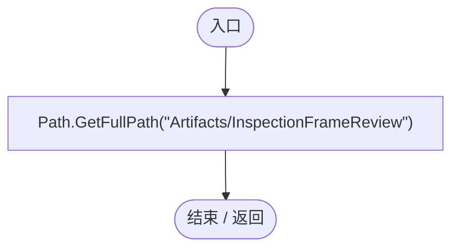

<a id="mbdd2509bd282d82c"></a>

## EntityInspectionFramePacingRegression.ctor · L27

`static EntityInspectionFramePacingRegression()`


### Editor · Roslyn编译器控制流

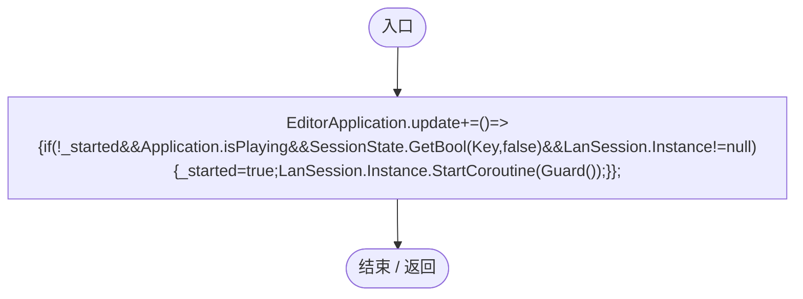

项目内调用/回调引用：

- [EntityInspectionFramePacingRegression.回调@27 · L27](01132a1f55d36dec.md#md59759df5b470235)（回调/委托）

<a id="md59759df5b470235"></a>

## 回调@27 · L27

`( … => 回调`


### Editor · Roslyn编译器控制流

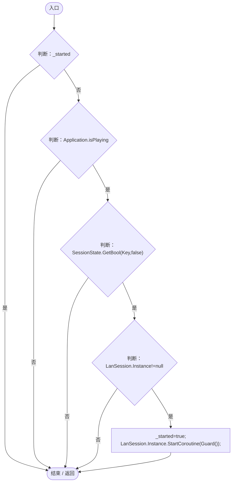

项目内调用/回调引用：

- [LanSession.Instance.get · L23](9fb633eebffe669c.md#mbf83306994878383)（访问器）
- [EntityInspectionFramePacingRegression.Guard · L30](01132a1f55d36dec.md#m9e2ba5c3a79397f4)（方法）

<a id="mc31e72e576005738"></a>

## RunBatch · L28

`public static void RunBatch()`


### Editor · Roslyn编译器控制流

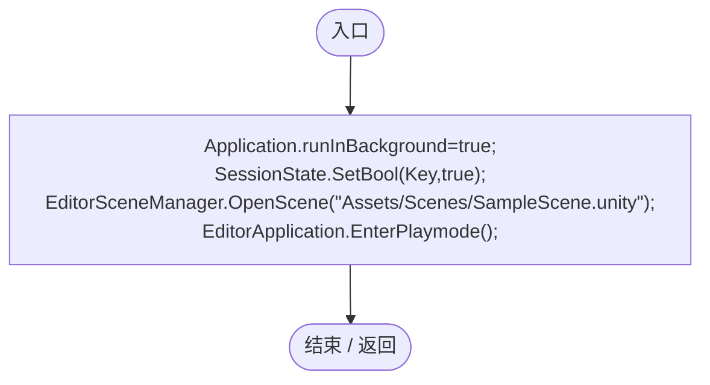

<a id="md220a6130cd3c19d"></a>

## Check · L29

`private static void Check(bool ok,string text)`


### Editor · Roslyn编译器控制流

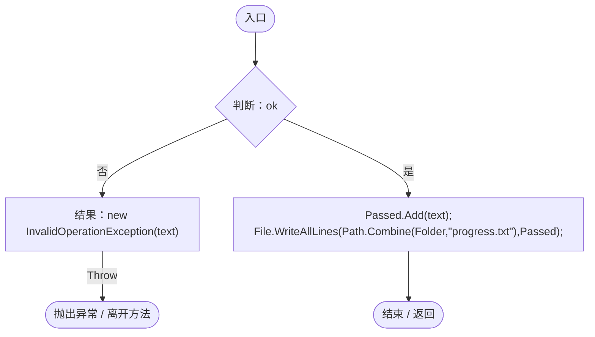

<a id="m9e2ba5c3a79397f4"></a>

## Guard · L30

`private static IEnumerator Guard()`


### Editor · Roslyn编译器控制流

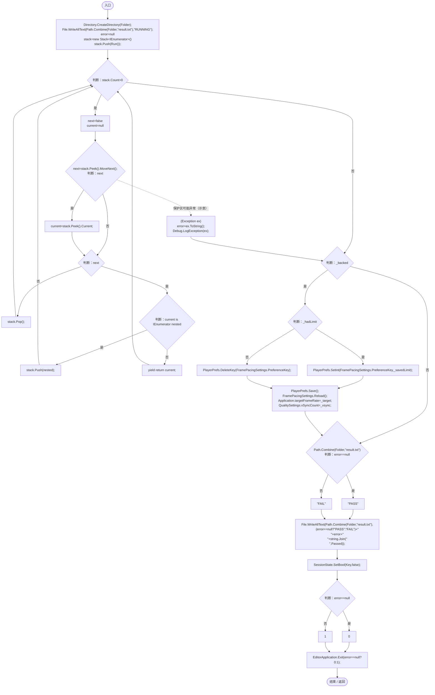

项目内调用/回调引用：

- [EntityInspectionFramePacingRegression.Run · L43](01132a1f55d36dec.md#mc638ff5d9fdbe104)（方法）
- [FramePacingSettings.Reload · L22](8a946f816b77d4b6.md#m289a78d13817c5e2)（方法）

<a id="mc2b189e59dcb147e"></a>

## Spawn · L37

`private static DarwinEntity Spawn(Genome genome,Vector3 point)`


### Editor · Roslyn编译器控制流

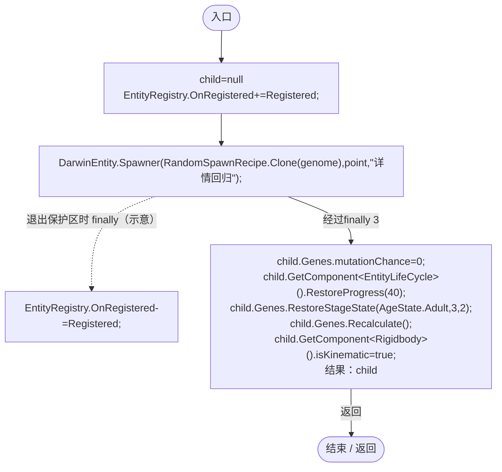

项目内调用/回调引用：

- [RandomSpawnRecipe.Clone · L23](923ccc4e86c4786c.md#me0949958df9c70e0)（方法）
- [DarwinEntity.Genes.get · L14](70798dde169f2e8b.md#m622eb1adf401d431)（访问器）
- [EntityLifeCycle.RestoreProgress · L52](9f4138bfbae654b7.md#m007c73a0c714c238)（方法）
- [EntityGeneController.RestoreStageState · L56](7494d53178552f0e.md#m37c1dbfa64e7c2ce)（方法）
- [EntityGeneController.Recalculate · L118](7494d53178552f0e.md#m707d9a56b0c7c609)（方法）
- [EntityInspectionFramePacingRegression.Registered · L39](01132a1f55d36dec.md#mcaada5753d11e468)（局部函数）

<a id="mcaada5753d11e468"></a>

## Registered · L39

`void Registered(DarwinEntity value)`


### Editor · Roslyn编译器控制流

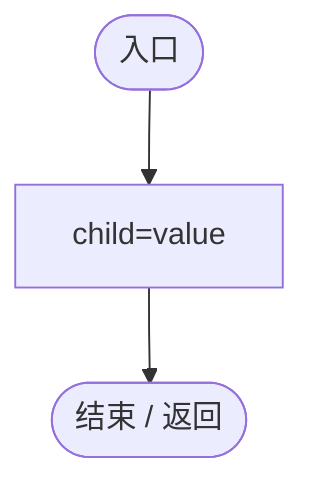

<a id="m845582c6462063e7"></a>

## Capture · L42

`private static IEnumerator Capture(string name)`


### Editor · Roslyn编译器控制流

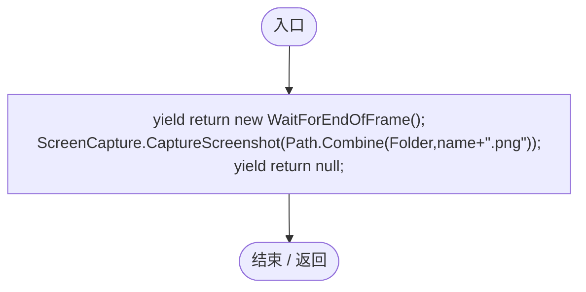

<a id="mc638ff5d9fdbe104"></a>

## Run · L43

`private static IEnumerator Run()`


### Editor · Roslyn编译器控制流

```mermaid
flowchart TD
  b0(["入口"])
  b1["_hadLimit=PlayerPrefs.HasKey(FramePacingSettings.PreferenceKey);<br/>_savedLimit=PlayerPrefs.GetInt(FramePacingSettings.PreferenceKey);<br/>_target=Application.targetFrameRate;<br/>_vsync=QualitySettings.vSyncCount;<br/>_backed=true;"]
  b2{"判断：FramePacingSettings.Choices.Contains(0)"}
  b3{"判断：FramePacingSettings.Choices.Contains(30)"}
  b4["FramePacingSettings.Choices.Contains(60)"]
  b5["FramePacingSettings.Choices.Contains(0)&amp;&amp;FramePacingSettings.Choices.Contains(30)&amp;&amp;FramePacingSettings.Choices.Contains(60)"]
  b6["Check(FramePacingSettings.Choices.Contains(0)&amp;&amp;FramePacingSettings.Choices.Contains(30)&amp;&amp;FramePacingSettings.Choices.Contains(60),&quot;锁帧选项包含不限制、30和60，来自资源配置&quot;);"]
  b7{"判断：FramePacingSettings.SetLimit(30)"}
  b8{"判断：Application.targetFrameRate==30"}
  b9["QualitySettings.vSyncCount==0"]
  b10["FramePacingSettings.SetLimit(30)&amp;&amp;Application.targetFrameRate==30&amp;&amp;QualitySettings.vSyncCount==0"]
  b11["Check(FramePacingSettings.SetLimit(30)&amp;&amp;Application.targetFrameRate==30&amp;&amp;QualitySettings.vSyncCount==0,&quot;30帧设置实际交给引擎，VSync不覆盖&quot;);"]
  b12["FramePacingSettings.Save();<br/>FramePacingSettings.SetLimit(45);<br/>FramePacingSettings.Reload();"]
  b13{"判断：FramePacingSettings.Limit==30"}
  b14["Application.targetFrameRate==30"]
  b15["FramePacingSettings.Limit==30"]
  b16["Check(FramePacingSettings.Limit==30&amp;&amp;Application.targetFrameRate==30,&quot;保存并重新读取恢复锁帧目标&quot;);"]
  b17["QualitySettings.vSyncCount=1;<br/>FramePacingSettings.Apply();"]
  b18{"判断：QualitySettings.vSyncCount==0"}
  b19["Application.targetFrameRate==30"]
  b20["QualitySettings.vSyncCount==0"]
  b21["Check(QualitySettings.vSyncCount==0&amp;&amp;Application.targetFrameRate==30,&quot;重新应用画质后可恢复锁帧&quot;);"]
  b22{"判断：FramePacingSettings.SetLimit(-2)"}
  b23{"判断：FramePacingSettings.SetLimit(123)"}
  b24["FramePacingSettings.Limit==30"]
  b25["!FramePacingSettings.SetLimit(-2)&amp;&amp;!FramePacingSettings.SetLimit(123)&amp;&amp;FramePacingSettings.Limit==30"]
  b26["Check(!FramePacingSettings.SetLimit(-2)&amp;&amp;!FramePacingSettings.SetLimit(123)&amp;&amp;FramePacingSettings.Limit==30,&quot;无效帧率不破坏有效设置&quot;);"]
  b27["FramePacingSettings.SetLimit(0);"]
  b28{"判断：Application.targetFrameRate==-1"}
  b29["QualitySettings.vSyncCount==0"]
  b30["Application.targetFrameRate==-1"]
  b31["Check(Application.targetFrameRate==-1&amp;&amp;QualitySettings.vSyncCount==0,&quot;不限制模式恢复引擎无限制标记&quot;);"]
  b32["session=Object.FindFirstObjectByType&lt;WorldSessionManager&gt;()<br/>session.autoSaveInterval=36000;<br/>planet=Object.FindFirstObjectByType&lt;PlanetTerrainMeshBuilder&gt;()<br/>planet.subdivisions=24;<br/>typeof(WorldSessionManager).GetField(&quot;_initialTerrain&quot;,Bi…"]
  b33{"判断：session.Busy"}
  b34{"判断：EditorApplication.timeSinceStartup-start&gt;90"}
  b35["结果：new TimeoutException(&quot;创建世界&quot;)"]
  x35(["抛出异常 / 离开方法"])
  b36["yield return null;"]
  b37["clock=ServiceLocator.Get&lt;SimulationClock&gt;()<br/>clock.Pause();<br/>Object.FindFirstObjectByType&lt;RandomPlanetSpawner&gt;().enabled=false;<br/>PopulationMaintenance.Restore(null);"]
  b38["EntityRegistry.All.ToArray()"]
  b39{"判断：EntityRegistry.All.ToArray()"}
  b40["var<br/>Object.DestroyImmediate(e.gameObject);"]
  b41{"EntityRegistry.All.ToArray()<br/>判断：EntityRegistry.All.ToArray()"}
  b42["EntityRegistry.All.ToArray()"]
  b43["连接 / 离开区域"]
  b44["ColonyResource.ClearWorld();<br/>genome=EcologyDefaults.Template(&quot;producer&quot;).CreateGenome()<br/>origin=new Vector3(0,350,0)<br/>entity=Spawn(genome,origin)<br/>inspector=Object.FindFirstObjectByType&lt;GeneInspectorUI&gt;()<br/>inspector.ShowEntityInfo(entity);<br/>y…"]
  b45{"判断：popup.Visible"}
  b46{"判断：GameInputGate.Blocked"}
  b47["!clock.IsRunning"]
  b48["popup.Visible&amp;&amp;GameInputGate.Blocked&amp;&amp;!clock.IsRunning"]
  b49["Check(popup.Visible&amp;&amp;GameInputGate.Blocked&amp;&amp;!clock.IsRunning,&quot;实体弹窗合法门控与暂停不被输入恢复器清除&quot;);"]
  b50["hits=new List&lt;RaycastResult&gt;()"]
  b51["EventSystem.current<br/>new PointerEventData(EventSystem.current){position=new Vector2(Screen.width/2,10)}<br/>position=new Vector2(Screen.width/2,10)<br/>EventSystem.current.RaycastAll(new PointerEventData(EventSystem.current){position=new Vector2(…"]
  b52{"判断：hits.Count&gt;0"}
  b53["hits[0].gameObject.name==&quot;EntityEditOverlay&quot;"]
  b54["hits.Count&gt;0"]
  b55["Check(hits.Count&gt;0&amp;&amp;hits[0].gameObject.name==&quot;EntityEditOverlay&quot;,&quot;弹窗遮罩真正阻止底部栏点击穿透&quot;);"]
  b56["new[]{AgeState.Infant,AgeState.Adult,AgeState.Elder}"]
  b57{"判断：new[]{AgeState.Infant,AgeState.Adult,AgeState.Elder}"}
  b58["var"]
  b59{"判断：popup.ApplyStage(age)"}
  b60["entity.Genes.CurrentAge==age"]
  b61["popup.ApplyStage(age)"]
  b62["Check(popup.ApplyStage(age)&amp;&amp;entity.Genes.CurrentAge==age,&quot;实体阶段实际改为 &quot;+age);"]
  b63{"判断：age==AgeState.Infant"}
  b64["0"]
  b65{"判断：age==AgeState.Adult"}
  b66["LifeCycleSettings.Load().adultProgress"]
  b67["LifeCycleSettings.Load().elderProgress"]
  b68["expected=age==AgeState.Infant?0:age==AgeState.Adult?LifeCycleSettings.Load().adultProgress:LifeCycleSettings.Load().elderProgress"]
  b69["Check(entity.GetComponent&lt;EntityLifeCycle&gt;().Progress==expected,&quot;阶段和生命周期边界一致 &quot;+age);"]
  b70{"new[]{AgeState.Infant,AgeState.Adult,AgeState.Elder}<br/>判断：new[]{AgeState.Infant,AgeState.Adult,AgeState.Elder}"}
  b71["new[]{AgeState.Infant,AgeState.Adult,AgeState.Elder}"]
  b72["连接 / 离开区域"]
  b73{"判断：entity.Genes.StageMutationChecks==mutations"}
  b74["JsonUtility.ToJson(entity.Genes.Genome)==original"]
  b75["entity.Genes.StageMutationChecks==mutations"]
  b76["Check(entity.Genes.StageMutationChecks==mutations&amp;&amp;JsonUtility.ToJson(entity.Genes.Genome)==original,&quot;阶段编辑不额外变异或改写遗传数据&quot;);"]
  b77{"判断：popup.ApplyStat(&quot;health&quot;,65)"}
  b78{"判断：entity.GetComponent&lt;EntityStats&gt;().TryGet(&quot;health&quot;,out var hp)"}
  b79["hp==65"]
  b80["popup.ApplyStat(&quot;health&quot;,65)&amp;&amp;entity.GetComponent&lt;EntityStats&gt;().TryGet(&quot;health&quot;,out var hp)&amp;&amp;hp==65"]
  b81["Check(popup.ApplyStat(&quot;health&quot;,65)&amp;&amp;entity.GetComponent&lt;EntityStats&gt;().TryGet(&quot;health&quot;,out var hp)&amp;&amp;hp==65,&quot;生命值通过同一权威入口应用&quot;);"]
  b82{"判断：popup.ApplyStat(&quot;health&quot;,101)"}
  b83{"判断：popup.ApplyStat(&quot;size&quot;,2)"}
  b84["!popup.ApplyStat(&quot;nutrient&quot;,float.NaN)"]
  b85["!popup.ApplyStat(&quot;health&quot;,101)&amp;&amp;!popup.ApplyStat(&quot;size&quot;,2)&amp;&amp;!popup.ApplyStat(&quot;nutrient&quot;,float.NaN)"]
  b86["Check(!popup.ApplyStat(&quot;health&quot;,101)&amp;&amp;!popup.ApplyStat(&quot;size&quot;,2)&amp;&amp;!popup.ApplyStat(&quot;nutrient&quot;,float.NaN),&quot;数值越界、未开放字段和非有限值被拒绝&quot;);"]
  b87["WorldAuthority.CanEdit=false;"]
  b88{"判断：popup.ApplyStage(AgeState.Infant)"}
  b89["!popup.ApplyStat(&quot;health&quot;,50)"]
  b90["!popup.ApplyStage(AgeState.Infant)"]
  b91["Check(!popup.ApplyStage(AgeState.Infant)&amp;&amp;!popup.ApplyStat(&quot;health&quot;,50),&quot;只读成员不能更改阶段或数值&quot;);"]
  b92["WorldAuthority.CanEdit=true;"]
  b93["new LanCommand{kind=&quot;entityStage&quot;,entity=EcologyIdentity.Of(entity),count=99}<br/>kind=&quot;entityStage&quot;<br/>entity=EcologyIdentity.Of(entity)<br/>count=99<br/>Check(!LanEditActions.Submit(new LanCommand{kind=&quot;entityStage&quot;,entity=EcologyIdentity.Of(entity),…"]
  b94["yield return Capture(&quot;entity-edit&quot;);<br/>popup.Close();<br/>yield return null;"]
  b95{"判断：GameInputGate.Blocked"}
  b96{"判断：panel.sizeDelta==size"}
  b97["panel.anchoredPosition==position"]
  b98["!GameInputGate.Blocked&amp;&amp;panel.sizeDelta==size&amp;&amp;panel.anchoredPosition==position"]
  b99["Check(!GameInputGate.Blocked&amp;&amp;panel.sizeDelta==size&amp;&amp;panel.anchoredPosition==position,&quot;关闭编辑恢复输入且原详情布局不变&quot;);"]
  b100["growth=entity.Genes.Genome.Genes.First(g=&gt;g.DefinitionId==&quot;gene_growth&quot;)<br/>growth.Value=5;<br/>entity.Genes.Recalculate();<br/>Check(GeneFailureReasons.Explain(entity.Genes.Genome,entity.Genes.GetEvaluation(growth)).Any(x=&gt;x.Contains(&quot;阈值&quot;)),&quot;低于阈值的…"]
  b101["entity.Genes.Genome<br/>false<br/>20<br/>new Dictionary&lt;string,float&gt;{{growth.DefinitionId,30}}<br/>{growth.DefinitionId,30}<br/>suppressed=GeneValueResolver.Resolve(entity.Genes.Genome,false,20,additionalSuppression:new Dictionary&lt;string,float&gt;{{growth.Def…"]
  b102["reasons=GeneFailureReasons.Explain(entity.Genes.Genome,suppressed)"]
  b103{"判断：reasons.Any(x=&gt;x.Contains(&quot;环境&quot;))"}
  b104{"判断：reasons.Any(x=&gt;x.Contains(&quot;角色&quot;))"}
  b105["reasons.Any(x=&gt;x.Contains(&quot;有效值&quot;))"]
  b106["reasons.Any(x=&gt;x.Contains(&quot;环境&quot;))&amp;&amp;reasons.Any(x=&gt;x.Contains(&quot;角色&quot;))&amp;&amp;reasons.Any(x=&gt;x.Contains(&quot;有效值&quot;))"]
  b107["Check(reasons.Any(x=&gt;x.Contains(&quot;环境&quot;))&amp;&amp;reasons.Any(x=&gt;x.Contains(&quot;角色&quot;))&amp;&amp;reasons.Any(x=&gt;x.Contains(&quot;有效值&quot;)),&quot;环境、角色和有效值计算分别列出&quot;);"]
  b108["id=EcologyIdentity.Of(entity)<br/>session.SaveNow(false);<br/>saved=WorldSaveStore.Read(WorldSaveStore.FileFor(session.Current.id))"]
  b109{"判断：saved.entities.Single(e=&gt;e.ecology.id==id).age==AgeState.Elder"}
  b110["saved.entities.Single(e=&gt;e.ecology.id==id).lifeProgress==LifeCycleSettings.Load().elderProgress"]
  b111["saved.entities.Single(e=&gt;e.ecology.id==id).age==AgeState.Elder"]
  b112["Check(saved.entities.Single(e=&gt;e.ecology.id==id).age==AgeState.Elder&amp;&amp;saved.entities.Single(e=&gt;e.ecology.id==id).lifeProgress==LifeCycleSettings.Load().elderProgress,&quot;修改阶段真实落盘并通过存档校验&quot;);"]
  b113["living=EntityRegistry.All.Count<br/>Check(EntityStateEditor.SetStat(entity,&quot;health&quot;,0),&quot;生命值归零沿真实死亡结算&quot;);<br/>yield return null;<br/>corpse=ColonyResource.All.First(r=&gt;r.State.kind==ColonyResourceKind.Corpse)"]
  b114{"corpse.State.source<br/>判断：corpse.State.source"}
  b115[".genome.Genes.Count"]
  b116["corpse.State.source"]
  b117{"判断：corpse.State.source?.genome.Genes.Count==genome.Genes.Count"}
  b118["corpse.State.source.age==AgeState.Elder"]
  b119["corpse.State.source?.genome.Genes.Count==genome.Genes.Count"]
  b120["Check(corpse.State.source?.genome.Genes.Count==genome.Genes.Count&amp;&amp;corpse.State.source.age==AgeState.Elder,&quot;新尸体保留真实生前基因和生命阶段&quot;);"]
  b121["WorldResourceInspector.Ensure().Show(corpse);<br/>yield return null;"]
  b122{"判断：inspector.CurrentCorpse==corpse"}
  b123["EntityRegistry.All.Count==living-1"]
  b124["inspector.CurrentCorpse==corpse"]
  b125["Check(inspector.CurrentCorpse==corpse&amp;&amp;EntityRegistry.All.Count==living-1,&quot;尸体使用原检查器且不注册伪活体&quot;);"]
  b126{"判断：panel.sizeDelta==size"}
  b127{"判断：panel.anchoredPosition==position"}
  b128["panel.Find(&quot;ScrollView/Viewport/Content/BaseInfo/Stat_health&quot;)!=null"]
  b129["panel.sizeDelta==size&amp;&amp;panel.anchoredPosition==position&amp;&amp;panel.Find(&quot;ScrollView/Viewport/Content/BaseInfo/Stat_health&quot;)!=null"]
  b130["Check(panel.sizeDelta==size&amp;&amp;panel.anchoredPosition==position&amp;&amp;panel.Find(&quot;ScrollView/Viewport/Content/BaseInfo/Stat_health&quot;)!=null,&quot;尸体与正常实体使用同一面板尺寸、位置及摘要列&quot;);"]
  b131{"判断：panel.GetComponentsInChildren&lt;InputField&gt;().All(f=&gt;f.readOnly&#124;&#124;!f.interactable)"}
  b132["panel.GetComponentsInChildren&lt;Text&gt;().Any(t=&gt;t.text.Contains(&quot;已死亡&quot;))"]
  b133["panel.GetComponentsInChildren&lt;InputField&gt;().All(f=&gt;f.readOnly&#124;&#124;!f.interactable)"]
  b134["Check(panel.GetComponentsInChildren&lt;InputField&gt;().All(f=&gt;f.readOnly&#124;&#124;!f.interactable)&amp;&amp;panel.GetComponentsInChildren&lt;Text&gt;().Any(t=&gt;t.text.Contains(&quot;已死亡&quot;)),&quot;尸体明确已死亡，基因和名称为只读&quot;);"]
  b135["WorldResourceInspector.Instance.Refresh();<br/>Check(inspector.CurrentCorpse==corpse,&quot;原资源公共刷新入口安全委托统一尸体面板&quot;);<br/>WorldResourceInspector.Instance.Hide();"]
  b136{"判断：inspector.CurrentCorpse==null"}
  b137["!panel.gameObject.activeSelf"]
  b138["inspector.CurrentCorpse==null"]
  b139["Check(inspector.CurrentCorpse==null&amp;&amp;!panel.gameObject.activeSelf,&quot;原资源关闭入口同样关闭统一尸体面板&quot;);"]
  b140["WorldResourceInspector.Instance.Show(corpse);<br/>yield return null;<br/>Check(panel.GetComponentsInChildren&lt;Text&gt;().Any(t=&gt;t.text.Contains(&quot;已禁用&quot;)),&quot;尸体也能查看生前禁用基因&quot;);<br/>yield return Capture(&quot;corpse-panel&quot;);<br/>captured=corpse.Capture()<br/>file=Path.Combin…"]
  b141{"判断：read.source.age==AgeState.Elder"}
  b142["read.source.genome.Genes.Any(g=&gt;!g.Enabled)"]
  b143["read.source.age==AgeState.Elder"]
  b144["Check(read.source.age==AgeState.Elder&amp;&amp;read.source.genome.Genes.Any(g=&gt;!g.Enabled),&quot;尸体完整档案实际写盘读取&quot;);"]
  b145["Check(CorpseEntityRecord.Normalize(new CorpseEntityRecord())==null,&quot;旧档全零内联档案按未记录兼容&quot;);<br/>rejected=false"]
  b146["new CorpseEntityRecord{version=1}<br/>version=1<br/>CorpseEntityRecord.Validate(new CorpseEntityRecord{version=1});"]
  b147["rejected=true;"]
  b148["Check(rejected,&quot;损坏的新尸体档案不会被当作旧档静默忽略&quot;);<br/>inspector.HideEntityInfo();<br/>capture=RuntimePerformanceCapture.Instance<br/>Check(capture!=null,&quot;实际菜单安装按需性能采样组件&quot;);<br/>capture.sampleSeconds=.3f;<br/>capture.Request();<br/>start=EditorApplication.timeSinceStartup;"]
  b149{"判断：string.IsNullOrEmpty(capture.ReportPath)"}
  b150{"判断：EditorApplication.timeSinceStartup-start&gt;8"}
  b151["结果：new TimeoutException(capture.Status)"]
  x151(["抛出异常 / 离开方法"])
  b152["yield return null;"]
  b153["report=JsonUtility.FromJson&lt;PerformanceReport&gt;(File.ReadAllText(capture.ReportPath))"]
  b154{"判断：report.frames&gt;0"}
  b155{"判断：report.metrics.Any(m=&gt;m.name==&quot;Scheduler&quot;)"}
  b156["!PerformanceTimings.Capturing"]
  b157["report.frames&gt;0&amp;&amp;report.metrics.Any(m=&gt;m.name==&quot;Scheduler&quot;)&amp;&amp;!PerformanceTimings.Capturing"]
  b158["Check(report.frames&gt;0&amp;&amp;report.metrics.Any(m=&gt;m.name==&quot;Scheduler&quot;)&amp;&amp;!PerformanceTimings.Capturing,&quot;按需采样完成实际报告并释放采样状态&quot;);"]
  b159["founder=EcologyDefaults.Template(&quot;ant_founder&quot;).CreateGenome()<br/>founder.Genes.RemoveAll(g=&gt;g.DefinitionId==&quot;gene_reproduction&quot;);<br/>queenEntity=Spawn(founder,origin)<br/>queen=AntColonyMember.Ensure(queenEntity.GetComponent&lt;PopulationBehavior&gt;()…"]
  b160["i=0"]
  b161{"判断：i&lt;1500"}
  b162["new ColonyResourceSave{id=Guid.NewGuid().ToString(&quot;N&quot;),kind=ColonyResourceKind.Corpse,energy=2,scale=Vector3.one,local=EcologyQueries.ToLocal(origin+Vector3.right*(150+i))}<br/>id=Guid.NewGuid().ToString(&quot;N&quot;)<br/>kind=ColonyResourceKind.Corpse<br/>e…"]
  b163{"判断：i%100==99"}
  b164["yield return null;"]
  b165["i++"]
  b166["new ColonyResourceSave{id=Guid.NewGuid().ToString(&quot;N&quot;),kind=ColonyResourceKind.Corpse,energy=2,scale=Vector3.one,local=EcologyQueries.ToLocal(workerEntity.transform.position+Vector3.forward*.25f)}<br/>id=Guid.NewGuid().ToString(&quot;N&quot;)<br/>kind=Col…"]
  b167["worker.State.scan=0;"]
  b168["new ColonyResourceSave{id=Guid.NewGuid().ToString(&quot;N&quot;),kind=ColonyResourceKind.Corpse,energy=2,scale=Vector3.one,local=EcologyQueries.ToLocal(workerEntity.transform.position+EcologyQueries.Up(workerEntity.transform.position)*AntColonySet…"]
  b169["old=ColonyActivityRange.EnumerationCount<br/>expectedResource=ColonyResource.All.Where(r=&gt;ColonyCorpseAccess.Available(r,worker)&amp;&amp;ColonyActivityRange.Contains(worker.Population,r.transform.position)&amp;&amp;EcologyQueries.Distance(worker.transform.…"]
  b170{"判断：expectedResource==near"}
  b171["worker.State.resourceTarget==near.State.id"]
  b172["expectedResource==near"]
  b173["Check(expectedResource==near&amp;&amp;worker.State.resourceTarget==near.State.id,&quot;1500远处尸体下目标与旧球面资格和最近距离排序一致&quot;);"]
  b174{"判断：oldBuilds&gt;=1500"}
  b175["newBuilds&lt;=2"]
  b176["oldBuilds&gt;=1500"]
  b177["Check(oldBuilds&gt;=1500&amp;&amp;newBuilds&lt;=2,&quot;一次工匠搜索的活动圆构建从逐尸体降为至多两次&quot;);"]
  b178["AntColonyWorker.Release(worker);"]
  b179["ColonyResource.All.ToArray()"]
  b180{"判断：ColonyResource.All.ToArray()"}
  b181{"var<br/>判断：resource!=raised"}
  b182["resource.Remove();"]
  b183{"ColonyResource.All.ToArray()<br/>判断：ColonyResource.All.ToArray()"}
  b184["ColonyResource.All.ToArray()"]
  b185["连接 / 离开区域"]
  b186["worker.State.scan=0;<br/>AntColonyWorker.Advance(worker,.1f);<br/>Check(worker.State.carriedResource==raised.State.id,&quot;仅有不同高度的合法尸体时仍按原球面距离领取，未用弦长误排除&quot;);"]
  b187{"判断：EntityStateEditor.SetStage(workerEntity,AgeState.Infant)"}
  b188{"判断：string.IsNullOrEmpty(worker.State.carriedResource)"}
  b189{"判断：string.IsNullOrEmpty(worker.State.resourceTarget)"}
  b190["!raised.HasLiveClaim"]
  b191["EntityStateEditor.SetStage(workerEntity,AgeState.Infant)&amp;&amp;string.IsNullOrEmpty(worker.State.carriedResource)&amp;&amp;string.IsNullOrEmpty(worker.State.resourceTarget)&amp;&amp;!raised.HasLiveClaim"]
  b192["Check(EntityStateEditor.SetStage(workerEntity,AgeState.Infant)&amp;&amp;string.IsNullOrEmpty(worker.State.carriedResource)&amp;&amp;string.IsNullOrEmpty(worker.State.resourceTarget)&amp;&amp;!raised.HasLiveClaim,&quot;运输成员改回幼年时释放货物和领取，不遗留无法完成的任务&quot;);"]
  b193(["结束 / 返回"])
  b0 --> b1
  b1 --> b2
  b2 -->|"是"| b3
  b2 -->|"否"| b5
  b3 -->|"是"| b4
  b3 -->|"否"| b5
  b4 --> b6
  b5 --> b6
  b6 --> b7
  b7 -->|"是"| b8
  b7 -->|"否"| b10
  b8 -->|"是"| b9
  b8 -->|"否"| b10
  b9 --> b11
  b10 --> b11
  b11 --> b12
  b12 --> b13
  b13 -->|"是"| b14
  b13 -->|"否"| b15
  b14 --> b16
  b15 --> b16
  b16 --> b17
  b17 --> b18
  b18 -->|"是"| b19
  b18 -->|"否"| b20
  b19 --> b21
  b20 --> b21
  b21 --> b22
  b22 -->|"否"| b23
  b22 -->|"是"| b25
  b23 -->|"否"| b24
  b23 -->|"是"| b25
  b24 --> b26
  b25 --> b26
  b26 --> b27
  b27 --> b28
  b28 -->|"是"| b29
  b28 -->|"否"| b30
  b29 --> b31
  b30 --> b31
  b31 --> b32
  b32 --> b33
  b33 -->|"是"| b34
  b33 -->|"否"| b37
  b34 -->|"是"| b35
  b34 -->|"否"| b36
  b35 -->|"Throw"| x35
  b36 --> b33
  b37 --> b38
  b38 --> b39
  b39 -->|"是"| b40
  b39 -->|"否 · 经过finally 41"| b44
  b40 --> b39
  b41 -->|"否"| b42
  b41 -->|"是"| b43
  b42 --> b43
  b44 --> b45
  b45 -->|"是"| b46
  b45 -->|"否"| b48
  b46 -->|"是"| b47
  b46 -->|"否"| b48
  b47 --> b49
  b48 --> b49
  b49 --> b50
  b50 --> b51
  b51 --> b52
  b52 -->|"是"| b53
  b52 -->|"否"| b54
  b53 --> b55
  b54 --> b55
  b55 --> b56
  b56 --> b57
  b57 -->|"是"| b58
  b57 -->|"否 · 经过finally 70"| b73
  b58 --> b59
  b59 -->|"是"| b60
  b59 -->|"否"| b61
  b60 --> b62
  b61 --> b62
  b62 --> b63
  b63 -->|"是"| b64
  b63 -->|"否"| b65
  b64 --> b68
  b65 -->|"是"| b66
  b65 -->|"否"| b67
  b66 --> b68
  b67 --> b68
  b68 --> b69
  b69 --> b57
  b70 -->|"否"| b71
  b70 -->|"是"| b72
  b71 --> b72
  b73 -->|"是"| b74
  b73 -->|"否"| b75
  b74 --> b76
  b75 --> b76
  b76 --> b77
  b77 -->|"是"| b78
  b77 -->|"否"| b80
  b78 -->|"是"| b79
  b78 -->|"否"| b80
  b79 --> b81
  b80 --> b81
  b81 --> b82
  b82 -->|"否"| b83
  b82 -->|"是"| b85
  b83 -->|"否"| b84
  b83 -->|"是"| b85
  b84 --> b86
  b85 --> b86
  b86 --> b87
  b87 --> b88
  b88 -->|"否"| b89
  b88 -->|"是"| b90
  b89 --> b91
  b90 --> b91
  b91 --> b92
  b92 --> b93
  b93 --> b94
  b94 --> b95
  b95 -->|"否"| b96
  b95 -->|"是"| b98
  b96 -->|"是"| b97
  b96 -->|"否"| b98
  b97 --> b99
  b98 --> b99
  b99 --> b100
  b100 --> b101
  b101 --> b102
  b102 --> b103
  b103 -->|"是"| b104
  b103 -->|"否"| b106
  b104 -->|"是"| b105
  b104 -->|"否"| b106
  b105 --> b107
  b106 --> b107
  b107 --> b108
  b108 --> b109
  b109 -->|"是"| b110
  b109 -->|"否"| b111
  b110 --> b112
  b111 --> b112
  b112 --> b113
  b113 --> b114
  b114 -->|"否"| b115
  b114 -->|"是"| b116
  b115 --> b117
  b116 --> b117
  b117 -->|"是"| b118
  b117 -->|"否"| b119
  b118 --> b120
  b119 --> b120
  b120 --> b121
  b121 --> b122
  b122 -->|"是"| b123
  b122 -->|"否"| b124
  b123 --> b125
  b124 --> b125
  b125 --> b126
  b126 -->|"是"| b127
  b126 -->|"否"| b129
  b127 -->|"是"| b128
  b127 -->|"否"| b129
  b128 --> b130
  b129 --> b130
  b130 --> b131
  b131 -->|"是"| b132
  b131 -->|"否"| b133
  b132 --> b134
  b133 --> b134
  b134 --> b135
  b135 --> b136
  b136 -->|"是"| b137
  b136 -->|"否"| b138
  b137 --> b139
  b138 --> b139
  b139 --> b140
  b140 --> b141
  b141 -->|"是"| b142
  b141 -->|"否"| b143
  b142 --> b144
  b143 --> b144
  b144 --> b145
  b145 --> b146
  b146 --> b148
  b147 --> b148
  b148 --> b149
  b149 -->|"是"| b150
  b149 -->|"否"| b153
  b150 -->|"是"| b151
  b150 -->|"否"| b152
  b151 -->|"Throw"| x151
  b152 --> b149
  b153 --> b154
  b154 -->|"是"| b155
  b154 -->|"否"| b157
  b155 -->|"是"| b156
  b155 -->|"否"| b157
  b156 --> b158
  b157 --> b158
  b158 --> b159
  b159 --> b160
  b160 --> b161
  b161 -->|"是"| b162
  b161 -->|"否"| b166
  b162 --> b163
  b163 -->|"是"| b164
  b163 -->|"否"| b165
  b164 --> b165
  b165 --> b161
  b166 --> b167
  b167 --> b168
  b168 --> b169
  b169 --> b170
  b170 -->|"是"| b171
  b170 -->|"否"| b172
  b171 --> b173
  b172 --> b173
  b173 --> b174
  b174 -->|"是"| b175
  b174 -->|"否"| b176
  b175 --> b177
  b176 --> b177
  b177 --> b178
  b178 --> b179
  b179 --> b180
  b180 -->|"是"| b181
  b180 -->|"否 · 经过finally 183"| b186
  b181 -->|"是"| b182
  b181 -->|"否"| b180
  b182 --> b180
  b183 -->|"否"| b184
  b183 -->|"是"| b185
  b184 --> b185
  b186 --> b187
  b187 -->|"是"| b188
  b187 -->|"否"| b191
  b188 -->|"是"| b189
  b188 -->|"否"| b191
  b189 -->|"是"| b190
  b189 -->|"否"| b191
  b190 --> b192
  b191 --> b192
  b192 --> b193
  b39 -. "退出保护区时 finally（示意）" .-> b41
  b57 -. "退出保护区时 finally（示意）" .-> b70
  b146 -. "保护区可能异常（示意）" .-> b147
  b180 -. "退出保护区时 finally（示意）" .-> b183

```

项目内调用/回调引用：

- [EntityInspectionFramePacingRegression.Check · L29](01132a1f55d36dec.md#md220a6130cd3c19d)（方法）
- [FramePacingSettings.Choices.get · L12](8a946f816b77d4b6.md#mc262249ac2930487)（访问器）
- [FramePacingSettings.SetLimit · L19](8a946f816b77d4b6.md#mff17d0cc654b6a7f)（方法）
- [FramePacingSettings.Save · L21](8a946f816b77d4b6.md#m194b224c719aed9a)（方法）
- [FramePacingSettings.Reload · L22](8a946f816b77d4b6.md#m289a78d13817c5e2)（方法）
- [FramePacingSettings.Limit.get · L11](8a946f816b77d4b6.md#m30a0a118e57b6343)（访问器）
- [FramePacingSettings.Apply · L18](8a946f816b77d4b6.md#m4848492bff442d46)（方法）
- [PlanetClimateMap.Instance.get · L16](b4e9726c1bcf4c37.md#m3add54a419aeef9f)（访问器）
- [PlanetOreSystem.Instance.get · L8](86b3fbb4d9436121.md#m53f6a6af4b6dc252)（访问器）
- [WorldSessionManager.Create · L41](08741c7b7b9d9344.md#m6aadfeee8b90aacd)（方法）
- [WorldSessionManager.Busy.get · L24](08741c7b7b9d9344.md#m4483e2e4f28f7c85)（访问器）
- [ServiceLocator.Get · L33](f2fdbe9f9ccd93cb.md#m2ae625299520c56d)（方法）
- [SimulationClock.Pause · L79](a8f444aec9614b0a.md#m30929d45a885d0f1)（方法）
- [PopulationMaintenance.Restore · L157](923ccc4e86c4786c.md#m6eadf366fa1602cc)（方法）
- [ColonyResource.ClearWorld · L109](293dbaecfff4b585.md#m4a3572d1077d33bd)（方法）
- [RandomSpawnRecipe.CreateGenome · L25](923ccc4e86c4786c.md#m2612c79fe3848e08)（方法）
- [EcologyDefaults.Template · L68](5b565b57de741d98.md#m98d16ffadd19320f)（方法）
- [EntityInspectionFramePacingRegression.Spawn · L37](01132a1f55d36dec.md#mc2b189e59dcb147e)（方法）
- [GeneInspectorUI.ShowEntityInfo · L387](924e27c34e7b1f0a.md#mfbae827fa8eb1ff1)（方法）
- [UIRoot.MainCanvas.get · L14](9c1421378791f0e0.md#maa2cc9baf1248477)（访问器）
- [EntityGeneController.StageMutationChecks.get · L53](7494d53178552f0e.md#m06f5fa66a32f7c77)（访问器）
- [DarwinEntity.Genes.get · L14](70798dde169f2e8b.md#m622eb1adf401d431)（访问器）
- [EntityEditPopup.Ensure · L18](79ed73ecd9855f79.md#mf701ffe637513b48)（方法）
- [EntityEditPopup.Open · L23](79ed73ecd9855f79.md#mb672ffe712524cb3)（方法）
- [WorldHudInputLifecycle.Recover · L38](f3fd2d972c3899f1.md#m40e06b669b6b6e31)（方法）
- [GameInputGate.Blocked.get · L8](52955daae7e592ab.md#m765763b665829633)（访问器）
- [SimulationClock.IsRunning.get · L22](a8f444aec9614b0a.md#m10f4fe307faca0f0)（访问器）
- [EntityEditPopup.ApplyStage · L30](79ed73ecd9855f79.md#md71dfb31617a2465)（方法）
- [EntityGeneController.CurrentAge.get · L37](7494d53178552f0e.md#md08823d8f9a2fa16)（访问器）
- [LifeCycleSettings.Load · L16](ace76969fe8f61de.md#mbd2925785484f343)（方法）
- [EntityLifeCycle.Progress.get · L10](9f4138bfbae654b7.md#m178185fd5f5a0d74)（访问器）
- [EntityEditPopup.ApplyStat · L32](79ed73ecd9855f79.md#m4b9c2e8423efaac6)（方法）
- [EntityStats.TryGet · L90](75aa86a368efdf24.md#m24ee1433e4a70d94)（方法）
- [LanEditActions.Submit · L16](2816321496f6360e.md#m5411c4b97ac4c898)（方法）
- [EcologyIdentity.Of · L21](bdf7ccc2c9c0452f.md#m1143cf9570a93b72)（方法）
- [EntityInspectionFramePacingRegression.Capture · L42](01132a1f55d36dec.md#m845582c6462063e7)（方法）
- [EntityEditPopup.Close · L34](79ed73ecd9855f79.md#m07792a3835d81df8)（方法）
- [EntityGeneController.Recalculate · L118](7494d53178552f0e.md#m707d9a56b0c7c609)（方法）
- [GeneFailureReasons.Explain · L19](e611915e807d8990.md#mb026e84414afe795)（方法）
- [EntityGeneController.GetEvaluation · L234](7494d53178552f0e.md#m48dd8a9fad8c0058)（方法）
- [GeneValueResolver.Resolve · L32](837eb9ce6eba3cc6.md#m063abac8252cd4e8)（方法）
- [WorldSessionManager.SaveNow · L169](08741c7b7b9d9344.md#mcf18d8aac368dda6)（方法）
- [WorldSaveStore.Read · L74](d67a35e5e3814c15.md#mde52fadbe0185af1)（方法）
- [WorldSaveStore.FileFor · L50](d67a35e5e3814c15.md#mce4509883be2e47e)（方法）
- [WorldSessionManager.Current.get · L21](08741c7b7b9d9344.md#m5d26a5eb846a8504)（访问器）
- [EntityStateEditor.SetStat · L20](7086a659bc6af34a.md#md56c1909b5c23955)（方法）
- [ColonyResource.State.get · L24](293dbaecfff4b585.md#m41824f1a0e160aa5)（访问器）
- [WorldResourceInspector.Show · L19](044d7e948b6de8b7.md#me57c7a1d7701b045)（方法）
- [WorldResourceInspector.Ensure · L18](044d7e948b6de8b7.md#meddb7ef47641f159)（方法）
- [WorldResourceInspector.Refresh · L42](044d7e948b6de8b7.md#m02a1e2e2ca591623)（方法）
- [WorldResourceInspector.Instance.get · L12](044d7e948b6de8b7.md#m7d7f466d7959eb79)（访问器）
- [WorldResourceInspector.Hide · L67](044d7e948b6de8b7.md#md02dd83e5021f3a5)（方法）
- [ColonyResource.Capture · L110](293dbaecfff4b585.md#m4b17768e02a667b9)（方法）
- [CorpseEntityRecord.Validate · L24](8a2345f1e54b1c75.md#m7f233f866d12f977)（方法）
- [CorpseEntityRecord.Normalize · L23](8a2345f1e54b1c75.md#m649806250b80642a)（方法）
- [GeneInspectorUI.HideEntityInfo · L317](924e27c34e7b1f0a.md#mc9346c30e59e03d7)（方法）
- [RuntimePerformanceCapture.Instance.get · L13](8709e073518085cd.md#me90ed541f78af673)（访问器）
- [RuntimePerformanceCapture.Request · L18](8709e073518085cd.md#me1be78347a642319)（方法）
- [RuntimePerformanceCapture.ReportPath.get · L14](8709e073518085cd.md#m97ef8f0e87bc3653)（访问器）
- [RuntimePerformanceCapture.Status.get · L14](8709e073518085cd.md#mcd3802a7cb34e000)（访问器）
- [PerformanceTimings.Capturing.get · L17](a8403a4c7503726d.md#m9eb45773ec148e2f)（访问器）
- [AntColonyMember.Ensure · L59](baebd85c05598377.md#m54f7cb4868517795)（方法）
- [AntColonyMember.Assign · L62](baebd85c05598377.md#m4841f123cc075e2c)（方法）
- [EntityStats.Feed · L95](75aa86a368efdf24.md#mc025822ff1eb86a0)（方法）
- [ColonyResource.Create · L45](293dbaecfff4b585.md#m7e8d2b0e06e1cad5)（方法）
- [EcologyQueries.ToLocal · L39](bdf7ccc2c9c0452f.md#m1a07639eacf3aa47)（方法）
- [AntColonyMember.State.get · L32](baebd85c05598377.md#m426db6a7c12dd7aa)（访问器）
- [EcologyQueries.Up · L41](bdf7ccc2c9c0452f.md#maca7070196f125fd)（方法）
- [AntColonySettings.Current.get · L31](cb0a937e97c8fbb3.md#mcd121159f407ccdf)（访问器）
- [ColonyActivityRange.EnumerationCount.get · L15](e8d854132f563257.md#m8f570fb70a02e1cc)（访问器）
- [AntColonyWorker.Advance · L38](8a0cca2020271b6f.md#m50cbc0299445ba6b)（方法）
- [AntColonyWorker.Release · L115](8a0cca2020271b6f.md#m554fde48cbae45dd)（方法）
- [ColonyResource.Remove · L108](293dbaecfff4b585.md#mb9333347c7434224)（方法）
- [EntityStateEditor.SetStage · L11](7086a659bc6af34a.md#m8bc9060a7b40f529)（方法）
- [EntityInspectionFramePacingRegression.回调@67 · L67](01132a1f55d36dec.md#m62205e5a928f412b)（回调/委托）
- [EntityInspectionFramePacingRegression.回调@67 · L67](01132a1f55d36dec.md#m62116e52a51874a9)（回调/委托）
- [EntityInspectionFramePacingRegression.回调@68 · L68](01132a1f55d36dec.md#mb8d94ac435e7f709)（回调/委托）
- [EntityInspectionFramePacingRegression.回调@68 · L68](01132a1f55d36dec.md#m931c80face2fa053)（回调/委托）
- [EntityInspectionFramePacingRegression.回调@69 · L69](01132a1f55d36dec.md#mca9b0db3ec534735)（回调/委托）
- [EntityInspectionFramePacingRegression.回调@69 · L69](01132a1f55d36dec.md#mf8caa8c8fe9b25da)（回调/委托）
- [EntityInspectionFramePacingRegression.回调@69 · L69](01132a1f55d36dec.md#mc7d772357237d515)（回调/委托）
- [EntityInspectionFramePacingRegression.回调@69 · L69](01132a1f55d36dec.md#m416e68cc4026111a)（回调/委托）
- [EntityInspectionFramePacingRegression.回调@70 · L70](01132a1f55d36dec.md#mbe90c79cafd140c0)（回调/委托）
- [EntityInspectionFramePacingRegression.回调@70 · L70](01132a1f55d36dec.md#m173e6686c5049171)（回调/委托）
- [EntityInspectionFramePacingRegression.回调@71 · L71](01132a1f55d36dec.md#m9253e700e1de1a2e)（回调/委托）
- [EntityInspectionFramePacingRegression.回调@74 · L74](01132a1f55d36dec.md#mf32b546156281e62)（回调/委托）
- [EntityInspectionFramePacingRegression.回调@74 · L74](01132a1f55d36dec.md#m7f514d266fc3e6e2)（回调/委托）
- [EntityInspectionFramePacingRegression.回调@77 · L77](01132a1f55d36dec.md#m9885d7c21397335d)（回调/委托）
- [EntityInspectionFramePacingRegression.回调@78 · L78](01132a1f55d36dec.md#m0ff1bc168bc8a2bf)（回调/委托）
- [EntityInspectionFramePacingRegression.回调@80 · L80](01132a1f55d36dec.md#m25e3810852f0622f)（回调/委托）
- [EntityInspectionFramePacingRegression.回调@81 · L81](01132a1f55d36dec.md#m44be4c6d6edd4ab4)（回调/委托）
- [EntityInspectionFramePacingRegression.回调@85 · L85](01132a1f55d36dec.md#m608a5d3680574287)（回调/委托）
- [EntityInspectionFramePacingRegression.回调@85 · L85](01132a1f55d36dec.md#m2a1295c46a38aa02)（回调/委托）

<a id="m62205e5a928f412b"></a>

## 回调@67 · L67

`g … => 回调`


### Editor · Roslyn编译器控制流

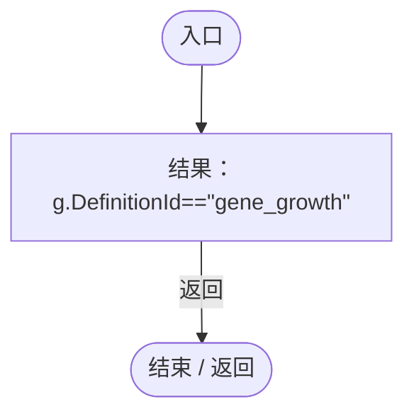

<a id="m62116e52a51874a9"></a>

## 回调@67 · L67

`x … => 回调`


### Editor · Roslyn编译器控制流

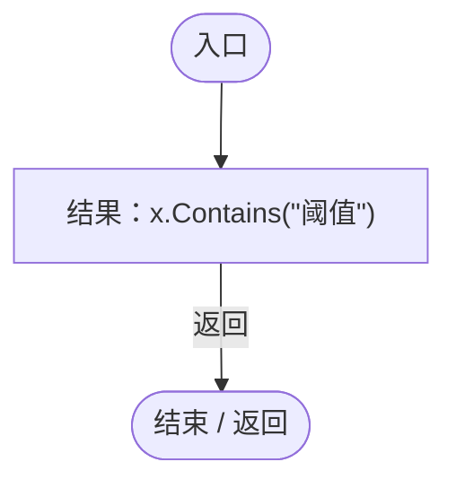

<a id="mb8d94ac435e7f709"></a>

## 回调@68 · L68

`g … => 回调`


### Editor · Roslyn编译器控制流

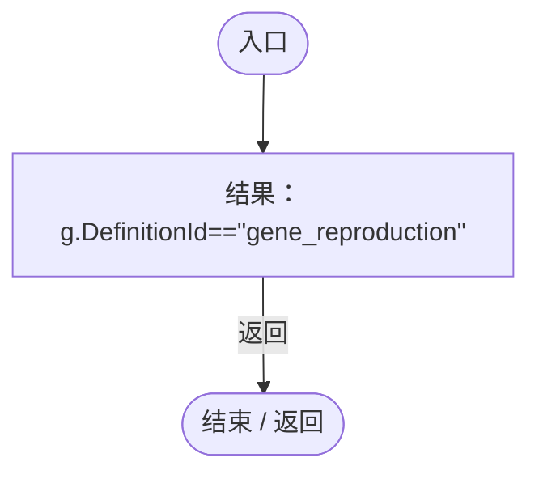

<a id="m931c80face2fa053"></a>

## 回调@68 · L68

`t … => 回调`


### Editor · Roslyn编译器控制流

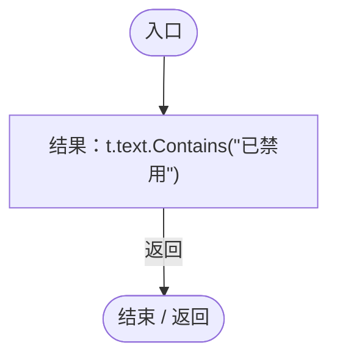

<a id="mca9b0db3ec534735"></a>

## 回调@69 · L69

`g … => 回调`


### Editor · Roslyn编译器控制流

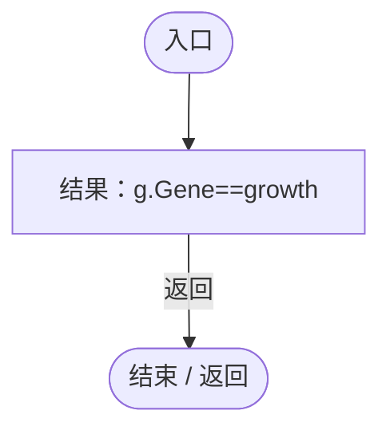

<a id="mf8caa8c8fe9b25da"></a>

## 回调@69 · L69

`x … => 回调`


### Editor · Roslyn编译器控制流

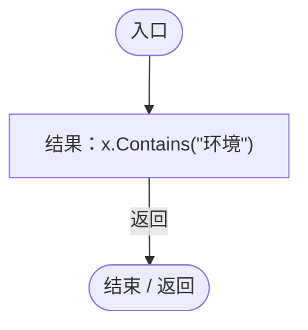

<a id="mc7d772357237d515"></a>

## 回调@69 · L69

`x … => 回调`


### Editor · Roslyn编译器控制流

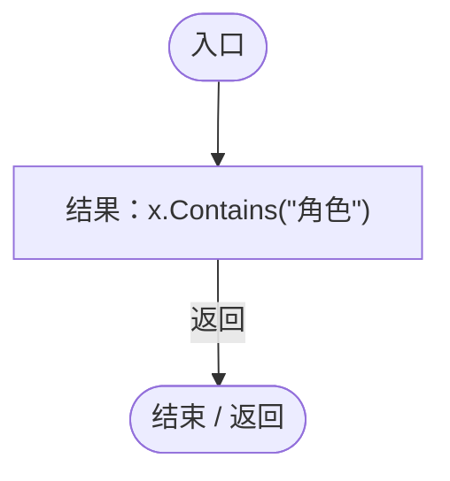

<a id="m416e68cc4026111a"></a>

## 回调@69 · L69

`x … => 回调`


### Editor · Roslyn编译器控制流

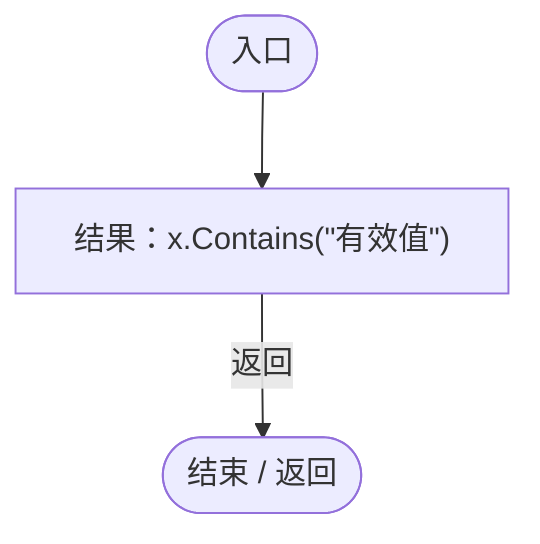

<a id="mbe90c79cafd140c0"></a>

## 回调@70 · L70

`e … => 回调`


### Editor · Roslyn编译器控制流


<a id="m173e6686c5049171"></a>

## 回调@70 · L70

`e … => 回调`


### Editor · Roslyn编译器控制流


<a id="m9253e700e1de1a2e"></a>

## 回调@71 · L71

`r … => 回调`


### Editor · Roslyn编译器控制流

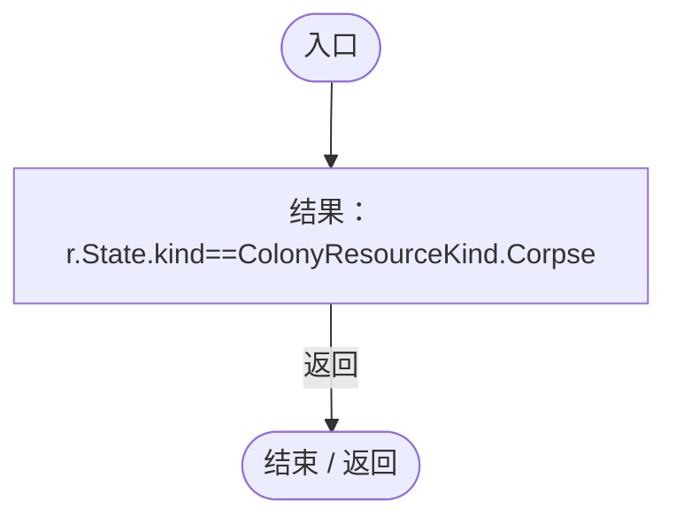

项目内调用/回调引用：

- [ColonyResource.State.get · L24](293dbaecfff4b585.md#m41824f1a0e160aa5)（访问器）

<a id="mf32b546156281e62"></a>

## 回调@74 · L74

`f … => 回调`


### Editor · Roslyn编译器控制流

```mermaid
flowchart TD
  b0(["入口"])
  b1{"判断：f.readOnly"}
  b2["!f.interactable"]
  b3["f.readOnly"]
  b4["结果：f.readOnly&#124;&#124;!f.interactable"]
  b5(["结束 / 返回"])
  b0 --> b1
  b1 -->|"否"| b2
  b1 -->|"是"| b3
  b2 --> b4
  b3 --> b4
  b4 -->|"返回"| b5

```

<a id="m7f514d266fc3e6e2"></a>

## 回调@74 · L74

`t … => 回调`


### Editor · Roslyn编译器控制流

```mermaid
flowchart TD
  b0(["入口"])
  b1["结果：t.text.Contains(&quot;已死亡&quot;)"]
  b2(["结束 / 返回"])
  b0 --> b1
  b1 -->|"返回"| b2

```

<a id="m9885d7c21397335d"></a>

## 回调@77 · L77

`t … => 回调`


### Editor · Roslyn编译器控制流

```mermaid
flowchart TD
  b0(["入口"])
  b1["结果：t.text.Contains(&quot;已禁用&quot;)"]
  b2(["结束 / 返回"])
  b0 --> b1
  b1 -->|"返回"| b2

```

<a id="m0ff1bc168bc8a2bf"></a>

## 回调@78 · L78

`g … => 回调`


### Editor · Roslyn编译器控制流

```mermaid
flowchart TD
  b0(["入口"])
  b1["结果：!g.Enabled"]
  b2(["结束 / 返回"])
  b0 --> b1
  b1 -->|"返回"| b2

```

<a id="m25e3810852f0622f"></a>

## 回调@80 · L80

`m … => 回调`


### Editor · Roslyn编译器控制流

```mermaid
flowchart TD
  b0(["入口"])
  b1["结果：m.name==&quot;Scheduler&quot;"]
  b2(["结束 / 返回"])
  b0 --> b1
  b1 -->|"返回"| b2

```

<a id="m44be4c6d6edd4ab4"></a>

## 回调@81 · L81

`g … => 回调`


### Editor · Roslyn编译器控制流

```mermaid
flowchart TD
  b0(["入口"])
  b1["结果：g.DefinitionId==&quot;gene_reproduction&quot;"]
  b2(["结束 / 返回"])
  b0 --> b1
  b1 -->|"返回"| b2

```

<a id="m608a5d3680574287"></a>

## 回调@85 · L85

`r … => 回调`


### Editor · Roslyn编译器控制流

```mermaid
flowchart TD
  b0(["入口"])
  b1{"判断：ColonyCorpseAccess.Available(r,worker)"}
  b2{"判断：ColonyActivityRange.Contains(worker.Population,r.transform.position)"}
  b3["EcologyQueries.Distance(worker.transform.position,r.transform.position)&lt;=AntColonySettings.Current.transportSearchRadius"]
  b4["ColonyCorpseAccess.Available(r,worker)&amp;&amp;ColonyActivityRange.Contains(worker.Population,r.transform.position)&amp;&amp;EcologyQueries.Distance(worker.transform.position,r.transform.position)&lt;=AntColonySettings.Current.transportSearchRadius"]
  b5["结果：ColonyCorpseAccess.Available(r,worker)&amp;&amp;ColonyActivityRange.Contains(worker.Population,r.transform.position)&amp;&amp;EcologyQueries.Distance(worker.transform.position,r.transform.position)&lt;=AntColonySettings.Current.transportSearchRadius"]
  b6(["结束 / 返回"])
  b0 --> b1
  b1 -->|"是"| b2
  b1 -->|"否"| b4
  b2 -->|"是"| b3
  b2 -->|"否"| b4
  b3 --> b5
  b4 --> b5
  b5 -->|"返回"| b6

```

项目内调用/回调引用：

- [ColonyCorpseAccess.Available · L6](f6ef68cc68f39eea.md#m8ffa84bc06beaed6)（方法）
- [ColonyActivityRange.Contains · L21](e8d854132f563257.md#m535d817473d6a256)（方法）
- [AntColonyMember.Population.get · L35](baebd85c05598377.md#mbb8ec90c4baa2d1c)（访问器）
- [EcologyQueries.Distance · L42](bdf7ccc2c9c0452f.md#mba9c3e3c95d0f2dd)（方法）
- [AntColonySettings.Current.get · L31](cb0a937e97c8fbb3.md#mcd121159f407ccdf)（访问器）

<a id="m2a1295c46a38aa02"></a>

## 回调@85 · L85

`r … => 回调`


### Editor · Roslyn编译器控制流

```mermaid
flowchart TD
  b0(["入口"])
  b1["结果：(r.transform.position-worker.transform.position).sqrMagnitude"]
  b2(["结束 / 返回"])
  b0 --> b1
  b1 -->|"返回"| b2

```
