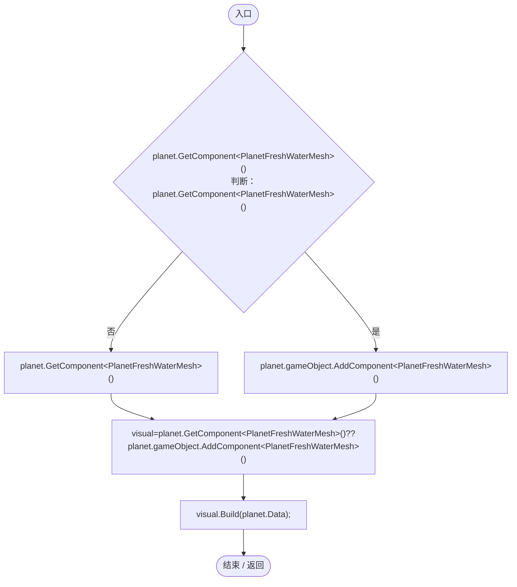
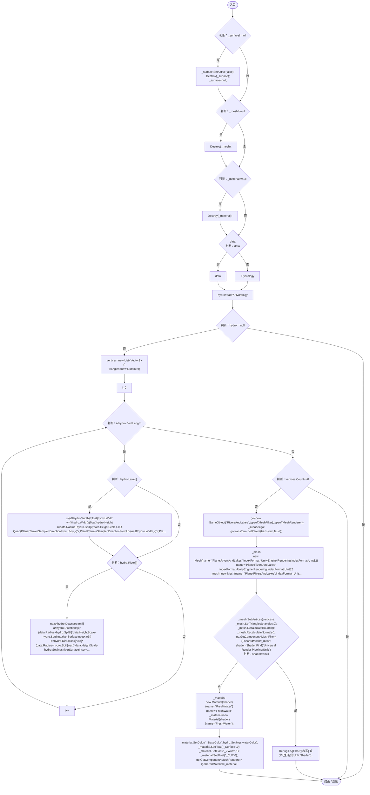
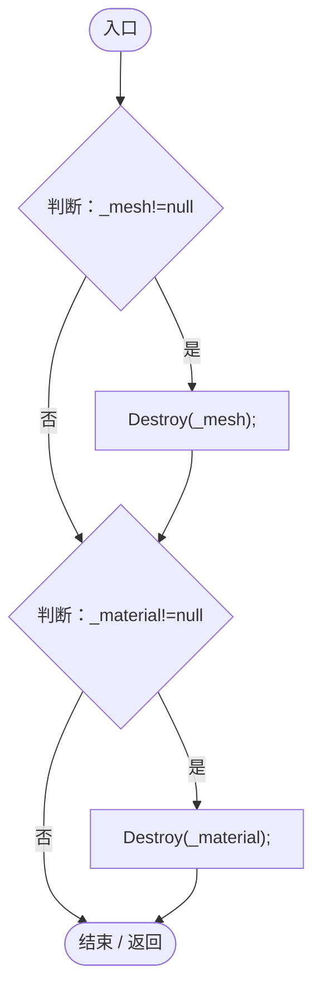

# PlanetFreshWaterMesh.cs

[返回总索引](../README.md) · `Runtime` · `Assets/DarwinPark/Planet/Terrain/PlanetFreshWaterMesh.cs`

[源文件](../../../Assets/DarwinPark/Planet/Terrain/PlanetFreshWaterMesh.cs) · 源码校验：`6e55c9f317b5e57600a828c69397ece995b5e3cc0e875ba76e2465bb7620bf30`

方法按源文件位置排列。事件/回调引用不表示立即执行；分支与异常说明见总索引。完整源码与可点击关系图请打开离线手册。

## Rebuild · L9

`public static void Rebuild(PlanetTerrainMeshBuilder planet)`

### Editor / Player · Roslyn编译器控制流

项目内调用/回调引用：

- [PlanetFreshWaterMesh.Build · L11](01b7a8db72030731.md#m5e8011402d8c5c23)（方法）
- [PlanetTerrainMeshBuilder.Data.get · L81](415285cf043354a9.md#m1a65abfe0f34c5d8)（访问器）

## Build · L11

`private void Build(PlanetTerrainData data)`

### Editor / Player · Roslyn编译器控制流

项目内调用/回调引用：

- [PlanetFreshWaterMesh.Quad · L15](01b7a8db72030731.md#mb4da601ef0643892)（局部函数）
- [PlanetTerrainSampler.DirectionFromUV · L13](fd5c1d83b88a7c8b.md#mbb90aecec23f2a42)（方法）

## Quad · L15

`void Quad(Vector3 a,Vector3 b,Vector3 c,Vector3 d)`

### Editor / Player · Roslyn编译器控制流

## OnDestroy · L26

`private void OnDestroy()`

### Editor / Player · Roslyn编译器控制流

