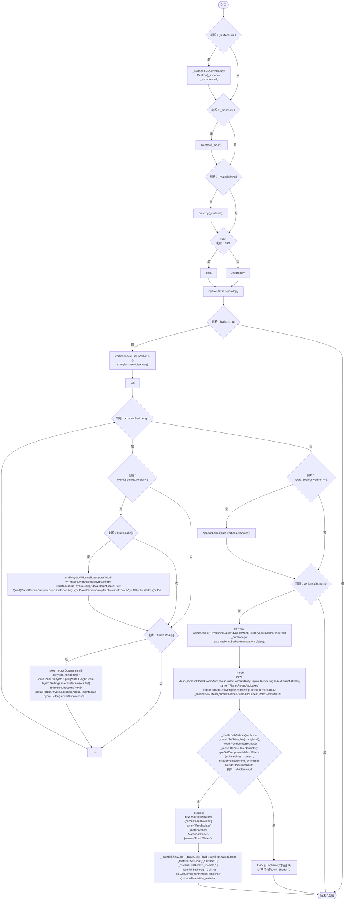
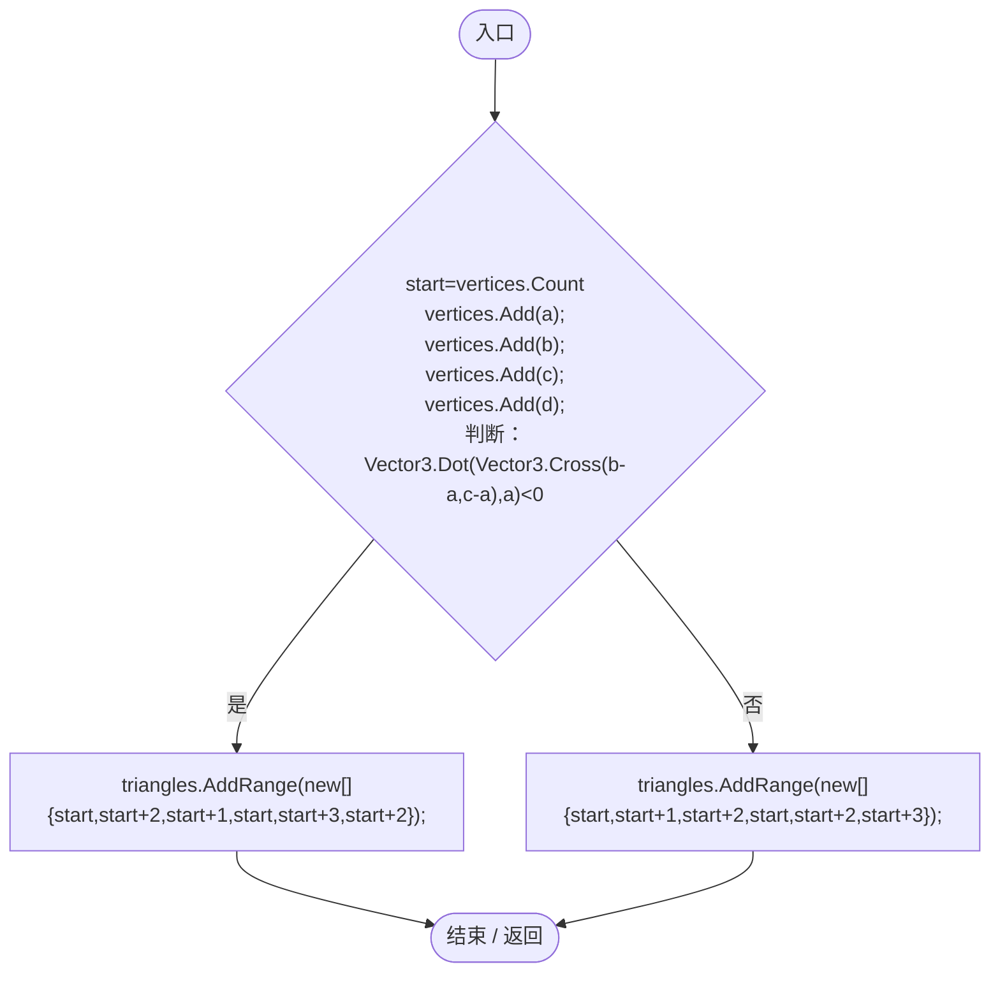
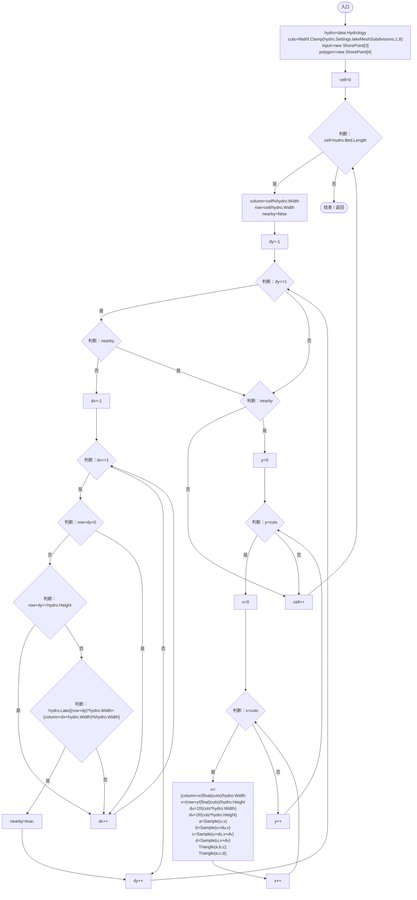
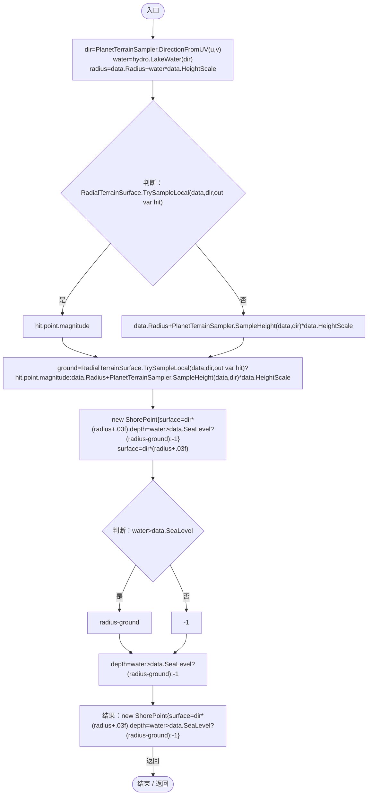
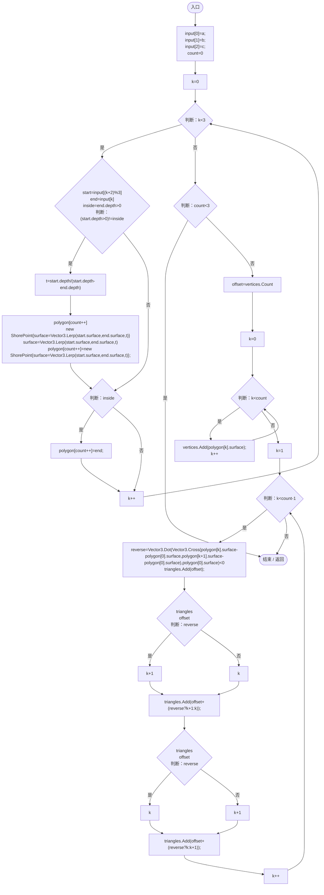

# PlanetFreshWaterMesh.cs

[返回总索引](../README.md) · `Runtime` · `Assets/DarwinPark/Planet/Terrain/PlanetFreshWaterMesh.cs`

[源文件](../../../Assets/DarwinPark/Planet/Terrain/PlanetFreshWaterMesh.cs) · 源码校验：`b2e0d96f4c8a7df22f20a6383baa6923a28aebe2a311b9de9e9615717da50f6d`

方法按源文件位置排列。事件/回调引用不表示立即执行；分支与异常说明见总索引。完整源码与可点击关系图请打开离线手册。

## Rebuild · L9

`public static void Rebuild(PlanetTerrainMeshBuilder planet)`

### Editor / Player · Roslyn编译器控制流

项目内调用/回调引用：

- [PlanetFreshWaterMesh.Build · L11](01b7a8db72030731.md#m5e8011402d8c5c23)（方法）
- [PlanetTerrainMeshBuilder.Data.get · L81](415285cf043354a9.md#m1a65abfe0f34c5d8)（访问器）

## Build · L11

`private void Build(PlanetTerrainData data)`

### Editor / Player · Roslyn编译器控制流

项目内调用/回调引用：

- [PlanetFreshWaterMesh.Quad · L15](01b7a8db72030731.md#mb4da601ef0643892)（局部函数）
- [PlanetTerrainSampler.DirectionFromUV · L13](fd5c1d83b88a7c8b.md#mbb90aecec23f2a42)（方法）
- [PlanetFreshWaterMesh.AppendLakes · L29](01b7a8db72030731.md#maba8a0d2aa0594cb)（方法）

## Quad · L15

`void Quad(Vector3 a,Vector3 b,Vector3 c,Vector3 d)`

### Editor / Player · Roslyn编译器控制流

## AppendLakes · L29

`private static void AppendLakes(PlanetTerrainData data,List<Vector3> vertices,List<int> triangles)`

### Editor / Player · Roslyn编译器控制流

项目内调用/回调引用：

- [PlanetFreshWaterMesh.Sample · L32](01b7a8db72030731.md#mbe9d8a60bae83d50)（局部函数）
- [PlanetFreshWaterMesh.Triangle · L33](01b7a8db72030731.md#ma191888901b01f5b)（局部函数）

## Sample · L32

`ShorePoint Sample(float u,float v)`

### Editor / Player · Roslyn编译器控制流

项目内调用/回调引用：

- [PlanetTerrainSampler.DirectionFromUV · L13](fd5c1d83b88a7c8b.md#mbb90aecec23f2a42)（方法）
- [PlanetHydrology.LakeWater · L44](282937bf06cb5f2a.md#mddea46649580b55b)（方法）
- [RadialTerrainSurface.TrySampleLocal · L23](4eb5c0c8143bed20.md#m40e797fdadbf4b35)（方法）
- [PlanetTerrainSampler.SampleHeight · L32](fd5c1d83b88a7c8b.md#m759508f0c5a04b21)（方法）

## Triangle · L33

`void Triangle(ShorePoint a,ShorePoint b,ShorePoint c)`

### Editor / Player · Roslyn编译器控制流

## OnDestroy · L45

`private void OnDestroy()`

### Editor / Player · Roslyn编译器控制流

