# PlanetClimateModel.cs

[返回总索引](../README.md) · `Runtime` · `Assets/DarwinPark/Planet/PlanetClimateModel.cs`

[源文件](../../../Assets/DarwinPark/Planet/PlanetClimateModel.cs) · 源码校验：`86bae036e901f0b9b85f669eeace217971e5603403655bae5e5de001eeb1e794`

方法按源文件位置排列。事件/回调引用不表示立即执行；分支与异常说明见总索引。完整源码与可点击关系图请打开离线手册。

## PlanetClimateModel.ctor · L48

`public PlanetClimateModel(PlanetTerrainData data, PlanetClimateConfig cfg, int seed)`

### Editor / Player · Roslyn编译器控制流

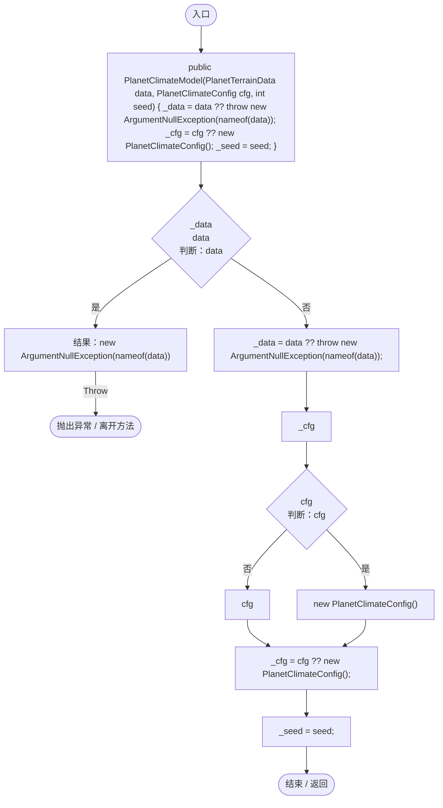

## Generate · L59

`public PlanetClimateResult Generate(int resolution, float tempOffset, float humidityOffset)`

  生成气候图。tempOffset/humidityOffset 来自环境系统滑条与季节偏移，  每次重生成都叠加，保证“看到的图层”和“实体感受到的气候”一致。  

### Editor / Player · Roslyn编译器控制流

```mermaid
flowchart TD
  b0(["入口"])
  b1["res = Mathf.Clamp(resolution, 64, 2048)<br/>count = res * res"]
  b2["new PlanetClimateResult { Resolution = res, SeaLevel = _data.SeaLevel, Height = new float[count], Temperature = new float[count], Humidity = new float[count], Precipitation = new float[count], CoastProximity = new float[count], WindFetch…"]
  b3["y = 0"]
  b4{"判断：y &lt; res"}
  b5["v = (y + 0.5f) / res"]
  b6["x = 0"]
  b7{"判断：x &lt; res"}
  b8["u = (x + 0.5f) / res<br/>dir = PlanetTerrainSampler.DirectionFromUV(u, v)<br/>i = y * res + x<br/>h = PlanetTerrainSampler.SampleHeight(_data, dir)<br/>result.Height[i] = h;<br/>result.Ocean[i] = h &lt; _data.SeaLevel;"]
  b9["x++"]
  b10["y++"]
  b11["coastDistance = BuildCoastDistance(result.Ocean, res)<br/>coastScale = Mathf.Max(1f, res * Mathf.Max(0.01f, _cfg.coastFalloffFraction))<br/>coarseResolution = Mathf.Clamp(res / 4, 48, 256)<br/>coarseFetch = BuildCoarseWindFetch(coarseResolution)"]
  b12["new FBMConfig { octaves = 3, frequency = _cfg.temperatureNoiseFrequency, amplitude = 1f, lacunarity = 2f, gain = 0.5f, warpStrength = 0.35f }<br/>octaves = 3<br/>frequency = _cfg.temperatureNoiseFrequency<br/>amplitude = 1f<br/>lacunarity = 2f<br/>gain = 0.…"]
  b13["new FBMConfig { octaves = 2, frequency = _cfg.oceanCurrentFrequency, amplitude = 1f, lacunarity = 2f, gain = 0.5f, warpStrength = 0.5f }<br/>octaves = 2<br/>frequency = _cfg.oceanCurrentFrequency<br/>amplitude = 1f<br/>lacunarity = 2f<br/>gain = 0.5f<br/>warpSt…"]
  b14["new FBMConfig { octaves = 3, frequency = _cfg.moistureNoiseFrequency, amplitude = 1f, lacunarity = 2f, gain = 0.5f, warpStrength = 0.25f }<br/>octaves = 3<br/>frequency = _cfg.moistureNoiseFrequency<br/>amplitude = 1f<br/>lacunarity = 2f<br/>gain = 0.5f<br/>war…"]
  b15["windDir = _cfg.GetWindDirection()<br/>maxHeight = PlanetTerrainData.MaxNormalizedHeight<br/>altitudeRange = Mathf.Max(0.01f, maxHeight - _data.SeaLevel)"]
  b16["y = 0"]
  b17{"判断：y &lt; res"}
  b18["v = (y + 0.5f) / res<br/>lat = (v - 0.5f) * Mathf.PI<br/>solar = Mathf.Pow(Mathf.Cos(lat), Mathf.Max(0.1f, _cfg.latitudeTempExponent))<br/>regionalBase = _cfg.regionalTemperature"]
  b19["x = 0"]
  b20{"判断：x &lt; res"}
  b21{"i = y * res + x<br/>u = (x + 0.5f) / res<br/>dir = PlanetTerrainSampler.DirectionFromUV(u, v)<br/>isOcean = result.Ocean[i]<br/>height = result.Height[i]<br/>altitudeNorm = Mathf.Clamp01((height - _data.SeaLevel) / altitudeRange)<br/>coastProximity = Mathf.Exp(…"}
  b22["temperature = Mathf.Lerp(temperature, oceanTemperature, _cfg.oceanTempModeration);"]
  b23["temperature = Mathf.Lerp(temperature, oceanTemperature, _cfg.coastalTempModeration * Mathf.Pow(coastProximity, 1.5f));"]
  b24{"relief = 0f<br/>windLift = 0f<br/>判断：isOcean"}
  b25["humidity = 100f;"]
  b26["SampleNeighbourhood(dir, height, out relief, out float coldPool);<br/>result.Relief[i] = relief;<br/>temperature -= coldPool * _cfg.basinColdPoolDrop;<br/>fetchMoisture = Mathf.Exp(-fetch / Mathf.Max(0.05f, _cfg.windFetchScale))<br/>ComputeWindExposure(…"]
  b27{"判断：isOcean"}
  b28["100f"]
  b29["Mathf.Clamp(humidity - altitudeNorm * _cfg.altitudePrecipitationPenalty + windLift * _cfg.orographicMoistureBonus * 0.3f, 0f, 100f)"]
  b30["precipitation = isOcean ? 100f : Mathf.Clamp(humidity - altitudeNorm * _cfg.altitudePrecipitationPenalty + windLift * _cfg.orographicMoistureBonus * 0.3f, 0f, 100f)"]
  b31{"判断：isOcean"}
  b32["dryHeat = Mathf.SmoothStep(0f, 1f, Mathf.InverseLerp(55f, 15f, humidity))<br/>temperature += dryHeat * _cfg.aridHeatBonus * Mathf.Max(0f, solar);"]
  b33["result.Temperature[i] = Mathf.Clamp(temperature, -60f, 60f);<br/>result.Humidity[i] = Mathf.Clamp(humidity, 4f, 100f);<br/>result.Precipitation[i] = precipitation;"]
  b34["x++"]
  b35["y++"]
  b36["SmoothLandField(result, res, result.Temperature, 3);<br/>SmoothLandField(result, res, result.Humidity, 3);<br/>BuildColorsAndStats(result, res, altitudeRange);<br/>结果：result"]
  b37(["结束 / 返回"])
  b0 --> b1
  b1 --> b2
  b2 --> b3
  b3 --> b4
  b4 -->|"是"| b5
  b4 -->|"否"| b11
  b5 --> b6
  b6 --> b7
  b7 -->|"是"| b8
  b7 -->|"否"| b10
  b8 --> b9
  b9 --> b7
  b10 --> b4
  b11 --> b12
  b12 --> b13
  b13 --> b14
  b14 --> b15
  b15 --> b16
  b16 --> b17
  b17 -->|"是"| b18
  b17 -->|"否"| b36
  b18 --> b19
  b19 --> b20
  b20 -->|"是"| b21
  b20 -->|"否"| b35
  b21 -->|"是"| b22
  b21 -->|"否"| b23
  b22 --> b24
  b23 --> b24
  b24 -->|"是"| b25
  b24 -->|"否"| b26
  b25 --> b27
  b26 --> b27
  b27 -->|"是"| b28
  b27 -->|"否"| b29
  b28 --> b30
  b29 --> b30
  b30 --> b31
  b31 -->|"否"| b32
  b31 -->|"是"| b33
  b32 --> b33
  b33 --> b34
  b34 --> b20
  b35 --> b17
  b36 -->|"返回"| b37

```

项目内调用/回调引用：

- [PlanetTerrainSampler.DirectionFromUV · L13](fd5c1d83b88a7c8b.md#mbb90aecec23f2a42)（方法）
- [PlanetTerrainSampler.SampleHeight · L32](fd5c1d83b88a7c8b.md#m759508f0c5a04b21)（方法）
- [PlanetClimateModel.BuildCoastDistance · L325](0249d34bf86f4fa3.md#me61388c9b8247c7d)（方法）
- [PlanetClimateModel.BuildCoarseWindFetch · L369](0249d34bf86f4fa3.md#m372d47add70cf8e4)（方法）
- [FBMNoise.FBMNoise.ctor · L12](8e4c1118f3935129.md#m008bcd375f95dd84)（构造函数）
- [PlanetClimateConfig.GetWindDirection · L115](caa5d97c52b00485.md#m84012ae357689461)（方法）
- [PlanetClimateModel.SampleCoarseBilinear · L444](0249d34bf86f4fa3.md#m00e74e7f730cd10a)（方法）
- [FBMNoise.Sample · L24](8e4c1118f3935129.md#m3997a25fbe63e25e)（方法）
- [PlanetClimateModel.SampleNeighbourhood · L495](0249d34bf86f4fa3.md#m6c542df635cccbae)（方法）
- [PlanetClimateModel.ComputeWindExposure · L468](0249d34bf86f4fa3.md#m9776b3998e41f3a0)（方法）
- [PlanetClimateModel.SmoothLandField · L260](0249d34bf86f4fa3.md#m6d0e949c7381081e)（方法）
- [PlanetClimateModel.BuildColorsAndStats · L293](0249d34bf86f4fa3.md#mbd03f248919d5ea6)（方法）

## SmoothLandField · L260

`private static void SmoothLandField(PlanetClimateResult result, int res, float[] field, int iterations)`

只对陆地像元做 3x3 平均，避免把海洋 100% 湿度扩散到海岸。

### Editor / Player · Roslyn编译器控制流

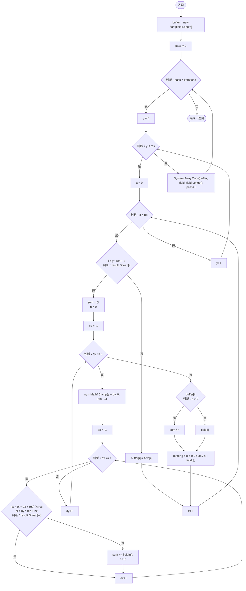

## BuildColorsAndStats · L293

`private void BuildColorsAndStats(PlanetClimateResult result, int res, float altitudeRange)`

### Editor / Player · Roslyn编译器控制流

```mermaid
flowchart TD
  b0(["入口"])
  b1["y = 0"]
  b2{"判断：y &lt; res"}
  b3["x = 0"]
  b4{"判断：x &lt; res"}
  b5["i = y * res + x<br/>isOcean = result.Ocean[i]<br/>temperature = result.Temperature[i]<br/>humidity = result.Humidity[i]"]
  b6{"判断：isOcean"}
  b7["0f"]
  b8["Mathf.Clamp01((result.Height[i] - _data.SeaLevel) / altitudeRange)"]
  b9["altitudeNorm = isOcean ? 0f : Mathf.Clamp01((result.Height[i] - _data.SeaLevel) / altitudeRange)"]
  b10{"type = _cfg.Classify(temperature, humidity, isOcean)<br/>result.Types[i] = type;<br/>result.Pixels[i] = EvaluateBiomeColor(temperature, humidity, altitudeNorm, result.CoastProximity[i], result.Relief[i], isOcean);<br/>判断：isOcean"}
  b11{"result.LandCells++;<br/>判断：type == ClimateType.Desert"}
  b12["result.DesertCells++;"]
  b13{"判断：type == ClimateType.PolarIce"}
  b14{"判断：type == ClimateType.Tundra"}
  b15["result.SnowCells++;"]
  b16{"判断：temperature &lt; result.MinTemperature"}
  b17["result.MinTemperature = temperature;"]
  b18{"判断：temperature &gt; result.MaxTemperature"}
  b19["result.MaxTemperature = temperature;"]
  b20{"判断：humidity &lt; result.MinHumidity"}
  b21["result.MinHumidity = humidity;"]
  b22{"判断：humidity &gt; result.MaxHumidity"}
  b23["result.MaxHumidity = humidity;"]
  b24["x++"]
  b25["y++"]
  b26(["结束 / 返回"])
  b0 --> b1
  b1 --> b2
  b2 -->|"是"| b3
  b2 -->|"否"| b26
  b3 --> b4
  b4 -->|"是"| b5
  b4 -->|"否"| b25
  b5 --> b6
  b6 -->|"是"| b7
  b6 -->|"否"| b8
  b7 --> b9
  b8 --> b9
  b9 --> b10
  b10 -->|"是"| b24
  b10 -->|"否"| b11
  b11 -->|"是"| b12
  b11 -->|"否"| b13
  b12 --> b16
  b13 -->|"否"| b14
  b13 -->|"是"| b15
  b14 -->|"是"| b15
  b14 -->|"否"| b16
  b15 --> b16
  b16 -->|"是"| b17
  b16 -->|"否"| b18
  b17 --> b18
  b18 -->|"是"| b19
  b18 -->|"否"| b20
  b19 --> b20
  b20 -->|"是"| b21
  b20 -->|"否"| b22
  b21 --> b22
  b22 -->|"是"| b23
  b22 -->|"否"| b24
  b23 --> b24
  b24 --> b4
  b25 --> b2

```

项目内调用/回调引用：

- [PlanetClimateConfig.Classify · L129](caa5d97c52b00485.md#m07936a82a4f7e6a6)（方法）
- [PlanetClimateModel.EvaluateBiomeColor · L524](0249d34bf86f4fa3.md#md1ed62bbeff555b4)（方法）

## BuildCoastDistance · L325

`private static int[] BuildCoastDistance(bool[] ocean, int res)`

多源 BFS 求到最近海洋的像素距离（x 方向环绕）。

### Editor / Player · Roslyn编译器控制流

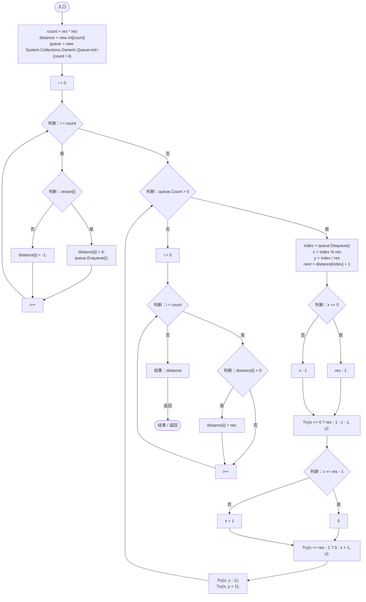

项目内调用/回调引用：

- [PlanetClimateModel.Try · L349](0249d34bf86f4fa3.md#madd6f9a66d2707a5)（局部函数）

## Try · L349

`void Try(int nx, int ny)`

### Editor / Player · Roslyn编译器控制流

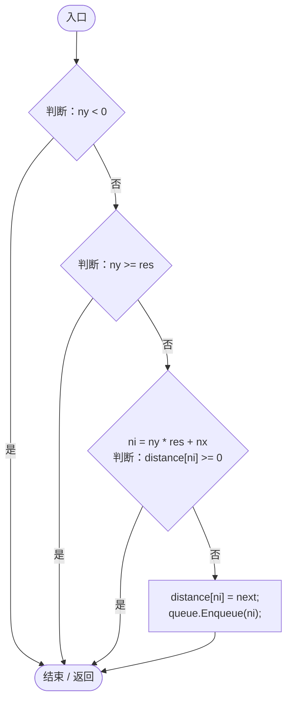

## BuildCoarseWindFetch · L369

`private float[] BuildCoarseWindFetch(int coarse)`

  在 coarse 分辨率上，从每个陆地格沿上风方向步进，找到海洋为止。  返回值 0=紧邻海洋，1=上风方向一直是陆地（最干燥）。  

### Editor / Player · Roslyn编译器控制流

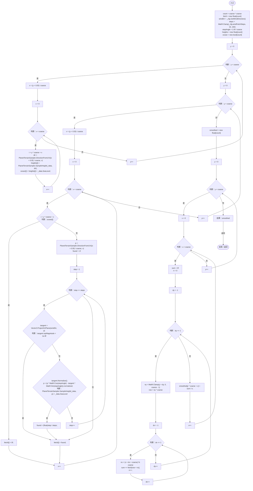

项目内调用/回调引用：

- [PlanetClimateConfig.GetWindDirection · L115](caa5d97c52b00485.md#m84012ae357689461)（方法）
- [PlanetTerrainSampler.DirectionFromUV · L13](fd5c1d83b88a7c8b.md#mbb90aecec23f2a42)（方法）
- [PlanetTerrainSampler.SampleHeight · L32](fd5c1d83b88a7c8b.md#m759508f0c5a04b21)（方法）

## SampleCoarseBilinear · L444

`private static float SampleCoarseBilinear(float[] data, int coarse, float u, float v)`

### Editor / Player · Roslyn编译器控制流

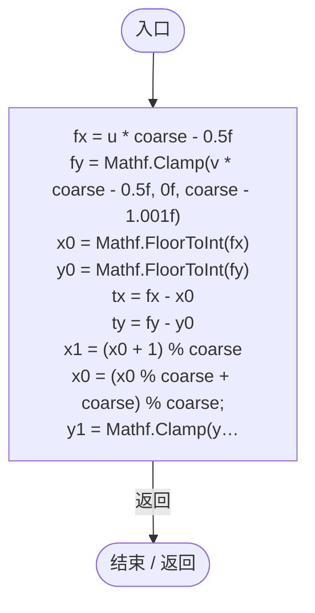

## ComputeWindExposure · L468

`private void ComputeWindExposure(Vector3 dir, float height, Vector3 windDir, out float lift01, out float rainShadow01)`

  迎风抬升 / 背风雨影，都写成连续权重 0~1。  旧版用 max(0, ±局部坡度) 在 1 像素内从 +26 翻到 -24，正是山区  湿度图出现狭长“断层”的原因；这里改为在上风方 8~30 像素窗口内  采样，让过渡自然铺开。  

### Editor / Player · Roslyn编译器控制流

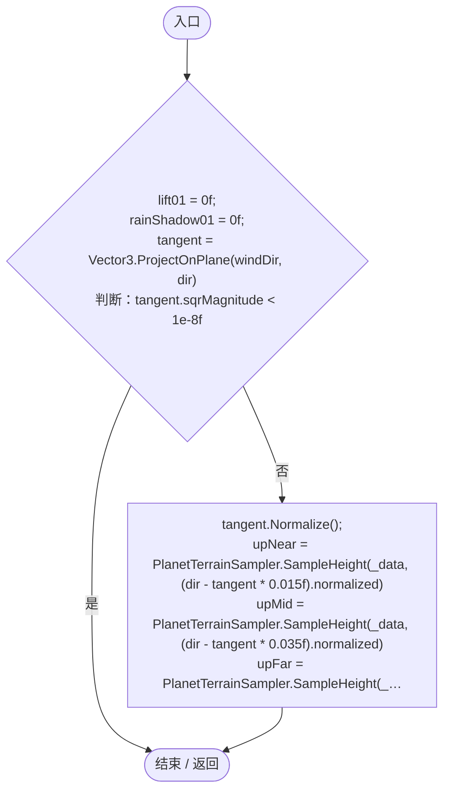

项目内调用/回调引用：

- [PlanetTerrainSampler.SampleHeight · L32](fd5c1d83b88a7c8b.md#m759508f0c5a04b21)（方法）

## SampleNeighbourhood · L495

`private void SampleNeighbourhood(Vector3 dir, float centerHeight, out float relief01, out float coldPool01)`

  一次采样四邻域，同时得到局部起伏（山地更干）和盆地冷空气堆积。  ★ 优化：旧版把这两件事拆成两次四邻域采样，气候图每像元多跑 4 次高度插值。  

### Editor / Player · Roslyn编译器控制流

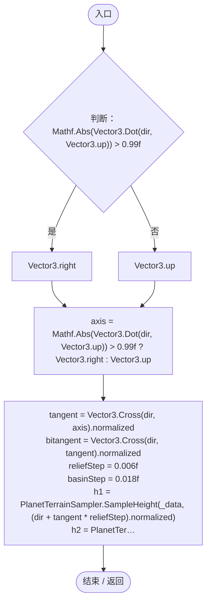

项目内调用/回调引用：

- [PlanetTerrainSampler.SampleHeight · L32](fd5c1d83b88a7c8b.md#m759508f0c5a04b21)（方法）

## EvaluateBiomeColor · L524

`private Color EvaluateBiomeColor(float temperature, float humidity, float altitudeNorm, float coastProximity, float relief, bool isOcean)`

连续混色：所有生态色都按权重叠加，没有离散 if/else。

### Editor / Player · Roslyn编译器控制流

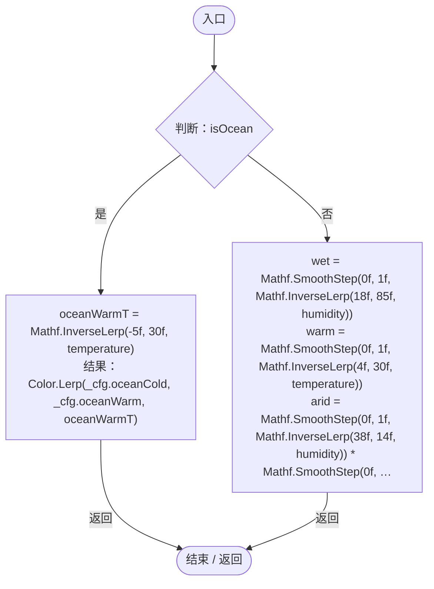
