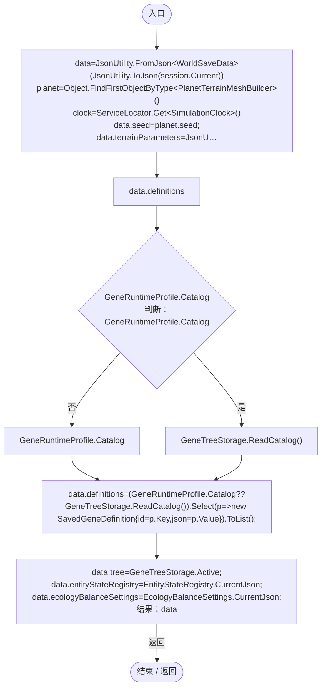
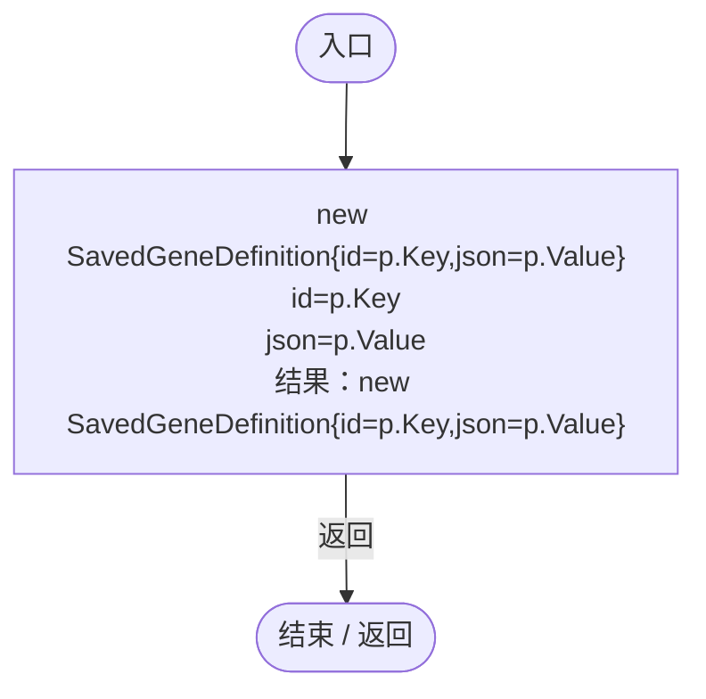
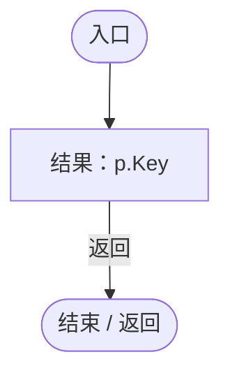
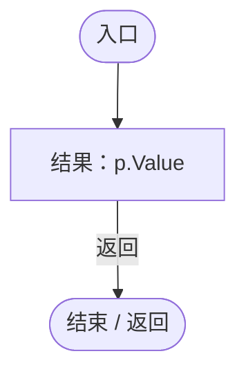
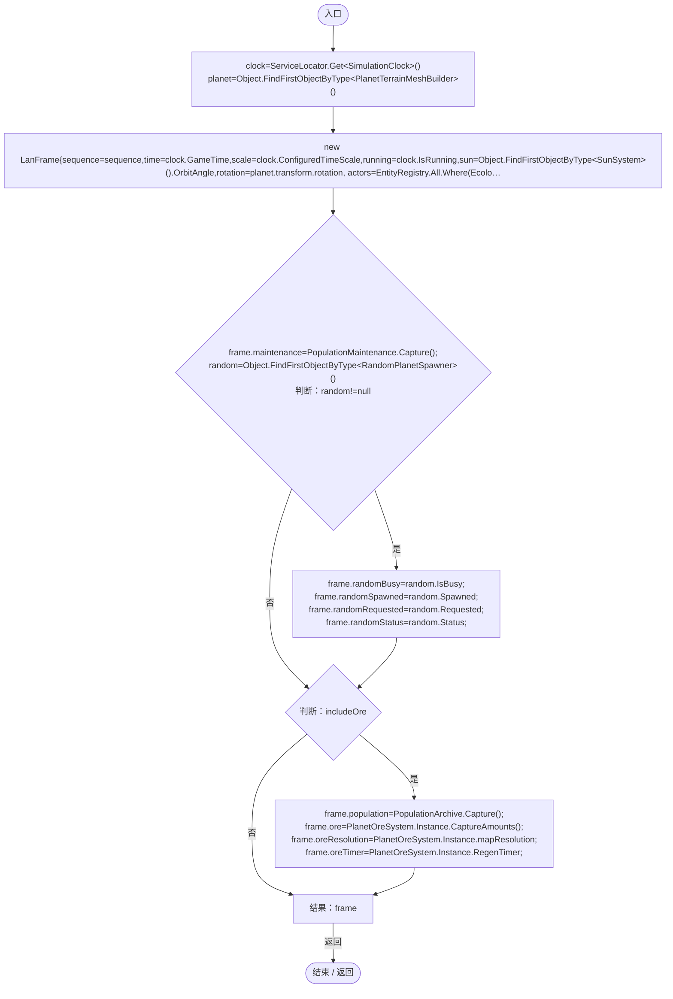
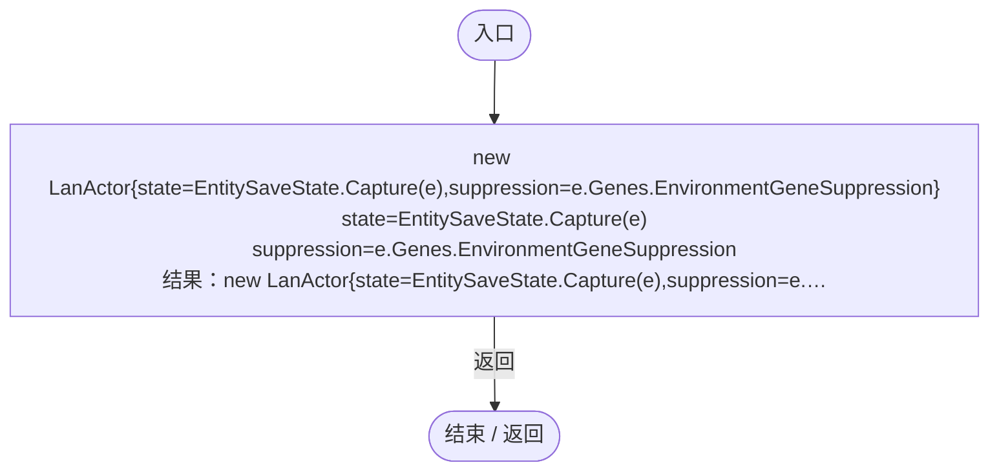
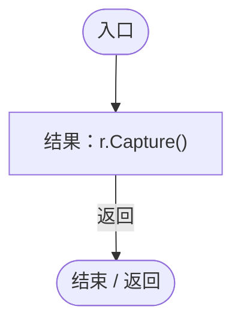

```mermaid
flowchart TD
  b0(["入口"])
  b1["JsonUtility.ToJson(Object.FindFirstObjectByType&lt;PlanetTerrainMeshBuilder&gt;())+&quot;&#124;&quot;+JsonUtility.ToJson(ServiceLocator.Get&lt;EnvironmentSystem&gt;())+&quot;&#124;&quot;<br/>&quot;&#124;&quot;"]
  b2{"GeneRuntimeProfile.Catalog<br/>判断：GeneRuntimeProfile.Catalog"}
  b3["GeneRuntimeProfile.Catalog"]
  b4["GeneTreeStorage.ReadCatalog()"]
  b5["结果：JsonUtility.ToJson(Object.FindFirstObjectByType&lt;PlanetTerrainMeshBuilder&gt;())+&quot;&#124;&quot;+JsonUtility.ToJson(ServiceLocator.Get&lt;EnvironmentSystem&gt;())+&quot;&#124;&quot;+ string.Join(&quot;&#124;&quot;,(GeneRuntimeProfile.Catalog??GeneTreeStorage.ReadCatalog()).OrderBy(p=&gt;p…"]
  b6(["结束 / 返回"])
  b0 --> b1
  b1 --> b2
  b2 -->|"否"| b3
  b2 -->|"是"| b4
  b3 --> b5
  b4 --> b5
  b5 -->|"返回"| b6

```

# LanWorldSnapshot.cs

[返回总索引](../README.md) · `Runtime` · `Assets/DarwinPark/UI/LanWorldSnapshot.cs`

[源文件](../../../Assets/DarwinPark/UI/LanWorldSnapshot.cs) · 源码校验：`48b518d069298bc3b2b5017f7bc68e56354b9a4175aebcc80a63e1658fa9b9db`

方法按源文件位置排列。事件/回调引用不表示立即执行；分支与异常说明见总索引。完整源码与可点击关系图请打开离线手册。

## Capture · L15

`public static WorldSaveData Capture(WorldSessionManager session)`

### Editor / Player · Roslyn编译器控制流

项目内调用/回调引用：

- [WorldSessionManager.Current.get · L21](08741c7b7b9d9344.md#m5d26a5eb846a8504)（访问器）
- [ServiceLocator.Get · L33](f2fdbe9f9ccd93cb.md#m2ae625299520c56d)（方法）
- [SimulationClock.GameTime.get · L23](a8f444aec9614b0a.md#m74adfa39a896652f)（访问器）
- [SimulationClock.IsRunning.get · L22](a8f444aec9614b0a.md#m10f4fe307faca0f0)（访问器）
- [SunSystem.OrbitAngle.get · L27](15af8ca97f781b7f.md#m4e38e717885434fc)（访问器）
- [ColonyWorldState.Capture · L15](50d866ed6b21d869.md#m9d6a91b6b3cbf086)（方法）
- [PopulationMaintenance.Capture · L132](923ccc4e86c4786c.md#m0b1ea634533e8898)（方法）
- [PlanetOreSystem.CaptureAmounts · L109](86b3fbb4d9436121.md#m3af5d421a609641e)（方法）
- [PlanetOreSystem.Instance.get · L8](86b3fbb4d9436121.md#m53f6a6af4b6dc252)（访问器）
- [PlanetOreSystem.RegenTimer.get · L110](86b3fbb4d9436121.md#m05d9f43661b9e216)（访问器）
- [GeneTreeStorage.ReadCatalog · L27](a885bad0d7dedee8.md#m89083f320ec287c0)（方法）
- [GeneTreeStorage.Active.get · L26](a885bad0d7dedee8.md#mcd6b1d82c9cf8f5c)（访问器）
- [EntityStateRegistry.CurrentJson.get · L43](440408d2db5c7d96.md#m32449837062f8705)（访问器）
- [EcologyBalanceSettings.CurrentJson.get · L30](5a37bc79f15f6238.md#m4835e7fa2ac9560d)（访问器）
- [LanWorldSnapshot.回调@24 · L24](02a722701106da02.md#m663193484fc59771)（回调/委托）
- [EcologyQueries.Alive · L38](bdf7ccc2c9c0452f.md#mb2877c487f449970)（方法）
- [EntitySaveState.Capture · L21](a1ec8fcd9d7d3ddb.md#mc67502b381bc2751)（方法）

## 回调@24 · L24

`p … => 回调`

### Editor / Player · Roslyn编译器控制流

## Configuration · L27

`public static string Configuration()`

### Editor / Player · Roslyn编译器控制流

项目内调用/回调引用：

- [ServiceLocator.Get · L33](f2fdbe9f9ccd93cb.md#m2ae625299520c56d)（方法）
- [GeneTreeStorage.ReadCatalog · L27](a885bad0d7dedee8.md#m89083f320ec287c0)（方法）
- [GeneTreeStorage.Active.get · L26](a885bad0d7dedee8.md#mcd6b1d82c9cf8f5c)（访问器）
- [LanWorldSnapshot.回调@30 · L30](02a722701106da02.md#mb9bb78ae2c2ebead)（回调/委托）
- [LanWorldSnapshot.回调@30 · L30](02a722701106da02.md#me1e13095b09900f0)（回调/委托）

## 回调@30 · L30

`p … => 回调`

### Editor / Player · Roslyn编译器控制流

## 回调@30 · L30

`p … => 回调`

### Editor / Player · Roslyn编译器控制流

## Frame · L32

`public static LanFrame Frame(long sequence,bool includeOre=false)`

### Editor / Player · Roslyn编译器控制流

项目内调用/回调引用：

- [ServiceLocator.Get · L33](f2fdbe9f9ccd93cb.md#m2ae625299520c56d)（方法）
- [SimulationClock.GameTime.get · L23](a8f444aec9614b0a.md#m74adfa39a896652f)（访问器）
- [SimulationClock.IsRunning.get · L22](a8f444aec9614b0a.md#m10f4fe307faca0f0)（访问器）
- [SunSystem.OrbitAngle.get · L27](15af8ca97f781b7f.md#m4e38e717885434fc)（访问器）
- [EntityPopulationLimit.Capture · L29](44f717c5df79d270.md#m9d42f19642677139)（方法）
- [PopulationMaintenance.Capture · L132](923ccc4e86c4786c.md#m0b1ea634533e8898)（方法）
- [RandomPlanetSpawner.IsBusy.get · L18](1c13222a547b265c.md#m93511175a525fd2b)（访问器）
- [RandomPlanetSpawner.Spawned.get · L19](1c13222a547b265c.md#m26983b533cf25e8f)（访问器）
- [RandomPlanetSpawner.Requested.get · L20](1c13222a547b265c.md#m1b0e29eae25f375c)（访问器）
- [RandomPlanetSpawner.Status.get · L21](1c13222a547b265c.md#m5c54addf33fa43b9)（访问器）
- [PopulationArchive.Capture · L110](084e119b69cdd751.md#m2b63358c5191143d)（方法）
- [PlanetOreSystem.CaptureAmounts · L109](86b3fbb4d9436121.md#m3af5d421a609641e)（方法）
- [PlanetOreSystem.Instance.get · L8](86b3fbb4d9436121.md#m53f6a6af4b6dc252)（访问器）
- [PlanetOreSystem.RegenTimer.get · L110](86b3fbb4d9436121.md#m05d9f43661b9e216)（访问器）
- [LanWorldSnapshot.回调@36 · L36](02a722701106da02.md#m36badebd66fe54d9)（回调/委托）
- [LanWorldSnapshot.回调@36 · L36](02a722701106da02.md#md910779e4eac945a)（回调/委托）
- [EcologyQueries.Alive · L38](bdf7ccc2c9c0452f.md#mb2877c487f449970)（方法）

## 回调@36 · L36

`e … => 回调`

### Editor / Player · Roslyn编译器控制流

项目内调用/回调引用：

- [EntitySaveState.Capture · L21](a1ec8fcd9d7d3ddb.md#mc67502b381bc2751)（方法）
- [DarwinEntity.Genes.get · L14](70798dde169f2e8b.md#m622eb1adf401d431)（访问器）

## 回调@36 · L36

`r … => 回调`

### Editor / Player · Roslyn编译器控制流

项目内调用/回调引用：

- [ColonyResource.Capture · L101](293dbaecfff4b585.md#m001b2604d9e5f3ee)（方法）
