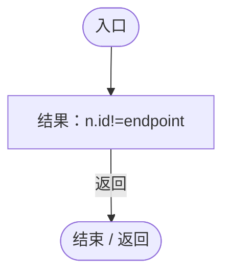
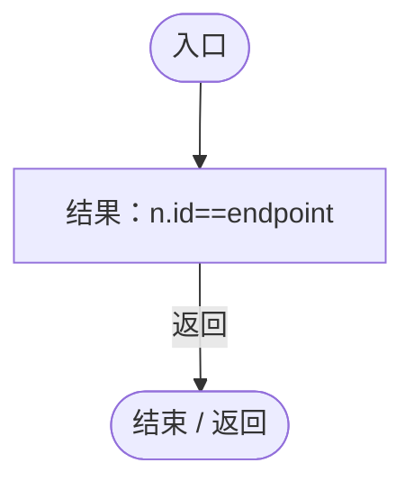
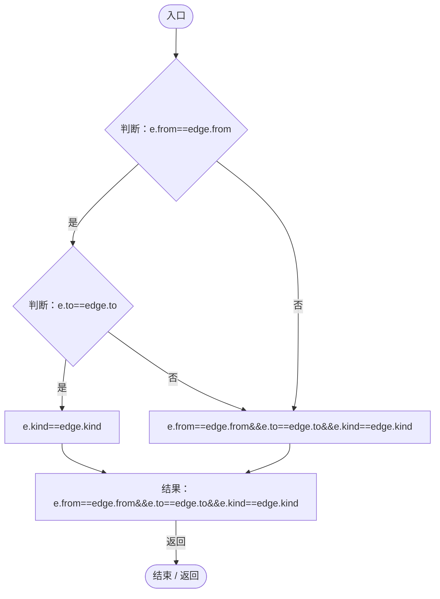
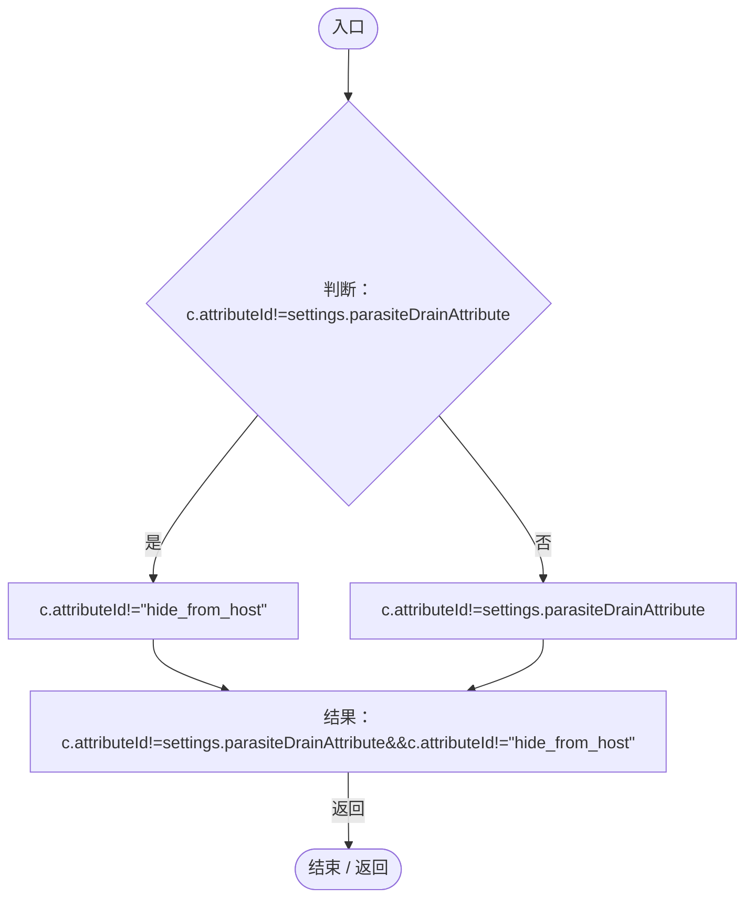
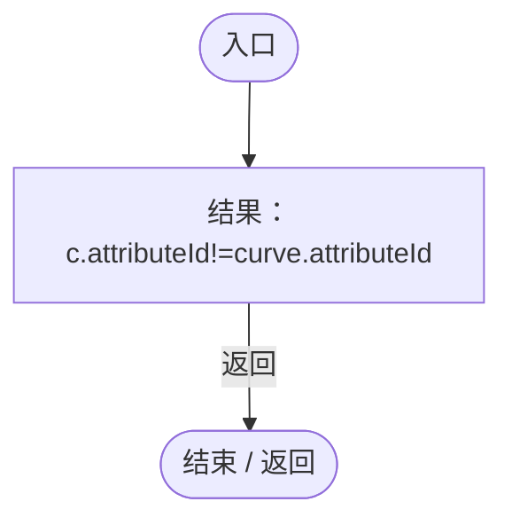
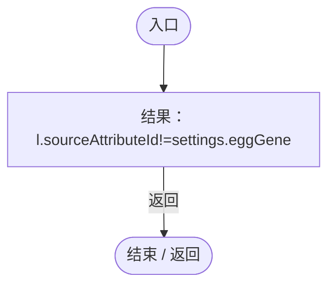

```mermaid
flowchart TD
  b0(["入口"])
  b1{"判断：e.to==id"}
  b2["e.from==id"]
  b3["e.to==id"]
  b4["结果：e.to==id&#124;&#124;e.from==id"]
  b5(["结束 / 返回"])
  b0 --> b1
  b1 -->|"否"| b2
  b1 -->|"是"| b3
  b2 --> b4
  b3 --> b4
  b4 -->|"返回"| b5

```

# NutritionEvolutionUpgrade.cs

[返回总索引](../README.md) · `Runtime` · `Assets/DarwinPark/Genetics/NutritionEvolutionUpgrade.cs`

[源文件](../../../Assets/DarwinPark/Genetics/NutritionEvolutionUpgrade.cs) · 源码校验：`07e49dc2e669f16bbb0ce06f4d8458522f81e0f09cc1cd0723a8ef00051dfcaa`

方法按源文件位置排列。事件/回调引用不表示立即执行；分支与异常说明见总索引。完整源码与可点击关系图请打开离线手册。

## Apply · L10

`public static void Apply(GeneTreeDocument tree,Dictionary<string,string> catalog)`

### Editor / Player · Roslyn编译器控制流

```mermaid
flowchart TD
  b0(["入口"])
  b1{"tree<br/>判断：tree"}
  b2[".nodes"]
  b3["tree"]
  b4{"判断：tree?.nodes==null"}
  b5{"判断：tree.edges==null"}
  b6{"判断：catalog==null"}
  b7{"settings=NutritionEcologySettings.Current<br/>builtin=JsonUtility.FromJson&lt;GeneTreeDocument&gt;(Resources.Load&lt;TextAsset&gt;(&quot;Genetics/default_tree&quot;).text)<br/>判断：catalog.ContainsKey(settings.nutritionGene)"}
  b8{"判断：tree.nutritionVersion&lt;1"}
  b9["new[]{settings.heterotrophyGene,settings.scavengerGene}"]
  b10{"判断：new[]{settings.heterotrophyGene,settings.scavengerGene}"}
  b11{"string<br/>判断：catalog.ContainsKey(id)"}
  b12["catalog[id]"]
  b13{"Resources.Load&lt;TextAsset&gt;(&quot;Genes/&quot;+id)<br/>判断：Resources.Load&lt;TextAsset&gt;(&quot;Genes/&quot;+id)"}
  b14[".text"]
  b15["Resources.Load&lt;TextAsset&gt;(&quot;Genes/&quot;+id)"]
  b16{"判断：Resources.Load&lt;TextAsset&gt;(&quot;Genes/&quot;+id)?.text"}
  b17["结果：new System.IO.InvalidDataException(&quot;缺少营养分支定义：&quot;+id)"]
  x17(["抛出异常 / 离开方法"])
  b18["catalog[id]=Resources.Load&lt;TextAsset&gt;(&quot;Genes/&quot;+id)?.text??throw new System.IO.InvalidDataException(&quot;缺少营养分支定义：&quot;+id);"]
  b19["builtin.edges.Where(e=&gt;e.to==id&#124;&#124;e.from==id)"]
  b20{"判断：builtin.edges.Where(e=&gt;e.to==id&#124;&#124;e.from==id)"}
  b21["var"]
  b22["new[]{edge.from,edge.to}"]
  b23{"判断：new[]{edge.from,edge.to}"}
  b24{"string<br/>判断：tree.nodes.All(n=&gt;n.id!=endpoint)"}
  b25["tree.nodes.Add(builtin.nodes.First(n=&gt;n.id==endpoint));"]
  b26{"new[]{edge.from,edge.to}<br/>判断：new[]{edge.from,edge.to}"}
  b27["new[]{edge.from,edge.to}"]
  b28["连接 / 离开区域"]
  b29{"判断：tree.edges.Any(e=&gt;e.from==edge.from&amp;&amp;e.to==edge.to&amp;&amp;e.kind==edge.kind)"}
  b30["tree.edges.Add(edge);"]
  b31{"判断：builtin.edges.Where(e=&gt;e.to==id&#124;&#124;e.from==id)"}
  b32["builtin.edges.Where(e=&gt;e.to==id&#124;&#124;e.from==id)"]
  b33["连接 / 离开区域"]
  b34{"new[]{settings.heterotrophyGene,settings.scavengerGene}<br/>判断：new[]{settings.heterotrophyGene,settings.scavengerGene}"}
  b35["new[]{settings.heterotrophyGene,settings.scavengerGene}"]
  b36["连接 / 离开区域"]
  b37["tree.nutritionVersion=1;"]
  b38{"判断：catalog.TryGetValue(settings.eggGene,out var raw)"}
  b39{"old=JsonUtility.FromJson&lt;GeneDefinitionJson&gt;(raw)<br/>判断：old.logicScriptId!=settings.legacyEggLogic"}
  b40["current=JsonUtility.FromJson&lt;GeneDefinitionJson&gt;(Resources.Load&lt;TextAsset&gt;(&quot;Genes/&quot;+settings.eggGene).text)<br/>old.displayName=current.displayName;<br/>old.logicScriptId=current.logicScriptId;<br/>old.states=current.states;<br/>old.attributeCurves=old.…"]
  b41["current.attributeCurves"]
  b42{"判断：current.attributeCurves"}
  b43{"var<br/>判断：old.attributeCurves.All(c=&gt;c.attributeId!=curve.attributeId)"}
  b44["old.attributeCurves.Add(curve);"]
  b45["current.attributeCurves"]
  b46["old.attributeLinkages=old.attributeLinkages.Where(l=&gt;l.sourceAttributeId!=settings.eggGene).ToList();<br/>catalog[settings.eggGene]=JsonUtility.ToJson(old);"]
  b47(["结束 / 返回"])
  b0 --> b1
  b1 -->|"否"| b2
  b1 -->|"是"| b3
  b2 --> b4
  b3 --> b4
  b4 -->|"否"| b5
  b4 -->|"是"| b47
  b5 -->|"否"| b6
  b5 -->|"是"| b47
  b6 -->|"是"| b47
  b6 -->|"否"| b7
  b7 -->|"是"| b8
  b7 -->|"否"| b38
  b8 -->|"是"| b9
  b8 -->|"否"| b38
  b9 --> b10
  b10 -->|"是"| b11
  b10 -->|"否 · 经过finally 34"| b37
  b11 -->|"否"| b12
  b11 -->|"是"| b19
  b12 --> b13
  b13 -->|"否"| b14
  b13 -->|"是"| b15
  b14 --> b16
  b15 --> b16
  b16 -->|"否"| b18
  b16 -->|"是"| b17
  b17 -->|"Throw"| x17
  b18 --> b19
  b19 --> b20
  b20 -->|"是"| b21
  b20 -->|"否 · 经过finally 31"| b10
  b21 --> b22
  b22 --> b23
  b23 -->|"是"| b24
  b23 -->|"否 · 经过finally 26"| b29
  b24 -->|"是"| b25
  b24 -->|"否"| b23
  b25 --> b23
  b26 -->|"否"| b27
  b26 -->|"是"| b28
  b27 --> b28
  b29 -->|"否"| b30
  b29 -->|"是"| b20
  b30 --> b20
  b31 -->|"否"| b32
  b31 -->|"是"| b33
  b32 --> b33
  b34 -->|"否"| b35
  b34 -->|"是"| b36
  b35 --> b36
  b37 --> b38
  b38 -->|"否"| b47
  b38 -->|"是"| b39
  b39 -->|"是"| b47
  b39 -->|"否"| b40
  b40 --> b41
  b41 --> b42
  b42 -->|"是"| b43
  b42 -->|"否 · 经过finally 45"| b46
  b43 -->|"是"| b44
  b43 -->|"否"| b42
  b44 --> b42
  b46 --> b47
  b23 -. "退出保护区时 finally（示意）" .-> b26
  b20 -. "退出保护区时 finally（示意）" .-> b31
  b10 -. "退出保护区时 finally（示意）" .-> b34
  b42 -. "退出保护区时 finally（示意）" .-> b45

```

项目内调用/回调引用：

- [NutritionEcologySettings.Current.get · L19](846a17351dbd6aa4.md#mb3eb930022e314f3)（访问器）
- [NutritionEvolutionUpgrade.回调@21 · L21](02dbee4dabe4bc85.md#m3e3ccf5399425f2b)（回调/委托）
- [NutritionEvolutionUpgrade.回调@23 · L23](02dbee4dabe4bc85.md#med24bfd96d79db46)（回调/委托）
- [NutritionEvolutionUpgrade.回调@23 · L23](02dbee4dabe4bc85.md#m7ce34f7d5e61da3c)（回调/委托）
- [NutritionEvolutionUpgrade.回调@24 · L24](02dbee4dabe4bc85.md#m6b6964c87c70e450)（回调/委托）
- [NutritionEvolutionUpgrade.回调@33 · L33](02dbee4dabe4bc85.md#mdb9818e3c2dbb059)（回调/委托）
- [NutritionEvolutionUpgrade.回调@34 · L34](02dbee4dabe4bc85.md#ma9621fb556dfbd8b)（回调/委托）
- [NutritionEvolutionUpgrade.回调@35 · L35](02dbee4dabe4bc85.md#m2391a4ebeaa85ed1)（回调/委托）

## 回调@21 · L21

`e … => 回调`

### Editor / Player · Roslyn编译器控制流

## 回调@23 · L23

`n … => 回调`

### Editor / Player · Roslyn编译器控制流

## 回调@23 · L23

`n … => 回调`

### Editor / Player · Roslyn编译器控制流

## 回调@24 · L24

`e … => 回调`

### Editor / Player · Roslyn编译器控制流

## 回调@33 · L33

`c … => 回调`

### Editor / Player · Roslyn编译器控制流

## 回调@34 · L34

`c … => 回调`

### Editor / Player · Roslyn编译器控制流

## 回调@35 · L35

`l … => 回调`

### Editor / Player · Roslyn编译器控制流

