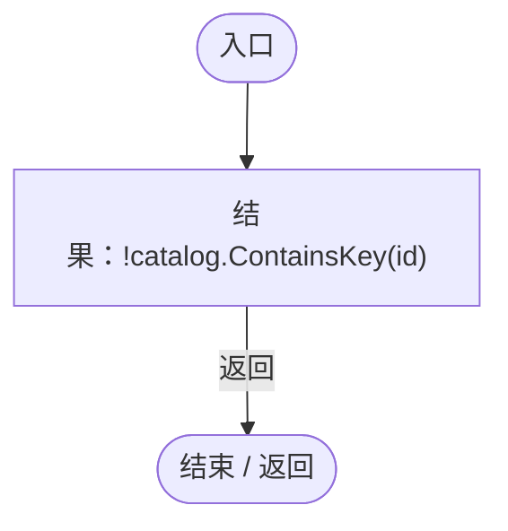
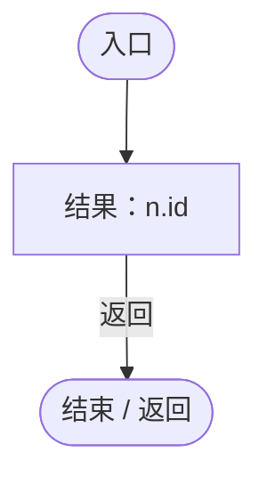
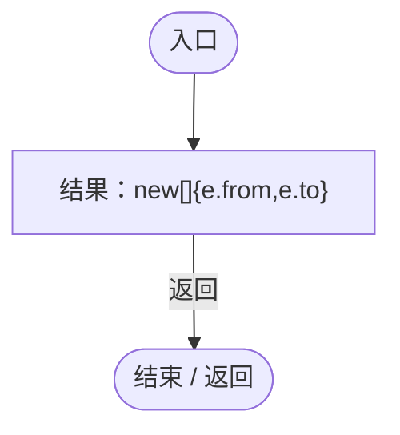
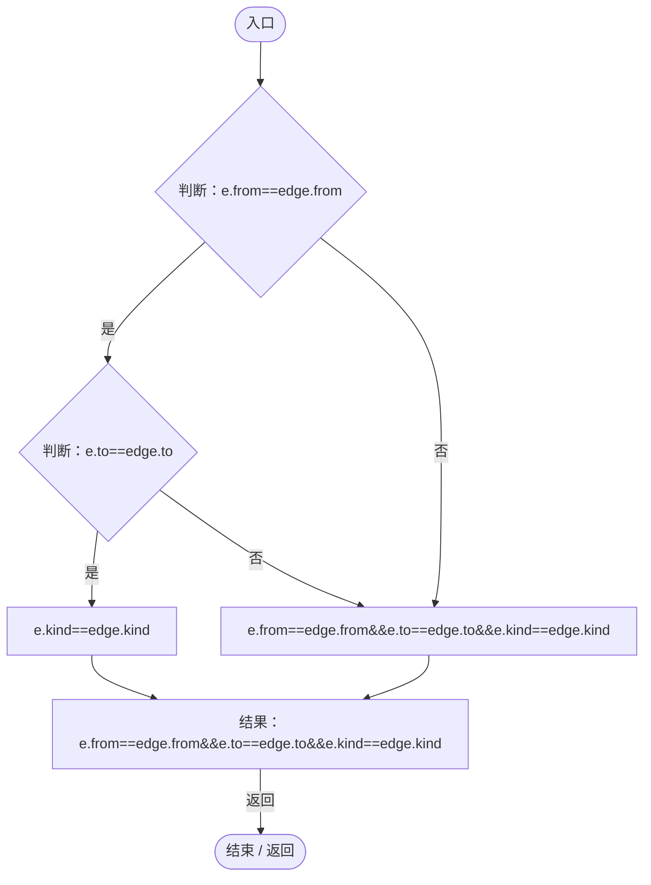

# GeneCatalogExpansion.cs

[返回总索引](../README.md) · `Runtime` · `Assets/DarwinPark/Genetics/GeneCatalogExpansion.cs`

[源文件](../../../Assets/DarwinPark/Genetics/GeneCatalogExpansion.cs) · 源码校验：`1248417643154f83ea726f2536f36f6b7776637fbd4b1bb3b192d76db92516e3`

方法按源文件位置排列。事件/回调引用不表示立即执行；分支与异常说明见总索引。完整源码与可点击关系图请打开离线手册。

## Expand · L10

`public static int Expand(Dictionary<string,string> catalog,GeneTreeDocument tree)`

### Editor / Player · Roslyn编译器控制流

```mermaid
flowchart TD
  b0(["入口"])
  b1{"available=GeneTreeStorage.ReadCatalog()<br/>missing=new HashSet&lt;string&gt;(available.Keys.Where(id=&gt;!catalog.ContainsKey(id)))<br/>判断：missing.Count==0"}
  b2["结果：0"]
  b3["merged=new Dictionary&lt;string,string&gt;(catalog)"]
  b4["missing"]
  b5{"判断：missing"}
  b6["var<br/>merged.Add(id,available[id]);"]
  b7["missing"]
  b8{"result=JsonUtility.FromJson&lt;GeneTreeDocument&gt;(JsonUtility.ToJson(tree))<br/>builtin=Resources.Load&lt;TextAsset&gt;(&quot;Genetics/default_tree&quot;)<br/>判断：builtin==null"}
  b9["结果：new System.IO.InvalidDataException(&quot;缺少 Genetics/default_tree，无法补齐基因关系&quot;)"]
  x9(["抛出异常 / 离开方法"])
  b10["defaults=JsonUtility.FromJson&lt;GeneTreeDocument&gt;(builtin.text)<br/>nodes=new HashSet&lt;string&gt;(result.nodes.Select(n=&gt;n.id))<br/>newEdges=defaults.edges.Where(e=&gt;(missing.Contains(e.from)&#124;&#124;missing.Contains(e.to))&amp;&amp;merged.ContainsKey(e.from)&amp;&amp;merged…"]
  b11["defaults.nodes"]
  b12{"判断：defaults.nodes"}
  b13{"var<br/>判断：required.Contains(node.id)"}
  b14{"判断：nodes.Add(node.id)"}
  b15["result.nodes.Add(node);"]
  b16["defaults.nodes"]
  b17["newEdges"]
  b18{"判断：newEdges"}
  b19{"var<br/>判断：result.edges.Any(e=&gt;e.from==edge.from&amp;&amp;e.to==edge.to&amp;&amp;e.kind==edge.kind)"}
  b20["result.edges.Add(edge);"]
  b21["newEdges"]
  b22["GeneTreeStorage.Validate(result,merged);"]
  b23["merged"]
  b24{"判断：merged"}
  b25["var<br/>catalog[entry.Key]=entry.Value;"]
  b26["merged"]
  b27["tree.nodes=result.nodes;<br/>tree.edges=result.edges;<br/>tree.nutritionVersion=result.nutritionVersion;<br/>结果：missing.Count"]
  b28(["结束 / 返回"])
  b0 --> b1
  b1 -->|"是"| b2
  b1 -->|"否"| b3
  b2 -->|"返回"| b28
  b3 --> b4
  b4 --> b5
  b5 -->|"是"| b6
  b5 -->|"否 · 经过finally 7"| b8
  b6 --> b5
  b8 -->|"是"| b9
  b8 -->|"否"| b10
  b9 -->|"Throw"| x9
  b10 --> b11
  b11 --> b12
  b12 -->|"是"| b13
  b12 -->|"否 · 经过finally 16"| b17
  b13 -->|"是"| b14
  b13 -->|"否"| b12
  b14 -->|"是"| b15
  b14 -->|"否"| b12
  b15 --> b12
  b17 --> b18
  b18 -->|"是"| b19
  b18 -->|"否 · 经过finally 21"| b22
  b19 -->|"否"| b20
  b19 -->|"是"| b18
  b20 --> b18
  b22 --> b23
  b23 --> b24
  b24 -->|"是"| b25
  b24 -->|"否 · 经过finally 26"| b27
  b25 --> b24
  b27 -->|"返回"| b28
  b5 -. "退出保护区时 finally（示意）" .-> b7
  b12 -. "退出保护区时 finally（示意）" .-> b16
  b18 -. "退出保护区时 finally（示意）" .-> b21
  b24 -. "退出保护区时 finally（示意）" .-> b26

```

项目内调用/回调引用：

- [GeneTreeStorage.ReadCatalog · L27](a885bad0d7dedee8.md#m89083f320ec287c0)（方法）
- [GeneTreeStorage.Validate · L67](a885bad0d7dedee8.md#m3371bf1e3c5ae267)（方法）
- [GeneCatalogExpansion.回调@13 · L13](03ab59525607c3f7.md#m0c3e38aaf470e2a8)（回调/委托）
- [GeneCatalogExpansion.回调@21 · L21](03ab59525607c3f7.md#mfac5604aeead9901)（回调/委托）
- [GeneCatalogExpansion.回调@22 · L22](03ab59525607c3f7.md#mb1070546ff01bd89)（回调/委托）
- [GeneCatalogExpansion.回调@23 · L23](03ab59525607c3f7.md#maa1af582ebae806c)（回调/委托）
- [GeneCatalogExpansion.回调@25 · L25](03ab59525607c3f7.md#m80738b421cc00729)（回调/委托）

## 回调@13 · L13

`id … => 回调`

### Editor / Player · Roslyn编译器控制流

## 回调@21 · L21

`n … => 回调`

### Editor / Player · Roslyn编译器控制流

## 回调@22 · L22

`e … => 回调`

### Editor / Player · Roslyn编译器控制流

```mermaid
flowchart TD
  b0(["入口"])
  b1{"判断：missing.Contains(e.from)"}
  b2{"判断：missing.Contains(e.to)"}
  b3{"判断：merged.ContainsKey(e.from)"}
  b4["merged.ContainsKey(e.to)"]
  b5["(missing.Contains(e.from)&#124;&#124;missing.Contains(e.to))&amp;&amp;merged.ContainsKey(e.from)&amp;&amp;merged.ContainsKey(e.to)"]
  b6["结果：(missing.Contains(e.from)&#124;&#124;missing.Contains(e.to))&amp;&amp;merged.ContainsKey(e.from)&amp;&amp;merged.ContainsKey(e.to)"]
  b7(["结束 / 返回"])
  b0 --> b1
  b1 -->|"否"| b2
  b1 -->|"是"| b3
  b2 -->|"是"| b3
  b2 -->|"否"| b5
  b3 -->|"是"| b4
  b3 -->|"否"| b5
  b4 --> b6
  b5 --> b6
  b6 -->|"返回"| b7

```

## 回调@23 · L23

`e … => 回调`

### Editor / Player · Roslyn编译器控制流

## 回调@25 · L25

`e … => 回调`

### Editor / Player · Roslyn编译器控制流

