# WorldResourceInspector.cs

[返回总索引](../README.md) · `Runtime` · `Assets/DarwinPark/UI/WorldResourceInspector.cs`

[源文件](../../../Assets/DarwinPark/UI/WorldResourceInspector.cs) · 源码校验：`080630e8cc848d78b64dce936134f357c6ae20f29be4381c64953a956091ad23`

方法按源文件位置排列。事件/回调引用不表示立即执行；分支与异常说明见总索引。完整源码与可点击关系图请打开离线手册。

## Instance.get · L12

`get`

### Editor / Player · 语法控制结构 / 声明（非CFG）

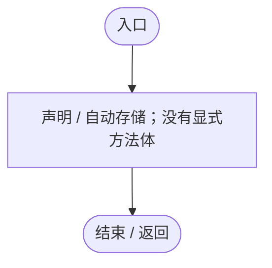

## Instance.set · L12

`private set`

### Editor / Player · 语法控制结构 / 声明（非CFG）

## Current.get · L12

`get`

### Editor / Player · 语法控制结构 / 声明（非CFG）

## Current.set · L12

`private set`

### Editor / Player · 语法控制结构 / 声明（非CFG）

## EntityInspector.get · L15

`private GeneInspectorUI EntityInspector`

### Editor / Player · 语法控制结构 / 声明（非CFG）

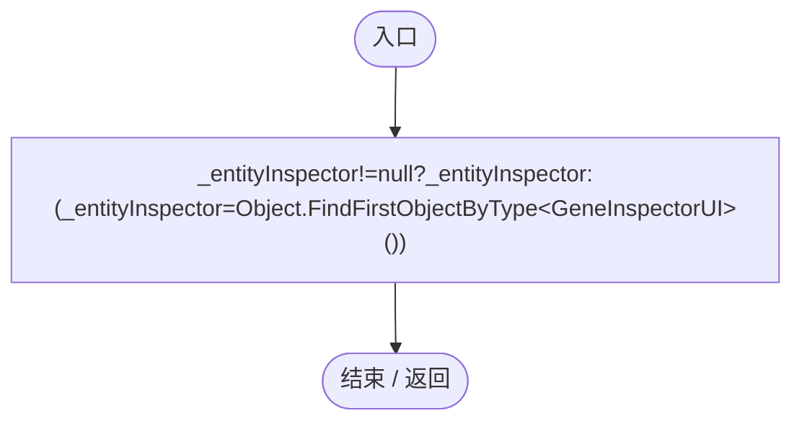

## Awake · L17

`private void Awake()`

### Editor / Player · Roslyn编译器控制流

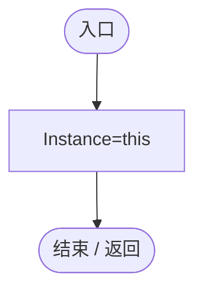

项目内调用/回调引用：

- [WorldResourceInspector.Instance.set · L12](044d7e948b6de8b7.md#mdc2f59c12092d0a2)（访问器）

## Ensure · L18

`public static WorldResourceInspector Ensure()`

### Editor / Player · Roslyn编译器控制流

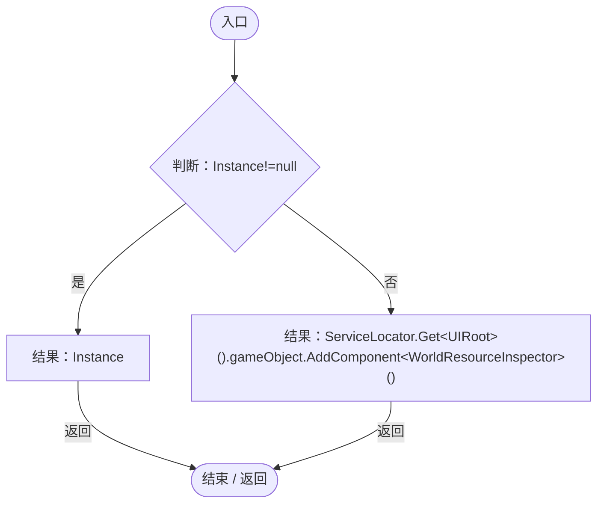

项目内调用/回调引用：

- [WorldResourceInspector.Instance.get · L12](044d7e948b6de8b7.md#m7d7f466d7959eb79)（访问器）
- [ServiceLocator.Get · L33](f2fdbe9f9ccd93cb.md#m2ae625299520c56d)（方法）

## Show · L19

`public void Show(ColonyResource resource)`

### Editor / Player · Roslyn编译器控制流

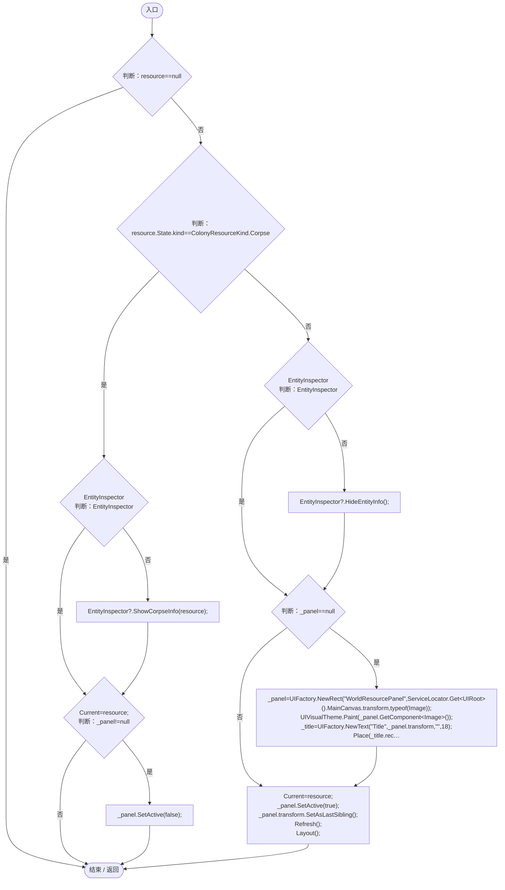

项目内调用/回调引用：

- [ColonyResource.State.get · L24](293dbaecfff4b585.md#m41824f1a0e160aa5)（访问器）
- [GeneInspectorUI.ShowCorpseInfo · L14](226a6835af361a0e.md#m430870b0664cfdf5)（方法）
- [WorldResourceInspector.Current.set · L12](044d7e948b6de8b7.md#m6662d57e567bf46f)（访问器）
- [GeneInspectorUI.HideEntityInfo · L317](924e27c34e7b1f0a.md#mc9346c30e59e03d7)（方法）
- [UIFactory.NewRect · L33](dd1096a6995423db.md#med612116f3152344)（方法）
- [UIRoot.MainCanvas.get · L14](9c1421378791f0e0.md#maa2cc9baf1248477)（访问器）
- [ServiceLocator.Get · L33](f2fdbe9f9ccd93cb.md#m2ae625299520c56d)（方法）
- [UIVisualTheme.Paint · L58](ca525a798a08f966.md#m2d61a6b26ab24980)（方法）
- [UIFactory.NewText · L57](dd1096a6995423db.md#m9dbccb5f0c38189e)（方法）
- [WorldResourceInspector.Place · L34](044d7e948b6de8b7.md#md0545b05d997a8cc)（方法）
- [UIFactory.NewButton · L73](dd1096a6995423db.md#m5896f1b097c8bdde)（方法）
- [WorldResourceInspector.Refresh · L42](044d7e948b6de8b7.md#m02a1e2e2ca591623)（方法）
- [WorldResourceInspector.Layout · L36](044d7e948b6de8b7.md#m5e04c43b8c22a0b3)（方法）
- [WorldResourceInspector.Hide · L67](044d7e948b6de8b7.md#md02dd83e5021f3a5)（方法）

## Place · L34

`private static void Place(RectTransform rect,float left,float top,float height,float right)`

### Editor / Player · Roslyn编译器控制流

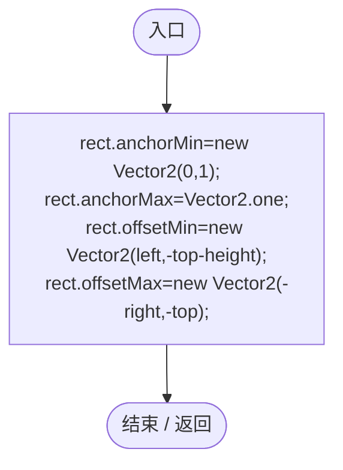

## Layout · L36

`private void Layout()`

### Editor / Player · Roslyn编译器控制流

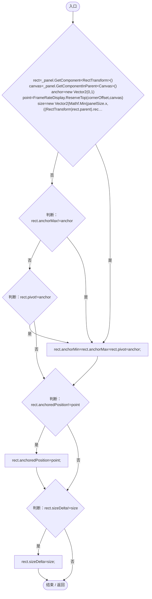

项目内调用/回调引用：

- [FrameRateDisplay.ReserveTop · L32](4e898f3c11cb4578.md#m164c2b59a71d57d4)（方法）

## Refresh · L42

`public void Refresh()`

### Editor / Player · Roslyn编译器控制流

```mermaid
flowchart TD
  b0(["入口"])
  b1{"判断：Current==null"}
  b2{"判断：Current.State.kind==ColonyResourceKind.Corpse"}
  b3{"EntityInspector<br/>判断：EntityInspector"}
  b4["EntityInspector?.RefreshDisplayedInfo();"]
  b5["state=Current.State<br/>corpse=state.kind==ColonyResourceKind.Corpse"]
  b6{"_title.text<br/>判断：corpse"}
  b7["&quot;尸体 · 已死亡&quot;"]
  b8{"判断：state.kind==ColonyResourceKind.Nursery"}
  b9["&quot;王后及幼体补给&quot;"]
  b10{"判断：state.kind==ColonyResourceKind.Supply"}
  b11["&quot;成年种群补给&quot;"]
  b12["&quot;能量块&quot;"]
  b13["_title.text=corpse?&quot;尸体 · 已死亡&quot;:state.kind==ColonyResourceKind.Nursery?&quot;王后及幼体补给&quot;:state.kind==ColonyResourceKind.Supply?&quot;成年种群补给&quot;:&quot;能量块&quot;;"]
  b14["queen=AntColonyMember.All.FirstOrDefault(m=&gt;m.Role==AntRole.Queen&amp;&amp;m.GroupId==state.group)"]
  b15{"判断：queen!=null"}
  b16["queen.Entity.DisplayName"]
  b17["&quot;原种群已不存在&quot;"]
  b18["group=queen!=null?queen.Entity.DisplayName:&quot;原种群已不存在&quot;"]
  b19{"判断：string.IsNullOrEmpty(state.claim)"}
  b20["&quot;等待工匠搬运&quot;"]
  b21["&quot;已由工匠领取&quot;"]
  b22["claim=string.IsNullOrEmpty(state.claim)?&quot;等待工匠搬运&quot;:&quot;已由工匠领取&quot;"]
  b23{"_body.text<br/>判断：corpse"}
  b24{"判断：string.IsNullOrEmpty(state.sourceName)"}
  b25["&quot;旧存档未记录&quot;"]
  b26["state.sourceName"]
  b27{"判断：state.sourceSize&gt;0"}
  b28["state.sourceSize.ToString(&quot;F2&quot;)"]
  b29["&quot;旧存档未记录&quot;"]
  b30["$&quot;状态：已死亡，可搬运资源\n生前名称：{(string.IsNullOrEmpty(state.sourceName)?&quot;旧存档未记录&quot;:state.sourceName)}\n生前体型：{(state.sourceSize&gt;0?state.sourceSize.ToString(&quot;F2&quot;):&quot;旧存档未记录&quot;)}\n剩余营养：{state.energy:F1}\n归属王后：{group}\n搬运状态：{claim}&quot;"]
  b31["$&quot;类型：{_title.text}\n剩余能量：{state.energy:F1}\n归属王后：{group}\n可由符合条件的个体自动吸收&quot;"]
  b32["_body.text=corpse?$&quot;状态：已死亡，可搬运资源\n生前名称：{(string.IsNullOrEmpty(state.sourceName)?&quot;旧存档未记录&quot;:state.sourceName)}\n生前体型：{(state.sourceSize&gt;0?state.sourceSize.ToString(&quot;F2&quot;):&quot;旧存档未记录&quot;)}\n剩余营养：{state.energy:F1}\n归属王后：{group}\n搬运状态：{claim}&quot;:$&quot;类型：{…"]
  b33["_next=Time.unscaledTime+refreshInterval;"]
  b34(["结束 / 返回"])
  b0 --> b1
  b1 -->|"是"| b34
  b1 -->|"否"| b2
  b2 -->|"是"| b3
  b2 -->|"否"| b5
  b3 -->|"否"| b4
  b3 -->|"是"| b34
  b4 --> b34
  b5 --> b6
  b6 -->|"是"| b7
  b6 -->|"否"| b8
  b7 --> b13
  b8 -->|"是"| b9
  b8 -->|"否"| b10
  b9 --> b13
  b10 -->|"是"| b11
  b10 -->|"否"| b12
  b11 --> b13
  b12 --> b13
  b13 --> b14
  b14 --> b15
  b15 -->|"是"| b16
  b15 -->|"否"| b17
  b16 --> b18
  b17 --> b18
  b18 --> b19
  b19 -->|"是"| b20
  b19 -->|"否"| b21
  b20 --> b22
  b21 --> b22
  b22 --> b23
  b23 -->|"是"| b24
  b23 -->|"否"| b31
  b24 -->|"是"| b25
  b24 -->|"否"| b26
  b25 --> b27
  b26 --> b27
  b27 -->|"是"| b28
  b27 -->|"否"| b29
  b28 --> b30
  b29 --> b30
  b30 --> b32
  b31 --> b32
  b32 --> b33
  b33 --> b34

```

项目内调用/回调引用：

- [WorldResourceInspector.Current.get · L12](044d7e948b6de8b7.md#mdc035db6f6144659)（访问器）
- [ColonyResource.State.get · L24](293dbaecfff4b585.md#m41824f1a0e160aa5)（访问器）
- [GeneInspectorUI.RefreshDisplayedInfo · L326](924e27c34e7b1f0a.md#m1feb95a375dc3dcc)（方法）
- [AntColonyMember.Entity.get · L35](baebd85c05598377.md#m22b589e7146d5e42)（访问器）
- [WorldResourceInspector.回调@49 · L49](044d7e948b6de8b7.md#m3837c18a7d387018)（回调/委托）

## 回调@49 · L49

`m … => 回调`

### Editor / Player · Roslyn编译器控制流

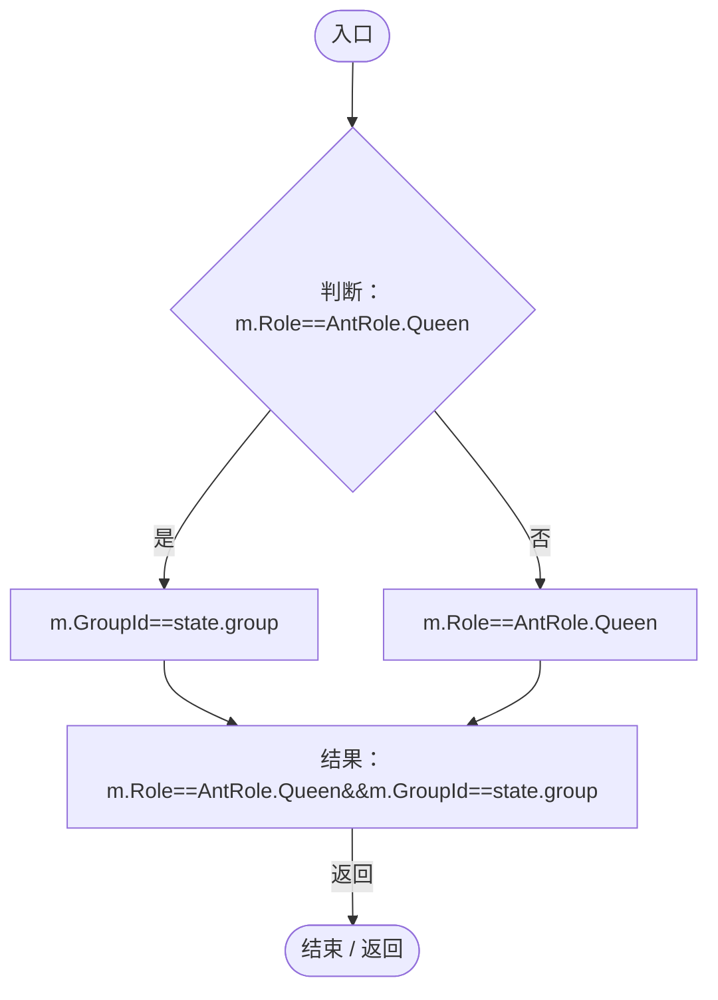

项目内调用/回调引用：

- [AntColonyMember.Role.get · L39](baebd85c05598377.md#mbe541ad55a93b0dd)（访问器）

## LateUpdate · L54

`private void LateUpdate()`

### Editor / Player · Roslyn编译器控制流

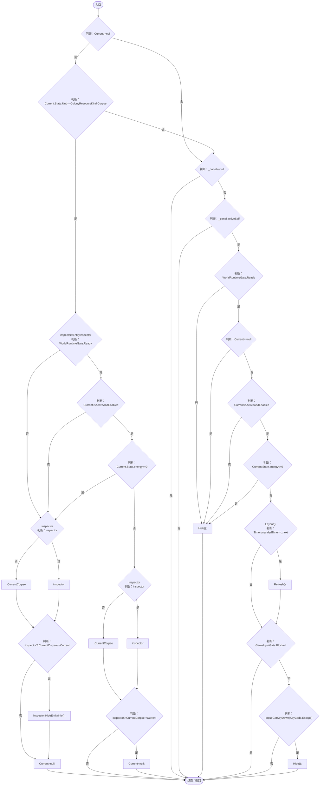

项目内调用/回调引用：

- [WorldResourceInspector.Current.get · L12](044d7e948b6de8b7.md#mdc035db6f6144659)（访问器）
- [ColonyResource.State.get · L24](293dbaecfff4b585.md#m41824f1a0e160aa5)（访问器）
- [GeneInspectorUI.HideEntityInfo · L317](924e27c34e7b1f0a.md#mc9346c30e59e03d7)（方法）
- [WorldResourceInspector.Current.set · L12](044d7e948b6de8b7.md#m6662d57e567bf46f)（访问器）
- [WorldResourceInspector.Hide · L67](044d7e948b6de8b7.md#md02dd83e5021f3a5)（方法）
- [WorldResourceInspector.Layout · L36](044d7e948b6de8b7.md#m5e04c43b8c22a0b3)（方法）
- [WorldResourceInspector.Refresh · L42](044d7e948b6de8b7.md#m02a1e2e2ca591623)（方法）
- [GameInputGate.Blocked.get · L8](52955daae7e592ab.md#m765763b665829633)（访问器）

## Hide · L67

`public void Hide()`

### Editor / Player · Roslyn编译器控制流

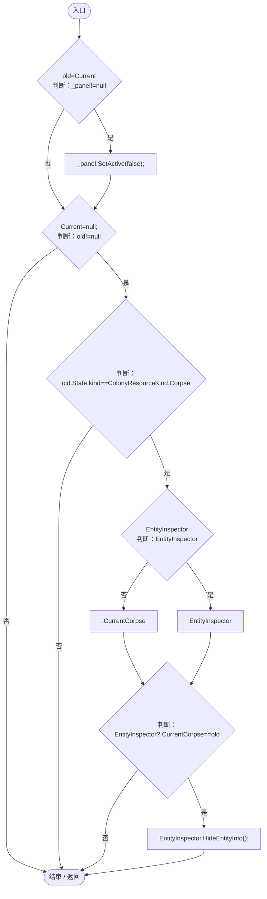

项目内调用/回调引用：

- [WorldResourceInspector.Current.get · L12](044d7e948b6de8b7.md#mdc035db6f6144659)（访问器）
- [WorldResourceInspector.Current.set · L12](044d7e948b6de8b7.md#m6662d57e567bf46f)（访问器）
- [ColonyResource.State.get · L24](293dbaecfff4b585.md#m41824f1a0e160aa5)（访问器）
- [GeneInspectorUI.HideEntityInfo · L317](924e27c34e7b1f0a.md#mc9346c30e59e03d7)（方法）

## OnDestroy · L68

`private void OnDestroy()`

### Editor / Player · Roslyn编译器控制流

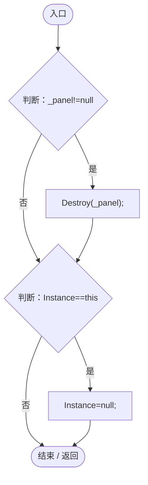

项目内调用/回调引用：

- [WorldResourceInspector.Instance.get · L12](044d7e948b6de8b7.md#m7d7f466d7959eb79)（访问器）
- [WorldResourceInspector.Instance.set · L12](044d7e948b6de8b7.md#mdc2f59c12092d0a2)（访问器）
