# GroundPhysicsBenchmark.cs

[返回总索引](../README.md) · `Editor` · `Assets/DarwinPark/Editor/GroundPhysicsBenchmark.cs`

[源文件](../../../Assets/DarwinPark/Editor/GroundPhysicsBenchmark.cs) · 源码校验：`da218959d4dffec856ddad0f68bb1c34a983a6a9de490165d1c33faef6509752`

方法按源文件位置排列。事件/回调引用不表示立即执行；分支与异常说明见总索引。完整源码与可点击关系图请打开离线手册。

## Folder.get · L22

`private static string Folder`

### Editor · 语法控制结构 / 声明（非CFG）

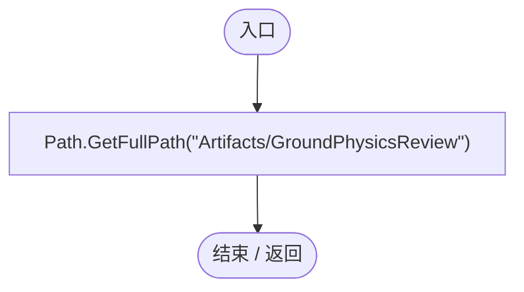

## GroundPhysicsBenchmark.ctor · L23

`static GroundPhysicsBenchmark()`

### Editor · Roslyn编译器控制流

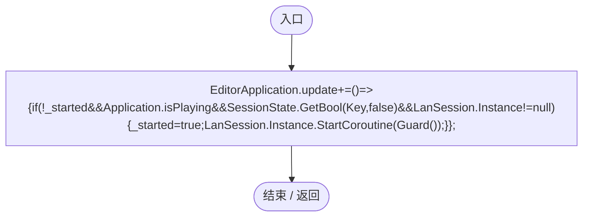

项目内调用/回调引用：

- [GroundPhysicsBenchmark.回调@23 · L23](047e34d05752f3cb.md#mef1e88429d955d72)（回调/委托）

## 回调@23 · L23

`( … => 回调`

### Editor · Roslyn编译器控制流

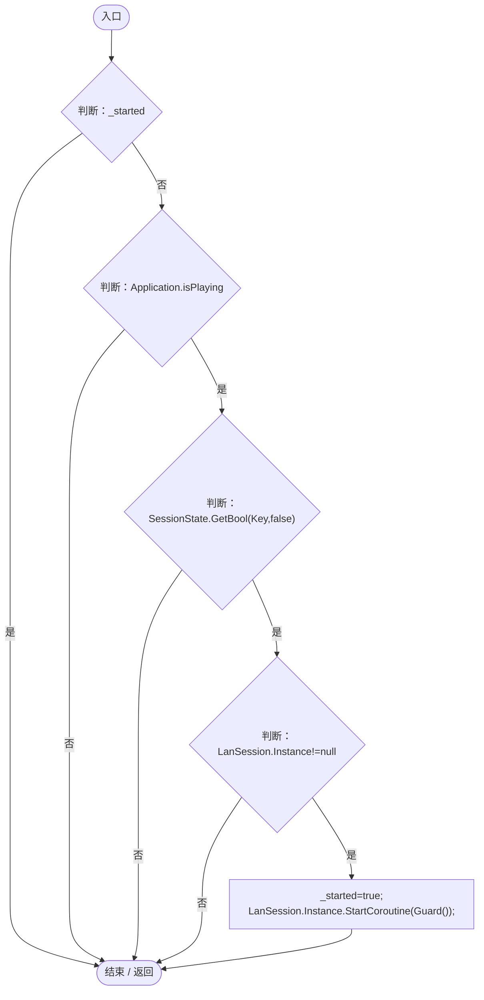

项目内调用/回调引用：

- [LanSession.Instance.get · L23](9fb633eebffe669c.md#mbf83306994878383)（访问器）
- [GroundPhysicsBenchmark.Guard · L25](047e34d05752f3cb.md#m2038b5578155036d)（方法）

## RunBatch · L24

`public static void RunBatch()`

### Editor · Roslyn编译器控制流

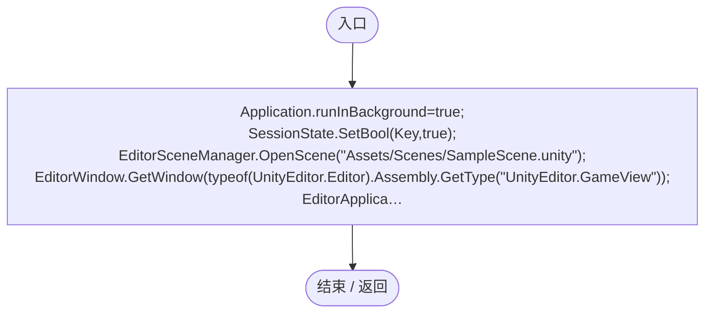

## Guard · L25

`private static IEnumerator Guard()`

### Editor · Roslyn编译器控制流

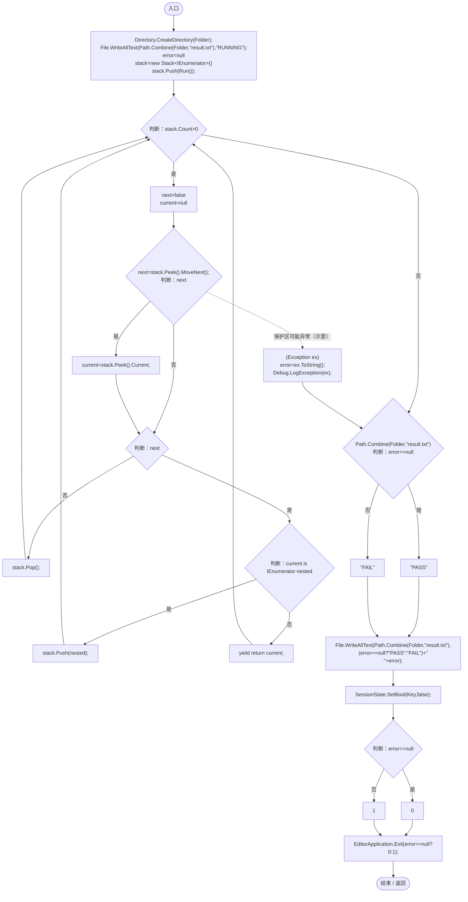

项目内调用/回调引用：

- [GroundPhysicsBenchmark.Run · L40](047e34d05752f3cb.md#me34f15855d430849)（方法）

## Counters · L31

`private static Dictionary<string,long> Counters()`

### Editor · Roslyn编译器控制流

```mermaid
flowchart TD
  b0(["入口"])
  b1{"values=new Dictionary&lt;string,long&gt;()<br/>type=typeof(PlanetGravity).Assembly.GetType(&quot;DarwinPark.Entities.EntityGroundProbe&quot;)<br/>判断：type!=null"}
  b2["type.GetFields(BindingFlags.Public&#124;BindingFlags.Static)"]
  b3{"判断：type.GetFields(BindingFlags.Public&#124;BindingFlags.Static)"}
  b4{"var<br/>判断：f.FieldType==typeof(long)"}
  b5["values[f.Name]=(long)f.GetValue(null);"]
  b6{"type.GetFields(BindingFlags.Public&#124;BindingFlags.Static)<br/>判断：type.GetFields(BindingFlags.Public&#124;BindingFlags.Static)"}
  b7["type.GetFields(BindingFlags.Public&#124;BindingFlags.Static)"]
  b8["连接 / 离开区域"]
  b9["结果：values"]
  b10(["结束 / 返回"])
  b0 --> b1
  b1 -->|"是"| b2
  b1 -->|"否"| b9
  b2 --> b3
  b3 -->|"是"| b4
  b3 -->|"否 · 经过finally 6"| b9
  b4 -->|"是"| b5
  b4 -->|"否"| b3
  b5 --> b3
  b6 -->|"否"| b7
  b6 -->|"是"| b8
  b7 --> b8
  b9 -->|"返回"| b10
  b3 -. "退出保护区时 finally（示意）" .-> b6

```

## Sample · L33

`private static IEnumerator Sample(string name)`

### Editor · Roslyn编译器控制流

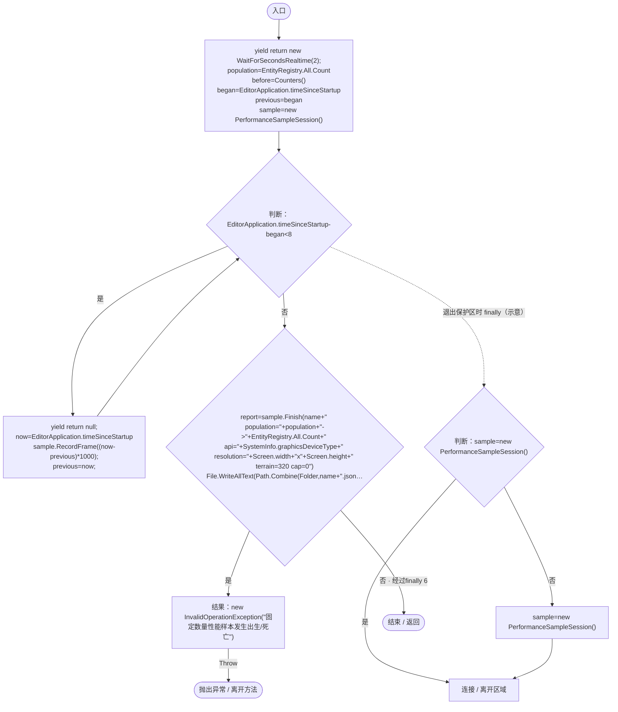

项目内调用/回调引用：

- [GroundPhysicsBenchmark.Counters · L31](047e34d05752f3cb.md#m1c0047f71eef9b8e)（方法）
- [PerformanceSampleSession.PerformanceSampleSession.ctor · L40](a8403a4c7503726d.md#m3c05843ea4405ab7)（构造函数）
- [PerformanceSampleSession.RecordFrame · L47](a8403a4c7503726d.md#m8e99e8af42397205)（方法）
- [PerformanceSampleSession.Finish · L51](a8403a4c7503726d.md#m4669e6a0590f65f9)（方法）
- [GroundPhysicsBenchmark.回调@38 · L38](047e34d05752f3cb.md#m7193a0e37c574386)（回调/委托）
- [GroundPhysicsBenchmark.回调@38 · L38](047e34d05752f3cb.md#m85fec89707fc1737)（回调/委托）
- [GroundPhysicsBenchmark.回调@38 · L38](047e34d05752f3cb.md#md9d1dea653d1d9e9)（回调/委托）
- [GroundPhysicsBenchmark.回调@38 · L38](047e34d05752f3cb.md#m6f6a34893b7b7c40)（回调/委托）
- [GroundPhysicsBenchmark.回调@38 · L38](047e34d05752f3cb.md#mee72cf2dff059185)（回调/委托）

## 回调@38 · L38

`p … => 回调`

### Editor · Roslyn编译器控制流

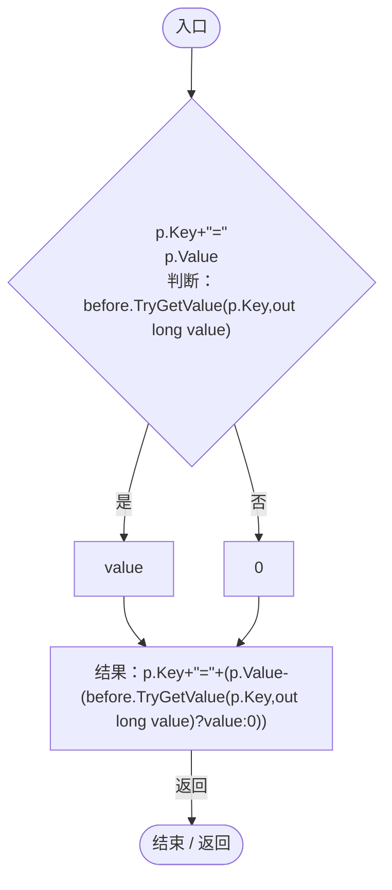

## 回调@38 · L38

`e … => 回调`

### Editor · Roslyn编译器控制流

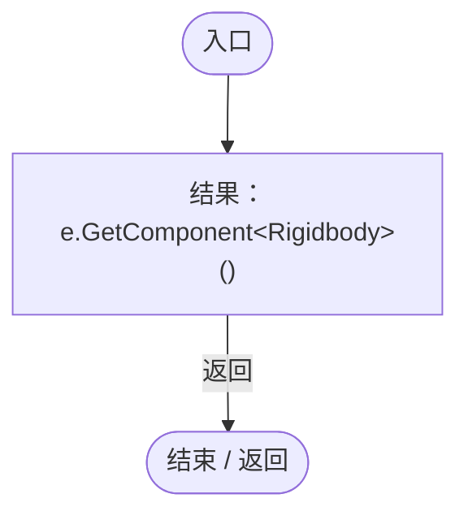

## 回调@38 · L38

`b … => 回调`

### Editor · Roslyn编译器控制流

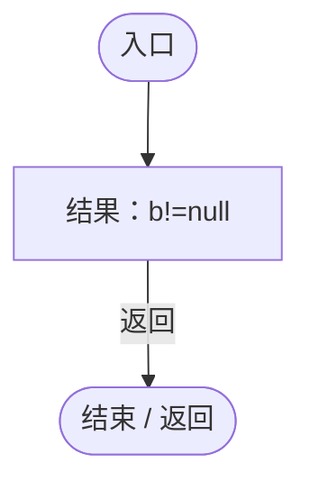

## 回调@38 · L38

`b … => 回调`

### Editor · Roslyn编译器控制流

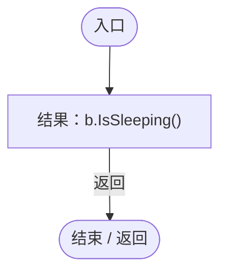

## 回调@38 · L38

`b … => 回调`

### Editor · Roslyn编译器控制流

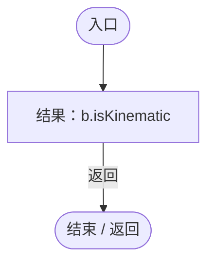

## Run · L40

`private static IEnumerator Run()`

### Editor · Roslyn编译器控制流

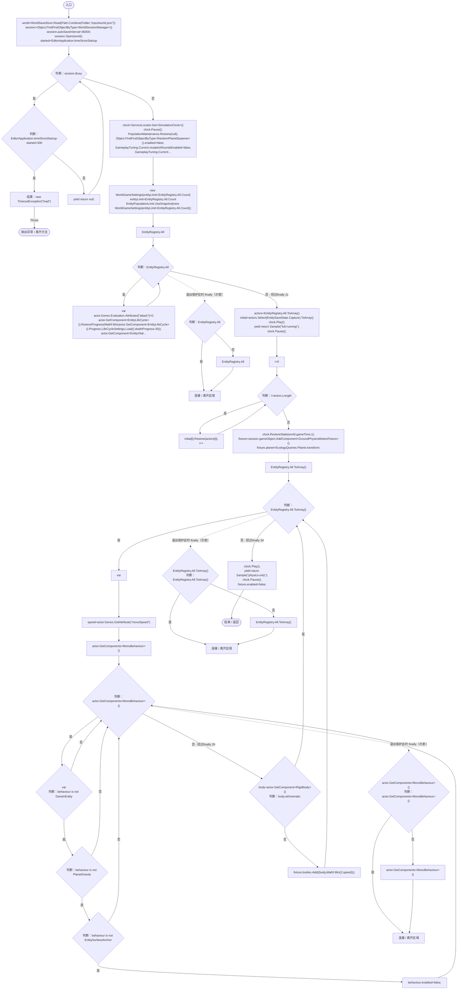

项目内调用/回调引用：

- [WorldSaveStore.Read · L74](d67a35e5e3814c15.md#mde52fadbe0185af1)（方法）
- [WorldSessionManager.Open · L60](08741c7b7b9d9344.md#m7bd56ef45131b4e5)（方法）
- [WorldSessionManager.Busy.get · L24](08741c7b7b9d9344.md#m4483e2e4f28f7c85)（访问器）
- [ServiceLocator.Get · L33](f2fdbe9f9ccd93cb.md#m2ae625299520c56d)（方法）
- [SimulationClock.Pause · L79](a8f444aec9614b0a.md#m30929d45a885d0f1)（方法）
- [PopulationMaintenance.Restore · L157](923ccc4e86c4786c.md#m6eadf366fa1602cc)（方法）
- [GameplayTuning.Current.get · L44](db546e5713b32d53.md#m5713e7f86902b6fa)（访问器）
- [FramePacingSettings.SetLimit · L19](8a946f816b77d4b6.md#mff17d0cc654b6a7f)（方法）
- [EntityPopulationLimit.UseSnapshot · L30](44f717c5df79d270.md#m735185cedc969868)（方法）
- [EntityGeneController.Evaluation.get · L18](7494d53178552f0e.md#mc0039c100a31b455)（访问器）
- [DarwinEntity.Genes.get · L14](70798dde169f2e8b.md#m622eb1adf401d431)（访问器）
- [EntityLifeCycle.RestoreProgress · L52](9f4138bfbae654b7.md#m007c73a0c714c238)（方法）
- [EntityLifeCycle.Progress.get · L10](9f4138bfbae654b7.md#m178185fd5f5a0d74)（访问器）
- [LifeCycleSettings.Load · L16](ace76969fe8f61de.md#mbd2925785484f343)（方法）
- [SimulationClock.Play · L78](a8f444aec9614b0a.md#m7aa9e64b7de60ed0)（方法）
- [GroundPhysicsBenchmark.Sample · L33](047e34d05752f3cb.md#m9aaf01bc84688752)（方法）
- [EntitySaveState.Restore · L32](a1ec8fcd9d7d3ddb.md#md1cca8b8dd3628a4)（方法）
- [SimulationClock.RestoreState · L74](a8f444aec9614b0a.md#m8f617e95e1282846)（方法）
- [EntityGeneController.GetAttribute · L286](7494d53178552f0e.md#m18bff2b38f95b556)（方法）
- [EntitySaveState.Capture · L22](a1ec8fcd9d7d3ddb.md#md994065ded6697b7)（方法）

## FixedUpdate · L57

`private void FixedUpdate()`

### Editor · Roslyn编译器控制流

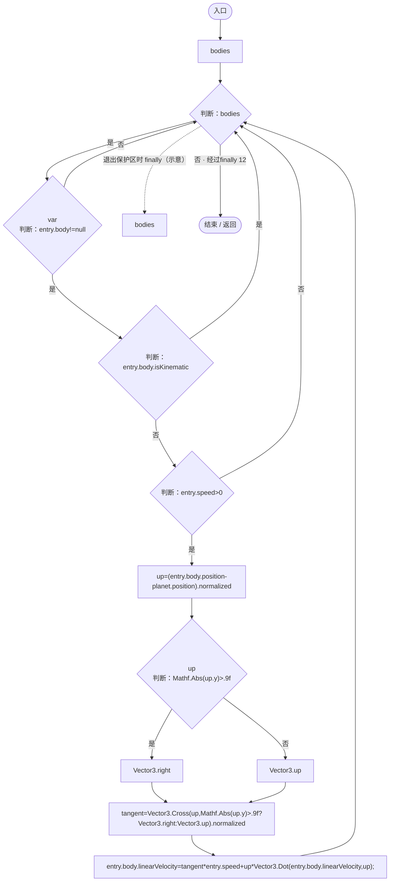
