# PopulationRangeOverlay.hlsl

[返回总索引](../README.md) · `GPU` · `Assets/DarwinPark/Planet/Terrain/PopulationRangeOverlay.hlsl`

[源文件](../../../Assets/DarwinPark/Planet/Terrain/PopulationRangeOverlay.hlsl) · 源码校验：`e743ae342d0225b0a4832d6f963c09a898d99471c7319af72d071cdde14a96b1`

方法按源文件位置排列。事件/回调引用不表示立即执行；分支与异常说明见总索引。完整源码与可点击关系图请打开离线手册。

## ApplyPopulationRange · L6

`float3 ApplyPopulationRange(float3 color,float3 positionOS)`

### GPU · GPU控制结构（名称链接，不作C#类型推断）

```mermaid
flowchart TD
  b0(["入口"])
  b1{"判断：_PopulationStyle.x&lt;.5"}
  b2["_PopulationCount&lt;.5"]
  b3["_PopulationStyle.x&lt;.5"]
  b4{"判断：_PopulationStyle.x&lt;.5&#124;&#124;_PopulationCount&lt;.5"}
  b5["结果：color"]
  b6["direction=normalize(positionOS)<br/>distance=10<br/>group=-1<br/>opacity=0<br/>tint=0<br/>paint=0"]
  b7["i=0"]
  b8{"判断：i&lt;(int)_PopulationCount"}
  b9["circle=LOAD_TEXTURE2D(_PopulationData,int2(0,i))<br/>data=LOAD_TEXTURE2D(_PopulationData,int2(1,i))"]
  b10{"判断：data.w!=group"}
  b11["group&gt;=0"]
  b12["data.w!=group"]
  b13{"判断：data.w!=group&amp;&amp;group&gt;=0"}
  b14{"opacity<br/>判断：_PopulationStyle.x&lt;1.5"}
  b15{"判断：distance&lt;=0"}
  b16["1"]
  b17["0"]
  b18["1-smoothstep(_PopulationStyle.z,_PopulationStyle.z+max(fwidth(distance),.00001),abs(distance))"]
  b19["alpha=opacity*(_PopulationStyle.x&lt;1.5?(distance&lt;=0?1:0):1-smoothstep(_PopulationStyle.z,_PopulationStyle.z+max(fwidth(distance),.00001),abs(distance)))"]
  b20{"判断：alpha&gt;paint.a"}
  b21["paint=float4(tint,alpha);"]
  b22["distance=10;"]
  b23["group=data.w;<br/>tint=data.rgb;<br/>opacity=LOAD_TEXTURE2D(_PopulationData,int2(2,i)).r;<br/>distance=min(distance,(circle.w-dot(direction,circle.xyz))/max(sqrt(saturate(1-circle.w*circle.w)),.0001));"]
  b24["i++"]
  b25{"opacity<br/>判断：_PopulationStyle.x&lt;1.5"}
  b26{"判断：distance&lt;=0"}
  b27["1"]
  b28["0"]
  b29["1-smoothstep(_PopulationStyle.z,_PopulationStyle.z+max(fwidth(distance),.00001),abs(distance))"]
  b30["alpha=opacity*(_PopulationStyle.x&lt;1.5?(distance&lt;=0?1:0):1-smoothstep(_PopulationStyle.z,_PopulationStyle.z+max(fwidth(distance),.00001),abs(distance)))"]
  b31{"判断：alpha&gt;paint.a"}
  b32["paint=float4(tint,alpha);"]
  b33["结果：lerp(color,paint.rgb,paint.a)"]
  b34(["结束 / 返回"])
  b0 --> b1
  b1 -->|"否"| b2
  b1 -->|"是"| b3
  b2 --> b4
  b3 --> b4
  b4 -->|"是"| b5
  b4 -->|"否"| b6
  b5 -->|"返回"| b34
  b6 --> b7
  b7 --> b8
  b8 -->|"是"| b9
  b8 -->|"否"| b25
  b9 --> b10
  b10 -->|"是"| b11
  b10 -->|"否"| b12
  b11 --> b13
  b12 --> b13
  b13 -->|"是"| b14
  b13 -->|"否"| b23
  b14 -->|"是"| b15
  b14 -->|"否"| b18
  b15 -->|"是"| b16
  b15 -->|"否"| b17
  b16 --> b19
  b17 --> b19
  b18 --> b19
  b19 --> b20
  b20 -->|"是"| b21
  b20 -->|"否"| b22
  b21 --> b22
  b22 --> b23
  b23 --> b24
  b24 --> b8
  b25 -->|"是"| b26
  b25 -->|"否"| b29
  b26 -->|"是"| b27
  b26 -->|"否"| b28
  b27 --> b30
  b28 --> b30
  b29 --> b30
  b30 --> b31
  b31 -->|"是"| b32
  b31 -->|"否"| b33
  b32 --> b33
  b33 -->|"返回"| b34

```

