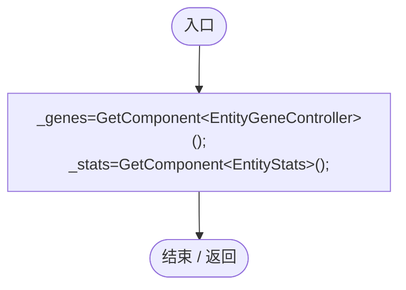
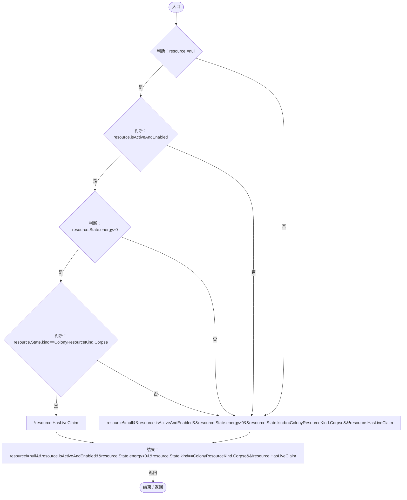
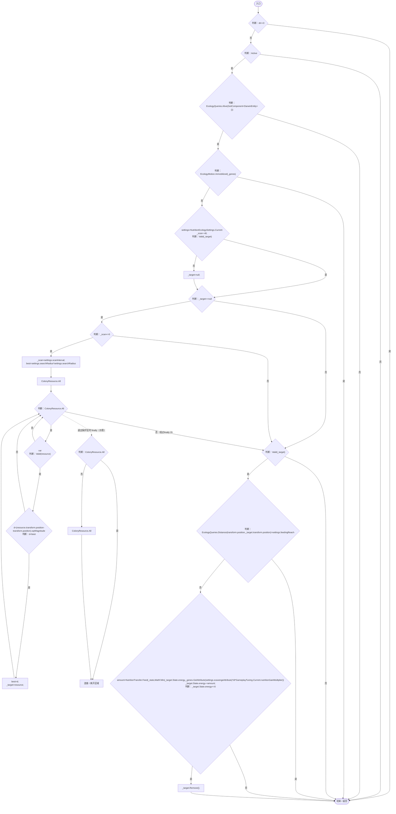
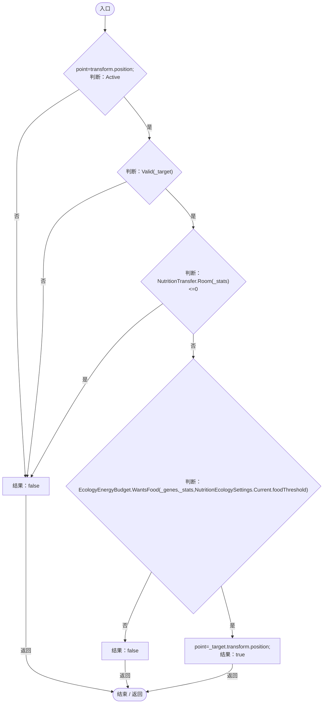

# CorpseFeeding.cs

[返回总索引](../README.md) · `Runtime` · `Assets/DarwinPark/Entities/Ecology/CorpseFeeding.cs`

[源文件](../../../Assets/DarwinPark/Entities/Ecology/CorpseFeeding.cs) · 源码校验：`04d8d89a56791f93f302e5eb49ae774cfe4b7434dea73489020b01e5e79f7645`

方法按源文件位置排列。事件/回调引用不表示立即执行；分支与异常说明见总索引。完整源码与可点击关系图请打开离线手册。

## Awake · L13

`private void Awake()`

### Editor / Player · Roslyn编译器控制流

## Update · L14

`private void Update()`

### Editor / Player · Roslyn编译器控制流

项目内调用/回调引用：

- [CorpseFeeding.Advance · L17](0494eed2004cafc6.md#m556ee588718d98ff)（方法）
- [ServiceLocator.TryGet · L26](f2fdbe9f9ccd93cb.md#m143b24e6d58471b0)（方法）
- [SimulationClock.GameDeltaTime.get · L26](a8f444aec9614b0a.md#me7f11abae18a4f2d)（访问器）

## Active.get · L15

`private bool Active`

### Editor / Player · 语法控制结构 / 声明（非CFG）

项目内调用/回调引用：

- [EcologyQueries.Active · L28](bdf7ccc2c9c0452f.md#m4fb10ad424167e3b)（方法）
- [NutritionEcologySettings.Current.get · L19](846a17351dbd6aa4.md#mb3eb930022e314f3)（访问器）

## Valid · L16

`private bool Valid(ColonyResource resource)`

### Editor / Player · Roslyn编译器控制流

项目内调用/回调引用：

- [ColonyResource.State.get · L24](293dbaecfff4b585.md#m41824f1a0e160aa5)（访问器）

## Advance · L17

`public void Advance(float dt)`

### Editor / Player · Roslyn编译器控制流

项目内调用/回调引用：

- [EcologyQueries.Alive · L38](bdf7ccc2c9c0452f.md#mb2877c487f449970)（方法）
- [EcologyMotion.Immobilized · L9](6ed9d0eedb456d32.md#mff3eeb8fb207a31e)（方法）
- [NutritionEcologySettings.Current.get · L19](846a17351dbd6aa4.md#mb3eb930022e314f3)（访问器）
- [CorpseFeeding.Valid · L16](0494eed2004cafc6.md#m288921428cab6741)（方法）
- [EcologyQueries.Distance · L42](bdf7ccc2c9c0452f.md#mba9c3e3c95d0f2dd)（方法）
- [NutritionTransfer.Feed · L14](081d3b8ff683e442.md#m188eaec5a08f840c)（方法）
- [ColonyResource.State.get · L24](293dbaecfff4b585.md#m41824f1a0e160aa5)（访问器）
- [EntityGeneController.GetAttribute · L266](7494d53178552f0e.md#mdf5d5273fb7a0a56)（方法）
- [GameplayTuning.Current.get · L31](db546e5713b32d53.md#m557c9ecc76cc372d)（访问器）
- [ColonyResource.Remove · L104](293dbaecfff4b585.md#mdb451f4b56f00b72)（方法）

## Destination · L31

`public bool Destination(out Vector3 point)`

### Editor / Player · Roslyn编译器控制流

项目内调用/回调引用：

- [CorpseFeeding.Valid · L16](0494eed2004cafc6.md#m288921428cab6741)（方法）
- [NutritionTransfer.Room · L13](081d3b8ff683e442.md#m6c50def08bcb4a57)（方法）
- [EcologyEnergyBudget.WantsFood · L15](06a91c8201f26593.md#m699844ada2b20a0b)（方法）
- [NutritionEcologySettings.Current.get · L19](846a17351dbd6aa4.md#mb3eb930022e314f3)（访问器）
