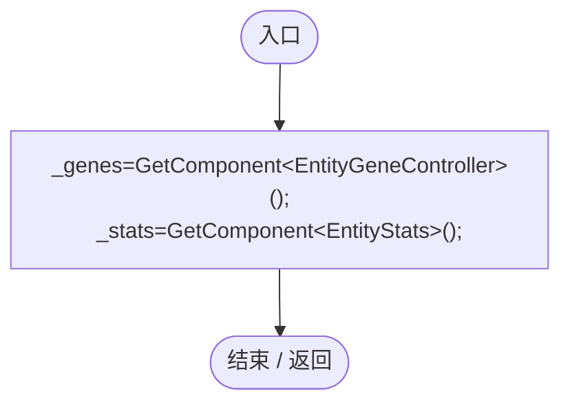
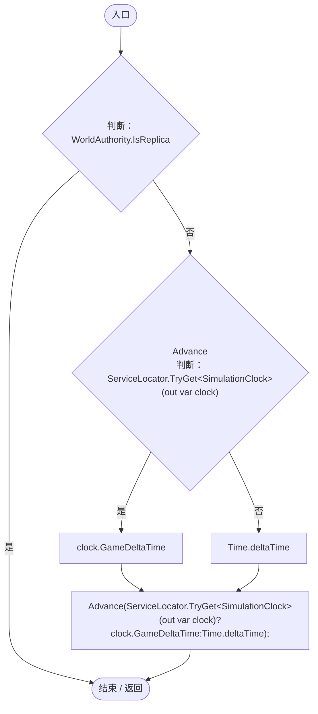
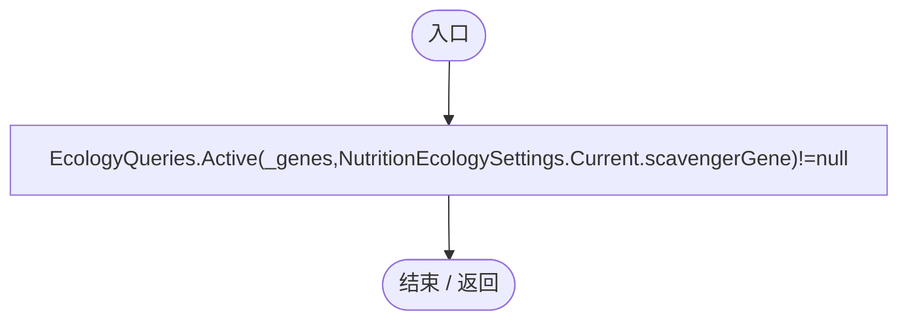
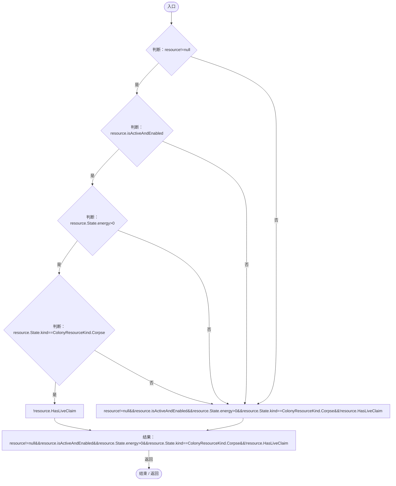
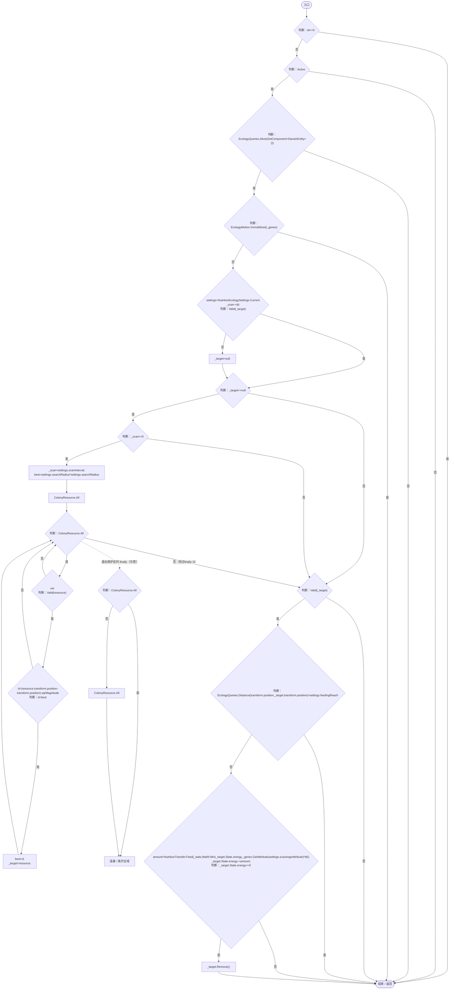
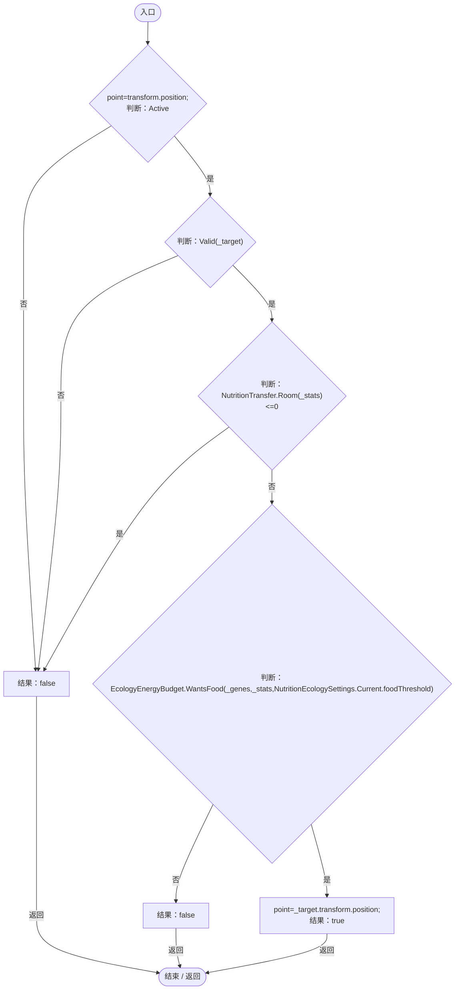

# CorpseFeeding.cs

[返回总索引](../README.md) · `Runtime` · `Assets/DarwinPark/Entities/Ecology/CorpseFeeding.cs`

[源文件](../../../Assets/DarwinPark/Entities/Ecology/CorpseFeeding.cs) · 源码校验：`64d21d38ba44f095238ff4a03e9c695640f66d79aa447695d76925b2c553d828`

方法按源文件位置排列。事件/回调引用不表示立即执行；分支与异常说明见总索引。完整源码与可点击关系图请打开离线手册。

## Awake · L12

`private void Awake()`

### Editor / Player · Roslyn编译器控制流

## Update · L13

`private void Update()`

### Editor / Player · Roslyn编译器控制流

项目内调用/回调引用：

- [CorpseFeeding.Advance · L16](0494eed2004cafc6.md#mf6e53f77f4b102f3)（方法）
- [ServiceLocator.TryGet · L26](f2fdbe9f9ccd93cb.md#m143b24e6d58471b0)（方法）
- [SimulationClock.GameDeltaTime.get · L26](a8f444aec9614b0a.md#me7f11abae18a4f2d)（访问器）

## Active.get · L14

`private bool Active`

### Editor / Player · 语法控制结构 / 声明（非CFG）

项目内调用/回调引用：

- [EcologyQueries.Active · L28](bdf7ccc2c9c0452f.md#m4fb10ad424167e3b)（方法）
- [NutritionEcologySettings.Current.get · L19](846a17351dbd6aa4.md#mb3eb930022e314f3)（访问器）

## Valid · L15

`private bool Valid(ColonyResource resource)`

### Editor / Player · Roslyn编译器控制流

项目内调用/回调引用：

- [ColonyResource.State.get · L22](293dbaecfff4b585.md#m341a1355f4d657bf)（访问器）

## Advance · L16

`public void Advance(float dt)`

### Editor / Player · Roslyn编译器控制流

项目内调用/回调引用：

- [EcologyQueries.Alive · L38](bdf7ccc2c9c0452f.md#mb2877c487f449970)（方法）
- [EcologyMotion.Immobilized · L9](6ed9d0eedb456d32.md#mff3eeb8fb207a31e)（方法）
- [NutritionEcologySettings.Current.get · L19](846a17351dbd6aa4.md#mb3eb930022e314f3)（访问器）
- [CorpseFeeding.Valid · L15](0494eed2004cafc6.md#m4fe149cba76d4ce8)（方法）
- [EcologyQueries.Distance · L42](bdf7ccc2c9c0452f.md#mba9c3e3c95d0f2dd)（方法）
- [NutritionTransfer.Feed · L13](081d3b8ff683e442.md#m4cdc92355381f63e)（方法）
- [ColonyResource.State.get · L22](293dbaecfff4b585.md#m341a1355f4d657bf)（访问器）
- [EntityGeneController.GetAttribute · L257](7494d53178552f0e.md#m600509f72d274f0c)（方法）
- [ColonyResource.Remove · L99](293dbaecfff4b585.md#m3e346b425034ee3a)（方法）

## Destination · L30

`public bool Destination(out Vector3 point)`

### Editor / Player · Roslyn编译器控制流

项目内调用/回调引用：

- [CorpseFeeding.Valid · L15](0494eed2004cafc6.md#m4fe149cba76d4ce8)（方法）
- [NutritionTransfer.Room · L12](081d3b8ff683e442.md#md8b133015774a4ef)（方法）
- [EcologyEnergyBudget.WantsFood · L14](06a91c8201f26593.md#mc0262b05e0fd6456)（方法）
- [NutritionEcologySettings.Current.get · L19](846a17351dbd6aa4.md#mb3eb930022e314f3)（访问器）
