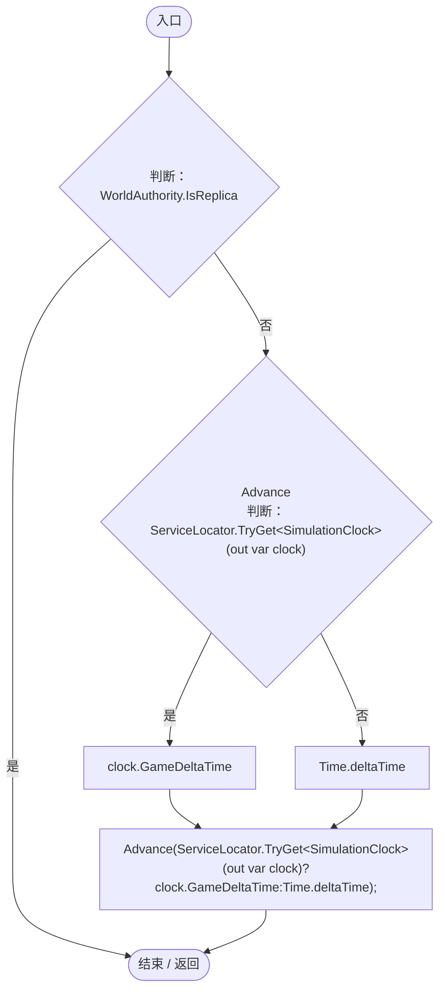
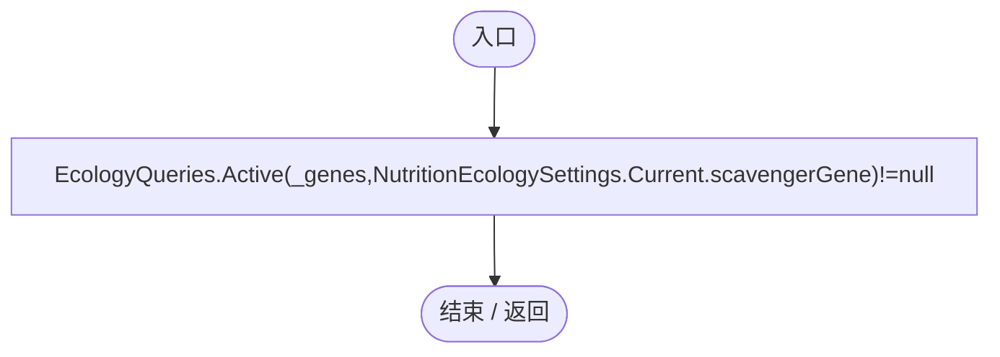
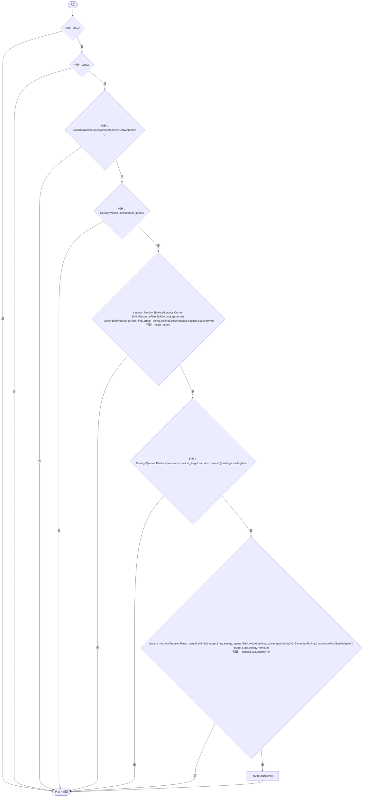

# CorpseFeeding.cs

[返回总索引](../README.md) · `Runtime` · `Assets/DarwinPark/Entities/Ecology/CorpseFeeding.cs`

[源文件](../../../Assets/DarwinPark/Entities/Ecology/CorpseFeeding.cs) · 源码校验：`391c57454b2955f6587c0035dd54278be72c8804e65138e0038e3772fc69f331`

方法按源文件位置排列。事件/回调引用不表示立即执行；分支与异常说明见总索引。完整源码与可点击关系图请打开离线手册。

## Awake · L13

`private void Awake()`

### Editor / Player · Roslyn编译器控制流

## Update · L14

`private void Update()`

### Editor / Player · Roslyn编译器控制流

项目内调用/回调引用：

- [CorpseFeeding.Advance · L17](0494eed2004cafc6.md#m799528483716842b)（方法）
- [ServiceLocator.TryGet · L26](f2fdbe9f9ccd93cb.md#m143b24e6d58471b0)（方法）
- [SimulationClock.GameDeltaTime.get · L26](a8f444aec9614b0a.md#me7f11abae18a4f2d)（访问器）

## Active.get · L15

`private bool Active`

### Editor / Player · 语法控制结构 / 声明（非CFG）

项目内调用/回调引用：

- [EcologyQueries.Active · L29](bdf7ccc2c9c0452f.md#m200839bb9db5ec55)（方法）
- [NutritionEcologySettings.Current.get · L19](846a17351dbd6aa4.md#mb3eb930022e314f3)（访问器）

## Valid · L16

`private bool Valid(ColonyResource resource)`

### Editor / Player · Roslyn编译器控制流

项目内调用/回调引用：

- [ColonyResource.State.get · L24](293dbaecfff4b585.md#m41824f1a0e160aa5)（访问器）

## Advance · L17

`public void Advance(float dt)`

### Editor / Player · Roslyn编译器控制流

项目内调用/回调引用：

- [EcologyQueries.Alive · L39](bdf7ccc2c9c0452f.md#m8352bfacbe2996a8)（方法）
- [EcologyMotion.Immobilized · L10](6ed9d0eedb456d32.md#m0b0d6c3cabc3ae89)（方法）
- [NutritionEcologySettings.Current.get · L19](846a17351dbd6aa4.md#mb3eb930022e314f3)（访问器）
- [EntityResourcePlan.TickCorpse · L20](569e8e31d0634370.md#mb624be37bf7b1104)（方法）
- [EntityResourcePlan.FindCorpse · L45](569e8e31d0634370.md#ma9c59688ac9ef989)（方法）
- [CorpseFeeding.Valid · L16](0494eed2004cafc6.md#ma2eb6d09d989b5f3)（方法）
- [EcologyQueries.Distance · L43](bdf7ccc2c9c0452f.md#m6e395dce655ebcac)（方法）
- [NutritionTransfer.Feed · L14](081d3b8ff683e442.md#m188eaec5a08f840c)（方法）
- [ColonyResource.State.get · L24](293dbaecfff4b585.md#m41824f1a0e160aa5)（访问器）
- [EntityGeneController.GetAttribute · L286](7494d53178552f0e.md#m18bff2b38f95b556)（方法）
- [GameplayTuning.Current.get · L46](db546e5713b32d53.md#m4fa691bd8a3b9618)（访问器）
- [ColonyResource.Remove · L108](293dbaecfff4b585.md#mb9333347c7434224)（方法）

## Destination · L26

`public bool Destination(out Vector3 point)`

### Editor / Player · Roslyn编译器控制流

项目内调用/回调引用：

- [CorpseFeeding.Valid · L16](0494eed2004cafc6.md#ma2eb6d09d989b5f3)（方法）
- [NutritionTransfer.Room · L13](081d3b8ff683e442.md#m6c50def08bcb4a57)（方法）
- [EcologyEnergyBudget.WantsFood · L16](06a91c8201f26593.md#m735b7aa45241348f)（方法）
- [NutritionEcologySettings.Current.get · L19](846a17351dbd6aa4.md#mb3eb930022e314f3)（访问器）
