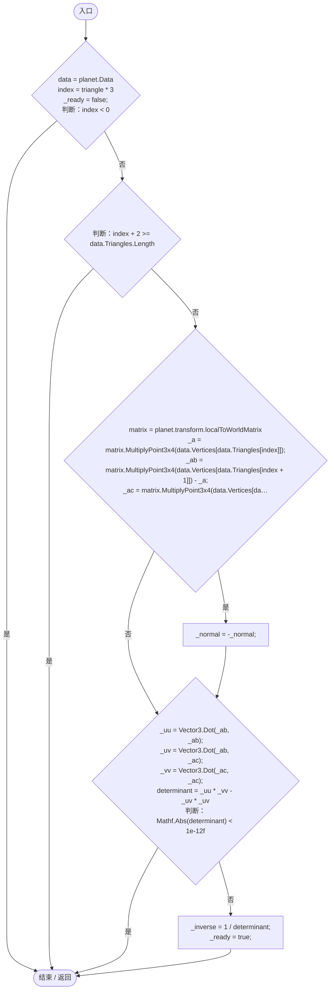
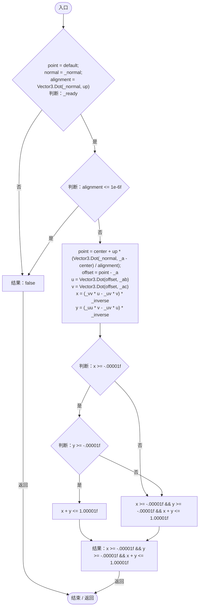

# GroundSurfacePatch.cs

[返回总索引](../README.md) · `Runtime` · `Assets/DarwinPark/Entities/GroundSurfacePatch.cs`

[源文件](../../../Assets/DarwinPark/Entities/GroundSurfacePatch.cs) · 源码校验：`a8d32d4627c92bf89838e714f16912da9c9f0e456d1310f0990013425b20c60d`

方法按源文件位置排列。事件/回调引用不表示立即执行；分支与异常说明见总索引。完整源码与可点击关系图请打开离线手册。

## Capture · L12

`public void Capture(PlanetTerrainMeshBuilder planet, int triangle)`

### Editor / Player · Roslyn编译器控制流

项目内调用/回调引用：

- [PlanetTerrainMeshBuilder.Data.get · L81](415285cf043354a9.md#m1a65abfe0f34c5d8)（访问器）

## TryRead · L28

`public bool TryRead(Vector3 center, Vector3 up, out Vector3 point, out Vector3 normal)`

### Editor / Player · Roslyn编译器控制流

