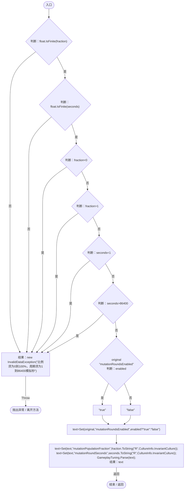
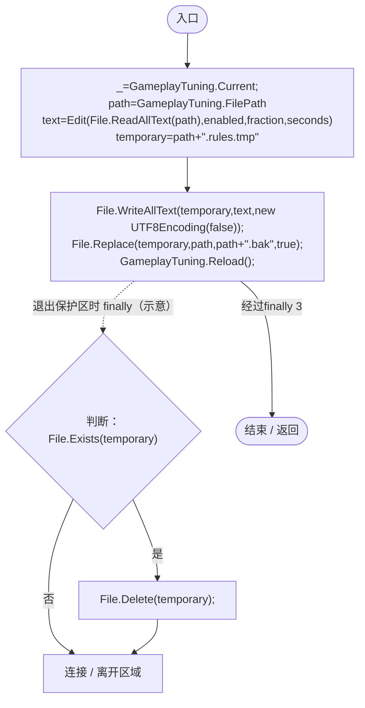

```mermaid
flowchart TD
  b0(["入口"])
  b1{"clean=CommentedJson.Strip(text)<br/>match=Regex.Match(clean,&quot;\\\&quot;&quot;+Regex.Escape(key)+&quot;\\\&quot;\\s*:\\s*(?&lt;value&gt;true&#124;false&#124;-?[0-9]+(?:\\.[0-9]+)?(?:[eE][+-]?[0-9]+)?)&quot;)<br/>判断：match.Success"}
  b2["value=match.Groups[&quot;value&quot;]<br/>结果：text.Substring(0,value.Index)+literal+text.Substring(value.Index+value.Length)"]
  b3{"close=clean.LastIndexOf('}')<br/>判断：close&lt;0"}
  b4["结果：new InvalidDataException(&quot;数值配置缺少结束符&quot;)"]
  x4(["抛出异常 / 离开方法"])
  b5["last=close-1"]
  b6{"判断：last&gt;=0"}
  b7{"判断：char.IsWhiteSpace(clean[last])"}
  b8["last--;"]
  b9{"判断：last&lt;0"}
  b10["结果：new InvalidDataException(&quot;数值配置为空&quot;)"]
  x10(["抛出异常 / 离开方法"])
  b11{"判断：clean[last]!='{'"}
  b12["text=text.Insert(last+1,&quot;,&quot;);<br/>close++;"]
  b13["结果：text.Insert(close,&quot;\n \&quot;&quot;+key+&quot;\&quot;: &quot;+literal+&quot;\n&quot;)"]
  b14(["结束 / 返回"])
  b0 --> b1
  b1 -->|"是"| b2
  b1 -->|"否"| b3
  b2 -->|"返回"| b14
  b3 -->|"是"| b4
  b3 -->|"否"| b5
  b4 -->|"Throw"| x4
  b5 --> b6
  b6 -->|"是"| b7
  b6 -->|"否"| b9
  b7 -->|"是"| b8
  b7 -->|"否"| b9
  b8 --> b6
  b9 -->|"是"| b10
  b9 -->|"否"| b11
  b10 -->|"Throw"| x10
  b11 -->|"是"| b12
  b11 -->|"否"| b13
  b12 --> b13
  b13 -->|"返回"| b14

```

# MutationRuleEdits.cs

[返回总索引](../README.md) · `Runtime` · `Assets/DarwinPark/Core/MutationRuleEdits.cs`

[源文件](../../../Assets/DarwinPark/Core/MutationRuleEdits.cs) · 源码校验：`45b90e9ea1511eaafd36a834fe72a6f326a4498f24a685c71dfbf7a8b90c0940`

方法按源文件位置排列。事件/回调引用不表示立即执行；分支与异常说明见总索引。完整源码与可点击关系图请打开离线手册。

## Edit · L12

`public static string Edit(string original,bool enabled,float fraction,float seconds)`

### Editor / Player · Roslyn编译器控制流

项目内调用/回调引用：

- [MutationRuleEdits.Set · L17](063e584187dad139.md#mb57ff937cff59680)（方法）
- [GameplayTuning.Parse · L41](db546e5713b32d53.md#m29428417fb8b89c2)（方法）

## Set · L17

`private static string Set(string text,string key,string literal)`

### Editor / Player · Roslyn编译器控制流

项目内调用/回调引用：

- [CommentedJson.Strip · L9](f72593057d514ce3.md#mc9c02edd5a7f0a4d)（方法）

## Save · L25

`public static void Save(bool enabled,float fraction,float seconds)`

### Editor / Player · Roslyn编译器控制流

项目内调用/回调引用：

- [GameplayTuning.Current.get · L40](db546e5713b32d53.md#m1bbf27bd17853fc4)（访问器）
- [MutationRuleEdits.Edit · L12](063e584187dad139.md#m207efabda03701cb)（方法）
- [GameplayTuning.Reload · L54](db546e5713b32d53.md#m05e431bdc22976ae)（方法）
