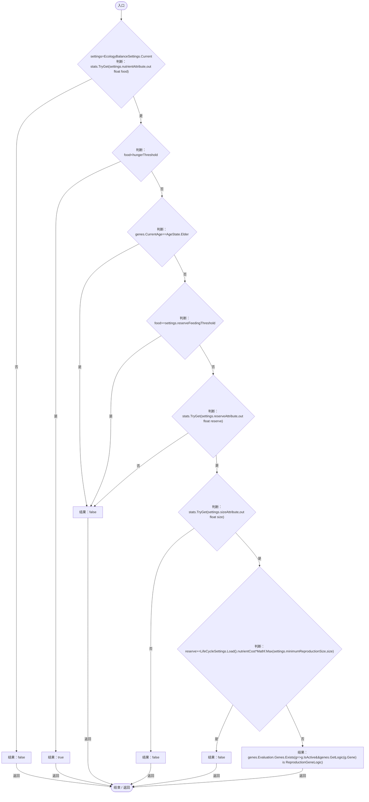
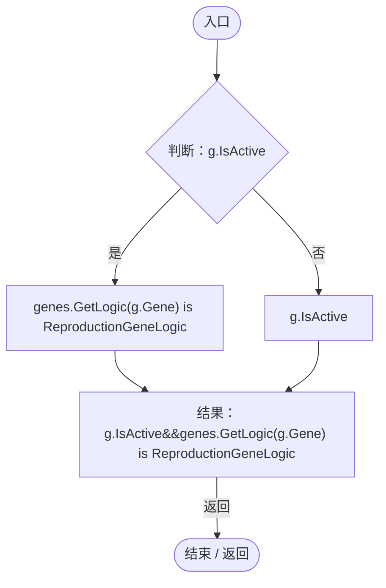
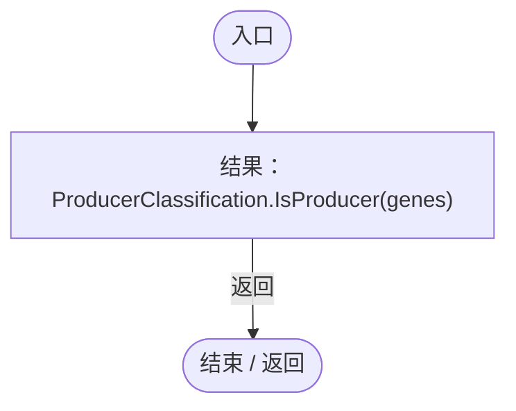
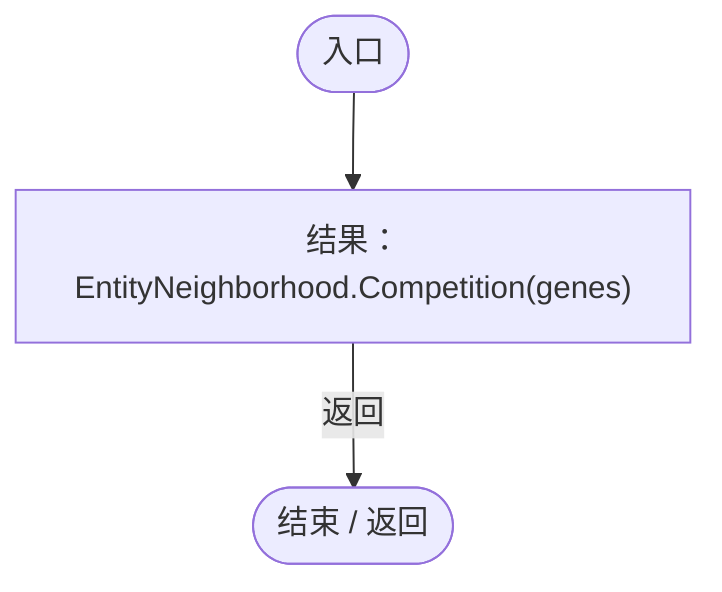
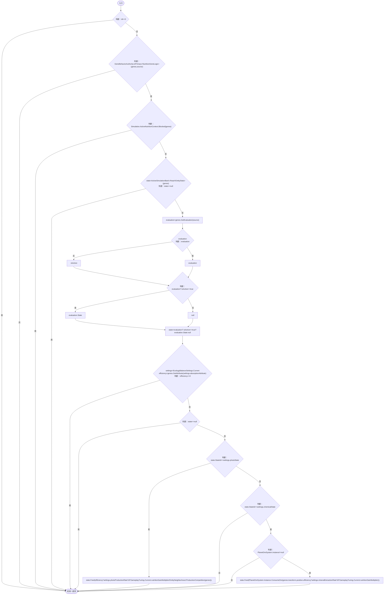
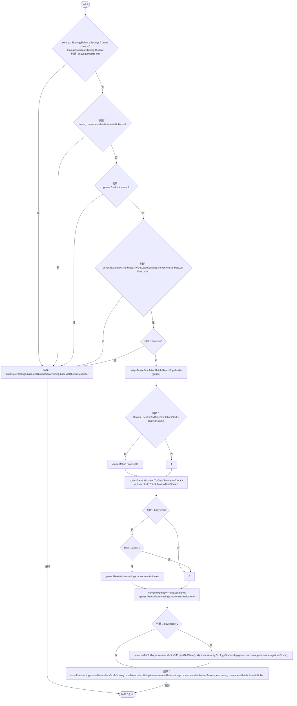

# EcologyEnergyBudget.cs

[返回总索引](../README.md) · `Runtime` · `Assets/DarwinPark/Entities/Ecology/EcologyEnergyBudget.cs`

[源文件](../../../Assets/DarwinPark/Entities/Ecology/EcologyEnergyBudget.cs) · 源码校验：`899db4460fe8dfe766db9caa90214c9a1973aace73c9e219710bf4882601a1fa`

方法按源文件位置排列。事件/回调引用不表示立即执行；分支与异常说明见总索引。完整源码与可点击关系图请打开离线手册。

## WantsFood · L16

`public static bool WantsFood(EntityGeneController genes,EntityStats stats,float hungerThreshold)`

★ 修复（防Bug回归）：繁殖预算不足时提前储粮；储备充足后只在饥饿时觅食，避免吃光植物却堆满无用仓储。

### Editor / Player · Roslyn编译器控制流

项目内调用/回调引用：

- [EcologyBalanceSettings.Current.get · L29](5a37bc79f15f6238.md#md33d4c4b8f82540b)（访问器）
- [EntityStats.TryGet · L93](75aa86a368efdf24.md#m03cef847022eee28)（方法）
- [EntityGeneController.CurrentAge.get · L39](7494d53178552f0e.md#m977f52932bb90600)（访问器）
- [LifeCycleSettings.Load · L16](ace76969fe8f61de.md#m6fe263852e5a8989)（方法）
- [EntityGeneController.Evaluation.get · L20](7494d53178552f0e.md#mf275f100ea21601a)（访问器）
- [EcologyEnergyBudget.回调@24 · L24](06a91c8201f26593.md#m1813420a2167c9d2)（回调/委托）

## 回调@24 · L24

`g … => 回调`

### Editor / Player · Roslyn编译器控制流

项目内调用/回调引用：

- [EntityGeneController.GetLogic · L242](7494d53178552f0e.md#m4620848081f43ecc)（方法）

## IsProducer · L27

`public static bool IsProducer(EntityGeneController genes)`

★ 修复（防Bug回归）：比例规则和空间竞争共用已存在的表达分类；不能在每个繁殖检查重复遍历并走零速度修饰链。

### Editor / Player · Roslyn编译器控制流

项目内调用/回调引用：

- [ProducerClassification.IsProducer · L11](ad32a2250ced390a.md#m1e3c1a860e81d481)（方法）

## Competition · L28

`public static float Competition(EntityGeneController genes)`

### Editor / Player · Roslyn编译器控制流

项目内调用/回调引用：

- [EntityNeighborhood.Competition · L83](e5e24c4aff0395b1.md#m85037d65402c9f87)（方法）

## Produce · L33

`public static void Produce(EntityGeneController genes,GeneInstance source,float dt)`

### Editor / Player · Roslyn编译器控制流

项目内调用/回调引用：

- [GeneBehaviorAuthority.IsPrimary · L10](be83fa896bbe02ae.md#me2fc1f2e16fcd073)（方法）
- [ActiveNutritionContext.Blocked · L15](e8a4c7e1945f6f55.md#m41c43e35cb837ab8)（方法）
- [ActiveSimulationBatch.Read · L57](ac63422a085684a6.md#mc77e063d3598b3fd)（方法）
- [EntityGeneController.GetEvaluation · L236](7494d53178552f0e.md#ma04ba3204e97eec3)（方法）
- [EcologyBalanceSettings.Current.get · L29](5a37bc79f15f6238.md#md33d4c4b8f82540b)（访问器）
- [EntityGeneController.GetAttribute · L288](7494d53178552f0e.md#m45127bcdd833aaf5)（方法）
- [EntityStats.Feed · L98](75aa86a368efdf24.md#me8ee3fa22434267a)（方法）
- [GameplayTuning.Current.get · L46](db546e5713b32d53.md#m4fa691bd8a3b9618)（访问器）
- [EntityNeighborhood.ProductionCompetition · L95](e5e24c4aff0395b1.md#m2908b8ba29a5009f)（方法）
- [PlanetOreSystem.Instance.get · L8](86b3fbb4d9436121.md#m53f6a6af4b6dc252)（访问器）
- [PlanetOreSystem.ConsumeOre · L143](86b3fbb4d9436121.md#m3ea9baf2479d16a6)（方法）

## Consumption · L48

`public static float Consumption(EntityGeneController genes,float baseRate,float movementRate)`

### Editor / Player · Roslyn编译器控制流

项目内调用/回调引用：

- [EcologyBalanceSettings.Current.get · L29](5a37bc79f15f6238.md#md33d4c4b8f82540b)（访问器）
- [GameplayTuning.Current.get · L46](db546e5713b32d53.md#m4fa691bd8a3b9618)（访问器）
- [EntityGeneController.Evaluation.get · L20](7494d53178552f0e.md#mf275f100ea21601a)（访问器）
- [ActiveSimulationBatch.Read · L57](ac63422a085684a6.md#mc77e063d3598b3fd)（方法）
- [ServiceLocator.TryGet · L26](f2fdbe9f9ccd93cb.md#m143b24e6d58471b0)（方法）
- [EntityGeneController.GetAttribute · L288](7494d53178552f0e.md#m45127bcdd833aaf5)（方法）
- [EcologyQueries.Up · L42](bdf7ccc2c9c0452f.md#ma73e6bbbc726282f)（方法）
