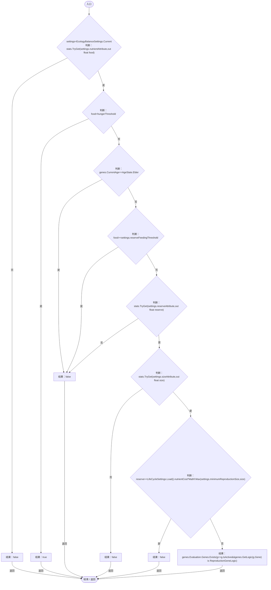
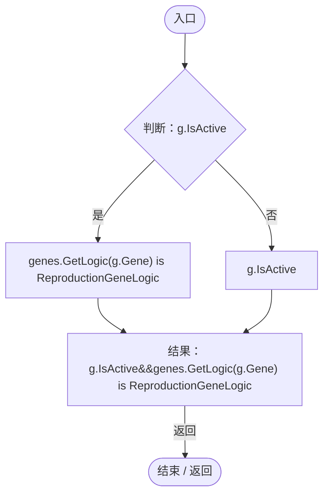
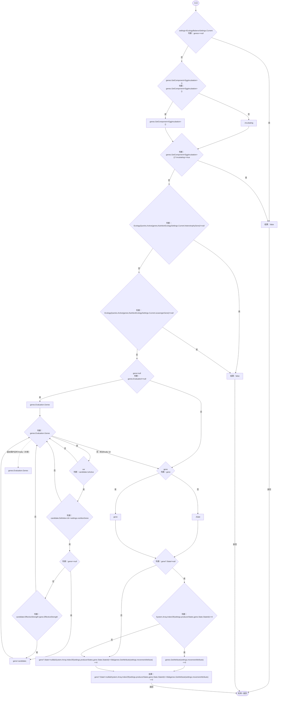
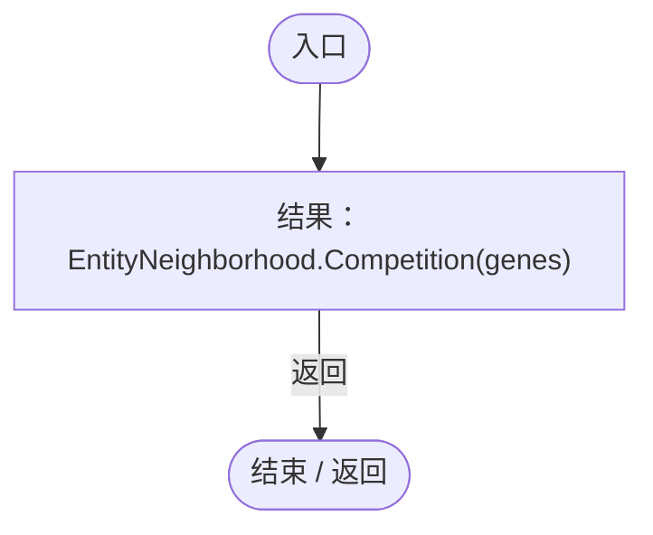
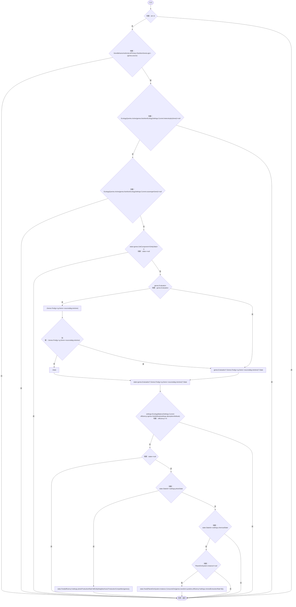
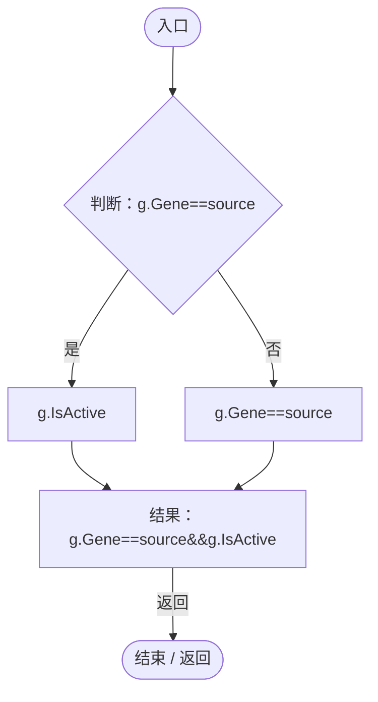
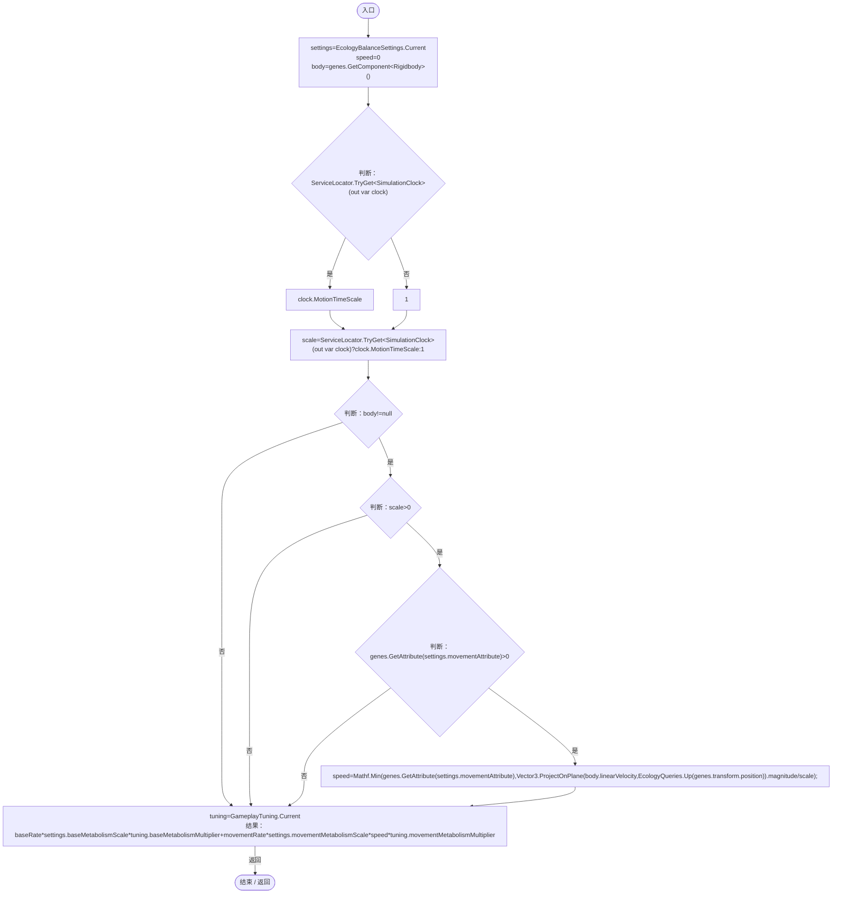

# EcologyEnergyBudget.cs

[返回总索引](../README.md) · `Runtime` · `Assets/DarwinPark/Entities/Ecology/EcologyEnergyBudget.cs`

[源文件](../../../Assets/DarwinPark/Entities/Ecology/EcologyEnergyBudget.cs) · 源码校验：`5d69c3125734f7ff117cdd22b3ddf1850c8a726aafc4807c78a3e6fb0c256cb6`

方法按源文件位置排列。事件/回调引用不表示立即执行；分支与异常说明见总索引。完整源码与可点击关系图请打开离线手册。

## WantsFood · L14

`public static bool WantsFood(EntityGeneController genes,EntityStats stats,float hungerThreshold)`

★ 修复（防Bug回归）：繁殖预算不足时提前储粮；储备充足后只在饥饿时觅食，避免吃光植物却堆满无用仓储。

### Editor / Player · Roslyn编译器控制流

项目内调用/回调引用：

- [EcologyBalanceSettings.Current.get · L29](5a37bc79f15f6238.md#md33d4c4b8f82540b)（访问器）
- [EntityStats.TryGet · L90](75aa86a368efdf24.md#m24ee1433e4a70d94)（方法）
- [EntityGeneController.CurrentAge.get · L34](7494d53178552f0e.md#m83a42c16950b22a4)（访问器）
- [LifeCycleSettings.Load · L16](ace76969fe8f61de.md#mbd2925785484f343)（方法）
- [EntityGeneController.Evaluation.get · L18](7494d53178552f0e.md#mc0039c100a31b455)（访问器）
- [EcologyEnergyBudget.回调@22 · L22](06a91c8201f26593.md#m69cfa8cb18e06f4c)（回调/委托）

## 回调@22 · L22

`g … => 回调`

### Editor / Player · Roslyn编译器控制流

项目内调用/回调引用：

- [EntityGeneController.GetLogic · L211](7494d53178552f0e.md#maadb710e89e60395)（方法）

## IsProducer · L24

`public static bool IsProducer(EntityGeneController genes)`

### Editor / Player · Roslyn编译器控制流

项目内调用/回调引用：

- [EcologyBalanceSettings.Current.get · L29](5a37bc79f15f6238.md#md33d4c4b8f82540b)（访问器）
- [EcologyQueries.Active · L28](bdf7ccc2c9c0452f.md#m4fb10ad424167e3b)（方法）
- [NutritionEcologySettings.Current.get · L19](846a17351dbd6aa4.md#mb3eb930022e314f3)（访问器）
- [EntityGeneController.Evaluation.get · L18](7494d53178552f0e.md#mc0039c100a31b455)（访问器）
- [EntityGeneController.GetAttribute · L257](7494d53178552f0e.md#m600509f72d274f0c)（方法）

## Competition · L36

`public static float Competition(EntityGeneController genes)`

### Editor / Player · Roslyn编译器控制流

项目内调用/回调引用：

- [EntityNeighborhood.Competition · L65](e5e24c4aff0395b1.md#m7ed9231d003fddb0)（方法）

## Produce · L41

`public static void Produce(EntityGeneController genes,GeneInstance source,float dt)`

### Editor / Player · Roslyn编译器控制流

项目内调用/回调引用：

- [GeneBehaviorAuthority.IsPrimary · L10](be83fa896bbe02ae.md#me2fc1f2e16fcd073)（方法）
- [EcologyQueries.Active · L28](bdf7ccc2c9c0452f.md#m4fb10ad424167e3b)（方法）
- [NutritionEcologySettings.Current.get · L19](846a17351dbd6aa4.md#mb3eb930022e314f3)（访问器）
- [EntityGeneController.Evaluation.get · L18](7494d53178552f0e.md#mc0039c100a31b455)（访问器）
- [EcologyBalanceSettings.Current.get · L29](5a37bc79f15f6238.md#md33d4c4b8f82540b)（访问器）
- [EntityGeneController.GetAttribute · L257](7494d53178552f0e.md#m600509f72d274f0c)（方法）
- [EntityStats.Feed · L95](75aa86a368efdf24.md#mc025822ff1eb86a0)（方法）
- [EntityNeighborhood.ProductionCompetition · L76](e5e24c4aff0395b1.md#m1fee1c4fa14675ac)（方法）
- [PlanetOreSystem.Instance.get · L8](86b3fbb4d9436121.md#m53f6a6af4b6dc252)（访问器）
- [PlanetOreSystem.ConsumeOre · L140](86b3fbb4d9436121.md#m932f90bbc5b3ca70)（方法）
- [EcologyEnergyBudget.回调@46 · L46](06a91c8201f26593.md#m94c13d6a37786403)（回调/委托）

## 回调@46 · L46

`g … => 回调`

### Editor / Player · Roslyn编译器控制流

## Consumption · L54

`public static float Consumption(EntityGeneController genes,float baseRate,float movementRate)`

### Editor / Player · Roslyn编译器控制流

项目内调用/回调引用：

- [EcologyBalanceSettings.Current.get · L29](5a37bc79f15f6238.md#md33d4c4b8f82540b)（访问器）
- [ServiceLocator.TryGet · L26](f2fdbe9f9ccd93cb.md#m143b24e6d58471b0)（方法）
- [EntityGeneController.GetAttribute · L257](7494d53178552f0e.md#m600509f72d274f0c)（方法）
- [EcologyQueries.Up · L41](bdf7ccc2c9c0452f.md#maca7070196f125fd)（方法）
- [GameplayTuning.Current.get · L21](db546e5713b32d53.md#m1caba89e7704d239)（访问器）
