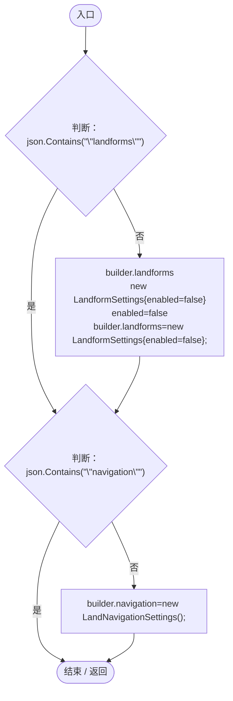

# LandformSaveCompatibility.cs

[返回总索引](../README.md) · `Runtime` · `Assets/DarwinPark/Planet/Terrain/LandformSaveCompatibility.cs`

[源文件](../../../Assets/DarwinPark/Planet/Terrain/LandformSaveCompatibility.cs) · 源码校验：`c6a6a59353c396ad0fa9cf72d7d5619381645b4b91064a1afd8615e360ea4452`

方法按源文件位置排列。事件/回调引用不表示立即执行；分支与异常说明见总索引。完整源码与可点击关系图请打开离线手册。

## Validate · L10

`public static void Validate(string json)`

### Editor / Player · Roslyn编译器控制流

```mermaid
flowchart TD
  b0(["入口"])
  b1{"判断：json.Contains(&quot;\&quot;navigation\&quot;&quot;)"}
  b2{"JsonUtility.FromJson&lt;Envelope&gt;(json)<br/>判断：JsonUtility.FromJson&lt;Envelope&gt;(json)"}
  b3[".navigation"]
  b4["JsonUtility.FromJson&lt;Envelope&gt;(json)"]
  b5["nav=JsonUtility.FromJson&lt;Envelope&gt;(json)?.navigation"]
  b6{"判断：nav==null"}
  b7{"判断：nav.longitudeCells&lt;32"}
  b8{"判断：nav.longitudeCells&gt;512"}
  b9{"判断：nav.latitudeCells&lt;16"}
  b10{"判断：nav.latitudeCells&gt;256"}
  b11{"判断：nav.expansionsPerFrame&lt;1"}
  b12{"判断：nav.expansionsPerFrame&gt;8192"}
  b13{"判断：nav.routeCacheCount&lt;1"}
  b14{"判断：nav.routeCacheCount&gt;8192"}
  b15["结果：new InvalidDataException(&quot;陆地寻路配置无效&quot;)"]
  x15(["抛出异常 / 离开方法"])
  b16["typeof(LandNavigationSettings).GetFields()"]
  b17{"判断：typeof(LandNavigationSettings).GetFields()"}
  b18{"var<br/>判断：field.FieldType==typeof(float)"}
  b19{"n=(float)field.GetValue(nav)<br/>判断：float.IsFinite(n)"}
  b20{"判断：n&lt;0"}
  b21["结果：new InvalidDataException(&quot;寻路参数须为非负有限数：&quot;+field.Name)"]
  x21(["抛出异常 / 离开方法"])
  b22{"typeof(LandNavigationSettings).GetFields()<br/>判断：typeof(LandNavigationSettings).GetFields()"}
  b23["typeof(LandNavigationSettings).GetFields()"]
  b24["连接 / 离开区域"]
  b25{"判断：nav.maximumSlopeDegrees&gt;85"}
  b26{"判断：nav.segmentStep&lt;=0"}
  b27{"判断：nav.pathMilliseconds&lt;=0"}
  b28{"判断：nav.pathMilliseconds&gt;10"}
  b29{"判断：nav.waypointArrival&lt;=0"}
  b30["结果：new InvalidDataException(&quot;寻路精度/时间预算无效&quot;)"]
  x30(["抛出异常 / 离开方法"])
  b31{"判断：json.Contains(&quot;\&quot;landforms\&quot;&quot;)"}
  b32{"JsonUtility.FromJson&lt;Envelope&gt;(json)<br/>判断：JsonUtility.FromJson&lt;Envelope&gt;(json)"}
  b33[".landforms"]
  b34["JsonUtility.FromJson&lt;Envelope&gt;(json)"]
  b35["value=JsonUtility.FromJson&lt;Envelope&gt;(json)?.landforms"]
  b36{"判断：value==null"}
  b37["结果：new InvalidDataException(&quot;地貌配置为空&quot;)"]
  x37(["抛出异常 / 离开方法"])
  b38{"判断：value.version!=1"}
  b39{"判断：value.longitudeCells&lt;32"}
  b40{"判断：value.longitudeCells&gt;512"}
  b41{"判断：value.latitudeCells&lt;16"}
  b42{"判断：value.latitudeCells&gt;256"}
  b43["结果：new InvalidDataException(&quot;地貌版本或水系分辨率无效&quot;)"]
  x43(["抛出异常 / 离开方法"])
  b44["typeof(LandformSettings).GetFields()"]
  b45{"判断：typeof(LandformSettings).GetFields()"}
  b46{"var<br/>判断：field.FieldType==typeof(float)"}
  b47{"n=(float)field.GetValue(value)<br/>判断：float.IsFinite(n)"}
  b48{"判断：n&lt;0"}
  b49["结果：new InvalidDataException(&quot;地貌参数须为非负有限数：&quot;+field.Name)"]
  x49(["抛出异常 / 离开方法"])
  b50{"typeof(LandformSettings).GetFields()<br/>判断：typeof(LandformSettings).GetFields()"}
  b51["typeof(LandformSettings).GetFields()"]
  b52["连接 / 离开区域"]
  b53{"判断：value.riverCatchment&lt;=0"}
  b54{"判断：value.riverHalfWidth&lt;=0"}
  b55{"判断：value.riverBedDepth&lt;=0"}
  b56{"判断：value.bankWidth&lt;value.riverHalfWidth"}
  b57{"判断：value.plateauStrength&gt;1"}
  b58{"判断：value.plateauThreshold&gt;=1"}
  b59{"判断：value.plateauTransition&lt;=0"}
  b60["结果：new InvalidDataException(&quot;河道或高原配置无效&quot;)"]
  x60(["抛出异常 / 离开方法"])
  b61(["结束 / 返回"])
  b0 --> b1
  b1 -->|"是"| b2
  b1 -->|"否"| b31
  b2 -->|"否"| b3
  b2 -->|"是"| b4
  b3 --> b5
  b4 --> b5
  b5 --> b6
  b6 -->|"否"| b7
  b6 -->|"是"| b15
  b7 -->|"否"| b8
  b7 -->|"是"| b15
  b8 -->|"否"| b9
  b8 -->|"是"| b15
  b9 -->|"否"| b10
  b9 -->|"是"| b15
  b10 -->|"否"| b11
  b10 -->|"是"| b15
  b11 -->|"否"| b12
  b11 -->|"是"| b15
  b12 -->|"否"| b13
  b12 -->|"是"| b15
  b13 -->|"否"| b14
  b13 -->|"是"| b15
  b14 -->|"是"| b15
  b14 -->|"否"| b16
  b15 -->|"Throw"| x15
  b16 --> b17
  b17 -->|"是"| b18
  b17 -->|"否 · 经过finally 22"| b25
  b18 -->|"是"| b19
  b18 -->|"否"| b17
  b19 -->|"是"| b20
  b19 -->|"否"| b21
  b20 -->|"是"| b21
  b20 -->|"否"| b17
  b21 -->|"Throw"| x21
  b22 -->|"否"| b23
  b22 -->|"是"| b24
  b23 --> b24
  b25 -->|"否"| b26
  b25 -->|"是"| b30
  b26 -->|"否"| b27
  b26 -->|"是"| b30
  b27 -->|"否"| b28
  b27 -->|"是"| b30
  b28 -->|"否"| b29
  b28 -->|"是"| b30
  b29 -->|"是"| b30
  b29 -->|"否"| b31
  b30 -->|"Throw"| x30
  b31 -->|"否"| b61
  b31 -->|"是"| b32
  b32 -->|"否"| b33
  b32 -->|"是"| b34
  b33 --> b35
  b34 --> b35
  b35 --> b36
  b36 -->|"是"| b37
  b36 -->|"否"| b38
  b37 -->|"Throw"| x37
  b38 -->|"否"| b39
  b38 -->|"是"| b43
  b39 -->|"否"| b40
  b39 -->|"是"| b43
  b40 -->|"否"| b41
  b40 -->|"是"| b43
  b41 -->|"否"| b42
  b41 -->|"是"| b43
  b42 -->|"是"| b43
  b42 -->|"否"| b44
  b43 -->|"Throw"| x43
  b44 --> b45
  b45 -->|"是"| b46
  b45 -->|"否 · 经过finally 50"| b53
  b46 -->|"是"| b47
  b46 -->|"否"| b45
  b47 -->|"是"| b48
  b47 -->|"否"| b49
  b48 -->|"是"| b49
  b48 -->|"否"| b45
  b49 -->|"Throw"| x49
  b50 -->|"否"| b51
  b50 -->|"是"| b52
  b51 --> b52
  b53 -->|"否"| b54
  b53 -->|"是"| b60
  b54 -->|"否"| b55
  b54 -->|"是"| b60
  b55 -->|"否"| b56
  b55 -->|"是"| b60
  b56 -->|"否"| b57
  b56 -->|"是"| b60
  b57 -->|"否"| b58
  b57 -->|"是"| b60
  b58 -->|"否"| b59
  b58 -->|"是"| b60
  b59 -->|"是"| b60
  b59 -->|"否"| b61
  b60 -->|"Throw"| x60
  b17 -. "退出保护区时 finally（示意）" .-> b22
  b45 -. "退出保护区时 finally（示意）" .-> b50

```

## Restore · L23

`public static void Restore(PlanetTerrainMeshBuilder builder,string json)`

### Editor / Player · Roslyn编译器控制流

