# RandomSpawnWorkbench.cs

[返回总索引](../README.md) · `Runtime` · `Assets/DarwinPark/UI/RandomSpawnWorkbench.cs`

[源文件](../../../Assets/DarwinPark/UI/RandomSpawnWorkbench.cs) · 源码校验：`60770af9416d34b6e059fc58ab14849f809b73dc2c60319fb1ca256f8840b658`

方法按源文件位置排列。事件/回调引用不表示立即执行；分支与异常说明见总索引。完整源码与可点击关系图请打开离线手册。

<a id="m6f18ab57fe0cbfad"></a>

## Instance.get · L19

`get`


### Editor / Player · 语法控制结构 / 声明（非CFG）


<a id="mbe95dfbe1d1ece7a"></a>

## Instance.set · L19

`private set`


### Editor / Player · 语法控制结构 / 声明（非CFG）


<a id="mfc1adb76149ae015"></a>

## Visible.get · L19

`get`


### Editor / Player · 语法控制结构 / 声明（非CFG）


<a id="m93100ee3cc01e45f"></a>

## Visible.set · L19

`private set`


### Editor / Player · 语法控制结构 / 声明（非CFG）

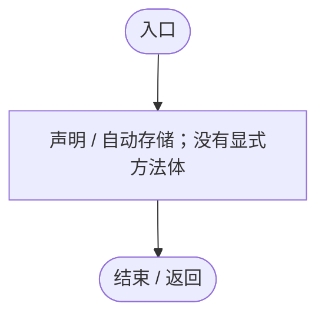

<a id="m52d26640eca61349"></a>

## Ensure · L27

`public static RandomSpawnWorkbench Ensure()`


### Editor / Player · Roslyn编译器控制流

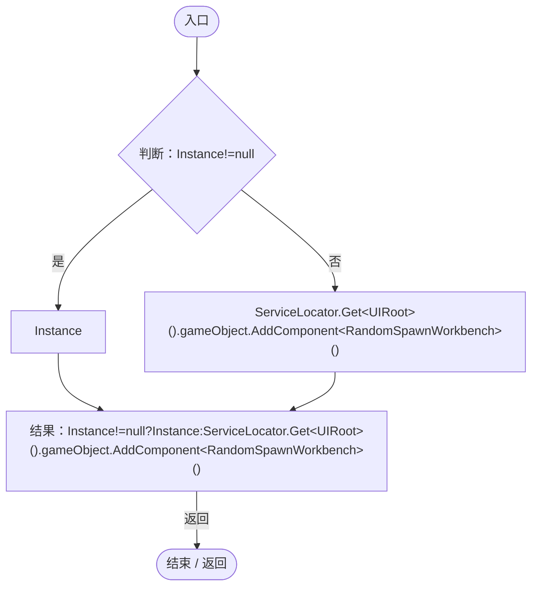

项目内调用/回调引用：

- [RandomSpawnWorkbench.Instance.get · L19](0763b7475b3c75db.md#m6f18ab57fe0cbfad)（访问器）
- [ServiceLocator.Get · L33](f2fdbe9f9ccd93cb.md#m2ae625299520c56d)（方法）

<a id="ma7537a3a9290c434"></a>

## Awake · L28

`private void Awake()`


### Editor / Player · Roslyn编译器控制流

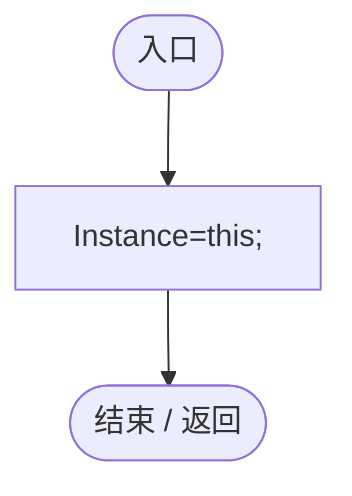

项目内调用/回调引用：

- [RandomSpawnWorkbench.Instance.set · L19](0763b7475b3c75db.md#mbe95dfbe1d1ece7a)（访问器）

<a id="m0c118b57d249ff5d"></a>

## Open · L29

`public void Open(RandomSpawnPanel owner,bool rules=false)`


### Editor / Player · Roslyn编译器控制流

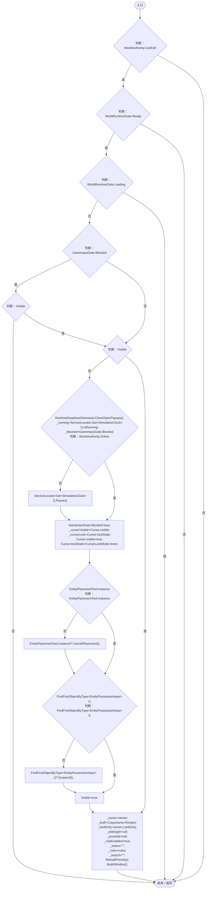

项目内调用/回调引用：

- [GameInputGate.Blocked.get · L8](52955daae7e592ab.md#m765763b665829633)（访问器）
- [RandomSpawnWorkbench.Visible.get · L19](0763b7475b3c75db.md#mfc1adb76149ae015)（访问器）
- [RuntimeDropdownDismissal.CloseOpenPopups · L39](bab72c915cc299c5.md#m4e050bc4c4e0bef0)（方法）
- [SimulationClock.IsRunning.get · L22](a8f444aec9614b0a.md#m10f4fe307faca0f0)（访问器）
- [ServiceLocator.Get · L33](f2fdbe9f9ccd93cb.md#m2ae625299520c56d)（方法）
- [SimulationClock.Pause · L79](a8f444aec9614b0a.md#m30929d45a885d0f1)（方法）
- [GameInputGate.Blocked.set · L8](52955daae7e592ab.md#m578697f6379686f4)（访问器）
- [EntityPlacementTool.Instance.get · L13](2ca993947b0a7e7a.md#mafb26991c0dfcb86)（访问器）
- [EntityPlacementTool.CancelPlacement · L81](2ca993947b0a7e7a.md#m5a9374d2c71f0a2d)（方法）
- [EntityPossessionInput.Suspend · L98](4c12d3ae76941d37.md#m782dbd96037fc73f)（方法）
- [RandomSpawnWorkbench.Visible.set · L19](0763b7475b3c75db.md#m93100ee3cc01e45f)（访问器）
- [RandomSpawnWorkbench.Copy · L58](0763b7475b3c75db.md#ma53d514b10604d26)（方法）
- [RandomSpawnPanel.Recipe.get · L19](ff6518313bce61e2.md#mb3265c1391d6ac92)（访问器）
- [RandomSpawnWorkbench.ReloadPresets · L97](0763b7475b3c75db.md#m127f2019379408f8)（方法）
- [RandomSpawnWorkbench.BuildWindow · L129](0763b7475b3c75db.md#mbbaac829ae093653)（方法）

<a id="mb3132a8d58c9ba62"></a>

## Close · L42

`public void Close()`


### Editor / Player · Roslyn编译器控制流

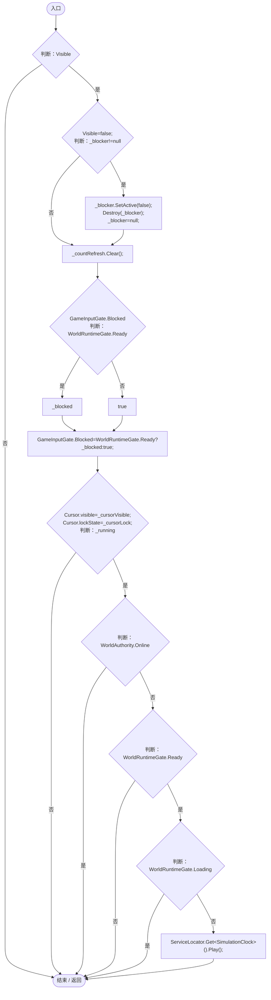

项目内调用/回调引用：

- [RandomSpawnWorkbench.Visible.get · L19](0763b7475b3c75db.md#mfc1adb76149ae015)（访问器）
- [RandomSpawnWorkbench.Visible.set · L19](0763b7475b3c75db.md#m93100ee3cc01e45f)（访问器）
- [GameInputGate.Blocked.set · L8](52955daae7e592ab.md#m578697f6379686f4)（访问器）
- [SimulationClock.Play · L78](a8f444aec9614b0a.md#m7aa9e64b7de60ed0)（方法）
- [ServiceLocator.Get · L33](f2fdbe9f9ccd93cb.md#m2ae625299520c56d)（方法）

<a id="mbe0e6fe095479676"></a>

## Update · L48

`private void Update()`


### Editor / Player · Roslyn编译器控制流

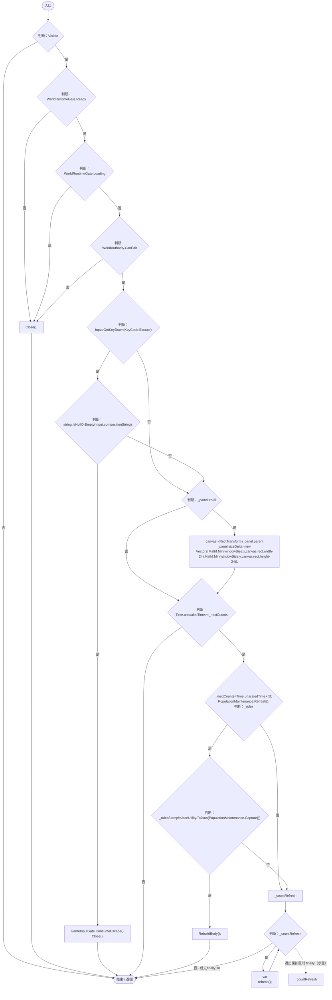

项目内调用/回调引用：

- [RandomSpawnWorkbench.Visible.get · L19](0763b7475b3c75db.md#mfc1adb76149ae015)（访问器）
- [RandomSpawnWorkbench.Close · L42](0763b7475b3c75db.md#mb3132a8d58c9ba62)（方法）
- [GameInputGate.ConsumeEscape · L9](52955daae7e592ab.md#m5b050ac6f014de67)（方法）
- [PopulationMaintenance.Refresh · L79](923ccc4e86c4786c.md#m68d4133ac5e035ed)（方法）
- [PopulationMaintenance.Capture · L121](923ccc4e86c4786c.md#m5dc9a32bbddf0f63)（方法）
- [RandomSpawnWorkbench.RebuildBody · L138](0763b7475b3c75db.md#mdd49337131b22352)（方法）

<a id="ma784220dda8457b8"></a>

## OnDisable · L57

`private void OnDisable()`


### Editor / Player · Roslyn编译器控制流

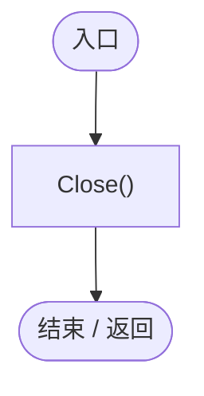

项目内调用/回调引用：

- [RandomSpawnWorkbench.Close · L42](0763b7475b3c75db.md#mb3132a8d58c9ba62)（方法）

<a id="md83477a842f27aba"></a>

## OnDestroy · L57

`private void OnDestroy()`


### Editor / Player · Roslyn编译器控制流

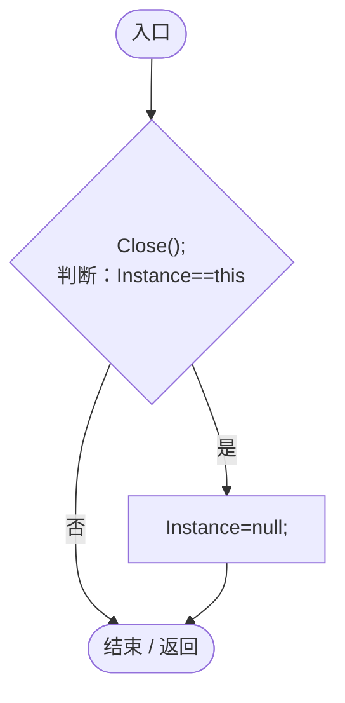

项目内调用/回调引用：

- [RandomSpawnWorkbench.Close · L42](0763b7475b3c75db.md#mb3132a8d58c9ba62)（方法）
- [RandomSpawnWorkbench.Instance.get · L19](0763b7475b3c75db.md#m6f18ab57fe0cbfad)（访问器）
- [RandomSpawnWorkbench.Instance.set · L19](0763b7475b3c75db.md#mbe95dfbe1d1ece7a)（访问器）

<a id="ma53d514b10604d26"></a>

## Copy · L58

`private static RandomSpawnRecipe Copy(RandomSpawnRecipe source)`


### Editor / Player · Roslyn编译器控制流

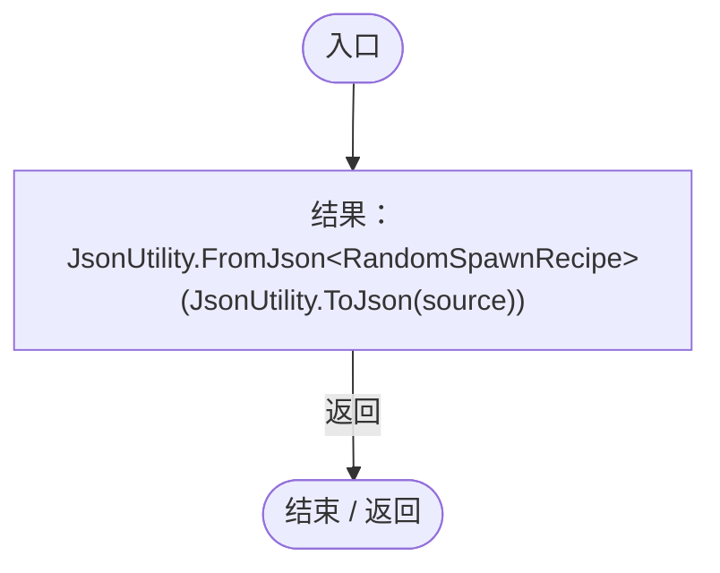

<a id="m9170b4f2d8eecf0a"></a>

## Template · L59

`private static RandomSpawnRecipe Template(EntityTemplateData template)`


### Editor / Player · Roslyn编译器控制流

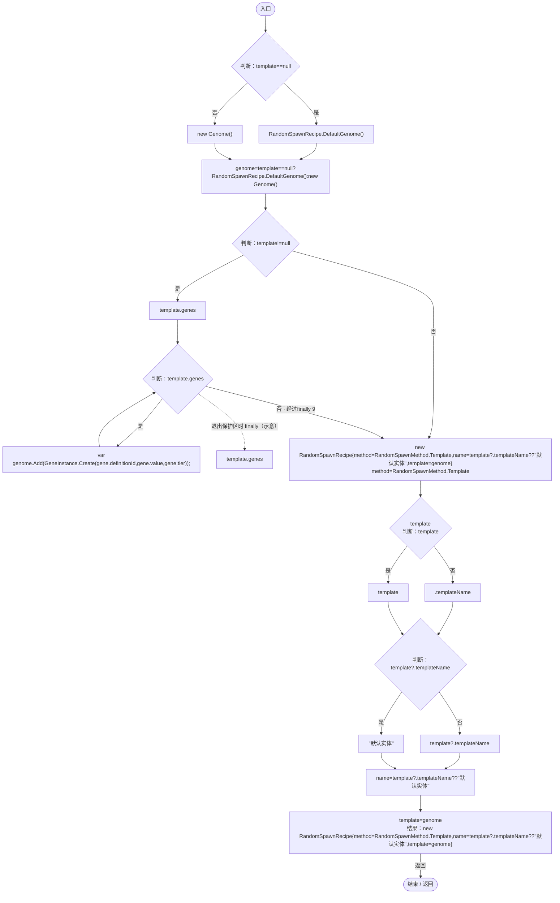

项目内调用/回调引用：

- [RandomSpawnRecipe.DefaultGenome · L18](923ccc4e86c4786c.md#me771b4b81f75bedc)（方法）
- [Genome.Add · L19](a2ef23f865bc7ee8.md#md9cfdc94b8b8d40f)（方法）
- [GeneInstance.Create · L20](f82e1498d67f5afd.md#m72e94c278de3cf8b)（方法）

<a id="m2052a884e9c5139f"></a>

## SelectTemplate · L64

`public void SelectTemplate(EntityTemplateData template)`


### Editor / Player · Roslyn编译器控制流

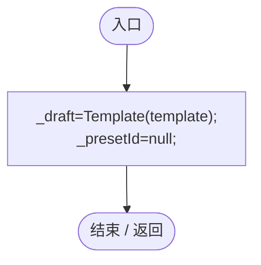

项目内调用/回调引用：

- [RandomSpawnWorkbench.Template · L59](0763b7475b3c75db.md#m9170b4f2d8eecf0a)（方法）

<a id="m0c54f04cb4b4760e"></a>

## UseGeneRandom · L65

`public void UseGeneRandom()`


### Editor / Player · Roslyn编译器控制流

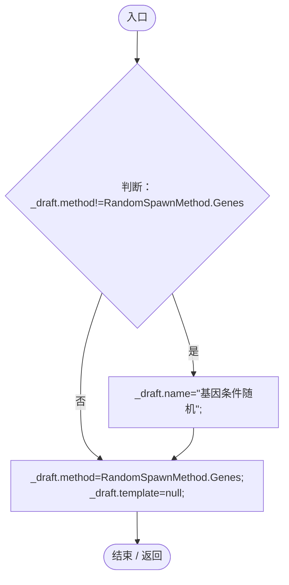

<a id="m9192e34c98ddfb4e"></a>

## SetGene · L66

`public void SetGene(string id,bool include,bool selected)`


### Editor / Player · Roslyn编译器控制流

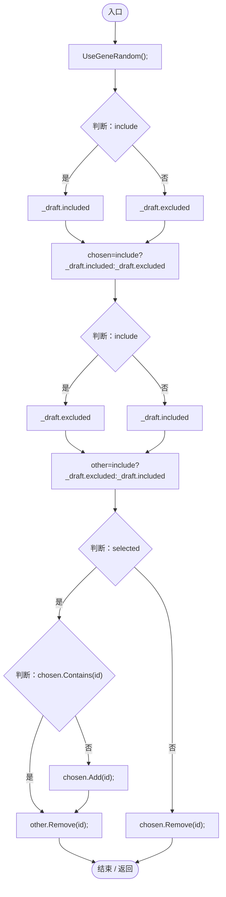

项目内调用/回调引用：

- [RandomSpawnWorkbench.UseGeneRandom · L65](0763b7475b3c75db.md#m0c54f04cb4b4760e)（方法）

<a id="m57205805d2ef1037"></a>

## Draft.get · L71

`public RandomSpawnRecipe Draft`


### Editor / Player · 语法控制结构 / 声明（非CFG）

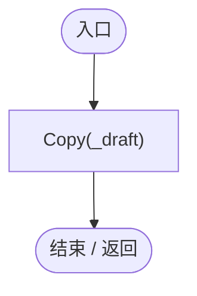

项目内调用/回调引用：

- [RandomSpawnWorkbench.Copy · L58](0763b7475b3c75db.md#ma53d514b10604d26)（方法）

<a id="m9baa3e245445f955"></a>

## ApplySelection · L72

`public bool ApplySelection()`


### Editor / Player · Roslyn编译器控制流

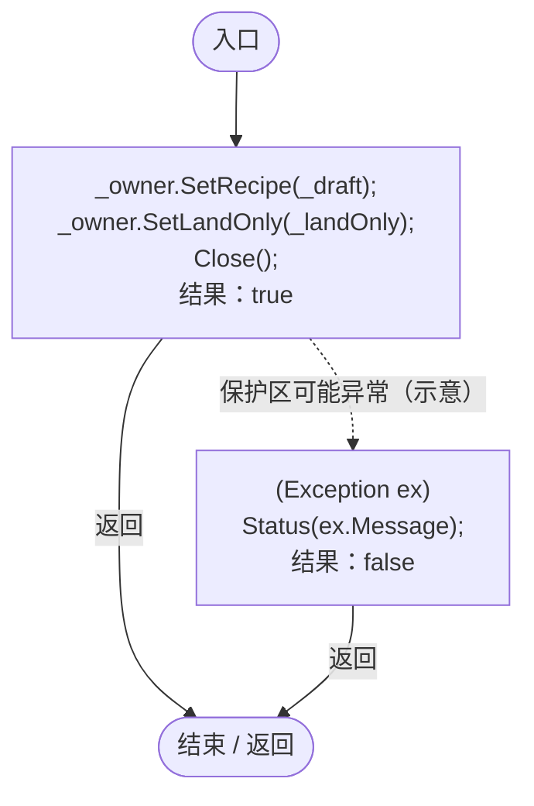

项目内调用/回调引用：

- [RandomSpawnPanel.SetRecipe · L52](ff6518313bce61e2.md#mea9da7359df49ecb)（方法）
- [RandomSpawnPanel.SetLandOnly · L54](ff6518313bce61e2.md#mc961052fc1e13dc4)（方法）
- [RandomSpawnWorkbench.Close · L42](0763b7475b3c75db.md#mb3132a8d58c9ba62)（方法）
- [RandomSpawnWorkbench.Status · L98](0763b7475b3c75db.md#m506bb27346769dc3)（方法）

<a id="m42aecb344c8280a4"></a>

## SaveRule · L74

`public bool SaveRule(float percent)`


### Editor / Player · Roslyn编译器控制流

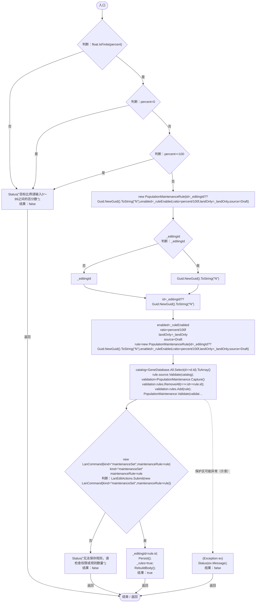

项目内调用/回调引用：

- [RandomSpawnWorkbench.Status · L98](0763b7475b3c75db.md#m506bb27346769dc3)（方法）
- [GeneDatabase.All.get · L128](ec0a03483435a863.md#m0a367ed24734f426)（访问器）
- [RandomSpawnRecipe.Validate · L48](923ccc4e86c4786c.md#m0fe74d9bb4825883)（方法）
- [PopulationMaintenance.Capture · L121](923ccc4e86c4786c.md#m5dc9a32bbddf0f63)（方法）
- [PopulationMaintenance.Validate · L122](923ccc4e86c4786c.md#m0c29d6aef903cb75)（方法）
- [LanEditActions.Submit · L16](2816321496f6360e.md#m5411c4b97ac4c898)（方法）
- [RandomSpawnWorkbench.Persist · L99](0763b7475b3c75db.md#m034c75d63519d975)（方法）
- [RandomSpawnWorkbench.RebuildBody · L138](0763b7475b3c75db.md#mdd49337131b22352)（方法）
- [RandomSpawnWorkbench.回调@80 · L80](0763b7475b3c75db.md#mc36478f9c5e266a9)（回调/委托）
- [RandomSpawnWorkbench.回调@80 · L80](0763b7475b3c75db.md#m03bc7479b3a84df0)（回调/委托）

<a id="mc36478f9c5e266a9"></a>

## 回调@80 · L80

`d … => 回调`


### Editor / Player · Roslyn编译器控制流

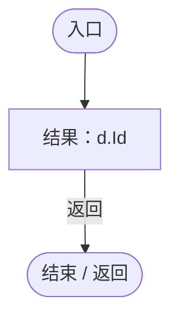

<a id="m03bc7479b3a84df0"></a>

## 回调@80 · L80

`r … => 回调`


### Editor / Player · Roslyn编译器控制流

```mermaid
flowchart TD
  b0(["入口"])
  b1["结果：r.id==rule.id"]
  b2(["结束 / 返回"])
  b0 --> b1
  b1 -->|"返回"| b2

```

<a id="m210b8cd3854376be"></a>

## SaveCondition · L87

`public bool SaveCondition(string name)`

★ 新增：命名条件保存成独立JSON，保存后即可在生成来源及维持比例列表中复用，不会自动开启比例规则。

### Editor / Player · Roslyn编译器控制流

```mermaid
flowchart TD
  b0(["入口"])
  b1{"判断：_draft.method!=RandomSpawnMethod.Genes"}
  b2["结果：new InvalidDataException(&quot;请先选择基因条件随机方式&quot;)"]
  x2(["抛出异常 / 离开方法"])
  b3["source=Draft"]
  b4["source.name"]
  b5{"name<br/>判断：name"}
  b6["name"]
  b7["&quot;&quot;"]
  b8["source.name=(name??&quot;&quot;).Trim();"]
  b9["preset=RandomSpawnPresetStore.Save(source,_presetId)<br/>_presetId=preset.id;<br/>_draft=Copy(preset.source);<br/>ReloadPresets();<br/>Status(&quot;基因条件已保存为 JSON：&quot;+Path.Combine(RandomSpawnPresetStore.DirectoryPath,preset.id+&quot;.json&quot;));<br/>RebuildBody();<br/>结果：true"]
  b10["(Exception ex)<br/>Status(&quot;保存失败：&quot;+ex.Message);<br/>结果：false"]
  b11(["结束 / 返回"])
  b0 --> b1
  b1 -->|"是"| b2
  b1 -->|"否"| b3
  b2 -->|"Throw"| x2
  b3 --> b4
  b4 --> b5
  b5 -->|"否"| b6
  b5 -->|"是"| b7
  b6 --> b8
  b7 --> b8
  b8 --> b9
  b9 -->|"返回"| b11
  b10 -->|"返回"| b11
  b1 -. "保护区可能异常（示意）" .-> b10

```

项目内调用/回调引用：

- [RandomSpawnPresetStore.Save · L19](9f09efd086264861.md#md4f1fb6f10a0201d)（方法）
- [RandomSpawnWorkbench.Copy · L58](0763b7475b3c75db.md#ma53d514b10604d26)（方法）
- [RandomSpawnWorkbench.ReloadPresets · L97](0763b7475b3c75db.md#m127f2019379408f8)（方法）
- [RandomSpawnWorkbench.Status · L98](0763b7475b3c75db.md#m506bb27346769dc3)（方法）
- [RandomSpawnWorkbench.RebuildBody · L138](0763b7475b3c75db.md#mdd49337131b22352)（方法）

<a id="m127f2019379408f8"></a>

## ReloadPresets · L97

`private void ReloadPresets()`


### Editor / Player · Roslyn编译器控制流

```mermaid
flowchart TD
  b0(["入口"])
  b1["_presets=RandomSpawnPresetStore.Load();"]
  b2["(Exception ex)<br/>Status(&quot;读取基因条件失败：&quot;+ex.Message);<br/>Debug.LogWarning(&quot;[生成条件] &quot;+ex.Message);<br/>_presets=new();"]
  b3(["结束 / 返回"])
  b0 --> b1
  b1 --> b3
  b2 --> b3
  b1 -. "保护区可能异常（示意）" .-> b2

```

项目内调用/回调引用：

- [RandomSpawnPresetStore.Load · L27](9f09efd086264861.md#mbb593ba9438a87f8)（方法）
- [RandomSpawnWorkbench.Status · L98](0763b7475b3c75db.md#m506bb27346769dc3)（方法）

<a id="m506bb27346769dc3"></a>

## Status · L98

`private void Status(string message)`


### Editor / Player · Roslyn编译器控制流

```mermaid
flowchart TD
  b0(["入口"])
  b1{"_status=message;<br/>判断：_statusText!=null"}
  b2["_statusText.text=message;"]
  b3(["结束 / 返回"])
  b0 --> b1
  b1 -->|"是"| b2
  b1 -->|"否"| b3
  b2 --> b3

```

<a id="m034c75d63519d975"></a>

## Persist · L99

`private void Persist()`


### Editor / Player · Roslyn编译器控制流

```mermaid
flowchart TD
  b0(["入口"])
  b1{"LanSession.Instance<br/>判断：LanSession.Instance"}
  b2[".IsClient"]
  b3["LanSession.Instance"]
  b4{"判断：LanSession.Instance?.IsClient!=true"}
  b5["FindFirstObjectByType&lt;WorldSessionManager&gt;().SaveNow(_running);<br/>Status(&quot;规则已保存：不足时补充，超量时减少繁殖&quot;);"]
  b6["Status(&quot;已发送给房主，等待同步&quot;);"]
  b7(["结束 / 返回"])
  b0 --> b1
  b1 -->|"否"| b2
  b1 -->|"是"| b3
  b2 --> b4
  b3 --> b4
  b4 -->|"是"| b5
  b4 -->|"否"| b6
  b5 --> b7
  b6 --> b7

```

项目内调用/回调引用：

- [LanSession.Instance.get · L23](9fb633eebffe669c.md#mbf83306994878383)（访问器）
- [WorldSessionManager.SaveNow · L157](08741c7b7b9d9344.md#mbecd8b5c222ba46b)（方法）
- [RandomSpawnWorkbench.Status · L98](0763b7475b3c75db.md#m506bb27346769dc3)（方法）

<a id="m0ea2f049b500952a"></a>

## Rect · L100

`private static RectTransform Rect(string name,Transform parent,float left,float top,float right,float bottom)`


### Editor / Player · Roslyn编译器控制流

```mermaid
flowchart TD
  b0(["入口"])
  b1["rt=UIFactory.NewRect(name,parent).GetComponent&lt;RectTransform&gt;()<br/>rt.anchorMin=new Vector2(left,0);<br/>rt.anchorMax=new Vector2(right,1);<br/>rt.offsetMin=new Vector2(0,bottom);<br/>rt.offsetMax=new Vector2(0,-top);<br/>结果：rt"]
  b2(["结束 / 返回"])
  b0 --> b1
  b1 -->|"返回"| b2

```

项目内调用/回调引用：

- [UIFactory.NewRect · L33](dd1096a6995423db.md#med612116f3152344)（方法）

<a id="ma4e8446c581b9c16"></a>

## RowPlace · L104

`private static void RowPlace(RectTransform rt,float a,float b,float top,float height)`


### Editor / Player · Roslyn编译器控制流

```mermaid
flowchart TD
  b0(["入口"])
  b1["rt.anchorMin=new Vector2(a,1);<br/>rt.anchorMax=new Vector2(b,1);<br/>rt.pivot=new Vector2(.5f,1);<br/>rt.offsetMin=new Vector2(4,-top-height);<br/>rt.offsetMax=new Vector2(-4,-top);"]
  b2(["结束 / 返回"])
  b0 --> b1
  b1 --> b2

```

<a id="m79c11aee1bf6f3db"></a>

## Label · L106

`private static Text Label(Transform parent,string name,string value,float a,float b,float top,float height,int size=15)`


### Editor / Player · Roslyn编译器控制流

```mermaid
flowchart TD
  b0(["入口"])
  b1["text=UIFactory.NewText(name,parent,value,size)<br/>RowPlace(text.rectTransform,a,b,top,height);<br/>结果：text"]
  b2(["结束 / 返回"])
  b0 --> b1
  b1 -->|"返回"| b2

```

项目内调用/回调引用：

- [UIFactory.NewText · L57](dd1096a6995423db.md#m9dbccb5f0c38189e)（方法）
- [RandomSpawnWorkbench.RowPlace · L104](0763b7475b3c75db.md#ma4e8446c581b9c16)（方法）

<a id="m493522dcbbdb3393"></a>

## Button · L108

`private static Button Button(Transform parent,string name,string label,float a,float b,float top,float height,Action action,bool selected=false)`


### Editor / Player · Roslyn编译器控制流

```mermaid
flowchart TD
  b0(["入口"])
  b1["button=UIFactory.NewButton(name,parent,label,action,Vector2.zero)<br/>RowPlace(button.GetComponent&lt;RectTransform&gt;(),a,b,top,height);<br/>Paint(button,selected);<br/>button.GetComponentInChildren&lt;Text&gt;().fontSize=14;<br/>结果：button"]
  b2(["结束 / 返回"])
  b0 --> b1
  b1 -->|"返回"| b2

```

项目内调用/回调引用：

- [UIFactory.NewButton · L73](dd1096a6995423db.md#m5896f1b097c8bdde)（方法）
- [RandomSpawnWorkbench.RowPlace · L104](0763b7475b3c75db.md#ma4e8446c581b9c16)（方法）
- [RandomSpawnWorkbench.Paint · L110](0763b7475b3c75db.md#mbc3ee8da135dda3b)（方法）

<a id="mbc3ee8da135dda3b"></a>

## Paint · L110

`private static void Paint(Button button,bool selected)`


### Editor / Player · Roslyn编译器控制流

```mermaid
flowchart TD
  b0(["入口"])
  b1{"UIVisualTheme.StyleButton(button);<br/>判断：selected"}
  b2["UIVisualTheme.Paint(button.image,&quot;selected&quot;);"]
  b3["states=button.spriteState"]
  b4{"states.selectedSprite<br/>判断：selected"}
  b5["&quot;selected&quot;"]
  b6["&quot;button&quot;"]
  b7["states.selectedSprite=UIVisualTheme.SurfaceSprite(selected?&quot;selected&quot;:&quot;button&quot;);"]
  b8{"states.highlightedSprite<br/>判断：selected"}
  b9["&quot;selected&quot;"]
  b10["&quot;hover&quot;"]
  b11["states.highlightedSprite=UIVisualTheme.SurfaceSprite(selected?&quot;selected&quot;:&quot;hover&quot;);"]
  b12["button.spriteState=states;<br/>button.image.overrideSprite=null;"]
  b13{"button.GetComponentInChildren&lt;Text&gt;().color<br/>判断：selected"}
  b14["UIVisualTheme.Accent"]
  b15["UIVisualTheme.Text"]
  b16["button.GetComponentInChildren&lt;Text&gt;().color=selected?UIVisualTheme.Accent:UIVisualTheme.Text;"]
  b17(["结束 / 返回"])
  b0 --> b1
  b1 -->|"是"| b2
  b1 -->|"否"| b3
  b2 --> b3
  b3 --> b4
  b4 -->|"是"| b5
  b4 -->|"否"| b6
  b5 --> b7
  b6 --> b7
  b7 --> b8
  b8 -->|"是"| b9
  b8 -->|"否"| b10
  b9 --> b11
  b10 --> b11
  b11 --> b12
  b12 --> b13
  b13 -->|"是"| b14
  b13 -->|"否"| b15
  b14 --> b16
  b15 --> b16
  b16 --> b17

```

项目内调用/回调引用：

- [UIVisualTheme.StyleButton · L67](ca525a798a08f966.md#mf2e64598de5115f3)（方法）
- [UIVisualTheme.Paint · L58](ca525a798a08f966.md#m2d61a6b26ab24980)（方法）
- [UIVisualTheme.SurfaceSprite · L45](ca525a798a08f966.md#md3ae1d7fd207ae2f)（方法）

<a id="m5d8f19e63b1f6398"></a>

## Field · L112

`private static InputField Field(Transform parent,string name,string value,string hint,float a,float b,float top,float height)`


### Editor / Player · Roslyn编译器控制流

```mermaid
flowchart TD
  b0(["入口"])
  b1["go=UIFactory.NewRect(name,parent,typeof(Image),typeof(InputField))<br/>RowPlace(go.GetComponent&lt;RectTransform&gt;(),a,b,top,height);<br/>field=go.GetComponent&lt;InputField&gt;()<br/>field.targetGraphic=go.GetComponent&lt;Image&gt;();<br/>text=UIFactory.NewText(&quot;Text&quot;…"]
  b2(["结束 / 返回"])
  b0 --> b1
  b1 -->|"返回"| b2

```

项目内调用/回调引用：

- [UIFactory.NewRect · L33](dd1096a6995423db.md#med612116f3152344)（方法）
- [RandomSpawnWorkbench.RowPlace · L104](0763b7475b3c75db.md#ma4e8446c581b9c16)（方法）
- [UIFactory.NewText · L57](dd1096a6995423db.md#m9dbccb5f0c38189e)（方法）
- [UIFactory.Stretch · L150](dd1096a6995423db.md#m11d8f6c6d00cc047)（方法）

<a id="m16a7cc7f766359e1"></a>

## Scroll · L119

`private static RectTransform Scroll(Transform parent,string name,float a,float b,float top,float bottom)`


### Editor / Player · Roslyn编译器控制流

```mermaid
flowchart TD
  b0(["入口"])
  b1["viewport=Rect(name,parent,a,top,b,bottom)<br/>viewport.gameObject.AddComponent&lt;RectMask2D&gt;();<br/>scroll=viewport.gameObject.AddComponent&lt;ScrollRect&gt;()<br/>image=viewport.gameObject.AddComponent&lt;Image&gt;()<br/>image.color=Color.clear;<br/>content=UIFactory.Ne…"]
  b2(["结束 / 返回"])
  b0 --> b1
  b1 -->|"返回"| b2

```

项目内调用/回调引用：

- [RandomSpawnWorkbench.Rect · L100](0763b7475b3c75db.md#m0ea2f049b500952a)（方法）
- [UIFactory.NewRect · L33](dd1096a6995423db.md#med612116f3152344)（方法）
- [UIVisualTheme.Paint · L58](ca525a798a08f966.md#m2d61a6b26ab24980)（方法）

<a id="mb8583cfc539c29b5"></a>

## Empty · L128

`private static void Empty(GameObject go)`


### Editor / Player · Roslyn编译器控制流

```mermaid
flowchart TD
  b0(["入口"])
  b1{"判断：go!=null"}
  b2["go.SetActive(false);<br/>Destroy(go);"]
  b3(["结束 / 返回"])
  b0 --> b1
  b1 -->|"是"| b2
  b1 -->|"否"| b3
  b2 --> b3

```

<a id="mbbaac829ae093653"></a>

## BuildWindow · L129

`private void BuildWindow()`


### Editor / Player · Roslyn编译器控制流

```mermaid
flowchart TD
  b0(["入口"])
  b1["Empty(_blocker);<br/>canvas=ServiceLocator.Get&lt;UIRoot&gt;().MainCanvas.transform<br/>_blocker=UIFactory.NewRect(&quot;RandomSpawnWorkbenchBlocker&quot;,canvas,typeof(Image));<br/>UIFactory.Stretch(_blocker.GetComponent&lt;RectTransform&gt;());<br/>_blocker.GetComponent&lt;Im…"]
  b2(["结束 / 返回"])
  b0 --> b1
  b1 --> b2

```

项目内调用/回调引用：

- [RandomSpawnWorkbench.Empty · L128](0763b7475b3c75db.md#mb8583cfc539c29b5)（方法）
- [UIRoot.MainCanvas.get · L14](9c1421378791f0e0.md#maa2cc9baf1248477)（访问器）
- [ServiceLocator.Get · L33](f2fdbe9f9ccd93cb.md#m2ae625299520c56d)（方法）
- [UIFactory.NewRect · L33](dd1096a6995423db.md#med612116f3152344)（方法）
- [UIFactory.Stretch · L150](dd1096a6995423db.md#m11d8f6c6d00cc047)（方法）
- [UIVisualTheme.Paint · L58](ca525a798a08f966.md#m2d61a6b26ab24980)（方法）
- [RandomSpawnWorkbench.Label · L106](0763b7475b3c75db.md#m79c11aee1bf6f3db)（方法）
- [RandomSpawnWorkbench.Button · L108](0763b7475b3c75db.md#m493522dcbbdb3393)（方法）
- [RandomSpawnWorkbench.RebuildBody · L138](0763b7475b3c75db.md#mdd49337131b22352)（方法）
- [RandomSpawnWorkbench.回调@135 · L135](0763b7475b3c75db.md#maf93d45389e81025)（回调/委托）
- [RandomSpawnWorkbench.回调@136 · L136](0763b7475b3c75db.md#md44a3aa8779ac5bb)（回调/委托）
- [RandomSpawnWorkbench.Close · L42](0763b7475b3c75db.md#mb3132a8d58c9ba62)（方法）

<a id="maf93d45389e81025"></a>

## 回调@135 · L135

`( … => 回调`


### Editor / Player · Roslyn编译器控制流

```mermaid
flowchart TD
  b0(["入口"])
  b1["_rules=false;<br/>BuildWindow();"]
  b2(["结束 / 返回"])
  b0 --> b1
  b1 --> b2

```

项目内调用/回调引用：

- [RandomSpawnWorkbench.BuildWindow · L129](0763b7475b3c75db.md#mbbaac829ae093653)（方法）

<a id="md44a3aa8779ac5bb"></a>

## 回调@136 · L136

`( … => 回调`


### Editor / Player · Roslyn编译器控制流

```mermaid
flowchart TD
  b0(["入口"])
  b1["_rules=true;<br/>BuildWindow();"]
  b2(["结束 / 返回"])
  b0 --> b1
  b1 --> b2

```

项目内调用/回调引用：

- [RandomSpawnWorkbench.BuildWindow · L129](0763b7475b3c75db.md#mbbaac829ae093653)（方法）

<a id="mdd49337131b22352"></a>

## RebuildBody · L138

`private void RebuildBody()`


### Editor / Player · Roslyn编译器控制流

```mermaid
flowchart TD
  b0(["入口"])
  b1{"判断：Visible"}
  b2{"判断：_panel==null"}
  b3{"_rulesStamp=JsonUtility.ToJson(PopulationMaintenance.Capture());<br/>Paint(_sourceTab,!_rules);<br/>Paint(_rulesTab,_rules);<br/>_templateButtons.Clear();<br/>Empty(_body);<br/>Empty(_footer);<br/>_countRefresh.Clear();<br/>_body=Rect(&quot;Body&quot;,_panel,.015f,96,.985f,1…"}
  b4["DrawRules();"]
  b5["DrawSources();"]
  b6{"DrawFooter();<br/>判断：_refreshQueued"}
  b7["_refreshQueued=true;<br/>StartCoroutine(RefreshText());"]
  b8(["结束 / 返回"])
  b0 --> b1
  b1 -->|"是"| b2
  b1 -->|"否"| b8
  b2 -->|"是"| b8
  b2 -->|"否"| b3
  b3 -->|"是"| b4
  b3 -->|"否"| b5
  b4 --> b6
  b5 --> b6
  b6 -->|"否"| b7
  b6 -->|"是"| b8
  b7 --> b8

```

项目内调用/回调引用：

- [RandomSpawnWorkbench.Visible.get · L19](0763b7475b3c75db.md#mfc1adb76149ae015)（访问器）
- [PopulationMaintenance.Capture · L121](923ccc4e86c4786c.md#m5dc9a32bbddf0f63)（方法）
- [RandomSpawnWorkbench.Paint · L110](0763b7475b3c75db.md#mbc3ee8da135dda3b)（方法）
- [RandomSpawnWorkbench.Empty · L128](0763b7475b3c75db.md#mb8583cfc539c29b5)（方法）
- [RandomSpawnWorkbench.Rect · L100](0763b7475b3c75db.md#m0ea2f049b500952a)（方法）
- [RandomSpawnWorkbench.DrawRules · L203](0763b7475b3c75db.md#m2f9164b0f3c337a9)（方法）
- [RandomSpawnWorkbench.DrawSources · L157](0763b7475b3c75db.md#m90d57f313e56264a)（方法）
- [RandomSpawnWorkbench.DrawFooter · L223](0763b7475b3c75db.md#m980881938b6b13f2)（方法）
- [RandomSpawnWorkbench.RefreshText · L145](0763b7475b3c75db.md#mb32827ed78eaccd2)（方法）

<a id="mb32827ed78eaccd2"></a>

## RefreshText · L145

`private IEnumerator RefreshText()`


### Editor / Player · Roslyn编译器控制流

```mermaid
flowchart TD
  b0(["入口"])
  b1{"yield return null;<br/>_refreshQueued=false;<br/>判断：Visible"}
  b2{"判断：_panel==null"}
  b3["texts=_panel.GetComponentsInChildren&lt;Text&gt;()<br/>scale=ServiceLocator.Get&lt;UIRoot&gt;().MainCanvas.scaleFactor"]
  b4["texts.GroupBy(t=&gt;(t.font,t.fontSize,t.fontStyle))"]
  b5{"判断：texts.GroupBy(t=&gt;(t.font,t.fontSize,t.fontStyle))"}
  b6["var"]
  b7["characters=string.Concat(group.Select(t=&gt;t.text))<br/>group.Key.font.RequestCharactersInTexture(characters,group.Key.fontSize,group.Key.fontStyle);<br/>group.Key.font.RequestCharactersInTexture(characters,Mathf.RoundToInt(group.Key.fontSize*scal…"]
  b8{"判断：texts.GroupBy(t=&gt;(t.font,t.fontSize,t.fontStyle))"}
  b9["texts.GroupBy(t=&gt;(t.font,t.fontSize,t.fontStyle))"]
  b10["连接 / 离开区域"]
  b11["texts"]
  b12{"判断：texts"}
  b13["var<br/>text.SetAllDirty();"]
  b14{"texts<br/>判断：texts"}
  b15["texts"]
  b16["连接 / 离开区域"]
  b17["Canvas.ForceUpdateCanvases();"]
  b18(["结束 / 返回"])
  b0 --> b1
  b1 -->|"是"| b2
  b1 -->|"否"| b18
  b2 -->|"是"| b18
  b2 -->|"否"| b3
  b3 --> b4
  b4 --> b5
  b5 -->|"是"| b6
  b5 -->|"否 · 经过finally 8"| b11
  b6 --> b7
  b7 --> b5
  b8 -->|"否"| b9
  b8 -->|"是"| b10
  b9 --> b10
  b11 --> b12
  b12 -->|"是"| b13
  b12 -->|"否 · 经过finally 14"| b17
  b13 --> b12
  b14 -->|"否"| b15
  b14 -->|"是"| b16
  b15 --> b16
  b17 --> b18
  b5 -. "退出保护区时 finally（示意）" .-> b8
  b12 -. "退出保护区时 finally（示意）" .-> b14

```

项目内调用/回调引用：

- [RandomSpawnWorkbench.Visible.get · L19](0763b7475b3c75db.md#mfc1adb76149ae015)（访问器）
- [UIRoot.MainCanvas.get · L14](9c1421378791f0e0.md#maa2cc9baf1248477)（访问器）
- [ServiceLocator.Get · L33](f2fdbe9f9ccd93cb.md#m2ae625299520c56d)（方法）
- [RandomSpawnWorkbench.回调@150 · L150](0763b7475b3c75db.md#m179f80a834d74a05)（回调/委托）
- [RandomSpawnWorkbench.回调@152 · L152](0763b7475b3c75db.md#me23fe83ebf0ad73d)（回调/委托）

<a id="m179f80a834d74a05"></a>

## 回调@150 · L150

`t … => 回调`


### Editor / Player · Roslyn编译器控制流

```mermaid
flowchart TD
  b0(["入口"])
  b1["结果：(t.font,t.fontSize,t.fontStyle)"]
  b2(["结束 / 返回"])
  b0 --> b1
  b1 -->|"返回"| b2

```

<a id="me23fe83ebf0ad73d"></a>

## 回调@152 · L152

`t … => 回调`


### Editor / Player · Roslyn编译器控制流

```mermaid
flowchart TD
  b0(["入口"])
  b1["结果：t.text"]
  b2(["结束 / 返回"])
  b0 --> b1
  b1 -->|"返回"| b2

```

<a id="m90d57f313e56264a"></a>

## DrawSources · L157

`private void DrawSources()`


### Editor / Player · Roslyn编译器控制流

```mermaid
flowchart TD
  b0(["入口"])
  b1["left=Rect(&quot;Templates&quot;,_body.transform,0,0,.49f,0)<br/>right=Rect(&quot;Conditions&quot;,_body.transform,.51f,0,1,0)<br/>Label(left,&quot;Heading&quot;,&quot;方式一：完全按照实体模板&quot;,0,1,0,26,14);<br/>templates=Scroll(left,&quot;TemplatesList&quot;,0,1,32,34)<br/>y=0<br/>AddTemplate(null);"]
  b2["EntityTemplateManager.Templates"]
  b3{"判断：EntityTemplateManager.Templates"}
  b4["var<br/>AddTemplate(template);"]
  b5{"判断：EntityTemplateManager.Templates"}
  b6["EntityTemplateManager.Templates"]
  b7["连接 / 离开区域"]
  b8["templates.sizeDelta=new Vector2(-18,y);<br/>note=Label(left,&quot;Hint&quot;,&quot;完整复制模板基因与数值，不添加随机基因。&quot;,0,1,0,30,13)<br/>note.rectTransform.anchorMin=new Vector2(0,0);<br/>note.rectTransform.anchorMax=new Vector2(1,0);<br/>note.rectTransform.anchoredPosition=new Vect…"]
  b9{"_useGenesButton<br/>right<br/>&quot;UseGenes&quot;<br/>判断：_draft.method==RandomSpawnMethod.Genes"}
  b10["&quot;已选择基因条件随机&quot;"]
  b11["&quot;使用基因条件随机&quot;"]
  b12["_useGenesButton=Button(right,&quot;UseGenes&quot;,_draft.method==RandomSpawnMethod.Genes?&quot;已选择基因条件随机&quot;:&quot;使用基因条件随机&quot;,0,1,30,32,()=&gt;{UseGeneRandom();RebuildBody();},_draft.method==RandomSpawnMethod.Genes);"]
  b13["_searchInput=Field(right,&quot;GeneSearch&quot;,_search,&quot;搜索基因名称或编号&quot;,0,1,68,30);<br/>_searchInput.onValueChanged.AddListener(text=&gt;{_search=text;DrawGenes();});"]
  b14{"_conditionName<br/>right<br/>&quot;ConditionName&quot;<br/>判断：_draft.method==RandomSpawnMethod.Genes"}
  b15["_draft.name"]
  b16["&quot;&quot;"]
  b17["_conditionName=Field(right,&quot;ConditionName&quot;,_draft.method==RandomSpawnMethod.Genes?_draft.name:&quot;&quot;,&quot;基因条件名称&quot;,0,.64f,104,30);"]
  b18{"Button(right,&quot;SaveCondition&quot;,&quot;保存条件 JSON&quot;,.64f,1,104,30,()=&gt;SaveCondition(_conditionName.text));<br/>next=140<br/>判断：_presets.Count&gt;0"}
  b19["go=DefaultControls.CreateDropdown(new DefaultControls.Resources())<br/>go.name=&quot;SavedConditions&quot;;<br/>go.transform.SetParent(right,false);<br/>dropdown=go.GetComponent&lt;Dropdown&gt;()<br/>UIVisualTheme.Paint(go.GetComponent&lt;Image&gt;(),&quot;field&quot;);<br/>RuntimeDropdow…"]
  b20["go.GetComponentsInChildren&lt;Text&gt;(true)"]
  b21{"判断：go.GetComponentsInChildren&lt;Text&gt;(true)"}
  b22["var<br/>text.font=UIFactory.DefaultFont;<br/>text.color=UIVisualTheme.Text;<br/>text.fontSize=14;"]
  b23{"go.GetComponentsInChildren&lt;Text&gt;(true)<br/>判断：go.GetComponentsInChildren&lt;Text&gt;(true)"}
  b24["go.GetComponentsInChildren&lt;Text&gt;(true)"]
  b25["连接 / 离开区域"]
  b26["RowPlace(dropdown.GetComponent&lt;RectTransform&gt;(),0,1,next,30);"]
  b27["dropdown.options<br/>new List&lt;Dropdown.OptionData&gt;{new(&quot;选择已保存的基因条件…&quot;)}<br/>new(&quot;选择已保存的基因条件…&quot;)<br/>dropdown.options=new List&lt;Dropdown.OptionData&gt;{new(&quot;选择已保存的基因条件…&quot;)};"]
  b28["dropdown.options.AddRange(_presets.Select(p=&gt;new Dropdown.OptionData(p.source.name)));<br/>dropdown.RefreshShownValue();<br/>arrow=go.transform.Find(&quot;Arrow&quot;).GetComponent&lt;Image&gt;()<br/>arrow.sprite=UIIconRegistry.Get(&quot;ui_icon_next&quot;);<br/>arrow.color=UIVi…"]
  b29["Label(right,&quot;GeneHeader&quot;,&quot;基因&quot;,0,.62f,next,25,13);<br/>Label(right,&quot;IncludeHeader&quot;,&quot;一定有&quot;,.62f,.81f,next,25,13);<br/>Label(right,&quot;ExcludeHeader&quot;,&quot;一定没有&quot;,.81f,1,next,25,13);<br/>_geneContent=Scroll(right,&quot;Genes&quot;,0,1,next+28,0);<br/>DrawGenes();"]
  b30(["结束 / 返回"])
  b0 --> b1
  b1 --> b2
  b2 --> b3
  b3 -->|"是"| b4
  b3 -->|"否 · 经过finally 5"| b8
  b4 --> b3
  b5 -->|"否"| b6
  b5 -->|"是"| b7
  b6 --> b7
  b8 --> b9
  b9 -->|"是"| b10
  b9 -->|"否"| b11
  b10 --> b12
  b11 --> b12
  b12 --> b13
  b13 --> b14
  b14 -->|"是"| b15
  b14 -->|"否"| b16
  b15 --> b17
  b16 --> b17
  b17 --> b18
  b18 -->|"是"| b19
  b18 -->|"否"| b29
  b19 --> b20
  b20 --> b21
  b21 -->|"是"| b22
  b21 -->|"否 · 经过finally 23"| b26
  b22 --> b21
  b23 -->|"否"| b24
  b23 -->|"是"| b25
  b24 --> b25
  b26 --> b27
  b27 --> b28
  b28 --> b29
  b29 --> b30
  b3 -. "退出保护区时 finally（示意）" .-> b5
  b21 -. "退出保护区时 finally（示意）" .-> b23

```

项目内调用/回调引用：

- [RandomSpawnWorkbench.Rect · L100](0763b7475b3c75db.md#m0ea2f049b500952a)（方法）
- [RandomSpawnWorkbench.Label · L106](0763b7475b3c75db.md#m79c11aee1bf6f3db)（方法）
- [RandomSpawnWorkbench.Scroll · L119](0763b7475b3c75db.md#m16a7cc7f766359e1)（方法）
- [RandomSpawnWorkbench.AddTemplate · L161](0763b7475b3c75db.md#m1e9413d6ea505f52)（局部函数）
- [EntityTemplateManager.Templates.get · L23](ab5e6457e8a7aba0.md#m45cc5b075f7bf4ec)（访问器）
- [RandomSpawnWorkbench.Button · L108](0763b7475b3c75db.md#m493522dcbbdb3393)（方法）
- [RandomSpawnWorkbench.Field · L112](0763b7475b3c75db.md#m5d8f19e63b1f6398)（方法）
- [UIVisualTheme.Paint · L58](ca525a798a08f966.md#m2d61a6b26ab24980)（方法）
- [RuntimeDropdownSkin.Apply · L10](4e9d66f8395f54ec.md#m2b589d708f286228)（方法）
- [UIFactory.DefaultFont.get · L17](dd1096a6995423db.md#m89af6843ae7629d3)（访问器）
- [RandomSpawnWorkbench.RowPlace · L104](0763b7475b3c75db.md#ma4e8446c581b9c16)（方法）
- [UIIconRegistry.Get · L38](5e97f4545b48cac2.md#m95da89c0db2bbab9)（方法）
- [RandomSpawnWorkbench.DrawGenes · L178](0763b7475b3c75db.md#m74deb33f642eb5b3)（方法）
- [RandomSpawnWorkbench.回调@164 · L164](0763b7475b3c75db.md#m1d048c99e4ecf237)（回调/委托）
- [RandomSpawnWorkbench.回调@166 · L166](0763b7475b3c75db.md#m581b40d8b2de56d2)（回调/委托）
- [RandomSpawnWorkbench.回调@168 · L168](0763b7475b3c75db.md#mb134c6f519afd340)（回调/委托）
- [RandomSpawnWorkbench.回调@172 · L172](0763b7475b3c75db.md#m54f966af81c2538b)（回调/委托）
- [RandomSpawnWorkbench.回调@173 · L173](0763b7475b3c75db.md#ma7ccd97199da6a92)（回调/委托）

<a id="m1e9413d6ea505f52"></a>

## AddTemplate · L161

`void AddTemplate(EntityTemplateData template)`


### Editor / Player · Roslyn编译器控制流

```mermaid
flowchart TD
  b0(["入口"])
  b1["source=Template(template)"]
  b2{"templates<br/>&quot;Template&quot;<br/>source.name<br/>0<br/>1<br/>y<br/>32<br/>()=&gt;{SelectTemplate(template);RebuildBody();}<br/>判断：_draft.method==RandomSpawnMethod.Template"}
  b3["_draft.name==source.name"]
  b4["_draft.method==RandomSpawnMethod.Template"]
  b5["button=Button(templates,&quot;Template&quot;,source.name,0,1,y,32,()=&gt;{SelectTemplate(template);RebuildBody();},_draft.method==RandomSpawnMethod.Template&amp;&amp;_draft.name==source.name)"]
  b6["_templateButtons.Add((button,source.name));<br/>y+=38;"]
  b7(["结束 / 返回"])
  b0 --> b1
  b1 --> b2
  b2 -->|"是"| b3
  b2 -->|"否"| b4
  b3 --> b5
  b4 --> b5
  b5 --> b6
  b6 --> b7

```

项目内调用/回调引用：

- [RandomSpawnWorkbench.Template · L59](0763b7475b3c75db.md#m9170b4f2d8eecf0a)（方法）
- [RandomSpawnWorkbench.Button · L108](0763b7475b3c75db.md#m493522dcbbdb3393)（方法）
- [RandomSpawnWorkbench.回调@161 · L161](0763b7475b3c75db.md#m7950c3bf8abf922b)（回调/委托）

<a id="m7950c3bf8abf922b"></a>

## 回调@161 · L161

`( … => 回调`


### Editor / Player · Roslyn编译器控制流

```mermaid
flowchart TD
  b0(["入口"])
  b1["SelectTemplate(template);<br/>RebuildBody();"]
  b2(["结束 / 返回"])
  b0 --> b1
  b1 --> b2

```

项目内调用/回调引用：

- [RandomSpawnWorkbench.SelectTemplate · L64](0763b7475b3c75db.md#m2052a884e9c5139f)（方法）
- [RandomSpawnWorkbench.RebuildBody · L138](0763b7475b3c75db.md#mdd49337131b22352)（方法）

<a id="m1d048c99e4ecf237"></a>

## 回调@164 · L164

`( … => 回调`


### Editor / Player · Roslyn编译器控制流

```mermaid
flowchart TD
  b0(["入口"])
  b1["UseGeneRandom();<br/>RebuildBody();"]
  b2(["结束 / 返回"])
  b0 --> b1
  b1 --> b2

```

项目内调用/回调引用：

- [RandomSpawnWorkbench.UseGeneRandom · L65](0763b7475b3c75db.md#m0c54f04cb4b4760e)（方法）
- [RandomSpawnWorkbench.RebuildBody · L138](0763b7475b3c75db.md#mdd49337131b22352)（方法）

<a id="m581b40d8b2de56d2"></a>

## 回调@166 · L166

`text … => 回调`


### Editor / Player · Roslyn编译器控制流

```mermaid
flowchart TD
  b0(["入口"])
  b1["_search=text;<br/>DrawGenes();"]
  b2(["结束 / 返回"])
  b0 --> b1
  b1 --> b2

```

项目内调用/回调引用：

- [RandomSpawnWorkbench.DrawGenes · L178](0763b7475b3c75db.md#m74deb33f642eb5b3)（方法）

<a id="mb134c6f519afd340"></a>

## 回调@168 · L168

`( … => 回调`


### Editor / Player · Roslyn编译器控制流

```mermaid
flowchart TD
  b0(["入口"])
  b1["SaveCondition(_conditionName.text)"]
  b2(["结束 / 返回"])
  b0 --> b1
  b1 --> b2

```

项目内调用/回调引用：

- [RandomSpawnWorkbench.SaveCondition · L87](0763b7475b3c75db.md#m210b8cd3854376be)（方法）

<a id="m54f966af81c2538b"></a>

## 回调@172 · L172

`p … => 回调`


### Editor / Player · Roslyn编译器控制流

```mermaid
flowchart TD
  b0(["入口"])
  b1["结果：new Dropdown.OptionData(p.source.name)"]
  b2(["结束 / 返回"])
  b0 --> b1
  b1 -->|"返回"| b2

```

<a id="ma7ccd97199da6a92"></a>

## 回调@173 · L173

`index … => 回调`


### Editor / Player · Roslyn编译器控制流

```mermaid
flowchart TD
  b0(["入口"])
  b1{"判断：index&lt;=0"}
  b2["preset=_presets[index-1]<br/>_draft=Copy(preset.source);<br/>_presetId=preset.id;<br/>RebuildBody();"]
  b3(["结束 / 返回"])
  b0 --> b1
  b1 -->|"是"| b3
  b1 -->|"否"| b2
  b2 --> b3

```

项目内调用/回调引用：

- [RandomSpawnWorkbench.Copy · L58](0763b7475b3c75db.md#ma53d514b10604d26)（方法）
- [RandomSpawnWorkbench.RebuildBody · L138](0763b7475b3c75db.md#mdd49337131b22352)（方法）

<a id="m74deb33f642eb5b3"></a>

## DrawGenes · L178

`private void DrawGenes()`


### Editor / Player · Roslyn编译器控制流

```mermaid
flowchart TD
  b0(["入口"])
  b1{"判断：_geneContent==null"}
  b2["_geneContent"]
  b3{"判断：_geneContent"}
  b4["Transform<br/>Empty(child.gameObject);"]
  b5{"_geneContent<br/>判断：_geneContent"}
  b6["_geneContent"]
  b7["连接 / 离开区域"]
  b8["y=0"]
  b9["GeneDatabase.All.OrderBy(g=&gt;g.Tier).ThenBy(g=&gt;g.Id).Where(g=&gt;string.IsNullOrWhiteSpace(_search)&#124;&#124;g.DisplayName.IndexOf(_search,StringComparison.OrdinalIgnoreCase)&gt;=0&#124;&#124;g.Id.IndexOf(_search,StringComparison.OrdinalIgnoreCase)&gt;=0)"]
  b10{"判断：GeneDatabase.All.OrderBy(g=&gt;g.Tier).ThenBy(g=&gt;g.Id).Where(g=&gt;string.IsNullOrWhiteSpace(_search)&#124;&#124;g.DisplayName.IndexOf(_search,StringComparison.OrdinalIgnoreCase)&gt;=0&#124;&#124;g.Id.IndexOf(_search,StringComparison.OrdinalIgnoreCase)&gt;=0)"}
  b11["var"]
  b12["Label(_geneContent,&quot;GeneLabel&quot;,gene.DisplayName,0,.62f,y,30,14);"]
  b13{"_geneContent<br/>&quot;Include_&quot;+gene.Id<br/>&quot;有&quot;<br/>.62f<br/>.81f<br/>y<br/>30<br/>null<br/>判断：_draft.method==RandomSpawnMethod.Genes"}
  b14["_draft.included.Contains(gene.Id)"]
  b15["_draft.method==RandomSpawnMethod.Genes"]
  b16["include=Button(_geneContent,&quot;Include_&quot;+gene.Id,&quot;有&quot;,.62f,.81f,y,30,null,_draft.method==RandomSpawnMethod.Genes&amp;&amp;_draft.included.Contains(gene.Id))"]
  b17{"_geneContent<br/>&quot;Exclude_&quot;+gene.Id<br/>&quot;无&quot;<br/>.81f<br/>1<br/>y<br/>30<br/>null<br/>判断：_draft.method==RandomSpawnMethod.Genes"}
  b18["_draft.excluded.Contains(gene.Id)"]
  b19["_draft.method==RandomSpawnMethod.Genes"]
  b20["exclude=Button(_geneContent,&quot;Exclude_&quot;+gene.Id,&quot;无&quot;,.81f,1,y,30,null,_draft.method==RandomSpawnMethod.Genes&amp;&amp;_draft.excluded.Contains(gene.Id))"]
  b21["include.onClick.AddListener(()=&gt;Changed(true));<br/>exclude.onClick.AddListener(()=&gt;Changed(false));<br/>y+=36;"]
  b22{"判断：GeneDatabase.All.OrderBy(g=&gt;g.Tier).ThenBy(g=&gt;g.Id).Where(g=&gt;string.IsNullOrWhiteSpace(_search)&#124;&#124;g.DisplayName.IndexOf(_search,StringComparison.OrdinalIgnoreCase)&gt;=0&#124;&#124;g.Id.IndexOf(_search,StringComparison.OrdinalIgnoreCase)&gt;=0)"}
  b23["GeneDatabase.All.OrderBy(g=&gt;g.Tier).ThenBy(g=&gt;g.Id).Where(g=&gt;string.IsNullOrWhiteSpace(_search)&#124;&#124;g.DisplayName.IndexOf(_search,StringComparison.OrdinalIgnoreCase)&gt;=0&#124;&#124;g.Id.IndexOf(_search,StringComparison.OrdinalIgnoreCase)&gt;=0)"]
  b24["连接 / 离开区域"]
  b25["_geneContent.sizeDelta=new Vector2(-18,y);<br/>_geneContent.anchoredPosition=Vector2.zero;"]
  b26(["结束 / 返回"])
  b0 --> b1
  b1 -->|"是"| b26
  b1 -->|"否"| b2
  b2 --> b3
  b3 -->|"是"| b4
  b3 -->|"否 · 经过finally 5"| b8
  b4 --> b3
  b5 -->|"否"| b6
  b5 -->|"是"| b7
  b6 --> b7
  b8 --> b9
  b9 --> b10
  b10 -->|"是"| b11
  b10 -->|"否 · 经过finally 22"| b25
  b11 --> b12
  b12 --> b13
  b13 -->|"是"| b14
  b13 -->|"否"| b15
  b14 --> b16
  b15 --> b16
  b16 --> b17
  b17 -->|"是"| b18
  b17 -->|"否"| b19
  b18 --> b20
  b19 --> b20
  b20 --> b21
  b21 --> b10
  b22 -->|"否"| b23
  b22 -->|"是"| b24
  b23 --> b24
  b25 --> b26
  b3 -. "退出保护区时 finally（示意）" .-> b5
  b10 -. "退出保护区时 finally（示意）" .-> b22

```

项目内调用/回调引用：

- [RandomSpawnWorkbench.Empty · L128](0763b7475b3c75db.md#mb8583cfc539c29b5)（方法）
- [GeneDatabase.All.get · L128](ec0a03483435a863.md#m0a367ed24734f426)（访问器）
- [RandomSpawnWorkbench.Label · L106](0763b7475b3c75db.md#m79c11aee1bf6f3db)（方法）
- [RandomSpawnWorkbench.Button · L108](0763b7475b3c75db.md#m493522dcbbdb3393)（方法）
- [RandomSpawnWorkbench.回调@181 · L181](0763b7475b3c75db.md#md73f0c500c6a7d34)（回调/委托）
- [RandomSpawnWorkbench.回调@181 · L181](0763b7475b3c75db.md#mff9f3d64509f38b8)（回调/委托）
- [RandomSpawnWorkbench.回调@181 · L181](0763b7475b3c75db.md#mdaf9dc39d33052a9)（回调/委托）
- [RandomSpawnWorkbench.Changed · L185](0763b7475b3c75db.md#m42f1350023552bde)（局部函数）
- [RandomSpawnWorkbench.回调@186 · L186](0763b7475b3c75db.md#mf10fc10783b97a6e)（回调/委托）
- [RandomSpawnWorkbench.回调@186 · L186](0763b7475b3c75db.md#me0d6686a5bfe66ef)（回调/委托）

<a id="md73f0c500c6a7d34"></a>

## 回调@181 · L181

`g … => 回调`


### Editor / Player · Roslyn编译器控制流

```mermaid
flowchart TD
  b0(["入口"])
  b1["结果：g.Tier"]
  b2(["结束 / 返回"])
  b0 --> b1
  b1 -->|"返回"| b2

```

<a id="mff9f3d64509f38b8"></a>

## 回调@181 · L181

`g … => 回调`


### Editor / Player · Roslyn编译器控制流

```mermaid
flowchart TD
  b0(["入口"])
  b1["结果：g.Id"]
  b2(["结束 / 返回"])
  b0 --> b1
  b1 -->|"返回"| b2

```

<a id="mdaf9dc39d33052a9"></a>

## 回调@181 · L181

`g … => 回调`


### Editor / Player · Roslyn编译器控制流

```mermaid
flowchart TD
  b0(["入口"])
  b1{"判断：string.IsNullOrWhiteSpace(_search)"}
  b2{"判断：g.DisplayName.IndexOf(_search,StringComparison.OrdinalIgnoreCase)&gt;=0"}
  b3["g.Id.IndexOf(_search,StringComparison.OrdinalIgnoreCase)&gt;=0"]
  b4["string.IsNullOrWhiteSpace(_search)&#124;&#124;g.DisplayName.IndexOf(_search,StringComparison.OrdinalIgnoreCase)&gt;=0&#124;&#124;g.Id.IndexOf(_search,StringComparison.OrdinalIgnoreCase)&gt;=0"]
  b5["结果：string.IsNullOrWhiteSpace(_search)&#124;&#124;g.DisplayName.IndexOf(_search,StringComparison.OrdinalIgnoreCase)&gt;=0&#124;&#124;g.Id.IndexOf(_search,StringComparison.OrdinalIgnoreCase)&gt;=0"]
  b6(["结束 / 返回"])
  b0 --> b1
  b1 -->|"否"| b2
  b1 -->|"是"| b4
  b2 -->|"否"| b3
  b2 -->|"是"| b4
  b3 --> b5
  b4 --> b5
  b5 -->|"返回"| b6

```

<a id="m42f1350023552bde"></a>

## Changed · L185

`void Changed(bool has)`


### Editor / Player · Roslyn编译器控制流

```mermaid
flowchart TD
  b0(["入口"])
  b1{"SetGene<br/>gene.Id<br/>has<br/>判断：has"}
  b2["_draft.included"]
  b3["_draft.excluded"]
  b4["SetGene(gene.Id,has,!(has?_draft.included:_draft.excluded).Contains(gene.Id));"]
  b5["Paint(include,_draft.included.Contains(gene.Id));<br/>Paint(exclude,_draft.excluded.Contains(gene.Id));<br/>RefreshSourceLabel();<br/>Paint(_useGenesButton,true);<br/>_useGenesButton.GetComponentInChildren&lt;Text&gt;().text=&quot;已选择基因条件随机&quot;;"]
  b6["_templateButtons"]
  b7{"判断：_templateButtons"}
  b8["var<br/>Paint(item.button,false);"]
  b9["_templateButtons"]
  b10{"判断：string.IsNullOrWhiteSpace(_conditionName.text)"}
  b11["_conditionName.SetTextWithoutNotify(_draft.name);"]
  b12(["结束 / 返回"])
  b0 --> b1
  b1 -->|"是"| b2
  b1 -->|"否"| b3
  b2 --> b4
  b3 --> b4
  b4 --> b5
  b5 --> b6
  b6 --> b7
  b7 -->|"是"| b8
  b7 -->|"否 · 经过finally 9"| b10
  b8 --> b7
  b10 -->|"是"| b11
  b10 -->|"否"| b12
  b11 --> b12
  b7 -. "退出保护区时 finally（示意）" .-> b9

```

项目内调用/回调引用：

- [RandomSpawnWorkbench.SetGene · L66](0763b7475b3c75db.md#m9192e34c98ddfb4e)（方法）
- [RandomSpawnWorkbench.Paint · L110](0763b7475b3c75db.md#mbc3ee8da135dda3b)（方法）
- [RandomSpawnWorkbench.RefreshSourceLabel · L222](0763b7475b3c75db.md#m379aa8c8c693ad39)（方法）

<a id="mf10fc10783b97a6e"></a>

## 回调@186 · L186

`( … => 回调`


### Editor / Player · Roslyn编译器控制流

```mermaid
flowchart TD
  b0(["入口"])
  b1["Changed(true)"]
  b2(["结束 / 返回"])
  b0 --> b1
  b1 --> b2

```

项目内调用/回调引用：

- [RandomSpawnWorkbench.Changed · L185](0763b7475b3c75db.md#m42f1350023552bde)（局部函数）

<a id="me0d6686a5bfe66ef"></a>

## 回调@186 · L186

`( … => 回调`


### Editor / Player · Roslyn编译器控制流

```mermaid
flowchart TD
  b0(["入口"])
  b1["Changed(false)"]
  b2(["结束 / 返回"])
  b0 --> b1
  b1 --> b2

```

项目内调用/回调引用：

- [RandomSpawnWorkbench.Changed · L185](0763b7475b3c75db.md#m42f1350023552bde)（局部函数）

<a id="m4f2be45ea6b387ef"></a>

## MaintenanceSources · L191

`public List<RandomSpawnRecipe> MaintenanceSources()`

★ 新增：模板/保存条件自动成为可配置行，只有主动启用才建规则，避免每个模板默认30%导致比例冲突。

### Editor / Player · Roslyn编译器控制流

```mermaid
flowchart TD
  b0(["入口"])
  b1["new List&lt;RandomSpawnRecipe&gt;{Template(null)}<br/>Template(null)<br/>sources=new List&lt;RandomSpawnRecipe&gt;{Template(null)}"]
  b2{"sources.AddRange(EntityTemplateManager.Templates.Select(Template));<br/>sources.AddRange(_presets.Select(p=&gt;Copy(p.source)));<br/>判断：_draft.method==RandomSpawnMethod.Genes"}
  b3{"判断：sources.Any(s=&gt;SameSource(s,_draft))"}
  b4["sources.Add(Draft);"]
  b5["PopulationMaintenance.Rules"]
  b6{"判断：PopulationMaintenance.Rules"}
  b7{"var<br/>判断：sources.Any(s=&gt;SameSource(s,rule.source))"}
  b8["sources.Add(Copy(rule.source));"]
  b9{"判断：PopulationMaintenance.Rules"}
  b10["PopulationMaintenance.Rules"]
  b11["连接 / 离开区域"]
  b12["结果：sources"]
  b13(["结束 / 返回"])
  b0 --> b1
  b1 --> b2
  b2 -->|"是"| b3
  b2 -->|"否"| b5
  b3 -->|"否"| b4
  b3 -->|"是"| b5
  b4 --> b5
  b5 --> b6
  b6 -->|"是"| b7
  b6 -->|"否 · 经过finally 9"| b12
  b7 -->|"否"| b8
  b7 -->|"是"| b6
  b8 --> b6
  b9 -->|"否"| b10
  b9 -->|"是"| b11
  b10 --> b11
  b12 -->|"返回"| b13
  b6 -. "退出保护区时 finally（示意）" .-> b9

```

项目内调用/回调引用：

- [RandomSpawnWorkbench.Template · L59](0763b7475b3c75db.md#m9170b4f2d8eecf0a)（方法）
- [EntityTemplateManager.Templates.get · L23](ab5e6457e8a7aba0.md#m45cc5b075f7bf4ec)（访问器）
- [RandomSpawnWorkbench.Copy · L58](0763b7475b3c75db.md#ma53d514b10604d26)（方法）
- [RandomSpawnWorkbench.回调@193 · L193](0763b7475b3c75db.md#md8b1ebde79928bf6)（回调/委托）
- [RandomSpawnWorkbench.回调@194 · L194](0763b7475b3c75db.md#m26240a8d74b71e57)（回调/委托）
- [RandomSpawnWorkbench.回调@195 · L195](0763b7475b3c75db.md#mffdb702970062063)（回调/委托）

<a id="md8b1ebde79928bf6"></a>

## 回调@193 · L193

`p … => 回调`


### Editor / Player · Roslyn编译器控制流

```mermaid
flowchart TD
  b0(["入口"])
  b1["结果：Copy(p.source)"]
  b2(["结束 / 返回"])
  b0 --> b1
  b1 -->|"返回"| b2

```

项目内调用/回调引用：

- [RandomSpawnWorkbench.Copy · L58](0763b7475b3c75db.md#ma53d514b10604d26)（方法）

<a id="m26240a8d74b71e57"></a>

## 回调@194 · L194

`s … => 回调`


### Editor / Player · Roslyn编译器控制流

```mermaid
flowchart TD
  b0(["入口"])
  b1["结果：SameSource(s,_draft)"]
  b2(["结束 / 返回"])
  b0 --> b1
  b1 -->|"返回"| b2

```

项目内调用/回调引用：

- [RandomSpawnWorkbench.SameSource · L197](0763b7475b3c75db.md#m619a683d145904fe)（方法）

<a id="mffdb702970062063"></a>

## 回调@195 · L195

`s … => 回调`


### Editor / Player · Roslyn编译器控制流

```mermaid
flowchart TD
  b0(["入口"])
  b1["结果：SameSource(s,rule.source)"]
  b2(["结束 / 返回"])
  b0 --> b1
  b1 -->|"返回"| b2

```

项目内调用/回调引用：

- [RandomSpawnWorkbench.SameSource · L197](0763b7475b3c75db.md#m619a683d145904fe)（方法）

<a id="m619a683d145904fe"></a>

## SameSource · L197

`private static bool SameSource(RandomSpawnRecipe a,RandomSpawnRecipe b)`


### Editor / Player · Roslyn编译器控制流

```mermaid
flowchart TD
  b0(["入口"])
  b1{"判断：a.method==b.method"}
  b2{"判断：a.method==RandomSpawnMethod.Template"}
  b3{"判断：a.name==b.name"}
  b4["a.Matches(b.template)"]
  b5["a.name==b.name"]
  b6{"判断：a.included.OrderBy(id=&gt;id).SequenceEqual(b.included.OrderBy(id=&gt;id))"}
  b7["a.excluded.OrderBy(id=&gt;id).SequenceEqual(b.excluded.OrderBy(id=&gt;id))"]
  b8["a.included.OrderBy(id=&gt;id).SequenceEqual(b.included.OrderBy(id=&gt;id))"]
  b9["a.method==RandomSpawnMethod.Template?a.name==b.name&amp;&amp;a.Matches(b.template):a.included.OrderBy(id=&gt;id).SequenceEqual(b.included.OrderBy(id=&gt;id))&amp;&amp;a.excluded.OrderBy(id=&gt;id).SequenceEqual(b.excluded.OrderBy(id=&gt;id))"]
  b10["a.method==b.method"]
  b11["结果：a.method==b.method&amp;&amp;(a.method==RandomSpawnMethod.Template?a.name==b.name&amp;&amp;a.Matches(b.template):a.included.OrderBy(id=&gt;id).SequenceEqual(b.included.OrderBy(id=&gt;id))&amp;&amp;a.excluded.OrderBy(id=&gt;id).SequenceEqual(b.excluded.OrderBy(id=&gt;id)))"]
  b12(["结束 / 返回"])
  b0 --> b1
  b1 -->|"是"| b2
  b1 -->|"否"| b10
  b2 -->|"是"| b3
  b2 -->|"否"| b6
  b3 -->|"是"| b4
  b3 -->|"否"| b5
  b4 --> b9
  b5 --> b9
  b6 -->|"是"| b7
  b6 -->|"否"| b8
  b7 --> b9
  b8 --> b9
  b9 --> b11
  b10 --> b11
  b11 -->|"返回"| b12

```

项目内调用/回调引用：

- [RandomSpawnRecipe.Matches · L34](923ccc4e86c4786c.md#mb2348b1f360c1cce)（方法）
- [RandomSpawnWorkbench.回调@197 · L197](0763b7475b3c75db.md#mb86b88c8c8a6dc28)（回调/委托）
- [RandomSpawnWorkbench.回调@197 · L197](0763b7475b3c75db.md#m69e9101d2b0f1a49)（回调/委托）
- [RandomSpawnWorkbench.回调@197 · L197](0763b7475b3c75db.md#m6b0fadc194498748)（回调/委托）
- [RandomSpawnWorkbench.回调@197 · L197](0763b7475b3c75db.md#m33542da9dcea2754)（回调/委托）

<a id="mb86b88c8c8a6dc28"></a>

## 回调@197 · L197

`id … => 回调`


### Editor / Player · Roslyn编译器控制流

```mermaid
flowchart TD
  b0(["入口"])
  b1["结果：id"]
  b2(["结束 / 返回"])
  b0 --> b1
  b1 -->|"返回"| b2

```

<a id="m69e9101d2b0f1a49"></a>

## 回调@197 · L197

`id … => 回调`


### Editor / Player · Roslyn编译器控制流

```mermaid
flowchart TD
  b0(["入口"])
  b1["结果：id"]
  b2(["结束 / 返回"])
  b0 --> b1
  b1 -->|"返回"| b2

```

<a id="m6b0fadc194498748"></a>

## 回调@197 · L197

`id … => 回调`


### Editor / Player · Roslyn编译器控制流

```mermaid
flowchart TD
  b0(["入口"])
  b1["结果：id"]
  b2(["结束 / 返回"])
  b0 --> b1
  b1 -->|"返回"| b2

```

<a id="m33542da9dcea2754"></a>

## 回调@197 · L197

`id … => 回调`


### Editor / Player · Roslyn编译器控制流

```mermaid
flowchart TD
  b0(["入口"])
  b1["结果：id"]
  b2(["结束 / 返回"])
  b0 --> b1
  b1 -->|"返回"| b2

```

<a id="m9b2ca6f005ee177c"></a>

## Description · L198

`private static string Description(RandomSpawnRecipe source)`


### Editor / Player · Roslyn编译器控制流

```mermaid
flowchart TD
  b0(["入口"])
  b1{"判断：source.method==RandomSpawnMethod.Template"}
  b2["&quot;实体模板 · 完全复制&quot;"]
  b3{"&quot;必有：&quot;<br/>判断：source.included.Count==0"}
  b4["&quot;不限&quot;"]
  b5["Names(source.included)"]
  b6["&quot;必有：&quot;+(source.included.Count==0?&quot;不限&quot;:Names(source.included))+&quot;；必无：&quot;"]
  b7{"判断：source.excluded.Count==0"}
  b8["&quot;不限&quot;"]
  b9["Names(source.excluded)"]
  b10["&quot;必有：&quot;+(source.included.Count==0?&quot;不限&quot;:Names(source.included))+&quot;；必无：&quot;+(source.excluded.Count==0?&quot;不限&quot;:Names(source.excluded))"]
  b11["结果：source.method==RandomSpawnMethod.Template?&quot;实体模板 · 完全复制&quot;:&quot;必有：&quot;+(source.included.Count==0?&quot;不限&quot;:Names(source.included))+&quot;；必无：&quot;+(source.excluded.Count==0?&quot;不限&quot;:Names(source.excluded))"]
  b12(["结束 / 返回"])
  b0 --> b1
  b1 -->|"是"| b2
  b1 -->|"否"| b3
  b2 --> b11
  b3 -->|"是"| b4
  b3 -->|"否"| b5
  b4 --> b6
  b5 --> b6
  b6 --> b7
  b7 -->|"是"| b8
  b7 -->|"否"| b9
  b8 --> b10
  b9 --> b10
  b10 --> b11
  b11 -->|"返回"| b12

```

项目内调用/回调引用：

- [RandomSpawnWorkbench.Names · L200](0763b7475b3c75db.md#m61481a73da3fb2f3)（局部函数）

<a id="m61481a73da3fb2f3"></a>

## Names · L200

`string Names(IEnumerable<string> ids)`


### Editor / Player · Roslyn编译器控制流

```mermaid
flowchart TD
  b0(["入口"])
  b1["结果：string.Join(&quot;、&quot;,ids.Select(id=&gt;GeneDatabase.Get(id)?.DisplayName??id))"]
  b2(["结束 / 返回"])
  b0 --> b1
  b1 -->|"返回"| b2

```

项目内调用/回调引用：

- [RandomSpawnWorkbench.回调@200 · L200](0763b7475b3c75db.md#mf29751b9ac012fc6)（回调/委托）

<a id="mf29751b9ac012fc6"></a>

## 回调@200 · L200

`id … => 回调`


### Editor / Player · Roslyn编译器控制流

```mermaid
flowchart TD
  b0(["入口"])
  b1{"GeneDatabase.Get(id)<br/>判断：GeneDatabase.Get(id)"}
  b2[".DisplayName"]
  b3["GeneDatabase.Get(id)"]
  b4{"判断：GeneDatabase.Get(id)?.DisplayName"}
  b5["GeneDatabase.Get(id)?.DisplayName"]
  b6["id"]
  b7["结果：GeneDatabase.Get(id)?.DisplayName??id"]
  b8(["结束 / 返回"])
  b0 --> b1
  b1 -->|"否"| b2
  b1 -->|"是"| b3
  b2 --> b4
  b3 --> b4
  b4 -->|"否"| b5
  b4 -->|"是"| b6
  b5 --> b7
  b6 --> b7
  b7 -->|"返回"| b8

```

项目内调用/回调引用：

- [GeneDatabase.Get · L135](ec0a03483435a863.md#m8f3bbfb35f3ca397)（方法）

<a id="m2f9164b0f3c337a9"></a>

## DrawRules · L203

`private void DrawRules()`


### Editor / Player · Roslyn编译器控制流

```mermaid
flowchart TD
  b0(["入口"])
  b1["Label(_body.transform,&quot;RuleHint&quot;,&quot;模板与已保存条件自动列出 · 不足时生成，超量时减少繁殖&quot;,0,1,0,27,14);<br/>content=Scroll(_body.transform,&quot;MaintenanceSources&quot;,0,1,34,0)<br/>y=0"]
  b2["MaintenanceSources()"]
  b3{"判断：MaintenanceSources()"}
  b4["var"]
  b5["rule=PopulationMaintenance.Rules.FirstOrDefault(r=&gt;SameSource(r.source,source))<br/>row=UIFactory.NewRect(&quot;MaintenanceRow&quot;,content,typeof(Image)).GetComponent&lt;RectTransform&gt;()<br/>RowPlace(row,0,1,y,104);<br/>UIVisualTheme.Paint(row.GetComponent&lt;Ima…"]
  b6{"row<br/>&quot;Ratio&quot;<br/>判断：rule==null"}
  b7["&quot;30&quot;"]
  b8["(rule.ratio*100).ToString(&quot;0.#&quot;,CultureInfo.InvariantCulture)"]
  b9["ratio=Field(row,&quot;Ratio&quot;,rule==null?&quot;30&quot;:(rule.ratio*100).ToString(&quot;0.#&quot;,CultureInfo.InvariantCulture),&quot;百分比&quot;,.14f,.25f,69,28)"]
  b10["ratio.contentType=InputField.ContentType.DecimalNumber;<br/>Label(row,&quot;Percent&quot;,&quot;%&quot;,.25f,.29f,69,28);"]
  b11{"row<br/>&quot;ApplyRatio&quot;<br/>判断：rule==null"}
  b12["&quot;启用维持&quot;"]
  b13["&quot;保存比例&quot;"]
  b14["Button(row,&quot;ApplyRatio&quot;,rule==null?&quot;启用维持&quot;:&quot;保存比例&quot;,.3f,.47f,69,28,()=&gt;{_draft=Copy(source);_editingId=rule?.id;_ruleEnabled=rule?.enabled??true;_landOnly=rule?.landOnly??_landOnly;if(float.TryParse(ratio.text,NumberStyles.Float,CultureInfo…"]
  b15{"判断：rule!=null"}
  b16{"row<br/>&quot;RuleEnabled&quot;<br/>判断：rule.enabled"}
  b17["&quot;已启用&quot;"]
  b18["&quot;已停用&quot;"]
  b19["Button(row,&quot;RuleEnabled&quot;,rule.enabled?&quot;已启用&quot;:&quot;已停用&quot;,.48f,.64f,69,28,()=&gt;{var edit=JsonUtility.FromJson&lt;PopulationMaintenanceRule&gt;(JsonUtility.ToJson(rule));edit.enabled=!edit.enabled;if(LanEditActions.Submit(new LanCommand{kind=&quot;maintenanc…"]
  b20["Button(row,&quot;DeleteRule&quot;,&quot;移除规则&quot;,.82f,1,69,28,()=&gt;{if(LanEditActions.Submit(new LanCommand{kind=&quot;maintenanceRemove&quot;,target=rule.id})){if(_editingId==rule.id){_editingId=null;_ruleEnabled=true;}Persist();RebuildBody();}});"]
  b21["Label(row,&quot;Inactive&quot;,&quot;尚未启用&quot;,.48f,.64f,69,28,13);"]
  b22["Button(row,&quot;EditSource&quot;,&quot;查看来源&quot;,.65f,.81f,69,28,()=&gt;{_draft=Copy(source);_editingId=rule?.id;_ruleEnabled=rule?.enabled??true;_ratio=(100*(rule?.ratio??.3f)).ToString(&quot;0.#&quot;,CultureInfo.InvariantCulture);_presetId=_presets.FirstOrDefault(p…"]
  b23["MaintenanceSources()"]
  b24["content.sizeDelta=new Vector2(-18,y);"]
  b25(["结束 / 返回"])
  b0 --> b1
  b1 --> b2
  b2 --> b3
  b3 -->|"是"| b4
  b3 -->|"否 · 经过finally 23"| b24
  b4 --> b5
  b5 --> b6
  b6 -->|"是"| b7
  b6 -->|"否"| b8
  b7 --> b9
  b8 --> b9
  b9 --> b10
  b10 --> b11
  b11 -->|"是"| b12
  b11 -->|"否"| b13
  b12 --> b14
  b13 --> b14
  b14 --> b15
  b15 -->|"是"| b16
  b15 -->|"否"| b21
  b16 -->|"是"| b17
  b16 -->|"否"| b18
  b17 --> b19
  b18 --> b19
  b19 --> b20
  b20 --> b22
  b21 --> b22
  b22 --> b3
  b24 --> b25
  b3 -. "退出保护区时 finally（示意）" .-> b23

```

项目内调用/回调引用：

- [RandomSpawnWorkbench.Label · L106](0763b7475b3c75db.md#m79c11aee1bf6f3db)（方法）
- [RandomSpawnWorkbench.Scroll · L119](0763b7475b3c75db.md#m16a7cc7f766359e1)（方法）
- [RandomSpawnWorkbench.MaintenanceSources · L191](0763b7475b3c75db.md#m4f2be45ea6b387ef)（方法）
- [UIFactory.NewRect · L33](dd1096a6995423db.md#med612116f3152344)（方法）
- [RandomSpawnWorkbench.RowPlace · L104](0763b7475b3c75db.md#ma4e8446c581b9c16)（方法）
- [UIVisualTheme.Paint · L58](ca525a798a08f966.md#m2d61a6b26ab24980)（方法）
- [RandomSpawnWorkbench.Description · L198](0763b7475b3c75db.md#m9b2ca6f005ee177c)（方法）
- [RandomSpawnWorkbench.Field · L112](0763b7475b3c75db.md#m5d8f19e63b1f6398)（方法）
- [RandomSpawnWorkbench.Button · L108](0763b7475b3c75db.md#m493522dcbbdb3393)（方法）
- [RandomSpawnWorkbench.回调@208 · L208](0763b7475b3c75db.md#m41e2bec2d1dc4c4b)（回调/委托）
- [RandomSpawnWorkbench.回调@209 · L209](0763b7475b3c75db.md#m8968030086699d2d)（回调/委托）
- [RandomSpawnWorkbench.回调@211 · L211](0763b7475b3c75db.md#m634d9ac76ffe3307)（回调/委托）
- [RandomSpawnWorkbench.回调@214 · L214](0763b7475b3c75db.md#md060afc3bf0f8b5f)（回调/委托）
- [RandomSpawnWorkbench.回调@215 · L215](0763b7475b3c75db.md#m4a99f3dc16e246f5)（回调/委托）
- [RandomSpawnWorkbench.回调@218 · L218](0763b7475b3c75db.md#m7630b2206a8adce4)（回调/委托）

<a id="m41e2bec2d1dc4c4b"></a>

## 回调@208 · L208

`r … => 回调`


### Editor / Player · Roslyn编译器控制流

```mermaid
flowchart TD
  b0(["入口"])
  b1["结果：SameSource(r.source,source)"]
  b2(["结束 / 返回"])
  b0 --> b1
  b1 -->|"返回"| b2

```

项目内调用/回调引用：

- [RandomSpawnWorkbench.SameSource · L197](0763b7475b3c75db.md#m619a683d145904fe)（方法）

<a id="m8968030086699d2d"></a>

## 回调@209 · L209

`( … => 回调`


### Editor / Player · Roslyn编译器控制流

```mermaid
flowchart TD
  b0(["入口"])
  b1["total=EntityRegistry.All.Count(e=&gt;EcologyQueries.Alive(e))<br/>matched=EntityRegistry.All.Count(e=&gt;EcologyQueries.Alive(e)&amp;&amp;source.Matches(e.Genes.Genome))"]
  b2{"count.text<br/>&quot;当前 &quot;+matched+&quot; / &quot;+total+&quot;（&quot;<br/>判断：total&gt;0"}
  b3["100f*matched/total"]
  b4["0"]
  b5["count.text=&quot;当前 &quot;+matched+&quot; / &quot;+total+&quot;（&quot;+(total&gt;0?100f*matched/total:0).ToString(&quot;0.#&quot;)+&quot;%）&quot;;"]
  b6(["结束 / 返回"])
  b0 --> b1
  b1 --> b2
  b2 -->|"是"| b3
  b2 -->|"否"| b4
  b3 --> b5
  b4 --> b5
  b5 --> b6

```

项目内调用/回调引用：

- [RandomSpawnWorkbench.回调@209 · L209](0763b7475b3c75db.md#m2999876477b7b832)（回调/委托）
- [RandomSpawnWorkbench.回调@209 · L209](0763b7475b3c75db.md#m990a5ef3d47d22a4)（回调/委托）

<a id="m2999876477b7b832"></a>

## 回调@209 · L209

`e … => 回调`


### Editor / Player · Roslyn编译器控制流

```mermaid
flowchart TD
  b0(["入口"])
  b1["结果：EcologyQueries.Alive(e)"]
  b2(["结束 / 返回"])
  b0 --> b1
  b1 -->|"返回"| b2

```

项目内调用/回调引用：

- [EcologyQueries.Alive · L38](bdf7ccc2c9c0452f.md#mb2877c487f449970)（方法）

<a id="m990a5ef3d47d22a4"></a>

## 回调@209 · L209

`e … => 回调`


### Editor / Player · Roslyn编译器控制流

```mermaid
flowchart TD
  b0(["入口"])
  b1{"判断：EcologyQueries.Alive(e)"}
  b2["source.Matches(e.Genes.Genome)"]
  b3["EcologyQueries.Alive(e)"]
  b4["结果：EcologyQueries.Alive(e)&amp;&amp;source.Matches(e.Genes.Genome)"]
  b5(["结束 / 返回"])
  b0 --> b1
  b1 -->|"是"| b2
  b1 -->|"否"| b3
  b2 --> b4
  b3 --> b4
  b4 -->|"返回"| b5

```

项目内调用/回调引用：

- [EcologyQueries.Alive · L38](bdf7ccc2c9c0452f.md#mb2877c487f449970)（方法）
- [RandomSpawnRecipe.Matches · L34](923ccc4e86c4786c.md#mb2348b1f360c1cce)（方法）
- [DarwinEntity.Genes.get · L14](70798dde169f2e8b.md#m622eb1adf401d431)（访问器）

<a id="m634d9ac76ffe3307"></a>

## 回调@211 · L211

`( … => 回调`


### Editor / Player · Roslyn编译器控制流

```mermaid
flowchart TD
  b0(["入口"])
  b1["_draft=Copy(source);"]
  b2["_editingId"]
  b3{"rule<br/>判断：rule"}
  b4[".id"]
  b5["rule"]
  b6["_editingId=rule?.id;"]
  b7["_ruleEnabled"]
  b8{"rule<br/>判断：rule"}
  b9[".enabled"]
  b10["rule"]
  b11{"判断：rule?.enabled"}
  b12["rule?.enabled"]
  b13["true"]
  b14["_ruleEnabled=rule?.enabled??true;"]
  b15["_landOnly"]
  b16{"rule<br/>判断：rule"}
  b17[".landOnly"]
  b18["rule"]
  b19{"判断：rule?.landOnly"}
  b20["rule?.landOnly"]
  b21["_landOnly"]
  b22["_landOnly=rule?.landOnly??_landOnly;"]
  b23{"判断：float.TryParse(ratio.text,NumberStyles.Float,CultureInfo.InvariantCulture,out float value)"}
  b24["SaveRule(value);"]
  b25["Status(&quot;请输入有效比例&quot;);"]
  b26(["结束 / 返回"])
  b0 --> b1
  b1 --> b2
  b2 --> b3
  b3 -->|"否"| b4
  b3 -->|"是"| b5
  b4 --> b6
  b5 --> b6
  b6 --> b7
  b7 --> b8
  b8 -->|"否"| b9
  b8 -->|"是"| b10
  b9 --> b11
  b10 --> b11
  b11 -->|"否"| b12
  b11 -->|"是"| b13
  b12 --> b14
  b13 --> b14
  b14 --> b15
  b15 --> b16
  b16 -->|"否"| b17
  b16 -->|"是"| b18
  b17 --> b19
  b18 --> b19
  b19 -->|"否"| b20
  b19 -->|"是"| b21
  b20 --> b22
  b21 --> b22
  b22 --> b23
  b23 -->|"是"| b24
  b23 -->|"否"| b25
  b24 --> b26
  b25 --> b26

```

项目内调用/回调引用：

- [RandomSpawnWorkbench.Copy · L58](0763b7475b3c75db.md#ma53d514b10604d26)（方法）
- [RandomSpawnWorkbench.SaveRule · L74](0763b7475b3c75db.md#m42aecb344c8280a4)（方法）
- [RandomSpawnWorkbench.Status · L98](0763b7475b3c75db.md#m506bb27346769dc3)（方法）

<a id="md060afc3bf0f8b5f"></a>

## 回调@214 · L214

`( … => 回调`


### Editor / Player · Roslyn编译器控制流

```mermaid
flowchart TD
  b0(["入口"])
  b1["edit=JsonUtility.FromJson&lt;PopulationMaintenanceRule&gt;(JsonUtility.ToJson(rule))<br/>edit.enabled=!edit.enabled;"]
  b2{"new LanCommand{kind=&quot;maintenanceSet&quot;,maintenanceRule=edit}<br/>kind=&quot;maintenanceSet&quot;<br/>maintenanceRule=edit<br/>判断：LanEditActions.Submit(new LanCommand{kind=&quot;maintenanceSet&quot;,maintenanceRule=edit})"}
  b3["Persist();<br/>RebuildBody();"]
  b4["Status(&quot;无法切换，请检查比例冲突或权限&quot;);"]
  b5(["结束 / 返回"])
  b0 --> b1
  b1 --> b2
  b2 -->|"是"| b3
  b2 -->|"否"| b4
  b3 --> b5
  b4 --> b5

```

项目内调用/回调引用：

- [LanEditActions.Submit · L16](2816321496f6360e.md#m5411c4b97ac4c898)（方法）
- [RandomSpawnWorkbench.Persist · L99](0763b7475b3c75db.md#m034c75d63519d975)（方法）
- [RandomSpawnWorkbench.RebuildBody · L138](0763b7475b3c75db.md#mdd49337131b22352)（方法）
- [RandomSpawnWorkbench.Status · L98](0763b7475b3c75db.md#m506bb27346769dc3)（方法）

<a id="m4a99f3dc16e246f5"></a>

## 回调@215 · L215

`( … => 回调`


### Editor / Player · Roslyn编译器控制流

```mermaid
flowchart TD
  b0(["入口"])
  b1{"new LanCommand{kind=&quot;maintenanceRemove&quot;,target=rule.id}<br/>kind=&quot;maintenanceRemove&quot;<br/>target=rule.id<br/>判断：LanEditActions.Submit(new LanCommand{kind=&quot;maintenanceRemove&quot;,target=rule.id})"}
  b2{"判断：_editingId==rule.id"}
  b3["_editingId=null;<br/>_ruleEnabled=true;"]
  b4["Persist();<br/>RebuildBody();"]
  b5(["结束 / 返回"])
  b0 --> b1
  b1 -->|"是"| b2
  b1 -->|"否"| b5
  b2 -->|"是"| b3
  b2 -->|"否"| b4
  b3 --> b4
  b4 --> b5

```

项目内调用/回调引用：

- [LanEditActions.Submit · L16](2816321496f6360e.md#m5411c4b97ac4c898)（方法）
- [RandomSpawnWorkbench.Persist · L99](0763b7475b3c75db.md#m034c75d63519d975)（方法）
- [RandomSpawnWorkbench.RebuildBody · L138](0763b7475b3c75db.md#mdd49337131b22352)（方法）

<a id="m7630b2206a8adce4"></a>

## 回调@218 · L218

`( … => 回调`


### Editor / Player · Roslyn编译器控制流

```mermaid
flowchart TD
  b0(["入口"])
  b1["_draft=Copy(source);"]
  b2["_editingId"]
  b3{"rule<br/>判断：rule"}
  b4[".id"]
  b5["rule"]
  b6["_editingId=rule?.id;"]
  b7["_ruleEnabled"]
  b8{"rule<br/>判断：rule"}
  b9[".enabled"]
  b10["rule"]
  b11{"判断：rule?.enabled"}
  b12["rule?.enabled"]
  b13["true"]
  b14["_ruleEnabled=rule?.enabled??true;"]
  b15["_ratio<br/>100"]
  b16{"rule<br/>判断：rule"}
  b17[".ratio"]
  b18["rule"]
  b19{"判断：rule?.ratio"}
  b20["rule?.ratio"]
  b21[".3f"]
  b22["_ratio=(100*(rule?.ratio??.3f)).ToString(&quot;0.#&quot;,CultureInfo.InvariantCulture);"]
  b23["_presetId"]
  b24{"_presets.FirstOrDefault(p=&gt;SameSource(p.source,source))<br/>判断：_presets.FirstOrDefault(p=&gt;SameSource(p.source,source))"}
  b25[".id"]
  b26["_presets.FirstOrDefault(p=&gt;SameSource(p.source,source))"]
  b27["_presetId=_presets.FirstOrDefault(p=&gt;SameSource(p.source,source))?.id;"]
  b28["_rules=false;<br/>BuildWindow();"]
  b29(["结束 / 返回"])
  b0 --> b1
  b1 --> b2
  b2 --> b3
  b3 -->|"否"| b4
  b3 -->|"是"| b5
  b4 --> b6
  b5 --> b6
  b6 --> b7
  b7 --> b8
  b8 -->|"否"| b9
  b8 -->|"是"| b10
  b9 --> b11
  b10 --> b11
  b11 -->|"否"| b12
  b11 -->|"是"| b13
  b12 --> b14
  b13 --> b14
  b14 --> b15
  b15 --> b16
  b16 -->|"否"| b17
  b16 -->|"是"| b18
  b17 --> b19
  b18 --> b19
  b19 -->|"否"| b20
  b19 -->|"是"| b21
  b20 --> b22
  b21 --> b22
  b22 --> b23
  b23 --> b24
  b24 -->|"否"| b25
  b24 -->|"是"| b26
  b25 --> b27
  b26 --> b27
  b27 --> b28
  b28 --> b29

```

项目内调用/回调引用：

- [RandomSpawnWorkbench.Copy · L58](0763b7475b3c75db.md#ma53d514b10604d26)（方法）
- [RandomSpawnWorkbench.BuildWindow · L129](0763b7475b3c75db.md#mbbaac829ae093653)（方法）
- [RandomSpawnWorkbench.回调@218 · L218](0763b7475b3c75db.md#mdca6e22b59cbf5d0)（回调/委托）

<a id="mdca6e22b59cbf5d0"></a>

## 回调@218 · L218

`p … => 回调`


### Editor / Player · Roslyn编译器控制流

```mermaid
flowchart TD
  b0(["入口"])
  b1["结果：SameSource(p.source,source)"]
  b2(["结束 / 返回"])
  b0 --> b1
  b1 -->|"返回"| b2

```

项目内调用/回调引用：

- [RandomSpawnWorkbench.SameSource · L197](0763b7475b3c75db.md#m619a683d145904fe)（方法）

<a id="m379aa8c8c693ad39"></a>

## RefreshSourceLabel · L222

`private void RefreshSourceLabel()`


### Editor / Player · Roslyn编译器控制流

```mermaid
flowchart TD
  b0(["入口"])
  b1{"判断：_sourceText!=null"}
  b2{"_sourceText.text<br/>&quot;当前来源：&quot;<br/>判断：_draft.method==RandomSpawnMethod.Template"}
  b3["&quot;模板 · &quot;+_draft.name"]
  b4["&quot;基因随机 · 必有&quot;+_draft.included.Count+&quot;项 / 必无&quot;+_draft.excluded.Count+&quot;项&quot;"]
  b5["_sourceText.text=&quot;当前来源：&quot;+(_draft.method==RandomSpawnMethod.Template?&quot;模板 · &quot;+_draft.name:&quot;基因随机 · 必有&quot;+_draft.included.Count+&quot;项 / 必无&quot;+_draft.excluded.Count+&quot;项&quot;);"]
  b6(["结束 / 返回"])
  b0 --> b1
  b1 -->|"是"| b2
  b1 -->|"否"| b6
  b2 -->|"是"| b3
  b2 -->|"否"| b4
  b3 --> b5
  b4 --> b5
  b5 --> b6

```

<a id="m980881938b6b13f2"></a>

## DrawFooter · L223

`private void DrawFooter()`


### Editor / Player · Roslyn编译器控制流

```mermaid
flowchart TD
  b0(["入口"])
  b1["rt=Rect(&quot;Footer&quot;,_panel,.015f,0,.985f,12)<br/>rt.anchorMax=new Vector2(.985f,0);<br/>rt.offsetMax=new Vector2(0,132);<br/>_footer=rt.gameObject;<br/>_sourceText=Label(rt,&quot;CurrentSource&quot;,&quot;&quot;,0,1,0,28,14);<br/>RefreshSourceLabel();<br/>Button(rt,&quot;ApplySelection&quot;,&quot;…"]
  b2{"land<br/>rt<br/>&quot;LandOnly&quot;<br/>判断：_landOnly"}
  b3["&quot;仅陆地&quot;"]
  b4["&quot;全部地表&quot;"]
  b5["land=Button(rt,&quot;LandOnly&quot;,_landOnly?&quot;仅陆地&quot;:&quot;全部地表&quot;,.52f,.66f,32,32,()=&gt;{_landOnly=!_landOnly;land.GetComponentInChildren&lt;Text&gt;().text=_landOnly?&quot;仅陆地&quot;:&quot;全部地表&quot;;});"]
  b6{"rt<br/>&quot;SaveRule&quot;<br/>判断：_editingId==null"}
  b7["&quot;新增维持规则&quot;"]
  b8["&quot;保存规则修改&quot;"]
  b9["Button(rt,&quot;SaveRule&quot;,_editingId==null?&quot;新增维持规则&quot;:&quot;保存规则修改&quot;,.66f,1,32,32,()=&gt;{if(float.TryParse(_ratio,NumberStyles.Float,CultureInfo.InvariantCulture,out float value))SaveRule(value);else Status(&quot;请输入有效比例&quot;);});"]
  b10["_statusText=Label(rt,&quot;Status&quot;,_status,0,1,72,52,12);<br/>_statusText.color=UIVisualTheme.Muted;"]
  b11(["结束 / 返回"])
  b0 --> b1
  b1 --> b2
  b2 -->|"是"| b3
  b2 -->|"否"| b4
  b3 --> b5
  b4 --> b5
  b5 --> b6
  b6 -->|"是"| b7
  b6 -->|"否"| b8
  b7 --> b9
  b8 --> b9
  b9 --> b10
  b10 --> b11

```

项目内调用/回调引用：

- [RandomSpawnWorkbench.Rect · L100](0763b7475b3c75db.md#m0ea2f049b500952a)（方法）
- [RandomSpawnWorkbench.Label · L106](0763b7475b3c75db.md#m79c11aee1bf6f3db)（方法）
- [RandomSpawnWorkbench.RefreshSourceLabel · L222](0763b7475b3c75db.md#m379aa8c8c693ad39)（方法）
- [RandomSpawnWorkbench.Button · L108](0763b7475b3c75db.md#m493522dcbbdb3393)（方法）
- [RandomSpawnWorkbench.Field · L112](0763b7475b3c75db.md#m5d8f19e63b1f6398)（方法）
- [RandomSpawnWorkbench.回调@226 · L226](0763b7475b3c75db.md#ma47b312b46d7d7da)（回调/委托）
- [RandomSpawnWorkbench.回调@227 · L227](0763b7475b3c75db.md#mef84e78990e24c5f)（回调/委托）
- [RandomSpawnWorkbench.回调@228 · L228](0763b7475b3c75db.md#mc91d5a9992ac360c)（回调/委托）
- [RandomSpawnWorkbench.回调@229 · L229](0763b7475b3c75db.md#m007295bf899e3d86)（回调/委托）

<a id="ma47b312b46d7d7da"></a>

## 回调@226 · L226

`( … => 回调`


### Editor / Player · Roslyn编译器控制流

```mermaid
flowchart TD
  b0(["入口"])
  b1["ApplySelection()"]
  b2(["结束 / 返回"])
  b0 --> b1
  b1 --> b2

```

项目内调用/回调引用：

- [RandomSpawnWorkbench.ApplySelection · L72](0763b7475b3c75db.md#m9baa3e245445f955)（方法）

<a id="mef84e78990e24c5f"></a>

## 回调@227 · L227

`value … => 回调`


### Editor / Player · Roslyn编译器控制流

```mermaid
flowchart TD
  b0(["入口"])
  b1["_ratio=value"]
  b2(["结束 / 返回"])
  b0 --> b1
  b1 --> b2

```

<a id="mc91d5a9992ac360c"></a>

## 回调@228 · L228

`( … => 回调`


### Editor / Player · Roslyn编译器控制流

```mermaid
flowchart TD
  b0(["入口"])
  b1["_landOnly=!_landOnly;"]
  b2{"land.GetComponentInChildren&lt;Text&gt;().text<br/>判断：_landOnly"}
  b3["&quot;仅陆地&quot;"]
  b4["&quot;全部地表&quot;"]
  b5["land.GetComponentInChildren&lt;Text&gt;().text=_landOnly?&quot;仅陆地&quot;:&quot;全部地表&quot;;"]
  b6(["结束 / 返回"])
  b0 --> b1
  b1 --> b2
  b2 -->|"是"| b3
  b2 -->|"否"| b4
  b3 --> b5
  b4 --> b5
  b5 --> b6

```

<a id="m007295bf899e3d86"></a>

## 回调@229 · L229

`( … => 回调`


### Editor / Player · Roslyn编译器控制流

```mermaid
flowchart TD
  b0(["入口"])
  b1{"判断：float.TryParse(_ratio,NumberStyles.Float,CultureInfo.InvariantCulture,out float value)"}
  b2["SaveRule(value);"]
  b3["Status(&quot;请输入有效比例&quot;);"]
  b4(["结束 / 返回"])
  b0 --> b1
  b1 -->|"是"| b2
  b1 -->|"否"| b3
  b2 --> b4
  b3 --> b4

```

项目内调用/回调引用：

- [RandomSpawnWorkbench.SaveRule · L74](0763b7475b3c75db.md#m42aecb344c8280a4)（方法）
- [RandomSpawnWorkbench.Status · L98](0763b7475b3c75db.md#m506bb27346769dc3)（方法）
