# UIStyleRegression.cs

[返回总索引](../README.md) · `Editor` · `Assets/DarwinPark/Editor/UIStyleRegression.cs`

[源文件](../../../Assets/DarwinPark/Editor/UIStyleRegression.cs) · 源码校验：`be0c6503b0f94ebbd389634e36bc54dec18afda5ca7b4ff147fcdb95897d8f15`

方法按源文件位置排列。事件/回调引用不表示立即执行；分支与异常说明见总索引。完整源码与可点击关系图请打开离线手册。

<a id="m4d249bd9e60ee9fc"></a>

## Folder.get · L26

`private static string Folder`


### Editor · 语法控制结构 / 声明（非CFG）

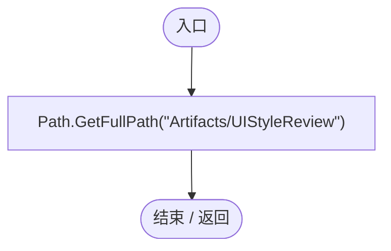

<a id="mfcb167bbae6783e0"></a>

## UIStyleRegression.ctor · L29

`static UIStyleRegression()`


### Editor · Roslyn编译器控制流

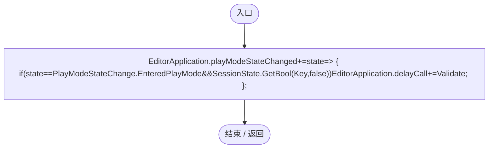

项目内调用/回调引用：

- [UIStyleRegression.回调@31 · L31](07acc7eed21a3625.md#mc370e9fb1a34186b)（回调/委托）

<a id="mc370e9fb1a34186b"></a>

## 回调@31 · L31

`state … => 回调`


### Editor · Roslyn编译器控制流

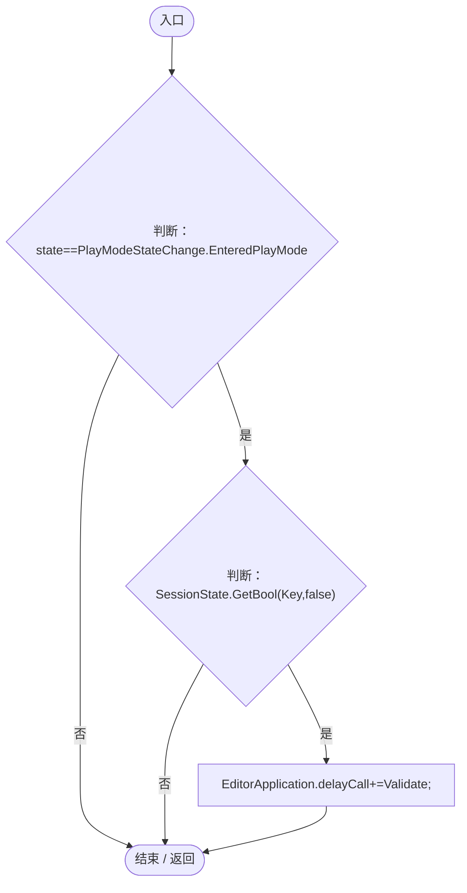

项目内调用/回调引用：

- [UIStyleRegression.Validate · L44](07acc7eed21a3625.md#m944e7d6603476dfb)（方法）

<a id="m40546868b7647ef1"></a>

## RunBatch · L36

`public static void RunBatch()`


### Editor · Roslyn编译器控制流

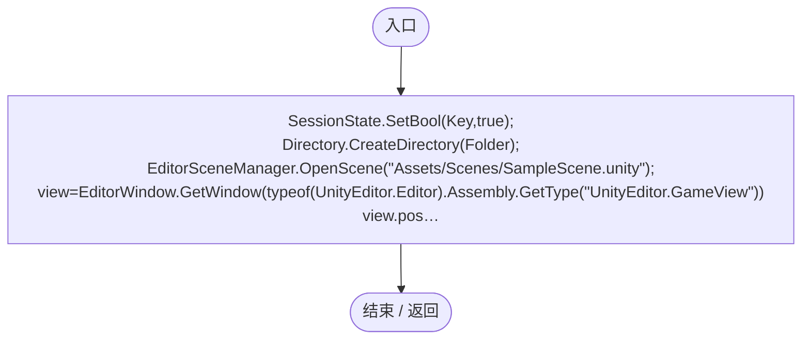

<a id="m944e7d6603476dfb"></a>

## Validate · L44

`[MenuItem("Tools/Darwin Park/Validate Reference UI Style")] public static void Validate()`


### Editor · Roslyn编译器控制流

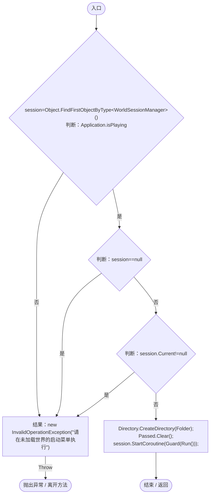

项目内调用/回调引用：

- [WorldSessionManager.Current.get · L21](08741c7b7b9d9344.md#m5d26a5eb846a8504)（访问器）
- [UIStyleRegression.Guard · L56](07acc7eed21a3625.md#m805e307be72e31a4)（方法）
- [UIStyleRegression.Run · L89](07acc7eed21a3625.md#m3f3b8753e5f5df6e)（方法）

<a id="md53b8717c6745527"></a>

## Get · L51

`private static object Get(object target,string name)`


### Editor · Roslyn编译器控制流

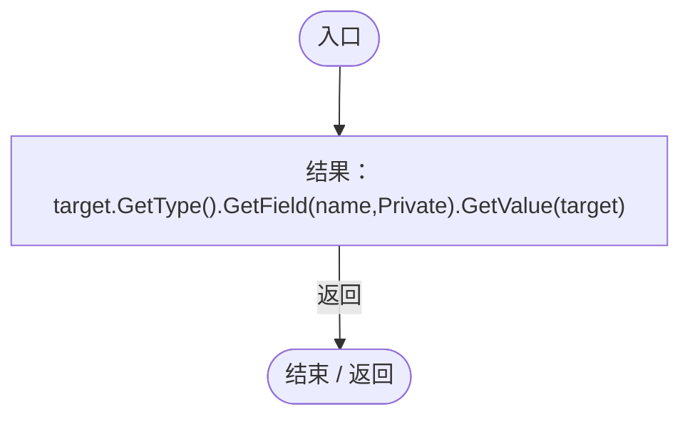

<a id="m9b5d05c80130a56b"></a>

## Set · L52

`private static void Set(object target,string name,object value)`


### Editor · Roslyn编译器控制流

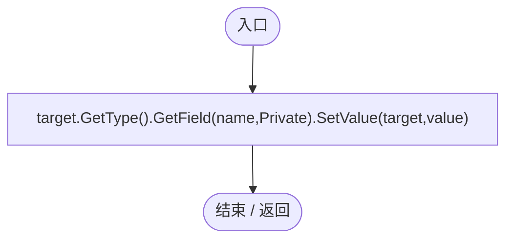

<a id="m874f75ce18717bec"></a>

## Invoke · L53

`private static void Invoke(object target,string name)`


### Editor · Roslyn编译器控制流

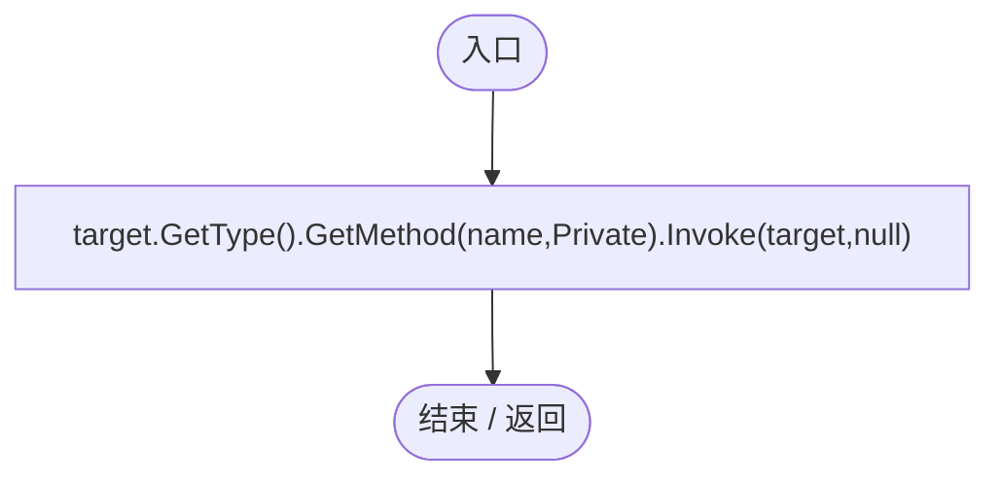

<a id="m922f283efe867b4d"></a>

## Check · L54

`private static void Check(bool value,string message)`


### Editor · Roslyn编译器控制流

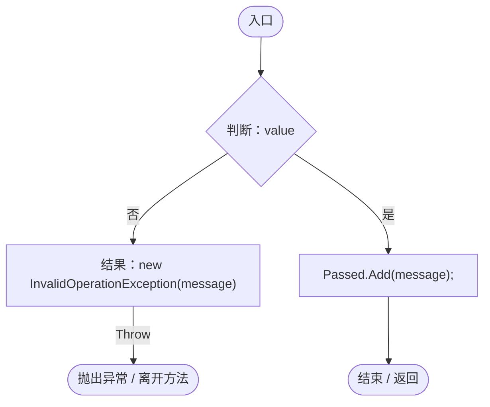

<a id="m805e307be72e31a4"></a>

## Guard · L56

`private static IEnumerator Guard(IEnumerator run)`


### Editor · Roslyn编译器控制流

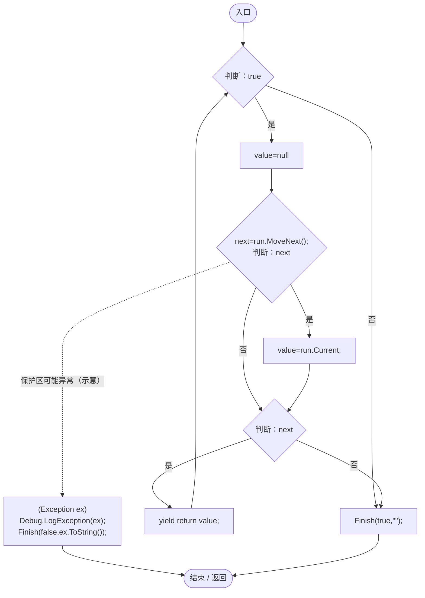

项目内调用/回调引用：

- [UIStyleRegression.Finish · L67](07acc7eed21a3625.md#m8ac63026272ce98e)（方法）

<a id="m8ac63026272ce98e"></a>

## Finish · L67

`private static void Finish(bool passed,string error)`


### Editor · Roslyn编译器控制流

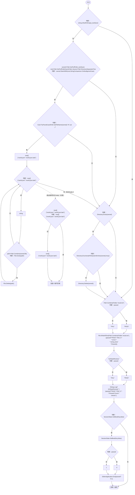

<a id="m2c28564152e51481"></a>

## Capture · L83

`private static IEnumerator Capture(string name)`


### Editor · Roslyn编译器控制流

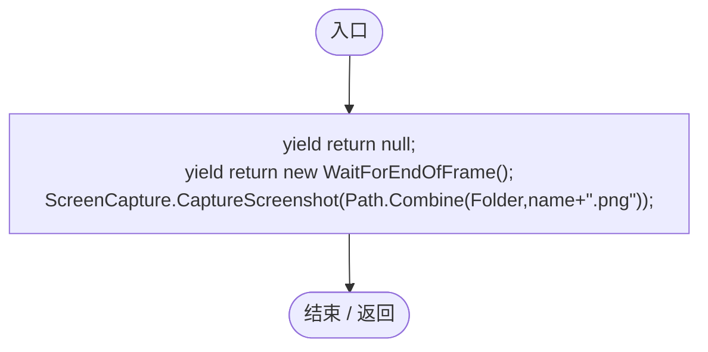

<a id="m3f3b8753e5f5df6e"></a>

## Run · L89

`private static IEnumerator Run()`


### Editor · Roslyn编译器控制流

```mermaid
flowchart TD
  b0(["入口"])
  b1["menu=Object.FindFirstObjectByType&lt;GameMainMenu&gt;()<br/>session=Object.FindFirstObjectByType&lt;WorldSessionManager&gt;()<br/>root=ServiceLocator.Get&lt;UIRoot&gt;()<br/>Check(root.MainCanvas.GetComponent&lt;GraphicRaycaster&gt;()!=null,&quot;主 Canvas 保留点击射线&quot;);<br/>Check(UIVisu…"]
  b2["UIVisualTheme.Data.geneIcons"]
  b3{"判断：UIVisualTheme.Data.geneIcons"}
  b4["var<br/>Check(UIIconRegistry.Get(entry.icon)!=null,&quot;基因图标可加载：&quot;+entry.id);"]
  b5{"UIVisualTheme.Data.geneIcons<br/>判断：UIVisualTheme.Data.geneIcons"}
  b6["UIVisualTheme.Data.geneIcons"]
  b7["连接 / 离开区域"]
  b8["new[]{&quot;planet&quot;,&quot;time_play&quot;,&quot;time_pause&quot;,&quot;ui_icon_prev&quot;,&quot;ui_icon_next&quot;,&quot;btn_param_temp&quot;,&quot;btn_param_hum&quot;,&quot;btn_param_terrain&quot;,&quot;btn_param_seed&quot;,&quot;layer_ore&quot;,&quot;layer_terrain&quot;,&quot;layer_climate&quot;,&quot;entity_template_default&quot;}"]
  b9{"判断：new[]{&quot;planet&quot;,&quot;time_play&quot;,&quot;time_pause&quot;,&quot;ui_icon_prev&quot;,&quot;ui_icon_next&quot;,&quot;btn_param_temp&quot;,&quot;btn_param_hum&quot;,&quot;btn_param_terrain&quot;,&quot;btn_param_seed&quot;,&quot;layer_ore&quot;,&quot;layer_terrain&quot;,&quot;layer_climate&quot;,&quot;entity_template_default&quot;}"}
  b10["string<br/>Check(UIIconRegistry.Get(icon)!=null,&quot;导航/HUD 图标可加载：&quot;+icon);"]
  b11{"new[]{&quot;planet&quot;,&quot;time_play&quot;,&quot;time_pause&quot;,&quot;ui_icon_prev&quot;,&quot;ui_icon_next&quot;,&quot;btn_param_temp&quot;,&quot;btn_param_hum&quot;,&quot;btn_param_terrain&quot;,&quot;btn_param_seed&quot;,&quot;layer_ore&quot;,&quot;layer_terrain&quot;,&quot;layer_climate&quot;,&quot;entity_template_default&quot;}<br/>判断：new[]{&quot;planet&quot;,&quot;time_pl…"}
  b12["new[]{&quot;planet&quot;,&quot;time_play&quot;,&quot;time_pause&quot;,&quot;ui_icon_prev&quot;,&quot;ui_icon_next&quot;,&quot;btn_param_temp&quot;,&quot;btn_param_hum&quot;,&quot;btn_param_terrain&quot;,&quot;btn_param_seed&quot;,&quot;layer_ore&quot;,&quot;layer_terrain&quot;,&quot;layer_climate&quot;,&quot;entity_template_default&quot;}"]
  b13["连接 / 离开区域"]
  b14["bottom=root.MainCanvas.transform.Find(&quot;BottomPanel&quot;).GetComponent&lt;RectTransform&gt;()"]
  b15{"判断：bottom.anchorMin==Vector2.zero"}
  b16{"判断：bottom.anchorMax==Vector2.right"}
  b17{"判断：bottom.anchoredPosition==Vector2.zero"}
  b18["Mathf.Approximately(bottom.sizeDelta.y,210)"]
  b19["bottom.anchorMin==Vector2.zero&amp;&amp;bottom.anchorMax==Vector2.right&amp;&amp;bottom.anchoredPosition==Vector2.zero&amp;&amp;Mathf.Approximately(bottom.sizeDelta.y,210)"]
  b20["Check(bottom.anchorMin==Vector2.zero&amp;&amp;bottom.anchorMax==Vector2.right&amp;&amp;bottom.anchoredPosition==Vector2.zero&amp;&amp;Mathf.Approximately(bottom.sizeDelta.y,210),&quot;底栏仍为原全宽底部 210 高矩形&quot;);"]
  b21["geometry=(bottom.anchorMin,bottom.anchorMax,bottom.pivot,bottom.anchoredPosition,bottom.sizeDelta)<br/>UIVisualTheme.Paint(bottom.GetComponent&lt;Image&gt;());<br/>Check(geometry==(bottom.anchorMin,bottom.anchorMax,bottom.pivot,bottom.anchoredPosition…"]
  b22["new[]{(&quot;settings&quot;,&quot;02-settings&quot;),(&quot;create&quot;,&quot;03-create&quot;),(&quot;multiplayer&quot;,&quot;04-multiplayer&quot;)}"]
  b23{"判断：new[]{(&quot;settings&quot;,&quot;02-settings&quot;),(&quot;create&quot;,&quot;03-create&quot;),(&quot;multiplayer&quot;,&quot;04-multiplayer&quot;)}"}
  b24{"var<br/>判断：page.Item1==&quot;create&quot;"}
  b25["Invoke(menu,&quot;NewWorldForm&quot;);"]
  b26["Set(menu,&quot;_page&quot;,page.Item1);"]
  b27["yield return Capture(page.Item2);"]
  b28{"new[]{(&quot;settings&quot;,&quot;02-settings&quot;),(&quot;create&quot;,&quot;03-create&quot;),(&quot;multiplayer&quot;,&quot;04-multiplayer&quot;)}<br/>判断：new[]{(&quot;settings&quot;,&quot;02-settings&quot;),(&quot;create&quot;,&quot;03-create&quot;),(&quot;multiplayer&quot;,&quot;04-multiplayer&quot;)}"}
  b29["new[]{(&quot;settings&quot;,&quot;02-settings&quot;),(&quot;create&quot;,&quot;03-create&quot;),(&quot;multiplayer&quot;,&quot;04-multiplayer&quot;)}"]
  b30["连接 / 离开区域"]
  b31["tools=Object.FindFirstObjectByType&lt;GeneTreeWorkbench&gt;()<br/>tools.Open();<br/>Set(menu,&quot;_page&quot;,&quot;tools&quot;);<br/>tools.GetType().GetMethod(&quot;Select&quot;,Private).Invoke(tools,new object[]{&quot;gene_territory&quot;});<br/>yield return Capture(&quot;05-gene-tree&quot;);"]
  b32{"判断：tools.Visible"}
  b33["!tools.HasUnsavedChanges"]
  b34["tools.Visible"]
  b35["Check(tools.Visible&amp;&amp;!tools.HasUnsavedChanges,&quot;打开与绘制工具不改写基因配置&quot;);"]
  b36["tools.Close();<br/>Set(menu,&quot;_page&quot;,&quot;saves&quot;);<br/>previews=new List&lt;WorldSaveEntry&gt;()"]
  b37["new[]{&quot;2026-10-28_12-00-00_78031&quot;,&quot;群落实验&quot;,&quot;初始生态&quot;}"]
  b38{"判断：new[]{&quot;2026-10-28_12-00-00_78031&quot;,&quot;群落实验&quot;,&quot;初始生态&quot;}"}
  b39["string"]
  b40["previews<br/>new WorldSaveEntry{name=name,data=new WorldSaveData{name=name,seed=78031,gameTime=4380}}<br/>name=name"]
  b41["new WorldSaveData{name=name,seed=78031,gameTime=4380}<br/>name=name<br/>seed=78031<br/>gameTime=4380<br/>data=new WorldSaveData{name=name,seed=78031,gameTime=4380}"]
  b42["previews.Add(new WorldSaveEntry{name=name,data=new WorldSaveData{name=name,seed=78031,gameTime=4380}});"]
  b43{"new[]{&quot;2026-10-28_12-00-00_78031&quot;,&quot;群落实验&quot;,&quot;初始生态&quot;}<br/>判断：new[]{&quot;2026-10-28_12-00-00_78031&quot;,&quot;群落实验&quot;,&quot;初始生态&quot;}"}
  b44["new[]{&quot;2026-10-28_12-00-00_78031&quot;,&quot;群落实验&quot;,&quot;初始生态&quot;}"]
  b45["连接 / 离开区域"]
  b46["Set(menu,&quot;_saves&quot;,previews);<br/>yield return Capture(&quot;06-saves&quot;);<br/>builder=Object.FindFirstObjectByType&lt;PlanetTerrainMeshBuilder&gt;()<br/>builder.subdivisions=32;<br/>Set(session,&quot;_initialTerrain&quot;,JsonUtility.ToJson(builder));<br/>PlanetClimateMap.Instanc…"]
  b47{"判断：session.Busy"}
  b48{"判断：captured"}
  b49{"判断：session.Progress&gt;=.66f"}
  b50["captured=true;<br/>yield return Capture(&quot;07-loading&quot;);"]
  b51{"判断：EditorApplication.timeSinceStartup-started&gt;100"}
  b52["结果：new TimeoutException(&quot;世界加载超时&quot;)"]
  x52(["抛出异常 / 离开方法"])
  b53["yield return null;"]
  b54{"判断：session.Current!=null"}
  b55["!menu.Visible"]
  b56["session.Current!=null"]
  b57["Check(session.Current!=null&amp;&amp;!menu.Visible,&quot;新建完成后仍进入游戏&quot;);"]
  b58["_testSave=Path.GetDirectoryName(WorldSaveStore.FileFor(session.Current.id));<br/>clock=ServiceLocator.Get&lt;SimulationClock&gt;()<br/>clock.Pause();<br/>genome=new Genome()"]
  b59["new[]{&quot;gene_growth&quot;,&quot;gene_reproduction&quot;,&quot;gene_nutrition&quot;,&quot;gene_locomotion&quot;,&quot;gene_territory&quot;}"]
  b60{"判断：new[]{&quot;gene_growth&quot;,&quot;gene_reproduction&quot;,&quot;gene_nutrition&quot;,&quot;gene_locomotion&quot;,&quot;gene_territory&quot;}"}
  b61["string<br/>genome.Add(GeneInstance.Create(id,50,0));"]
  b62{"new[]{&quot;gene_growth&quot;,&quot;gene_reproduction&quot;,&quot;gene_nutrition&quot;,&quot;gene_locomotion&quot;,&quot;gene_territory&quot;}<br/>判断：new[]{&quot;gene_growth&quot;,&quot;gene_reproduction&quot;,&quot;gene_nutrition&quot;,&quot;gene_locomotion&quot;,&quot;gene_territory&quot;}"}
  b63["new[]{&quot;gene_growth&quot;,&quot;gene_reproduction&quot;,&quot;gene_nutrition&quot;,&quot;gene_locomotion&quot;,&quot;gene_territory&quot;}"]
  b64["连接 / 离开区域"]
  b65["DarwinEntity.Spawner(genome,builder.transform.position+Vector3.up*(builder.WaterRadius+3),&quot;苍穹 · 行者&quot;);<br/>yield return null;<br/>entity=EntityRegistry.All.Single()<br/>inspector=Object.FindFirstObjectByType&lt;GeneInspectorUI&gt;()<br/>inspector.ShowEntityInf…"]
  b66{"判断：panel.anchorMin==Vector2.up"}
  b67{"判断：panel.anchorMax==Vector2.up"}
  b68{"判断：panel.pivot==Vector2.up"}
  b69{"判断：panel.anchoredPosition==inspector.infoCornerOffset"}
  b70["panel.sizeDelta.x==420"]
  b71["panel.anchorMin==Vector2.up&amp;&amp;panel.anchorMax==Vector2.up&amp;&amp;panel.pivot==Vector2.up&amp;&amp;panel.anchoredPosition==inspector.infoCornerOffset&amp;&amp;panel.sizeDelta.x==420"]
  b72["Check(panel.anchorMin==Vector2.up&amp;&amp;panel.anchorMax==Vector2.up&amp;&amp;panel.pivot==Vector2.up&amp;&amp;panel.anchoredPosition==inspector.infoCornerOffset&amp;&amp;panel.sizeDelta.x==420,&quot;实体面板保持原左上位置与宽度&quot;);"]
  b73["entity.GetComponent&lt;DarwinPark.Entities.Stats.EntityStats&gt;().Modify(&quot;health&quot;,-12,false);<br/>inspector.RefreshDisplayedInfo();<br/>summary=panel.Find(&quot;ScrollView/Viewport/Content/BaseInfo/Stat_health&quot;)"]
  b74{"判断：summary.Find(&quot;Value&quot;).GetComponent&lt;Text&gt;().text==&quot;88&quot;"}
  b75["Mathf.Abs(summary.Find(&quot;Track/Fill&quot;).GetComponent&lt;RectTransform&gt;().anchorMax.x-.88f)&lt;.001f"]
  b76["summary.Find(&quot;Value&quot;).GetComponent&lt;Text&gt;().text==&quot;88&quot;"]
  b77["Check(summary.Find(&quot;Value&quot;).GetComponent&lt;Text&gt;().text==&quot;88&quot;&amp;&amp;Mathf.Abs(summary.Find(&quot;Track/Fill&quot;).GetComponent&lt;RectTransform&gt;().anchorMax.x-.88f)&lt;.001f,&quot;分栏数值和进度条同步刷新真实生命值与上限&quot;);"]
  b78["favorites=((GameObject)Get(EntityFavoritesManager.Instance,&quot;_listPanel&quot;)).GetComponent&lt;RectTransform&gt;()"]
  b79{"判断：favorites.anchorMin==new Vector2(0,.5f)"}
  b80{"判断：favorites.anchoredPosition==new Vector2(20,0)"}
  b81["favorites.sizeDelta==new Vector2(200,400)"]
  b82["favorites.anchorMin==new Vector2(0,.5f)&amp;&amp;favorites.anchoredPosition==new Vector2(20,0)&amp;&amp;favorites.sizeDelta==new Vector2(200,400)"]
  b83["Check(favorites.anchorMin==new Vector2(0,.5f)&amp;&amp;favorites.anchoredPosition==new Vector2(20,0)&amp;&amp;favorites.sizeDelta==new Vector2(200,400),&quot;收藏栏保持原左侧中部位置与尺寸&quot;);"]
  b84["yield return Capture(&quot;08-game&quot;);<br/>Invoke(inspector,&quot;ShowAddGeneMenu&quot;);<br/>yield return null;<br/>add=((GameObject)Get(inspector,&quot;_addGenePanel&quot;)).GetComponent&lt;RectTransform&gt;()"]
  b85{"判断：add.anchorMin==Vector2.zero"}
  b86{"判断：add.anchorMax==Vector2.zero"}
  b87{"判断：add.anchoredPosition==inspector.addCornerOffset"}
  b88["add.sizeDelta.x==350"]
  b89["add.anchorMin==Vector2.zero&amp;&amp;add.anchorMax==Vector2.zero&amp;&amp;add.anchoredPosition==inspector.addCornerOffset&amp;&amp;add.sizeDelta.x==350"]
  b90["Check(add.anchorMin==Vector2.zero&amp;&amp;add.anchorMax==Vector2.zero&amp;&amp;add.anchoredPosition==inspector.addCornerOffset&amp;&amp;add.sizeDelta.x==350,&quot;添加基因窗保持原左下位置与宽度&quot;);"]
  b91["content=(Transform)Get(inspector,&quot;_addGeneListParent&quot;)<br/>Check(content.Cast&lt;Transform&gt;().Count(t=&gt;t.gameObject.activeSelf)==GeneDatabase.All.Count(),&quot;全部基因仍生成可点击条目&quot;);<br/>Check(content.GetComponentInParent&lt;ScrollRect&gt;().verticalScrollbar!=null,…"]
  b92{"判断：menu.Visible"}
  b93{"判断：clock.IsRunning"}
  b94["GameInputGate.Blocked"]
  b95["menu.Visible&amp;&amp;!clock.IsRunning&amp;&amp;GameInputGate.Blocked"]
  b96["Check(menu.Visible&amp;&amp;!clock.IsRunning&amp;&amp;GameInputGate.Blocked,&quot;暂停继续接管游戏输入与时钟&quot;);"]
  b97["Invoke(menu,&quot;Resume&quot;);"]
  b98{"判断：menu.Visible"}
  b99["!GameInputGate.Blocked"]
  b100["!menu.Visible"]
  b101["Check(!menu.Visible&amp;&amp;!GameInputGate.Blocked,&quot;返回游戏恢复 HUD 与输入&quot;);"]
  b102["menu.ShowPause();<br/>menu.ReturnToMainMenu();"]
  b103{"判断：session.Current==null"}
  b104["EntityRegistry.All.Count==0"]
  b105["session.Current==null"]
  b106["Check(session.Current==null&amp;&amp;EntityRegistry.All.Count==0,&quot;保存并返回主界面链路保持正常&quot;);"]
  b107["Check(File.Exists(Path.Combine(_testSave,&quot;world.json&quot;)),&quot;主题不影响存档落盘&quot;);"]
  b108(["结束 / 返回"])
  b0 --> b1
  b1 --> b2
  b2 --> b3
  b3 -->|"是"| b4
  b3 -->|"否 · 经过finally 5"| b8
  b4 --> b3
  b5 -->|"否"| b6
  b5 -->|"是"| b7
  b6 --> b7
  b8 --> b9
  b9 -->|"是"| b10
  b9 -->|"否 · 经过finally 11"| b14
  b10 --> b9
  b11 -->|"否"| b12
  b11 -->|"是"| b13
  b12 --> b13
  b14 --> b15
  b15 -->|"是"| b16
  b15 -->|"否"| b19
  b16 -->|"是"| b17
  b16 -->|"否"| b19
  b17 -->|"是"| b18
  b17 -->|"否"| b19
  b18 --> b20
  b19 --> b20
  b20 --> b21
  b21 --> b22
  b22 --> b23
  b23 -->|"是"| b24
  b23 -->|"否 · 经过finally 28"| b31
  b24 -->|"是"| b25
  b24 -->|"否"| b26
  b25 --> b27
  b26 --> b27
  b27 --> b23
  b28 -->|"否"| b29
  b28 -->|"是"| b30
  b29 --> b30
  b31 --> b32
  b32 -->|"是"| b33
  b32 -->|"否"| b34
  b33 --> b35
  b34 --> b35
  b35 --> b36
  b36 --> b37
  b37 --> b38
  b38 -->|"是"| b39
  b38 -->|"否 · 经过finally 43"| b46
  b39 --> b40
  b40 --> b41
  b41 --> b42
  b42 --> b38
  b43 -->|"否"| b44
  b43 -->|"是"| b45
  b44 --> b45
  b46 --> b47
  b47 -->|"是"| b48
  b47 -->|"否"| b54
  b48 -->|"否"| b49
  b48 -->|"是"| b51
  b49 -->|"是"| b50
  b49 -->|"否"| b51
  b50 --> b51
  b51 -->|"是"| b52
  b51 -->|"否"| b53
  b52 -->|"Throw"| x52
  b53 --> b47
  b54 -->|"是"| b55
  b54 -->|"否"| b56
  b55 --> b57
  b56 --> b57
  b57 --> b58
  b58 --> b59
  b59 --> b60
  b60 -->|"是"| b61
  b60 -->|"否 · 经过finally 62"| b65
  b61 --> b60
  b62 -->|"否"| b63
  b62 -->|"是"| b64
  b63 --> b64
  b65 --> b66
  b66 -->|"是"| b67
  b66 -->|"否"| b71
  b67 -->|"是"| b68
  b67 -->|"否"| b71
  b68 -->|"是"| b69
  b68 -->|"否"| b71
  b69 -->|"是"| b70
  b69 -->|"否"| b71
  b70 --> b72
  b71 --> b72
  b72 --> b73
  b73 --> b74
  b74 -->|"是"| b75
  b74 -->|"否"| b76
  b75 --> b77
  b76 --> b77
  b77 --> b78
  b78 --> b79
  b79 -->|"是"| b80
  b79 -->|"否"| b82
  b80 -->|"是"| b81
  b80 -->|"否"| b82
  b81 --> b83
  b82 --> b83
  b83 --> b84
  b84 --> b85
  b85 -->|"是"| b86
  b85 -->|"否"| b89
  b86 -->|"是"| b87
  b86 -->|"否"| b89
  b87 -->|"是"| b88
  b87 -->|"否"| b89
  b88 --> b90
  b89 --> b90
  b90 --> b91
  b91 --> b92
  b92 -->|"是"| b93
  b92 -->|"否"| b95
  b93 -->|"否"| b94
  b93 -->|"是"| b95
  b94 --> b96
  b95 --> b96
  b96 --> b97
  b97 --> b98
  b98 -->|"否"| b99
  b98 -->|"是"| b100
  b99 --> b101
  b100 --> b101
  b101 --> b102
  b102 --> b103
  b103 -->|"是"| b104
  b103 -->|"否"| b105
  b104 --> b106
  b105 --> b106
  b106 --> b107
  b107 --> b108
  b3 -. "退出保护区时 finally（示意）" .-> b5
  b9 -. "退出保护区时 finally（示意）" .-> b11
  b23 -. "退出保护区时 finally（示意）" .-> b28
  b38 -. "退出保护区时 finally（示意）" .-> b43
  b60 -. "退出保护区时 finally（示意）" .-> b62

```

项目内调用/回调引用：

- [ServiceLocator.Get · L33](f2fdbe9f9ccd93cb.md#m2ae625299520c56d)（方法）
- [UIStyleRegression.Check · L54](07acc7eed21a3625.md#m922f283efe867b4d)（方法）
- [UIRoot.MainCanvas.get · L14](9c1421378791f0e0.md#maa2cc9baf1248477)（访问器）
- [UIVisualTheme.Data.get · L26](ca525a798a08f966.md#m6c42bdb45a1d9916)（访问器）
- [UIIconRegistry.Get · L38](5e97f4545b48cac2.md#m95da89c0db2bbab9)（方法）
- [UIVisualTheme.Paint · L58](ca525a798a08f966.md#m2d61a6b26ab24980)（方法）
- [UIStyleRegression.Capture · L83](07acc7eed21a3625.md#m2c28564152e51481)（方法）
- [UIStyleRegression.Invoke · L53](07acc7eed21a3625.md#m874f75ce18717bec)（方法）
- [UIStyleRegression.Set · L52](07acc7eed21a3625.md#m9b5d05c80130a56b)（方法）
- [GeneTreeWorkbench.Open · L36](7b98ef3da23a85cb.md#mb56f2027c48eafaa)（方法）
- [GeneTreeWorkbench.Visible.get · L13](7b98ef3da23a85cb.md#m37844757c7380137)（访问器）
- [GeneTreeWorkbench.Close · L42](7b98ef3da23a85cb.md#m371900e9a4a2fe4c)（方法）
- [PlanetClimateMap.Instance.get · L16](b4e9726c1bcf4c37.md#m3add54a419aeef9f)（访问器）
- [PlanetOreSystem.Instance.get · L8](86b3fbb4d9436121.md#m53f6a6af4b6dc252)（访问器）
- [WorldSessionManager.Create · L41](08741c7b7b9d9344.md#m6aadfeee8b90aacd)（方法）
- [WorldSessionManager.Busy.get · L24](08741c7b7b9d9344.md#m4483e2e4f28f7c85)（访问器）
- [WorldSessionManager.Progress.get · L22](08741c7b7b9d9344.md#mba9a7bc60b0d1863)（访问器）
- [WorldSessionManager.Current.get · L21](08741c7b7b9d9344.md#m5d26a5eb846a8504)（访问器）
- [WorldSaveStore.FileFor · L48](d67a35e5e3814c15.md#m419a625e2bcc70f8)（方法）
- [SimulationClock.Pause · L79](a8f444aec9614b0a.md#m30929d45a885d0f1)（方法）
- [Genome.Add · L19](a2ef23f865bc7ee8.md#md9cfdc94b8b8d40f)（方法）
- [GeneInstance.Create · L20](f82e1498d67f5afd.md#m72e94c278de3cf8b)（方法）
- [PlanetTerrainMeshBuilder.WaterRadius.get · L94](415285cf043354a9.md#m28d8809083881ec1)（访问器）
- [GeneInspectorUI.ShowEntityInfo · L385](924e27c34e7b1f0a.md#mea69a0457b885287)（方法）
- [EntityFavoritesManager.ToggleFavorite · L55](b60fb973e9d3815a.md#m20d366a69a0f5fdd)（方法）
- [EntityFavoritesManager.Instance.get · L10](b60fb973e9d3815a.md#m0dac2feb106bac97)（访问器）
- [EntityFavoritesManager.TogglePanel · L36](b60fb973e9d3815a.md#ma95fb9dcce4925e2)（方法）
- [UIStyleRegression.Get · L51](07acc7eed21a3625.md#md53b8717c6745527)（方法）
- [EntityStats.Modify · L111](75aa86a368efdf24.md#m9c837be197158240)（方法）
- [GeneInspectorUI.RefreshDisplayedInfo · L325](924e27c34e7b1f0a.md#mdd0690def5cc19d3)（方法）
- [GeneDatabase.All.get · L128](ec0a03483435a863.md#m0a367ed24734f426)（访问器）
- [DarwinEntity.Genes.get · L14](70798dde169f2e8b.md#m622eb1adf401d431)（访问器）
- [EntityTemplateManager.SaveTemplate · L30](ab5e6457e8a7aba0.md#me559754bdf2cc955)（方法）
- [GameMainMenu.ShowPause · L89](a1f1791f9e7a8035.md#m953d85f379a39458)（方法）
- [SimulationClock.IsRunning.get · L22](a8f444aec9614b0a.md#m10f4fe307faca0f0)（访问器）
- [GameInputGate.Blocked.get · L8](52955daae7e592ab.md#m765763b665829633)（访问器）
- [GameMainMenu.ReturnToMainMenu · L278](a1f1791f9e7a8035.md#m1fdc747e6f1c67d2)（方法）
- [UIStyleRegression.回调@105 · L105](07acc7eed21a3625.md#m13f0e54ef6a05810)（回调/委托）
- [UIStyleRegression.回调@105 · L105](07acc7eed21a3625.md#m041452e439885d20)（回调/委托）
- [UIStyleRegression.回调@152 · L152](07acc7eed21a3625.md#m27802eb8060e70c8)（回调/委托）
- [UIStyleRegression.回调@156 · L156](07acc7eed21a3625.md#ma1db4bf739aab8da)（回调/委托）
- [UIStyleRegression.回调@156 · L156](07acc7eed21a3625.md#md960d575ad8dae23)（回调/委托）
- [UIStyleRegression.回调@158 · L158](07acc7eed21a3625.md#mc9d6e017f08e6430)（回调/委托）
- [UIStyleRegression.回调@163 · L163](07acc7eed21a3625.md#m1165cbba7f001494)（回调/委托）
- [UIStyleRegression.回调@164 · L164](07acc7eed21a3625.md#ma5462bf866352e4d)（回调/委托）

<a id="m13f0e54ef6a05810"></a>

## 回调@105 · L105

`t … => 回调`


### Editor · Roslyn编译器控制流

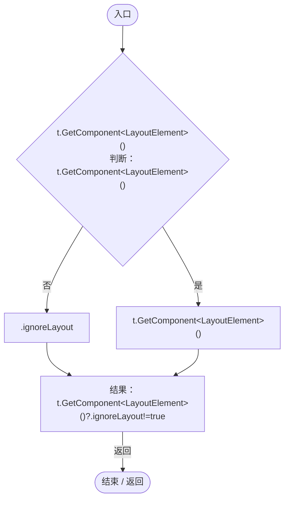

<a id="m041452e439885d20"></a>

## 回调@105 · L105

`t … => 回调`


### Editor · Roslyn编译器控制流

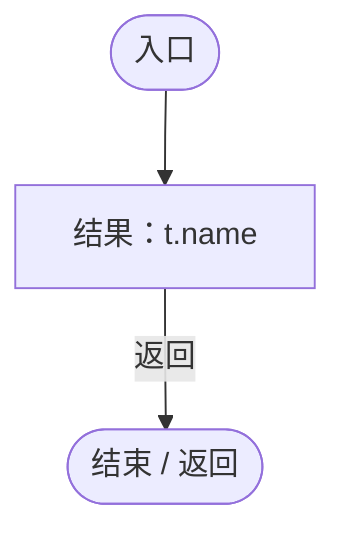

<a id="m27802eb8060e70c8"></a>

## 回调@152 · L152

`t … => 回调`


### Editor · Roslyn编译器控制流

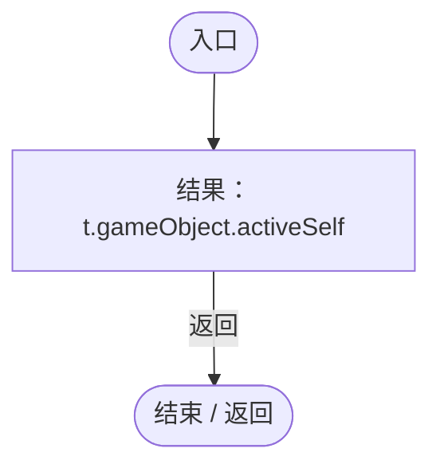

<a id="ma1db4bf739aab8da"></a>

## 回调@156 · L156

`i … => 回调`


### Editor · Roslyn编译器控制流

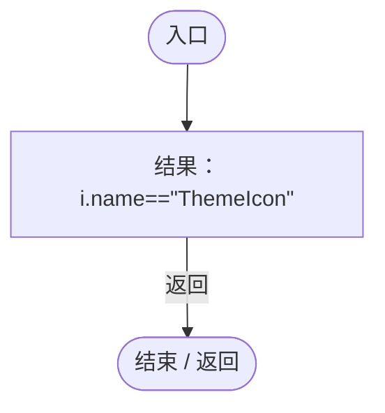

<a id="md960d575ad8dae23"></a>

## 回调@156 · L156

`i … => 回调`


### Editor · Roslyn编译器控制流

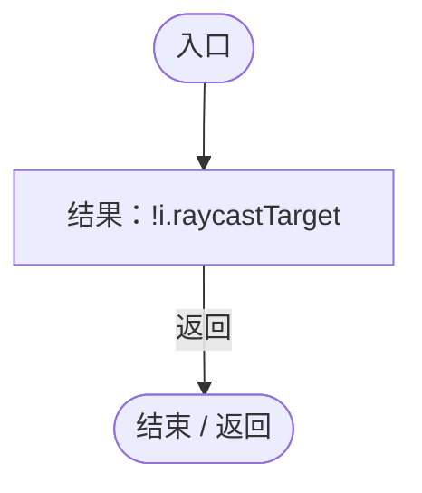

<a id="mc9d6e017f08e6430"></a>

## 回调@158 · L158

`g … => 回调`


### Editor · Roslyn编译器控制流

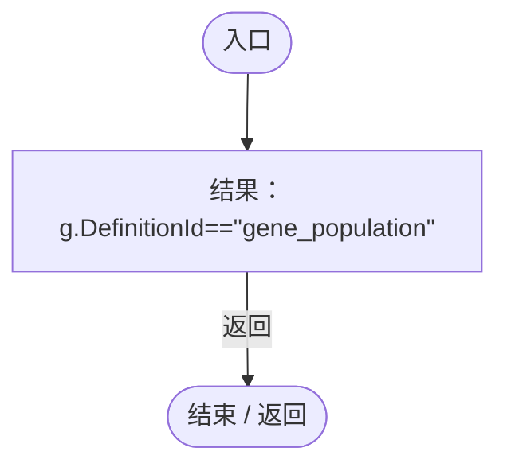

<a id="m1165cbba7f001494"></a>

## 回调@163 · L163

`s … => 回调`


### Editor · Roslyn编译器控制流


<a id="ma5462bf866352e4d"></a>

## 回调@164 · L164

`i … => 回调`


### Editor · Roslyn编译器控制流

```mermaid
flowchart TD
  b0(["入口"])
  b1{"判断：i.name==&quot;ThemeIcon&quot;"}
  b2["i.sprite!=null"]
  b3["i.name==&quot;ThemeIcon&quot;"]
  b4["结果：i.name==&quot;ThemeIcon&quot;&amp;&amp;i.sprite!=null"]
  b5(["结束 / 返回"])
  b0 --> b1
  b1 -->|"是"| b2
  b1 -->|"否"| b3
  b2 --> b4
  b3 --> b4
  b4 -->|"返回"| b5

```
