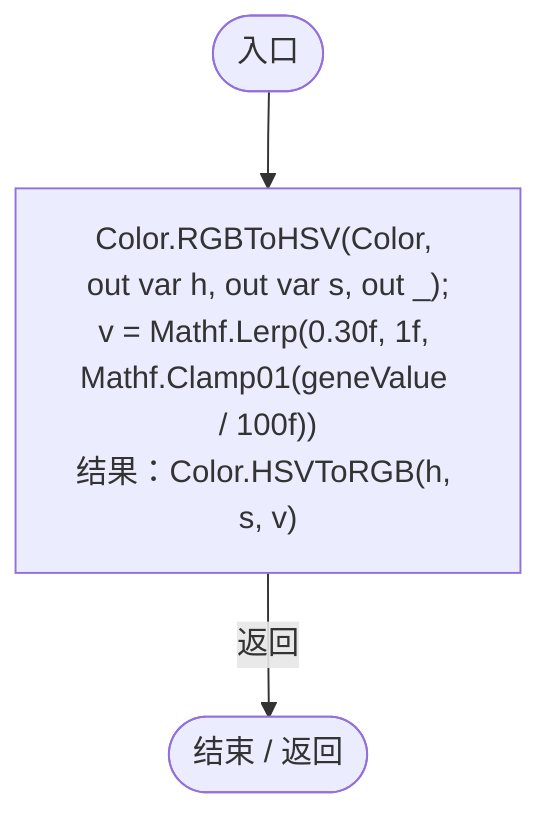
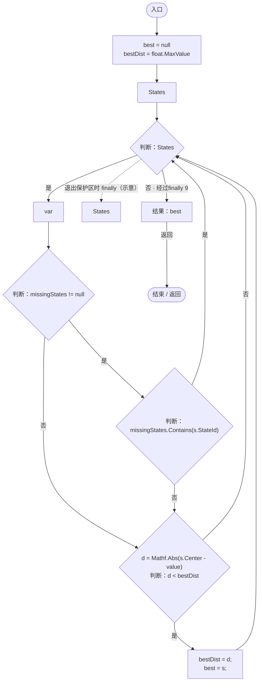

# GeneDefinition.cs

[返回总索引](../README.md) · `Runtime` · `Assets/DarwinPark/Genetics/Data/GeneDefinition.cs`

[源文件](../../../Assets/DarwinPark/Genetics/Data/GeneDefinition.cs) · 源码校验：`ca3abbed7ce6d455e9e2f848e896262ea2bb7c23d12b1ccbc837d6d4bb3ca2de`

方法按源文件位置排列。事件/回调引用不表示立即执行；分支与异常说明见总索引。完整源码与可点击关系图请打开离线手册。

## GetDisplayColor · L55

`public Color GetDisplayColor(float geneValue)`

### Editor / Player · Roslyn编译器控制流

## ResolveState · L83

`public GeneStateDefinition ResolveState(float value, ICollection<string> missingStates)`

### Editor / Player · Roslyn编译器控制流

