# EntityDeathSettlement.cs

[返回总索引](../README.md) · `Runtime` · `Assets/DarwinPark/Entities/Ecology/EntityDeathSettlement.cs`

[源文件](../../../Assets/DarwinPark/Entities/Ecology/EntityDeathSettlement.cs) · 源码校验：`08a81f2f6ecb69330b7afe73282c047068ff48fcd3649203378eabe8f14b6a27`

方法按源文件位置排列。事件/回调引用不表示立即执行；分支与异常说明见总索引。完整源码与可点击关系图请打开离线手册。

## Die · L11

`public static ColonyResource Die(DarwinEntity victim,DarwinEntity attacker=null)`

### Editor / Player · Roslyn编译器控制流

```mermaid
flowchart TD
  b0(["入口"])
  b1{"判断：victim==null"}
  b2{"判断：WorldAuthority.IsReplica"}
  b3["结果：null"]
  b4{"victim.GetComponent&lt;EntityDeathSettlement&gt;()<br/>判断：victim.GetComponent&lt;EntityDeathSettlement&gt;()"}
  b5["victim.GetComponent&lt;EntityDeathSettlement&gt;()"]
  b6["victim.gameObject.AddComponent&lt;EntityDeathSettlement&gt;()"]
  b7["marker=victim.GetComponent&lt;EntityDeathSettlement&gt;()??victim.gameObject.AddComponent&lt;EntityDeathSettlement&gt;()"]
  b8{"判断：marker._settled"}
  b9["结果：null"]
  b10["marker._settled=true;<br/>remaining=ColonyResource.Biomass(victim)<br/>remaining-=NutritionTransfer.Digest(attacker,remaining);"]
  b11{"判断：attacker!=null"}
  b12["attacker.GetComponent&lt;AntColonyMember&gt;()"]
  b13["null"]
  b14["member=attacker!=null?attacker.GetComponent&lt;AntColonyMember&gt;():null"]
  b15{"判断：member!=null"}
  b16{"判断：member.Active"}
  b17{"判断：member.Role==AntRole.Soldier"}
  b18["member.GroupId"]
  b19["&quot;&quot;"]
  b20["group=member!=null&amp;&amp;member.Active&amp;&amp;member.Role==AntRole.Soldier?member.GroupId:&quot;&quot;"]
  b21{"corpse=null<br/>判断：remaining&gt;0"}
  b22["corpse=ColonyResource.LeaveCorpse(victim,group);<br/>corpse.State.energy=remaining;"]
  b23{"victim.GetComponent&lt;NutritionParasite&gt;()<br/>判断：victim.GetComponent&lt;NutritionParasite&gt;()"}
  b24["victim.GetComponent&lt;NutritionParasite&gt;()?.Detach();"]
  b25{"victim.GetComponent&lt;EntityManualControl&gt;()<br/>判断：victim.GetComponent&lt;EntityManualControl&gt;()"}
  b26["victim.GetComponent&lt;EntityManualControl&gt;()?.Release();"]
  b27["victim.gameObject.SetActive(false);<br/>Destroy(victim.gameObject);<br/>结果：corpse"]
  b28(["结束 / 返回"])
  b0 --> b1
  b1 -->|"否"| b2
  b1 -->|"是"| b3
  b2 -->|"是"| b3
  b2 -->|"否"| b4
  b3 -->|"返回"| b28
  b4 -->|"否"| b5
  b4 -->|"是"| b6
  b5 --> b7
  b6 --> b7
  b7 --> b8
  b8 -->|"是"| b9
  b8 -->|"否"| b10
  b9 -->|"返回"| b28
  b10 --> b11
  b11 -->|"是"| b12
  b11 -->|"否"| b13
  b12 --> b14
  b13 --> b14
  b14 --> b15
  b15 -->|"是"| b16
  b15 -->|"否"| b19
  b16 -->|"是"| b17
  b16 -->|"否"| b19
  b17 -->|"是"| b18
  b17 -->|"否"| b19
  b18 --> b20
  b19 --> b20
  b20 --> b21
  b21 -->|"是"| b22
  b21 -->|"否"| b23
  b22 --> b23
  b23 -->|"否"| b24
  b23 -->|"是"| b25
  b24 --> b25
  b25 -->|"否"| b26
  b25 -->|"是"| b27
  b26 --> b27
  b27 -->|"返回"| b28

```

项目内调用/回调引用：

- [ColonyResource.Biomass · L30](293dbaecfff4b585.md#m98b1ac7eb3c22aaf)（方法）
- [NutritionTransfer.Digest · L37](081d3b8ff683e442.md#m0dfb9913d52ce02b)（方法）
- [AntColonyMember.Role.get · L33](baebd85c05598377.md#mdf6df89f7116c7a3)（访问器）
- [ColonyResource.LeaveCorpse · L35](293dbaecfff4b585.md#m4c4f8f3dd2ed1198)（方法）
- [ColonyResource.State.get · L22](293dbaecfff4b585.md#m341a1355f4d657bf)（访问器）
- [NutritionParasite.Detach · L66](4a18785b7c1e1484.md#m58a06ca68acac1ce)（方法）
- [EntityManualControl.Release · L37](a6969896da35e1f0.md#m87aa0efacece2c5b)（方法）
