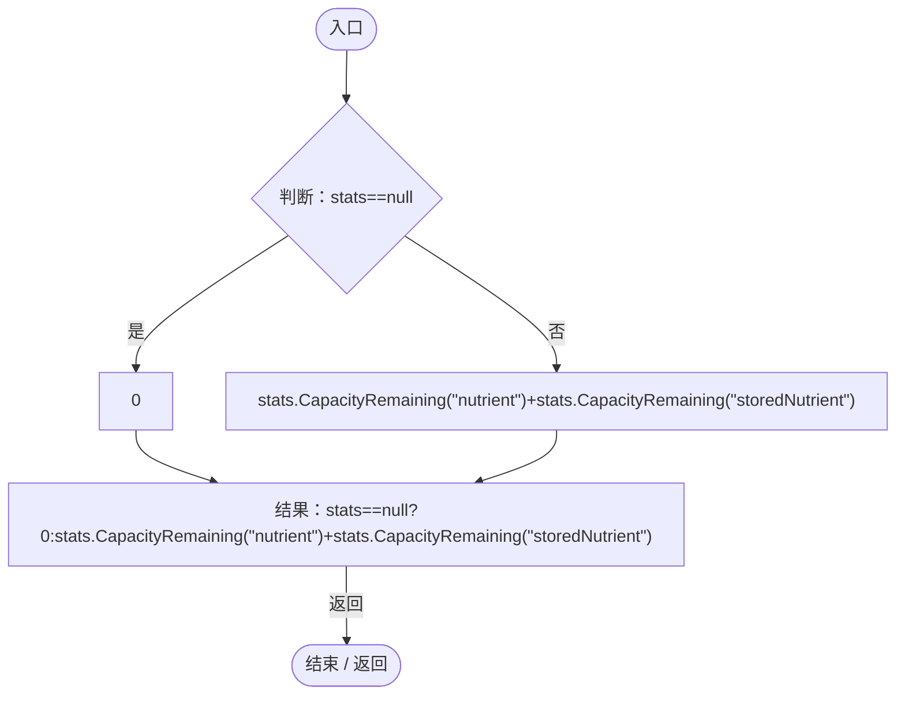
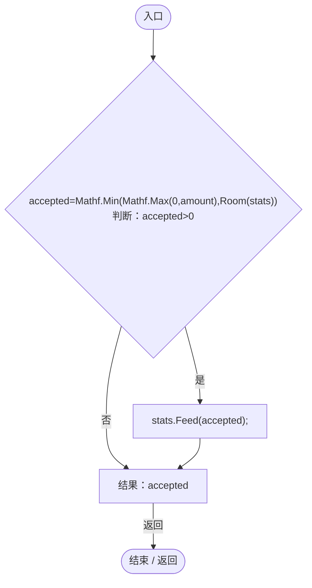
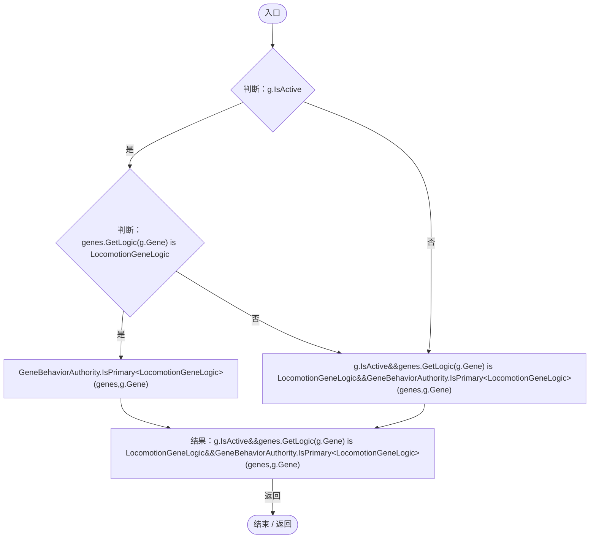
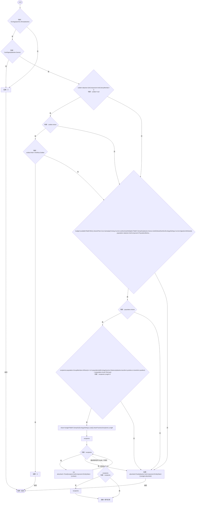
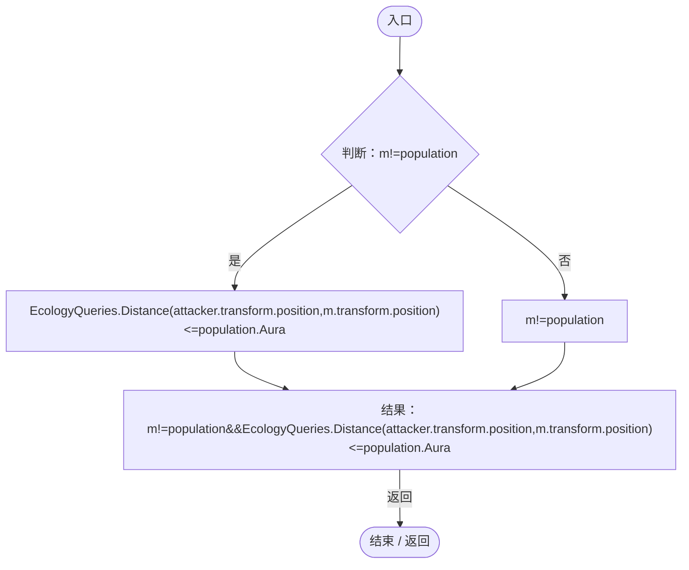

```mermaid
flowchart TD
  b0(["入口"])
  b1{"判断：genes==null"}
  b2["结果：false"]
  b3{"settings=NutritionEcologySettings.Current<br/>判断：EcologyQueries.Active(genes,settings.scavengerGene)!=null"}
  b4["结果：false"]
  b5{"EcologyQueries.Active(genes,settings.heterotrophyGene)<br/>判断：EcologyQueries.Active(genes,settings.heterotrophyGene)"}
  b6[".State"]
  b7{"判断：.State"}
  b8[".StateId"]
  b9["EcologyQueries.Active(genes,settings.heterotrophyGene)?.State?.StateId"]
  b10["state=EcologyQueries.Active(genes,settings.heterotrophyGene)?.State?.StateId"]
  b11{"判断：state==settings.digestState"}
  b12{"判断：settings.adultParasitesDigest"}
  b13{"判断：state==settings.parasiteState"}
  b14["genes.CurrentAge!=AgeState.Infant"]
  b15["settings.adultParasitesDigest&amp;&amp;state==settings.parasiteState&amp;&amp;genes.CurrentAge!=AgeState.Infant"]
  b16["state==settings.digestState"]
  b17["结果：state==settings.digestState&#124;&#124;settings.adultParasitesDigest&amp;&amp;state==settings.parasiteState&amp;&amp;genes.CurrentAge!=AgeState.Infant"]
  b18(["结束 / 返回"])
  b0 --> b1
  b1 -->|"是"| b2
  b1 -->|"否"| b3
  b2 -->|"返回"| b18
  b3 -->|"是"| b4
  b3 -->|"否"| b5
  b4 -->|"返回"| b18
  b5 -->|"否"| b6
  b5 -->|"是"| b9
  b6 --> b7
  b7 -->|"否"| b8
  b7 -->|"是"| b9
  b8 --> b10
  b9 --> b10
  b10 --> b11
  b11 -->|"否"| b12
  b11 -->|"是"| b16
  b12 -->|"是"| b13
  b12 -->|"否"| b15
  b13 -->|"是"| b14
  b13 -->|"否"| b15
  b14 --> b17
  b15 --> b17
  b16 --> b17
  b17 -->|"返回"| b18

```

```mermaid
flowchart TD
  b0(["入口"])
  b1["ant=genes.GetComponent&lt;AntColonyMember&gt;()"]
  b2{"判断：ant!=null"}
  b3{"判断：ant.Active"}
  b4{"判断：ant.Role==AntRole.Soldier"}
  b5["CanDigest(genes)"]
  b6["ant!=null&amp;&amp;ant.Active&amp;&amp;ant.Role==AntRole.Soldier"]
  b7["结果：ant!=null&amp;&amp;ant.Active&amp;&amp;ant.Role==AntRole.Soldier&#124;&#124;CanDigest(genes)"]
  b8(["结束 / 返回"])
  b0 --> b1
  b1 --> b2
  b2 -->|"是"| b3
  b2 -->|"否"| b5
  b3 -->|"是"| b4
  b3 -->|"否"| b5
  b4 -->|"否"| b5
  b4 -->|"是"| b6
  b5 --> b7
  b6 --> b7
  b7 -->|"返回"| b8

```

```mermaid
flowchart TD
  b0(["入口"])
  b1{"判断：CanHuntForFood(genes)"}
  b2{"判断：EcologyQueries.Alive(target)"}
  b3["结果：false"]
  b4{"genes.Evaluation<br/>判断：genes.Evaluation"}
  b5[".Genes.FirstOrDefault(g=&gt;g.IsActive&amp;&amp;genes.GetLogic(g.Gene) is LocomotionGeneLogic&amp;&amp;GeneBehaviorAuthority.IsPrimary&lt;LocomotionGeneLogic&gt;(genes,g.Gene))"]
  b6["genes.Evaluation"]
  b7["movement=genes.Evaluation?.Genes.FirstOrDefault(g=&gt;g.IsActive&amp;&amp;genes.GetLogic(g.Gene) is LocomotionGeneLogic&amp;&amp;GeneBehaviorAuthority.IsPrimary&lt;LocomotionGeneLogic&gt;(genes,g.Gene))"]
  b8{"movement<br/>判断：movement"}
  b9[".State"]
  b10{"判断：.State"}
  b11[".StateId"]
  b12["movement?.State?.StateId"]
  b13{"判断：movement?.State?.StateId!=&quot;herbivore&quot;"}
  b14["target.Genes.GetAttribute(&quot;moveSpeed&quot;)&lt;=0"]
  b15["movement?.State?.StateId!=&quot;herbivore&quot;"]
  b16["结果：movement?.State?.StateId!=&quot;herbivore&quot;&#124;&#124;target.Genes.GetAttribute(&quot;moveSpeed&quot;)&lt;=0"]
  b17(["结束 / 返回"])
  b0 --> b1
  b1 -->|"是"| b2
  b1 -->|"否"| b3
  b2 -->|"否"| b3
  b2 -->|"是"| b4
  b3 -->|"返回"| b17
  b4 -->|"否"| b5
  b4 -->|"是"| b6
  b5 --> b7
  b6 --> b7
  b7 --> b8
  b8 -->|"否"| b9
  b8 -->|"是"| b12
  b9 --> b10
  b10 -->|"否"| b11
  b10 -->|"是"| b12
  b11 --> b13
  b12 --> b13
  b13 -->|"否"| b14
  b13 -->|"是"| b15
  b14 --> b16
  b15 --> b16
  b16 -->|"返回"| b17

```

# NutritionTransfer.cs

[返回总索引](../README.md) · `Runtime` · `Assets/DarwinPark/Entities/Ecology/NutritionTransfer.cs`

[源文件](../../../Assets/DarwinPark/Entities/Ecology/NutritionTransfer.cs) · 源码校验：`fa7f85425d029845eebd535bc6492a990236b1227dd296bfa82f8faf9c02bdc8`

方法按源文件位置排列。事件/回调引用不表示立即执行；分支与异常说明见总索引。完整源码与可点击关系图请打开离线手册。

## Room · L13

`public static float Room(EntityStats stats)`

### Editor / Player · Roslyn编译器控制流

项目内调用/回调引用：

- [EntityStats.CapacityRemaining · L92](75aa86a368efdf24.md#m574f0a6509120d00)（方法）

## Feed · L14

`public static float Feed(EntityStats stats,float amount)`

### Editor / Player · Roslyn编译器控制流

项目内调用/回调引用：

- [NutritionTransfer.Room · L13](081d3b8ff683e442.md#m6c50def08bcb4a57)（方法）
- [EntityStats.Feed · L95](75aa86a368efdf24.md#mc025822ff1eb86a0)（方法）

## CanDigest · L18

`public static bool CanDigest(EntityGeneController genes)`

### Editor / Player · Roslyn编译器控制流

项目内调用/回调引用：

- [NutritionEcologySettings.Current.get · L19](846a17351dbd6aa4.md#mb3eb930022e314f3)（访问器）
- [EcologyQueries.Active · L29](bdf7ccc2c9c0452f.md#m200839bb9db5ec55)（方法）
- [EntityGeneController.CurrentAge.get · L37](7494d53178552f0e.md#md08823d8f9a2fa16)（访问器）

## CanHuntForFood · L27

`public static bool CanHuntForFood(EntityGeneController genes)`

### Editor / Player · Roslyn编译器控制流

项目内调用/回调引用：

- [AntColonyMember.Role.get · L39](baebd85c05598377.md#mbe541ad55a93b0dd)（访问器）
- [NutritionTransfer.CanDigest · L18](081d3b8ff683e442.md#mada1b826b8b27219)（方法）

## FoodTargetAllowed · L32

`public static bool FoodTargetAllowed(EntityGeneController genes,DarwinEntity target)`

★ 适配：行动的食草倾向只挑静止实体，捕猎倾向可挑移动实体；两者都必须有消化食性才能自主猎食。

### Editor / Player · Roslyn编译器控制流

项目内调用/回调引用：

- [NutritionTransfer.CanHuntForFood · L27](081d3b8ff683e442.md#m6302d01073c28891)（方法）
- [EcologyQueries.Alive · L39](bdf7ccc2c9c0452f.md#m8352bfacbe2996a8)（方法）
- [EntityGeneController.Evaluation.get · L18](7494d53178552f0e.md#mc0039c100a31b455)（访问器）
- [EntityGeneController.GetAttribute · L286](7494d53178552f0e.md#m18bff2b38f95b556)（方法）
- [DarwinEntity.Genes.get · L14](70798dde169f2e8b.md#m622eb1adf401d431)（访问器）
- [NutritionTransfer.回调@35 · L35](081d3b8ff683e442.md#m57c176eddb996c4d)（回调/委托）

## 回调@35 · L35

`g … => 回调`

### Editor / Player · Roslyn编译器控制流

项目内调用/回调引用：

- [EntityGeneController.GetLogic · L240](7494d53178552f0e.md#m9be6a2566c76c275)（方法）
- [GeneBehaviorAuthority.IsPrimary · L10](be83fa896bbe02ae.md#me2fc1f2e16fcd073)（方法）

## Digest · L38

`public static float Digest(DarwinEntity attacker,float available)`

### Editor / Player · Roslyn编译器控制流

项目内调用/回调引用：

- [EcologyQueries.Alive · L39](bdf7ccc2c9c0452f.md#m8352bfacbe2996a8)（方法）
- [NutritionTransfer.CanDigest · L18](081d3b8ff683e442.md#mada1b826b8b27219)（方法）
- [DarwinEntity.Genes.get · L14](70798dde169f2e8b.md#m622eb1adf401d431)（访问器）
- [AntColonyMember.Role.get · L39](baebd85c05598377.md#mbe541ad55a93b0dd)（访问器）
- [GameplayTuning.Current.get · L44](db546e5713b32d53.md#m5713e7f86902b6fa)（访问器）
- [EntityGeneController.GetAttribute · L286](7494d53178552f0e.md#m18bff2b38f95b556)（方法）
- [NutritionEcologySettings.Current.get · L19](846a17351dbd6aa4.md#mb3eb930022e314f3)（访问器）
- [EcologySettings.Load · L18](90428a275d065ef6.md#mb0575490373edaf2)（方法）
- [NutritionTransfer.Feed · L14](081d3b8ff683e442.md#m188eaec5a08f840c)（方法）
- [NutritionTransfer.回调@46 · L46](081d3b8ff683e442.md#m729c9aafb5c17842)（回调/委托）

## 回调@46 · L46

`m … => 回调`

### Editor / Player · Roslyn编译器控制流

项目内调用/回调引用：

- [EcologyQueries.Distance · L43](bdf7ccc2c9c0452f.md#m6e395dce655ebcac)（方法）
