# PopulationArchive.cs

[返回总索引](../README.md) · `Runtime` · `Assets/DarwinPark/Entities/Ecology/PopulationArchive.cs`

[源文件](../../../Assets/DarwinPark/Entities/Ecology/PopulationArchive.cs) · 源码校验：`7600a81e034d773eb9a7486766bf945fbeba03543997943b594383102cb7bf07`

方法按源文件位置排列。事件/回调引用不表示立即执行；分支与异常说明见总索引。完整源码与可点击关系图请打开离线手册。

<a id="m4f74ce7c65d8f1cf"></a>

## Current.get · L33

`get`


### Editor / Player · Roslyn编译器控制流

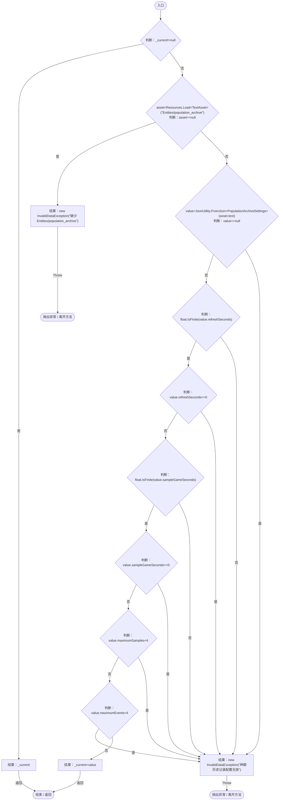

<a id="mca132f57ce03e122"></a>

## Revision.get · L45

`get`


### Editor / Player · 语法控制结构 / 声明（非CFG）


<a id="m147f3770c9b2dfcf"></a>

## Revision.set · L45

`private set`


### Editor / Player · 语法控制结构 / 声明（非CFG）


<a id="m52d7e8d0a842a0c3"></a>

## DisplayRevision.get · L46

`get`


### Editor / Player · 语法控制结构 / 声明（非CFG）

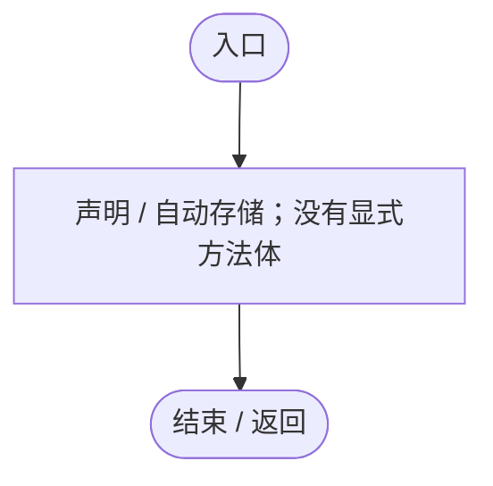

<a id="m50870dbde4dc17bf"></a>

## DisplayRevision.set · L46

`private set`


### Editor / Player · 语法控制结构 / 声明（非CFG）


<a id="mb82f202c27616130"></a>

## All.get · L47

`public static IEnumerable<PopulationRecord> All`


### Editor / Player · 语法控制结构 / 声明（非CFG）

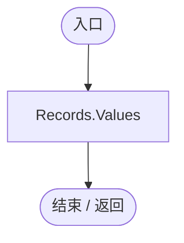

<a id="m10c9c16ad9b512d8"></a>

## Now.get · L48

`public static float Now`


### Editor / Player · 语法控制结构 / 声明（非CFG）

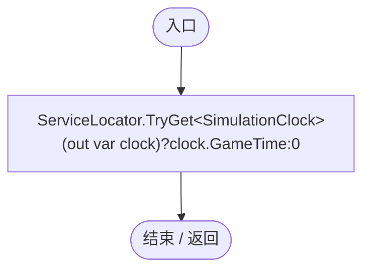

项目内调用/回调引用：

- [ServiceLocator.TryGet · L26](f2fdbe9f9ccd93cb.md#m143b24e6d58471b0)（方法）
- [SimulationClock.GameTime.get · L23](a8f444aec9614b0a.md#m74adfa39a896652f)（访问器）

<a id="mf1aef4e3d3c3efca"></a>

## Find · L49

`public static PopulationRecord Find(string id)`


### Editor / Player · Roslyn编译器控制流

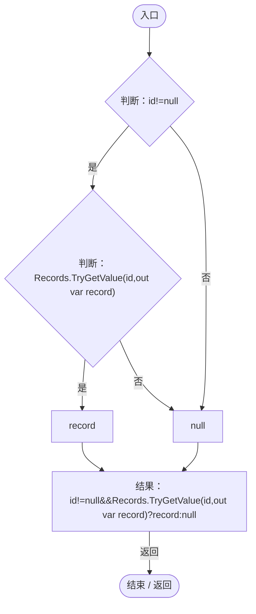

<a id="mf0a5f54e81929a30"></a>

## Register · L50

`public static PopulationRecord Register(string id,string mode,string name,bool known=false)`


### Editor / Player · Roslyn编译器控制流

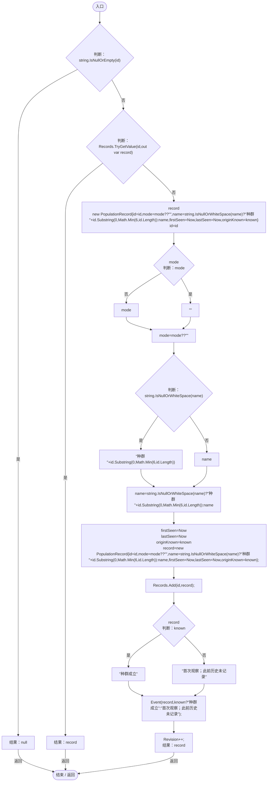

项目内调用/回调引用：

- [PopulationArchive.Event · L56](084e119b69cdd751.md#m0486325fab99997a)（方法）
- [PopulationArchive.Revision.set · L45](084e119b69cdd751.md#m147f3770c9b2dfcf)（访问器）
- [PopulationArchive.Revision.get · L45](084e119b69cdd751.md#mca132f57ce03e122)（访问器）

<a id="m0486325fab99997a"></a>

## Event · L56

`private static void Event(PopulationRecord record,string text)`


### Editor / Player · Roslyn编译器控制流

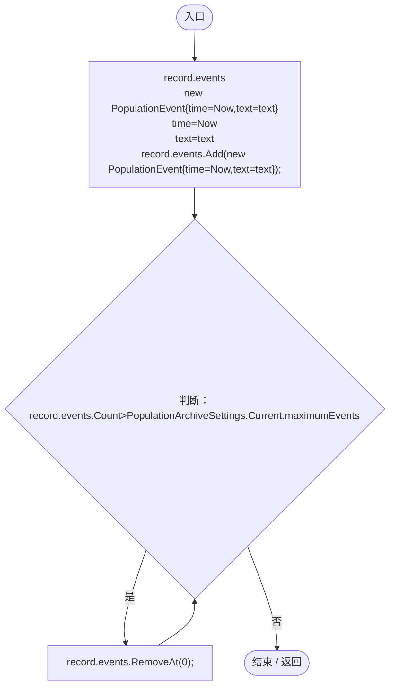

项目内调用/回调引用：

- [PopulationArchiveSettings.Current.get · L33](084e119b69cdd751.md#m4f74ce7c65d8f1cf)（访问器）

<a id="mf4687fa10ee7a98a"></a>

## RecordFounding · L60

`public static void RecordFounding(string parent,string child,string mode,string name,string reason="繁殖个体离群建立新种群")`


### Editor / Player · Roslyn编译器控制流

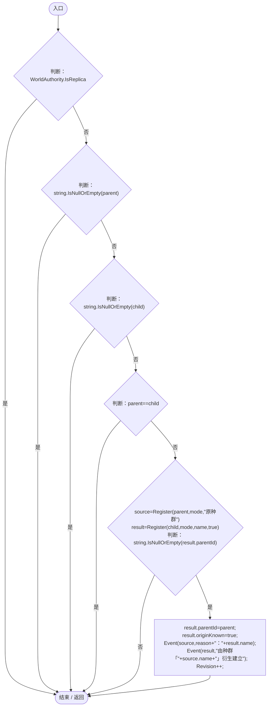

项目内调用/回调引用：

- [PopulationArchive.Register · L50](084e119b69cdd751.md#mf0a5f54e81929a30)（方法）
- [PopulationArchive.Event · L56](084e119b69cdd751.md#m0486325fab99997a)（方法）
- [PopulationArchive.Revision.set · L45](084e119b69cdd751.md#m147f3770c9b2dfcf)（访问器）
- [PopulationArchive.Revision.get · L45](084e119b69cdd751.md#mca132f57ce03e122)（访问器）

<a id="mdcf18c899b26b92b"></a>

## Members · L67

`public static List<DarwinEntity> Members(string id)`


### Editor / Player · Roslyn编译器控制流

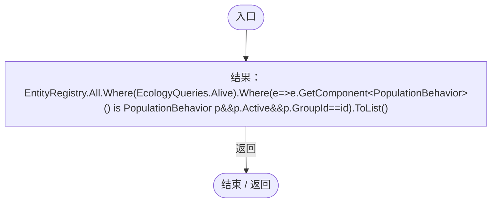

项目内调用/回调引用：

- [PopulationArchive.回调@67 · L67](084e119b69cdd751.md#mcca311eedd17e48e)（回调/委托）
- [EcologyQueries.Alive · L38](bdf7ccc2c9c0452f.md#mb2877c487f449970)（方法）

<a id="mcca311eedd17e48e"></a>

## 回调@67 · L67

`e … => 回调`


### Editor / Player · Roslyn编译器控制流

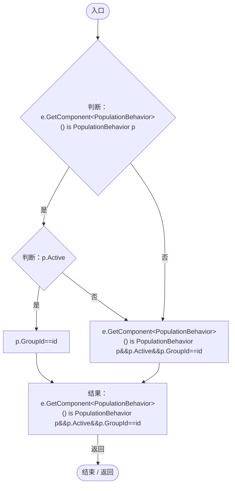

项目内调用/回调引用：

- [PopulationBehavior.GroupId.get · L20](21e4f62f75a9a80f.md#m5145936fa914ba8c)（访问器）

<a id="m6afd6ec6b661dad6"></a>

## Observe · L68

`public static void Observe()`


### Editor / Player · Roslyn编译器控制流

```mermaid
flowchart TD
  b0(["入口"])
  b1{"判断：WorldAuthority.IsReplica"}
  b2{"判断：WorldRuntimeGate.Loading"}
  b3["groups=EntityRegistry.All.Where(EcologyQueries.Alive).Select(e=&gt;e.GetComponent&lt;PopulationBehavior&gt;()).Where(p=&gt;p!=null&amp;&amp;p.Active&amp;&amp;!string.IsNullOrEmpty(p.GroupId)).GroupBy(p=&gt;p.GroupId).ToArray()<br/>seen=new HashSet&lt;string&gt;()"]
  b4["groups"]
  b5{"判断：groups"}
  b6["var"]
  b7["seen.Add(group.Key);<br/>first=group.First()<br/>entities=group.Select(p=&gt;p.GetComponent&lt;DarwinEntity&gt;()).ToList()"]
  b8["group.Key<br/>first.Mode"]
  b9{"first.Leader<br/>判断：first.Leader"}
  b10["first.Leader"]
  b11["first"]
  b12["record=Register(group.Key,first.Mode,(first.Leader??first).GetComponent&lt;DarwinEntity&gt;().DisplayName)"]
  b13{"count=entities.Count<br/>changed=count!=record.current<br/>判断：changed"}
  b14{"delta=count-record.current<br/>判断：record.samples.Count&gt;0"}
  b15["record.increases+=Mathf.Max(0,delta);<br/>record.decreases+=Mathf.Max(0,-delta);<br/>Event(record,&quot;成员数 &quot;+record.current+&quot; → &quot;+count+&quot;（含出生、死亡及迁移）&quot;);"]
  b16["record.current=count;<br/>Revision++;"]
  b17{"record.lastSeen=Now;<br/>record.peak=Mathf.Max(record.peak,count);<br/>record.mode=first.Mode;<br/>判断：changed"}
  b18{"判断：record.samples.Count==0"}
  b19{"判断：Now-record.samples[record.samples.Count-1].time&gt;=PopulationArchiveSettings.Current.sampleGameSeconds"}
  b20["record.infants=entities.Count(e=&gt;e.Genes.CurrentAge==AgeState.Infant);<br/>record.adults=entities.Count(e=&gt;e.Genes.CurrentAge==AgeState.Adult);<br/>record.elders=count-record.infants-record.adults;<br/>record.lastLiving=count;<br/>genes=new Dictionary&lt;s…"]
  b21["entities"]
  b22{"判断：entities"}
  b23["var"]
  b24["active=new HashSet&lt;string&gt;(entity.Genes.Evaluation.Genes.Where(g=&gt;g.IsActive).Select(g=&gt;g.Definition.Id))"]
  b25["entity.Genes.Genome.Genes.Select(g=&gt;g.DefinitionId).Distinct()"]
  b26{"判断：entity.Genes.Genome.Genes.Select(g=&gt;g.DefinitionId).Distinct()"}
  b27["string"]
  b28{"判断：genes.TryGetValue(id,out var value)"}
  b29["genes[id]<br/>value<br/>new PopulationGeneCount{id=id}<br/>id=id<br/>genes[id]=value=new PopulationGeneCount{id=id};"]
  b30{"value.carried++;<br/>判断：active.Contains(id)"}
  b31["value.expressed++;"]
  b32{"判断：entity.Genes.Genome.Genes.Select(g=&gt;g.DefinitionId).Distinct()"}
  b33["entity.Genes.Genome.Genes.Select(g=&gt;g.DefinitionId).Distinct()"]
  b34["连接 / 离开区域"]
  b35["entities"]
  b36["record.genes=genes.Values.OrderBy(g=&gt;g.id).ToList();<br/>Sample(record,count);<br/>Revision++;"]
  b37{"groups<br/>判断：groups"}
  b38["groups"]
  b39["连接 / 离开区域"]
  b40["Records.Values.Where(r=&gt;r.current&gt;0&amp;&amp;!seen.Contains(r.id)).ToArray()"]
  b41{"判断：Records.Values.Where(r=&gt;r.current&gt;0&amp;&amp;!seen.Contains(r.id)).ToArray()"}
  b42["var<br/>record.decreases+=record.current;<br/>record.current=0;<br/>Event(record,&quot;种群灭绝或全部成员离开&quot;);<br/>Sample(record,0);<br/>Revision++;"]
  b43{"Records.Values.Where(r=&gt;r.current&gt;0&amp;&amp;!seen.Contains(r.id)).ToArray()<br/>判断：Records.Values.Where(r=&gt;r.current&gt;0&amp;&amp;!seen.Contains(r.id)).ToArray()"}
  b44["Records.Values.Where(r=&gt;r.current&gt;0&amp;&amp;!seen.Contains(r.id)).ToArray()"]
  b45["连接 / 离开区域"]
  b46(["结束 / 返回"])
  b0 --> b1
  b1 -->|"否"| b2
  b1 -->|"是"| b46
  b2 -->|"是"| b46
  b2 -->|"否"| b3
  b3 --> b4
  b4 --> b5
  b5 -->|"是"| b6
  b5 -->|"否 · 经过finally 37"| b40
  b6 --> b7
  b7 --> b8
  b8 --> b9
  b9 -->|"否"| b10
  b9 -->|"是"| b11
  b10 --> b12
  b11 --> b12
  b12 --> b13
  b13 -->|"是"| b14
  b13 -->|"否"| b17
  b14 -->|"是"| b15
  b14 -->|"否"| b16
  b15 --> b16
  b16 --> b17
  b17 -->|"否"| b18
  b17 -->|"是"| b20
  b18 -->|"否"| b19
  b18 -->|"是"| b20
  b19 -->|"是"| b20
  b19 -->|"否"| b5
  b20 --> b21
  b21 --> b22
  b22 -->|"是"| b23
  b22 -->|"否 · 经过finally 35"| b36
  b23 --> b24
  b24 --> b25
  b25 --> b26
  b26 -->|"是"| b27
  b26 -->|"否 · 经过finally 32"| b22
  b27 --> b28
  b28 -->|"否"| b29
  b28 -->|"是"| b30
  b29 --> b30
  b30 -->|"是"| b31
  b30 -->|"否"| b26
  b31 --> b26
  b32 -->|"否"| b33
  b32 -->|"是"| b34
  b33 --> b34
  b36 --> b5
  b37 -->|"否"| b38
  b37 -->|"是"| b39
  b38 --> b39
  b40 --> b41
  b41 -->|"是"| b42
  b41 -->|"否 · 经过finally 43"| b46
  b42 --> b41
  b43 -->|"否"| b44
  b43 -->|"是"| b45
  b44 --> b45
  b26 -. "退出保护区时 finally（示意）" .-> b32
  b22 -. "退出保护区时 finally（示意）" .-> b35
  b5 -. "退出保护区时 finally（示意）" .-> b37
  b41 -. "退出保护区时 finally（示意）" .-> b43

```

项目内调用/回调引用：

- [PopulationArchive.Register · L50](084e119b69cdd751.md#mf0a5f54e81929a30)（方法）
- [PopulationArchive.Event · L56](084e119b69cdd751.md#m0486325fab99997a)（方法）
- [PopulationArchive.Revision.set · L45](084e119b69cdd751.md#m147f3770c9b2dfcf)（访问器）
- [PopulationArchive.Revision.get · L45](084e119b69cdd751.md#mca132f57ce03e122)（访问器）
- [PopulationArchiveSettings.Current.get · L33](084e119b69cdd751.md#m4f74ce7c65d8f1cf)（访问器）
- [EntityGeneController.Evaluation.get · L19](7494d53178552f0e.md#m2cb74e57d810ca42)（访问器）
- [DarwinEntity.Genes.get · L14](70798dde169f2e8b.md#m622eb1adf401d431)（访问器）
- [PopulationArchive.Sample · L93](084e119b69cdd751.md#md7d041d370dd88f8)（方法）
- [PopulationArchive.回调@71 · L71](084e119b69cdd751.md#m7d9b8ee40b6d37ca)（回调/委托）
- [PopulationArchive.回调@71 · L71](084e119b69cdd751.md#m0555a8c93d81c53f)（回调/委托）
- [PopulationArchive.回调@71 · L71](084e119b69cdd751.md#md374fa152f6ab278)（回调/委托）
- [PopulationArchive.回调@74 · L74](084e119b69cdd751.md#m784c6129a287d50e)（回调/委托）
- [PopulationArchive.回调@81 · L81](084e119b69cdd751.md#m52e25f21d15aa1c0)（回调/委托）
- [PopulationArchive.回调@81 · L81](084e119b69cdd751.md#m76dee93f45a3b98d)（回调/委托）
- [PopulationArchive.回调@84 · L84](084e119b69cdd751.md#maaeefc4112f4131f)（回调/委托）
- [PopulationArchive.回调@84 · L84](084e119b69cdd751.md#m1da2935d7b5f131f)（回调/委托）
- [PopulationArchive.回调@85 · L85](084e119b69cdd751.md#m22838a9080e6cd16)（回调/委托）
- [PopulationArchive.回调@87 · L87](084e119b69cdd751.md#mc66df04bfc7d1839)（回调/委托）
- [PopulationArchive.回调@90 · L90](084e119b69cdd751.md#m9aee56e985233677)（回调/委托）
- [EcologyQueries.Alive · L38](bdf7ccc2c9c0452f.md#mb2877c487f449970)（方法）

<a id="m7d9b8ee40b6d37ca"></a>

## 回调@71 · L71

`e … => 回调`


### Editor / Player · Roslyn编译器控制流

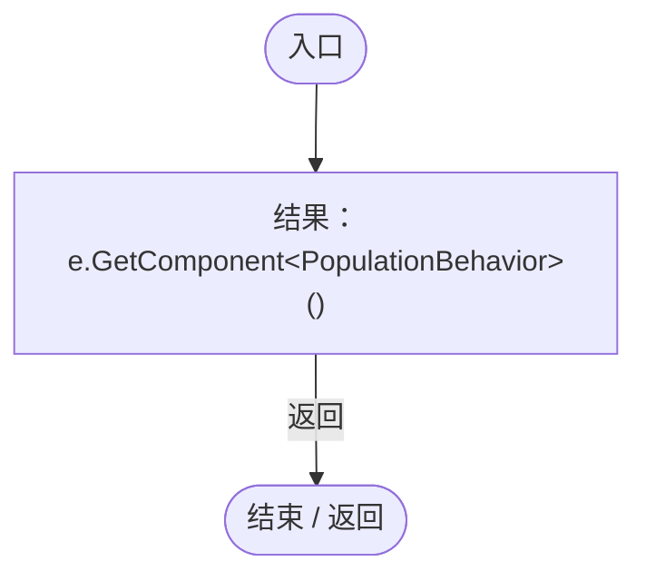

<a id="m0555a8c93d81c53f"></a>

## 回调@71 · L71

`p … => 回调`


### Editor / Player · Roslyn编译器控制流

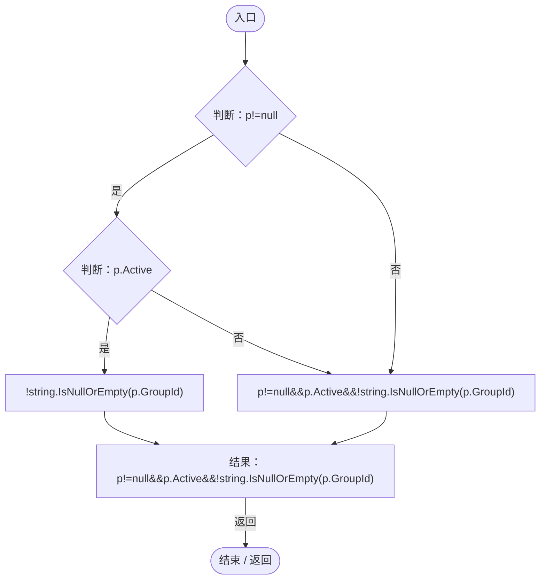

项目内调用/回调引用：

- [PopulationBehavior.GroupId.get · L20](21e4f62f75a9a80f.md#m5145936fa914ba8c)（访问器）

<a id="md374fa152f6ab278"></a>

## 回调@71 · L71

`p … => 回调`


### Editor / Player · Roslyn编译器控制流

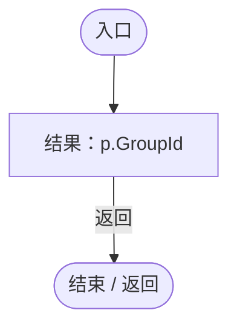

项目内调用/回调引用：

- [PopulationBehavior.GroupId.get · L20](21e4f62f75a9a80f.md#m5145936fa914ba8c)（访问器）

<a id="m784c6129a287d50e"></a>

## 回调@74 · L74

`p … => 回调`


### Editor / Player · Roslyn编译器控制流

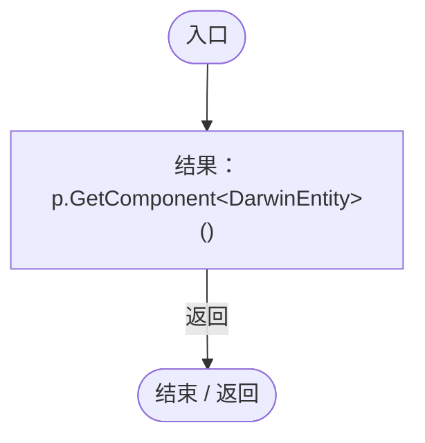

<a id="m52e25f21d15aa1c0"></a>

## 回调@81 · L81

`e … => 回调`


### Editor / Player · Roslyn编译器控制流

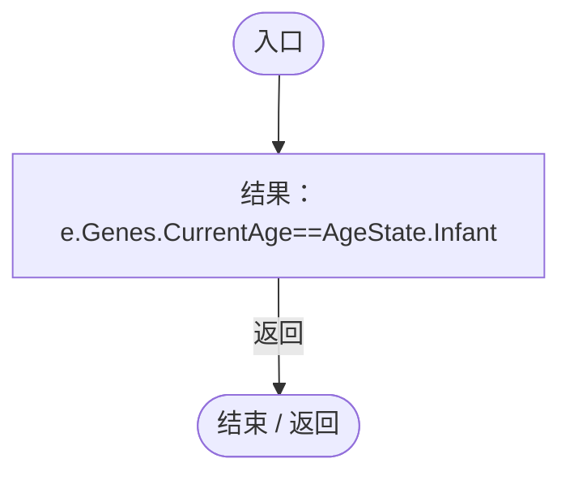

项目内调用/回调引用：

- [EntityGeneController.CurrentAge.get · L35](7494d53178552f0e.md#mf5bc28691dd4a0f3)（访问器）
- [DarwinEntity.Genes.get · L14](70798dde169f2e8b.md#m622eb1adf401d431)（访问器）

<a id="m76dee93f45a3b98d"></a>

## 回调@81 · L81

`e … => 回调`


### Editor / Player · Roslyn编译器控制流

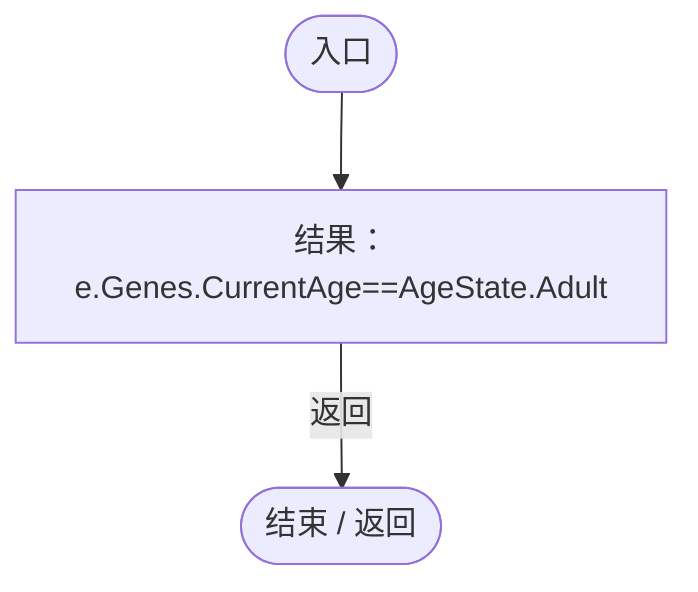

项目内调用/回调引用：

- [EntityGeneController.CurrentAge.get · L35](7494d53178552f0e.md#mf5bc28691dd4a0f3)（访问器）
- [DarwinEntity.Genes.get · L14](70798dde169f2e8b.md#m622eb1adf401d431)（访问器）

<a id="maaeefc4112f4131f"></a>

## 回调@84 · L84

`g … => 回调`


### Editor / Player · Roslyn编译器控制流

```mermaid
flowchart TD
  b0(["入口"])
  b1["结果：g.IsActive"]
  b2(["结束 / 返回"])
  b0 --> b1
  b1 -->|"返回"| b2

```

<a id="m1da2935d7b5f131f"></a>

## 回调@84 · L84

`g … => 回调`


### Editor / Player · Roslyn编译器控制流

```mermaid
flowchart TD
  b0(["入口"])
  b1["结果：g.Definition.Id"]
  b2(["结束 / 返回"])
  b0 --> b1
  b1 -->|"返回"| b2

```

<a id="m22838a9080e6cd16"></a>

## 回调@85 · L85

`g … => 回调`


### Editor / Player · Roslyn编译器控制流

```mermaid
flowchart TD
  b0(["入口"])
  b1["结果：g.DefinitionId"]
  b2(["结束 / 返回"])
  b0 --> b1
  b1 -->|"返回"| b2

```

<a id="mc66df04bfc7d1839"></a>

## 回调@87 · L87

`g … => 回调`


### Editor / Player · Roslyn编译器控制流

```mermaid
flowchart TD
  b0(["入口"])
  b1["结果：g.id"]
  b2(["结束 / 返回"])
  b0 --> b1
  b1 -->|"返回"| b2

```

<a id="m9aee56e985233677"></a>

## 回调@90 · L90

`r … => 回调`


### Editor / Player · Roslyn编译器控制流

```mermaid
flowchart TD
  b0(["入口"])
  b1{"判断：r.current&gt;0"}
  b2["!seen.Contains(r.id)"]
  b3["r.current&gt;0"]
  b4["结果：r.current&gt;0&amp;&amp;!seen.Contains(r.id)"]
  b5(["结束 / 返回"])
  b0 --> b1
  b1 -->|"是"| b2
  b1 -->|"否"| b3
  b2 --> b4
  b3 --> b4
  b4 -->|"返回"| b5

```

<a id="md7d041d370dd88f8"></a>

## Sample · L93

`private static void Sample(PopulationRecord record,int count)`


### Editor / Player · Roslyn编译器控制流

```mermaid
flowchart TD
  b0(["入口"])
  b1["record.samples<br/>new PopulationSample{time=Now,members=count,infants=count==0?0:record.infants,adults=count==0?0:record.adults,elders=count==0?0:record.elders}<br/>time=Now<br/>members=count"]
  b2{"判断：count==0"}
  b3["0"]
  b4["record.infants"]
  b5["infants=count==0?0:record.infants"]
  b6{"判断：count==0"}
  b7["0"]
  b8["record.adults"]
  b9["adults=count==0?0:record.adults"]
  b10{"判断：count==0"}
  b11["0"]
  b12["record.elders"]
  b13["elders=count==0?0:record.elders"]
  b14["record.samples.Add(new PopulationSample{time=Now,members=count,infants=count==0?0:record.infants,adults=count==0?0:record.adults,elders=count==0?0:record.elders});"]
  b15{"判断：record.samples.Count&gt;PopulationArchiveSettings.Current.maximumSamples"}
  b16["new List&lt;PopulationSample&gt;{record.samples[0]}<br/>record.samples[0]<br/>compact=new List&lt;PopulationSample&gt;{record.samples[0]}"]
  b17["i=2"]
  b18{"判断：i&lt;record.samples.Count-1"}
  b19["compact.Add(record.samples[i]);<br/>i+=2"]
  b20["compact.Add(record.samples[record.samples.Count-1]);<br/>record.samples=compact;"]
  b21(["结束 / 返回"])
  b0 --> b1
  b1 --> b2
  b2 -->|"是"| b3
  b2 -->|"否"| b4
  b3 --> b5
  b4 --> b5
  b5 --> b6
  b6 -->|"是"| b7
  b6 -->|"否"| b8
  b7 --> b9
  b8 --> b9
  b9 --> b10
  b10 -->|"是"| b11
  b10 -->|"否"| b12
  b11 --> b13
  b12 --> b13
  b13 --> b14
  b14 --> b15
  b15 -->|"是"| b16
  b15 -->|"否"| b21
  b16 --> b17
  b17 --> b18
  b18 -->|"是"| b19
  b18 -->|"否"| b20
  b19 --> b18
  b20 --> b21

```

项目内调用/回调引用：

- [PopulationArchiveSettings.Current.get · L33](084e119b69cdd751.md#m4f74ce7c65d8f1cf)（访问器）

<a id="mb232e2fc42b6a7ff"></a>

## SetDisplay · L102

`public static bool SetDisplay(string id,string color,bool visible,bool? syncEntityColor=null,float? rangeOpacity=null)`


### Editor / Player · Roslyn编译器控制流

```mermaid
flowchart TD
  b0(["入口"])
  b1{"判断：WorldAuthority.IsReplica"}
  b2{"判断：WorldAuthority.CanEdit"}
  b3{"判断：Find(id) is not PopulationRecord record"}
  b4{"判断：ColorUtility.TryParseHtmlString(color,out var parsed)"}
  b5{"判断：rangeOpacity.HasValue"}
  b6{"判断：float.IsFinite(rangeOpacity.Value)"}
  b7{"判断：rangeOpacity&lt;0"}
  b8{"判断：rangeOpacity&gt;1"}
  b9["结果：false"]
  b10{"record.color=&quot;#&quot;+ColorUtility.ToHtmlStringRGB(parsed);<br/>record.visible=visible;<br/>判断：syncEntityColor.HasValue"}
  b11["record.syncEntityColor=syncEntityColor.Value;"]
  b12{"判断：rangeOpacity.HasValue"}
  b13["record.rangeOpacity=rangeOpacity.Value;"]
  b14["Revision++;<br/>DisplayRevision++;<br/>结果：true"]
  b15(["结束 / 返回"])
  b0 --> b1
  b1 -->|"否"| b2
  b1 -->|"是"| b9
  b2 -->|"是"| b3
  b2 -->|"否"| b9
  b3 -->|"否"| b4
  b3 -->|"是"| b9
  b4 -->|"是"| b5
  b4 -->|"否"| b9
  b5 -->|"是"| b6
  b5 -->|"否"| b10
  b6 -->|"是"| b7
  b6 -->|"否"| b9
  b7 -->|"否"| b8
  b7 -->|"是"| b9
  b8 -->|"是"| b9
  b8 -->|"否"| b10
  b9 -->|"返回"| b15
  b10 -->|"是"| b11
  b10 -->|"否"| b12
  b11 --> b12
  b12 -->|"是"| b13
  b12 -->|"否"| b14
  b13 --> b14
  b14 -->|"返回"| b15

```

项目内调用/回调引用：

- [PopulationArchive.Find · L49](084e119b69cdd751.md#mf1aef4e3d3c3efca)（方法）
- [PopulationArchive.Revision.set · L45](084e119b69cdd751.md#m147f3770c9b2dfcf)（访问器）
- [PopulationArchive.Revision.get · L45](084e119b69cdd751.md#mca132f57ce03e122)（访问器）
- [PopulationArchive.DisplayRevision.set · L46](084e119b69cdd751.md#m50870dbde4dc17bf)（访问器）
- [PopulationArchive.DisplayRevision.get · L46](084e119b69cdd751.md#m52d7e8d0a842a0c3)（访问器）

<a id="m97824b788cf7f2ff"></a>

## OpacityFor · L107

`public static float OpacityFor(string id)`


### Editor / Player · Roslyn编译器控制流

```mermaid
flowchart TD
  b0(["入口"])
  b1{"判断：Find(id) is PopulationRecord record"}
  b2{"判断：record.rangeOpacity&gt;=0"}
  b3["record.rangeOpacity"]
  b4["GameplayTuning.Current.populationFillOpacity"]
  b5["结果：Find(id) is PopulationRecord record&amp;&amp;record.rangeOpacity&gt;=0?record.rangeOpacity:GameplayTuning.Current.populationFillOpacity"]
  b6(["结束 / 返回"])
  b0 --> b1
  b1 -->|"是"| b2
  b1 -->|"否"| b4
  b2 -->|"是"| b3
  b2 -->|"否"| b4
  b3 --> b5
  b4 --> b5
  b5 -->|"返回"| b6

```

项目内调用/回调引用：

- [PopulationArchive.Find · L49](084e119b69cdd751.md#mf1aef4e3d3c3efca)（方法）
- [GameplayTuning.Current.get · L21](db546e5713b32d53.md#m1caba89e7704d239)（访问器）

<a id="m8c20cb43a453efa6"></a>

## TryColor · L108

`public static bool TryColor(string id,out Color color)`


### Editor / Player · Roslyn编译器控制流

```mermaid
flowchart TD
  b0(["入口"])
  b1["color=default;"]
  b2{"判断：Find(id) is PopulationRecord record"}
  b3{"判断：string.IsNullOrEmpty(record.color)"}
  b4["ColorUtility.TryParseHtmlString(record.color,out color)"]
  b5["Find(id) is PopulationRecord record&amp;&amp;!string.IsNullOrEmpty(record.color)&amp;&amp;ColorUtility.TryParseHtmlString(record.color,out color)"]
  b6["结果：Find(id) is PopulationRecord record&amp;&amp;!string.IsNullOrEmpty(record.color)&amp;&amp;ColorUtility.TryParseHtmlString(record.color,out color)"]
  b7(["结束 / 返回"])
  b0 --> b1
  b1 --> b2
  b2 -->|"是"| b3
  b2 -->|"否"| b5
  b3 -->|"否"| b4
  b3 -->|"是"| b5
  b4 --> b6
  b5 --> b6
  b6 -->|"返回"| b7

```

项目内调用/回调引用：

- [PopulationArchive.Find · L49](084e119b69cdd751.md#mf1aef4e3d3c3efca)（方法）

<a id="m452bdf5931b09c11"></a>

## IsVisible · L109

`public static bool IsVisible(string id)`


### Editor / Player · Roslyn编译器控制流

```mermaid
flowchart TD
  b0(["入口"])
  b1{"Find(id)<br/>判断：Find(id)"}
  b2[".visible"]
  b3["Find(id)"]
  b4{"判断：Find(id)?.visible"}
  b5["Find(id)?.visible"]
  b6["true"]
  b7["结果：Find(id)?.visible??true"]
  b8(["结束 / 返回"])
  b0 --> b1
  b1 -->|"否"| b2
  b1 -->|"是"| b3
  b2 --> b4
  b3 --> b4
  b4 -->|"否"| b5
  b4 -->|"是"| b6
  b5 --> b7
  b6 --> b7
  b7 -->|"返回"| b8

```

项目内调用/回调引用：

- [PopulationArchive.Find · L49](084e119b69cdd751.md#mf1aef4e3d3c3efca)（方法）

<a id="m2b63358c5191143d"></a>

## Capture · L110

`public static PopulationArchiveState Capture()`


### Editor / Player · Roslyn编译器控制流

```mermaid
flowchart TD
  b0(["入口"])
  b1{"判断：WorldRuntimeGate.Ready"}
  b2{"判断：WorldAuthority.IsReplica"}
  b3["Observe();"]
  b4["new PopulationArchiveState{groups=Records.Values.OrderBy(r=&gt;r.id).ToList()}<br/>groups=Records.Values.OrderBy(r=&gt;r.id).ToList()<br/>结果：JsonUtility.FromJson&lt;PopulationArchiveState&gt;(JsonUtility.ToJson(new PopulationArchiveState{groups=Records.Valu…"]
  b5(["结束 / 返回"])
  b0 --> b1
  b1 -->|"是"| b2
  b1 -->|"否"| b4
  b2 -->|"否"| b3
  b2 -->|"是"| b4
  b3 --> b4
  b4 -->|"返回"| b5

```

项目内调用/回调引用：

- [PopulationArchive.Observe · L68](084e119b69cdd751.md#m6afd6ec6b661dad6)（方法）
- [PopulationArchive.回调@110 · L110](084e119b69cdd751.md#m3b6c728317edfdd2)（回调/委托）

<a id="m3b6c728317edfdd2"></a>

## 回调@110 · L110

`r … => 回调`


### Editor / Player · Roslyn编译器控制流

```mermaid
flowchart TD
  b0(["入口"])
  b1["结果：r.id"]
  b2(["结束 / 返回"])
  b0 --> b1
  b1 -->|"返回"| b2

```

<a id="m4399dc92547fc7e0"></a>

## Validate · L111

`public static void Validate(PopulationArchiveState state)`


### Editor / Player · Roslyn编译器控制流

```mermaid
flowchart TD
  b0(["入口"])
  b1{"判断：state==null"}
  b2{"判断：state.version!=1"}
  b3{"判断：state.groups==null"}
  b4["结果：new InvalidDataException(&quot;种群档案版本无效&quot;)"]
  x4(["抛出异常 / 离开方法"])
  b5["ids=new HashSet&lt;string&gt;()"]
  b6["state.groups"]
  b7{"判断：state.groups"}
  b8["var"]
  b9{"判断：r!=null"}
  b10{"判断：float.IsFinite(r.rangeOpacity)"}
  b11{"判断：r.rangeOpacity!= -1"}
  b12{"判断：r.rangeOpacity&lt;0"}
  b13{"判断：r.rangeOpacity&gt;1"}
  b14["结果：new InvalidDataException(&quot;种群范围不透明度无效&quot;)"]
  x14(["抛出异常 / 离开方法"])
  b15{"判断：r==null"}
  b16{"判断：Guid.TryParseExact(r.id,&quot;N&quot;,out _)"}
  b17{"判断：ids.Add(r.id)"}
  b18{"判断：string.IsNullOrWhiteSpace(r.name)"}
  b19{"判断：r.current&lt;0"}
  b20{"判断：r.lastLiving&lt;0"}
  b21{"判断：r.peak&lt;r.current"}
  b22{"判断：float.IsFinite(r.firstSeen)"}
  b23{"判断：r.firstSeen&lt;0"}
  b24{"判断：float.IsFinite(r.lastSeen)"}
  b25{"判断：r.lastSeen&lt;r.firstSeen"}
  b26{"判断：r.samples==null"}
  b27{"判断：r.events==null"}
  b28{"判断：r.genes==null"}
  b29{"判断：string.IsNullOrEmpty(r.color)"}
  b30{"判断：ColorUtility.TryParseHtmlString(r.color,out _)"}
  b31["结果：new InvalidDataException(&quot;种群档案内容无效&quot;)"]
  x31(["抛出异常 / 离开方法"])
  b32["last=-1"]
  b33["r.samples"]
  b34{"判断：r.samples"}
  b35{"var<br/>判断：s==null"}
  b36{"判断：float.IsFinite(s.time)"}
  b37{"判断：s.time&lt;last"}
  b38{"判断：s.time&lt;0"}
  b39{"判断：s.members&lt;0"}
  b40{"判断：s.infants&lt;0"}
  b41{"判断：s.adults&lt;0"}
  b42{"判断：s.elders&lt;0"}
  b43{"判断：s.infants+s.adults+s.elders!=s.members"}
  b44["结果：new InvalidDataException(&quot;种群历史采样无效&quot;)"]
  x44(["抛出异常 / 离开方法"])
  b45["last=s.time;"]
  b46["r.samples"]
  b47{"判断：r.events.Any(e=&gt;e==null&#124;&#124;!float.IsFinite(e.time)&#124;&#124;e.time&lt;0&#124;&#124;string.IsNullOrWhiteSpace(e.text))"}
  b48{"判断：r.genes.Any(g=&gt;g==null&#124;&#124;string.IsNullOrWhiteSpace(g.id)&#124;&#124;g.carried&lt;0&#124;&#124;g.expressed&lt;0&#124;&#124;g.expressed&gt;g.carried&#124;&#124;g.carried&gt;r.lastLiving)"}
  b49["结果：new InvalidDataException(&quot;种群事件或基因计数无效&quot;)"]
  x49(["抛出异常 / 离开方法"])
  b50["state.groups"]
  b51["byId=state.groups.ToDictionary(r=&gt;r.id)"]
  b52["state.groups"]
  b53{"判断：state.groups"}
  b54["var"]
  b55["new HashSet&lt;string&gt;{record.id}<br/>record.id<br/>path=new HashSet&lt;string&gt;{record.id}"]
  b56["current=record"]
  b57{"判断：string.IsNullOrEmpty(current.parentId)"}
  b58{"判断：path.Add(current.parentId)"}
  b59{"判断：byId.TryGetValue(current.parentId,out current)"}
  b60["结果：new InvalidDataException(&quot;种群谱系有循环或缺失来源&quot;)"]
  x60(["抛出异常 / 离开方法"])
  b61["state.groups"]
  b62(["结束 / 返回"])
  b0 --> b1
  b1 -->|"是"| b62
  b1 -->|"否"| b2
  b2 -->|"否"| b3
  b2 -->|"是"| b4
  b3 -->|"是"| b4
  b3 -->|"否"| b5
  b4 -->|"Throw"| x4
  b5 --> b6
  b6 --> b7
  b7 -->|"是"| b8
  b7 -->|"否 · 经过finally 50"| b51
  b8 --> b9
  b9 -->|"是"| b10
  b9 -->|"否"| b15
  b10 -->|"是"| b11
  b10 -->|"否"| b14
  b11 -->|"是"| b12
  b11 -->|"否"| b15
  b12 -->|"否"| b13
  b12 -->|"是"| b14
  b13 -->|"是"| b14
  b13 -->|"否"| b15
  b14 -->|"Throw"| x14
  b15 -->|"否"| b16
  b15 -->|"是"| b31
  b16 -->|"是"| b17
  b16 -->|"否"| b31
  b17 -->|"是"| b18
  b17 -->|"否"| b31
  b18 -->|"否"| b19
  b18 -->|"是"| b31
  b19 -->|"否"| b20
  b19 -->|"是"| b31
  b20 -->|"否"| b21
  b20 -->|"是"| b31
  b21 -->|"否"| b22
  b21 -->|"是"| b31
  b22 -->|"是"| b23
  b22 -->|"否"| b31
  b23 -->|"否"| b24
  b23 -->|"是"| b31
  b24 -->|"是"| b25
  b24 -->|"否"| b31
  b25 -->|"否"| b26
  b25 -->|"是"| b31
  b26 -->|"否"| b27
  b26 -->|"是"| b31
  b27 -->|"否"| b28
  b27 -->|"是"| b31
  b28 -->|"否"| b29
  b28 -->|"是"| b31
  b29 -->|"否"| b30
  b29 -->|"是"| b32
  b30 -->|"否"| b31
  b30 -->|"是"| b32
  b31 -->|"Throw"| x31
  b32 --> b33
  b33 --> b34
  b34 -->|"是"| b35
  b34 -->|"否 · 经过finally 46"| b47
  b35 -->|"否"| b36
  b35 -->|"是"| b44
  b36 -->|"是"| b37
  b36 -->|"否"| b44
  b37 -->|"否"| b38
  b37 -->|"是"| b44
  b38 -->|"否"| b39
  b38 -->|"是"| b44
  b39 -->|"否"| b40
  b39 -->|"是"| b44
  b40 -->|"否"| b41
  b40 -->|"是"| b44
  b41 -->|"否"| b42
  b41 -->|"是"| b44
  b42 -->|"否"| b43
  b42 -->|"是"| b44
  b43 -->|"是"| b44
  b43 -->|"否"| b45
  b44 -->|"Throw"| x44
  b45 --> b34
  b47 -->|"否"| b48
  b47 -->|"是"| b49
  b48 -->|"是"| b49
  b48 -->|"否"| b7
  b49 -->|"Throw"| x49
  b51 --> b52
  b52 --> b53
  b53 -->|"是"| b54
  b53 -->|"否 · 经过finally 61"| b62
  b54 --> b55
  b55 --> b56
  b56 --> b57
  b57 -->|"否"| b58
  b57 -->|"是"| b53
  b58 -->|"是"| b59
  b58 -->|"否"| b60
  b59 -->|"否"| b60
  b59 -->|"是"| b57
  b60 -->|"Throw"| x60
  b34 -. "退出保护区时 finally（示意）" .-> b46
  b7 -. "退出保护区时 finally（示意）" .-> b50
  b53 -. "退出保护区时 finally（示意）" .-> b61

```

项目内调用/回调引用：

- [PopulationArchive.回调@119 · L119](084e119b69cdd751.md#md042fb0b71a775e0)（回调/委托）
- [PopulationArchive.回调@119 · L119](084e119b69cdd751.md#m577b0905ef81a563)（回调/委托）
- [PopulationArchive.回调@121 · L121](084e119b69cdd751.md#maa70d823fcd1a8c4)（回调/委托）

<a id="md042fb0b71a775e0"></a>

## 回调@119 · L119

`e … => 回调`


### Editor / Player · Roslyn编译器控制流

```mermaid
flowchart TD
  b0(["入口"])
  b1{"判断：e==null"}
  b2{"判断：float.IsFinite(e.time)"}
  b3{"判断：e.time&lt;0"}
  b4["string.IsNullOrWhiteSpace(e.text)"]
  b5["e==null&#124;&#124;!float.IsFinite(e.time)&#124;&#124;e.time&lt;0&#124;&#124;string.IsNullOrWhiteSpace(e.text)"]
  b6["结果：e==null&#124;&#124;!float.IsFinite(e.time)&#124;&#124;e.time&lt;0&#124;&#124;string.IsNullOrWhiteSpace(e.text)"]
  b7(["结束 / 返回"])
  b0 --> b1
  b1 -->|"否"| b2
  b1 -->|"是"| b5
  b2 -->|"是"| b3
  b2 -->|"否"| b5
  b3 -->|"否"| b4
  b3 -->|"是"| b5
  b4 --> b6
  b5 --> b6
  b6 -->|"返回"| b7

```

<a id="m577b0905ef81a563"></a>

## 回调@119 · L119

`g … => 回调`


### Editor / Player · Roslyn编译器控制流

```mermaid
flowchart TD
  b0(["入口"])
  b1{"判断：g==null"}
  b2{"判断：string.IsNullOrWhiteSpace(g.id)"}
  b3{"判断：g.carried&lt;0"}
  b4{"判断：g.expressed&lt;0"}
  b5{"判断：g.expressed&gt;g.carried"}
  b6["g.carried&gt;r.lastLiving"]
  b7["g==null&#124;&#124;string.IsNullOrWhiteSpace(g.id)&#124;&#124;g.carried&lt;0&#124;&#124;g.expressed&lt;0&#124;&#124;g.expressed&gt;g.carried&#124;&#124;g.carried&gt;r.lastLiving"]
  b8["结果：g==null&#124;&#124;string.IsNullOrWhiteSpace(g.id)&#124;&#124;g.carried&lt;0&#124;&#124;g.expressed&lt;0&#124;&#124;g.expressed&gt;g.carried&#124;&#124;g.carried&gt;r.lastLiving"]
  b9(["结束 / 返回"])
  b0 --> b1
  b1 -->|"否"| b2
  b1 -->|"是"| b7
  b2 -->|"否"| b3
  b2 -->|"是"| b7
  b3 -->|"否"| b4
  b3 -->|"是"| b7
  b4 -->|"否"| b5
  b4 -->|"是"| b7
  b5 -->|"否"| b6
  b5 -->|"是"| b7
  b6 --> b8
  b7 --> b8
  b8 -->|"返回"| b9

```

<a id="maa70d823fcd1a8c4"></a>

## 回调@121 · L121

`r … => 回调`


### Editor / Player · Roslyn编译器控制流

```mermaid
flowchart TD
  b0(["入口"])
  b1["结果：r.id"]
  b2(["结束 / 返回"])
  b0 --> b1
  b1 -->|"返回"| b2

```

<a id="ma1030dfe5b5f2565"></a>

## Restore · L123

`public static void Restore(PopulationArchiveState state)`


### Editor / Player · Roslyn编译器控制流

```mermaid
flowchart TD
  b0(["入口"])
  b1{"Validate(state);<br/>Records.Clear();<br/>判断：state!=null"}
  b2["JsonUtility.FromJson&lt;PopulationArchiveState&gt;(JsonUtility.ToJson(state)).groups"]
  b3{"判断：JsonUtility.FromJson&lt;PopulationArchiveState&gt;(JsonUtility.ToJson(state)).groups"}
  b4["var<br/>Records.Add(record.id,record);"]
  b5["JsonUtility.FromJson&lt;PopulationArchiveState&gt;(JsonUtility.ToJson(state)).groups"]
  b6["Revision++;<br/>DisplayRevision++;"]
  b7(["结束 / 返回"])
  b0 --> b1
  b1 -->|"是"| b2
  b1 -->|"否"| b6
  b2 --> b3
  b3 -->|"是"| b4
  b3 -->|"否 · 经过finally 5"| b6
  b4 --> b3
  b6 --> b7
  b3 -. "退出保护区时 finally（示意）" .-> b5

```

项目内调用/回调引用：

- [PopulationArchive.Validate · L111](084e119b69cdd751.md#m4399dc92547fc7e0)（方法）
- [PopulationArchive.Revision.set · L45](084e119b69cdd751.md#m147f3770c9b2dfcf)（访问器）
- [PopulationArchive.Revision.get · L45](084e119b69cdd751.md#mca132f57ce03e122)（访问器）
- [PopulationArchive.DisplayRevision.set · L46](084e119b69cdd751.md#m50870dbde4dc17bf)（访问器）
- [PopulationArchive.DisplayRevision.get · L46](084e119b69cdd751.md#m52d7e8d0a842a0c3)（访问器）

<a id="m75435a20db62d6a0"></a>

## Clear · L127

`public static void Clear()`


### Editor / Player · Roslyn编译器控制流

```mermaid
flowchart TD
  b0(["入口"])
  b1["Records.Clear();<br/>Revision++;<br/>DisplayRevision++;"]
  b2(["结束 / 返回"])
  b0 --> b1
  b1 --> b2

```

项目内调用/回调引用：

- [PopulationArchive.Revision.set · L45](084e119b69cdd751.md#m147f3770c9b2dfcf)（访问器）
- [PopulationArchive.Revision.get · L45](084e119b69cdd751.md#mca132f57ce03e122)（访问器）
- [PopulationArchive.DisplayRevision.set · L46](084e119b69cdd751.md#m50870dbde4dc17bf)（访问器）
- [PopulationArchive.DisplayRevision.get · L46](084e119b69cdd751.md#m52d7e8d0a842a0c3)（访问器）

<a id="mc1b9d265d675abae"></a>

## Reset · L128

`[RuntimeInitializeOnLoadMethod(RuntimeInitializeLoadType.SubsystemRegistration)] private static void Reset()`


### Editor / Player · Roslyn编译器控制流

```mermaid
flowchart TD
  b0(["入口"])
  b1["Clear()"]
  b2(["结束 / 返回"])
  b0 --> b1
  b1 --> b2

```

项目内调用/回调引用：

- [PopulationArchive.Clear · L127](084e119b69cdd751.md#m75435a20db62d6a0)（方法）

<a id="m335d06800d06e362"></a>

## Ensure · L134

`public static void Ensure()`


### Editor / Player · Roslyn编译器控制流

```mermaid
flowchart TD
  b0(["入口"])
  b1{"判断：UnityEngine.Object.FindFirstObjectByType&lt;PopulationArchiveObserver&gt;()==null"}
  b2["new GameObject(&quot;种群档案记录&quot;).AddComponent&lt;PopulationArchiveObserver&gt;();"]
  b3(["结束 / 返回"])
  b0 --> b1
  b1 -->|"是"| b2
  b1 -->|"否"| b3
  b2 --> b3

```

<a id="m97aa19401e94780d"></a>

## Update · L135

`private void Update()`


### Editor / Player · Roslyn编译器控制流

```mermaid
flowchart TD
  b0(["入口"])
  b1{"判断：WorldRuntimeGate.Ready"}
  b2{"判断：WorldRuntimeGate.Loading"}
  b3{"判断：Time.unscaledTime&lt;_next"}
  b4["_next=Time.unscaledTime+PopulationArchiveSettings.Current.refreshSeconds;<br/>PopulationArchive.Observe();"]
  b5(["结束 / 返回"])
  b0 --> b1
  b1 -->|"是"| b2
  b1 -->|"否"| b5
  b2 -->|"否"| b3
  b2 -->|"是"| b5
  b3 -->|"是"| b5
  b3 -->|"否"| b4
  b4 --> b5

```

项目内调用/回调引用：

- [PopulationArchiveSettings.Current.get · L33](084e119b69cdd751.md#m4f74ce7c65d8f1cf)（访问器）
- [PopulationArchive.Observe · L68](084e119b69cdd751.md#m6afd6ec6b661dad6)（方法）
