# WorldSessionManager.cs

[返回总索引](../README.md) · `Runtime` · `Assets/DarwinPark/UI/WorldSessionManager.cs`

[源文件](../../../Assets/DarwinPark/UI/WorldSessionManager.cs) · 源码校验：`16e82bf62ede94817258822f93773f613380523fd0dac0aef318163b57dd19ae`

方法按源文件位置排列。事件/回调引用不表示立即执行；分支与异常说明见总索引。完整源码与可点击关系图请打开离线手册。

<a id="m5d26a5eb846a8504"></a>

## Current.get · L21

`get`


### Editor / Player · 语法控制结构 / 声明（非CFG）


<a id="m2f5be6215f549cac"></a>

## Current.set · L21

`private set`


### Editor / Player · 语法控制结构 / 声明（非CFG）


<a id="mba9a7bc60b0d1863"></a>

## Progress.get · L22

`get`


### Editor / Player · 语法控制结构 / 声明（非CFG）


<a id="mb7d536923769be6d"></a>

## Progress.set · L22

`private set`


### Editor / Player · 语法控制结构 / 声明（非CFG）


<a id="mc9040fb24bb00a63"></a>

## Status.get · L23

`get`


### Editor / Player · 语法控制结构 / 声明（非CFG）


<a id="m929ea266779aec1d"></a>

## Status.set · L23

`private set`


### Editor / Player · 语法控制结构 / 声明（非CFG）


<a id="m4483e2e4f28f7c85"></a>

## Busy.get · L24

`get`


### Editor / Player · 语法控制结构 / 声明（非CFG）


<a id="mf6b0d4ebe1c01d7e"></a>

## Busy.set · L24

`private set`


### Editor / Player · 语法控制结构 / 声明（非CFG）


<a id="m8f6ef5f347766596"></a>

## SaveStatus.get · L25

`get`


### Editor / Player · 语法控制结构 / 声明（非CFG）

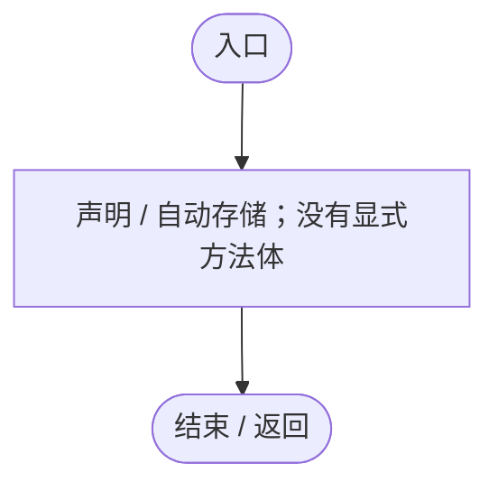

<a id="mc9e8dbe1756bb879"></a>

## SaveStatus.set · L25

`private set`


### Editor / Player · 语法控制结构 / 声明（非CFG）


<a id="mfd1943ccd6331f2e"></a>

## Start · L31

`private void Start()`


### Editor / Player · Roslyn编译器控制流

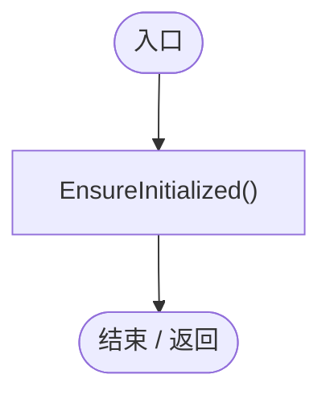

项目内调用/回调引用：

- [WorldSessionManager.EnsureInitialized · L32](08741c7b7b9d9344.md#m4cb522d2ef80e241)（方法）

<a id="m4cb522d2ef80e241"></a>

## EnsureInitialized · L32

`private void EnsureInitialized()`


### Editor / Player · Roslyn编译器控制流

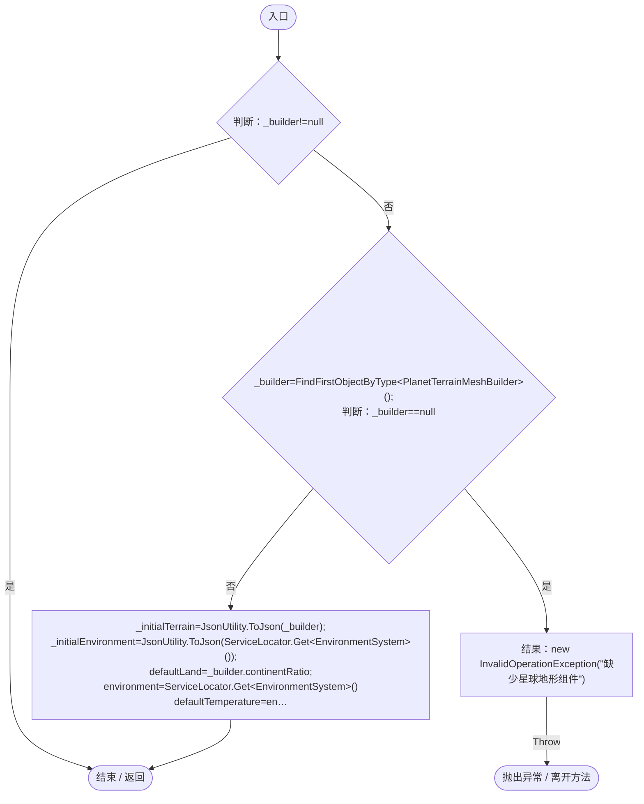

项目内调用/回调引用：

- [ServiceLocator.Get · L33](f2fdbe9f9ccd93cb.md#m2ae625299520c56d)（方法）

<a id="m6aadfeee8b90aacd"></a>

## Create · L41

`public void Create(string name,int seed,float land,float temperature,float humidity)`


### Editor / Player · Roslyn编译器控制流

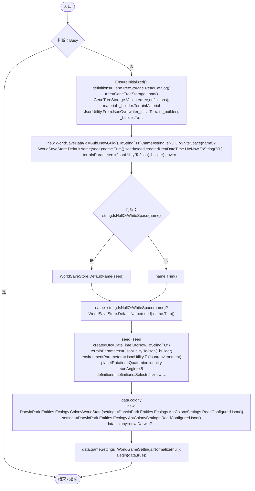

项目内调用/回调引用：

- [WorldSessionManager.Busy.get · L24](08741c7b7b9d9344.md#m4483e2e4f28f7c85)（访问器）
- [WorldSessionManager.EnsureInitialized · L32](08741c7b7b9d9344.md#m4cb522d2ef80e241)（方法）
- [GeneTreeStorage.ReadCatalog · L27](a885bad0d7dedee8.md#m89083f320ec287c0)（方法）
- [GeneTreeStorage.Load · L53](a885bad0d7dedee8.md#m60e52e1c6f841f94)（方法）
- [GeneTreeStorage.Validate · L67](a885bad0d7dedee8.md#m3371bf1e3c5ae267)（方法）
- [ServiceLocator.Get · L33](f2fdbe9f9ccd93cb.md#m2ae625299520c56d)（方法）
- [WorldSaveStore.DefaultName · L40](d67a35e5e3814c15.md#m6e140cd8b98a845d)（方法）
- [EntityStateRegistry.ReadConfiguredJson · L44](440408d2db5c7d96.md#mf18b710e5c3e8d7c)（方法）
- [EcologyBalanceSettings.ReadConfiguredJson · L23](5a37bc79f15f6238.md#md3cac56b60832ffc)（方法）
- [AntColonySettings.ReadConfiguredJson · L33](cb0a937e97c8fbb3.md#mb07b1ffda39df5f5)（方法）
- [WorldGameSettings.Normalize · L12](44f717c5df79d270.md#m61ad45483cbf0aa2)（方法）
- [WorldSessionManager.Begin · L59](08741c7b7b9d9344.md#m5f5f2266a2aed605)（方法）
- [WorldSessionManager.回调@52 · L52](08741c7b7b9d9344.md#ma1778c2cb8880770)（回调/委托）

<a id="ma1778c2cb8880770"></a>

## 回调@52 · L52

`d … => 回调`


### Editor / Player · Roslyn编译器控制流

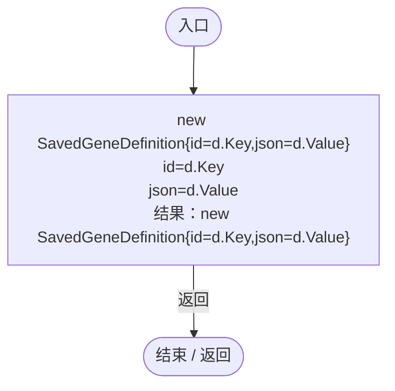

<a id="m0a8e69a8a4fbc512"></a>

## Open · L58

`public void Open(WorldSaveData data)`


### Editor / Player · Roslyn编译器控制流

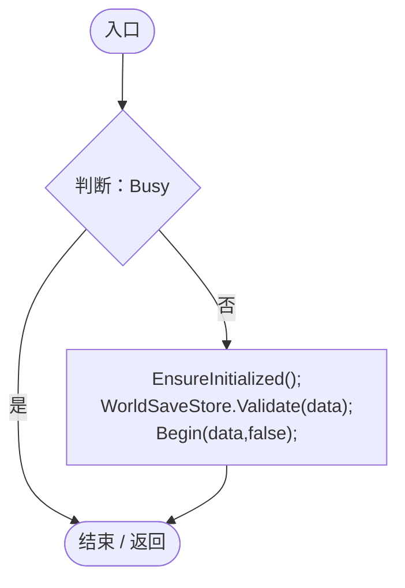

项目内调用/回调引用：

- [WorldSessionManager.Busy.get · L24](08741c7b7b9d9344.md#m4483e2e4f28f7c85)（访问器）
- [WorldSessionManager.EnsureInitialized · L32](08741c7b7b9d9344.md#m4cb522d2ef80e241)（方法）
- [WorldSaveStore.Validate · L73](d67a35e5e3814c15.md#mb2f88d55be126f07)（方法）
- [WorldSessionManager.Begin · L59](08741c7b7b9d9344.md#m5f5f2266a2aed605)（方法）

<a id="m5f5f2266a2aed605"></a>

## Begin · L59

`private void Begin(WorldSaveData data,bool isNew)`


### Editor / Player · Roslyn编译器控制流

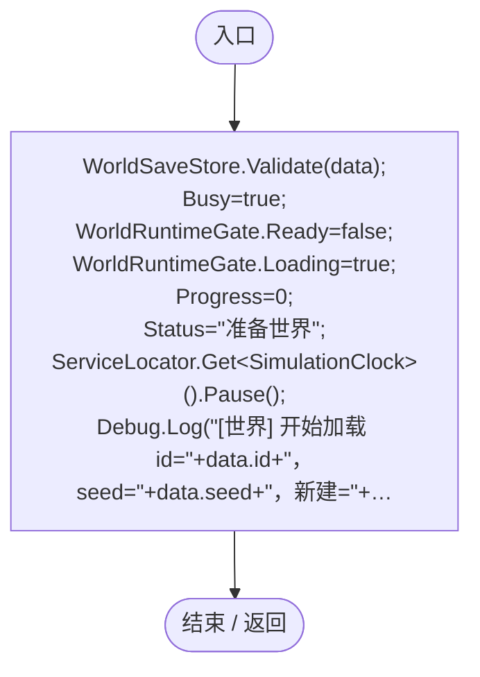

项目内调用/回调引用：

- [WorldSaveStore.Validate · L73](d67a35e5e3814c15.md#mb2f88d55be126f07)（方法）
- [WorldSessionManager.Busy.set · L24](08741c7b7b9d9344.md#mf6b0d4ebe1c01d7e)（访问器）
- [WorldSessionManager.Progress.set · L22](08741c7b7b9d9344.md#mb7d536923769be6d)（访问器）
- [WorldSessionManager.Status.set · L23](08741c7b7b9d9344.md#m929ea266779aec1d)（访问器）
- [SimulationClock.Pause · L79](a8f444aec9614b0a.md#m30929d45a885d0f1)（方法）
- [ServiceLocator.Get · L33](f2fdbe9f9ccd93cb.md#m2ae625299520c56d)（方法）
- [WorldSessionManager.SafeLoad · L67](08741c7b7b9d9344.md#md9a50726b707810d)（方法）
- [WorldSessionManager.Load · L77](08741c7b7b9d9344.md#m366f9d85869f5903)（方法）

<a id="md9a50726b707810d"></a>

## SafeLoad · L67

`private IEnumerator SafeLoad(IEnumerator operation)`


### Editor / Player · Roslyn编译器控制流

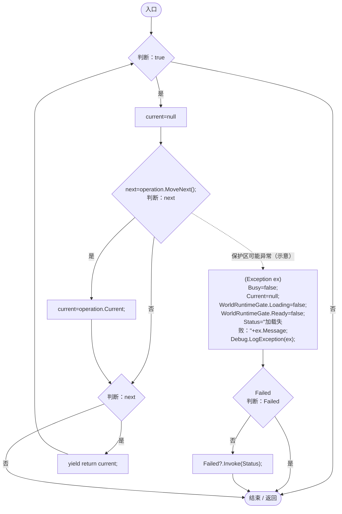

项目内调用/回调引用：

- [WorldSessionManager.Busy.set · L24](08741c7b7b9d9344.md#mf6b0d4ebe1c01d7e)（访问器）
- [WorldSessionManager.Current.set · L21](08741c7b7b9d9344.md#m2f5be6215f549cac)（访问器）
- [WorldSessionManager.Status.set · L23](08741c7b7b9d9344.md#m929ea266779aec1d)（访问器）
- [WorldSessionManager.Status.get · L23](08741c7b7b9d9344.md#mc9040fb24bb00a63)（访问器）

<a id="m366f9d85869f5903"></a>

## Load · L77

`private IEnumerator Load(WorldSaveData data,bool isNew)`


### Editor / Player · Roslyn编译器控制流

```mermaid
flowchart TD
  b0(["入口"])
  b1["yield return null;<br/>yield return new WaitForEndOfFrame();"]
  b2{"EntityViewController.Instance<br/>判断：EntityViewController.Instance"}
  b3["EntityViewController.Instance?.ExitView();"]
  b4{"EntityPlacementTool.Instance<br/>判断：EntityPlacementTool.Instance"}
  b5["EntityPlacementTool.Instance?.CancelPlacement();"]
  b6["PopulationRangeLayer.ClearWorld();<br/>DarwinPark.Entities.Ecology.ColonyWorldState.Prepare(data.colony);"]
  b7["EntityRegistry.All.ToArray()"]
  b8{"判断：EntityRegistry.All.ToArray()"}
  b9["var<br/>entity.gameObject.SetActive(false);<br/>Destroy(entity.gameObject);"]
  b10{"EntityRegistry.All.ToArray()<br/>判断：EntityRegistry.All.ToArray()"}
  b11["EntityRegistry.All.ToArray()"]
  b12["连接 / 离开区域"]
  b13["yield return null;<br/>EntityStateRegistry.UseSnapshot(data.entityStateRegistry);<br/>DarwinPark.Entities.Ecology.EcologyBalanceSettings.UseSnapshot(data.ecologyBalanceSettings);<br/>GeneRuntimeProfile.Catalog=data.definitions.ToDictionary(d=&gt;d.id,d…"]
  b14{"判断：terrainTask.IsCompleted"}
  b15["yield return null;"]
  b16{"判断：terrainTask.IsFaulted"}
  b17["结果：terrainTask.Exception"]
  x17(["抛出异常 / 离开方法"])
  b18["Progress=.52f;<br/>Status=&quot;装配地表、碰撞与天气&quot;;<br/>yield return null;<br/>_builder.ApplyGeneratedData(terrainTask.Result);<br/>_builder.transform.rotation=data.planetRotation;<br/>climate=PlanetClimateMap.Instance<br/>climateConfig=JsonUtility.FromJson&lt;PlanetClimateCo…"]
  b19{"判断：climateTask.IsCompleted"}
  b20["yield return null;"]
  b21{"判断：climateTask.IsFaulted"}
  b22["结果：climateTask.Exception"]
  x22(["抛出异常 / 离开方法"])
  b23{"Progress=.85f;<br/>Status=&quot;上传气候与恢复资源&quot;;<br/>yield return null;<br/>climate.ApplyGeneratedClimate(climateTask.Result);<br/>ore=PlanetOreSystem.Instance<br/>判断：data.ore!=null"}
  b24["ore.RestoreAmounts(data.ore,data.oreResolution);<br/>ore.RegenTimer=data.oreTimer;"]
  b25["ore.ResetWorld();"]
  b26["FindFirstObjectByType&lt;SunSystem&gt;().OrbitAngle=data.sunAngle;<br/>Progress=.9f;<br/>Status=&quot;恢复实体、基因与生命周期&quot;;<br/>yield return null;<br/>EntityPopulationLimit.UseSnapshot(data.gameSettings);<br/>restored=new Dictionary&lt;string,DarwinEntity&gt;()"]
  b27["i=0"]
  b28{"判断：i&lt;data.entities.Count"}
  b29{"saved=data.entities[i]<br/>before=EntityRegistry.All.ToArray()<br/>判断：DarwinEntity.Spawner==null"}
  b30["结果：new InvalidOperationException(&quot;实体生成器尚未就绪&quot;)"]
  x30(["抛出异常 / 离开方法"])
  b31["EntityPopulationLimit.RestoreScope()"]
  b32["DarwinEntity.Spawner(saved.genome,saved.position,saved.name);<br/>spawned=EntityRegistry.All.Single(e=&gt;!before.Contains(e));<br/>saved.Restore(spawned);"]
  b33{"判断：EntityPopulationLimit.RestoreScope()"}
  b34["EntityPopulationLimit.RestoreScope()"]
  b35["连接 / 离开区域"]
  b36{"判断：saved.ecology!=null"}
  b37["restored[saved.ecology.id]=spawned;"]
  b38{"判断：saved.favorite"}
  b39{"EntityFavoritesManager.Instance<br/>判断：EntityFavoritesManager.Instance"}
  b40["EntityFavoritesManager.Instance?.ToggleFavorite(spawned);"]
  b41{"判断：i%16==0"}
  b42["Progress=.9f+.06f*(i+1)/Mathf.Max(1,data.entities.Count);<br/>yield return null;"]
  b43["i++"]
  b44["data.entities"]
  b45{"判断：data.entities"}
  b46["var"]
  b47{"判断：saved.ecology!=null"}
  b48{"判断：restored.TryGetValue(saved.ecology.id,out var entity)"}
  b49["saved.ecology.Resolve(entity,restored);"]
  b50["data.entities"]
  b51{"DarwinPark.Entities.Ecology.ColonyWorldState.Restore(data.colony);<br/>EcologyLegacySaveUpgrade.Apply(data,EntityRegistry.All);<br/>camera=Camera.main<br/>orbit=camera.GetComponent&lt;OrbitCamera&gt;()<br/>判断：isNew"}
  b52["position=_builder.transform.position+new Vector3(0,.35f,-1).normalized*orbit.distance<br/>orbit.RestoreView(position,Quaternion.LookRotation(_builder.transform.position-position,Vector3.up),orbit.distance);"]
  b53["orbit.RestoreView(data.cameraPosition,data.cameraRotation,data.cameraDistance);"]
  b54{"ServiceLocator.Get&lt;SimulationClock&gt;().RestoreState(data.gameTime,data.timeScale);<br/>Current=data;<br/>Progress=.98f;<br/>Status=&quot;完成画面与界面准备&quot;;<br/>yield return null;<br/>yield return new WaitForEndOfFrame();<br/>判断：isNew"}
  b55["SaveNow();"]
  b56["Progress=1;<br/>Status=&quot;加载完成&quot;;<br/>yield return null;<br/>Busy=false;<br/>WorldRuntimeGate.Loading=false;<br/>WorldRuntimeGate.Ready=true;<br/>_autoSave=0;<br/>Debug.Log(&quot;[世界] 加载完成 id=&quot;+data.id+&quot;，实体=&quot;+EntityRegistry.All.Count);"]
  b57{"Loaded<br/>判断：Loaded"}
  b58["Loaded?.Invoke();"]
  b59(["结束 / 返回"])
  b0 --> b1
  b1 --> b2
  b2 -->|"否"| b3
  b2 -->|"是"| b4
  b3 --> b4
  b4 -->|"否"| b5
  b4 -->|"是"| b6
  b5 --> b6
  b6 --> b7
  b7 --> b8
  b8 -->|"是"| b9
  b8 -->|"否 · 经过finally 10"| b13
  b9 --> b8
  b10 -->|"否"| b11
  b10 -->|"是"| b12
  b11 --> b12
  b13 --> b14
  b14 -->|"否"| b15
  b14 -->|"是"| b16
  b15 --> b14
  b16 -->|"是"| b17
  b16 -->|"否"| b18
  b17 -->|"Throw"| x17
  b18 --> b19
  b19 -->|"否"| b20
  b19 -->|"是"| b21
  b20 --> b19
  b21 -->|"是"| b22
  b21 -->|"否"| b23
  b22 -->|"Throw"| x22
  b23 -->|"是"| b24
  b23 -->|"否"| b25
  b24 --> b26
  b25 --> b26
  b26 --> b27
  b27 --> b28
  b28 -->|"是"| b29
  b28 -->|"否"| b44
  b29 -->|"是"| b30
  b29 -->|"否"| b31
  b30 -->|"Throw"| x30
  b31 --> b32
  b32 -->|"经过finally 33"| b36
  b33 -->|"否"| b34
  b33 -->|"是"| b35
  b34 --> b35
  b36 -->|"是"| b37
  b36 -->|"否"| b38
  b37 --> b38
  b38 -->|"是"| b39
  b38 -->|"否"| b41
  b39 -->|"否"| b40
  b39 -->|"是"| b41
  b40 --> b41
  b41 -->|"是"| b42
  b41 -->|"否"| b43
  b42 --> b43
  b43 --> b28
  b44 --> b45
  b45 -->|"是"| b46
  b45 -->|"否 · 经过finally 50"| b51
  b46 --> b47
  b47 -->|"是"| b48
  b47 -->|"否"| b45
  b48 -->|"是"| b49
  b48 -->|"否"| b45
  b49 --> b45
  b51 -->|"是"| b52
  b51 -->|"否"| b53
  b52 --> b54
  b53 --> b54
  b54 -->|"是"| b55
  b54 -->|"否"| b56
  b55 --> b56
  b56 --> b57
  b57 -->|"否"| b58
  b57 -->|"是"| b59
  b58 --> b59
  b8 -. "退出保护区时 finally（示意）" .-> b10
  b32 -. "退出保护区时 finally（示意）" .-> b33
  b45 -. "退出保护区时 finally（示意）" .-> b50

```

项目内调用/回调引用：

- [EntityViewController.Instance.get · L15](0ad0345f83229ef0.md#mb3b8144b56e80842)（访问器）
- [EntityViewController.ExitView · L105](0ad0345f83229ef0.md#mca8619c7f27942c9)（方法）
- [EntityPlacementTool.Instance.get · L13](2ca993947b0a7e7a.md#mafb26991c0dfcb86)（访问器）
- [EntityPlacementTool.CancelPlacement · L81](2ca993947b0a7e7a.md#m5a9374d2c71f0a2d)（方法）
- [PopulationRangeLayer.ClearWorld · L25](7ad316e94c5af908.md#m02787b2f4b274bce)（方法）
- [ColonyWorldState.Prepare · L29](50d866ed6b21d869.md#m8c5a8eb48f79e54b)（方法）
- [EntityStateRegistry.UseSnapshot · L52](440408d2db5c7d96.md#m6013e583cbf33e79)（方法）
- [EcologyBalanceSettings.UseSnapshot · L43](5a37bc79f15f6238.md#mfb6d2d0cbc1cf33d)（方法）
- [GeneCatalogExpansion.Expand · L10](03ab59525607c3f7.md#mbc54a236ebee1b97)（方法）
- [GeneDatabase.Reload · L145](ec0a03483435a863.md#mbf775d68c402c10e)（方法）
- [GeneDatabase.EnsureLoaded · L12](ec0a03483435a863.md#mc3e6357b9ca440f5)（方法）
- [PopulationMaintenance.Restore · L136](923ccc4e86c4786c.md#m17a7879cb457a04a)（方法）
- [RandomPlanetSpawner.ResetWorld · L93](1c13222a547b265c.md#m77bda937df88d9bf)（方法）
- [RandomPlanetSpawner.Ensure · L24](1c13222a547b265c.md#mccefd1367aa9ded3)（方法）
- [ServiceLocator.Get · L33](f2fdbe9f9ccd93cb.md#m2ae625299520c56d)（方法）
- [PlanetTerrainMeshBuilder.CaptureConfiguration · L108](415285cf043354a9.md#mec13ac0a32e0de61)（方法）
- [WorldSessionManager.Progress.set · L22](08741c7b7b9d9344.md#mb7d536923769be6d)（访问器）
- [WorldSessionManager.Status.set · L23](08741c7b7b9d9344.md#m929ea266779aec1d)（访问器）
- [PlanetTerrainMeshBuilder.ApplyGeneratedData · L160](415285cf043354a9.md#m3e899cb84c9a0081)（方法）
- [PlanetClimateMap.Instance.get · L16](b4e9726c1bcf4c37.md#m3add54a419aeef9f)（访问器）
- [PlanetClimateSystem.Instance.get · L32](ba86e31da9b7d0a5.md#mf8e5c7e126d7b598)（访问器）
- [PlanetTerrainMeshBuilder.Data.get · L78](415285cf043354a9.md#m8382f579717fbc6d)（访问器）
- [PlanetClimateMap.ApplyGeneratedClimate · L114](b4e9726c1bcf4c37.md#m20ba66ec7eca94e5)（方法）
- [PlanetOreSystem.Instance.get · L8](86b3fbb4d9436121.md#m53f6a6af4b6dc252)（访问器）
- [PlanetOreSystem.RestoreAmounts · L111](86b3fbb4d9436121.md#mf32079659fe75cd5)（方法）
- [PlanetOreSystem.RegenTimer.set · L110](86b3fbb4d9436121.md#ma831f663fb815b50)（访问器）
- [PlanetOreSystem.ResetWorld · L119](86b3fbb4d9436121.md#maf2dd421717cfde5)（方法）
- [SunSystem.OrbitAngle.set · L27](15af8ca97f781b7f.md#mdfb5515951cbcd65)（访问器）
- [EntityPopulationLimit.UseSnapshot · L30](44f717c5df79d270.md#m735185cedc969868)（方法）
- [EntityPopulationLimit.RestoreScope · L32](44f717c5df79d270.md#m58883b4959fd76ed)（方法）
- [EntitySaveState.Restore · L31](a1ec8fcd9d7d3ddb.md#m047b691a146deabd)（方法）
- [EntityFavoritesManager.Instance.get · L10](b60fb973e9d3815a.md#m0dac2feb106bac97)（访问器）
- [EntityFavoritesManager.ToggleFavorite · L55](b60fb973e9d3815a.md#m20d366a69a0f5fdd)（方法）
- [EcologySaveState.Resolve · L56](dd1dde4b4c192659.md#m98c8ed891d6db10c)（方法）
- [ColonyWorldState.Restore · L30](50d866ed6b21d869.md#m18762b8c789230db)（方法）
- [EcologyLegacySaveUpgrade.Apply · L14](3ea317ee2852be05.md#m62b6c72e15708d48)（方法）
- [OrbitCamera.RestoreView · L42](42eb429559b42bcb.md#m8ee0579d9414ca2c)（方法）
- [SimulationClock.RestoreState · L74](a8f444aec9614b0a.md#m8f617e95e1282846)（方法）
- [WorldSessionManager.Current.set · L21](08741c7b7b9d9344.md#m2f5be6215f549cac)（访问器）
- [WorldSessionManager.SaveNow · L157](08741c7b7b9d9344.md#mbecd8b5c222ba46b)（方法）
- [WorldSessionManager.Busy.set · L24](08741c7b7b9d9344.md#mf6b0d4ebe1c01d7e)（访问器）
- [WorldSessionManager.回调@87 · L87](08741c7b7b9d9344.md#m1e5d74b069a5a3a3)（回调/委托）
- [WorldSessionManager.回调@87 · L87](08741c7b7b9d9344.md#mba5b916b74caf88a)（回调/委托）
- [WorldSessionManager.回调@97 · L97](08741c7b7b9d9344.md#m36591166410c24b9)（回调/委托）
- [WorldSessionManager.回调@104 · L104](08741c7b7b9d9344.md#m056194eab095bd9b)（回调/委托）
- [WorldSessionManager.回调@117 · L117](08741c7b7b9d9344.md#m194f1765a23077d0)（回调/委托）

<a id="m1e5d74b069a5a3a3"></a>

## 回调@87 · L87

`d … => 回调`


### Editor / Player · Roslyn编译器控制流

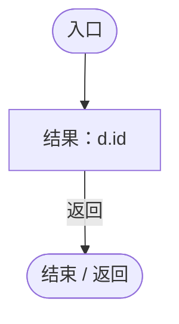

<a id="mba5b916b74caf88a"></a>

## 回调@87 · L87

`d … => 回调`


### Editor / Player · Roslyn编译器控制流

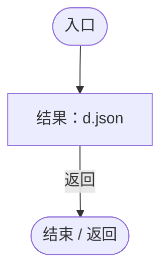

<a id="m36591166410c24b9"></a>

## 回调@97 · L97

`( … => 回调`


### Editor / Player · Roslyn编译器控制流

```mermaid
flowchart TD
  b0(["入口"])
  b1["结果：PlanetTerrainGenerator.Generate(config,sea,land)"]
  b2(["结束 / 返回"])
  b0 --> b1
  b1 -->|"返回"| b2

```

项目内调用/回调引用：

- [PlanetTerrainGenerator.Generate · L20](cde9e7b164fab46e.md#m7c6d74a69a660a78)（方法）

<a id="m056194eab095bd9b"></a>

## 回调@104 · L104

`( … => 回调`


### Editor / Player · Roslyn编译器控制流

```mermaid
flowchart TD
  b0(["入口"])
  b1["结果：new PlanetClimateModel(terrain,climateConfig,seed).Generate(resolution,temp,hum)"]
  b2(["结束 / 返回"])
  b0 --> b1
  b1 -->|"返回"| b2

```

项目内调用/回调引用：

- [PlanetClimateModel.Generate · L59](0249d34bf86f4fa3.md#m49a6e534a85dc57e)（方法）
- [PlanetClimateModel.PlanetClimateModel.ctor · L48](0249d34bf86f4fa3.md#m49e0c243be23136b)（构造函数）

<a id="m194f1765a23077d0"></a>

## 回调@117 · L117

`e … => 回调`


### Editor / Player · Roslyn编译器控制流

```mermaid
flowchart TD
  b0(["入口"])
  b1["结果：!before.Contains(e)"]
  b2(["结束 / 返回"])
  b0 --> b1
  b1 -->|"返回"| b2

```

<a id="m6b1d0d11a045709c"></a>

## ReturnToMenu · L136

`public void ReturnToMenu(bool running)`

★ 新增：返回主界面先完成保存；失败直接抛回菜单，禁止先清场再丢失玩家进度。

### Editor / Player · Roslyn编译器控制流

```mermaid
flowchart TD
  b0(["入口"])
  b1{"判断：WorldAuthority.IsReplica"}
  b2["StopAllCoroutines();<br/>Busy=false;"]
  b3{"判断：Busy"}
  b4{"判断：Current==null"}
  b5{"判断：WorldAuthority.IsReplica"}
  b6["结果：new InvalidOperationException(&quot;当前世界尚未就绪&quot;)"]
  x6(["抛出异常 / 离开方法"])
  b7["SaveNow(running);<br/>ServiceLocator.Get&lt;SimulationClock&gt;().Pause();<br/>WorldRuntimeGate.Ready=false;<br/>WorldRuntimeGate.Loading=false;<br/>GameInputGate.Blocked=true;"]
  b8{"EntityViewController.Instance<br/>判断：EntityViewController.Instance"}
  b9["EntityViewController.Instance?.ExitView();"]
  b10{"EntityPlacementTool.Instance<br/>判断：EntityPlacementTool.Instance"}
  b11["EntityPlacementTool.Instance?.CancelPlacement();"]
  b12["FindObjectsByType&lt;GeneInspectorUI&gt;(FindObjectsSortMode.None)"]
  b13{"判断：FindObjectsByType&lt;GeneInspectorUI&gt;(FindObjectsSortMode.None)"}
  b14["var<br/>inspector.HideEntityInfo();"]
  b15{"FindObjectsByType&lt;GeneInspectorUI&gt;(FindObjectsSortMode.None)<br/>判断：FindObjectsByType&lt;GeneInspectorUI&gt;(FindObjectsSortMode.None)"}
  b16["FindObjectsByType&lt;GeneInspectorUI&gt;(FindObjectsSortMode.None)"]
  b17["连接 / 离开区域"]
  b18{"EntityFavoritesManager.Instance<br/>判断：EntityFavoritesManager.Instance"}
  b19["EntityFavoritesManager.Instance?.ClearWorld();"]
  b20["EntityRegistry.All.ToArray()"]
  b21{"判断：EntityRegistry.All.ToArray()"}
  b22["var<br/>entity.gameObject.SetActive(false);<br/>Destroy(entity.gameObject);"]
  b23{"EntityRegistry.All.ToArray()<br/>判断：EntityRegistry.All.ToArray()"}
  b24["EntityRegistry.All.ToArray()"]
  b25["连接 / 离开区域"]
  b26["GeneRuntimeProfile.Clear();<br/>GeneDatabase.Reload();<br/>PopulationRangeLayer.ClearWorld();<br/>DarwinPark.Entities.Ecology.ColonyWorldState.Clear();<br/>DarwinPark.Entities.Ecology.EcologyBalanceSettings.Clear();"]
  b27["&quot;[世界] 返回主界面 id=&quot;"]
  b28{"Current<br/>判断：Current"}
  b29[".id"]
  b30["Current"]
  b31["Debug.Log(&quot;[世界] 返回主界面 id=&quot;+Current?.id+&quot;，联机副本=&quot;+WorldAuthority.IsReplica);"]
  b32["EntityPopulationLimit.Clear();<br/>PopulationMaintenance.Restore(null);"]
  b33{"FindFirstObjectByType&lt;RandomPlanetSpawner&gt;()<br/>判断：FindFirstObjectByType&lt;RandomPlanetSpawner&gt;()"}
  b34["FindFirstObjectByType&lt;RandomPlanetSpawner&gt;()?.ResetWorld();"]
  b35["Current=null;<br/>_autoSave=0;<br/>Progress=0;<br/>Status=&quot;&quot;;<br/>SaveStatus=&quot;&quot;;"]
  b36(["结束 / 返回"])
  b0 --> b1
  b1 -->|"是"| b2
  b1 -->|"否"| b3
  b2 --> b3
  b3 -->|"否"| b4
  b3 -->|"是"| b6
  b4 -->|"是"| b5
  b4 -->|"否"| b7
  b5 -->|"否"| b6
  b5 -->|"是"| b7
  b6 -->|"Throw"| x6
  b7 --> b8
  b8 -->|"否"| b9
  b8 -->|"是"| b10
  b9 --> b10
  b10 -->|"否"| b11
  b10 -->|"是"| b12
  b11 --> b12
  b12 --> b13
  b13 -->|"是"| b14
  b13 -->|"否 · 经过finally 15"| b18
  b14 --> b13
  b15 -->|"否"| b16
  b15 -->|"是"| b17
  b16 --> b17
  b18 -->|"否"| b19
  b18 -->|"是"| b20
  b19 --> b20
  b20 --> b21
  b21 -->|"是"| b22
  b21 -->|"否 · 经过finally 23"| b26
  b22 --> b21
  b23 -->|"否"| b24
  b23 -->|"是"| b25
  b24 --> b25
  b26 --> b27
  b27 --> b28
  b28 -->|"否"| b29
  b28 -->|"是"| b30
  b29 --> b31
  b30 --> b31
  b31 --> b32
  b32 --> b33
  b33 -->|"否"| b34
  b33 -->|"是"| b35
  b34 --> b35
  b35 --> b36
  b13 -. "退出保护区时 finally（示意）" .-> b15
  b21 -. "退出保护区时 finally（示意）" .-> b23

```

项目内调用/回调引用：

- [WorldSessionManager.Busy.set · L24](08741c7b7b9d9344.md#mf6b0d4ebe1c01d7e)（访问器）
- [WorldSessionManager.Busy.get · L24](08741c7b7b9d9344.md#m4483e2e4f28f7c85)（访问器）
- [WorldSessionManager.Current.get · L21](08741c7b7b9d9344.md#m5d26a5eb846a8504)（访问器）
- [WorldSessionManager.SaveNow · L157](08741c7b7b9d9344.md#mbecd8b5c222ba46b)（方法）
- [SimulationClock.Pause · L79](a8f444aec9614b0a.md#m30929d45a885d0f1)（方法）
- [ServiceLocator.Get · L33](f2fdbe9f9ccd93cb.md#m2ae625299520c56d)（方法）
- [GameInputGate.Blocked.set · L8](52955daae7e592ab.md#m578697f6379686f4)（访问器）
- [EntityViewController.Instance.get · L15](0ad0345f83229ef0.md#mb3b8144b56e80842)（访问器）
- [EntityViewController.ExitView · L105](0ad0345f83229ef0.md#mca8619c7f27942c9)（方法）
- [EntityPlacementTool.Instance.get · L13](2ca993947b0a7e7a.md#mafb26991c0dfcb86)（访问器）
- [EntityPlacementTool.CancelPlacement · L81](2ca993947b0a7e7a.md#m5a9374d2c71f0a2d)（方法）
- [GeneInspectorUI.HideEntityInfo · L316](924e27c34e7b1f0a.md#m11944eddcac871c2)（方法）
- [EntityFavoritesManager.Instance.get · L10](b60fb973e9d3815a.md#m0dac2feb106bac97)（访问器）
- [EntityFavoritesManager.ClearWorld · L49](b60fb973e9d3815a.md#m4954d3e7fcdfe6b3)（方法）
- [GeneRuntimeProfile.Clear · L9](f1a7d6e7b41d5a91.md#m3e3a434df6550039)（方法）
- [GeneDatabase.Reload · L145](ec0a03483435a863.md#mbf775d68c402c10e)（方法）
- [PopulationRangeLayer.ClearWorld · L25](7ad316e94c5af908.md#m02787b2f4b274bce)（方法）
- [ColonyWorldState.Clear · L35](50d866ed6b21d869.md#m1c94ee651ae12060)（方法）
- [EcologyBalanceSettings.Clear · L44](5a37bc79f15f6238.md#mf955ed3911a25061)（方法）
- [EntityPopulationLimit.Clear · L34](44f717c5df79d270.md#mac536322c0371f18)（方法）
- [PopulationMaintenance.Restore · L136](923ccc4e86c4786c.md#m17a7879cb457a04a)（方法）
- [RandomPlanetSpawner.ResetWorld · L93](1c13222a547b265c.md#m77bda937df88d9bf)（方法）
- [WorldSessionManager.Current.set · L21](08741c7b7b9d9344.md#m2f5be6215f549cac)（访问器）
- [WorldSessionManager.Progress.set · L22](08741c7b7b9d9344.md#mb7d536923769be6d)（访问器）
- [WorldSessionManager.Status.set · L23](08741c7b7b9d9344.md#m929ea266779aec1d)（访问器）
- [WorldSessionManager.SaveStatus.set · L25](08741c7b7b9d9344.md#mc9e8dbe1756bb879)（访问器）

<a id="mbecd8b5c222ba46b"></a>

## SaveNow · L157

`public void SaveNow(bool? running=null)`


### Editor / Player · Roslyn编译器控制流

```mermaid
flowchart TD
  b0(["入口"])
  b1{"判断：WorldAuthority.IsReplica"}
  b2["SaveStatus=&quot;联机世界由管理员保存&quot;;"]
  b3{"判断：Current==null"}
  b4["结果：new InvalidOperationException(&quot;没有可保存的世界&quot;)"]
  x4(["抛出异常 / 离开方法"])
  b5{"clock=ServiceLocator.Get&lt;SimulationClock&gt;()<br/>environment=ServiceLocator.Get&lt;EnvironmentSystem&gt;()<br/>camera=Camera.main<br/>orbit=camera.GetComponent&lt;OrbitCamera&gt;()<br/>Current.seed=_builder.seed;<br/>Current.terrainParameters=JsonUtility.ToJson(_builder…"}
  b6["Current.running=running.Value;"]
  b7{"判断：GameInputGate.Blocked"}
  b8["Current.running=clock.IsRunning;"]
  b9["Current.cameraPosition=camera.transform.position;<br/>Current.cameraRotation=camera.transform.rotation;<br/>Current.cameraDistance=orbit.distance;<br/>Current.planetRotation=_builder.transform.rotation;<br/>Current.sunAngle=FindFirstObjectByType&lt;SunSyst…"]
  b10{"GeneRuntimeProfile.Catalog<br/>判断：GeneRuntimeProfile.Catalog"}
  b11["GeneRuntimeProfile.Catalog"]
  b12["GeneTreeStorage.ReadCatalog()"]
  b13["catalog=GeneRuntimeProfile.Catalog??GeneTreeStorage.ReadCatalog()"]
  b14["Current.definitions=catalog.Select(d=&gt;new SavedGeneDefinition{id=d.Key,json=d.Value}).ToList();<br/>Current.tree=GeneTreeStorage.Active;<br/>Current.entityStateRegistry=EntityStateRegistry.CurrentJson;<br/>Current.ecologyBalanceSettings=DarwinPark.E…"]
  b15(["结束 / 返回"])
  b0 --> b1
  b1 -->|"是"| b2
  b1 -->|"否"| b3
  b2 --> b15
  b3 -->|"是"| b4
  b3 -->|"否"| b5
  b4 -->|"Throw"| x4
  b5 -->|"是"| b6
  b5 -->|"否"| b7
  b6 --> b9
  b7 -->|"否"| b8
  b7 -->|"是"| b9
  b8 --> b9
  b9 --> b10
  b10 -->|"否"| b11
  b10 -->|"是"| b12
  b11 --> b13
  b12 --> b13
  b13 --> b14
  b14 --> b15

```

项目内调用/回调引用：

- [WorldSessionManager.SaveStatus.set · L25](08741c7b7b9d9344.md#mc9e8dbe1756bb879)（访问器）
- [WorldSessionManager.Current.get · L21](08741c7b7b9d9344.md#m5d26a5eb846a8504)（访问器）
- [ServiceLocator.Get · L33](f2fdbe9f9ccd93cb.md#m2ae625299520c56d)（方法）
- [SimulationClock.GameTime.get · L23](a8f444aec9614b0a.md#m74adfa39a896652f)（访问器）
- [GameInputGate.Blocked.get · L8](52955daae7e592ab.md#m765763b665829633)（访问器）
- [SimulationClock.IsRunning.get · L22](a8f444aec9614b0a.md#m10f4fe307faca0f0)（访问器）
- [SunSystem.OrbitAngle.get · L27](15af8ca97f781b7f.md#m4e38e717885434fc)（访问器）
- [PlanetOreSystem.CaptureAmounts · L109](86b3fbb4d9436121.md#m3af5d421a609641e)（方法）
- [PlanetOreSystem.Instance.get · L8](86b3fbb4d9436121.md#m53f6a6af4b6dc252)（访问器）
- [PlanetOreSystem.RegenTimer.get · L110](86b3fbb4d9436121.md#m05d9f43661b9e216)（访问器）
- [GeneTreeStorage.ReadCatalog · L27](a885bad0d7dedee8.md#m89083f320ec287c0)（方法）
- [GeneTreeStorage.Active.get · L26](a885bad0d7dedee8.md#mcd6b1d82c9cf8f5c)（访问器）
- [EntityStateRegistry.CurrentJson.get · L43](440408d2db5c7d96.md#m32449837062f8705)（访问器）
- [EcologyBalanceSettings.CurrentJson.get · L30](5a37bc79f15f6238.md#m4835e7fa2ac9560d)（访问器）
- [ColonyWorldState.Capture · L15](50d866ed6b21d869.md#m9d6a91b6b3cbf086)（方法）
- [EntityPopulationLimit.Capture · L29](44f717c5df79d270.md#m9d42f19642677139)（方法）
- [PopulationMaintenance.Capture · L121](923ccc4e86c4786c.md#m5dc9a32bbddf0f63)（方法）
- [WorldSaveStore.Write · L117](d67a35e5e3814c15.md#m793b97a7ba7d2029)（方法）
- [WorldSaveStore.FileFor · L48](d67a35e5e3814c15.md#m419a625e2bcc70f8)（方法）
- [WorldSessionManager.回调@168 · L168](08741c7b7b9d9344.md#macd65a72d19cb758)（回调/委托）
- [WorldSessionManager.回调@168 · L168](08741c7b7b9d9344.md#m368629007700f0ca)（回调/委托）
- [WorldSessionManager.回调@171 · L171](08741c7b7b9d9344.md#m08b5b0df621635df)（回调/委托）

<a id="macd65a72d19cb758"></a>

## 回调@168 · L168

`e … => 回调`


### Editor / Player · Roslyn编译器控制流

```mermaid
flowchart TD
  b0(["入口"])
  b1{"判断：e!=null"}
  b2["e.isActiveAndEnabled"]
  b3["e!=null"]
  b4["结果：e!=null&amp;&amp;e.isActiveAndEnabled"]
  b5(["结束 / 返回"])
  b0 --> b1
  b1 -->|"是"| b2
  b1 -->|"否"| b3
  b2 --> b4
  b3 --> b4
  b4 -->|"返回"| b5

```

<a id="m368629007700f0ca"></a>

## 回调@168 · L168

`e … => 回调`


### Editor / Player · Roslyn编译器控制流

```mermaid
flowchart TD
  b0(["入口"])
  b1["state=EntitySaveState.Capture(e)"]
  b2["state.favorite"]
  b3{"EntityFavoritesManager.Instance<br/>判断：EntityFavoritesManager.Instance"}
  b4[".IsFavorite(e)"]
  b5["EntityFavoritesManager.Instance"]
  b6["state.favorite=EntityFavoritesManager.Instance?.IsFavorite(e)==true;"]
  b7["结果：state"]
  b8(["结束 / 返回"])
  b0 --> b1
  b1 --> b2
  b2 --> b3
  b3 -->|"否"| b4
  b3 -->|"是"| b5
  b4 --> b6
  b5 --> b6
  b6 --> b7
  b7 -->|"返回"| b8

```

项目内调用/回调引用：

- [EntitySaveState.Capture · L21](a1ec8fcd9d7d3ddb.md#mc67502b381bc2751)（方法）
- [EntityFavoritesManager.Instance.get · L10](b60fb973e9d3815a.md#m0dac2feb106bac97)（访问器）
- [EntityFavoritesManager.IsFavorite · L46](b60fb973e9d3815a.md#m441337ce7ee05333)（方法）

<a id="m08b5b0df621635df"></a>

## 回调@171 · L171

`d … => 回调`


### Editor / Player · Roslyn编译器控制流

```mermaid
flowchart TD
  b0(["入口"])
  b1["new SavedGeneDefinition{id=d.Key,json=d.Value}<br/>id=d.Key<br/>json=d.Value<br/>结果：new SavedGeneDefinition{id=d.Key,json=d.Value}"]
  b2(["结束 / 返回"])
  b0 --> b1
  b1 -->|"返回"| b2

```

<a id="m97a9e72a66db1e7a"></a>

## Update · L182

`private void Update()`

★ 修复（防Bug回归）：离线录制的临时相机/星球相位不能被自动存档写入世界。

### Editor / Player · Roslyn编译器控制流

```mermaid
flowchart TD
  b0(["入口"])
  b1{"判断：Busy"}
  b2{"判断：WorldRuntimeGate.Loading"}
  b3{"判断：WorldRuntimeGate.Recording"}
  b4{"判断：WorldRuntimeGate.Ready"}
  b5{"判断：Current!=null"}
  b6{"_autoSave+=Time.unscaledDeltaTime;<br/>判断：_autoSave&gt;=autoSaveInterval"}
  b7["_autoSave=0;"]
  b8["SaveNow();"]
  b9["(Exception ex)<br/>SaveStatus=&quot;自动保存失败：&quot;+ex.Message;<br/>Debug.LogException(ex);"]
  b10(["结束 / 返回"])
  b0 --> b1
  b1 -->|"否"| b2
  b1 -->|"是"| b10
  b2 -->|"否"| b3
  b2 -->|"是"| b10
  b3 -->|"否"| b4
  b3 -->|"是"| b10
  b4 -->|"是"| b5
  b4 -->|"否"| b10
  b5 -->|"是"| b6
  b5 -->|"否"| b10
  b6 -->|"是"| b7
  b6 -->|"否"| b10
  b7 --> b8
  b8 --> b10
  b9 --> b10
  b8 -. "保护区可能异常（示意）" .-> b9

```

项目内调用/回调引用：

- [WorldSessionManager.Busy.get · L24](08741c7b7b9d9344.md#m4483e2e4f28f7c85)（访问器）
- [WorldSessionManager.Current.get · L21](08741c7b7b9d9344.md#m5d26a5eb846a8504)（访问器）
- [WorldSessionManager.SaveNow · L157](08741c7b7b9d9344.md#mbecd8b5c222ba46b)（方法）
- [WorldSessionManager.SaveStatus.set · L25](08741c7b7b9d9344.md#mc9e8dbe1756bb879)（访问器）

<a id="mcee3fac1126fd126"></a>

## OnApplicationQuit · L183

`private void OnApplicationQuit()`


### Editor / Player · Roslyn编译器控制流

```mermaid
flowchart TD
  b0(["入口"])
  b1{"判断：Current!=null"}
  b2{"判断：Busy"}
  b3["SaveNow();"]
  b4["(Exception ex)<br/>Debug.LogException(ex);"]
  b5(["结束 / 返回"])
  b0 --> b1
  b1 -->|"是"| b2
  b1 -->|"否"| b5
  b2 -->|"否"| b3
  b2 -->|"是"| b5
  b3 --> b5
  b4 --> b5
  b3 -. "保护区可能异常（示意）" .-> b4

```

项目内调用/回调引用：

- [WorldSessionManager.Current.get · L21](08741c7b7b9d9344.md#m5d26a5eb846a8504)（访问器）
- [WorldSessionManager.Busy.get · L24](08741c7b7b9d9344.md#m4483e2e4f28f7c85)（访问器）
- [WorldSessionManager.SaveNow · L157](08741c7b7b9d9344.md#mbecd8b5c222ba46b)（方法）
