# SchedulerPerformanceRegression.cs

[返回总索引](../README.md) · `Editor` · `Assets/DarwinPark/Editor/SchedulerPerformanceRegression.cs`

[源文件](../../../Assets/DarwinPark/Editor/SchedulerPerformanceRegression.cs) · 源码校验：`4dc97ead1f748fca4db8a12ba61ff2f0095bc5f06a63d90a6f429916be2b0fcd`

方法按源文件位置排列。事件/回调引用不表示立即执行；分支与异常说明见总索引。完整源码与可点击关系图请打开离线手册。

## Folder.get · L30

`private static string Folder`

### Editor · 语法控制结构 / 声明（非CFG）

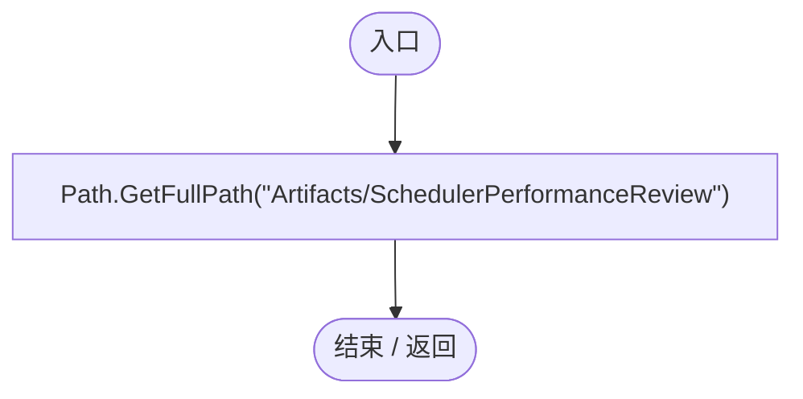

## SchedulerPerformanceRegression.ctor · L31

`static SchedulerPerformanceRegression()`

### Editor · Roslyn编译器控制流

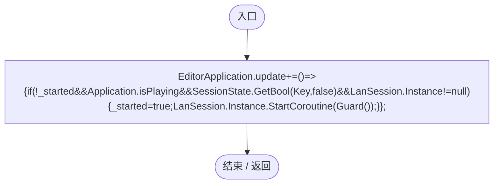

项目内调用/回调引用：

- [SchedulerPerformanceRegression.回调@31 · L31](0a17f5e2b9d73a74.md#m4a67a731fb25f79f)（回调/委托）

## 回调@31 · L31

`( … => 回调`

### Editor · Roslyn编译器控制流

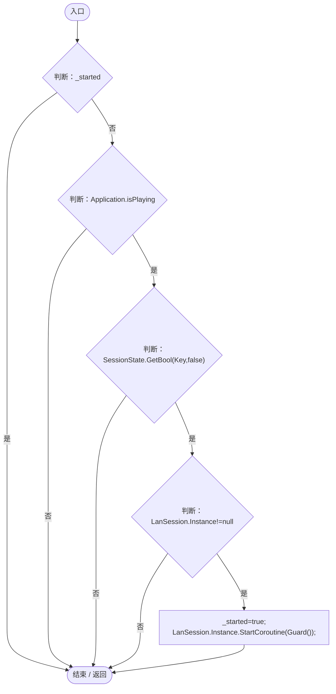

项目内调用/回调引用：

- [LanSession.Instance.get · L23](9fb633eebffe669c.md#mbf83306994878383)（访问器）
- [SchedulerPerformanceRegression.Guard · L33](0a17f5e2b9d73a74.md#mb3d15228b2e147f1)（方法）

## RunBatch · L32

`public static void RunBatch()`

### Editor · Roslyn编译器控制流

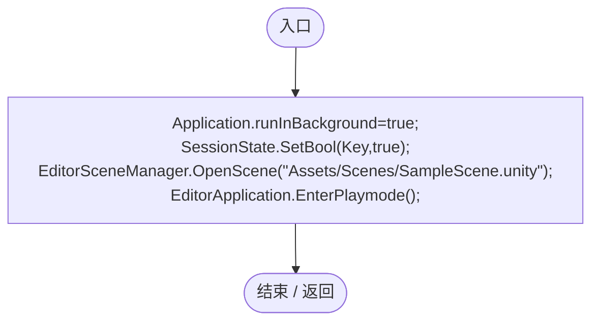

## Guard · L33

`private static IEnumerator Guard()`

### Editor · Roslyn编译器控制流

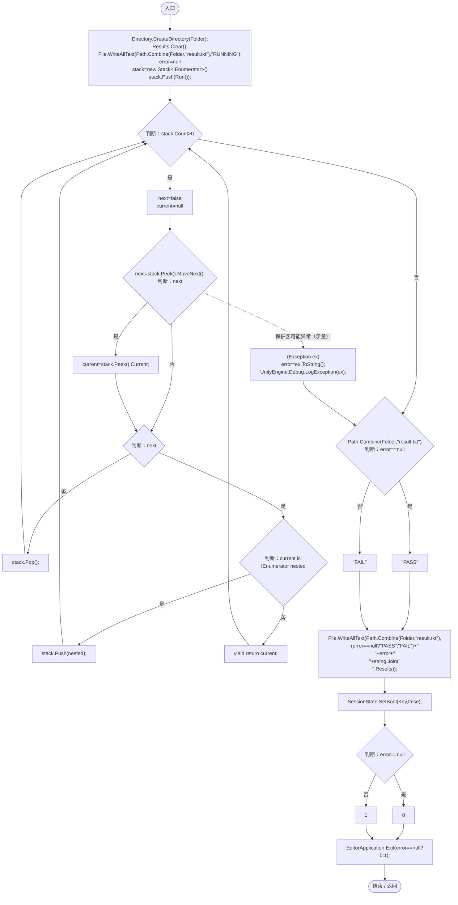

项目内调用/回调引用：

- [SchedulerPerformanceRegression.Run · L62](0a17f5e2b9d73a74.md#m32856c61f62b54d6)（方法）

## Clear · L39

`private static void Clear()`

### Editor · Roslyn编译器控制流

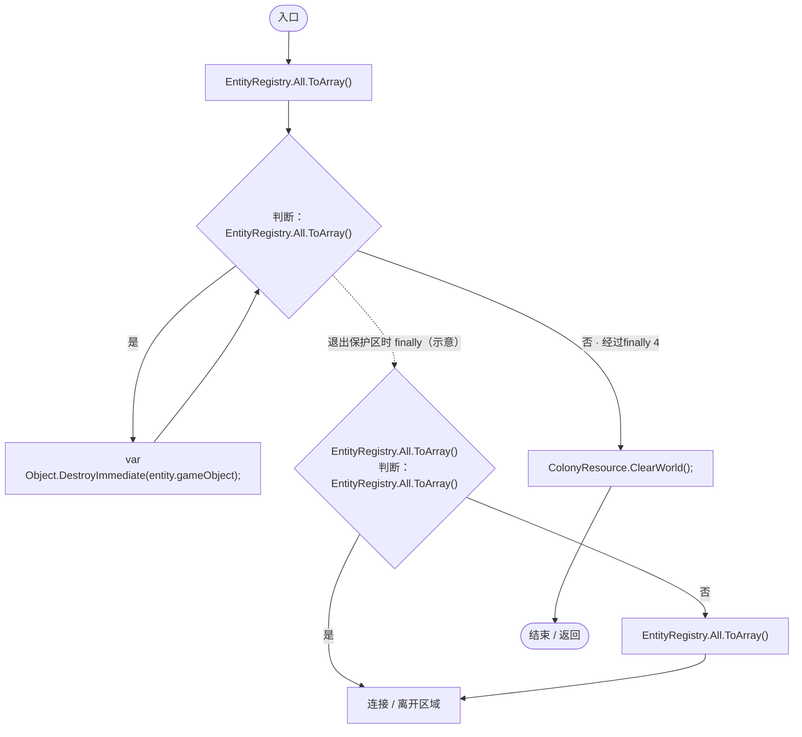

项目内调用/回调引用：

- [ColonyResource.ClearWorld · L109](293dbaecfff4b585.md#m4a3572d1077d33bd)（方法）

## Spawn · L40

`private static DarwinEntity Spawn(Genome genome,Vector3 position)`

### Editor · Roslyn编译器控制流

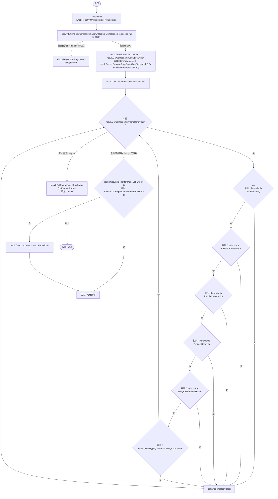

项目内调用/回调引用：

- [RandomSpawnRecipe.Clone · L23](923ccc4e86c4786c.md#me0949958df9c70e0)（方法）
- [DarwinEntity.Genes.get · L14](70798dde169f2e8b.md#m622eb1adf401d431)（访问器）
- [EntityLifeCycle.RestoreProgress · L52](9f4138bfbae654b7.md#m007c73a0c714c238)（方法）
- [EntityGeneController.RestoreStageState · L56](7494d53178552f0e.md#m37c1dbfa64e7c2ce)（方法）
- [EntityGeneController.Recalculate · L114](7494d53178552f0e.md#mf96a252d67ac45a1)（方法）
- [SchedulerPerformanceRegression.Registered · L42](0a17f5e2b9d73a74.md#mf2fd784d6c529bb2)（局部函数）

## Registered · L42

`void Registered(DarwinEntity entity)`

### Editor · Roslyn编译器控制流

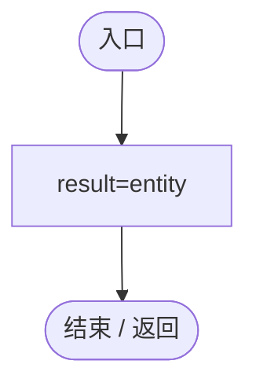

## Measure · L48

`private static void Measure(string name,EntityWorkScheduler scheduler,DarwinEntity[] entities,bool merged,float dt)`

### Editor · Roslyn编译器控制流

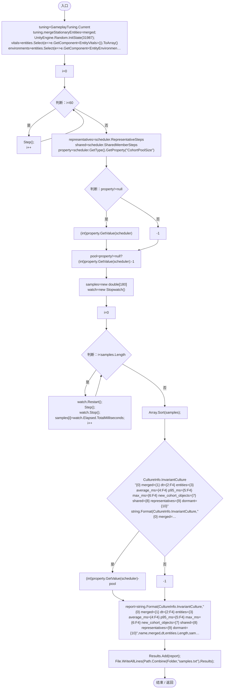

项目内调用/回调引用：

- [GameplayTuning.Current.get · L44](db546e5713b32d53.md#m5713e7f86902b6fa)（访问器）
- [SchedulerPerformanceRegression.Step · L53](0a17f5e2b9d73a74.md#m8e0527f8ffd3b678)（局部函数）
- [EntityWorkScheduler.RepresentativeSteps.get · L62](465ccdbb260bcac2.md#mc1634e98de0b9148)（访问器）
- [EntityWorkScheduler.SharedMemberSteps.get · L63](465ccdbb260bcac2.md#ma2ea17be21511192)（访问器）
- [EntityWorkScheduler.DormantMembers.get · L64](465ccdbb260bcac2.md#mf38e594d3d450fdf)（访问器）
- [SchedulerPerformanceRegression.回调@52 · L52](0a17f5e2b9d73a74.md#m9905e1743a295e29)（回调/委托）
- [SchedulerPerformanceRegression.回调@52 · L52](0a17f5e2b9d73a74.md#m4332030e4143b7e5)（回调/委托）

## 回调@52 · L52

`e … => 回调`

### Editor · Roslyn编译器控制流

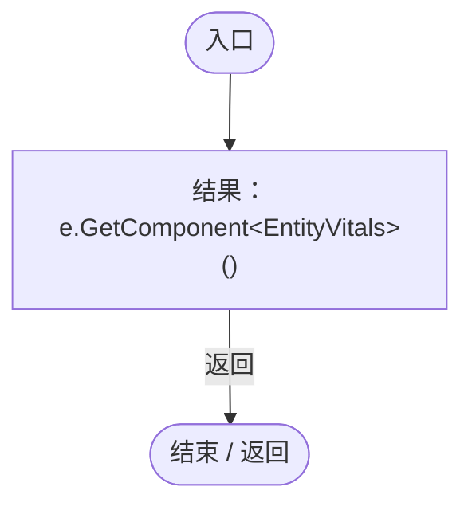

## 回调@52 · L52

`e … => 回调`

### Editor · Roslyn编译器控制流

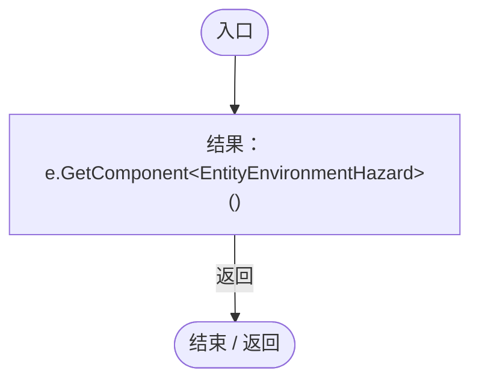

## Step · L53

`void Step()`

### Editor · Roslyn编译器控制流

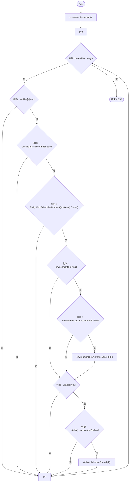

项目内调用/回调引用：

- [EntityWorkScheduler.Advance · L91](465ccdbb260bcac2.md#m3c6be95c9f3f99a5)（方法）
- [EntityWorkScheduler.Dormant · L71](465ccdbb260bcac2.md#m4784bd3cb8d8af84)（方法）
- [DarwinEntity.Genes.get · L14](70798dde169f2e8b.md#m622eb1adf401d431)（访问器）
- [EntityEnvironmentHazard.AdvanceShared · L74](5c434d0ba85333b1.md#mbfde8d0e75da3c35)（方法）
- [EntityVitals.AdvanceShared · L47](7f68ee05c2ac84bc.md#m891aed9a6cea7c6d)（方法）

## Run · L62

`private static IEnumerator Run()`

### Editor · Roslyn编译器控制流

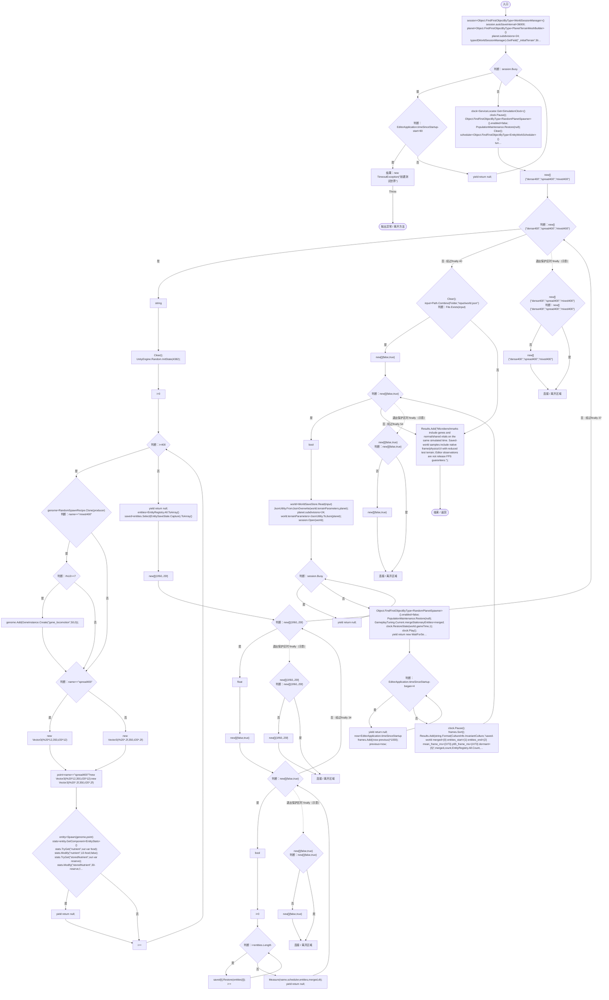

项目内调用/回调引用：

- [PlanetClimateMap.Instance.get · L16](b4e9726c1bcf4c37.md#m3add54a419aeef9f)（访问器）
- [PlanetOreSystem.Instance.get · L8](86b3fbb4d9436121.md#m53f6a6af4b6dc252)（访问器）
- [WorldSessionManager.Create · L41](08741c7b7b9d9344.md#m6aadfeee8b90aacd)（方法）
- [WorldSessionManager.Busy.get · L24](08741c7b7b9d9344.md#m4483e2e4f28f7c85)（访问器）
- [ServiceLocator.Get · L33](f2fdbe9f9ccd93cb.md#m2ae625299520c56d)（方法）
- [SimulationClock.Pause · L79](a8f444aec9614b0a.md#m30929d45a885d0f1)（方法）
- [PopulationMaintenance.Restore · L155](923ccc4e86c4786c.md#m239f01f9bc44dc27)（方法）
- [SchedulerPerformanceRegression.Clear · L39](0a17f5e2b9d73a74.md#mc57cf3e7b0a4c914)（方法）
- [GameplayTuning.Current.get · L44](db546e5713b32d53.md#m5713e7f86902b6fa)（访问器）
- [RandomSpawnRecipe.CreateGenome · L25](923ccc4e86c4786c.md#m2612c79fe3848e08)（方法）
- [EcologyDefaults.Template · L68](5b565b57de741d98.md#m98d16ffadd19320f)（方法）
- [RandomSpawnRecipe.Clone · L23](923ccc4e86c4786c.md#me0949958df9c70e0)（方法）
- [Genome.Add · L19](a2ef23f865bc7ee8.md#md9cfdc94b8b8d40f)（方法）
- [GeneInstance.Create · L20](f82e1498d67f5afd.md#m72e94c278de3cf8b)（方法）
- [SchedulerPerformanceRegression.Spawn · L40](0a17f5e2b9d73a74.md#m88487b7ab59ebab6)（方法）
- [EntityStats.TryGet · L90](75aa86a368efdf24.md#m24ee1433e4a70d94)（方法）
- [EntityStats.Modify · L111](75aa86a368efdf24.md#m9c837be197158240)（方法）
- [EntitySaveState.Restore · L32](a1ec8fcd9d7d3ddb.md#md1cca8b8dd3628a4)（方法）
- [SchedulerPerformanceRegression.Measure · L48](0a17f5e2b9d73a74.md#m04a110c19456ed1d)（方法）
- [WorldSaveStore.Read · L74](d67a35e5e3814c15.md#mde52fadbe0185af1)（方法）
- [WorldSessionManager.Open · L60](08741c7b7b9d9344.md#m7bd56ef45131b4e5)（方法）
- [SimulationClock.RestoreState · L74](a8f444aec9614b0a.md#m8f617e95e1282846)（方法）
- [SimulationClock.Play · L78](a8f444aec9614b0a.md#m7aa9e64b7de60ed0)（方法）
- [EntityWorkScheduler.DormantMembers.get · L64](465ccdbb260bcac2.md#mf38e594d3d450fdf)（访问器）
- [SchedulerPerformanceRegression.回调@68 · L68](0a17f5e2b9d73a74.md#m58a3c509c7e3a232)（回调/委托）
- [EntitySaveState.Capture · L22](a1ec8fcd9d7d3ddb.md#md994065ded6697b7)（方法）

## 回调@68 · L68

`g … => 回调`

### Editor · Roslyn编译器控制流

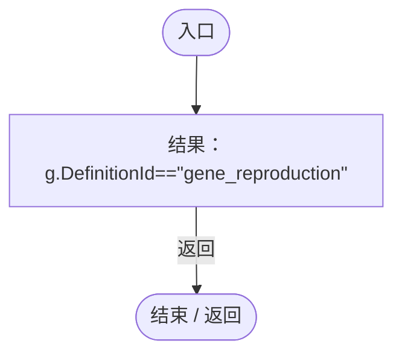
