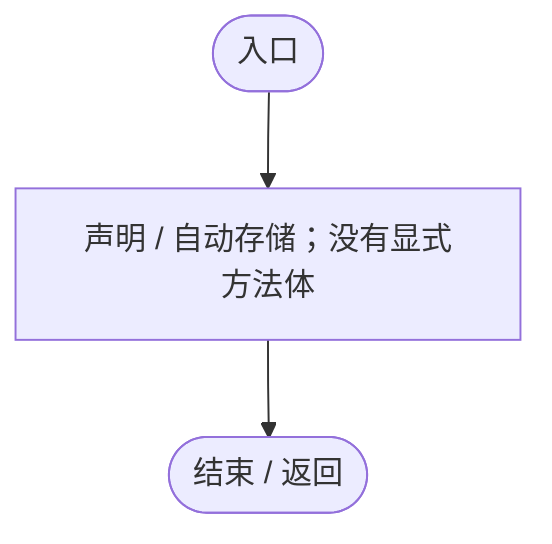
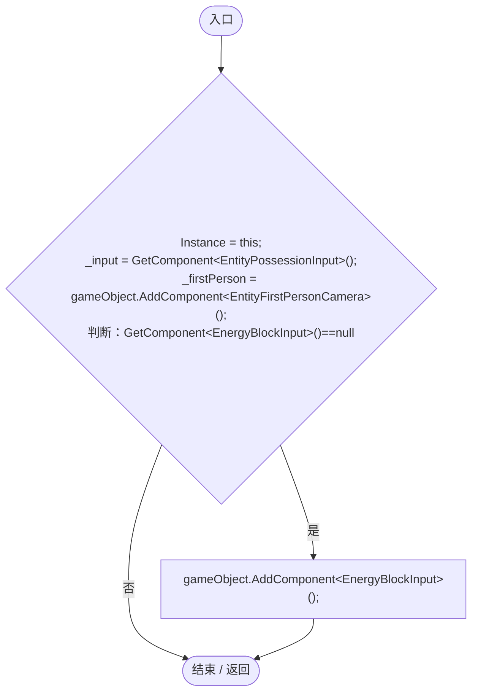
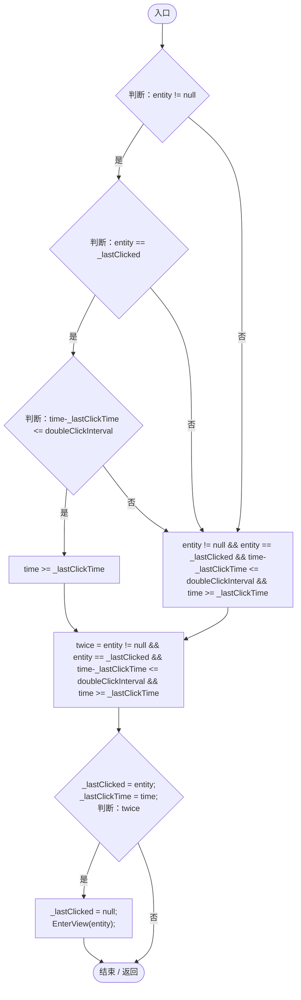
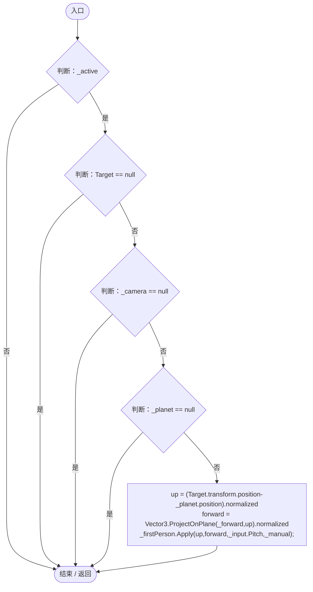
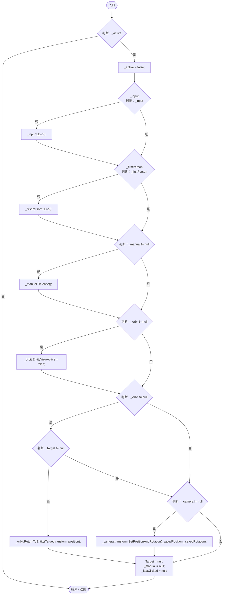
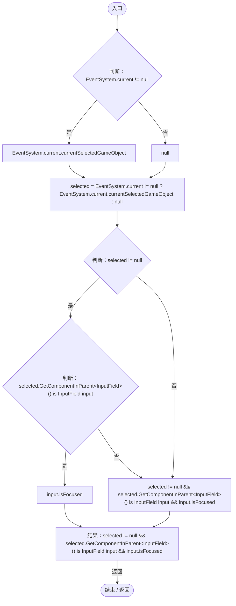
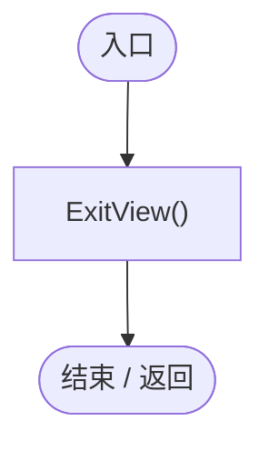
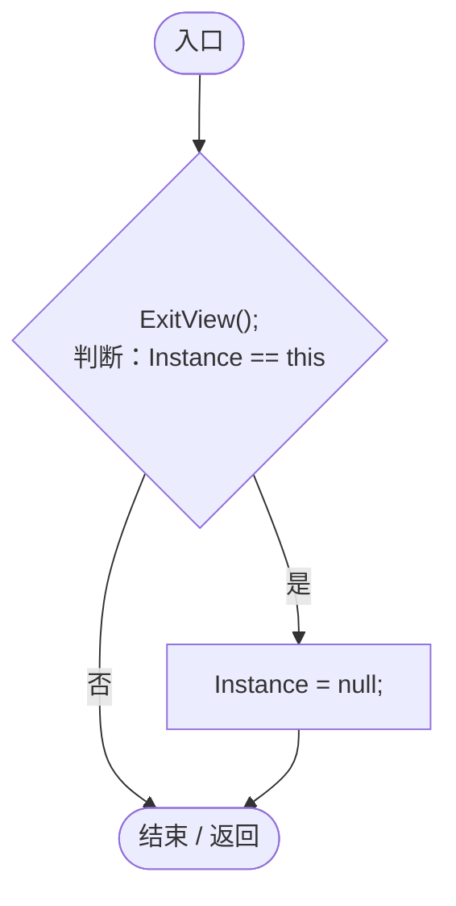

```mermaid
flowchart TD
  b0(["入口"])
  b1{"判断：_active"}
  b2{"判断：Target == null"}
  b3{"判断：Target.isActiveAndEnabled"}
  b4{"判断：Target.GetComponent&lt;EntityStats&gt;() is EntityStats stats"}
  b5{"判断：stats.TryGet(&quot;health&quot;,out float hp)"}
  b6{"判断：hp &lt;= 0"}
  b7["ExitView();"]
  b8{"判断：GameInputGate.Blocked"}
  b9{"typing = IsTyping()<br/>viewExitKey = ControlBindings.Get(ControlAction.ExitView)<br/>判断：_active"}
  b10{"判断：Input.GetKeyDown(viewExitKey)"}
  b11["ExitView();"]
  b12{"判断：EventSystem.current != null"}
  b13["EventSystem.current.IsPointerOverGameObject()"]
  b14["EventSystem.current != null"]
  b15["overUI = EventSystem.current != null &amp;&amp; EventSystem.current.IsPointerOverGameObject()"]
  b16{"判断：OrbitCamera.IsDraggingUI"}
  b17{"判断：EntityPlacementTool.Instance != null"}
  b18["EntityPlacementTool.Instance.IsPlacing"]
  b19["EntityPlacementTool.Instance != null"]
  b20["OrbitCamera.IsDraggingUI"]
  b21["placing = OrbitCamera.IsDraggingUI &#124;&#124; (EntityPlacementTool.Instance != null &amp;&amp; EntityPlacementTool.Instance.IsPlacing)"]
  b22{"判断：_active"}
  b23{"判断：WorldAuthority.RtsMode"}
  b24{"判断：typing"}
  b25{"判断：overUI"}
  b26{"判断：placing"}
  b27{"判断：Input.GetMouseButtonDown(0)"}
  b28{"camera = Camera.main<br/>判断：camera != null"}
  b29{"判断：Physics.Raycast(camera.ScreenPointToRay(Input.mousePosition),out var hit,camera.farClipPlane,pickMask,QueryTriggerInteraction.Ignore)"}
  b30["RegisterClick(hit.collider.GetComponentInParent&lt;DarwinEntity&gt;(),Time.unscaledTime);"]
  b31["RegisterClick(null,Time.unscaledTime);"]
  b32{"判断：_active"}
  b33{"判断：typing"}
  b34["placing"]
  b35["typing"]
  b36["blocked = typing &#124;&#124; placing"]
  b37{"up = (Target.transform.position-_planet.position).normalized<br/>_forward = Vector3.ProjectOnPlane(_forward,up).normalized;<br/>判断：_forward.sqrMagnitude &lt; .01f"}
  b38["_forward = Vector3.ProjectOnPlane(Vector3.forward,up).normalized;"]
  b39["_input.Tick(blocked,up,ref _forward,ref _height,ref _distance,minFollowDistance,maxFollowDistance);"]
  b40(["结束 / 返回"])
  b0 --> b1
  b1 -->|"是"| b2
  b1 -->|"否"| b8
  b2 -->|"否"| b3
  b2 -->|"是"| b7
  b3 -->|"是"| b4
  b3 -->|"否"| b7
  b4 -->|"是"| b5
  b4 -->|"否"| b8
  b5 -->|"是"| b6
  b5 -->|"否"| b8
  b6 -->|"是"| b7
  b6 -->|"否"| b8
  b7 --> b40
  b8 -->|"是"| b40
  b8 -->|"否"| b9
  b9 -->|"是"| b10
  b9 -->|"否"| b12
  b10 -->|"是"| b11
  b10 -->|"否"| b12
  b11 --> b40
  b12 -->|"是"| b13
  b12 -->|"否"| b14
  b13 --> b15
  b14 --> b15
  b15 --> b16
  b16 -->|"否"| b17
  b16 -->|"是"| b20
  b17 -->|"是"| b18
  b17 -->|"否"| b19
  b18 --> b21
  b19 --> b21
  b20 --> b21
  b21 --> b22
  b22 -->|"否"| b23
  b22 -->|"是"| b32
  b23 -->|"否"| b24
  b23 -->|"是"| b32
  b24 -->|"否"| b25
  b24 -->|"是"| b32
  b25 -->|"否"| b26
  b25 -->|"是"| b32
  b26 -->|"否"| b27
  b26 -->|"是"| b32
  b27 -->|"是"| b28
  b27 -->|"否"| b32
  b28 -->|"是"| b29
  b28 -->|"否"| b31
  b29 -->|"是"| b30
  b29 -->|"否"| b31
  b30 --> b32
  b31 --> b32
  b32 -->|"否"| b40
  b32 -->|"是"| b33
  b33 -->|"否"| b34
  b33 -->|"是"| b35
  b34 --> b36
  b35 --> b36
  b36 --> b37
  b37 -->|"是"| b38
  b37 -->|"否"| b39
  b38 --> b39
  b39 --> b40

```

```mermaid
flowchart TD
  b0(["入口"])
  b1{"判断：entity == null"}
  b2{"判断：entity.isActiveAndEnabled"}
  b3["结果：false"]
  b4{"LanSession.Instance<br/>判断：LanSession.Instance"}
  b5[".AllowView(entity)"]
  b6["LanSession.Instance"]
  b7{"判断：LanSession.Instance?.AllowView(entity)==false"}
  b8["结果：false"]
  b9["camera = Camera.main"]
  b10{"判断：camera != null"}
  b11["camera.GetComponent&lt;OrbitCamera&gt;()"]
  b12["null"]
  b13["orbit = camera != null ? camera.GetComponent&lt;OrbitCamera&gt;() : null"]
  b14{"判断：orbit == null"}
  b15{"判断：orbit.target == null"}
  b16["Log.Error(Log.Tag.UI,&quot;实体视角需要主相机与星球轨道目标&quot;);<br/>结果：false"]
  b17{"判断：entity.GetComponent&lt;Rigidbody&gt;() == null"}
  b18{"判断：entity.GetComponent&lt;EntityGeneController&gt;() == null"}
  b19["结果：false"]
  b20{"判断：_active"}
  b21["ExitView();"]
  b22{"EntityPlacementTool.Instance<br/>判断：EntityPlacementTool.Instance"}
  b23["EntityPlacementTool.Instance?.CancelPlacement();"]
  b24["_camera = camera;<br/>_orbit = orbit;<br/>_planet = orbit.target;<br/>_terrain = _planet.GetComponent&lt;MeshCollider&gt;();<br/>_savedPosition = camera.transform.position;<br/>_savedRotation = camera.transform.rotation;<br/>_forward = Vector3.ProjectOnPlane(camera.t…"]
  b25["_manual"]
  b26{"entity.GetComponent&lt;EntityManualControl&gt;()<br/>判断：entity.GetComponent&lt;EntityManualControl&gt;()"}
  b27["entity.GetComponent&lt;EntityManualControl&gt;()"]
  b28["entity.gameObject.AddComponent&lt;EntityManualControl&gt;()"]
  b29["_manual = entity.GetComponent&lt;EntityManualControl&gt;() ?? entity.gameObject.AddComponent&lt;EntityManualControl&gt;();"]
  b30["_manual.BeginControl(_planet);<br/>_active = true;<br/>_orbit.EntityViewActive = true;"]
  b31{"EventSystem.current<br/>判断：EventSystem.current"}
  b32["EventSystem.current?.SetSelectedGameObject(null);"]
  b33["_input.Begin(_manual,_planet,_height,_distance);<br/>_firstPerson.Begin(entity, camera);<br/>结果：true"]
  b34(["结束 / 返回"])
  b0 --> b1
  b1 -->|"否"| b2
  b1 -->|"是"| b3
  b2 -->|"否"| b3
  b2 -->|"是"| b4
  b3 -->|"返回"| b34
  b4 -->|"否"| b5
  b4 -->|"是"| b6
  b5 --> b7
  b6 --> b7
  b7 -->|"是"| b8
  b7 -->|"否"| b9
  b8 -->|"返回"| b34
  b9 --> b10
  b10 -->|"是"| b11
  b10 -->|"否"| b12
  b11 --> b13
  b12 --> b13
  b13 --> b14
  b14 -->|"否"| b15
  b14 -->|"是"| b16
  b15 -->|"是"| b16
  b15 -->|"否"| b17
  b16 -->|"返回"| b34
  b17 -->|"否"| b18
  b17 -->|"是"| b19
  b18 -->|"是"| b19
  b18 -->|"否"| b20
  b19 -->|"返回"| b34
  b20 -->|"是"| b21
  b20 -->|"否"| b22
  b21 --> b22
  b22 -->|"否"| b23
  b22 -->|"是"| b24
  b23 --> b24
  b24 --> b25
  b25 --> b26
  b26 -->|"否"| b27
  b26 -->|"是"| b28
  b27 --> b29
  b28 --> b29
  b29 --> b30
  b30 --> b31
  b31 -->|"否"| b32
  b31 -->|"是"| b33
  b32 --> b33
  b33 -->|"返回"| b34

```

# EntityViewController.cs

[返回总索引](../README.md) · `Runtime` · `Assets/DarwinPark/UI/EntityViewController.cs`

[源文件](../../../Assets/DarwinPark/UI/EntityViewController.cs) · 源码校验：`b5bd618b0932a7f4717dfc8d4660e15b6f9030568243acab694a34fd2fee3410`

方法按源文件位置排列。事件/回调引用不表示立即执行；分支与异常说明见总索引。完整源码与可点击关系图请打开离线手册。

## Instance.get · L15

`get`

### Editor / Player · 语法控制结构 / 声明（非CFG）

## Instance.set · L15

`private set`

### Editor / Player · 语法控制结构 / 声明（非CFG）

## Target.get · L16

`get`

### Editor / Player · 语法控制结构 / 声明（非CFG）

## Target.set · L16

`private set`

### Editor / Player · 语法控制结构 / 声明（非CFG）

## Awake · L35

`private void Awake()`

### Editor / Player · Roslyn编译器控制流

项目内调用/回调引用：

- [EntityViewController.Instance.set · L15](0ad0345f83229ef0.md#m5bf2aaf7eebb63f6)（访问器）

## Update · L38

`private void Update()`

### Editor / Player · Roslyn编译器控制流

项目内调用/回调引用：

- [EntityViewController.Target.get · L16](0ad0345f83229ef0.md#m87ca090092a884ab)（访问器）
- [EntityStats.TryGet · L90](75aa86a368efdf24.md#m24ee1433e4a70d94)（方法）
- [EntityViewController.ExitView · L105](0ad0345f83229ef0.md#mca8619c7f27942c9)（方法）
- [GameInputGate.Blocked.get · L8](52955daae7e592ab.md#m765763b665829633)（访问器）
- [EntityViewController.IsTyping · L118](0ad0345f83229ef0.md#m3fef2a71a47f9555)（方法）
- [ControlBindings.Get · L45](b6735f8f133ee3f4.md#mb5707e6e63a56689)（方法）
- [EntityPlacementTool.Instance.get · L13](2ca993947b0a7e7a.md#mafb26991c0dfcb86)（访问器）
- [EntityPlacementTool.IsPlacing.get · L14](2ca993947b0a7e7a.md#ma73d17b3db4aa719)（访问器）
- [EntityViewController.RegisterClick · L67](0ad0345f83229ef0.md#m4fb659737eb45ff1)（方法）
- [EntityPossessionInput.Tick · L55](4c12d3ae76941d37.md#m82cccdeb60a8e9bd)（方法）

## RegisterClick · L67

`public void RegisterClick(DarwinEntity entity, float time)`

★ 新增：同一实体的双击才切换，UI/空白点击不会沿用上一次命中。

### Editor / Player · Roslyn编译器控制流

项目内调用/回调引用：

- [EntityViewController.EnterView · L73](0ad0345f83229ef0.md#mbd7be6d2bbd0ec83)（方法）

## EnterView · L73

`public bool EnterView(DarwinEntity entity)`

### Editor / Player · Roslyn编译器控制流

项目内调用/回调引用：

- [LanSession.Instance.get · L23](9fb633eebffe669c.md#mbf83306994878383)（访问器）
- [LanSession.AllowView · L97](9fb633eebffe669c.md#mb874ffc1ba799e4c)（方法）
- [Log.Error · L43](735e5abf0df2bddc.md#m2addd5e1d74b000d)（方法）
- [EntityViewController.ExitView · L105](0ad0345f83229ef0.md#mca8619c7f27942c9)（方法）
- [EntityPlacementTool.Instance.get · L13](2ca993947b0a7e7a.md#mafb26991c0dfcb86)（访问器）
- [EntityPlacementTool.CancelPlacement · L81](2ca993947b0a7e7a.md#m5a9374d2c71f0a2d)（方法）
- [EntityViewController.Target.set · L16](0ad0345f83229ef0.md#m00587394e3b12f08)（访问器）
- [EntityManualControl.BeginControl · L32](a6969896da35e1f0.md#mf0dadf914f9961c7)（方法）
- [OrbitCamera.EntityViewActive.set · L39](42eb429559b42bcb.md#m5eb15eeb00ce9b92)（访问器）
- [EntityPossessionInput.Begin · L31](4c12d3ae76941d37.md#m2ab733b61d036d88)（方法）
- [EntityFirstPersonCamera.Begin · L15](5ebdca1d5bf05886.md#mbbfaf846c039856c)（方法）

## LateUpdate · L97

`private void LateUpdate()`

### Editor / Player · Roslyn编译器控制流

项目内调用/回调引用：

- [EntityViewController.Target.get · L16](0ad0345f83229ef0.md#m87ca090092a884ab)（访问器）
- [EntityFirstPersonCamera.Apply · L22](5ebdca1d5bf05886.md#m7b6f2eda640dbdde)（方法）

## ExitView · L105

`public void ExitView()`

### Editor / Player · Roslyn编译器控制流

项目内调用/回调引用：

- [EntityPossessionInput.End · L99](4c12d3ae76941d37.md#ma1493f8d0943d794)（方法）
- [EntityFirstPersonCamera.End · L32](5ebdca1d5bf05886.md#m64c101c9d842451a)（方法）
- [EntityManualControl.Release · L37](a6969896da35e1f0.md#m87aa0efacece2c5b)（方法）
- [OrbitCamera.EntityViewActive.set · L39](42eb429559b42bcb.md#m5eb15eeb00ce9b92)（访问器）
- [EntityViewController.Target.get · L16](0ad0345f83229ef0.md#m87ca090092a884ab)（访问器）
- [OrbitCamera.ReturnToEntity · L157](42eb429559b42bcb.md#m82eada81c1bf4636)（方法）
- [EntityViewController.Target.set · L16](0ad0345f83229ef0.md#m00587394e3b12f08)（访问器）

## IsTyping · L118

`private static bool IsTyping()`

### Editor / Player · Roslyn编译器控制流

## OnDisable · L123

`private void OnDisable()`

### Editor / Player · Roslyn编译器控制流

项目内调用/回调引用：

- [EntityViewController.ExitView · L105](0ad0345f83229ef0.md#mca8619c7f27942c9)（方法）

## OnDestroy · L124

`private void OnDestroy()`

### Editor / Player · Roslyn编译器控制流

项目内调用/回调引用：

- [EntityViewController.ExitView · L105](0ad0345f83229ef0.md#mca8619c7f27942c9)（方法）
- [EntityViewController.Instance.get · L15](0ad0345f83229ef0.md#mb3b8144b56e80842)（访问器）
- [EntityViewController.Instance.set · L15](0ad0345f83229ef0.md#m5bf2aaf7eebb63f6)（访问器）
