# TerrainVideoSettingsRegression.cs

[返回总索引](../README.md) · `Editor` · `Assets/DarwinPark/Editor/TerrainVideoSettingsRegression.cs`

[源文件](../../../Assets/DarwinPark/Editor/TerrainVideoSettingsRegression.cs) · 源码校验：`99867693c38d28dea4541277fb927451ec770059d3b4ec7667dad83ddb437788`

方法按源文件位置排列。事件/回调引用不表示立即执行；分支与异常说明见总索引。完整源码与可点击关系图请打开离线手册。

## Folder.get · L26

`private static string Folder`

### Editor · 语法控制结构 / 声明（非CFG）

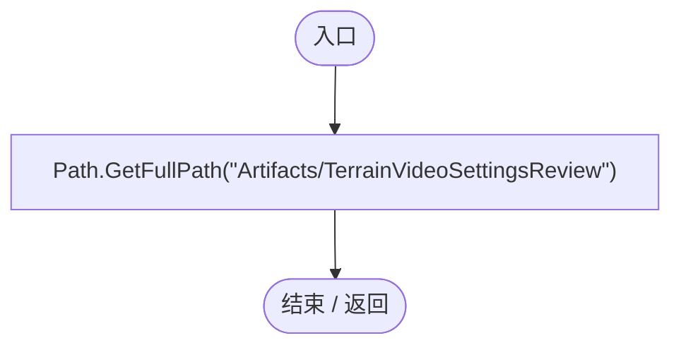

## TerrainVideoSettingsRegression.ctor · L27

`static TerrainVideoSettingsRegression()`

### Editor · Roslyn编译器控制流

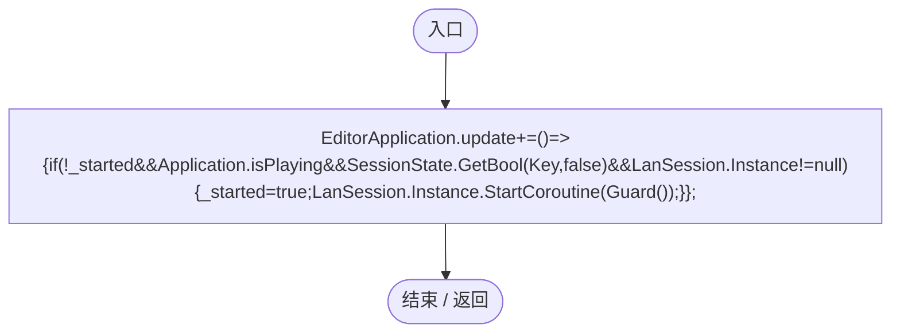

项目内调用/回调引用：

- [TerrainVideoSettingsRegression.回调@27 · L27](0c1be03c62f93352.md#m023f5c947a5da073)（回调/委托）

## 回调@27 · L27

`( … => 回调`

### Editor · Roslyn编译器控制流

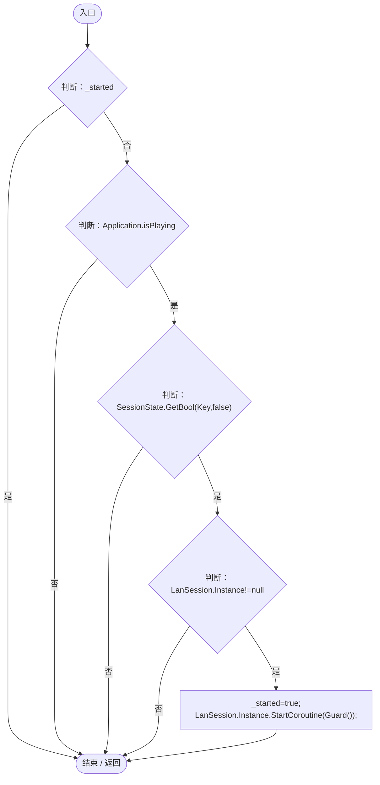

项目内调用/回调引用：

- [LanSession.Instance.get · L23](9fb633eebffe669c.md#mbf83306994878383)（访问器）
- [TerrainVideoSettingsRegression.Guard · L40](0c1be03c62f93352.md#mcc3de57b930ebe6f)（方法）

## RunBatch · L28

`public static void RunBatch()`

### Editor · Roslyn编译器控制流

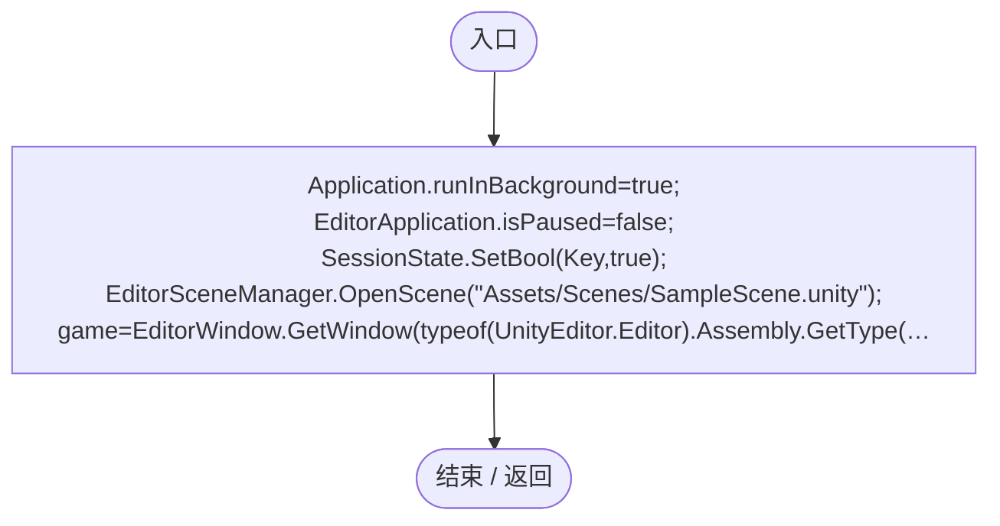

## Check · L34

`private static void Check(bool value,string message)`

### Editor · Roslyn编译器控制流

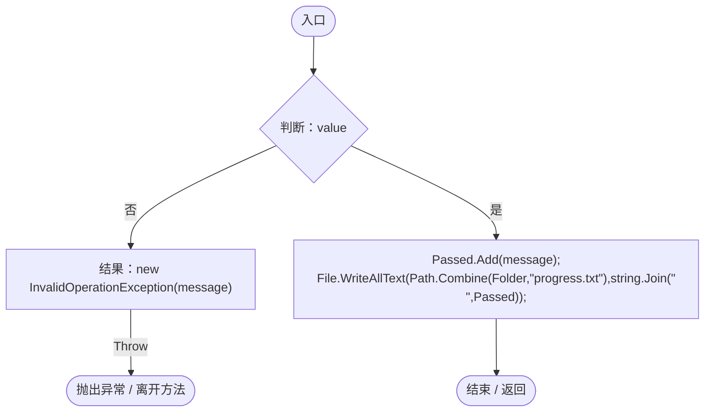

## Field · L35

`private static object Field(object value,string name)`

### Editor · Roslyn编译器控制流

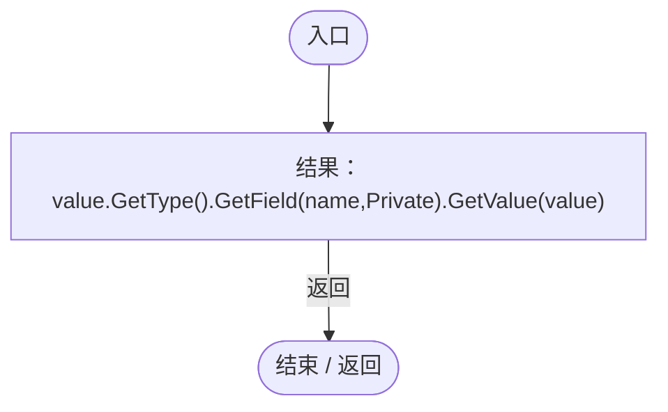

## OnLog · L36

`private static void OnLog(string message,string stack,LogType type)`

### Editor · Roslyn编译器控制流

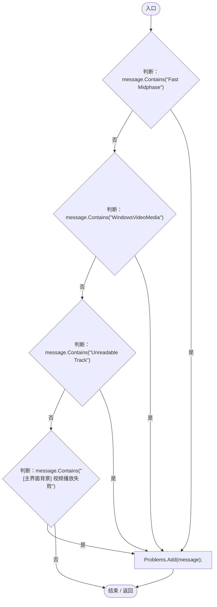

## Guard · L40

`private static IEnumerator Guard()`

### Editor · Roslyn编译器控制流

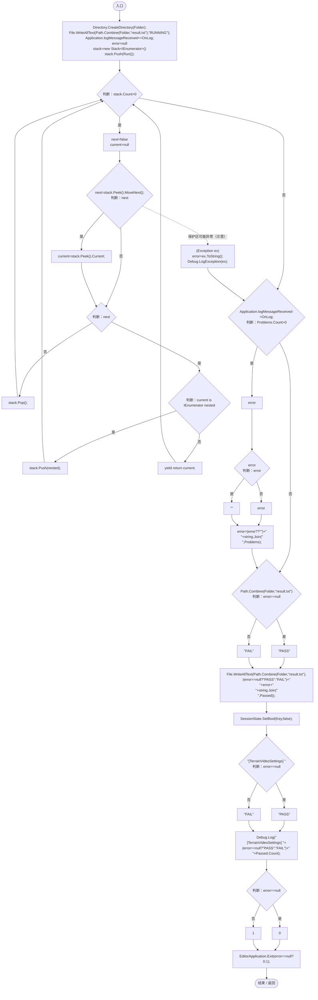

项目内调用/回调引用：

- [TerrainVideoSettingsRegression.Run · L74](0c1be03c62f93352.md#m68f3273224c7205f)（方法）
- [TerrainVideoSettingsRegression.OnLog · L36](0c1be03c62f93352.md#m9d15c9e29319b993)（方法）

## Sphere · L54

`private static PlanetTerrainData Sphere(int sub,float radius)`

### Editor · Roslyn编译器控制流

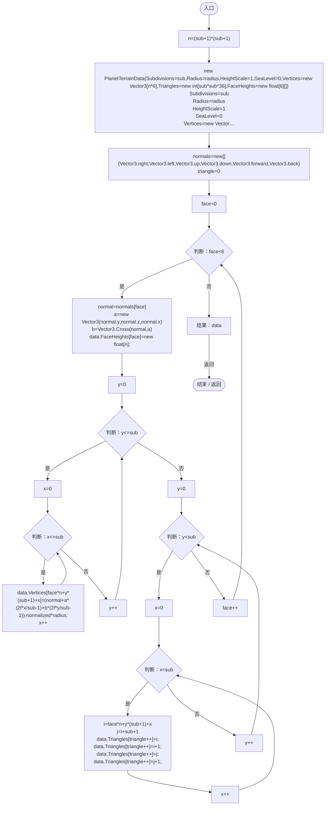

## ScreenRect · L71

`private static Rect ScreenRect(RectTransform rect)`

### Editor · Roslyn编译器控制流

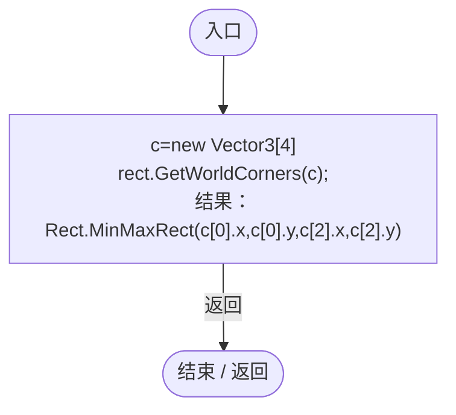

## Capture · L73

`private static IEnumerator Capture(string name)`

### Editor · Roslyn编译器控制流

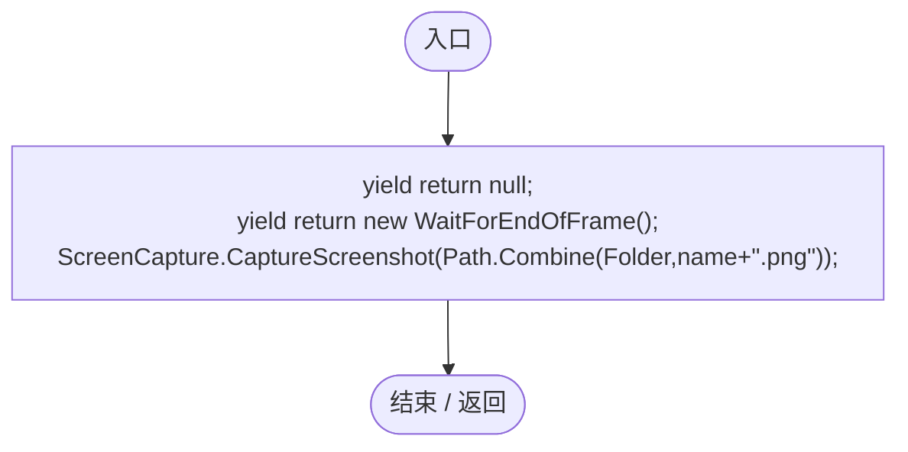

## Run · L74

`private static IEnumerator Run()`

### Editor · Roslyn编译器控制流

```mermaid
flowchart TD
  b0(["入口"])
  b1["yield return null;<br/>menu=Object.FindFirstObjectByType&lt;GameMainMenu&gt;()<br/>session=Object.FindFirstObjectByType&lt;WorldSessionManager&gt;()<br/>clock=ServiceLocator.Get&lt;SimulationClock&gt;()<br/>background=menu.GetComponent&lt;MainMenuBackground&gt;()<br/>video=menu.Ge…"]
  b2{"判断：video==null"}
  b3{"判断：video.isPrepared"}
  b4{"判断：video.frame&lt;1"}
  b5{"判断：EditorApplication.timeSinceStartup-start&gt;20"}
  b6["结果：new TimeoutException(&quot;菜单视频未输出首帧&quot;)"]
  x6(["抛出异常 / 离开方法"])
  b7["yield return null;<br/>video=menu.GetComponent&lt;VideoPlayer&gt;();"]
  b8{"判断：video.url.EndsWith(&quot;.webm&quot;)"}
  b9{"判断：video.width==1280"}
  b10["video.height==720"]
  b11["video.url.EndsWith(&quot;.webm&quot;)&amp;&amp;video.width==1280&amp;&amp;video.height==720"]
  b12["Check(video.url.EndsWith(&quot;.webm&quot;)&amp;&amp;video.width==1280&amp;&amp;video.height==720,&quot;1280×720 VP8视频实际解码输出&quot;);"]
  b13["loops=0<br/>video.loopPointReached+=_=&gt;loops++;<br/>start=EditorApplication.timeSinceStartup;"]
  b14{"判断：loops&lt;2"}
  b15{"判断：EditorApplication.timeSinceStartup-start&gt;35"}
  b16["结果：new TimeoutException(&quot;视频循环超时&quot;)"]
  x16(["抛出异常 / 离开方法"])
  b17["yield return null;"]
  b18["Check(Problems.Count==0,&quot;菜单视频完整循环两次无WindowsVideoMedia错误&quot;);"]
  b19["i=0"]
  b20{"判断：i&lt;3"}
  b21["background.enabled=false;<br/>yield return null;<br/>Check(!video.isPlaying,&quot;停用背景暂停解码 &quot;+i);<br/>background.enabled=true;<br/>Check(video.isPlaying,&quot;重新启用背景恢复播放 &quot;+i);<br/>i++"]
  b22["testObject=new GameObject(&quot;超高精度碰撞验证&quot;)<br/>terrain=testObject.AddComponent&lt;PlanetTerrainMeshBuilder&gt;()<br/>terrain.enabled=false;<br/>terrain.radius=20;<br/>terrain.heightScale=1;<br/>testObject.AddComponent&lt;MeshCollider&gt;();<br/>testObject.transform.position=new…"]
  b23{"判断：(collider.cookingOptions&amp;MeshColliderCookingOptions.UseFastMidphase)==0"}
  b24["collider.sharedMesh.triangles.Length/3==triangles"]
  b25["(collider.cookingOptions&amp;MeshColliderCookingOptions.UseFastMidphase)==0"]
  b26["Check((collider.cookingOptions&amp;MeshColliderCookingOptions.UseFastMidphase)==0&amp;&amp;collider.sharedMesh.triangles.Length/3==triangles,&quot;超大网格保留精度并自动切换兼容碰撞&quot;);"]
  b27["Check((collider.cookingOptions&amp;~MeshColliderCookingOptions.UseFastMidphase)==(original&amp;~MeshColliderCookingOptions.UseFastMidphase),&quot;碰撞清理及焊接选项保持原值&quot;);"]
  b28["new[]{Vector3.up,Vector3.down,Vector3.left,Vector3.right,Vector3.forward,Vector3.back,new Vector3(1,1,1).normalized,new Vector3(-1,1,-1).normalized}"]
  b29{"判断：new[]{Vector3.up,Vector3.down,Vector3.left,Vector3.right,Vector3.forward,Vector3.back,new Vector3(1,1,1).normalized,new Vector3(-1,1,-1).normalized}"}
  b30["var"]
  b31{"判断：collider.Raycast(new Ray(testObject.transform.position+direction*30,-direction),out var hit,50)"}
  b32["Mathf.Abs(Vector3.Distance(hit.point,testObject.transform.position)-20)&lt;.05f"]
  b33["collider.Raycast(new Ray(testObject.transform.position+direction*30,-direction),out var hit,50)"]
  b34["Check(collider.Raycast(new Ray(testObject.transform.position+direction*30,-direction),out var hit,50)&amp;&amp;Mathf.Abs(Vector3.Distance(hit.point,testObject.transform.position)-20)&lt;.05f,&quot;大网格实际地面射线命中 &quot;+direction);"]
  b35{"new[]{Vector3.up,Vector3.down,Vector3.left,Vector3.right,Vector3.forward,Vector3.back,new Vector3(1,1,1).normalized,new Vector3(-1,1,-1).normalized}<br/>判断：new[]{Vector3.up,Vector3.down,Vector3.left,Vector3.right,Vector3.forward,Vector3.back…"}
  b36["new[]{Vector3.up,Vector3.down,Vector3.left,Vector3.right,Vector3.forward,Vector3.back,new Vector3(1,1,1).normalized,new Vector3(-1,1,-1).normalized}"]
  b37["连接 / 离开区域"]
  b38["terrain.ApplyGeneratedData(Sphere(8,20));<br/>Check((collider.cookingOptions&amp;MeshColliderCookingOptions.UseFastMidphase)!=0,&quot;高精度切回普通网格可恢复快速结构&quot;);<br/>terrain.useFastMidphase=false;<br/>Check((collider.cookingOptions&amp;MeshColliderCookingOptions.UseFast…"]
  b39{"判断：session.Busy"}
  b40{"判断：EditorApplication.timeSinceStartup-start&gt;90"}
  b41["结果：new TimeoutException(&quot;测试世界加载超时&quot;)"]
  x41(["抛出异常 / 离开方法"])
  b42["yield return null;"]
  b43{"判断：session.Current!=null"}
  b44{"判断：menu.Visible"}
  b45["!video.isPlaying"]
  b46["session.Current!=null&amp;&amp;!menu.Visible&amp;&amp;!video.isPlaying"]
  b47["Check(session.Current!=null&amp;&amp;!menu.Visible&amp;&amp;!video.isPlaying,&quot;进入真实世界暂停菜单视频&quot;);"]
  b48["root=ServiceLocator.Get&lt;UIRoot&gt;()<br/>Check(root.MainCanvas.transform.Find(&quot;BottomPanel/TabBar/SettingsShortcut&quot;)==null,&quot;底栏不存在误加的设置按钮&quot;);<br/>clock.Play();<br/>menu.ShowPause();<br/>typeof(GameMainMenu).GetField(&quot;_page&quot;,Private).SetValue(menu,&quot;settings&quot;)…"]
  b49{"判断：menu.Visible"}
  b50{"判断：GameInputGate.Blocked"}
  b51["!clock.IsRunning"]
  b52["menu.Visible&amp;&amp;GameInputGate.Blocked&amp;&amp;!clock.IsRunning"]
  b53["Check(menu.Visible&amp;&amp;GameInputGate.Blocked&amp;&amp;!clock.IsRunning,&quot;设置页暂停并拦截底层输入&quot;);"]
  b54["yield return Capture(&quot;settings-page&quot;);<br/>typeof(GameMainMenu).GetMethod(&quot;ReturnFromSettings&quot;,Private).Invoke(menu,null);<br/>Check((string)Field(menu,&quot;_page&quot;)==&quot;pause&quot;,&quot;设置返回暂停菜单&quot;);<br/>menu.ReturnToMainMenu();<br/>yield return null;<br/>Check(video.isPlay…"]
  b55{"判断：menuHost.GetComponent&lt;VideoPlayer&gt;()==null"}
  b56["Problems.Count==0"]
  b57["menuHost.GetComponent&lt;VideoPlayer&gt;()==null"]
  b58["Check(menuHost.GetComponent&lt;VideoPlayer&gt;()==null&amp;&amp;Problems.Count==0,&quot;销毁背景释放解码器和输出，无Flush错误&quot;);"]
  b59(["结束 / 返回"])
  b0 --> b1
  b1 --> b2
  b2 -->|"否"| b3
  b2 -->|"是"| b5
  b3 -->|"是"| b4
  b3 -->|"否"| b5
  b4 -->|"是"| b5
  b4 -->|"否"| b8
  b5 -->|"是"| b6
  b5 -->|"否"| b7
  b6 -->|"Throw"| x6
  b7 --> b2
  b8 -->|"是"| b9
  b8 -->|"否"| b11
  b9 -->|"是"| b10
  b9 -->|"否"| b11
  b10 --> b12
  b11 --> b12
  b12 --> b13
  b13 --> b14
  b14 -->|"是"| b15
  b14 -->|"否"| b18
  b15 -->|"是"| b16
  b15 -->|"否"| b17
  b16 -->|"Throw"| x16
  b17 --> b14
  b18 --> b19
  b19 --> b20
  b20 -->|"是"| b21
  b20 -->|"否"| b22
  b21 --> b20
  b22 --> b23
  b23 -->|"是"| b24
  b23 -->|"否"| b25
  b24 --> b26
  b25 --> b26
  b26 --> b27
  b27 --> b28
  b28 --> b29
  b29 -->|"是"| b30
  b29 -->|"否 · 经过finally 35"| b38
  b30 --> b31
  b31 -->|"是"| b32
  b31 -->|"否"| b33
  b32 --> b34
  b33 --> b34
  b34 --> b29
  b35 -->|"否"| b36
  b35 -->|"是"| b37
  b36 --> b37
  b38 --> b39
  b39 -->|"是"| b40
  b39 -->|"否"| b43
  b40 -->|"是"| b41
  b40 -->|"否"| b42
  b41 -->|"Throw"| x41
  b42 --> b39
  b43 -->|"是"| b44
  b43 -->|"否"| b46
  b44 -->|"否"| b45
  b44 -->|"是"| b46
  b45 --> b47
  b46 --> b47
  b47 --> b48
  b48 --> b49
  b49 -->|"是"| b50
  b49 -->|"否"| b52
  b50 -->|"是"| b51
  b50 -->|"否"| b52
  b51 --> b53
  b52 --> b53
  b53 --> b54
  b54 --> b55
  b55 -->|"是"| b56
  b55 -->|"否"| b57
  b56 --> b58
  b57 --> b58
  b58 --> b59
  b29 -. "退出保护区时 finally（示意）" .-> b35

```

项目内调用/回调引用：

- [ServiceLocator.Get · L33](f2fdbe9f9ccd93cb.md#m2ae625299520c56d)（方法）
- [TerrainVideoSettingsRegression.Check · L34](0c1be03c62f93352.md#mcbabbd098dc900ae)（方法）
- [PlanetTerrainMeshBuilder.ApplyGeneratedData · L160](415285cf043354a9.md#m3e899cb84c9a0081)（方法）
- [TerrainVideoSettingsRegression.Sphere · L54](0c1be03c62f93352.md#mc21f09ba16bf9909)（方法）
- [PlanetClimateMap.Instance.get · L16](b4e9726c1bcf4c37.md#m3add54a419aeef9f)（访问器）
- [PlanetOreSystem.Instance.get · L8](86b3fbb4d9436121.md#m53f6a6af4b6dc252)（访问器）
- [WorldSessionManager.Create · L41](08741c7b7b9d9344.md#m6aadfeee8b90aacd)（方法）
- [WorldSessionManager.Busy.get · L24](08741c7b7b9d9344.md#m4483e2e4f28f7c85)（访问器）
- [WorldSessionManager.Current.get · L21](08741c7b7b9d9344.md#m5d26a5eb846a8504)（访问器）
- [UIRoot.MainCanvas.get · L14](9c1421378791f0e0.md#maa2cc9baf1248477)（访问器）
- [SimulationClock.Play · L78](a8f444aec9614b0a.md#m7aa9e64b7de60ed0)（方法）
- [GameMainMenu.ShowPause · L89](a1f1791f9e7a8035.md#m953d85f379a39458)（方法）
- [GameInputGate.Blocked.get · L8](52955daae7e592ab.md#m765763b665829633)（访问器）
- [SimulationClock.IsRunning.get · L22](a8f444aec9614b0a.md#m10f4fe307faca0f0)（访问器）
- [TerrainVideoSettingsRegression.Capture · L73](0c1be03c62f93352.md#m342a4ebb83ab438e)（方法）
- [TerrainVideoSettingsRegression.Field · L35](0c1be03c62f93352.md#m742c8cc6a4dd4eb9)（方法）
- [GameMainMenu.ReturnToMainMenu · L278](a1f1791f9e7a8035.md#m1fdc747e6f1c67d2)（方法）
- [TerrainVideoSettingsRegression.回调@81 · L81](0c1be03c62f93352.md#m2c4e0fdb90810880)（回调/委托）

## 回调@81 · L81

`_ … => 回调`

### Editor · Roslyn编译器控制流

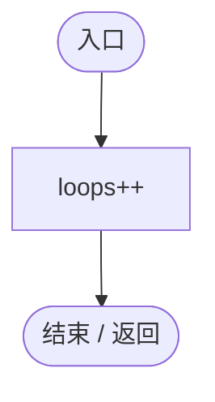
